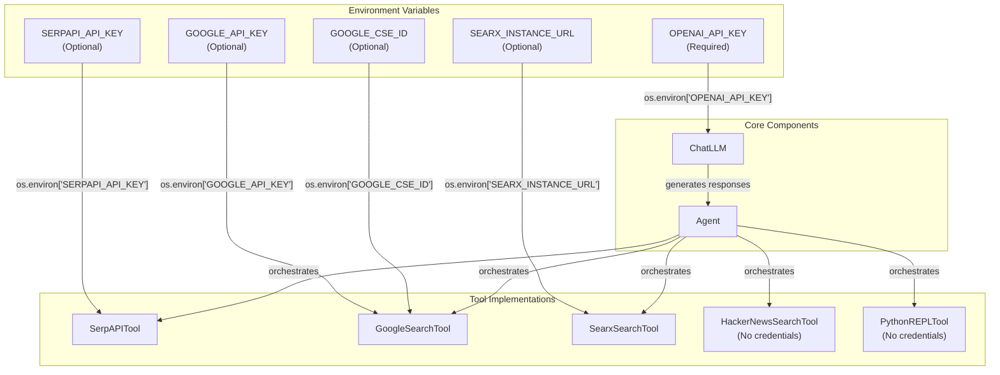
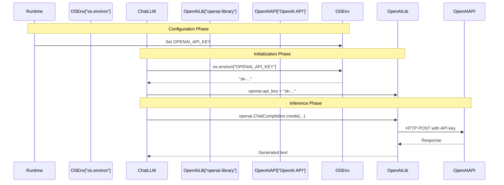

<!-- source: DeepWiki mcp.deepwiki.com · repo mpaepper/llm_agents · page 4.1 Required API Keys · fetched 2026-10-26 -->

# Required API Keys

<details>
<summary>Relevant source files</summary>

The following files were used as context for generating this wiki page:

- [README.md](README.md)
- [llm_agents/llm.py](llm_agents/llm.py)
- [requirements.txt](requirements.txt)
- [setup.py](setup.py)

</details>


This page documents all API keys and external service credentials required to run the llm_agents system. It covers how to obtain each credential, how to configure them, and which components depend on them.

For information about the Python package dependencies, see [Python Dependencies](#4.2). For details on individual tool implementations, see [Search Tools](#3.2) and [PythonREPLTool](#3.3).

## Overview

The llm_agents system requires at minimum one API key (`OPENAI_API_KEY`) to function. Additional API keys enable optional search tools that extend the agent's capabilities. All credentials are configured through environment variables.

**Sources:** [README.md:37-42](), [llm_agents/llm.py:11]()

## API Key Categories

### Required Credentials

| Environment Variable | Purpose | Used By | Documentation |
|---------------------|---------|---------|---------------|
| `OPENAI_API_KEY` | Access OpenAI's language models | `ChatLLM` class | [OpenAI Platform](https://platform.openai.com/account/api-keys) |

### Optional Search Tool Credentials

| Environment Variable | Purpose | Used By | Documentation |
|---------------------|---------|---------|---------------|
| `SERPAPI_API_KEY` | Google Search via SerpAPI | `SerpAPITool` | [SerpAPI](https://serpapi.com) |
| `GOOGLE_API_KEY` | Google Custom Search API | `GoogleSearchTool` | [Google Cloud Console](https://console.cloud.google.com) |
| `GOOGLE_CSE_ID` | Custom Search Engine ID | `GoogleSearchTool` | [Google Programmable Search](https://programmablesearchengine.google.com) |
| `SEARX_INSTANCE_URL` | Searx instance endpoint | `SearxSearchTool` | Self-hosted or public instances |

**Sources:** [README.md:37-42]()

## Credential-to-Component Mapping



**Sources:** [README.md:37-42](), [llm_agents/llm.py:11]()

## Detailed API Key Configuration

### OPENAI_API_KEY (Required)

**Purpose:** Authenticates requests to OpenAI's API for language model inference. Used by the `ChatLLM` class to generate agent thoughts, actions, and final answers.

**How to Obtain:**
1. Create an account at [https://platform.openai.com](https://platform.openai.com)
2. Navigate to API Keys section: [https://platform.openai.com/account/api-keys](https://platform.openai.com/account/api-keys)
3. Click "Create new secret key"
4. Copy the key immediately (it won't be shown again)

**Configuration:**
```bash
export OPENAI_API_KEY='sk-...'
```

**Code Usage:**
The `ChatLLM` class accesses this credential at initialization:
```python
# Referenced in llm_agents/llm.py:11
openai.api_key = os.environ["OPENAI_API_KEY"]
```

**Cost Considerations:**
- OpenAI charges per token (input + output)
- The agent's iterative loop generates multiple API calls per query
- Monitor usage at [https://platform.openai.com/account/usage](https://platform.openai.com/account/usage)

**Sources:** [README.md:39](), [llm_agents/llm.py:11]()

### SERPAPI_API_KEY (Optional)

**Purpose:** Enables Google Search capabilities through the SerpAPI service. Used by `SerpAPITool` to retrieve search results.

**When to Use:**
- You need web search capabilities
- You prefer a simplified API over direct Google Custom Search integration
- You want to avoid setting up Google Cloud credentials

**How to Obtain:**
1. Register at [https://serpapi.com](https://serpapi.com)
2. Free tier provides 100 searches/month
3. API key is displayed on dashboard after registration

**Configuration:**
```bash
export SERPAPI_API_KEY='your_serpapi_key_here'
```

**Usage Example:**
```python
from llm_agents import Agent, ChatLLM, SerpAPITool

agent = Agent(
    llm=ChatLLM(),
    tools=[SerpAPITool()]  # Requires SERPAPI_API_KEY
)
```

**Alternative:** If you don't want to use SerpAPI, consider `GoogleSearchTool`, `SearxSearchTool`, or `HackerNewsSearchTool` instead. See [Search Tools](#3.2) for comparisons.

**Sources:** [README.md:40](), [README.md:49-51]()

### GOOGLE_API_KEY and GOOGLE_CSE_ID (Optional)

**Purpose:** Enables Google Search through Google's official Custom Search JSON API. Used by `GoogleSearchTool`. Requires both credentials to function.

**When to Use:**
- You prefer official Google APIs over third-party services
- You already have Google Cloud Platform credentials
- You need higher search volume than SerpAPI's free tier

**How to Obtain GOOGLE_API_KEY:**
1. Go to [Google Cloud Console](https://console.cloud.google.com)
2. Create a new project or select existing project
3. Enable "Custom Search API" for the project
4. Navigate to "Credentials" → "Create Credentials" → "API Key"
5. Copy the generated API key

**How to Obtain GOOGLE_CSE_ID:**
1. Visit [Google Programmable Search Engine](https://programmablesearchengine.google.com)
2. Click "Add" to create a new search engine
3. Configure search settings (search entire web or specific sites)
4. Copy the "Search engine ID" (CSE ID) from the dashboard

**Configuration:**
```bash
export GOOGLE_API_KEY='AIza...'
export GOOGLE_CSE_ID='your_cse_id_here'
```

**Usage Example:**
```python
from llm_agents import Agent, ChatLLM, GoogleSearchTool

agent = Agent(
    llm=ChatLLM(),
    tools=[GoogleSearchTool()]  # Requires GOOGLE_API_KEY and GOOGLE_CSE_ID
)
```

**Cost Considerations:**
- Google Custom Search API provides 100 free queries/day
- Additional queries cost $5 per 1000 queries (up to 10k queries/day)

**Sources:** [requirements.txt:4](), [setup.py:12]()

### SEARX_INSTANCE_URL (Optional)

**Purpose:** Specifies the URL of a Searx metasearch engine instance. Used by `SearxSearchTool` to perform privacy-focused searches without API keys.

**When to Use:**
- You want search capabilities without commercial API dependencies
- Privacy is a priority (Searx doesn't track users)
- You're willing to self-host or use public instances

**How to Obtain:**

**Option 1: Use Public Instance**
Select from public instances at [https://searx.space](https://searx.space). Example:
```bash
export SEARX_INSTANCE_URL='https://searx.be'
```

**Option 2: Self-Host**
Follow Searx installation guide at [https://searx.github.io/searx/](https://searx.github.io/searx)

**Configuration:**
```bash
export SEARX_INSTANCE_URL='https://your-searx-instance.com'
```

**Requirements:**
- The instance must support JSON API endpoint (`/search?format=json`)
- Public instances may have rate limits or availability issues
- Self-hosted instances require server infrastructure

**Usage Example:**
```python
from llm_agents import Agent, ChatLLM, SearxSearchTool

agent = Agent(
    llm=ChatLLM(),
    tools=[SearxSearchTool()]  # Requires SEARX_INSTANCE_URL
)
```

**Sources:** Architecture diagrams showing `SearxSearchTool` with `SEARX_INSTANCE_URL`

## Configuration Methods

### Method 1: Export in Shell Session

Temporary configuration for current shell session:
```bash
export OPENAI_API_KEY='sk-...'
export SERPAPI_API_KEY='your_key'
```

**Use Case:** Testing, temporary experimentation

**Sources:** [README.md:42]()

### Method 2: Shell Configuration File

Persistent configuration in `~/.bashrc`, `~/.zshrc`, or `~/.profile`:
```bash
# Add to shell config file
export OPENAI_API_KEY='sk-...'
export SERPAPI_API_KEY='your_key'
export GOOGLE_API_KEY='AIza...'
export GOOGLE_CSE_ID='your_cse_id'
```

Reload configuration:
```bash
source ~/.bashrc  # or ~/.zshrc
```

**Use Case:** Personal development environment

### Method 3: .env File (Not Built-in)

While the codebase doesn't include `.env` file loading by default, you can add it:
```bash
# Create .env file (add to .gitignore!)
OPENAI_API_KEY=sk-...
SERPAPI_API_KEY=your_key
```

Load with python-dotenv:
```python
from dotenv import load_dotenv
load_dotenv()

# Then use normally
from llm_agents import Agent, ChatLLM
```

**Use Case:** Project-specific credentials, team development

### Method 4: Docker/Container Environment

Pass environment variables to containers:
```bash
docker run -e OPENAI_API_KEY='sk-...' -e SERPAPI_API_KEY='your_key' ...
```

Or via docker-compose:
```yaml
environment:
  - OPENAI_API_KEY=${OPENAI_API_KEY}
  - SERPAPI_API_KEY=${SERPAPI_API_KEY}
```

**Use Case:** Containerized deployments

## Environment Variable Access Pattern



**Key Points:**
- Environment variables are read at module import time
- `ChatLLM` accesses `os.environ["OPENAI_API_KEY"]` directly in class definition ([llm_agents/llm.py:11]())
- Missing required keys raise `KeyError` at initialization
- Tools access their respective keys when invoked

**Sources:** [llm_agents/llm.py:11]()

## Validation and Troubleshooting

### Missing Required Key

**Error:**
```
KeyError: 'OPENAI_API_KEY'
```

**Cause:** `OPENAI_API_KEY` not set in environment

**Solution:**
```bash
export OPENAI_API_KEY='your-key-here'
```

**Location in Code:** [llm_agents/llm.py:11]()

### Invalid API Key

**Error from OpenAI:**
```
openai.error.AuthenticationError: Incorrect API key provided
```

**Solutions:**
- Verify key is copied correctly (no extra spaces)
- Check key hasn't been revoked at [https://platform.openai.com/account/api-keys](https://platform.openai.com/account/api-keys)
- Ensure key starts with `sk-` for OpenAI

### Missing Optional Tool Keys

**Behavior:** Tool instantiation may fail or return errors when invoked

**Example:**
```python
# This will fail if SERPAPI_API_KEY not set
tool = SerpAPITool()  # May raise error during initialization or use
```

**Solution:** Only instantiate tools for which you have configured credentials:
```python
from llm_agents import Agent, ChatLLM, PythonREPLTool

# Only use tools that don't require API keys
agent = Agent(
    llm=ChatLLM(),
    tools=[PythonREPLTool()]  # No API key needed
)
```

### Checking Configured Keys

Verify which keys are set:
```python
import os

required = ['OPENAI_API_KEY']
optional = ['SERPAPI_API_KEY', 'GOOGLE_API_KEY', 'GOOGLE_CSE_ID', 'SEARX_INSTANCE_URL']

print("Required keys:")
for key in required:
    status = "✓ SET" if key in os.environ else "✗ MISSING"
    print(f"  {key}: {status}")

print("\nOptional keys:")
for key in optional:
    status = "✓ SET" if key in os.environ else "✗ MISSING"
    print(f"  {key}: {status}")
```

## Security Best Practices

### Do Not Commit API Keys

**Never commit API keys to version control:**
```bash
# Add to .gitignore
.env
*.env
*_api_keys.txt
```

### Key Rotation

Regularly rotate API keys, especially:
- After team member departure
- If key may have been exposed
- As part of security policy (e.g., quarterly)

### Principle of Least Privilege

- Use separate API keys for development/staging/production
- Enable only necessary API permissions
- Monitor usage for anomalies

### Environment Isolation

Different environments should use different keys:
```bash
# Development
export OPENAI_API_KEY='sk-dev-...'

# Production
export OPENAI_API_KEY='sk-prod-...'
```

## Quick Reference

| API Key | Required? | Used By | Cost | Obtain From |
|---------|-----------|---------|------|-------------|
| `OPENAI_API_KEY` | ✓ Yes | `ChatLLM` | Pay-per-token | [platform.openai.com](https://platform.openai.com/account/api-keys) |
| `SERPAPI_API_KEY` | Optional | `SerpAPITool` | 100 free/month | [serpapi.com](https://serpapi.com) |
| `GOOGLE_API_KEY` | Optional | `GoogleSearchTool` | 100 free/day | [console.cloud.google.com](https://console.cloud.google.com) |
| `GOOGLE_CSE_ID` | Optional | `GoogleSearchTool` | Free | [programmablesearchengine.google.com](https://programmablesearchengine.google.com) |
| `SEARX_INSTANCE_URL` | Optional | `SearxSearchTool` | Free | [searx.space](https://searx.space) or self-host |

**Sources:** [README.md:37-42](), [requirements.txt:1-5]()

## Minimal Configuration Example

Minimum configuration to run the agent:
```bash
# Only OpenAI key is required
export OPENAI_API_KEY='sk-...'
```

```python
from llm_agents import Agent, ChatLLM, PythonREPLTool

# Agent with only Python execution capability
agent = Agent(
    llm=ChatLLM(),
    tools=[PythonREPLTool()]  # No API key needed
)

result = agent.run("Calculate the sum of numbers 1 to 100")
print(result)
```

**Sources:** [README.md:46-55]()

## Full Configuration Example

Complete configuration with all search tools:
```bash
export OPENAI_API_KEY='sk-...'
export SERPAPI_API_KEY='your_serpapi_key'
export GOOGLE_API_KEY='AIza...'
export GOOGLE_CSE_ID='your_cse_id'
export SEARX_INSTANCE_URL='https://searx.be'
```

```python
from llm_agents import (
    Agent, ChatLLM, PythonREPLTool,
    SerpAPITool, GoogleSearchTool, 
    SearxSearchTool, HackerNewsSearchTool
)

agent = Agent(
    llm=ChatLLM(),
    tools=[
        PythonREPLTool(),
        SerpAPITool(),          # Uses SERPAPI_API_KEY
        GoogleSearchTool(),      # Uses GOOGLE_API_KEY + GOOGLE_CSE_ID
        SearxSearchTool(),       # Uses SEARX_INSTANCE_URL
        HackerNewsSearchTool()   # No API key needed
    ]
)

result = agent.run("What are the latest AI developments?")
print(result)
```

**Sources:** [README.md:46-55]()

---

