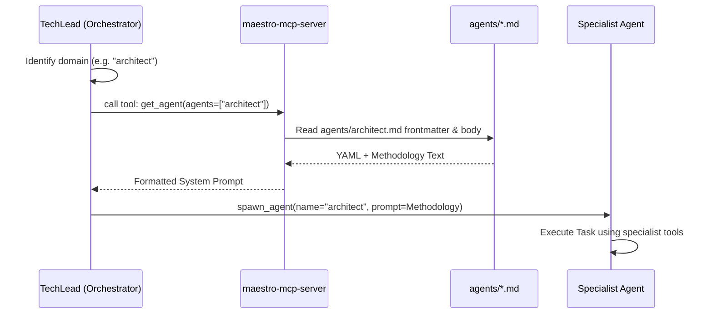
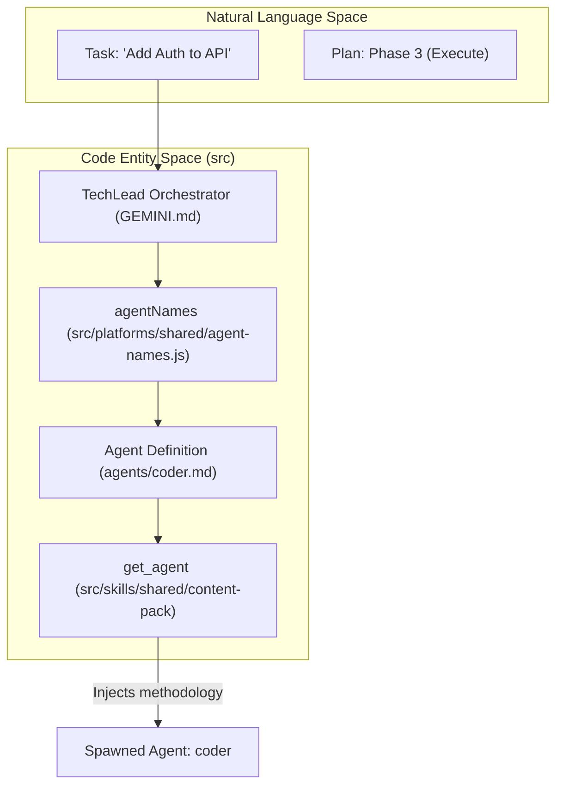

<!-- source: DeepWiki mcp.deepwiki.com · repo josstei/maestro-orchestrate · page 2.4 Specialist Agent Roster · fetched 2026-10-26 -->

# Specialist Agent Roster

Relevant source files

The following files were used as context for generating this wiki page:

- [.gitignore](.gitignore)
- [GEMINI.md](GEMINI.md)
- [README.md](README.md)
- [USAGE.md](USAGE.md)
- [agents/architect.md](agents/architect.md)
- [agents/coder.md](agents/coder.md)
- [agents/debugger.md](agents/debugger.md)
- [agents/refactor.md](agents/refactor.md)
- [agents/tester.md](agents/tester.md)
- [claude/src/platforms/shared/agent-names.js](claude/src/platforms/shared/agent-names.js)
- [plugins/maestro/README.md](plugins/maestro/README.md)
- [src/platforms/shared/agent-names.js](src/platforms/shared/agent-names.js)
- [src/skills/shared/delegation/SKILL.md](src/skills/shared/delegation/SKILL.md)

The Specialist Agent Roster defines the 39 domain-specific agents available to the Maestro orchestrator. These agents are categorized by their expertise and restricted by capability tiers to ensure safe and efficient task execution. While the TechLead orchestrator coordinates the high-level workflow, implementation is delegated to these specialists [GEMINI.md:1-12]().

## Specialist Domains & Capabilities

Maestro organizes its 39 agents into capability tiers based on their tool access and destructive potential. Each agent is defined by a Markdown file in the `agents/` directory containing a YAML frontmatter schema that specifies its domain, tools, and model parameters [agents/architect.md:1-17]().

### Agent Taxonomy by Domain

| Domain | Signal / Purpose | Candidate Agents |
| :--- | :--- | :--- |
| **Engineering** | Code, infra, APIs, data, delivery | `architect`, `api_designer`, `coder`, `code_reviewer`, `tester`, `refactor`, `data_engineer`, `database_administrator`, `debugger`, `devops_engineer`, `integration_engineer`, `platform_engineer`, `cloud_architect`, `solutions_architect`, `site_reliability_engineer`, `observability_engineer`, `performance_engineer`, `security_engineer`, `technical_writer`, `release_manager` |
| **Product** | Requirements and user outcomes | `product_manager` |
| **Design** | UI/UX and interaction | `ux_designer`, `accessibility_specialist`, `design_system_engineer` |
| **Mainframe** | IBM ecosystem (COBOL, JCL, DB2) | `cobol_engineer`, `db2_dba`, `zos_sysprog`, `hlasm_assembler_specialist`, `ibm_i_specialist` |
| **ML/AI** | Model ops and prompt engineering | `ml_engineer`, `mlops_engineer`, `prompt_engineer` |
| **Compliance** | Security audits and data privacy | `compliance_reviewer` |

Sources: [GEMINI.md:77-90](), [src/platforms/shared/agent-names.js:2-14]()

### Capability Tiers (Access Control)

Agents are restricted to specific toolsets defined in their frontmatter. These toolsets determine the agent's "tier":

1.  **read_only**: Access to `read_file`, `list_directory`, `glob`, `grep_search`. (e.g., `architect` [agents/architect.md:5-13]())
2.  **read_shell**: Tier 1 + `run_shell_command` (limited to non-destructive commands). (e.g., `debugger` [agents/debugger.md:5-16]())
3.  **read_write**: Tier 2 + `write_file`, `replace`, `write_todos`. (e.g., `coder` [agents/coder.md:5-20](), `tester` [agents/tester.md:5-21]())
4.  **full**: Tier 3 + `activate_skill` (capability to trigger other Maestro workflows). (e.g., `refactor` [agents/refactor.md:5-20]())

## Agent Lifecycle & Delegation

Maestro uses a "Stub and Fetch" model. Instead of loading 39 full system prompts into the orchestrator's context, it uses thin stubs and fetches full methodology on-demand via MCP.

### Stub Generation & Naming
The generator pipeline [src/manifest.js]() creates agent stubs for each runtime.
*   **Gemini/Qwen**: Uses `snake_case` (e.g., `api_designer`) [README.md:16]().
*   **Claude Code**: Uses `kebab-case` with a `maestro:` prefix (e.g., `maestro:api-designer`) [README.md:17]().

### Data Flow: get_agent Delegation

The following diagram illustrates how the TechLead orchestrator transitions from "Natural Language" planning to "Code Entity" execution by fetching agent methodology.

**Agent Delegation Sequence**

Sources: [agents/architect.md:19-20](), [plugins/maestro/README.md:29](), [GEMINI.md:14-15]()

## Frontmatter Schema Reference

Every specialist agent is defined by a strict YAML frontmatter in `agents/`. This schema is used by the `get_agent` MCP tool to configure the subagent's execution environment.

| Field | Description | Example Value |
| :--- | :--- | :--- |
| `name` | Canonical identifier | `coder` |
| `kind` | Deployment type | `local` |
| `description` | Used by TechLead for planning | "Implementation specialist..." |
| `tools` | Array of allowed MCP tools | `["read_file", "write_file"]` |
| `temperature` | LLM sampling temperature | `0.2` |
| `max_turns` | Limit on tool-use iterations | `25` |
| `timeout_mins` | Execution time limit | `10` |

**Agent Implementation Mapping**

Sources: [agents/coder.md:1-22](), [src/platforms/shared/agent-names.js:1-15](), [GEMINI.md:73-91]()

## Implementation Details

### get_agent Tool
The `get_agent` tool is the primary mechanism for loading specialist instructions. It prevents context bloat in the TechLead orchestrator by only loading the methodology for the specific agents required for the current phase [GEMINI.md:42-45]().

### Agent Disabling
Users can exclude specific agents from the roster by setting the `MAESTRO_DISABLED_AGENTS` environment variable. The TechLead calls `resolve_settings` at startup to parse this list and removes these agents from its planning candidates [GEMINI.md:24-27]().

Sources: [README.md:143](), [GEMINI.md:51-61](), [claude/src/platforms/shared/agent-names.js:1-15]()

---

