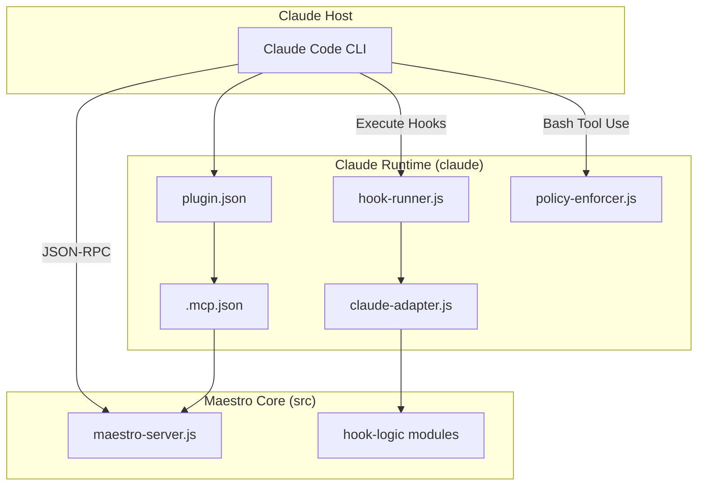
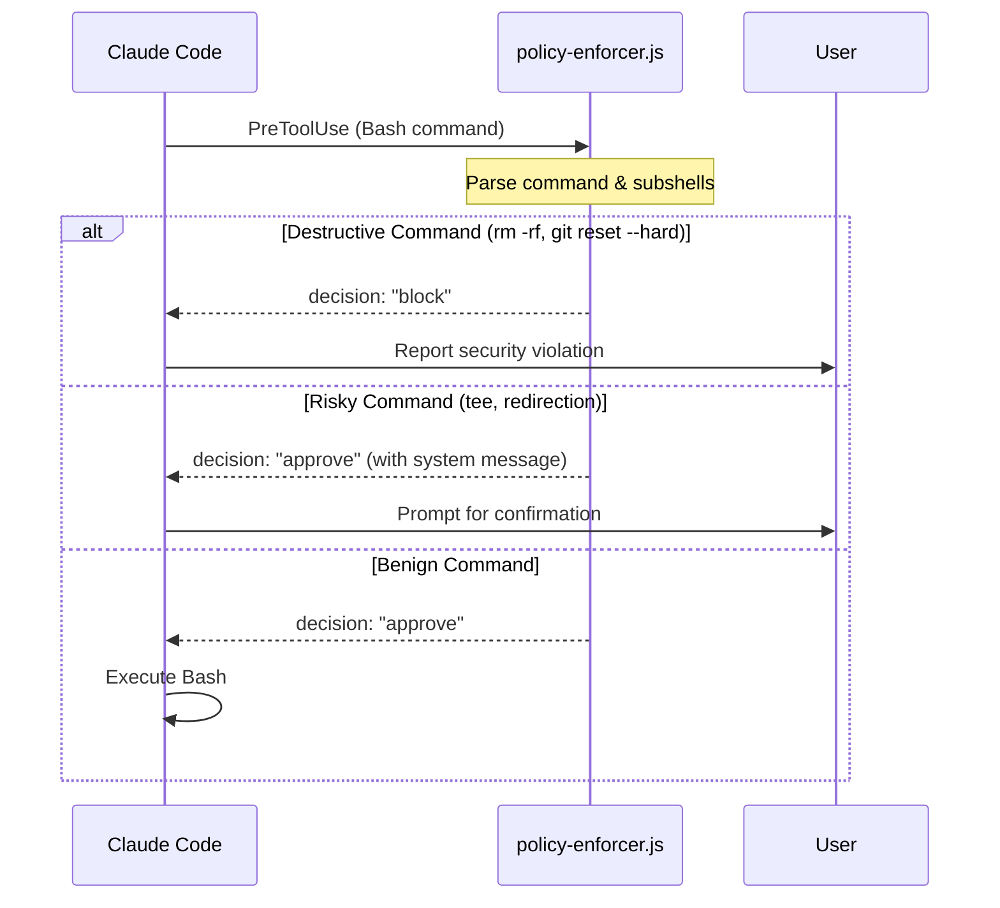

<!-- source: DeepWiki mcp.deepwiki.com · repo josstei/maestro-orchestrate · page 4.2 Claude Code Runtime · fetched 2026-10-26 -->

# Claude Code Runtime

Relevant source files

The following files were used as context for generating this wiki page:

- [.claude-plugin/marketplace.json](.claude-plugin/marketplace.json)
- [claude/.claude-plugin/plugin.json](claude/.claude-plugin/plugin.json)
- [claude/README.md](claude/README.md)
- [claude/src/entry-points/core-command-registry.js](claude/src/entry-points/core-command-registry.js)
- [claude/src/entry-points/registry.js](claude/src/entry-points/registry.js)
- [claude/src/platforms/shared/adapters/claude-adapter.js](claude/src/platforms/shared/adapters/claude-adapter.js)
- [docs/runtime-claude.md](docs/runtime-claude.md)
- [src/platforms/shared/adapters/claude-adapter.js](src/platforms/shared/adapters/claude-adapter.js)
- [src/platforms/shared/adapters/gemini-adapter.js](src/platforms/shared/adapters/gemini-adapter.js)
- [tests/integration/policy-enforcer.test.js](tests/integration/policy-enforcer.test.js)

The Claude Code runtime is a plugin-based implementation of the Maestro orchestration platform, specifically designed for the **Claude Code** CLI environment. It resides in the `claude/` directory and utilizes a combination of MCP (Model Context Protocol) servers, lifecycle hooks, and a structured directory of Markdown-based agent stubs and skills.

## Directory Layout & Manifests

The Claude runtime is defined by two primary manifest files and a generated directory structure that allows Claude to discover Maestro's capabilities.

| File | Role |
| :--- | :--- |
| `claude/.claude-plugin/plugin.json` | The primary plugin manifest defining metadata, hooks, and MCP server locations [claude/.claude-plugin/plugin.json:1-21](). |
| `.claude-plugin/marketplace.json` | Marketplace metadata for publishing the plugin to the `josstei` owner [/.claude-plugin/marketplace.json:1-34](). |
| `claude/agents/` | 39 generated specialist agent stubs using **kebab-case** naming [docs/runtime-claude.md:179-180](). |
| `claude/skills/` | 19 skill directories providing public entry points and internal infrastructure [docs/runtime-claude.md:181-181](). |
| `claude/hooks/` | Configuration for lifecycle events and policy enforcement [docs/runtime-claude.md:182-182](). |

### Plugin Architecture
The following diagram illustrates how the Claude plugin components interact with the host environment and the shared Maestro core.

**Claude Runtime Component Map**

**Sources:** [claude/.claude-plugin/plugin.json:11-12](), [docs/runtime-claude.md:26-26](), [docs/runtime-claude.md:66-74](), [claude/src/platforms/shared/adapters/claude-adapter.js:1-36]()

## Dual-Resolution MCP Server

The Claude runtime uses a "thin adapter" pattern for its MCP server to handle both development and production environments. The server is registered via `claude/.mcp.json` [claude/README.md:63-75]().

The adapter at `claude/mcp/maestro-server.js` implements a dual-resolution strategy:
1.  **Repo Resolution:** If the plugin is loaded from a git checkout, it prefers the canonical source at `src/mcp/maestro-server.js` [docs/runtime-claude.md:26-26]().
2.  **Detached Resolution:** For marketplace or standalone installs, it falls back to the bundled payload in `claude/src/mcp/maestro-server.js` [docs/runtime-claude.md:26-26]().

It explicitly sets `MAESTRO_RUNTIME=claude` to ensure the core logic applies Claude-specific naming conventions and state contracts [docs/runtime-claude.md:26-26]().

## Agent Naming and Delegation

Claude agents use **kebab-case** naming (e.g., `maestro:code-reviewer`) [claude/README.md:120-120](). This differs from the snake_case used in the Gemini runtime. All agents are prefixed with the `maestro:` namespace to avoid collisions with native Claude agents [claude/README.md:120-120]().

Delegation is performed using the `Agent` tool syntax:
`Agent(subagent_type: "maestro:coder", prompt: "...")` [docs/runtime-claude.md:39-41]().

**Agent Naming Mapping**
| Canonical Name | Claude Agent Name | File Path |
| :--- | :--- | :--- |
| `code_reviewer` | `maestro:code-reviewer` | `claude/agents/code-reviewer.md` |
| `api_designer` | `maestro:api-designer` | `claude/agents/api-designer.md` |
| `accessibility_specialist` | `maestro:accessibility-specialist` | `claude/agents/accessibility-specialist.md` |

**Sources:** [claude/README.md:120-120](), [docs/runtime-claude.md:30-32]()

## Lifecycle Hooks and Policy Enforcer

Claude uses the `PreToolUse` event to implement both session management and security policies.

### Hook Runner and Adapter
The `claude-adapter.js` normalizes Claude's JSON input into the internal context contract used by the shared hook logic.

| Claude Field | Internal Field |
| :--- | :--- |
| `tool_input.subagent_type` | `agentName` |
| `tool_input.prompt` | `agentInput` |
| `tool_result` | `agentResult` |

**Sources:** [claude/src/platforms/shared/adapters/claude-adapter.js:11-21](), [docs/runtime-claude.md:84-94]()

### PreToolUse Policy Enforcer
Maestro implements a dedicated `policy-enforcer.js` that triggers on the `Bash` tool to prevent destructive operations [docs/runtime-claude.md:72-72]().

**Enforcement Logic:**
*   **Deny (Block):** Commands like `rm -rf`, `git reset --hard`, `git clean -fd`, and Heredocs (`<<`) are blocked automatically [docs/runtime-claude.md:102-106]().
*   **Nested Detection:** The enforcer recursively checks subshells `$(...)` and backticks [docs/runtime-claude.md:112-112]().
*   **Ask (User Confirmation):** Redirection operators (`>`, `>>`) and `tee` require explicit user approval [docs/runtime-claude.md:108-110]().

**Security Policy Flow**

**Sources:** [docs/runtime-claude.md:98-112](), [tests/integration/policy-enforcer.test.js:23-54]()

## Command Remapping and Skills

Maestro entry points are exposed to Claude as Markdown skills in the `claude/skills/` directory. Because Claude Code has built-in commands that conflict with Maestro's canonical names, several commands are remapped [docs/runtime-claude.md:52-52]().

| Canonical Command | Claude Remapped Command |
| :--- | :--- |
| `review` | `/review-code` |
| `debug` | `/debug-workflow` |
| `resume` | `/resume-session` |

**Sources:** [claude/src/entry-points/registry.js:16-16](), [claude/src/entry-points/registry.js:38-38](), [claude/src/entry-points/core-command-registry.js:27-27]()

### Skill Types
1.  **Core (Public):** `orchestrate`, `execute`, `resume-session`. These are the primary entry points for the user [docs/runtime-claude.md:47-50]().
2.  **Infrastructure (Private):** Skills like `delegation` or `session-management` have `user-invocable: false` and serve as discovery stubs for Claude's internal picker while delegating content retrieval to the MCP server [docs/runtime-claude.md:57-62]().

---

