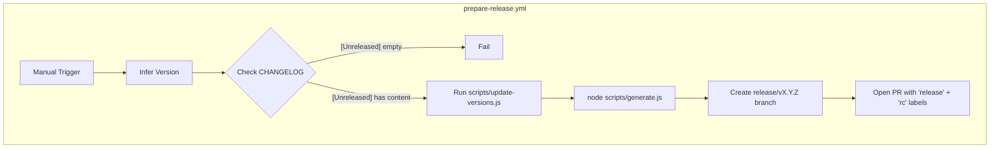
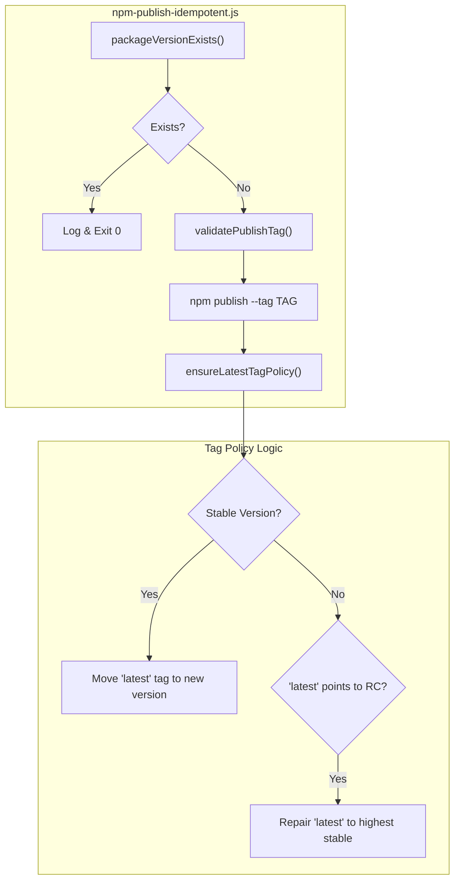

<!-- source: DeepWiki mcp.deepwiki.com · repo josstei/maestro-orchestrate · page 6.1 GitHub Actions Workflows · fetched 2026-10-26 -->

# GitHub Actions Workflows

Relevant source files

The following files were used as context for generating this wiki page:

- [.github/workflows/generator-check.yml](.github/workflows/generator-check.yml)
- [.github/workflows/nightly.yml](.github/workflows/nightly.yml)
- [.github/workflows/prepare-release.yml](.github/workflows/prepare-release.yml)
- [.github/workflows/preview.yml](.github/workflows/preview.yml)
- [.github/workflows/rc.yml](.github/workflows/rc.yml)
- [.github/workflows/release.yml](.github/workflows/release.yml)
- [claude/src/core/version.js](claude/src/core/version.js)
- [docs/cicd.md](docs/cicd.md)
- [justfile](justfile)
- [plugins/maestro/src/core/version.js](plugins/maestro/src/core/version.js)
- [scripts/npm-publish-idempotent.js](scripts/npm-publish-idempotent.js)
- [tests/unit/npm-publish-idempotent.test.js](tests/unit/npm-publish-idempotent.test.js)
- [tests/unit/workflow-security.test.js](tests/unit/workflow-security.test.js)

Maestro Orchestrate employs a **source-of-truth enforcement** CI/CD model. The pipeline is designed to ensure that the four generated runtime targets (Gemini, Claude, Codex, Qwen) never drift from the canonical logic defined in `src/`. Every workflow—from continuous integration to automated releases—regenerates these adapters and verifies zero drift before proceeding [docs/cicd.md:1-5]().

### Workflow Ecosystem

The pipeline consists of seven specialized workflows categorized by their role in the development lifecycle:

| Category | Workflow | Trigger | Purpose |
|:---|:---|:---|:---|
| **CI Gates** | `generator-check` | Push/PR to `main` | Zero-drift enforcement and test suite execution. |
| | `commit-message-check` | Push/PR to `main` | Semantic versioning and conventional commit enforcement. |
| **Release Prep** | `prepare-release` | Manual Dispatch | Version inference, changelog validation, and PR creation. |
| **Prerelease** | `rc` | PR Label `rc` + `release` | Publishes release candidates to npm. |
| | `preview` | PR Label `preview` | Publishes feature previews to npm. |
| | `nightly` | Schedule (06:00 UTC) | Publishes daily builds from `main`. |
| **Publishing** | `release` | PR Merge to `main` | Stable npm publishing and GitHub Release creation. |

Sources: [docs/cicd.md:9-29](), [.github/workflows/generator-check.yml:3-7](), [.github/workflows/nightly.yml:3-6]()

---

### CI Gates & Enforcement

#### Source Of Truth Check (`generator-check.yml`)
This is the foundational gate for all contributions. It ensures that any changes to the `src/` directory are correctly reflected in the generated runtime adapters.

1.  **Generation**: Executes `node scripts/generate.js` to rebuild all adapters [generator-check.yml:21]().
2.  **Drift Detection**: Runs `git diff --exit-code --name-only`. If any file in the repository differs from the committed state after generation, the job fails with an error annotation [generator-check.yml:23-29]().
3.  **Validation**: Runs the full test suite (`tests/unit`, `tests/transforms`, and `tests/integration`) [generator-check.yml:31-32]().
4.  **Artifact Verification**: Validates that `npm pack` contains only required files and that the release archive is buildable [generator-check.yml:34-41]().

#### Commit Message Check
Enforces [Conventional Commits](https://www.conventionalcommits.org) to ensure automated version inference works correctly. It validates:
*   **PR Titles**: Must match semantic patterns (e.g., `feat:`, `fix:`) [docs/cicd.md:126-132]().
*   **Branch Names**: Must follow `<type>/<slug>` conventions [docs/cicd.md:134-140]().
*   **Commit Subjects**: Every commit in the PR range is checked, skipping only merge and revert commits [docs/cicd.md:142-148]().

Sources: [.github/workflows/generator-check.yml:1-42](), [docs/cicd.md:33-122]()

---

### Release Pipeline Implementation

The release process transitions the codebase from "Natural Language" intent (commits) to "Code Entity" artifacts (npm packages).

#### Version Inference & Preparation
The `prepare-release` workflow automates the transition from development to a release candidate.

*   **Logic**: Version inference reads the commit log since the last tag. It looks for `BREAKING CHANGE` or `!:` for a major bump, and `feat` for a minor bump [prepare-release.yml:34-56]().
*   **Synchronization**: `scripts/update-versions.js` updates version strings across `package.json`, `claude/src/core/version.js`, and `plugins/maestro/src/core/version.js` [prepare-release.yml:107]().

#### Idempotent Publishing Pattern
To prevent failed CI runs from breaking the registry state, Maestro uses a custom `scripts/npm-publish-idempotent.js` helper. This script checks if a version exists before attempting a publish and manages the `latest` dist-tag policy [scripts/npm-publish-idempotent.js:145-159]().

Sources: [.github/workflows/prepare-release.yml:1-169](), [scripts/npm-publish-idempotent.js:193-268](), [tests/unit/npm-publish-idempotent.test.js:34-129]()

---

### Workflow Security & Tokens

#### RELEASE_TOKEN Pattern
The `prepare-release` workflow requires a specialized `RELEASE_TOKEN` (a Personal Access Token with `contents: write` and `pull-requests: write` permissions) [prepare-release.yml:28, 131](). This is necessary because the default `GITHUB_TOKEN` cannot trigger subsequent workflows (like `rc` or `release`) when it performs actions like pushing a branch or opening a PR.

#### Shell Security
Workflows are audited for shell injection. The `tests/unit/workflow-security.test.js` suite ensures:
1.  **No Direct Interpolation**: GitHub expressions like `${{ github.event... }}` are never used directly in `run:` blocks. They are instead mapped to environment variables first [workflow-security.test.js:60-75]().
2.  **Idempotent Only**: Direct calls to `npm publish` are forbidden; all publishing must go through the idempotent script [workflow-security.test.js:77-89]().

#### Release Recovery
The `release.yml` workflow supports a `workflow_dispatch` recovery mode. If a stable release fails mid-publish, an administrator can provide a specific `version` and `target_sha` to re-run the publish logic, provided the git tag already exists [release.yml:6-15, 148-151]().

Sources: [.github/workflows/release.yml:1-151](), [tests/unit/workflow-security.test.js:1-110]()

---

