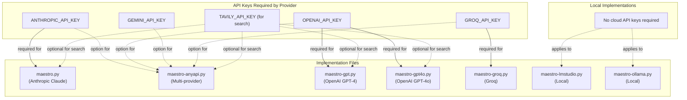
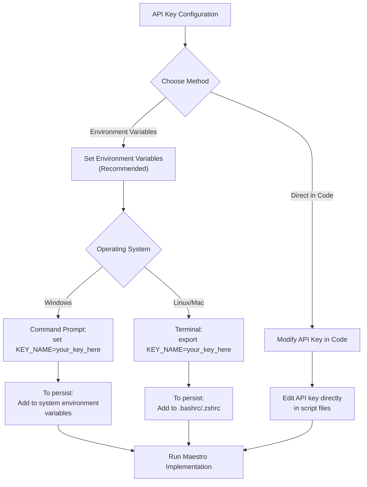

<!-- source: DeepWiki mcp.deepwiki.com · repo Doriandarko/maestro · page 2.1 API Keys Configuration · fetched 2026-10-26 -->

# API Keys Configuration

<details>
<summary>Relevant source files</summary>

The following files were used as context for generating this wiki page:

- [README.md](README.md)

</details>


This guide explains how to obtain and configure the necessary API keys for different LLM providers used with the Maestro framework. The correct API keys are essential for authenticating with various LLM services and enabling Maestro's functionality.

For information about installation and general setup, see [Installation & Setup](#2).

## Overview of Required API Keys

Maestro supports multiple LLM providers, each requiring its own API key for authentication. Depending on which Maestro implementation you use, you'll need different API keys.



Sources: [README.md:16-29]()

## Implementation-to-API Key Mapping

The following table shows which API keys you need based on your chosen Maestro implementation:

| Implementation | Primary API Key | Optional API Key |
|----------------|----------------|-----------------|
| maestro.py | Anthropic | Tavily (for search) |
| maestro-gpt.py | OpenAI | Tavily (for search) |
| maestro-gpt4o.py | OpenAI | Tavily (for search) |
| maestro-groq.py | Groq | - |
| maestro-anyapi.py | Any of: Anthropic, OpenAI, Gemini, Groq | Tavily (for search) |
| maestro-lmstudio.py | None (local) | - |
| maestro-ollama.py | None (local) | - |

Sources: [README.md:7-111]()

## Obtaining API Keys

### Anthropic API Key
1. Visit the [Anthropic website](https://www.anthropic.com) and create an account
2. Navigate to the API section in your account dashboard
3. Follow instructions to generate an API key
4. Copy and save your API key securely

### OpenAI API Key
1. Go to the [OpenAI platform](https://platform.openai.com)
2. Create an account or sign in
3. Navigate to API Keys section
4. Click "Create new secret key"
5. Copy and save your API key securely

### Gemini API Key
1. Visit [Google AI Studio](https://makersuite.google.com)
2. Sign in with your Google account
3. Go to API keys section
4. Generate a new API key
5. Copy and save your API key securely

### Groq API Key
1. Go to [Groq's website](https://groq.com)
2. Create an account or sign in
3. Navigate to the API section
4. Generate a new API key
5. Copy and save your API key securely

### Tavily API Key (Optional, for search functionality)
1. Visit [Tavily's website](https://tavily.com)
2. Create an account or sign in
3. Go to the API keys section
4. Generate a new API key
5. Copy and save your API key securely

Sources: [README.md:113-119]()

## Configuring API Keys

There are two methods to configure API keys in Maestro:



Sources: [README.md:17-31]()

### Method 1: Environment Variables (Recommended)

Setting environment variables keeps your API keys out of your code:

#### Windows:
```
set ANTHROPIC_API_KEY=your_key_here
set OPENAI_API_KEY=your_key_here
set GEMINI_API_KEY=your_key_here
set GROQ_API_KEY=your_key_here
set TAVILY_API_KEY=your_key_here
```

#### Linux/Mac:
```
export ANTHROPIC_API_KEY=your_key_here
export OPENAI_API_KEY=your_key_here
export GEMINI_API_KEY=your_key_here
export GROQ_API_KEY=your_key_here
export TAVILY_API_KEY=your_key_here
```

To make these environment variables persistent:
- Windows: Add to system environment variables through Control Panel
- Linux/Mac: Add to your shell profile file (.bashrc, .zshrc, etc.)

### Method 2: Direct Code Modification

You can also set API keys directly in the code (less secure):

```python
# Example from maestro-anyapi.py
os.environ["OPENAI_API_KEY"] = "YOUR KEY" 
os.environ["ANTHROPIC_API_KEY"] = "YOUR KEY"
os.environ["GEMINI_API_KEY"] = "YOUR KEY"
```

Sources: [README.md:17-23]()

## Implementation-Specific Configuration

### maestro.py (Anthropic Claude)
Replace the placeholder API key in the script with your actual Anthropic API key:

```python
client = Anthropic(api_key="YOUR_API_KEY_HERE")
```

If using search functionality, also replace your Tavily API key:
```python
tavily = TavilyClient(api_key="YOUR API KEY HERE")
```

Sources: [README.md:159-169]()

### maestro-anyapi.py (Multi-provider)
For the multi-provider implementation, set environment variables for the services you want to use:

```python
os.environ["OPENAI_API_KEY"] = "YOUR KEY" 
os.environ["ANTHROPIC_API_KEY"] = "YOUR KEY"
os.environ["GEMINI_API_KEY"] = "YOUR KEY"
```

Then define which models to use for each stage:
```python
ORCHESTRATOR_MODEL = "gemini/gemini-1.5-flash-latest"
SUB_AGENT_MODEL = "gemini/gemini-1.5-flash-latest"
REFINER_MODEL = "gemini/gemini-1.5-flash-latest"
```

Sources: [README.md:17-31]()

### maestro-gpt.py and maestro-gpt4o.py (OpenAI)
These implementations require the OpenAI API key to be set as an environment variable or directly in the code. The specific GPT models (GPT-4 or GPT-4o) are preconfigured in the respective scripts.

Sources: [README.md:45-53](), [README.md:121-129]()

### maestro-groq.py (Groq)
Requires installing the Groq package and setting up your Groq API key:

```bash
pip install groq
```

Then set your Groq API key via environment variables or directly in the code.

Sources: [README.md:101-110]()

## Local LLM Configuration

For local implementations, you don't need cloud API keys, but you need to set up the local environment:

### maestro-lmstudio.py
1. Download and install LM Studio from: https://lmstudio.ai/
2. Run the local server using your preferred method
3. Remove any system prompt for the app (leave prompt field empty)
4. Run `python maestro-lmstudio.py`

Sources: [README.md:57-67]()

### maestro-ollama.py
1. Install Ollama client from: https://ollama.com/download
2. Install the Python package: `pip install ollama`
3. Pull the desired model(s):
   ```bash
   ollama pull llama3:70b
   ollama pull llama3:8b
   ```
4. Run `python maestro-ollama.py`

Sources: [README.md:70-98]()

## Troubleshooting API Key Issues

### Common Problems and Solutions

| Issue | Potential Solutions |
|-------|---------------------|
| Authentication error | - Verify API key is correct and complete<br>- Ensure environment variable is properly set<br>- Check if API key has necessary permissions |
| "Model not found" errors | - Verify model name is correct<br>- Check if you have access to the specified model<br>- Some models require special access |
| Rate limiting | - Check your usage quotas on the provider's dashboard<br>- Consider upgrading your API plan |
| Environment variable not working | - Verify variable is set in current terminal session<br>- Try printing the variable (`echo %VAR%` on Windows, `echo $VAR` on Unix) |

### Best Practices for API Key Security

1. Never commit API keys to version control
2. Use environment variables instead of hardcoding keys
3. Rotate API keys periodically
4. Create separate API keys for different projects/environments
5. Set appropriate permissions and usage limits for your keys

Sources: [README.md:143-171]()

---

