# Page: Overview

# Overview

<details>
<summary>Relevant source files</summary>

The following files were used as context for generating this wiki page:

- [README.md](README.md)

</details>


This document provides a technical introduction to the Maestro LLM Orchestration Framework, a system designed to decompose complex tasks into manageable sub-tasks executed by language models. Maestro supports multiple LLM providers including Anthropic Claude, OpenAI GPT, Google Gemini, Groq, and local models through platforms like Ollama and LM Studio.

For installation instructions, see [Installation & Setup](#2).
For detailed usage guidance, see [Usage Guide](#3).
For information about specific implementations, see [Implementations](#4).
For web interface documentation, see [Web Interface](#5).

## Core Architecture

Maestro employs a three-tier orchestration model to tackle complex tasks:

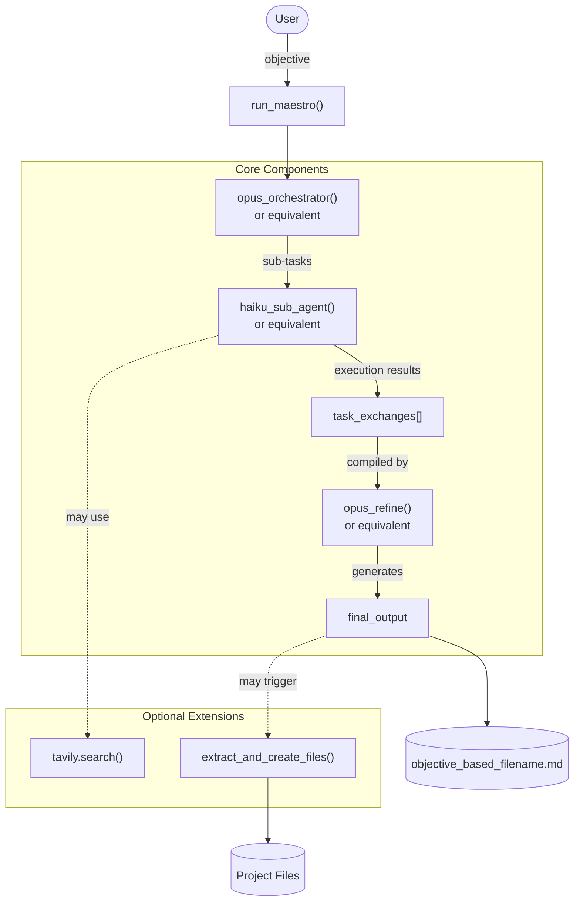

Sources: [README.md](README.md:1-225)

This architecture consists of:

1. An **Orchestrator Model** that breaks down objectives into sub-tasks
2. **Sub-agent Models** that execute individual sub-tasks
3. A **Refiner Model** that integrates sub-task results into a cohesive final output

The framework allows large language models to handle complex, multi-step tasks by dividing them into smaller, manageable components while maintaining context between steps.

## Implementation Variants

Maestro provides multiple implementation files to support different LLM providers:

| Variant File | Primary Function | LLM Provider |
|--------------|-----------------|-------------|
| `maestro.py` | Original implementation | Anthropic Claude (Opus/Sonnet/Haiku) |
| `maestro-anyapi.py` | Multi-provider support via LiteLLM | OpenAI, Anthropic, Gemini, etc. |
| `maestro-gpt.py` | GPT-4 implementation | OpenAI GPT-4 |
| `maestro-gpt4o.py` | Optimized for GPT-4o | OpenAI GPT-4o |
| `maestro-groq.py` | Fast inference implementation | Groq |
| `maestro-lmstudio.py` | Local model support | LM Studio |
| `maestro-ollama.py` | Local model support | Ollama |

Sources: [README.md](README.md:6-110)

## Execution Workflow

The execution workflow in Maestro follows this sequence:

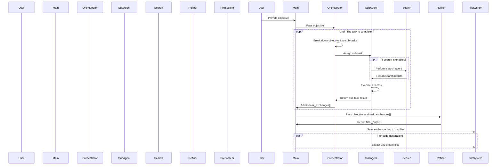

Sources: [README.md](README.md:190-201)

The workflow terminates when the Orchestrator model includes the phrase "The task is complete:" in its response, indicating that the objective has been fully achieved.

## Core Components

### Main Execution Function

The `run_maestro()` function (or equivalent in each variant) manages the overall execution flow:

- Initializes the task execution process
- Manages the loop between orchestrator and sub-agents
- Calls the refiner when all sub-tasks are complete
- Handles result logging and file creation

### Orchestrator Model

The orchestrator function (e.g., `opus_orchestrator()`) is responsible for:

1. Breaking down the main objective into a series of sub-tasks
2. Tracking progress and determining when the task is complete
3. Providing context from previous results to guide future task generation

### Sub-agent Model

The sub-agent function (e.g., `haiku_sub_agent()`) is responsible for:

1. Executing individual sub-tasks based on the prompt from the orchestrator
2. Utilizing search (if enabled) to gather information
3. Maintaining context of previous sub-task results

### Refiner Model

The refiner function (e.g., `opus_refine()`) is responsible for:

1. Reviewing all sub-task results
2. Synthesizing the information into a cohesive output
3. Ensuring the final output fully addresses the original objective

Sources: [README.md](README.md:194-201)

## Data Flow

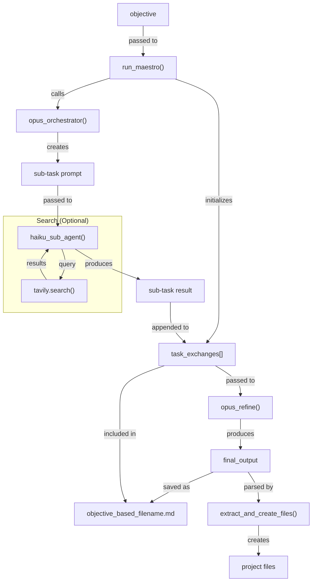

Sources: [README.md](README.md:190-201)

## Key Features

### Task Decomposition

Maestro breaks down complex objectives into sub-tasks, maintaining context across multiple steps. Each sub-task execution builds on previous results, allowing the system to tackle complex problems incrementally.

### LLM Provider Flexibility

The framework supports multiple LLM providers through variant implementations:

- Cloud-based APIs: `maestro.py` (Anthropic), `maestro-gpt4o.py` (OpenAI), etc.
- Local models: `maestro-ollama.py`, `maestro-lmstudio.py`
- Multi-provider: `maestro-anyapi.py` (using LiteLLM)

### Search Integration

When enabled, the `tavily.search()` function provides web search capabilities to sub-agents, enhancing their ability to complete tasks with up-to-date information. This requires a Tavily API key.

Sources: [README.md](README.md:115-119)

### Code Generation

For coding tasks, Maestro can:
- Create directory structures based on the generated output
- Extract code blocks and save them to appropriate files
- Support complete project generation

Sources: [README.md](README.md:139-141)

### Exchange Logging

The system generates a detailed exchange log capturing the entire task breakdown and execution process, saved to a Markdown file named based on the objective.

Sources: [README.md](README.md:138)

### Web Interface

Maestro includes a Flask-based web application (`app.py`) that provides:
- A form-based interface for submitting objectives
- Real-time progress tracking
- Results display and exchange log access

For details on the web interface, see [Web Interface](#5).

## Technical Requirements

To use Maestro, you need:

- Python installed on your system
- API keys for the LLM providers you intend to use
- Required Python packages (varies by implementation)
- Tavily API key (if using search functionality)

For detailed setup instructions, refer to [Installation & Setup](#2).

Sources: [README.md](README.md:143-169)

---

# Page: Core Concepts

# Core Concepts

<details>
<summary>Relevant source files</summary>

The following files were used as context for generating this wiki page:

- [README.md](README.md)

</details>


This document explains the fundamental concepts that power the Maestro LLM Orchestration Framework. It covers the core components, their relationships, and how they work together to accomplish complex tasks by breaking them down into manageable sub-tasks. For details on the system architecture and implementation, see [Architecture](#1.2).

## The Maestro Orchestration Model

Maestro employs a hierarchical approach to task accomplishment, using different models for different roles in the orchestration process. This design enables complex tasks to be broken down, executed, and refined in a systematic way.

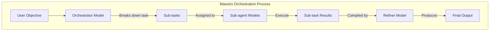

Sources: [README.md:134-140]()

## Key Components

Maestro's framework consists of three primary components that work in concert to process complex objectives:

### 1. Orchestrator Model

The Orchestrator is a Large Language Model (typically a more capable model like Claude Opus or GPT-4) responsible for:
- Analyzing and understanding the user's objective
- Breaking down complex objectives into manageable sub-tasks
- Determining when each sub-task should be executed
- Assessing when the overall objective has been completed

The Orchestrator acts as the "project manager" that oversees the entire workflow and makes strategic decisions about task decomposition.

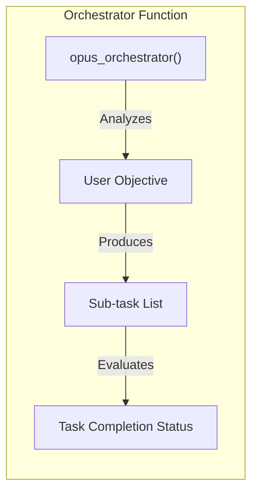

Sources: [README.md:194-195]()

### 2. Sub-agent Model

The Sub-agent model (typically a smaller, more efficient model like Claude Haiku or similar models in other providers) is responsible for:
- Executing individual sub-tasks defined by the Orchestrator
- Receiving context from previously completed sub-tasks
- Providing detailed results for each sub-task

Sub-agents are the "workers" that handle specific pieces of the overall objective, with each focusing on a well-defined portion of the problem.

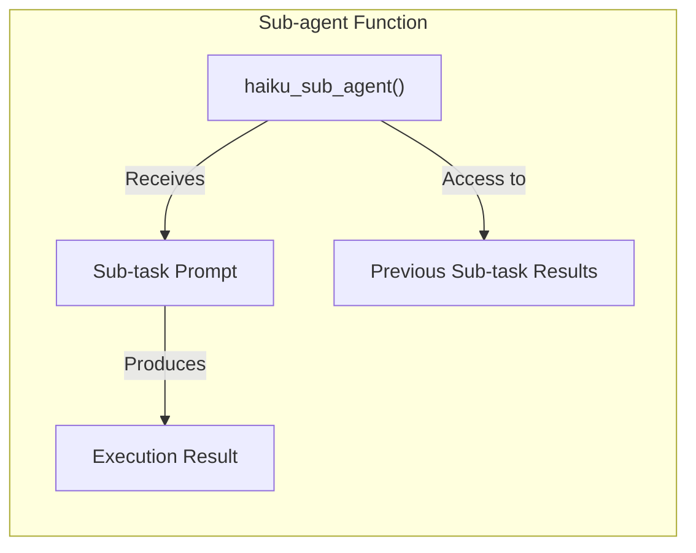

Sources: [README.md:196]()

### 3. Refiner Model

The Refiner model (typically the same model as the Orchestrator) is responsible for:
- Reviewing all sub-task results collectively
- Ensuring consistency across the various sub-task outputs
- Synthesizing the individual results into a cohesive final output
- Formatting the output appropriately based on the original objective

The Refiner serves as the "editor" that transforms a collection of individual results into a unified, polished final product.

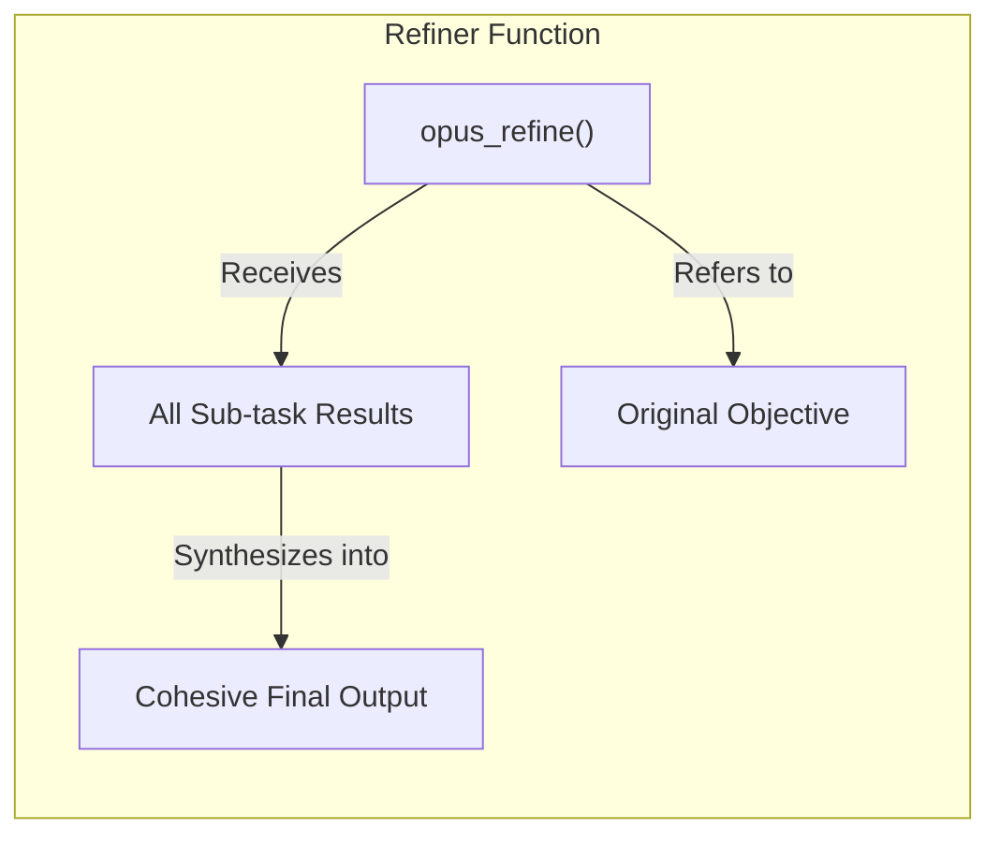

Sources: [README.md:197]()

## Task Orchestration Process

The Maestro framework follows a systematic process to accomplish objectives:

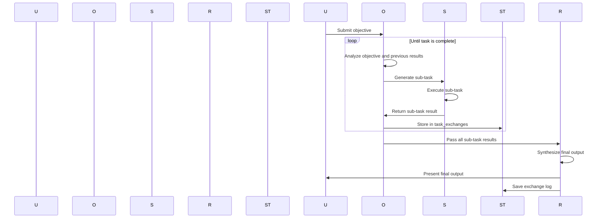

1. **Objective Submission**: The user provides a high-level objective to the system.

2. **Task Breakdown**: The Orchestrator analyzes the objective and breaks it down into sequential sub-tasks.

3. **Sub-task Execution**: Each sub-task is assigned to a Sub-agent model, which executes it and returns the result.

4. **Context Preservation**: Each Sub-agent has access to the results of previously completed sub-tasks, providing necessary context.

5. **Completion Assessment**: The Orchestrator continuously evaluates whether the objective has been fully addressed based on the accumulated sub-task results.

6. **Refinement**: Once all necessary sub-tasks are complete, the Refiner synthesizes the individual results into a cohesive final output.

7. **Documentation**: The entire exchange, including the objective, task breakdown, sub-task results, and final output, is saved to a Markdown file.

Sources: [README.md:192-202]()

## Enhanced Capabilities

Maestro includes several enhanced capabilities that extend its basic orchestration model:

### Search Integration

When enabled, Maestro can leverage external search APIs (primarily Tavily) to gather relevant information while executing sub-tasks. This allows the Sub-agents to access up-to-date information beyond what's in the LLM's training data.

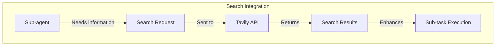

Sources: [README.md:113-119]()

### Code Generation

Maestro can generate not just text but also functional code, including creating the appropriate file structure and populating files with code content.

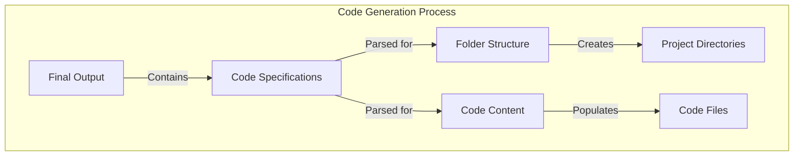

Sources: [README.md:141]()

## Implementation Models

Maestro supports various model implementations that follow the same orchestration pattern but use different LLM providers:

| Implementation | Orchestrator Model | Sub-agent Model | Refiner Model | Provider |
|----------------|-------------------|----------------|---------------|----------|
| maestro.py | Claude Opus | Claude Haiku | Claude Opus | Anthropic |
| maestro-gpt.py | GPT-4 | GPT-3.5 Turbo | GPT-4 | OpenAI |
| maestro-gpt4o.py | GPT-4o | GPT-4o | GPT-4o | OpenAI |
| maestro-groq.py | Mixtral/Llama | Mixtral/Llama | Mixtral/Llama | Groq |
| maestro-lmstudio.py | Local Model | Local Model | Local Model | LMStudio |
| maestro-ollama.py | Llama 3 (70B) | Llama 3 (8B) | Llama 3 (70B) | Ollama |
| maestro-anyapi.py | Configurable | Configurable | Configurable | Multiple |

Sources: [README.md:7-98]()

## Code to Concept Mapping

The following diagram maps the conceptual components of Maestro to their corresponding code implementations:

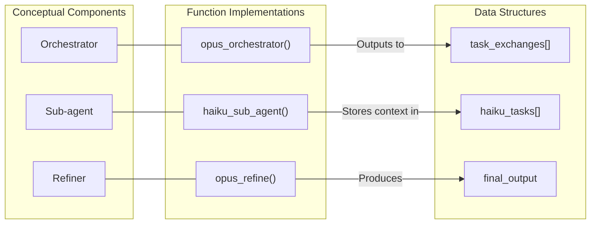

Sources: [README.md:194-197]()

## Memory and Context Flow

An important aspect of Maestro is how it maintains context between different sub-tasks and components:

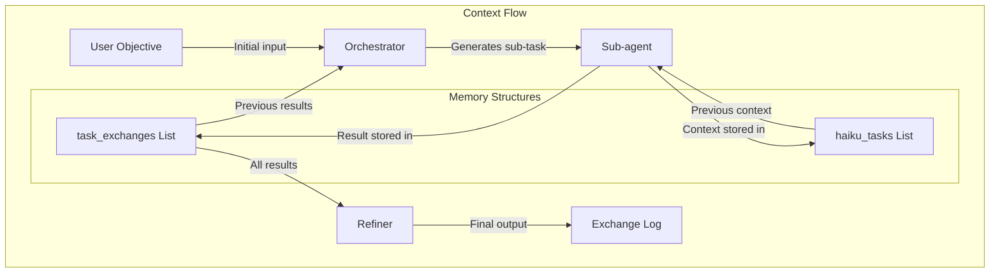

The system maintains two key memory structures:
- `task_exchanges`: Stores all interactions between the Orchestrator and Sub-agents
- `haiku_tasks`: Maintains a history of previous Sub-agent outputs to provide context for future sub-tasks

This memory architecture ensures that each component has access to the appropriate context and history when performing its role.

Sources: [README.md:198-202]()

---

# Page: Architecture

# Architecture

<details>
<summary>Relevant source files</summary>

The following files were used as context for generating this wiki page:

- [README.md](README.md)
- [maestro-gpt4o.py](maestro-gpt4o.py)
- [maestro-ollama.py](maestro-ollama.py)

</details>


This document provides a detailed explanation of the Maestro LLM Orchestration Framework's system architecture, component relationships, and workflow. It describes how Maestro breaks down complex tasks into sub-tasks, processes them through various models, and combines the results into a cohesive output.

For information about core concepts and terminology, see [Core Concepts](#1.1).

## 1. System Overview

Maestro is an orchestration framework that uses multiple language models in coordinated roles to solve complex tasks. At a high level, Maestro follows a three-step process:

1. An orchestrator model breaks down a user objective into manageable sub-tasks
2. Sub-agent models execute each sub-task independently
3. A refiner model combines the sub-task results into a cohesive final output

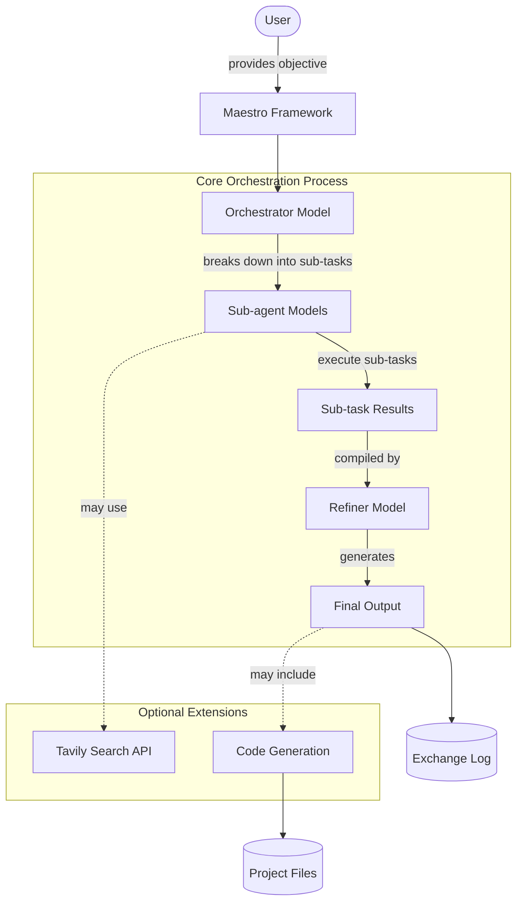

Sources: [README.md:3-6](), [README.md:132-141]()

## 2. Core Components

The Maestro architecture consists of three primary components, each leveraging different language models:

| Component | Role | Typical Models |
|-----------|------|----------------|
| Orchestrator | Breaks down objectives into sub-tasks | GPT-4o, Claude 3.5 Sonnet, Claude Opus, Llama 3 70B |
| Sub-agent | Executes individual sub-tasks | GPT-4o, Claude Haiku, Llama 3 8B |  
| Refiner | Synthesizes sub-task results into final output | GPT-4o, Claude Opus, Llama 3 70B |

Different implementations of Maestro may use various models for each component, but the architectural pattern remains consistent.

```mermaid
classDiagram
    class "MaestroFramework" {
        +run_objective(objective)
        -task_exchanges[]
        -previous_results[]
    }
    
    class "OrchestratorModel" {
        +break_down_task(objective, previous_results)
        +check_completion(results)
    }
    
    class "SubAgentModel" {
        +execute_task(prompt, previous_tasks)
        +handle_search_results(search_data)
    }
    
    class "RefinerModel" {
        +synthesize_results(objective, sub_task_results)
        +generate_code_artifacts(results)
    }
    
    class "SearchIntegration" {
        +perform_search(query)
        +format_results()
    }
    
    class "FileSystemInterface" {
        +create_folder_structure(structure)
        +write_code_files(code_blocks)
        +save_exchange_log(log)
    }
    
    MaestroFramework --> OrchestratorModel
    MaestroFramework --> SubAgentModel
    MaestroFramework --> RefinerModel
    MaestroFramework --> FileSystemInterface
    SubAgentModel --> SearchIntegration
    RefinerModel --> FileSystemInterface
```

Sources: [maestro-gpt4o.py:16-20](), [maestro-ollama.py:19-21]()

## 3. Implementation Variants

Maestro supports multiple LLM providers through different implementation files:

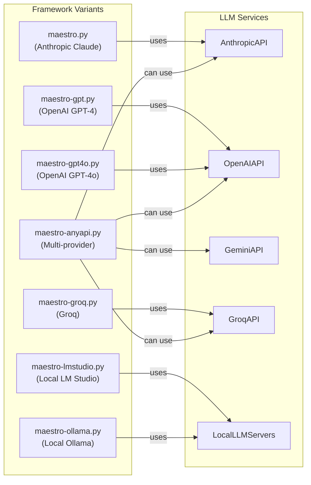

Sources: [README.md:9-98]()

The `maestro-anyapi.py` file provides a unified interface for multiple LLM providers through LiteLLM, allowing configuration of different models for each component via environment variables:

```
ORCHESTRATOR_MODEL = "gemini/gemini-1.5-flash-latest"
SUB_AGENT_MODEL = "gemini/gemini-1.5-flash-latest"
REFINER_MODEL = "gemini/gemini-1.5-flash-latest"
```

Sources: [README.md:25-29]()

## 4. Process Flow

The following sequence diagram illustrates the end-to-end process flow in Maestro:

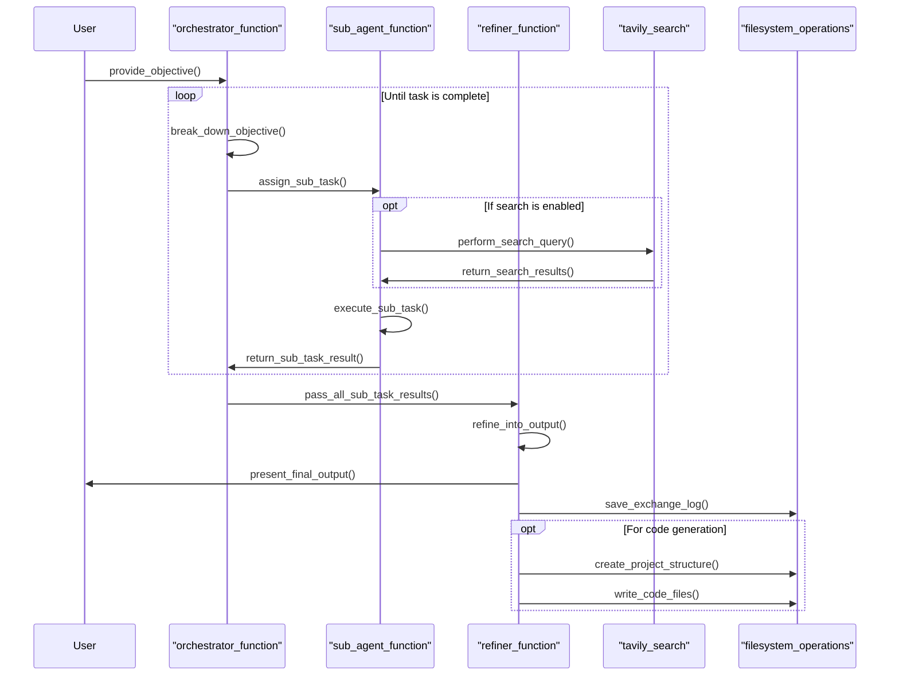

Sources: [maestro-gpt4o.py:40-123](), [maestro-ollama.py:37-111]()

### 4.1 Orchestrator Function Flow

The orchestrator function (`gpt_orchestrator` in `maestro-gpt4o.py` or `opus_orchestrator` in `maestro-ollama.py`) operates as follows:

1. Receives the user objective and any previous sub-task results
2. Constructs a prompt for the orchestrator model that:
   - Contains the objective
   - Includes any provided file content
   - Lists previous sub-task results
   - Asks for the next sub-task or final completion
3. Sends the prompt to the orchestrator model
4. Parses the response:
   - If "The task is complete:" is present, it signals completion
   - Otherwise, it generates a sub-task for the sub-agent

Sources: [maestro-gpt4o.py:40-81](), [maestro-ollama.py:37-55]()

### 4.2 Sub-agent Function Flow

The sub-agent function (`gpt_sub_agent` in `maestro-gpt4o.py` or `haiku_sub_agent` in `maestro-ollama.py`) operates as follows:

1. Receives the sub-task prompt and previous sub-task context
2. Optionally performs a search query if search integration is enabled
3. Constructs a message for the sub-agent model that:
   - Contains previous task context
   - Includes the current sub-task prompt
   - Adds search results if available
4. Sends the message to the sub-agent model
5. Returns the sub-agent's response

Sources: [maestro-gpt4o.py:83-123](), [maestro-ollama.py:57-88]()

### 4.3 Refiner Function Flow

The refiner function (`anthropic_refine` in `maestro-gpt4o.py` or `opus_refine` in `maestro-ollama.py`) operates as follows:

1. Receives the original objective and all sub-task results
2. Constructs a prompt for the refiner model asking it to:
   - Synthesize the results into a cohesive output
   - For code projects, generate project structure and code files
3. Sends the prompt to the refiner model
4. Returns the refined output
5. Extracts code artifacts if present

Sources: [maestro-gpt4o.py:125-153](), [maestro-ollama.py:90-111]()

## 5. Data Structures

Maestro manages several key data structures throughout its operation:

### 5.1 Task Exchanges

The `task_exchanges` list stores tuples of sub-task prompts and their corresponding results:

```python
task_exchanges = []  # List of (prompt, result) tuples
```

This list is used to:
- Track all sub-tasks and their results
- Provide context to the orchestrator for deciding next steps
- Feed into the refiner for final output synthesis
- Generate the exchange log for documentation

Sources: [maestro-gpt4o.py:211-232](), [maestro-ollama.py:201-227]()

### 5.2 Previous Tasks Context

The `previous_tasks` list maintains context for the sub-agent models:

```python
haiku_tasks = []  # List of {"task": prompt, "result": response} dictionaries
```

This allows sub-agents to have "memory" of previous tasks, which helps maintain context and coherence across multiple sub-tasks.

Sources: [maestro-ollama.py:202-225]()

### 5.3 Code Generation Data

For code generation, Maestro extracts several data structures from the refiner's output:

1. Project name
2. Folder structure (as a JSON object)
3. Code blocks (as filename-content pairs)

```python
# Extract project name
project_name_match = re.search(r'Project Name: (.*)', refined_output)
project_name = project_name_match.group(1).strip() if project_name_match else sanitized_objective

# Extract folder structure
folder_structure_match = re.search(r'<folder_structure>(.*?)</folder_structure>', refined_output, re.DOTALL)
folder_structure = json.loads(folder_structure_match.group(1).strip())

# Extract code blocks
code_blocks = re.findall(r'Filename: (\S+)\s*```[\w]*\n(.*?)\n```', refined_output, re.DOTALL)
```

Sources: [maestro-gpt4o.py:239-253](), [maestro-ollama.py:242-258]()

## 6. Storage and Persistence

Maestro includes several mechanisms for persisting data:

### 6.1 Exchange Log

All task exchanges and the final output are saved to a Markdown file:

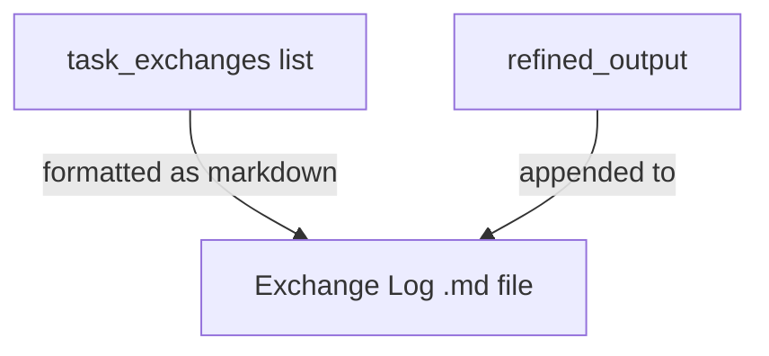

The exchange log includes:
- Original objective
- All sub-tasks and their results
- Final refined output

Sources: [maestro-gpt4o.py:261-273](), [maestro-ollama.py:271-284]()

### 6.2 Task Data Persistence

In some implementations (e.g., `maestro-ollama.py`), task data is persisted to a JSON file:

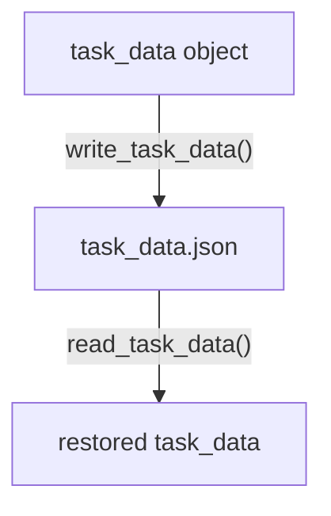

This allows for resuming task execution between sessions.

Sources: [maestro-ollama.py:149-161](), [maestro-ollama.py:174-187]()

### 6.3 Project Files

For code generation tasks, Maestro creates physical folders and files:

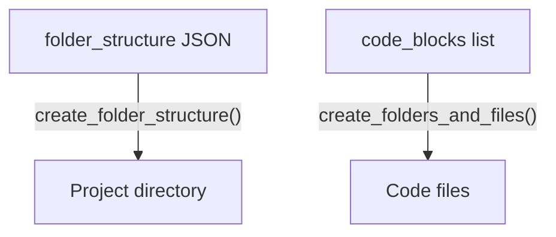

Sources: [maestro-gpt4o.py:155-185](), [maestro-ollama.py:113-142]()

## 7. Optional Integrations

### 7.1 Search Integration

Maestro can enhance sub-agent performance by integrating with the Tavily Search API:

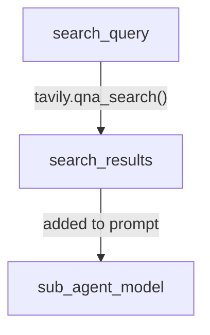

When enabled, the orchestrator model generates a search query related to the sub-task, which is sent to the Tavily API. The results are then incorporated into the sub-agent's prompt.

Sources: [maestro-gpt4o.py:92-104](), [README.md:113-119]()

### 7.2 File Content Processing

Maestro can process file content as part of the objective:

```mermaid
graph TD
    UserInput["user input"] -->|"contains file path"| FilePathExtraction["extract_file_path()"]
    FilePathExtraction -->|"read_file()"| FileContent["file_content"]
    FileContent -->|"included in"| OrchestratorPrompt["orchestrator_prompt"]
```

This allows users to provide source files to be analyzed or modified as part of the task.

Sources: [maestro-gpt4o.py:187-206](), [maestro-ollama.py:188-199]()

## 8. Error Handling

Maestro includes several error handling mechanisms:

1. JSON parsing error handling for folder structures
2. File and folder creation error handling
3. Response continuation for handling truncated model outputs
4. File path validation

These mechanisms help ensure the system remains robust even when encountering unexpected inputs or model limitations.

Sources: [maestro-gpt4o.py:147-150](), [maestro-ollama.py:243-255]()

## 9. Control Flow

The main control flow of Maestro follows this pattern:

```mermaid
graph TD
    Start["Start"] -->|"get objective"| GetObjective["Get objective from user"]
    GetObjective -->|"parse file path if present"| CheckFile["Check for file path"]
    CheckFile -->|"initialize"| InitializeArrays["Initialize task_exchanges and model_tasks arrays"]
    
    InitializeArrays -->|"enter"| MainLoop["Main orchestration loop"]
    
    MainLoop -->|"get next sub-task"| CallOrchestrator["Call orchestrator model"]
    CallOrchestrator -->|"check for completion"| CompletionCheck{"Task complete?"}
    
    CompletionCheck -->|"Yes"| CallRefiner["Call refiner model"]
    CompletionCheck -->|"No"| CallSubAgent["Call sub-agent model"]
    
    CallSubAgent -->|"record result"| UpdateExchanges["Update task_exchanges array"]
    UpdateExchanges --> MainLoop
    
    CallRefiner -->|"extract code artifacts"| ExtractArtifacts["Extract project structure and code"]
    ExtractArtifacts -->|"create project files"| CreateFiles["Create folders and files"]
    CreateFiles -->|"generate log"| SaveLog["Save exchange log"]
    SaveLog --> End["End"]
```

Sources: [maestro-gpt4o.py:211-273](), [maestro-ollama.py:204-284]()

---

# Page: Installation & Setup

# Installation & Setup

<details>
<summary>Relevant source files</summary>

The following files were used as context for generating this wiki page:

- [README.md](README.md)

</details>


This page provides detailed instructions for installing the Maestro framework and setting up your environment to run it with various LLM providers. For specific information about configuring API keys for different services, see [API Keys Configuration](#2.1).

## Prerequisites

Before installing Maestro, ensure you have the following prerequisites:

- Python 3.7 or higher installed on your system
- Git (to clone the repository)
- Access to at least one of the supported LLM providers (Anthropic, OpenAI, Gemini, Groq, or local options)

## Installation Steps

```mermaid
flowchart TD
    A["Clone Repository"] --> B["Install Dependencies"]
    B --> C["Configure API Keys"]
    C --> D["Choose Implementation"]
    D --> E1["Cloud LLM\nImplementation"]
    D --> E2["Local LLM\nImplementation"]
    E1 --> F1["Run Maestro"]
    E2 --> F2["Run Maestro"]
```

Sources: [README.md:151-164]()

### 1. Clone the Repository

First, clone the Maestro repository to your local machine:

```bash
git clone https://github.com/Doriandarko/maestro.git
cd maestro
```

### 2. Install Dependencies

Install the required Python packages using pip:

```bash
pip install -r requirements.txt
```

This installs the common dependencies needed for all implementations. For specific implementations, you might need additional packages as detailed in the sections below.

Sources: [README.md:156-158]()

### 3. Configure API Keys

Set up the necessary API keys for your chosen LLM provider. The specific keys required depend on the implementation you plan to use. See [API Keys Configuration](#2.1) for detailed instructions.

Sources: [README.md:162-169]()

## Implementation-Specific Setup

Maestro offers multiple implementations to work with different LLM providers. Choose the one that suits your needs.

```mermaid
graph TD
    subgraph "Maestro Implementations"
        M["maestro.py"] --> |Anthropic Claude|A["Anthropic API"]
        MA["maestro-anyapi.py"] --> |Multiple Providers|MP["LiteLLM"]
        MG["maestro-gpt.py"] --> |OpenAI GPT-4|O1["OpenAI API"]
        MG4O["maestro-gpt4o.py"] --> |OpenAI GPT-4o|O2["OpenAI API"]
        MGR["maestro-groq.py"] --> |Groq LLMs|G["Groq API"]
        ML["maestro-lmstudio.py"] --> |Local Models|LM["LM Studio"]
        MO["maestro-ollama.py"] --> |Local Models|OL["Ollama"]
        
        MP --> A
        MP --> O1
        MP --> G
        MP --> GEM["Gemini API"]
    end
```

Sources: [README.md:6-110]()

### Original Maestro (Anthropic Claude)

The original implementation uses Anthropic's Claude models (Opus and Haiku/Sonnet).

1. Install the Anthropic Python package if not already included:
   ```bash
   pip install anthropic
   ```

2. Set your Anthropic API key:
   ```python
   export ANTHROPIC_API_KEY="your_anthropic_api_key"
   ```

3. Run the original Maestro implementation:
   ```bash
   python maestro.py
   ```

Sources: [README.md:6-10](), [README.md:148-164]()

### Maestro with Any API (LiteLLM)

This implementation uses LiteLLM to support various LLM providers (Anthropic, OpenAI, Gemini, etc.).

1. Install LiteLLM:
   ```bash
   pip install litellm
   ```

2. Set environment variables for the API keys of the services you want to use:
   ```bash
   export OPENAI_API_KEY="your_openai_api_key"
   export ANTHROPIC_API_KEY="your_anthropic_api_key"
   export GEMINI_API_KEY="your_gemini_api_key"
   ```

3. Run the Any API implementation:
   ```bash
   python maestro-anyapi.py
   ```

Sources: [README.md:13-42]()

### OpenAI GPT-4 Implementation

1. Install the OpenAI Python package if not already included:
   ```bash
   pip install openai
   ```

2. Set your OpenAI API key:
   ```bash
   export OPENAI_API_KEY="your_openai_api_key"
   ```

3. Run the GPT-4 implementation:
   ```bash
   python maestro-gpt.py
   ```

Sources: [README.md:121-129]()

### OpenAI GPT-4o Implementation

1. Install the OpenAI Python package if not already included:
   ```bash
   pip install openai
   ```

2. Set your OpenAI API key:
   ```bash
   export OPENAI_API_KEY="your_openai_api_key"
   ```

3. Run the GPT-4o implementation:
   ```bash
   python maestro-gpt4o.py
   ```

Sources: [README.md:45-53]()

### Local Setup with LM Studio

1. Download and install LM Studio from [https://lmstudio.ai/](https://lmstudio.ai)

2. Launch LM Studio and start the local server:
   - Load your preferred model
   - Start the local server
   - Remove any system prompt (leave the prompt field empty)

3. Run the LM Studio implementation:
   ```bash
   python maestro-lmstudio.py
   ```

Sources: [README.md:57-67]()

### Local Setup with Ollama

1. Install Ollama client from [https://ollama.com/download](https://ollama.com/download)

2. Install the Ollama Python package:
   ```bash
   pip install ollama
   ```

3. Pull the desired models:
   ```bash
   ollama pull llama3:70b
   ollama pull llama3:8b  # Optional, for smaller model
   ```

4. Run the Ollama implementation:
   ```bash
   python maestro-ollama.py
   ```

Sources: [README.md:70-98]()

### Groq Implementation

1. Install the Groq Python package:
   ```bash
   pip install groq
   ```

2. Set your Groq API key:
   ```bash
   export GROQ_API_KEY="your_groq_api_key"
   ```

3. Run the Groq implementation:
   ```bash
   python maestro-groq.py
   ```

Sources: [README.md:101-110]()

## Search Integration (Optional)

Maestro supports integration with the Tavily search API for enhanced results.

1. Get a Tavily API key from [https://tavily.com/](https://tavily.com)

2. Set your Tavily API key:
   ```bash
   export TAVILY_API_KEY="your_tavily_api_key"
   ```

Sources: [README.md:113-120]()

## Dependency Relationships

```mermaid
graph TD
    subgraph "Core Dependencies"
        Python["Python 3.7+"]
        Rich["rich"]
    end
    
    subgraph "LLM API Dependencies"
        Anthropic["anthropic"]
        OpenAI["openai"]
        Groq["groq"]
        LiteLLM["litellm"]
    end
    
    subgraph "Local LLM Dependencies"
        OllamaPkg["ollama"]
        LMStudioApp["LM Studio App"]
    end
    
    subgraph "Optional Dependencies"
        Tavily["tavily-python"]
    end
    
    Python --> Rich
    Python --> Anthropic
    Python --> OpenAI
    Python --> Groq
    Python --> LiteLLM
    Python --> OllamaPkg
    Python --> Tavily
    
    Maestro["maestro.py"] --> Python
    Maestro --> Rich
    Maestro --> Anthropic
    
    MaestroAny["maestro-anyapi.py"] --> Python
    MaestroAny --> Rich
    MaestroAny --> LiteLLM
    
    MaestroGPT["maestro-gpt.py"] --> Python
    MaestroGPT --> Rich
    MaestroGPT --> OpenAI
    
    MaestroGPT4o["maestro-gpt4o.py"] --> Python
    MaestroGPT4o --> Rich
    MaestroGPT4o --> OpenAI
    
    MaestroGroq["maestro-groq.py"] --> Python
    MaestroGroq --> Rich
    MaestroGroq --> Groq
    
    MaestroLM["maestro-lmstudio.py"] --> Python
    MaestroLM --> Rich
    MaestroLM --> LMStudioApp
    
    MaestroOllama["maestro-ollama.py"] --> Python
    MaestroOllama --> Rich
    MaestroOllama --> OllamaPkg
    
    SearchFeature["Search Feature"] --> Tavily
```

Sources: [README.md:144-150](), [README.md:13-42](), [README.md:57-110](), [README.md:113-120]()

## Verifying Installation

To verify that your installation is working correctly:

1. Run your chosen implementation:
   ```bash
   python <implementation-file>.py
   ```
   
2. When prompted, enter a simple objective like "Write a short poem about AI."

3. Maestro should break down this objective, execute it, and provide a final output. The success of this process confirms that your installation is working correctly.

## Implementation Comparison

| Implementation | File | LLM Provider | Key Requirements | Local/Cloud | Additional Dependencies |
|----------------|------|--------------|------------------|-------------|-------------------------|
| Original Maestro | maestro.py | Anthropic (Claude) | ANTHROPIC_API_KEY | Cloud | anthropic |
| Any API | maestro-anyapi.py | Multiple | Various API keys | Cloud | litellm |
| GPT-4 | maestro-gpt.py | OpenAI | OPENAI_API_KEY | Cloud | openai |
| GPT-4o | maestro-gpt4o.py | OpenAI | OPENAI_API_KEY | Cloud | openai |
| Groq | maestro-groq.py | Groq | GROQ_API_KEY | Cloud | groq |
| LM Studio | maestro-lmstudio.py | Local models | None | Local | LM Studio App |
| Ollama | maestro-ollama.py | Local models | None | Local | ollama |

Sources: [README.md:6-110]()

This comparison can help you choose the appropriate implementation based on your specific requirements and available resources.

---

# Page: API Keys Configuration

# API Keys Configuration

<details>
<summary>Relevant source files</summary>

The following files were used as context for generating this wiki page:

- [README.md](README.md)

</details>


This guide explains how to obtain and configure the necessary API keys for different LLM providers used with the Maestro framework. The correct API keys are essential for authenticating with various LLM services and enabling Maestro's functionality.

For information about installation and general setup, see [Installation & Setup](#2).

## Overview of Required API Keys

Maestro supports multiple LLM providers, each requiring its own API key for authentication. Depending on which Maestro implementation you use, you'll need different API keys.

```mermaid
flowchart TD
    subgraph "API Keys Required by Provider"
        AnthropicKey["ANTHROPIC_API_KEY"]
        OpenAIKey["OPENAI_API_KEY"]
        GeminiKey["GEMINI_API_KEY"]
        GroqKey["GROQ_API_KEY"]
        TavilyKey["TAVILY_API_KEY (for search)"]
    end
    
    subgraph "Implementation Files"
        maestro["maestro.py\n(Anthropic Claude)"]
        maestroAny["maestro-anyapi.py\n(Multi-provider)"]
        maestroGPT["maestro-gpt.py\n(OpenAI GPT-4)"]
        maestroGPT4o["maestro-gpt4o.py\n(OpenAI GPT-4o)"]
        maestroGroq["maestro-groq.py\n(Groq)"]
        maestroLM["maestro-lmstudio.py\n(Local)"]
        maestroOllama["maestro-ollama.py\n(Local)"]
    end
    
    AnthropicKey -->|required for| maestro
    AnthropicKey -.->|option for| maestroAny
    
    OpenAIKey -->|required for| maestroGPT
    OpenAIKey -->|required for| maestroGPT4o
    OpenAIKey -.->|option for| maestroAny
    
    GeminiKey -.->|option for| maestroAny
    
    GroqKey -->|required for| maestroGroq
    GroqKey -.->|option for| maestroAny
    
    TavilyKey -.->|optional for search| maestro
    TavilyKey -.->|optional for search| maestroAny
    TavilyKey -.->|optional for search| maestroGPT
    TavilyKey -.->|optional for search| maestroGPT4o
    
    subgraph "Local Implementations"
        LocalNote["No cloud API keys required"]
    end
    
    LocalNote -.->|applies to| maestroLM
    LocalNote -.->|applies to| maestroOllama
```

Sources: [README.md:16-29]()

## Implementation-to-API Key Mapping

The following table shows which API keys you need based on your chosen Maestro implementation:

| Implementation | Primary API Key | Optional API Key |
|----------------|----------------|-----------------|
| maestro.py | Anthropic | Tavily (for search) |
| maestro-gpt.py | OpenAI | Tavily (for search) |
| maestro-gpt4o.py | OpenAI | Tavily (for search) |
| maestro-groq.py | Groq | - |
| maestro-anyapi.py | Any of: Anthropic, OpenAI, Gemini, Groq | Tavily (for search) |
| maestro-lmstudio.py | None (local) | - |
| maestro-ollama.py | None (local) | - |

Sources: [README.md:7-111]()

## Obtaining API Keys

### Anthropic API Key
1. Visit the [Anthropic website](https://www.anthropic.com) and create an account
2. Navigate to the API section in your account dashboard
3. Follow instructions to generate an API key
4. Copy and save your API key securely

### OpenAI API Key
1. Go to the [OpenAI platform](https://platform.openai.com)
2. Create an account or sign in
3. Navigate to API Keys section
4. Click "Create new secret key"
5. Copy and save your API key securely

### Gemini API Key
1. Visit [Google AI Studio](https://makersuite.google.com)
2. Sign in with your Google account
3. Go to API keys section
4. Generate a new API key
5. Copy and save your API key securely

### Groq API Key
1. Go to [Groq's website](https://groq.com)
2. Create an account or sign in
3. Navigate to the API section
4. Generate a new API key
5. Copy and save your API key securely

### Tavily API Key (Optional, for search functionality)
1. Visit [Tavily's website](https://tavily.com)
2. Create an account or sign in
3. Go to the API keys section
4. Generate a new API key
5. Copy and save your API key securely

Sources: [README.md:113-119]()

## Configuring API Keys

There are two methods to configure API keys in Maestro:

```mermaid
flowchart TD
    Start["API Key Configuration"] --> Method{Choose Method}
    
    Method -->|Environment Variables| EnvVars["Set Environment Variables\n(Recommended)"]
    Method -->|Direct in Code| CodeMod["Modify API Key in Code"]
    
    EnvVars --> OS{Operating System}
    OS -->|Windows| Windows["Command Prompt:\nset KEY_NAME=your_key_here"]
    OS -->|Linux/Mac| Unix["Terminal:\nexport KEY_NAME=your_key_here"]
    
    Windows --> Persist["To persist:\nAdd to system environment\nvariables"]
    Unix --> PersistUnix["To persist:\nAdd to .bashrc/.zshrc"]
    
    CodeMod --> ApiCode["Edit API key directly\nin script files"]
    
    Persist --> UseFrame["Run Maestro Implementation"]
    PersistUnix --> UseFrame
    ApiCode --> UseFrame
```

Sources: [README.md:17-31]()

### Method 1: Environment Variables (Recommended)

Setting environment variables keeps your API keys out of your code:

#### Windows:
```
set ANTHROPIC_API_KEY=your_key_here
set OPENAI_API_KEY=your_key_here
set GEMINI_API_KEY=your_key_here
set GROQ_API_KEY=your_key_here
set TAVILY_API_KEY=your_key_here
```

#### Linux/Mac:
```
export ANTHROPIC_API_KEY=your_key_here
export OPENAI_API_KEY=your_key_here
export GEMINI_API_KEY=your_key_here
export GROQ_API_KEY=your_key_here
export TAVILY_API_KEY=your_key_here
```

To make these environment variables persistent:
- Windows: Add to system environment variables through Control Panel
- Linux/Mac: Add to your shell profile file (.bashrc, .zshrc, etc.)

### Method 2: Direct Code Modification

You can also set API keys directly in the code (less secure):

```python
# Example from maestro-anyapi.py
os.environ["OPENAI_API_KEY"] = "YOUR KEY" 
os.environ["ANTHROPIC_API_KEY"] = "YOUR KEY"
os.environ["GEMINI_API_KEY"] = "YOUR KEY"
```

Sources: [README.md:17-23]()

## Implementation-Specific Configuration

### maestro.py (Anthropic Claude)
Replace the placeholder API key in the script with your actual Anthropic API key:

```python
client = Anthropic(api_key="YOUR_API_KEY_HERE")
```

If using search functionality, also replace your Tavily API key:
```python
tavily = TavilyClient(api_key="YOUR API KEY HERE")
```

Sources: [README.md:159-169]()

### maestro-anyapi.py (Multi-provider)
For the multi-provider implementation, set environment variables for the services you want to use:

```python
os.environ["OPENAI_API_KEY"] = "YOUR KEY" 
os.environ["ANTHROPIC_API_KEY"] = "YOUR KEY"
os.environ["GEMINI_API_KEY"] = "YOUR KEY"
```

Then define which models to use for each stage:
```python
ORCHESTRATOR_MODEL = "gemini/gemini-1.5-flash-latest"
SUB_AGENT_MODEL = "gemini/gemini-1.5-flash-latest"
REFINER_MODEL = "gemini/gemini-1.5-flash-latest"
```

Sources: [README.md:17-31]()

### maestro-gpt.py and maestro-gpt4o.py (OpenAI)
These implementations require the OpenAI API key to be set as an environment variable or directly in the code. The specific GPT models (GPT-4 or GPT-4o) are preconfigured in the respective scripts.

Sources: [README.md:45-53](), [README.md:121-129]()

### maestro-groq.py (Groq)
Requires installing the Groq package and setting up your Groq API key:

```bash
pip install groq
```

Then set your Groq API key via environment variables or directly in the code.

Sources: [README.md:101-110]()

## Local LLM Configuration

For local implementations, you don't need cloud API keys, but you need to set up the local environment:

### maestro-lmstudio.py
1. Download and install LM Studio from: https://lmstudio.ai/
2. Run the local server using your preferred method
3. Remove any system prompt for the app (leave prompt field empty)
4. Run `python maestro-lmstudio.py`

Sources: [README.md:57-67]()

### maestro-ollama.py
1. Install Ollama client from: https://ollama.com/download
2. Install the Python package: `pip install ollama`
3. Pull the desired model(s):
   ```bash
   ollama pull llama3:70b
   ollama pull llama3:8b
   ```
4. Run `python maestro-ollama.py`

Sources: [README.md:70-98]()

## Troubleshooting API Key Issues

### Common Problems and Solutions

| Issue | Potential Solutions |
|-------|---------------------|
| Authentication error | - Verify API key is correct and complete<br>- Ensure environment variable is properly set<br>- Check if API key has necessary permissions |
| "Model not found" errors | - Verify model name is correct<br>- Check if you have access to the specified model<br>- Some models require special access |
| Rate limiting | - Check your usage quotas on the provider's dashboard<br>- Consider upgrading your API plan |
| Environment variable not working | - Verify variable is set in current terminal session<br>- Try printing the variable (`echo %VAR%` on Windows, `echo $VAR` on Unix) |

### Best Practices for API Key Security

1. Never commit API keys to version control
2. Use environment variables instead of hardcoding keys
3. Rotate API keys periodically
4. Create separate API keys for different projects/environments
5. Set appropriate permissions and usage limits for your keys

Sources: [README.md:143-171]()

---

# Page: Usage Guide

# Usage Guide

<details>
<summary>Relevant source files</summary>

The following files were used as context for generating this wiki page:

- [README.md](README.md)

</details>


This guide provides comprehensive instructions for using the Maestro LLM Orchestration Framework. It covers basic usage patterns, command-line options, and advanced features. For installation instructions, see [Installation & Setup](#2), and for detailed explanations of core concepts, see [Core Concepts](#1.1).

## Getting Started with Maestro

Maestro works by breaking down complex objectives into manageable sub-tasks that are executed by AI sub-agents, then refining the results into a cohesive output. You can run Maestro through the command line or web interface.

```mermaid
flowchart TD
    User["User"] -->|"Provides objective"| Maestro["Maestro Framework"]
    Maestro -->|"Processes using"| LLModels["LLM Models"]
    LLModels -->|"Returns"| Results["Results"]
    Results -->|"Displayed to"| User
    
    subgraph "Internal Process"
        direction LR
        Input["Objective Input"] --> Orchestrator["Orchestrator Model"]
        Orchestrator -->|"Creates sub-tasks"| SubAgents["Sub-agents"]
        SubAgents -->|"Execute tasks"| TaskResults["Task Results"]
        TaskResults -->|"Compiled by"| Refiner["Refiner Model"] 
        Refiner -->|"Produces"| Output["Final Output"]
    end
    
    Maestro --- Input
    Results --- Output
```

Sources: [README.md:171-188]()

### Basic Command Line Usage

To use Maestro from the command line:

1. Open a terminal and navigate to the Maestro directory
2. Run one of the Maestro implementations (choose based on your preferred LLM provider)
3. Enter your objective when prompted
4. Wait for Maestro to process and display the results

```
$ python maestro.py
Please enter your objective: Your objective here
```

Maestro will display its progress in the console with formatted panels showing each sub-task and its results. When complete, it saves a full exchange log to a Markdown file named based on your objective.

Sources: [README.md:171-188]()

## Selecting a Maestro Implementation

Maestro offers several implementations for different LLM providers. Choose the one that best fits your needs:

| Implementation | File | Description | API Key Required |
|---------------|------|-------------|------------------|
| Anthropic Claude | `maestro.py` | Original implementation using Claude 3.5 Sonnet | ANTHROPIC_API_KEY |
| Multi-provider | `maestro-anyapi.py` | Supports multiple APIs (Anthropic, OpenAI, Gemini, etc.) | Varies by provider |
| OpenAI GPT-4 | `maestro-gpt.py` | Uses GPT-4 for orchestration | OPENAI_API_KEY |
| OpenAI GPT-4o | `maestro-gpt4o.py` | Enhanced for GPT-4o's code capabilities | OPENAI_API_KEY |
| Groq | `maestro-groq.py` | Uses Groq for faster API responses | GROQ_API_KEY |
| Local LM Studio | `maestro-lmstudio.py` | Runs with local models via LM Studio | None (local) |
| Local Ollama | `maestro-ollama.py` | Runs with local models via Ollama | None (local) |

```mermaid
graph TD
    User["User"]
    
    subgraph "Cloud Provider Implementations"
        Claude["maestro.py<br>(Claude)"]
        MultiAPI["maestro-anyapi.py<br>(Multi-provider)"]
        GPT4["maestro-gpt.py<br>(GPT-4)"]
        GPT4o["maestro-gpt4o.py<br>(GPT-4o)"]
        Groq["maestro-groq.py<br>(Groq)"]
    end
    
    subgraph "Local Implementations"
        LMStudio["maestro-lmstudio.py<br>(LM Studio)"]
        Ollama["maestro-ollama.py<br>(Ollama)"]
    end
    
    User -->|"Choose implementation"| Cloud Provider Implementations
    User -->|"Choose implementation"| Local Implementations
    
    Cloud Provider Implementations -->|"Requires"| APIKey["API Keys"]
    Local Implementations -->|"Requires"| LocalSetup["Local LLM Setup"]
```

Sources: [README.md:6-127]()

## Configuring Models

When using the multi-provider implementation (`maestro-anyapi.py`), you can configure which models to use for each role:

1. Set environment variables for API keys:
```python
os.environ["OPENAI_API_KEY"] = "YOUR KEY" 
os.environ["ANTHROPIC_API_KEY"] = "YOUR KEY"
os.environ["GEMINI_API_KEY"] = "YOUR KEY"
```

2. Define the models for each stage:
```python
ORCHESTRATOR_MODEL = "gemini/gemini-1.5-flash-latest"
SUB_AGENT_MODEL = "gemini/gemini-1.5-flash-latest"
REFINER_MODEL = "gemini/gemini-1.5-flash-latest"
```

You can mix and match different models from different providers. For example, you might use Claude for orchestration, GPT for sub-agents, and Gemini for refinement.

Sources: [README.md:13-31]()

## Common Usage Patterns

### Basic Workflow

Maestro's basic workflow involves:

1. Entering an objective
2. The orchestrator model breaking it down into sub-tasks
3. Sub-agent models executing each sub-task
4. The refiner model combining results into a coherent output

For detailed information on this workflow, see [Basic Workflow](#3.1).

```mermaid
sequenceDiagram
    participant User
    participant Orchestrator as "Orchestrator Model"
    participant SubAgent as "Sub-agent Model"
    participant Refiner as "Refiner Model"
    
    User->>Orchestrator: Provide objective
    
    loop Until task is complete
        Orchestrator->>Orchestrator: Break down objective
        Orchestrator->>SubAgent: Assign sub-task
        SubAgent->>SubAgent: Execute sub-task
        SubAgent->>Orchestrator: Return result
    end
    
    Orchestrator->>Refiner: Pass all results
    Refiner->>User: Present final output
```

Sources: [README.md:132-140](), [README.md:190-202]()

### Code Generation

Maestro can generate complete code projects by:

1. Breaking down the coding task into logical components
2. Writing code for each component
3. Organizing files and folders based on the project structure
4. Creating a cohesive codebase with proper imports and dependencies

For detailed information on code generation, see [Code Generation](#3.2).

Sources: [README.md:141-142]()

### Search Integration

With search integration enabled, Maestro uses the Tavily API to perform web searches when gathering information for sub-tasks. This enhances the accuracy and relevance of generated content by incorporating up-to-date information.

To use search functionality:

1. Obtain a Tavily API key from https://tavily.com/
2. Add your API key to the script:
```python
tavily = TavilyClient(api_key="YOUR API KEY HERE")
```

For detailed information on search integration, see [Search Integration](#3.3).

Sources: [README.md:113-119](), [README.md:165-169]()

## Using Different Implementations

### Using with Cloud Providers

#### Anthropic Claude (Original)

```bash
python maestro.py
```

This implementation uses Claude 3.5 Sonnet (default) for both orchestration and refinement.

#### Multi-provider with LiteLLM

First, install LiteLLM:
```bash
pip install litellm
```

Then run:
```bash
python maestro-anyapi.py
```

#### OpenAI GPT-4 and GPT-4o

For GPT-4:
```bash
python maestro-gpt.py
```

For GPT-4o (optimized for code):
```bash
python maestro-gpt4o.py
```

#### Groq

Install the Groq package:
```bash
pip install groq
```

Then run:
```bash
python maestro-groq.py
```

Sources: [README.md:6-127]()

### Using with Local LLMs

#### LM Studio

1. Download and install LM Studio from https://lmstudio.ai/
2. Start the local server in LM Studio (remove any system prompt)
3. Run:
```bash
python maestro-lmstudio.py
```

#### Ollama

1. Install Ollama client from https://ollama.com/download
2. Install the Python package:
```bash
pip install ollama
```
3. Pull your preferred model(s):
```bash
ollama pull llama3:70b
ollama pull llama3:8b
```
4. Run:
```bash
python maestro-ollama.py
```

Sources: [README.md:55-98]()

## Output and Results

Maestro provides output in two ways:

1. **Console output**: Displays the progress of task execution with formatted panels showing each sub-task and its results.

2. **Markdown log file**: Saves a complete exchange log to a Markdown file named based on your objective. This log includes:
   - The original objective
   - All sub-tasks and their results
   - The final refined output

For code generation tasks, Maestro also creates the actual code files and folders according to the project structure it determines is appropriate.

```mermaid
graph TD
    Maestro["Maestro Process"] -->|"Generates"| ConsoleOutput["Console Output<br>(Real-time progress)"]
    Maestro -->|"Creates"| LogFile["Markdown Log File<br>(Complete record)"]
    Maestro -->|"For code tasks"| CodeFiles["Code Files & Folders"]
    
    subgraph "Markdown Log File Contents"
        Objective["Original Objective"]
        TaskBreakdown["Task Breakdown"]
        SubtaskResults["Sub-task Results"]
        FinalOutput["Final Refined Output"]
    end
    
    LogFile --- Objective
    LogFile --- TaskBreakdown
    LogFile --- SubtaskResults
    LogFile --- FinalOutput
```

Sources: [README.md:186-188](), [README.md:202-204]()

## Customization Options

You can customize Maestro in several ways:

1. **Model selection**: Choose different models for orchestrator, sub-agent, and refiner roles.

2. **Token limits**: Adjust the `max_tokens` parameter to control the length of generated responses.

3. **Console formatting**: Modify the Rich library's Panel and Console configurations for different output styles.

4. **Exchange log formatting**: Customize the format and file extension of the exchange logs.

Sources: [README.md:205-211]()

## Web Interface

For a graphical user interface to Maestro, you can use the included Flask web application. See [Web Interface](#5) and [Web Interface Setup](#5.1) for detailed instructions.

Sources: [README.md]()

## Next Steps

- For detailed instructions on the basic workflow, see [Basic Workflow](#3.1)
- For code generation specifics, see [Code Generation](#3.2)
- For search integration details, see [Search Integration](#3.3)
- To learn about different implementations, see [Implementations](#4)
- For troubleshooting help, see [Troubleshooting & FAQ](#7)

---

# Page: Basic Workflow

# Basic Workflow

<details>
<summary>Relevant source files</summary>

The following files were used as context for generating this wiki page:

- [README.md](README.md)
- [maestro-gpt4o.py](maestro-gpt4o.py)

</details>


This page explains the fundamental workflow for using the Maestro framework to orchestrate Large Language Models (LLMs) for task completion. You'll learn how to define objectives, understand how the system breaks down tasks, and interpret the results. For specific implementations with different LLM providers, see [Implementations](#4), and for code generation details, see [Code Generation](#3.2).

## Workflow Overview

The Maestro framework follows a structured approach to task completion, using multiple LLM instances in specific roles to break down complex tasks into manageable pieces.

```mermaid
sequenceDiagram
    participant "User" as user
    participant "Orchestrator" as orchestrator
    participant "Sub-agent" as subagent
    participant "Refiner" as refiner
    participant "FileSystem" as filesystem
    
    user->>orchestrator: Define objective
    
    loop Task Breakdown and Execution
        orchestrator->>orchestrator: Break down objective into sub-tasks
        orchestrator->>subagent: Assign sub-task
        subagent->>subagent: Execute sub-task
        subagent->>orchestrator: Return sub-task result
        orchestrator->>orchestrator: Assess if task is complete
    end
    
    orchestrator->>refiner: Provide all sub-task results
    refiner->>refiner: Compile and refine results
    refiner->>user: Present final output
    refiner->>filesystem: Save exchange log (Markdown)
    
    alt Code Generation Task
        refiner->>filesystem: Create project structure and files
    end
```

Sources: [README.md:188-202](), [maestro-gpt4o.py:214-234]()

## Step 1: Defining Your Objective

The workflow begins with defining an objective - a clear statement of what you want to accomplish. This is provided as input to the system.

```mermaid
flowchart LR
    subgraph "UserInput"
        objective["Objective Statement"]
        file["Optional File Content"]
        search["Optional Search Flag"]
    end
    
    subgraph "CodeEntities"
        inputFunc["input()"]
        readFileFunc["read_file()"]
    end
    
    objective --> inputFunc
    file --> readFileFunc
    search --> inputFunc
    
    inputFunc --> start["Start Maestro Process"]
```

When running Maestro, you'll be prompted to:
1. Enter your objective
2. Specify whether to provide a reference file (optional)
3. Choose whether to enable search capabilities (optional)

### Example Objective Input

```
Please enter your objective: Create a simple Flask web app for a todo list
Do you want to provide a file path? (y/n): n
Do you want to use search? (y/n): y
```

Sources: [README.md:180-184](), [maestro-gpt4o.py:192-209]()

## Step 2: Task Orchestration

Once you've provided an objective, the orchestrator model (e.g., Claude Opus, GPT-4, etc.) breaks it down into manageable sub-tasks.

```mermaid
flowchart TD
    objective["User Objective"] --> orchestratorFunc["gpt_orchestrator() or opus_orchestrator()"]
    
    subgraph "OrchestratorProcess"
        orchestratorFunc --> modelCall["Call to LLM API"]
        modelCall --> taskAnalysis["Analyze Task Complexity"]
        taskAnalysis --> decision{"Is Task Complete?"}
        
        decision -->|"No"| subtaskDefinition["Define Next Sub-task"]
        decision -->|"Yes"| taskComplete["Signal Completion: 'The task is complete:'"]
        
        subtaskDefinition --> prompt["Craft Sub-agent Prompt"]
        prompt --> searchQuery["Optional Search Query"]
    end
    
    searchQuery --> subagent["Sub-agent Process"]
    taskComplete --> finalOutput["Final Output"]
```

The orchestrator:
1. Analyzes the objective and any previous sub-task results
2. Determines if the objective has been fully achieved
3. If not complete, creates a prompt for the next sub-task
4. May generate a search query for the sub-agent to gather information

The orchestrator continues this process until it determines the task is complete, signaled by the phrase "The task is complete:" in its response.

Sources: [README.md:194-196](), [maestro-gpt4o.py:40-81]()

## Step 3: Sub-task Execution

Each sub-task is executed by a sub-agent model, which may be the same or a different model than the orchestrator.

```mermaid
flowchart TD
    subgraph "SubAgentProcess"
        subtaskPrompt["Sub-task Prompt"] --> subagentFunc["gpt_sub_agent() or haiku_sub_agent()"]
        searchQuery["Optional Search Query"] --> searchAPI["tavily.qna_search()"]
        searchAPI --> searchResults["Search Results"]
        
        subagentFunc --> modelCall["Call to LLM API"]
        searchResults --> modelCall
        previousResults["Previous Sub-task Results"] --> modelCall
        
        modelCall --> executionResult["Sub-task Execution Result"]
    end
    
    executionResult --> orchestrator["Back to Orchestrator"]
```

The sub-agent:
1. Receives the sub-task prompt from the orchestrator
2. May perform a search query if enabled
3. Has access to results from previous sub-tasks for context
4. Executes the sub-task and returns results

Sub-agents maintain "memory" of previous tasks, ensuring continuity and context-awareness throughout the process.

Sources: [README.md:136-137](), [maestro-gpt4o.py:83-123]()

## Step 4: Result Refinement

After all sub-tasks are completed, the refiner model (typically a more capable model like Claude Opus) compiles and refines the results into a cohesive final output.

```mermaid
flowchart TD
    subgraph "RefinerProcess"
        allResults["All Sub-task Results"] --> refinerFunc["anthropic_refine() or opus_refine()"]
        objective["Original Objective"] --> refinerFunc
        
        refinerFunc --> modelCall["Call to LLM API"]
        modelCall --> refinedOutput["Refined Final Output"]
        
        refinedOutput --> standardOutput["Standard Text Output"]
        refinedOutput --> folderStructure["Optional Folder Structure JSON"]
        refinedOutput --> codeBlocks["Optional Code Blocks"]
    end
    
    standardOutput --> user["User Presentation"]
    folderStructure --> fileSystem["File System Creation"]
    codeBlocks --> fileSystem
```

The refiner:
1. Reviews all sub-task results in context of the original objective
2. Organizes and refines the information into a cohesive final output
3. For code-related tasks, may include project structure and code files

Sources: [README.md:138](), [maestro-gpt4o.py:125-153]()

## Step 5: Output Generation

Maestro generates two primary outputs:

1. **Exchange Log**: A detailed Markdown file capturing the entire process
2. **Project Files** (for code tasks): Code files and folder structure based on the refined output

### Exchange Log Structure

```
Objective: [Your objective text]

========================================== Task Breakdown ==========================================

Task 1:
Prompt: [Sub-task prompt]
Result: [Sub-task result]

Task 2:
Prompt: [Sub-task prompt]
Result: [Sub-task result]

...

========================================== Refined Final Output ==========================================

[Refined output text]
```

### Project Structure Creation

For coding tasks, Maestro can extract a folder structure and code content from the refined output, then create the actual files and folders on your system.

```mermaid
flowchart TD
    refinedOutput["Refined Output"] --> extractProjectName["Extract Project Name"]
    refinedOutput --> extractFolderStructure["Extract Folder Structure JSON"]
    refinedOutput --> extractCodeBlocks["Extract Code Blocks"]
    
    extractProjectName --> projectFolder["Create Project Folder"]
    extractFolderStructure --> folderCreation["Create Folder Hierarchy"]
    extractCodeBlocks --> fileCreation["Create Code Files"]
    
    projectFolder --> folderCreation
    folderCreation --> fileCreation
```

Sources: [README.md:140-141](), [maestro-gpt4o.py:155-186](), [maestro-gpt4o.py:239-254](), [maestro-gpt4o.py:261-274]()

## Common Options and Parameters

When running Maestro, you can customize your workflow with these common options:

| Option | Description | How to Use |
|--------|-------------|------------|
| File Reference | Provide a file to give context to the LLM | Answer 'y' when prompted and provide file path |
| Search Integration | Enable web search for better answers | Answer 'y' when prompted for search option |
| Model Selection | Choose which models to use for each role | Configure in script (see [Implementations](#4)) |

### Model Roles

Maestro uses three distinct roles for its LLMs:

| Role | Variable | Default Model | Purpose |
|------|----------|---------------|---------|
| Orchestrator | `ORCHESTRATOR_MODEL` | Claude Opus/GPT-4o | Break down objectives into sub-tasks |
| Sub-agent | `SUB_AGENT_MODEL` | Claude Haiku/GPT-4o | Execute individual sub-tasks |
| Refiner | `REFINER_MODEL` | Claude Opus | Compile and refine final results |

Sources: [README.md:112-118](), [maestro-gpt4o.py:15-20]()

## Understanding Task Completion

A successful Maestro run will:

1. Show progress through each sub-task in the console
2. Signal completion with "The task is complete:" in the orchestrator output
3. Present the refined final output
4. Save the exchange log to a Markdown file
5. Create project files (for code tasks)

The completion signal happens when the orchestrator determines that all necessary sub-tasks have been executed and the objective has been fully achieved.

Sources: [README.md:197-198](), [maestro-gpt4o.py:223-225]()

---

# Page: Code Generation

# Code Generation

<details>
<summary>Relevant source files</summary>

The following files were used as context for generating this wiki page:

- [README.md](README.md)
- [maestro-gpt4o.py](maestro-gpt4o.py)
- [maestro-ollama.py](maestro-ollama.py)

</details>


This document details Maestro's code generation capabilities, explaining how the framework processes code-related tasks, generates project structures, and creates functional code files. For information about the basic workflow, see [Basic Workflow](#3.1). For details on integrating search functionality to enhance code generation, see [Search Integration](#3.3).

## Overview of Code Generation

Maestro can generate complete code projects by breaking down coding tasks into smaller sub-tasks, solving them sequentially, and then producing a cohesive final output with proper project structure and implementation files. The framework supports code generation across all its implementations, including Claude, GPT, Groq, and local models via Ollama and LM Studio.

Sources: [README.md:137-142](), [maestro-gpt4o.py:125-153](), [maestro-ollama.py:90-111]()

## Code Generation Process

```mermaid
sequenceDiagram
    participant User as "User"
    participant Orchestrator as "Orchestrator Model"
    participant SubAgent as "Sub-Agent Model"
    participant Refiner as "Refiner Model"
    participant FileSystem as "File System"
    
    User->>Orchestrator: "Submit code generation task"
    
    loop Until task completion
        Orchestrator->>Orchestrator: "Break down into code sub-tasks"
        Orchestrator->>SubAgent: "Assign code sub-task"
        SubAgent->>SubAgent: "Work on code component"
        SubAgent->>Orchestrator: "Return code snippet/solution"
    end
    
    Orchestrator->>Refiner: "Send all sub-task results"
    
    Refiner->>Refiner: "Generate project name"
    Refiner->>Refiner: "Define folder structure (JSON)"
    Refiner->>Refiner: "Prepare code files"
    
    Refiner->>FileSystem: "Create project folder"
    Refiner->>FileSystem: "Create subfolders"
    Refiner->>FileSystem: "Write code files"
    
    Refiner->>User: "Return summary and file locations"
```

The code generation process involves three main phases:
1. **Code Task Breakdown**: The orchestrator model breaks down the coding objective into manageable sub-tasks
2. **Code Development**: Sub-agent models implement different code components
3. **Project Integration**: The refiner model combines all code solutions into a cohesive project structure

Sources: [maestro-gpt4o.py:40-153](), [maestro-ollama.py:37-111]()

## Expected Refiner Output Format

When handling code-related tasks, the refiner model is explicitly instructed to produce output in a specific format:

1. **Project Name**: A concise, appropriate name (max 20 characters)
2. **Folder Structure**: A JSON object defining the project's directory structure
3. **Code Files**: Individual code files with their content

The prompt for the refiner model contains specific instructions for formatting this information:

```
When working on code projects, ONLY AND ONLY IF THE PROJECT IS CLEARLY A CODING ONE, please provide the following:

1. Project Name: Create a concise and appropriate project name that fits the project based on what it's creating. The project name should be no more than 20 characters long.

2. Folder Structure: Provide the folder structure as a valid JSON object, where each key represents a folder or file, and nested keys represent subfolders. Use null values for files. Ensure the JSON is properly formatted without any syntax errors. Please make sure all keys are enclosed in double quotes, and ensure objects are correctly encapsulated with braces, separating items with commas as necessary. Wrap the JSON object in <folder_structure> tags.

3. Code Files: For each code file, include ONLY the file name, NEVER EVER USE THE FILE PATH OR ANY OTHER FORMATTING. YOU ONLY USE THE FOLLOWING format 'Filename: <filename>' followed by the code block enclosed in triple backticks, with the language identifier after the opening backticks.
```

Sources: [maestro-gpt4o.py:125-153](), [maestro-ollama.py:90-111]()

## Folder Structure Generation

### JSON Format

The folder structure is provided by the refiner model as a valid JSON object wrapped in `<folder_structure>` tags. Each key in the JSON represents a folder or file, and nested keys represent subfolders. Files are represented with null values.

Example folder structure JSON:
```json
{
  "src": {
    "main.py": null,
    "utils": {
      "helpers.py": null,
      "config.py": null
    }
  },
  "tests": {
    "test_main.py": null
  },
  "README.md": null
}
```

### Extraction and Processing

```mermaid
flowchart TD
    A["Refiner Response"] --> B["Extract folder structure JSON"]
    B --> C{"Is JSON valid?"}
    C -- Yes --> D["Parse JSON structure"]
    C -- No --> E["Log error and continue"]
    D --> F["Create project root folder"]
    F --> G["Process nested folders and files"]
    G --> H["Create folders"] 
    G --> I["Identify files for creation"]
    I --> J["Match files with code content"]
```

The framework extracts the folder structure from the refiner's output using regex pattern matching, seeking content between the `<folder_structure>` tags. After extracting the JSON string, the system:

1. Attempts to parse the JSON into a Python dictionary
2. Creates the top-level project folder named after the project
3. Recursively creates all necessary subfolders according to the structure
4. Identifies file entries that will need code content

Sources: [maestro-gpt4o.py:242-250](), [maestro-ollama.py:246-255]()

## Code Files Generation

### Code Block Format

The refiner model is instructed to format each code file with:
1. A "Filename:" prefix with the file's name
2. The code content wrapped in triple backticks (```) with appropriate language identifier

Example:
```
Filename: main.py
```python
def main():
    print("Hello, world!")

if __name__ == "__main__":
    main()
```
```

### Extraction and File Creation

The system extracts code blocks using regex pattern matching that looks for:
1. The "Filename:" prefix followed by a filename
2. Code content between triple backticks

This extraction creates a list of (filename, code_content) pairs that are matched against the folder structure to determine where each file should be created.

```mermaid
flowchart LR
    A["Refiner Response"] --> B["Extract code blocks"]
    B --> C["For each file in folder structure"]
    C --> D{"Code content found?"}
    D -- Yes --> E["Create file with content"]
    D -- No --> F["Log missing content"]
    E --> G["Log successful file creation"]
    F --> C
    G --> C
```

Sources: [maestro-gpt4o.py:253-254](), [maestro-ollama.py:258-259](), [maestro-ollama.py:155-186](), [maestro-gpt4o.py:155-185]()

## Implementation-Specific Details

Maestro maintains consistent code generation functionality across different model implementations, with minor variations:

| Implementation | Model Used for Code Generation | Model(s) Used for Code Evaluation | Key Functions |
|----------------|---------------------------------|----------------------------------|---------------|
| Original Maestro | Claude-3-Opus | Claude (Opus/Haiku) | opus_refine |
| GPT4o | Claude-3-Opus (for refining) | GPT-4o | anthropic_refine + create_folder_structure |
| Ollama | llama3:70b-instruct | llama3 models | opus_refine + create_folder_structure |
| Multi-API | Various (configurable) | Various (configurable) | Uses LiteLLM interface |

Each implementation follows the same general pattern:
1. Extract folder structure JSON
2. Extract code blocks
3. Create project structure
4. Write code files

Sources: [README.md:42-53](), [README.md:70-98](), [maestro-gpt4o.py:125-153](), [maestro-ollama.py:90-111]()

## Projects and File Management

```mermaid
flowchart TD
    A["Objective Analysis"] --> B["Project Name Extraction"]
    B --> C["Project Folder Creation"]
    
    subgraph "Folder Structure Processing"
        D["Parse folder structure JSON"] --> E["Create folders recursively"]
    end
    
    subgraph "Code File Processing"
        F["Extract code blocks"] --> G["Match files to locations"] --> H["Write file content"]
    end
    
    C --> D
    E --> F
    
    I["Exchange Log Creation"] --> J["Save .md documentation"]
```

The framework handles several file management operations:

1. **Project Naming**: Extracts project name from the refiner's output or uses a sanitized version of the objective
2. **Folder Creation**: Creates a project root folder and all subfolders based on the JSON structure
3. **File Creation**: Creates each file with its corresponding content from the extracted code blocks
4. **Documentation**: Generates a Markdown file containing the complete task exchange and code generation process

Sources: [maestro-gpt4o.py:155-185](), [maestro-ollama.py:155-186](), [maestro-ollama.py:261-269](), [maestro-gpt4o.py:260-275]()

## Error Handling

Maestro implements several error handling mechanisms for code generation:

1. **JSON Parsing Errors**: If the folder structure JSON is invalid, the error is logged, and the system continues without creating the folder structure
2. **Missing Code Content**: If a file is defined in the folder structure but no code content is found, a warning is logged
3. **File/Folder Creation Errors**: If there are issues creating files or folders (permissions, disk space, etc.), errors are logged, and the system attempts to continue with other files

This error handling ensures that even if parts of the code generation process fail, the system can still provide partial results.

Sources: [maestro-gpt4o.py:245-250](), [maestro-ollama.py:246-255](), [maestro-ollama.py:172-186](), [maestro-gpt4o.py:170-185]()

## Triggering Code Generation

Code generation is triggered automatically when:

1. The system detects that the user's objective is related to code development
2. The refiner model determines that the task requires generating code files
3. The refiner produces properly formatted output with project structure and code files

The decision to generate code is primarily made by the refiner model based on its analysis of the objective and the sub-task results. If the refiner does not produce output in the expected format, the code generation steps are skipped.

Sources: [maestro-gpt4o.py:125-153](), [maestro-ollama.py:90-111]()

---

# Page: Search Integration

# Search Integration

<details>
<summary>Relevant source files</summary>

The following files were used as context for generating this wiki page:

- [README.md](README.md)
- [maestro-gpt4o.py](maestro-gpt4o.py)

</details>


This document describes the search integration feature in Maestro, which allows the AI orchestrator and sub-agents to access real-time information from the web during task execution. Search integration enhances the AI's ability to solve tasks by providing up-to-date information, references, and facts that might not be present in its training data.

## Overview

The Maestro framework integrates with the Tavily Search API to enable AI agents to perform web searches when working on tasks. This feature is particularly useful for:

- Retrieving current information (news, trends, recent developments)
- Obtaining factual data for analysis tasks
- Finding code examples and documentation
- Gathering reference material for research tasks

```mermaid
flowchart TD
    subgraph "Maestro with Search Integration"
        UserInput["User Input"]
        Orchestrator["Orchestrator Model"]
        SubAgent["Sub-agent Model"]
        ResultRefiner["Result Refiner"]
        
        UserInput -->|"objective"| Orchestrator
        Orchestrator -->|"generates search query"| SearchAPI
        Orchestrator -->|"sub-task with context"| SubAgent
        SearchAPI -->|"search results"| SubAgent
        SubAgent -->|"task results"| Orchestrator
        Orchestrator -->|"all results"| ResultRefiner
        ResultRefiner -->|"final output"| UserResult["User Result"]
    end
    
    SearchAPI["Tavily Search API"] -->|"performs web search"| WebResults["Web Results"]
```

Sources: [README.md:113-120](), [maestro-gpt4o.py:8-9](), [maestro-gpt4o.py:92-96]()

## Setting Up Search Integration

To use the search integration feature, you need to:

1. Create an account at [Tavily](https://tavily.com) and obtain an API key
2. Configure your Maestro instance with the Tavily API key
3. Enable search when running Maestro

### API Key Configuration

In your Maestro script, replace the placeholder API key with your actual Tavily API key:

```python
tavily = TavilyClient(api_key="YOUR_API_KEY_HERE")
```

Sources: [README.md:166-169](), [maestro-gpt4o.py:94]()

## Search Integration Workflow

The search integration follows a specific workflow within the Maestro orchestration process:

```mermaid
sequenceDiagram
    participant User
    participant Orchestrator as "gpt_orchestrator()"
    participant Tavily as "TavilyClient()"
    participant SubAgent as "gpt_sub_agent()"
    participant Refiner as "anthropic_refine()"
    
    User->>Orchestrator: Submit objective with search enabled
    
    loop Task Breakdown
        Orchestrator->>Orchestrator: Generate sub-task prompt
        Orchestrator->>Orchestrator: Generate search query
        
        Orchestrator->>SubAgent: Send sub-task prompt and search query
        
        SubAgent->>Tavily: Send search query
        Tavily->>Tavily: Perform web search
        Tavily->>SubAgent: Return search results
        
        SubAgent->>SubAgent: Process task with search context
        SubAgent->>Orchestrator: Return task result
        
        Orchestrator->>Orchestrator: Evaluate task completion
    end
    
    Orchestrator->>Refiner: Send all task results
    Refiner->>User: Return final refined output
```

Sources: [maestro-gpt4o.py:40-81](), [maestro-gpt4o.py:83-123]()

## Implementation Details

### Search Query Generation

When search is enabled, the orchestrator model generates a specialized search query in JSON format. This is implemented in the `gpt_orchestrator` function:

```mermaid
flowchart LR
    gptOrchestrator["gpt_orchestrator()"]
    messages["messages array"]
    searchPrompt["search query prompt"]
    gptResponse["gpt response"]
    extractQuery["extract search_query"]
    
    gptOrchestrator -->|"if use_search=True"| messages
    messages -->|"append"| searchPrompt
    messages -->|"send to model"| gptResponse
    gptResponse -->|"regex parse JSON"| extractQuery
```

The orchestrator instructs the model to generate a JSON object with a `search_query` key, which is then extracted using regex pattern matching.

Sources: [maestro-gpt4o.py:51-52](), [maestro-gpt4o.py:66-79]()

### Search Execution

When a search query is available and search is enabled, the `gpt_sub_agent` function:

1. Creates a TavilyClient instance
2. Calls the `qna_search` method with the query
3. Incorporates the search results into the context provided to the sub-agent model

This allows the sub-agent to use the search results when executing its task.

Sources: [maestro-gpt4o.py:92-104]()

## Using Search Integration

To enable search when running Maestro:

1. Make sure your Tavily API key is configured
2. When prompted, respond with "y" to the question:

```
Do you want to use search? (y/n):
```

The search feature will then be automatically used throughout the task processing pipeline.

Sources: [maestro-gpt4o.py:209](), [maestro-gpt4o.py:214-222]()

## Technical Implementation Reference

The following table summarizes the key components and their roles in search integration:

| Component | File | Function | Purpose |
|-----------|------|----------|---------|
| Tavily Client Initialization | maestro-gpt4o.py | N/A (global) | Imports and initializes the TavilyClient |
| Search Query Generation | maestro-gpt4o.py | gpt_orchestrator() | Adds search query request to model prompt and extracts query from response |
| Search Execution | maestro-gpt4o.py | gpt_sub_agent() | Performs the search using the Tavily API and adds results to context |
| Search Toggle | maestro-gpt4o.py | Main execution flow | Gets user input on whether to use search and maintains use_search flag |

Sources: [maestro-gpt4o.py:8-9](), [maestro-gpt4o.py:40-81](), [maestro-gpt4o.py:83-123](), [maestro-gpt4o.py:209]()

## Search Integration Architecture

The search integration is designed to enhance the task performance of sub-agents by providing them with relevant, up-to-date information from the web. This creates a feedback loop where:

1. The orchestrator analyzes the task to determine what information would be helpful
2. A targeted search query is generated to find that information
3. The search results are incorporated into the sub-agent's context
4. The sub-agent uses this enriched context to produce better task results

```mermaid
graph TD
    subgraph "Task Processing Flow"
        direction LR
        Objective["User Objective"]
        TaskBreakdown["Task Breakdown"]
        SearchQuery["Search Query\nGeneration"]
        WebSearch["Web Search\nExecution"]
        SearchResults["Search Results"]
        TaskExecution["Task Execution\nwith Context"]
        TaskResult["Task Result"]
        
        Objective --> TaskBreakdown
        TaskBreakdown --> SearchQuery
        SearchQuery --> WebSearch
        WebSearch --> SearchResults
        SearchResults --> TaskExecution
        TaskBreakdown --> TaskExecution
        TaskExecution --> TaskResult
        TaskResult -->|"Feedback to next task"| TaskBreakdown
    end
    
    subgraph "Code Implementation"
        direction LR
        gptOrchestrator["gpt_orchestrator()"]
        gptSubAgent["gpt_sub_agent()"]
        tavilyClient["TavilyClient.qna_search()"]
        
        gptOrchestrator --- TaskBreakdown
        gptOrchestrator --- SearchQuery
        tavilyClient --- WebSearch
        tavilyClient --- SearchResults
        gptSubAgent --- TaskExecution
        gptSubAgent --- TaskResult
    end
```

Sources: [maestro-gpt4o.py:40-81](), [maestro-gpt4o.py:83-123](), [maestro-gpt4o.py:92-96]()

## Limitations and Considerations

When using search integration, consider the following:

1. **API Usage**: Search calls consume Tavily API credits
2. **Response Time**: Enabling search may increase the overall execution time
3. **Quality of Queries**: The effectiveness depends on the quality of search queries generated by the orchestrator
4. **Internet Connection**: A stable internet connection is required for search functionality

## Conclusion

The search integration feature significantly enhances Maestro's capabilities by providing access to real-time information from the web. This allows AI agents to work with current data, references, and examples, leading to more accurate and up-to-date results for tasks that benefit from external information.

For more information about the overall Maestro framework architecture, see [Architecture](#1.2). To learn about other integration capabilities, such as code generation, see [Code Generation](#3.2).

---

# Page: Implementations

# Implementations

<details>
<summary>Relevant source files</summary>

The following files were used as context for generating this wiki page:

- [README.md](README.md)

</details>


This page provides an overview of the different Maestro implementations available for various LLM providers. Maestro offers multiple implementation variants designed to work with different AI model providers including Anthropic, OpenAI, Groq, and local LLM solutions. For detailed instructions on installation and setup, see [Installation & Setup](#2). For usage guidance, see [Usage Guide](#3).

## Implementation Overview

Maestro offers implementations for different LLM providers, each designed to leverage the specific capabilities of the target models while maintaining the core orchestration architecture.

```mermaid
graph TD
    subgraph "Maestro Implementations"
        maestro["maestro.py\nAnthropic Claude"]
        maestroAny["maestro-anyapi.py\nMulti-provider"]
        maestroGPT["maestro-gpt.py\nOpenAI GPT-4"]
        maestroGPT4o["maestro-gpt4o.py\nOpenAI GPT-4o"]
        maestroGroq["maestro-groq.py\nGroq Models"]
        maestroLM["maestro-lmstudio.py\nLocal LM Studio"]
        maestroOllama["maestro-ollama.py\nLocal Ollama"]
    end
    
    subgraph "LLM Services"
        anthropic["Anthropic API"]
        openai["OpenAI API"]
        groq["Groq API"]
        litellm["LiteLLM\n(Multi-API Support)"]
        ollama["Ollama\n(Local Models)"]
        lmstudio["LM Studio\n(Local Models)"]
    end
    
    maestro -->|"Uses Claude Opus/Haiku/Sonnet"| anthropic
    maestroGPT -->|"Uses GPT-4"| openai
    maestroGPT4o -->|"Uses GPT-4o"| openai
    maestroGroq -->|"Uses Various Groq Models"| groq
    maestroAny -->|"Uses Various Providers"| litellm
    maestroOllama -->|"Uses Llama 3 Models"| ollama
    maestroLM -->|"Uses Local Models"| lmstudio
    
    litellm -->|"Connects to"| anthropic
    litellm -->|"Connects to"| openai
    litellm -->|"Connects to"| groq
```

Sources: [README.md:1-130]()

## Implementation Components

Each implementation follows the same architectural pattern but uses different clients and model configurations. The main components include:

```mermaid
classDiagram
    class "Maestro Implementation" {
        +client_setup()
        +run_maestro(objective)
        +orchestrator(objective, previous_results)
        +sub_agent(prompt, previous_tasks)
        +refiner(objective, sub_task_results)
        +search_capability(optional)
        +code_generation_capability(optional)
    }
    
    class "API Client" {
        +create_message()
        +handle_response()
    }
    
    class "Models Configuration" {
        +ORCHESTRATOR_MODEL: string
        +SUB_AGENT_MODEL: string
        +REFINER_MODEL: string
    }
    
    class "Optional Components" {
        +TavilyClient
        +code_generation_utilities
    }
    
    "Maestro Implementation" --> "API Client" : uses
    "Maestro Implementation" --> "Models Configuration" : configures
    "Maestro Implementation" --> "Optional Components" : may include
```

Sources: [README.md:132-211]()

## Implementation Comparison

The table below summarizes the key differences between Maestro implementations:

| Implementation | File | LLM Provider | Models Used | Key Features | Requirements |
|----------------|------|-------------|-------------|--------------|--------------|
| Claude Maestro | maestro.py | Anthropic | Claude 3.5 Sonnet, Claude 3 Opus/Haiku | Original implementation, search capability | anthropic package, Anthropic API key |
| Multi-API Maestro | maestro-anyapi.py | Multiple (via LiteLLM) | Any supported by LiteLLM | Multi-provider flexibility | litellm package, API keys for chosen providers |
| GPT-4 Maestro | maestro-gpt.py | OpenAI | GPT-4 | GPT-4 optimization | openai package, OpenAI API key |
| GPT-4o Maestro | maestro-gpt4o.py | OpenAI | GPT-4o | Enhanced code capabilities | openai package, OpenAI API key |
| Groq Maestro | maestro-groq.py | Groq | Various Groq models | Fast API responses | groq package, Groq API key |
| LM Studio Maestro | maestro-lmstudio.py | Local | Models in LM Studio | Local execution, no API costs | LM Studio application |
| Ollama Maestro | maestro-ollama.py | Local | Llama 3 models (8B/70B) | Local execution, no API costs | ollama package, Ollama application |

Sources: [README.md:6-130]()

## Core Implementation: Anthropic Claude

The original Maestro implementation uses Anthropic's Claude models, specifically designed to work with Claude 3.5 Sonnet and Claude 3 Opus/Haiku.

```mermaid
flowchart TD
    subgraph "maestro.py"
        client["Anthropic Client\nSetup"]
        orchestrator["opus_orchestrator()\nUses Claude Opus"]
        subagent["haiku_sub_agent()\nUses Claude Haiku"]
        refiner["opus_refine()\nUses Claude Opus"]
        search["tavily_search()\nOptional Search"]
    end
    
    input["User Objective"] -->|"Input"| orchestrator
    orchestrator -->|"Creates Sub-tasks"| subagent
    orchestrator -->|"May use"| search
    subagent -->|"Sub-task Results"| orchestrator
    orchestrator -->|"Task Complete"| refiner
    refiner -->|"Final Output"| output["Refined Result"]
```

Sources: [README.md:3-5](), [README.md:7-10]()

## Multi-Provider Implementation

The `maestro-anyapi.py` implementation leverages LiteLLM to support multiple LLM providers in a unified interface.

```mermaid
flowchart TD
    subgraph "maestro-anyapi.py"
        liteconfig["LiteLLM Configuration"]
        modeldef["Model Definitions\nORCHESTRATOR_MODEL\nSUB_AGENT_MODEL\nREFINER_MODEL"]
        orchestrator["orchestrator()\nCan use any provider"]
        subagent["sub_agent()\nCan use any provider"]
        refiner["refiner()\nCan use any provider"]
    end
    
    liteconfig -->|"Configures"| modeldef
    apikeys["API Keys\nOpenAI/Anthropic/Gemini/etc."] -->|"Authenticates"| liteconfig
    input["User Objective"] -->|"Input"| orchestrator
    orchestrator -->|"Creates Sub-tasks"| subagent
    subagent -->|"Sub-task Results"| orchestrator
    orchestrator -->|"Task Complete"| refiner
    refiner -->|"Final Output"| output["Refined Result"]
```

Sources: [README.md:13-42]()

## Local LLM Implementations

Maestro supports local LLM execution through both Ollama and LM Studio implementations.

```mermaid
flowchart TD
    subgraph "Local Implementations"
        direction LR
        
        subgraph "maestro-ollama.py"
            ollamaClient["Ollama Client"]
            ollamaOrch["orchestrator()\nUses Llama3 70B"]
            ollamaSub["sub_agent()\nUses Llama3 8B"]
            ollamaRef["refiner()\nUses Llama3 70B"]
        end
        
        subgraph "maestro-lmstudio.py"
            lmstudioClient["LM Studio REST API Client"]
            lmstudioOrch["orchestrator()"]
            lmstudioSub["sub_agent()"]
            lmstudioRef["refiner()"]
        end
    end
    
    localModels["Local LLM Models"] -->|"Provides Models"| ollamaClient
    localModels -->|"Provides Models"| lmstudioClient
    
    input1["User Objective"] -->|"Input"| ollamaOrch
    ollamaOrch -->|"Creates Sub-tasks"| ollamaSub
    ollamaSub -->|"Sub-task Results"| ollamaOrch
    ollamaOrch -->|"Task Complete"| ollamaRef
    
    input2["User Objective"] -->|"Input"| lmstudioOrch
    lmstudioOrch -->|"Creates Sub-tasks"| lmstudioSub
    lmstudioSub -->|"Sub-task Results"| lmstudioOrch
    lmstudioOrch -->|"Task Complete"| lmstudioRef
```

Sources: [README.md:55-98]()

## Groq Implementation

The Groq implementation leverages Groq's high-speed API for faster processing.

```mermaid
flowchart TD
    subgraph "maestro-groq.py"
        groqClient["Groq Client Setup"]
        groqOrch["orchestrator()\nUses Groq LLMs"]
        groqSub["sub_agent()\nUses Groq LLMs"]
        groqRef["refiner()\nUses Groq LLMs"]
    end
    
    groqAPI["Groq API"] -->|"Provides Models"| groqClient
    
    input["User Objective"] -->|"Input"| groqOrch
    groqOrch -->|"Creates Sub-tasks"| groqSub
    groqSub -->|"Sub-task Results"| groqOrch
    groqOrch -->|"Task Complete"| groqRef
    groqRef -->|"Final Output"| output["Refined Result"]
```

Sources: [README.md:100-110]()

## OpenAI Implementations

Maestro provides dedicated implementations for OpenAI's GPT models, with specific optimizations for GPT-4 and GPT-4o.

```mermaid
flowchart TD
    subgraph "OpenAI Implementations"
        direction LR
        
        subgraph "maestro-gpt.py"
            gptClient["OpenAI Client\nGPT-4"]
            gptOrch["orchestrator()"]
            gptSub["sub_agent()"]
            gptRef["refiner()"]
        end
        
        subgraph "maestro-gpt4o.py"
            gpt4oClient["OpenAI Client\nGPT-4o"]
            gpt4oOrch["orchestrator()"]
            gpt4oSub["sub_agent()"]
            gpt4oRef["refiner()"]
        end
    end
    
    openaiAPI["OpenAI API"] -->|"Provides Models"| gptClient
    openaiAPI -->|"Provides Models"| gpt4oClient
    
    input1["User Objective"] -->|"Input"| gptOrch
    gptOrch -->|"Creates Sub-tasks"| gptSub
    gptSub -->|"Sub-task Results"| gptOrch
    gptOrch -->|"Task Complete"| gptRef
    
    input2["User Objective"] -->|"Input"| gpt4oOrch
    gpt4oOrch -->|"Creates Sub-tasks"| gpt4oSub
    gpt4oSub -->|"Sub-task Results"| gpt4oOrch
    gpt4oOrch -->|"Task Complete"| gpt4oRef
```

Sources: [README.md:45-54](), [README.md:121-129]()

## Common Features Across Implementations

All implementations share a common set of features regardless of the LLM provider used:

```mermaid
graph TD
    subgraph "Common Features"
        breakdown["Task Breakdown"]
        execution["Sub-task Execution"]
        memory["Context Memory"]
        refinement["Result Refinement"]
        logging["Exchange Logging"]
        codeGen["Code Generation"]
        search["Search Capability"]
    end
    
    implementation["Any Maestro Implementation"] -->|"Includes"| breakdown
    implementation -->|"Includes"| execution
    implementation -->|"Includes"| memory
    implementation -->|"Includes"| refinement
    implementation -->|"Includes"| logging
    implementation -->|"May Include"| codeGen
    implementation -->|"May Include"| search
    
    search -->|"Uses"| tavily["Tavily Search API"]
    codeGen -->|"Creates"| folders["Project Folders/Files"]
```

Sources: [README.md:132-142]()

## Implementation Selection Guide

When choosing a Maestro implementation, consider the following factors:

1. **API Access**: Which LLM provider APIs you have access to
2. **Model Capabilities**: Required capabilities for your use case (code generation, reasoning, etc.)
3. **Cost Considerations**: API usage costs vs. local computation
4. **Response Speed**: Some implementations like Groq focus on faster responses
5. **Local vs. Cloud**: Privacy or network connectivity requirements

For detailed usage of specific implementations, see:
- [OpenAI (GPT) Implementation](#4.1)
- [Local LLM with Ollama](#4.2)
- [Other Implementations](#4.3)

Sources: [README.md:6-130]()

---

# Page: OpenAI (GPT) Implementation

# OpenAI (GPT) Implementation

<details>
<summary>Relevant source files</summary>

The following files were used as context for generating this wiki page:

- [README.md](README.md)
- [maestro-gpt4o.py](maestro-gpt4o.py)

</details>


This page provides a comprehensive technical overview of the OpenAI GPT implementation of the Maestro framework. It covers the architecture, configuration, usage, and unique capabilities of Maestro when using GPT models as the primary LLM provider. For information about local LLM implementations, see [Local LLM with Ollama](#4.2).

## Overview

The OpenAI GPT implementation of Maestro leverages GPT models (particularly GPT-4o) to provide advanced task orchestration capabilities with specific optimizations for code generation. This implementation uses GPT models for the orchestrator and sub-agent components, while still leveraging Claude models for the refinement phase in some configurations.

The implementation is available in multiple variants:
- `maestro-gpt.py` - Uses GPT-4 
- `maestro-gpt4o.py` - Uses GPT-4o with enhanced code capabilities

Sources: [README.md:45-53](). [maestro-gpt4o.py:1-13]()

## Architecture

The Maestro GPT implementation follows the core orchestration pattern of the Maestro framework but uses OpenAI's models for key components.

### Architecture Diagram

```mermaid
graph TD
    User(["User"]) --> |"provides objective"| Input["Input Objective"]
    Input --> GPTOrchestrator["gpt_orchestrator()"]
    
    subgraph "Task Processing"
        GPTOrchestrator -->|"breaks down into subtasks"| GPTSubAgent["gpt_sub_agent()"]
        GPTSubAgent -->|"executes subtasks"| Results["Subtask Results"]
        
        OptFile["Optional File Input"] -.->|"provides context"| GPTOrchestrator
        OptSearch["Optional Tavily Search"] -.->|"provides context"| GPTSubAgent
        
        Results -->|"refined by"| ClaudeRefiner["anthropic_refine()"]
    end
    
    ClaudeRefiner -->|"generates"| FinalOutput["Final Output"]
    FinalOutput -->|"saved as"| ExchangeLog[("Exchange Log")]
    
    subgraph "Code Generation"
        FinalOutput -->|"extracts"| ProjectName["Project Name"]
        FinalOutput -->|"extracts"| FolderStructure["Folder Structure JSON"]
        FinalOutput -->|"extracts"| CodeBlocks["Code Blocks"]
        
        ProjectName --> CreateProject["create_folder_structure()"]
        FolderStructure --> CreateFolders["create_folders_and_files()"]
        CodeBlocks --> CreateFiles["Create Files"]
    end
```

Sources: [maestro-gpt4o.py:40-81](), [maestro-gpt4o.py:83-123](), [maestro-gpt4o.py:125-153]()

### Components and Model Configuration

The GPT implementation uses specific models for each role in the orchestration process:

| Component Role | Model | File Reference |
|---------------|-------|----------------|
| Orchestrator | `gpt-4o` | [maestro-gpt4o.py:16]() |
| Sub-Agent | `gpt-4o` | [maestro-gpt4o.py:17]() |
| Refiner | `claude-3-opus-20240229` | [maestro-gpt4o.py:20]() |

Note that while the orchestrator and sub-agent use OpenAI models, the refiner still uses Anthropic's Claude model in the default configuration.

Sources: [maestro-gpt4o.py:16-20]()

## Workflow Process

The following sequence diagram shows the execution flow of the GPT implementation:

```mermaid
sequenceDiagram
    participant User
    participant GPTOrch as "gpt_orchestrator()"
    participant GPTSub as "gpt_sub_agent()"
    participant Refiner as "anthropic_refine()"
    participant Tavily as "Tavily Search API"
    participant FS as "Filesystem"
    
    User->>GPTOrch: Objective + Optional File
    
    loop Until "The task is complete:" appears
        GPTOrch->>GPTOrch: Break down objective
        
        alt Search Enabled
            GPTOrch->>Tavily: Generate search query
            Tavily->>GPTSub: Return search results
        end
        
        GPTOrch->>GPTSub: Subtask prompt
        GPTSub->>GPTOrch: Subtask result
    end
    
    GPTOrch->>Refiner: All subtask results
    Refiner->>Refiner: Refine into final output
    
    Refiner->>FS: Save exchange log
    
    alt Code Project
        Refiner->>Refiner: Extract project structure
        Refiner->>FS: Create folders and files
    end
    
    Refiner->>User: Final output
```

Sources: [maestro-gpt4o.py:214-234](), [maestro-gpt4o.py:235-275]()

## Core Functions

### Orchestrator Function

The `gpt_orchestrator()` function handles breaking down objectives into manageable subtasks:

```
gpt_orchestrator(objective, file_content=None, previous_results=None, use_search=False)
```

Key capabilities:
- Analyzes the objective and progress so far
- Determines when a task is complete (checks for "The task is complete:" marker)
- Generates search queries when search integration is enabled
- Returns the next subtask prompt

Sources: [maestro-gpt4o.py:40-81]()

### Sub-Agent Function

The `gpt_sub_agent()` function handles executing individual subtasks:

```
gpt_sub_agent(prompt, search_query=None, previous_gpt_tasks=None, use_search=False, continuation=False)
```

Key capabilities:
- Executes subtasks based on prompts from the orchestrator
- Incorporates context from previous subtasks
- Integrates search results when applicable
- Handles continuation for long responses

Sources: [maestro-gpt4o.py:83-123]()

### Refiner Function

The `anthropic_refine()` function synthesizes all subtask results:

```
anthropic_refine(objective, sub_task_results, filename, projectname, continuation=False)
```

Key capabilities:
- Combines all subtask results into a cohesive final output
- Formats the output for code projects including project structure
- Extracts code blocks and file names
- Handles continuation for very long outputs

Sources: [maestro-gpt4o.py:125-153]()

## Code Generation Capabilities

The GPT implementation excels at code generation tasks, with specialized capabilities for creating complete project structures.

### Project Structure Extraction and Creation

The system extracts three key elements from the refined output:

1. **Project Name** - An appropriate name for the code project
2. **Folder Structure** - A JSON representation of the project structure
3. **Code Blocks** - Properly formatted code with filenames

```mermaid
flowchart TD
    Output["Refiner Output"] --> ExtractName["Extract Project Name"]
    Output --> ExtractStructure["Extract Folder Structure JSON"]
    Output --> ExtractCode["Extract Code Blocks with Filenames"]
    
    ExtractName --> ProjectName["Project Name"]
    ExtractStructure --> FolderJSON["Folder Structure JSON"]
    ExtractCode --> CodeMap["Filename-Code Mapping"]
    
    ProjectName --> CreateRoot["Create Root Project Folder"]
    FolderJSON --> ParseJSON["Parse Folder Structure"]
    
    CreateRoot --> CreateFS["create_folders_and_files()"]
    ParseJSON --> CreateFS
    CodeMap --> CreateFS
    
    CreateFS --> FilesCreated["Project Files Created"]
```

The function `create_folder_structure()` initiates the process, and `create_folders_and_files()` recursively creates the project directories and files.

Sources: [maestro-gpt4o.py:155-185](), [maestro-gpt4o.py:239-254]()

## Optional Features

### File Input Context

The GPT implementation can process an existing file as context:

```python
provide_file = input("Do you want to provide a file path? (y/n): ").lower() == 'y'
```

When enabled, file content is passed to the orchestrator to inform task breakdown and execution.

Sources: [maestro-gpt4o.py:195-206]()

### Search Integration

Search capabilities are provided through the Tavily API integration:

```python
use_search = input("Do you want to use search? (y/n): ").lower() == 'y'
```

When enabled, the system generates relevant search queries and incorporates search results into the subtask execution.

Sources: [maestro-gpt4o.py:209](), [maestro-gpt4o.py:92-96]()

## Token Usage and Cost Tracking

The GPT implementation includes functions to track token usage and calculate costs:

```python
calculate_subagent_cost(model, input_tokens, output_tokens)
```

The system tracks:
- Input tokens
- Output tokens
- Total tokens
- Cost based on model-specific pricing

Sources: [maestro-gpt4o.py:25-38](), [maestro-gpt4o.py:143-145]()

## Usage Example

To use the GPT implementation:

1. Set up API keys:
   ```python
   openai_client = OpenAI(api_key="YOUR API KEY")
   anthropic_client = Anthropic(api_key="YOUR API KEY")
   ```

2. Run the appropriate script:
   ```bash
   python maestro-gpt4o.py
   ```

3. Enter your objective when prompted
4. Choose whether to provide a file and use search
5. View results in the console and in the generated markdown file

Sources: [README.md:45-53](), [maestro-gpt4o.py:193-210]()

## Integration with Other Maestro Components

The GPT implementation integrates with the broader Maestro framework as shown below:

```mermaid
graph LR
    subgraph "Maestro Variants"
        Original["maestro.py\n(Claude)"]
        AnyAPI["maestro-anyapi.py\n(Multi-provider)"]
        GPT["maestro-gpt.py\n(GPT-4)"]
        GPT4o["maestro-gpt4o.py\n(GPT-4o)"]
    end
    
    subgraph "API Services"
        OpenAIAPI["OpenAI API"]
        AnthropicAPI["Anthropic API"]
        TavilyAPI["Tavily API"]
    end
    
    subgraph "Output Handling"
        ExchangeLog["Exchange Log (MD)"]
        CodeGeneration["Code Generation"]
    end
    
    GPT -->|"uses primarily"| OpenAIAPI
    GPT -->|"uses for refiner"| AnthropicAPI
    GPT -->|"optional integration"| TavilyAPI
    
    GPT4o -->|"uses primarily"| OpenAIAPI
    GPT4o -->|"uses for refiner"| AnthropicAPI
    GPT4o -->|"optional integration"| TavilyAPI
    
    GPT -->|"outputs to"| ExchangeLog
    GPT -->|"outputs to"| CodeGeneration
    
    GPT4o -->|"outputs to"| ExchangeLog
    GPT4o -->|"outputs to"| CodeGeneration
```

Sources: [README.md:13-30](), [README.md:45-53]()

## Conclusion

The OpenAI GPT implementation of Maestro offers a powerful alternative to the Claude-based implementation, with specific strengths in code generation and project structure creation. It maintains the core orchestration pattern of breaking objectives into subtasks while leveraging GPT-4o's capabilities for both orchestration and subtask execution.

For more information on other implementations, see [Other Implementations](#4.3).

---

# Page: Local LLM with Ollama

# Local LLM with Ollama

<details>
<summary>Relevant source files</summary>

The following files were used as context for generating this wiki page:

- [README.md](README.md)
- [maestro-ollama.py](maestro-ollama.py)

</details>


This document explains how to use the Maestro framework with locally run language models via Ollama. This integration allows you to run Maestro without relying on cloud API services, providing benefits like privacy, no API costs, and no internet dependency after initial model download. For information about running Maestro with other local LLM solutions, see [Other Implementations](#4.3).

## Overview of Maestro with Ollama

Ollama is an open-source platform for running large language models locally on your machine. The Maestro-Ollama integration enables you to leverage powerful open-source models like Llama 3 for task orchestration while keeping all processing on your local hardware.

```mermaid
flowchart TD
    User([User]) -->|provides objective| MaestroOllama["maestro-ollama.py"]
    
    subgraph "Local Environment"
        MaestroOllama -->|makes requests to| OllamaServer["Ollama Server\n(localhost:11434)"]
        OllamaServer -->|loads| LocalModels[("Local LLM Models\n(llama3:70b-instruct, etc.)")]
        MaestroOllama -->|writes| ExchangeLog[(".md Exchange Log")]
        MaestroOllama -->|creates| ProjectFiles[("Generated Project Files")]
    end
    
    subgraph "Maestro Orchestration Process"
        MaestroOllama -->|uses| Orchestrator["opus_orchestrator()\nwith ORCHESTRATOR_MODEL"]
        MaestroOllama -->|uses| SubAgent["haiku_sub_agent()\nwith SUBAGENT_MODEL"]
        MaestroOllama -->|uses| Refiner["opus_refine()\nwith REFINER_MODEL"]
    end
```

Sources: [maestro-ollama.py:38-56](), [maestro-ollama.py:57-88](), [maestro-ollama.py:90-111]()

## Installation and Setup

Before using Maestro with Ollama, you need to set up both the Ollama platform and the required Python packages.

### 1. Install Ollama

Download and install the Ollama client from the official website:
```
https://ollama.com/download
```

### 2. Install Required Python Package

Install the Ollama Python client:
```bash
pip install ollama
```

### 3. Pull Required Models

Pull the language models you want to use with Maestro (you only need to do this once per model):

```bash
ollama pull llama3:70b
# Or for smaller models with less hardware requirements
ollama pull llama3:8b
```

Sources: [README.md:70-98](), [maestro-ollama.py:11-16]()

## Architecture and Implementation

The Maestro-Ollama implementation follows the same orchestration pattern as other Maestro variants but uses locally hosted models instead of cloud APIs.

```mermaid
sequenceDiagram
    participant User
    participant MaestroOllama as "maestro-ollama.py"
    participant OllamaSrv as "Ollama Server"
    participant Orchestrator as "llama3:70b-instruct"
    participant SubAgent as "llama3:instruct"
    participant Refiner as "llama3:70b-instruct"
    participant FileSystem

    User->>MaestroOllama: Provide objective
    
    loop Until task is complete
        MaestroOllama->>OllamaSrv: Request with opus_orchestrator()
        OllamaSrv->>Orchestrator: Load model & evaluate
        Orchestrator->>MaestroOllama: Return next subtask
        
        MaestroOllama->>OllamaSrv: Request with haiku_sub_agent()
        OllamaSrv->>SubAgent: Load model & evaluate
        SubAgent->>MaestroOllama: Return subtask result
        
        MaestroOllama->>FileSystem: Save to task_data.json
    end
    
    MaestroOllama->>OllamaSrv: Request with opus_refine()
    OllamaSrv->>Refiner: Load model & evaluate
    Refiner->>MaestroOllama: Return final output
    
    MaestroOllama->>FileSystem: Save .md exchange log
    MaestroOllama->>FileSystem: Generate project files
```

Sources: [maestro-ollama.py:201-234](), [maestro-ollama.py:240-285]()

### Model Configuration

The implementation uses three different model roles, which can be configured in the code:

```python
ORCHESTRATOR_MODEL = 'llama3:70b-instruct'  # For breaking down tasks
SUBAGENT_MODEL = 'llama3:instruct'          # For executing subtasks
REFINER_MODEL = 'llama3:70b-instruct'       # For compiling results
```

The script automatically checks for and pulls these models if they don't already exist locally:

```python
for model in [ORCHESTRATOR_MODEL, SUBAGENT_MODEL, REFINER_MODEL]:
    try:
        print(f"Checking for model: {model}")
        m = ollama.show(model)
    except ollama._types.ResponseError as e:
        print(f"Pulling model from ollama: {model}")
        ollama.pull(model)
```

Sources: [maestro-ollama.py:18-30]()

### Key Components

| Component | Purpose | Implementation |
|-----------|---------|----------------|
| `opus_orchestrator()` | Breaks down objectives into subtasks | Uses `ORCHESTRATOR_MODEL` to generate task prompts |
| `haiku_sub_agent()` | Executes individual subtasks | Uses `SUBAGENT_MODEL` to complete assigned tasks |
| `opus_refine()` | Combines results into final output | Uses `REFINER_MODEL` to synthesize a cohesive result |
| `create_folder_structure()` | Generates project files from output | Creates directories and files based on LLM output |

Sources: [maestro-ollama.py:37-111](), [maestro-ollama.py:113-142]()

## Using Maestro with Ollama

### Running the Script

You can run Maestro with Ollama in two ways:

1. With command-line argument:
```bash
python maestro-ollama.py -p "Your objective here"
```

2. With interactive prompt:
```bash
python maestro-ollama.py
# You'll be prompted to enter your objective
```

Sources: [maestro-ollama.py:166-186]()

### Processing Flow

1. **Task Initialization**:
   - Objective is provided via command-line or interactive prompt
   - Optional file content can be included by specifying a file path

2. **Task Breakdown and Execution**:
   - The orchestrator model breaks down the objective into subtasks
   - The subagent model executes each subtask
   - Results are stored in `task_exchanges` list
   - Progress is saved to `task_data.json` to allow resuming interrupted sessions

3. **Result Refinement**:
   - The refiner model compiles subtask results into a coherent output
   - For code projects, it generates:
     - Project name
     - Folder structure (as JSON)
     - Code files (with filename and content)

4. **Output Generation**:
   - Creates project folders and files based on the refined output
   - Saves a complete exchange log as a Markdown file

Sources: [maestro-ollama.py:201-285]()

## Task Persistence and Resumption

Maestro-Ollama includes functionality to save and resume tasks:

```mermaid
flowchart TD
    Start([Start]) --> TaskDataExists{"task_data.json\nexists?"}
    TaskDataExists -->|Yes| PromptUser["Prompt: Continue\nfrom last task?"]
    TaskDataExists -->|No| GetObjective["Get new objective\nfrom user"]
    
    PromptUser -->|Yes| LoadData["Load task_data.json"]
    PromptUser -->|No| GetObjective
    
    LoadData --> ResumeTask["Resume task processing"]
    GetObjective --> InitializeTask["Initialize new task"]
    
    InitializeTask --> ProcessTask["Process task"]
    ResumeTask --> ProcessTask
    
    ProcessTask --> SaveProgress["Save progress to\ntask_data.json"]
    SaveProgress --> TaskComplete{"Task\ncomplete?"}
    
    TaskComplete -->|No| ProcessTask
    TaskComplete -->|Yes| End([End])
```

The script saves task state to `task_data.json` after each subtask, allowing you to resume an interrupted session.

Sources: [maestro-ollama.py:149-161](), [maestro-ollama.py:174-186](), [maestro-ollama.py:229-231]()

## Advantages and Limitations

### Advantages

- **Privacy**: All data processing happens locally on your machine
- **No API costs**: Use open-source models without usage fees
- **Offline operation**: Works without internet once models are downloaded
- **Model flexibility**: Use different sized models based on your hardware capabilities

### Limitations

- **Hardware requirements**: Larger models like `llama3:70b` require significant RAM and GPU resources
- **Processing speed**: Generally slower than cloud API services, depending on your hardware
- **Limited model selection**: Fewer model options compared to commercial API services

Sources: [README.md:70-98](), [maestro-ollama.py:18-21]()

## Example Use Cases

1. **Code generation projects**: Create complete applications with folder structures and files
2. **Content development**: Generate articles, reports, or other text content
3. **Planning and strategy**: Break down complex problems into manageable steps
4. **Learning and experimentation**: Test AI capabilities without API costs

## Troubleshooting

If you encounter issues with Maestro-Ollama:

- **Model loading errors**: Ensure Ollama server is running (`ollama serve`)
- **Out of memory errors**: Try using smaller models like `llama3:8b`
- **Incomplete responses**: The script handles continuation for truncated responses
- **JSON parsing errors**: The script includes error handling for malformed JSON in folder structures

Sources: [maestro-ollama.py:23-30](), [maestro-ollama.py:81-86](), [maestro-ollama.py:247-255]()

---

# Page: Other Implementations

# Other Implementations

<details>
<summary>Relevant source files</summary>

The following files were used as context for generating this wiki page:

- [README.md](README.md)

</details>


This page provides an overview of additional Maestro implementations beyond the OpenAI/GPT implementations (covered in [OpenAI (GPT) Implementation](#4.1)) and Ollama implementation (covered in [Local LLM with Ollama](#4.2)). These implementations enable Maestro to work with various LLM providers and deployment methods, offering flexibility in choosing the right solution for specific use cases.

## Implementation Overview

Maestro supports multiple LLM providers through dedicated implementation files, each optimized for specific models or services:

```mermaid
graph LR
    subgraph "Implementation Files"
        maestro["maestro.py"]
        anyapi["maestro-anyapi.py"]
        groq["maestro-groq.py"]
        lmstudio["maestro-lmstudio.py"]
    end
    
    subgraph "LLM Services"
        Claude["Anthropic Claude API"]
        MultiAPI["Multiple APIs via LiteLLM"]
        GroqAPI["Groq API"]
        LMStudioLocal["LM Studio Local Server"]
    end
    
    maestro --> Claude
    anyapi --> MultiAPI
    groq --> GroqAPI
    lmstudio --> LMStudioLocal
    
    MultiAPI --> Claude
    MultiAPI --> OpenAI["OpenAI API"]
    MultiAPI --> Gemini["Google Gemini API"]
    MultiAPI --> GroqAPI
```

Sources: [README.md:6-110]()

## Common Architecture

All implementations share the same core architecture and workflow, with differences primarily in the API integration layer:

```mermaid
graph TD
    User(["User"]) --> |"objective"| MaestroImpl["Maestro Implementation File"]
    
    subgraph "Core Components"
        MaestroImpl --> |"configures"| OrchestratorModel["Orchestrator Model"]
        MaestroImpl --> |"configures"| SubAgentModel["Sub-agent Model"]
        MaestroImpl --> |"configures"| RefinerModel["Refiner Model"]
        
        OrchestratorModel --> |"breaks down into sub-tasks"| SubAgentModel
        SubAgentModel --> |"results"| TaskExchanges[("task_exchanges")]
        TaskExchanges --> RefinerModel
        RefinerModel --> FinalOutput["Final Output"]
    end
    
    subgraph "External Services"
        LLMProvider["LLM API Provider"]
        TavilySearch["Tavily Search API"]
    end
    
    OrchestratorModel <--> LLMProvider
    SubAgentModel <--> LLMProvider
    RefinerModel <--> LLMProvider
    SubAgentModel -.-> |"optional"| TavilySearch
```

Sources: [README.md:132-139](), [README.md:190-202]()

## Multi-Provider Implementation (maestro-anyapi.py)

### Overview

The `maestro-anyapi.py` implementation provides a unified interface to multiple LLM providers through the LiteLLM library. This allows for using Maestro with various AI models from different providers including Anthropic (Claude), OpenAI (GPT models), Google (Gemini), Cohere, and more.

Key features:
- Flexible model selection for each role (orchestrator, sub-agent, refiner)
- Unified API interface through LiteLLM
- Support for multiple API providers with a single implementation file

### Setup and Usage

To use the multi-provider implementation:

1. Install the required dependency:
   ```bash
   pip install litellm
   ```

2. Set environment variables for the API keys of the services you plan to use
3. Define the models to be used for each role in the Maestro process
4. Run the implementation:
   ```bash
   python maestro-anyapi.py
   ```

Example model configuration:
```
ORCHESTRATOR_MODEL = "gemini/gemini-1.5-flash-latest"
SUB_AGENT_MODEL = "gemini/gemini-1.5-flash-latest"
REFINER_MODEL = "gemini/gemini-1.5-flash-latest"
```

Sources: [README.md:13-42]()

## Groq Implementation (maestro-groq.py)

### Overview

The `maestro-groq.py` implementation leverages Groq's API for high-speed inference. Groq is known for its extremely fast response times, which can significantly reduce the overall execution time of the Maestro orchestration process.

Key benefits:
- Significantly faster response times compared to other APIs
- Reduced latency for complex orchestration tasks
- Maintains the same core Maestro functionality

### Setup and Usage

To use the Groq implementation:

1. Install the required dependency:
   ```bash
   pip install groq
   ```

2. Set your Groq API key
3. Run the implementation:
   ```bash
   python maestro-groq.py
   ```

Sources: [README.md:101-110]()

## LM Studio Implementation (maestro-lmstudio.py)

### Overview

The `maestro-lmstudio.py` implementation provides integration with LM Studio, allowing you to run Maestro using local language models. This offers privacy benefits and eliminates the need for external API costs once you have the models downloaded.

Key benefits:
- Full privacy with local model execution
- No ongoing API costs
- Customizable model selection based on available models in LM Studio
- Ability to run offline without internet connectivity

### Setup and Usage

To use the LM Studio implementation:

1. Download and install LM Studio from https://lmstudio.ai/
2. Run the local server in LM Studio:
   - Launch LM Studio
   - Download your preferred model
   - Start the local server
   - Optionally remove any system prompt to leverage Maestro's prompting

3. Run the implementation:
   ```bash
   python maestro-lmstudio.py
   ```

Sources: [README.md:57-68]()

## Original Claude/Anthropic Implementation (maestro.py)

### Overview

The original `maestro.py` implementation uses Anthropic's Claude models (primarily Claude 3.5 Sonnet, Claude Opus, and Claude Haiku) to perform the orchestration, sub-task execution, and refinement.

Key features:
- Designed specifically for Anthropic's Claude models
- Takes advantage of Claude's specific capabilities
- Updated to support Claude 3.5 Sonnet

### Setup and Usage

To use the original Anthropic implementation:

1. Ensure you have an Anthropic API key
2. Install the required dependencies:
   ```bash
   pip install anthropic rich
   ```

3. Replace the placeholder API key in the script with your actual Anthropic API key
4. Run the implementation:
   ```bash
   python maestro.py
   ```

This implementation typically uses Claude Opus for orchestration and refinement tasks, and Claude Haiku for sub-agent tasks.

Sources: [README.md:1-10](), [README.md:150-164]()

## Implementation Comparison

| Implementation | Primary LLM Provider | Key Advantages | Requirements |
|----------------|----------------------|----------------|--------------|
| maestro.py | Anthropic Claude | Original implementation, optimized for Claude models | Anthropic API key |
| maestro-anyapi.py | Multiple (via LiteLLM) | Flexibility to choose models from different providers | API keys for chosen providers, LiteLLM |
| maestro-groq.py | Groq | Very fast response times | Groq API key |
| maestro-lmstudio.py | Local LM Studio server | Privacy, no API costs, offline operation | LM Studio application, local models |
| maestro-gpt.py | OpenAI GPT-4 | Optimized for GPT-4 capabilities | OpenAI API key |
| maestro-gpt4o.py | OpenAI GPT-4o | Optimized for GPT-4o's code capabilities | OpenAI API key |
| maestro-ollama.py | Local Ollama | Local execution, no API costs | Ollama client, local models |

Sources: [README.md:1-110]()

## Implementation Selection Process

When choosing which Maestro implementation to use, consider the following factors:

```mermaid
flowchart TD
    Start["Select Maestro Implementation"] --> Q1{"Local or Cloud?"}
    
    Q1 -->|"Local"| Q2{"Which local system?"}
    Q1 -->|"Cloud"| Q3{"Single or multi-provider?"}
    
    Q2 -->|"Ollama"| Ollama["maestro-ollama.py"]
    Q2 -->|"LM Studio"| LMStudio["maestro-lmstudio.py"]
    
    Q3 -->|"Multi-provider"| AnyAPI["maestro-anyapi.py"]
    Q3 -->|"Single provider"| Q4{"Which provider?"}
    
    Q4 -->|"OpenAI"| Q5{"GPT-4 or GPT-4o?"}
    Q4 -->|"Anthropic"| Claude["maestro.py"]
    Q4 -->|"Groq"| Groq["maestro-groq.py"]
    
    Q5 -->|"GPT-4"| GPT4["maestro-gpt.py"]
    Q5 -->|"GPT-4o"| GPT4o["maestro-gpt4o.py"]
```

Sources: [README.md:1-110]()

## Technical Considerations

When working with different implementations, be aware of the following technical considerations:

1. **API Keys**: Each cloud implementation requires specific API keys to be set, either as environment variables or within the script
2. **Model Capabilities**: Different models have varying capabilities and specializations (code generation, reasoning, etc.)
3. **Response Speed**: Performance varies significantly between providers (Groq being notably faster)
4. **Cost**: API costs differ between providers, while local implementations have no ongoing costs after initial setup
5. **Implementation Updates**: Implementation files may be updated at different rates as models and APIs evolve

Sources: [README.md:13-28](), [README.md:101-110](), [README.md:204-212]()

---

# Page: Web Interface

# Web Interface

<details>
<summary>Relevant source files</summary>

The following files were used as context for generating this wiki page:

- [flask_app/app.py](flask_app/app.py)
- [flask_app/templates/base.html](flask_app/templates/base.html)
- [flask_app/templates/index.html](flask_app/templates/index.html)

</details>


This document provides an overview of the Flask-based web interface for the Maestro LLM Orchestration Framework. The web interface allows users to interact with Maestro through a browser instead of the command line, making it more accessible for non-technical users.

For instructions on setting up the web interface, see [Web Interface Setup](#5.1). For a guide on how to use the web interface, see [Using the Web Interface](#5.2).

## Architecture Overview

The web interface is built with Flask, a lightweight web framework for Python. It serves as a thin wrapper around the Maestro framework, providing a user-friendly interface for submitting objectives and viewing results.

```mermaid
graph TD
    User["User"]
    Browser["Web Browser"]
    FlaskApp["Flask App (app.py)"]
    Templates["HTML Templates"]
    Static["Static Assets (CSS)"]
    MaestroAny["maestro_anyapi.py"]
    LLMProviders["LLM Providers"]
    
    User -->|"interacts with"| Browser
    Browser -->|"sends requests to"| FlaskApp
    FlaskApp -->|"renders"| Templates
    Templates -->|"styled by"| Static
    FlaskApp -->|"calls run_maestro()"| MaestroAny
    MaestroAny -->|"communicates with"| LLMProviders
    MaestroAny -->|"returns results to"| FlaskApp
    FlaskApp -->|"displays results in"| Browser
    Browser -->|"shows to"| User
```

Sources: [flask_app/app.py:1-26]()

## Components

### Flask Application

The core of the web interface is the Flask application defined in `app.py`. It has two main routes:

1. `/` (index) - Handles both GET requests (displays the form) and POST requests (processes the form and displays results)
2. `/results` - A placeholder route for displaying results (though currently unused)

When a user submits an objective, the application passes it to `maestro_anyapi.run_maestro()` and then renders the results.

```mermaid
classDiagram
    class FlaskApp {
        +index() route("/")
        +results() route("/results")
    }
    class MaestroAnyAPI {
        +run_maestro(objective)
    }
    
    FlaskApp --> MaestroAnyAPI : calls
```

Sources: [flask_app/app.py:7-26]()

### HTML Templates

The web interface uses two HTML templates:

1. `base.html` - The base template that provides the common structure for all pages
2. `index.html` - The main page template that contains the form for submitting objectives

#### Base Template Structure

The base template (`base.html`) provides the foundation for all pages in the web interface. It includes:

- Document structure (HTML, head, body)
- CSS styling reference
- Header with title
- Navigation menu
- Content block (filled by child templates)
- Footer

Sources: [flask_app/templates/base.html:1-29]()

#### Index Template Structure

The index template (`index.html`) contains:

- A form for submitting objectives
- A section for displaying results if available

Sources: [flask_app/templates/index.html:1-29]()

## User Interaction Flow

The following diagram illustrates how a user interacts with the Maestro system through the web interface:

```mermaid
sequenceDiagram
    participant User
    participant Browser
    participant Flask as "Flask App (app.py)"
    participant Maestro as "maestro_anyapi.py"
    participant LLM as "LLM Provider"
    
    User->>Browser: Access web interface
    Browser->>Flask: GET request to "/"
    Flask->>Browser: Render index.html
    User->>Browser: Enter objective and submit
    Browser->>Flask: POST request to "/" with objective
    Flask->>Maestro: Call run_maestro(objective)
    Maestro->>LLM: Process objective (orchestrate tasks)
    LLM->>Maestro: Return results
    Maestro->>Flask: Return processed results
    Flask->>Browser: Render results.html with results
    Browser->>User: Display results
```

Sources: [flask_app/app.py:12-23](), [flask_app/templates/index.html:15-25]()

## Integration with Maestro Framework

The web interface integrates with the Maestro framework through the `maestro_anyapi` module. When a user submits an objective, the Flask application calls `maestro_anyapi.run_maestro(objective)`, which processes the objective using the appropriate LLM provider and returns the results.

This integration is intentionally minimal, keeping the web interface as a simple wrapper around the core Maestro functionality.

```mermaid
graph TD
    subgraph "Web Interface"
        Route["/route"]
        Form["HTML Form"]
        ResultsTemplate["results.html"]
    end
    
    subgraph "Maestro Framework"
        RunMaestro["run_maestro()"]
        Orchestrator["Orchestrator Model"]
        SubAgents["Sub-agent Models"]
        Refiner["Refiner Model"]
    end
    
    User["User"] -->|"submits objective via"| Form
    Form -->|"POST to"| Route
    Route -->|"calls"| RunMaestro
    RunMaestro -->|"initiates"| Orchestrator
    Orchestrator -->|"assigns tasks to"| SubAgents
    SubAgents -->|"send results to"| Refiner
    Refiner -->|"returns final output to"| RunMaestro
    RunMaestro -->|"returns to"| Route
    Route -->|"renders"| ResultsTemplate
    ResultsTemplate -->|"displays to"| User
```

Sources: [flask_app/app.py:17-18]()

## Technical Details

### Flask Application

The Flask application is created with the standard Flask initialization and runs in debug mode during development:

```python
app = Flask(__name__)
```

Debug mode is enabled when running the application directly:

```python
if __name__ == '__main__':
    app.run(debug=True)
```

Sources: [flask_app/app.py:10-26]()

### Routes

The application defines two routes:

| Route    | Method | Function                                                     |
|----------|--------|--------------------------------------------------------------|
| `/`      | GET    | Displays the form for entering an objective                  |
| `/`      | POST   | Processes the submitted objective and displays results       |
| `/results`| GET   | Currently a placeholder route (not fully implemented)        |

Sources: [flask_app/app.py:12-23]()

## Form Submission and Processing

When a user submits the objective form, the following process occurs:

1. The browser sends a POST request to the `/` route with the objective in the form data
2. The Flask application extracts the objective from the form data
3. The application calls `maestro_anyapi.run_maestro(objective)` to process the objective
4. The application renders the `results.html` template with the processed results
5. The browser displays the results to the user

Sources: [flask_app/app.py:14-18](), [flask_app/templates/index.html:15-25]()

## User Interface Elements

The web interface includes the following key UI elements:

1. **Header** - Displays the title "Maestro Task Orchestrator"
2. **Navigation Menu** - Provides links to different sections of the application
3. **Objective Form** - Allows users to enter and submit their objectives
4. **Results Section** - Displays the results of the processed objective

Sources: [flask_app/templates/base.html:11-13](), [flask_app/templates/index.html:15-25]()

## Summary

The Maestro web interface provides a simple, intuitive way to interact with the Maestro LLM Orchestration Framework through a web browser. It uses Flask to handle HTTP requests and integrates seamlessly with the Maestro framework through the `maestro_anyapi` module.

The interface is intentionally minimalist, focusing on making the core functionality of Maestro accessible to users without requiring command-line interaction.

---

# Page: Web Interface Setup

# Web Interface Setup

<details>
<summary>Relevant source files</summary>

The following files were used as context for generating this wiki page:

- [flask_app/app.py](flask_app/app.py)
- [flask_app/requirements.txt](flask_app/requirements.txt)

</details>


This document provides instructions for setting up and configuring the Maestro web interface, which offers a browser-based alternative to the command-line interface. The web interface allows users to interact with Maestro's LLM orchestration capabilities through a simple, intuitive Flask application.

For information on how to use the web interface after setup, see [Using the Web Interface](#5.2).

## Overview

The Maestro web interface is built using Flask, a lightweight Python web framework. It provides a simple form where users can input their objectives and view the results generated by the Maestro orchestration system.

```mermaid
graph TD
    subgraph "Web Interface Components"
        User["User"] -->|"Submits objective via browser"| FlaskApp["app.py Flask Application"]
        FlaskApp -->|"Calls run_maestro()"| MaestroAny["maestro_anyapi.py"]
        MaestroAny -->|"Returns orchestration results"| FlaskApp
        FlaskApp -->|"Displays results to"| User
    end
    
    subgraph "Templates"
        FlaskApp -->|"Renders"| IndexTemplate["index.html"]
        FlaskApp -->|"Renders"| ResultsTemplate["results.html"]
    end
```

Sources: [flask_app/app.py:7-19]()

## Prerequisites

Before setting up the web interface, ensure you have:

1. Python 3.8 or higher installed
2. Required API keys configured (see [API Keys Configuration](#2.1))
3. Git installed (for cloning the repository)

## Installation

### Step 1: Clone the Repository

First, clone the Maestro repository to your local machine if you haven't already.

### Step 2: Install Required Dependencies

Navigate to the `flask_app` directory and install the required dependencies:

```bash
cd flask_app
pip install -r requirements.txt
```

The requirements file includes all necessary packages for both the web interface and the underlying Maestro functionality:

| Category | Packages |
|----------|----------|
| Web Framework | Flask |
| LLM APIs | anthropic, openai, groq |
| Local LLM Integration | ollama |
| Utilities | rich, tavily-python |

Sources: [flask_app/requirements.txt:1-7]()

## Web Application Structure

The web interface consists of the following key components:

```mermaid
graph TD
    subgraph "flask_app/"
        AppPy["app.py - Main Flask application"]
        ReqTxt["requirements.txt - Dependencies"]
        TemplatesDir["templates/ - HTML templates"]
    end
    
    subgraph "Web Application Flow"
        Route1["Route: / (GET/POST)"] -->|"GET: Display form"| IndexTemplate["index.html"]
        Route1 -->|"POST: Process objective"| Maestro["maestro_anyapi.run_maestro()"]
        Maestro -->|"Return results"| ResultsTemplate["results.html"]
        Route2["Route: /results"] -->|"Display results page"| ResultsPage["Results page"]
    end
    
    AppPy -->|"Defines"| Route1
    AppPy -->|"Defines"| Route2
    TemplatesDir -->|"Contains"| IndexTemplate
    TemplatesDir -->|"Contains"| ResultsTemplate
```

Sources: [flask_app/app.py:7-23]()

## Configuration

The Flask application is configured to integrate with the `maestro_anyapi` module, which supports multiple LLM providers. No additional configuration is needed for the web interface itself, as it inherits the configuration from the Maestro implementation.

```mermaid
sequenceDiagram
    participant User as User (Browser)
    participant Flask as app.py Flask App
    participant Maestro as maestro_anyapi.py
    participant LLM as LLM Service (OpenAI, Claude, etc.)
    
    User->>Flask: Access "/" (GET)
    Flask->>User: Render index.html with form
    User->>Flask: Submit objective (POST)
    Flask->>Maestro: Call run_maestro(objective)
    Maestro->>LLM: API calls for orchestration
    LLM->>Maestro: LLM responses
    Maestro->>Flask: Return orchestration results
    Flask->>User: Render results.html with results
```

Sources: [flask_app/app.py:12-19]()

## Running the Web Interface

To start the web interface, run the following command from the `flask_app` directory:

```bash
python app.py
```

The Flask development server will start running, typically on `http://127.0.0.1:5000/`. The application runs in debug mode by default, which is useful during development but should be disabled in production environments.

Sources: [flask_app/app.py:25-26]()

## Implementation Details

### Main Application File

The main application file (`app.py`) handles two primary routes:

1. **Root route ("/")**:
   - GET: Displays the input form
   - POST: Processes the objective and calls the Maestro orchestration

2. **Results route ("/results")**:
   - Placeholder for displaying results (currently returns a simple message)

The application integrates with Maestro by importing the `maestro_anyapi` module and calling its `run_maestro()` function when a user submits an objective.

```mermaid
graph TD
    subgraph "Route Handlers"
        IndexRoute["@app.route('/', methods=['GET', 'POST'])"] -->|"Function"| IndexFunction["def index()"]
        ResultsRoute["@app.route('/results')"] -->|"Function"| ResultsFunction["def results()"]
    end
    
    subgraph "Request Processing"
        IndexFunction -->|"if GET"| RenderIndex["render_template('index.html')"]
        IndexFunction -->|"if POST"| GetObjective["Extract objective from form"]
        GetObjective -->|"Pass to"| RunMaestro["maestro_anyapi.run_maestro(objective)"]
        RunMaestro -->|"Results returned to"| RenderResults["render_template('results.html', objective, results)"]
    end
```

Sources: [flask_app/app.py:12-23]()

## Security Considerations

The current implementation runs in debug mode, which is suitable for development but not for production. When deploying to a production environment, consider:

1. Disabling debug mode
2. Adding proper authentication
3. Setting up a production-ready WSGI server (like Gunicorn or uWSGI)
4. Implementing rate limiting to prevent API abuse

## Common Issues and Troubleshooting

If you encounter issues with the web interface:

1. **Missing dependencies**: Ensure all requirements are installed using `pip install -r requirements.txt`
2. **API key issues**: Verify that LLM API keys are properly configured
3. **Port conflicts**: If port 5000 is already in use, modify the port in the `app.run()` call

## Next Steps

After setting up the web interface, refer to [Using the Web Interface](#5.2) for instructions on how to effectively use the interface to submit objectives and review results.

---

# Page: Using the Web Interface

# Using the Web Interface

<details>
<summary>Relevant source files</summary>

The following files were used as context for generating this wiki page:

- [flask_app/app.py](flask_app/app.py)
- [flask_app/static/css/style.css](flask_app/static/css/style.css)
- [flask_app/templates/index.html](flask_app/templates/index.html)

</details>


This page provides a comprehensive guide to using Maestro's web-based user interface. The web interface offers an accessible way to submit objectives to Maestro and view results without using the command line. For information about setting up and configuring the web interface, see [Web Interface Setup](#5.1).

## Overview

The Maestro web interface is implemented as a Flask application that provides a simple, user-friendly way to interact with the Maestro orchestration framework. It allows users to submit objectives through a web form and view the resulting output after processing.

### User Interaction Flow

```mermaid
sequenceDiagram
    participant User as "User"
    participant WebInterface as "Flask Web Interface"
    participant MaestroCore as "Maestro Core"

    User->>WebInterface: "Access index page"
    WebInterface->>User: "Display objective input form"
    User->>WebInterface: "Submit objective"
    WebInterface->>MaestroCore: "Call run_maestro() with objective"
    MaestroCore->>MaestroCore: "Process objective through orchestration"
    MaestroCore->>WebInterface: "Return results"
    WebInterface->>User: "Display results page"
```

Sources: [flask_app/app.py:12-19](), [flask_app/templates/index.html:15-19]()

## Web Interface Architecture

The web interface is built on Flask and serves as a frontend to the Maestro orchestration system. It connects to the same underlying functionality as the command-line interface but provides a graphical interface instead.

```mermaid
graph TD
    User["User"]
    
    subgraph FlaskWebApp["Flask Web Application"]
        IndexRoute["/ route (index)"]
        ResultsRoute["/results route"]
        Templates["HTML Templates"]
        CSS["Static CSS"]
    end
    
    subgraph MaestroCore["Maestro Core"]
        MaestroAnyAPI["maestro_anyapi.run_maestro()"]
        LLMOrchestration["LLM Orchestration Process"]
    end
    
    User -->|"Accesses"| IndexRoute
    IndexRoute -->|"Renders"| Templates
    CSS -->|"Styles"| Templates
    
    User -->|"Submits objective"| IndexRoute
    IndexRoute -->|"Calls"| MaestroAnyAPI
    MaestroAnyAPI -->|"Executes"| LLMOrchestration
    LLMOrchestration -->|"Returns results"| MaestroAnyAPI
    MaestroAnyAPI -->|"Returns results"| IndexRoute
    IndexRoute -->|"Renders results in"| Templates
    Templates -->|"Displays to"| User
```

Sources: [flask_app/app.py:7-19](), [flask_app/templates/index.html:1-29](), [flask_app/static/css/style.css:1-64]()

## Web Interface Components

The web interface consists of the following key components:

| Component | File Path | Description |
|-----------|-----------|-------------|
| Flask Application | flask_app/app.py | Main web application that handles HTTP requests and integrates with Maestro |
| Index Template | flask_app/templates/index.html | HTML template for the main page with the objective input form |
| CSS Styling | flask_app/static/css/style.css | Stylesheet that defines the appearance of the web interface |
| Maestro Integration | Imported as `maestro_anyapi` | The core Maestro functionality accessed via the `run_maestro()` function |

Sources: [flask_app/app.py:7-9](), [flask_app/templates/index.html:1-29](), [flask_app/static/css/style.css:1-64]()

## Using the Web Interface

### Accessing the Interface

1. Ensure the Flask application is running (see [Web Interface Setup](#5.1))
2. Open your web browser and navigate to the address where the Flask app is running
   - By default, this is http://127.0.0.1:5000/ when running locally
3. The Maestro Task Orchestrator interface will load with a form to enter your objective

Sources: [flask_app/app.py:25-26]()

### Submitting an Objective

1. On the main page, you'll find a text area labeled "Enter your objective"
2. Type your objective in the text area
   - This should be a clear description of what you want Maestro to accomplish
   - Be as specific as possible to get the best results
3. Click the "Submit" button to send your objective to Maestro for processing

Sources: [flask_app/templates/index.html:15-19](), [flask_app/app.py:14-17]()

### Viewing Results

After submitting your objective, the system processes it through the Maestro orchestration framework:

1. The Flask app calls `maestro_anyapi.run_maestro()` with your objective
2. The results page automatically loads when processing is complete
3. The results include the final output compiled by the refiner model

Sources: [flask_app/app.py:17-18](), [flask_app/templates/index.html:20-25]()

## Data Flow in the Web Interface

The following diagram illustrates how data flows through the web interface when processing an objective:

```mermaid
flowchart TD
    UserInput["User Input (Objective)"] -->|"Form submission"| FlaskRoute["/ POST route"]
    FlaskRoute -->|"Calls"| MaestroFunction["run_maestro() function"]
    
    subgraph MaestroProcess["Maestro Process"]
        MaestroFunction -->|"Initiates"| Orchestrator["Orchestrator Model"]
        Orchestrator -->|"Creates"| SubTasks["Sub-tasks"]
        SubTasks -->|"Processed by"| SubAgents["Sub-agents"]
        SubAgents -->|"Produce"| TaskResults["Task Results"]
        TaskResults -->|"Refined by"| Refiner["Refiner Model"]
        Refiner -->|"Generates"| FinalOutput["Final Output"]
    end
    
    FinalOutput -->|"Returned to"| FlaskRoute
    FlaskRoute -->|"Passes to"| Template["results.html template"]
    Template -->|"Renders"| WebDisplay["Web Display"]
    WebDisplay -->|"Viewed by"| User["User"]
```

Sources: [flask_app/app.py:12-18]()

## Best Practices

To get the most out of the Maestro web interface:

1. **Be Specific**: Provide clear, detailed objectives rather than vague requests
2. **Set Context**: Include relevant background information in your objective when necessary
3. **Be Patient**: Complex objectives may take time to process as they require multiple LLM calls
4. **Review Results Carefully**: Examine the complete output to understand how Maestro approached your objective
5. **Iterative Refinement**: If results aren't as expected, try reformulating your objective with more details

## Troubleshooting

| Issue | Possible Cause | Solution |
|-------|---------------|----------|
| Web interface doesn't load | Flask server not running | Start the Flask application (see [Web Interface Setup](#5.1)) |
| Long processing time | Complex objective requiring many sub-tasks | Be patient; complex tasks require more processing time |
| Incomplete or error results | API key issues or rate limiting | Check your API keys and quotas (see [API Keys Configuration](#2.1)) |
| Browser times out | Very complex tasks taking too long | Consider breaking your objective into smaller, separate objectives |

Sources: [flask_app/app.py:25-26]()

---

# Page: Customizing Maestro

# Customizing Maestro

<details>
<summary>Relevant source files</summary>

The following files were used as context for generating this wiki page:

- [README.md](README.md)
- [maestro-gpt4o.py](maestro-gpt4o.py)
- [maestro-ollama.py](maestro-ollama.py)

</details>


This page provides a detailed guide on how to customize and extend the Maestro LLM Orchestration Framework for specific use cases. It covers model selection, LLM provider configuration, prompt engineering, search integration, and other advanced customization options.

For basic usage information, see [Usage Guide](#3), and for installation instructions, see [Installation & Setup](#2).

## Model Configuration

Maestro's flexibility comes from its ability to use different language models for different roles in the orchestration process. You can customize which models handle each of the three primary roles.

```mermaid
flowchart TD
    subgraph "Maestro Model Configuration"
        direction TB
        config["Model Configuration"]
        orchestrator["ORCHESTRATOR_MODEL"]
        subagent["SUB_AGENT_MODEL"]
        refiner["REFINER_MODEL"]
        
        config --> orchestrator
        config --> subagent
        config --> refiner
    end
    
    subgraph "Model Functions"
        direction TB
        of["opus_orchestrator()
        gpt_orchestrator()"]
        
        sf["haiku_sub_agent()
        gpt_sub_agent()"]
        
        rf["opus_refine()
        anthropic_refine()"]
    end
    
    orchestrator --> of
    subagent --> sf
    refiner --> rf
```

Sources: [maestro-ollama.py:19-21](), [maestro-gpt4o.py:16-20](), [README.md:24-29]()

### Customizing Model Selection

You can define different models for each stage of the orchestration process by modifying the model constants at the top of your chosen Maestro implementation file:

```
ORCHESTRATOR_MODEL = "model-identifier"
SUB_AGENT_MODEL = "model-identifier" 
REFINER_MODEL = "model-identifier"
```

Model identifiers vary by provider:

| Provider | Example Model Identifiers |
|----------|--------------------------|
| OpenAI | "gpt-4o", "gpt-3.5-turbo" |
| Anthropic | "claude-3-opus-20240229", "claude-3-haiku-20240307" |
| Gemini | "gemini/gemini-1.5-flash-latest" |
| Ollama | "llama3:70b-instruct", "llama3:8b" |

For the `maestro-anyapi.py` implementation, you can mix and match models from different providers.

Sources: [maestro-ollama.py:19-21](), [maestro-gpt4o.py:16-20](), [README.md:24-29]()

## LLM Provider Configuration

Maestro supports multiple LLM providers through different implementation files. Each implementation has specific configuration requirements.

```mermaid
flowchart LR
    user["User"]
    
    subgraph "Provider Selection"
        direction TB
        anthropic["maestro.py
        (Anthropic Claude)"]
        openai["maestro-gpt.py
        maestro-gpt4o.py
        (OpenAI)"]
        groq["maestro-groq.py
        (Groq)"]
        local["maestro-lmstudio.py
        maestro-ollama.py
        (Local Models)"]
        multiProvider["maestro-anyapi.py
        (Multiple Providers)"]
    end
    
    user --> anthropic
    user --> openai
    user --> groq
    user --> local
    user --> multiProvider
    
    subgraph "API Keys"
        direction TB
        anthropicKey["ANTHROPIC_API_KEY"]
        openaiKey["OPENAI_API_KEY"]
        geminiKey["GEMINI_API_KEY"]
        groqKey["GROQ_API_KEY"]
        tavilyKey["TAVILY_API_KEY"]
    end
    
    anthropic --> anthropicKey
    openai --> openaiKey
    groq --> groqKey
    multiProvider --> anthropicKey
    multiProvider --> openaiKey
    multiProvider --> geminiKey
```

Sources: [README.md:13-22](), [maestro-gpt4o.py:11-13]()

### Setting API Keys

Set environment variables for the API keys required by your chosen provider:

```python
# For OpenAI
os.environ["OPENAI_API_KEY"] = "YOUR KEY"

# For Anthropic
os.environ["ANTHROPIC_API_KEY"] = "YOUR KEY"

# For Gemini
os.environ["GEMINI_API_KEY"] = "YOUR KEY"

# For Groq
os.environ["GROQ_API_KEY"] = "YOUR KEY"

# For Tavily (optional search integration)
os.environ["TAVILY_API_KEY"] = "YOUR KEY"
```

Alternatively, you can directly set the API key in the client initialization:

```python
openai_client = OpenAI(api_key="YOUR API KEY")
anthropic_client = Anthropic(api_key="YOUR API KEY")
```

Sources: [README.md:17-22](), [maestro-gpt4o.py:11-13]()

## Customizing Local Models

For local model implementations, you can customize which models to use and how they're configured.

### Ollama Implementation

For the Ollama implementation, you can:

1. Pull different models:

```python
ollama.pull('llama3:70b')
ollama.pull('llama3:8b')
```

2. Define which models to use for each role:

```python
ORCHESTRATOR_MODEL = 'llama3:70b-instruct'
SUBAGENT_MODEL = 'llama3:instruct'
REFINER_MODEL = 'llama3:70b-instruct'
```

Sources: [maestro-ollama.py:11-16](), [maestro-ollama.py:19-21](), [README.md:85-93]()

### LM Studio Implementation

For LM Studio:

1. Download and set up LM Studio (https://lmstudio.ai)
2. Run a local server with your preferred model
3. Remove any system prompts from the app
4. Run the Maestro LM Studio implementation

Sources: [README.md:59-67]()

## Customizing Prompts

You can customize the prompts used for each stage of the orchestration process to adapt them to your specific use cases.

```mermaid
flowchart TD
    subgraph "Prompt Customization"
        direction TB
        op["Orchestrator Prompts
        - Break down tasks
        - Assess completion"]
        
        sp["Sub-agent Prompts
        - Execute specific tasks
        - Access previous context"]
        
        rp["Refiner Prompts
        - Integrate task results
        - Format final output"]
    end
    
    subgraph "Prompt Functions"
        orchestratorFunc["opus_orchestrator()
        gpt_orchestrator()"]
        
        subagentFunc["haiku_sub_agent()
        gpt_sub_agent()"]
        
        refinerFunc["opus_refine()
        anthropic_refine()"]
    end
    
    op --> orchestratorFunc
    sp --> subagentFunc
    rp --> refinerFunc
```

Sources: [maestro-ollama.py:37-55](), [maestro-ollama.py:57-88](), [maestro-ollama.py:90-111]()

### Orchestrator Prompts

The orchestrator prompt can be customized by modifying the content string in the relevant function. For example, in the Ollama implementation:

```python
response = client.chat(
    model=ORCHESTRATOR_MODEL,
    messages=[
        {
            "role": "user",
            "content": f"Based on the following objective{' and file content' if file_content else ''}, and the previous sub-task results (if any), please break down the objective into the next sub-task, and create a concise and detailed prompt for a subagent so it can execute that task. [...]"
        }
    ]
)
```

Sources: [maestro-ollama.py:43-54](), [maestro-gpt4o.py:46-48]()

### Sub-agent Prompts

Similarly, sub-agent prompts can be customized:

```python
response = client.chat(
    model=SUBAGENT_MODEL, 
    messages=[{"role": "user", "content": full_prompt}]
)
```

Sources: [maestro-ollama.py:75-77](), [maestro-gpt4o.py:98-104]()

### Refiner Prompts

The refiner prompt defines how the final output is structured:

```python
response = client.chat(
    model=REFINER_MODEL,
    messages=[
        {
            "role": "user",
            "content": "Objective: " + objective + "\n\nSub-task results:\n" + "\n".join(sub_task_results) + "\n\nPlease review and refine the sub-task results into a cohesive final output. [...]"
        }
    ]
)
```

Sources: [maestro-ollama.py:93-100](), [maestro-gpt4o.py:127-133]()

## Integrating Search Capability

You can enhance Maestro with search capabilities using the Tavily API, allowing the models to access up-to-date information.

```mermaid
flowchart TD
    subgraph "Search Integration"
        direction LR
        orch["Orchestrator"]
        subAgent["Sub-agent"]
        search["Tavily Search API"]
        query["search_query"]
        
        orch -- "Generate search query" --> query
        query --> search
        search -- "Return search results" --> subAgent
    end
```

Sources: [maestro-gpt4o.py:40-81](), [README.md:113-119]()

### Enabling Search

In `maestro-gpt4o.py`, search can be enabled by:

1. Setting up the Tavily API key:
```python
tavily = TavilyClient(api_key="YOUR_API_KEY")
```

2. Passing `use_search=True` to the orchestrator function:
```python
gpt_result, file_content_for_gpt, search_query = gpt_orchestrator(objective, file_content, previous_results, use_search=True)
```

3. Adding search query extraction to the orchestrator function:
```python
if use_search:
    messages.append({"role": "user", "content": "Please also generate a JSON object containing a single 'search_query' key [...]"})
```

4. Processing search results in the sub-agent function:
```python
if search_query and use_search:
    tavily = TavilyClient(api_key="YOUR_API_KEY")
    qna_response = tavily.qna_search(query=search_query)
    # Add search results to the prompt
```

Sources: [maestro-gpt4o.py:51-53](), [maestro-gpt4o.py:66-79](), [maestro-gpt4o.py:92-104]()

## Customizing Output Generation

Maestro generates both exchange logs and code files. You can customize these outputs.

### Exchange Log Customization

Modify the exchange log format by changing how it's constructed:

```python
exchange_log = f"Objective: {objective}\n\n"
exchange_log += "=" * 40 + " Task Breakdown " + "=" * 40 + "\n\n"
for i, (prompt, result) in enumerate(task_exchanges, start=1):
    exchange_log += f"Task {i}:\n"
    exchange_log += f"Prompt: {prompt}\n"
    exchange_log += f"Result: {result}\n\n"
```

Sources: [maestro-ollama.py:270-276](), [maestro-gpt4o.py:261-266]()

### Code Generation Customization

The code generation behavior is controlled by the refiner prompt:

```python
"When working on code projects, ONLY AND ONLY IF THE PROJECT IS CLEARLY A CODING ONE, please provide the following:
1. Project Name: [...]
2. Folder Structure: Provide the folder structure as a valid JSON object [...]
3. Code Files: For each code file, include ONLY the file name [...]"
```

You can customize:
- Project name format
- Folder structure JSON format
- Code file naming and organization

Sources: [maestro-ollama.py:98-98](), [maestro-gpt4o.py:131-131]()

## Advanced Customization

For deeper customization, you can modify the core functions and their interactions.

```mermaid
sequenceDiagram
    participant User
    participant Main as "Main Script"
    participant Orchestrator as "opus_orchestrator()"
    participant SubAgent as "haiku_sub_agent()"
    participant Refiner as "opus_refine()"
    participant FileSystem as "File System"
    
    User->>Main: Input objective
    
    loop Until "The task is complete:"
        Main->>Orchestrator: Call with objective, previous results
        Orchestrator->>Main: Return next sub-task
        Main->>SubAgent: Call with sub-task
        SubAgent->>Main: Return sub-task result
        Main->>FileSystem: Store in task_exchanges
    end
    
    Main->>Refiner: Call with objective, all results
    Refiner->>Main: Return refined output
    Main->>FileSystem: Save exchange log
    Main->>FileSystem: Create project files (if applicable)
```

Sources: [maestro-ollama.py:201-233](), [maestro-gpt4o.py:211-233]()

### Customizing the Main Loop

You can modify how tasks are broken down and executed by changing the main loop:

```python
while True:
    # Call Orchestrator to break down the objective
    previous_results = [result for _, result in task_exchanges]
    opus_result, _ = opus_orchestrator(objective, previous_results=previous_results)

    if "The task is complete:" in opus_result:
        # If task is complete, exit the loop
        final_output = opus_result.replace("The task is complete:", "").strip()
        break
    else:
        # Execute the next sub-task
        sub_task_prompt = opus_result
        sub_task_result = haiku_sub_agent(sub_task_prompt, haiku_tasks)
        # Record the task and result
        haiku_tasks.append({"task": sub_task_prompt, "result": sub_task_result})
        task_exchanges.append((sub_task_prompt, sub_task_result))
```

Sources: [maestro-ollama.py:204-233](), [maestro-gpt4o.py:214-233]()

### Customizing Model Parameters

You can adjust parameters for each API call, such as `max_tokens`, temperature, and other model-specific settings:

```python
gpt_response = openai_client.chat.completions.create(
    model=ORCHESTRATOR_MODEL,
    messages=messages,
    max_tokens=4096,
    # Add other parameters here
)
```

Sources: [maestro-gpt4o.py:54-58](), [maestro-ollama.py:43-49]()

## Example Customization Scenarios

Here are some example scenarios for customizing Maestro:

1. **Specialized Domain Adaption**: Modify prompts to include domain-specific terminology and context

2. **Cost Optimization**: Use less expensive models for sub-tasks and more powerful models for orchestration and refinement:
   ```python
   ORCHESTRATOR_MODEL = "gpt-4o"
   SUB_AGENT_MODEL = "gpt-3.5-turbo"
   REFINER_MODEL = "gpt-4o"
   ```

3. **Performance Optimization**: Use faster models for quick tasks and more thorough models for complex tasks

4. **Output Format Customization**: Modify the refiner prompt to generate output in specific formats (JSON, XML, Markdown, etc.)

5. **Custom Error Handling**: Add error handling and retry logic for API calls

Sources: [README.md:206-211]()

## Summary

Maestro offers extensive customization options at multiple levels:

1. **Model Selection**: Choose which models handle each role in the orchestration process
2. **LLM Provider**: Select from multiple providers or use local models
3. **Prompts**: Customize the instructions for each stage of the process
4. **Search Integration**: Enable and configure web search capabilities
5. **Output Generation**: Control how results are formatted and saved
6. **Core Logic**: Modify the main orchestration loop for specialized workflows

These customization options allow you to adapt Maestro to a wide range of use cases while maintaining its powerful orchestration capabilities.

Sources: [README.md:204-211](), [maestro-ollama.py:19-21](), [maestro-gpt4o.py:16-20]()

---

# Page: Troubleshooting & FAQ

# Troubleshooting & FAQ

<details>
<summary>Relevant source files</summary>

The following files were used as context for generating this wiki page:

- [README.md](README.md)
- [maestro-gpt4o.py](maestro-gpt4o.py)
- [maestro-ollama.py](maestro-ollama.py)

</details>


This page provides solutions to common issues encountered when using the Maestro LLM Orchestration Framework and answers frequently asked questions. For information about setting up the framework initially, see [Installation & Setup](#2) or for basic usage instructions, see [Usage Guide](#3).

## Common Installation Issues

### API Key Configuration Problems

One of the most common issues involves improperly configured API keys for different LLM providers.

```mermaid
flowchart TD
    Start["Start"] --> CheckKeys{"API Keys\nConfigured?"}
    CheckKeys -->|No| SetKeys["Set API Keys in\nenvironment variables"]
    CheckKeys -->|Yes| CheckValid{"API Keys\nValid?"}
    CheckValid -->|No| UpdateKeys["Update with\nvalid API keys"]
    CheckValid -->|Yes| Success["Proceed with\nMaestro execution"]
    
    SetKeys --> ApiKeyBox["Required API Keys:
    - ANTHROPIC_API_KEY
    - OPENAI_API_KEY
    - GEMINI_API_KEY
    - TAVILY_API_KEY (optional)"]
    
    UpdateKeys --> ExpiredBox["Common Issues:
    - Expired API key
    - Usage limits exceeded
    - Incorrect formatting"]
```

**Solution**: Set your API keys as environment variables before running Maestro:

```python
# Required before importing any Maestro modules
import os
os.environ["ANTHROPIC_API_KEY"] = "YOUR_API_KEY"
os.environ["OPENAI_API_KEY"] = "YOUR_API_KEY"
# For other implementations
os.environ["GEMINI_API_KEY"] = "YOUR_API_KEY"
```

**Verification**: To verify your API keys are working, try a simple test call to the respective API before running a full Maestro workflow.

Sources: [README.md:17-22](), [maestro-gpt4o.py:11-13]()

### Package Installation Issues

```mermaid
flowchart TD
    Start["Start"] --> CheckDep{"Dependencies\nInstalled?"}
    CheckDep -->|No| InstallDep["Install required\ndependencies"]
    CheckDep -->|Yes| CheckVer{"Correct\nVersions?"}
    CheckVer -->|No| UpdateDep["Update packages\nto compatible versions"]
    CheckVer -->|Yes| Success["Proceed with\nMaestro execution"]
    
    InstallDep --> DepBox["Main Dependencies:
    - anthropic
    - openai
    - litellm (for anyapi)
    - rich 
    - tavily (optional)
    - ollama (for local)"]
```

**Solution**: Install all required dependencies using the requirements file:

```bash
pip install -r requirements.txt
```

For specific implementations, you may need additional packages:
- For `maestro-anyapi.py`: `pip install litellm`
- For `maestro-groq.py`: `pip install groq`
- For `maestro-ollama.py`: `pip install ollama`

Sources: [README.md:34-35](), [README.md:80-82](), [README.md:104-105]()

## Runtime Issues

### Model Selection Problems

Issues often occur when specifying unavailable or incorrect model names.

```mermaid
flowchart TD
    Start["Maestro Execution"] --> ModelSpec["Model Specification"]
    ModelSpec --> ProviderCheck{"Which\nProvider?"}
    
    ProviderCheck -->|"Anthropic"| AnthropicModels["Anthropic Models:
    - claude-3-opus-20240229
    - claude-3-sonnet-20240229
    - claude-3-haiku-20240307"]
    
    ProviderCheck -->|"OpenAI"| OpenAIModels["OpenAI Models:
    - gpt-4o
    - gpt-4
    - gpt-3.5-turbo"]
    
    ProviderCheck -->|"Local"| LocalModels["Local Models:
    - llama3:70b
    - llama3:8b 
    (via Ollama or LMStudio)"]
    
    ProviderCheck -->|"Other"| OtherProviders["Other Providers:
    - Groq
    - Gemini"]
    
    AnthropicModels --> CheckRoles["Check model roles:
    ORCHESTRATOR_MODEL
    SUB_AGENT_MODEL
    REFINER_MODEL"]
    
    OpenAIModels --> CheckRoles
    LocalModels --> CheckRoles
    OtherProviders --> CheckRoles
    
    CheckRoles --> Execute["Execute Maestro"]
```

**Solution**: Ensure you're using the correct model identifiers for each provider and role:

```python
# For maestro-anyapi.py
ORCHESTRATOR_MODEL = "anthropic/claude-3-opus-20240229"  # Using litellm format
SUB_AGENT_MODEL = "openai/gpt-4o"                       # Using litellm format
REFINER_MODEL = "anthropic/claude-3-sonnet-20240229"    # Using litellm format

# For maestro-ollama.py
ORCHESTRATOR_MODEL = 'llama3:70b-instruct'
SUBAGENT_MODEL = 'llama3:instruct'
REFINER_MODEL = 'llama3:70b-instruct'
```

Sources: [maestro-gpt4o.py:16-20](), [maestro-ollama.py:19-21]()

### Response Truncation Issues

When dealing with long responses, you might encounter truncation issues.

**Symptoms**:
- Incomplete responses
- Cut-off code blocks
- Missing folder structure in the final output

**Solution**: The framework includes continuation handling for truncated responses. Look for code like this in your implementation:

```python
if usage.completion_tokens >= 4000:  # Threshold for truncation
    console.print("[bold yellow]Warning:[/bold yellow] Output may be truncated. Attempting to continue the response.")
    continuation_response_text = function_call(continuation=True)
    response_text += continuation_response_text
```

For implementations that don't handle this automatically, consider breaking down your objective into smaller tasks.

Sources: [maestro-gpt4o.py:118-121](), [maestro-ollama.py:82-85]()

## Integration Issues

### Local LLM Integration

```mermaid
flowchart TD
    Start["Local LLM Integration"] --> CheckInstall{"LLM Platform\nInstalled?"}
    CheckInstall -->|No| InstallPlatform["Install Ollama\nor LM Studio"]
    CheckInstall -->|Yes| CheckModel{"Models\nDownloaded?"}
    
    InstallPlatform --> PlatformOptions["Platform Options:
    - Ollama (CLI/API)
    - LM Studio (GUI + API)"]
    
    CheckModel -->|No| PullModel["Pull required models
    ollama.pull('llama3:70b')"]
    CheckModel -->|Yes| StartServer["Start local server"]
    
    PullModel --> CheckServer{"Server\nRunning?"}
    StartServer --> CheckServer
    
    CheckServer -->|No| LaunchServer["Launch server process"]
    CheckServer -->|Yes| ConfigureMaestro["Configure Maestro
    to use local LLM"]
    
    LaunchServer --> ConfigureMaestro
    ConfigureMaestro --> Run["Run maestro-ollama.py
    or maestro-lmstudio.py"]
```

**Common Ollama Issues**:

1. **Server not running**: 
   ```
   ConnectionError: Failed to connect to Ollama server
   ```

   **Solution**: Start the Ollama service first:
   ```bash
   # On macOS/Linux
   ollama serve
   
   # On Windows
   # Launch the Ollama application
   ```

2. **Model not found**:
   ```
   ResponseError: model 'llama3:70b' not found
   ```

   **Solution**: Pull the model before using:
   ```python
   import ollama
   ollama.pull('llama3:70b')
   ```

Sources: [README.md:70-93](), [maestro-ollama.py:11-30]()

### Search Integration Issues

```mermaid
flowchart TD
    Start["Search Integration"] --> CheckTavily{"Tavily API Key\nConfigured?"}
    CheckTavily -->|No| SetTavilyKey["Set Tavily API Key"]
    CheckTavily -->|Yes| CheckSearch{"Search\nEnabled?"}
    
    SetTavilyKey --> ObtainKey["Obtain key from
    https://tavily.com/"]
    
    CheckSearch -->|No| EnableSearch["Enable search with
    use_search=True"]
    CheckSearch -->|Yes| CheckQuery{"Valid Search\nQuery?"}
    
    CheckQuery -->|No| FixQueryGeneration["Fix query generation
    in orchestrator function"]
    CheckQuery -->|Yes| RunSearch["Execute search with
    tavily.qna_search()"]
    
    ObtainKey --> CheckSearch
    EnableSearch --> CheckSearch
    FixQueryGeneration --> RunSearch
    RunSearch --> ProcessResults["Process and incorporate
    search results"]
```

**Common Issues**:

1. **Missing Tavily API key**:
   ```
   AuthenticationError: No API key provided
   ```

   **Solution**: Set your Tavily API key:
   ```python
   tavily = TavilyClient(api_key="YOUR_TAVILY_API_KEY")
   ```

2. **Search not enabled**:
   
   **Solution**: Make sure to enable search when prompted or set `use_search=True`

3. **Invalid search query JSON**:
   
   **Solution**: Check the JSON parsing code for the search query

Sources: [README.md:113-119](), [maestro-gpt4o.py:93-96]()

## Code Generation Issues

### JSON Parsing Errors

Folder structure creation often fails due to JSON parsing errors in the LLM's output.

```mermaid
flowchart TD
    Start["Code Generation"] --> CheckOutput{"Valid JSON\nformat?"}
    CheckOutput -->|No| FixJSON["Fix JSON parsing in
    folder_structure_match"]
    CheckOutput -->|Yes| CheckStructure{"Valid folder\nstructure?"}
    
    FixJSON --> RegexIssue["Common regex issues:
    - Missing tags
    - Malformed JSON
    - Escaped characters"]
    
    CheckStructure -->|No| FixStructure["Fix structure creation"]
    CheckStructure -->|Yes| ExtractCode["Extract code blocks"]
    
    FixStructure --> PermissionIssue["Permission issues:
    - Write permissions
    - Path too long
    - Reserved filenames"]
    
    ExtractCode --> CheckCodeBlock{"Valid code\nblocks?"}
    CheckCodeBlock -->|No| FixCodeExtraction["Fix code extraction
    regex patterns"]
    CheckCodeBlock -->|Yes| WriteFiles["Write code files"]
    
    RegexIssue --> RetryGeneration["Retry with
    more specific prompt"]
    PermissionIssue --> RetryGeneration
    FixCodeExtraction --> RetryGeneration
    
    RetryGeneration --> Start
    WriteFiles --> Success["Code generation
    complete"]
```

**Common Issues**:

1. **Invalid JSON format**:
   ```
   JSONDecodeError: Expecting property name enclosed in double quotes
   ```

   **Solution**: Check the regex pattern that extracts the JSON and ensure proper error handling:
   ```python
   folder_structure_match = re.search(r'<folder_structure>(.*?)</folder_structure>', refined_output, re.DOTALL)
   if folder_structure_match:
       json_string = folder_structure_match.group(1).strip()
       try:
           folder_structure = json.loads(json_string)
       except json.JSONDecodeError as e:
           console.print(f"Error parsing JSON: {e}")
   ```

2. **File creation issues**:
   ```
   Error creating file: Permission denied
   ```

   **Solution**: Check file permissions in the target directory and ensure no illegal characters in filenames.

Sources: [maestro-ollama.py:242-255](), [maestro-gpt4o.py:243-250]()

## Technical FAQ

### How do I resume a previously interrupted task?

Maestro supports task resumption through the `task_data.json` file, which stores the objective and task exchanges from previous runs.

```mermaid
flowchart TD
    Start["Start Maestro"] --> CheckTaskData{"task_data.json\nexists?"}
    CheckTaskData -->|Yes| PromptResume["Prompt user to\nresume task"]
    CheckTaskData -->|No| NewTask["Start new task"]
    
    PromptResume --> UserChoice{"User chooses\nto resume?"}
    UserChoice -->|Yes| LoadTaskData["Load objective and\ntask exchanges"]
    UserChoice -->|No| NewTask
    
    LoadTaskData --> ContinueTask["Continue task\nfrom last exchange"]
    NewTask --> GetObjective["Get new objective\nfrom user"]
    
    GetObjective --> InitializeExchanges["Initialize empty\ntask exchanges"]
    InitializeExchanges --> StartOrchestration["Start orchestration\nloop"]
    ContinueTask --> StartOrchestration
    
    StartOrchestration --> SaveExchanges["Periodically save\ntask_data.json"]
```

**Solution**:
1. When running Maestro, if a `task_data.json` file exists, you'll be prompted to continue
2. Answer 'y' to the prompt "Do you want to continue from the last task? (y/n): "
3. Maestro will load the previous objective and task exchanges and continue from where it left off

Sources: [maestro-ollama.py:149-161](), [maestro-ollama.py:175-187]()

### How do I customize the models used for different roles?

You can customize the models by changing the model variables at the top of the script:

```python
# For maestro-anyapi.py
ORCHESTRATOR_MODEL = "gemini/gemini-1.5-flash-latest"  # Change to your preferred orchestrator
SUB_AGENT_MODEL = "anthropic/claude-3-haiku-20240307"  # Change to your preferred sub-agent
REFINER_MODEL = "openai/gpt-4o"                       # Change to your preferred refiner

# For local models
ORCHESTRATOR_MODEL = 'llama3:70b'  # Choose a more capable model for orchestration
SUBAGENT_MODEL = 'llama3:8b'       # Can use a smaller model for sub-tasks
REFINER_MODEL = 'llama3:70b'       # Use a capable model for refinement
```

Different Maestro implementations are already optimized for specific providers:
- `maestro.py`: Anthropic's Claude models
- `maestro-gpt4o.py`: OpenAI's GPT-4o
- `maestro-ollama.py`: Local Llama models via Ollama
- `maestro-anyapi.py`: Multiple providers via LiteLLM

Sources: [README.md:24-31](), [maestro-ollama.py:19-21]()

### What are the token limits and how do I handle them?

Different models have different context window sizes:

| Model | Approximate Token Limit |
|-------|-------------------------|
| Claude 3 Opus | 200,000 tokens |
| Claude 3 Sonnet | 200,000 tokens |
| Claude 3 Haiku | 200,000 tokens |
| GPT-4o | 128,000 tokens |
| GPT-4 | 8,000-32,000 tokens |
| Llama 3 70B | 8,000 tokens |

**Handling Token Limitations**:

1. **Response Continuation**: Maestro implements continuation handling for truncated responses:

```python
if opus_response.usage.output_tokens >= 4000:  # Near the limit
    continuation_response_text = function_call(continuation=True)
    response_text += continuation_response_text
```

2. **Task Breakdown**: Break complex objectives into smaller sub-tasks automatically through the orchestrator.

Sources: [maestro-gpt4o.py:118-121](), [maestro-ollama.py:105-108]()

### How do I troubleshoot file processing issues?

When providing a file for Maestro to process:

```mermaid
flowchart TD
    Start["File Processing"] --> CheckExists{"File\nExists?"}
    CheckExists -->|No| FileNotFound["FileNotFoundError"]
    CheckExists -->|Yes| CheckReadable{"File\nReadable?"}
    
    FileNotFound --> CheckPath["Check file path
    and try again"]
    
    CheckReadable -->|No| PermissionError["PermissionError"]
    CheckReadable -->|Yes| ReadFile["Read file\ncontent"]
    
    PermissionError --> CheckPermissions["Check file
    permissions"]
    
    ReadFile --> ProcessFile["Process file in
    Maestro workflow"]
    
    CheckPath --> RetryWithPath["Retry with
    absolute path"]
    CheckPermissions --> RetryWithPermissions["Fix permissions
    and retry"]
    
    RetryWithPath --> Start
    RetryWithPermissions --> Start
```

**Common Issues**:

1. **File not found**:
   ```
   FileNotFoundError: [Errno 2] No such file or directory
   ```

   **Solution**: Check the file path and ensure it exists. Consider using an absolute path.

2. **Unable to parse file content**:

   **Solution**: Check that the file is in a readable format and not corrupted.

3. **File path extraction error**:

   **Solution**: If using the regex-based file path extraction, ensure the regular expression pattern matches your file path format.

Sources: [maestro-ollama.py:144-147](), [maestro-ollama.py:190-199]()

## Performance Considerations

### Cost Optimization

When using paid API services, costs can accumulate. Here are strategies to optimize costs:

| Strategy | Description |
|----------|-------------|
| Use Claude Haiku for sub-agents | For simpler sub-tasks, using the cheaper and faster Haiku model can reduce costs |
| Use local models when possible | For development and testing, local models via Ollama provide free inference |
| Implement caching | Cache responses to avoid redundant API calls |
| Monitor token usage | Track token usage (shown in console output) to identify inefficient prompts |

The `maestro-gpt4o.py` implementation displays token usage and calculates costs:

```python
console.print(f"Input Tokens: {usage.prompt_tokens}, Output Tokens: {usage.completion_tokens}, Total Tokens: {usage.total_tokens}")
total_cost = calculate_subagent_cost(REFINER_MODEL, opus_response.usage.input_tokens, opus_response.usage.output_tokens)
console.print(f"Refine Cost: ${total_cost:.4f}")
```

Sources: [maestro-gpt4o.py:144-145]()

## Diagrams

### Error Resolution Flow

This diagram shows the general troubleshooting process for Maestro issues:

```mermaid
flowchart TD
    Start["Encounter Issue"] --> Categorize{"Categorize\nIssue Type"}
    
    Categorize -->|"Installation"| InstallIssues["Installation Issues:
    - API key configuration
    - Missing dependencies
    - Environment setup"]
    
    Categorize -->|"Runtime"| RuntimeIssues["Runtime Issues:
    - Model selection
    - Response truncation
    - Task execution"]
    
    Categorize -->|"Integration"| IntegrationIssues["Integration Issues:
    - Local LLM setup
    - Search functionality
    - Code generation"]
    
    InstallIssues --> CheckREADME["Check README.md for\nsetup instructions"]
    RuntimeIssues --> CheckImplementation["Check specific implementation
    file (e.g., maestro-gpt4o.py)"]
    IntegrationIssues --> CheckSpecificGuide["Check specific guide for
    the integration"]
    
    CheckREADME --> TryFix{"Issue\nResolved?"}
    CheckImplementation --> TryFix
    CheckSpecificGuide --> TryFix
    
    TryFix -->|No| GitHub["Create GitHub issue with
    detailed reproduction steps"]
    TryFix -->|Yes| Success["Continue using Maestro"]
```

Sources: [README.md](), [maestro-ollama.py](), [maestro-gpt4o.py]()

### Maestro Technical Architecture

This diagram illustrates the technical components and their relationships in the Maestro framework:

```mermaid
flowchart TD
    User["User Input"] --> ObjectiveParser["objective
    (input parsing)"]
    
    ObjectiveParser --> FileChecker{"file_path in\nobjective?"}
    FileChecker -->|Yes| FileReader["read_file()
    function"]
    FileChecker -->|No| OrchestratorCall["opus_orchestrator() or
    gpt_orchestrator()"]
    
    FileReader --> OrchestratorCall
    
    OrchestratorCall --> TaskLoop{"Task\nComplete?"}
    TaskLoop -->|No| SubAgentCall["haiku_sub_agent() or
    gpt_sub_agent()"]
    TaskLoop -->|Yes| RefinerCall["opus_refine() or
    anthropic_refine()"]
    
    SubAgentCall --> TaskExchanges["task_exchanges[]
    (results storage)"]
    TaskExchanges --> OrchestratorCall
    
    RefinerCall --> OutputProcessor["Output Processing"]
    
    OutputProcessor --> FolderStructureParser["folder_structure_match
    (regex extraction)"]
    OutputProcessor --> CodeBlockParser["code_blocks
    (regex extraction)"]
    
    FolderStructureParser --> FolderCreator["create_folder_structure()"]
    CodeBlockParser --> FileWriter["create_folders_and_files()"]
    
    FolderCreator --> ExchangeLogger["exchange_log
    (md file creation)"]
    FileWriter --> ExchangeLogger
```

Sources: [maestro-ollama.py:37-112](), [maestro-gpt4o.py:40-153](), [maestro-ollama.py:155-162]()