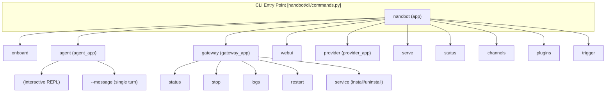
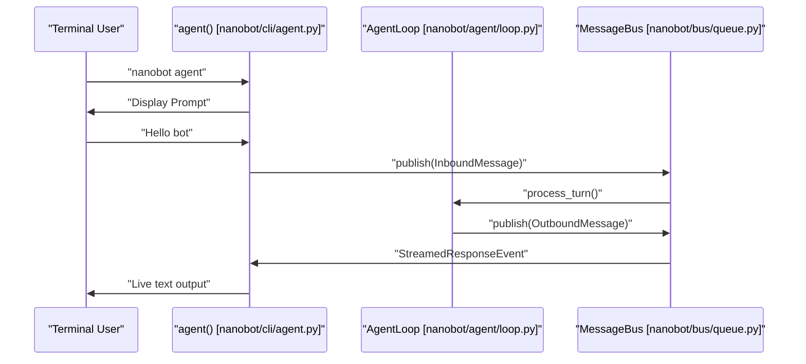
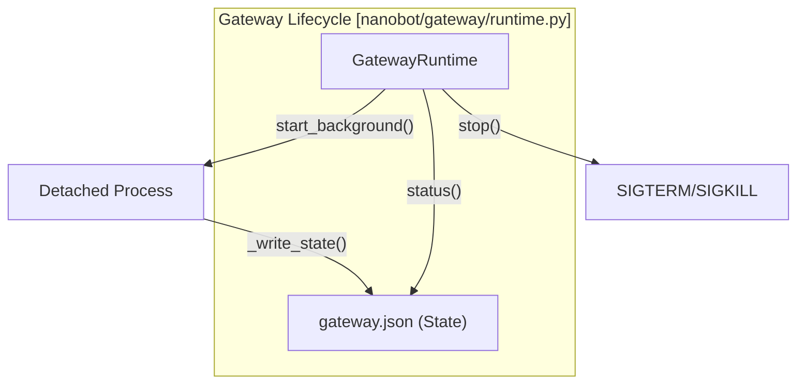

<!-- source: DeepWiki mcp.deepwiki.com · repo HKUDS/nanobot · page 9 CLI Reference · fetched 2026-10-26 -->

# CLI Reference

<details>
<summary>Relevant source files</summary>

The following files were used as context for generating this wiki page:

- [README.md](README.md)
- [docs/configuration.md](docs/configuration.md)
- [docs/providers.md](docs/providers.md)
- [nanobot/agent/loop.py](nanobot/agent/loop.py)
- [nanobot/cli/commands.py](nanobot/cli/commands.py)
- [nanobot/cli/desktop_target.py](nanobot/cli/desktop_target.py)
- [nanobot/cli/desktop_tui.py](nanobot/cli/desktop_tui.py)
- [nanobot/cli/entry.py](nanobot/cli/entry.py)
- [nanobot/cli/webui.py](nanobot/cli/webui.py)
- [nanobot/cli/webui_support.py](nanobot/cli/webui_support.py)
- [nanobot/cli/windows_browser.py](nanobot/cli/windows_browser.py)
- [nanobot/config/schema.py](nanobot/config/schema.py)
- [nanobot/providers/registry.py](nanobot/providers/registry.py)
- [nanobot/webui/gateway_endpoint.py](nanobot/webui/gateway_endpoint.py)
- [tests/cli/test_browser_launch.py](tests/cli/test_browser_launch.py)
- [tests/cli/test_commands.py](tests/cli/test_commands.py)
- [tests/cli/test_desktop_target.py](tests/cli/test_desktop_target.py)
- [tests/cli/test_desktop_target_entrypoints.py](tests/cli/test_desktop_target_entrypoints.py)
- [tests/cli/test_desktop_target_windows.py](tests/cli/test_desktop_target_windows.py)
- [tests/cli/test_desktop_tui.py](tests/cli/test_desktop_tui.py)
- [tests/cli/test_entry.py](tests/cli/test_entry.py)
- [tests/cli/test_webui_support.py](tests/cli/test_webui_support.py)
- [tests/cli/test_windows_browser.py](tests/cli/test_windows_browser.py)

</details>


This page is a complete reference for all `nanobot` command-line commands and their flags. It covers invocation syntax, flag descriptions, and behavioral notes for each command. For background on the runtime systems those commands launch — the Gateway, AgentLoop, CronService, HeartbeatService — see [Architecture](#3) and [Automation & Scheduling](#10). For configuration options consumed at startup, see [Configuration](#8).

---

## Overview

The CLI is implemented as a [Typer](https://typer.tiangolo.com) application in [nanobot/cli/commands.py:86-91](), with sub-applications for the `gateway`, `agent`, and `provider` command groups [nanobot/cli/commands.py:55-60]().

**Command structure:**



**Sources:** [nanobot/cli/commands.py:51-91](), [nanobot/cli/gateway.py:59-63]()

---

## Global Flags

| Flag | Short | Description |
|------|-------|-------------|
| `--version` | `-v` | Print the version string and exit |
| `--help` | `-h` | Print help for any command |

The `--version` flag triggers an eager exit showing the current version via `version_callback` [nanobot/cli/commands.py:101-104](). Global configuration overrides for `--config` and `--workspace` are supported across most subcommands to enable multi-instance support [nanobot/cli/commands.py:139-140]().

**Sources:** [nanobot/cli/commands.py:101-104](), [nanobot/cli/commands.py:139-140]()

---

## `nanobot onboard`

**Purpose:** Initialize the nanobot configuration file and workspace directory for first-time setup.

```bash
nanobot onboard [OPTIONS]
```

| Flag | Short | Type | Default | Description |
|------|-------|------|---------|-------------|
| `--wizard` | | `bool` | `False` | Launch the interactive configuration wizard |
| `--refresh` | | `bool` | `False` | Backfill missing default fields without prompting |
| `--config` | `-c` | `str` | `None` | Explicit path to save the config file |
| `--workspace`| `-w` | `str` | `None` | Explicit path for the workspace directory |

**Behavior:**
1. Checks whether `config.json` already exists at the target path using `get_config_path` [nanobot/cli/commands.py:145-154]().
2. If it exists and `--wizard` is not used, it prompts to **overwrite** (resets to defaults) or **refresh** (preserves existing keys, backfills missing fields) [nanobot/cli/commands.py:158-179]().
3. Creates the workspace and initializes standard templates using `sync_workspace_templates` [nanobot/cli/commands.py:70-71]().

For details on the interactive flow, see [Getting Started](#2).

**Sources:** [nanobot/cli/commands.py:137-195](), [nanobot/cli/commands.py:70-71]()

---

## `nanobot agent`

**Purpose:** Interact with the agent from the terminal. Operates in either single-message mode or persistent interactive mode.

```bash
nanobot agent [OPTIONS]
```

| Flag | Short | Type | Default | Description |
|------|-------|------|---------|-------------|
| `--message` | `-m` | `str` | `None` | Send a single message and print the response, then exit |
| `--session` | `-s` | `str` | `cli:direct` | Session key in `channel:chat_id` format |
| `--no-markdown` | | `bool` | `False` | Print plain text instead of Rich-rendered Markdown |
| `--config` | `-c` | `str` | `None` | Path to config file |
| `--workspace` | `-w` | `str` | `None` | Workspace directory |

### Interactive mode
When `--message` is omitted, an interactive REPL starts. Input is handled by a `PromptSession` with persistent history managed by `SafeFileHistory` [nanobot/cli/commands.py:74]().

**Visualizing the Interactive REPL Loop:**



For more details, see [Desktop & Entry Points](#9.2).

**Sources:** [nanobot/cli/commands.py:55](), [nanobot/cli/agent.py:1-50](), [nanobot/agent/loop.py:124-150](), [nanobot/cli/commands.py:74]()

---

## `nanobot status`

**Purpose:** Display the current configuration, active model, and gateway status.

```bash
nanobot status [OPTIONS]
```

| Flag | Short | Type | Default | Description |
|------|-------|------|---------|-------------|
| `--config` | `-c` | `str` | `None` | Path to config file |
| `--workspace` | `-w` | `str` | `None` | Workspace directory |

This command loads the configuration and prints details about the active model preset, provider, and any running gateway instance. It uses `_load_inspection_config` to safely load the configuration for display [nanobot/cli/commands.py:53]().

**Sources:** [nanobot/cli/commands.py:53]()

---

## `nanobot channels`

**Purpose:** Manage and inspect communication channels.

```bash
nanobot channels [OPTIONS]
```

| Flag | Short | Type | Default | Description |
|------|-------|------|---------|-------------|
| `--config` | `-c` | `str` | `None` | Path to config file |
| `--workspace` | `-w` | `str` | `None` | Workspace directory |

This command group provides subcommands to interact with configured channels. For example, `nanobot channels status` would show the status of all configured channels.

**Sources:** [nanobot/cli/commands.py:55]()

---

## `nanobot provider`

**Purpose:** Manage model provider logins and authentication.

```bash
nanobot provider [OPTIONS]
```

| Flag | Short | Type | Default | Description |
|------|-------|------|---------|-------------|
| `--config` | `-c` | `str` | `None` | Path to config file |
| `--workspace` | `-w` | `str` | `None` | Workspace directory |

### `nanobot provider login`
Used for OAuth-based providers like OpenAI Codex or GitHub Copilot. It initiates the device flow and persists tokens to the local configuration.

**Sources:** [nanobot/cli/provider.py:1-40](), [nanobot/cli/commands.py:51]()

---

## `nanobot serve`

**Purpose:** Start an OpenAI-compatible API server.

```bash
nanobot serve [OPTIONS]
```

| Flag | Short | Type | Default | Description |
|------|-------|------|---------|-------------|
| `--port` | `-p` | `int` | `8000` | Port to run the API server on |
| `--host` | | `str` | `127.0.0.1` | Host address to bind the server to |
| `--config` | `-c` | `str` | `None` | Path to config file |
| `--workspace` | `-w` | `str` | `None` | Workspace directory |

This command exposes the `AgentLoop` via a FastAPI server, supporting standard chat completion endpoints. For more details, see [OpenAI-Compatible API Server](#16).

**Sources:** [nanobot/cli/commands.py:55](), [nanobot/cli/gateway_runtime.py:44]()

---

## `nanobot plugins`

**Purpose:** Manage and inspect installed plugins.

```bash
nanobot plugins [OPTIONS]
```

| Flag | Short | Type | Default | Description |
|------|-------|------|---------|-------------|
| `--config` | `-c` | `str` | `None` | Path to config file |
| `--workspace` | `-w` | `str` | `None` | Workspace directory |

This command group provides subcommands for listing, installing, and managing nanobot plugins.

**Sources:** [nanobot/cli/commands.py:55]()

---

## `nanobot webui`

**Purpose:** Prepares local settings, starts the gateway, and opens the browser workbench.

```bash
nanobot webui [OPTIONS]
```

| Flag | Short | Type | Default | Description |
|------|-------|------|---------|-------------|
| `--background` | | `bool` | `False` | Start or reuse a background gateway (deprecated) |
| `--no-open` | | `bool` | `False` | Start without opening a browser |
| `--port` | `-p` | `int` | `None` | Set the WebUI/WebSocket port |
| `--gateway-port` | | `int` | `None` | Gateway health port (defaults to `config.gateway.port`) |
| `--dev` | | `bool` | `False` | Run the Vite development server with live frontend updates |
| `--yes` | `-y` | `bool` | `False` | Apply safe local WebUI defaults without prompting |
| `--config` | `-c` | `str` | `None` | Path to config file |
| `--workspace` | `-w` | `str` | `None` | Workspace directory |

The command ensures the WebUI bundle is prepared via `_prepare_webui_bundle_for_gateway` before starting the gateway [nanobot/cli/webui_support.py:49](). The `--background` flag is deprecated, and users are advised to start the gateway explicitly with `nanobot gateway --background` [nanobot/cli/webui.py:111-126]().

For more details, see [Desktop & Entry Points](#9.2) and [WebUI](#14).

**Sources:** [nanobot/cli/webui.py:1-50](), [nanobot/cli/webui_support.py:49](), [nanobot/cli/webui.py:111-126]()

---

## `nanobot gateway`

**Purpose:** Start the full nanobot runtime — enabled chat channels, `AgentLoop`, `CronService`, and `HeartbeatService`.

```bash
nanobot gateway [OPTIONS]
```

| Flag | Short | Type | Default | Description |
|------|-------|------|---------|-------------|
| `--port` | `-p` | `int` | `18790` | Gateway health endpoint port |
| `--verbose` | `-v` | `bool` | `False` | Enable verbose runtime output |
| `--background` | | `bool` | `False` | Start as a background process |
| `--foreground` | | `bool` | `False` | Run in the foreground (default) |
| `--config` | `-c` | `str` | `None` | Path to config file |
| `--workspace` | `-w` | `str` | `None` | Workspace directory |

### Lifecycle Management
The gateway can be managed as a background process via `GatewayRuntime`, which tracks PIDs and ports in `gateway.json` [nanobot/gateway/runtime.py:112-120](). It installs signal handlers for graceful shutdown via `_install_gateway_shutdown_handlers` [nanobot/cli/gateway_runtime.py:83-88]().



**Sources:** [nanobot/cli/gateway.py:152-162](), [nanobot/gateway/runtime.py:173-204](), [nanobot/cli/gateway_runtime.py:83-130]()

---

## `nanobot trigger`

**Purpose:** Deliver a local trigger to a running nanobot agent.

```bash
nanobot trigger [OPTIONS] <TRIGGER_ID>
```

| Argument | Type | Description |
|----------|------|-------------|
| `TRIGGER_ID` | `str` | The ID of the trigger to deliver |

| Flag | Short | Type | Default | Description |
|------|-------|------|---------|-------------|
| `--config` | `-c` | `str` | `None` | Path to config file |
| `--workspace` | `-w` | `str` | `None` | Workspace directory |
| `--message` | `-m` | `str` | `None` | Message content for the trigger |
| `--session` | `-s` | `str` | `cli:direct` | Session key in `channel:chat_id` format |

This command allows external systems or scripts to send messages to a nanobot agent, simulating an inbound message for automation purposes. For more details, see [Local Triggers](#10.3).

**Sources:** [nanobot/cli/commands.py:55]()

---

## Slash Commands

The `AgentLoop` includes a `CommandRouter` that intercepts messages starting with `/`. These commands bypass LLM processing for direct control.

| Command | Description |
|---------|-------------|
| `/stop` | Stop the current task |
| `/restart` | Restart the bot |
| `/new` | Start a new conversation |
| `/dream` | Run Dream memory consolidation now |
| `/trigger` | Create a named local trigger |
| `/compact` | Compact the current session's history |
| `/model` | Switch the active model preset |
| `/goal` | Set a long-term goal for the agent |

For details on command behavior, see [Command Router & Built-in Commands](#9.1).

**Sources:** [nanobot/agent/loop.py:50](), [nanobot/command/__init__.py:1-6]()

---

