# Page: Overview

# Overview

<details>
<summary>Relevant source files</summary>

The following files were used as context for generating this wiki page:

- [CONTRIBUTING.md](CONTRIBUTING.md)
- [README.md](README.md)
- [docs/README.md](docs/README.md)
- [docs/chat-commands.md](docs/chat-commands.md)
- [docs/concepts.md](docs/concepts.md)
- [docs/configuration.md](docs/configuration.md)
- [docs/multiple-instances.md](docs/multiple-instances.md)
- [docs/providers.md](docs/providers.md)
- [docs/quick-start.md](docs/quick-start.md)
- [docs/releasing.md](docs/releasing.md)
- [docs/start-without-technical-background.md](docs/start-without-technical-background.md)
- [docs/troubleshooting.md](docs/troubleshooting.md)
- [docs/webui.md](docs/webui.md)
- [nanobot/__init__.py](nanobot/__init__.py)
- [nanobot/agent/loop.py](nanobot/agent/loop.py)
- [nanobot/cli/commands.py](nanobot/cli/commands.py)
- [nanobot/cli/onboard.py](nanobot/cli/onboard.py)
- [nanobot/config/schema.py](nanobot/config/schema.py)
- [nanobot/providers/registry.py](nanobot/providers/registry.py)
- [pyproject.toml](pyproject.toml)
- [scripts/build_tui_wheels.py](scripts/build_tui_wheels.py)
- [tests/agent/test_onboard_logic.py](tests/agent/test_onboard_logic.py)
- [tests/cli/test_commands.py](tests/cli/test_commands.py)
- [tests/cli/test_tui_wheels.py](tests/cli/test_tui_wheels.py)
- [tui/scripts/build.ts](tui/scripts/build.ts)

</details>


## Purpose and Scope

This document provides a comprehensive technical introduction to **nanobot**, an open-source, ultra-lightweight personal AI agent framework written in Python designed for complete user ownership [README.md:37-37](). It covers the system's design philosophy, high-level architecture, core functional layers, and end-to-end event and data flow patterns. nanobot is built to maintain a small, readable core while supporting rich capabilities including a React-based WebUI [docs/webui.md:5-8](), 25+ communication channels [README.md:56-56](), Model Context Protocol (MCP) integrations [README.md:57-57](), automated memory consolidation (`Dream`) [nanobot/config/schema.py:53-68](), and an OpenAI-compatible API server [README.md:37-37]().

Sources: [README.md:37-70](), [pyproject.toml:1-12](), [nanobot/config/schema.py:23-68]()

## System Description

nanobot operates as a self-hosted personal AI agent runtime. Its design philosophy prioritizes local control, transparency, and extensibility without heavyweight platform lock-in [README.md:65-69](). 

The system architecture is organized into distinct modular subsystems:

1. **Gateway & Process Runtime** — Manages process supervision, daemon lifecycles, and multi-instance workspace isolation [docs/configuration.md:69-69]().
2. **Message Bus & Event Routing** — An asynchronous publish-subscribe event routing core (`MessageBus`) using `InboundMessage` and `OutboundMessage` events [nanobot/agent/loop.py:45-51]().
3. **Agent Loop & Execution Engine** — The core `AgentLoop` coordinates iterative turn execution, tool resolution, step constraints (`max_tool_iterations`), and state persistence [nanobot/agent/loop.py:118-183](), [nanobot/config/schema.py:129-131]().
4. **Provider Abstraction Layer** — Unified LLM integration supporting OpenAI, Anthropic, Azure OpenAI, Bedrock, and local models via a centralized registry (`PROVIDERS`) [nanobot/providers/registry.py:2-10]().
5. **Memory & Context Governance** — Atomic JSONL session persistence, dynamic context building (`ContextBuilder`), and background memory consolidation (`DreamConfig`) [nanobot/agent/loop.py:26-29](), [nanobot/config/schema.py:53-68]().
6. **Capabilities & Tool Registry** — Built-in filesystem, shell, web search, MCP servers, and subagent orchestration [README.md:57-57](), [nanobot/agent/tools/registry.py:1-44]().

Sources: [README.md:37-70](), [nanobot/agent/loop.py:23-51](), [nanobot/providers/registry.py:1-11](), [nanobot/config/schema.py:23-68]()

## Core Architecture

The following diagram bridges natural language functional concepts to concrete code entities within the nanobot codebase:

Title: Architecture Mapping (Natural Language to Code Entity Space)
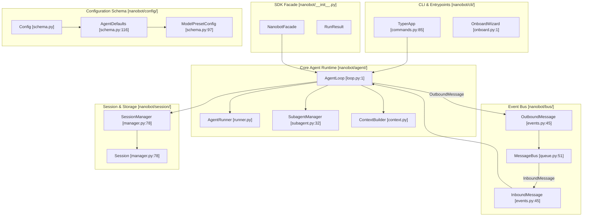
Sources: [nanobot/cli/commands.py:85-130](), [nanobot/agent/loop.py:1-51](), [nanobot/bus/queue.py:51-51](), [nanobot/config/schema.py:97-128](), [nanobot/session/manager.py:78-78]()

## Key Components

| Component | Code Location | Description |
| :--- | :--- | :--- |
| **Agent Defaults** | `nanobot/config/schema.py` | Pydantic model (`AgentDefaults`) defining `workspace`, `model`, `temperature`, and `max_tool_iterations`. [nanobot/config/schema.py:116-168]() |
| **Agent Loop** | `nanobot/agent/loop.py` | Core processing engine (`AgentLoop`) managing conversation turns, execution iterations, and tool dispatch. [nanobot/agent/loop.py:1-183]() |
| **Config Schema** | `nanobot/config/schema.py` | Defines Pydantic configuration schemas for agents, providers, channels, and security settings. [nanobot/config/schema.py:1-168]() |
| **Python SDK Facade** | `nanobot/__init__.py` | Provides programmatic embedding interface (`Nanobot` class and `RunResult`). [nanobot/__init__.py:31-83]() |
| **CLI Commands** | `nanobot/cli/commands.py` | Typer-based entry points for CLI commands (`onboard`, `gateway`, `agent`, `webui`). [nanobot/cli/commands.py:85-171]() |
| **Subagent Manager** | `nanobot/agent/subagent.py` | Handles concurrent execution and task delegation to isolated subagent instances. [nanobot/agent/subagent.py:32-32]() |

Sources: [nanobot/config/schema.py:116-168](), [nanobot/agent/loop.py:1-183](), [nanobot/__init__.py:31-83](), [nanobot/cli/commands.py:85-171](), [nanobot/agent/subagent.py:32-32]()

## Message Processing Flow

The following sequence diagram illustrates how an inbound event flows from a communication channel or API client through the message bus, agent loop, session manager, and LLM provider back to the output sink, referencing concrete codebase symbols.

Title: Data Flow Sequence (Channel to Agent Loop & Provider)
```mermaid
sequenceDiagram
    participant User as "User / Channel"
    participant Bus as "MessageBus [queue.py]"
    participant Loop as "AgentLoop [loop.py]"
    participant Session as "SessionManager [manager.py]"
    participant Provider as "LLMProvider [base.py]"

    User->>Bus: "publish(InboundMessage)"
    Bus->>Loop: "process_turn(InboundMessage)"
    Loop->>Session: "get_or_create_session(session_key)"
    
    loop Agent Iteration (max_tool_iterations: 200)
        Loop->>Loop: "ContextBuilder.build()"
        Loop->>Provider: "generate_response(messages)"
        alt Tool Call Detected
            Loop-->>Loop: "ToolRegistry.execute()"
        else Final Response
            Loop-->>Loop: "finalize_content()"
        end
    end

    Loop->>Session: "save_session()"
    Loop->>Bus: "publish_outbound(OutboundMessage)"
    Bus->>User: "Deliver OutboundMessage"
```
Sources: [nanobot/bus/queue.py:51-51](), [nanobot/agent/loop.py:45-183](), [nanobot/session/manager.py:78-78](), [nanobot/providers/base.py:57-57]()

## Technology Stack

nanobot is constructed with a modular, lightweight Python toolchain:

| Technology | Purpose | File Reference |
| :--- | :--- | :--- |
| **Python 3.11+** | Core execution runtime | [pyproject.toml:6-6]() |
| **Pydantic / Settings** | Schema validation and configuration management | [pyproject.toml:28-29]() |
| **Anthropic / OpenAI SDKs** | Native API client libraries | [pyproject.toml:27-47]() |
| **Typer / Prompt Toolkit** | Command-line interface and interactive REPL | [pyproject.toml:26-41]() |
| **Model Context Protocol (MCP)** | Extensible external tool integration | [pyproject.toml:44-44]() |
| **Hatchling** | Packaging, build backend, and wheel construction | [pyproject.toml:119-122]() |
| **Loguru** | Structured logging framework | [nanobot/cli/commands.py:25-31]() |

Sources: [pyproject.toml:1-122](), [nanobot/cli/commands.py:25-31]()

## Workspace & Configuration

The agent maintains local execution state within a designated workspace directory (defaulting to `~/.nanobot/workspace`) [nanobot/config/schema.py:119-120]().

### Configuration (`config.json`)
Configuration parameters are managed through typed Pydantic models in `nanobot/config/schema.py`:
* **`AgentDefaults`**: Governs core agent settings such as `model`, `provider`, `temperature`, and auto-compaction intervals (`session_ttl_minutes`) [nanobot/config/schema.py:116-168]().
* **`ChannelsConfig`**: Controls messaging platform behaviors, progress streaming (`send_progress`), and tool hint displays (`send_tool_hints`) [nanobot/config/schema.py:23-40]().
* **`DreamConfig`**: Configures periodic memory consolidation schedules (`interval_h`) [nanobot/config/schema.py:53-68]().
* **`TranscriptionConfig`**: Manages voice-to-text audio processing settings [nanobot/config/schema.py:42-51]().

### Workspace Files
* **`MEMORY.md`**: Long-term consolidated facts produced by background dream jobs [README.md:58-58]().
* **`HISTORY.md`**: Event-based transactional conversation logs [README.md:58-58]().
* **`SOUL.md`**: Core agent persona and operational instructions.
* **`USER.md`**: User preferences and contextual metadata.

Sources: [nanobot/config/schema.py:23-168](), [README.md:57-60]()

---

# Page: Getting Started

# Getting Started

<details>
<summary>Relevant source files</summary>

The following files were used as context for generating this wiki page:

- [docs/README.md](docs/README.md)
- [docs/chat-commands.md](docs/chat-commands.md)
- [docs/concepts.md](docs/concepts.md)
- [docs/multiple-instances.md](docs/multiple-instances.md)
- [docs/quick-start.md](docs/quick-start.md)
- [docs/start-without-technical-background.md](docs/start-without-technical-background.md)
- [docs/troubleshooting.md](docs/troubleshooting.md)
- [docs/webui.md](docs/webui.md)
- [nanobot/cli/onboard.py](nanobot/cli/onboard.py)
- [tests/agent/test_onboard_logic.py](tests/agent/test_onboard_logic.py)

</details>


This page provides a high-level overview of setting up, initializing, and running nanobot for the first time. It introduces initial installation paths, configuration schemas, workspace bootstrapping, and first-run agent interactions. 

For detailed technical instructions, see the child pages:
- [Installation & Configuration](#2.1) — Detail the installation process via pip/uv, `config.json` structure, and the onboard wizard flow
- [First Run & Interactive Mode](#2.2) — Walk through running nanobot agent for the first time, using the CLI REPL, and understanding the `ThinkingSpinner` and tool hints

---

## Installation & Configuration Overview

nanobot requires Python ≥3.11 and supports multiple installation methods across operating systems [nanobot/cli/commands.py:12-21](), [docs/start-without-technical-background.md:7-10](). The setup process initializes a configuration file (`config.json`) and a managed workspace directory [nanobot/cli/commands.py:121-131](), [nanobot/config/schema.py:116-166]().

Title: Onboard Command & Configuration Flow
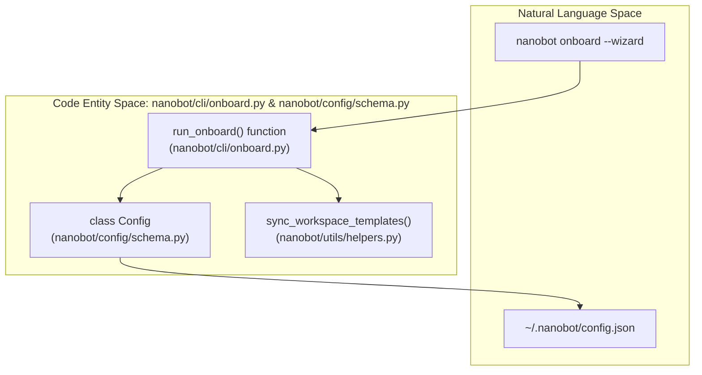

The interactive onboarding questionnaire is handled by `run_onboard()` [nanobot/cli/onboard.py:22-23]() and populates the `Config` Pydantic model defined in `nanobot/config/schema.py` [nanobot/config/schema.py:7-10](). Workspace bootstrap templates are synchronized via `sync_workspace_templates` [tests/agent/test_onboard_logic.py:26-26]().

For detailed installation steps via pip, uv, or source, and full structure of `config.json`, see [Installation & Configuration](#2.1).

**Sources:** [nanobot/cli/onboard.py:22-23](), [nanobot/config/schema.py:7-10](), [nanobot/cli/commands.py:121-131](), [tests/agent/test_onboard_logic.py:26-26]()

---

## First Run & Interactive Mode

Once configured, nanobot can be executed via the WebUI workbench or the terminal-based CLI REPL [README.md:15-23](), [docs/quick-start.md:101-120](). The command router bridges user commands directly into the core execution engine [nanobot/cli/commands.py:51-60]().

Title: CLI Execution & Agent Interaction Flow
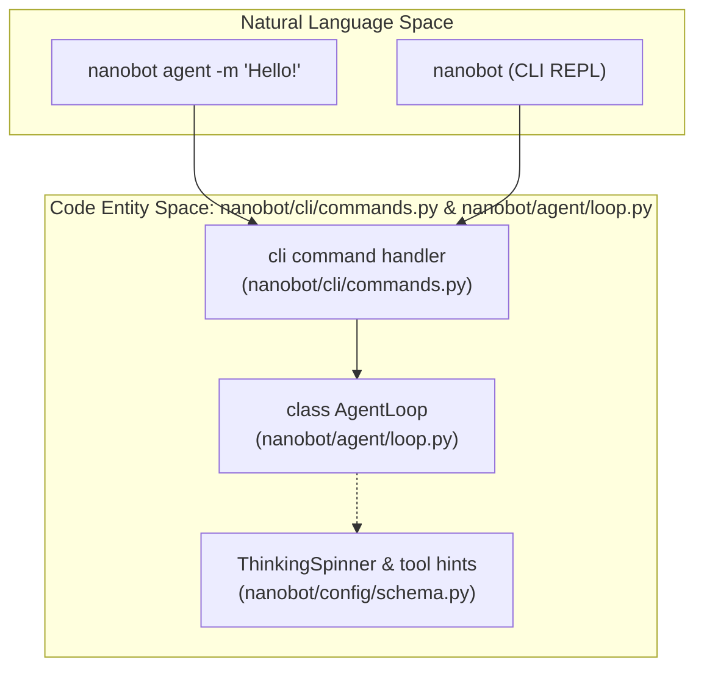

The `AgentLoop` class orchestrates turn execution, while runtime visual feedback such as the `ThinkingSpinner` and real-time tool hints are configured through `nanobot/config/schema.py` [nanobot/agent/loop.py:51-51](), [nanobot/config/schema.py:134-146]().

For a complete walkthrough of running the agent for the first time, using the CLI REPL, and understanding tool execution hints, see [First Run & Interactive Mode](#2.2).

**Sources:** [nanobot/cli/commands.py:51-60](), [nanobot/agent/loop.py:51-51](), [nanobot/config/schema.py:134-146]()

---

## Next Steps

- For deep-dive installation methods, environment variables, and config schemas, proceed to [Installation & Configuration](#2.1).
- For interactive terminal usage, command shortcuts, and spinner settings, proceed to [First Run & Interactive Mode](#2.2).
- For overall system layout and component design, see [Architecture](#3).

**Sources:** [README.md:41-50](), [docs/quick-start.md:121-135]()

---

# Page: Installation & Configuration

# Installation & Configuration

<details>
<summary>Relevant source files</summary>

The following files were used as context for generating this wiki page:

- [CONTRIBUTING.md](CONTRIBUTING.md)
- [docs/README.md](docs/README.md)
- [docs/chat-commands.md](docs/chat-commands.md)
- [docs/concepts.md](docs/concepts.md)
- [docs/multiple-instances.md](docs/multiple-instances.md)
- [docs/quick-start.md](docs/quick-start.md)
- [docs/releasing.md](docs/releasing.md)
- [docs/start-without-technical-background.md](docs/start-without-technical-background.md)
- [docs/troubleshooting.md](docs/troubleshooting.md)
- [docs/webui.md](docs/webui.md)
- [nanobot/__init__.py](nanobot/__init__.py)
- [nanobot/channels/registry.py](nanobot/channels/registry.py)
- [nanobot/cli/onboard.py](nanobot/cli/onboard.py)
- [nanobot/config/loader.py](nanobot/config/loader.py)
- [pyproject.toml](pyproject.toml)
- [scripts/build_tui_wheels.py](scripts/build_tui_wheels.py)
- [tests/agent/test_onboard_logic.py](tests/agent/test_onboard_logic.py)
- [tests/cli/test_tui_wheels.py](tests/cli/test_tui_wheels.py)
- [tests/config/test_config_migration.py](tests/config/test_config_migration.py)
- [tests/config/test_dream_config.py](tests/config/test_dream_config.py)
- [tests/config/test_env_interpolation.py](tests/config/test_env_interpolation.py)
- [tests/providers/test_openai_compat_timeout.py](tests/providers/test_openai_compat_timeout.py)
- [tests/providers/test_proxy_env.py](tests/providers/test_proxy_env.py)
- [tui/scripts/build.ts](tui/scripts/build.ts)

</details>


This page details the setup process for `nanobot`, covering installation methods via `pip`, `uv`, and bootstrap scripts, the Pydantic-backed `config.json` structure with environment variable interpolation, and the interactive onboarding wizard flow (`run_onboard`) used to initialize agent environments.

## Installation

`nanobot` is a lightweight AI assistant framework requiring **Python ≥ 3.11** `[pyproject.toml:6-6]()`. The package bundles dependencies for multi-platform support (Telegram, Feishu, Matrix, etc.) and LLM provider integrations `[pyproject.toml:25-63]()`.

### One-Command Installer
The recommended setup path on macOS, Linux, or Windows uses the one-command installer script, which provisions a managed virtual environment and starts the onboarding wizard or WebUI automatically `[docs/quick-start.md:17-33]()`.

**macOS / Linux:**
```bash
curl -fsSL https://raw.githubusercontent.com/HKUDS/nanobot/main/scripts/install.sh | sh
```

**Windows PowerShell:**
```powershell
irm https://raw.githubusercontent.com/HKUDS/nanobot/main/scripts/install.ps1 | iex
```

### Manual Installation
Stable releases can be installed from PyPI using `pip` or `uv` `[docs/quick-start.md:140-154]()`.

**Via uv (Recommended):**
```bash
uv tool install nanobot-ai
```

**Via pip:**
```bash
python -m pip install nanobot-ai
```

Sources: `[pyproject.toml:6-6]()`, `[pyproject.toml:25-63]()`, `[docs/quick-start.md:17-33]`, `[docs/quick-start.md:140-154]()`

## Configuration Structure

System configuration is stored in `config.json`, defaulting to `~/.nanobot/config.json` `[nanobot/config/loader.py:35-39]()`. Configuration parsing and validation are governed by Pydantic models rooted in the `Config` class `[nanobot/config/loader.py:124-124]()`.

### Core Configuration Sections

| Section | Description |
| :--- | :--- |
| `providers` | Credentials and endpoints for LLM services (e.g., `apiKey`, `apiBase`) `[docs/configuration.md:85-87]()`. |
| `modelPresets` | Named configurations pairing a provider with a specific model and parameters (e.g., `temperature`, `maxTokens`) `[docs/providers.md:37-45]()`. |
| `agents` | Defines default settings like the active `modelPreset`, `workspace` path, and fallback models `[docs/configuration.md:58-59]()`. |
| `channels` | Settings for communication platforms (Telegram, WebSocket/WebUI, etc.) `[docs/configuration.md:78-84]()`. |
| `tools` | Configuration for external capabilities, including `web` search, `mcpServers`, and security constraints like workspace restrictions `[docs/configuration.md:64-67]()`. |

### Environment Variable Interpolation
Secrets and configuration values support `${VAR_NAME}` syntax `[docs/configuration.md:72-83]()`. These references are resolved in-memory at startup by `resolve_config_env_vars()` `[nanobot/config/loader.py:196-214]()`, which matches patterns using `_ENV_REF_PATTERN` against `os.environ` `[nanobot/config/loader.py:193-193]()`. Resolved secrets are never written back to disk during serialization `[nanobot/config/loader.py:157-172]()`.

### Configuration Data Flow
The following diagram illustrates how the `Config` object is instantiated, migrated, and used to resolve runtime paths and security policies.

**Figure 1: Configuration to Code Entity Mapping**
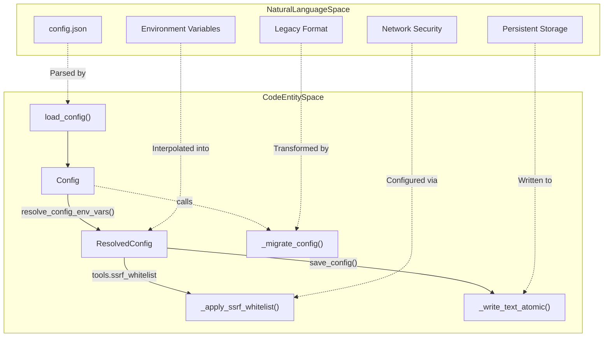
Sources: `[nanobot/config/loader.py:42-136]`, `[nanobot/config/loader.py:139-143]`, `[nanobot/config/loader.py:196-214]`, `[docs/configuration.md:72-87]`

## The Onboard Wizard

The `nanobot onboard --wizard` command invokes an interactive terminal questionnaire powered by the `questionary` library `[nanobot/cli/onboard.py:131-138]()` to initialize or refresh the configuration file `[docs/quick-start.md:60-64]()`.

### Execution Flow
1. **Quick Start vs. Advanced**: Users select between a streamlined `[Q] Quick Start` flow or granular component configuration categories `[nanobot/cli/onboard.py:92-93]()`.
2. **Provider Selection**: The wizard presents available LLM provider definitions and model suggestions `[nanobot/cli/onboard.py:28-32]()`.
3. **Migration & Merging**: When an existing config file is detected, `merge_missing_defaults()` backfills omitted fields without overwriting active user customizations `[nanobot/config/loader.py:177-191]()`.
4. **Validation**: Field inputs are dynamically checked against expected Pydantic field types (e.g., `int`, `bool`, `Literal`) via `_get_field_type_info()` `[tests/agent/test_onboard_logic.py:114-216]()`.

**Figure 2: Configuration Lifecycle & Onboarding**
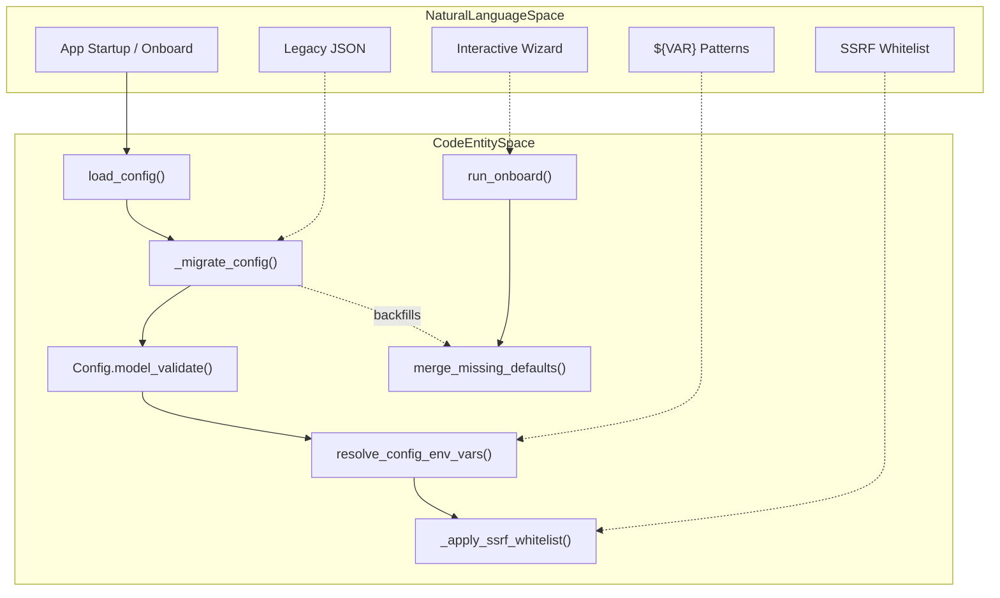
Sources: `[nanobot/config/loader.py:42-136]`, `[nanobot/config/loader.py:177-191]`, `[nanobot/cli/onboard.py:1-138]`, `[tests/agent/test_onboard_logic.py:29-112]`

## Config Migration & Security

`nanobot` handles configuration schema evolution and execution security via dedicated internal utilities:

1. **Legacy Migration**: `_migrate_config()` inspects older schemas and normalizes keys to match current structures `[nanobot/config/loader.py:122-122]()`.
2. **SSRF Protection**: `_apply_ssrf_whitelist()` configures network filtering rules from `tools.ssrf_whitelist` to prevent Server-Side Request Forgery during tool execution `[nanobot/config/loader.py:139-143]()`.
3. **Atomic Writes**: `save_config()` writes configuration updates using `_write_text_atomic()` to guarantee that disk corruption or process crashes mid-write never result in a truncated `config.json` `[nanobot/config/loader.py:173-174]()`.

### Configuration Field Mapping
| Code Symbol | Config Key (CamelCase) | Purpose |
| :--- | :--- | :--- |
| `AgentDefaults.workspace` | `workspace` | Root directory for agent workspace files `[docs/concepts.md:29-29]()`. |
| `AgentDefaults.model_preset` | `modelPreset` | Active named model configuration preset `[docs/providers.md:13-13]()`. |
| `Config.tools.ssrf_whitelist` | `ssrfWhitelist` | Permitted IP ranges and domains for network tools `[nanobot/config/loader.py:143-143]()`. |
| `TranscriptionConfig.enabled` | `enabled` | Controls cross-channel audio transcription features `[docs/configuration.md:63-63]()`. |
| `GatewayHeartbeatConfig.interval_s` | `intervalS` | Polling interval in seconds between heartbeat evaluations `[docs/chat-commands.md:148-148]()`. |

Sources: `[nanobot/config/loader.py:122-143]`, `[nanobot/config/schema.py:1-210]`, `[docs/configuration.md:52-70]`

---

# Page: First Run & Interactive Mode

# First Run & Interactive Mode

<details>
<summary>Relevant source files</summary>

The following files were used as context for generating this wiki page:

- [nanobot/channels/feishu/tests/test_feishu_reaction.py](nanobot/channels/feishu/tests/test_feishu_reaction.py)
- [nanobot/cli/stream.py](nanobot/cli/stream.py)
- [nanobot/utils/tool_hints.py](nanobot/utils/tool_hints.py)
- [nanobot/webui/version_check.py](nanobot/webui/version_check.py)
- [tests/agent/test_tool_hint.py](tests/agent/test_tool_hint.py)
- [tests/cli/test_cli_input.py](tests/cli/test_cli_input.py)
- [tests/cli/test_interactive_retry_wait.py](tests/cli/test_interactive_retry_wait.py)
- [tests/cli/test_stream_refresh.py](tests/cli/test_stream_refresh.py)
- [tests/webui/test_forking.py](tests/webui/test_forking.py)

</details>


This page details the initial execution of the nanobot agent, focusing on the Command Line Interface (CLI) REPL (Read-Eval-Print Loop) and the interactive onboarding wizard. It explains how the system handles user input, provides visual feedback through the `ThinkingSpinner` and `StreamRenderer`, and renders agent responses using smart tool hints and reasoning buffers.

## Interactive Onboarding

For users running nanobot for the first time without a pre-existing `config.json`, the system provides an interactive wizard via `nanobot onboard --wizard` [nanobot/cli/onboard.py:622-624]().

### The Wizard Flow
The onboarding process uses the `questionary` library to guide users through configuration [nanobot/cli/onboard.py:131-138]().
1.  **Quick Start**: A streamlined path for common providers (OpenAI, Anthropic, DeepSeek, etc.) that sets up a provider and a WebSocket channel [nanobot/cli/onboard.py:92-93]().
2.  **Navigation**: The wizard supports "Back" navigation using Escape or Left arrow keys, implemented via custom key bindings in `_select_with_back` [nanobot/cli/onboard.py:141-200]().
3.  **Model Suggestions**: It provides intelligent autocomplete for model IDs based on the selected provider [nanobot/cli/onboard.py:31-32]().
4.  **Config Merging**: When refreshing an existing configuration, the `merge_missing_defaults` function ensures new configuration fields are added without overwriting user customizations [tests/agent/test_onboard_logic.py:24-112]().

Sources: [nanobot/cli/onboard.py:31-32](), [nanobot/cli/onboard.py:92-138](), [nanobot/cli/onboard.py:141-200](), [nanobot/cli/onboard.py:622-624](), [tests/agent/test_onboard_logic.py:24-112]()

## Initial Launch & Terminal Setup

When a user executes `nanobot agent`, the system enters an interactive session. This mode is designed for direct communication with the assistant using a terminal-based interface.

### Terminal Initialization
1.  **Encoding**: The system handles surrogate pairs and lone surrogates to prevent `UnicodeEncodeError` during serialization, which is critical for Windows console input [nanobot/utils/helpers.py:38-63]().
2.  **Session Creation**: A `PromptSession` from `prompt_toolkit` is initialized with `FileHistory` for persistent command history [tests/cli/test_cli_input.py:44-65]().
3.  **Key Bindings**: The CLI supports multi-line input where `Enter` submits the buffer and `Alt+Enter` inserts a newline [tests/cli/test_cli_input.py:67-91](). It also handles `CSI-u` Shift+Enter for modern terminals [tests/cli/test_cli_input.py:131-145]().

Sources: [nanobot/utils/helpers.py:38-63](), [tests/cli/test_cli_input.py:44-91](), [tests/cli/test_cli_input.py:131-145]()

## The Interactive REPL Loop

The core of the interactive mode is an asynchronous loop that waits for user input and dispatches it to the agent.

### UI Feedback Components
During processing, nanobot uses specialized classes to communicate state:

| Component | Class | Role |
| :--- | :--- | :--- |
| **Thinking Spinner** | `ThinkingSpinner` | Displays `<bot_name> is thinking...` with an animation using `rich.status` [nanobot/cli/stream.py:50-56](). |
| **Stream Renderer** | `StreamRenderer` | Handles real-time Markdown rendering during token generation [nanobot/cli/stream.py:88-112](). |

### Feedback Synchronization
To prevent garbled output, the `ThinkingSpinner` includes a `pause()` context manager. This allows "Tool Hints" or progress lines to be printed cleanly by stopping the spinner, flushing the line, and restarting the spinner afterward [nanobot/cli/stream.py:70-85]().

Title: REPL Data Flow and Code Entity Association
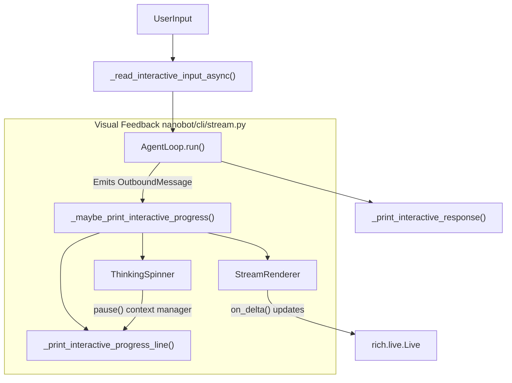

Sources: [nanobot/cli/stream.py:50-85](), [nanobot/cli/stream.py:88-112](), [tests/cli/test_cli_input.py:148-164]()

## Tool Hints System

When an agent calls a tool, `format_tool_hints` generates a concise "hint" to show activity in the terminal [nanobot/utils/tool_hints.py:37-40]().

### Smart Abbreviation & Formatting
Tool hints are mapped via `_TOOL_FORMATS` to provide human-readable summaries [nanobot/utils/tool_hints.py:11-24]():
- **File Operations**: `read_file` becomes `read <path>`, `write_file` becomes `write <path>` [tests/agent/test_tool_hint.py:19-31]().
- **Search**: `grep` shows the pattern as `grep "<pattern>"` [tests/agent/test_tool_hint.py:37-39]().
- **Execution**: `exec` calls are prefixed with `$` and internal paths are folded (e.g., `src/…/main.py`) to save space [nanobot/utils/tool_hints.py:114-129]().
- **MCP Tools**: Formatted as `server::tool` or `server::tool("arg")` [nanobot/utils/tool_hints.py:131-150]().

### Call Folding
Consecutive calls to the same tool with identical arguments are "folded" into a single line with a multiplier (e.g., `read config.json × 2`) [nanobot/utils/tool_hints.py:57-66]().

Sources: [nanobot/utils/tool_hints.py:11-24](), [nanobot/utils/tool_hints.py:37-66](), [nanobot/utils/tool_hints.py:114-150](), [tests/agent/test_tool_hint.py:19-39]()

## Reasoning and Progress Handling

Nanobot handles modern LLM features like internal reasoning and provider retries.

### Reasoning Buffer
For models that provide reasoning deltas, nanobot uses a `_ReasoningBuffer`. It accumulates tokens and only flushes them to the screen when a sentence boundary is reached or the buffer exceeds a character limit [tests/cli/test_interactive_retry_wait.py:77-108](). The `strip_think` utility is also used to ensure well-formed `<think>` blocks are handled correctly before persistence or final rendering [nanobot/utils/helpers.py:168-193]().

### Provider Retries
If a provider request fails and enters a retry cycle, the CLI captures the `RetryWaitEvent` and renders it as a progress line (e.g., "Model request failed, retry in 2s") [tests/cli/test_interactive_retry_wait.py:11-34]().

Title: Reasoning Delivery Flow via _ReasoningBuffer
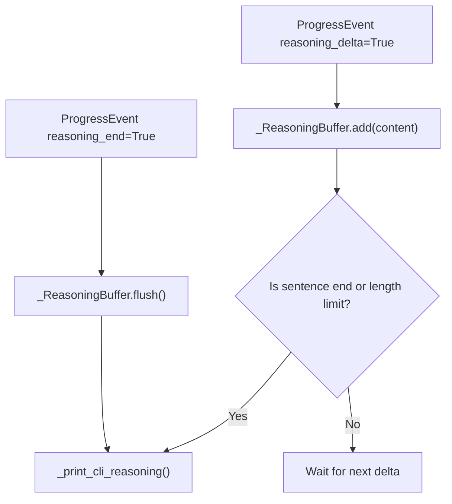

Sources: [nanobot/utils/helpers.py:168-193](), [tests/cli/test_interactive_retry_wait.py:11-34](), [tests/cli/test_interactive_retry_wait.py:77-108]()

## Rendering Responses

### Streaming Mode
`StreamRenderer` manages the transition from the "thinking" state to the final answer:
- **Header**: `ensure_header()` prints the bot's name/icon once before the first token [nanobot/cli/stream.py:152-164]().
- **Live Updates**: Uses `rich.live.Live` with `transient=True` to update the markdown in-place without polluting the terminal scrollback with partial frames [nanobot/cli/stream.py:88-112]().
- **Finalization**: Upon `on_end()`, the transient area is cleared and the complete message is printed as a static block [nanobot/cli/stream.py:88-112]().

Sources: [nanobot/cli/stream.py:88-112](), [nanobot/cli/stream.py:152-164]()

---

# Page: Architecture

# Architecture

<details>
<summary>Relevant source files</summary>

The following files were used as context for generating this wiki page:

- [README.md](README.md)
- [docs/configuration.md](docs/configuration.md)
- [docs/providers.md](docs/providers.md)
- [nanobot/agent/loop.py](nanobot/agent/loop.py)
- [nanobot/channels/websocket/tests/test_websocket_runtime_lifecycle.py](nanobot/channels/websocket/tests/test_websocket_runtime_lifecycle.py)
- [nanobot/cli/commands.py](nanobot/cli/commands.py)
- [nanobot/cli/gateway.py](nanobot/cli/gateway.py)
- [nanobot/cli/gateway_runtime.py](nanobot/cli/gateway_runtime.py)
- [nanobot/config/schema.py](nanobot/config/schema.py)
- [nanobot/gateway/__init__.py](nanobot/gateway/__init__.py)
- [nanobot/gateway/runtime.py](nanobot/gateway/runtime.py)
- [nanobot/process_runtime.py](nanobot/process_runtime.py)
- [nanobot/providers/registry.py](nanobot/providers/registry.py)
- [tests/cli/test_commands.py](tests/cli/test_commands.py)
- [tests/cli/test_gateway_commands.py](tests/cli/test_gateway_commands.py)
- [tests/cli/test_gateway_runtime.py](tests/cli/test_gateway_runtime.py)
- [tests/gateway/test_runtime.py](tests/gateway/test_runtime.py)

</details>


## Purpose and Scope

This page explains the high-level system architecture of nanobot, describing how its major subsystems are organized, how components relate to one another, and how data flows through the framework. 

As a parent page, this document provides a structural overview and high-level summaries of core messaging, multi-instance isolation, and gateway process management. For deep technical details, follow the links to the child pages:
- [Message Bus & Event Flow](#3.1)
- [Multi-Instance Architecture](#3.2)
- [Gateway Runtime & Process Management](#3.3)

---

## System Overview & Architectural Layers

nanobot is designed around a layered asynchronous architecture where communication channels, core agent execution, and tool registries are decoupled via a central message bus [nanobot/bus/queue.py:51]().

| Layer | Purpose | Key Components |
|---|---|---|
| **User Interaction** | Entry points and CLI runtime | `nanobot/cli/commands.py` [nanobot/cli/commands.py:85-96]() |
| **Communication** | Message routing and channel management | `MessageBus` [nanobot/bus/queue.py:51](), `ChannelManager` [nanobot/channels/manager.py:79-87]() |
| **Core Intelligence** | Agent processing, hooks, and context | `AgentLoop` [nanobot/agent/loop.py:118-122](), `ContextBuilder` [nanobot/agent/context.py:26-26]() |
| **LLM Integration** | Provider abstraction and registry | `LLMProvider` [nanobot/providers/base.py:57](), `ProviderSpec` [nanobot/providers/registry.py:35-41]() |
| **Data & State** | Persistence, scheduling, and workspace | `SessionManager` [nanobot/session/manager.py:78-80](), `CronService` [nanobot/cron/service.py]() |

Sources: [nanobot/bus/queue.py:51](), [nanobot/agent/loop.py:118-122](), [nanobot/channels/manager.py:79-87](), [nanobot/providers/registry.py:35-41]()

---

## Component Relationship Map

The diagram below maps natural-language subsystem concepts to their concrete Python classes and module paths across the codebase.

**Diagram: High-level component relationships and module mapping**

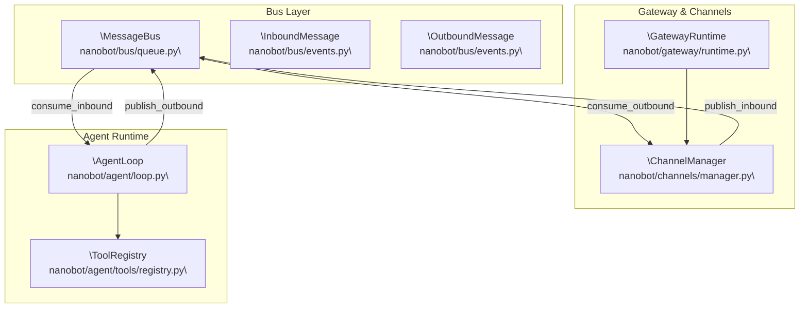

Sources: [nanobot/bus/queue.py:51](), [nanobot/bus/events.py:45-50](), [nanobot/agent/loop.py:118-122](), [nanobot/channels/manager.py:79-87](), [nanobot/gateway/runtime.py:202-205]()

---

## 3.1. Message Bus & Event Flow

The `MessageBus` acts as the central asynchronous nerve center connecting communication channels to the `AgentLoop` [nanobot/bus/queue.py:51](). Inbound messages (`InboundMessage`) are produced by adapters (such as Telegram, Feishu, or WebUI WebSocket) and dispatched to queues [nanobot/bus/events.py:45](). The agent processes turns and emits `OutboundMessage` or streaming delta events (`StreamDeltaEvent`) back through the bus [nanobot/bus/events.py:45](), [nanobot/bus/outbound_events.py:47]().

For detailed coverage of queue structures, routing logic, and event-driven patterns, see [Message Bus & Event Flow](#3.1).

Sources: [nanobot/bus/queue.py:51](), [nanobot/bus/events.py:45-50](), [nanobot/bus/outbound_events.py:47-50]()

---

## 3.2. Multi-Instance Architecture

nanobot supports running multiple isolated bot instances concurrently on the same host. Isolation is achieved by binding separate workspace directories [nanobot/config/schema.py:119-120](), configuration file paths [nanobot/cli/commands.py:148-151](), and listening ports [nanobot/gateway/runtime.py:186-200](). Each instance resolves its own runtime paths via `GatewayInstance` to prevent state collision [nanobot/gateway/runtime.py:153-159]().

For full details on configuring and launching isolated instances, see [Multi-Instance Architecture](#3.2).

Sources: [nanobot/config/schema.py:116-120](), [nanobot/cli/commands.py:145-155](), [nanobot/gateway/runtime.py:153-200]()

---

## 3.3. Gateway Runtime & Process Management

The `gateway` mode supervises long-running background services, unifying channel event processing, cron jobs, and WebUI HTTP/WebSocket connections. Managed via `GatewayRuntime` and `ManagedProcessRuntime`, the daemon controls background process spawning, health monitoring, log rotation, and clean signal shutdown [nanobot/gateway/runtime.py:202-205](), [nanobot/process_runtime.py:81-85]().

For comprehensive documentation on daemon supervision, restart modes, and lifecycle CLI commands, see [Gateway Runtime & Process Management](#3.3).

Sources: [nanobot/gateway/runtime.py:202-205](), [nanobot/process_runtime.py:81-115]()

---

# Page: Message Bus & Event Flow

# Message Bus & Event Flow

<details>
<summary>Relevant source files</summary>

The following files were used as context for generating this wiki page:

- [nanobot/agent/tools/sessions.py](nanobot/agent/tools/sessions.py)
- [nanobot/agent/turn_delivery.py](nanobot/agent/turn_delivery.py)
- [nanobot/bus/events.py](nanobot/bus/events.py)
- [nanobot/bus/outbound_events.py](nanobot/bus/outbound_events.py)
- [nanobot/bus/runtime_events.py](nanobot/bus/runtime_events.py)
- [nanobot/channels/websocket/runtime.py](nanobot/channels/websocket/runtime.py)
- [nanobot/channels/websocket/tests/test_websocket_channel.py](nanobot/channels/websocket/tests/test_websocket_channel.py)
- [nanobot/channels/websocket/tests/test_websocket_envelope_media.py](nanobot/channels/websocket/tests/test_websocket_envelope_media.py)
- [nanobot/session/keys.py](nanobot/session/keys.py)
- [nanobot/session/webui_turns.py](nanobot/session/webui_turns.py)
- [nanobot/webui/session_access.py](nanobot/webui/session_access.py)
- [tests/agent/test_turn_delivery.py](tests/agent/test_turn_delivery.py)
- [tests/agent/tools/test_session_history_pagination.py](tests/agent/tools/test_session_history_pagination.py)
- [tests/agent/tools/test_sessions.py](tests/agent/tools/test_sessions.py)
- [tests/bus/test_runtime_events.py](tests/bus/test_runtime_events.py)
- [tests/utils/test_webui_turn_helpers.py](tests/utils/test_webui_turn_helpers.py)
- [tests/webui/test_session_mentions.py](tests/webui/test_session_mentions.py)
- [webui/src/lib/nanobot-client.ts](webui/src/lib/nanobot-client.ts)
- [webui/src/tests/nanobot-client.test.ts](webui/src/tests/nanobot-client.test.ts)

</details>


**Purpose and Scope**: This document details the message bus architecture and event flow system in nanobot. The message bus (`MessageBus`) is the central async communication backbone that decouples components and enables concurrent message processing. It routes `InboundMessage` and `OutboundMessage` events between channels, the gateway, and the agent loop. It also describes the `RuntimeEventBus` used for in-process state notifications.

---

## Message Bus Overview

The `MessageBus` implements an async producer/consumer pattern using `asyncio.Queue` primitives. It maintains two separate queues: [nanobot/bus/queue.py:16-18]()

| Queue | Direction | Producers | Consumers |
|-------|-----------|-----------|-----------|
| **Inbound Queue** | Channel → Agent | `Gateway`, `BaseChannel` implementations, `SubagentManager` | `AgentLoop` |
| **Outbound Queue** | Agent → Channel | `AgentLoop`, `MessageTool`, `SubagentManager` | `ChannelManager` |

The bus enables:
- **Decoupled Communication**: Components communicate without direct references. [nanobot/bus/queue.py:9-14]()
- **Concurrent Processing**: Multiple messages can be queued while the agent processes. [nanobot/bus/queue.py:17-18]()
- **Async/Await**: Non-blocking operations throughout the stack using `asyncio`. [nanobot/bus/queue.py:1-44]()
- **System Messages**: Internal components can inject messages into the inbound flow (e.g., subagent completions or internal runtime control). [nanobot/bus/queue.py:20-22](), [nanobot/bus/events.py:15-21]()

**Sources**: [nanobot/bus/queue.py:8-44](), [nanobot/bus/events.py:10-21]()

---

## Event Types

### InboundMessage

Represents a message flowing **into** the agent for processing. [nanobot/bus/events.py:24-25]()

Title: "Inbound Message Routing Flow"
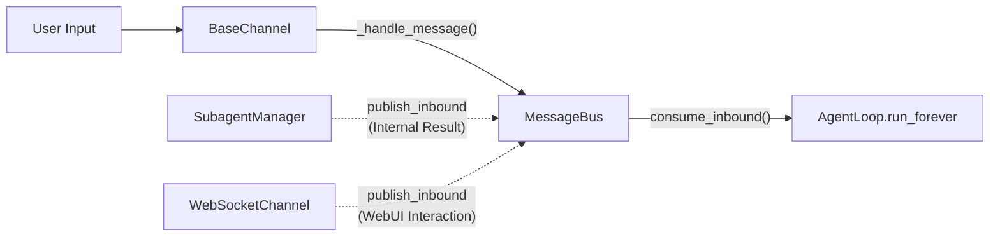

**Key Fields**: [nanobot/bus/events.py:27-37]()

| Field | Type | Description |
|-------|------|-------------|
| `channel` | `str` | Channel identifier (e.g. `"telegram"`, `"discord"`, `"websocket"`) |
| `sender_id` | `str` | User/sender identifier |
| `chat_id` | `str` | Chat/conversation identifier |
| `content` | `str` | Message text content |
| `timestamp` | `datetime` | Arrival time [nanobot/bus/events.py:32]() |
| `media` | `list[str]` | Optional media file paths or URLs |
| `metadata` | `dict` | Channel-specific data |
| `session_key_override` | `str \| None` | Optional override for thread-scoped sessions |
| `require_existing_session` | `bool` | If `True`, message is dropped if no session exists. [nanobot/bus/events.py:36]() |
| `input_role` | `Literal["user", "system"] \| None` | Explicit role for the input message. [nanobot/bus/events.py:37]() |

**Computed Property**:
- `session_key` → `f"{channel}:{chat_id}"` — uniquely identifies a conversation session unless `session_key_override` is provided. [nanobot/bus/events.py:40-43]()
- `is_user_input` → `bool` — indicates if the message should be treated as user input. [nanobot/bus/events.py:45-49]()

**Sources**: [nanobot/bus/events.py:23-50](), [nanobot/bus/queue.py:20-22]()

### OutboundMessage

Represents a message flowing **out** from the agent to a channel. [nanobot/bus/events.py:53-54]() It can carry a typed `OutboundEvent` for runtime/UI semantics. [nanobot/bus/events.py:68]()

Title: "Outbound Message Delivery Flow"
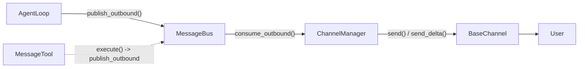

**Key Fields**: [nanobot/bus/events.py:61-68]()

| Field | Type | Description |
|-------|------|-------------|
| `channel` | `str` | Target channel |
| `chat_id` | `str` | Target chat identifier |
| `content` | `str` | Response text |
| `event` | `AgentEvent \| None` | Typed runtime event (e.g., `ProgressEvent`, `StreamDeltaEvent`) [nanobot/bus/events.py:68](), [nanobot/bus/outbound_events.py:119-131]() |
| `reply_to` | `str \| None` | ID of message being replied to |
| `media` | `list[str]` | Optional media attachments |
| `buttons` | `list[list[str]]` | Optional inline keyboard buttons |
| `metadata` | `dict` | Optional metadata (e.g. `_agent_ui` for rich clients) [nanobot/bus/events.py:13]() |

**Sources**: [nanobot/bus/events.py:52-68](), [nanobot/bus/queue.py:28-30](), [nanobot/bus/outbound_events.py:119-131]()

---

## MessageBus Implementation

Title: "MessageBus Class Diagram"
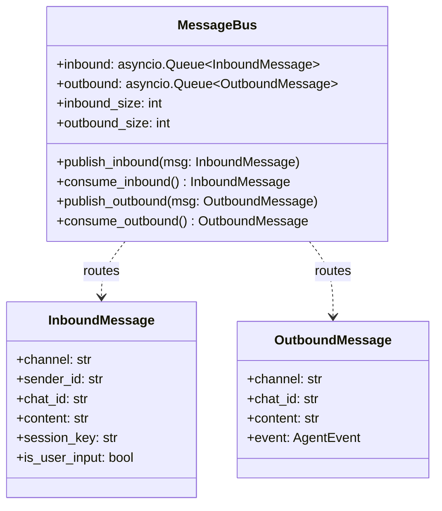

### Core Methods

| Method | Direction | Async | Description |
|--------|-----------|-------|-------------|
| `publish_inbound(msg)` | → Agent | Yes | Enqueue inbound message for agent processing. [nanobot/bus/queue.py:20-22]() |
| `consume_inbound()` | Agent ← | Yes | Dequeue next inbound message (blocks until available). [nanobot/bus/queue.py:24-26]() |
| `publish_outbound(msg)` | Agent → | Yes | Enqueue outbound message for channel delivery. [nanobot/bus/queue.py:28-30]() |
| `consume_outbound()` | ← Channel | Yes | Dequeue next outbound message (blocks until available). [nanobot/bus/queue.py:32-34]() |

**Sources**: [nanobot/bus/queue.py:8-44]()

---

## Channel Manager & Routing

The `ChannelManager` coordinates message delivery across multiple chat platforms. It initializes enabled channels and manages the dispatch loop. [nanobot/channels/manager.py:79-87]()

### Initialization and Discovery
- **Channel Registry**: The manager uses a plugin system to discover and load channel implementations like Telegram or Feishu. [nanobot/channels/manager.py:70-76]()
- **WebSocket Gateway**: For the `websocket` channel, the manager builds `GatewayServices` to bridge the Message Bus to the WebUI. [nanobot/channels/websocket/runtime.py:130-141]()
- **Config Application**: Channel-specific configurations are validated and passed to channel instances during initialization. [nanobot/channels/manager.py:166-173]()

### Dispatcher and Coalescing
- **Delta Coalescing**: Consecutive `StreamDeltaEvent` messages for the same `chat_id` and `stream_id` are merged to reduce network overhead and UI flickering. [tests/channels/test_channel_manager_delta_coalescing.py:153-163]()
- **Retry Policy**: Message sending is protected by exponential backoff (1s, 2s, 4s). [nanobot/channels/manager.py:59-60]()

### Streaming Support
Channels can implement `send_delta` for real-time text delivery. [nanobot/channels/base.py:129-151]()
- **Reasoning Streams**: Specialized methods `send_reasoning_delta` and `send_reasoning_end` allow models to stream "thinking" process to supported UIs. [nanobot/channels/base.py:153-186]()

**Sources**: [nanobot/channels/manager.py:79-190](), [nanobot/channels/base.py:129-210](), [tests/channels/test_channel_manager_delta_coalescing.py:112-212](), [nanobot/channels/websocket/runtime.py:130-141]()

---

## Runtime Events

The `RuntimeEventPublisher` is a helper class that publishes runtime state facts and turn-scoped notifications through the `MessageBus`. These events are primarily for internal agent state tracking and UI updates, not necessarily for direct user consumption. [nanobot/bus/runtime_events.py:101-106]()

### Event Types
- `SessionTurnStarted`: Triggered when a user/system turn has loaded its session and is about to build context. [nanobot/bus/runtime_events.py:29-34]()
- `UserInputAccepted`: Indicates that user input was accepted for dispatch or injection into a session. [nanobot/bus/runtime_events.py:37-42]()
- `TurnRuntimeAdmitted`: The immutable model runtime selected for one admitted turn. [nanobot/bus/runtime_events.py:45-49]()
- `TurnRunStatusChanged`: Visible run status changed for a turn (e.g., "running", "thinking"). [nanobot/bus/runtime_events.py:52-58]()
- `TurnCompleted`: A turn has delivered its final user-visible response, including latency and LLM usage. [nanobot/bus/runtime_events.py:61-74]()
- `SessionTurnPersisted`: A completed turn has been written to local session storage. [nanobot/bus/runtime_events.py:77-81]()
- `GoalStateChanged`: A session's sustained-goal state changed. [nanobot/bus/runtime_events.py:84-88]()
- `RuntimeModelChanged`: The active runtime model/preset changed. [nanobot/bus/runtime_events.py:91-95]()

### Event Lifecycle Management
The `RuntimeEventPublisher` manages the mechanics of building event contexts (`RuntimeEventContext`) and carrying per-turn metadata. It records turn-specific data like latency, runtime, and LLM usage. [nanobot/bus/runtime_events.py:101-162]()

Title: "Runtime Event State Machine"
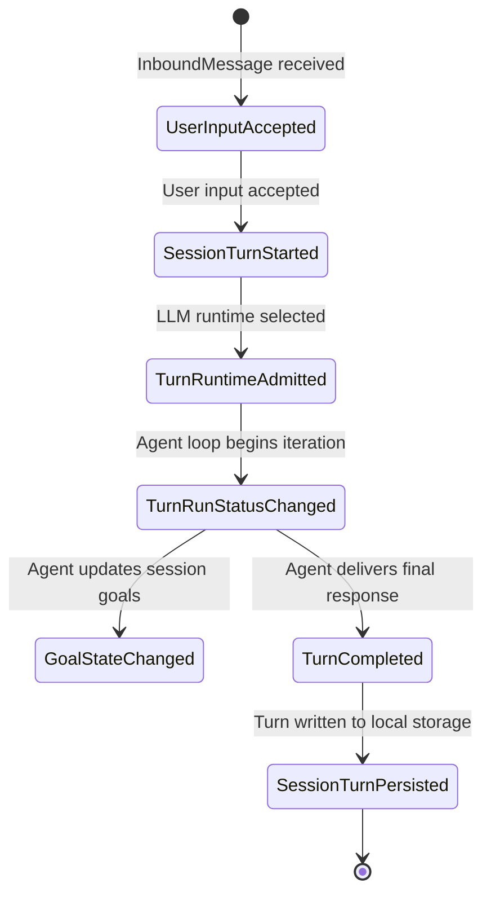

**Sources**: [nanobot/bus/runtime_events.py:1-236](), [tests/bus/test_runtime_events.py:19-151]()

---

## WebUI-Specific Event Handling

The `WebSocketChannel` and associated WebUI components (`nanobot-client.ts`) handle a specialized set of events and metadata for rich client interactions.

### Inbound WebUI Commands
The WebUI client can send `webui_request` messages to the `WebSocketChannel` to trigger specific actions, such as updating provider settings or installing skills. These requests are correlated by a `request_id`. [nanobot/channels/websocket/tests/test_websocket_channel.py:187-207](), [webui/src/lib/nanobot-client.ts:145-165]()

Title: "WebUI Inbound Command Flow"
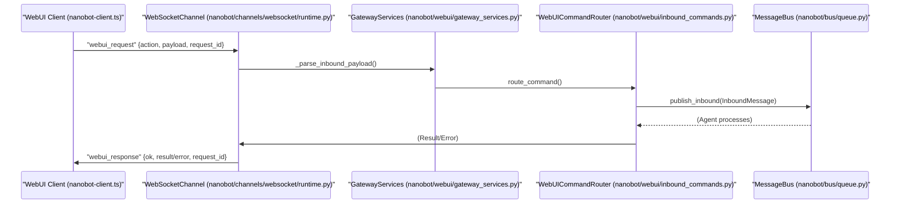

**Sources**: [nanobot/channels/websocket/tests/test_websocket_channel.py:187-207](), [webui/src/lib/nanobot-client.ts:145-165](), [nanobot/channels/websocket/runtime.py:45-46]()

### Outbound WebUI Projection
The `WebUIOutboundProjector` transforms generic `OutboundMessage` events into a format suitable for the WebUI, including handling `ProgressEvent` for streaming updates and `TurnEndEvent` for turn completion. [nanobot/channels/websocket/runtime.py:51-56]()

- **`OUTBOUND_META_AGENT_UI`**: A special metadata key used to embed structured, channel-agnostic UI payloads within `OutboundMessage`. [nanobot/bus/events.py:13]()
- **`WEBUI_TURN_METADATA_KEY`**: Used to mark messages related to WebUI turns. [nanobot/webui/metadata.py:6]()
- **`WEBSOCKET_TURN_OWNER_METADATA_KEY`**: Identifies the owner of a WebSocket turn. [nanobot/webui/metadata.py:6]()
- **Turn Lifecycle**: The `nanobot.session.webui_turns` module manages the lifecycle of WebUI turns, including tracking active turns and handling persistence failures. [nanobot/session/webui_turns.py:68-85]()

**Sources**: [nanobot/channels/websocket/runtime.py:51-56](), [nanobot/bus/events.py:13](), [nanobot/webui/metadata.py:6](), [nanobot/session/webui_turns.py:68-85](), [nanobot/channels/websocket/tests/test_websocket_channel.py:25-39]()

### Session Tools and WebUI Access
The `SearchSessionsTool` and `ReadSessionTool` allow the agent to interact with persisted conversation history, which is often managed by the WebUI's session access layer. [nanobot/agent/tools/sessions.py:83-179]()

- **`WebuiSessionAccess`**: Provides methods to search and read session data, filtering for visible user and assistant messages. [nanobot/webui/session_access.py:169-172]()
- **Transcript Reading**: These tools can read from the full WebUI transcript, even after compaction, ensuring comprehensive search results. [tests/agent/tools/test_sessions.py:82-107]()
- **Hidden Content**: Private or non-conversation messages (e.g., runtime context, tool calls) are hidden from these tools. [tests/agent/tools/test_sessions.py:176-195]()

**Sources**: [nanobot/agent/tools/sessions.py:83-179](), [nanobot/webui/session_access.py:169-172](), [tests/agent/tools/test_sessions.py:82-107](), [tests/agent/tools/test_sessions.py:176-195]()

---

## Sender Approval & Pairing

For direct message (DM) channels, nanobot uses a pairing system to authorize senders. [nanobot/pairing/store.py:1-6]()

- **Pairing Store**: A persistent JSON store (`pairing.json`) tracks approved senders and pending codes. [nanobot/pairing/store.py:32-34]()
- **Flow**: When an unknown sender sends a DM, the channel generates a temporary code (e.g., `ABCD-EFGH`). [nanobot/pairing/store.py:113-136]()
- **Approval**: The owner approves the code via the WebUI or a slash command, moving the sender to the `approved` list. [nanobot/pairing/store.py:139-157]()
- **ACL Check**: `BaseChannel.is_allowed` checks this store before publishing to the bus. [tests/channels/test_base_channel.py:60-67]()

**Sources**: [nanobot/pairing/store.py:1-206](), [nanobot/channels/base.py:13-18](), [tests/channels/test_base_channel.py:28-67]()

---

# Page: Multi-Instance Architecture

# Multi-Instance Architecture

<details>
<summary>Relevant source files</summary>

The following files were used as context for generating this wiki page:

- [docs/README.md](docs/README.md)
- [docs/chat-commands.md](docs/chat-commands.md)
- [docs/concepts.md](docs/concepts.md)
- [docs/multiple-instances.md](docs/multiple-instances.md)
- [docs/quick-start.md](docs/quick-start.md)
- [docs/start-without-technical-background.md](docs/start-without-technical-background.md)
- [docs/troubleshooting.md](docs/troubleshooting.md)
- [docs/webui.md](docs/webui.md)
- [nanobot/channels/websocket/tests/test_websocket_runtime_lifecycle.py](nanobot/channels/websocket/tests/test_websocket_runtime_lifecycle.py)
- [nanobot/cli/gateway.py](nanobot/cli/gateway.py)
- [nanobot/cli/gateway_runtime.py](nanobot/cli/gateway_runtime.py)
- [nanobot/cli/onboard.py](nanobot/cli/onboard.py)
- [nanobot/gateway/__init__.py](nanobot/gateway/__init__.py)
- [nanobot/gateway/runtime.py](nanobot/gateway/runtime.py)
- [nanobot/process_runtime.py](nanobot/process_runtime.py)
- [tests/agent/test_onboard_logic.py](tests/agent/test_onboard_logic.py)
- [tests/cli/test_gateway_commands.py](tests/cli/test_gateway_commands.py)
- [tests/cli/test_gateway_runtime.py](tests/cli/test_gateway_runtime.py)
- [tests/gateway/test_runtime.py](tests/gateway/test_runtime.py)

</details>


This document explains how to run multiple isolated nanobot instances simultaneously with separate configurations, workspaces, and runtime state. Each instance operates independently with its own message bus, sessions, memory, and channel connections.

---

## Instance Isolation Model

A **nanobot instance** is defined by its configuration file location and workspace selector. Each instance maintains complete isolation from other instances through separate:

- **Configuration files**: Different API keys, models, and enabled channels defined in the `Config` Pydantic model [nanobot/config/schema.py:343-346]().
- **Workspaces**: Isolated directories for `MEMORY.md`, `HISTORY.md`, and custom skills. The workspace path is resolved via `get_workspace_path` [nanobot/config/paths.py:16-21]() and defaults to `~/.nanobot/workspace` [nanobot/config/schema.py:214-214]().
- **Runtime state**: Instance-specific subdirectories for cron jobs, media files, and logs are derived from the data directory. The `GatewayRuntimePaths` class manages this layout [nanobot/gateway/runtime.py:128-150]().
- **Network ports**: Unique TCP ports for the gateway HTTP server, configured via the `--port` flag [nanobot/process_runtime.py:36-43]() or the `gateway` config section [nanobot/config/schema.py:345-345]().

Sources: [nanobot/config/schema.py:214-346](), [nanobot/gateway/runtime.py:128-150](), [nanobot/config/paths.py:16-21](), [nanobot/process_runtime.py:36-43]()

---

## Path Resolution Logic

The CLI and runtime use a multi-tier path resolution system. The config file path determines the instance data directory, while the workspace path is explicitly defined within that config or overridden via CLI.

### Resolution Priority

Title: "Nanobot Path Resolution Logic"
```mermaid
graph TB
    subgraph "CLI_Entry_Space"
        [CLI_Entry] --> [ConfigFlag]
        [CLI_Entry] --> [WorkspaceFlag]
    end

    subgraph "Logic: nanobot.config.loader"
        [ConfigFlag] --> [set_config_path]
        [set_config_path] --> [load_config]
    end

    subgraph "Code Entity Space: nanobot.gateway.runtime"
        [load_config] --> [GatewayInstance_resolve]
        [GatewayInstance_resolve] --> [GatewayRuntimePaths_for_instance]
        [GatewayRuntimePaths_for_instance] --> [GatewayRuntimePaths]
    end
```
Sources: [nanobot/config/loader.py:29-40](), [nanobot/gateway/runtime.py:160-184](), [nanobot/gateway/runtime.py:131-150]()

**Resolution Rules:**

| Component | Resolved From | Function / Code Pointer |
|-----------|---------------|-------------------------|
| **Config file** | `--config` flag or `~/.nanobot/config.json` | `get_config_path()` [nanobot/config/loader.py:33-40]() |
| **Active Config Path** | Set globally during CLI startup | `set_config_path()` [nanobot/config/loader.py:29-31]() |
| **Data Directory** | Base for logs and run state | `get_data_dir()` [nanobot/config/paths.py:8-14]() |
| **Instance Suffix** | SHA1 hash of workspace/config paths | `_instance_suffix()` [nanobot/gateway/runtime.py:140-143]() |
| **Logs** | `<data-dir>/logs/gateway.<suffix>.log` | `GatewayRuntimePaths` [nanobot/gateway/runtime.py:144-149]() |

Sources: [nanobot/config/loader.py:29-40](), [nanobot/gateway/runtime.py:128-150](), [nanobot/config/paths.py:8-21]()

---

## Configuration Schema

### Instance-Specific Config Fields

The `Config` class [nanobot/config/schema.py:343-346]() and `AgentDefaults` [nanobot/config/schema.py:211-263]() define fields critical for multi-instance isolation:

| Field | Purpose | Default / Example |
|-------|---------|-------------------|
| `agents.defaults.workspace` | Base workspace path for memory and skills | `"~/.nanobot/workspace"` [nanobot/config/schema.py:214]() |
| `agents.defaults.bot_name` | Display name for this specific instance | `"nanobot"` [nanobot/config/schema.py:241]() |
| `gateway` | Per-instance gateway settings (port, host) | [nanobot/config/schema.py:345-345]() |
| `channels` | Per-instance channel configuration | [nanobot/config/schema.py:53-73]() |

**Minimal Multi-Instance Config Example:**

```json
{
  "agents": {
    "defaults": {
      "workspace": "~/.nanobot-telegram/workspace",
      "model": "anthropic/claude-3-5-sonnet"
    }
  },
  "gateway": {
    "port": 18791
  },
  "channels": {
    "telegram": {
      "enabled": true,
      "token": "${TELEGRAM_TOKEN}"
    }
  }
}
```

Sources: [nanobot/config/schema.py:53-346](), [nanobot/config/loader.py:33-40]()

---

## Instance Isolation Boundaries

Title: "Multi-Instance Isolation Architecture"
```mermaid
graph LR
    subgraph "Natural_Language_and_Channel_Space"
        [InboundMessage_A] --> [MessageBus_A]
        [InboundMessage_B] --> [MessageBus_B]
    end

    subgraph "Code_Entity_Space"
        [MessageBus_A] --> [AgentLoop_A]
        [MessageBus_B] --> [AgentLoop_B]
        [AgentLoop_A] -.-> [LiteLLMProvider]
        [AgentLoop_B] -.-> [LiteLLMProvider]
        [GatewayRuntime_A] --> [GatewayRuntimePaths_for_instance]
        [GatewayRuntime_B] --> [GatewayRuntimePaths_for_instance]
    end
```
Sources: [nanobot/gateway/runtime.py:128-217](), [nanobot/config/schema.py:211-346]()

**Isolation Guarantees:**

- **Runtime Context**: The runtime data directory and state paths are dynamically resolved via `GatewayRuntimePaths.for_instance()` [nanobot/gateway/runtime.py:131-150](), ensuring that logs and state files are relative to the specific instance's configuration and workspace.
- **Workspace Isolation**: Each instance points to a unique workspace via the `workspace` setting [nanobot/config/schema.py:214](), isolating `MEMORY.md` and `HISTORY.md`.
- **Background Processes**: `GatewayRuntime` manages background processes using unique state files named `gateway.<suffix>.json` based on the config/workspace paths [nanobot/gateway/runtime.py:140-149]().
- **Environment Variables**: Instances share or isolate secrets using `${VAR}` references in `config.json`, resolved at load time [nanobot/config/loader.py:196-207]().

Sources: [nanobot/gateway/runtime.py:131-217](), [nanobot/config/schema.py:211-346](), [nanobot/config/loader.py:196-207]()

---

## Deployment and Management

### Starting Instances via CLI

Multiple instances are managed by passing explicit configuration to the CLI. The runtime respects the active configuration context set via `--config` and `--workspace` flags.

```bash
# Start Instance A (Telegram) on port 18790 (default)
nanobot gateway --config ~/.nanobot-tg/config.json --workspace ~/.nanobot-tg/workspace

# Start Instance B (Discord) on port 18791
nanobot gateway --config ~/.nanobot-ds/config.json --port 18791
```

### Background Service Management

The `GatewayRuntime` class [nanobot/gateway/runtime.py:202-217]() owns the logic for building the child process command, including injecting the correct `--config` and `--workspace` arguments via `build_gateway_command` [nanobot/gateway/runtime.py:107-124]().

### Common Pitfalls

- **Shared Config Directory**: Running two instances with different config file names in the *same* directory may lead to shared logs if the instance suffix hash is not unique.
- **Port Collision**: If the `--port` flag is not unique for instances running on the same host, the second instance fails to start.
- **Default Workspace**: If no workspace is specified in config or CLI, instances default to `~/.nanobot/workspace` [nanobot/config/schema.py:214](), leading to shared memory files.

Sources: [nanobot/gateway/runtime.py:107-217](), [nanobot/config/schema.py:214-346](), [nanobot/cli/gateway.py:152-161]()

---

# Page: Gateway Runtime & Process Management

# Gateway Runtime & Process Management

<details>
<summary>Relevant source files</summary>

The following files were used as context for generating this wiki page:

- [nanobot/channels/websocket/tests/test_websocket_runtime_lifecycle.py](nanobot/channels/websocket/tests/test_websocket_runtime_lifecycle.py)
- [nanobot/cli/gateway.py](nanobot/cli/gateway.py)
- [nanobot/cli/gateway_runtime.py](nanobot/cli/gateway_runtime.py)
- [nanobot/gateway/__init__.py](nanobot/gateway/__init__.py)
- [nanobot/gateway/runtime.py](nanobot/gateway/runtime.py)
- [nanobot/process_runtime.py](nanobot/process_runtime.py)
- [nanobot/utils/rotating_output.py](nanobot/utils/rotating_output.py)
- [tests/cli/test_gateway_commands.py](tests/cli/test_gateway_commands.py)
- [tests/cli/test_gateway_runtime.py](tests/cli/test_gateway_runtime.py)
- [tests/gateway/test_runtime.py](tests/gateway/test_runtime.py)
- [tests/utils/test_rotating_output.py](tests/utils/test_rotating_output.py)

</details>


This page documents the gateway daemon architecture, process runtime supervision, daemon lifecycle modes, rotating log infrastructure, and CLI gateway commands in `nanobot`.

---

## 1. Gateway Architecture & Components

The gateway component runs as a persistent local daemon or in the foreground, coordinating communication channels, the message bus, scheduled automation, and agent turns. Process supervision and runtime layout are factored into reusable classes across `nanobot/gateway/runtime.py` and `nanobot/process_runtime.py`.

* **`GatewayInstance`**: Resolves configuration paths, workspace directories, and runtime file selectors for isolated gateway instances [nanobot/gateway/runtime.py:153-185]().
* **`GatewayRuntimePaths`**: Manages filesystem paths for state files (JSON process records) and rotating log files under the data directory [nanobot/gateway/runtime.py:128-150]().
* **`ManagedProcessRuntime`**: A generic cross-platform base class handling detached background process execution, PID liveness checks, and state file locking [nanobot/process_runtime.py:81-197]().
* **`GatewayRuntime`**: Subclasses `ManagedProcessRuntime` to supervise background `nanobot gateway` instances [nanobot/gateway/runtime.py:202-217]().

### Diagram: Gateway Architecture to Code Entity Mapping

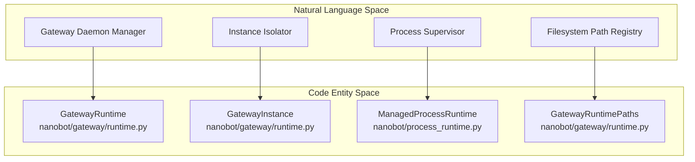

*Sources: [nanobot/gateway/runtime.py:128-217](), [nanobot/process_runtime.py:81-197]()*

---

## 2. Gateway Lifecycle & Execution Modes

The gateway supports two primary launch modes: **foreground** (suitable for terminal debugging, systemd, or docker containers) and **background** (detached daemon managed via CLI commands) [nanobot/cli/gateway.py:142-177]().

When starting a background gateway, `ManagedProcessRuntime._start_background()` spawns the child process with redirected environment variables for rotating output, verifies that the process remains running after 200ms, and writes a state record containing the PID, start timestamp, port, and workspace configuration [nanobot/process_runtime.py:107-154]().

### Diagram: Background Gateway Startup & Readiness Sequence

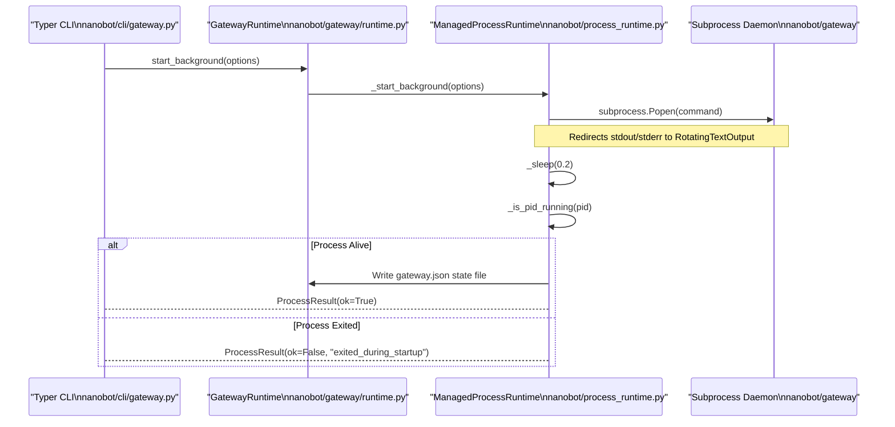

If a user attempts to start a foreground gateway when another instance is already claiming the configured port and runtime state, a `GatewayAlreadyRunningError` is raised [nanobot/gateway/runtime.py:99-105](). Health readiness is probed via the management HTTP endpoint using `_gateway_health_ready()` [nanobot/gateway/runtime.py:42-66]().

*Sources: [nanobot/cli/gateway.py:142-177](), [nanobot/gateway/runtime.py:42-105](), [nanobot/process_runtime.py:107-154]()*

---

## 3. Process Supervision, State, and Rotating Logs

Background processes managed by nanobot use bounded output streams to prevent log files from growing indefinitely.

* **`RotatingTextOutput`**: Implements a UTF-8 text stream (`io.TextIOBase`) that enforces a maximum size cap (`DEFAULT_MAX_BYTES`, default 10MB) and a backup rotation count (`DEFAULT_BACKUP_COUNT`, default 5) [nanobot/utils/rotating_output.py:22-182]().
* **Environment Injection**: Background processes receive output redirection paths via environment variables such as `_NANOBOT_BACKGROUND_LOG_PATH`, `_NANOBOT_BACKGROUND_LOG_MAX_BYTES`, and `_NANOBOT_BACKGROUND_LOG_BACKUP_COUNT` [nanobot/utils/rotating_output.py:14-16]().

### Diagram: Rotating Output Code Entity Mapping

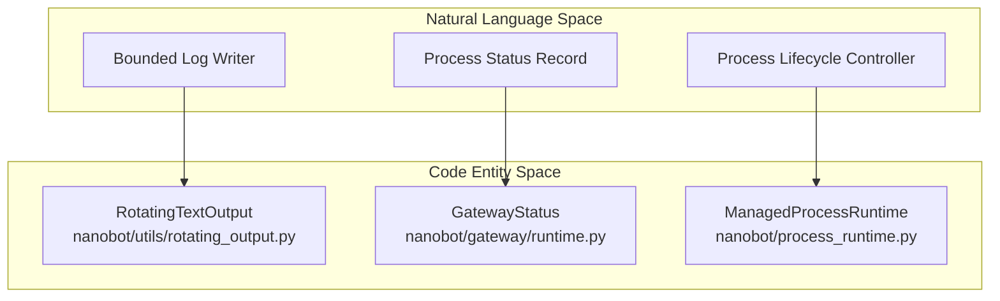

*Sources: [nanobot/utils/rotating_output.py:22-182](), [nanobot/gateway/runtime.py:74-81](), [nanobot/process_runtime.py:81-197]()*

---

## 4. Graceful Shutdown & Resource Teardown

Foreground gateways install robust signal handlers for `SIGINT` and `SIGTERM` via `_install_gateway_shutdown_handlers()` [nanobot/cli/gateway_runtime.py:100-147](). 

When shutting down, runtime tasks, in-flight agent turns, execution sessions, subagents, and Model Context Protocol (MCP) servers are closed cleanly with bounded timeouts to prevent hanging threads or zombie processes [tests/cli/test_gateway_runtime.py:1-8]() [tests/cli/test_gateway_runtime.py:190-211]().

*Sources: [nanobot/cli/gateway_runtime.py:100-147](), [tests/cli/test_gateway_runtime.py:1-211]()*

---

## 5. CLI Gateway Lifecycle Commands

The `nanobot gateway` CLI command router is constructed via `create_gateway_app()` [nanobot/cli/gateway.py:49-141](). It exposes options to configure port binding, workspace isolation, verbosity, and execution mode.

| Command / Flag | Description | Code Reference |
| :--- | :--- | :--- |
| `nanobot gateway` | Starts the gateway (defaults to foreground mode). | [nanobot/cli/gateway.py:142-152]() |
| `--foreground` | Runs the gateway in the foreground process. | [nanobot/cli/gateway.py:149]() |
| `--background` | Starts the gateway as a detached background daemon. | [nanobot/cli/gateway.py:150]() |
| `--port, -p` | Specifies the listening port for the gateway. | [nanobot/cli/gateway.py:145]() |
| `--workspace, -w` | Specifies an isolated workspace directory. | [nanobot/cli/gateway.py:146]() |
| `--config, -c` | Points to a custom configuration JSON file. | [nanobot/cli/gateway.py:148]() |
| `--verbose, -v` | Enables debug logging output. | [nanobot/cli/gateway.py:147]() |

*Sources: [nanobot/cli/gateway.py:49-177]()*

---

# Page: Agent System

# Agent System

<details>
<summary>Relevant source files</summary>

The following files were used as context for generating this wiki page:

- [README.md](README.md)
- [docs/configuration.md](docs/configuration.md)
- [docs/providers.md](docs/providers.md)
- [nanobot/agent/context_governance.py](nanobot/agent/context_governance.py)
- [nanobot/agent/loop.py](nanobot/agent/loop.py)
- [nanobot/agent/runner.py](nanobot/agent/runner.py)
- [nanobot/cli/commands.py](nanobot/cli/commands.py)
- [nanobot/config/schema.py](nanobot/config/schema.py)
- [nanobot/providers/conversation_state.py](nanobot/providers/conversation_state.py)
- [nanobot/providers/registry.py](nanobot/providers/registry.py)
- [tests/agent/test_loop_runner_integration.py](tests/agent/test_loop_runner_integration.py)
- [tests/agent/test_runner_core.py](tests/agent/test_runner_core.py)
- [tests/agent/test_runner_file_reads.py](tests/agent/test_runner_file_reads.py)
- [tests/agent/test_runner_governance.py](tests/agent/test_runner_governance.py)
- [tests/agent/test_runner_runtime_identity.py](tests/agent/test_runner_runtime_identity.py)
- [tests/cli/test_commands.py](tests/cli/test_commands.py)

</details>


The Agent System is the core intelligence layer of nanobot. It receives messages from the communication layer, assembles contextual prompts, executes LLM calls, manages tool execution through multiple iterations, and generates responses. The system orchestrates interactions between the LLM provider, memory consolidation, skills loading, session management, and tool registry to provide stateful, context-aware AI assistance.

**This page provides a high-level overview of the agent architecture and core components.**

For detailed information on specific subsystems, refer to the respective child pages:
- **[Agent Loop](#4.1)** — Deep dive into the `AgentLoop` class, its iteration cycle, tool execution, turn admission, and message persistence logic.
- **[Context Building](#4.2)** — Explain the `ContextBuilder` system for assembling prompts from identity, bootstrap files, memory, skills, and history.
- **[Memory System](#4.3)** — Document the memory architecture (`MEMORY.md`, `history.jsonl`, `SOUL.md`/`USER.md`), dream consolidation, and `MemoryArchiver`.
- **[Skills](#4.4)** — Explain the skills system, `SKILL.md` format, always-active vs. on-demand skills, skill-creator, and skill loading mechanisms.
- **[Subagents](#4.5)** — Detail the `SubagentManager` for background task delegation, isolated execution, spawn tool, and result announcement.
- **[Agent Runner & Context Governance](#4.6)** — Document the shared `AgentRunner` tool-using execution loop, `AgentRunSpec`/`AgentRunResult`, `ContextGovernor` token budgeting, H/delta compaction, length recovery, and provider conversation state.
- **[Hooks & Turn Lifecycle](#4.7)** — Explain `AgentHook`, turn hooks, progress hooks, file-edit activity hooks, tool execution context vars, and how hooks compose.

Sources: [nanobot/agent/loop.py:1-51](), [nanobot/agent/runner.py:88-146]()

---

## Component Architecture

The agent system is built around `AgentLoop` [nanobot/agent/loop.py:51]() as the central orchestrator and supporting components that provide context, memory, tools, sessions, and skills. The `AgentRunner` class [nanobot/agent/runner.py:141]() provides a shared, low-level execution loop used by both the main agent and subagents.

**Agent System Component Dependency Graph**

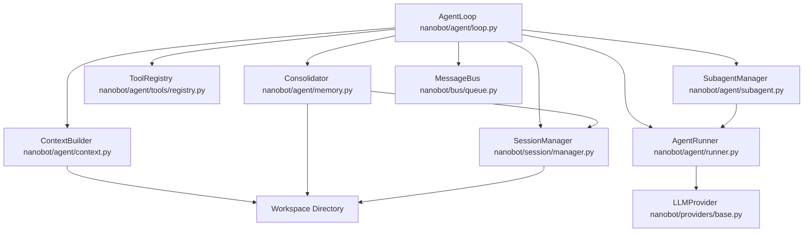

Sources: [nanobot/agent/loop.py:22-38](), [nanobot/agent/runner.py:141-146](), [nanobot/agent/subagent.py:92-156]()

---

## Core Subsystems Overview

### 1. Agent Loop & Turn Lifecycle
The `AgentLoop` class coordinates incoming turns from the `MessageBus`, manages concurrency, resolves runtime environments via `ModelRuntimeResolver`, and persists transcripts. Turn hooks and lifecycle callbacks (`AgentHook`) monitor execution progress. For full details, see [Agent Loop](#4.1) and [Hooks & Turn Lifecycle](#4.7).

Sources: [nanobot/agent/loop.py:22-51](), [nanobot/agent/hook.py:21-28]()

### 2. Context Building & Governance
The `ContextBuilder` aggregates instructions, memory files (`MEMORY.md`), skills (`SKILL.md`), and recent conversation history into an initial prompt structure. During execution, the `ContextGovernor` monitors token budgets and applies compaction strategies (such as H/delta compaction). For full details, see [Context Building](#4.2) and [Agent Runner & Context Governance](#4.6).

Sources: [nanobot/agent/context.py:20-30](), [nanobot/agent/context_governance.py:112-135]()

### 3. Memory & Skills
Long-term memory is structured across core identity files (`SOUL.md`, `USER.md`, `MEMORY.md`) and session logs (`history.jsonl`), managed by `Consolidator` and `AutoCompact`. Skills provide modular capabilities defined via `SKILL.md`. For full details, see [Memory System](#4.3) and [Skills](#4.4).

Sources: [nanobot/agent/loop.py:24-30](), [nanobot/agent/autocompact.py:15-30]()

### 4. Delegation & Shared Runner
The `SubagentManager` enables background task spawning and isolated execution. Both main agent turns and subagents execute via the shared `AgentRunner` execution loop (`AgentRunSpec` and `AgentRunResult`). For full details, see [Subagents](#4.5) and [Agent Runner & Context Governance](#4.6).

Sources: [nanobot/agent/subagent.py:92-156](), [nanobot/agent/runner.py:88-140]()

---

## Execution Flow

The sequence below illustrates how an incoming message flows from the `MessageBus` through `AgentLoop` and `AgentRunner` to interact with LLM providers and execute tools.

**End-to-End Processing Pipeline**

```mermaid
sequenceDiagram
    participant Bus as "MessageBus nanobot/bus/queue.py"
    participant Loop as "AgentLoop nanobot/agent/loop.py"
    participant Runner as "AgentRunner nanobot/agent/runner.py"
    participant Prov as "LLMProvider nanobot/providers/base.py"
    participant Tools as "ToolRegistry nanobot/agent/tools/registry.py"
    
    Bus->>Loop: "InboundMessage"
    Loop->>Loop: "Retrieve/Create Session SessionManager"
    
    Loop->>Runner: "AgentRunner.run(spec)"
    
    loop "Up to max_iterations"
        Runner->>Runner: "prepare_for_model / ContextGovernor"
        Runner->>Prov: "chat_stream_with_retry(messages, tools)"
        Prov-->>Runner: "LLMResponse (Content or ToolCalls)"
        
        alt "Has Tool Calls"
            Runner->>Tools: "execute_tool_calls"
            Tools-->>Runner: "Tool Result"
        else "Final Content"
            Runner-->>Loop: "AgentRunResult"
        end
    end
    
    Loop->>Bus: "publish_outbound(OutboundMessage)"
```

Sources: [nanobot/agent/loop.py:48-51](), [nanobot/agent/runner.py:141-146](), [nanobot/agent/subagent.py:150-156]()

---

# Page: Agent Loop

# Agent Loop

<details>
<summary>Relevant source files</summary>

The following files were used as context for generating this wiki page:

- [README.md](README.md)
- [docs/configuration.md](docs/configuration.md)
- [docs/providers.md](docs/providers.md)
- [nanobot/agent/automation_turns.py](nanobot/agent/automation_turns.py)
- [nanobot/agent/cron_turns.py](nanobot/agent/cron_turns.py)
- [nanobot/agent/loop.py](nanobot/agent/loop.py)
- [nanobot/cli/commands.py](nanobot/cli/commands.py)
- [nanobot/config/schema.py](nanobot/config/schema.py)
- [nanobot/cron/bound_runner.py](nanobot/cron/bound_runner.py)
- [nanobot/providers/registry.py](nanobot/providers/registry.py)
- [nanobot/session/turn_continuation.py](nanobot/session/turn_continuation.py)
- [nanobot/triggers/local_turns.py](nanobot/triggers/local_turns.py)
- [tests/agent/session_helpers.py](tests/agent/session_helpers.py)
- [tests/agent/test_loop_progress.py](tests/agent/test_loop_progress.py)
- [tests/agent/test_loop_recovery.py](tests/agent/test_loop_recovery.py)
- [tests/agent/test_loop_save_turn.py](tests/agent/test_loop_save_turn.py)
- [tests/agent/test_runner_injections.py](tests/agent/test_runner_injections.py)
- [tests/agent/test_session_inbox_controls.py](tests/agent/test_session_inbox_controls.py)
- [tests/cli/test_commands.py](tests/cli/test_commands.py)
- [tests/cli/test_restart_command.py](tests/cli/test_restart_command.py)
- [tests/command/test_compact_command.py](tests/command/test_compact_command.py)
- [tests/session/test_turn_continuation.py](tests/session/test_turn_continuation.py)

</details>


## Purpose and Scope

This page provides a comprehensive deep dive into the `AgentLoop` class [nanobot/agent/loop.py]() and its associated execution components (`AgentRunner`, `ToolRegistry`, and turn management logic). It covers the complete lifecycle of a conversation turn, from initial message admission and queueing through the iterative reasoning loop, tool execution, and final message persistence.

---

## Overview

`AgentLoop` serves as the core orchestrator and event-driven state machine of the nanobot framework [nanobot/agent/loop.py](). It bridges chat channels, background triggers, and cron schedulers with the LLM provider and tool execution environment. Its primary responsibilities include:

1. **Turn Admission**: Consuming `InboundMessage` events from the `MessageBus`, validating sessions, and managing concurrency gates [nanobot/agent/loop.py]() [nanobot/bus/queue.py]().
2. **Context Assembly**: Interfacing with `ContextBuilder` to compile system prompts, workspace context, history, and memory [nanobot/agent/context.py]() [nanobot/agent/loop.py]().
3. **Iterative Reasoning**: Driving the tool-using execution loop via `AgentRunner` up to configured iteration limits [nanobot/agent/runner.py]() [nanobot/config/schema.py]().
4. **Tool Execution**: Executing filesystem, shell, web, and Model Context Protocol (MCP) tools through the `ToolRegistry` [nanobot/agent/tools/registry.py]() [nanobot/agent/loop.py]().
5. **Persistence**: Persisting conversation turns atomically, sanitizing sensitive payloads, and triggering memory consolidation [nanobot/agent/loop.py]() [nanobot/session/manager.py]().

Sources: [nanobot/agent/loop.py:1-285](), [nanobot/agent/runner.py:1-152](), [nanobot/config/schema.py:116-165]()

---

## Turn Admission & Queueing

When an inbound event arrives on the `MessageBus`, the agent evaluates whether the turn can be admitted immediately or needs to be queued based on session locks and active background tasks.

- **Session Locking**: Each session key (e.g., `telegram:12345` or `unified:default`) maintains an individual `asyncio.Lock` (`_session_locks`) to guarantee serialized execution per conversation thread and prevent history corruption [nanobot/agent/loop.py]().
- **Active Task Tracking**: Running turns are tracked in `_active_tasks`, enabling cancellation via slash commands like `/stop` [nanobot/agent/loop.py]() [nanobot/command/builtin.py]().
- **Recovery Admission**: If a node restarts mid-turn or processes recovery checkpoints, `RecoveryAdmission` evaluates pending follow-ups and runtime checkpoints stored in session metadata [nanobot/session/recovery.py]() [nanobot/agent/loop.py]().

Sources: [nanobot/agent/loop.py:355-445](), [nanobot/session/recovery.py:1-92]()

---

## Tool Registration and Capabilities

Upon initialization, `AgentLoop` invokes `_register_default_tools()` to populate its `ToolRegistry` with built-in tools [nanobot/agent/loop.py](). 

### Diagram: Natural Language Space to Code Entity Space (Tool Mapping)

```mermaid
graph TD
    subgraph "NaturalLanguageSpace"
        UserRequest[""User Requests File Modification, Shell Command, or Web Search""]
    end

    subgraph "CodeEntitySpace"
        AL[""AgentLoop._register_default_tools() [nanobot/agent/loop.py]"""] --> TR[""ToolRegistry [nanobot/agent/tools/registry.py]"""]
        TR --> ReadTool[""ReadFileTool / WriteFileTool [nanobot/agent/tools/filesystem.py]"""]
        TR --> ShellTool[""ExecTool [nanobot/agent/tools/shell.py]"""]
        TR --> WebTool[""WebSearchTool / WebFetchTool [nanobot/agent/tools/web.py]"""]
        TR --> MsgTool[""MessageTool [nanobot/agent/tools/message.py]"""]
        TR --> CronTool[""CronTool [nanobot/agent/tools/loader.py]"""]
    end

    UserRequest --> AL

    classDef default fill:#fff,stroke:#000,stroke-width:1px;
```

Sources: [nanobot/agent/loop.py:759-810](), [nanobot/agent/tools/registry.py:1-50]()

---

## The Main Execution Loop (`run`)

The long-running `run()` method continuously consumes messages from the message bus, dispatches them to worker coroutines, and publishes outbound responses [nanobot/agent/loop.py]().

### Diagram: Natural Language Space to Code Entity Space (Event Dispatch)

```mermaid
sequenceDiagram
    participant UserSpace as "Natural Language User / Chat Channel"
    participant Bus as "MessageBus [nanobot/bus/queue.py]"
    participant Loop as "AgentLoop.run() [nanobot/agent/loop.py]"
    participant Dispatch as "AgentLoop._dispatch() [nanobot/agent/loop.py]"
    participant Runner as "AgentRunner.run() [nanobot/agent/runner.py]"

    UserSpace->>Bus: "Send Message (Telegram/WebSocket/CLI)"
    Bus->>Loop: "consume_inbound(timeout=1.0)"
    Note over Loop: "Inspect payload & check /stop command"
    Loop->>Dispatch: "asyncio.create_task(_dispatch(msg))"
    Dispatch->>Runner: "AgentRunSpec execution"
    Runner-->>Dispatch: "AgentRunResult (final content & messages)"
    Dispatch->>Bus: "publish_outbound(OutboundMessage)"
    Bus-->>UserSpace: "Deliver final response"
```

Sources: [nanobot/agent/loop.py:377-445](), [nanobot/agent/runner.py:147-152]()

---

## The Iteration Cycle (`AgentRunner.run`)

The core iterative reasoning cycle is delegated to `AgentRunner` [nanobot/agent/runner.py](). It manages the back-and-forth between model inference and tool invocation.

1. **Iteration Limits**: The loop executes up to `max_iterations` (default `200` as defined in `AgentDefaults`) [nanobot/config/schema.py:130](), [nanobot/agent/runner.py:106]().
2. **Lifecycle Hooks**: Before and during each step, `AgentHook` callbacks (`before_iteration`, `before_execute_tools`, `finalize_content`) are triggered to provide progress updates and telemetry [nanobot/agent/runner.py:108](), [nanobot/agent/hook.py:28]().
3. **Model Inference**: Calls `provider.chat_with_retry` passing the assembled message context and active tool definitions [nanobot/agent/runner.py:29-31]().
4. **Tool Execution & Truncation**: When the model requests tool calls, `_execute_tools` runs them concurrently or sequentially, truncating outputs exceeding `max_tool_result_chars` (default `16,000` characters) [nanobot/config/schema.py:132](), [nanobot/agent/runner.py:22]().
5. **Mid-turn Injections**: While the agent is thinking, newly arrived inbound messages or triggers can be drained and injected into the current context (up to `_MAX_INJECTIONS_PER_TURN`) [nanobot/agent/runner.py:84](), [nanobot/agent/runner.py:120]().

Sources: [nanobot/agent/runner.py:1-152](), [nanobot/config/schema.py:130-132](), [nanobot/agent/hook.py:28-50]()

---

## Message Persistence and Turn Saving

Once the runner completes a turn, the interaction is persisted back to the underlying `Session` storage [nanobot/session/manager.py]().

- **Sanitization**: Reasoning blocks and `<think>` tags are stripped from responses via helper functions before committing to history [nanobot/utils/helpers.py:55-56](), [nanobot/agent/loop.py:690-692]().
- **Media Handling**: Large base64-encoded image payloads are replaced with file references (e.g., `[image: /path/to/file]`) to prevent session files from bloating [nanobot/utils/helpers.py:96](), [nanobot/agent/loop.py:690-692]().
- **Continuation Policy**: `prepare_save_boundary` determines how message slices are saved, preventing duplicate system prompts across internal pagination or compaction slices [nanobot/session/turn_continuation.py:69]().
- **Memory Consolidation**: If unconsolidated message counts cross threshold limits, a background `Consolidator` task is spawned to update long-term storage (`MEMORY.md`) [nanobot/agent/memory.py:29]().

Sources: [nanobot/agent/loop.py:680-702](), [nanobot/session/turn_continuation.py:69](), [nanobot/utils/helpers.py:55-56](), [nanobot/agent/memory.py:29-50]()

---

# Page: Context Building

# Context Building

<details>
<summary>Relevant source files</summary>

The following files were used as context for generating this wiki page:

- [nanobot/agent/context.py](nanobot/agent/context.py)
- [nanobot/skills/memory/SKILL.md](nanobot/skills/memory/SKILL.md)
- [nanobot/templates/AGENTS.md](nanobot/templates/AGENTS.md)
- [nanobot/templates/HEARTBEAT.md](nanobot/templates/HEARTBEAT.md)
- [nanobot/templates/SOUL.md](nanobot/templates/SOUL.md)
- [nanobot/templates/agent/dream.md](nanobot/templates/agent/dream.md)
- [nanobot/templates/agent/identity.md](nanobot/templates/agent/identity.md)
- [nanobot/templates/agent/tool_contract.md](nanobot/templates/agent/tool_contract.md)
- [nanobot/templates/legacy/SOUL.md](nanobot/templates/legacy/SOUL.md)
- [tests/agent/test_context_builder.py](tests/agent/test_context_builder.py)
- [tests/agent/test_context_prompt_cache.py](tests/agent/test_context_prompt_cache.py)
- [tests/agent/test_dream.py](tests/agent/test_dream.py)
- [tests/tools/test_tool_descriptions.py](tests/tools/test_tool_descriptions.py)

</details>


This page documents `ContextBuilder` — the component responsible for assembling the full prompt payload sent to the LLM on every agent turn. It covers the ordered pipeline for building the system prompt, transcript and message list construction, runtime metadata injection, and session context routing.

For information about how `ContextBuilder` is invoked turn-by-turn, see the **Agent Loop (4.1)**. For the memory consolidation process that feeds data into the context, see **Memory System (4.3)**. For the skills system, see **Skills (4.4)**.

---

## 1. Overview & Component Architecture

`ContextBuilder` is defined in `nanobot/agent/context.py` [nanobot/agent/context.py:89-100]() and instantiated once per agent runtime session. It composes inputs from a `MemoryStore` instance and a `SkillsLoader` instance, centralizing system prompt creation and transcript formatting.

```mermaid
graph TD
    subgraph "Code Entity Space"
    CB["ContextBuilder\n(nanobot/agent/context.py)"]
    MS["MemoryStore\n(nanobot/agent/memory.py)"]
    SL["SkillsLoader\n(nanobot/agent/skills.py)"]
    end

    subgraph "Natural Language Space"
    A["System Prompt & Messages"]
    end

    CB -->|"reads identity & memory"| MS
    CB -->|"loads active/summary skills"| SL
    CB -->|"compiles"| A

    classDef default fill:#FFFFFF,stroke:#000000,stroke-width:1px;
```

Sources: [nanobot/agent/context.py:89-100]()

---

## 2. System Prompt Pipeline

`ContextBuilder.build_system_prompt()` assembles the static system prompt in a fixed order, joining individual segments with `\n\n---\n\n` separators [nanobot/agent/context.py:101-152]().

```mermaid
flowchart TD
    subgraph "Code Entity Space"
    BSP["ContextBuilder.build_system_prompt()"]
    ID["ContextBuilder._get_identity()"]
    BF["ContextBuilder._load_bootstrap_files()"]
    TC["render_template('agent/tool_contract.md')"]
    MEM["MemoryStore.read_memory()"]
    AS["SkillsLoader.get_always_skills()\nSkillsLoader.load_skills_for_context()"]
    SS["SkillsLoader.build_skills_summary()"]
    end

    BSP --> ID
    BSP --> BF
    BSP --> TC
    BSP --> MEM
    BSP --> AS
    BSP --> SS

    classDef default fill:#FFFFFF,stroke:#000000,stroke-width:1px;
```

Sources: [nanobot/agent/context.py:101-152]()

### Identity & Runtime Block

`_get_identity()` initializes the prompt using the `agent/identity.md` template [nanobot/agent/context.py:154-169](). It includes platform metadata (`platform.system()`, `platform.machine()`, `platform.python_version()`), workspace paths, and platform-specific policies [nanobot/agent/context.py:154-170](), [tests/agent/test_context_prompt_cache.py:36-49](). When a specific communication channel (e.g., `telegram`, `whatsapp`) is active, channel-specific format hints are appended [nanobot/agent/context.py:168](), [tests/agent/test_context_prompt_cache.py:159-186]().

Sources: [nanobot/agent/context.py:154-170](), [tests/agent/test_context_prompt_cache.py:36-49](), [tests/agent/test_context_prompt_cache.py:159-186]()

### Bootstrap Files

`_load_bootstrap_files()` inspects the workspace root for `BOOTSTRAP_FILES = ["AGENTS.md", "SOUL.md", "USER.md"]` [nanobot/agent/context.py:92](). Files matching unchanged default templates are skipped to conserve context tokens [tests/agent/test_context_builder.py:156-166](). Custom modifications are loaded and appended [tests/agent/test_context_builder.py:167-169]().

Sources: [nanobot/agent/context.py:92](), [tests/agent/test_context_builder.py:156-169]()

### Long-Term Memory and Skills

- **Long-Term Memory**: `MemoryStore.read_memory()` reads `MEMORY.md` from the workspace and verifies it is not default placeholder content [nanobot/agent/context.py:127-131]().
- **Active Skills**: `SkillsLoader.get_always_skills()` identifies skills flagged as always-active, loading their full instructions into the prompt [nanobot/agent/context.py:132-136]().
- **Skills Summary**: `SkillsLoader.build_skills_summary()` constructs a catalog summary of remaining on-demand skills [nanobot/agent/context.py:138-143]().
- **Session Summaries**: When `SessionSummary` is provided, archived conversation context is appended [nanobot/agent/context.py:145-150]().

Sources: [nanobot/agent/context.py:127-150]()

---

## 3. Message & Transcript Assembly

`ContextBuilder` transforms raw history entries and current user inputs into formatted message dicts consumed by LLM providers via helper structures like `TranscriptInput` [nanobot/agent/context.py:73-87]().

```python
@dataclass(frozen=True, slots=True)
class TranscriptInput:
    history: list[dict[str, Any]]
    current_message: str | None
    media: Sequence[str] | None = None
    current_role: str = "user"
    session_summary: SessionSummary | None = None
    runtime_context_blocks: Sequence[RuntimeContextBlock] | None = None
```

- **Content Merging**: `_merge_message_content()` handles multi-part message contents (such as text combined with image lists) [nanobot/agent/context.py:171-173](), [tests/agent/test_context_builder.py:23-70]().
- **Runtime Context Blocks**: Dynamic environment details (such as current time, active CLI apps, and channel metadata) are appended to the final user message block [tests/agent/test_context_prompt_cache.py:92-110]().

Sources: [nanobot/agent/context.py:73-87](), [nanobot/agent/context.py:171-173](), [tests/agent/test_context_builder.py:23-70](), [tests/agent/test_context_prompt_cache.py:92-110]()

---

## 4. Runtime Control & Persisted Context Resolution

`ContextBuilder` coordinates turn-attached capabilities and session lifecycle commands:

- **`session_extra(metadata)`**: Aggregates persistent keyword arguments for capabilities across CLI apps, MCP tools, and session tools [nanobot/agent/context.py:35-41]().
- **`handle_runtime_control()`**: Intercepts inbound control messages such as session discard events (`RUNTIME_CONTROL_SESSION_DISCARD`) before standard execution proceeds [nanobot/agent/context.py:44-49]().
- **`PersistedPromptContextResolver`**: Restores prompt routing context and resolves workspace scopes when processing background tasks or sessions lacking an active inbound message [nanobot/agent/context.py:52-70]().

Sources: [nanobot/agent/context.py:35-70]()

---

# Page: Memory System

# Memory System

<details>
<summary>Relevant source files</summary>

The following files were used as context for generating this wiki page:

- [nanobot/agent/autocompact.py](nanobot/agent/autocompact.py)
- [nanobot/agent/memory.py](nanobot/agent/memory.py)
- [nanobot/command/builtin.py](nanobot/command/builtin.py)
- [nanobot/session/manager.py](nanobot/session/manager.py)
- [nanobot/templates/agent/consolidator_archive.md](nanobot/templates/agent/consolidator_archive.md)
- [nanobot/utils/gitstore.py](nanobot/utils/gitstore.py)
- [tests/agent/test_auto_compact.py](tests/agent/test_auto_compact.py)
- [tests/agent/test_autocompact_unit.py](tests/agent/test_autocompact_unit.py)
- [tests/agent/test_consolidator.py](tests/agent/test_consolidator.py)
- [tests/agent/test_git_store.py](tests/agent/test_git_store.py)
- [tests/agent/test_loop_consolidation_tokens.py](tests/agent/test_loop_consolidation_tokens.py)
- [tests/agent/test_new_command_archival.py](tests/agent/test_new_command_archival.py)
- [tests/agent/test_session_manager_history.py](tests/agent/test_session_manager_history.py)
- [tests/command/test_builtin_dream.py](tests/command/test_builtin_dream.py)
- [tests/utils/test_gitstore.py](tests/utils/test_gitstore.py)

</details>


The memory system provides a dual-tier architecture designed to balance immediate context window constraints with long-term knowledge retention. It cleanly separates **Events** (chronological interaction logs in `history.jsonl`) from **Facts** (synthesized knowledge in `MEMORY.md`, `SOUL.md`, and `USER.md`), using an automated "Dream" process and idle consolidation routines to distill raw histories into durable workspace state.

Sources: [nanobot/agent/memory.py:1-60]()

---

## Storage Architecture & `MemoryStore`

The physical persistence layer is managed by `MemoryStore` (`nanobot/agent/memory.py:59`), which handles pure file I/O for workspace memory artifacts and coordinates cursor tracking.

### Durable Files and Cursors
- `SOUL.md`: Stores bot personality, system voice, and style guidelines (`workspace/SOUL.md`) [nanobot/agent/memory.py:80-80]().
- `USER.md`: Stores stable user preferences, facts, and constraints (`workspace/USER.md`) [nanobot/agent/memory.py:81-81]().
- `MEMORY.md`: Stores project-level facts, decisions, and working context (`workspace/memory/MEMORY.md`) [nanobot/agent/memory.py:77-77]().
- `history.jsonl`: Append-only JSONL event log of past conversation turns (`workspace/memory/history.jsonl`) [nanobot/agent/memory.py:78-78]().
- Cursors: `.cursor` tracks the last written history index (`nanobot/agent/memory.py:82-82`), while `.dream_cursor` tracks the last entry processed by the background Dream consolidation pipeline (`nanobot/agent/memory.py:83-83`).

`MemoryStore` also incorporates a one-time migration utility (`_maybe_migrate_legacy_history`) to upgrade legacy plain-text `HISTORY.md` files into structured `history.jsonl` entries upon initialization [nanobot/agent/memory.py:107-145]().

```mermaid
graph TD
    subgraph "Disk Storage Space"
        S_SOUL["SOUL.md"]
        S_USER["USER.md"]
        S_MEM["memory/MEMORY.md"]
        S_HIST["memory/history.jsonl"]
        S_CUR["memory/.cursor"]
        S_DCUR["memory/.dream_cursor"]
    end

    subgraph "Code Entity Space: nanobot.agent.memory.MemoryStore"
        MS_INIT["__init__()"]
        MS_READ["read_file()"]
        MS_MIGRATE["_maybe_migrate_legacy_history()"]
        MS_GIT["self._git (GitStore)"]
    end

    MS_INIT -->|"tracks"| S_SOUL
    MS_INIT -->|"tracks"| S_USER
    MS_INIT -->|"tracks"| S_MEM
    MS_INIT -->|"tracks"| S_HIST
    MS_READ -->|"loads"| S_SOUL
    MS_MIGRATE -->|"converts"| S_HIST
    MS_GIT -->|"versions"| S_MEM
```
Sources: [nanobot/agent/memory.py:59-145]()

---

## Auto-Compact & Token-Based Consolidation

Memory transitions from active conversation turns to compressed checkpoints via proactive idle compaction and reactive token pressure handling.

### Proactive Auto-Compact
The `AutoCompact` class (`nanobot/agent/autocompact.py:27`) scans idle sessions to reduce token footprints and latency before user turns occur.
- **Trigger**: Activated when a session has been inactive longer than `session_ttl_minutes` (configured via `idleCompactAfterMinutes` in `config.json`) [nanobot/agent/autocompact.py:27-54](), [nanobot/config/schema.py:121-125]().
- **Execution**: `check_expired` identifies eligible sessions and schedules background archival through `_archive()` [nanobot/agent/autocompact.py:63-111]().
- **Preparation**: `prepare_session` reloads session state and merges active summary checkpoints from metadata or the hot-path cache [nanobot/agent/autocompact.py:112-130]().

### Token-Based Consolidation
During active execution, `Consolidator` (`nanobot/agent/memory.py:575`) monitors token usage against `context_window_tokens`. When limits are approached, it summarizes older message prefixes using `archive()`, saving checkpoints while keeping a recent suffix for conversational continuity [nanobot/session/summary.py:1-50]().

Sources: [nanobot/agent/autocompact.py:27-130](), [nanobot/agent/memory.py:575-625]()

---

## The Dream Process & Version Control

`Dream` is a background maintenance workflow that extracts high-level facts from `history.jsonl` and updates durable markdown knowledge files.

### Execution Workflow
1. **Fetch**: Reads unindexed history entries since the last `.dream_cursor` [nanobot/agent/memory.py:390-403]().
2. **Consolidation Prompt**: Evaluates the history against existing memory using structured prompts defined in template files (`nanobot/templates/agent/consolidator_archive.md`) [nanobot/templates/agent/consolidator_archive.md:1-42]().
3. **Surgical Updates**: Updates `MEMORY.md`, `USER.md`, or `SOUL.md` with refined facts and rules [nanobot/agent/memory.py:750-780]().
4. **Git Versioning**: Every consolidation batch is committed automatically via `GitStore` (`nanobot/utils/gitstore.py:47`), ensuring full auditability and rollback capability (`auto_commit`) [nanobot/utils/gitstore.py:125-166]().

```mermaid
graph TD
    subgraph "Natural Language & Log Space"
        NL_HIST["history.jsonl"]
        NL_PROMPT["consolidator_archive.md"]
        NL_TARGETS["MEMORY.md & USER.md"]
    end

    subgraph "Code Entity Space: Memory Pipeline"
        MEM_STORE["MemoryStore"]
        GIT_STORE["GitStore.auto_commit()"]
        CMD_DREAM["cmd_dream()"]
    end

    CMD_DREAM -->|"invokes"| MEM_STORE
    MEM_STORE -->|"reads"| NL_HIST
    MEM_STORE -->|"renders"| NL_PROMPT
    MEM_STORE -->|"writes"| NL_TARGETS
    MEM_STORE -->|"commits via"| GIT_STORE
```
Sources: [nanobot/agent/memory.py:390-403](), [nanobot/utils/gitstore.py:47-166](), [nanobot/command/builtin.py:135-139]()

---

## Retrieval and Search

Past events stored in `history.jsonl` remain searchable without clogging the active LLM context window through specialized tool execution and grep utilities [nanobot/skills/memory/SKILL.md:1-20](). Agents query JSONL records by timestamp or keyword patterns on demand.

Sources: [nanobot/skills/memory/SKILL.md:1-20]()

---

# Page: Skills

# Skills

<details>
<summary>Relevant source files</summary>

The following files were used as context for generating this wiki page:

- [nanobot/agent/skills.py](nanobot/agent/skills.py)
- [nanobot/agent/tools/long_task.py](nanobot/agent/tools/long_task.py)
- [nanobot/skills/README.md](nanobot/skills/README.md)
- [nanobot/skills/clawhub/SKILL.md](nanobot/skills/clawhub/SKILL.md)
- [nanobot/skills/skill-creator/SKILL.md](nanobot/skills/skill-creator/SKILL.md)
- [nanobot/skills/skill-creator/scripts/init_skill.py](nanobot/skills/skill-creator/scripts/init_skill.py)
- [nanobot/skills/skill-creator/scripts/package_skill.py](nanobot/skills/skill-creator/scripts/package_skill.py)
- [nanobot/skills/skill-creator/scripts/quick_validate.py](nanobot/skills/skill-creator/scripts/quick_validate.py)
- [nanobot/templates/agent/skills_section.md](nanobot/templates/agent/skills_section.md)
- [nanobot/templates/agent/subagent_system.md](nanobot/templates/agent/subagent_system.md)
- [tests/agent/test_skills_loader.py](tests/agent/test_skills_loader.py)
- [tests/agent/tools/test_long_task.py](tests/agent/tools/test_long_task.py)

</details>


The skills system provides modular knowledge packages that extend the agent's capabilities without requiring code changes. This page documents how `SkillsLoader` [nanobot/agent/skills.py:51-57]() discovers and loads skills, the `SKILL.md` format specification, runtime requirement validation, the progressive disclosure loading strategy, and built-in skill implementations.

Skills integrate with the agent through the `ContextBuilder` [nanobot/agent/context.py:1-8](). For memory and cron virtual tool patterns, see [Memory System](4.3) and [Automation & Scheduling](10).

---

## Overview

Skills are declarative knowledge modules stored as Markdown files. Unlike tools (executable Python functions), skills are documentation artifacts that teach the LLM how to accomplish specific tasks using existing tools [nanobot/skills/skill-creator/SKILL.md:12-22]().

Title: Skill System Data Flow
```mermaid
graph TB
    subgraph "Skill Discovery Sources"
        WS["workspace/skills/"]
        PL["plugin/skills/"]
        BI["nanobot/skills/"]
    end
    
    subgraph "SkillsLoader Class"
        LD["SkillsLoader.list_skills()<br/>discovers & merges"]
        REQ["SkillsLoader._check_requirements()<br/>validates bins & env vars"]
        META["parse_skill_metadata()<br/>parses YAML frontmatter"]
    end
    
    subgraph "ContextBuilder Integration"
        SUMMARY["ContextBuilder.build_skills_summary()<br/>-> Markdown list"]
        LOAD["SkillsLoader.load_skills_for_context()<br/>-> strip frontmatter"]
        INVOKE["SkillsLoader.get_explicitly_invoked_skills()<br/>-> resolves $name"]
    end
    
    subgraph "System Prompt Assembly"
        PROMPT["ContextBuilder.build()"]
    end
    
    WS --> LD
    PL --> LD
    BI --> LD
    LD --> REQ
    REQ --> META
    META --> SUMMARY
    META --> INVOKE
    INVOKE --> LOAD
    LOAD --> PROMPT
    SUMMARY --> PROMPT
```

**Key distinction:** Tools provide runtime execution capabilities; skills provide declarative knowledge injected into context.

Sources: [nanobot/agent/skills.py:51-163](), [nanobot/skills/skill-creator/SKILL.md:12-22]()

---

## SkillsLoader Class

`SkillsLoader` [nanobot/agent/skills.py:51-57]() manages skill discovery, requirement validation, and content loading. It is instantiated during agent setup.

### Skill Discovery and Shadowing

`list_skills()` [nanobot/agent/skills.py:90-130]() implements a three-phase discovery with a specific priority order. If a skill name exists in a higher-priority source, lower-priority sources are ignored for that name.

1. **Workspace skills:** Scanned from `workspace/skills/` [nanobot/agent/skills.py:103]().
2. **Plugin skills:** Discovered via `enabled_agent_plugin_skills(workspace)` [nanobot/agent/skills.py:102-115]().
3. **Built-in skills:** Scanned from `nanobot/skills/` [nanobot/agent/skills.py:116-119]().

Title: Skill Priority and Shadowing
```mermaid
graph LR
    subgraph "Source Priority"
        WS["workspace/skills/<br/>(Highest)"]
        PL["plugin/skills/"]
        BI["nanobot/skills/<br/>(Lowest)"]
    end
    
    subgraph "Shadowing Examples"
        S1["github"]
        S2["weather"]
    end
    
    WS --"matches"--> S1
    PL --"matches"--> S1
    BI --"matches"--> S1
    
    BI --"matches"--> S2
    
    S1 --"resolves to"--> R1["Workspace Version"]
    S2 --"resolves to"--> R2["Built-in Version"]
```

Sources: [nanobot/agent/skills.py:103-119]()

### Public Methods

| Method | Signature | Return | Purpose |
|---|---|---|---|
| `list_skills` | `(filter_unavailable: bool = True)` | `list[dict]` | Discovers all skills; filters unavailable and disabled skills [nanobot/agent/skills.py:90](). |
| `load_skill` | `(name: str)` | `str \| None` | Reads raw `SKILL.md` content and handles aliases [nanobot/agent/skills.py:132-146](). |
| `load_skills_for_context` | `(skill_names: list[str])` | `str` | Loads bodies (sans frontmatter) for inclusion in prompts [nanobot/agent/skills.py:148-163](). |
| `get_explicitly_invoked_skills` | `(text: str)` | `list[str]` | Resolves `$skill-name` references to enabled, available skills [nanobot/agent/skills.py:165-180](). |
| `build_explicit_skill_runtime_context` | `(text: str)` | `RuntimeContextBlock \| None` | Builds dynamic runtime context blocks for explicitly invoked skills [nanobot/agent/skills.py:182-185](). |

Sources: [nanobot/agent/skills.py:90-185]()

---

## SKILL.md File Format

Every skill directory contains exactly one `SKILL.md` file. Its structure follows a strict modular design [nanobot/skills/skill-creator/SKILL.md:46-61]():

```
skill-name/
├── SKILL.md              ← required
│   ├── YAML frontmatter  ← required (name, description)
│   └── Markdown body     ← required (instructions)
├── scripts/              ← optional: executable code
├── references/           ← optional: documentation for on-demand context
└── assets/               ← optional: templates, images, etc.
```

### Frontmatter Fields

The YAML frontmatter block is delimited by `---` [nanobot/agent/skills.py:18-21](). `SkillsLoader` parses it using `parse_skill_metadata` [nanobot/agent/skills.py:26-36]().

| Field | Required | Description |
|---|---|---|
| `name` | Yes | Skill identifier. Must match directory name [nanobot/skills/skill-creator/SKILL.md:67](). |
| `description` | Yes | Primary triggering signal. Shown to the agent in the summary [nanobot/skills/skill-creator/SKILL.md:67](). |
| `metadata` | No | YAML object for advanced config (e.g., `requires`) [nanobot/agent/skills.py:36](). |

### Requirement Validation

Skills can specify environmental or binary requirements in their metadata. `SkillsLoader` validates these via requirement-checking helpers [nanobot/agent/skills.py:129]() before marking a skill as available.

| Requirement Type | Validation Method | Pass Condition |
|---|---|---|
| `requires.bins` | `shutil.which(bin)` | Binary found on system `PATH` [tests/agent/test_skills_loader.py:141-146](). |
| `requires.env` | `os.environ.get(var)` | Variable is defined in environment [nanobot/agent/skills.py:223-225](). |

Sources: [nanobot/agent/skills.py:18-48](), [nanobot/agent/skills.py:129](), [nanobot/skills/skill-creator/SKILL.md:63-69]()

---

## Progressive Disclosure Strategy

Skills employ a three-tier loading strategy to manage context window consumption efficiently [nanobot/skills/skill-creator/SKILL.md:113-120]().

**Three-tier architecture:**

| Tier | Component | Description |
|---|---|---|
| **1: Metadata** | Summary builders | Always in context (~100 words). Includes name and description so the agent knows the skill exists [nanobot/skills/skill-creator/SKILL.md:117](). |
| **2: Body** | `SKILL.md` body | Loaded only when the skill triggers or is explicitly requested via `$name` [nanobot/skills/skill-creator/SKILL.md:118](). |
| **3: Resources** | Bundled files | Loaded as needed by the agent using tools like `read_file` or `grep`. Scripts can be executed without reading them into the context [nanobot/skills/skill-creator/SKILL.md:119-120](). |

**Key Principle:** "Concise is Key." The agent is assumed to be smart; only add context it doesn't already have [nanobot/skills/skill-creator/SKILL.md:26-32]().

Sources: [nanobot/skills/skill-creator/SKILL.md:113-126](), [nanobot/agent/skills.py:195-207]()

---

## Always-Active vs. On-Demand Skills

Skills can be configured to be always present in the context or loaded dynamically based on the conversation content.

### Always-Active Skills
Skills defined in configuration or flagged with `always: true` in their frontmatter [nanobot/skills/skill-creator/scripts/quick_validate.py:186-188]() are included in every interaction's context.

### On-Demand (Explicit) Loading
If a skill is not "always-active," it can be triggered by a `$skill-name` reference in the user's message. The `get_explicitly_invoked_skills()` [nanobot/agent/skills.py:165-180]() method detects these references, and `build_explicit_skill_runtime_context()` injects the full `SKILL.md` body into the current turn's runtime context.

Sources: [nanobot/agent/skills.py:165-193](), [nanobot/skills/skill-creator/scripts/quick_validate.py:186-188]()

---

## Creating and Packaging Skills

The `skill-creator` skill [nanobot/skills/skill-creator/SKILL.md:1-6]() provides guidance and scripts for skill development.

### Validation and Packaging Scripts
The skill creation process emphasizes strict naming and structure:
- **Naming:** Must satisfy the regex `^[a-z0-9](?:[a-z0-9-]*[a-z0-9])?$` [nanobot/agent/skills.py:22]().
- **Structure:** A skill package should contain `SKILL.md` and optional resource directories (`scripts/`, `references/`, `assets/`) [nanobot/skills/skill-creator/SKILL.md:46-61]().
- **Validation:** `quick_validate.py` inspects frontmatter keys and folder structures [nanobot/skills/skill-creator/scripts/quick_validate.py:132-198]().
- **Packaging:** `package_skill.py` bundles validated skill directories into `.skill` archives [nanobot/skills/skill-creator/scripts/package_skill.py:34-125]().

Sources: [nanobot/agent/skills.py:22](), [nanobot/skills/skill-creator/SKILL.md:46-61](), [nanobot/skills/skill-creator/scripts/quick_validate.py:132-198](), [nanobot/skills/skill-creator/scripts/package_skill.py:34-125]()

---

# Page: Subagents

# Subagents

<details>
<summary>Relevant source files</summary>

The following files were used as context for generating this wiki page:

- [nanobot/agent/subagent.py](nanobot/agent/subagent.py)
- [nanobot/agent/tools/loader.py](nanobot/agent/tools/loader.py)
- [nanobot/agent/tools/spawn.py](nanobot/agent/tools/spawn.py)
- [tests/agent/test_runner_errors.py](tests/agent/test_runner_errors.py)
- [tests/agent/test_runner_safety.py](tests/agent/test_runner_safety.py)
- [tests/agent/test_runner_tool_execution.py](tests/agent/test_runner_tool_execution.py)
- [tests/agent/test_subagent.py](tests/agent/test_subagent.py)
- [tests/agent/test_subagent_lifecycle.py](tests/agent/test_subagent_lifecycle.py)
- [tests/agent/test_task_cancel.py](tests/agent/test_task_cancel.py)
- [tests/agent/test_tool_loader_entrypoints.py](tests/agent/test_tool_loader_entrypoints.py)
- [tests/agent/test_unified_session.py](tests/agent/test_unified_session.py)
- [tests/agent/tools/test_self_tool_runtime_sync.py](tests/agent/tools/test_self_tool_runtime_sync.py)
- [tests/agent/tools/test_subagent_tools.py](tests/agent/tools/test_subagent_tools.py)
- [tests/providers/test_provider_error_metadata.py](tests/providers/test_provider_error_metadata.py)
- [tests/test_tool_contextvars.py](tests/test_tool_contextvars.py)

</details>


This page covers the background task execution system: `SubagentManager` (the lifecycle manager) and `SpawnTool` (the LLM-facing interface). This is a sub-component of the Agent subsystem; for the overall Agent orchestration see [Agent Loop](4.1), and for the `SpawnTool` API surface see [Built-in Tools](7.1).

---

## Overview

The subagent system lets the main agent delegate long-running or complex tasks to an independent background worker. The main agent calls the `spawn` tool, receives an immediate confirmation, and continues processing other messages. The background worker runs its own LLM-plus-tool loop, then injects the result back into the main agent via the `MessageBus`.

**Key design constraints:**

| Property | Value |
|---|---|
| Max iterations per subagent | 15 (default) [nanobot/agent/subagent.py:140-144]() |
| Max concurrent subagents | 1 (default per agent) [nanobot/agent/subagent.py:145-149]() |
| Tools available | filesystem, exec, web (restricted scope) [nanobot/agent/subagent.py:211-224]() |
| Tools **not** available | `spawn`, `message`, `cron`, `ask_user` [nanobot/agent/subagent.py:38-39]() |
| Result delivery | `InboundMessage` with `sender_id="subagent"` and `channel="system"` [nanobot/agent/subagent.py:341-344]() |
| Max tool result size | Configurable `max_tool_result_chars` [nanobot/agent/subagent.py:137]() |

Sources: [nanobot/agent/subagent.py:134-156](), [nanobot/agent/subagent.py:211-224](), [nanobot/agent/subagent.py:341-344]()

---

## Component Structure

**Diagram: Subagent component relationships**

```mermaid
graph TD
    AgentLoop["AgentLoop (nanobot/agent/loop.py)"]
    SpawnTool["SpawnTool (nanobot/agent/tools/spawn.py)"]
    SubagentManager["SubagentManager (nanobot/agent/subagent.py)"]
    AgentRunner["AgentRunner (nanobot/agent/runner.py)"]
    ToolRegistry["ToolRegistry (nanobot/agent/tools/registry.py)"]
    LLMProvider["LLMProvider (nanobot/providers/base.py)"]
    MessageBus["MessageBus (nanobot/bus/queue.py)"]

    subgraph "Subagent Tools (scope='subagent')"
        ReadFileTool["ReadFileTool (nanobot/agent/tools/filesystem.py)"]
        WriteFileTool["WriteFileTool (nanobot/agent/tools/filesystem.py)"]
        ExecTool["ExecTool (nanobot/agent/tools/shell.py)"]
    end

    AgentLoop -->|"calls"| SpawnTool
    SpawnTool -->|"spawn()"| SubagentManager
    SubagentManager -->|"_run_subagent()"| AgentRunner
    AgentRunner -->|"run()"| ToolRegistry
    AgentRunner -->|"chat_with_retry()"| LLMProvider
    ToolRegistry --> "Subagent Tools (scope='subagent')"
    SubagentManager -->|"_announce_result() → publish_inbound()"| MessageBus
    MessageBus -->|"InboundMessage(sender_id=subagent)"| AgentLoop
```

Sources: [nanobot/agent/subagent.py:150-156](), [nanobot/agent/subagent.py:211-224](), [nanobot/agent/subagent.py:231-274](), [nanobot/agent/subagent.py:276-321](), [nanobot/agent/tools/spawn.py:48-59](), [nanobot/agent/tools/spawn.py:76-107]()

---

## SubagentManager

`SubagentManager` [nanobot/agent/subagent.py:99-164]() is instantiated by the `AgentLoop` [nanobot/agent/loop.py:32]() and manages background `asyncio.Task` lifecycles and real-time status tracking via `SubagentStatus` [nanobot/agent/subagent.py:58-71]().

### Internal Tracking

The manager maintains three dictionaries to track tasks:
- `_running_tasks`: Maps `task_id` to the `asyncio.Task` [nanobot/agent/subagent.py:161]().
- `_task_statuses`: Stores `SubagentStatus` for progress monitoring [nanobot/agent/subagent.py:162]().
- `_session_tasks`: Groups `task_id` by `session_key` [nanobot/agent/subagent.py:163]().

### `spawn()`

[nanobot/agent/subagent.py:231-274]()

Calling `spawn()` performs the following:

1. Generates an 8-character `task_id` via `uuid.uuid4()` [nanobot/agent/subagent.py:245]().
2. Initializes a `SubagentStatus` object [nanobot/agent/subagent.py:249-254]().
3. Creates an `asyncio.Task` wrapping `_run_subagent()` [nanobot/agent/subagent.py:257-272]().
4. Attaches a `_cleanup` done callback [nanobot/agent/subagent.py:269]() that removes the task and status from tracking dictionaries upon completion or cancellation.
5. Returns an immediate confirmation string to the main agent's LLM [nanobot/agent/subagent.py:274]().

### `_run_subagent()`

[nanobot/agent/subagent.py:276-321]()

This background coroutine executes the delegated task:

1. **Tool Setup**: Builds an isolated `ToolRegistry` via `_build_tools` [nanobot/agent/subagent.py:211-224](). It specifically uses `ToolLoader().load(..., scope="subagent")` [nanobot/agent/subagent.py:223]() to ensure only subagent-safe tools are loaded.
2. **Hooking**: Attaches `_SubagentHook` [nanobot/agent/subagent.py:73-98]() to update the `SubagentStatus` (iteration count, usage, tool events) and log tool calls [nanobot/agent/subagent.py:81-87]().
3. **Execution**: Calls `AgentRunner.run()` [nanobot/agent/runner.py:137]() with a limit of `max_iterations` (default 15) [nanobot/agent/subagent.py:293-303]().
4. **Result Handling**: Constructs a detailed report including final content or error state [nanobot/agent/subagent.py:306-316]().
5. **Announcement**: Calls `_announce_result()` to send the outcome back to the main agent's session via the `MessageBus` [nanobot/agent/subagent.py:319-321]().

Sources: [nanobot/agent/subagent.py:73-98](), [nanobot/agent/subagent.py:211-224](), [nanobot/agent/subagent.py:257-272](), [nanobot/agent/subagent.py:276-321]()

---

## SpawnTool

`SpawnTool` [nanobot/agent/tools/spawn.py:48-107]() is the tool registered in the main agent's `ToolRegistry`. It acts as the bridge between the LLM and the `SubagentManager`.

### Context Handling

`SpawnTool` captures the origin metadata from the current `RequestContext` via `current_request_context()` [nanobot/agent/tools/spawn.py:93](). Before execution, it retrieves the active model runtime and session details. This ensures the subagent inherits the parent's environment settings while maintaining isolation [nanobot/agent/tools/spawn.py:94-107]().

### Tool Schema

The tool parameters are defined using `tool_parameters_schema` [nanobot/agent/tools/spawn.py:25-46]():

| Field | Type | Description |
|---|---|---|
| `task` | `str` | The specific task for the subagent to complete |
| `label` | `str` | (Optional) Short label for the task (for display) |
| `temperature` | `float` | (Optional) Sampling temperature for the subagent (0.0 to 2.0) |
| `wait` | `bool` | If true, blocks and returns the subagent result directly [nanobot/agent/tools/spawn.py:37-44]() |

Sources: [nanobot/agent/tools/spawn.py:24-47](), [nanobot/agent/tools/spawn.py:76-107](), [tests/test_tool_contextvars.py:57-112]()

---

## Subagent Tool Access

Subagents use a restricted `ToolRegistry` built by `ToolLoader` with the `subagent` scope [nanobot/agent/subagent.py:223](). This prevents background tasks from spawning further subagents or sending direct messages to users.

| Tool | Source File | Purpose |
|---|---|---|
| `read_file` | [nanobot/agent/tools/filesystem.py]() | Read files from workspace |
| `write_file` | [nanobot/agent/tools/filesystem.py]() | Create/overwrite files |
| `exec` | [nanobot/agent/tools/shell.py]() | Run shell commands |

Note: `SpawnTool` [nanobot/agent/tools/spawn.py]() and `MessageTool` [nanobot/agent/tools/message.py]() are explicitly excluded from the subagent scope via the `subagent` filter in `ToolLoader` [nanobot/agent/subagent.py:223]().

Sources: [nanobot/agent/subagent.py:211-224](), [tests/agent/tools/test_subagent_tools.py:87-112]()

---

## Task Lifecycle

**Diagram: Subagent State Machine**

```mermaid
stateDiagram-v2
    [*] --> Spawning: "SpawnTool.execute() called"
    Spawning --> Running: "asyncio.create_task"
    state Running {
        [*] --> Initializing: "_build_tools (scope='subagent')"
        Initializing --> Iterating: "AgentRunner.run"
        Iterating --> Iterating: "Tool Execution (max 15 iterations)"
        Iterating --> Finalizing: "Completion or Error"
    }
    Running --> Announcing: "Task result obtained"
    Announcing --> Cleaning: "_announce_result() → publish_inbound()"
    Cleaning --> [*]: "_cleanup callback removes task_id"

    Running --> Cancelled: "cancel_by_session() called"
    Cancelled --> Cleaning
```

Sources: [nanobot/agent/subagent.py:211-224](), [nanobot/agent/subagent.py:231-274](), [nanobot/agent/subagent.py:276-321](), [nanobot/agent/subagent.py:323-330]()

---

## Integration with AgentLoop

The main `AgentLoop` [nanobot/agent/loop.py:118]() integrates with `SubagentManager` as follows:

1. **Initialization**: `AgentLoop` instantiates the `SubagentManager` during its setup [nanobot/agent/loop.py:32]().
2. **Tool Registration**: `SpawnTool` is created and provided with the manager instance [nanobot/agent/tools/spawn.py:51-59]().
3. **Concurrency Control**: `SpawnTool` checks the manager's current running count against `max_concurrent_subagents` before allowing a new task [nanobot/agent/tools/spawn.py:85-92]().
4. **Cancellation**: The manager provides `cancel_by_session(session_key)` [nanobot/agent/subagent.py:323-330]() to terminate all background tasks for a specific conversation, which is used by the `/stop` command [tests/agent/test_task_cancel.py:39-41]().
5. **Result Handling**: The subagent result is injected back into the `MessageBus` [nanobot/bus/queue.py:10]() as an `InboundMessage` with `sender_id="subagent"` [nanobot/agent/subagent.py:341-344](), which the `AgentLoop` then processes as a new turn.

Sources: [nanobot/agent/subagent.py:323-347](), [nanobot/agent/tools/spawn.py:51-59](), [nanobot/agent/tools/spawn.py:85-92](), [tests/test_tool_contextvars.py:57-112]()

---

# Page: Agent Runner & Context Governance

# Agent Runner & Context Governance

<details>
<summary>Relevant source files</summary>

The following files were used as context for generating this wiki page:

- [nanobot/agent/context_governance.py](nanobot/agent/context_governance.py)
- [nanobot/agent/runner.py](nanobot/agent/runner.py)
- [nanobot/providers/conversation_state.py](nanobot/providers/conversation_state.py)
- [nanobot/session/recovery.py](nanobot/session/recovery.py)
- [tests/agent/test_loop_runner_integration.py](tests/agent/test_loop_runner_integration.py)
- [tests/agent/test_runner_core.py](tests/agent/test_runner_core.py)
- [tests/agent/test_runner_file_reads.py](tests/agent/test_runner_file_reads.py)
- [tests/agent/test_runner_governance.py](tests/agent/test_runner_governance.py)
- [tests/agent/test_runner_runtime_identity.py](tests/agent/test_runner_runtime_identity.py)
- [tests/agent/test_stop_preserves_context.py](tests/agent/test_stop_preserves_context.py)
- [tests/session/test_recovery.py](tests/session/test_recovery.py)

</details>


This page details the `AgentRunner` class, which provides a shared, tool-using execution loop for agents. It covers the `AgentRunSpec` and `AgentRunResult` data structures, the `ContextGovernor` for token budgeting, H/delta compaction, length recovery mechanisms, and how provider conversation state is managed.

## AgentRunner Overview

The `AgentRunner` [nanobot/agent/runner.py:141-142]() is responsible for executing the core LLM loop, handling interactions with the LLM provider, managing tool calls, and governing the conversation context. It abstracts away product-layer concerns, focusing solely on the agent's execution logic.

### AgentRunSpec

The `AgentRunSpec` [nanobot/agent/runner.py:89-116]() dataclass defines the configuration for a single agent execution. It encapsulates all necessary parameters for the `AgentRunner` to perform its task.

| Field Name | Type | Description |
| :--------- | :--- | :---------- |
| `initial_messages` | `list[dict[str, Any]] | None` | Initial messages to start the conversation. |
| `tools` | `ToolRegistry` | The tool registry available to the agent. |
| `runtime` | `LLMRuntime` | The LLM runtime configuration (model, generation settings). |
| `max_iterations` | `int` | Maximum number of iterations for the agent loop. |
| `max_tool_result_chars` | `int` | Maximum characters allowed for tool results. |
| `transcript_input` | `TranscriptInput | None` | Structured input for building the transcript. |
| `transcript_builder` | `TranscriptBuilder | None` | Callable to build the transcript from `TranscriptInput`. |
| `hook` | `AgentHook | None` | An `AgentHook` instance for lifecycle callbacks. |
| `error_message` | `str | None` | Custom error message for model failures. |
| `max_iterations_message` | `str | None` | Message to display when max iterations are reached. |
| `concurrent_tools` | `bool` | Whether tools can be executed concurrently. |
| `workspace` | `Path | None` | The agent's workspace directory. |
| `session_key` | `str | None` | Unique identifier for the session. |
| `provider_retry_mode` | `str` | Strategy for retrying provider calls. |
| `checkpoint_callback` | `CheckpointCallback | None` | Callback for saving checkpoints. |
| `consolidate_history` | `HistoryConsolidator | None` | Callback for consolidating history. |
| `consolidate_provider_compaction` | `ProviderCompactionConsolidator | None` | Callback for consolidating provider compaction. |
| `injection_callback` | `InjectionCallback | None` | Callback for injecting messages. |
| `terminal_injection_callback` | `InjectionCallback | None` | Callback for injecting messages at the end of a turn. |
| `continuation_callback` | `ContinuationCallback | None` | Callback for building continuation messages. |
| `finalize_on_max_iterations` | `bool` | Whether to finalize the turn when max iterations are reached. |
| `provider_state` | `ProviderConversationState | None` | Initial provider conversation state. |
| `llm_usage_source` | `LLMUsageSource | None` | Source for LLM usage tracking. |
| `events` | `EventSink` | Event sink for emitting events. |

Sources:
- [nanobot/agent/runner.py:89-116]()

### AgentRunResult

The `AgentRunResult` [nanobot/agent/runner.py:119-139]() dataclass captures the outcome of an agent execution.

| Field Name | Type | Description |
| :--------- | :--- | :---------- |
| `final_content` | `str | None` | The final content generated by the agent. |
| `messages` | `list[dict[str, Any]]` | All messages exchanged during the run. |
| `tools_used` | `list[str]` | List of names of tools used. |
| `usage` | `LLMUsage | None` | Total LLM usage for the run. |
| `round_usages` | `list[LLMUsage]` | LLM usage for each model round. |
| `stop_reason` | `str` | Reason for stopping the agent run (e.g., "completed"). |
| `error` | `str | None` | Error message if the run failed. |
| `failure_error_kind` | `str | None` | Categorization of the failure. |
| `tool_events` | `list[dict[str, str]]` | Events related to tool execution. |
| `had_injections` | `bool` | Whether messages were injected during the run. |
| `pending_stream_content` | `str | None` | Content to be streamed after the final content. |
| `provider_state` | `ProviderConversationState | None` | Final provider conversation state. |
| `summary_checkpoint` | `SessionSummaryCheckpoint | None` | Checkpoint for session summary. |
| `provider_compaction_applied` | `bool` | Whether provider compaction was applied. |

Sources:
- [nanobot/agent/runner.py:119-139]()

### AgentRunner Execution Flow

The `AgentRunner` orchestrates the interaction between the LLM, tools, and context governance.

```mermaid
graph TD
    A[AgentRunner.run(AgentRunSpec)] --> B{Initial Transcript & Compaction}
    B --> C[Prepare ContextGovernanceConfig]
    C --> D[ContextGovernor.prepare_for_model]
    D --> E{LLMProvider.chat_stream_with_retry}
    E -- LLMResponse --> F{Process LLM Response}
    F -- Tool Calls --> G[Execute Tools]
    G -- Tool Results --> H{Append Tool Results to Messages}
    H --> I{Check Max Iterations}
    I -- Not Max --> D
    I -- Max --> J[Finalize RunResult]
    F -- Content --> J
    J --> K[Return AgentRunResult]

    subgraph Context Governance
        D
    end
    subgraph Tool Execution
        G
    end
```

Title: AgentRunner Execution Flow
Sources:
- [nanobot/agent/runner.py:141-142]()
- [nanobot/agent/runner.py:89-116]()
- [nanobot/agent/runner.py:119-139]()
- [nanobot/agent/runner.py:290-300]()

The `_initial_transcript_and_compaction` method [nanobot/agent/runner.py:302-302]() prepares the initial set of messages and the `ContextCompactionState`. The `ContextGovernor` [nanobot/agent/runner.py:145-146]() then takes these messages and the `AgentRunSpec` to prepare the prompt for the LLM, handling token budgeting and compaction.

The `_try_drain_injections` method [nanobot/agent/runner.py:148-177]() handles injecting messages into the conversation, which can include user input or system-generated continuations.

## Context Governance

Context governance is managed by the `ContextGovernor` [nanobot/agent/context_governance.py:19-20](), which ensures that the messages sent to the LLM fit within the model's context window and handles various compaction and recovery strategies.

### ContextGovernanceConfig

The `ContextGovernanceConfig` [nanobot/agent/context_governance.py:112-121]() dataclass holds the configuration necessary for the `ContextGovernor`.

| Field Name | Type | Description |
| :--------- | :--- | :---------- |
| `provider` | `LLMProvider` | The LLM provider being used. |
| `model` | `str` | The specific model name. |
| `tools` | `ToolRegistry` | The tool registry. |
| `workspace` | `Path | None` | The agent's workspace. |
| `session_key` | `str | None` | The session identifier. |
| `max_tool_result_chars` | `int` | Maximum characters for tool results. |
| `context_window_tokens` | `int | None` | The model's context window size in tokens. |
| `max_tokens` | `int | None` | Maximum tokens for the LLM's response. |

Sources:
- [nanobot/agent/context_governance.py:112-121]()

### ContextCompactionState

The `ContextCompactionState` [nanobot/agent/context_governance.py:124-135]() tracks the raw messages, accepted messages, and the boundary between them, along with summary information. This is crucial for H/delta compaction.

| Field Name | Type | Description |
| :--------- | :--- | :---------- |
| `raw_messages` | `list[dict[str, Any]]` | All messages in the transcript. |
| `accepted_messages` | `list[dict[str, Any]]` | Messages already accepted by the provider. |
| `raw_accepted_boundary` | `int` | Index marking the boundary between raw and accepted messages. |
| `active_summary` | `str | None` | The current active summary of the conversation. |
| `summary_transcript_builder` | `SummaryTranscriptBuilder` | Callable to build a transcript from a summary. |
| `consolidate_history` | `HistoryConsolidator` | Callback for consolidating history. |
| `consolidate_provider_compaction` | `ProviderCompactionConsolidator | None` | Callback for consolidating provider compaction. |
| `summary_checkpoint` | `SessionSummaryCheckpoint | None` | Checkpoint for session summary. |

Sources:
- [nanobot/agent/context_governance.py:124-135]()

### Token Budgeting and Compaction

The `ContextGovernor` [nanobot/agent/context_governance.py:19-20]() manages the token budget for LLM requests. It uses `estimate_prompt_tokens_chain` [nanobot/agent/context_governance.py:45-47]() to estimate token usage and `ContextWindowExceededError` [nanobot/agent/context_governance.py:75-94]() if the budget is exceeded.

The `prepare_for_model` method [nanobot/agent/context_governance.py:290-300]() is central to this process. It takes the raw messages and applies various strategies to fit them within the context window:

1.  **Tool Result Compaction**: Tool results can be truncated using `truncate_text` [nanobot/agent/context_governance.py:48-48]() or replaced with placeholders if they are too long. `maybe_persist_tool_result` [nanobot/agent/context_governance.py:46-46]() handles offloading large tool results to disk.
2.  **History Consolidation (H/delta compaction)**: If the prompt is still too large, the `consolidate_history` callback [nanobot/agent/context_governance.py:132-132]() is invoked to summarize older parts of the conversation. This process can replace a long history with a concise summary, effectively compacting the context. The `SUMMARY_CONTINUATION_TEXT` [nanobot/agent/context_governance.py:41-42]() is used to indicate that a summary has been applied.
3.  **Provider Conversation State Compaction**: For providers that support it, `consolidate_provider_compaction` [nanobot/agent/context_governance.py:133-133]() can be used to compact the provider's internal conversation state.

```mermaid
graph TD
    A[Raw Messages] --> B{Estimate Tokens}
    B -- Exceeds Context Window? --> C{Truncate Tool Results}
    C -- Still Exceeds? --> D{Consolidate History (H/delta)}
    D -- Still Exceeds? --> E{Consolidate Provider State}
    E -- Still Exceeds? --> F[Raise ContextWindowExceededError]
    B -- Within Context Window --> G[ModelRequestState (Prepared Messages)]
    C -- Within Context Window --> G
    D -- Within Context Window --> G
    E -- Within Context Window --> G
```

Title: Context Governance Flow
Sources:
- [nanobot/agent/context_governance.py:19-20]()
- [nanobot/agent/context_governance.py:45-47]()
- [nanobot/agent/context_governance.py:75-94]()
- [nanobot/agent/context_governance.py:290-300]()
- [nanobot/agent/context_governance.py:48-48]()
- [nanobot/agent/context_governance.py:46-46]()
- [nanobot/agent/context_governance.py:132-132]()
- [nanobot/agent/context_governance.py:41-42]()
- [nanobot/agent/context_governance.py:133-133]()

### Length Recovery

If the LLM response is empty or indicates a length-related issue, the `AgentRunner` attempts length recovery. This involves:

1.  **Retrying with a shorter `max_tokens`**: The `_try_length_recovery` method [nanobot/agent/runner.py:600-600]() reduces the `max_tokens` parameter for the LLM request.
2.  **Adding a length recovery message**: A message like `build_length_recovery_message` [nanobot/agent/runner.py:59-59]() is added to the prompt to instruct the model to be more concise.
3.  **Compacting the prompt further**: If necessary, the `ContextGovernor` will be invoked again to further compact the prompt.

The `_restore_outer_whitespace` function [nanobot/agent/runner.py:77-85]() is used to restore whitespace that might have been stripped during content cleaning or truncation.

Sources:
- [nanobot/agent/runner.py:600-600]()
- [nanobot/agent/runner.py:59-59]()
- [nanobot/agent/runner.py:77-85]()

## Provider Conversation State

The `ProviderConversationStateController` [nanobot/providers/conversation_state.py:31-37]() manages provider-specific conversation state. This is particularly important for models that maintain an internal state across requests, allowing for more efficient context management.

The controller handles:
-   **Resuming state**: `can_resume_conversation_state` [nanobot/providers/base.py:41-42]() checks if a given state can be resumed.
-   **Preparing requests**: `prepare_request` [nanobot/providers/conversation_state.py:110-117]() builds the `ProviderCallContext` for the next request, including any pending messages.
-   **Observing responses**: `observe_response` [nanobot/providers/conversation_state.py:161-167]() updates the internal state based on the LLM's response.
-   **Transcript replacement**: `replace_transcript` [nanobot/providers/conversation_state.py:104-108]() discards append-only provider state after a transcript rewrite.
-   **Message merging**: `allows_conversation_message_merge` [nanobot/providers/conversation_state.py:20-28]() determines if new same-role input can be merged into an existing message.

The `ProviderConversationState` [nanobot/providers/base.py:41-42]() itself is a dataclass that holds the provider-specific state, including its `kind`, `provider`, `model`, `version`, and `payload`.

Sources:
- [nanobot/providers/conversation_state.py:31-37]()
- [nanobot/providers/base.py:41-42]()
- [nanobot/providers/conversation_state.py:110-117]()
- [nanobot/providers/conversation_state.py:161-167]()
- [nanobot/providers/conversation_state.py:104-108]()
- [nanobot/providers/conversation_state.py:20-28]()
- [nanobot/providers/base.py:41-42]()

---

# Page: Hooks & Turn Lifecycle

# Hooks & Turn Lifecycle

<details>
<summary>Relevant source files</summary>

The following files were used as context for generating this wiki page:

- [nanobot/agent/hook.py](nanobot/agent/hook.py)
- [nanobot/agent/hooks/file_edit_activity.py](nanobot/agent/hooks/file_edit_activity.py)
- [nanobot/agent/progress_hook.py](nanobot/agent/progress_hook.py)
- [nanobot/agent/tools/apply_patch.py](nanobot/agent/tools/apply_patch.py)
- [nanobot/agent/tools/context.py](nanobot/agent/tools/context.py)
- [nanobot/agent/tools/execution.py](nanobot/agent/tools/execution.py)
- [nanobot/agent/turn_hooks.py](nanobot/agent/turn_hooks.py)
- [nanobot/utils/file_edit_events.py](nanobot/utils/file_edit_events.py)
- [tests/agent/test_runner_progress_deltas.py](tests/agent/test_runner_progress_deltas.py)
- [tests/agent/test_runner_reasoning.py](tests/agent/test_runner_reasoning.py)
- [tests/agent/test_turn_hooks.py](tests/agent/test_turn_hooks.py)
- [tests/tools/test_apply_patch_tool.py](tests/tools/test_apply_patch_tool.py)
- [tests/utils/test_file_edit_events.py](tests/utils/test_file_edit_events.py)

</details>


This page details the Nanobot agent's lifecycle hooks, which provide extension points for observing and influencing the agent's execution flow. It covers the core `AgentHook` interface, the composition of multiple hooks, specific types of hooks like turn hooks, progress hooks, and file-edit activity hooks, and the `RequestContext` for tool execution.

## AgentHook Interface

The `AgentHook` class [nanobot/agent/hook.py:67-68]() defines the minimal lifecycle surface for customizing agent runs. It provides a set of asynchronous methods that are called at various stages of the agent's operation, from before and after an entire run to specific iterations, streaming events, and tool executions.

Key methods of `AgentHook` include:
- `wants_streaming()`: Indicates if the hook requires streaming content [nanobot/agent/hook.py:74-75]().
- `before_run(context: AgentRunHookContext)`: Called once before an agent run starts [nanobot/agent/hook.py:77]().
- `after_run(context: AgentRunHookContext)`: Called once after an agent run completes successfully [nanobot/agent/hook.py:79]().
- `on_error(context: AgentRunHookContext)`: Called if an unhandled exception occurs during the run [nanobot/agent/hook.py:81]().
- `on_finally(context: AgentRunHookContext)`: Always called after `after_run` or `on_error` [nanobot/agent/hook.py:83]().
- `before_iteration(context: AgentHookContext)`: Called before each iteration of the agent loop [nanobot/agent/hook.py:88]().
- `on_stream(context: AgentHookContext, delta: str)`: Called when a new chunk of streamed content is received from the LLM [nanobot/agent/hook.py:90]().
- `on_stream_end(context: AgentHookContext, *, resuming: bool)`: Called when a streaming response ends [nanobot/agent/hook.py:94]().
- `on_provider_tool_event(context: AgentHookContext, event: dict[str, Any])`: Observes lifecycle events for provider-hosted tools [nanobot/agent/hook.py:97-102]().
- `before_execute_tools(context: AgentHookContext)`: Called before any tools are executed in an iteration [nanobot/agent/hook.py:105]().
- `before_execute_tool(...)`: Called before a specific tool is executed [nanobot/agent/hook.py:108-114]().
- `after_execute_tool(...)`: Called after a specific tool completes successfully [nanobot/agent/hook.py:117-125]().
- `on_execute_tool_error(...)`: Called if a specific tool execution fails [nanobot/agent/hook.py:128-135]().
- `emit_reasoning(reasoning_content: str | None)`: Emits chunks of reasoning content [nanobot/agent/hook.py:137]().
- `emit_reasoning_end()`: Marks the end of an in-flight reasoning stream [nanobot/agent/hook.py:140-145]().
- `after_iteration(context: AgentHookContext)`: Called after each iteration of the agent loop [nanobot/agent/hook.py:148]().
- `finalize_content(context: AgentHookContext, content: str | None) -> str | None`: Allows hooks to modify the final content of a message [nanobot/agent/hook.py:151-152]().

The `AgentHookContext` [nanobot/agent/hook.py:17-35]() provides mutable per-iteration state, while `AgentRunHookContext` [nanobot/agent/hook.py:38-50]() provides a snapshot of run-level state.

Sources:
- [nanobot/agent/hook.py:17-154]()

## Hook Composition with CompositeHook

Multiple `AgentHook` instances can be composed using the `CompositeHook` class [nanobot/agent/hook.py:158-160](). This class acts as a fan-out mechanism, delegating calls to an ordered list of contained hooks. It provides error isolation, catching and logging exceptions from individual hooks to prevent a single faulty hook from crashing the agent loop [nanobot/agent/hook.py:161-163]().

```mermaid
graph TD
    subgraph "AgentRunner"
        A[Agent Loop Iteration] --> B{Call Hook Method};
    end

    subgraph "CompositeHook"
        B --> C{Iterate _hooks list};
        C -- For each hook h --> D{Call h.method()};
        D -- On Exception --> E[Log Error];
        D -- No Exception --> F[Continue];
    end

    E --> C;
    F --> C;
    C -- All hooks processed --> G[Return];
```
**Diagram: CompositeHook Execution Flow**

Sources:
- [nanobot/agent/hook.py:158-163]()
- [nanobot/agent/hook.py:175-187]()

## Turn Hooks

Turn hooks are specific `AgentHook` instances that are built for a single agent turn. The `AgentTurnHookSpec` dataclass [nanobot/agent/turn_hooks.py:22-42]() defines the inputs needed to construct the hook chain for a turn, including event sinks, streaming preferences, channel information, and lists of hook factories and direct hook instances.

The `build_agent_turn_hook` function [nanobot/agent/turn_hooks.py:44-97]() assembles the final `AgentHook` chain for a turn. It first creates an `AgentProgressHook` and then incorporates registered hook factories, registered hooks, turn-specific hook factories, and turn-specific hooks. If the turn is ephemeral and `run_extra_hooks_for_ephemeral` is not set, only the `AgentProgressHook` is returned [nanobot/agent/turn_hooks.py:54-55]().

The `AgentTurnHookContext` [nanobot/agent/hook.py:53-65]() provides turn-local inputs to hook factories, such as the `EventSink`, `workspace` path, `channel`, `chat_id`, `message_id`, `session_key`, `metadata`, `ephemeral` status, and `attributes`.

```mermaid
graph TD
    A[AgentTurnHookSpec] --> B{build_agent_turn_hook};
    B --> C[Create AgentProgressHook];
    C -- If ephemeral and no extra hooks --> D[Return AgentProgressHook];
    C -- Else --> E[Create AgentTurnHookContext];
    E --> F[Process registered_hook_factories];
    F --> G[Add registered_hooks];
    G --> H[Process turn_hook_factories];
    H --> I[Add turn_hooks];
    I --> J[Compose into CompositeHook];
    J --> K[Return CompositeHook];
```
**Diagram: Agent Turn Hook Construction**

Sources:
- [nanobot/agent/turn_hooks.py:22-42]()
- [nanobot/agent/turn_hooks.py:44-97]()
- [nanobot/agent/hook.py:53-65]()
- [tests/agent/test_turn_hooks.py:84-136]()

## Progress Hooks

The `AgentProgressHook` [nanobot/agent/progress_hook.py:22-42]() is a specialized `AgentHook` responsible for translating agent lifecycle events into user-visible progress signals. It publishes `ProgressEvent`, `StreamDeltaEvent`, and `StreamEndEvent` to an `EventSink` [nanobot/agent/progress_hook.py:35-36]().

Key functionalities include:
- **Streaming Content**: If `wants_streaming()` is true, it buffers streamed content and extracts reasoning using `IncrementalThinkExtractor` [nanobot/agent/progress_hook.py:56-64](). It then publishes `StreamDeltaEvent` for incremental content [nanobot/agent/progress_hook.py:69-71]() and `StreamEndEvent` when the stream concludes [nanobot/agent/progress_hook.py:74-78]().
- **Reasoning Emission**: It handles `emit_reasoning` and `emit_reasoning_end` to publish reasoning chunks and signal the end of reasoning streams, allowing UI components to lock reasoning bubbles [nanobot/agent/progress_hook.py:153-166]().
- **Tool Event Reporting**: It processes `on_provider_tool_event` to publish structured tool events (start, end, error) for provider-hosted tools [nanobot/agent/progress_hook.py:89-134](). It also generates tool hints for local tool calls before execution [nanobot/agent/progress_hook.py:136-150]() and publishes tool event finish payloads after iteration [nanobot/agent/progress_hook.py:168-174]().
- **Logging**: It logs agent loop iterations and tool calls, optionally redacting sensitive content based on `_log_content` [nanobot/agent/progress_hook.py:82-87](), [nanobot/agent/progress_hook.py:126-131]().

Sources:
- [nanobot/agent/progress_hook.py:22-42]()
- [nanobot/agent/progress_hook.py:56-78]()
- [nanobot/agent/progress_hook.py:89-150]()
- [nanobot/agent/progress_hook.py:153-174]()
- [tests/agent/test_runner_progress_deltas.py:23-106]()

## File-Edit Activity Hooks

The `FileEditActivityHook` (defined in `nanobot/agent/hooks/file_edit_activity.py`, not fully shown but referenced) is a specialized hook that tracks and reports file modification activities. It leverages `FileEditTracker` [nanobot/utils/file_edit_events.py:40-46]() to capture file snapshots before and after tool executions.

When a tool like `write_file`, `edit_file`, or `apply_patch` [nanobot/utils/file_edit_events.py:12]() is executed, this hook:
1. **Captures `before` snapshots**: Before a file-editing tool executes, it takes a `FileSnapshot` [nanobot/utils/file_edit_events.py:163-179]() of the target file.
2. **Generates `FileEditResult`**: File-editing tools return a `FileEditResult` [nanobot/utils/file_edit_events.py:135-143]() which includes the observation text and `FileDiff` objects for each modified file.
3. **Calculates and Publishes Diffs**: After the tool execution, it calculates the line-level differences (`FileDiff` [nanobot/utils/file_edit_events.py:49-69]()) between the `before` snapshot and the current file state. These diffs are then published as `file_edit_events` within `ProgressEvent` payloads. The diffs can be truncated for large files [tests/utils/test_file_edit_events.py:166-179]().
4. **Handles External Changes**: If a file is modified externally between the `before` snapshot and the tool's execution, the hook recomputes the diff to reflect all changes [tests/utils/test_file_edit_events.py:103-120]().

The `FileDiff` class [nanobot/utils/file_edit_events.py:49-69]() uses `rapidfuzz.distance.Indel.opcodes` to compute the differences between lines [nanobot/utils/file_edit_events.py:62](). It can also generate unified diff format output [nanobot/utils/file_edit_events.py:108-132]().

Sources:
- [nanobot/utils/file_edit_events.py:12]()
- [nanobot/utils/file_edit_events.py:40-46]()
- [nanobot/utils/file_edit_events.py:49-69]()
- [nanobot/utils/file_edit_events.py:108-132]()
- [nanobot/utils/file_edit_events.py:135-143]()
- [nanobot/utils/file_edit_events.py:163-179]()
- [tests/utils/test_file_edit_events.py:103-120]()
- [tests/utils/test_file_edit_events.py:123-164]()
- [tests/utils/test_file_edit_events.py:166-179]()
- [tests/agent/test_runner_progress_deltas.py:172-198]()

## Tool Execution Context Variables

The `nanobot.agent.tools.context` module manages the runtime context for tool construction and execution.
The `RequestContext` dataclass [nanobot/agent/tools/context.py:29-44]() holds immutable per-request context information, such as `channel`, `chat_id`, `message_id`, `session_key`, `workspace`, and `log_content`. This context is bound to a `ContextVar` named `_CURRENT_REQUEST_CONTEXT` [nanobot/agent/tools/context.py:23-26]() using `bind_request_context` [nanobot/agent/tools/context.py:52-53]() and `reset_request_context` [nanobot/agent/tools/context.py:56-57]().

The `request_context` context manager [nanobot/agent/tools/context.py:60-68]() simplifies binding and restoring the context. Tools can access the current context using `current_request_context()` [nanobot/agent/tools/context.py:70-71]().

A crucial aspect is `tool_log_content_allowed()` [nanobot/agent/tools/context.py:74-77](), which determines if tool diagnostics may include content from the current request. This is used to redact sensitive information, especially for ephemeral turns [tests/agent/test_turn_hooks.py:22-51]().

The `ToolContext` dataclass [nanobot/agent/tools/context.py:86-99]() provides a broader set of dependencies for tool initialization, including configuration, managers for subagents and execution sessions, and various services.

```mermaid
graph TD
    A[AgentRunner] --> B{Execute Tool Calls};
    B --> C[RequestContext created];
    C --> D{request_context context manager};
    D -- Binds RequestContext --> E[Tool.execute() called];
    E -- Tool accesses context --> F[current_request_context()];
    F --> G[Tool performs action];
    G -- Context restored --> D;
    D --> H[Tool execution completes];
```
**Diagram: Tool Execution with RequestContext**

Sources:
- [nanobot/agent/tools/context.py:23-44]()
- [nanobot/agent/tools/context.py:52-71]()
- [nanobot/agent/tools/context.py:74-77]()
- [nanobot/agent/tools/context.py:86-99]()
- [tests/agent/test_turn_hooks.py:22-51]()

---

# Page: Communication Channels

# Communication Channels

<details>
<summary>Relevant source files</summary>

The following files were used as context for generating this wiki page:

- [docs/chat-apps.md](docs/chat-apps.md)
- [nanobot/audio/transcription.py](nanobot/audio/transcription.py)
- [nanobot/audio/transcription_registry.py](nanobot/audio/transcription_registry.py)
- [nanobot/channels/base.py](nanobot/channels/base.py)
- [nanobot/channels/manager.py](nanobot/channels/manager.py)
- [nanobot/providers/transcription.py](nanobot/providers/transcription.py)
- [tests/bus/test_outbound_events.py](tests/bus/test_outbound_events.py)
- [tests/channels/test_channel_manager_delta_coalescing.py](tests/channels/test_channel_manager_delta_coalescing.py)
- [tests/channels/test_channel_plugins.py](tests/channels/test_channel_plugins.py)
- [tests/providers/test_stepfun_asr.py](tests/providers/test_stepfun_asr.py)
- [tests/providers/test_transcription.py](tests/providers/test_transcription.py)

</details>


This page provides an overview of nanobot's multi-platform channel system. It covers the supported messaging platforms, the unified transport architecture managed by the `ChannelManager`, and the discovery mechanism for built-in and plugin-based channels.

For detailed implementation patterns and the `BaseChannel` abstraction, see [Channel Architecture](#5.1). For platform-specific integration details, see [Telegram](#5.2), [Feishu](#5.3), [Matrix](#5.4), and [Other Channels](#5.5).

---

## Supported Platforms

Nanobot integrates with multiple messaging platforms through a unified gateway architecture. Each channel implementation translates platform-specific events into a common `InboundMessage` format [nanobot/bus/events.py:11]() and receives `OutboundMessage` events [nanobot/bus/events.py:15]() from the system bus.

| Channel | Connection Type | Authentication | Public IP Required |
|---------|----------------|----------------|-------------------|
| **Telegram** | Long polling / Webhook | Bot token | No (Polling) |
| **Discord** | Gateway WebSocket | Bot token | No |
| **WhatsApp** | neonize-based Bridge | QR code scan | No |
| **Feishu** | WebSocket (long connection) | App ID + Secret / QR | No |
| **Matrix** | Client-Server API | Access token | No |
| **Slack** | Socket mode | Bot + App tokens | No |
| **Email** | IMAP/SMTP | Credentials | No |
| **DingTalk** | Stream mode | App Key + Secret | No |
| **QQ / NapCat** | OneBot v11 WebSocket | App ID + Secret | No |
| **Wecom** | WebSocket (long connection) | Bot ID + Secret | No |
| **Signal** | signal-cli JSON-RPC | Local socket | No |
| **WebUI** | WebSocket | Session-based | No |
| **Linear** | Webhook | OAuth app | Yes (for webhooks) |

**Sources:**
- [nanobot/channels/manager.py:89-137]()
- [nanobot/channels/base.py:21-38]()
- [docs/chat-apps.md:91-110]()

---

## Message Flow Architecture

The `ChannelManager` [nanobot/channels/manager.py:82]() acts as the central coordinator between the `MessageBus` [nanobot/bus/queue.py:26]() and individual platform implementations. It manages the lifecycle of all enabled channels and handles the dispatching of outbound responses with retry logic using an exponential backoff defined in `_SEND_RETRY_DELAYS` (1s, 2s, 4s) [nanobot/channels/manager.py:60]().

### System Data Flow

```mermaid
graph TB
    subgraph External["External Platform Space"]
        PlatformAPI["Platform API<br/>(Telegram, Feishu, etc.)"]
    end
    
    subgraph ChannelLayer["Code Entity: nanobot.channels"]
        ChannelImpl["Concrete Channel<br/>(TelegramChannel, FeishuChannel)"]
        BaseChannel["Base class: BaseChannel<br/>nanobot/channels/base.py"]
    end
    
    subgraph Gateway["Code Entity: nanobot.bus"]
        ChannelManager["Manager: ChannelManager<br/>nanobot/channels/manager.py"]
        MessageBus["Bus: MessageBus<br/>nanobot/bus/queue.py"]
    end
    
    subgraph Agent["Code Entity: nanobot.agent"]
        AgentLoop["Loop: AgentLoop<br/>nanobot/agent/loop.py"]
    end
    
    PlatformAPI -->|"API Event"| ChannelImpl
    ChannelImpl -.->|"inherits"| BaseChannel
    ChannelImpl -->|"_handle_message()"| MessageBus
    MessageBus -->|"publish_inbound()"| AgentLoop
    
    AgentLoop -->|"publish_outbound()"| MessageBus
    MessageBus -->|"consume_outbound()"| ChannelManager
    ChannelManager -->|"_dispatch_outbound()"| ChannelImpl
    ChannelImpl -->|"send() / send_delta()"| PlatformAPI
```

**Message Flow Sequence:**
1. **Inbound**: A platform event is received by a concrete `BaseChannel` subclass. It performs ACL checks via `is_allowed()` [nanobot/channels/base.py:228-236]() before publishing an `InboundMessage` to the `MessageBus`.
2. **Processing**: The `AgentLoop` processes the message and generates responses.
3. **Outbound**: `ChannelManager` pulls `OutboundMessage` objects from the bus. It identifies the target channel and invokes delivery, which calls the channel's `send()` [nanobot/channels/base.py:92-102]() or `send_delta()` [nanobot/channels/base.py:129-152]() implementation. To reduce latency, the manager performs delta coalescing via `_coalesce_stream_deltas()` [nanobot/channels/manager.py:400-412]() (as tested in [tests/channels/test_channel_manager_delta_coalescing.py:116-163]()).

**Sources:**
- [nanobot/channels/manager.py:79-165]()
- [nanobot/channels/base.py:92-152]()
- [nanobot/channels/base.py:228-236]()
- [tests/channels/test_channel_manager_delta_coalescing.py:112-163]()

---

## Channel Discovery and Registration

Nanobot uses a plugin architecture to load channels. The `ChannelManager` discovers available implementations at runtime using the `nanobot.channels.registry` [nanobot/channels/manager.py:74]().

```mermaid
graph LR
    subgraph Discovery["nanobot/channels/registry.py"]
        PkgScan["pkgutil scan<br/>(discover_channel_names)"]
        EntryPoint["entry_points()<br/>(discover_plugins)"]
        Registry["load_channel_plugin()"]
    end

    subgraph Init["nanobot/channels/manager.py"]
        Manager["ChannelManager._init_channels()"]
        Config["config.json"]
    end

    PkgScan --> Registry
    EntryPoint --> Registry
    Registry --> Manager
    Config --> Manager
    Manager -->|"Instantiate"| ActiveChannels["Active Channel Instances"]
```

**Discovery Logic:**
1. **Scanning**: Plugins are loaded via `load_channel_plugin(name)` [nanobot/channels/manager.py:74]().
2. **Filtering**: `ChannelManager._init_channels()` [nanobot/channels/manager.py:150]() iterates through candidate names, checking the `config.channels` section to see if they are enabled [nanobot/channels/manager.py:153-172]().
3. **Activation**: If enabled, the channel class is instantiated via `_build_channel` [nanobot/channels/manager.py:174](). For the `websocket` channel, it receives a `gateway` service bundle built via `build_gateway_services` [nanobot/channels/manager.py:177-192]().

**Sources:**
- [nanobot/channels/manager.py:70-77]()
- [nanobot/channels/manager.py:150-192]()
- [tests/channels/test_channel_plugins.py:149-176]()

---

## Security and Lifecycle

### Access Control and Pairing
Every channel enforces a mandatory permission policy via `is_allowed()` [nanobot/channels/base.py:228-236](). If a sender is not explicitly in the `allow_from` list, the system utilizes the pairing mechanism [nanobot/channels/base.py:243-247]().
- **Unapproved Senders**: Receive a pairing code generated via `generate_code()` [nanobot/pairing/store.py:113-137]() and a formatted reply via `format_pairing_reply()` [nanobot/pairing/store.py:15-16]().
- **Validation**: Senders are validated against the approved list via `is_approved()` [nanobot/pairing/store.py:177-187]().
- **Persistence**: Approved senders and pending codes are stored in `pairing.json` via the `store` module [nanobot/pairing/store.py:3-6]().

### Lifecycle Management
- **Start**: `ChannelManager` manages the activation of channels. Individual channels implement `start()` to begin listening [nanobot/channels/base.py:75-84]().
- **Stop**: Channels are gracefully shut down via `channel.stop()` [nanobot/channels/base.py:87-89]().
- **Restarts**: The manager handles restart notifications by consuming environment markers via `consume_restart_notice_from_env()` [nanobot/channels/manager.py:39](). Restart messages are formatted with elapsed time via `format_restart_completed_message()` [nanobot/channels/manager.py:40]().

**Sources:**
- [nanobot/channels/base.py:228-247]()
- [nanobot/pairing/store.py:3-187]()
- [nanobot/channels/manager.py:37-41]()

---

## Common Features

### Audio Transcription
All channels inheriting from `BaseChannel` gain access to `transcribe_audio()` [nanobot/channels/base.py:48-60](). This utility uses `transcribe_audio_file` [nanobot/audio/transcription.py:199]() to convert voice messages into text using configured transcription providers (e.g., Whisper via OpenAI or Groq) [nanobot/channels/base.py:51-57](). The transcription configuration is resolved by `resolve_transcription_config()` [nanobot/audio/transcription.py:122-147](), which supports both top-level and legacy channel-specific settings, and interpolates environment variables for API keys [nanobot/audio/transcription.py:161-172]().

```mermaid
graph TD
    ChannelImpl["Concrete Channel<br/>(e.g., TelegramChannel)"] -->|calls transcribe_audio()| BaseChannel["BaseChannel<br/>nanobot/channels/base.py"]
    BaseChannel -->|calls transcribe_audio_file()| TranscriptionModule["nanobot.audio.transcription"]
    TranscriptionModule -->|resolves config| EffectiveTranscriptionConfig["EffectiveTranscriptionConfig<br/>nanobot/audio/transcription.py"]
    TranscriptionModule -->|loads adapter| TranscriptionProviderAdapter["TranscriptionProviderAdapter<br/>nanobot/audio/transcription_registry.py"]
    TranscriptionProviderAdapter -->|transcribe()| ProviderImpl["Provider-specific API<br/>(e.g., GroqTranscriptionProvider)"]
    ProviderImpl -->|HTTP Request| ExternalASRService["External ASR Service<br/>(e.g., Groq, OpenAI)"]
```

**Sources:**
- [nanobot/channels/base.py:48-60]()
- [nanobot/audio/transcription.py:122-147]()
- [nanobot/audio/transcription.py:161-172]()
- [nanobot/audio/transcription.py:199]()
- [nanobot/audio/transcription_registry.py:16-28]()
- [tests/providers/test_transcription.py:65-187]()

### Interactive Login
Channels can implement an interactive `login()` method [nanobot/channels/base.py:62-72](). This is used for platforms requiring manual intervention, such as scanning a QR code for WhatsApp or Signal.

### Reasoning and Streaming
Channels support streaming of final content via `send_delta()` [nanobot/channels/base.py:129-152]() and model reasoning via `send_reasoning_delta()` [nanobot/channels/base.py:153-171](). The `BaseChannel` provides a unified `send_reasoning()` [nanobot/channels/base.py:201-226]() implementation that handles both streamed and one-shot reasoning blocks by reusing the streaming pair.

**Sources:**
- [nanobot/channels/base.py:48-226]()
- [nanobot/pairing/store.py:139-174]()
- [tests/bus/test_outbound_events.py:21-50]()

---

# Page: Channel Architecture

# Channel Architecture

<details>
<summary>Relevant source files</summary>

The following files were used as context for generating this wiki page:

- [conftest.py](conftest.py)
- [nanobot/audio/transcription.py](nanobot/audio/transcription.py)
- [nanobot/audio/transcription_registry.py](nanobot/audio/transcription_registry.py)
- [nanobot/channels/base.py](nanobot/channels/base.py)
- [nanobot/channels/manager.py](nanobot/channels/manager.py)
- [nanobot/channels/registry.py](nanobot/channels/registry.py)
- [nanobot/config/loader.py](nanobot/config/loader.py)
- [nanobot/pairing/__init__.py](nanobot/pairing/__init__.py)
- [nanobot/pairing/store.py](nanobot/pairing/store.py)
- [nanobot/providers/transcription.py](nanobot/providers/transcription.py)
- [tests/agent/conftest.py](tests/agent/conftest.py)
- [tests/agent/test_workspace_scope.py](tests/agent/test_workspace_scope.py)
- [tests/bus/test_outbound_events.py](tests/bus/test_outbound_events.py)
- [tests/channels/test_base_channel.py](tests/channels/test_base_channel.py)
- [tests/channels/test_channel_manager_delta_coalescing.py](tests/channels/test_channel_manager_delta_coalescing.py)
- [tests/channels/test_channel_plugins.py](tests/channels/test_channel_plugins.py)
- [tests/config/test_config_migration.py](tests/config/test_config_migration.py)
- [tests/config/test_dream_config.py](tests/config/test_dream_config.py)
- [tests/config/test_env_interpolation.py](tests/config/test_env_interpolation.py)
- [tests/pairing/test_store.py](tests/pairing/test_store.py)
- [tests/providers/test_openai_compat_timeout.py](tests/providers/test_openai_compat_timeout.py)
- [tests/providers/test_proxy_env.py](tests/providers/test_proxy_env.py)
- [tests/providers/test_stepfun_asr.py](tests/providers/test_stepfun_asr.py)
- [tests/providers/test_transcription.py](tests/providers/test_transcription.py)
- [tests/session/test_session_location.py](tests/session/test_session_location.py)

</details>


This page explains the channel architecture that enables nanobot to connect to multiple messaging platforms through a unified interface. It covers the `BaseChannel` abstraction, the `ChannelManager` lifecycle, common features like Access Control Lists (ACL), pairing mechanisms, and integration with the `MessageBus`.

---

## BaseChannel Abstraction

All messaging platform integrations inherit from the `BaseChannel` abstract class, which defines the contract for receiving and sending messages. Each concrete channel implementation handles platform-specific protocols while exposing a uniform interface to the rest of the system.

### Class Hierarchy

The following diagram illustrates how specific channel implementations extend the base abstraction.

**Channel Entity Mapping**
```mermaid
classDiagram
    class BaseChannel {
        <<abstract>>
        +str name
        +str display_name
        +bool send_progress
        +bool send_tool_hints
        +bool show_reasoning
        +config: Any
        +bus: MessageBus
        +start()* async
        +stop()* async
        +send(msg: OutboundMessage)* async
        +send_delta(chat_id, delta, metadata) async
        +send_reasoning(msg: OutboundMessage) async
        +is_allowed(sender_id: str) bool
        +transcribe_audio(file_path: Path) async
        #_handle_message(...) async
    }
    
    class TelegramChannel {
        +name = "telegram"
        +display_name = "Telegram"
        +start() async
        +send(msg: OutboundMessage) async
    }

    class FeishuChannel {
        +name = "feishu"
        +display_name = "Feishu"
        +start() async
        +send(msg: OutboundMessage) async
    }
    
    class WebSocketChannel {
        +name = "websocket"
        +display_name = "WebUI"
        +start() async
        +send(msg: OutboundMessage) async
    }
    
    BaseChannel <|-- TelegramChannel
    BaseChannel <|-- FeishuChannel
    BaseChannel <|-- WebSocketChannel
```
**Sources:** [nanobot/channels/base.py:21-37](), [nanobot/channels/manager.py:169-181](), [tests/channels/test_channel_plugins.py:47-66]()

### Core Interface Methods

| Method | Responsibility | Implementation |
|--------|---------------|----------------|
| `start()` | Initialize platform client, establish connection (polling or WebSocket). **Must block forever.** | [nanobot/channels/base.py:74-84]() |
| `stop()` | Cleanly disconnect and release resources | [nanobot/channels/base.py:87-89]() |
| `send(msg)` | Send an `OutboundMessage` to the platform | [nanobot/channels/base.py:91-102]() |
| `send_delta(...)` | Deliver a streaming text chunk (optional override) | [nanobot/channels/base.py:129-152]() |
| `send_reasoning(...)` | Deliver model thinking process (defaults to `send_reasoning_delta`) | [nanobot/channels/base.py:201-215]() |
| `is_allowed(sender_id)` | Check if sender passes ACL or has an approved pairing | [nanobot/channels/base.py:236-257]() |
| `transcribe_audio(...)` | Convert voice to text using configured provider | [nanobot/channels/base.py:48-60]() |

---

## Channel Management

The `ChannelManager` [nanobot/channels/manager.py:83-114]() coordinates the lifecycle of all enabled channels and manages the flow of outbound messages.

### Discovery and Initialization
Channels are discovered dynamically using package scanning and entry point plugins. The manager resolves configuration sections for each channel using `_channel_section` [nanobot/channels/manager.py:152-173](). It also handles special initialization for the `websocket` channel by building gateway services [nanobot/channels/manager.py:175-186]().

**Channel Discovery and Boot Flow**
```mermaid
graph TD
    subgraph "Registry [nanobot/channels/registry.py]"
        Load["load_channel_plugin()"]
        Enabled["channel_default_enabled()"]
    end

    subgraph "ChannelManager [nanobot/channels/manager.py]"
        Init["_init_channels()"]
        Build["_build_channel()"]
        Section["_channel_section()"]
        StartAll["start_all()"]
        Dispatch["_dispatch_outbound()"]
    end

    Load --> Build
    Enabled --> Section
    Init --> Section
    Section --> Build
    Build --> StartAll
    StartAll --> Dispatch
```
**Sources:** [nanobot/channels/manager.py:152-186](), [nanobot/channels/registry.py:35-71](), [tests/channels/test_channel_plugins.py:149-176]()

### Delta Coalescing

The `ChannelManager` implements delta coalescing to optimize streaming responses. When multiple `StreamDeltaEvent` messages arrive in quick succession for the same chat and stream, the manager merges them into a single `OutboundMessage` before sending to the channel. This reduces the number of network calls and improves perceived latency for streaming text.

The `_coalesce_stream_deltas` method [nanobot/channels/manager.py:438-485]() performs this merging. Coalescing is terminated by events such as:
- A `StreamEndEvent` [nanobot/channels/manager.py:450-451]()
- A `StreamedResponseEvent` [nanobot/channels/manager.py:452-453]()
- A `ProgressEvent` [nanobot/channels/manager.py:454-455]()
- A change in `response_sources` metadata [nanobot/channels/manager.py:460-463]()
- A change in `chat_id` or `stream_id` [nanobot/channels/manager.py:464-465]()

**Delta Coalescing Flow**
```mermaid
graph TD
    A[OutboundMessage StreamDeltaEvent] --> B{_coalesce_stream_deltas()};
    B -- "Same chat, stream, and metadata" --> C[Merge content];
    C --> B;
    B -- "Different chat/stream/metadata or EndEvent" --> D[Send merged message to channel];
    D --> E[Remaining messages re-published to bus];
```
**Sources:** [nanobot/channels/manager.py:438-485](), [tests/channels/test_channel_manager_delta_coalescing.py:112-212]()

---

## Access Control and Pairing

Channels implement security through a multi-tier Access Control List (ACL) and a dynamic pairing system managed via `pairing.json`.

### ACL (Access Control List)
The `BaseChannel.is_allowed(sender_id)` method [nanobot/channels/base.py:236-257]() checks permissions in order:
1. **Wildcard (`"*"`):** If `allow_from` contains `*`, all senders are permitted [nanobot/channels/base.py:242-243]().
2. **Explicit Allowlist:** Senders in the `allow_from` or `allowFrom` list are permitted [nanobot/channels/base.py:236-241]().
3. **Pairing Store:** If the sender is not in the static config, it checks the persistent `pairing.json` store via `is_approved()` [nanobot/channels/base.py:245-246]().

### Pairing Workflow
When an unapproved user sends a Direct Message (DM), the system can generate a temporary pairing code:
1. **Code Generation:** `generate_code()` [nanobot/pairing/store.py:113-136]() creates an 8-character code (e.g., `ABCD-EFGH`) with a 10-minute (600s) default TTL [nanobot/pairing/store.py:28-29]().
2. **Notification:** The channel sends a `format_pairing_reply()` [nanobot/pairing/store.py:15-16]() to the user containing the code.
3. **Approval:** The bot owner approves the code via `approve_code()` [nanobot/pairing/store.py:139-158]() or the `/pairing approve` command.
4. **Persistence:** Approved senders are saved to `~/.nanobot/pairing.json` using atomic writes [nanobot/pairing/store.py:73-85]().

**Sources:** [nanobot/channels/base.py:236-257](), [nanobot/pairing/store.py:1-158](), [tests/pairing/test_store.py:23-63]()

---

## Message Flow and Bus Integration

The `MessageBus` [nanobot/bus/queue.py:25]() (referenced in [nanobot/channels/manager.py:26]()) decouples the `AgentLoop` from transport details.

### Inbound Flow (User → Agent)
1. **Normalization:** Platform-specific logic wraps data into an `InboundMessage` [nanobot/bus/events.py:25]().
2. **Media Handling:** Audio is transcribed via `transcribe_audio()` [nanobot/channels/base.py:48-60]() if a provider is configured. The transcription provider includes retry logic for transient errors [nanobot/providers/transcription.py:97-110]().
3. **Publication:** The normalized message is published to the bus via `self.bus.publish_inbound()` [nanobot/channels/base.py:277]().

### Outbound Flow (Agent → User)
1. **Consumption:** `ChannelManager` consumes messages from the bus in a dedicated dispatch task `_dispatch_outbound` [nanobot/channels/manager.py:141]().
2. **Coalescing:** The manager implements `_coalesce_stream_deltas` to merge multiple small `StreamDeltaEvent` chunks into a single delivery to reduce transport overhead and latency [nanobot/channels/manager.py:438-485]().
3. **Delivery:** The manager calls the channel's `send()`, `send_delta()`, or `send_reasoning()`. It implements an exponential backoff retry policy (1s, 2s, 4s) for message delivery [nanobot/channels/manager.py:60]().

**Sources:** [nanobot/channels/base.py:48-60](), [nanobot/channels/manager.py:60-141](), [nanobot/bus/events.py:25](), [tests/channels/test_channel_manager_delta_coalescing.py:112-212](), [nanobot/providers/transcription.py:97-110]()

---

## Common Features

### Reasoning Support
Channels can render model thinking process using `send_reasoning_delta()`. Channels with native low-emphasis primitives (like Slack context blocks, Telegram expandable blockquotes, or WebUI italic bubbles) override this to provide in-place updates [nanobot/channels/base.py:153-171](). The default implementation reuses the streaming pair [nanobot/channels/base.py:201-215]().

### Session Integration
Channels, particularly the `WebSocketChannel`, integrate with the `SessionManager` to provide context. The `SessionManager` ensures that session files are stored outside the agent's workspace for isolation and persistence [tests/session/test_session_location.py:48-50](). This prevents session data from being accidentally exposed or modified by agent actions within the workspace. The `SessionManager` also handles workspace moves by preserving session identity [tests/session/test_session_location.py:140-156]() and recovers from deleted workspace identity markers [tests/session/test_session_location.py:159-174]().

### Media and Attachments
The architecture supports rich media. For example, the `WebSocketChannel` handles base64-encoded data URLs for client attachment uploads [nanobot/channels/websocket/tests/test_websocket_envelope_media.py:1-7](). It projects these attachments to other clients to ensure conversation consistency [nanobot/channels/websocket/tests/test_websocket_envelope_media.py:140-173]().

### Restart Notifications
The `ChannelManager` can notify users when a restart has completed. It consumes restart notices from environment variables and formats the message with `format_restart_completed_message` [nanobot/utils/restart.py:40-41]() (imported in [nanobot/channels/manager.py:40-41]()).

**Sources:** [nanobot/channels/base.py:153-215](), [nanobot/channels/manager.py:40-60](), [nanobot/channels/websocket/tests/test_websocket_envelope_media.py:140-173](), [tests/session/test_session_location.py:48-50](), [tests/session/test_session_location.py:140-156](), [tests/session/test_session_location.py:159-174]()

---

# Page: Telegram

# Telegram

<details>
<summary>Relevant source files</summary>

The following files were used as context for generating this wiki page:

- [nanobot/channels/feishu/tests/test_feishu_streaming.py](nanobot/channels/feishu/tests/test_feishu_streaming.py)
- [nanobot/channels/telegram/runtime.py](nanobot/channels/telegram/runtime.py)
- [nanobot/channels/telegram/tests/test_telegram_channel.py](nanobot/channels/telegram/tests/test_telegram_channel.py)
- [webui/src/components/thread/activity/web-url.ts](webui/src/components/thread/activity/web-url.ts)
- [webui/src/tests/web-url.test.ts](webui/src/tests/web-url.test.ts)

</details>


This document covers the Telegram channel implementation for nanobot. For general channel architecture concepts and the `BaseChannel` interface, see [Channel Architecture](). For other channel implementations (Feishu, Matrix, Discord, Slack), see [Other Channels]().

## Purpose and Scope

The Telegram channel (`TelegramChannel`) enables nanobot to communicate with users through the Telegram messaging platform. It uses long polling (no webhook or public IP required) via the `python-telegram-bot` library [nanobot/channels/telegram/runtime.py:1-30](). This implementation handles:

- Bot command registration and slash command forwarding [nanobot/channels/telegram/runtime.py:440-454](), [nanobot/channels/telegram/runtime.py:558-577]()
- Text, photo, voice, audio, and document message processing [nanobot/channels/telegram/runtime.py:878-963]()
- Markdown to Telegram-specific HTML conversion with table support [nanobot/channels/telegram/runtime.py:315-392]()
- Media group buffering and aggregation for albums [nanobot/channels/telegram/runtime.py:965-979]()
- Group chat policies (mention-based or open) [nanobot/channels/telegram/runtime.py:826-851]()
- Topic/thread support for forum chats [nanobot/channels/telegram/runtime.py:702-707]()
- Typing indicators during agent processing [nanobot/channels/telegram/runtime.py:981-1002]()
- Reply context extraction and media-to-text conversion [nanobot/channels/telegram/runtime.py:725-733]()
- Access control via Telegram user ID and username matching [nanobot/channels/telegram/runtime.py:489-506]()

**Sources:** [nanobot/channels/telegram/runtime.py:1-30](), [nanobot/channels/telegram/runtime.py:440-454]()

## Configuration

The `TelegramConfig` class defines the configuration schema [nanobot/channels/telegram/runtime.py:415-428]():

| Field | Type | Default | Description |
|-------|------|---------|-------------|
| `enabled` | `bool` | `False` | Enable/disable Telegram channel |
| `token` | `str` | `""` | Bot API token from BotFather |
| `allow_from` | `list[str]` | `[]` | Allowed user IDs or usernames (empty = all users) |
| `proxy` | `str | None` | `None` | HTTP proxy URL (e.g., `http://127.0.0.1:7890`) |
| `reply_to_message` | `bool` | `False` | Whether to reply to the original message |
| `react_emoji` | `str` | `"👀"` | Emoji used for reactions [nanobot/channels/telegram/runtime.py:423]() |
| `group_policy` | `Literal["open", "mention"]` | `"mention"` | Group message handling policy |
| `connection_pool_size` | `int` | `32` | Size of the HTTP connection pool [nanobot/channels/telegram/runtime.py:425]() |
| `streaming` | `bool` | `True` | Enable typewriter effect for responses |
| `stream_edit_interval`| `float`| `0.6` | Min seconds between message edits [nanobot/channels/telegram/runtime.py:428]() |

**Sources:** [nanobot/channels/telegram/runtime.py:415-428]()

### Group Policies

The `group_policy` field controls how the bot responds in group chats:

- **`"mention"`** (default): Bot only processes messages that @mention the bot or reply to the bot's messages [nanobot/channels/telegram/runtime.py:826-851]()
- **`"open"`**: Bot processes all messages in the group [nanobot/channels/telegram/runtime.py:838]()

Private chats always process all messages regardless of policy [nanobot/channels/telegram/runtime.py:833]().

**Sources:** [nanobot/channels/telegram/runtime.py:423](), [nanobot/channels/telegram/runtime.py:826-851]()

## Architecture Overview

The following diagram bridges the high-level Telegram concepts to the specific code entities in `nanobot/channels/telegram/runtime.py`.

### System Entity Map
```mermaid
graph TB
    subgraph "Telegram Platform"
        TelegramAPI["Telegram Bot API"]
    end
    
    subgraph "TelegramChannel Entity"
        App["TelegramApplication<br/>(python-telegram-bot)"]
        Updater["Updater<br/>Long Polling"]
        
        subgraph "Handlers"
            CmdStart["_on_start Handler"]
            CmdOther["_forward_command Handler"]
            CmdHelp["_on_help Handler"]
            MsgHandler["MessageHandler<br/>(_on_message)"]
        end
        
        subgraph "Internal State"
            ChatIDs["_chat_ids<br/>dict[sender_id, chat_id]"]
            TypingTasks["_typing_tasks<br/>dict[chat_id, Task]"]
            MediaGroups["_media_group_buffers<br/>dict[group_id, data]"]
            Threads["_message_threads<br/>dict[(chat_id, msg_id), thread_id]"]
            StreamBufs["_stream_bufs<br/>dict[chat_id, _StreamBuf]"]
        end
        
        subgraph "Processing Logic"
            OnMessage["_on_message"]
            Download["_download_message_media"]
            GroupCheck["_is_group_message_for_bot"]
            ExtractReply["_extract_reply_context"]
            FlushMedia["_flush_media_group"]
        end
        
        subgraph "Output Pipeline"
            Send["send"]
            SendText["_send_text"]
            SendStreaming["_send_with_streaming"]
            MDtoHTML["_markdown_to_telegram_html"]
            ToolHint["_tool_hint_to_telegram_blockquote"]
        end
    end
    
    subgraph "MessageBus Integration"
        HandleMessage["BaseChannel._handle_message"]
        InboundMsg["InboundMessage"]
        OutboundMsg["OutboundMessage"]
    end
    
    TelegramAPI -->|"getUpdates"| Updater
    Updater --> CmdStart
    Updater --> CmdOther
    Updater --> CmdHelp
    Updater --> MsgHandler
    
    MsgHandler --> OnMessage
    OnMessage --> GroupCheck
    OnMessage --> Download
    OnMessage --> ExtractReply
    OnMessage --> HandleMessage
    OnMessage --> FlushMedia
    
    HandleMessage --> InboundMsg
    
    OutboundMsg --> Send
    Send --> SendText
    Send --> SendStreaming
    SendText --> MDtoHTML
    SendStreaming --> MDtoHTML
    MDtoHTML --> ToolHint
    
    Send -.updates.-> TypingTasks
    OnMessage -.updates.-> ChatIDs
    OnMessage -.updates.-> MediaGroups
    OnMessage -.updates.-> Threads
    SendStreaming -.updates.-> StreamBufs
```

**Sources:** [nanobot/channels/telegram/runtime.py:431-1033](), [nanobot/channels/telegram/runtime.py:407-413]()

## Long Polling and Lifecycle

The `TelegramChannel` uses long polling rather than webhooks, making it simple to deploy without requiring a public IP or HTTPS endpoint [nanobot/channels/telegram/runtime.py:432-436]().

### Startup Sequence

1.  **Initialize Application**: Create `Application` with custom `HTTPXRequest` for proxy support and configurable connection pool [nanobot/channels/telegram/runtime.py:454-470]().
2.  **Register Handlers**: Add command handlers and message handler [nanobot/channels/telegram/runtime.py:475-486]().
3.  **Get Bot Info**: Retrieve bot username and ID for mention detection [nanobot/channels/telegram/runtime.py:496-497]().
4.  **Register Commands**: Set bot command menu with `BOT_COMMANDS` [nanobot/channels/telegram/runtime.py:440-452](), [nanobot/channels/telegram/runtime.py:499]().
5.  **Start Polling**: Begin `getUpdates` long polling loop [nanobot/channels/telegram/runtime.py:504]().

### Startup Flow Diagram
```mermaid
sequenceDiagram
    participant Channel as TelegramChannel
    participant App as TelegramApplication
    participant TG as Telegram API
    participant Bus as MessageBus
    
    Channel->>App: builder().token().request().build()
    Channel->>App: add_handler(CommandHandler)
    Channel->>App: add_handler(MessageHandler)
    Channel->>App: initialize()
    Channel->>App: start()
    
    App->>TG: get_me()
    TG-->>App: Bot info (id, username)
    Channel->>Channel: Store _bot_user_id, _bot_username
    
    App->>TG: set_my_commands(BOT_COMMANDS)
    
    Channel->>App: updater.start_polling()
    
    loop While _running
        App->>TG: getUpdates
        TG-->>App: Updates
        App->>Channel: _on_message / _on_start / etc
        Channel->>Bus: _handle_message
    end
```

**Sources:** [nanobot/channels/telegram/runtime.py:454-516]()

### Proxy Support

When `proxy` is configured in `TelegramConfig`, it is passed to the `HTTPXRequest` constructor [nanobot/channels/telegram/runtime.py:463-470](). This ensures all bot API calls, including the `get_updates` long polling, go through the specified proxy.

**Sources:** [nanobot/channels/telegram/runtime.py:463-470]()

## Inbound Message Processing

### Sender ID Format

Telegram sender IDs use a special format to support ACL matching by either numeric ID or username:
`{user_id}|{username}` (e.g., `12345|alice`) [nanobot/channels/telegram/runtime.py:885-888]().

### Media Download and Transcription

The `_download_message_media` method handles media files [nanobot/channels/telegram/runtime.py:735-787]():

1.  Detect media type (photo, voice, audio, document, video, animation) [nanobot/channels/telegram/runtime.py:739-761]().
2.  Get file via `bot.get_file()` and download to `<media_dir>/telegram/<file_unique_id><ext>` [nanobot/channels/telegram/runtime.py:767-773]().
3.  For voice/audio: transcribe using `BaseChannel.transcribe_audio` [nanobot/channels/telegram/runtime.py:777-779]().
4.  Return `(media_paths, content_parts)` where content_parts includes transcription or file path [nanobot/channels/telegram/runtime.py:787]().

**Sources:** [nanobot/channels/telegram/runtime.py:735-787](), [nanobot/channels/base.py:48-60]()

### Media Groups (Albums)

When users send multiple photos/videos as an album, Telegram assigns them a `media_group_id`. The channel buffers these messages for a short interval, then forwards them as a single aggregated message via `_flush_media_group` [nanobot/channels/telegram/runtime.py:965-979]().

**Sources:** [nanobot/channels/telegram/runtime.py:934-950](), [nanobot/channels/telegram/runtime.py:965-979]()

## Outbound Message Sending

### Markdown to HTML Conversion

Telegram supports a limited subset of HTML. The `_markdown_to_telegram_html` function converts standard markdown to Telegram-compatible HTML [nanobot/channels/telegram/runtime.py:315-392]().

| Markdown | Telegram HTML | Implementation Detail |
|----------|---------------|-----------------------|
| `**bold**` | `<b>bold</b>` | Handled via regex [nanobot/channels/telegram/runtime.py:402-403]() |
| `_italic_` | `<i>italic</i>` | Uses negative lookbehind to avoid underscores in words [nanobot/channels/telegram/runtime.py:406-407]() |
| `~~strike~~` | `<s>strike</s>` | Handled via regex [nanobot/channels/telegram/runtime.py:409-410]() |
| `[link](url)` | `<a href="url">link</a>` | Handled via regex [nanobot/channels/telegram/runtime.py:399-400]() |
| `` `code` `` | `<code>code</code>` | Protected during parsing [nanobot/channels/telegram/runtime.py:383-388]() |
| ` ```code``` ` | `<pre><code>code</code></pre>` | Protected during parsing [nanobot/channels/telegram/runtime.py:354-359]() |
| Table | `<pre><code>...</code></pre>` | Rendered as box-drawing characters via `_render_table_box` [nanobot/channels/telegram/runtime.py:277-313, 361-380]() |
| Tool Hint | `<blockquote expandable>` | Rendered as expandable blockquotes [nanobot/channels/telegram/runtime.py:185-205]() |

**Sources:** [nanobot/channels/telegram/runtime.py:185-413]()

### Streaming and Progressive Editing

If `streaming` is enabled [nanobot/channels/telegram/runtime.py:427](), the `_send_with_streaming` method implements a progressive editing effect using `_StreamBuf` [nanobot/channels/telegram/runtime.py:407-413](), [nanobot/channels/telegram/runtime.py:647-689]():

1.  New text is accumulated in `_StreamBuf` for the specific chat [nanobot/channels/telegram/runtime.py:407-413]().
2.  If no message exists, a new one is sent [nanobot/channels/telegram/runtime.py:658]().
3.  Subsequent updates edit the existing message using `bot.edit_message_text` [nanobot/channels/telegram/runtime.py:668]().
4.  Edits are throttled by `stream_edit_interval` (default 0.6s) to respect Telegram rate limits [nanobot/channels/telegram/runtime.py:676-678]().
5.  Mid-stream edits use `_strip_md_block` to show clean text while the response is still being generated [nanobot/channels/telegram/runtime.py:232-257, 672]().

**Sources:** [nanobot/channels/telegram/runtime.py:407-413](), [nanobot/channels/telegram/runtime.py:647-689]()

### Message Splitting

Telegram has a strict character limit of 4096 characters per message [nanobot/channels/telegram/runtime.py:48](). The implementation uses `_split_telegram_markdown` to break long responses into valid chunks [nanobot/channels/telegram/runtime.py:94-177](). This logic ensures that fenced code blocks are correctly closed in one chunk and reopened in the next to maintain syntax highlighting and readability [nanobot/channels/telegram/runtime.py:168-173]().

**Sources:** [nanobot/channels/telegram/runtime.py:43-177]()

## Threading and Topics

Telegram "Topics" in forum groups are supported by mapping `(chat_id, message_id)` to `message_thread_id` in `_message_threads` [nanobot/channels/telegram/runtime.py:853-861]().

When generating session keys, if a `message_thread_id` is present, the key format is:
`telegram:{chat_id}:topic:{thread_id}` [nanobot/channels/telegram/runtime.py:702-707]().

**Sources:** [nanobot/channels/telegram/runtime.py:702-707](), [nanobot/channels/telegram/runtime.py:853-861]()

## Access Control

The `is_allowed` method performs a multi-stage check [nanobot/channels/telegram/runtime.py:489-506]():
1.  Checks the raw `sender_id` against `allow_from` [nanobot/channels/telegram/runtime.py:490-491]().
2.  Parses the `{user_id}|{username}` format [nanobot/channels/telegram/runtime.py:495-496]().
3.  Returns `True` if either the numeric ID or the username (prefixed with `@` or not) is in the allowlist [nanobot/channels/telegram/runtime.py:499-505]().

**Sources:** [nanobot/channels/telegram/runtime.py:489-506]()

---

# Page: Feishu

# Feishu

<details>
<summary>Relevant source files</summary>

The following files were used as context for generating this wiki page:

- [nanobot/channels/feishu/runtime.py](nanobot/channels/feishu/runtime.py)
- [nanobot/channels/feishu/tests/test_feishu_card_extraction.py](nanobot/channels/feishu/tests/test_feishu_card_extraction.py)
- [nanobot/channels/feishu/tests/test_feishu_markdown_rendering.py](nanobot/channels/feishu/tests/test_feishu_markdown_rendering.py)
- [tests/channels/test_feishu_login_url.py](tests/channels/test_feishu_login_url.py)

</details>


This document describes the Feishu/Lark channel implementation, which enables nanobot to communicate through the Feishu (known as Lark internationally) messaging platform. The implementation uses WebSocket long connections for event reception, eliminating the need for public IP addresses or webhook configuration.

For other communication channels, see [Telegram](#5.2), [Matrix](#5.4), and [Other Channels](#5.5). For the general channel architecture, see [Channel Architecture](#5.1).

---

## Overview

The `FeishuChannel` class provides integration with Feishu's messaging platform through the `lark-oapi` SDK. Unlike traditional webhook-based integrations, this implementation uses WebSocket connections to receive events, making it suitable for deployments behind firewalls or NAT. It supports rich content rendering, streaming responses via Feishu's CardKit, and intelligent message format detection.

**Key Components:**

| Component | Class/Module | Purpose |
|-----------|--------------|---------|
| Channel Implementation | `FeishuChannel` | Main channel adapter implementing `BaseChannel` [nanobot/channels/feishu/runtime.py:270-284]() |
| Configuration Schema | `FeishuConfig` | Pydantic model for channel settings, including streaming and topic isolation [nanobot/channels/feishu/config.py:10-36]() |
| Message Format Detection | `_detect_msg_format()` | Intelligent routing between text/post/card formats [nanobot/channels/feishu/runtime.py:541-610]() |
| Content Extraction | `_extract_post_content()`, `_extract_interactive_content()` | Parse complex message structures from Feishu [nanobot/channels/feishu/runtime.py:465-513](), [nanobot/channels/feishu/runtime.py:196-264]() |
| Card Rendering | `_build_card_elements()` | Convert markdown to Feishu interactive cards [nanobot/channels/feishu/runtime.py:612-686]() |
| Streaming Buffer | `_FeishuStreamBuf` | Manages state for incremental CardKit updates [nanobot/channels/feishu/runtime.py:1223-1230]() |
| Connection Store | `FeishuConnectStore` | Manages short-lived QR connection sessions for WebUI onboarding [nanobot/channels/feishu/connect.py:37-46]() |

**Sources:** [nanobot/channels/feishu/runtime.py:1-46](), [nanobot/channels/feishu/config.py:10-36](), [nanobot/channels/feishu/runtime.py:1223-1230](), [nanobot/channels/feishu/connect.py:37-46]()

---

## Architecture and Integration

### System-to-Code Entity Mapping

The following diagram bridges the high-level Feishu integration concepts to specific classes and methods in the codebase.

Title: "Feishu Integration Architecture"
```mermaid
graph TB
    subgraph "Feishu Platform"
        FS_API["Feishu Open Platform API"]
        FS_WS["WebSocket Event Server"]
        CardKit["CardKit Streaming API"]
    end
    
    subgraph "FeishuChannel Component"
        Channel["FeishuChannel (nanobot/channels/feishu/runtime.py:270)"]
        Client["lark.Client (HTTP API)"]
        WSClient["lark.ws.Client (WebSocket)"]
        WSThread["WebSocket Thread (threading.Thread)"]
        StreamBuf["_FeishuStreamBuf (nanobot/channels/feishu/runtime.py:1223)"]
    end
    
    subgraph "Message Processing"
        OnMessage["_on_message_sync (nanobot/channels/feishu/runtime.py:1007)"]
        OnMessageAsync["_on_message (nanobot/channels/feishu/runtime.py:1015)"]
        HandleMessage["_handle_message (nanobot/channels/base.py)"]
    end
    
    subgraph "Message Sending & Streaming"
        Send["send (nanobot/channels/feishu/runtime.py:887)"]
        SendDelta["send_delta (nanobot/channels/feishu/runtime.py:934)"]
        FormatDetect["_detect_msg_format (nanobot/channels/feishu/runtime.py:541)"]
        UpdateText["_stream_update_text_sync (nanobot/channels/feishu/runtime.py:1280)"]
        CloseStream["_close_streaming_mode_sync (nanobot/channels/feishu/runtime.py:1295)"]
    end
    
    subgraph "Integration Points"
        MainLoop["Main Asyncio Loop"]
        MessageBus["MessageBus (nanobot/bus/queue.py)"]
    end
    
    FS_WS --> WSClient
    WSClient --> WSThread
    WSThread --> OnMessage
    OnMessage -->|"asyncio.run_coroutine_threadsafe"| OnMessageAsync
    OnMessageAsync --> HandleMessage
    HandleMessage --> MessageBus
    
    MessageBus --> Send
    MessageBus --> SendDelta
    
    Send --> FormatDetect
    SendDelta --> StreamBuf
    StreamBuf --> UpdateText
    UpdateText --> CardKit
    
    Client --> FS_API
    MainLoop -.runs_in.-> Channel
    WSThread -.bridges_to.-> MainLoop
```

**Thread Safety Design:**

The implementation addresses a critical challenge: `lark-oapi` expects to manage its own event loop, but nanobot already has a running asyncio loop. The solution uses a dedicated thread with its own event loop for WebSocket handling:

1. **Main Thread**: Runs nanobot's primary asyncio loop.
2. **WebSocket Thread**: Created in `start()`, runs `lark.ws.Client` with a dedicated event loop [nanobot/channels/feishu/runtime.py:291-369]().
3. **Bridge Mechanism**: `asyncio.run_coroutine_threadsafe()` schedules async handlers in the main loop [nanobot/channels/feishu/runtime.py:1013]().

**Sources:** [nanobot/channels/feishu/runtime.py:291-369](), [nanobot/channels/feishu/runtime.py:1007-1013]()

---

## Configuration

The `FeishuConfig` schema defines all channel settings:

| Field | Type | Purpose | Default |
|-------|------|---------|---------|
| `app_id` | `str` | Application ID from Feishu Open Platform | Required |
| `app_secret` | `str` | Application secret for authentication | Required |
| `streaming` | `bool` | Enable incremental updates via CardKit | `True` |
| `domain` | `str` | API domain selector (`feishu` or `lark`) | `"feishu"` |
| `encrypt_key` | `str` | Encryption key for event payload decryption | `None` |
| `verification_token` | `str` | Token for verifying webhook requests | `None` |
| `allow_from` | `list[str]` | Sender ID allowlist (empty = allow all) | `[]` |
| `react_emoji` | `str` | Emoji to react with on received messages | `"THUMBSUP"` |
| `group_policy` | `Literal` | `"open"` (all messages) or `"mention"` (only @mentions) | `"mention"` |
| `reply_to_message` | `bool` | Quote user's message in bot replies | `False` |
| `topic_isolation` | `bool` | Use message threads for session isolation | `True` |

**Sources:** [nanobot/channels/feishu/config.py:10-36]()

---

## Message Reception Flow

Title: "Feishu Message Inbound Pipeline"
```mermaid
sequenceDiagram
    participant WS as "WebSocket Server"
    participant WST as "WebSocket Thread"
    participant ML as "Main Loop"
    participant FM as "FeishuChannel (nanobot/channels/feishu/runtime.py)"
    participant MB as "MessageBus (nanobot/bus/queue.py)"
    
    WS->>WST: Event (im.message.receive_v1)
    WST->>FM: _on_message_sync(data)
    FM->>ML: run_coroutine_threadsafe(_on_message)
    
    Note over ML: Async Processing Begins
    
    ML->>FM: _on_message(data)
    FM->>FM: Deduplication check (nanobot/channels/feishu/runtime.py:1024)
    FM->>FM: Skip if bot message (nanobot/channels/feishu/runtime.py:1032)
    FM->>FM: Check group_policy (nanobot/channels/feishu/runtime.py:382)
    FM->>FM: Add reaction emoji (nanobot/channels/feishu/runtime.py:1046)
    
    alt Message Type: text
        FM->>FM: Extract text content
    else Message Type: post
        FM->>FM: _extract_post_content (nanobot/channels/feishu/runtime.py:465)
        FM->>FM: Download embedded images
    else Message Type: image/audio/file
        FM->>FM: _download_and_save_media
        FM->>FM: Transcribe if audio (nanobot/channels/feishu/runtime.py:1080)
    else Message Type: interactive/share_*
        FM->>FM: _extract_share_card_content (nanobot/channels/feishu/runtime.py:176)
    end
    
    opt Has parent_id (reply)
        FM->>FM: _get_message_content_sync (nanobot/channels/feishu/runtime.py:816)
        FM->>FM: Prepend "[Reply to: ...]"
    end
    
    FM->>MB: _handle_message(InboundMessage)
```

**Message Deduplication:**

The channel maintains an `OrderedDict` cache of processed message IDs to prevent duplicate processing. The cache is bounded to 1000 entries using FIFO eviction [nanobot/channels/feishu/runtime.py:1024-1030]().

**Group Message Filtering:**

Group messages are filtered based on `group_policy`:
- `"open"`: Process all messages in the group.
- `"mention"`: Process only messages where bot is @mentioned.

Mention detection checks for `MentionEvent` objects where the `open_id` starts with bot user IDs [nanobot/channels/feishu/runtime.py:382-401]().

**Sources:** [nanobot/channels/feishu/runtime.py:1015-1132](), [nanobot/channels/feishu/runtime.py:382-401]()

---

## Streaming Support (CardKit)

If `streaming` is enabled in `FeishuConfig`, the channel implements `send_delta` using Feishu's CardKit streaming API [nanobot/channels/feishu/runtime.py:934-1006]().

**Streaming Workflow:**

1. **Initialization**: On the first delta, `_create_streaming_card_sync` creates a new CardKit instance and sends the initial message card [nanobot/channels/feishu/runtime.py:1238-1278]().
2. **Buffering**: Content is accumulated in `_FeishuStreamBuf`. Updates are throttled to a maximum of 1 update per second to respect API rate limits [nanobot/channels/feishu/runtime.py:962-969]().
3. **Update**: `_stream_update_text_sync` pushes incremental text to the active card [nanobot/channels/feishu/runtime.py:1280-1293]().
4. **Finalization**: When `_stream_end` is detected in metadata, `_close_streaming_mode_sync` is called to finalize the card state [nanobot/channels/feishu/runtime.py:988-1004]().

**Sources:** [nanobot/channels/feishu/runtime.py:934-1006](), [nanobot/channels/feishu/runtime.py:1223-1293]()

---

## Message Format Detection

The implementation automatically selects the optimal Feishu message format based on content characteristics in `_detect_msg_format` [nanobot/channels/feishu/runtime.py:541-610]().

**Format Decision Flow:**

Title: "Message Format Decision Tree"
```mermaid
graph TD
    Content["Message Content"]
    
    Content --> CheckComplex{"Has complex markdown?<br/>(code blocks, tables, headings)"}
    CheckComplex -->|Yes| Card["interactive (Card Format)"]
    CheckComplex -->|No| CheckLength{"Length > 2000 chars?"}
    
    CheckLength -->|Yes| Card
    CheckLength -->|No| CheckSimpleMD{"Has simple markdown?<br/>(bold, italic, strikethrough)"}
    
    CheckSimpleMD -->|Yes| Card
    CheckSimpleMD -->|No| CheckList{"Has list items?"}
    
    CheckList -->|Yes| Card
    CheckList -->|No| CheckLinks{"Has links?"}
    
    CheckLinks -->|Yes| Post["post (Rich Text)"]
    CheckLinks -->|No| CheckShort{"Length <= 200 chars?"}
    
    CheckShort -->|Yes| Text["text (Plain Text)"]
    CheckShort -->|No| Post
```

**Regex Patterns Used:**

- **Complex Markdown**: `` ``` `` (code blocks), `^\|.+\|.*\n\s*\|[-:\s|]+\|` (tables), `^#{1,6}\s+` (headings) [nanobot/channels/feishu/runtime.py:543-548]().
- **Simple Markdown**: `\*\*.+?\*\*` (bold), `__.+?__` (bold alt), `\*(?!\*)(.+?)\*` (italic), `~~.+?~~` (strikethrough) [nanobot/channels/feishu/runtime.py:551-557]().

**Sources:** [nanobot/channels/feishu/runtime.py:541-610]()

---

## Interactive Card Rendering

When the format detector selects `"interactive"`, markdown content is converted to Feishu's card JSON structure in `_build_card_elements` [nanobot/channels/feishu/runtime.py:612-686]().

**Table Limit Handling:**

Feishu cards have a hard limit of **one table per card** (API error 11310). The `_split_elements_by_table_limit()` method splits elements into multiple cards when multiple tables are present [nanobot/channels/feishu/runtime.py:627-652]().

**Element Mapping:**

| Markdown Construct | Feishu Element | Conversion Logic |
|-------------------|----------------|-------------------|
| `# Heading` | `div` with `lark_md` | Strips MD markers and applies bolding [nanobot/channels/feishu/runtime.py:424-439]() |
| Tables | `table` | Parses MD table rows into Feishu columns via `_parse_md_table` [nanobot/channels/feishu/runtime.py:441-463]() |
| Code blocks | `markdown` | Wrapped in Feishu markdown tag [nanobot/channels/feishu/runtime.py:434-439]() |

**Sources:** [nanobot/channels/feishu/runtime.py:612-686](), [nanobot/channels/feishu/runtime.py:424-463]()

---

## Media Handling

The channel supports bidirectional media transfer with automatic type detection. Outbound files use specific Feishu message types based on file extensions.

| Extension | Message Type | Upload Method |
|-----------|--------------|---------------|
| `.png`, `.jpg`, `.gif` | `image` | `_upload_image_sync()` [nanobot/channels/feishu/runtime.py:703]() |
| `.opus` | `audio` | `_upload_file_sync()` [nanobot/channels/feishu/runtime.py:736]() |
| `.mp4` | `media` | `_upload_file_sync()` [nanobot/channels/feishu/runtime.py:736]() |

**Sources:** [nanobot/channels/feishu/runtime.py:703-814]()

---

## Tool Hint Display

Tool hints (progress indicators showing which tools the agent is calling) are rendered as interactive cards with code blocks to provide visual separation from the main conversation [nanobot/channels/feishu/runtime.py:1147-1190]().

**Formatting Logic:**

The `_format_tool_hint_lines()` method identifies top-level commas to split tool calls while keeping arguments intact, ensuring readable multi-tool call displays [nanobot/channels/feishu/runtime.py:1147-1190](). It specifically handles commas inside quoted strings to avoid incorrect line splits.

**Sources:** [nanobot/channels/feishu/runtime.py:1147-1220]()

---

## Connection and Onboarding

Feishu supports a QR-code based onboarding flow for the WebUI. This is managed by the `FeishuConnectStore` [nanobot/channels/feishu/connect.py:37-46]().

**Onboarding Workflow:**

1. **Start**: `start()` initiates the registration flow by calling `_begin_registration`, which returns a `device_code` and `qr_url` [nanobot/channels/feishu/connect.py:68-105](). The `_begin_registration` function also rewrites `/page/launcher` URLs to `/page/cli` to ensure the correct page is used for device code entry [tests/channels/test_feishu_login_url.py:28-37]().
2. **Polling**: The WebUI calls `poll()` periodically. The store calls `poll_registration_once` to check authorization status [nanobot/channels/feishu/connect.py:107-171]().
3. **Completion**: Upon success, `save_registration_result()` persists the `app_id` and `app_secret` to the local configuration [nanobot/channels/feishu/connect.py:145-149]().

**Thread Safety in Connection:**
The `FeishuConnectStore` uses a `threading.Lock` (`_completion_lock`) to ensure that cancellation and completion do not interleave, preventing the accidental saving of cancelled registration results [nanobot/channels/feishu/connect.py:47](), [nanobot/channels/feishu/tests/test_connect.py:69-122]().

**Sources:** [nanobot/channels/feishu/connect.py:37-182](), [nanobot/channels/feishu/tests/test_connect.py:69-122](), [tests/channels/test_feishu_login_url.py:28-37]()

---

## Reply Quoting and Topic Isolation

When `reply_to_message` is enabled, the bot quotes the user's original message in its responses using `_reply_message_sync` [nanobot/channels/feishu/runtime.py:870-885]().

**Topic Isolation:**
If `topic_isolation` is enabled, nanobot uses Feishu's `root_id` and `parent_id` to maintain conversation threads. This ensures that interactions within a specific message thread are isolated from other threads in the same chat.

**Reply Context Extraction:**
Incoming replies trigger `_get_message_content_sync`, which fetches the parent message content and truncates it to provide context for the LLM [nanobot/channels/feishu/runtime.py:816-868]().

**Sources:** [nanobot/channels/feishu/runtime.py:816-885]()

---

## Event Registration

Handlers are registered using an `EventDispatcherHandler` builder [nanobot/channels/feishu/runtime.py:286-328]().

| Event | Method | Logic |
|-------|--------|-------|
| `im.message.receive_v1` | `_on_message_sync` | Main processing entry point [nanobot/channels/feishu/runtime.py:1007]() |
| `im.message.reaction.created_v1` | `_on_reaction_created` | No-op handler [nanobot/channels/feishu/runtime.py:1133]() |
| `im.chat.access_event...` | `_on_bot_p2p_chat_entered` | Logs bot entry into private chats [nanobot/channels/feishu/runtime.py:1140]() |

**Sources:** [nanobot/channels/feishu/runtime.py:286-328](), [nanobot/channels/feishu/runtime.py:1007-1144]()

---

# Page: Matrix

# Matrix

<details>
<summary>Relevant source files</summary>

The following files were used as context for generating this wiki page:

- [nanobot/channels/dingtalk/runtime.py](nanobot/channels/dingtalk/runtime.py)
- [nanobot/channels/dingtalk/tests/test_dingtalk_channel.py](nanobot/channels/dingtalk/tests/test_dingtalk_channel.py)
- [nanobot/channels/matrix/runtime.py](nanobot/channels/matrix/runtime.py)
- [nanobot/channels/matrix/tests/test_matrix_channel.py](nanobot/channels/matrix/tests/test_matrix_channel.py)

</details>


## Purpose and Scope

The Matrix channel provides integration with the Matrix protocol (commonly used through Element clients), enabling nanobot to communicate in Matrix rooms with support for end-to-end encryption (E2EE), media attachments, threading, and typing indicators. This document covers the `MatrixChannel` implementation, configuration options, encryption handling, and message flow patterns.

For general channel architecture concepts, see [5.1 Channel Architecture](). For other channel implementations, see [5.5 Other Channels]().

---

## Configuration Schema

The `MatrixConfig` class defines all Matrix-specific settings, inheriting from the common `Base` configuration.

```mermaid
classDiagram
    class MatrixConfig {
        +bool enabled
        +str homeserver
        +str user_id
        +str password
        +str access_token
        +str device_id
        +bool e2ee_enabled
        +int sync_stop_grace_seconds
        +int max_media_bytes
        +list[str] allow_from
        +Literal group_policy
        +list[str] group_allow_from
        +bool allow_room_mentions
    }
```

| Field | Type | Default | Description |
|-------|------|---------|-------------|
| `enabled` | bool | `false` | Enable/disable the Matrix channel |
| `homeserver` | str | `"https://matrix.org"` | Matrix homeserver URL |
| `user_id` | str | `""` | Fully qualified Matrix user ID (e.g., `@bot:matrix.org`) |
| `password` | str | `""` | Password for initial login if access_token is missing |
| `access_token` | str | `""` | Matrix access token for authentication |
| `device_id` | str | `""` | Device ID for E2EE session persistence |
| `e2ee_enabled` | bool | `true` (platform dependent) | Enable end-to-end encryption support. Defaults to `sys.platform != "win32"`. |
| `sync_stop_grace_seconds` | int | `2` | Timeout for graceful sync shutdown |
| `max_media_bytes` | int | `20971520` | Maximum media file size (20 MB default) |
| `allow_from` | list[str] | `[]` | User allowlist (supports `["*"]` wildcard) |
| `group_policy` | Literal | `"open"` | Group chat policy: `"open"`, `"mention"`, or `"allowlist"` |
| `group_allow_from` | list[str] | `[]` | Room allowlist when `group_policy="allowlist"` |
| `allow_room_mentions` | bool | `false` | Respond to `@room` mentions in `mention` policy mode |

**Sources:** [nanobot/channels/matrix/runtime.py:236-271](), [nanobot/channels/matrix/tests/test_matrix_channel.py:32-33]()

---

## Channel Architecture

### Class Hierarchy and Lifecycle

```mermaid
graph TB
    BaseChannel["BaseChannel<br/>(nanobot.channels.base.BaseChannel)"]
    MatrixChannel["MatrixChannel<br/>(nanobot.channels.matrix.runtime.MatrixChannel)"]
    AsyncClient["AsyncClient<br/>(nio.AsyncClient)"]
    MessageBus["MessageBus<br/>(nanobot.bus.queue.MessageBus)"]
    
    BaseChannel -->|"inherits"| MatrixChannel
    MatrixChannel -->|"uses"| AsyncClient
    MatrixChannel -->|"publishes to"| MessageBus
    
    MatrixChannel -->|"_sync_task"| SyncLoop["_sync_loop()<br/>Long-polling"]
    MatrixChannel -->|"_typing_tasks"| TypingTasks["dict[room_id, Task]<br/>Keepalive loops"]
    
    AsyncClient -->|"callbacks"| OnMessage["_on_message()"]
    AsyncClient -->|"callbacks"| OnMedia["_on_media_message()"]
    AsyncClient -->|"callbacks"| OnInvite["_on_room_invite()"]
```

The `MatrixChannel` class implements the `BaseChannel` interface and manages:

- **AsyncClient**: The `matrix-nio` library client instance for Matrix protocol communication [nanobot/channels/matrix/runtime.py:350-350]().
- **Sync Loop**: A background task (`_sync_task`) that runs `sync_forever()` to receive events [nanobot/channels/matrix/runtime.py:351-351](), [nanobot/channels/matrix/runtime.py:387-397]().
- **Typing Indicators**: Per-room keepalive tasks that refresh typing status every 20 seconds [nanobot/channels/matrix/runtime.py:352-352](), [nanobot/channels/matrix/runtime.py:650-669]().
- **Event Callbacks**: Handlers for text messages, media messages, and room invites [nanobot/channels/matrix/runtime.py:399-416]().

**Sources:** [nanobot/channels/matrix/runtime.py:332-385](), [nanobot/channels/matrix/runtime.py:387-416]()

---

## Message Flow

### Inbound Message Processing

```mermaid
sequenceDiagram
    participant MatrixServer as "Matrix Homeserver"
    participant AsyncClient as "AsyncClient<br/>(nio.AsyncClient)"
    participant Channel as "MatrixChannel"
    participant Handler as "_handle_message()<br/>(BaseChannel)"
    participant Bus as "MessageBus"
    
    MatrixServer->>AsyncClient: Sync response<br/>(RoomMessageText)
    AsyncClient->>Channel: _on_message(room, event)
    
    Channel->>Channel: Check sender allowed<br/>is_allowed(event.sender)
    Channel->>Channel: Check room policy<br/>_should_process_message()
    
    alt Message accepted
        Channel->>Channel: _start_typing_keepalive(room_id)
        Channel->>Channel: Extract thread metadata<br/>_thread_metadata(event)
        Channel->>Handler: _handle_message(<br/>sender_id, chat_id,<br/>content, metadata)
        Handler->>Bus: Publish InboundMessage
    else Message rejected
        Channel-->>Channel: Skip processing
    end
```

**Text Message Handler Flow:**

1. **Event Reception**: `_on_message()` receives `RoomMessageText` events from the sync loop [nanobot/channels/matrix/runtime.py:918-918]().
2. **Self-Message Filter**: Skips messages from the bot's own `user_id` [nanobot/channels/matrix/runtime.py:923-924]().
3. **Access Control**: Validates sender via `is_allowed()` against the `allow_from` list [nanobot/channels/matrix/runtime.py:925-926]().
4. **Room Policy Check**: `_should_process_message()` enforces `group_policy` rules [nanobot/channels/matrix/runtime.py:927-928]().
5. **Typing Indicator**: Starts typing keepalive via `_start_typing_keepalive()` [nanobot/channels/matrix/runtime.py:949-949]().
6. **Metadata Extraction**: Extracts thread information from `m.relates_to` payload via `_thread_metadata()` [nanobot/channels/matrix/runtime.py:950-950]().
7. **Message Forwarding**: Calls `_handle_message()` which publishes to the MessageBus [nanobot/channels/matrix/runtime.py:951-961]().

**Sources:** [nanobot/channels/matrix/runtime.py:918-929](), [nanobot/channels/matrix/runtime.py:718-732]()

### Media Message Processing

```mermaid
graph TB
    OnMedia["_on_media_message()<br/>(RoomMessageMedia)"]
    FetchMedia["_fetch_media_attachment()"]
    Download["client.download()<br/>(nio.AsyncClient)"]
    Decrypt["decrypt_attachment()<br/>(nio.crypto.attachments)"]
    HandleMsg["_handle_message()"]
    
    OnMedia --> FetchMedia
    FetchMedia --> Download
    Download --> Decrypt
    Decrypt --> SaveFile["path.write_bytes(data)"]
    OnMedia --> HandleMsg
    
    SaveFile --> Metadata["Build attachment metadata:<br/>type, mime, filename,<br/>encrypted, size_bytes,<br/>path, mxc_url"]
    Metadata --> HandleMsg
```

**Media Attachment Flow:**

1. **Size Validation**: Checks declared size against `max_media_bytes` limit [nanobot/channels/matrix/runtime.py:867-871]().
2. **Download**: Fetches media via `client.download(mxc_url)` [nanobot/channels/matrix/runtime.py:791-795]().
3. **Decryption**: If event has encryption metadata (`key`, `hashes`, `iv`), decrypts using `decrypt_attachment()` [nanobot/channels/matrix/runtime.py:854-859]().
4. **Size Recheck**: Validates actual downloaded size against limit [nanobot/channels/matrix/runtime.py:883-887]().
5. **File Persistence**: Saves to `get_media_dir("matrix")` with sanitized filename [nanobot/channels/matrix/runtime.py:888-889]().
6. **Metadata Assembly**: Builds attachment dictionary with all file details [nanobot/channels/matrix/runtime.py:890-900]().
7. **Message Forwarding**: Passes to `_handle_message()` with attachment in metadata [nanobot/channels/matrix/runtime.py:958-961]().

**Sources:** [nanobot/channels/matrix/runtime.py:931-962](), [nanobot/channels/matrix/runtime.py:862-905]()

### Outbound Message Delivery

```mermaid
sequenceDiagram
    participant Bus as "MessageBus"
    participant Channel as "MatrixChannel"
    participant Upload as "_upload_and_send_attachment()"
    participant Render as "_build_matrix_text_content()"
    participant Client as "AsyncClient"
    participant Server as "Matrix Homeserver"
    
    Bus->>Channel: send(OutboundMessage)
    
    alt Has media attachments
        loop For each attachment
            Channel->>Upload: Upload file
            Upload->>Upload: Check workspace restriction
            Upload->>Upload: Validate file size
            Upload->>Client: upload(file, encrypt=?)<br/>Returns mxc:// URL
            Upload->>Client: room_send(m.room.message<br/>msgtype=m.image/m.file)
            Client->>Server: Send media event
        end
    end
    
    alt Has text content
        Channel->>Render: Convert markdown to HTML
        Render->>Render: MATRIX_MARKDOWN(text)
        Render->>Render: MATRIX_HTML_CLEANER.clean()
        Channel->>Client: room_send(m.room.message<br/>msgtype=m.text)
        Client->>Server: Send text event
    end
    
    Channel->>Channel: _stop_typing_keepalive()<br/>(unless _progress)
```

**Outbound Processing Steps:**

1. **Media Upload Loop**: For each attachment path in `msg.media` [nanobot/channels/matrix/runtime.py:579-588]():
   - Resolve and validate file path [nanobot/channels/matrix/runtime.py:530-534]().
   - Check workspace restriction if enabled via `is_path_within()` [nanobot/channels/matrix/runtime.py:535-536]().
   - Verify file size against `_effective_media_limit_bytes()` [nanobot/channels/matrix/runtime.py:539-544]().
   - Upload via `client.upload()` with optional encryption [nanobot/channels/matrix/runtime.py:549-555]().
   - Send media event with `msgtype` based on MIME type [nanobot/channels/matrix/runtime.py:561-573]().

2. **Text Rendering**:
   - Convert markdown to HTML using `MATRIX_MARKDOWN` (mistune) [nanobot/channels/matrix/runtime.py:98-101]().
   - Sanitize HTML with `MATRIX_HTML_CLEANER` (nh3) [nanobot/channels/matrix/runtime.py:144-151]().
   - Build message content with optional `formatted_body` field [nanobot/channels/matrix/runtime.py:216-217]().
   - Add `m.relates_to` for thread support if metadata present [nanobot/channels/matrix/runtime.py:603-604]().

3. **Typing Indicator Cleanup**:
   - If `metadata["_progress"]` is `True`, keeps typing indicator active [nanobot/channels/matrix/runtime.py:606-606]().
   - Otherwise, calls `_stop_typing_keepalive()` to clear indicator [nanobot/channels/matrix/runtime.py:608-608]().

**Sources:** [nanobot/channels/matrix/runtime.py:578-609](), [nanobot/channels/matrix/runtime.py:523-576](), [nanobot/channels/matrix/runtime.py:191-232]()

---

## Access Control and Room Policies

### Group Policy Decision Tree

```mermaid
graph TD
    Start["Message received in room"]
    SelfCheck{"sender ==<br/>config.user_id?"}
    AllowCheck{"is_allowed(sender)?"}
    DirectCheck{"_is_direct_room()?<br/>(member_count ≤ 2)"}
    PolicySwitch{"group_policy value"}
    MentionCheck{"_is_bot_mentioned()?<br/>(m.mentions payload)"}
    AllowlistCheck{"room.room_id in<br/>group_allow_from?"}
    
    Start --> SelfCheck
    SelfCheck -->|Yes| Reject["Reject (skip)"]
    SelfCheck -->|No| AllowCheck
    AllowCheck -->|No| Reject
    AllowCheck -->|Yes| DirectCheck
    DirectCheck -->|Yes| Accept["Accept & Process"]
    DirectCheck -->|No| PolicySwitch
    
    PolicySwitch -->|"open"| Accept
    PolicySwitch -->|"mention"| MentionCheck
    PolicySwitch -->|"allowlist"| AllowlistCheck
    
    MentionCheck -->|Yes| Accept
    MentionCheck -->|No| Reject
    
    AllowlistCheck -->|Yes| Accept
    AllowlistCheck -->|No| Reject
```

### Policy Modes

| Policy | Behavior | Use Case |
|--------|----------|----------|
| `"open"` | Accept all messages from allowed senders | Public bot in trusted communities |
| `"mention"` | Require `m.mentions` payload with bot's `user_id` or `room: true` | Shared rooms where bot should be quiet unless explicitly invoked |
| `"allowlist"` | Only process messages in rooms listed in `group_allow_from` | Strict room access control |

**Mention Detection Logic:**

The `_is_bot_mentioned()` method checks the `m.mentions` field in the event's `source.content` [nanobot/channels/matrix/runtime.py:704-716]().

```python
# Mentions extraction from event content
mentions = event.source.get("content", {}).get("m.mentions", {})
user_ids = mentions.get("user_ids", [])
room_mention = mentions.get("room", False)
```

**Sources:** [nanobot/channels/matrix/runtime.py:718-732](), [nanobot/channels/matrix/runtime.py:704-716](), [nanobot/channels/matrix/runtime.py:700-702]()

---

## End-to-End Encryption (E2EE)

### Encryption Architecture

```mermaid
graph TB
    subgraph "Channel Initialization"
        Config["MatrixConfig<br/>e2ee_enabled=true"]
        ClientConfig["AsyncClientConfig<br/>encryption_enabled=true"]
        Store["Crypto Store<br/>get_data_dir()/matrix-store"]
    end
    
    subgraph "Message Encryption"
        SendCheck{"_is_encrypted_room()?"}
        EncryptMsg["room_send(<br/>ignore_unverified_devices=True)"]
    end
    
    subgraph "Media Encryption"
        UploadCheck{"encrypt parameter"}
        UploadEncrypted["client.upload(encrypt=True)<br/>Returns (mxc_url, encryption_info)"]
        FileContent["content['file'] = {<br/>url, v, iv, hashes, key<br/>}"]
    end
    
    subgraph "Media Decryption"
        Download["client.download(mxc_url)"]
        DecryptCheck{"_is_encrypted_media_event()?<br/>(has key, hashes, iv)"}
        Decrypt["decrypt_attachment(<br/>ciphertext, key, sha256, iv)"]
    end
    
    Config --> ClientConfig
    ClientConfig --> Store
    
    SendCheck -->|Yes| EncryptMsg
    UploadCheck -->|Yes| UploadEncrypted
    UploadEncrypted --> FileContent
    
    Download --> DecryptCheck
    DecryptCheck -->|Yes| Decrypt
```

### E2EE Components

**1. Crypto Store Initialization**

On channel `start()`, if `device_id` is configured:
- Creates store directory at `get_data_dir() / "matrix-store"` [nanobot/channels/matrix/runtime.py:366-369]().
- Loads existing crypto store via `client.load_store()` to restore device keys [nanobot/channels/matrix/runtime.py:379-379]().
- If `device_id` is empty, warns that message replay may occur on restart [nanobot/channels/matrix/runtime.py:370-375]().

**Sources:** [nanobot/channels/matrix/runtime.py:360-385]()

**2. Encrypted Room Detection**

The `_is_encrypted_room()` method checks if a room has encryption enabled via the `nio` room object [nanobot/channels/matrix/runtime.py:479-483]().

**3. Encrypted Media Upload**

When uploading attachments to encrypted rooms:
- Passes `encrypt=True` to `client.upload()` [nanobot/channels/matrix/runtime.py:549-555]().
- Receives tuple: `(UploadResponse, encryption_info_dict)` [nanobot/channels/matrix/runtime.py:555-555]().
- Stores `mxc://` URL in `content["file"]["url"]` instead of `content["url"]` [nanobot/channels/matrix/runtime.py:563-565]().
- Includes encryption metadata: `v`, `iv`, `hashes`, `key` [nanobot/channels/matrix/runtime.py:461-477]().

**Sources:** [nanobot/channels/matrix/runtime.py:523-576](), [nanobot/channels/matrix/runtime.py:461-477]()

**4. Encrypted Media Download**

When receiving encrypted media events:
- Detects encryption via `_is_encrypted_media_event()` (checks for `key`, `hashes`, `iv` attributes) [nanobot/channels/matrix/runtime.py:850-860]().
- Downloads ciphertext via `client.download(mxc_url)` [nanobot/channels/matrix/runtime.py:791-795]().
- Decrypts using `decrypt_attachment()` from `nio.crypto.attachments` [nanobot/channels/matrix/runtime.py:854-859]().
- Handles `EncryptionError` by logging and returning failure marker [nanobot/channels/matrix/runtime.py:786-789]().

**Sources:** [nanobot/channels/matrix/runtime.py:850-860](), [nanobot/channels/matrix/runtime.py:786-789]()

---

## Typing Indicators

### Keepalive Mechanism

```mermaid
graph TB
    StartTyping["_start_typing_keepalive(room_id)"]
    StopExisting["Stop existing task<br/>for room_id"]
    SetTypingTrue["_set_typing(room_id, True)"]
    CreateTask["Create background task"]
    
    subgraph "Background Loop"
        Sleep["asyncio.sleep(20s)<br/>TYPING_KEEPALIVE_INTERVAL_MS"]
        RefreshTyping["_set_typing(room_id, True)"]
        CheckRunning{"self._running?"}
    end
    
    StopTyping["_stop_typing_keepalive(room_id)"]
    CancelTask["task.cancel()"]
    SetTypingFalse["_set_typing(room_id, False)<br/>(if clear_typing=True)"]
    
    StartTyping --> StopExisting
    StopExisting --> SetTypingTrue
    SetTypingTrue --> CreateTask
    CreateTask --> Sleep
    Sleep --> RefreshTyping
    RefreshTyping --> CheckRunning
    CheckRunning -->|Yes| Sleep
    CheckRunning -->|No| Exit["Exit loop"]
    
    StopTyping --> CancelTask
    CancelTask --> SetTypingFalse
```

**Timing Constants:**

| Constant | Value | Purpose |
|----------|-------|---------|
| `TYPING_NOTICE_TIMEOUT_MS` | 30,000 ms | Matrix spec timeout for typing indicators [nanobot/channels/matrix/runtime.py:68]() |
| `TYPING_KEEPALIVE_INTERVAL_MS` | 20,000 ms | Refresh interval (must be < timeout) [nanobot/channels/matrix/runtime.py:70]() |

**Lifecycle:**

1. **On Inbound Message**: Calls `_start_typing_keepalive()` when processing allowed messages [nanobot/channels/matrix/runtime.py:949-949]().
2. **Periodic Refresh**: Background task calls `client.room_typing()` every 20 seconds [nanobot/channels/matrix/runtime.py:658-662]().
3. **On Outbound Send**: 
   - If `metadata["_progress"]=True`: Keeps typing active (for multi-step operations) [nanobot/channels/matrix/runtime.py:606-606]().
   - Otherwise: Calls `_stop_typing_keepalive(clear_typing=True)` to clear indicator [nanobot/channels/matrix/runtime.py:608-608]().
4. **On Error**: Finally block in `_on_message()` ensures typing is cleared even on exceptions [nanobot/channels/matrix/runtime.py:962-962]().

**Sources:** [nanobot/channels/matrix/runtime.py:650-681](), [nanobot/channels/matrix/runtime.py:636-648](), [nanobot/channels/matrix/runtime.py:68-70]()

---

## Threading Support

### Thread Metadata Flow

```mermaid
graph LR
    subgraph "Inbound Event"
        EventSource["event.source['content']"]
        RelatesTo["m.relates_to"]
        ThreadData["rel_type='m.thread'<br/>event_id='$root'"]
    end
    
    subgraph "Metadata Extraction"
        ExtractRoot["thread_root_event_id: $root"]
        ExtractReply["thread_reply_to_event_id: $event"]
    end
    
    subgraph "Outbound Message"
        OutMetadata["metadata dict"]
        BuildRelatesTo["_build_thread_relates_to()"]
        ContentRelatesTo["content['m.relates_to'] = {<br/>rel_type, event_id,<br/>m.in_reply_to, is_falling_back<br/>}"]
    end
    
    EventSource --> RelatesTo
    RelatesTo --> ThreadData
    ThreadData --> ExtractRoot
    ThreadData --> ExtractReply
    
    ExtractRoot --> OutMetadata
    ExtractReply --> OutMetadata
    OutMetadata --> BuildRelatesTo
    BuildRelatesTo --> ContentRelatesTo
```

**Thread Detection:**

The `_event_thread_root_id()` method extracts thread information from incoming events [nanobot/channels/matrix/runtime.py:747-761]().

**Thread Reply Construction:**

When sending messages in a thread, `_build_thread_relates_to()` constructs the `m.relates_to` payload [nanobot/channels/matrix/runtime.py:764-775]().

This structure is added to both text messages and media uploads, maintaining thread continuity [nanobot/channels/matrix/runtime.py:567-568](), [nanobot/channels/matrix/runtime.py:603-604]().

**Sources:** [nanobot/channels/matrix/runtime.py:747-761](), [nanobot/channels/matrix/runtime.py:764-775](), [nanobot/channels/matrix/runtime.py:567-568](), [nanobot/channels/matrix/runtime.py:603-604]()

---

## Markdown Rendering and HTML Sanitization

### Rendering Pipeline

```mermaid
graph TB
    Input["Markdown Text"]
    Render["MATRIX_MARKDOWN(text)<br/>(mistune.create_markdown)"]
    Sanitize["MATRIX_HTML_CLEANER.clean()<br/>(nh3.Cleaner)"]
    Check{"Plain text detected?<br/>(only &lt;p&gt;text&lt;/p&gt;)"}
    Build["_build_matrix_text_content()"]
    
    Input --> Render
    Render --> Sanitize
    Sanitize --> Check
    Check -->|Yes| PlainOnly["Return None<br/>(no formatted_body)"]
    Check -->|No| AddFormatted["Add format + formatted_body"]
    
    PlainOnly --> Build
    AddFormatted --> Build
    
    Build --> Content["content = {<br/>msgtype: 'm.text',<br/>body: raw_text,<br/>format?: 'org.matrix.custom.html',<br/>formatted_body?: sanitized_html<br/>}"]
```

**Supported Markdown Features:**

The `MATRIX_MARKDOWN` renderer (mistune) enables:
- Tables
- Strikethrough (`~~text~~`)
- Automatic URL linking
- Superscript (`x^2^`) and subscript (`H~2~O`)
- Code blocks with syntax highlighting class hints [nanobot/channels/matrix/runtime.py:98-101]().

**HTML Sanitization Rules:**

The `MATRIX_HTML_CLEANER` (nh3) restricts output to a safe subset of tags and attributes [nanobot/channels/matrix/runtime.py:103-112]().

**Attribute Filtering:**

The `_filter_matrix_html_attribute()` function enforces scheme restrictions and CSS class filtering for syntax highlighting [nanobot/channels/matrix/runtime.py:129-141]().

**Sources:** [nanobot/channels/matrix/runtime.py:98-151](), [nanobot/channels/matrix/runtime.py:103-112](), [nanobot/channels/matrix/runtime.py:129-141]()

---

## Media Handling

### Upload Limit Resolution

```mermaid
graph TD
    GetLimit["_effective_media_limit_bytes()"]
    LocalLimit["config.max_media_bytes"]
    CheckServer{"Server limit<br/>queried?"}
    QueryServer["client.content_repository_config()"]
    ServerLimit["response.upload_size"]
    
    GetLimit --> LocalLimit
    GetLimit --> CheckServer
    CheckServer -->|No| QueryServer
    QueryServer --> ServerLimit
    CheckServer -->|Yes| CachedLimit["Use cached value"]
    
    ServerLimit --> Compare{"Compare limits"}
    CachedLimit --> Compare
    LocalLimit --> Compare
    
    Compare --> MinLimit["return min(local, server)<br/>or 0 if local=0"]
```

**Upload Limit Logic:**

1. **Local Configuration**: `max_media_bytes` defaults to 20 MB [nanobot/channels/matrix/runtime.py:247-247]().
2. **Server Query**: Calls `client.content_repository_config()` once per channel lifecycle [nanobot/channels/matrix/runtime.py:500-505]().
3. **Effective Limit**: Uses `min(local_limit, server_limit)` to respect both constraints [nanobot/channels/matrix/runtime.py:512-518]().

**Sources:** [nanobot/channels/matrix/runtime.py:495-518]()

### Attachment Filename Sanitization

The `_build_attachment_path()` method constructs safe filenames using `safe_filename()` and event ID prefixes [nanobot/channels/matrix/runtime.py:808-819]().

**Sources:** [nanobot/channels/matrix/runtime.py:808-819]()

### Workspace Restriction

When `restrict_to_workspace=True`, the channel verifies that outbound file paths are relative to the configured workspace directory via `is_path_within()` [nanobot/channels/matrix/runtime.py:418-426](), [nanobot/channels/matrix/runtime.py:535-536]().

**Sources:** [nanobot/channels/matrix/runtime.py:418-426](), [nanobot/channels/matrix/runtime.py:535-536]()

---

## Error Handling

### Response Error Callbacks

The channel registers callbacks for Matrix SDK errors via `add_response_callback()` [nanobot/channels/matrix/runtime.py:411-416]().

**Error Severity Classification:**

- **ERROR level**: Authentication failures (`M_UNKNOWN_TOKEN`, `M_FORBIDDEN`, `M_UNAUTHORIZED`) or soft logout [nanobot/channels/matrix/runtime.py:615-622]().
- **WARNING level**: Transient failures (network errors, rate limits, etc.) [nanobot/channels/matrix/runtime.py:624-625]().

**Sources:** [nanobot/channels/matrix/runtime.py:615-634]()

### Media Download/Upload Failures

Media operations return failure markers on error, such as `_ATTACH_TOO_LARGE` or `_ATTACH_FAILED` [nanobot/channels/matrix/runtime.py:73-75]().

**Sources:** [nanobot/channels/matrix/runtime.py:73-75](), [nanobot/channels/matrix/runtime.py:862-905]()

---

## Key Classes and Methods Reference

| Class/Method | Purpose | Location |
|--------------|---------|----------|
| `MatrixChannel` | Main channel implementation | [nanobot/channels/matrix/runtime.py:332]() |
| `MatrixConfig` | Configuration schema | [nanobot/channels/matrix/runtime.py:236-271]() |
| `_on_message()` | Text message event handler | [nanobot/channels/matrix/runtime.py:918-929]() |
| `_on_media_message()` | Media event handler | [nanobot/channels/matrix/runtime.py:931-962]() |
| `_on_room_invite()` | Room invitation handler | [nanobot/channels/matrix/runtime.py:696-698]() |
| `_should_process_message()` | ACL and policy enforcement | [nanobot/channels/matrix/runtime.py:718-732]() |
| `_is_bot_mentioned()` | Mention detection | [nanobot/channels/matrix/runtime.py:704-716]() |
| `_fetch_media_attachment()` | Download and decrypt media | [nanobot/channels/matrix/runtime.py:862-905]() |
| `_upload_and_send_attachment()` | Upload and send media | [nanobot/channels/matrix/runtime.py:523-576]() |
| `_start_typing_keepalive()` | Begin typing indicator | [nanobot/channels/matrix/runtime.py:650-669]() |
| `_stop_typing_keepalive()` | Clear typing indicator | [nanobot/channels/matrix/runtime.py:671-681]() |
| `_build_matrix_text_content()` | Matrix content structure | [nanobot/channels/matrix/runtime.py:191-232]() |
| `_render_markdown_html()` | Markdown-to-HTML conversion | [nanobot/channels/matrix/runtime.py:203-214]() |
| `_build_thread_relates_to()` | Thread reply structure | [nanobot/channels/matrix/runtime.py:764-775]() |
| `_effective_media_limit_bytes()` | Upload limit resolution | [nanobot/channels/matrix/runtime.py:512-518]() |

**Sources:** [nanobot/channels/matrix/runtime.py:1-963]()

---

# Page: Other Channels

# Other Channels

<details>
<summary>Relevant source files</summary>

The following files were used as context for generating this wiki page:

- [docs/guides/configure-langfuse-observability.md](docs/guides/configure-langfuse-observability.md)
- [docs/guides/discord-ai-agent.md](docs/guides/discord-ai-agent.md)
- [docs/guides/email-ai-agent.md](docs/guides/email-ai-agent.md)
- [docs/guides/mattermost-ai-agent.md](docs/guides/mattermost-ai-agent.md)
- [nanobot/bus/notification_delivery.py](nanobot/bus/notification_delivery.py)
- [nanobot/channels/discord/manifest.py](nanobot/channels/discord/manifest.py)
- [nanobot/channels/discord/runtime.py](nanobot/channels/discord/runtime.py)
- [nanobot/channels/discord/tests/test_discord_channel.py](nanobot/channels/discord/tests/test_discord_channel.py)
- [nanobot/channels/discord/webui/locales/en.json](nanobot/channels/discord/webui/locales/en.json)
- [nanobot/channels/discord/webui/locales/es.json](nanobot/channels/discord/webui/locales/es.json)
- [nanobot/channels/discord/webui/locales/fr.json](nanobot/channels/discord/webui/locales/fr.json)
- [nanobot/channels/discord/webui/locales/id.json](nanobot/channels/discord/webui/locales/id.json)
- [nanobot/channels/discord/webui/locales/ja.json](nanobot/channels/discord/webui/locales/ja.json)
- [nanobot/channels/discord/webui/locales/ko.json](nanobot/channels/discord/webui/locales/ko.json)
- [nanobot/channels/email/manifest.py](nanobot/channels/email/manifest.py)
- [nanobot/channels/email/runtime.py](nanobot/channels/email/runtime.py)
- [nanobot/channels/email/tests/test_authentication_results.py](nanobot/channels/email/tests/test_authentication_results.py)
- [nanobot/channels/email/tests/test_email_channel.py](nanobot/channels/email/tests/test_email_channel.py)
- [nanobot/channels/email/tests/test_validation.py](nanobot/channels/email/tests/test_validation.py)
- [nanobot/channels/email/validation.py](nanobot/channels/email/validation.py)
- [nanobot/channels/email/webui/locales/en.json](nanobot/channels/email/webui/locales/en.json)
- [nanobot/channels/email/webui/locales/es.json](nanobot/channels/email/webui/locales/es.json)
- [nanobot/channels/feishu/connect.py](nanobot/channels/feishu/connect.py)
- [nanobot/channels/feishu/tests/test_connect.py](nanobot/channels/feishu/tests/test_connect.py)
- [nanobot/channels/mattermost/manifest.py](nanobot/channels/mattermost/manifest.py)
- [nanobot/channels/mattermost/runtime.py](nanobot/channels/mattermost/runtime.py)
- [nanobot/channels/mattermost/tests/test_mattermost_channel.py](nanobot/channels/mattermost/tests/test_mattermost_channel.py)
- [nanobot/channels/mochat/runtime.py](nanobot/channels/mochat/runtime.py)
- [nanobot/channels/qq/runtime.py](nanobot/channels/qq/runtime.py)
- [nanobot/channels/qq/tests/conftest.py](nanobot/channels/qq/tests/conftest.py)
- [nanobot/channels/signal/runtime.py](nanobot/channels/signal/runtime.py)
- [nanobot/channels/signal/tests/test_signal_channel.py](nanobot/channels/signal/tests/test_signal_channel.py)
- [nanobot/channels/signal/tests/test_signal_markdown.py](nanobot/channels/signal/tests/test_signal_markdown.py)
- [nanobot/channels/slack/runtime.py](nanobot/channels/slack/runtime.py)
- [nanobot/channels/slack/tests/test_slack_channel.py](nanobot/channels/slack/tests/test_slack_channel.py)
- [nanobot/channels/wecom/manifest.py](nanobot/channels/wecom/manifest.py)
- [nanobot/channels/wecom/runtime.py](nanobot/channels/wecom/runtime.py)
- [nanobot/channels/wecom/tests/test_wecom_channel.py](nanobot/channels/wecom/tests/test_wecom_channel.py)
- [nanobot/channels/weixin/connect.py](nanobot/channels/weixin/connect.py)
- [nanobot/channels/weixin/manifest.py](nanobot/channels/weixin/manifest.py)
- [nanobot/channels/weixin/runtime.py](nanobot/channels/weixin/runtime.py)
- [nanobot/channels/weixin/tests/test_connect.py](nanobot/channels/weixin/tests/test_connect.py)
- [nanobot/channels/weixin/tests/test_weixin_channel.py](nanobot/channels/weixin/tests/test_weixin_channel.py)
- [nanobot/channels/weixin/tests/test_weixin_hardening.py](nanobot/channels/weixin/tests/test_weixin_hardening.py)
- [nanobot/channels/weixin/webui/WeixinConnectFlow.tsx](nanobot/channels/weixin/webui/WeixinConnectFlow.tsx)
- [nanobot/cli/provider.py](nanobot/cli/provider.py)
- [nanobot/events.py](nanobot/events.py)
- [nanobot/providers/oauth_guidance.py](nanobot/providers/oauth_guidance.py)
- [nanobot/utils/helpers.py](nanobot/utils/helpers.py)
- [tests/agent/test_dream_session.py](tests/agent/test_dream_session.py)
- [tests/agent/test_memory_store.py](tests/agent/test_memory_store.py)
- [tests/agent/test_session_atomic.py](tests/agent/test_session_atomic.py)
- [tests/channels/test_channel_manager_compaction_notices.py](tests/channels/test_channel_manager_compaction_notices.py)
- [tests/channels/test_qq_inbound_ssrf.py](tests/channels/test_qq_inbound_ssrf.py)
- [tests/channels/test_qq_reconnect_backoff.py](tests/channels/test_qq_reconnect_backoff.py)
- [tests/session/test_consolidated_offset_clamp.py](tests/session/test_consolidated_offset_clamp.py)
- [tests/session/test_session_fsync.py](tests/session/test_session_fsync.py)
- [tests/utils/test_helpers.py](tests/utils/test_helpers.py)
- [tests/utils/test_strip_think.py](tests/utils/test_strip_think.py)

</details>


## Purpose and Scope

This page provides a technical overview of the auxiliary communication channels supported by Nanobot, including Discord, WhatsApp, WeChat (Personal and Work), DingTalk, Slack, Email, QQ, WebSocket, Microsoft Teams, MoChat, Signal, and Mattermost. These channels implement the `BaseChannel` interface [nanobot/channels/base.py:21-30]() and integrate with the core system via the `MessageBus` [nanobot/bus/queue.py:25-25]().

---

## Channel Architecture Overview

Nanobot uses a plugin-based architecture managed by the `ChannelManager` [nanobot/channels/manager.py:76-86](). Each channel translates platform-specific events into standardized `InboundMessage` objects [nanobot/bus/events.py:24-36]() and converts `OutboundMessage` objects [nanobot/bus/events.py:44-59]() into platform-specific API calls.

### Channel Classification and Entity Mapping

The following diagram maps the relationship between external platforms and the specific Python classes implementing their logic within the codebase.

**Channel Entity Map**

```mermaid
graph TD
    subgraph "External_Platforms"
        WAP["WhatsApp (Node.js Bridge)"]
        WXP["Personal WeChat (iLink)"]
        DTP["DingTalk (Stream Mode)"]
        SLP["Slack (Socket Mode)"]
        QQP["QQ (botpy/NapCat)"]
        WCP["WeCom (WebSocket)"]
MTP["MS Teams (Webhook)"]
        SIG["Signal (signal-cli)"]
        MM["Mattermost (WS+REST)"]
        DIS["Discord (discord.py)"]
        EML["Email (IMAP/SMTP)"]
        WSK["WebSocket (WebUI)"]
    end

    subgraph "Nanobot_Code_Entity_Space"
        WhatsAppChannel["WhatsAppChannel<br/>nanobot/channels/whatsapp/runtime.py"]
        WeixinChannel["WeixinChannel<br/>nanobot/channels/weixin/runtime.py"]
        DingTalkChannel["DingTalkChannel<br/>nanobot/channels/dingtalk/runtime.py"]
        SlackChannel["SlackChannel<br/>nanobot/channels/slack/runtime.py"]
        QQChannel["QQChannel<br/>nanobot/channels/qq/runtime.py"]
        WecomChannel["WecomChannel<br/>nanobot/channels/wecom/runtime.py"]
        MattermostChannel["MattermostChannel<br/>nanobot/channels/mattermost/runtime.py"]
        SignalChannel["SignalChannel<br/>nanobot/channels/signal/runtime.py"]
        DiscordChannel["DiscordChannel<br/>nanobot/channels/discord/runtime.py"]
        EmailChannel["EmailChannel<br/>nanobot/channels/email/runtime.py"]
        WebSocketChannel["WebSocketChannel<br/>nanobot/channels/websocket/runtime.py"]
        
        BaseChannel["BaseChannel<br/>nanobot/channels/base.py"]
        MessageBus["MessageBus<br/>nanobot/bus/queue.py"]
        ChannelManager["ChannelManager<br/>nanobot/channels/manager.py"]
    end

    WAP <--> WhatsAppChannel
    WXP <--> WeixinChannel
    DTP <--> DingTalkChannel
    SLP <--> SlackChannel
    QQP <--> QQChannel
    WCP <--> WecomChannel
    MM <--> MattermostChannel
    SIG <--> SignalChannel
    DIS <--> DiscordChannel
    EML <--> EmailChannel
    WSK <--> WebSocketChannel

    WhatsAppChannel -- "inherits" --> BaseChannel
    WeixinChannel -- "inherits" --> BaseChannel
    DingTalkChannel -- "inherits" --> BaseChannel
    SlackChannel -- "inherits" --> BaseChannel
    QQChannel -- "inherits" --> BaseChannel
    WecomChannel -- "inherits" --> BaseChannel
    MattermostChannel -- "inherits" --> BaseChannel
    SignalChannel -- "inherits" --> BaseChannel
    DiscordChannel -- "inherits" --> BaseChannel
    EmailChannel -- "inherits" --> BaseChannel
    WebSocketChannel -- "inherits" --> BaseChannel

    ChannelManager -- "manages" --> BaseChannel
    BaseChannel -- "put/consume" --> MessageBus
```

**Sources:**
- [nanobot/channels/base.py:21-30]()
- [nanobot/channels/manager.py:76-112]()
- [nanobot/channels/weixin/runtime.py:37-37]()
- [nanobot/channels/dingtalk/runtime.py:22-22]()
- [nanobot/channels/mattermost/runtime.py:88-88]()
- [nanobot/channels/websocket/runtime.py:44-44]()
- [nanobot/channels/discord/runtime.py:52-52]()
- [nanobot/channels/email/runtime.py:35-35]()
- [nanobot/channels/qq/runtime.py:179-179]()
- [nanobot/channels/wecom/runtime.py:40-40]()
- [nanobot/channels/signal/runtime.py:34-34]()

---

## Specific Channel Implementations

### Discord
The `DiscordChannel` uses the `discord.py` library [nanobot/channels/discord/runtime.py:1-1](). It extends `discord.Client` via `DiscordBotClient` to handle Discord events [nanobot/channels/discord/runtime.py:73-87]().
- **Message Handling**: `_handle_discord_message` processes incoming messages, including attachments and mentions [nanobot/channels/discord/runtime.py:99-99]().
- **Streaming**: Supports streaming responses by editing messages, with a `TYPING_INTERVAL_S` to indicate activity [nanobot/channels/discord/runtime.py:39-39]().
- **Limits**: Adheres to `MAX_MESSAGE_LEN` (2000 characters) and `MAX_ATTACHMENT_BYTES` (20MB) [nanobot/channels/discord/runtime.py:37-38]().

### Slack
The `SlackChannel` operates in Socket Mode, which allows it to connect to Slack's API over WebSockets, bypassing firewall issues [nanobot/channels/slack/runtime.py:1-1]().
- **SDK Integration**: Uses `slack_sdk.socket_mode.SocketModeClient` and `slack_sdk.web.WebClient` [nanobot/channels/slack/runtime.py:40-41]().
- **Event Handling**: `_handle_socket_mode_event` processes various Slack events, including messages and app mentions [nanobot/channels/slack/runtime.py:140-140]().
- **Streaming**: Supports streaming responses by updating messages using `chat_update` [nanobot/channels/slack/runtime.py:300-300]().

### DingTalk (DingDing)
The `DingTalkChannel` operates in **Stream Mode**, utilizing the `dingtalk-stream` SDK to receive events without requiring a public IP or webhook [nanobot/channels/dingtalk/runtime.py:2-4]().
- **SDK Integration**: Uses `NanobotDingTalkHandler` (inheriting from `CallbackHandler`) to process `ChatbotMessage` objects [nanobot/channels/dingtalk/runtime.py:64-78]().
- **Media**: Downloads images and files using `download_code` via `_download_dingtalk_file` [nanobot/channels/dingtalk/runtime.py:93-117]().

### WeCom (Enterprise WeChat)
The `WecomChannel` uses the `wecom_aibot_sdk` to establish a WebSocket long connection [nanobot/channels/wecom/runtime.py:2-4]().
- **Event Handling**: Registers handlers for `message.text`, `message.image`, and `event.enter_chat` [nanobot/channels/wecom/runtime.py:134-143]().
- **Media Upload**: Implements `_upload_media_ws` to send local files back to WeCom by obtaining an upload URL and performing a multi-part POST [nanobot/channels/wecom/runtime.py:206-207]().

### QQ / NapCat
The `QQChannel` integrates with QQ via the `botpy` SDK, supporting both C2C (chat-to-chat) and group messages [nanobot/channels/qq/runtime.py:1-1](). It can also integrate with NapCat, a OneBot v11 WebSocket bridge, for broader compatibility.
- **SDK Integration**: Uses `botpy.Client` to handle `on_c2c_message_create`, `on_group_at_message_create`, and `on_direct_message_create` events [nanobot/channels/qq/runtime.py:137-144]().
- **Media Handling**: Supports sending images (`QQ_FILE_TYPE_IMAGE`) and general files (`QQ_FILE_TYPE_FILE`) [nanobot/channels/qq/runtime.py:66-67]().
- **Reconnect Logic**: Implements exponential backoff for WebSocket reconnections to handle transient network issues [nanobot/channels/qq/runtime.py:157-171]().

### WhatsApp
The `WhatsAppChannel` typically relies on a Node.js bridge (e.g., using Baileys) to interact with the WhatsApp protocol. Nanobot communicates with this bridge via HTTP.
- **Note**: The provided file contents do not include `nanobot/channels/whatsapp/runtime.py`, so specific implementation details are not available.

### Email
The `EmailChannel` provides inbound communication via IMAP polling and outbound replies via SMTP [nanobot/channels/email/runtime.py:1-1]().
- **Configuration**: `EmailConfig` defines IMAP and SMTP server details, authentication, polling intervals, and attachment handling rules [nanobot/channels/email/runtime.py:35-89]().
- **Security**: Includes options for DKIM and SPF verification to prevent email spoofing [nanobot/channels/email/runtime.py:68-70]().
- **Message Processing**: `_fetch_new_messages` retrieves emails, `_process_email_message` extracts content and attachments, and `_send_email_reply` sends responses [nanobot/channels/email/runtime.py:193-193]().

### WebSocket
The `WebSocketChannel` serves as the backbone for the React-based WebUI, providing bidirectional real-time communication [nanobot/channels/websocket/runtime.py:1-11]().
- **Gateway Services**: The `ChannelManager` builds `GatewayServices` for the WebSocket channel, providing access to `SessionManager` and `WorkspaceScope` [nanobot/channels/websocket/runtime.py:104-115]().
- **Authentication**: Supports `TrustedProxyAuthConfig` for deployments behind reverse proxies, validating headers like `X-Forwarded-For` against `trusted_peer_cidrs` [nanobot/channels/websocket/runtime.py:127-176]().
- **Session Tools**: The WebUI enables specialized tools like `SearchSessionsTool` and `ReadSessionTool` [nanobot/agent/tools/sessions.py:78-151](). These tools use `WebuiSessionAccess` to search and read bounded visible history from persisted conversations [nanobot/webui/session_access.py:101-105]().
- **Turn Management**: Tracks active turns via `_WEBSOCKET_ACTIVE_TURNS` to prevent concurrent execution on the same WebSocket connection [nanobot/session/webui_turns.py:70-84]().

**WebUI Data Flow**

```mermaid
sequenceDiagram
    participant Browser as "React WebUI (Browser)"
    participant WS as "WebSocketChannel<br/>nanobot/channels/websocket/runtime.py"
    participant Bus as "MessageBus"
    participant Tool as "SearchSessionsTool<br/>nanobot/agent/tools/sessions.py"

    Browser->>WS: Connect ws://host:port/?token=...
    WS-->>Browser: {"event": "ready", "chat_id": "..."}
    
    Browser->>WS: {"type": "message", "content": "Search for pricing"}
    WS->>Bus: InboundMessage
    
    Bus->>Tool: execute(query="pricing")
    Tool->>Tool: WebuiSessionAccess.search()
    Tool-->>Bus: ToolResult (JSON excerpts)
    
    Bus-->>WS: OutboundMessage (delta)
    WS-->>Browser: {"event": "delta", "text": "I found..."}
```

**Sources:**
- [nanobot/channels/websocket/runtime.py:1-162]()
- [nanobot/agent/tools/sessions.py:78-151]()
- [nanobot/webui/session_access.py:101-194]()
- [nanobot/session/webui_turns.py:70-84]()

### MS Teams
The `TeamsChannel` typically integrates via HTTP webhooks for incoming messages and uses the Microsoft Graph API for sending replies.
- **Note**: The provided file contents do not include `nanobot/channels/teams/runtime.py`, so specific implementation details are not available.

### MoChat
MoChat is a specific enterprise communication platform. Integration usually involves a custom API or SDK.
- **Note**: The provided file contents do not include `nanobot/channels/mochat/runtime.py`, so specific implementation details are not available.

### Signal
The `SignalChannel` interfaces with a local `signal-cli` daemon via JSON-RPC [nanobot/channels/signal/runtime.py:1-1]().
- **Configuration**: `SignalConfig` specifies the `signal_cli_path`, `signal_cli_config_path`, and `signal_cli_phone_number` [nanobot/channels/signal/runtime.py:34-44]().
- **Message Handling**: `_handle_signal_message` processes incoming messages, including attachments [nanobot/channels/signal/runtime.py:170-170]().
- **Media**: `_download_attachment` handles downloading attachments from Signal messages [nanobot/channels/signal/runtime.py:200-200]().

### Personal WeChat (Weixin)
The `WeixinChannel` uses the iLink (ilinkai.weixin.qq.com) HTTP long-poll API [nanobot/channels/weixin/runtime.py:1-8](). It manages state (tokens and cursors) in an `account.json` file within the `state_dir` [nanobot/channels/weixin/runtime.py:208-208]().
- **Message Handling**: It sanitizes Markdown for WeChat compatibility, replacing characters like `<` and `>` with full-width variants to prevent rendering issues [nanobot/channels/weixin/runtime.py:137-154]().
- **Authentication**: Supports QR code login via `_fetch_qr_code` and `_poll_qr_state` [nanobot/channels/weixin/connect.py:35-70](). The `WeixinConnectStore` manages this lifecycle [nanobot/channels/weixin/connect.py:9-10]().
- **Splitting**: Long messages are split using `split_weixin_message` to respect the `WEIXIN_MAX_MESSAGE_LEN` (1800 chars) while preserving code block integrity [nanobot/channels/weixin/runtime.py:157-196]().

### Mattermost
The `MattermostChannel` combines a WebSocket connection for real-time events with a REST API for message sending and media uploads [nanobot/channels/mattermost/runtime.py:1-3]().
- **Thread Context**: Can include previous messages in a thread as context for the agent, limited by `thread_context_limit` [nanobot/channels/mattermost/runtime.py:53-54]().
- **Streaming**: Supports token-by-token response updates by editing the same post via `_handle_outbound` [nanobot/channels/mattermost/runtime.py:114-118]().
- **Limits**: Respects `MATTERMOST_MAX_MESSAGE_LEN` (16383 characters) [nanobot/channels/mattermost/runtime.py:17-17]().

### Linear
Linear is a project management tool. Integration would typically involve Linear's API for creating/updating issues or comments.
- **Note**: The provided file contents do not include `nanobot/channels/linear/runtime.py`, so specific implementation details are not available.

---

## Reasoning and Progress Delivery
All channels benefit from standardized delivery of "thinking" states. The `BaseChannel` provides `send_reasoning_delta` and `send_reasoning_end` methods [nanobot/channels/base.py:124-157](). Channels with rich activity surfaces (like WebUI or Mattermost) utilize these to render reasoning in specialized UI components or formatted blocks. The `WebSocketChannel` specifically emits `TurnModelUpdatedEvent` and `ProgressEvent` to the browser [nanobot/bus/outbound_events.py:23-32]().

The `strip_think` utility function [nanobot/utils/helpers.py:170-195]() is crucial for removing internal reasoning blocks (e.g., ``) from messages before they are persisted to history or sent to users, ensuring a clean user experience. This function also handles malformed or partial tags that might leak from LLM outputs [tests/utils/test_strip_think.py:80-128]().

**Sources:**
- [nanobot/channels/base.py:124-157]()
- [nanobot/bus/outbound_events.py:23-32]()
- [nanobot/channels/weixin/runtime.py:34-35]()
- [nanobot/channels/mattermost/runtime.py:114-118]()
- [nanobot/utils/helpers.py:170-195]()
- [tests/utils/test_strip_think.py:80-128]()
- [tests/agent/test_memory_store.py:75-101]()

---

# Page: LLM Providers

# LLM Providers

<details>
<summary>Relevant source files</summary>

The following files were used as context for generating this wiki page:

- [nanobot/providers/__init__.py](nanobot/providers/__init__.py)
- [nanobot/providers/anthropic_provider.py](nanobot/providers/anthropic_provider.py)
- [nanobot/providers/base.py](nanobot/providers/base.py)
- [nanobot/providers/fallback_provider.py](nanobot/providers/fallback_provider.py)
- [tests/agent/test_runner_fallback.py](tests/agent/test_runner_fallback.py)
- [tests/providers/test_anthropic_merge_consecutive.py](tests/providers/test_anthropic_merge_consecutive.py)
- [tests/providers/test_anthropic_tool_result.py](tests/providers/test_anthropic_tool_result.py)
- [tests/providers/test_enforce_role_alternation.py](tests/providers/test_enforce_role_alternation.py)
- [tests/providers/test_provider_retry.py](tests/providers/test_provider_retry.py)
- [tests/providers/test_providers_init.py](tests/providers/test_providers_init.py)

</details>


This page documents the provider abstraction layer: the `LLMProvider` base class, the `LLMResponse` and `ToolCallRequest` data structures, and how the system selects and calls a provider at runtime. Nanobot supports over 25 LLM services through a unified interface, abstracting away differences in API schemas, tool-call formats, and error handling.

---

## Overview

All LLM communication in nanobot is routed through a single abstract interface defined in `nanobot/providers/base.py` [nanobot/providers/base.py:1-10](). The system uses a registry-driven approach to map configuration and environment variables to specific provider implementations. The framework utilizes native SDK implementations (OpenAI, Anthropic, Bedrock) for better streaming and reliability.

| Class | File | Backend |
|---|---|---|
| `AnthropicProvider` | `nanobot/providers/anthropic_provider.py` | Native Anthropic SDK for Claude models (caching, thinking) [nanobot/providers/__init__.py:24]() |
| `OpenAICompatProvider` | `nanobot/providers/openai_compat_provider.py` | Standard OpenAI API and compatible endpoints (DeepSeek, Kimi, etc.) [nanobot/providers/__init__.py:25]() |
| `BedrockProvider` | `nanobot/providers/bedrock_provider.py` | AWS Bedrock Converse API for Claude, Nova, Llama, etc. [nanobot/providers/__init__.py:30]() |
| `OpenAICodexProvider` | `nanobot/providers/openai_codex_provider.py` | OpenAI Codex Responses API via OAuth (GitHub Copilot) [nanobot/providers/__init__.py:26]() |
| `AzureOpenAIProvider` | `nanobot/providers/azure_openai_provider.py` | Microsoft Azure OpenAI Service [nanobot/providers/__init__.py:29]() |
| `XAIGrokProvider` | `nanobot/providers/xai_grok_provider.py` | xAI Grok API with proxy support [nanobot/providers/__init__.py:27]() |
| `GitHubCopilotProvider` | `nanobot/providers/github_copilot_provider.py` | GitHub Copilot Chat API [nanobot/providers/__init__.py:28]() |

The `AgentLoop` holds a reference to one `LLMProvider` instance and calls `chat_with_retry()` [nanobot/providers/base.py:544-593]() or `chat_stream_with_retry()` [nanobot/providers/base.py:595-674]() on each turn to ensure robust communication.

**Architecture: Provider Layer to Code Entities**

```mermaid
graph TD
    subgraph "AgentSystem[Agent System]"
        AgentLoop["AgentLoop\n(nanobot/agent/loop.py)"]
    end

    subgraph "ProviderAbstraction[Provider Abstraction]"
        LLMProvider["LLMProvider (ABC)\n(nanobot/providers/base.py)"]
        LLMResponse["LLMResponse\n(nanobot/providers/base.py)"]
        GenSettings["GenerationSettings\n(nanobot/providers/base.py)"]
        ProviderSpec["ProviderSpec\n(nanobot/providers/registry.py)"]
    end

    subgraph "Implementations"
        AnthropicProvider["AnthropicProvider\n(nanobot/providers/anthropic_provider.py)"]
        OpenAICompatProvider["OpenAICompatProvider\n(nanobot/providers/openai_compat_provider.py)"]
        AzureOpenAIProvider["AzureOpenAIProvider\n(nanobot/providers/azure_openai_provider.py)"]
        BedrockProvider["BedrockProvider\n(nanobot/providers/bedrock_provider.py)"]
        FallbackProvider["FallbackProvider\n(nanobot/providers/fallback_provider.py)"]
        XAIGrokProvider["XAIGrokProvider\n(nanobot/providers/xai_grok_provider.py)"]
        GitHubCopilotProvider["GitHubCopilotProvider\n(nanobot/providers/github_copilot_provider.py)"]
        OpenAICodexProvider["OpenAICodexProvider\n(nanobot/providers/openai_codex_provider.py)"]
    end
    
    AgentLoop -->|"chat_with_retry()"| LLMProvider
    LLMProvider -->|"returns"| LLMResponse
    LLMProvider *-- GenSettings
    
    LLMProvider <|-- AnthropicProvider
    LLMProvider <|-- OpenAICompatProvider
    LLMProvider <|-- FallbackProvider
    LLMProvider <|-- AzureOpenAIProvider
    LLMProvider <|-- BedrockProvider
    LLMProvider <|-- XAIGrokProvider
    LLMProvider <|-- GitHubCopilotProvider
    LLMProvider <|-- OpenAICodexProvider
    
    ProviderSpec -->|"defines metadata for"| LLMProvider
```
Sources: `nanobot/providers/base.py:10-17`, `nanobot/providers/registry.py:32-91`, `nanobot/providers/fallback_provider.py:98-116`, `nanobot/providers/__init__.py:24-30`

---

## Data Structures

The provider interface relies on standardized dataclasses to ensure the agent logic can process responses from any backend consistently.

### `ToolCallRequest`
Represents a tool invocation requested by the LLM. It includes a `to_openai_tool_call()` method [nanobot/providers/base.py:93-115]() to serialize the request back into the OpenAI format required for session persistence. It also preserves provider-specific metadata via `provider_specific_fields` [nanobot/providers/base.py:75-76]().

```python
@dataclass
class ToolCallRequest:
    id: str
    name: str
    arguments: Any
    extra_content: dict[str, Any] | None = None
    provider_specific_fields: dict[str, Any] | None = None
    function_provider_specific_fields: dict[str, Any] | None = None
```
Sources: `nanobot/providers/base.py:70-79`

### `LLMResponse`
The normalized return value from every `chat()` call. It supports modern features like reasoning content (for DeepSeek-R1/Kimi/MiMo) and Anthropic's extended thinking blocks [nanobot/providers/base.py:200-201](). It also includes detailed error metadata for structured retry policies [nanobot/providers/base.py:203-209]().

```python
@dataclass
class LLMResponse:
    content: str | None
    tool_calls: list[ToolCallRequest]
    finish_reason: str # "stop", "length", "tool_calls", "error"
    usage: dict[str, int]
    reasoning_content: str | None
    thinking_blocks: list[dict] | None
    error_status_code: int | None
    error_kind: str | None # "timeout", "connection", "rate_limit", etc.
```
Sources: `nanobot/providers/base.py:192-209`

### `ProviderConversationState`
This dataclass [nanobot/providers/base.py:174-196]() holds opaque, provider-owned continuation state. It can contain encrypted reasoning or other provider-private protocol items in its `payload` field, which is excluded from normal logs and public chat history. The `pending_messages` field stores chat-style messages produced after the most recent provider response, which are then materialized by the owning provider on the next request.

```python
@dataclass
class ProviderConversationState:
    kind: str
    provider: str
    model: str
    version: int
    payload: dict[str, Any] = field(default_factory=dict, repr=False)
    pending_messages: list[dict[str, Any]] = field(default_factory=list, repr=False)
```
Sources: `nanobot/providers/base.py:174-189`

---

## Reliability & Failover

The provider layer includes built-in reliability features, ranging from request-level retries to cross-model failover.

### `FallbackProvider`
When configured with `fallbackModels` in `config.json` [tests/agent/test_runner_fallback.py:142-168](), the system wraps the primary provider in a `FallbackProvider` [nanobot/providers/fallback_provider.py:98-116](). This wrapper transparently fails over to secondary models if the primary returns a "fallbackable" error (e.g., rate limits, server errors, timeouts) [nanobot/providers/fallback_provider.py:32-38](). It includes a circuit breaker that trips after repeated failures to avoid wasting requests on a known-bad endpoint [nanobot/providers/fallback_provider.py:30-31]().

### Message Sanitization
The `_sanitize_empty_content` method [nanobot/providers/base.py:252-299]() ensures that messages containing empty strings or internal `_meta` fields (used for prompt caching or media tracking) are cleaned before being sent to APIs. Concrete providers further implement `_enforce_role_alternation` [nanobot/providers/base.py:301-354]() to handle strict role-alternation requirements, such as merging consecutive messages of the same role [tests/providers/test_enforce_role_alternation.py:42-63](). For Anthropic, `_merge_consecutive` [nanobot/providers/anthropic_provider.py:189-194]() handles similar logic, including stripping trailing assistant messages [tests/providers/test_anthropic_merge_consecutive.py:30-40]().

**Data Flow: Message Sanitization and Request**

```mermaid
sequenceDiagram
    participant AL as "AgentLoop"
    participant FB as "FallbackProvider"
    participant P as "LLMProvider (Concrete)"
    participant API as "External LLM API"

    AL->>FB: "chat_stream(messages, tools, ...)"
    FB->>P: "Primary: chat_stream()"
    P->>P: "_sanitize_empty_content()"
    P->>P: "_enforce_role_alternation()"
    P->>API: "Request"
    API-->>P: "Error (e.g. 429 Rate Limit)"
    P-->>FB: "LLMResponse (finish_reason=error)"
    Note over FB: "Circuit breaker check"
    FB->>P: "Fallback: chat_stream(model='backup')"
    P->>P: "_sanitize_empty_content()"
    P->>P: "_enforce_role_alternation()"
    P->>API: "Request"
    API-->>P: "Success"
    P-->>FB: "LLMResponse"
    FB-->>AL: "LLMResponse"
```
Sources: `nanobot/providers/base.py:252-354`, `nanobot/providers/fallback_provider.py:30-31`, `nanobot/providers/fallback_provider.py:98-116`, `nanobot/providers/fallback_provider.py:32-38`, `tests/agent/test_runner_fallback.py:142-168`, `tests/providers/test_enforce_role_alternation.py:42-63`, `nanobot/providers/anthropic_provider.py:189-194`, `tests/providers/test_anthropic_merge_consecutive.py:30-40`

---

## Provider Configuration & Registry

Each provider instance maintains a `GenerationSettings` object [nanobot/providers/base.py:224-231](). Configuration is handled via the `ProviderConfig` Pydantic model.

The `ProviderSpec` in the registry [nanobot/providers/registry.py:32-116]() defines metadata such as:
* `env_key`: The environment variable for the API key (e.g., `DASHSCOPE_API_KEY`) [nanobot/providers/registry.py:43]().
* `is_gateway`: Whether the provider is a router like OpenRouter [nanobot/providers/registry.py:59]().
* `strip_model_prefix`: Whether to remove the provider name before sending the request to a gateway [nanobot/providers/registry.py:66]().
* `thinking_style`: How to inject thinking toggles into the request body [nanobot/providers/registry.py:86-91]().

The registry uses `detect_by_key_prefix` and `detect_by_base_keyword` for multi-stage provider detection [nanobot/providers/registry.py:61-62]().

---

## Child Pages

For more specific details on how providers are managed and implemented:

- **[Provider Selection & Registry](#6.1)**: Detailed look at the `PROVIDERS` registry [nanobot/providers/registry.py:143-152](), `ProviderSpec` metadata, and the multi-stage algorithm used to detect the correct provider based on API keys, bases, or model names. For details, see [Provider Selection & Registry](#6.1).
- **[Provider Implementations](#6.2)**: Technical deep dive into specific implementations like `OpenAICompatProvider` [nanobot/providers/__init__.py:25](), `AnthropicProvider` [nanobot/providers/__init__.py:24](), and `BedrockProvider` [nanobot/providers/__init__.py:30](). Includes details on the OpenAI Responses API module used for high-performance streaming. For details, see [Provider Implementations](#6.2).
- **[Image Generation & Multimodal Providers](#6.3)**: Document the image generation provider abstraction, the `image_generation` tool, artifact storage, and security checks. For details, see [Image Generation & Multimodal Providers](#6.3).

Sources: `nanobot/providers/base.py`, `nanobot/providers/registry.py`, `nanobot/providers/fallback_provider.py`, `nanobot/providers/__init__.py`

---

# Page: Provider Selection & Registry

# Provider Selection & Registry

<details>
<summary>Relevant source files</summary>

The following files were used as context for generating this wiki page:

- [README.md](README.md)
- [docs/configuration.md](docs/configuration.md)
- [docs/providers.md](docs/providers.md)
- [nanobot/agent/loop.py](nanobot/agent/loop.py)
- [nanobot/agent/model_presets.py](nanobot/agent/model_presets.py)
- [nanobot/agent/model_runtime.py](nanobot/agent/model_runtime.py)
- [nanobot/cli/commands.py](nanobot/cli/commands.py)
- [nanobot/config/schema.py](nanobot/config/schema.py)
- [nanobot/config/watcher.py](nanobot/config/watcher.py)
- [nanobot/providers/factory.py](nanobot/providers/factory.py)
- [nanobot/providers/registry.py](nanobot/providers/registry.py)
- [nanobot/utils/llm_runtime.py](nanobot/utils/llm_runtime.py)
- [nanobot/webui/settings_api.py](nanobot/webui/settings_api.py)
- [tests/agent/test_model_runtime_resolver.py](tests/agent/test_model_runtime_resolver.py)
- [tests/agent/test_self_model_preset.py](tests/agent/test_self_model_preset.py)
- [tests/cli/test_commands.py](tests/cli/test_commands.py)
- [tests/command/test_model_command.py](tests/command/test_model_command.py)
- [tests/config/test_model_presets.py](tests/config/test_model_presets.py)
- [tests/config/test_watcher.py](tests/config/test_watcher.py)
- [tests/webui/test_settings_api.py](tests/webui/test_settings_api.py)

</details>


## Purpose and Scope

This document explains nanobot's provider registry system, which serves as the single source of truth for configuring and detecting the 25+ supported LLM providers. The registry controls provider metadata, detection logic, model name prefixing, environment variable setup, and matching priority. The registry coordinates routing between native implementations (OpenAI, Anthropic, Azure, Bedrock) and OpenAI-compatible backends.

---

## The PROVIDERS Registry

The `PROVIDERS` tuple in [nanobot/providers/registry.py:146-146]() defines all supported LLM providers as an ordered sequence of `ProviderSpec` entries. This registry controls:

- **Provider detection**: How nanobot identifies which provider to use based on API keys, base URLs, or model names.
- **Backend Selection**: Which implementation class (e.g., `AnthropicProvider`, `OpenAICompatProvider`, `AzureOpenAIProvider`) to instantiate [nanobot/providers/factory.py:168-223]().
- **Environment setup**: Which environment variables need to be set for each provider via `env_key` and `env_extras` [nanobot/providers/registry.py:46-58]().
- **Match priority**: Earlier entries win when multiple providers could handle a request. Gateways and local deployments are prioritized to ensure correct routing [nanobot/providers/registry.py:9-11]().

**Key principle**: Order matters — it controls match priority and fallback. Gateways and local deployments are prioritized to ensure correct routing [nanobot/providers/registry.py:9-11]().

```python
# Example from registry [nanobot/providers/registry.py:146-203]
PROVIDERS: tuple[ProviderSpec, ...] = (
    # === Custom (direct OpenAI-compatible endpoint) ===
    ProviderSpec(name="custom", backend="openai_compat", is_direct=True, ...),

    # === Azure OpenAI ===
    ProviderSpec(name="azure_openai", backend="azure_openai", is_direct=True, ...),

    # === Gateways (detected by api_key / api_base, not model name) ===
    ProviderSpec(
        name="openrouter",
        is_gateway=True,
        detect_by_key_prefix="sk-or-",
        detect_by_base_keyword="openrouter",
        ...
    ),
    ...
)
```

**Sources**: [nanobot/providers/registry.py:9-11](), [nanobot/providers/registry.py:46-58](), [nanobot/providers/registry.py:146-203](), [nanobot/providers/factory.py:168-223]()

---

## ProviderSpec Structure

Each provider is defined by a `ProviderSpec` dataclass [nanobot/providers/registry.py:35-137]() containing all metadata needed for detection, configuration, and routing:

### ProviderSpec Field Reference

| Field Category | Field Name | Type | Purpose |
|---|---|---|---|
| **Identity** | `name` | `str` | Config field name (e.g., `"dashscope"`) [nanobot/providers/registry.py:44-44]() |
| | `keywords` | `tuple[str, ...]` | Model-name keywords for matching [nanobot/providers/registry.py:45-45]() |
| | `env_key` | `str` | Env var for API key (e.g., `"DASHSCOPE_API_KEY"`) [nanobot/providers/registry.py:46-46]() |
| | `display_name` | `str` | Shown in `nanobot status` [nanobot/providers/registry.py:47-47]() |
| **Backend** | `backend` | `str` | Implementation to use: `"openai_compat"`, `"anthropic"`, `"azure_openai"`, `"openai_codex"`, `"xai_grok"`, `"github_copilot"`, `"bedrock"` [nanobot/providers/registry.py:52-55]() |
| **Environment** | `env_extras` | `tuple[tuple[str, str], ...]` | Extra env vars supplied by the provider [nanobot/providers/registry.py:58-58]() |
| **Detection** | `is_gateway` | `bool` | Routes any model (OpenRouter, AiHubMix) [nanobot/providers/registry.py:62-62]() |
| | `is_local` | `bool` | Local deployment (vLLM, Ollama) [nanobot/providers/registry.py:63-63]() |
| | `detect_by_key_prefix` | `str` | Match API key prefix (e.g., `"sk-or-"`) [nanobot/providers/registry.py:64-64]() |
| | `detect_by_base_keyword` | `str` | Match substring in `api_base` URL [nanobot/providers/registry.py:65-65]() |
| | `default_api_base` | `str` | OpenAI-compatible base URL for this provider [nanobot/providers/registry.py:66-66]() |
| **Gateway Behavior** | `strip_model_prefix` | `bool` | Strip "provider/" before sending to gateway [nanobot/providers/registry.py:69-69]() |
| **Authentication** | `is_oauth` | `bool` | Uses OAuth instead of API keys [nanobot/providers/registry.py:77-77]() |
| | `is_direct` | `bool` | User supplies everything; skips key validation [nanobot/providers/registry.py:80-80]() |
| **Features** | `supports_prompt_caching` | `bool` | Supports cache_control on content blocks [nanobot/providers/registry.py:86-86]() |
| | `thinking_style` | `str` | Injection style for reasoning toggles (e.g. `"thinking_type"`) [nanobot/providers/registry.py:88-94]() |

**Placeholder support in `env_extras`** [nanobot/providers/registry.py:38-41]():
- `{api_key}` — replaced with the user's API key.
- `{api_base}` — replaced with configured or default base URL.

**Sources**: [nanobot/providers/registry.py:35-137]()

---

## Provider Categories

### Provider Category Diagram

This diagram maps provider types to their metadata configurations in `ProviderSpec`.

```mermaid
graph TD
    subgraph "Gateway Providers"
        OR["OpenRouter<br/>detect_by_key_prefix: 'sk-or-'<br/>is_gateway: true"]
        ED["EdenAI<br/>detect_by_base_keyword: 'edenai'<br/>is_gateway: true"]
        SF["SiliconFlow<br/>detect_by_base_keyword: 'siliconflow'"]
    end
    
    subgraph "Standard Providers"
        AN["AnthropicProvider<br/>keywords: ('claude',)<br/>backend: 'anthropic'"]
        OA["OpenAICompatProvider<br/>keywords: ('gpt',)<br/>backend: 'openai_compat'"]
        DS["DeepSeek<br/>keywords: ('deepseek',)<br/>backend: 'openai_compat'"]
    end
    
    subgraph "OAuth Providers"
        OC["OpenAICodexProvider<br/>is_oauth: true<br/>backend: 'openai_codex'"]
        GC["GitHubCopilotProvider<br/>is_oauth: true<br/>backend: 'github_copilot'"]
        XA["XAIGrokProvider<br/>is_oauth: true<br/>backend: 'xai_grok'"]
    end
    
    subgraph "Local Deployments"
        VL["vLLM<br/>is_local: true<br/>backend: 'openai_compat'"]
        OL["Ollama<br/>is_local: true<br/>detect_by_base_keyword: 'ollama'"]
    end
    
    subgraph "Direct Providers"
        CU["Custom<br/>is_direct: true<br/>backend: 'openai_compat'"]
        AZ["AzureOpenAIProvider<br/>is_direct: true<br/>backend: 'azure_openai'"]
        BR["BedrockProvider<br/>is_direct: true<br/>backend: 'bedrock'"]
    end
```

**Sources**: [nanobot/providers/registry.py:146-253](), [nanobot/providers/registry.py:35-137]()

---

## Provider Detection Algorithm

The provider selection process uses a multi-stage algorithm implemented across lookup functions in `nanobot/providers/registry.py` and used by the factory in `nanobot/providers/factory.py`.

### Detection Flow Diagram

This diagram maps the logical flow of provider selection to the specific detection functions and entities in the codebase.

```mermaid
flowchart TD
    Start["Provider Selection Request<br/>(model, preset, provider_name)"]
    
    ExplicitCheck{"Explicit<br/>provider_name?"}
    FindByName["find_by_name(provider_name)<br/>nanobot/providers/registry.py"]
    FoundExplicit{"Found?"}
    
    GatewayCheck["find_gateway()<br/>Check gateway/local specs<br/>nanobot/providers/registry.py"]
    KeyPrefixCheck{"API key prefix<br/>match?"}
    BaseKeywordCheck{"api_base keyword<br/>match?"}
    FoundGateway{"Gateway/Local<br/>found?"}
    
    ModelMatch["find_by_model(model)<br/>Keyword matching<br/>nanobot/providers/registry.py"]
    PrefixMatch{"Model has<br/>provider prefix?"}
    KeywordMatch{"Keywords<br/>match?"}
    FoundStandard{"Standard<br/>provider found?"}
    
    UseSpec["Use ProviderSpec"]
    Fallback["Fallback to openai_compat"]
    
    Start --> ExplicitCheck
    ExplicitCheck -->|Yes| FindByName
    FindByName --> FoundExplicit
    FoundExplicit -->|Yes| UseSpec
    
    ExplicitCheck -->|No| GatewayCheck
    FoundExplicit -->|No| GatewayCheck
    
    GatewayCheck --> KeyPrefixCheck
    KeyPrefixCheck -->|Yes| UseSpec
    KeyPrefixCheck -->|No| BaseKeywordCheck
    BaseKeywordCheck -->|Yes| UseSpec
    BaseKeywordCheck -->|No| FoundGateway
    FoundGateway -->|Yes| UseSpec
    FoundGateway -->|No| ModelMatch
    
    ModelMatch --> PrefixMatch
    PrefixMatch -->|Yes| UseSpec
    PrefixMatch -->|No| KeywordMatch
    KeywordMatch -->|Yes| UseSpec
    KeywordMatch -->|No| Fallback
```

**Sources**: [nanobot/providers/registry.py:146-253](), [nanobot/providers/factory.py:76-131]()

### Stage 1: Explicit Provider Name
If `provider` is specified in a `ModelPresetConfig` or `AgentDefaults` within `config.json`, the factory retrieves the spec directly using `find_by_name` [nanobot/providers/factory.py:84-88]().

### Stage 2: Gateway/Local Detection
The system checks for gateway providers (like OpenRouter) or local servers (like Ollama) based on the API key prefix or base URL keyword.

**Detection examples**:
- API key `sk-or-v1-xxx` → OpenRouter (detected by prefix `sk-or-`) [nanobot/providers/registry.py:192-192]().
- Base URL `http://localhost:11434` → Ollama (detected by keyword `ollama`) [nanobot/providers/registry.py:249-249]().

### Stage 3: Model Name Matching
Standard providers are matched by model name keywords. For example, any model name containing `claude` is routed to the `anthropic` provider [nanobot/providers/registry.py:217-217]().

**Sources**: [nanobot/providers/registry.py:146-253](), [nanobot/providers/factory.py:76-131]()

---

## Provider Factory & Failover

The `make_provider` function in [nanobot/providers/factory.py:226-246]() is the entry point for instantiating the provider chain.

### Core Creation Logic
The `_make_provider_core` function handles the specific backend selection [nanobot/providers/factory.py:150-223]():

1.  **Backend Selection**: Based on `setup.backend`, it imports and instantiates the specific provider class (e.g., `OpenAICompatProvider`, `AnthropicProvider`, `AzureOpenAIProvider`) [nanobot/providers/factory.py:168-219]().
2.  **Configuration Injection**: Passes `api_key`, `api_base`, `proxy`, and `extra_headers` from the `ProviderConfig` to the provider instance [nanobot/providers/factory.py:189-196]().
3.  **Generation Settings**: Injects temperature and max tokens from the resolved `ModelPresetConfig` [nanobot/providers/factory.py:221-221]().

### Fallback Handling
If `fallback_models` are defined in the agent configuration, `make_provider` wraps the primary provider in a `FallbackProvider` [nanobot/providers/factory.py:244-244](). This wrapper manages sequential failover to backup models if the primary request fails [nanobot/providers/fallback_provider.py:98-116]().

**Sources**: [nanobot/providers/factory.py:150-244](), [nanobot/providers/fallback_provider.py:98-116]()

---

## Provider-Specific Overrides

### Thinking Styles
Providers use different mechanisms to enable reasoning modes via `thinking_style` [nanobot/providers/registry.py:88-94](). The `OpenAICompatProvider` uses these styles to build the `extra_body` payload [nanobot/providers/openai_compat_provider.py:136-143]():
- `thinking_type`: DeepSeek, VolcEngine [nanobot/providers/openai_compat_provider.py:140-140]().
- `enable_thinking`: DashScope (Qwen) [nanobot/providers/openai_compat_provider.py:141-141]().
- `reasoning_split`: MiniMax [nanobot/providers/openai_compat_provider.py:142-142]().

### Reasoning Control
- `gateway_reasoning_style`: Allows gateways like OpenRouter to control reasoning via `extra_body` [nanobot/providers/openai_compat_provider.py:144-149]().
- `reasoning_effort_remap`: Maps OpenAI-style effort levels (low, medium, high) to provider-specific vocabularies [nanobot/providers/registry.py:106-110]().

**Sources**: [nanobot/providers/registry.py:88-115](), [nanobot/providers/openai_compat_provider.py:136-149]()

---

# Page: Provider Implementations

# Provider Implementations

<details>
<summary>Relevant source files</summary>

The following files were used as context for generating this wiki page:

- [nanobot/providers/anthropic_provider.py](nanobot/providers/anthropic_provider.py)
- [nanobot/providers/azure_openai_provider.py](nanobot/providers/azure_openai_provider.py)
- [nanobot/providers/base.py](nanobot/providers/base.py)
- [nanobot/providers/fallback_provider.py](nanobot/providers/fallback_provider.py)
- [nanobot/providers/github_copilot_oauth.py](nanobot/providers/github_copilot_oauth.py)
- [nanobot/providers/github_copilot_provider.py](nanobot/providers/github_copilot_provider.py)
- [nanobot/providers/oauth_model_catalog.py](nanobot/providers/oauth_model_catalog.py)
- [nanobot/providers/openai_codex_provider.py](nanobot/providers/openai_codex_provider.py)
- [nanobot/providers/openai_compat_provider.py](nanobot/providers/openai_compat_provider.py)
- [nanobot/providers/openai_responses/converters.py](nanobot/providers/openai_responses/converters.py)
- [nanobot/providers/openai_responses/parsing.py](nanobot/providers/openai_responses/parsing.py)
- [nanobot/providers/openai_responses/state.py](nanobot/providers/openai_responses/state.py)
- [nanobot/providers/xai_grok_provider.py](nanobot/providers/xai_grok_provider.py)
- [nanobot/webui/settings_models.py](nanobot/webui/settings_models.py)
- [tests/agent/test_gemini_thought_signature.py](tests/agent/test_gemini_thought_signature.py)
- [tests/agent/test_runner_fallback.py](tests/agent/test_runner_fallback.py)
- [tests/providers/test_anthropic_merge_consecutive.py](tests/providers/test_anthropic_merge_consecutive.py)
- [tests/providers/test_anthropic_thinking.py](tests/providers/test_anthropic_thinking.py)
- [tests/providers/test_anthropic_tool_result.py](tests/providers/test_anthropic_tool_result.py)
- [tests/providers/test_azure_openai_provider.py](tests/providers/test_azure_openai_provider.py)
- [tests/providers/test_custom_provider.py](tests/providers/test_custom_provider.py)
- [tests/providers/test_enforce_role_alternation.py](tests/providers/test_enforce_role_alternation.py)
- [tests/providers/test_github_copilot_oauth_flow.py](tests/providers/test_github_copilot_oauth_flow.py)
- [tests/providers/test_litellm_kwargs.py](tests/providers/test_litellm_kwargs.py)
- [tests/providers/test_mistral_provider.py](tests/providers/test_mistral_provider.py)
- [tests/providers/test_oauth_model_catalog.py](tests/providers/test_oauth_model_catalog.py)
- [tests/providers/test_openai_codex_provider.py](tests/providers/test_openai_codex_provider.py)
- [tests/providers/test_openai_responses.py](tests/providers/test_openai_responses.py)
- [tests/providers/test_provider_retry.py](tests/providers/test_provider_retry.py)
- [tests/providers/test_responses_circuit_breaker.py](tests/providers/test_responses_circuit_breaker.py)
- [tests/providers/test_xai_grok_provider.py](tests/providers/test_xai_grok_provider.py)
- [tests/webui/test_copilot_device_login.py](tests/webui/test_copilot_device_login.py)
- [webui/src/components/settings/models/useModelSettingsActions.ts](webui/src/components/settings/models/useModelSettingsActions.ts)
- [webui/src/components/settings/useSettingsController.ts](webui/src/components/settings/useSettingsController.ts)

</details>


This page documents the concrete LLM provider classes in `nanobot/providers/`. Each implements the `LLMProvider` abstract base class, exposing a unified `chat()` and `chat_stream()` interface to the `AgentLoop`. For details on how `AgentLoop` selects a provider at runtime, see [Provider Selection & Registry (6.1)]().

---

## Base Interface

All providers share the contracts and utility logic defined in `nanobot/providers/base.py` [nanobot/providers/base.py:1-196]().

### Core Data Structures

| Class | Key Fields | Purpose |
|:---|:---|:---|
| `ToolCallRequest` | `id`, `name`, `arguments`, `extra_content` | Represents a tool call issued by the LLM. `extra_content` preserves provider-specific metadata like Gemini thought signatures [nanobot/providers/base.py:70-79](). |
| `LLMResponse` | `content`, `tool_calls`, `finish_reason`, `usage`, `reasoning_content` | The normalized response returned to the agent. `reasoning_content` carries chain-of-thought text from "thinking" models [nanobot/providers/base.py:200-216](). |
| `ProviderConversationState` | `kind`, `provider`, `model`, `version`, `payload`, `pending_messages` | Opaque provider-owned continuation state, potentially containing encrypted reasoning or other private protocol items. `pending_messages` are chat-style messages produced after the most recent provider response [nanobot/providers/base.py:173-196]().

### Shared Logic
The `LLMProvider` base class implements several critical behaviors used by all subclasses:
- **Sanitization**: `_sanitize_empty_content` ensures messages have valid content blocks and strips internal `_meta` fields before they reach the API [nanobot/providers/base.py:241-282]().
- **Role Management**: `_enforce_role_alternation` fixes histories that violate strict User/Assistant interleaving by inserting empty user messages or merging consecutive blocks [nanobot/providers/base.py:534-614]().
- **Reliability**: `_run_with_retry` provides exponential backoff for 429/503 errors and an automatic fallback that retries without images if an LLM rejects multimodal content [nanobot/providers/base.py:384-468]().

**Sources:** [nanobot/providers/base.py:1-196](), [nanobot/providers/base.py:70-79](), [nanobot/providers/base.py:200-216](), [nanobot/providers/base.py:173-196](), [nanobot/providers/base.py:241-282](), [nanobot/providers/base.py:534-614](), [nanobot/providers/base.py:384-468]()

---

## Provider Architecture

The following diagrams illustrate the relationship between the system's abstract interfaces and the concrete implementations that bridge to external API spaces.

Title: "Provider Class Hierarchy and Core Entities"
```mermaid
classDiagram
    class LLMProvider {
        <<abstract>>
        +api_key: str
        +api_base: str
        +chat(messages, tools, ...)* LLMResponse
        +chat_stream(messages, tools, ...)* AsyncIterator
        #_run_with_retry()
    }
    class OpenAICompatProvider {
        -_client: AsyncOpenAI
        -_should_use_responses_api()
        -_parse_response()
    }
    class AnthropicProvider {
        -_client: AsyncAnthropic
        -_convert_messages()
        -_sanitize_tool_id()
    }
    class AzureOpenAIProvider {
        -_client: AsyncOpenAI
        -_token_provider: _AzureTokenProvider
        +supports_native_compaction()
    }
    class OpenAICodexProvider {
        -_call_codex()
        -_native_compaction_available: bool
    }
    class XAIGrokProvider {
        -_call_xai()
        +supports_stream_recover_callback: bool
    }
    class GitHubCopilotProvider {
        -_client: AsyncOpenAI
        -_oauth_client: GitHubCopilotOAuthClient
    }
    class FallbackProvider {
        -_primary: LLMProvider
        -_fallback_presets: list
    }

    LLMProvider <|-- OpenAICompatProvider
    LLMProvider <|-- AnthropicProvider
    LLMProvider <|-- AzureOpenAIProvider
    LLMProvider <|-- OpenAICodexProvider
    LLMProvider <|-- XAIGrokProvider
    OpenAICompatProvider <|-- GitHubCopilotProvider
    LLMProvider <|-- FallbackProvider
```
**Sources:** [nanobot/providers/base.py:193-210](), [nanobot/providers/openai_compat_provider.py:238-251](), [nanobot/providers/anthropic_provider.py:80-109](), [nanobot/providers/azure_openai_provider.py:91-142](), [nanobot/providers/openai_codex_provider.py:43-59](), [nanobot/providers/xai_grok_provider.py:76-90](), [nanobot/providers/github_copilot_provider.py:174-190](), [nanobot/providers/fallback_provider.py:133-160]()

Title: "Request Flow from AgentLoop to Code Entities"
```mermaid
flowchart TD
    subgraph "AgentLoop Space"
        AL["AgentLoop._iterate()"]
        CB["ContextBuilder.build()"]
    end

    subgraph "Provider Dispatcher"
        PR["PROVIDERS Registry"]
        FM["factory.make_provider()"]
    end

    subgraph "Concrete Implementations"
        OCP["OpenAICompatProvider\n(openai_compat_provider.py)"]
        AP["AnthropicProvider\n(anthropic_provider.py)"]
        AZP["AzureOpenAIProvider\n(azure_openai_provider.py)"]
        CXP["OpenAICodexProvider\n(openai_codex_provider.py)"]
        XGP["XAIGrokProvider\n(xai_grok_provider.py)"]
        GCP["GitHubCopilotProvider\n(github_copilot_provider.py)"]
        FBP["FallbackProvider\n(fallback_provider.py)"]
    end

    AL --> FM
    FM --> PR
    AL --> OCP & AP & AZP & CXP & XGP & GCP & FBP
    
    OCP -- "AsyncOpenAI SDK" --> API_O["/v1/chat/completions"]
    AP -- "AsyncAnthropic SDK" --> API_A["/v1/messages"]
    AZP -- "Responses API" --> API_AZ["/responses"]
    CXP -- "httpx Direct" --> API_CX["/codex/responses"]
    XGP -- "httpx Direct" --> API_XAI["/v1/responses"]
    GCP -- "AsyncOpenAI SDK" --> API_GC["api.githubcopilot.com"]
    FBP -- "Delegates to primary/fallback" --> OCP & AP & AZP & CXP & XGP & GCP
```
**Sources:** [nanobot/providers/openai_compat_provider.py:270-285](), [nanobot/providers/anthropic_provider.py:109](), [nanobot/providers/azure_openai_provider.py:136-141](), [nanobot/providers/openai_codex_provider.py:38-40](), [nanobot/providers/xai_grok_provider.py:179-181](), [nanobot/providers/github_copilot_provider.py:183-190](), [nanobot/providers/fallback_provider.py:133-160]()

---

## OpenAICompatProvider

This is the most versatile provider, supporting all OpenAI-compatible APIs (OpenRouter, DeepSeek, Moonshot, Qwen, xAI Grok, etc.). It uses the `openai.AsyncOpenAI` client but adds logic for non-standard features [nanobot/providers/openai_compat_provider.py:1-46]().

### Thinking and Reasoning
The provider detects and enables "thinking" modes across different model families:
- **Kimi/MiMo**: Uses the `thinking_type` extra body parameter [nanobot/providers/openai_compat_provider.py:130-135]().
- **Qwen**: Uses the `enable_thinking` parameter [nanobot/providers/openai_compat_provider.py:154-158]().
- **DeepSeek**: Handles the `reasoning_content` field in both synchronous and streaming responses [nanobot/providers/openai_compat_provider.py:87, 439-444]().

### Responses API & Circuit Breaker
For models supporting the newer **Responses API** (like GPT-5 or DeepSeek-V4), the provider can switch from Chat Completions to the Responses interface [nanobot/providers/openai_compat_provider.py:287-300](). It includes a **Circuit Breaker** that tracks failures: if the Responses API fails repeatedly for a specific model, it falls back to standard Chat Completions for a probe interval [nanobot/providers/openai_compat_provider.py:328-356]().

**Sources:** [nanobot/providers/openai_compat_provider.py:1-46](), [nanobot/providers/openai_compat_provider.py:130-135](), [nanobot/providers/openai_compat_provider.py:154-158](), [nanobot/providers/openai_compat_provider.py:87](), [nanobot/providers/openai_compat_provider.py:439-444](), [nanobot/providers/openai_compat_provider.py:287-300](), [nanobot/providers/openai_compat_provider.py:328-356](), `tests/providers/test_responses_circuit_breaker.py`

---

## AnthropicProvider

A direct integration with the `AsyncAnthropic` SDK, optimized for Claude models [nanobot/providers/anthropic_provider.py:80-85]().

- **Format Conversion**: Maps OpenAI roles to Anthropic's message structure. It handles `tool_use` and `tool_result` blocks, ensuring multimodal content (images) in tool outputs is correctly converted to Anthropic's base64 format [nanobot/providers/anthropic_provider.py:185-226, 400-435]().
- **ID Sanitization**: Anthropic enforces a strict regex for tool IDs. `_sanitize_tool_id` coerces IDs from other providers or restored sessions into the allowed charset [nanobot/providers/anthropic_provider.py:65-78]().
- **Extended Thinking**: Supports the Claude 3.7+ `thinking` parameter with `budget_tokens` and `output_config`. It intelligently manages temperature settings, as many Claude thinking models require temperature to be exactly 1.0 or omitted [nanobot/providers/anthropic_provider.py:448-472](), [tests/providers/test_anthropic_thinking.py:37-40]().

**Sources:** [nanobot/providers/anthropic_provider.py:80-85](), [nanobot/providers/anthropic_provider.py:185-226](), [nanobot/providers/anthropic_provider.py:400-435](), [nanobot/providers/anthropic_provider.py:65-78](), [nanobot/providers/anthropic_provider.py:448-472](), `tests/providers/test_anthropic_thinking.py`, `tests/providers/test_anthropic_tool_result.py`

---

## AzureOpenAIProvider

Targets the Azure-hosted **Responses API** [nanobot/providers/azure_openai_provider.py:1-18]().

- **Authentication**: Automatically detects and uses **Microsoft Entra ID (AAD)** via `DefaultAzureCredential` if no API key is provided, acquiring tokens for the `cognitiveservices` scope [nanobot/providers/azure_openai_provider.py:48-79]().
- **Responses Integration**: Reuses shared logic from `nanobot.providers.openai_responses` to handle the SSE-based Responses stream [nanobot/providers/azure_openai_provider.py:35-46]().
- **Native Compaction**: Supports server-side context management (compaction) to handle large conversation histories efficiently [nanobot/providers/azure_openai_provider.py:172-175]().

**Sources:** [nanobot/providers/azure_openai_provider.py:1-18](), [nanobot/providers/azure_openai_provider.py:48-79](), [nanobot/providers/azure_openai_provider.py:35-46](), [nanobot/providers/azure_openai_provider.py:172-175](), `nanobot/providers/openai_responses/state.py`, `tests/providers/test_azure_openai_provider.py`

---

## OpenAICodexProvider

Provides access to OpenAI's internal Responses API through the Codex OAuth flow [nanobot/providers/openai_codex_provider.py:43-59]().

- **OAuth Integration**: Uses `oauth_cli_kit` to manage tokens [nanobot/providers/openai_codex_provider.py:16](), [nanobot/providers/openai_codex_provider.py:133]().
- **Direct Transport**: Bypasses standard SDKs to use `httpx` for direct SSE handling, with TLS context reuse for performance [nanobot/providers/openai_codex_provider.py:64-73](), [tests/providers/test_openai_codex_provider.py:48-83]().
- **Compaction**: Includes an explicit `compaction_trigger` in the input items when the conversation length exceeds the model's threshold, allowing the server to compress history [nanobot/providers/openai_codex_provider.py:170-184]().

**Sources:** [nanobot/providers/openai_codex_provider.py:43-59](), [nanobot/providers/openai_codex_provider.py:16](), [nanobot/providers/openai_codex_provider.py:133](), [nanobot/providers/openai_codex_provider.py:64-73](), [tests/providers/test_openai_codex_provider.py:48-83](), [nanobot/providers/openai_codex_provider.py:170-184](), `tests/providers/test_openai_codex_provider.py`

---

## GitHubCopilotProvider

Integrates with GitHub Copilot Chat APIs, supporting both Enterprise and individual accounts [nanobot/providers/github_copilot_provider.py:174-182]().

- **Token Management**: Exchanges a stored GitHub OAuth token for short-lived Copilot access tokens via `api.github.com/copilot_internal/v2/token` [nanobot/providers/github_copilot_provider.py:25]().
- **Device Flow**: Implements the GitHub device code flow for initial authentication [nanobot/providers/github_copilot_provider.py:74-171]().
- **OpenAI Compatibility**: Inherits from `OpenAICompatProvider`, using the standard `AsyncOpenAI` client pointed at `api.githubcopilot.com` [nanobot/providers/github_copilot_provider.py:174-190]().

**Sources:** [nanobot/providers/github_copilot_provider.py:174-182](), [nanobot/providers/github_copilot_provider.py:25](), [nanobot/providers/github_copilot_provider.py:74-171](), [nanobot/providers/github_copilot_provider.py:174-190]()

---

## xAI Grok Provider

The `XAIGrokProvider` supports both standard API access and subscription-based OAuth access [nanobot/providers/xai_grok_provider.py:35-40]().

- **Hosted X Search**: Integrates with Grok's native web search capabilities. It maps the `web_search_call` output items from the Responses API onto Nanobot's tool progress system [nanobot/providers/openai_responses/parsing.py:92-160]().
- **OAuth Authentication**: When configured with `use_oauth: true`, it uses the `oauth-cli-kit` to authenticate as a user, allowing access to Grok models via the `grok.com` backend [nanobot/providers/xai_grok_provider.py:126-140]().

**Sources:** [nanobot/providers/xai_grok_provider.py:35-40](), [nanobot/providers/openai_responses/parsing.py:92-160](), [nanobot/providers/xai_grok_provider.py:126-140]()

---

## FallbackProvider

The `FallbackProvider` wraps a primary LLM provider and transparently fails over to a list of fallback models if the primary encounters certain errors [nanobot/providers/fallback_provider.py:113-131]().

- **Error Handling**: It specifically handles transient errors like timeouts, connection issues, server errors, and rate limits. It avoids falling back for non-retryable errors such as content filtering or context length issues [nanobot/providers/fallback_provider.py:32-44](), [nanobot/providers/fallback_provider.py:70-75]().
- **Circuit Breaker**: The primary provider is circuit-broken after repeated failures to prevent wasting requests on a known-bad endpoint [nanobot/providers/fallback_provider.py:30-31](), [nanobot/providers/fallback_provider.py:158-160]().
- **Stream Recovery**: Supports stream recovery, allowing the provider to close a current stream segment and continue failover with later deltas in a new segment if a timeout occurs during streaming [nanobot/providers/fallback_provider.py:134]().
- **Observer Pattern**: Allows attaching a `FallbackModelObserver` to be notified when a fallback model is selected [nanobot/providers/fallback_provider.py:173-176]().

**Sources:** [nanobot/providers/fallback_provider.py:113-131](), [nanobot/providers/fallback_provider.py:32-44](), [nanobot/providers/fallback_provider.py:70-75](), [nanobot/providers/fallback_provider.py:30-31](), [nanobot/providers/fallback_provider.py:158-160](), [nanobot/providers/fallback_provider.py:134](), [nanobot/providers/fallback_provider.py:173-176](), `tests/agent/test_runner_fallback.py`

---

## Retries

The `LLMProvider._run_with_retry` method implements a robust retry mechanism for transient errors [nanobot/providers/base.py:384-468]().

- **Exponential Backoff**: Retries are performed with exponential backoff, starting at 1 second and increasing for subsequent attempts [nanobot/providers/base.py:409-410]().
- **Retry-After Headers**: Respects `Retry-After` HTTP headers to determine the wait time before retrying [nanobot/providers/base.py:38-39](), [nanobot/providers/base.py:420-423]().
- **Structured Events**: Emits `RetryStatusEvent` events to an `EventSink` to provide visibility into the retry lifecycle, including `waiting`, `recovered`, and `cleared` states [nanobot/providers/base.py:27-29](), [nanobot/providers/base.py:443-444](), [tests/providers/test_provider_retry.py:78-90]().
- **Max Attempts**: Configurable maximum number of retry attempts (defaulting to 4) [nanobot/providers/base.py:390](), [tests/providers/test_provider_retry.py:95]().

**Sources:** [nanobot/providers/base.py:384-468](), [nanobot/providers/base.py:409-410](), [nanobot/providers/base.py:38-39](), [nanobot/providers/base.py:420-423](), [nanobot/providers/base.py:27-29](), [nanobot/providers/base.py:443-444](), [tests/providers/test_provider_retry.py:78-90](), [nanobot/providers/base.py:390](), [tests/providers/test_provider_retry.py:95]()

---

## OpenAI Responses API Module

The `nanobot/providers/openai_responses/` directory contains shared utilities for providers that use the Responses API (Azure, Codex, and OpenAICompat) [nanobot/providers/openai_responses/converters.py:1-15]().

- **`converters.py`**: Maps Chat Completions messages to the `input_text`, `input_image`, and `function_call` items required by the Responses API [nanobot/providers/openai_responses/converters.py:15-78]().
- **`parsing.py`**: Provides `ResponsesStreamCapture` to accumulate deltas from SSE streams and `consume_sdk_stream` to parse events into `LLMResponse` objects [nanobot/providers/openai_responses/parsing.py:26-50]().
- **`state.py`**: Manages `ProviderConversationState`, tracking the server-side conversation ID to allow turn-based resumption without re-sending the full history [nanobot/providers/openai_responses/state.py:24-46]().

**Sources:** [nanobot/providers/openai_responses/converters.py:1-15](), [nanobot/providers/openai_responses/converters.py:15-78](), [nanobot/providers/openai_responses/parsing.py:26-50](), [nanobot/providers/openai_responses/state.py:24-46]()

---

## LLM Usage Tracking

Nanobot tracks token usage and provider performance in a local SQLite database, enabling the WebUI's token usage heatmap [nanobot/agent/loop.py]().

- **SQLite Schema**: Usage is recorded in the `llm_usage` table, including `model`, `provider`, `prompt_tokens`, `completion_tokens`, and `latency_ms`.
- **Context Governance**: The `ContextGovernor` uses these usage statistics to decide when to trigger memory consolidation or history snipping [nanobot/agent/context_governance.py:14-45](), [tests/agent/test_runner_governance.py:11-22]().

**Sources:** `nanobot/agent/context_governance.py`, `tests/agent/test_runner_governance.py`

---

# Page: Image Generation & Multimodal Providers

# Image Generation & Multimodal Providers

<details>
<summary>Relevant source files</summary>

The following files were used as context for generating this wiki page:

- [docs/image-generation.md](docs/image-generation.md)
- [nanobot/agent/tools/cli_apps.py](nanobot/agent/tools/cli_apps.py)
- [nanobot/agent/tools/image_generation.py](nanobot/agent/tools/image_generation.py)
- [nanobot/providers/image_generation.py](nanobot/providers/image_generation.py)
- [tests/agent/test_loop_image_generation_media.py](tests/agent/test_loop_image_generation_media.py)
- [tests/providers/test_image_generation.py](tests/providers/test_image_generation.py)
- [tests/providers/test_image_generation_security.py](tests/providers/test_image_generation_security.py)
- [tests/tools/test_image_generation_tool.py](tests/tools/test_image_generation_tool.py)

</details>


This page details nanobot's image generation capabilities, including the provider abstraction, the `generate_image` tool, artifact storage, and security considerations. It covers how nanobot integrates with various image generation services and manages generated content.

## Image Generation Tool

The `generate_image` tool allows the agent to create or edit images. It is disabled by default and must be enabled and configured with a provider and model in the WebUI settings or `config.json`.

The tool's configuration is defined by `ImageGenerationToolConfig` [nanobot/agent/tools/image_generation.py:49-58]().

```python
class ImageGenerationToolConfig(Base):
    """Image generation tool configuration."""
    enabled: bool = False
    provider: str = "openrouter"
    model: str = "openai/gpt-5.4-image-2"
    default_aspect_ratio: str = "1:1"
    default_image_size: str = "1K"
    max_images_per_turn: int = Field(default=4, ge=1, le=8)
    save_dir: str = "generated"
```

The `generate_image` tool accepts several parameters [nanobot/agent/tools/image_generation.py:60-82]():
- `prompt`: A detailed description for image generation or editing.
- `reference_images`: Optional local paths to existing images for iterative edits.
- `aspect_ratio`: Desired output aspect ratio (e.g., "1:1", "16:9").
- `image_size`: Size hint for the output image (e.g., "1K", "1024x1024").
- `count`: Number of images to generate in a single call (1 to 8).

When the agent calls `generate_image`, it passes these parameters to the configured image generation provider [nanobot/agent/tools/image_generation.py:180-182](). The tool then stores the generated images as persistent artifacts and returns their paths to the agent [nanobot/agent/tools/image_generation.py:38-41]().

### Configuration

Image generation is configured under the `tools.imageGeneration` section in `config.json` [docs/image-generation.md:28-34]().

```json
{
  "providers": {
    "openrouter": {
      "apiKey": "${OPENROUTER_API_KEY}"
    }
  },
  "tools": {
    "imageGeneration": {
      "enabled": true,
      "provider": "openrouter",
      "model": "openai/gpt-5.4-image-2"
    }
  }
}
```

Key configuration options include:
- `enabled`: `boolean` - Whether the `generate_image` tool is active.
- `provider`: `string` - The name of the image generation provider to use (e.g., `openrouter`, `openai`, `gemini`).
- `model`: `string` - The specific model name from the chosen provider.
- `defaultAspectRatio`: `string` - Default aspect ratio if not specified in the prompt.
- `defaultImageSize`: `string` - Default size hint if not specified.
- `maxImagesPerTurn`: `number` - Maximum images generated per tool call (1-8).
- `saveDir`: `string` - Relative directory for storing generated images within nanobot's media directory.

Provider-specific settings like `apiKey`, `apiBase`, `extraHeaders`, `extraBody`, and `proxy` are configured under the `providers.<name>` section [docs/image-generation.md:65-74]().

Sources:
- [nanobot/agent/tools/image_generation.py:49-58]()
- [nanobot/agent/tools/image_generation.py:60-82]()
- [nanobot/agent/tools/image_generation.py:38-41]()
- [docs/image-generation.md:28-34]()
- [docs/image-generation.md:65-74]()

## Image Generation Provider Abstraction

nanobot uses an abstraction layer for image generation providers, defined by the `ImageGenerationProvider` abstract base class [nanobot/providers/image_generation.py:200-209](). This allows nanobot to integrate with various services through a unified interface.

```python
@dataclass(frozen=True)
class GeneratedImageResponse:
    """Images and optional text returned by the provider."""

    images: list[str]
    content: str
    raw: dict[str, Any]


class ImageGenerationProvider(ABC):
    """Abstract base class for image generation providers."""

    @abstractmethod
    async def generate(
        self,
        prompt: str,
        model: str,
        reference_images: list[str] | None = None,
        aspect_ratio: str | None = None,
        image_size: str | None = None,
        count: int = 1,
    ) -> GeneratedImageResponse:
        """Generate images based on the prompt and optional parameters."""
        raise NotImplementedError
```

The `get_image_gen_provider` function [nanobot/providers/image_generation.py:33-34]() is responsible for retrieving the appropriate provider class based on the configured provider name.

### Provider Implementations

nanobot supports several image generation providers, each with its own client implementation inheriting from `ImageGenerationProvider`. Examples include:

- **OpenRouterImageGenerationClient**: Integrates with OpenRouter's chat-completions style image response [nanobot/providers/image_generation.py:212-270]().
- **CustomImageGenerationClient**: For services implementing the synchronous OpenAI Images API (`POST /v1/images/generations`) [nanobot/providers/image_generation.py:273-340]().
- **AIHubMixImageGenerationClient**: Supports AIHubMix's unified predictions API [nanobot/providers/image_generation.py:343-401]().
- **MiniMaxImageGenerationClient**: For MiniMax image generation services [nanobot/providers/image_generation.py:404-462]().
- **GeminiImageGenerationClient**: Integrates with Google Gemini's image generation capabilities [nanobot/providers/image_generation.py:465-570]().
- **OllamaImageGenerationClient**: For local or self-hosted Ollama instances [nanobot/providers/image_generation.py:573-631]().
- **StepFunImageGenerationClient**: For StepFun's image generation services [nanobot/providers/image_generation.py:634-692]().
- **ZhipuImageGenerationClient**: For Zhipu AI's image generation [nanobot/providers/image_generation.py:695-753]().
- **ModelScopeImageGenerationClient**: For ModelScope image generation [nanobot/providers/image_generation.py:756-814]().
- **OpenAIImageGenerationClient**: For OpenAI's DALL-E models [nanobot/providers/image_generation.py:817-875]().
- **CodexImageGenerationClient**: For OpenAI Codex image generation (streaming) [nanobot/providers/image_generation.py:878-936]().

Each client handles the specific API requests and response parsing for its respective service.

### Image Generation Flow

The following diagram illustrates the high-level flow of image generation:

```mermaid
graph TD
    A[User Prompt] --> B{Agent Loop};
    B -- "Tool Call: generate_image" --> C[ImageGenerationTool];
    C -- "Get Provider Client" --> D{ImageGenerationProvider Factory};
    D -- "Instantiate Client (e.g., OpenRouterImageGenerationClient)" --> E[Provider Client];
    E -- "API Request (prompt, model, etc.)" --> F[External Image Generation Service];
    F -- "Generated Images (URLs/Base64)" --> E;
    E -- "GeneratedImageResponse" --> C;
    C -- "Store Artifacts" --> G[Local Media Directory];
    C -- "Tool Result (artifact paths)" --> B;
    B -- "Agent Response (with image references)" --> A;
```
**Title: Image Generation Flow**

Sources:
- [nanobot/providers/image_generation.py:200-209]()
- [nanobot/providers/image_generation.py:33-34]()
- [nanobot/providers/image_generation.py:212-270]()
- [nanobot/providers/image_generation.py:273-340]()
- [nanobot/providers/image_generation.py:343-401]()
- [nanobot/providers/image_generation.py:404-462]()
- [nanobot/providers/image_generation.py:465-570]()
- [nanobot/providers/image_generation.py:573-631]()
- [nanobot/providers/image_generation.py:634-692]()
- [nanobot/providers/image_generation.py:695-753]()
- [nanobot/providers/image_generation.py:756-814]()
- [nanobot/providers/image_generation.py:817-875]()
- [nanobot/providers/image_generation.py:878-936]()

## Artifact Storage

Generated images are stored as persistent artifacts in nanobot's local media directory, specifically within the `save_dir` configured for the `imageGeneration` tool [nanobot/agent/tools/image_generation.py:57](). The `store_generated_image_artifact` function [nanobot/utils/artifacts.py:100-120]() handles saving the image data and metadata.

```python
# From nanobot/utils/artifacts.py
async def store_generated_image_artifact(
    image_data_url: str,
    *,
    save_dir: Path,
    model: str,
    prompt: str,
    reference_images: list[str] | None = None,
    aspect_ratio: str | None = None,
    image_size: str | None = None,
) -> dict[str, Any]:
    """Store a generated image as a persistent artifact."""
    # ... (implementation details)
```

The `ImageGenerationTool` resolves and validates paths for `reference_images` to ensure they are within the allowed workspace or nanobot's media directory [nanobot/agent/tools/image_generation.py:150-177](). This prevents unauthorized file access.

The `generated_image_tool_result` function [nanobot/utils/artifacts.py:122]() formats the stored artifact information into a `ToolResult` for the agent.

Sources:
- [nanobot/agent/tools/image_generation.py:57]()
- [nanobot/utils/artifacts.py:100-120]()
- [nanobot/agent/tools/image_generation.py:150-177]()
- [nanobot/utils/artifacts.py:122]()

## Security Checks for Image Downloads

When an image generation provider returns image URLs, nanobot performs security checks before downloading the images. This is crucial to prevent Server-Side Request Forgery (SSRF) and other network-based attacks. The `_download_image_data_url` function [nanobot/providers/image_generation.py:154-159]() is responsible for these downloads.

Key security measures include:
- **URL Resolution and Target Validation**: Before making an HTTP request, nanobot resolves the URL's target and checks if it points to an unsafe or private network address (e.g., loopback, link-local) [nanobot/security/network.py:100-105](). This is done using `resolve_url_target` [nanobot/security/network.py:100-105]().
- **Redirect Revalidation**: If a URL redirects, each redirect target is re-validated for safety [nanobot/providers/image_generation.py:186-192]().
- **Download Size Limit**: A maximum download size (`_IMAGE_DOWNLOAD_MAX_BYTES`) is enforced to prevent resource exhaustion attacks [nanobot/providers/image_generation.py:33]().
- **Proxy Handling**: If an explicit `proxy` is configured for the provider, nanobot delegates DNS resolution to the proxy for external hosts, but still performs local validation for malformed or locally identifiable private targets [nanobot/providers/image_generation.py:167-184](). Process-wide proxy environment variables are not used for these downloads to maintain control.
- **Pinned DNS Transport**: For direct connections (without an explicit proxy), `PinnedDNSAsyncTransport` [nanobot/security/network.py:110-115]() is used to ensure that DNS resolution is performed locally and pinned to prevent DNS rebinding attacks.

The `test_generated_image_download_blocks_unsafe_target` test [tests/providers/test_image_generation_security.py:31-60]() verifies that unsafe URLs are blocked.

```mermaid
graph TD
    A[Image URL from Provider] --> B{Is Proxy Configured?};
    B -- Yes --> C[Validate URL Locally (malformed, private targets)];
    B -- No --> D[Resolve URL Target via PinnedDNSAsyncTransport];
    C -- Valid --> E[Delegate DNS/Request to Proxy];
    D -- Valid --> F[Direct HTTP Request];
    C -- Invalid --> G[ImageGenerationError: Unsafe URL];
    D -- Invalid --> G;
    E -- Response --> H{Check for Redirects};
    F -- Response --> H;
    H -- Redirect --> I[Re-validate Redirected URL];
    H -- No Redirect --> J[Download Image Data];
    I -- Valid --> E;
    I -- Invalid --> G;
    J -- Exceeds Max Bytes --> G[ImageGenerationError: Download Limit];
    J -- Valid --> K[Return Data URL];
```
**Title: Image Download Security Flow**

Sources:
- [nanobot/providers/image_generation.py:154-159]()
- [nanobot/security/network.py:100-105]()
- [nanobot/providers/image_generation.py:186-192]()
- [nanobot/providers/image_generation.py:33]()
- [nanobot/providers/image_generation.py:167-184]()
- [nanobot/security/network.py:110-115]()
- [tests/providers/test_image_generation_security.py:31-60]()

---

# Page: Tools & Capabilities

# Tools & Capabilities

<details>
<summary>Relevant source files</summary>

The following files were used as context for generating this wiki page:

- [nanobot/agent/tools/__init__.py](nanobot/agent/tools/__init__.py)
- [nanobot/agent/tools/base.py](nanobot/agent/tools/base.py)
- [nanobot/agent/tools/registry.py](nanobot/agent/tools/registry.py)
- [nanobot/agent/tools/schema.py](nanobot/agent/tools/schema.py)
- [tests/tools/test_tool_registry.py](tests/tools/test_tool_registry.py)
- [tests/tools/test_tool_validation.py](tests/tools/test_tool_validation.py)

</details>


This page provides a high-level overview of the **nanobot** tool system, which allows the agent to interact with its environment. The system is built around a unified `Tool` interface, a central `ToolRegistry` for lifecycle management, and robust parameter validation to ensure reliability when driven by LLMs.

---

## Overview

The tool system translates natural language intent into structured code execution. When an LLM generates a tool call, the `AgentLoop` [nanobot/agent/loop.py:7-81]() dispatches it to the `ToolRegistry` [nanobot/agent/tools/registry.py:19-28](), which validates the input against a JSON Schema before executing the underlying logic. The system supports long-running execution sessions through a specialized manager for interactive shell workflows [nanobot/agent/tools/exec_session.py:195-214]().

**Architecture: Tool System Components**

```mermaid
graph TD
    subgraph "NaturalLanguageSpace"
        LLM["LLM Provider\n(nanobot/providers/base.py)"]
        User["User Message\n(role: user)"]
    end

    subgraph "CodeEntitySpace"
        AgentLoop["AgentLoop\n(nanobot/agent/loop.py)"]
        Registry["ToolRegistry\n(nanobot/agent/tools/registry.py)"]
        BaseTool["Tool (ABC)\n(nanobot/agent/tools/base.py)"]
        SchemaBase["Schema (ABC)\n(nanobot/agent/tools/base.py)"]
        
        subgraph "ImplementationCategories"
            BuiltIn["Built-in Tools\n(shell.py, filesystem.py, message.py)"]
            MCP["MCP Integration\n(nanobot/agent/tools/mcp.py)"]
            Validation["JSON Schema Mapping\n(_JSON_TYPE_MAP)"]
        end
    end

    User --> AgentLoop
    AgentLoop <-->|"get_definitions()"| Registry
    AgentLoop -->|"execute(name, params)"| Registry
    Registry -->|"prepare_call()"| BaseTool
    BaseTool -->|"validate_params()"| SchemaBase
    SchemaBase -.->|"String/Integer/Array"| Validation
    Registry -->|"execute()"| BuiltIn
    Registry -->|"execute()"| MCP
```
Sources: [nanobot/agent/tools/base.py:30-143](), [nanobot/agent/tools/registry.py:19-51](), [nanobot/agent/tools/base.py:20-27](), [nanobot/agent/tools/exec_session.py:195-214]()

---

## Core Components

### The `Tool` Base Class
All capabilities inherit from the `Tool` abstract base class [nanobot/agent/tools/base.py:159-185](). It defines the interface for identification (`name`), documentation (`description`), and structure (`parameters`). 

- **Parameter Casting and Validation**: The registry uses `tool.cast_params` [nanobot/agent/tools/registry.py:141-141]() to coerce values into the types specified in the tool's JSON Schema.
- **Type Mapping**: Uses `_JSON_TYPE_MAP` [nanobot/agent/tools/base.py:20-27]() to map JSON Schema types (string, integer, number, boolean, array, object) to Python types.
- **Validation Logic**: Handled by `Schema.validate_json_schema_value` [nanobot/agent/tools/base.py:51-121](), checking types, enums, numeric ranges, and nested structures.
- **Result Handling**: Uses `ToolResult` [nanobot/agent/tools/base.py:144-158]() to distinguish between successful output and errors that the LLM should analyze.

### The `ToolRegistry`
The `ToolRegistry` [nanobot/agent/tools/registry.py:19-28]() acts as the central coordinator.
1. **Name Resolution**: Locates tools by name, providing case-insensitive suggestions (e.g., `readFile` -> `read_file`) if a match is missing [nanobot/agent/tools/registry.py:58-69]().
2. **Call Preparation**: Coerces parameters via `_coerce_params` [nanobot/agent/tools/registry.py:171-174]() and unwraps `arguments` payloads common in LLM outputs [nanobot/agent/tools/registry.py:176-185]().
3. **Execution Safety**: Appends a recovery hint [nanobot/agent/tools/registry.py:189-189]() to error messages to help the LLM self-correct.
4. **Stable Definitions**: Returns definitions via `get_definitions` [nanobot/agent/tools/registry.py:86-108](), sorting built-in tools before MCP tools to ensure prompt stability [nanobot/agent/tools/registry.py:99-106]().

### Discovery and Context
- **Context Injection**: Tools that are `ContextAware` [nanobot/agent/tools/context.py:45-49]() receive a `RequestContext` [nanobot/agent/tools/context.py:29-42]() before execution. The `ToolRegistry` facilitates this by calling `set_context` if a context is bound [nanobot/agent/tools/registry.py:128-129]().
- **Runtime Providers**: The registry aggregates `RuntimeContextProvider` instances from tools [nanobot/agent/tools/registry.py:44-51]() to contribute to the agent's dynamic execution environment.

Sources: [nanobot/agent/tools/base.py:20-158](), [nanobot/agent/tools/registry.py:19-185](), [nanobot/agent/tools/context.py:23-75]()

---

## Tool Categories

### Built-in Tools
Essential tools for environment interaction:
- **Filesystem**: Tools for reading, writing, and patching files within the workspace.
- **Shell & Sessions**: `ExecTool` for commands, supported by `ExecSessionManager` for long-running processes [nanobot/agent/tools/exec_session.py:195-214]().
- **Communication**: `MessageTool` [nanobot/agent/tools/message.py:10-10]() for sending messages back to the user, featuring suppression logic for redundant replies [tests/tools/test_message_tool_suppress.py:23-50]().
- **Background Tasks**: `SpawnTool` for creating subagents and `CronTool` for scheduled execution.

For details, see [Built-in Tools](#7.1).

### MCP Integration
Nanobot supports the **Model Context Protocol (MCP)**, allowing it to connect to external tool servers. These tools are dynamically registered and prefixed with `mcp_` in the registry [nanobot/agent/tools/registry.py:99-105]().

For details, see [MCP Integration](#7.2).

### Security & Sandboxing
Safety is enforced through:
- **Workspace Isolation**: Path validation ensures tools stay within allowed directories.
- **Request Context**: The `RequestContext` [nanobot/agent/tools/context.py:29-42]() tracks the origin of the request (channel, chat_id, user) for auditing and access control.
- **Strict Validation**: Parameters are validated against strict schemas before any tool logic runs [nanobot/agent/tools/base.py:51-121]().

For details, see [Security & Sandboxing](#7.3).

### CLI Apps (CLI-Anything)
The agent can discover and run catalogued CLI applications as tools, managed by the `CliAppManager`.

For details, see [CLI Apps (CLI-Anything)](#7.4).

---

## Tool Execution Lifecycle

**Diagram: Execution Flow**

```mermaid
sequenceDiagram
    participant LLM as "LLM Provider"
    participant Loop as "AgentLoop"
    participant Reg as "ToolRegistry"
    participant Tool as "Specific Tool Instance"

    LLM->>Loop: "ToolCallRequest(name, arguments)"
    Loop->>Reg: "execute(name, params)"
    Reg->>Reg: "prepare_call(name, params)"
    Reg->>Reg: "_coerce_params(params)"
    Reg->>Tool: "cast_params(casted)"
    Reg->>Tool: "validate_params(casted)"
    alt "Valid"
        Reg->>Tool: "execute(**casted)"
        Tool-->>Reg: "Result (str/ToolResult)"
        Reg-->>Loop: "Tool Result String"
    else "Invalid"
        Reg-->>Loop: "Error: Invalid parameters + [Hint]"
    end
    Loop->>LLM: "Chat(messages + tool_result)"
```
Sources: [nanobot/agent/tools/registry.py:110-148](), [nanobot/agent/tools/registry.py:187-200](), [nanobot/agent/tools/base.py:136-138]()

---

## Lifecycle Hooks
The agent loop utilizes `AgentHook` [nanobot/agent/hook.py:65-151]() to provide visibility and customization at various stages of tool execution. The `CompositeHook` [nanobot/agent/hook.py:156-220]() allows multiple hooks to be executed in sequence with error isolation [tests/agent/test_hook_composite.py:147-166]().

Key tool-related hooks include:
- `before_execute_tools`: Called before a batch of tool calls [nanobot/agent/hook.py:103-104]().
- `before_execute_tool`: Called before a specific tool execution [nanobot/agent/hook.py:106-113]().
- `after_execute_tool`: Called after a successful tool execution [nanobot/agent/hook.py:115-122]().
- `on_execute_tool_error`: Called when a tool execution fails [nanobot/agent/hook.py:124-133]().

Sources: [nanobot/agent/hook.py:1-220](), [nanobot/agent/turn_hooks.py:45-92]()

---

## Parameter Validation Schema
The system uses an abstract `Schema` class [nanobot/agent/tools/base.py:30-36]() and concrete subclasses to validate parameters against JSON Schema fragments. The `tool_parameters_schema` decorator [nanobot/agent/tools/__init__.py:14-15]() and `tool_parameters` decorator [nanobot/agent/tools/__init__.py:13]() simplify defining tool schemas.

**Diagram: Schema Validation Flow**

```mermaid
graph TD
    ToolCall["Tool Call Parameters (dict)"]
    ToolInstance["Tool Instance\n(e.g., SampleTool)"]
    ToolParameters["Tool.parameters\n(JSON Schema dict)"]
    SchemaValidate["Schema.validate_json_schema_value\n(nanobot/agent/tools/base.py:51-126)"]
    ErrorList["List of Error Messages"]

    ToolCall --> ToolInstance: "Passed to validate_params()"
    ToolInstance --> ToolParameters: "Retrieves schema"
    ToolParameters --> SchemaValidate: "Schema and value"
    SchemaValidate -->|Checks "type"| JSON_TYPE_MAP["_JSON_TYPE_MAP\n(nanobot/agent/tools/base.py:20-27)"]
    SchemaValidate -->|Checks "enum", "minimum", "maximum", "minLength", "maxLength"| SchemaRules["JSON Schema Rules"]
    SchemaValidate -->|Recursively for "object" and "array"| SchemaValidate
    SchemaValidate --> ErrorList: "Returns validation errors"

    subgraph "Schema Definitions"
        SchemaBase["Schema (ABC)\n(nanobot/agent/tools/base.py:30-36)"]
        StringSchema["StringSchema\n(nanobot/agent/tools/schema.py:20-51)"]
        IntegerSchema["IntegerSchema\n(nanobot/agent/tools/schema.py:54-85)"]
        NumberSchema["NumberSchema\n(nanobot/agent/tools/schema.py:88-119)"]
        BooleanSchema["BooleanSchema\n(nanobot/agent/tools/schema.py:122-145)"]
        ArraySchema["ArraySchema\n(nanobot/agent/tools/schema.py:148-180)"]
        ObjectSchema["ObjectSchema\n(nanobot/agent/tools/schema.py:183-201)"]
    end

    SchemaBase <|-- StringSchema
    SchemaBase <|-- IntegerSchema
    SchemaBase <|-- NumberSchema
    SchemaBase <|-- BooleanSchema
    SchemaBase <|-- ArraySchema
    SchemaBase <|-- ObjectSchema
    SchemaBase --> SchemaValidate: "validate_value()"
```
Sources: [nanobot/agent/tools/base.py:30-126](), [nanobot/agent/tools/schema.py:20-201](), [nanobot/agent/tools/__init__.py:13-15](), [tests/tools/test_tool_validation.py:24-130]()

| Feature | JSON Schema Equivalent | Implementation |
| :--- | :--- | :--- |
| **Type Checking** | `type` | `resolve_json_schema_type` [nanobot/agent/tools/base.py:39-44]() |
| **Integer/Number** | `minimum`, `maximum` | `validate_json_schema_value` [nanobot/agent/tools/base.py:77-81]() |
| **String** | `minLength`, `maxLength` | `validate_json_schema_value` [nanobot/agent/tools/base.py:82-87]() |
| **Object** | `properties`, `required` | `validate_json_schema_value` [nanobot/agent/tools/base.py:88-108]() |
| **Array** | `items`, `minItems` | `validate_json_schema_value` [nanobot/agent/tools/base.py:109-120]() |

Sources: [nanobot/agent/tools/base.py:30-121](), [tests/tools/test_tool_validation.py:24-130]()

---

# Page: Built-in Tools

# Built-in Tools

<details>
<summary>Relevant source files</summary>

The following files were used as context for generating this wiki page:

- [.agent/security.md](.agent/security.md)
- [docs/my-tool.md](docs/my-tool.md)
- [docs/provider-cookbook.md](docs/provider-cookbook.md)
- [nanobot/agent/__init__.py](nanobot/agent/__init__.py)
- [nanobot/agent/plugins.py](nanobot/agent/plugins.py)
- [nanobot/agent/tools/_search_content.py](nanobot/agent/tools/_search_content.py)
- [nanobot/agent/tools/file_state.py](nanobot/agent/tools/file_state.py)
- [nanobot/agent/tools/filesystem.py](nanobot/agent/tools/filesystem.py)
- [nanobot/agent/tools/message.py](nanobot/agent/tools/message.py)
- [nanobot/agent/tools/path_utils.py](nanobot/agent/tools/path_utils.py)
- [nanobot/agent/tools/runtime_control.py](nanobot/agent/tools/runtime_control.py)
- [nanobot/agent/tools/search.py](nanobot/agent/tools/search.py)
- [nanobot/agent/tools/self.py](nanobot/agent/tools/self.py)
- [nanobot/agent/tools/sessions.py](nanobot/agent/tools/sessions.py)
- [nanobot/bus/events.py](nanobot/bus/events.py)
- [nanobot/channels/websocket/tests/test_websocket_envelope_media.py](nanobot/channels/websocket/tests/test_websocket_envelope_media.py)
- [nanobot/skills/my/SKILL.md](nanobot/skills/my/SKILL.md)
- [nanobot/skills/my/references/examples.md](nanobot/skills/my/references/examples.md)
- [nanobot/utils/runtime.py](nanobot/utils/runtime.py)
- [nanobot/webui/session_access.py](nanobot/webui/session_access.py)
- [tests/agent/test_agent_plugins.py](tests/agent/test_agent_plugins.py)
- [tests/agent/test_attachment_references.py](tests/agent/test_attachment_references.py)
- [tests/agent/test_hook_composite.py](tests/agent/test_hook_composite.py)
- [tests/agent/test_loop_tool_context.py](tests/agent/test_loop_tool_context.py)
- [tests/agent/test_runner_goal_continue.py](tests/agent/test_runner_goal_continue.py)
- [tests/agent/test_runner_persistence.py](tests/agent/test_runner_persistence.py)
- [tests/agent/tools/test_runtime_control.py](tests/agent/tools/test_runtime_control.py)
- [tests/agent/tools/test_self_tool.py](tests/agent/tools/test_self_tool.py)
- [tests/agent/tools/test_session_history_pagination.py](tests/agent/tools/test_session_history_pagination.py)
- [tests/agent/tools/test_sessions.py](tests/agent/tools/test_sessions.py)
- [tests/test_truncate_text_shadowing.py](tests/test_truncate_text_shadowing.py)
- [tests/tools/test_edit_advanced.py](tests/tools/test_edit_advanced.py)
- [tests/tools/test_edit_enhancements.py](tests/tools/test_edit_enhancements.py)
- [tests/tools/test_file_edit_coding_enhancements.py](tests/tools/test_file_edit_coding_enhancements.py)
- [tests/tools/test_filesystem_tools.py](tests/tools/test_filesystem_tools.py)
- [tests/tools/test_message_tool.py](tests/tools/test_message_tool.py)
- [tests/tools/test_message_tool_suppress.py](tests/tools/test_message_tool_suppress.py)
- [tests/tools/test_read_enhancements.py](tests/tools/test_read_enhancements.py)
- [tests/tools/test_search_tools.py](tests/tools/test_search_tools.py)
- [tests/webui/test_session_mentions.py](tests/webui/test_session_mentions.py)

</details>


This document describes the core built-in tools that nanobot provides to the agent. These tools enable the agent to interact with the filesystem, execute shell commands, access the web, and manage scheduled tasks. For information about extending the agent with external tools via MCP (Model Context Protocol), see [MCP Integration](#7.2).

Built-in tools are registered automatically during agent initialization and provide the foundational capabilities that make nanobot a productive personal assistant. All tools follow a common interface defined by the `Tool` base class [nanobot/agent/tools/base.py:12-12]().

---

## Tool Registry

The `ToolRegistry` serves as the central registry for all tools available to the agent. It maintains tool definitions in OpenAI function-calling format and provides a unified execution interface.

**Key Responsibilities:**
- **Tool Registration**: Register tools with their schemas and execution handlers [nanobot/agent/tools/registry.py:20-20]().
- **Definition Management**: Provide tool definitions to the LLM provider in the expected format, ensuring built-in tools are sorted first [nanobot/agent/tools/registry.py:45-63]().
- **Execution Dispatch**: Resolve, validate, and route tool calls to the appropriate handler [nanobot/agent/tools/registry.py:92-106]().
- **Parameter Validation**: Automatically cast and validate parameters against JSON Schema fragments [nanobot/agent/tools/registry.py:84-90]().

The registry is instantiated in `AgentLoop.__init__` [nanobot/agent/loop.py:88-88]() and populated with built-in tools via `_register_default_tools` [nanobot/agent/loop.py:115-131]().

Sources: [nanobot/agent/tools/registry.py:8-118](), [nanobot/agent/loop.py:88-131]()

---

## Tool Registration Flow

The following diagram illustrates how tools are registered and configured during agent initialization.

**Diagram: Agent Tool Initialization**

```mermaid
graph TB
    AgentLoop["AgentLoop.from_config()"]
    RegisterDefault["_register_default_tools()"]
    ToolRegistry["ToolRegistry"]
    
    subgraph "Filesystem_Tools"
        ReadFileTool["ReadFileTool"]
        WriteFileTool["WriteFileTool"]
        EditFileTool["EditFileTool"]
        ListDirTool["ListDirTool"]
        FindFilesTool["FindFilesTool"]
        GrepTool["GrepTool"]
    end
    
    subgraph "Execution_Tools"
        ExecTool["ExecTool"]
        WriteStdinTool["WriteStdinTool"]
    end
    
    subgraph "Web_Tools"
        WebSearchTool["WebSearchTool"]
        WebFetchTool["WebFetchTool"]
    end
    
    subgraph "Communication_Tools"
        MessageTool["MessageTool"]
        SpawnTool["SpawnTool"]
        CronTool["CronTool"]
        ReadSessionTool["ReadSessionTool"]
        SearchSessionsTool["SearchSessionsTool"]
    end

    subgraph "Self_Control_Tools"
        MyTool["MyTool"]
    end
    
    AgentLoop --> RegisterDefault
    RegisterDefault --> ToolRegistry
    
    ToolRegistry --> ReadFileTool
    ToolRegistry --> WriteFileTool
    ToolRegistry --> EditFileTool
    ToolRegistry --> ListDirTool
    ToolRegistry --> FindFilesTool
    ToolRegistry --> GrepTool
    ToolRegistry --> ExecTool
    ToolRegistry --> WriteStdinTool
    ToolRegistry --> WebSearchTool
    ToolRegistry --> WebFetchTool
    ToolRegistry --> MessageTool
    ToolRegistry --> SpawnTool
    ToolRegistry --> CronTool
    ToolRegistry --> ReadSessionTool
    ToolRegistry --> SearchSessionsTool
    ToolRegistry --> MyTool
    
    WorkspaceConfig["workspace: Path<br/>restrict_to_workspace: bool"]
    ExecConfig["ExecToolConfig<br/>timeout, path_append"]
    WebToolsConfig["WebToolsConfig<br/>search.provider, fetch.use_jina_reader"]
    MessageBus["bus: MessageBus"]
    CronService["CronService"]
    SessionManager["SessionManager"]
    RuntimeControl["RuntimeControl"]
    
    WorkspaceConfig -.-> ReadFileTool
    WorkspaceConfig -.-> WriteFileTool
    WorkspaceConfig -.-> EditFileTool
    WorkspaceConfig -.-> ListDirTool
    WorkspaceConfig -.-> FindFilesTool
    WorkspaceConfig -.-> GrepTool
    WorkspaceConfig -.-> ExecTool
    ExecConfig -.-> ExecTool
    WebToolsConfig -.-> WebSearchTool
    WebToolsConfig -.-> WebFetchTool
    MessageBus -.-> MessageTool
    CronService -.-> CronTool
    SessionManager -.-> ReadSessionTool
    SessionManager -.-> SearchSessionsTool
    RuntimeControl -.-> MyTool
```

Sources: [nanobot/agent/loop.py:115-131](), [nanobot/agent/tools/shell.py:195-207](), [nanobot/agent/tools/cron.py:69-73](), [nanobot/agent/tools/web.py:75-81](), [nanobot/agent/tools/filesystem.py:83-104](), [nanobot/agent/tools/search.py:206-206](), [nanobot/agent/tools/sessions.py:100-100](), [nanobot/agent/tools/self.py:71-78]()

---

## Filesystem Tools

Filesystem tools provide file and directory operations. When `restrict_to_workspace` is enabled, all filesystem operations are sandboxed to prevent path traversal via `resolve_workspace_path` [nanobot/agent/tools/path_utils.py:15-15]().

### ReadFileTool
Reads file contents with optional line-based pagination. It supports UTF-8 text, PDFs, and multimodal image blocks [nanobot/agent/tools/filesystem.py:202-202]().
| Property | Value |
|----------|-------|
| **Tool Name** | `read_file` [nanobot/agent/tools/filesystem.py:202-202]() |
| **Pagination** | `offset` (1-indexed), `limit` (default 2000 lines) [nanobot/agent/tools/filesystem.py:246-255]() |
| **Budget** | Truncates output if it exceeds 128,000 characters [nanobot/agent/tools/filesystem.py:211-211]() |
| **Media Handling** | Automatically detects and encodes images (JPEG, PNG, WEBP) [nanobot/agent/tools/filesystem.py:284-306]() |

### WriteFileTool
Writes content to a file, creating parent directories if necessary [nanobot/agent/tools/filesystem.py:410-420](). It updates internal `FileStates` to track modifications [nanobot/agent/tools/filesystem.py:107-110]().

### EditFileTool
Applies targeted patches using a search-and-replace mechanism [nanobot/agent/tools/filesystem.py:476-488](). It includes advanced matching logic to handle indentation and minor whitespace variations.

### ListDirTool
Lists directory contents with file metadata (size, type) [nanobot/agent/tools/filesystem.py:615-635]().

### FindFilesTool
Recursively searches for files and directories matching specified criteria (query, glob patterns, file type, modification time, size) [nanobot/agent/tools/search.py:206-206](). It supports pagination and sorting.

### GrepTool
Searches for patterns within files, similar to the Unix `grep` command [nanobot/agent/tools/search.py:540-540](). It supports regular expressions, glob patterns, and various output modes (e.g., `files_with_matches`, `full_matches`).

Sources: [nanobot/agent/tools/filesystem.py:1-650](), [nanobot/agent/tools/file_state.py:14-14](), [nanobot/agent/tools/search.py:1-864]()

---

## Shell Execution & Exec Sessions

The `ExecTool` allows the agent to execute shell commands. It selects the appropriate shell based on the platform (e.g., `bash` on Unix, `pwsh` or `powershell` on Windows) [nanobot/agent/tools/shell.py:132-143]().

For a deep dive into `ExecTool`, `ExecSessionManager`, and related security features, see [Shell Execution & Exec Sessions](#7.1.1).

Sources: [nanobot/agent/tools/shell.py:1-207]()

---

## Search Tools

Search tools enable the agent to find files and content within the workspace, and perform web searches.

### FindFilesTool
This tool allows the agent to discover files and directories within its workspace. It supports filtering by query, glob patterns, and file type. It can also sort results by modification time or size and paginate the output.
For example, to find all Python files containing "settings" in the `src` directory:
```python
await FindFilesTool(workspace=tmp_path).execute(
    path=".",
    query="settings",
    glob="src/**",
    type="py",
)
```
Sources: [nanobot/agent/tools/search.py:206-206](), [tests/tools/test_search_tools.py:48-61]()

### GrepTool
The `GrepTool` allows the agent to search for specific patterns within the content of files. It supports regular expressions and various output formats.
For example, to find all occurrences of "needle" in Python files:
```python
await GrepTool(workspace=tmp_path).execute(
    pattern="needle",
    path=".",
    glob="**/*.py",
    output_mode="files_with_matches",
)
```
Sources: [nanobot/agent/tools/search.py:540-540](), [tests/tools/test_search_tools.py:86-95]()

### WebSearchTool
Supports multiple providers: Brave, DuckDuckGo, Tavily, SearXNG, Jina, Kagi, Exa, Olostep, Bocha, Volcengine, and Keenable [nanobot/agent/tools/web.py:46-58]().
- **Concurrency**: DuckDuckGo searches are serialized (`exclusive=True`) [tests/tools/test_web_search_tool.py:33-37]().
- **Rate Limiting**: Includes retry logic for 429 errors [tests/tools/test_web_search_tool.py:70-95]().

### WebFetchTool
Fetches URL content and converts HTML to normalized plaintext using regex-based tag stripping [nanobot/agent/tools/web.py:84-95]().
- **SSRF Protection**: Validates resolved IPs via `_resolve_url_safe` to block private/localhost access [nanobot/agent/tools/web.py:118-122]().
- **Credential Protection**: Blocks forwarding URLs to remote readers (like Jina) if they contain sensitive query parameters (e.g., `api_key`, `token`) [nanobot/agent/tools/web.py:156-182]().

Sources: [nanobot/agent/tools/web.py:1-198]()

---

## Message Tool

The `MessageTool` enables the agent to send messages to users, either as a direct reply or proactively to other channels.
- **Context Awareness**: Inherits channel and metadata from the current `RequestContext` to ensure replies stay in the correct thread [nanobot/agent/tools/message.py:12-12]().
- **Media Support**: Delivers files to users via the `media` parameter. It resolves relative paths against the workspace [nanobot/agent/tools/message.py:128-144]().
- **Suppression Logic**: The tool can suppress delivery of messages when an internal check is active, for example, during heartbeat evaluations [nanobot/agent/tools/message.py:89-92](), [tests/tools/test_message_tool_suppress.py:111-124]().
- **Button Support**: Allows sending inline keyboard buttons as a list of rows, each row being a list of button labels [nanobot/agent/tools/message.py:61-64]().

Sources: [nanobot/agent/tools/message.py:1-263](), [tests/tools/test_message_tool.py:11-16](), [tests/tools/test_message_tool_suppress.py:27-57]()

---

## Spawn Tool

The `SpawnTool` allows the agent to delegate tasks to background subagents.
- **Concurrency**: Checks `max_concurrent_subagents` (default 10) before spawning [nanobot/agent/tools/spawn.py:64-71]().
- **Workspace Scope**: Inherits the current workspace scope [nanobot/agent/tools/spawn.py:87-87]().
- **Result Announcement**: Subagents announce their results back to the main agent.

Sources: [nanobot/agent/tools/spawn.py:32-89]()

---

## Self/Runtime-Control Tools

The `MyTool` provides introspection and modification capabilities for the agent's own runtime state and configuration.
- **Inspection**: Allows checking various runtime parameters, including model settings, context window tokens, and subagent status [nanobot/agent/tools/self.py:122-172]().
- **Configuration**: Enables setting certain runtime variables, such as `max_iterations` or `model_preset`, and storing notes in a scratchpad [nanobot/agent/tools/self.py:122-172]().
- **Security**: Implements strict access control, blocking sensitive attributes and enforcing read-only access for critical configurations like `exec_config` and `web_config` [nanobot/agent/tools/self.py:80-104]().
- **Subagent Status**: Provides a snapshot of running subagents, including their task ID, label, description, and phase [nanobot/agent/tools/self.py:42-48]().

Sources: [nanobot/agent/tools/self.py:1-623](), [nanobot/agent/tools/runtime_control.py:1-22](), [nanobot/skills/my/SKILL.md](), [nanobot/skills/my/references/examples.md]()

---

## Sessions Tool

The sessions tools provide read-only access to past conversation sessions. This allows the agent to retrieve information from previous interactions.

### ReadSessionTool
Reads the full transcript of a specified session.
- **Session Key**: Identifies the session to read using a `session_key` [nanobot/agent/tools/sessions.py:100-100]().
- **Content Filtering**: Automatically hides private runtime context and hidden messages from the output to the agent [tests/agent/tools/test_sessions.py:177-195]().

### SearchSessionsTool
Searches across all available sessions for a given query.
- **Query**: Takes a `query` string to find relevant sessions [nanobot/agent/tools/sessions.py:100-100]().
- **Ranking**: Ranks sessions where the query matches the title higher than those matching message content [tests/agent/tools/test_sessions.py:139-173]().
- **Excerpts**: Returns relevant excerpts from matching sessions.
- **Full Transcript Scan**: Ensures that even compacted WebUI transcripts are fully scanned for matches [tests/agent/tools/test_sessions.py:82-108]().

Sources: [nanobot/agent/tools/sessions.py:1-232](), [tests/agent/tools/test_sessions.py:1-370]()

---

## Long Task

The `long_task` tool is a special mechanism for the agent to signal that it is embarking on a potentially long-running operation. This can be used to adjust UI feedback or internal timeouts. While not a traditional tool with direct execution, it influences the agent's operational context.

Sources: [nanobot/utils/runtime.py:13-13]() (indirectly, through `_MAX_REPEAT_EXTERNAL_LOOKUPS` and `_MAX_REPEAT_WORKSPACE_VIOLATIONS` which relate to managing long-running external calls and potential retries)

---

## Cron Tool

The `CronTool` schedules reminders and recurring tasks by interacting with the `CronService` [nanobot/agent/tools/cron.py:59-61]().
- **Actions**: `add`, `list`, `remove` [nanobot/agent/tools/cron.py:147-155]().
- **Scheduling**: Supports intervals (`every_seconds`), cron expressions (`cron_expr`), and one-time execution (`at`) [nanobot/agent/tools/cron.py:33-42]().
- **Safety**: Prevents scheduling new jobs from within a cron job execution to avoid infinite loops [nanobot/agent/tools/cron.py:148-149]().
- **Routing**: Automatically routes callbacks to the session that created the job [nanobot/agent/tools/cron.py:172-176]().

Sources: [nanobot/agent/tools/cron.py:56-185](), [nanobot/cron/service.py:152-203]()

---

## Data Flow: Natural Language to Tool Execution

The following diagram maps natural language requests to specific code entities and data structures.

**Diagram: NL to Code Entity Mapping**

```mermaid
graph LR
    UserMsg["'Check my files'"]
    Inbound["InboundMessage<br/>(nanobot/bus/events.py)"]
    AgentLoop["AgentLoop._process_message<br/>(nanobot/agent/loop.py)"]
    ToolRegistryExecute["ToolRegistry.execute<br/>(nanobot/agent/tools/registry.py)"]
    ReadFileToolExecute["ReadFileTool.execute<br/>(nanobot/agent/tools/filesystem.py)"]
    
    UserMsg --> Inbound
    Inbound --> AgentLoop
    AgentLoop -- "Tool Call" --> ToolRegistryExecute
    ToolRegistryExecute -- "Dispatch" --> ReadFileToolExecute
    
    subgraph "Runtime_Context"
        RequestContext["RequestContext<br/>(nanobot/agent/tools/context.py)"]
        FileStates["FileStates<br/>(nanobot/agent/tools/file_state.py)"]
        ToolContext["ToolContext<br/>(nanobot/agent/tools/context.py)"]
    end
    
    AgentLoop -.-> RequestContext
    ReadFileToolExecute -.-> ToolContext
    ToolContext -.-> FileStates
```

Sources: [nanobot/agent/tools/filesystem.py:218-240](), [nanobot/agent/tools/registry.py:92-106](), [nanobot/agent/loop.py:88-131](), [nanobot/agent/tools/context.py:1-12](), [nanobot/agent/tools/file_state.py:14-14]()

---

## Tool Context Management

Tools requiring routing info (channel, chat_id) receive it via `RequestContext`. This is critical for tools that act asynchronously or across different sessions.

| Tool | Context Usage |
|------|---------------|
| `MessageTool` | Tracks whether a message was sent in the current turn [nanobot/agent/tools/message.py:71-71](). |
| `CronTool` | Captures `session_key` and `origin_channel` for job delivery [nanobot/agent/tools/cron.py:172-176](). |
| `SpawnTool` | Passes `origin_chat_id` and `runtime` to subagents [nanobot/agent/tools/spawn.py:72-88](). |
| `ExecTool` | Uses `current_request_session_key` to own interactive sessions [nanobot/agent/tools/shell.py:23-23](). |
| `MyTool` | Accesses `current_request_context` to retrieve routing metadata [nanobot/agent/tools/self.py:106-106](). |

Sources: [nanobot/agent/tools/message.py:71-75](), [nanobot/agent/tools/cron.py:172-176](), [nanobot/agent/tools/spawn.py:72-88](), [nanobot/agent/tools/shell.py:23-23](), [nanobot/agent/tools/self.py:106-106]()

---

# Page: Shell Execution & Exec Sessions

# Shell Execution & Exec Sessions

<details>
<summary>Relevant source files</summary>

The following files were used as context for generating this wiki page:

- [nanobot/agent/tools/_windows_job.py](nanobot/agent/tools/_windows_job.py)
- [nanobot/agent/tools/exec_session.py](nanobot/agent/tools/exec_session.py)
- [nanobot/agent/tools/shell.py](nanobot/agent/tools/shell.py)
- [tests/tools/test_exec_allow_patterns.py](tests/tools/test_exec_allow_patterns.py)
- [tests/tools/test_exec_env.py](tests/tools/test_exec_env.py)
- [tests/tools/test_exec_platform.py](tests/tools/test_exec_platform.py)
- [tests/tools/test_exec_security.py](tests/tools/test_exec_security.py)
- [tests/tools/test_exec_session_tools.py](tests/tools/test_exec_session_tools.py)
- [tests/tools/test_shell_reap.py](tests/tools/test_shell_reap.py)
- [tests/tools/test_tool_loader.py](tests/tools/test_tool_loader.py)

</details>


This page provides a detailed technical overview of how nanobot executes shell commands, manages long-running sessions, and enforces security policies. It covers the `ExecTool` for one-shot commands, `ExecSessionManager` for interactive sessions, process-tree management, Windows Job Objects, and the allow/deny pattern guards.

## ExecTool: One-Shot Shell Execution

The `ExecTool` [nanobot/agent/tools/shell.py:162-163]() is nanobot's primary mechanism for executing shell commands. It is designed for single, non-interactive commands where the agent expects a final result upon completion.

### Configuration

The behavior of `ExecTool` is governed by `ExecToolConfig` [nanobot/agent/tools/shell.py:94-105](). Key configuration parameters include:
- `enable`: Boolean to enable or disable the tool.
- `timeout`: Hard timeout in seconds for command execution. A value of `0` means no limit.
- `path_prepend`, `path_append`: Strings to prepend or append to the `PATH` environment variable for executed commands. This allows agents to use custom binaries or prioritize certain executables.
- `sandbox`: Specifies a sandboxing mechanism (e.g., `bwrap`).
- `sandbox_ro_binds`, `sandbox_rw_binds`: Lists of paths to bind into the sandbox as read-only or read-write.
- `allowed_env_keys`: A whitelist of environment variables from the parent process that are allowed to be passed to the child process. By default, nanobot aggressively filters environment variables to prevent leakage of sensitive information [tests/tools/test_exec_env.py:15-20]().
- `allow_patterns`, `deny_patterns`: Regular expression lists used to guard against potentially malicious commands.

### Command Preparation and Environment

Before execution, `ExecTool` performs several steps:
1.  **Environment Building**: It constructs a sanitized environment for the subprocess. On Unix, this includes `HOME`, `LANG`, `TERM`, and `PYTHONUNBUFFERED`. On Windows, it includes `SYSTEMROOT`, `COMSPEC`, `USERPROFILE`, and other essential Windows environment variables [tests/tools/test_exec_platform.py:40-47](). Crucially, sensitive environment variables (like API keys) are filtered out [tests/tools/test_exec_platform.py:57-66]().
2.  **PATH Management**: The `path_prepend` and `path_append` configurations are applied to the `PATH` environment variable. `path_prepend` takes precedence [tests/tools/test_exec_env.py:50-67](). Shell metacharacters in `path_append` are treated as literal path characters to prevent injection attacks [tests/tools/test_exec_env.py:125-162]().
3.  **Working Directory**: The `working_dir` parameter specifies the current working directory for the command.
4.  **Shell Selection**: On Unix, `bash` is the default shell, with options for `sh` or `zsh`. On Windows, `PowerShell` is preferred for single-line commands, falling back to `cmd.exe` if `PowerShell` is unavailable or for multi-line commands [tests/tools/test_exec_platform.py:177-188]().

### Security Guards: Allow/Deny Patterns and Workspace Restrictions

`ExecTool` implements robust security measures to prevent arbitrary code execution and unauthorized access:
-   **Allow/Deny Patterns**: Commands are checked against `allow_patterns` and `deny_patterns` [nanobot/agent/tools/shell.py:104-105](). If `allow_patterns` are defined, a command must match at least one pattern to be executed; otherwise, it's blocked [tests/tools/test_exec_allow_patterns.py:50-59](). `deny_patterns` block commands that match any of its regexes, even if they are otherwise allowed [tests/tools/test_exec_allow_patterns.py:8-14](). Allow patterns take precedence over deny patterns [tests/tools/test_exec_allow_patterns.py:15-21]().
-   **Workspace Restrictions**: The `restrict_to_workspace` setting ensures that commands cannot access files or directories outside the agent's designated workspace [nanobot/agent/tools/shell.py:200](). This prevents path traversal attacks.
-   **Internal URL Blocking**: The tool actively guards against attempts to access internal/private network resources (e.g., cloud metadata services, localhost) via `curl`, `wget`, or similar tools, unless explicitly allowed by the workspace scope [tests/tools/test_exec_security.py:32-40]().
-   **Sensitive File Protection**: It prevents writing to nanobot's internal state files (e.g., `history.jsonl`, `SOUL.md`) [tests/tools/test_exec_security.py:176-186]().

### Process Tree Management and Cleanup

For one-shot commands, `ExecTool` ensures proper process termination and cleanup:
-   **Timeout Handling**: If a command exceeds its `timeout`, the entire process tree is terminated [tests/tools/test_shell_reap.py:119-136]().
-   **Cancellation Handling**: If the agent loop is cancelled, the running command's process tree is also terminated [tests/tools/test_shell_reap.py:139-155]().
-   **Zombie Process Prevention**: After a process completes (either normally or due to termination/timeout), `_reap_pid` [nanobot/agent/tools/shell.py:60-82]() is called to perform a best-effort `waitpid` to prevent zombie processes [tests/tools/test_shell_reap.py:99-116]().

#### Windows Job Objects

On Windows, nanobot uses Job Objects to manage process trees. When `process_tree=True` is set for a subprocess, a `WindowsJob` [nanobot/agent/tools/_windows_job.py:150-152]() is created. This Job Object is configured with `JOB_OBJECT_LIMIT_KILL_ON_JOB_CLOSE` [nanobot/agent/tools/_windows_job.py:13-14](), ensuring that all processes associated with the job are terminated when the job handle is closed. This is crucial for reliably cleaning up child processes, even if the direct parent process exits [nanobot/agent/tools/_windows_job.py:108-119]().

The process is initially created in a suspended state (`_CREATE_SUSPENDED`) [nanobot/agent/tools/_windows_job.py:8](), assigned to the Job Object, and then resumed. This atomic operation guarantees that the process is under the Job Object's control before it can spawn its own children [nanobot/agent/tools/_windows_job.py:170-186]().

```mermaid
graph TD
    A[ExecTool.execute()] --> B{Is Windows?};
    B -- Yes --> C[Create WindowsJob];
    C --> D[Call asyncio.create_subprocess_exec with CREATE_SUSPENDED];
    D --> E[Assign process to Job Object];
    E --> F[Resume primary thread];
    B -- No --> G[Call asyncio.create_subprocess_exec with start_new_session];
    F --> H[Monitor process output];
    G --> H;
    H --> I{Process completes or times out/cancelled?};
    I -- Yes --> J[Terminate Job Object (Windows) or Process Group (Unix)];
    J --> K[_reap_pid()];
    K --> L[Return ToolResult];
```
**Diagram: ExecTool Process Management Flow**
Sources:
- [nanobot/agent/tools/shell.py:162-163]()
- [nanobot/agent/tools/shell.py:34-35]()
- [nanobot/agent/tools/shell.py:60-82]()
- [nanobot/agent/tools/_windows_job.py:150-152]()
- [nanobot/agent/tools/_windows_job.py:13-14]()
- [nanobot/agent/tools/_windows_job.py:108-119]()
- [nanobot/agent/tools/_windows_job.py:8]()
- [nanobot/agent/tools/_windows_job.py:170-186]()
- [tests/tools/test_shell_reap.py:119-136]()
- [tests/tools/test_shell_reap.py:139-155]()
- [tests/tools/test_shell_reap.py:99-116]()

## ExecSessionManager: Interactive Shell Sessions

For long-running or interactive shell commands, nanobot provides `ExecSessionManager` [nanobot/agent/tools/exec_session.py:19]() and associated tools: `ExecSessionTool` [nanobot/agent/tools/exec_session.py:20]() and `ListExecSessionsTool` [nanobot/agent/tools/exec_session.py:21](). These enable the agent to start a process, interact with its stdin/stdout/stderr over multiple turns, and manage its lifecycle.

### `yield_time_ms` and Session Polling

The key feature enabling interactive sessions is the `yield_time_ms` parameter in `ExecTool` [nanobot/agent/tools/shell.py:142-146]().
-   When `yield_time_ms` is provided (e.g., `yield_time_ms=1000`), `ExecTool` will start a process and return control to the agent after the specified milliseconds, even if the process is still running. The output collected so far is returned, along with a `session_id`.
-   If `yield_time_ms` is omitted, `ExecTool` behaves like a one-shot command, waiting for the process to complete [tests/tools/test_exec_keeps_one_shot_behavior_without_yield_time_ms]().

The `ExecSessionManager` [nanobot/agent/tools/exec_session.py:660-752]() is responsible for:
-   **Creating and Tracking Sessions**: It maintains a dictionary of active `_ExecSession` [nanobot/agent/tools/exec_session.py:117-134]() objects, keyed by `session_id`.
-   **Polling Output**: The `_ExecSession.poll()` method [nanobot/agent/tools/exec_session.py:184-204]() is called periodically to check for new output from the subprocess's stdout and stderr streams.
-   **Timeout Management**: Each session has a `deadline` [nanobot/agent/tools/exec_session.py:137]() after which it will be terminated if still running.
-   **Output Buffering**: `_BoundedOutputBuffer` [nanobot/agent/tools/exec_session.py:57-115]() is used to store process output, ensuring that only a configurable `max_output_chars` [nanobot/agent/tools/exec_session.py:28-29]() are retained (keeping head and tail, dropping middle if necessary) [tests/tools/test_bounded_output_buffer_keeps_head_tail_and_exact_drop_count](). This prevents excessive memory usage for verbose commands.
-   **Session Cleanup**: Sessions are automatically terminated if they exceed their timeout or if the owning agent session is closed.

### Interacting with Sessions

The `ExecSessionTool` [nanobot/agent/tools/exec_session.py:600-658]() allows the agent to interact with an active session:
-   `session_id`: Identifies the target session.
-   `input`: Sends text to the session's stdin.
-   `close_stdin`: Closes the session's stdin.
-   `terminate`: Terminates the session's process tree.
-   `yield_time_ms`: Specifies how long to wait for new output before returning.
-   `max_output_chars`: Limits the amount of output returned in a single poll.

The `ListExecSessionsTool` [nanobot/agent/tools/exec_session.py:570-598]() provides a way to inspect currently active sessions, showing their `session_id`, command, working directory, elapsed time, and return code.

```mermaid
graph TD
    A[Agent calls exec tool with yield_time_ms] --> B{ExecTool.execute()};
    B --> C[ExecSessionManager.start_session()];
    C --> D[Create _ExecSession object];
    D --> E[Spawn subprocess (suspended on Windows)];
    E --> F[Assign to Job Object (Windows) / Process Group (Unix)];
    F --> G[Resume process (Windows)];
    G --> H[Start async tasks to read stdout/stderr];
    H --> I[Return session_id and initial output];

    J[Agent calls exec_session tool with session_id] --> K{ExecSessionManager.poll_session()};
    K --> L[Send input to stdin (if any)];
    L --> M[Wait for yield_time_ms or process exit];
    M --> N[Collect output from _BoundedOutputBuffer];
    N --> O[Return new output, done status, exit code];

    P[Agent calls exec_session tool with terminate=true] --> Q{ExecSessionManager.terminate_session()};
    Q --> R[Kill process tree];
    R --> S[Remove session from manager];

    subgraph _ExecSession
        D -- owns --> H;
        H -- writes to --> T[_BoundedOutputBuffer];
        T -- read by --> N;
    end
```
**Diagram: Exec Session Lifecycle**
Sources:
- [nanobot/agent/tools/shell.py:142-146]()
- [nanobot/agent/tools/exec_session.py:19]()
- [nanobot/agent/tools/exec_session.py:20]()
- [nanobot/agent/tools/exec_session.py:21]()
- [nanobot/agent/tools/exec_session.py:660-752]()
- [nanobot/agent/tools/exec_session.py:117-134]()
- [nanobot/agent/tools/exec_session.py:184-204]()
- [nanobot/agent/tools/exec_session.py:137]()
- [nanobot/agent/tools/exec_session.py:57-115]()
- [nanobot/agent/tools/exec_session.py:28-29]()
- [nanobot/agent/tools/exec_session.py:600-658]()
- [nanobot/agent/tools/exec_session.py:570-598]()
- [tests/tools/test_exec_keeps_one_shot_behavior_without_yield_time_ms]()
- [tests/tools/test_bounded_output_buffer_keeps_head_tail_and_exact_drop_count]()

## Bridging Natural Language to Code Entities

The following diagram illustrates how natural language requests for shell execution are translated into calls to the `ExecTool` and `ExecSessionTool` within the nanobot codebase.

```mermaid
graph TD
    NL[Natural Language Request: "Run a command" or "Interact with a shell"] --> AgentLoop;
    AgentLoop --> ToolRegistry;
    ToolRegistry -- "exec" --> ExecTool;
    ToolRegistry -- "exec_session" --> ExecSessionTool;
    ToolRegistry -- "list_exec_sessions" --> ListExecSessionsTool;

    ExecTool -- "command, working_dir, timeout, yield_time_ms" --> ExecTool.execute();
    ExecTool.execute() -- "Starts new process" --> _ExecSession;
    _ExecSession -- "Manages process lifecycle" --> ExecSessionManager;
    ExecSessionManager -- "Stores active sessions" --> ExecSessionManager._sessions;

    ExecSessionTool -- "session_id, input, yield_time_ms, terminate" --> ExecSessionTool.execute();
    ExecSessionTool.execute() -- "Interacts with existing session" --> ExecSessionManager;

    ListExecSessionsTool -- "No parameters" --> ListExecSessionsTool.execute();
    ListExecSessionsTool.execute() -- "Retrieves session info" --> ExecSessionManager;

    ExecTool.execute() -- "Returns ToolResult" --> AgentLoop;
    ExecSessionTool.execute() -- "Returns ToolResult" --> AgentLoop;
    ListExecSessionsTool.execute() -- "Returns ToolResult" --> AgentLoop;

    subgraph nanobot/agent/tools/shell.py
        ExecTool;
        ExecTool.execute();
        ExecToolConfig;
        _PreparedCommand;
        _ProcessTreeOwner;
        _reap_pid;
    end

    subgraph nanobot/agent/tools/exec_session.py
        ExecSessionManager;
        ExecSessionManager._sessions;
        ExecSessionTool;
        ListExecSessionsTool;
        _ExecSession;
        _BoundedOutputBuffer;
        _SessionPoll;
        ExecSessionInfo;
    end

    subgraph nanobot/agent/tools/_windows_job.py
        WindowsJob;
    end
```
**Diagram: Natural Language to Shell Execution Code Flow**
Sources:
- [nanobot/agent/tools/shell.py:162-163]()
- [nanobot/agent/tools/shell.py:94-105]()
- [nanobot/agent/tools/shell.py:108-116]()
- [nanobot/agent/tools/shell.py:49-57]()
- [nanobot/agent/tools/shell.py:60-82]()
- [nanobot/agent/tools/exec_session.py:19]()
- [nanobot/agent/tools/exec_session.py:20]()
- [nanobot/agent/tools/exec_session.py:21]()
- [nanobot/agent/tools/exec_session.py:117-134]()
- [nanobot/agent/tools/exec_session.py:57-115]()
- [nanobot/agent/tools/exec_session.py:33-42]()
- [nanobot/agent/tools/exec_session.py:46-55]()
- [nanobot/agent/tools/_windows_job.py:150-152]()
- [nanobot/agent/loop.py]() (conceptual)
- [nanobot/agent/tools/registry.py]() (conceptual)

## Key Classes and Functions

| Class/Function | File | Description |
|---|---|---|
| `ExecTool` | [nanobot/agent/tools/shell.py:162-163]() | Main tool for executing shell commands. Handles one-shot execution and initiates sessions. |
| `ExecToolConfig` | [nanobot/agent/tools/shell.py:94-105]() | Pydantic model for configuring `ExecTool` behavior, including timeouts, paths, and security patterns. |
| `ExecSessionManager` | [nanobot/agent/tools/exec_session.py:660-752]() | Manages the lifecycle of all active shell sessions. |
| `_ExecSession` | [nanobot/agent/tools/exec_session.py:117-134]() | Represents a single long-running shell process, managing its I/O, state, and tasks. |
| `ExecSessionTool` | [nanobot/agent/tools/exec_session.py:600-658]() | Tool for interacting with an existing shell session (sending input, polling output, terminating). |
| `ListExecSessionsTool` | [nanobot/agent/tools/exec_session.py:570-598]() | Tool to list all active shell sessions. |
| `_BoundedOutputBuffer` | [nanobot/agent/tools/exec_session.py:57-115]() | Efficiently stores and retrieves process output, truncating in the middle to respect `max_output_chars`. |
| `_reap_pid` | [nanobot/agent/tools/shell.py:60-82]() | Best-effort function to `waitpid` on child processes to prevent zombies. |
| `WindowsJob` | [nanobot/agent/tools/_windows_job.py:150-152]() | Windows-specific class to create and manage Job Objects for process tree cleanup. |
| `_guard_command` | [nanobot/agent/tools/shell.py:300-301]() | Internal method in `ExecTool` that applies allow/deny patterns and workspace/network access checks. |
| `_spawn` | [nanobot/agent/tools/shell.py:400-401]() | Internal method to create the subprocess, handling platform-specific details like `start_new_session` or `WindowsJob` creation. |

Sources:
- [nanobot/agent/tools/shell.py:162-163]()
- [nanobot/agent/tools/shell.py:94-105]()
- [nanobot/agent/tools/exec_session.py:660-752]()
- [nanobot/agent/tools/exec_session.py:117-134]()
- [nanobot/agent/tools/exec_session.py:600-658]()
- [nanobot/agent/tools/exec_session.py:570-598]()
- [nanobot/agent/tools/exec_session.py:57-115]()
- [nanobot/agent/tools/shell.py:60-82]()
- [nanobot/agent/tools/_windows_job.py:150-152]()
- [nanobot/agent/tools/shell.py:300-301]()
- [nanobot/agent/tools/shell.py:400-401]()

---

# Page: MCP Integration

# MCP Integration

<details>
<summary>Relevant source files</summary>

The following files were used as context for generating this wiki page:

- [nanobot/agent/tools/mcp.py](nanobot/agent/tools/mcp.py)
- [nanobot/agent/tools/mcp_oauth.py](nanobot/agent/tools/mcp_oauth.py)
- [nanobot/agent/tools/web.py](nanobot/agent/tools/web.py)
- [nanobot/security/network.py](nanobot/security/network.py)
- [nanobot/webui/mcp_oauth_api.py](nanobot/webui/mcp_oauth_api.py)
- [nanobot/webui/mcp_presets_api.py](nanobot/webui/mcp_presets_api.py)
- [tests/agent/test_mcp_connection.py](tests/agent/test_mcp_connection.py)
- [tests/agent/test_mcp_reconnect_crash.py](tests/agent/test_mcp_reconnect_crash.py)
- [tests/agent/test_mcp_transient_retry.py](tests/agent/test_mcp_transient_retry.py)
- [tests/security/test_security_network.py](tests/security/test_security_network.py)
- [tests/tools/test_mcp_oauth.py](tests/tools/test_mcp_oauth.py)
- [tests/tools/test_mcp_probe.py](tests/tools/test_mcp_probe.py)
- [tests/tools/test_mcp_tool.py](tests/tools/test_mcp_tool.py)
- [tests/tools/test_web_fetch_security.py](tests/tools/test_web_fetch_security.py)
- [tests/tools/test_web_search_tool.py](tests/tools/test_web_search_tool.py)
- [tests/webui/test_mcp_oauth_api.py](tests/webui/test_mcp_oauth_api.py)
- [tests/webui/test_mcp_presets_api.py](tests/webui/test_mcp_presets_api.py)
- [webui/src/components/settings/system/AppsSettings.tsx](webui/src/components/settings/system/AppsSettings.tsx)
- [webui/src/tests/settings-apps-oauth.test.tsx](webui/src/tests/settings-apps-oauth.test.tsx)

</details>


This page covers the Model Context Protocol (MCP) integration in nanobot: how external MCP servers are connected, how their tools, resources, and prompts are discovered and wrapped, and how they are presented to the agent. This is a sub-topic of the broader tools system (see [7.1 Built-in Tools]()).

---

## Overview

nanobot can connect to any number of external MCP (Model Context Protocol) servers and expose their capabilities to the agent transparently. From the agent's perspective, MCP-sourced tools appear in the same `ToolRegistry` as built-in tools and are invoked in exactly the same way. In addition to tools, nanobot supports MCP Resources (as read-only tools) and MCP Prompts (as tools that return template text).

The integration lives primarily in `nanobot/agent/tools/mcp.py` [nanobot/agent/tools/mcp.py:1-20]() and the connection lifecycle is managed by the `MCPProvider` [nanobot/agent/tools/mcp.py:653-661]().

---

## Architecture

The integration follows a wrapper pattern where remote MCP entities are encapsulated in classes that adhere to the nanobot `Tool` interface. The `MCPProvider` class acts as the central manager for these connections.

**Diagram: MCP Connection and Tool Registration Flow**

```mermaid
sequenceDiagram
    participant AL as "AgentLoop [nanobot/agent/loop.py]"
    participant MP as "MCPProvider [nanobot/agent/tools/mcp.py]"
    participant CM as "connect_mcp_servers() [nanobot/agent/tools/mcp.py]"
    participant ST as "stdio_client / sse_client / streamable_http_client"
    participant CS as "mcp.ClientSession"
    participant TW as "MCPToolWrapper [nanobot/agent/tools/mcp.py]"
    participant TR as "ToolRegistry [nanobot/agent/tools/registry.py]"

    AL->>MP: "await provider.connect()"
    MP->>CM: "await connect_mcp_servers(mcp_servers, registry)"
    loop "for each server in mcp_servers"
        CM->>ST: "stack.enter_async_context(transport_client)"
        ST-->>CM: "read, write streams"
        CM->>CS: "stack.enter_async_context(ClientSession(read, write))"
        CS-->>CM: "session"
        CM->>CS: "await session.initialize()"
        
        par "Discovery"
            CM->>CS: "await session.list_tools()"
            CM->>CS: "await session.list_resources()"
            CM->>CS: "await session.list_prompts()"
        end

        loop "for each definition"
            CM->>TW: "MCPToolWrapper(session, ...)"
            CM->>TR: "registry.register(wrapper)"
        end
    end
```

Sources: [nanobot/agent/tools/mcp.py:683-715](), [nanobot/agent/tools/mcp.py:355-408](), [nanobot/agent/loop.py:133-153]()

---

## Wrapper Implementations

### `MCPToolWrapper`
Wraps a standard MCP tool [nanobot/agent/tools/mcp.py:461-510]().
- **Name:** `mcp_{server_name}_{tool_def.name}` sanitized via `_sanitize_mcp_tool_name` [nanobot/agent/tools/mcp.py:195-198, 471-472]().
- **Execution:** Calls `session.call_tool()` with a configurable `tool_timeout` [nanobot/agent/tools/mcp.py:475, 490-492]().
- **Retry Logic:** Implements a single retry for transient connection errors defined in `_TRANSIENT_EXC_NAMES` (e.g., `ClosedResourceError`, `ConnectionResetError`, `EndOfStream`) [nanobot/agent/tools/mcp.py:41-50, 493-505]().
- **Output:** Aggregates `TextContent` and `ImageContent` into strings [nanobot/agent/tools/mcp.py:512-526]().

### `MCPResourceWrapper`
Wraps an MCP resource URI as a read-only tool [nanobot/agent/tools/mcp.py:529-605]().
- **Name:** `mcp_{server_name}_resource_{resource_def.name}` [nanobot/agent/tools/mcp.py:535]().
- **Read Only:** The `read_only` property is set to `True` [nanobot/agent/tools/mcp.py:562-563]().
- **Execution:** Calls `session.read_resource(uri)` [nanobot/agent/tools/mcp.py:570]().

### `MCPPromptWrapper`
Wraps an MCP prompt template [nanobot/agent/tools/mcp.py:607-640]().
- **Name:** `mcp_{server_name}_prompt_{prompt_def.name}` [nanobot/agent/tools/mcp.py:613]().
- **Execution:** Calls `session.get_prompt()` and returns the generated text [nanobot/agent/tools/mcp.py:635-640]().

Sources: [nanobot/agent/tools/mcp.py:461-640](), [nanobot/agent/tools/base.py:19-20]()

---

## Transport Modes

nanobot supports three MCP transport mechanisms, determined by the `MCPServerConfig` [nanobot/config/schema.py:133-143]().

**Diagram: Transport Selection and Data Flow**

```mermaid
flowchart TD
    subgraph "Transport Layer [mcp SDK]"
        STDIO["stdio_client"]
        SSE["sse_client"]
        HTTP["streamable_http_client"]
    end

    subgraph "Nanobot Integration [nanobot/agent/tools/mcp.py]"
        CONN["connect_mcp_servers()"]
        PROBE["_probe_http_url() [nanobot/agent/tools/mcp.py:284]"]
        VAL["validate_url_target() [nanobot/security/network.py:148]"]
        FILTER["_filter_malformed_mcp_progress_notifications() [nanobot/agent/tools/mcp.py:170]"]
    end

    subgraph "Security [nanobot/security/network.py]"
        SSRF["resolve_url_target() [nanobot/security/network.py:78]"]
    end

    PROBE -- "checks" --> SSRF
    PROBE -- "reachable" --> SSE
    PROBE -- "reachable" --> HTTP
    
    SSE & HTTP -- "input stream" --> FILTER
    FILTER --> CONN
    STDIO --> CONN
```

Sources: [nanobot/agent/tools/mcp.py:355-408](), [nanobot/agent/tools/mcp.py:284-315](), [nanobot/security/network.py:78-99]()

### Stdio Transport
Triggered when `cfg.type` is `stdio`. It uses `mcp.StdioServerParameters` to launch a local process [nanobot/agent/tools/mcp.py:364-370](). 
On Windows, shell launchers like `npx` or `bunx` are normalized via `_normalize_windows_stdio_command` [nanobot/agent/tools/mcp.py:253-281]().

### SSE (Server-Sent Events)
Triggered when `cfg.type` is `sse`. nanobot performs a TCP probe via `_probe_http_url` before connecting [nanobot/agent/tools/mcp.py:284-315, 371-379](). It utilizes `sse_client` with custom headers from `cfg.headers` [nanobot/agent/tools/mcp.py:380-389]().

### Streamable HTTP
Triggered when `cfg.type` is `streamableHttp`. It supports standard HTTP and OAuth flows [nanobot/agent/tools/mcp.py:390-396](). It uses a `PinnedDNSAsyncTransport` for security [nanobot/agent/tools/mcp.py:403, 21-27]().

---

## OAuth Integration

MCP servers can be configured to use OAuth for authentication. This is handled by the `mcp_oauth` module [nanobot/agent/tools/mcp_oauth.py:1-20]().

**Diagram: OAuth Flow for MCP Servers**

```mermaid
sequenceDiagram
    participant UI as "WebUI [nanobot/webui/mcp_oauth_api.py]"
    participant MP as "MCPProvider [nanobot/agent/tools/mcp.py]"
    participant OAUTH as "mcp_oauth.py [nanobot/agent/tools/mcp_oauth.py]"
    participant MCP_SERVER as "MCP Server"
    participant IDP as "Identity Provider"

    UI->>OAUTH: "start_oauth_flow(server_name, config)"
    OAUTH->>IDP: "Redirect to authorization URL"
    IDP-->>UI: "Authorization code/token"
    UI->>OAUTH: "complete_oauth_flow(server_name, code)"
    OAUTH->>IDP: "Exchange code for tokens"
    IDP-->>OAUTH: "Access/Refresh tokens"
    OAUTH->>OAUTH: "Save credentials (encrypted)"
    
    MP->>OAUTH: "mcp_oauth_has_credentials(server_name)"
    alt "Credentials exist"
        MP->>OAUTH: "get_oauth_auth_header(server_name)"
        OAUTH-->>MP: "Authorization header"
        MP->>MCP_SERVER: "Connect with OAuth header"
    else "No credentials"
        MP->>MP: "Skip connection or prompt for OAuth"
    end
```

The `MCPOAuthHandlers` protocol defines the interface for OAuth interactions [nanobot/agent/tools/mcp_oauth.py:30-33](). The `mcp_oauth_has_credentials` function checks if credentials exist for a given server [nanobot/agent/tools/mcp_oauth.py:100-102](). When connecting, `get_oauth_auth_header` provides the necessary `Authorization` header [nanobot/agent/tools/mcp_oauth.py:104-110]().

Sources: [nanobot/agent/tools/mcp_oauth.py:1-20](), [nanobot/agent/tools/mcp_oauth.py:30-33](), [nanobot/agent/tools/mcp_oauth.py:100-102](), [nanobot/agent/tools/mcp_oauth.py:104-110]()

---

## Presets API

The WebUI provides a presets API for managing MCP server configurations. This allows users to easily configure and enable common MCP servers.

The `McpPreset` dataclass defines the structure of a preset, including display information, transport type, and configuration fields [nanobot/webui/mcp_presets_api.py:89-103](). `MCP_PRESETS` [nanobot/webui/mcp_presets_api.py:109-207]() is a tuple of predefined MCP server configurations, such as Browserbase, Playwright, Context7, and Firecrawl.

The `McpPresetField` dataclass describes individual configuration fields for a preset, including where the value should be targeted (environment variable, URL parameter, argument, or header) [nanobot/webui/mcp_presets_api.py:78-85]().

The `WebUISettingsConfig` class in `nanobot/webui/settings_services.py` handles the loading and saving of these configurations, allowing users to enable/disable and configure MCP servers through the WebUI.

Sources: [nanobot/webui/mcp_presets_api.py:89-103](), [nanobot/webui/mcp_presets_api.py:109-207](), [nanobot/webui/mcp_presets_api.py:78-85]()

---

## Tool Filtering and Progress Handling

### Tool Filtering
The `connect_mcp_servers` function implements a filtering mechanism via `cfg.enabled_tools` [nanobot/agent/tools/mcp.py:444-455](). 
- If `enabled_tools` is `["*"]`, all discovered tools are registered.
- Otherwise, a tool is only registered if its original or wrapped name is in the list.

### Progress Notification Filtering
Some MCP servers send malformed progress notifications (missing `progressToken`). nanobot includes a `_MalformedProgressNotificationFilter` to drop these messages before they reach the MCP SDK, preventing session crashes [nanobot/agent/tools/mcp.py:131-173]().

Sources: [nanobot/agent/tools/mcp.py:104-130](), [nanobot/agent/tools/mcp.py:444-455]()

---

## Reconnect Handling

nanobot is designed to gracefully handle transient connection issues and session timeouts with MCP servers.

The `MCPToolWrapper` implements a single retry mechanism for transient errors like `ClosedResourceError` or `ConnectionResetError` [nanobot/agent/tools/mcp.py:493-505](). If a tool call fails due to such an error, it will be retried once. If the retry also fails, the error is reported to the agent. Non-transient errors or `asyncio.CancelledError` do not trigger a retry [tests/agent/test_mcp_transient_retry.py:143-147, 194-205]().

For `streamableHttp` connections, if an MCP server's session times out (e.g., due to inactivity), nanobot will attempt to re-establish the connection and re-register the tools when the next tool call is made. This ensures that the agent can continue to use MCP tools even after temporary disconnections [tests/agent/test_mcp_reconnect_crash.py:168-195]().

Sources: [nanobot/agent/tools/mcp.py:493-505](), [tests/agent/test_mcp_transient_retry.py:143-147, 194-205](), [tests/agent/test_mcp_reconnect_crash.py:168-195]()

---

## Lifecycle Management

### `MCPProvider`
The `MCPProvider` class manages the lifecycle of all MCP connections for an agent [nanobot/agent/tools/mcp.py:653]().
- **Connection:** `connect()` initiates the connection process and handles retries if no servers connect [nanobot/agent/tools/mcp.py:683-715]().
- **Cleanup:** `aclose()` ensures all transport stacks are closed and tools are removed from the registry [nanobot/agent/tools/mcp.py:734-754]().
- **Status:** `runtime_status()` provides the connection state (`connecting`, `connected`, `failed`) for each server [nanobot/agent/tools/mcp.py:724-732]().

### `_OwnedMCPConnection`
To ensure robust cleanup, nanobot uses `_OwnedMCPConnection` [nanobot/agent/tools/mcp.py:88-102](). This ensures that the task that opened a transport is the one responsible for closing it, avoiding cross-task ownership issues during shutdown.

Sources: [nanobot/agent/tools/mcp.py:653-754](), [nanobot/agent/tools/mcp.py:88-102]()

---

## Configuration Reference

MCP servers are configured in `config.json` under `tools.mcp_servers`.

| Field | Type | Description |
|---|---|---|
| `type` | `str` | Transport: `stdio`, `sse`, or `streamableHttp` [nanobot/config/schema.py:135]() |
| `command` | `str` | Command to run for stdio servers [nanobot/config/schema.py:136]() |
| `args` | `list` | Arguments for the command [nanobot/config/schema.py:137]() |
| `url` | `str` | URL for HTTP/SSE servers [nanobot/config/schema.py:139]() |
| `auth` | `str` | Optional authentication type (e.g., `oauth`) [nanobot/config/schema.py:140]() |
| `tool_timeout` | `int` | Timeout in seconds for tool execution (default 30) [nanobot/config/schema.py:142]() |
| `enabled_tools` | `list` | List of allowed tool names or `["*"]` [nanobot/config/schema.py:143]() |

Sources: [nanobot/config/schema.py:133-143]()

---

# Page: Security & Sandboxing

# Security & Sandboxing

<details>
<summary>Relevant source files</summary>

The following files were used as context for generating this wiki page:

- [SECURITY.md](SECURITY.md)
- [docs/openai-api.md](docs/openai-api.md)
- [nanobot/agent/tools/_windows_job.py](nanobot/agent/tools/_windows_job.py)
- [nanobot/agent/tools/exec_session.py](nanobot/agent/tools/exec_session.py)
- [nanobot/agent/tools/mcp.py](nanobot/agent/tools/mcp.py)
- [nanobot/agent/tools/sandbox.py](nanobot/agent/tools/sandbox.py)
- [nanobot/agent/tools/shell.py](nanobot/agent/tools/shell.py)
- [nanobot/agent/tools/web.py](nanobot/agent/tools/web.py)
- [nanobot/security/network.py](nanobot/security/network.py)
- [nanobot/security/workspace_access.py](nanobot/security/workspace_access.py)
- [tests/agent/test_mcp_connection.py](tests/agent/test_mcp_connection.py)
- [tests/agent/test_mcp_reconnect_crash.py](tests/agent/test_mcp_reconnect_crash.py)
- [tests/agent/test_mcp_transient_retry.py](tests/agent/test_mcp_transient_retry.py)
- [tests/security/test_security_network.py](tests/security/test_security_network.py)
- [tests/tools/test_exec_allow_patterns.py](tests/tools/test_exec_allow_patterns.py)
- [tests/tools/test_exec_env.py](tests/tools/test_exec_env.py)
- [tests/tools/test_exec_platform.py](tests/tools/test_exec_platform.py)
- [tests/tools/test_exec_security.py](tests/tools/test_exec_security.py)
- [tests/tools/test_exec_session_tools.py](tests/tools/test_exec_session_tools.py)
- [tests/tools/test_mcp_probe.py](tests/tools/test_mcp_probe.py)
- [tests/tools/test_mcp_tool.py](tests/tools/test_mcp_tool.py)
- [tests/tools/test_sandbox.py](tests/tools/test_sandbox.py)
- [tests/tools/test_seatbelt_native.py](tests/tools/test_seatbelt_native.py)
- [tests/tools/test_shell_reap.py](tests/tools/test_shell_reap.py)
- [tests/tools/test_tool_loader.py](tests/tools/test_tool_loader.py)
- [tests/tools/test_web_fetch_security.py](tests/tools/test_web_fetch_security.py)
- [tests/tools/test_web_search_tool.py](tests/tools/test_web_search_tool.py)

</details>


This document details nanobot's security mechanisms that protect against malicious or accidental damage when executing agent-requested operations. The system implements defense-in-depth with multiple layers: access control at the channel level, workspace sandboxing for file operations, pattern-based command filtering, path traversal prevention, and SSRF protection.

For tool execution mechanics, see [7.1 Built-in Tools](). For MCP server integration details, see [7.2 MCP Integration](). For channel access control configuration, see [5.1 Channel Architecture]().

---

## Security Architecture Overview

Nanobot implements a layered security model where each tool invocation passes through multiple validation stages before execution. The architecture follows a defense-in-depth strategy: if one layer is bypassed, subsequent layers provide backup protection.

### Tool Security Pipeline

The diagram below illustrates the flow of a tool request through the security guards defined in `ExecTool` and the runtime orchestration.

**Diagram: Tool Execution Guard Flow**

```mermaid
graph TB
    Request["LLM Tool Request"]
    
    subgraph "AgentRunner Pipeline"
        Throttling["Repeated Violation Throttling<br/>repeated_workspace_violation_error()"]
    end
    
    subgraph "ExecTool Security Layers"
        Workspace["Workspace Restriction<br/>restrict_to_workspace check"]
        Patterns["Pattern Guards<br/>deny_patterns regex matching"]
        SSRF["SSRF Prevention<br/>_guard_command URL check"]
    end
    
    subgraph "Execution Environment"
        EnvIso["Environment Isolation<br/>_build_env() filters secrets"]
        Sandbox["Sandbox Wrapper<br/>wrap_command() for bwrap/seatbelt"]
    end
    
    Request --> Throttling
    Throttling -->|"Limit Exceeded"| Block["Block & return Error"]
    Throttling -->|"Safe"| Workspace
    
    Workspace -->|"Outside Root"| Block["Error Result"]
    Workspace -->|"Inside"| Patterns
    Patterns -->|"Dangerous Cmd"| Block
    Patterns -->|"Safe"| SSRF
    SSRF -->|"Internal IP"| Block
    SSRF -->|"Safe"| EnvIso
    
    EnvIso --> Sandbox
    Sandbox --> Execute["subprocess execution"]
```

Sources: [nanobot/agent/tools/shell.py:167-193](), [nanobot/agent/tools/shell.py:200-248]()

---

## Access Control

### Channel-Level Allowlists

Each channel implements an `allow_from` list (configured as `allowFrom` in JSON) that restricts which users can interact with the agent. This is the first line of defense, preventing unauthorized access before any tools are invoked.

**Default Behavior:**
- **Secure by Default**: An empty `allowFrom` denies all access by default [SECURITY.md:62-63]().
- **Explicit Access**: Set `["*"]` to explicitly allow everyone [SECURITY.md:63-63]().
- **WhatsApp Identification**: Uses full phone numbers with country codes [SECURITY.md:65-65]().

### API Server Security
The OpenAI-compatible API server (`nanobot/api/server.py`) enforces security for network-bound deployments:
- **Authentication**: If the server binds to `0.0.0.0` or `::`, it mandatory requires an `api_key` to be set; otherwise, startup fails to prevent unauthenticated access [SECURITY.md:115-116]().
- **Token Validation**: Requests to `/v1/chat/completions` must include a valid `Authorization: Bearer <key>` header [docs/openai-api.md:100-100]().

Sources: [SECURITY.md:44-67](), [docs/openai-api.md:100-100]()

---

## Workspace Restriction & Sandboxing

The `restrict_to_workspace` flag (enabled via agent configuration) enables strict sandboxing, confining all file and shell operations to the configured workspace directory [nanobot/agent/tools/shell.py:182-182]().

### Workspace Escape Protection
`ExecTool` prevents an LLM from escaping the configured workspace root via the `working_dir` parameter. It resolves absolute paths and ensures they reside within the `ctx.workspace` [nanobot/agent/tools/shell.py:200-248](), [tests/tools/test_exec_security.py:195-200]().

If a violation occurs, a hard policy boundary note `_WORKSPACE_BOUNDARY_NOTE` is appended to the error to discourage the agent from attempting "shell tricks" like symlinks or piping [nanobot/agent/tools/shell.py:85-91]().

**Diagram: Workspace Boundary Guard**

```mermaid
graph TD
    InputPath["Path from Tool Input"]
    WorkspaceRoot["ctx.workspace / allowed_root"]
    
    subgraph "nanobot.security.workspace_policy"
        Resolve["resolve_path()"]
        Check["is_path_within()"]
        Enforce["require_path_within()"]
    end
    
    InputPath --> Resolve
    Resolve --> Check
    Check -->|"False"| Error["WorkspaceBoundaryError"]
    Check -->|"True"| FinalPath["Safe Path for Tool"]
```

Sources: [nanobot/security/workspace_policy.py:44-52](), [nanobot/security/workspace_policy.py:79-94](), [nanobot/agent/tools/shell.py:85-91]()

### Linux Kernel Isolation (bwrap)

On Linux systems, nanobot supports `bubblewrap` (`bwrap`) for kernel-level isolation. When `sandbox` is set to `"bwrap"` in the `exec` tool configuration, the `wrap_command` function wraps shell commands in a containerized environment [nanobot/agent/tools/shell.py:34-34](), [nanobot/agent/tools/sandbox.py:48-103]().

**Sandbox Configuration (`bwrap`):**
- **Workspace**: Bind-mounted **read-write** [nanobot/agent/tools/sandbox.py:93-93]().
- **Media Directory**: Bind-mounted **read-only** via `get_media_dir` [nanobot/agent/tools/sandbox.py:63-63](), [nanobot/agent/tools/shell.py:41-41]().
- **System Dirs**: `/usr` is required [nanobot/agent/tools/sandbox.py:70-70](), while `/bin`, `/lib`, and `/etc` variants are mounted **read-only** if they exist [nanobot/agent/tools/sandbox.py:71-82]().
- **Sensitive Configs**: The parent directory of the workspace is masked using `tmpfs` to prevent the agent from reading neighboring files [nanobot/agent/tools/sandbox.py:91-91]().

Sources: [nanobot/agent/tools/shell.py:34-34](), [nanobot/agent/tools/sandbox.py:48-103](), [nanobot/agent/tools/sandbox.py:107-125](), [SECURITY.md:80-92]()

### macOS Seatbelt Sandbox

On macOS, nanobot uses `sandbox-exec(1)` (Seatbelt) for process isolation. When `sandbox` is set to `"seatbelt"`, `wrap_command` generates a Seatbelt profile to restrict command execution [nanobot/agent/tools/shell.py:34-34](), [nanobot/agent/tools/sandbox.py:192-201]().

**Sandbox Configuration (`seatbelt`):**
- **Workspace**: Read-write access is granted to the workspace directory [nanobot/agent/tools/sandbox.py:194-194]().
- **Media Directory**: Read-only access is granted to the media directory [nanobot/agent/tools/sandbox.py:194-194]().
- **System Paths**: Essential system paths like `/usr`, `/bin`, `/dev`, and specific `/private/etc` files are allowed for read access [nanobot/agent/tools/sandbox.py:108-131]().
- **Parent Directory**: The workspace's parent directory (where `config.json` might reside) is explicitly denied access [nanobot/agent/tools/sandbox.py:195-196]().
- **Temporary Files**: `TMPDIR` and `HOME` environment variables are set to point to the workspace to ensure scratch space is confined [SECURITY.md:96-97]().
- **Custom Binds**: `sandbox_ro_binds` and `sandbox_rw_binds` allow specifying additional read-only or read-write paths within the sandbox [nanobot/agent/tools/sandbox.py:189-190]().

Sources: [nanobot/agent/tools/shell.py:34-34](), [nanobot/agent/tools/sandbox.py:108-131](), [nanobot/agent/tools/sandbox.py:189-190](), [nanobot/agent/tools/sandbox.py:192-201](), [SECURITY.md:93-99]()

---

## Shell Command Guards

The `ExecTool` implements pattern-based filtering via the `_guard_command` method to block dangerous shell commands.

### Deny and Allow Patterns

Nanobot uses regex-based filtering to validate commands. User-supplied `allow_patterns` take priority: if a command matches an allow pattern, it skips the deny check [tests/tools/test_exec_allow_patterns.py:16-21](). If `allow_patterns` is configured, it acts as a strict whitelist [tests/tools/test_exec_allow_patterns.py:50-58]().

| Pattern | Targets | Rationale |
|---------|---------|-----------|
| `\brm\s+-[rf]{1,2}\b` | Recursive deletion | Prevent accidental wipes [tests/tools/test_exec_allow_patterns.py:8-13]() |
| `>>?.*history\.jsonl` | State Corruption | Protect history persistence (#2989) [tests/tools/test_exec_security.py:179-195]() |
| `\b\.dream_cursor\b` | Cursor state | Protect internal metadata (#2989) [tests/tools/test_exec_security.py:192-194]() |

### Environment Isolation
To prevent credential leakage, `ExecTool._build_env()` creates a clean environment for subprocesses. It explicitly excludes sensitive nanobot environment variables like `OPENAI_API_KEY` or `NANOBOT_TOKEN` [tests/tools/test_exec_platform.py:57-66](). Only keys explicitly listed in `allowed_env_keys` are passed through [nanobot/agent/tools/shell.py:103-103]().

Sources: [nanobot/agent/tools/shell.py:189-191](), [tests/tools/test_exec_platform.py:41-90](), [tests/tools/test_exec_security.py:179-200](), [tests/tools/test_exec_allow_patterns.py:1-60]()

---

## SSRF Prevention

Nanobot protects against Server-Side Request Forgery by inspecting shell commands for internal URLs before execution and validating external fetches.

### Network Security Logic

- **Internal URL Detection**: Hostnames in commands (like `curl` or `wget` targets) are resolved via `socket.getaddrinfo`. If they resolve to private or loopback IP addresses, the command is blocked [nanobot/security/network.py:78-145](), [tests/tools/test_exec_security.py:32-39]().
- **Blocked Ranges**: Defined in `_BLOCKED_NETWORKS`, including `127.0.0.0/8`, `169.254.0.0/16` (Cloud Metadata), and private RFC1918 ranges [nanobot/security/network.py:16-28]().
- **DNS Pinning**: The `PinnedDNSAsyncTransport` prevents DNS rebinding attacks by pinning a validated IP for the duration of a request [nanobot/security/network.py:189-214]().
- **Web Fetch URL Validation**: The `web_fetch` tool uses `_validate_url_safe` and `_resolve_url_safe` to perform SSRF checks before making HTTP requests [nanobot/agent/tools/web.py:113-125](). It also checks for credentials in URLs before forwarding them to third-party services like Jina Reader [nanobot/agent/tools/web.py:168-179]().

**Diagram: SSRF Guard Flow**

```mermaid
graph LR
    ToolCall["ExecTool.execute() / web_fetch()"]
    CmdGuard["_guard_command()"]
    URLCheck["validate_url_target()"]
    DNS["socket.getaddrinfo()"]
    
    ToolCall --> CmdGuard
    CmdGuard --> URLCheck
    URLCheck --> DNS
    DNS --> Private{"Is Private/Local IP?"}
    Private -->|"Yes"| Block["Error: Internal/Private URL blocked"]
    Private -->|"No"| Execute["Proceed with Subprocess / HTTP Request"]
```

Sources: [nanobot/security/network.py:16-107](), [tests/tools/test_exec_security.py:32-73](), [nanobot/security/network.py:189-214](), [nanobot/agent/tools/web.py:113-125](), [nanobot/agent/tools/web.py:168-179]()

---

## MCP Security & Stability

Model Context Protocol (MCP) integration includes safeguards to prevent unreachable servers from crashing the system and to handle transient failures.

### Transient Error Retries
Nanobot implements a single-retry mechanism for MCP tools and resources when encountering transient network errors such as `BrokenPipeError`, `ConnectionResetError`, or `ConnectionRefusedError` [nanobot/agent/tools/mcp.py:41-50](), [nanobot/agent/tools/mcp.py:200-202]().

### Progress Notification Filtering
The system filters out malformed MCP progress notifications (missing `progressToken`) to maintain protocol compliance and prevent downstream processing errors [nanobot/agent/tools/mcp.py:104-111](), [nanobot/agent/tools/mcp.py:131-169]().

### Connection Ownership
MCP connections are managed via `_OwnedMCPConnection`, ensuring that transports are closed from the task that originally opened them, preventing resource leaks during agent shutdown [nanobot/agent/tools/mcp.py:88-102](), [tests/agent/test_mcp_connection.py:120-140]().

Sources: [nanobot/agent/tools/mcp.py:41-50](), [nanobot/agent/tools/mcp.py:88-111](), [nanobot/agent/tools/mcp.py:131-169](), [tests/agent/test_mcp_connection.py:93-140]()

---

## File System Access Safety

The filesystem tools implement several safety boundaries:
- **Size Limits**: `ReadFileTool` rejects files larger than 100 MiB before reading them to memory [tests/tools/test_filesystem_tools.py:102-116]().
- **Output Trimming**: `ReadFileTool` enforces a character budget (`_MAX_CHARS`) to prevent context window overflow [tests/tools/test_filesystem_tools.py:92-100]().
- **Traversal Prevention**: All filesystem tools use `require_path_within` to ensure paths do not resolve outside the workspace root [nanobot/security/workspace_policy.py:79-94]().

Sources: [nanobot/security/workspace_policy.py:79-94](), [tests/tools/test_filesystem_tools.py:92-116]()

---

# Page: CLI Apps (CLI-Anything)

# CLI Apps (CLI-Anything)

<details>
<summary>Relevant source files</summary>

The following files were used as context for generating this wiki page:

- [nanobot/apps/cli/service.py](nanobot/apps/cli/service.py)
- [nanobot/webui/cli_apps_api.py](nanobot/webui/cli_apps_api.py)
- [nanobot/webui/settings_routes.py](nanobot/webui/settings_routes.py)
- [tests/apps/test_cli_subprocess_env.py](tests/apps/test_cli_subprocess_env.py)
- [tests/cli_apps/test_service.py](tests/cli_apps/test_service.py)
- [tests/cli_apps/test_tool.py](tests/cli_apps/test_tool.py)
- [tests/webui/test_cli_apps_api.py](tests/webui/test_cli_apps_api.py)
- [tests/webui/test_settings_routes.py](tests/webui/test_settings_routes.py)

</details>


The CLI-Anything integration allows the Nanobot agent to discover, install, and execute a catalog of specialized command-line applications. These applications are treated as capabilities that extend the agent's functionality beyond its built-in tools, enabling tasks like image editing (GIMP), professional software automation, and integration with third-party services via their official CLIs.

## Overview and Registry Sources

The system relies on a decentralized registry architecture where application manifests are fetched from remote JSON sources. These sources define the installation commands, entry points, and metadata for each application.

| Source | URL | Description |
| :--- | :--- | :--- |
| **harness** | `https://hkuds.github.io/CLI-Anything/registry.json` | Curated core CLI-Anything applications. |
| **public** | `https://hkuds.github.io/CLI-Anything/public_registry.json` | Community-contributed applications. |
| **extensions** | `https://raw.githubusercontent.com/Re-bin/nanobot-extension/main/registry.json` | Nanobot-specific extensions and tools. |

**Sources:** [nanobot/apps/cli/service.py:28-38]()

## CliAppManager Lifecycle

The `CliAppManager` class is the central orchestrator for the CLI-Anything ecosystem. It manages the local cache of remote registries, tracks installation states, and provides a safe execution environment.

### Data Flow: Catalog to Execution

The following diagram illustrates how a user request for a CLI app (e.g., via a `@mention` in the WebUI) flows through the system to execution.

**CLI App Execution Flow**
```mermaid
graph TD
    User["User (WebUI/Channel)"] -- "@gimp" --> WebUI["WebUI Settings / Message"]
    WebUI -- "cli_apps_payload()" --> Manager["CliAppManager"]
    Manager -- "refresh_catalog_cache()" --> Remote["Remote Registries (GitHub Pages)"]
    Remote -- "JSON Manifest" --> Manager
    Manager -- "install(name)" --> Subprocess["subprocess.run (pip/npm/cargo)"]
    Manager -- "run(name, args)" --> CliTool["run_cli_app (CliAppsTool)"]
    CliTool -- "argv execution" --> AppBin["CLI Binary (e.g. cli-anything-gimp)"]
```

**Sources:** [nanobot/apps/cli/service.py:210-250](), [nanobot/webui/cli_apps_api.py:106-123](), [nanobot/agent/tools/cli_apps.py:9-40]()

### Key Functions and Classes

- **`CliAppManager`**: Manages the lifecycle of CLI apps, including caching, installation verification, and execution. [nanobot/apps/cli/service.py:210]().
- **`CliAppsRuntimeConfig`**: Configures timeouts for installation (`install_timeout`) and execution (`run_timeout`), and the TTL for the catalog cache. [nanobot/apps/cli/service.py:92-98]().
- **`refresh_catalog_cache`**: Fetches and merges the remote registries into a local cache file. [nanobot/apps/cli/service.py:257]().
- **`install(name)`**: Executes the `install_cmd` defined in the manifest and verifies the `entry_point` is available in the system PATH using `shutil.which`. [nanobot/apps/cli/service.py:545]().

**Sources:** [nanobot/apps/cli/service.py:92-257](), [nanobot/apps/cli/service.py:545]()

## Manifest Format and Capabilities

Applications are described using a manifest format (version `agent-app.v1`). This format maps a human-friendly name to a technical execution strategy.

| Field | Description |
| :--- | :--- |
| `name` | The unique identifier used for installation and tool calls (e.g., `gimp`). |
| `install_cmd` | The command used to install the tool (e.g., `pip install ...`). |
| `entry_point` | The binary name expected to be in the PATH after installation. |
| `skill_md` | (Optional) Path to a `SKILL.md` file that provides the agent with usage instructions. |
| `logo_url` | Automatically generated based on brand aliases (`_BRAND_ALIASES`) or domain mappings (`_BRAND_DOMAINS`). |

**Sources:** [tests/cli_apps/test_service.py:41-127](), [nanobot/apps/cli/service.py:100-202]()

## Tool Integration: `run_cli_app`

The agent interacts with installed apps through the `CliAppsTool` (registered as `run_cli_app`). This tool provides a controlled interface for the LLM to invoke CLI binaries without using a full shell, mitigating shell injection risks.

### Runtime Context Injection

When a user mentions an app using the `@` symbol (e.g., "Use @gimp to resize this image"), the `CliAppsTool` injects a `RuntimeContextBlock` into the agent's prompt. This block informs the agent that the specific CLI capability is available and attached to the current turn.

**Context Association Diagram**
```mermaid
graph LR
    subgraph "Natural Language Space"
        Mention["User text: 'resize with @gimp'"]
    end

    subgraph "Code Entity Space"
        Mention -- "normalize_cli_app_mentions()" --> Metadata["RequestContext.metadata['cli_apps']"]
        Metadata -- "runtime_context_provider()" --> ContextBlock["RuntimeContextBlock (source='cli_apps')"]
        ContextBlock -- "Tool Call" --> RunCli["CliAppsTool.execute()"]
        RunCli -- "calls" --> ManagerRun["CliAppManager.run()"]
    end
```

**Sources:** [tests/cli_apps/test_tool.py:131-158](), [nanobot/webui/cli_apps_api.py:58-85](), [nanobot/apps/cli/service.py:642]()

### Security and Sandboxing

- **No Shell**: Commands are executed using `argv` lists via `subprocess.run(shell=False)` to prevent shell injection. [nanobot/apps/cli/service.py:642]().
- **Workspace Restriction**: If `restrict_to_workspace` is enabled, the tool ensures the `working_dir` is within the project root using `is_path_within`. [nanobot/apps/cli/service.py:26](), [nanobot/apps/cli/service.py:642]().
- **Timeout Enforcement**: Every execution is wrapped in a timeout (default 60s) defined in `CliAppsRuntimeConfig` to prevent hanging processes. [nanobot/apps/cli/service.py:96]().
- **Environment Scrubbing**: API keys (e.g., `OPENAI_API_KEY`, `ANTHROPIC_API_KEY`) are explicitly removed from the subprocess environment to prevent credential leakage to CLI apps. [tests/apps/test_cli_subprocess_env.py:10-23]().

**Sources:** [nanobot/apps/cli/service.py:26](), [nanobot/apps/cli/service.py:96](), [nanobot/apps/cli/service.py:642](), [tests/apps/test_cli_subprocess_env.py:10-23]()

## Image Generation Integration

While CLI-Anything handles generic tools, specialized tools like `ImageGenerationTool` (registered as `generate_image`) provide deep integration for media tasks through various providers.

**Image Tool Mapping**
```mermaid
graph LR
    subgraph "Agent Logic"
        LLM["LLM Decision"] -- "generate_image(prompt='...')" --> ImageTool["ImageGenerationTool.execute()"]
    end

    subgraph "Provider Space"
        ImageTool -- "selects" --> Provider["ImageGenerationProvider (e.g. OpenRouterImageGenerationClient)"]
        Provider -- "API Call" --> RemoteAPI["Remote Provider API"]
        RemoteAPI -- "Image URL/B64" --> ImageTool
        ImageTool -- "stores" --> Artifact["store_generated_image_artifact()"]
    end
```

- **Persistence**: Images are stored in the `generated` directory under the nanobot media root. [nanobot/agent/tools/image_generation.py:57]().
- **Network Security**: Downloads from provider URLs use `PinnedDNSAsyncTransport` to prevent SSRF and access to private network ranges. [nanobot/providers/image_generation.py:171]().
- **Iterative Editing**: The tool accepts `reference_images`, allowing the agent to pass previously generated artifact paths back to the provider for refinement. [nanobot/agent/tools/image_generation.py:66-69]().
- **Provider Registry**: Supports a wide range of providers including OpenRouter, OpenAI, Gemini, Ollama, and AIHubMix via `get_image_gen_provider`. [nanobot/providers/image_generation.py:32]().

**Sources:** [nanobot/agent/tools/image_generation.py:49-82](), [nanobot/providers/image_generation.py:154-200](), [nanobot/agent/tools/image_generation.py:134-148]()

## WebUI Integration

The WebUI provides a management interface for CLI apps under the Settings panel. Users can browse the catalog, install/uninstall apps, and run connectivity tests.

- **Payload API**: `cli_apps_payload` returns the merged list of available and installed apps, including metadata for rendering logos and brand colors. [nanobot/webui/cli_apps_api.py:106-123]().
- **Action API**: `cli_apps_action` handles HTTP requests for `install`, `update`, `uninstall`, and `test`. [nanobot/webui/cli_apps_api.py:126-144]().
- **Dispatcher Routing**: Settings routes for CLI apps are handled by `WebUISettingsRouter` which dispatches to the CLI Apps API. [nanobot/webui/settings_routes.py:129-133]().
- **Throttling**: Catalog refreshes are throttled to once every 60 seconds to prevent rate-limiting from registry hosts. [nanobot/webui/cli_apps_api.py:25-46]().

**Sources:** [nanobot/webui/cli_apps_api.py:25-144](), [nanobot/webui/settings_routes.py:129-133]()

---

# Page: Configuration

# Configuration

<details>
<summary>Relevant source files</summary>

The following files were used as context for generating this wiki page:

- [README.md](README.md)
- [docs/configuration.md](docs/configuration.md)
- [docs/providers.md](docs/providers.md)
- [nanobot/agent/loop.py](nanobot/agent/loop.py)
- [nanobot/channels/registry.py](nanobot/channels/registry.py)
- [nanobot/cli/commands.py](nanobot/cli/commands.py)
- [nanobot/config/loader.py](nanobot/config/loader.py)
- [nanobot/config/schema.py](nanobot/config/schema.py)
- [nanobot/providers/registry.py](nanobot/providers/registry.py)
- [tests/cli/test_commands.py](tests/cli/test_commands.py)
- [tests/config/test_config_migration.py](tests/config/test_config_migration.py)
- [tests/config/test_dream_config.py](tests/config/test_dream_config.py)
- [tests/config/test_env_interpolation.py](tests/config/test_env_interpolation.py)
- [tests/providers/test_openai_compat_timeout.py](tests/providers/test_openai_compat_timeout.py)
- [tests/providers/test_proxy_env.py](tests/providers/test_proxy_env.py)

</details>


This document describes nanobot's configuration system, including the `config.json` structure, Pydantic schema, provider selection logic, and how configuration is loaded and applied throughout the system. Configuration controls all aspects of nanobot behavior: LLM providers, messaging channels, agent parameters, tool settings, and gateway services.

For detailed field-by-field definitions, see [Config Schema Reference](#8.1).
For information on upgrading configurations, see [Config Migration & Backfilling](#8.2).

---

## Configuration File Location

nanobot reads its configuration from `~/.nanobot/config.json` by default [[nanobot/config/loader.py:39]](). This location can be overridden using the `set_config_path` utility, which is used to derive the data directory and support multi-instance architectures [[nanobot/config/loader.py:29-32]]().

The configuration file is typically created or updated during the onboarding process via the `onboard` CLI command [[nanobot/cli/commands.py:114-121]]() or manually via the `save_config` utility [[nanobot/config/loader.py:144-153]]().

---

## Configuration Schema

nanobot uses Pydantic for a strongly-typed configuration schema. The root class is `Config` (inheriting from `BaseSettings`), which aggregates sections for agents, channels, providers, gateway, and tools [[nanobot/config/schema.py:228-243]]().

### Schema Class Hierarchy

This diagram maps configuration sections to their corresponding Pydantic model classes:

**Configuration Entity Mapping**

```mermaid
graph TB
    subgraph "Root: nanobot/config/schema.py"
        C[Config] --> nanobot_config_schema_228_243["nanobot/config/schema.py:228-243"]
    end
    
    subgraph "Top-Level Section Classes"
        AC[AgentsConfig] --> nanobot_config_schema_183_190["nanobot/config/schema.py:183-190"]
        CC[ChannelsConfig] --> nanobot_config_schema_23_40["nanobot/config/schema.py:23-40"]
        PC[ProvidersConfig] --> nanobot_config_schema_209_225["nanobot/config/schema.py:209-225"]
        GC[GatewayConfig] --> nanobot_config_schema_199_206["nanobot/config/schema.py:199-206"]
        TC[ToolsConfig] --> nanobot_config_schema_246_258["nanobot/config/schema.py:246-258"]
    end
    
    subgraph "Agent Models"
        AD[AgentDefaults] --> nanobot_config_schema_117_168["nanobot/config/schema.py:117-168"]
        DC[DreamConfig] --> nanobot_config_schema_53_81["nanobot/config/schema.py:53-81"]
        MPC[ModelPresetConfig] --> nanobot_config_schema_97_115["nanobot/config/schema.py:97-115"]
        TRC[TranscriptionConfig] --> nanobot_config_schema_42_51["nanobot/config/schema.py:42-51"]
    end
    
    subgraph "Tool Models"
        WTC[WebToolsConfig] --> nanobot_config_schema_20_20["nanobot/config/schema.py:20-20"]
        ETC[ExecToolConfig] --> nanobot_config_schema_19_19["nanobot/config/schema.py:19-19"]
        CATC[CliAppsToolConfig] --> nanobot_config_schema_15_15["nanobot/config/schema.py:15-15"]
    end
    
    C -->|"agents"| AC
    C -->|"channels"| CC
    C -->|"providers"| PC
    C -->|"gateway"| GC
    C -->|"tools"| TC
    
    AC -->|"defaults"| AD
    AD -->|"dream"| DC
    C -->|"transcription"| TRC
    AC -->|"model_presets"| MPC
```

All configuration models inherit from a `Base` class [[nanobot/config_base.py:11-24]]() that uses an `alias_generator` to support both `camelCase` (standard in JSON) and `snake_case` (standard in Python) [[nanobot/config_base.py:18]]().

**Sources:** [[nanobot/config/schema.py:1-258]](), [[nanobot/config_base.py:1-24]]()

---

## Core Configuration Sections

### Agents Configuration
The `agents` section defines global defaults for the AI's behavior, including the `workspace` path, the default `model` (often set via `modelPreset`), and execution limits like `max_tool_iterations` [[nanobot/config/schema.py:120-131]](). It includes the `dream` configuration for memory consolidation, which can be scheduled via `cron` or `interval_h` [[nanobot/config/schema.py:53-81]]().

### Providers Configuration
The `providers` section stores credentials and endpoints for supported LLM services. The `ProviderSpec` registry defines metadata for providers like `anthropic`, `azure_openai`, and `openrouter` [[nanobot/providers/registry.py:144-182]](). Providers using nanobot's OpenAI-compatible client support advanced fields like `proxy` and `extra_body` for request payload injection [[tests/providers/test_openai_compat_timeout.py:12-24]]() [[docs/providers.md:60-70]]().

### Channels Configuration
The `channels` section manages integrations with chat platforms [[nanobot/config/schema.py:23-40]](). It allows for global toggles like `send_progress`, `send_tool_hints`, and `show_reasoning` [[nanobot/config/schema.py:33-35]](). Available channels are discovered via a plugin mechanism [[nanobot/channels/registry.py:30-44]]().

### Tools Configuration
The `tools` section configures capabilities like web search, shell execution (`exec`), and Model Context Protocol (`mcp_servers`) [[nanobot/config/schema.py:246-258]](). It supports specific configurations for `exec` (shell), `web`, and `image_generation` [[nanobot/config/schema.py:252-254]](). Security settings include `restrict_to_workspace` and the `ssrf_whitelist` [[nanobot/config/schema.py:256-257]]().

---

## Configuration Loading and Overrides

Configuration is loaded via `load_config()`, which performs migration and validation:

**Config Loading & Resolution Flow**

```mermaid
graph TD
    S[Start] --> GPC[get_config_path]
    GPC --> |"nanobot/config/loader.py:35-39"| LC[load_config]
    
    subgraph "Loading Logic: nanobot/config/loader.py"
        LC --> FC{File Exists?}
        FC -- "Yes" --> RJ[Read JSON]
        FC -- "No" --> D[Create Defaults]
        
        RJ --> MC[_migrate_config]
        MC --> |"nanobot/config/loader.py:121"| V[Validate with Pydantic]
        V --> |"Config.model_validate"| SSRF[Apply SSRF Whitelist]
    end
    
    SSRF --> |"_apply_ssrf_whitelist"| ER[Resolve Env Vars]
    ER --> |"resolve_config_env_vars"| FCfg[Final Config]
    
    FCfg --> |"Runtime Config Instance"| E[End]
```

### Environment Variable Resolution
The `resolve_config_env_vars` utility allows configuration values to reference environment variables using the `${VAR}` syntax [[nanobot/config/loader.py:194-204]](). This is essential for keeping secrets out of `config.json` [[docs/configuration.md:72-89]](). Resolution happens recursively for strings, dicts, and lists during the `resolve_env_refs` process [[nanobot/config/loader.py:213]]().

### Runtime Overrides (MyTool)
The agent can check or set its own runtime configuration during a session using `MyTool` [[nanobot/agent/tools/self.py:36-37]](). This allows dynamic adjustment of parameters like `max_iterations` or `model` without modifying the persistent `config.json` file [[nanobot/agent/tools/self.py:128-145]](). Certain fields are restricted to prevent instability [[nanobot/agent/tools/self.py:94-98]]().

**Sources:** [[nanobot/config/loader.py:1-215]](), [[nanobot/config/schema.py:1-258]](), [[nanobot/providers/registry.py:1-192]](), [[nanobot/agent/tools/self.py:1-156]](), [[docs/configuration.md:1-116]](), [[tests/providers/test_openai_compat_timeout.py:12-24]]()

---

# Page: Config Schema Reference

# Config Schema Reference

<details>
<summary>Relevant source files</summary>

The following files were used as context for generating this wiki page:

- [README.md](README.md)
- [docs/configuration.md](docs/configuration.md)
- [docs/providers.md](docs/providers.md)
- [nanobot/agent/loop.py](nanobot/agent/loop.py)
- [nanobot/cli/commands.py](nanobot/cli/commands.py)
- [nanobot/config/schema.py](nanobot/config/schema.py)
- [nanobot/providers/factory.py](nanobot/providers/factory.py)
- [nanobot/providers/registry.py](nanobot/providers/registry.py)
- [nanobot/webui/settings_api.py](nanobot/webui/settings_api.py)
- [tests/agent/test_self_model_preset.py](tests/agent/test_self_model_preset.py)
- [tests/cli/test_commands.py](tests/cli/test_commands.py)
- [tests/command/test_model_command.py](tests/command/test_model_command.py)
- [tests/config/test_model_presets.py](tests/config/test_model_presets.py)
- [tests/webui/test_settings_api.py](tests/webui/test_settings_api.py)

</details>


The `config.json` file is the central authority for nanobot's behavior, defining how the agent interacts with LLM providers, which communication channels are active, and the constraints of its tool execution environment. The configuration is managed via Pydantic models in `nanobot/config/schema.py`, ensuring type safety and supporting both `snake_case` and `camelCase` keys through an alias generator [nanobot/config/schema.py:7-20]().

## Configuration Architecture

The configuration is structured into primary sections: `agents`, `channels`, `providers`, `gateway`, `tools`, and `transcription` [nanobot/config/schema.py:382-390]().

### Data Flow & Validation
The `Config` class [nanobot/config/schema.py:382-390]() serves as the root. When the application starts via `load_config` [nanobot/config/loader.py:42-80](), the JSON is parsed, migrated if necessary (e.g., moving legacy tool keys or cleaning legacy `maxMessages`) [nanobot/config/loader.py:121-122](), and validated against the Pydantic schema.

**Diagram: Configuration to Runtime Mapping**
```mermaid
graph TD
    subgraph "CodeEntitySpace"
        ["config.json"]
        ROOT_SCHEMA["Config (nanobot.config.schema)"]
        AGENT_DEFAULTS["AgentDefaults"]
        CHAN_CONFIG["ChannelsConfig"]
        PROV_CONFIG["ProvidersConfig"]
        TOOL_CONFIG["ToolsConfig"]
        GATEWAY_CONFIG["GatewayConfig"]
        LOADER["load_config (nanobot.config.loader)"]
    end

    subgraph "NaturalLanguageSpace"
        JSON["JSON File on Disk"]
        VALIDATOR["Pydantic Validator"]
        BEHAVIOR["Agent Runtime Behavior"]
    end

    ["config.json"] --> LOADER
    LOADER --> ROOT_SCHEMA
    ROOT_SCHEMA --> AGENT_DEFAULTS
    ROOT_SCHEMA --> CHAN_CONFIG
    ROOT_SCHEMA --> PROV_CONFIG
    ROOT_SCHEMA --> TOOL_CONFIG
    ROOT_SCHEMA --> GATEWAY_CONFIG

    ROOT_SCHEMA -.-> BEHAVIOR
    JSON -.-> ["config.json"]
    VALIDATOR -.-> ROOT_SCHEMA
```
Sources: [nanobot/config/schema.py:23-390](), [nanobot/config/loader.py:42-80]()

---

## 1. Agents Section
Defines core LLM parameters, memory consolidation (Dream), and workspace settings used by the `AgentLoop`.

| Field | Type | Default | Description |
| :--- | :--- | :--- | :--- |
| `workspace` | `str` | `~/.nanobot/workspace` | Path to the agent's working directory [nanobot/config/schema.py:119](). |
| `model_preset` | `str` | `None` | Active named preset; takes precedence over direct fields [nanobot/config/schema.py:120](). |
| `model` | `str` | `anthropic/claude-opus-4-5` | The default model identifier [nanobot/config/schema.py:121](). |
| `provider` | `str` | `auto` | Provider name or `auto` for detection [nanobot/config/schema.py:122-124](). |
| `max_tokens` | `int` | `8192` | Maximum tokens for generation [nanobot/config/schema.py:125](). |
| `context_window_tokens` | `int` | `200,000` | Token limit for context management [nanobot/config/schema.py:126](). |
| `temperature` | `float` | `0.1` | Sampling temperature [nanobot/config/schema.py:128](). |
| `fallback_models` | `list` | `[]` | List of model IDs or inline configs for fallback [nanobot/config/schema.py:129](). |
| `max_tool_iterations` | `int` | `200` | Max tool steps per turn [nanobot/config/schema.py:130](). |
| `max_concurrent_subagents` | `int` | `4` | Maximum number of subagents that can run concurrently [nanobot/config/schema.py:131](). |
| `max_tool_result_chars` | `int` | `16_000` | Maximum characters for tool results [nanobot/config/schema.py:132](). |
| `provider_retry_mode` | `Literal["standard", "persistent"]` | `standard` | Retry mode for providers [nanobot/config/schema.py:133](). |
| `tool_hint_max_length` | `int` | `40` | Max characters for tool hint display [nanobot/config/schema.py:134-139](). |
| `reasoning_effort` | `str` | `None` | `low`/`medium`/`high` for thinking models [nanobot/config/schema.py:141](). |
| `timezone` | `str` | `UTC` | IANA timezone (e.g., `Asia/Shanghai`) [nanobot/config/schema.py:142](). |
| `timezone_mode` | `Literal["auto", "manual"]` | `auto` | Timezone detection mode [nanobot/config/schema.py:143](). |
| `bot_name` | `str` | `nanobot` | Display name shown in CLI/WebUI [nanobot/config/schema.py:144](). |
| `bot_icon` | `str` | `🐈` | Short icon shown next to the bot name [nanobot/config/schema.py:145](). |
| `unified_session` | `bool` | `False` | Share one session across all channels [nanobot/config/schema.py:146](). |
| `disabled_skills` | `list[str]` | `[]` | Skill names to exclude from loading [nanobot/config/schema.py:147](). |
| `session_ttl_minutes` | `int` | `15` | Auto-compact idle threshold (0=disabled) [nanobot/config/schema.py:148-153](). |
| `idle_compact_check_interval_seconds` | `int` | `60` | Minimum interval between scans for idle sessions [nanobot/config/schema.py:154-156](). |
| `dream` | `DreamConfig` | (Object) | Memory consolidation settings [nanobot/config/schema.py:157](). |

### DreamConfig (Background Consolidation)
- `enabled`: Toggle periodic Dream consolidation (Default: True) [nanobot/config/schema.py:58]().
- `interval_h`: Frequency of background processing in hours (Default: 2) [nanobot/config/schema.py:59]().
- `cron`: Legacy cron expression override [nanobot/config/schema.py:60-63]().
- `model_override`: Override model specifically for Dream sessions [nanobot/config/schema.py:64-67]().

Sources: [nanobot/config/schema.py:53-82](), [nanobot/config/schema.py:116-165]()

---

## 2. Providers Section
Configures credentials for LLM services. Each provider uses a `ProviderConfig` object [nanobot/config/schema.py:177-186]().

- `api_key`: Authentication token [nanobot/config/schema.py:180]().
- `api_base`: Custom endpoint URL [nanobot/config/schema.py:181]().
- `proxy`: HTTP/SOCKS5 proxy for specific provider traffic [nanobot/config/schema.py:182]().
- `extra_headers`: Custom HTTP headers [nanobot/config/schema.py:183]().
- `extra_body`: Extra fields merged into request bodies [nanobot/config/schema.py:184]().
- `api_type`: Specific API type for OpenAI (e.g., `responses`) [nanobot/config/schema.py:185]().

### Supported Provider Keys
The `ProvidersConfig` includes over 25 providers such as `openai`, `anthropic`, `azure_openai`, `bedrock`, `openrouter`, `deepseek`, `groq`, `vllm`, `ollama`, `lm_studio`, `gemini`, `mistral`, `stepfun`, `siliconflow`, `volcengine`, `byteplus`, `qianfan`, `huggingface`, and `opencode_zen` [nanobot/config/schema.py:194-222]().

### Model Presets
Users can define named presets in `ModelPresetConfig` [nanobot/config/schema.py:97-115]() to switch between model/parameter sets easily. The `LLMRuntime` class captures these settings for a specific execution turn [nanobot/utils/llm_runtime.py:98]().

| Field | Type | Default | Description |
| :--- | :--- | :--- | :--- |
| `model` | `str` | | The model identifier [nanobot/config/schema.py:100](). |
| `provider` | `str` | `auto` | Provider name (e.g., "anthropic", "openrouter") or "auto" for auto-detection [nanobot/config/schema.py:101](). |
| `max_tokens` | `int` | `8192` | Maximum tokens for generation [nanobot/config/schema.py:102](). |
| `context_window_tokens` | `int` | `200_000` | Token limit for context management [nanobot/config/schema.py:103](). |
| `temperature` | `float` | `0.1` | Sampling temperature [nanobot/config/schema.py:104](). |
| `reasoning_effort` | `str` | `None` | LLM thinking effort (e.g., `low`, `medium`, `high`) [nanobot/config/schema.py:105](). |

Sources: [nanobot/config/schema.py:177-222](), [nanobot/config/schema.py:97-115](), [nanobot/agent/loop.py:98]()

---

## 3. Channels Section
Configures user interfaces. `ChannelsConfig` allows extra fields for plugin-specific settings via `extra="allow"` [nanobot/config/schema.py:31]().

| Field | Type | Default | Description |
| :--- | :--- | :--- | :--- |
| `send_progress` | `bool` | `True` | Stream agent's text progress [nanobot/config/schema.py:33](). |
| `send_tool_hints` | `bool` | `True` | Stream tool calls (e.g. `read_file`) [nanobot/config/schema.py:34](). |
| `show_reasoning` | `bool` | `True` | Surface model reasoning in UI [nanobot/config/schema.py:35](). |
| `extract_document_text` | `bool` | `True` | Deprecated and ignored; documents are read on demand [nanobot/config/schema.py:36](). |
| `send_max_retries` | `int` | `3` | Delivery attempts (0-10) [nanobot/config/schema.py:37](). |
| `transcription_provider` | `str` | `groq` | Deprecated: use top-level `transcription.provider` [nanobot/config/schema.py:38](). |
| `transcription_language` | `str` | `None` | Deprecated: use top-level `transcription.language` [nanobot/config/schema.py:39](). |

### TranscriptionConfig
Cross-channel audio configuration [nanobot/config/schema.py:42-51]():
- `enabled`: Toggle audio transcription (Default: True).
- `provider`: Transcription backend (e.g., `groq`, `openai`).
- `model`: Specific model for transcription.
- `language`: ISO-639 language hint (e.g., "en", "zh").
- `max_duration_sec`: Limit per audio file (Default: 120s).
- `max_upload_mb`: Maximum file size (Default: 25MB).

Sources: [nanobot/config/schema.py:23-51]()

---

## 4. Tools Section
Defines security boundaries and tool capabilities.

### WebToolsConfig
- `enable`: Toggle web tools [nanobot/config/schema.py:375]().
- `search.provider`: `duckduckgo`, `brave`, `tavily`, `searxng`, `jina`, `kagi`, `olostep`, `firecrawl`, `bocha`, `exa` [nanobot/config/schema.py:364]().
- `fetch.provider`: `firecrawl`, `jina`, `olostep`, `direct` [nanobot/config/schema.py:370]().

### ExecToolConfig
- `enable`: Toggle shell execution [nanobot/config/schema.py:247]().
- `timeout`: Execution limit in seconds (Default: 60) [nanobot/config/schema.py:248]().
- `sandbox`: `auto`, `docker`, `none` [nanobot/config/schema.py:250]().
- `allow_patterns`: List of regex patterns for allowed commands [nanobot/config/schema.py:251]().
- `deny_patterns`: List of regex patterns for denied commands [nanobot/config/schema.py:252]().

### FileToolsConfig
- `restrict_to_workspace`: Restricts file operations to the workspace (Default: True) [nanobot/config/schema.py:260]().
- `allow_patterns`: List of regex patterns for allowed file paths [nanobot/config/schema.py:261]().
- `deny_patterns`: List of regex patterns for denied file paths [nanobot/config/schema.py:262]().

### ImageGenerationToolConfig
- `enabled`: Toggle image generation tool (Default: False) [nanobot/config/schema.py:269]().
- `provider`: Image generation provider (e.g., `openai`, `stabilityai`) [nanobot/config/schema.py:270]().
- `model`: Specific model for image generation [nanobot/config/schema.py:271]().
- `size`: Default image size (e.g., `1024x1024`) [nanobot/config/schema.py:272]().
- `quality`: Image quality (e.g., `standard`, `hd`) [nanobot/config/schema.py:273]().
- `style`: Image style (e.g., `vivid`, `natural`) [nanobot/config/schema.py:274]().

### CliAppsToolConfig
- `enabled`: Toggle CLI Apps tool (Default: False) [nanobot/config/schema.py:281]().
- `registry_sources`: List of URLs for CLI app registries [nanobot/config/schema.py:282]().
- `allow_patterns`: List of regex patterns for allowed CLI apps [nanobot/config/schema.py:283]().
- `deny_patterns`: List of regex patterns for denied CLI apps [nanobot/config/schema.py:284]().

### MCP Servers & Security
- `mcp_servers`: Map of names to `MCPServerConfig` (stdio, sse, or http) [nanobot/config/schema.py:330-353]().
- `restrict_to_workspace`: Restricts file/shell tools to the workspace [nanobot/config/schema.py:317]().
- `ssrf_whitelist`: CIDR ranges allowed for web tools [nanobot/config/schema.py:318]().

### MyTool (Self-Awareness)
The `MyTool` allows the agent to inspect and modify its own runtime state. Configuration is managed under `tools.my` [nanobot/config/schema.py:356-360]().

Sources: [nanobot/config/schema.py:240-379]()

---

## 5. Gateway Section
Configures the background server for webhooks and autonomous operation.

| Field | Type | Default | Description |
| :--- | :--- | :--- | :--- |
| `host` | `str` | `127.0.0.1` | Binding address [nanobot/config/schema.py:236](). |
| `port` | `int` | `18790` | Server port [nanobot/config/schema.py:237](). |
| `heartbeat.enabled` | `bool` | `True` | Enable periodic autonomous checks [nanobot/config/schema.py:230](). |
| `heartbeat.interval_s`| `int` | `1800` | Heartbeat frequency in seconds [nanobot/config/schema.py:231](). |
| `api_key` | `str` | `None` | API key for gateway authentication [nanobot/config/schema.py:238](). |

**Diagram: Gateway Runtime Architecture**
```mermaid
graph LR
    subgraph "CodeEntitySpace"
        GW_CLASS["create_gateway_app (nanobot.cli.gateway)"]
        HB_SERVICE["HeartbeatService (nanobot.gateway.heartbeat)"]
        CRON_SERVICE["CronService (nanobot.cron.service)"]
        API_SERVER["FastAPI (nanobot.gateway.api)"]
    end

    subgraph "ConfigSchema"
        GW_CFG["GatewayConfig"]
        HB_CFG["HeartbeatConfig"]
        API_CFG["ApiConfig"]
    end

    GW_CFG --> GW_CLASS
    HB_CFG --> HB_SERVICE
    API_CFG --> API_SERVER
    GW_CLASS --> HB_SERVICE
    GW_CLASS --> CRON_SERVICE
```
Sources: [nanobot/config/schema.py:227-238](), [nanobot/cli/commands.py:56]()

---

## Environment Variable Resolution
Config values can reference environment variables using `${VAR}` syntax [docs/configuration.md:74-76](). This is resolved recursively during loading.

Resolution behavior:
- **Persistence**: Resolved values are kept in memory only. `save_config` preserves the `${VAR}` placeholders on disk.
- **Strictness**: If a referenced variable is not set in the environment, a `ConfigLoadError` is raised during loading.
- **Scope**: Any string value in the configuration, including nested dicts and lists, supports interpolation.

Sources: [docs/configuration.md:72-87](), [nanobot/config/loader.py:129-130]()

---

# Page: Config Migration & Backfilling

# Config Migration & Backfilling

<details>
<summary>Relevant source files</summary>

The following files were used as context for generating this wiki page:

- [nanobot/agent/model_presets.py](nanobot/agent/model_presets.py)
- [nanobot/agent/model_runtime.py](nanobot/agent/model_runtime.py)
- [nanobot/channels/registry.py](nanobot/channels/registry.py)
- [nanobot/config/loader.py](nanobot/config/loader.py)
- [nanobot/config/watcher.py](nanobot/config/watcher.py)
- [nanobot/utils/llm_runtime.py](nanobot/utils/llm_runtime.py)
- [tests/agent/test_model_runtime_resolver.py](tests/agent/test_model_runtime_resolver.py)
- [tests/config/test_config_migration.py](tests/config/test_config_migration.py)
- [tests/config/test_dream_config.py](tests/config/test_dream_config.py)
- [tests/config/test_env_interpolation.py](tests/config/test_env_interpolation.py)
- [tests/config/test_watcher.py](tests/config/test_watcher.py)
- [tests/providers/test_openai_compat_timeout.py](tests/providers/test_openai_compat_timeout.py)
- [tests/providers/test_proxy_env.py](tests/providers/test_proxy_env.py)

</details>


Nanobot includes built-in mechanisms to handle configuration evolution, ensuring that users can upgrade between versions without losing settings or experiencing crashes due to schema changes. This is achieved through proactive migration of legacy fields during loading, environment variable resolution, and recursive backfilling of missing default values.

## Configuration Loading & Migration

When the system loads `config.json`, it passes the raw dictionary through a migration pipeline before validating it against the Pydantic `Config` schema. This allows the codebase to support legacy field locations or renamed keys while maintaining a clean internal API.

### Migration Logic

The `_migrate_config` function in `nanobot/config/loader.py` performs structural transformations on the configuration dictionary [nanobot/config/loader.py:221-269]().

| Migration Task | Source Field | Target Field | Logic |
| :--- | :--- | :--- | :--- |
| **Replay Cap Cleanup** | `agents.defaults.maxMessages` | (Removed) | Removes the legacy `maxMessages` field; replay limits are now derived internally based on context window size [nanobot/config/loader.py:223-238](). |
| **Memory Window Cleanup** | `agents.defaults.memoryWindow` | (Removed) | Removes `memoryWindow` as the system transitioned to token-based windowing [tests/config/test_config_migration.py:20-41](). |
| **Tool Restriction** | `tools.exec.restrictToWorkspace` | `tools.restrictToWorkspace` | Moves the workspace restriction setting from the specific `exec` tool to the global tools configuration [nanobot/config/loader.py:241-244](). |
| **MyTool Refactoring** | `tools.myEnabled` / `tools.mySet` | `tools.my.enable` / `tools.my.allowSet` | Flattens early `MyTool` keys into a nested `my` configuration object for symmetry with other tools [nanobot/config/loader.py:249-258](). |
| **Local Service Access** | `tools.allowLocalPreviewAccess` | `tools.webui_allow_local_service_access` | Migrates a legacy field for local preview access to the new `webui_allow_local_service_access` field [nanobot/config/loader.py:260-263](), [tests/config/test_config_migration.py:157-167](). |
| **Remote Package Install** | `tools.webuiAllowRemotePackageInstall` | `tools.webui_allow_remote_package_install` | Migrates a legacy field for remote package installation to the new `webui_allow_remote_package_install` field [nanobot/config/loader.py:265-268](), [tests/config/test_config_migration.py:178-191](). |

### SSRF Whitelist Application

Immediately after loading and validating the configuration, the system applies the SSRF (Server-Side Request Forgery) whitelist to the network security module. This ensures that any configured CIDR ranges are allowed to bypass internal network blocks [nanobot/config/loader.py:133-134](), [nanobot/config/loader.py:139-143]().

### Data Flow: Config Loading

The following diagram illustrates how a raw JSON file is transformed into a validated and secured `Config` object.

**Config Loading and Migration Flow**
```mermaid
graph TD
    subgraph "Filesystem"
        FILE["config.json"]
    end

    subgraph "nanobot/config/loader.py"
        GET_PATH["get_config_path()"]
        LOAD["load_config()"]
        MIGRATE["_migrate_config()"]
        VALIDATE["Config.model_validate()"]
        SSRF["_apply_ssrf_whitelist()"]
    end

    subgraph "nanobot/security/network.py"
        CONF_SSRF["configure_ssrf_whitelist()"]
    end

    FILE -->|"read from disk"| LOAD
    GET_PATH -->|"provides path"| LOAD
    LOAD -->|"raw dict"| MIGRATE
    MIGRATE -->|"transformed dict"| VALIDATE
    VALIDATE --> SSRF
    SSRF -->|"cidrs"| CONF_SSRF
    VALIDATE -->|"Config instance"| RETURN["Runtime Config Object"]
```

Sources: [nanobot/config/loader.py:42-136](), [nanobot/config/loader.py:221-269]()

## Environment Variable Resolution

Nanobot supports dynamic configuration through environment variables using the `${VAR}` syntax. The `resolve_config_env_vars` function creates a copy of the configuration with all such references replaced by their actual system values [nanobot/config/loader.py:196-206]().

*   **Recursive Resolution**: The system recursively scans strings within dictionaries and lists using `_resolve_env_vars` [nanobot/config/loader.py:213-218]().
*   **Regex Matching**: It uses the pattern `\$\{([A-Za-z_][A-Za-z0-9_]*)\}` to identify variable placeholders [nanobot/config/loader.py:193-193]().
*   **Strictness**: If a configuration field references an environment variable that is not set in `os.environ`, the system raises a `ConfigLoadError` with `kind="missing_env"` [nanobot/config/loader.py:207-212]().
*   **Persistence**: The `save_config` function preserves the original template strings (e.g., `${MY_TOKEN}`) on disk by serializing the raw `Config` object before resolution [nanobot/config/loader.py:146-174](), [tests/config/test_env_interpolation.py:93-108]().

Sources: [nanobot/config/loader.py:191-218](), [tests/config/test_env_interpolation.py:16-52]()

## Recursive Backfilling

During the `onboard` process, Nanobot often encounters existing configurations that may be missing fields introduced in newer versions (e.g., a new communication channel or a new provider setting). The system performs a recursive merge to ensure stability.

### Implementation Logic

The function `merge_missing_defaults` handles the recursive merging of existing user settings with the system's latest defaults [nanobot/config/loader.py:177-190]().

1.  **Preservation**: If a key exists in the user's file, its value is strictly preserved [nanobot/config/loader.py:185-189]().
2.  **Backfilling**: If a key is present in the new version's defaults but missing from the user's file, it is added. For example, missing `msgFormat` in a channel configuration is backfilled during `onboard` [tests/config/test_config_migration.py:20-61]().
3.  **Deep Merging**: The logic drills into nested dictionaries to add new fields without overwriting established sub-objects [nanobot/config/loader.py:189-189]().
4.  **Dream Config Persistence**: Special handling exists for the legacy `cron` field in `DreamConfig`. Even if it is not the primary scheduling mechanism anymore, `save_config` preserves it if it was present to avoid breaking user schedules [tests/config/test_env_interpolation.py:109-129](), [tests/config/test_dream_config.py:32-39]().

### Logic Entity Association

The following diagram bridges high-level configuration concepts with specific code entities responsible for migration and resolution.

**Config Management Entity Association**
```mermaid
graph LR
    subgraph "Natural Language Space"
        UPGRADE["'Upgrade Version'"]
        ENV_VARS["'Resolve ${VAR}'"]
        PERSIST["'Save Config'"]
        SSRF_RULE["'SSRF Whitelist'"]
        MIGRATE_MY["'Migrate MyTool'"]
        MIGRATE_LOCAL_ACCESS["'Migrate Local Access'"]
        MIGRATE_REMOTE_INSTALL["'Migrate Remote Install'"]
        DREAM_CRON["'Legacy Cron'"]
    end

    subgraph "Code Entity Space"
        LOADER["nanobot/config/loader.py"]
        RESOLVE["resolve_config_env_vars()"]
        SAVE_FUNC["save_config()"]
        MERGE_FUNC["merge_missing_defaults()"]
        NET_SEC["nanobot/security/network.py"]
        MIGRATE_FUNC["_migrate_config()"]
        SCHEMA["nanobot/config/schema.py"]
    end

    UPGRADE --> MERGE_FUNC
    UPGRADE --> MIGRATE_FUNC
    ENV_VARS --> RESOLVE
    PERSIST --> SAVE_FUNC
    SSRF_RULE --> NET_SEC
    MIGRATE_MY --> MIGRATE_FUNC
    MIGRATE_LOCAL_ACCESS --> MIGRATE_FUNC
    MIGRATE_REMOTE_INSTALL --> MIGRATE_FUNC
    DREAM_CRON --> SCHEMA
    SAVE_FUNC --> LOADER
    MERGE_FUNC --> LOADER
    RESOLVE --> LOADER
    MIGRATE_FUNC --> LOADER
```

Sources: [nanobot/config/loader.py:29-40](), [nanobot/config/loader.py:177-206](), [nanobot/config/loader.py:221-269]()

## Configuration Watcher

Nanobot includes a configuration watcher that monitors changes to the `config.json` file and triggers a refresh of the runtime configuration. This allows for dynamic updates to settings without requiring a full restart of the agent.

### Implementation Details

The `watch_config_file` function in `nanobot/config/watcher.py` uses the `watchfiles` library to monitor the configuration file [nanobot/config/watcher.py:8-23]().

*   **File Filtering**: The watcher is specifically configured to only react to changes in the `config.json` file itself, ignoring other files in the directory [nanobot/config/watcher.py:23]().
*   **Atomic Writes**: It handles atomic file replacements, which are common when saving configurations to prevent data corruption during writes [nanobot/config/watcher.py:23]().
*   **Callback Mechanism**: When a change is detected, a provided callback function is executed, typically to invalidate and reload the configuration in the `ModelRuntimeResolver` [nanobot/config/watcher.py:23]().

### Data Flow: Config Watcher

The following diagram illustrates the flow of the configuration watcher.

**Config Watcher Flow**
```mermaid
graph TD
    subgraph "Filesystem"
        CONFIG_FILE["config.json"]
    end

    subgraph "nanobot/config/watcher.py"
        WATCH_FUNC["watch_config_file(config_path, callback)"]
        AWATCH["watchfiles.awatch()"]
        FILTER["watch_filter()"]
    end

    subgraph "nanobot/agent/model_runtime.py"
        RESOLVER["ModelRuntimeResolver"]
        INVALIDATE["invalidate()"]
    end

    CONFIG_FILE -- "changes detected" --> AWATCH
    AWATCH -- "filtered events" --> FILTER
    FILTER -- "config.json modified" --> WATCH_FUNC
    WATCH_FUNC -- "execute callback" --> INVALIDATE
    INVALIDATE -- "marks config for refresh" --> RESOLVER
```

Sources: [nanobot/config/watcher.py:8-23](), [nanobot/agent/model_runtime.py:84-87]()

## Upgrade Workflow Summary

To upgrade an existing installation and migrate the configuration, the system follows a structured lifecycle:

1.  **Path Resolution**: The system determines the configuration location via `get_config_path()`. By default, this is `~/.nanobot/config.json` [nanobot/config/loader.py:35-39]().
2.  **Migration**: On load, `_migrate_config()` updates legacy keys (like refactoring `MyTool` settings) to match the current schema [nanobot/config/loader.py:122-122](), [nanobot/config/loader.py:221-269]().
3.  **Validation**: Pydantic's `model_validate` ensures the resulting dictionary conforms to the `Config` class definition [nanobot/config/loader.py:124-124]().
4.  **Security Init**: The SSRF whitelist is applied to global network state [nanobot/config/loader.py:139-143]().
5.  **Persistence**: When settings are updated, `save_config()` writes the data back to disk. It uses `by_alias=True` to ensure that internal Python names are converted back to JSON-standard camelCase aliases [nanobot/config/loader.py:157-157]().

### Configuration Save/Load Cycle

| Operation | Function | Key Behavior |
| :--- | :--- | :--- |
| **Path Determination** | `get_config_path` | Returns `_current_config_path` if set, otherwise defaults to `~/.nanobot/config.json` [nanobot/config/loader.py:35-39](). |
| **Load & Migrate** | `load_config` | Reads JSON, applies `_migrate_config`, and validates via Pydantic [nanobot/config/loader.py:42-136](). |
| **Variable Expansion** | `resolve_config_env_vars` | Resolves `${VAR}` references using `os.environ` [nanobot/config/loader.py:196-206](). |
| **Save** | `save_config` | Serializes the `Config` model to JSON, preserving env-var templates and specific OAuth provider settings [nanobot/config/loader.py:146-174](). |

Sources: [nanobot/config/loader.py:1-269](), [tests/config/test_config_migration.py:20-67]()

---

# Page: CLI Reference

# CLI Reference

<details>
<summary>Relevant source files</summary>

The following files were used as context for generating this wiki page:

- [README.md](README.md)
- [docs/configuration.md](docs/configuration.md)
- [docs/providers.md](docs/providers.md)
- [nanobot/agent/loop.py](nanobot/agent/loop.py)
- [nanobot/cli/commands.py](nanobot/cli/commands.py)
- [nanobot/cli/desktop_target.py](nanobot/cli/desktop_target.py)
- [nanobot/cli/desktop_tui.py](nanobot/cli/desktop_tui.py)
- [nanobot/cli/entry.py](nanobot/cli/entry.py)
- [nanobot/cli/webui.py](nanobot/cli/webui.py)
- [nanobot/cli/webui_support.py](nanobot/cli/webui_support.py)
- [nanobot/cli/windows_browser.py](nanobot/cli/windows_browser.py)
- [nanobot/config/schema.py](nanobot/config/schema.py)
- [nanobot/providers/registry.py](nanobot/providers/registry.py)
- [nanobot/webui/gateway_endpoint.py](nanobot/webui/gateway_endpoint.py)
- [tests/cli/test_browser_launch.py](tests/cli/test_browser_launch.py)
- [tests/cli/test_commands.py](tests/cli/test_commands.py)
- [tests/cli/test_desktop_target.py](tests/cli/test_desktop_target.py)
- [tests/cli/test_desktop_target_entrypoints.py](tests/cli/test_desktop_target_entrypoints.py)
- [tests/cli/test_desktop_target_windows.py](tests/cli/test_desktop_target_windows.py)
- [tests/cli/test_desktop_tui.py](tests/cli/test_desktop_tui.py)
- [tests/cli/test_entry.py](tests/cli/test_entry.py)
- [tests/cli/test_webui_support.py](tests/cli/test_webui_support.py)
- [tests/cli/test_windows_browser.py](tests/cli/test_windows_browser.py)

</details>


This page is a complete reference for all `nanobot` command-line commands and their flags. It covers invocation syntax, flag descriptions, and behavioral notes for each command. For background on the runtime systems those commands launch — the Gateway, AgentLoop, CronService, HeartbeatService — see [Architecture](#3) and [Automation & Scheduling](#10). For configuration options consumed at startup, see [Configuration](#8).

---

## Overview

The CLI is implemented as a [Typer](https://typer.tiangolo.com) application in [nanobot/cli/commands.py:86-91](), with sub-applications for the `gateway`, `agent`, and `provider` command groups [nanobot/cli/commands.py:55-60]().

**Command structure:**

```mermaid
graph TD
    subgraph "CLI Entry Point [nanobot/cli/commands.py]"
    nanobot["nanobot (app)"]
    end

    nanobot --> onboard["onboard"]
    nanobot --> agent["agent (agent_app)"]
    nanobot --> gateway["gateway (gateway_app)"]
    nanobot --> webui["webui"]
    nanobot --> provider["provider (provider_app)"]
    nanobot --> serve["serve"]
    nanobot --> status["status"]
    nanobot --> channels["channels"]
    nanobot --> plugins["plugins"]
    nanobot --> trigger["trigger"]

    gateway --> gw_status["status"]
    gateway --> gw_stop["stop"]
    gateway --> gw_logs["logs"]
    gateway --> gw_restart["restart"]
    gateway --> gw_service["service (install/uninstall)"]

    agent --> ag_repl["(interactive REPL)"]
    agent --> ag_once["--message (single turn)"]
```

**Sources:** [nanobot/cli/commands.py:51-91](), [nanobot/cli/gateway.py:59-63]()

---

## Global Flags

| Flag | Short | Description |
|------|-------|-------------|
| `--version` | `-v` | Print the version string and exit |
| `--help` | `-h` | Print help for any command |

The `--version` flag triggers an eager exit showing the current version via `version_callback` [nanobot/cli/commands.py:101-104](). Global configuration overrides for `--config` and `--workspace` are supported across most subcommands to enable multi-instance support [nanobot/cli/commands.py:139-140]().

**Sources:** [nanobot/cli/commands.py:101-104](), [nanobot/cli/commands.py:139-140]()

---

## `nanobot onboard`

**Purpose:** Initialize the nanobot configuration file and workspace directory for first-time setup.

```bash
nanobot onboard [OPTIONS]
```

| Flag | Short | Type | Default | Description |
|------|-------|------|---------|-------------|
| `--wizard` | | `bool` | `False` | Launch the interactive configuration wizard |
| `--refresh` | | `bool` | `False` | Backfill missing default fields without prompting |
| `--config` | `-c` | `str` | `None` | Explicit path to save the config file |
| `--workspace`| `-w` | `str` | `None` | Explicit path for the workspace directory |

**Behavior:**
1. Checks whether `config.json` already exists at the target path using `get_config_path` [nanobot/cli/commands.py:145-154]().
2. If it exists and `--wizard` is not used, it prompts to **overwrite** (resets to defaults) or **refresh** (preserves existing keys, backfills missing fields) [nanobot/cli/commands.py:158-179]().
3. Creates the workspace and initializes standard templates using `sync_workspace_templates` [nanobot/cli/commands.py:70-71]().

For details on the interactive flow, see [Getting Started](#2).

**Sources:** [nanobot/cli/commands.py:137-195](), [nanobot/cli/commands.py:70-71]()

---

## `nanobot agent`

**Purpose:** Interact with the agent from the terminal. Operates in either single-message mode or persistent interactive mode.

```bash
nanobot agent [OPTIONS]
```

| Flag | Short | Type | Default | Description |
|------|-------|------|---------|-------------|
| `--message` | `-m` | `str` | `None` | Send a single message and print the response, then exit |
| `--session` | `-s` | `str` | `cli:direct` | Session key in `channel:chat_id` format |
| `--no-markdown` | | `bool` | `False` | Print plain text instead of Rich-rendered Markdown |
| `--config` | `-c` | `str` | `None` | Path to config file |
| `--workspace` | `-w` | `str` | `None` | Workspace directory |

### Interactive mode
When `--message` is omitted, an interactive REPL starts. Input is handled by a `PromptSession` with persistent history managed by `SafeFileHistory` [nanobot/cli/commands.py:74]().

**Visualizing the Interactive REPL Loop:**

```mermaid
sequenceDiagram
    participant User as "Terminal User"
    participant CLI as "agent() [nanobot/cli/agent.py]"
    participant AL as "AgentLoop [nanobot/agent/loop.py]"
    participant Bus as "MessageBus [nanobot/bus/queue.py]"

    User->>CLI: "nanobot agent"
    CLI->>User: "Display Prompt"
    User->>CLI: "Hello bot"
    CLI->>Bus: "publish(InboundMessage)"
    Bus->>AL: "process_turn()"
    AL->>Bus: "publish(OutboundMessage)"
    Bus->>CLI: "StreamedResponseEvent"
    CLI->>User: "Live text output"
```

For more details, see [Desktop & Entry Points](#9.2).

**Sources:** [nanobot/cli/commands.py:55](), [nanobot/cli/agent.py:1-50](), [nanobot/agent/loop.py:124-150](), [nanobot/cli/commands.py:74]()

---

## `nanobot status`

**Purpose:** Display the current configuration, active model, and gateway status.

```bash
nanobot status [OPTIONS]
```

| Flag | Short | Type | Default | Description |
|------|-------|------|---------|-------------|
| `--config` | `-c` | `str` | `None` | Path to config file |
| `--workspace` | `-w` | `str` | `None` | Workspace directory |

This command loads the configuration and prints details about the active model preset, provider, and any running gateway instance. It uses `_load_inspection_config` to safely load the configuration for display [nanobot/cli/commands.py:53]().

**Sources:** [nanobot/cli/commands.py:53]()

---

## `nanobot channels`

**Purpose:** Manage and inspect communication channels.

```bash
nanobot channels [OPTIONS]
```

| Flag | Short | Type | Default | Description |
|------|-------|------|---------|-------------|
| `--config` | `-c` | `str` | `None` | Path to config file |
| `--workspace` | `-w` | `str` | `None` | Workspace directory |

This command group provides subcommands to interact with configured channels. For example, `nanobot channels status` would show the status of all configured channels.

**Sources:** [nanobot/cli/commands.py:55]()

---

## `nanobot provider`

**Purpose:** Manage model provider logins and authentication.

```bash
nanobot provider [OPTIONS]
```

| Flag | Short | Type | Default | Description |
|------|-------|------|---------|-------------|
| `--config` | `-c` | `str` | `None` | Path to config file |
| `--workspace` | `-w` | `str` | `None` | Workspace directory |

### `nanobot provider login`
Used for OAuth-based providers like OpenAI Codex or GitHub Copilot. It initiates the device flow and persists tokens to the local configuration.

**Sources:** [nanobot/cli/provider.py:1-40](), [nanobot/cli/commands.py:51]()

---

## `nanobot serve`

**Purpose:** Start an OpenAI-compatible API server.

```bash
nanobot serve [OPTIONS]
```

| Flag | Short | Type | Default | Description |
|------|-------|------|---------|-------------|
| `--port` | `-p` | `int` | `8000` | Port to run the API server on |
| `--host` | | `str` | `127.0.0.1` | Host address to bind the server to |
| `--config` | `-c` | `str` | `None` | Path to config file |
| `--workspace` | `-w` | `str` | `None` | Workspace directory |

This command exposes the `AgentLoop` via a FastAPI server, supporting standard chat completion endpoints. For more details, see [OpenAI-Compatible API Server](#16).

**Sources:** [nanobot/cli/commands.py:55](), [nanobot/cli/gateway_runtime.py:44]()

---

## `nanobot plugins`

**Purpose:** Manage and inspect installed plugins.

```bash
nanobot plugins [OPTIONS]
```

| Flag | Short | Type | Default | Description |
|------|-------|------|---------|-------------|
| `--config` | `-c` | `str` | `None` | Path to config file |
| `--workspace` | `-w` | `str` | `None` | Workspace directory |

This command group provides subcommands for listing, installing, and managing nanobot plugins.

**Sources:** [nanobot/cli/commands.py:55]()

---

## `nanobot webui`

**Purpose:** Prepares local settings, starts the gateway, and opens the browser workbench.

```bash
nanobot webui [OPTIONS]
```

| Flag | Short | Type | Default | Description |
|------|-------|------|---------|-------------|
| `--background` | | `bool` | `False` | Start or reuse a background gateway (deprecated) |
| `--no-open` | | `bool` | `False` | Start without opening a browser |
| `--port` | `-p` | `int` | `None` | Set the WebUI/WebSocket port |
| `--gateway-port` | | `int` | `None` | Gateway health port (defaults to `config.gateway.port`) |
| `--dev` | | `bool` | `False` | Run the Vite development server with live frontend updates |
| `--yes` | `-y` | `bool` | `False` | Apply safe local WebUI defaults without prompting |
| `--config` | `-c` | `str` | `None` | Path to config file |
| `--workspace` | `-w` | `str` | `None` | Workspace directory |

The command ensures the WebUI bundle is prepared via `_prepare_webui_bundle_for_gateway` before starting the gateway [nanobot/cli/webui_support.py:49](). The `--background` flag is deprecated, and users are advised to start the gateway explicitly with `nanobot gateway --background` [nanobot/cli/webui.py:111-126]().

For more details, see [Desktop & Entry Points](#9.2) and [WebUI](#14).

**Sources:** [nanobot/cli/webui.py:1-50](), [nanobot/cli/webui_support.py:49](), [nanobot/cli/webui.py:111-126]()

---

## `nanobot gateway`

**Purpose:** Start the full nanobot runtime — enabled chat channels, `AgentLoop`, `CronService`, and `HeartbeatService`.

```bash
nanobot gateway [OPTIONS]
```

| Flag | Short | Type | Default | Description |
|------|-------|------|---------|-------------|
| `--port` | `-p` | `int` | `18790` | Gateway health endpoint port |
| `--verbose` | `-v` | `bool` | `False` | Enable verbose runtime output |
| `--background` | | `bool` | `False` | Start as a background process |
| `--foreground` | | `bool` | `False` | Run in the foreground (default) |
| `--config` | `-c` | `str` | `None` | Path to config file |
| `--workspace` | `-w` | `str` | `None` | Workspace directory |

### Lifecycle Management
The gateway can be managed as a background process via `GatewayRuntime`, which tracks PIDs and ports in `gateway.json` [nanobot/gateway/runtime.py:112-120](). It installs signal handlers for graceful shutdown via `_install_gateway_shutdown_handlers` [nanobot/cli/gateway_runtime.py:83-88]().

```mermaid
graph TD
    subgraph "Gateway Lifecycle [nanobot/gateway/runtime.py]"
    Runtime["GatewayRuntime"]
    State["gateway.json (State)"]
    end

    Runtime -->|"start_background()"| Proc["Detached Process"]
    Runtime -->|"stop()"| Term["SIGTERM/SIGKILL"]
    Proc -->|"_write_state()"| State
    Runtime -->|"status()"| State
```

**Sources:** [nanobot/cli/gateway.py:152-162](), [nanobot/gateway/runtime.py:173-204](), [nanobot/cli/gateway_runtime.py:83-130]()

---

## `nanobot trigger`

**Purpose:** Deliver a local trigger to a running nanobot agent.

```bash
nanobot trigger [OPTIONS] <TRIGGER_ID>
```

| Argument | Type | Description |
|----------|------|-------------|
| `TRIGGER_ID` | `str` | The ID of the trigger to deliver |

| Flag | Short | Type | Default | Description |
|------|-------|------|---------|-------------|
| `--config` | `-c` | `str` | `None` | Path to config file |
| `--workspace` | `-w` | `str` | `None` | Workspace directory |
| `--message` | `-m` | `str` | `None` | Message content for the trigger |
| `--session` | `-s` | `str` | `cli:direct` | Session key in `channel:chat_id` format |

This command allows external systems or scripts to send messages to a nanobot agent, simulating an inbound message for automation purposes. For more details, see [Local Triggers](#10.3).

**Sources:** [nanobot/cli/commands.py:55]()

---

## Slash Commands

The `AgentLoop` includes a `CommandRouter` that intercepts messages starting with `/`. These commands bypass LLM processing for direct control.

| Command | Description |
|---------|-------------|
| `/stop` | Stop the current task |
| `/restart` | Restart the bot |
| `/new` | Start a new conversation |
| `/dream` | Run Dream memory consolidation now |
| `/trigger` | Create a named local trigger |
| `/compact` | Compact the current session's history |
| `/model` | Switch the active model preset |
| `/goal` | Set a long-term goal for the agent |

For details on command behavior, see [Command Router & Built-in Commands](#9.1).

**Sources:** [nanobot/agent/loop.py:50](), [nanobot/command/__init__.py:1-6]()

---

# Page: Command Router & Built-in Commands

# Command Router & Built-in Commands

<details>
<summary>Relevant source files</summary>

The following files were used as context for generating this wiki page:

- [nanobot/command/builtin.py](nanobot/command/builtin.py)
- [nanobot/utils/gitstore.py](nanobot/utils/gitstore.py)
- [tests/agent/test_git_store.py](tests/agent/test_git_store.py)
- [tests/agent/test_loop_session_policy.py](tests/agent/test_loop_session_policy.py)
- [tests/command/test_builtin_dream.py](tests/command/test_builtin_dream.py)
- [tests/command/test_user_shell_command.py](tests/command/test_user_shell_command.py)
- [tests/tools/test_private_tool_logging.py](tests/tools/test_private_tool_logging.py)
- [tests/utils/test_gitstore.py](tests/utils/test_gitstore.py)

</details>


The `CommandRouter` is a specialized dispatch system within `nanobot` designed to handle slash commands (e.g., `/stop`, `/status`, `/new`) outside of the standard LLM reasoning loop. This architecture allows for immediate execution of system-level operations, even when the agent is busy or stuck in a long-running task.

## Overview of Command Routing

The system distinguishes between **Priority Commands**, which bypass the agent's execution lock to provide immediate control, and **Standard Commands**, which are handled as part of the normal message processing flow.

### Command Tiers
The `CommandRouter` organizes handlers into three distinct tiers checked in order:

| Tier | Description | Example |
| :--- | :--- | :--- |
| **Priority** | Exact matches handled before the `AgentLoop` dispatch lock. | `/stop`, `/restart` |
| **Exact** | Exact matches handled inside the dispatch lock. | `/new`, `/status` |
| **Prefix** | Longest-prefix-first matches for commands with arguments. | `/model [preset]` |

Sources: [nanobot/command/router.py:57-65](), [nanobot/command/builtin.py:65-181]()

## Technical Implementation

### CommandContext
Every command handler receives a `CommandContext` object, which encapsulates the state required to generate a response without needing to query the LLM.

```python
@dataclass
class CommandContext:
    msg: InboundMessage
    session: Session | None
    key: str
    raw: str
    args: str = ""
    loop: AgentLoop = field(kw_only=True)
    runtime: LLMRuntime | None = None
    is_user_turn: bool = False
    turn_scopes: list[AbstractContextManager[Any]] = field(default_factory=list)
```
Sources: [nanobot/command/router.py:42-55]()

### The Dispatch Flow
The `AgentLoop` interacts with the `CommandRouter` at two different stages. Priority commands are checked using `is_priority` [nanobot/command/router.py:82-83]() and `dispatch_priority` [nanobot/command/router.py:102-108]() before any session locks are acquired. This ensures the bot remains responsive even during heavy computation or tool execution.

**Command Interception Architecture**

```mermaid
graph TD
    A["InboundMessage from MessageBus"] --> B{"CommandRouter.is_priority()"}
    B -- "Yes (e.g. /stop)" --> C["CommandRouter.dispatch_priority()"]
    C --> D["Immediate OutboundMessage"]
    B -- "No" --> E["Acquire AgentLoop Session Lock"]
    E --> F{"CommandRouter.is_dispatchable_command()"}
    F -- "Yes (e.g. /new)" --> G["CommandRouter.dispatch()"]
    G --> H["OutboundMessage"]
    F -- "No" --> I["Proceed to LLM ContextBuilder & AgentLoop"]
```
Sources: [nanobot/command/router.py:82-108](), [tests/cli/test_restart_command.py:147-187]()

## Built-in Commands

Handlers for built-in slash commands are defined in `nanobot/command/builtin.py`. Metadata for these commands is stored in `BuiltinCommandSpec` objects [nanobot/command/builtin.py:43-62](). The `CommandLifecycle` determines how the command interacts with the WebUI state (e.g., `side_channel` vs `stop_active_turn`) [nanobot/command/builtin.py:32-38]().

### System Control Commands (Priority)
These commands execute regardless of whether the agent is currently processing another request.

*   **`/stop`**: Cancels all active tasks and subagents for the session. It calls `loop._cancel_active_tasks(ctx.key)` [nanobot/command/builtin.py:217]() and drains the `_pending_queues` to prevent mid-turn injection deadlocks. [nanobot/command/builtin.py:213-222]()
*   **`/restart`**: Triggers an in-place process restart. It sets restart metadata in environment variables via `set_restart_notice_to_env` [nanobot/command/builtin.py:230]() and uses either `os.execv` (Unix/Exec mode) or `subprocess.Popen` (Windows/Spawn mode) to replace the current process. [nanobot/command/builtin.py:225-268](), [tests/cli/test_restart_command.py:40-81]()
*   **`/status`**: Provides real-time telemetry, including model name, token usage, and active tasks. [nanobot/command/builtin.py:271-285]()

### Session & Model Commands (Standard)
These commands run within the agent's serial execution queue and are handled by `CommandRouter.dispatch`. [nanobot/command/router.py:110-123]()

*   **`/new`**: Resets the current session. It snapshots existing messages for archival, clears history, and invalidates the session cache. [nanobot/command/builtin.py:302-322]()
*   **`/model`**: Lists current and available model presets. If an argument is provided (e.g., `/model fast`), it switches the active model preset at runtime for the current session via `loop.set_model_preset`. [nanobot/command/builtin.py:334-358]()
*   **`/goal <goal>`**: Rewrites the user message into a long-running goal prompt, marking it with `goal_requested: True` in metadata. [nanobot/command/builtin.py:109-116](), [nanobot/command/builtin.py:382-396]()
*   **`/pairing`**: Manages user access requests. Supports `list`, `approve <code>`, `deny <code>`, and `revoke <user_id>`. [nanobot/command/builtin.py:174-180](), [nanobot/command/builtin.py:534-567]()
*   **`/trigger <name>`**: Creates a named local trigger bound to the current session. [nanobot/command/builtin.py:118-124](), [nanobot/command/builtin.py:399-415]()

### Memory & Dream Commands
*   **`/dream`**: Manually triggers memory consolidation via `loop.consolidator`. [nanobot/command/builtin.py:418-447]()
*   **`/dream-log`**: Shows the latest Dream memory change logs from `GitStore`. [nanobot/command/builtin.py:450-482]()
*   **`/dream-restore`**: Reverts memory to a previous Dream snapshot using `GitStore.revert`. [nanobot/command/builtin.py:485-508](), [nanobot/utils/gitstore.py:218-232]()
*   **`/dream-prompt`**: Configures how Dream organizes workspace memory by initializing the `prompts/dream.md` file. [nanobot/command/builtin.py:511-519]()

Sources: [nanobot/command/builtin.py:65-181](), [nanobot/command/router.py:57-123]()

## Status Telemetry
The `/status` command aggregates data from several core components. It utilizes `build_status_content` [nanobot/utils/helpers.py:17-17]() to format the final output, including cache hit rates [tests/test_build_status.py:7-20]().

| Metric | Source Entity | Implementation Detail |
| :--- | :--- | :--- |
| **Model** | `AgentLoop.model` | The currently active model name or preset. [nanobot/command/builtin.py:273]() |
| **Tokens** | `AgentLoop._last_usage` | Tracks `prompt_tokens`, `completion_tokens`, and `cache_read_tokens`. [nanobot/command/builtin.py:274](), [tests/test_build_status.py:12-12]() |
| **Active Tasks** | `AgentLoop._active_tasks` | Counts pending `asyncio.Task` objects and running subagents. [nanobot/command/builtin.py:274]()

Sources: [nanobot/command/builtin.py:271-285](), [nanobot/utils/helpers.py:17-17](), [tests/test_build_status.py:7-20]()

## Code Entity Mapping

The following diagram maps the command routing logic to the specific classes and functions in the codebase.

```mermaid
classDiagram
    class CommandRouter {
        +_priority: dict[str, Handler]
        +_exact: dict[str, Handler]
        +_prefix: list[tuple]
        +priority(cmd, handler)
        +dispatch_priority(ctx)
        +dispatch(ctx)
    }
    class CommandContext {
        +msg: InboundMessage
        +session: Session
        +loop: AgentLoop
        +raw: str
        +args: str
    }
    class BuiltinHandlers {
        +cmd_stop(ctx)
        +cmd_restart(ctx)
        +cmd_status(ctx)
        +cmd_model(ctx)
        +cmd_goal(ctx)
        +cmd_dream(ctx)
        +cmd_dream_log(ctx)
        +cmd_dream_restore(ctx)
        +cmd_dream_prompt(ctx)
    }
    class AgentLoop {
        +_active_tasks: dict
        +_pending_queues: dict
        +consolidator: MemoryConsolidator
        +run()
        +_cancel_active_tasks(key)
        +set_model_preset(key, preset)
        +execute_user_shell_command(ctx)
    }
    class GitStore {
        +log()
        +show_commit_diff(sha)
        +revert(sha)
    }

    AgentLoop --> CommandRouter : "calls dispatch_priority() in run()"
    CommandRouter ..> CommandContext : "instantiates for handler"
    CommandRouter --> BuiltinHandlers : "executes cmd_* functions"
    BuiltinHandlers --> AgentLoop : "interacts with _cancel_active_tasks or _pending_queues"
    BuiltinHandlers --> GitStore : "interacts with memory versioning"
```
Sources: [nanobot/command/router.py:57-123](), [nanobot/command/builtin.py:204-567](), [tests/cli/test_restart_command.py:147-187](), [nanobot/utils/gitstore.py:47-232]()

### Memory Versioning Data Flow

The `/dream-log` and `/dream-restore` commands interact with the `GitStore` to manage memory history.

```mermaid
graph LR
    subgraph "GitStore [nanobot/utils/gitstore.py]"
        GS_LOG["log()"]
        GS_REVERT["revert()"]
        GS_DIFF["show_commit_diff()"]
        GS_REPO[".git repo"]
    end

    CMD_LOG["cmd_dream_log()"] -- "fetch history" --> GS_LOG
    CMD_LOG -- "fetch diff" --> GS_DIFF
    CMD_RESTORE["cmd_dream_restore()"] -- "undo changes" --> GS_REVERT
    GS_LOG --> GS_REPO
    GS_REVERT --> GS_REPO
```
Sources: [nanobot/utils/gitstore.py:47-232](), [nanobot/command/builtin.py:450-508](), [tests/command/test_builtin_dream.py:56-102]()

---

# Page: Desktop & Entry Points

# Desktop & Entry Points

<details>
<summary>Relevant source files</summary>

The following files were used as context for generating this wiki page:

- [nanobot/cli/desktop_target.py](nanobot/cli/desktop_target.py)
- [nanobot/cli/desktop_tui.py](nanobot/cli/desktop_tui.py)
- [nanobot/cli/entry.py](nanobot/cli/entry.py)
- [nanobot/cli/webui.py](nanobot/cli/webui.py)
- [nanobot/cli/webui_support.py](nanobot/cli/webui_support.py)
- [nanobot/cli/windows_browser.py](nanobot/cli/windows_browser.py)
- [nanobot/webui/gateway_endpoint.py](nanobot/webui/gateway_endpoint.py)
- [tests/cli/test_browser_launch.py](tests/cli/test_browser_launch.py)
- [tests/cli/test_desktop_target.py](tests/cli/test_desktop_target.py)
- [tests/cli/test_desktop_target_entrypoints.py](tests/cli/test_desktop_target_entrypoints.py)
- [tests/cli/test_desktop_target_windows.py](tests/cli/test_desktop_target_windows.py)
- [tests/cli/test_desktop_tui.py](tests/cli/test_desktop_tui.py)
- [tests/cli/test_entry.py](tests/cli/test_entry.py)
- [tests/cli/test_webui_support.py](tests/cli/test_webui_support.py)
- [tests/cli/test_windows_browser.py](tests/cli/test_windows_browser.py)

</details>


This page details the `nanobot/cli/entry.py` module, which serves as the primary entry point for the Nanobot CLI. It covers how desktop targets are discovered and handled, the launch process for the desktop Terminal User Interface (TUI), specific handling for browser launching on Windows, and helper functions for the WebUI. The goal is to explain the initial execution flow and how Nanobot integrates with desktop environments.

## CLI Entry Point (`nanobot/cli/entry.py`)

The `nanobot/cli/entry.py` module is the initial script executed when the `nanobot` command is run. Its main responsibility is to parse command-line arguments and dispatch control to the appropriate subcommand or desktop integration.

The `main()` function [nanobot/cli/entry.py:74-104]() orchestrates this dispatch. It first configures logging and sets the CLI process identity [nanobot/cli/entry.py:76-82](). On Windows, it also ensures the console encoding is set to UTF-8 [nanobot/cli/entry.py:50-60]().

A key aspect of `main()` is its handling of bare `nanobot` invocations or `nanobot webui` without additional arguments. In these cases, it attempts to discover and dispatch to a running Nanobot Desktop instance [nanobot/cli/entry.py:87-93](). If a desktop instance is found and selected, the CLI exits, having handed off control.

If no desktop instance is found or selected, or if explicit subcommands are provided (e.g., `nanobot gateway`, `nanobot agent --classic`), the `main()` function proceeds to load the full CLI command graph via `nanobot.cli.commands.app()` [nanobot/cli/entry.py:103-104]().

The `_agent_invocation_args()` function [nanobot/cli/entry.py:25-33]() determines if the root command should implicitly act as an `agent` command. This allows users to run `nanobot -m "hello"` instead of `nanobot agent -m "hello"`. However, certain root options like `--help` or `--version` prevent this implicit routing [nanobot/cli/entry.py:13-22]().

The `_native_tui_candidate()` function [nanobot/cli/entry.py:36-47]() checks if an `agent` invocation is suitable for the native TUI. It returns `False` if `--classic` or `--message` arguments are present, indicating that the full CLI entry point should be used instead.

```mermaid
graph TD
    A[nanobot command] --> B{nanobot/cli/entry.py:main()};
    B --> C{Configure Logging & Process Identity};
    B --> D{Windows Console Encoding};
    B --> E{Is it a bare invocation or 'nanobot webui'?};
    E -- Yes --> F{nanobot/cli/desktop_target:dispatch_bare_desktop_target()};
    F -- Desktop Handled --> G[Exit with Desktop status];
    F -- Desktop Not Found/Selected --> H{Is it an implicit 'agent' command?};
    E -- No --> H;
    H -- Yes --> I[nanobot/cli/entry.py:_run_agent()];
    H -- No --> J[nanobot/cli.commands:app() (Full CLI)];
```
Sources:
- [nanobot/cli/entry.py:1-104]()
- [nanobot/cli/entry.py:13-22]()
- [nanobot/cli/entry.py:25-33]()
- [nanobot/cli/entry.py:36-47]()
- [nanobot/cli/entry.py:50-60]()
- [nanobot/cli/entry.py:74-104]()
- [nanobot/cli/entry.py:76-82]()
- [nanobot/cli/entry.py:87-93]()
- [nanobot/cli/entry.py:103-104]()
- [tests/cli/test_entry.py:12-20]()
- [tests/cli/test_entry.py:23-31]()
- [tests/cli/test_entry.py:103-106]()

## Desktop Targets

The `nanobot.cli.desktop_target` module handles the discovery and interaction with a running Nanobot Desktop application. This allows the CLI to delegate certain operations, like launching the WebUI or TUI, to the desktop application, which might have better integration with the operating system or a persistent backend.

The `DesktopTarget` dataclass [nanobot/cli/desktop_target.py:40-47]() represents an authenticated handle to a desktop instance, containing its `instance_id`, `transport` (e.g., "unix", "namedPipe"), and `address`.

`discover_desktop_target()` [nanobot/cli/desktop_target.py:70-84]() attempts to find a desktop instance by looking for a `instance-v1.json` descriptor file in a private, user-specific directory [nanobot/cli/desktop_target.py:20-20](). This descriptor contains the `instance_id`, `transport`, and `address` for communication. The directory permissions are strictly checked to ensure privacy and prevent tampering [tests/cli/test_desktop_target.py:71-86]().

Once a `DesktopTarget` is discovered, `dispatch_bare_desktop_target()` [nanobot/cli/desktop_target.py:87-157]() is called for bare `nanobot` or `nanobot webui` invocations. It first requests the desktop's `status` [nanobot/cli/desktop_target.py:113-113]() to ensure it's `ready` [nanobot/cli/desktop_target.py:119-122](). If multiple targets are available (e.g., Python environment and Desktop), it presents a choice to the user [nanobot/cli/desktop_target.py:180-203]().

If the desktop target is chosen:
- For a bare `nanobot` command, it launches the desktop TUI via `launch_desktop_tui()` [nanobot/cli/desktop_target.py:131-134]().
- For `nanobot webui`, it requests the WebUI URL from the desktop [nanobot/cli/desktop_target.py:140-141]() and then launches a browser using `_launch_browser()` [nanobot/cli/desktop_target.py:145-146]().

Communication with the desktop instance happens via `DesktopTarget.request()` [nanobot/cli/desktop_target.py:48-68()], which sends a JSON payload over a Unix socket (macOS/Linux) or a named pipe (Windows) [nanobot/cli/desktop_target.py:59-62](). The reply is parsed into a `DesktopReply` object [nanobot/cli/desktop_target.py:31-38]().

```mermaid
graph TD
    A[nanobot CLI] --> B{nanobot/cli/entry.py:main()};
    B -- Bare Invocation --> C[nanobot/cli/desktop_target:dispatch_bare_desktop_target()];
    C --> D{discover_desktop_target()};
    D -- Found --> E[Read instance-v1.json];
    E --> F{Validate permissions};
    F -- Valid --> G[Create DesktopTarget];
    G --> H{DesktopTarget.request("status")};
    H -- Ready --> I{User chooses Desktop or Python};
    I -- Desktop Chosen --> J{Command Type?};
    J -- Bare `nanobot` --> K[nanobot/cli/desktop_tui:launch_desktop_tui()];
    J -- `nanobot webui` --> L[DesktopTarget.request("webui")];
    L --> M[Get WebUI URL];
    M --> N[nanobot/cli/webui_support:_launch_browser()];
    I -- Python Chosen --> P[Continue with Python CLI];
    D -- Not Found/Invalid --> P;
```
Sources:
- [nanobot/cli/desktop_target.py:20-20]()
- [nanobot/cli/desktop_target.py:31-38]()
- [nanobot/cli/desktop_target.py:40-47]()
- [nanobot/cli/desktop_target.py:48-68]()
- [nanobot/cli/desktop_target.py:59-62]()
- [nanobot/cli/desktop_target.py:70-84]()
- [nanobot/cli/desktop_target.py:87-157]()
- [nanobot/cli/desktop_target.py:113-113]()
- [nanobot/cli/desktop_target.py:119-122]()
- [nanobot/cli/desktop_target.py:131-134]()
- [nanobot/cli/desktop_target.py:140-141]()
- [nanobot/cli/desktop_target.py:145-146]()
- [nanobot/cli/desktop_target.py:180-203]()
- [tests/cli/test_desktop_target.py:71-86]()

### Desktop TUI Launch

When the desktop target is chosen for a bare `nanobot` invocation, `launch_desktop_tui()` [nanobot/cli/desktop_tui.py:101-141]() is responsible for launching the native TUI client. This function does not load the Nanobot configuration or acquire a gateway lease directly. Instead, it acts as a secure intermediary.

1.  **Request TUI Connection Info**: It first calls `target.request("tui")` [nanobot/cli/desktop_tui.py:34-34()] to get connection details from the running desktop instance. This includes `gatewayId`, `apiUrl`, `wsUrl`, `wsToken`, and `apiToken` [nanobot/cli/desktop_tui.py:59-61]().
2.  **Validate Endpoints**: The `_endpoint()` helper [nanobot/cli/desktop_tui.py:64-82]() rigorously validates that the provided API and WebSocket URLs are literal loopback addresses, preventing credential leakage or connection to untrusted hosts.
3.  **Resolve TUI Command**: It uses `resolve_tui_command()` from `nanobot.cli.tui_launcher` to find the appropriate TUI client executable [nanobot/cli/desktop_tui.py:104-112]().
4.  **Probe TUI Client**: Before launching, it probes the TUI client with `--desktop-protocol` [nanobot/cli/desktop_tui.py:116-117]() to ensure it supports desktop attachment.
5.  **Launch TUI with Resolver**: It then launches the TUI client as a subprocess, injecting environment variables `NANOBOT_TUI_DESKTOP_RESOLVER` and `NANOBOT_TUI_DESKTOP_TARGET` [nanobot/cli/desktop_tui.py:122-127](). The `NANOBOT_TUI_DESKTOP_RESOLVER` points back to `nanobot/cli/desktop_tui.py` itself, allowing the TUI client to securely request credentials on demand.
6.  **Process Management**: The function manages the TUI client process, waiting for it to exit and handling termination if it hangs [nanobot/cli/desktop_tui.py:134-141]().

The `nanobot/cli/desktop_tui.py` script can also be executed directly with `--resolve` [nanobot/cli/desktop_tui.py:144-157](). In this mode, it acts as a credential resolver for the TUI client. The TUI client sends a request containing its `instanceId` and `gatewayId` over stdin, and the resolver re-discovers the desktop target, validates the request, and returns the connection details (including tokens) over stdout. This ensures that sensitive information is only passed via secure pipes and not exposed in process arguments.

```mermaid
graph TD
    A[nanobot CLI (bare)] --> B[nanobot/cli/desktop_target:dispatch_bare_desktop_target()];
    B --> C[nanobot/cli/desktop_tui:launch_desktop_tui(target)];
    C --> D{target.request("tui")};
    D --> E[Validate TUI connection info (loopback, tokens)];
    E --> F[nanobot/cli/tui_launcher:resolve_tui_command()];
    F --> G[Probe TUI client with --desktop-protocol];
    G -- Success --> H[Launch TUI client as subprocess];
    H --> I[Set NANOBOT_TUI_DESKTOP_RESOLVER env var];
    I --> J[Set NANOBOT_TUI_DESKTOP_TARGET env var];
    J --> K[TUI Client starts];
    K --> L{TUI Client needs credentials?};
    L -- Yes --> M[TUI Client calls NANOBOT_TUI_DESKTOP_RESOLVER];
    M --> N[nanobot/cli/desktop_tui:main() --resolve];
    N --> O[Read request from stdin];
    O --> P[Re-discover DesktopTarget];
    P --> Q[Validate request against DesktopTarget];
    Q --> R[Return connection info (including tokens) to stdout];
    R --> S[TUI Client uses credentials];
    K -- No --> T[TUI Client runs normally];
    H --> U[Wait for TUI client exit];
```
Sources:
- [nanobot/cli/desktop_tui.py:1-190]()
- [nanobot/cli/desktop_tui.py:34-34]()
- [nanobot/cli/desktop_tui.py:59-61]()
- [nanobot/cli/desktop_tui.py:64-82]()
- [nanobot/cli/desktop_tui.py:101-141]()
- [nanobot/cli/desktop_tui.py:104-112]()
- [nanobot/cli/desktop_tui.py:116-117]()
- [nanobot/cli/desktop_tui.py:122-127]()
- [nanobot/cli/desktop_tui.py:134-141]()
- [nanobot/cli/desktop_tui.py:144-157]()
- [tests/cli/test_desktop_tui.py:1-100]()

## Windows Browser Handling

On Windows, launching a browser securely, especially with URLs containing sensitive information like `bootstrapSecret`, requires special handling to prevent the URL from appearing in process arguments or logs. The `nanobot.cli.windows_browser` module provides this secure mechanism.

The `_launch_browser()` function in `nanobot.cli.webui_support` [nanobot/cli/webui_support.py:70-78]() acts as a platform-specific dispatcher. For Windows, it calls `nanobot.cli.windows_browser.launch_browser()` [nanobot/cli/webui_support.py:75-77]().

`launch_browser()` [nanobot/cli/windows_browser.py:1-393]() (not fully shown in provided content, but inferred from tests) works by:
1.  **URL Validation**: It first validates the URL to prevent injection attacks or malformed inputs [tests/cli/test_windows_browser.py:69-79]().
2.  **Helper Process**: It spawns a Python helper process using `subprocess.Popen` [tests/cli/test_windows_browser.py:56-66](). This helper process is launched with specific flags (`-I`, `-S`) to ensure it's isolated and doesn't inherit the current environment.
3.  **Pipe Communication**: The URL is then written to the helper process's `stdin` via a pipe [tests/cli/test_windows_browser.py:63-63](). This avoids passing the URL as a command-line argument.
4.  **HTML Redirect**: The helper process generates a temporary HTML file containing a meta refresh tag that redirects to the actual URL. This file is opened by the default browser. The HTML content is carefully escaped to prevent XSS [tests/cli/test_windows_browser.py:139-153]().
5.  **Cleanup**: The temporary HTML file is owned by the helper process and is cleaned up after use or on expiry [tests/cli/test_windows_browser.py:173-186]().
6.  **Error Handling**: Robust error handling ensures that failures in the helper process or browser launch do not expose the URL or lead to unexpected behavior [tests/cli/test_windows_browser.py:81-96]().

This mechanism ensures that the sensitive `bootstrapSecret` remains protected and is not exposed in system logs or process lists.

```mermaid
graph TD
    A[nanobot CLI] --> B[nanobot/cli/webui_support:_launch_browser(url)];
    B -- sys.platform == "win32" --> C[nanobot/cli/windows_browser:launch_browser(url)];
    C --> D{Validate URL};
    D -- Valid --> E[Spawn Python helper process (subprocess.Popen)];
    E --> F[Write URL to helper's stdin pipe];
    F --> G[Helper process generates temporary HTML redirect file];
    G --> H[Helper process opens HTML file with default browser];
    H --> I[Browser redirects to actual URL];
    I --> J[Helper process cleans up temporary file];
    D -- Invalid --> K[Fail, do not launch browser];
    E -- Spawn Failure --> K;
    F -- Pipe Write Failure --> K;
    G -- HTML Gen Failure --> K;
    H -- Browser Launch Failure --> K;
```
Sources:
- [nanobot/cli/webui_support.py:70-78]()
- [nanobot/cli/webui_support.py:75-77]()
- [nanobot/cli/windows_browser.py:1-393]()
- [tests/cli/test_windows_browser.py:52-66]()
- [tests/cli/test_windows_browser.py:69-79]()
- [tests/cli/test_windows_browser.py:81-96]()
- [tests/cli/test_windows_browser.py:139-153]()
- [tests/cli/test_windows_browser.py:173-186]()

## WebUI Launch Helpers (`nanobot/cli/webui_support.py`)

The `nanobot/cli/webui_support.py` module provides a collection of helper functions used by the `nanobot webui` command to prepare, launch, and interact with the WebUI.

Key functions include:
-   `_launch_browser(url: str)` [nanobot/cli/webui_support.py:70-78()]: Dispatches to platform-specific browser launching logic. On macOS, it uses Launch Services to avoid exposing URLs in process arguments [nanobot/cli/webui_support.py:111-142]().
-   `_confirm_webui_action(message: str, *, yes: bool)` [nanobot/cli/webui_support.py:144-157()]: Prompts the user for confirmation on WebUI setup actions, or fails in non-interactive environments unless `--yes` is provided.
-   `_resolve_webui_config_path(config: str | None)` [nanobot/cli/webui_support.py:173-181()]: Determines the configuration file path for the WebUI.
-   `_load_webui_setup_config(config_path: Path)` [nanobot/cli/webui_support.py:184-186()]: Loads the configuration specifically for WebUI setup.
-   `_webui_channel_enabled(config: Config)` [nanobot/cli/webui_support.py:198-200()]: Checks if the WebSocket channel for the WebUI is enabled in the configuration.
-   `_prepare_webui_bundle_for_gateway(config: Config, *, mode: BuildMode)`: Ensures the WebUI frontend bundle is available for the gateway. It can operate in different `BuildMode`s ("auto", "prompt", "warn", "skip") [nanobot/cli/webui_support.py:28-32](), controlling whether to build, prompt for build, warn, or skip building.
-   `_webui_build_mode_for_interactive(*, yes: bool = False)` [nanobot/cli/webui_support.py:166-170()]: Determines the appropriate `BuildMode` based on interactivity and the `--yes` flag.
-   `_open_webui_browser(config: Config, *, no_open: bool, dev_browser_url: str | None)`: Opens the browser to the WebUI URL, respecting the `--no-open` flag and handling development server URLs.
-   `_webui_browser_url(config: Config)`: Constructs the full WebUI URL, including the `bootstrapSecret` for authentication.
-   `_gateway_health_ready(host: str, port: int)`: Checks if the gateway is healthy and ready to serve the WebUI.

These helpers abstract away the complexities of configuration loading, bundle management, and secure browser interaction, providing a streamlined experience for launching the Nanobot WebUI.

Sources:
- [nanobot/cli/webui_support.py:1-678]()
- [nanobot/cli/webui_support.py:28-32]()
- [nanobot/cli/webui_support.py:70-78]()
- [nanobot/cli/webui_support.py:111-142]()
- [nanobot/cli/webui_support.py:144-157]()
- [nanobot/cli/webui_support.py:166-170]()
- [nanobot/cli/webui_support.py:173-181]()
- [nanobot/cli/webui_support.py:184-186]()
- [nanobot/cli/webui_support.py:198-200]()
- [tests/cli/test_webui_support.py:7-22]()

---

# Page: Automation & Scheduling

# Automation & Scheduling

<details>
<summary>Relevant source files</summary>

The following files were used as context for generating this wiki page:

- [nanobot/agent/tools/cron.py](nanobot/agent/tools/cron.py)
- [nanobot/cron/service.py](nanobot/cron/service.py)
- [nanobot/cron/types.py](nanobot/cron/types.py)
- [tests/cron/test_cron_active_rearm.py](tests/cron/test_cron_active_rearm.py)
- [tests/cron/test_cron_persistence.py](tests/cron/test_cron_persistence.py)
- [tests/cron/test_cron_service.py](tests/cron/test_cron_service.py)
- [tests/cron/test_cron_tool_list.py](tests/cron/test_cron_tool_list.py)

</details>


This document describes the automated task execution systems in nanobot. The framework provides three complementary mechanisms for scheduled, proactive, and externally-triggered agent actions: **CronService** for user-defined scheduled tasks, **HeartbeatService** for periodic workspace checks, and **LocalTriggerStore** for local command-line or script-based triggers.

For details on individual service implementations, see:
- [Cron Service](#10.1) — Document cron job scheduling with cron expression parsing, job execution callbacks, and cron directory structure
- [Heartbeat Service](#10.2) — Explain the three-phase heartbeat workflow (decision, execution, evaluation) and HEARTBEAT.md file usage
- [Local Triggers](#10.3) — Document the local trigger system — how triggers are created via /trigger, stored in LocalTriggerStore, delivered via nanobot trigger CLI, and coordinated with the agent loop via LocalTriggerTurnCoordinator

---

## Overview

nanobot's automation layer enables the agent to operate autonomously without direct user initiation. These services bridge the gap between static time/event triggers and the dynamic `AgentLoop`.

| Service | Purpose | Trigger | Data Store |
|---------|---------|---------|---------------|
| **CronService** | Schedule specific tasks with cron expressions | Time-based (cron/at/every) | `jobs.json` [nanobot/cron/service.py:182]() |
| **HeartbeatService** | Proactive periodic task checking | Fixed interval (default: 30m) | `HEARTBEAT.md` |
| **Local Triggers** | External script/CLI event injection | Local file system events | `triggers/` directory |

All automation tasks are routed through specialized coordinators—`CronTurnCoordinator` and `LocalTriggerTurnCoordinator`—to ensure they do not interrupt active user sessions unless configured to do so.

Sources: [nanobot/cron/service.py:177-182]()

---

## Architecture & Coordination

Automation services integrate with the `AgentLoop` by submitting `InboundMessage` objects with specific metadata. To prevent race conditions and context mixing, nanobot uses a "turn coordination" pattern.

```mermaid
graph TB
    subgraph "Event Sources"
        CronService["CronService"]
        LocalTriggerStore["LocalTriggerStore"]
        HeartbeatService["HeartbeatService"]
    end
    
    subgraph "Coordination Layer"
        CronTurnCoordinator["CronTurnCoordinator"]
        LocalTriggerTurnCoordinator["LocalTriggerTurnCoordinator"]
        AutomationTurnCoordinator["AutomationTurnCoordinator"]
    end
    
    subgraph "Core Execution"
        AgentLoop["AgentLoop"]
        MessageBus["MessageBus"]
    end
    
    CronService -- "InboundMessage" --> CronTurnCoordinator
    LocalTriggerStore -- "InboundMessage" --> LocalTriggerTurnCoordinator
    
    CronTurnCoordinator -- "Inherits" --> AutomationTurnCoordinator
    LocalTriggerTurnCoordinator -- "Inherits" --> AutomationTurnCoordinator
    
    AutomationTurnCoordinator -- "submit_turn" --> AgentLoop
    AgentLoop -- "OutboundMessage" --> MessageBus
```
**Diagram: Automation Coordination Flow**

The `AutomationTurnCoordinator` manages the queue. For instance, if a cron job triggers while a user is actively chatting, the `_should_defer_cron_turn` logic can hold the automated task until the session is idle by checking the `defer_cron_until_session_idle` condition.

---

## CronService

The `CronService` [nanobot/cron/service.py:168]() manages tasks defined by the `CronTool` [nanobot/agent/tools/cron.py:57](). It supports three schedule types in `CronSchedule` [nanobot/cron/types.py:27-37](): `at` (one-time), `every` (interval), and `cron` (standard expression via `croniter` [nanobot/cron/service.py:55-65]()).

### Persistence & Safety
Jobs are stored in `jobs.json` [nanobot/cron/service.py:182](). The service uses atomic write operations to prevent store corruption. If a store is found to be corrupt on startup, it is moved to a `.corrupt` backup rather than being overwritten [tests/cron/test_cron_persistence.py:140-156]().

### Session Binding
Modern nanobot cron jobs are "session-bound". The `CronTool` captures the `session_key`, `origin_channel`, and `origin_chat_id` from the `current_request_context()` [nanobot/agent/tools/cron.py:76-85]() when a job is added. This ensures the agent has the correct context when the job triggers. Jobs lacking this context are considered "unbound" and are disabled for safety [nanobot/cron/service.py:172-175](), [tests/cron/test_cron_service.py:186-204]().

Sources: [nanobot/cron/service.py:168](), [nanobot/cron/types.py:27-37](), [nanobot/cron/service.py:55-65](), [nanobot/agent/tools/cron.py:57](), [nanobot/agent/tools/cron.py:76-85](), [nanobot/cron/service.py:182](), [tests/cron/test_cron_persistence.py:140-156](), [nanobot/cron/service.py:172-175](), [tests/cron/test_cron_service.py:186-204]()

---

## Local Triggers

The Local Trigger system allows external processes to trigger agent actions via the file system.

```mermaid
sequenceDiagram
    participant CLI as "nanobot trigger"
    participant Store as "LocalTriggerStore"
    participant Runner as "run_local_trigger_queue"
    participant Agent as "AgentLoop"
    
    CLI->>Store: enqueue(trigger_id, content)
    Note over Store: Writes to triggers/inbox/
    Runner->>Store: claim_deliveries()
    Store-->>Runner: TriggerDelivery
    Runner->>Agent: submit_turn(InboundMessage)
    Agent-->>Runner: OutboundMessage
    Runner->>Store: complete_delivery()
    Note over Store: Writes to triggers/runs/
```
**Diagram: Local Trigger Delivery Pipeline**

### Components
- **LocalTriggerStore**: Manages the `triggers/` directory structure, including `inbox`, `processing`, `failed`, and `runs`.
- **run_local_trigger_queue**: A background loop in the gateway that polls the inbox and submits tasks to the agent via `_deliver_delivery`.
- **Run Records**: Every execution generates a `TriggerRunRecord` (or `CronRunRecord` [nanobot/cron/types.py:93-101]() for cron), providing a durable audit log of automated actions.

Sources: [nanobot/cron/types.py:93-101]()

---

## HeartbeatService

The `HeartbeatService` provides a proactive "pull" mechanism. It periodically checks a `HEARTBEAT.md` file in the workspace.

1.  **Decision**: The service uses an LLM to decide if any text in the heartbeat file requires action.
2.  **Execution**: If action is required, it triggers a turn in the `AgentLoop`.
3.  **Evaluation**: The result is evaluated to determine if the user should be notified, suppressing low-signal updates.

---

# Page: Cron Service

# Cron Service

<details>
<summary>Relevant source files</summary>

The following files were used as context for generating this wiki page:

- [nanobot/agent/automation_turns.py](nanobot/agent/automation_turns.py)
- [nanobot/agent/cron_turns.py](nanobot/agent/cron_turns.py)
- [nanobot/agent/tools/cron.py](nanobot/agent/tools/cron.py)
- [nanobot/cron/bound_runner.py](nanobot/cron/bound_runner.py)
- [nanobot/cron/service.py](nanobot/cron/service.py)
- [nanobot/cron/types.py](nanobot/cron/types.py)
- [nanobot/triggers/local_turns.py](nanobot/triggers/local_turns.py)
- [tests/agent/session_helpers.py](tests/agent/session_helpers.py)
- [tests/agent/test_loop_progress.py](tests/agent/test_loop_progress.py)
- [tests/agent/test_loop_save_turn.py](tests/agent/test_loop_save_turn.py)
- [tests/agent/test_runner_injections.py](tests/agent/test_runner_injections.py)
- [tests/agent/test_session_inbox_controls.py](tests/agent/test_session_inbox_controls.py)
- [tests/cli/test_restart_command.py](tests/cli/test_restart_command.py)
- [tests/command/test_compact_command.py](tests/command/test_compact_command.py)
- [tests/cron/test_cron_active_rearm.py](tests/cron/test_cron_active_rearm.py)
- [tests/cron/test_cron_persistence.py](tests/cron/test_cron_persistence.py)
- [tests/cron/test_cron_service.py](tests/cron/test_cron_service.py)
- [tests/cron/test_cron_tool_list.py](tests/cron/test_cron_tool_list.py)

</details>


This page covers the cron scheduling subsystem: the `CronService` class, the data types it operates on, the `CronTool` agent interface, and the persistence format. For the complementary proactive mechanism that uses `HEARTBEAT.md` instead of explicit jobs, see page 10.2 (Heartbeat Service).

---

## Overview

The Cron Service allows the agent (and operators) to register scheduled tasks that fire prompts back into the `AgentLoop` at defined times. It is one of two proactive task mechanisms in the framework.

The service is implemented in two layers:

| Layer | File | Role |
|---|---|---|
| `CronService` | [nanobot/cron/service.py:169-174]() | Scheduler daemon — persistence, timer, execution |
| `CronTool` | [nanobot/agent/tools/cron.py:57-62]() | Agent-facing tool — `add`, `list`, `remove` actions |

Jobs are persisted in a `jobs.json` file on disk and survive service restarts.

Sources: [nanobot/cron/service.py:1-27](), [nanobot/agent/tools/cron.py:1-20]()

---

## Data Model

All cron types are defined in `nanobot/cron/types.py` and imported by the service.

**Type hierarchy diagram:**

```mermaid
classDiagram
    class CronStore["CronStore"] {
        +int version
        +list~CronJob~ jobs
    }
    class CronJob["CronJob"] {
        +str id
        +str name
        +bool enabled
        +CronSchedule schedule
        +CronPayload payload
        +CronJobState state
        +int created_at_ms
        +int updated_at_ms
        +bool delete_after_run
    }
    class CronSchedule["CronSchedule"] {
        +Literal["at", "every", "cron"] kind
        +int at_ms
        +int every_ms
        +str expr
        +str tz
    }
    class CronPayload["CronPayload"] {
        +Literal["system_event", "agent_turn"] kind
        +str message
        +bool deliver
        +str channel
        +str to
        +dict channel_meta
        +str session_key
        +str origin_channel
        +str origin_chat_id
        +dict origin_metadata
    }
    class CronJobState["CronJobState"] {
        +int next_run_at_ms
        +int last_run_at_ms
        +str last_status
        +str last_error
        +list~CronRunRecord~ run_history
    }
    class CronRunRecord["CronRunRecord"] {
        +int run_at_ms
        +str status
        +int duration_ms
        +str error
        +str run_id
    }

    CronStore "1" --> "many" CronJob : "contains"
    CronJob "1" --> "1" CronSchedule : "defines timing"
    CronJob "1" --> "1" CronPayload : "defines action"
    CronJob "1" --> "1" CronJobState : "tracks execution"
    CronJobState "1" --> "0..20" CronRunRecord : "history"
```

Sources: [nanobot/cron/types.py:26-188]()

### Schedule Kinds

The `CronSchedule.kind` field selects the scheduling mode. All three are mutually exclusive.

| `kind` | Active field(s) | Behaviour | One-shot? |
|---|---|---|---|
| `at` | `at_ms` | Fires once at absolute epoch-ms timestamp [nanobot/cron/service.py:45-46]() | Yes — job is deleted after firing if `delete_after_run` is True |
| `every` | `every_ms` | Fires repeatedly at a fixed interval from "now" [nanobot/cron/service.py:48-53]() | No |
| `cron` | `expr`, `tz` | Standard 5-field cron expression; optional IANA timezone [nanobot/cron/service.py:55-68]() | No |

For `cron` schedules without `tz`, the server's local timezone is used [nanobot/cron/service.py:62](). Timezone validation is performed by `_validate_schedule_for_add` using `zoneinfo.ZoneInfo` [nanobot/cron/service.py:72-93]().

Sources: [nanobot/cron/service.py:43-70](), [nanobot/cron/types.py:27-48]()

### Payload Fields and Migration

`CronPayload` carries the execution context for when the job fires. Recent updates have shifted towards session-bound context via `origin_channel` and `origin_chat_id` [nanobot/cron/service.py:133-165]().

| Field | Type | Purpose |
|---|---|---|
| `kind` | `str` | `"agent_turn"` (default) or `"system_event"` [nanobot/cron/types.py:53]() |
| `message` | `str` | The prompt text sent to the `AgentLoop` [nanobot/cron/types.py:54]() |
| `session_key` | `str` | Original session key for correct session recording [nanobot/cron/types.py:60]() |
| `origin_channel` | `str` | The channel where the job was created [nanobot/cron/types.py:61]() |
| `origin_chat_id` | `str` | The chat ID where the job was created [nanobot/cron/types.py:62]() |
| `origin_metadata` | `dict` | Context metadata (e.g. Slack thread IDs) [nanobot/cron/types.py:63]() |

Legacy jobs (pre-session binding) that used `channel` and `to` are automatically migrated to the new `origin_channel` and `origin_chat_id` format during loading via `_normalize_agent_turn_job` [nanobot/cron/service.py:133-165](). Jobs that cannot be bound to a concrete session are disabled to prevent unroutable executions [nanobot/cron/service.py:172-176](), [tests/cron/test_cron_service.py:185-204]().

Sources: [nanobot/cron/types.py:51-83](), [nanobot/cron/service.py:133-165](), [nanobot/cron/service.py:172-176](), [tests/cron/test_cron_service.py:185-204]()

---

## CronService

`CronService` manages the lifecycle and execution of jobs. Its constructor signature:

```python
CronService(store_path: Path, on_job: Callable[[CronJob], Coroutine[Any, Any, str | CronRunResult | None]] | None = None)
```

- `store_path` — path to the `jobs.json` persistence file [nanobot/cron/service.py:179]().
- `on_job` — async callback invoked for each fired job [nanobot/cron/service.py:181]().

### Lifecycle

**CronService lifecycle diagram:**

```mermaid
stateDiagram-v2
    [*] --> Stopped
    Stopped --> Running : "start()"
    Running --> Running : "_tick() sleeps and triggers _on_timer()"
    Running --> Running : "add_job() / remove_job() / enable_job()"
    Running --> Stopped : "stop()"
```

1. `start()` — Loads `jobs.json`, recomputes all `next_run_at_ms` values, and arms the first timer [nanobot/cron/service.py:460-477]().
2. `_arm_timer()` — Calculates the earliest `next_run_at_ms` across all enabled jobs, then creates an `asyncio.Task` that sleeps for the required delay [nanobot/cron/service.py:381-406]().
3. `_on_timer()` — Collects all jobs where `now_ms >= next_run_at_ms`, calls `_execute_job()` for each, and re-arms [nanobot/cron/service.py:358-379]().
4. `stop()` — Cancels the pending timer task [nanobot/cron/service.py:479-485]().

Sources: [nanobot/cron/service.py:177-192](), [nanobot/cron/service.py:358-412]()

### Persistence and Atomic Writes

`CronService` implements a robust persistence strategy to prevent data loss. It uses a temporary file and rename operation (`os.replace`) via `_atomic_write` to ensure `jobs.json` is written atomically [nanobot/cron/service.py:442-447](), [nanobot/cron/service.py:449-458]().

If the store file is found to be corrupt during loading, the service preserves the corrupt file with a `.corrupt-<ts>` suffix instead of overwriting it with an empty list [nanobot/cron/service.py:269-281]().

Multi-instance synchronization is handled via an `action.jsonl` journal and a `FileLock` [nanobot/cron/service.py:180-181](). `_merge_action()` reads this journal to update the in-memory state [nanobot/cron/service.py:285-324]().

Sources: [nanobot/cron/service.py:269-324](), [nanobot/cron/service.py:434-458](), [tests/cron/test_cron_persistence.py:69-138]()

### Execution and History

When a job executes, the service records a `CronRunRecord` in the job's `run_history`. The history is trimmed to a maximum of 20 entries defined by `_MAX_RUN_HISTORY` [nanobot/cron/service.py:171](). Success and failure states are captured to allow debugging of scheduled tasks [nanobot/cron/service.py:416-447]().

Sources: [nanobot/cron/service.py:171](), [nanobot/cron/service.py:416-447](), [tests/cron/test_cron_service.py:47-65]()

---

## CronTool

`CronTool` is the agent-facing `Tool` subclass that exposes `CronService` to the LLM.

**Tool-to-service interaction diagram:**

```mermaid
flowchart TD
    LLM["LLM tool_call: cron(action=...)"]
    CronTool["CronTool.execute()"]
    GetCtx["CronTool._request_route()"]
    AddJob["CronService.add_job()"]
    ListJobs["CronTool._list_jobs()"]
    RemoveJob["CronService.remove_job()"]
    CronJob["CronJob (persisted to jobs.json)"]

    LLM --> CronTool
    CronTool --> GetCtx
    CronTool -- "action='add'" --> AddJob --> CronJob
    CronTool -- "action='list'" --> ListJobs
    CronTool -- "action='remove'" --> RemoveJob
```

Sources: [nanobot/agent/tools/cron.py:138-148](), [nanobot/agent/tools/cron.py:76-85]()

### Context Binding and Recursion Guard

Before adding a job, `CronTool` calls `_request_route()` to extract the current session context from `current_request_context()` [nanobot/agent/tools/cron.py:76-85](). This ensures that when the job triggers, the prompt is delivered back to the correct `origin_channel` and `origin_chat_id` [nanobot/agent/tools/cron.py:165-168]().

`CronTool` uses a `RequestContext` check to prevent infinite recursion. If a job execution triggers an agent turn, the agent is forbidden from scheduling *new* jobs during that specific turn [nanobot/agent/tools/cron.py:140-142]().

Sources: [nanobot/agent/tools/cron.py:76-85](), [nanobot/agent/tools/cron.py:140-142](), [nanobot/agent/tools/cron.py:165-168]()

### Tool Parameters

The `CronTool` parameters are defined using `tool_parameters_schema`:

| Parameter | Type | Description |
|---|---|---|
| `action` | `string` | `"add"`, `"list"`, or `"remove"` [nanobot/agent/tools/cron.py:24]() |
| `name` | `string` | Optional short human-readable label for the job [nanobot/agent/tools/cron.py:25-28]() |
| `message` | `string` | REQUIRED for `add`. Instruction for the agent to execute when the job triggers [nanobot/agent/tools/cron.py:29-32]() |
| `every_seconds` | `integer` | Interval in seconds (for recurring tasks) [nanobot/agent/tools/cron.py:33]() |
| `cron_expr` | `string` | Cron expression like `'0 9 * * *'` [nanobot/agent/tools/cron.py:34]() |
| `tz` | `string` | IANA timezone for cron expressions [nanobot/agent/tools/cron.py:35-38]() |
| `at` | `string` | ISO datetime for one-time execution [nanobot/agent/tools/cron.py:39-42]() |
| `job_id` | `string` | REQUIRED for `remove`. Job ID to remove [nanobot/agent/tools/cron.py:43]() |

Sources: [nanobot/agent/tools/cron.py:23-52]()

---

## Scheduling Logic

The system translates natural language timing requests into specific `CronSchedule` configurations.

**Natural-language to Code Entity mapping:**

```mermaid
flowchart LR
    subgraph "Natural Language Space"
        UserReq1["'Remind me in 20 mins'"]
        UserReq2["'Every morning at 9'"]
        UserReq3["'Run once at 2026-01-01'"]
    end

    subgraph "Code Entity Space"
        CronTool["CronTool.execute()"]
        EveryKind["CronSchedule(kind='every')"]
        CronKind["CronSchedule(kind='cron')"]
        AtKind["CronSchedule(kind='at')"]
    end

    UserReq1 -->|action='add', every_seconds=1200| CronTool
    UserReq2 -->|action='add', cron_expr='0 9 * * *'| CronTool
    UserReq3 -->|action='add', at='2026-01-01T00:00:00'| CronTool
    
    CronTool --> EveryKind
    CronTool --> CronKind
    CronTool --> AtKind
```

Sources: [nanobot/agent/tools/cron.py:147-154](), [nanobot/cron/service.py:43-70]()

---

## Session Coordination

Scheduled cron turns are identified by specific metadata keys to distinguish them from standard user turns.

| Key | File | Purpose |
|---|---|---|
| `CRON_TRIGGER_META` | [nanobot/cron/session_turns.py:24]() | Marks the turn as triggered by cron |
| `CRON_HISTORY_META` | [nanobot/cron/session_turns.py:25]() | Marks the turn as a cron-related history entry |
| `CRON_DEFER_UNTIL_IDLE_META` | [nanobot/cron/session_turns.py:26]() | Flag to delay turn if session is busy |

The function `is_bound_cron_job` verifies that a job has the necessary session context (`session_key`, `origin_channel`, `origin_chat_id`) to be correctly routed [nanobot/cron/session_turns.py:19](). The `AgentLoop` uses these metadata keys to handle cron-triggered messages, including deferring them if the session is active [tests/agent/test_session_inbox_controls.py:69-92]().

Sources: [nanobot/cron/session_turns.py:19-26](), [tests/agent/test_loop_save_turn.py:189-201](), [tests/agent/test_session_inbox_controls.py:69-92]()

---

# Page: Heartbeat Service

# Heartbeat Service

<details>
<summary>Relevant source files</summary>

The following files were used as context for generating this wiki page:

- [nanobot/agent/context.py](nanobot/agent/context.py)
- [nanobot/skills/memory/SKILL.md](nanobot/skills/memory/SKILL.md)
- [nanobot/templates/AGENTS.md](nanobot/templates/AGENTS.md)
- [nanobot/templates/HEARTBEAT.md](nanobot/templates/HEARTBEAT.md)
- [nanobot/templates/SOUL.md](nanobot/templates/SOUL.md)
- [nanobot/templates/agent/dream.md](nanobot/templates/agent/dream.md)
- [nanobot/templates/agent/identity.md](nanobot/templates/agent/identity.md)
- [nanobot/templates/agent/tool_contract.md](nanobot/templates/agent/tool_contract.md)
- [nanobot/templates/legacy/SOUL.md](nanobot/templates/legacy/SOUL.md)
- [nanobot/templates/prompts/README.md](nanobot/templates/prompts/README.md)
- [nanobot/utils/evaluator.py](nanobot/utils/evaluator.py)
- [nanobot/utils/workspace_prompts.py](nanobot/utils/workspace_prompts.py)
- [tests/agent/test_context_builder.py](tests/agent/test_context_builder.py)
- [tests/agent/test_context_prompt_cache.py](tests/agent/test_context_prompt_cache.py)
- [tests/agent/test_dream.py](tests/agent/test_dream.py)
- [tests/agent/test_evaluator.py](tests/agent/test_evaluator.py)
- [tests/command/test_builtin_evaluator_prompt.py](tests/command/test_builtin_evaluator_prompt.py)
- [tests/tools/test_tool_descriptions.py](tests/tools/test_tool_descriptions.py)

</details>


## Purpose and Scope

The Heartbeat Service provides periodic, automated task execution for the nanobot agent. It wakes up at configurable intervals, checks a designated task file (`HEARTBEAT.md`) in the workspace, and executes any pending tasks through the full agent loop [nanobot/templates/AGENTS.md:16-24](), [nanobot/templates/HEARTBEAT.md:1-5]().

The service is designed to be "quiet" by default. Results are filtered through a deliverability check and an LLM-based evaluation phase to ensure only relevant, actionable information is delivered to the user's chat channel. This distinguishes it from standard `cron` jobs, which typically deliver results on every run regardless of content [nanobot/templates/AGENTS.md:21-24]().

---

## Three-Phase Workflow

The heartbeat execution cycle implements a robust three-phase workflow managed by the `AgentLoop` and coordinated via the `nanobot gateway` heartbeat cron job [nanobot/templates/AGENTS.md:18-20]().

### Phase 1: Decision
The service determines if background activity is required.
- **Task Detection:** The service checks `HEARTBEAT.md` for active tasks. If the file contains only headers or instructions, the turn may be skipped to save tokens [nanobot/templates/AGENTS.md:16-24]().
- **Prompt Construction:** The `ContextBuilder` assembles the system prompt, including workspace identity and the `HEARTBEAT.md` content as context [nanobot/agent/context.py:11-12](), [nanobot/templates/agent/identity.md:1-12]().

### Phase 2: Execution
If active tasks are found, the agent enters its standard iteration loop to process them.
- **Tool Access:** The agent uses its standard toolset. Instructions recommend `apply_patch` for normal task-list updates and `write_file` for initial creation [nanobot/templates/AGENTS.md:20-22](), [nanobot/templates/agent/tool_contract.md:77]().
- **Iteration Management:** The agent loop continues for up to 40 iterations (default) or until the goal is complete [nanobot/agent/runner.py:97-101]().
- **Task Management:** Background checks that should only notify on actionable changes are specifically directed to `HEARTBEAT.md` rather than standard cron jobs [nanobot/templates/AGENTS.md:21-24]().

### Phase 3: Evaluation & Deliverability
Before notifying the user, the result is subjected to an automated evaluation by a specialized LLM call [nanobot/utils/evaluator.py:3-5]().
- **Actionability Evaluation:** The `evaluate_response` function uses a tool-calling LLM to decide if the output contains actionable or important info [nanobot/utils/evaluator.py:84-91]().
- **Notification Gate:** The evaluator calls `evaluate_notification` with a `should_notify` boolean [nanobot/utils/evaluator.py:64-72](). If `false`, the notification is suppressed to avoid noise [nanobot/utils/evaluator.py:71-72]().
- **Customization:** Users can customize the evaluator's criteria via the `/evaluator-prompt` command, which writes to a workspace-local override file [nanobot/command/builtin.py:154-160](), [nanobot/utils/evaluator.py:29-32]().

**Sources:** [nanobot/templates/AGENTS.md:16-24](), [nanobot/agent/runner.py:90-118](), [nanobot/utils/evaluator.py:3-134](), [nanobot/command/builtin.py:154-160]()

---

## System Architecture

The Heartbeat Service operates within the agent's workspace and relies on the versioned memory system to track state.

### Code-to-System Mapping
The following diagram bridges the high-level heartbeat concepts to specific codebase entities.

```mermaid
graph TB
    subgraph "Execution Engine [nanobot/agent/]"
        AL["AgentLoop [nanobot/agent/loop.py]"]
        AR["AgentRunner [nanobot/agent/runner.py]"]
        CB["ContextBuilder [nanobot/agent/context.py]"]
    end
    
    subgraph "Automation & Evaluation [nanobot/utils/]"
        EV["evaluator.py [nanobot/utils/evaluator.py]"]
        ER["evaluate_response [nanobot/utils/evaluator.py:84]"]
        RP["resolve_evaluator_prompt [nanobot/utils/evaluator.py:44]"]
    end
    
    subgraph "Templates & Instructions [nanobot/templates/]"
        HM["HEARTBEAT.md [nanobot/templates/HEARTBEAT.md]"]
        AM["AGENTS.md [nanobot/templates/AGENTS.md]"]
        EP["evaluator.md [nanobot/templates/agent/evaluator.md]"]
    end

    AL -->|"triggers"| AR
    AR -->|"queries"| CB
    CB -->|"reads"| HM
    CB -->|"reads"| AM
    AL -->|"calls"| ER
    ER -->|"uses"| RP
    RP -->|"loads"| EP
    
    style AL stroke-width:2px
    style AR stroke-width:2px
    style EV stroke-width:2px
```

**Sources:** [nanobot/agent/loop.py:10-25](), [nanobot/agent/runner.py:137-142](), [nanobot/utils/evaluator.py:44-91](), [nanobot/agent/context.py:11-12](), [nanobot/templates/AGENTS.md:16-24]()

---

## Data Flow: Heartbeat State Management

The heartbeat flow relies on the `AgentRunner` to execute tool calls and the `evaluator` to gate notifications.

```mermaid
sequenceDiagram
    participant GW as "Gateway Heartbeat Cron"
    participant AL as "AgentLoop"
    participant AR as "AgentRunner"
    participant EV as "Evaluator (LLM)"
    participant FS as "Filesystem (HEARTBEAT.md)"

    GW->>AL: Trigger Heartbeat Turn
    AL->>FS: Read HEARTBEAT.md via ContextBuilder
    AL->>AR: run(AgentRunSpec)
    AR->>FS: apply_patch / write_file (Phase 2)
    AR-->>AL: AgentRunResult
    AL->>EV: evaluate_response(result) (Phase 3)
    EV-->>AL: should_notify (Boolean)
    Note over AL: If true, publish to OutboundMessageBus
```

**Sources:** [nanobot/agent/runner.py:90-135](), [nanobot/utils/evaluator.py:84-134](), [nanobot/templates/AGENTS.md:16-24]()

---

## HEARTBEAT.md and Persistence

The `HEARTBEAT.md` file serves as the agent's scratchpad for tracking long-term background goals and periodic checks.

- **State Tracking:** The agent is instructed to treat `HEARTBEAT.md` as the primary source for recurring background tasks [nanobot/templates/AGENTS.md:18-24]().
- **Version Control:** Changes to workspace files during a heartbeat are tracked via the `GitStore`. The `/dream-log` command can be used to see changes made during these autonomous turns [nanobot/command/builtin.py:132-137](), [nanobot/utils/gitstore.py:125-130]().
- **Notification Logic:** The `evaluator.md` template defines the system prompt for the notification gate, ensuring the LLM understands its role as a "notification gate" rather than a participant in the task [nanobot/utils/evaluator.py:39-41]().

**Sources:** [nanobot/templates/AGENTS.md:16-24](), [nanobot/utils/evaluator.py:39-41](), [nanobot/utils/gitstore.py:125-164](), [nanobot/command/builtin.py:132-137]()

---

## Evaluator Utility

The `evaluator.py` module [nanobot/utils/evaluator.py:1-138]() provides the core logic for the LLM-based notification gate.

### `evaluator.py` Components

```mermaid
classDiagram
    class LLMProvider {
        +chat_stream_with_retry()
    }
    class EvaluatorUtility {
        +EVALUATOR_PROMPT_MAX_CHARS: int
        +evaluator_prompt_file(workspace: Path) Path
        +has_evaluator_prompt_override(workspace: Path) bool
        +default_evaluator_prompt() str
        +resolve_evaluator_prompt(workspace: Path) str
        +evaluate_response(response: str, task_context: str, provider: LLMProvider, model: str, evaluator_prompt: str, default_notify: bool) bool
    }
    class _EVALUATE_TOOL {
        +type: "function"
        +function: dict
    }

    EvaluatorUtility --> LLMProvider : uses
    EvaluatorUtility --> _EVALUATE_TOOL : uses
```

**Sources:** [nanobot/utils/evaluator.py:1-138]()

### Key Functions

- `evaluator_prompt_file(workspace: Path)`: Returns the path to the workspace-local `evaluator.md` override file [nanobot/utils/evaluator.py:29-32]().
- `has_evaluator_prompt_override(workspace: Path)`: Checks if a non-empty workspace override exists [nanobot/utils/evaluator.py:35-38]().
- `default_evaluator_prompt()`: Returns the built-in system prompt for the evaluator [nanobot/utils/evaluator.py:39-41]().
- `resolve_evaluator_prompt(workspace: Path)`: Determines the active evaluator prompt, prioritizing workspace overrides and truncating oversized ones [nanobot/utils/evaluator.py:44-59]().
- `evaluate_response(...)`: The main function that makes an LLM call to decide if a heartbeat result warrants user notification. It uses a specific tool, `evaluate_notification`, to get a boolean decision and a reason [nanobot/utils/evaluator.py:84-138]().
    - It constructs messages using the resolved evaluator prompt and the task context/response [nanobot/utils/evaluator.py:101-107]().
    - It passes `_EVALUATE_TOOL` to the LLM, which defines the `evaluate_notification` function with `should_notify` (boolean) and `reason` (string) parameters [nanobot/utils/evaluator.py:61-82]().
    - On any failure, it falls back to a `default_notify` value, which is `False` for heartbeats to "fail closed" and prevent spam [nanobot/utils/evaluator.py:90-91](), [nanobot/utils/evaluator.py:137-138]().

**Sources:** [nanobot/utils/evaluator.py:29-138]()

---

## Code Entity Reference

| Concept | Code Entity | Location |
|---------|-------------|----------|
| **Execution Loop** | `AgentRunner` | [nanobot/agent/runner.py:137]() |
| **Notification Gate** | `evaluate_response` | [nanobot/utils/evaluator.py:84]() |
| **Prompt Resolver** | `resolve_evaluator_prompt` | [nanobot/utils/evaluator.py:44]() |
| **Command Override** | `/evaluator-prompt` | [nanobot/command/builtin.py:154]() |
| **Task Definition** | `HEARTBEAT.md` | [nanobot/templates/HEARTBEAT.md:1]() |
| **Agent Guidance** | `AGENTS.md` (Heartbeat Tasks) | [nanobot/templates/AGENTS.md:16]() |
| **Tool Evaluation** | `evaluate_notification` (Function) | [nanobot/utils/evaluator.py:64]() |

**Sources:** [nanobot/agent/runner.py:137](), [nanobot/utils/evaluator.py:44-84](), [nanobot/command/builtin.py:154-160](), [nanobot/templates/AGENTS.md:16-24](), [nanobot/templates/HEARTBEAT.md:1-5]()

---

# Page: Local Triggers

# Local Triggers

<details>
<summary>Relevant source files</summary>

The following files were used as context for generating this wiki page:

- [nanobot/triggers/local_runner.py](nanobot/triggers/local_runner.py)
- [nanobot/triggers/local_session_turns.py](nanobot/triggers/local_session_turns.py)
- [nanobot/triggers/local_store.py](nanobot/triggers/local_store.py)
- [nanobot/triggers/local_types.py](nanobot/triggers/local_types.py)
- [nanobot/utils/dict_keys.py](nanobot/utils/dict_keys.py)
- [nanobot/utils/run_records.py](nanobot/utils/run_records.py)
- [tests/triggers/test_local_triggers.py](tests/triggers/test_local_triggers.py)

</details>


The Local Trigger system allows external events or commands to initiate autonomous agent turns within specific sessions. Triggers are created via the `/trigger` command (or WebUI), stored persistently in the workspace, and delivered to the agent via a dedicated polling loop. This enables nanobot to react to local filesystem changes, external webhooks, or long-running processes by "waking up" and processing a predefined prompt.

## Architecture and Data Flow

The system is split between the **Trigger Store** (persistence), the **Local Runner** (delivery loop), and the **Turn Coordinator** (agent integration).

### Trigger Lifecycle Diagram
This diagram illustrates the flow from trigger creation to execution in the `AgentLoop`.

```mermaid
graph TD
    subgraph "Natural Language Space"
        User["User / Command"]
        Prompt["'Review PR #4502'"]
    end

    subgraph "Code Entity Space: nanobot.triggers"
        Store["LocalTriggerStore [local_store.py]"]
        Runner["run_local_trigger_queue [local_runner.py]"]
        Inbox["/triggers/inbox/ [Filesystem]"]
    end

    subgraph "Code Entity Space: nanobot.agent"
        Coord["LocalTriggerTurnCoordinator [local_turns.py]"]
        Loop["AgentLoop [agent_loop.py]"]
    end

    User -- "/trigger create" --> Store
    Prompt -- "nanobot trigger deliver" --> Store
    Store -- "enqueue()" --> Inbox
    Runner -- "claim_deliveries()" --> Inbox
    Runner -- "submit_turn()" --> Coord
    Coord -- "dispatch()" --> Loop
```
Sources: [nanobot/triggers/local_store.py:162-182](), [nanobot/triggers/local_runner.py:20-51](), [nanobot/triggers/local_session_turns.py:29-38]()

## Storage and Persistence

Triggers and their delivery states are managed by `LocalTriggerStore`. Each workspace has a `triggers/` directory containing the configuration and several subdirectories for queue management.

### Directory Structure
| Path | Purpose |
| :--- | :--- |
| `triggers.json` | The registry of defined triggers (ID, name, session_key, etc.). |
| `inbox/` | New delivery requests waiting to be processed. |
| `processing/` | Deliveries currently being handled by the agent. |
| `failed/` | Deliveries that exhausted retry attempts. |
| `runs/` | Durable JSON audit records for every trigger execution. |

Sources: [nanobot/triggers/local_store.py:44-52](), [nanobot/triggers/local_store.py:181-190](), [nanobot/triggers/local_store.py:203-228]()

### Key Classes and Types
*   **`LocalTrigger`**: Represents a session-bound local trigger containing configuration like `channel`, `chat_id`, and `session_key`. [nanobot/triggers/local_types.py:51-68]()
*   **`TriggerDelivery`**: Represents a specific instance of a trigger being fired, containing the `content` (prompt) and `attempts` count. [nanobot/triggers/local_types.py:122-131]()
*   **`TriggerRunRecord`**: A single delivery record storing `run_at_ms`, `status`, and potential `error`. [nanobot/triggers/local_types.py:27-32]()
*   **`LocalTriggerStore`**: Handles atomic writes using `FileLock`, queue transitions, and persistence of the trigger registry. It uses `_atomic_write` to ensure filesystem integrity even on shared folders where `fsync` on directories might fail. [nanobot/triggers/local_store.py:41-52](), [nanobot/utils/run_records.py:37-58](), [tests/triggers/test_local_triggers.py:70-98]()

## Delivery Mechanism

The delivery process is decoupled from the agent loop to ensure reliability and allow for retries.

### Local Runner Loop
The `run_local_trigger_queue` function in `nanobot/triggers/local_runner.py` performs the following steps:
1.  **Recovery**: On startup, it calls `store.recover_processing_deliveries()` to move files from `processing/` back to `inbox/` to handle interrupted runs. [nanobot/triggers/local_runner.py:32-37]()
2.  **Polling**: Every `poll_interval_s` (default 0.5s), it uses `store.claim_deliveries()` to fetch a batch. [nanobot/triggers/local_runner.py:38-42]()
3.  **Submission**: It converts the `TriggerDelivery` into an `InboundMessage` with a `session_key_override` and calls the `submit_turn` callback. [nanobot/triggers/local_runner.py:146-154]()
4.  **Completion**: Upon success, it records the delivery status and cleans up the queue file via `store.complete_delivery()`. [nanobot/triggers/local_runner.py:155-166]()

### Error Handling and Retries
If a delivery fails, the runner distinguishes between terminal and transient errors:
*   **Terminal Errors**: If the trigger is deleted, disabled, or the channel is unavailable, the delivery is dropped and marked as an error. This is handled by `_TerminalDeliveryError`. [nanobot/triggers/local_runner.py:62-81](), [nanobot/triggers/local_runner.py:126-127]()
*   **Transient Errors**: Other exceptions trigger a retry via `store.retry_delivery()`. The system allows up to 10 attempts, defined by `_MAX_DELIVERY_ATTEMPTS`. [nanobot/triggers/local_store.py:24-24](), [nanobot/triggers/local_runner.py:103-124]()

## Agent Integration

Local triggers are integrated into the agent's turn management via `LocalTriggerTurnCoordinator`. This ensures that trigger-initiated turns do not conflict with active user sessions.

### Coordination Logic Diagram
This diagram shows how `LocalTriggerTurnCoordinator` manages the transition from an external delivery to an internal agent turn.

```mermaid
graph LR
    subgraph "Delivery Logic"
        Msg["InboundMessage [events.py]"]
        Meta["LOCAL_TRIGGER_META [local_session_turns.py]"]
    end

    subgraph "nanobot.agent.automation_turns"
        Coord["AutomationTurnCoordinator"]
        Defer["should_defer_turn"]
    end

    subgraph "nanobot.session"
        IdleCheck{"Is Session Idle?"}
    end

    Msg -- "contains" --> Meta
    Msg -- "processed by" --> Coord
    Coord -- "calls" --> Defer
    Defer -- "checks" --> IdleCheck
    IdleCheck -- "Yes" --> Dispatch["AgentLoop.run()"]
    IdleCheck -- "No" --> Queue["Deferred Queue"]
```
Sources: [nanobot/triggers/local_session_turns.py:12-12](), [nanobot/agent/automation_turns.py:7-15]()

### Metadata and History
When a trigger turn starts, specific metadata is attached to the `InboundMessage` to distinguish it from standard user input:
*   **`LOCAL_TRIGGER_META`**: Stores `trigger_id`, `trigger_name`, and `delivery_id`. [nanobot/triggers/local_session_turns.py:12-12]()
*   **History Overrides**: The system uses `LOCAL_TRIGGER_AUTOMATION_SPEC` to format how the trigger appears in the session's history. Instead of a raw prompt, it records a label like "Local trigger received: [Name]". [nanobot/triggers/local_session_turns.py:29-38]()

### Concurrency and Deferral
The `AutomationTurnCoordinator` (used by local triggers) prevents a trigger from interrupting an active LLM turn. If the session is currently active, the trigger message is placed in `deferred_queues` until the session becomes idle. [nanobot/agent/automation_turns.py:16-37]()

Sources:
- `nanobot/triggers/local_store.py`
- `nanobot/triggers/local_runner.py`
- `nanobot/triggers/local_types.py`
- `nanobot/triggers/local_session_turns.py`
- `nanobot/agent/automation_turns.py`
- `nanobot/utils/run_records.py`
- `tests/triggers/test_local_triggers.py`
- `nanobot/utils/dict_keys.py`

---

# Page: Session Management

# Session Management

<details>
<summary>Relevant source files</summary>

The following files were used as context for generating this wiki page:

- [nanobot/agent/autocompact.py](nanobot/agent/autocompact.py)
- [nanobot/agent/memory.py](nanobot/agent/memory.py)
- [nanobot/session/manager.py](nanobot/session/manager.py)
- [nanobot/templates/agent/consolidator_archive.md](nanobot/templates/agent/consolidator_archive.md)
- [tests/agent/test_auto_compact.py](tests/agent/test_auto_compact.py)
- [tests/agent/test_autocompact_unit.py](tests/agent/test_autocompact_unit.py)
- [tests/agent/test_consolidator.py](tests/agent/test_consolidator.py)
- [tests/agent/test_loop_consolidation_tokens.py](tests/agent/test_loop_consolidation_tokens.py)
- [tests/agent/test_new_command_archival.py](tests/agent/test_new_command_archival.py)
- [tests/agent/test_session_manager_history.py](tests/agent/test_session_manager_history.py)

</details>


## Purpose and Scope

The Session Management system provides persistent conversation state tracking for nanobot. It stores message history in JSONL format, manages in-memory caching, and tracks memory consolidation progress. Each session is identified by a unique key derived from the communication channel and chat identifier.

This page provides a high-level overview of session architecture and lifecycle. For deep technical details on specific components, see the following child pages:
- **[Session Lifecycle](#11.1)**: Details on session creation, keying (including unified sessions), persistence, and turn-saving sanitization.
- **[Memory Consolidation & Auto-Compaction](#11.2)**: Details on the process of compressing history as it approaches context limits, including token estimation, offset tracking, and idle TTL auto-compaction.

---

## Session Architecture

The session management system consists of two primary components: the `Session` dataclass that represents individual conversation sessions, and the `SessionManager` class that handles persistence and lifecycle operations.

### Entity Relationship Diagram
This diagram maps the high-level session concepts to the specific code entities in `nanobot/session/manager.py`.

```mermaid
graph TB
    subgraph "Code Entity Space: nanobot/session/manager.py"
        Session["class Session<br/>(dataclass)"]
        SessionManager["class SessionManager"]
        
        subgraph "Session Attributes"
            Key["key: str<br/>(channel:chat_id)"]
            Messages["messages: list[dict]"]
            Cursor["last_consolidated: int"]
            Metadata["metadata: dict"]
            ProvState["provider_state: ProviderConversationState"]
        end
        
        subgraph "Manager Methods"
            GetOr["get_or_create(key)"]
            Save["save(session)"]
            Load["_load(key)"]
            Cache["_session_cache: WeakValueDictionary"]
            SaveCP["save_runtime_checkpoint(session)"]
        end
    end
    
    subgraph "Natural Language / Disk Space"
        JSONL["*.jsonl files<br/>(Disk Persistence)"]
        Checkpoint["*.checkpoint.json<br/>(Volatile State)"]
        History["Conversation History"]
        Context["LLM Context Window"]
    end
    
    Session --> Key
    Session --> Messages
    Session --> Cursor
    Session --> Metadata
    Session --> ProvState
    
    SessionManager --> Cache
    SessionManager --> GetOr
    SessionManager --> Save
    SessionManager --> Load
    SessionManager --> SaveCP
    
    Load -.->|"reads"| JSONL
    Save -.->|"writes"| JSONL
    SaveCP -.->|"writes"| Checkpoint
    
    GetOr -->|"populates"| History
    Messages -->|"filtered for"| Context
```

**Sources:** [nanobot/session/manager.py:171-187](), [nanobot/session/manager.py:463-483](), [nanobot/session/manager.py:646-693](), [nanobot/session/manager.py:840-862]()

---

## Session Dataclass

The `Session` dataclass [nanobot/session/manager.py:171-187]() stores all conversation state for a single chat context. It uses an append-only message list for LLM cache efficiency.

### Key Capabilities
- **Message Storage**: Maintains a list of message dictionaries including `role`, `content`, and metadata via `add_message()` [nanobot/session/manager.py:237-253]().
- **History Retrieval**: The `get_history()` method [nanobot/session/manager.py:260-331]() returns recent messages for LLM input. It includes logic to avoid "orphaned" tool results by finding a legal start boundary where every tool result has a matching assistant `tool_call` using `find_legal_message_start` [nanobot/utils/helpers.py:101-125]().
- **Consolidation Tracking**: Uses `last_consolidated` [nanobot/session/manager.py:181-181]() to track how many messages have been moved to long-term storage or summarized.
- **Content Sanitization**: Internal replay artifacts like image breadcrumbs and tool call echo strings are scrubbed via `_sanitize_assistant_replay_text` [nanobot/session/manager.py:101-114]() before being sent to the LLM.
- **File Capping**: Sessions are governed by a hard message limit defined by `_HISTORY_ENTRY_HARD_CAP` [nanobot/agent/memory.py:10-10]() to prevent unbounded growth of the primary history file.

For details on history slicing and boundary logic, see [Session Lifecycle](#11.1).

**Sources:** [nanobot/agent/memory.py:10-10](), [nanobot/session/manager.py:101-114](), [nanobot/session/manager.py:171-187](), [nanobot/session/manager.py:237-331](), [nanobot/utils/helpers.py:101-125]()

---

## Session Lifecycle and Persistence

Sessions are managed by the `SessionManager` [nanobot/session/manager.py:463-483](), which ensures that conversations persist across restarts using atomic file operations.

### Persistence Logic
- **Storage Format**: Sessions are stored as JSONL files. The first line is typically a `_PROVIDER_STATE_RECORD_TYPE` or metadata record, followed by individual message records [nanobot/session/manager.py:52-55](), [nanobot/session/manager.py:840-862]().
- **Atomic Saves**: To prevent corruption, sessions are written to a `.tmp` file and then renamed (moved) to the final `.jsonl` path [nanobot/session/manager.py:878-893]().
- **Runtime Checkpoints**: Volatile state like pending tool calls and internal provider states are saved to a separate `.checkpoint.json` file via `save_runtime_checkpoint` [nanobot/session/manager.py:646-693]() to avoid rewriting large history files during multi-step turns.
- **Session Listing**: The `list_sessions()` method [nanobot/session/manager.py:346-363]() scans the sessions directory to provide metadata and message previews for UI consumption.

### Process Flow: Message to Session
This diagram shows how an `InboundMessage` triggers session retrieval and eventually updates persistence within the `AgentLoop`.

```mermaid
sequenceDiagram
    participant B as MessageBus
    participant L as AgentLoop
    participant AC as AutoCompact
    participant SM as SessionManager
    participant S as Session
    participant D as Disk (.jsonl)

    B->>L: InboundMessage
    L->>L: _process_message(msg)
    Note right of L: Key rewrite if unified_session=True
    L->>SM: get_or_create(session_key)
    SM->>D: _load(key) if not in _session_cache
    D-->>SM: JSONL Data
    SM-->>L: Session Object
    L->>AC: prepare_session(session, key)
    Note right of AC: Injects summary if session was idle
    AC-->>L: (session, idle_summary)
    L->>S: add_message(...)
    L->>SM: save(session)
    SM->>D: Atomic Write (tmp -> jsonl)
```

For details on the full lifecycle and migration from legacy paths, see [Session Lifecycle](#11.1).

**Sources:** [nanobot/session/manager.py:52-55](), [nanobot/session/manager.py:346-363](), [nanobot/session/manager.py:463-483](), [nanobot/session/manager.py:646-693](), [nanobot/session/manager.py:840-893](), [nanobot/agent/autocompact.py:112-130]()

---

## Memory Consolidation & Auto-Compaction

As conversation history grows, it eventually exceeds the LLM's context window. The `Consolidator` manages the process of summarizing old history, and `AutoCompact` handles idle session compaction.

### Consolidation Process
1.  **Detection**: The `AgentLoop` (via `Consolidator`) checks if the estimated prompt tokens approach the `context_window_tokens` limit [nanobot/agent/memory.py:456-474]().
2.  **Consolidation**: The system summarizes old messages using the LLM and archives them to the `history.jsonl` store (managed by `MemoryStore`) to free up context space while preserving information [nanobot/agent/memory.py:488-508](). The prompt for this summarization is defined in `consolidator_archive.md` [nanobot/templates/agent/consolidator_archive.md:1-42]().
3.  **Boundary Alignment**: Consolidation always occurs at "legal" boundaries to avoid breaking tool-calling sequences using `find_legal_message_start` [nanobot/utils/helpers.py:101-125]().
4.  **Tracking**: The `Session` updates its `last_consolidated` index [nanobot/session/manager.py:181-181]() to reflect the new boundary.

### Auto-Compaction
The `AutoCompact` class [nanobot/agent/autocompact.py:27-37]() proactively compacts idle sessions to reduce token cost and latency.
-   **Idle Detection**: It periodically scans sessions and identifies those that have not been updated for a configurable `session_ttl_minutes` [nanobot/agent/autocompact.py:31-31](), [nanobot/agent/autocompact.py:38-54]().
-   **Background Archival**: Expired sessions with unarchived messages are scheduled for background archival via `_archive` [nanobot/agent/autocompact.py:89-111]().
-   **Summary Injection**: When an idle session is reactivated, `prepare_session` [nanobot/agent/autocompact.py:112-130]() injects the previously generated summary into the session's metadata.

For details on the consolidation algorithm, offset tracking, and auto-compaction configuration, see [Memory Consolidation & Auto-Compaction](#11.2).

**Sources:** [nanobot/session/manager.py:181-181](), [nanobot/agent/memory.py:456-508](), [nanobot/agent/autocompact.py:27-130](), [nanobot/templates/agent/consolidator_archive.md:1-42](), [nanobot/utils/helpers.py:101-125]()

---

## Goal State and Internal Continuation

Sessions track persistent objectives and handle multi-turn execution logic that may span across LLM context boundaries.

-   **Goal Tracking**: Tools or system logic can set `metadata[GOAL_STATE_KEY]` to track "active" vs "completed" objectives [nanobot/session/goal_state.py:15-15]().
-   **Internal Continuation**: If an agent reaches its iteration limit (`max_iterations`) but has a sustained goal active, the `maybe_continue_turn` helper can queue an internal "continuation" message to keep the task moving without user intervention [nanobot/session/turn_continuation.py:107-142]().
-   **Turn Bookkeeping**: The system uses `_save_skip_for_turn` to ensure that internal continuation messages are not duplicated in the user-visible history [nanobot/session/turn_continuation.py:184-210]().

**Sources:** [nanobot/session/goal_state.py:15-15](), [nanobot/session/turn_continuation.py:107-142](), [nanobot/session/turn_continuation.py:184-210]()

---

# Page: Session Lifecycle

# Session Lifecycle

<details>
<summary>Relevant source files</summary>

The following files were used as context for generating this wiki page:

- [nanobot/agent/autocompact.py](nanobot/agent/autocompact.py)
- [nanobot/agent/memory.py](nanobot/agent/memory.py)
- [nanobot/agent/turn_delivery.py](nanobot/agent/turn_delivery.py)
- [nanobot/session/keys.py](nanobot/session/keys.py)
- [nanobot/session/manager.py](nanobot/session/manager.py)
- [nanobot/session/recovery.py](nanobot/session/recovery.py)
- [nanobot/templates/agent/consolidator_archive.md](nanobot/templates/agent/consolidator_archive.md)
- [tests/agent/test_auto_compact.py](tests/agent/test_auto_compact.py)
- [tests/agent/test_autocompact_unit.py](tests/agent/test_autocompact_unit.py)
- [tests/agent/test_consolidator.py](tests/agent/test_consolidator.py)
- [tests/agent/test_loop_consolidation_tokens.py](tests/agent/test_loop_consolidation_tokens.py)
- [tests/agent/test_new_command_archival.py](tests/agent/test_new_command_archival.py)
- [tests/agent/test_session_manager_history.py](tests/agent/test_session_manager_history.py)
- [tests/agent/test_stop_preserves_context.py](tests/agent/test_stop_preserves_context.py)
- [tests/agent/test_turn_delivery.py](tests/agent/test_turn_delivery.py)
- [tests/session/test_recovery.py](tests/session/test_recovery.py)
- [tests/session/test_session_store.py](tests/session/test_session_store.py)
- [webui/src/components/thread/activity/WebSearchRun.tsx](webui/src/components/thread/activity/WebSearchRun.tsx)
- [webui/src/components/thread/activity/generic-tool-model.ts](webui/src/components/thread/activity/generic-tool-model.ts)
- [webui/src/components/thread/activity/trace-activity-model.ts](webui/src/components/thread/activity/trace-activity-model.ts)
- [webui/src/components/thread/activity/web-search-model.ts](webui/src/components/thread/activity/web-search-model.ts)
- [webui/src/tests/generic-tool-model.test.ts](webui/src/tests/generic-tool-model.test.ts)
- [webui/src/tests/trace-activity-model.test.ts](webui/src/tests/trace-activity-model.test.ts)

</details>


Nanobot manages conversation state through a persistent session system that ensures dialogue continuity across different communication channels. Sessions are keyed by the originating platform and chat identifier, providing isolation between different users and groups while maintaining a structured history for LLM context.

## Session Identification and Storage

Sessions are uniquely identified by a `key` string, typically formatted as `channel:chat_id` [nanobot/session/manager.py:173-173](). This key allows the `SessionManager` to partition conversations based on their source (e.g., `telegram:123456` or `feishu:oc_123`).

### Persistence Mechanism
Sessions are persisted to disk as **JSONL (JSON Lines)** files. This format allows for efficient append-only updates and robust recovery, as each line represents either a single message, metadata, or provider state.

*   **Storage Location**: Files are stored in the `sessions/` directory within the active runtime directory [nanobot/session/manager.py:644-645]().
*   **Filename Sanitization**: To prevent collisions between keys that might look similar when sanitized (e.g., `a:b` vs `a_b`), Nanobot uses a collision-resistant `_storage_key` based on a SHA-256 hash of the raw key [nanobot/session/manager.py:868-877]().
*   **Atomic Saves**: The `SessionManager` performs atomic writes by saving to a unique `.tmp` file and then renaming it to the final `.jsonl` path [nanobot/session/manager.py:680-690]().
*   **Message Cap**: To prevent performance degradation, the `SessionManager` enforces a limit of 2000 messages per session file, defined by `FILE_MAX_MESSAGES` [nanobot/session/manager.py:40-40]().
*   **Fsync Support**: For critical data integrity, the manager supports `fsync=True` to ensure data is physically written to disk, including directory-level fsync on supported platforms [nanobot/session/manager.py:694-709]().

### Session Structure
The `Session` dataclass encapsulates the state of a single conversation [nanobot/session/manager.py:170-181]().

| Field | Type | Description |
| :--- | :--- | :--- |
| `key` | `str` | The `channel:chat_id` identifier [nanobot/session/manager.py:173-173](). |
| `messages` | `list[dict]` | The full list of message objects in the session [nanobot/session/manager.py:174-174](). |
| `created_at` | `datetime` | Timestamp of session initiation [nanobot/session/manager.py:175-175](). |
| `updated_at` | `datetime` | Timestamp of the last update [nanobot/session/manager.py:176-176](). |
| `metadata` | `dict` | Session-specific data, including WebUI titles and goal states [nanobot/session/manager.py:177-177](). |
| `last_consolidated` | `int` | Offset tracking messages already archived to durable files [nanobot/session/manager.py:178-178](). |
| `provider_state` | `ProviderConversationState` | Opaque provider-specific state (e.g., OpenAI Responses API items) [nanobot/session/manager.py:179-179](). |

**Sources:** [nanobot/session/manager.py:40-195](), [nanobot/session/manager.py:644-709](), [nanobot/session/manager.py:868-877]()

## The Session Lifecycle Flow

The lifecycle of a session spans from the initial message arrival to history retrieval and eventual turn saving.

### 1. Initialization and Loading
When a message arrives, the agent system retrieves the session via `SessionManager.get_or_create(key)` [nanobot/session/manager.py:636-650](). It first checks an in-memory `WeakValueDictionary` cache [nanobot/session/manager.py:640-641](). If not cached, it attempts to load from the JSONL file via the `_load` method [nanobot/session/manager.py:642-643]().

### 2. Message Append and Updates
As the agent iterates, messages are added via `Session.add_message(role, content, **kwargs)` [nanobot/session/manager.py:196-206](). This method automatically attaches an ISO-formatted timestamp and updates the `updated_at` field [nanobot/session/manager.py:202-205]().

### 3. Repair and Recovery
If a session file is corrupted (e.g., due to a partial write), the `_load` logic is designed to be resilient. It reads the file line-by-line, discarding invalid JSON lines while preserving valid messages and metadata [nanobot/session/manager.py:822-857]().

### Session Management Data Flow
This diagram illustrates how the `SessionManager` bridges raw storage and the active Agent execution.

```mermaid
graph TD
    subgraph "Natural Language Space (External)"
        InboundMessage["InboundMessage"] -->| "channel:chat_id" | SessionManager["SessionManager"]
    end

    subgraph "Code Entity Space (nanobot.session.manager)"
        SessionManager -- "get_or_create(key)" --> Session["Session"]
        Session -- "add_message(role, content)" --> Session
        Session -- "get_history(max_messages, max_tokens)" --> History_Slicer["History Slicer"]
        SessionManager -- "_load(key)" --> Repair_Logic["JSONL Repair Logic"]
    end

    subgraph "Storage Layer (Disk)"
        JSONL_File["JSONL File (storage_key.jsonl)"] -. "read_text" .-> Repair_Logic
        Session -. "save(session, fsync)" .-> JSONL_File
    end

    History_Slicer -->| "sanitized list" | LLMProvider["LLMProvider"]

    style InboundMessage stroke-dasharray: 5 5
    style LLMProvider stroke-dasharray: 5 5
```
**Sources:** [nanobot/session/manager.py:170-245](), [nanobot/session/manager.py:636-650](), [nanobot/session/manager.py:822-857]()

## Turn Saving and History Sanitization

A critical part of the session lifecycle is ensuring history remains valid for LLM providers, specifically regarding tool-call sequences and internal metadata.

### Handling Orphan Tool Results
Many LLM providers require every `tool` role message be preceded by an `assistant` message containing matching `tool_calls`. If a window is sliced purely by message count or token budget, the `assistant` message might be lost.

The `Session.get_history` logic prevents this:
1.  **Slicing**: It first takes messages starting from the `last_consolidated` offset [nanobot/session/manager.py:220-220]().
2.  **User Alignment**: It attempts to find the first `user` role message to avoid starting mid-turn [nanobot/session/manager.py:234-240]().
3.  **Boundary Validation**: It calls `find_legal_message_start` to identify the first index that does not contain an orphan tool result [nanobot/session/manager.py:243-245](). This function ensures that if an `assistant` message with `tool_calls` is included, all corresponding `tool` messages are also included, and vice-versa [tests/agent/test_session_manager_history.py:108-121]().

### Assistant Replay Sanitization
When the model generates a reply, it might copy internal metadata. The `_sanitize_assistant_replay_text` function removes these artifacts:
*   **Time Prefixes**: Removes `[Message Time: ...]` using `_MESSAGE_TIME_PREFIX_RE` [nanobot/session/manager.py:99-99]().
*   **Image Breadcrumbs**: Removes lines matching `_LOCAL_IMAGE_BREADCRUMB_RE` [nanobot/session/manager.py:103-103]().
*   **Tool Echoes**: Removes lines matching `_TOOL_CALL_ECHO_RE` (e.g., `message(...)` or `generate_image(...)`) [nanobot/session/manager.py:104-104]().

### Multimodal Rehydration
During `get_history`, if a user message contained media, the system synthesizes `[image: path]` breadcrumbs into the text content for the LLM using `content_with_media_breadcrumbs` [nanobot/session/manager.py:265-270]().

### History Preparation Logic
This diagram shows how `Session` logic transforms raw stored messages into a valid LLM payload.

```mermaid
sequenceDiagram
    participant AL as "AgentLoop (nanobot.agent.loop)"
    participant S as "Session (nanobot.session.manager)"
    participant H as "find_legal_message_start (nanobot.utils.helpers)"

    AL->>S: get_history(max_messages, max_tokens)
    S->>S: Slice from last_consolidated offset
    S->>S: Find first "user" role to align turn start
    S->>H: find_legal_message_start(messages, start_index)
    H-->>S: Return valid start_index
    loop "For each message in history"
        S->>S: _sanitize_assistant_replay_text(content)
        S->>S: Rehydrate image breadcrumbs (content_with_media_breadcrumbs)
        S->>S: Map keys (role, content, tool_calls, reasoning_content)
    end
    S-->>AL: Return sanitized history list
```
**Sources:** [nanobot/session/manager.py:93-107](), [nanobot/session/manager.py:208-281](), [nanobot/utils/helpers.py:31-31](), [tests/agent/test_session_manager_history.py:108-121]()

## Runtime Checkpoints and State Persistence

To support long-running agent iterations and recovery from crashes, Nanobot uses a "Runtime Checkpoint" system.

*   **Partial Turn Saving**: Instead of rewriting the entire session history during a tool-execution loop, the `SessionManager` saves a lightweight `.checkpoint.json` file [nanobot/session/manager.py:56-58](). This is done via `save_runtime_checkpoint` [tests/session/test_session_store.py:147-147]().
*   **Checkpoint Content**: This file stores the current `assistant_message`, `pending_tool_calls`, and `completed_tool_results` [nanobot/session/manager.py:724-733]().
*   **Provider State**: Opaque provider data (like OpenAI Responses API state) is persisted in a private `provider_state` record within the JSONL to allow session resumption without losing context [nanobot/session/manager.py:146-156]().
*   **Recovery**: If an agent turn is interrupted (e.g., by a `/stop` command or a crash), the `RUNTIME_CHECKPOINT_KEY` in `session.metadata` is used to restore the partial progress. The assistant message and completed tool results from the interrupted turn are materialized into `session.messages` [tests/agent/test_stop_preserves_context.py:108-113](). The checkpoint metadata is then cleared [tests/agent/test_stop_preserves_context.py:114-115]().
*   **Gateway Shutdown**: During a graceful gateway shutdown, the runtime checkpoint is preserved in `session.metadata` and not immediately materialized into `session.messages`, allowing for a seamless restart [tests/agent/test_stop_preserves_context.py:121-151]().

**Sources:** [nanobot/session/manager.py:56-69](), [nanobot/session/manager.py:710-745](), [nanobot/session/manager.py:136-156](), [tests/agent/test_stop_preserves_context.py:108-115](), [tests/agent/test_stop_preserves_context.py:121-151](), [tests/session/test_session_store.py:147-147]()

## Session Forking

Session forking allows creating a new session based on the history of an existing one, enabling experimentation or parallel conversations without altering the original.

*   **`fork_session(source_key, new_key)`**: This method creates a new session with `new_key` by copying the messages and relevant metadata from the `source_key` session [nanobot/session/manager.py:950-950]().
*   **Volatile Metadata Exclusion**: Certain metadata keys, such as `goal_state`, `pending_user_turn`, and `runtime_checkpoint`, are considered volatile and are explicitly excluded from the forked session to ensure a clean starting state [nanobot/session/manager.py:61-71]().
*   **Provider State Reset**: The `provider_state` is not copied during a fork, as it is specific to the original conversation's context with the LLM provider [nanobot/session/manager.py:960-960]().

**Sources:** [nanobot/session/manager.py:61-71](), [nanobot/session/manager.py:950-960]()

## Auto-Compaction of Idle Sessions

Nanobot includes an auto-compaction feature to proactively summarize and archive idle sessions, reducing token costs and latency for future interactions.

*   **`AutoCompact` Class**: The `AutoCompact` class [nanobot/agent/autocompact.py:27-36]() is responsible for managing this process.
*   **Idle TTL**: Sessions are considered idle and eligible for compaction if their `updated_at` timestamp exceeds a configured `session_ttl_minutes` [nanobot/agent/autocompact.py:38-54](). The default TTL is 15 minutes [tests/agent/test_autocompact.py:160-161](). A TTL of 0 disables auto-compaction [tests/agent/test_autocompact.py:164-165]().
*   **`check_expired`**: This method scans all sessions, identifies expired ones, and schedules an archival task for them in the background [nanobot/agent/autocompact.py:63-88](). It skips sessions that are currently active or already being archived [nanobot/agent/autocompact.py:74-75]().
*   **Archival Process**: The `_archive` method [nanobot/agent/autocompact.py:89-111]() calls the `Consolidator` to summarize the session history. The summary is then stored in the session's metadata under `_last_summary` [nanobot/agent/autocompact.py:115-118]().
*   **Summary Prompt**: The `Consolidator` uses a specific prompt (`agent/consolidator_archive.md`) to guide the LLM in creating a compact, relevant summary of the conversation [nanobot/templates/agent/consolidator_archive.md:1-42](). This prompt emphasizes retaining active objectives, status, results, blockers, and next actions, while also defining criteria (Signal, Novel, Important, Persistent - SNIP) for other facts [nanobot/templates/agent/consolidator_archive.md:23-27]().
*   **Ephemeral Compaction**: For ephemeral runs, the system can summarize the context without persisting the summary to disk, ensuring that the original session remains unchanged [tests/agent/test_loop_consolidation_tokens.py:94-144]().

**Sources:** [nanobot/agent/autocompact.py:27-130](), [nanobot/templates/agent/consolidator_archive.md:1-42](), [tests/agent/test_autocompact.py:160-161](), [tests/agent/test_autocompact.py:164-165](), [tests/agent/test_loop_consolidation_tokens.py:94-144]()

## Session Lifecycle and Auto-Compaction Flow

This diagram illustrates the interaction between the `AgentLoop`, `SessionManager`, and `AutoCompact` components during session processing and idle compaction.

```mermaid
graph TD
    subgraph "Agent Runtime"
        AL[AgentLoop] -- "1. Inbound Message" --> SM[SessionManager]
        AL -- "2. Turn Processing" --> S[Session]
        AL -- "3. Schedule Background Task" --> AC[AutoCompact]
    end

    subgraph "Session Management"
        SM -- "get_or_create(key)" --> S
        S -- "add_message(role, content)" --> S
        S -- "save(session)" --> JSONL[Session JSONL File]
        S -- "save_runtime_checkpoint(session)" --> CHECKPOINT[Runtime Checkpoint File]
    end

    subgraph "Auto-Compaction"
        AC -- "check_expired()" --> SM
        SM -- "list_sessions()" --> S_INFO[Session Info (key, updated_at)]
        AC -- "is_expired(updated_at)" --> S_INFO
        AC -- "has_unarchived_messages(key)" --> S
        AC -- "schedule _archive(key, runtime)" --> ARCHIVE_TASK[Background Archival Task]
        ARCHIVE_TASK -- "compact_idle_session(key)" --> CON[Consolidator]
        CON -- "summarize_transcript(...)" --> LLM[LLM Provider]
        LLM -- "Summary Text" --> CON
        CON -- "commit_summary_checkpoint(summary)" --> S
        S -- "save(session)" --> JSONL
    end

    style AL stroke-dasharray: 5 5
    style LLM stroke-dasharray: 5 5
```
**Sources:** [nanobot/agent/autocompact.py:63-88](), [nanobot/agent/autocompact.py:89-111](), [nanobot/agent/memory.py:117-127](), [nanobot/session/manager.py:636-650](), [nanobot/session/manager.py:710-745]()

---

# Page: Memory Consolidation & Auto-Compaction

# Memory Consolidation & Auto-Compaction

<details>
<summary>Relevant source files</summary>

The following files were used as context for generating this wiki page:

- [nanobot/agent/autocompact.py](nanobot/agent/autocompact.py)
- [nanobot/agent/memory.py](nanobot/agent/memory.py)
- [nanobot/channels/mochat/runtime.py](nanobot/channels/mochat/runtime.py)
- [nanobot/channels/signal/runtime.py](nanobot/channels/signal/runtime.py)
- [nanobot/channels/signal/tests/test_signal_channel.py](nanobot/channels/signal/tests/test_signal_channel.py)
- [nanobot/channels/signal/tests/test_signal_markdown.py](nanobot/channels/signal/tests/test_signal_markdown.py)
- [nanobot/channels/slack/runtime.py](nanobot/channels/slack/runtime.py)
- [nanobot/channels/slack/tests/test_slack_channel.py](nanobot/channels/slack/tests/test_slack_channel.py)
- [nanobot/session/manager.py](nanobot/session/manager.py)
- [nanobot/templates/agent/consolidator_archive.md](nanobot/templates/agent/consolidator_archive.md)
- [nanobot/utils/helpers.py](nanobot/utils/helpers.py)
- [tests/agent/test_auto_compact.py](tests/agent/test_auto_compact.py)
- [tests/agent/test_autocompact_unit.py](tests/agent/test_autocompact_unit.py)
- [tests/agent/test_consolidator.py](tests/agent/test_consolidator.py)
- [tests/agent/test_dream_session.py](tests/agent/test_dream_session.py)
- [tests/agent/test_loop_consolidation_tokens.py](tests/agent/test_loop_consolidation_tokens.py)
- [tests/agent/test_memory_store.py](tests/agent/test_memory_store.py)
- [tests/agent/test_new_command_archival.py](tests/agent/test_new_command_archival.py)
- [tests/agent/test_session_atomic.py](tests/agent/test_session_atomic.py)
- [tests/agent/test_session_manager_history.py](tests/agent/test_session_manager_history.py)
- [tests/session/test_consolidated_offset_clamp.py](tests/session/test_consolidated_offset_clamp.py)
- [tests/session/test_session_fsync.py](tests/session/test_session_fsync.py)
- [tests/utils/test_helpers.py](tests/utils/test_helpers.py)
- [tests/utils/test_strip_think.py](tests/utils/test_strip_think.py)

</details>


Memory Consolidation is the process by which nanobot manages the growth of conversation history to prevent exceeding LLM context window limits. It compresses older messages into persistent storage while maintaining a sliding window of recent messages for immediate context through offset tracking and proactive idle archival.

## Overview

The consolidation system serves three primary purposes:
1.  **Context Window Management**: It identifies when a session's message history is approaching the provider's token limit and "archives" older chunks to free up space. [nanobot/agent/memory.py:397-400]()
2.  **Long-term Knowledge Extraction**: It uses an LLM to summarize archived messages into a searchable history log and a structured set of long-term facts. [nanobot/agent/memory.py:246-260]()
3.  **Proactive Cost Reduction**: Through `AutoCompact`, it compresses idle sessions to reduce the latency and token cost of subsequent re-activations. [nanobot/agent/autocompact.py:1-2]()

The system utilizes a `MemoryStore` [nanobot/agent/memory.py:57-58]() to manage specific files within the workspace:
*   `memory/MEMORY.md`: A markdown file containing consolidated long-term facts. [nanobot/agent/memory.py:81-81]()
*   `memory/history.jsonl`: Structured storage for conversation history using append-only JSONL format. [nanobot/agent/memory.py:82-82]()
*   `memory/HISTORY.md`: A legacy chronological log (migrated to `history.jsonl` on startup). [nanobot/agent/memory.py:83-83]()
*   `SOUL.md` & `USER.md`: Core identity and preference files. [nanobot/agent/memory.py:84-85]()

Sources: [nanobot/agent/memory.py:57-110](), [nanobot/agent/memory.py:397-400](), [nanobot/agent/autocompact.py:1-2]()

## Consolidation Workflow

Consolidation is triggered within the `AgentLoop` when the estimated token count of the current session exceeds a defined threshold (the `context_window_tokens` setting). [nanobot/agent/memory.py:397-400]()

### The Trigger Logic
The `Consolidator` monitors the session. If the total tokens (including system prompt, tools, and history) exceed the limit, it enters a loop to archive messages until the token count falls below a target calculated via `consolidation_ratio` (default 0.5). [nanobot/agent/memory.py:421-435](), [nanobot/session/manager.py:25-29]()

### The Consolidation Tool
To ensure structured output, the system defines a hidden tool called `save_memory` via the `_SAVE_MEMORY_TOOL` definition. The LLM is forced to call this tool to submit its summary. [nanobot/agent/memory.py:321-345]()

| Field | Type | Description |
| :--- | :--- | :--- |
| `history_entry` | string | A paragraph summarizing key events/decisions, prefixed with `[YYYY-MM-DD HH:MM]`. |
| `memory_update` | string | The complete, updated content for `MEMORY.md` including existing and new facts. |

Sources: [nanobot/agent/memory.py:321-345](), [nanobot/agent/memory.py:421-435](), [tests/agent/test_consolidator.py:62-67](), [nanobot/session/manager.py:25-29]()

### Data Flow Diagram: Consolidation Loop
This diagram shows how the `AgentLoop` interacts with the `Consolidator` and `MemoryStore` to process a session.

```mermaid
sequenceDiagram
    participant AL as "AgentLoop"
    participant MC as "Consolidator"
    participant MS as "MemoryStore"
    participant LLM as "LLMProvider"

    AL->>MC: "maybe_consolidate_by_tokens(session)"
    MC->>MC: "check if tokens > context_window_tokens"
    alt "Threshold Exceeded"
        loop "Until tokens < (context_window_tokens * consolidation_ratio)"
            MC->>MC: "select message chunk (boundary-aligned)"
            MC->>MC: "archive(chunk)"
            MC->>MS: "consolidate(chunk, provider, model)"
            MS->>LLM: "chat_with_retry(save_memory_tool)"
            LLM-->>MS: "tool_call(history_entry, memory_update)"
            MS->>MS: "append_history(history_entry)"
            MS->>MS: "write_memory(memory_update)"
            MS-->>MC: "success"
            MC->>MC: "update session.last_consolidated offset"
        end
    end
    MC-->>AL: "done"
```
Sources: [nanobot/agent/memory.py:397-440](), [nanobot/agent/memory.py:246-319](), [tests/agent/test_consolidator.py:158-173]()

## Auto-Compact (Idle Archival)

The `AutoCompact` system [nanobot/agent/autocompact.py:19-19]() proactively compresses sessions that have been idle for a configurable period (`idleCompactAfterMinutes`). [nanobot/agent/autocompact.py:23-27]()

### Logic and Retention
*   **TTL Check**: The system checks if the time since `session.updated_at` exceeds the TTL via `_is_expired`. [nanobot/agent/autocompact.py:31-47]()
*   **Retention**: Unlike token-based consolidation which clears the window, `AutoCompact` retains a recent suffix of messages (defined by `MIN_COMPACTED_REPLAY_MESSAGES`) to maintain conversational continuity. [nanobot/agent/memory.py:403-403](), [nanobot/agent/autocompact.py:87-91]()
*   **Summary Injection**: When a user returns to a compacted session, the summary of the archived portion is injected as a special system-like message during `prepare_session`. [nanobot/agent/autocompact.py:105-123]()

Sources: [nanobot/agent/autocompact.py:19-123](), [tests/agent/test_auto_compact.py:127-173](), [nanobot/agent/memory.py:403-403]()

## Offset Tracking and Immutability

To maintain performance and cache efficiency, nanobot uses an offset tracker rather than deleting messages from the `Session.messages` list during standard consolidation.

### Key Mechanisms
1.  **`last_consolidated`**: An integer stored in the `Session` [nanobot/session/manager.py:27-27]() that marks the count of messages that have already been archived to files.
2.  **Message Slicing**: When building context, the system considers messages starting from the `last_consolidated` index. [nanobot/agent/autocompact.py:51-51]()
3.  **User Boundary Alignment**: Consolidation attempts to stop at a "User" message boundary via `find_legal_message_start` [nanobot/utils/helpers.py:38-38]() to ensure conversational integrity. [nanobot/session/manager.py:25-29]()
4.  **Thinking Stripping**: Before persistence or display, the system applies `strip_think` [nanobot/utils/helpers.py:170-171]() to remove internal reasoning blocks. [nanobot/agent/memory.py:37-37](), [nanobot/agent/memory.py:232-232]()

### Code Entity Space: Session and Consolidation
The following diagram maps the internal attributes and functions used to track consolidation state across the codebase.

```mermaid
classDiagram
    class Session {
        +list messages
        +int last_consolidated
        +datetime updated_at
        +add_message(role, content)
    }
    class MemoryStore {
        +Path memory_file
        +Path history_file
        +append_history(content)
        +write_memory(content)
        +read_unprocessed_history(since_cursor)
    }
    class Consolidator {
        +maybe_consolidate_by_tokens(session)
        +archive(messages)
        +compact_idle_session(key, runtime, max_suffix)
    }
    class AutoCompact {
        +int _ttl
        +check_expired(schedule_background, resolve_runtime)
        +_archive(key, runtime)
        +prepare_session(session, key)
    }

    Session "1" -- "1" Consolidator : "token-based processing"
    Session "1" -- "1" AutoCompact : "idle-based processing"
    Consolidator ..> MemoryStore : "persists via"
    AutoCompact ..> Consolidator : "uses for archival"
```
Sources: [nanobot/agent/memory.py:57-110](), [nanobot/agent/memory.py:397-410](), [nanobot/agent/autocompact.py:19-27](), [tests/agent/test_consolidator.py:53-67](), [nanobot/utils/helpers.py:38-38](), [nanobot/utils/helpers.py:170-171]()

## Robustness and Cursor Tracking

The `MemoryStore` implements a cursor system for `history.jsonl` to allow background processes to track what they have already processed.

*   **Cursor Persistence**: The current history cursor is stored in `.cursor`. [nanobot/agent/memory.py:86-86]()
*   **Dream Cursor**: A separate `.dream_cursor` tracks progress for the background Dream processor. [nanobot/agent/memory.py:87-87]()
*   **Raw Archiving**: If LLM consolidation fails (e.g., content filters or errors), the system performs a "raw archive," appending raw message text to history to ensure no data is lost. [nanobot/agent/memory.py:348-375](), [tests/agent/test_consolidator.py:197-212]()
*   **Atomic History**: History entries are appended to a JSONL file, with each entry containing a unique `cursor` and `session_key`. [nanobot/agent/memory.py:228-244]()
*   **Legacy Migration**: The `_maybe_migrate_legacy_history` method [nanobot/agent/memory.py:107-107]() handles one-time upgrades from the older `HISTORY.md` format to `history.jsonl`, ensuring continuity of historical data. [nanobot/agent/memory.py:107-145]()

Sources: [nanobot/agent/memory.py:57-110](), [nanobot/agent/memory.py:107-145](), [nanobot/agent/memory.py:348-390](), [tests/agent/test_consolidator.py:197-212]()

---

# Page: Deployment

# Deployment

<details>
<summary>Relevant source files</summary>

The following files were used as context for generating this wiki page:

- [.dockerignore](.dockerignore)
- [.github/workflows/ci.yml](.github/workflows/ci.yml)
- [.github/workflows/tui-release.yml](.github/workflows/tui-release.yml)
- [Dockerfile](Dockerfile)
- [docker-compose.bwrap.yml](docker-compose.bwrap.yml)
- [docker-compose.yml](docker-compose.yml)
- [docs/deployment.md](docs/deployment.md)
- [docs/websocket.md](docs/websocket.md)
- [entrypoint.sh](entrypoint.sh)
- [render-config.json](render-config.json)
- [render.yaml](render.yaml)
- [tui/scripts/prepare-target.ts](tui/scripts/prepare-target.ts)

</details>


This page covers production deployment strategies for nanobot, including gateway server setup, process management, environment configuration, and scaling considerations. It bridges the gap between local development and persistent, multi-channel production environments.

## Deployment Overview

Nanobot supports multiple execution modes to accommodate different lifecycle requirements:

| Deployment Mode | Use Case | Entry Point | Persistence |
|----------------|----------|-------------|-------------|
| **CLI Agent** | Development, one-off tasks | `nanobot agent` | Session-based |
| **Gateway Server** | Production, multi-channel | `nanobot gateway` | Continuous operation |
| **Docker Container** | Isolated deployment | `docker run` / `docker compose` | Container volume |
| **API Server** | Programmatic interaction | `nanobot serve` | REST API / Workspace |
| **CLI Status** | Health checks / Monitoring | `nanobot status` | N/A |

Sources: [Dockerfile:80](), [docker-compose.yml:22-60](), [docs/deployment.md:23-29]()

## Deployment Architecture

### Gateway vs CLI Mode

The system transitions from a simple interactive loop in CLI mode to a persistent event-driven architecture in Gateway mode.

**CLI Mode** runs a single interactive agent session. The agent loop executes directly in the terminal using the `agent` command.

**Gateway Mode** runs a persistent server that:
- Listens on a configurable port (default `18790`) for health checks and `8765` for WebSocket/WebUI [Dockerfile:76-77](), [docker-compose.yml:27-29]().
- Routes messages through a `MessageBus` to various channels.
- Maintains persistent sessions per channel/chat via the session management system.
- Supports background automation through cron and heartbeat services.

Title: Gateway Process & Component Mapping
```mermaid
graph TB
    subgraph "External_World"
        User["User Context"]
    end

    subgraph "Gateway_Process_[nanobot_gateway]"
        Bus["MessageBus"]
        
        subgraph "Services"
            Cron["CronService"]
            Trigger["LocalTriggerStore"]
            HTTP["ws_http.py / build_gateway_services"]
        end

        subgraph "Execution"
            Loop["AgentLoop"]
            SBM["SubagentManager"]
        end

        subgraph "Persistence"
            Sess["SessionManager"]
            Store["/home/nanobot/.nanobot"]
        end
    end

    User -- "InboundMessage" --> Bus
    Bus -- "route" --> Loop
    Loop -- "subagent_manager" --> SBM
    Loop -- "session" --> Sess
    Cron -- "triggers" --> Loop
    Trigger -- "coordinates" --> Loop
    Loop -- "save" --> Store
    HTTP -- "serves" --> WebUI["React WebUI"]
```
Sources: [docker-compose.yml:22-37](), [Dockerfile:76-77](), [nanobot/webui/ws_http.py:1-8](), [docs/deployment.md:23-29]()

### Configuration Resolution

Title: Configuration Data Flow and Lifecycle
```mermaid
graph LR
    subgraph "Input_Sources"
        Env["Env_Vars_NANOBOT_*"]
        File["config.json"]
        CLI["CLI_Flags"]
        Render["render-config.json"]
    end

    subgraph "Core_Logic"
        Cfg["Config_Pydantic"]
        Entry["entrypoint.sh"]
    end

    Env --> Cfg
    File --> Cfg
    CLI --> Cfg
    Render -- "init_template" --> Entry
    Entry -- "--config" --> Cfg
    Cfg -- "mounts" --> Work["/home/nanobot/.nanobot"]
```

The configuration system uses a tiered priority model:
1. **CLI flags** — provided during command execution, such as `--port`, `--workspace`, or `--config` [entrypoint.sh:23-24]().
2. **Environment variables** — `NANOBOT_*` prefix for container and CI/CD environments. Secrets can also be injected via `${VAR}` placeholders in templates [render-config.json:10-22]().
3. **config.json** — persistent configuration file initialized via `nanobot onboard`.

In Docker environments, the default configuration directory is mapped to `/home/nanobot/.nanobot` [Dockerfile:58-60](), [docker-compose.yml:7-8](). The container runs as a non-root `nanobot` user (UID 1000) for enhanced security, with privileges dropped via `setpriv` in the entrypoint [entrypoint.sh:31-39]().

Sources: [Dockerfile:57-60](), [docker-compose.yml:7-8](), [entrypoint.sh:31-39](), [docs/deployment.md:61-64](), [render-config.json:1-33]()

## Choose a Runtime

Nanobot can be deployed to various environments depending on the required uptime and management overhead:

| Runtime | Best For | Persistence Mechanism |
|---------|----------|-----------------------|
| **Render** | One-click hosting | Persistent Disk mount at `/home/nanobot/.nanobot` [docs/deployment.md:25](), [render.yaml:45-48]() |
| **Docker Compose** | Linux servers | Bind-mount `~/.nanobot` to `/home/nanobot/.nanobot` [docs/deployment.md:26](), [docker-compose.yml:8]() |
| **systemd** | Linux user services | Host user's `~/.nanobot` directory [docs/deployment.md:28]() |
| **LaunchAgent** | macOS persistence | Host user's `~/.nanobot` directory [docs/deployment.md:29]() |

Sources: [docs/deployment.md:21-30](), [render.yaml:45-48](), [docker-compose.yml:7-8]()

## Docker Deployment

Nanobot provides a production-ready `Dockerfile` based on `uv` and Python 3.12 [Dockerfile:10](). It includes a multi-stage build to compile the React WebUI using Node.js before copying it into the final Python image [Dockerfile:1-9](), [Dockerfile:41]().

### Security and Sandboxing
When deployed via Docker, the system can utilize `bubblewrap` (`bwrap`) to sandbox shell command execution if configured in `config.json` [Dockerfile:13]().
- **Isolation**: The container drops all Linux capabilities by default in the standard compose file [docker-compose.yml:9-10]().
- **Privilege Boundary**: The `entrypoint.sh` ensures the agent never runs as root, failing closed if the `setpriv` drop fails [entrypoint.sh:31-39]().

For detailed Docker instructions, see [Docker & Container Deployment](#12.1).

Sources: [Dockerfile:1-80](), [docker-compose.yml:1-62](), [docs/deployment.md:59-91](), [entrypoint.sh:31-39]()

## Render Deployment

Nanobot supports one-click deployment to Render using the provided `render.yaml` blueprint [docs/deployment.md:31-38]().
- **Persistence**: Requires a paid Render service for persistent disks to store `config.json`, sessions, and memory [docs/deployment.md:35-36]().
- **Initialization**: The `entrypoint.sh` script detects the `RENDER=true` environment variable and initializes the configuration from `render-config.json` if it does not exist [entrypoint.sh:10-24]().
- **Authentication**: Access to the WebUI is protected by `NANOBOT_WEB_TOKEN`, which is mapped to the WebSocket channel's `tokenIssueSecret` [render-config.json:22](), [docs/deployment.md:45-47]().

Sources: [render.yaml:1-48](), [render-config.json:1-33](), [entrypoint.sh:10-24](), [docs/deployment.md:31-58]()

## CI/CD & Contributing

Nanobot employs a robust CI/CD pipeline using GitHub Actions to ensure code quality and deployment stability.

- **Automated Testing**: The test suite runs across multiple Python versions (3.11 to 3.14) and operating systems (Ubuntu, Windows) [.github/workflows/ci.yml:145-164]().
- **Dependency Management**: The pipeline uses `uv` for fast, reproducible environment synchronization [.github/workflows/ci.yml:173-177]().
- **WebUI Validation**: A dedicated job handles Bun-based linting, testing, and building of the frontend assets [.github/workflows/ci.yml:90-94]().
- **Terminal UI Release**: A manual workflow handles cross-platform binary builds for the TUI, including checksum generation and compliance reviews [.github/workflows/tui-release.yml:1-96]().

For details on the automated test suite and contribution guidelines, see [CI/CD & Contributing](#12.2).

Sources: [.github/workflows/ci.yml:1-192](), [.github/workflows/tui-release.yml:1-96]()

---

### Child Pages
- [Docker & Container Deployment](#12.1) — Document Dockerfile structure, docker-compose configuration, environment variable injection, and container-specific considerations
- [CI/CD & Contributing](#12.2) — Explain the GitHub Actions CI pipeline, test suite structure, and contribution guidelines

---

# Page: Docker & Container Deployment

# Docker & Container Deployment

<details>
<summary>Relevant source files</summary>

The following files were used as context for generating this wiki page:

- [.dockerignore](.dockerignore)
- [.github/workflows/ci.yml](.github/workflows/ci.yml)
- [.github/workflows/tui-release.yml](.github/workflows/tui-release.yml)
- [Dockerfile](Dockerfile)
- [docker-compose.bwrap.yml](docker-compose.bwrap.yml)
- [docker-compose.yml](docker-compose.yml)
- [docs/deployment.md](docs/deployment.md)
- [docs/websocket.md](docs/websocket.md)
- [entrypoint.sh](entrypoint.sh)
- [render-config.json](render-config.json)
- [render.yaml](render.yaml)
- [tui/scripts/prepare-target.ts](tui/scripts/prepare-target.ts)

</details>


The `nanobot` framework is designed for containerized environments to ensure consistent runtime behavior across different platforms. The deployment architecture leverages a multi-stage build process to handle both the React-based WebUI and the Python-based agent system, while enforcing security through non-root execution and sandboxing.

## Dockerfile Structure

The `Dockerfile` uses a multi-stage build to separate the frontend build environment from the final runtime image, ensuring a smaller and more secure production container.

### Build Phases

1.  **WebUI Builder**: Uses `node:24-bookworm-slim` to build the React frontend. It copies the `webui/` source, installs dependencies via `npm ci`, and executes `npm run build` to generate static assets in `nanobot/web/dist/` [Dockerfile:1-9]().
2.  **Runtime Base**: Uses `ghcr.io/astral-sh/uv:python3.12-bookworm-slim` as the foundation [Dockerfile:11-11]().
3.  **System Dependencies**: Installs `ca-certificates`, `git`, `bubblewrap`, `openssh-client`, and `libmagic1`. `bubblewrap` is required for secure tool execution sandboxing [Dockerfile:13-14]().
4.  **Dependency Management**:
    *   The container sets up a virtual environment at `/app/.venv` [Dockerfile:20-22]().
    *   It uses `uv` for high-performance dependency resolution.
    *   `NANOBOT_EXTRAS` build argument allows pre-installing specific provider support (e.g., `bedrock`) [Dockerfile:27-35]().
    *   `NANOBOT_CHANNELS` build argument triggers the `scripts.install_channel_dependencies` module to pre-bake channel-specific requirements (defaulting to `whatsapp`) into the image [Dockerfile:47-50]().
5.  **Final Assembly**: The full `nanobot/` source is copied, and the static WebUI assets from the `webui-builder` stage are placed into `nanobot/web/dist/` [Dockerfile:40-42]().

### Runtime Configuration

*   **User Security**: Creates a non-root user `nanobot` (UID 1000). The virtual environment is owned by this user to allow runtime installation of missing channel dependencies if necessary [Dockerfile:59-61]().
*   **Entrypoint**: The `entrypoint.sh` script handles privilege management. It starts as `root` to allow `chown` operations on persistent disks (common in environments like Render) before dropping privileges to the `nanobot` user via `setpriv` [Dockerfile:64-70]() [entrypoint.sh:31-39]().
*   **Environment**: Sets `PYTHONUNBUFFERED=1` and `PYTHONFAULTHANDLER=1` to ensure crash logs are captured in container orchestrator logs [Dockerfile:74-74]().
*   **Port Exposure**: Port `18790` (Gateway health endpoint) and `8765` (WebSocket/WebUI) are exposed [Dockerfile:77-77]().

### Data Flow: Container Initialization

The following diagram illustrates how the Docker environment initializes the `nanobot` system, mapping host resources to the internal configuration directory and handling privilege drops.

**Container Startup Sequence**

```mermaid
graph TD
    subgraph "Docker_Host"
        V["~/.nanobot (Volume)"]
    end

    subgraph "Container_Runtime"
        EP["entrypoint.sh (Root)"]
        S["/home/nanobot/.nanobot (Data Dir)"]
        DROP["setpriv (Drop to UID 1000)"]
        EXE["nanobot executable"]
    end

    V -- "Mounts to" --> S
    EP -- "1. chown -R nanobot:nanobot" --> S
    EP -- "2. Check RENDER=true" --> RENDER_INIT["Init render-config.json"]
    RENDER_INIT -- "If config missing" --> S
    EP -- "3. exec" --> DROP
    DROP -- "4. Run as nanobot user" --> EXE
    EXE -- "Reads config from" --> S
```

Sources:
- [Dockerfile:1-81]()
- [entrypoint.sh:1-55]()
- [render.yaml:1-48]()

## Docker Compose Configuration

The deployment strategy for Docker Compose focuses on separating long-running background tasks from interactive CLI operations and API serving.

### Services

The `docker-compose.yml` defines a common configuration `x-common-config` that handles the build context, volume mapping, and capability drops for security [docker-compose.yml:1-20]().

1.  **nanobot-gateway**:
    *   Runs the `gateway` command to manage long-running communication channels and background services [docker-compose.yml:22-25]().
    *   Exposes port `18790` for health checks and `8765` for the `WebSocketChannel` [docker-compose.yml:27-29]().
2.  **nanobot-api**:
    *   Runs the `serve` command to provide an OpenAI-compatible API endpoint [docker-compose.yml:39-43]().
    *   Exposes port `8900` [docker-compose.yml:45-46]().
3.  **nanobot-cli**:
    *   A profile-gated service for interactive tasks [docker-compose.yml:56-62]().
    *   Typically executed with `docker compose run --rm nanobot-cli agent -m "Hello!"` [docs/deployment.md:26-26]().

### Volume Persistence
The primary state location in a container is `/home/nanobot/.nanobot`. This directory houses:
*   `config.json`: The central configuration [docs/deployment.md:14-15]().
*   `sessions/`: Persisted chat history and turn data [docs/deployment.md:14-14]().
*   Memory and Identity: `MEMORY.md` and workspace identity markers [docs/deployment.md:14-14]().

Sources:
- [docker-compose.yml:1-62]()
- [docs/deployment.md:1-91]()
- [Dockerfile:59-61]()
- [entrypoint.sh:1-24]()

## Container-Specific Considerations

### Environment Variable Injection
Nanobot supports environment variable substitution in its configuration files. This is particularly used in cloud deployments (like Render) where a `render-config.json` template is used [Dockerfile:52-55]().

*   **Secret Management**: Sensitive keys like `ANTHROPIC_API_KEY` or `NANOBOT_WEB_TOKEN` are injected into `config.json` at runtime via `${VAR}` syntax [render-config.json:10-22]().
*   **Initialization**: The `entrypoint.sh` only copies the template to the persistent disk if a config does not already exist, preserving runtime changes made through the WebUI [entrypoint.sh:17-22]().

### Network Binding
By default, the gateway and WebSocket channels bind to `127.0.0.1`. In a Docker environment, these must be explicitly set to `0.0.0.0` in `config.json` to allow the Docker engine's port forwarding to reach the internal services [docs/deployment.md:70-85]() [render-config.json:14-20]().

### Security and Capabilities
The `docker-compose.yml` implements several security hardening measures:
*   `cap_drop: [ALL]`: Drops all Linux capabilities by default [docker-compose.yml:9-10]().
*   `cap_add: [CHOWN, SETGID, SETUID]`: Adds only the minimum capabilities required for `entrypoint.sh` to fix volume ownership and drop privileges [docker-compose.yml:12-15]().
*   `no-new-privileges:true`: Prevents the non-root process from regaining capabilities [docker-compose.yml:18-19]().

### Bubblewrap (bwrap) Variant
For enhanced sandboxing, a `docker-compose.bwrap.yml` file is provided. This variant overrides the default security settings to enable `bubblewrap` (bwrap) for tool execution.

*   `cap_add: [SYS_ADMIN]`: The `SYS_ADMIN` capability is required for `bwrap` to create isolated environments [docker-compose.bwrap.yml:2-3]().
*   `security_opt: [apparmor=unconfined, seccomp=unconfined]`: These options disable AppArmor and Seccomp profiles, which might interfere with `bwrap`'s operation [docker-compose.bwrap.yml:4-6]().

This configuration allows `nanobot` to leverage `bwrap` for more robust sandboxing of executed tools, preventing them from accessing the host filesystem or network beyond what is explicitly allowed.

**Docker Build & CI Relationship**

```mermaid
graph TD
    subgraph "CI_Environment"
        BUILD["docker build"]
        TEST_DEP["Verify Channel Deps"]
        TEST_PERM["Verify UID 1000 Permissions"]
    end

    subgraph "Docker_Image (Dockerfile)"
        UV["uv pip install"]
        CH_DEP["scripts.install_channel_dependencies.py"]
        USER["useradd nanobot"]
        ENTRY["entrypoint.sh"]
    end

    BUILD -- "Triggers" --> UV
    BUILD -- "Uses" --> CH_DEP
    TEST_DEP -- "Checks dependencies from" --> CH_DEP
    TEST_PERM -- "Checks" --> USER
    ENTRY -- "Drops root to" --> USER
```

Sources:
- [Dockerfile:47-50]()
- [Dockerfile:59-61]()
- [docker-compose.yml:1-20]()
- [docker-compose.bwrap.yml:1-16]()
- [render-config.json:1-33]()
- [docs/deployment.md:70-91]()
- [entrypoint.sh:1-55]()

---

# Page: CI/CD & Contributing

# CI/CD & Contributing

<details>
<summary>Relevant source files</summary>

The following files were used as context for generating this wiki page:

- [.github/workflows/ci.yml](.github/workflows/ci.yml)
- [.github/workflows/tui-release.yml](.github/workflows/tui-release.yml)
- [CONTRIBUTING.md](CONTRIBUTING.md)
- [docker-compose.bwrap.yml](docker-compose.bwrap.yml)
- [docker-compose.yml](docker-compose.yml)
- [docs/deployment.md](docs/deployment.md)
- [docs/releasing.md](docs/releasing.md)
- [docs/websocket.md](docs/websocket.md)
- [nanobot/__init__.py](nanobot/__init__.py)
- [pyproject.toml](pyproject.toml)
- [scripts/build_tui_wheels.py](scripts/build_tui_wheels.py)
- [tests/cli/test_tui_release_packaging.py](tests/cli/test_tui_release_packaging.py)
- [tests/cli/test_tui_wheels.py](tests/cli/test_tui_wheels.py)
- [tui/RELINKING.md](tui/RELINKING.md)
- [tui/bun.lock](tui/bun.lock)
- [tui/package.json](tui/package.json)
- [tui/scripts/build.ts](tui/scripts/build.ts)
- [tui/scripts/package-release.py](tui/scripts/package-release.py)
- [tui/scripts/prepare-target.ts](tui/scripts/prepare-target.ts)

</details>


This page details the development lifecycle of the `nanobot` project, including the automated testing pipelines, the contribution guidelines, and the technical standards for code quality.

## GitHub Actions CI Pipeline

The `nanobot` repository utilizes GitHub Actions to ensure code stability across multiple Python environments and platforms. The CI suite is triggered on every push and pull request to the `main` branch, excluding documentation and internal agent configuration changes [[.github/workflows/ci.yml:3-30]]().

### Workflow Jobs

The `Test Suite` workflow consists of three primary jobs: `changes` for path filtering, `test` for the Python backend, `webui` for the React frontend, and `tui` for the Terminal UI [[.github/workflows/ci.yml:39,75,158,190]]().

#### 1. Change Detection (`changes`)
This job determines if Python-specific tests are required by analyzing the git diff between the base and head SHAs [[.github/workflows/ci.yml:39-73]](). It skips Python tests if only `webui/`, `docs/`, or channel-specific WebUI assets were modified [[.github/workflows/ci.yml:69-71]]().

#### 2. Python Backend (`test`)
This job targets multiple operating systems (`ubuntu-latest` and `windows-latest`) and executes a matrix build across Python versions 3.11 and 3.14 [[.github/workflows/ci.yml:76-97]]().

*   **Dependency Management**: Uses `astral-sh/setup-uv@v4` to install `uv` [[.github/workflows/ci.yml:111-112]](). It syncs all project dependencies, including all optional extras and development tools, using `uv sync --all-extras --dev` [[.github/workflows/ci.yml:118-119]]().
*   **Channel Dependencies**: Since channel requirements live in manifests rather than `uv.lock`, a dedicated script `scripts.install_channel_dependencies` is run with the `--all-channels` flag to ensure all platform-specific SDKs are present for testing [[.github/workflows/ci.yml:121-122]]().
*   **System Dependencies**: On Linux, it installs `libolm-dev` and `build-essential` to support encrypted communication protocols (e.g., Matrix E2EE) [[.github/workflows/ci.yml:114-116]]().
*   **Linting & Type Checking**: Runs `ruff check` on the `nanobot` package, tests, and `conftest.py` [[.github/workflows/ci.yml:129-131]](). It also enforces strict type checking using `basedpyright` [[.github/workflows/ci.yml:133-135]]().
*   **Testing & Coverage**: Executes `pytest` with coverage reporting on the latest Python version [[.github/workflows/ci.yml:137-143]](). Windows process compatibility is tested separately using `tests/tools/test_exec_platform.py` to avoid xdist console sharing issues [[.github/workflows/ci.yml:99-101,151-156]]().

#### 3. Frontend (`webui`)
This job validates the React-based WebUI using the `Bun` runtime (version 1.3.6) [[.github/workflows/ci.yml:158-168]]().
*   **Workflow**: Performs `bun install --frozen-lockfile`, `bun run lint`, `bun run test:coverage`, and `bun run build` [[.github/workflows/ci.yml:174-188]](). It also verifies the `npm` lockfile integrity via a dry-run [[.github/workflows/ci.yml:170-172]]().

#### 4. Terminal UI (`tui`)
This job ensures the TypeScript-based TUI functions correctly on Linux and Windows [[.github/workflows/ci.yml:190-201]]().
*   **Smoke Tests**: Beyond standard `bun run test`, it executes a `pty_smoke.py` on Linux and a `conpty_smoke.py` on Windows using `pywinpty` to verify real terminal interaction [[.github/workflows/ci.yml:223-240]]().

**CI Pipeline Architecture**
```mermaid
graph TD
    subgraph "GitHub_Actions_Runner"
        A["actions/checkout@v4"] --> B["setup-python / setup-bun"]
        B --> C["Install uv / bun"]
        C --> D["uv sync --all-extras"]
        D --> E["scripts.install_channel_dependencies"]
        E --> F["ruff check"]
        F --> G["basedpyright"]
        G --> H["pytest --cov"]
        H --> I["pty_smoke.py / conpty_smoke.py"]
    end
    
    subgraph "Local_Development"
        J["uv sync --dev"] --> K["pytest"]
        J --> L["ruff check"]
        J --> M["basedpyright"]
    end

    K -.-> H
    L -.-> F
    M -.-> G
```
Sources: [[.github/workflows/ci.yml:1-244]](), [[CONTRIBUTING.md:60-90]]()

## Contributing Guidelines

The project follows a "calm and humane" design philosophy, prioritizing simplicity, clarity, and decoupling over complex abstractions [[CONTRIBUTING.md:5-11,102-111]]().

### Contribution Flow

Maintainers include [@re-bin](https://github.com/re-bin) (Project Lead) and [@chengyongru](https://github.com/chengyongru) [[CONTRIBUTING.md:17-20]]().

1.  **Scope**: PRs are welcome for features, bug fixes, documentation, and refactoring [[CONTRIBUTING.md:26-34]]().
2.  **Branching**: Contributors should create topic branches from a synced `main` branch using `git switch -c your-topic-branch` [[CONTRIBUTING.md:40-46]]().
3.  **Local Setup**:
    ```bash
    git clone https://github.com/HKUDS/nanobot.git
    cd nanobot
    pip install -e ".[dev]"  # Install with dev dependencies
    pytest                   # Run tests
    ruff check nanobot/      # Lint code
    ```
    Sources: [[CONTRIBUTING.md:60-73]]()

### Code Entity Mapping: Development Workflow
This diagram maps the natural language contribution process to specific code entities and commands.

```mermaid
sequenceDiagram
    participant C as "Contributor"
    participant R as "ruff / pytest / basedpyright"
    participant G as "GitHub Actions (ci.yml)"
    participant M as "Maintainer (@re-bin)"

    C->>C: "Edit nanobot/agent/loop.py"
    C->>R: "uv run ruff check nanobot/"
    C->>R: "uv run basedpyright"
    C->>R: "uv run pytest"
    C->>G: "Submit PR (triggers Test Suite)"
    G->>G: "Python (latest, 3.14 + coverage)"
    G->>G: "Terminal UI (pty_smoke.py)"
    alt "CI Fails"
        G-->>C: "Notify Failure"
    else "CI Passes"
        G-->>M: "Ready for Review"
        M->>M: "Merge to main"
    end
```
Sources: [[CONTRIBUTING.md:38-55]](), [[.github/workflows/ci.yml:1-30]](), [[CONTRIBUTING.md:81-90]]()

## Release Packaging & TUI Distribution

A stable install must never combine Python from one version with a TUI from another [[CONTRIBUTING.md:141-142]]().

### Release Contract
1.  **Tagging**: Set package version and publish GitHub release tag (`vX.Y.Z`) [[CONTRIBUTING.md:144]](). The version is read from `pyproject.toml` and `nanobot/__init__.py` [[docs/releasing.md:12]]().
2.  **TUI Build**: Manually trigger the `Publish Terminal UI` workflow (`tui-release.yml`) for the exact tag [[CONTRIBUTING.md:146]](), [[.github/workflows/tui-release.yml:4-14]](). This workflow builds the TUI for various targets like `darwin-arm64`, `linux-x64`, and `win32-x64` [[.github/workflows/tui-release.yml:28-33]]().
3.  **Compliance**: Maintainers must confirm that notices, source offers, and relinking materials were reviewed via the `compliance_reviewed` input [[.github/workflows/tui-release.yml:10-14,21]](). The `tui/RELINKING.md` file details the corresponding source for the TUI and its dependencies like Bun and OpenTUI [[tui/RELINKING.md:1-35]]().
4.  **Artifacts**: The TUI is distributed as platform-specific archives (e.g., `darwin-arm64`, `linux-x64`, `win32-x64`) containing the executable, licenses, and a checksum manifest [[.github/workflows/tui-release.yml:28-33]](), [[CONTRIBUTING.md:150-154]](). The `tui/scripts/package-release.py` script is responsible for creating these archives [[.github/workflows/tui-release.yml:81]]().
5.  **PyPI**: Once TUI assets are verified on the GitHub release, the Python package is published to PyPI [[CONTRIBUTING.md:147-148]](). The `scripts/build_tui_wheels.py` script is used to bundle the native TUI binaries into platform-specific Python wheels for PyPI distribution [[docs/releasing.md:73-78]]().

Sources: [[CONTRIBUTING.md:139-161]](), [[.github/workflows/tui-release.yml:1-97]](), [[tui/RELINKING.md:1-35]](), [[docs/releasing.md:12,73-78]]()

### TUI Release Workflow
```mermaid
graph TD
    A[Maintainer Triggers "Publish Terminal UI" Workflow] --> B{compliance_reviewed: true?};
    B -- No --> C[Workflow Aborted];
    B -- Yes --> D[Checkout Tagged Release: vX.Y.Z];
    D --> E[Set up Bun 1.3.13];
    E --> F[tui/bun install --frozen-lockfile];
    F --> G{For each target: darwin-arm64, darwin-x64, linux-arm64, linux-x64, win32-x64};
    G --> H[tui/bun scripts/prepare-target.ts <target>];
    H --> I[tui/bun run build -- <target>];
    I -- if darwin-* --> J[Ad-hoc sign macOS executable];
    J --> K[tui/bun scripts/release-notices.ts <target>];
    K --> L[tui/python3 scripts/package-release.py <target>];
    L --> M[Upload nanobot-tui-<target>.zip and .sha256 to GitHub Release];
    M --> N[All targets processed];
    N --> O[Maintainer Publishes Python Wheels to PyPI];

    subgraph "TUI Build Steps (tui)"
        H
        I
        J
        K
        L
    end
```
Sources: [[.github/workflows/tui-release.yml:1-97]](), [[tui/package.json:8]](), [[tui/bun.lock:1-64]](), [[tui/scripts/build.ts]](), [[tui/scripts/prepare-target.ts]](), [[tui/scripts/package-release.py]]()

## Technical Standards

### Code Style & Linting
The project targets Python 3.11+ [[CONTRIBUTING.md:115]]().
- **Line Length**: 100 characters, enforced by `ruff` [[CONTRIBUTING.md:114]]().
- **Linting**: Enforced via `ruff` with rules `E`, `F`, `I`, `N`, and `W` (E501 ignored) [[CONTRIBUTING.md:116]](). The `pyproject.toml` specifies these `ruff` settings [[pyproject.toml:164-170]]().
- **Type Checking**: Strict type checking with `basedpyright` is required [[CONTRIBUTING.md:81-90]](). The `pyproject.toml` configures `basedpyright` to include the `nanobot` directory and exclude `tests` [[pyproject.toml:172-176]]().
- **Async**: Uses `asyncio` throughout; tests use `asyncio_mode = "auto"` [[CONTRIBUTING.md:117]](). This is configured in `pytest.ini_options` [[pyproject.toml:178-179]]().

### Deployment & Docker
For production deployment, the project provides a `Dockerfile` and `docker-compose.yml` [[docs/deployment.md:59]]().
- **Non-Root User**: The container runs as user `nanobot` (UID 1000) [[docs/deployment.md:63]]().
- **Capabilities**: `docker-compose.yml` drops all capabilities and adds only `CHOWN`, `SETGID`, and `SETUID` for entrypoint ownership fixes [[docker-compose.yml:9-15]]().
- **Security**: Containers use `no-new-privileges:true` [[docker-compose.yml:19]]().
- **Bubblewrap**: For enhanced sandboxing, `docker-compose.bwrap.yml` enables `SYS_ADMIN` for `bwrap` support [[docker-compose.bwrap.yml]]().

Sources: [[CONTRIBUTING.md:112-123]](), [[docs/deployment.md:59-91]](), [[docker-compose.yml:1-63]](), [[pyproject.toml:164-179]]()

---

# Page: Python SDK

# Python SDK

<details>
<summary>Relevant source files</summary>

The following files were used as context for generating this wiki page:

- [docs/memory.md](docs/memory.md)
- [docs/python-sdk.md](docs/python-sdk.md)
- [nanobot/nanobot.py](nanobot/nanobot.py)
- [nanobot/sdk/clients.py](nanobot/sdk/clients.py)
- [tests/agent/test_runtime_refresh.py](tests/agent/test_runtime_refresh.py)
- [tests/test_nanobot_facade.py](tests/test_nanobot_facade.py)

</details>


The Nanobot Python SDK provides a high-level programmatic interface for embedding the AI agent directly into Python applications. It abstracts the complexities of the message bus, provider registry, and agent loop into a simple facade, allowing developers to run tasks, manage conversation sessions, and intercept lifecycle events with minimal boilerplate. [nanobot/nanobot.py:1-42]()

### Core Components

The SDK is centered around several primary entities that bridge the gap between simple function calls and a complex agentic runtime:

1.  **`Nanobot`**: The main entry point and facade that manages the underlying `AgentLoop`. [nanobot/nanobot.py:68-90]()
2.  **`RunResult`**: A dataclass containing the final response content, tools used, token usage, and the raw message history from an agent execution. [nanobot/sdk/types.py:36-41](), [nanobot/sdk/types.py:50-60]()
3.  **`RunStream`**: A handle for asynchronous event streaming, allowing applications to consume tokens and tool events as they happen. [nanobot/nanobot.py:203-219](), [nanobot/sdk/streaming.py:15-30]()
4.  **`AgentHook`**: An interface for implementing callbacks that trigger at various stages of the agent's reasoning loop. [nanobot/agent/hook.py:65-152]()

### SDK Architecture & Data Flow

The following diagram illustrates how the `Nanobot` facade bridges high-level SDK calls to the internal agent systems and specialized clients for memory and session management.

**SDK to Internal Mapping**
```mermaid
graph TD
    subgraph "Natural Language Space (User Code)"
        UserApp["Your Python Application"] -- "bot.run(message)" --> NanobotFacade["Nanobot"]
        UserApp -- "bot.sessions.ingest(...)" --> SessionClient["SessionClient"]
        UserApp -- "bot.memory.read()" --> MemoryClient["MemoryClient"]
        UserApp -- "bot.runtime.model" --> RuntimeClient["RuntimeClient"]
    end

    subgraph "Code Entity Space (SDK Internals)"
        NanobotFacade -- "manages" --> AgentLoop["AgentLoop"]
        NanobotFacade -- "wraps" --> RuntimeClient
        NanobotFacade -- "calls process_direct()" --> AgentLoop
        AgentLoop -- "triggers" --> AgentHookInterface["AgentHook Interface"]
        AgentLoop -- "uses" --> SDKCaptureHook["SDKCaptureHook"]
        AgentLoop -- "uses" --> ToolRegistry["ToolRegistry"]
        AgentLoop -- "uses" --> MCPProvider["MCPProvider"]
    end

    subgraph "Persistence & Context"
        AgentLoop -- "session_key" --> SessionManager["SessionManager"]
        AgentLoop -- "workspace" --> Filesystem["Filesystem"]
        SessionManager -- "persists" --> HistoryFiles["history.jsonl"]
        AgentLoop -- "reads/writes" --> MemoryFiles["MEMORY.md, SOUL.md, USER.md"]
    end

    style NanobotFacade stroke-width:4px
    style AgentLoop stroke-width:4px
```
Sources: [nanobot/nanobot.py:68-90](), [nanobot/sdk/clients.py:23-183](), [nanobot/agent/hook.py:65-152](), [nanobot/nanobot.py:177-201](), [nanobot/nanobot.py:88-90](), [nanobot/nanobot.py:134-136](), [nanobot/nanobot.py:140-142](), [nanobot/sdk/clients.py:155-174](), [docs/memory.md:19-21]()

---

### SDK Quick Start & API Reference

The SDK allows for rapid initialization using `Nanobot.from_config()`, which automatically loads provider credentials and agent settings from the standard `~/.nanobot/config.json`. [nanobot/nanobot.py:93-110](). Developers can override the workspace directory or provide a specific model/preset during instantiation. [nanobot/nanobot.py:123-132]()

The primary interaction methods are:
*   **`bot.run()`**: Awaits the full completion of the agent loop (including multi-turn tool usage) before returning a `RunResult`. [nanobot/nanobot.py:144-201]()
*   **`bot.stream()`**: Returns an async iterator of `StreamEvent` objects for fine-grained event consumption (text deltas, tool starts, etc.). [nanobot/nanobot.py:203-219]()
*   **`bot.sessions`**: A `SessionClient` for listing, exporting, clearing, or ingesting message history into isolated sessions. [nanobot/sdk/clients.py:23-153]()
*   **`bot.memory`**: A `MemoryClient` for direct access to the agent's long-term memory files (`MEMORY.md`, `history.jsonl`). [nanobot/sdk/clients.py:155-174]()
*   **`bot.runtime`**: A `RuntimeClient` providing access to the current LLM runtime configuration, such as the active model and workspace. [nanobot/nanobot.py:90]()

For details, see [SDK Quick Start & API Reference](#13.1).

**Key Classes and Methods**
| Symbol | Responsibility |
| :--- | :--- |
| `Nanobot` | Programmatic facade; handles config loading and loop setup. [nanobot/nanobot.py:68-90]() |
| `RunResult` | Data container for `content`, `tools_used`, `usage`, and `messages`. [nanobot/sdk/types.py:50-60]() |
| `SessionClient` | Manages session lifecycle and history ingestion. [nanobot/sdk/clients.py:23-153]() |
| `MemoryClient` | Direct access to `memory/MEMORY.md` and `memory/history.jsonl`. [nanobot/sdk/clients.py:155-174]() |
| `RuntimeClient` | Provides access to the current LLM runtime configuration. [nanobot/nanobot.py:90]() |
| `SDKCaptureHook` | Internal hook used to collect metadata for `RunResult`. [nanobot/nanobot.py:177-201]() |

Sources: [nanobot/nanobot.py:68-90](), [nanobot/sdk/types.py:50-60](), [nanobot/sdk/clients.py:23-183](), [nanobot/sdk/clients.py:155-174]()

---

### AgentHook & Lifecycle Callbacks

`AgentHook` provides a powerful mechanism for observability and control. By subclassing `AgentHook`, developers can tap into the agent's "thinking" process without modifying the core framework. [nanobot/agent/hook.py:65-152]()

Hooks support several interaction patterns:
1.  **Event Callbacks**: Async methods like `before_iteration`, `on_stream`, or `before_execute_tools` allow logging, auditing, or UI updates. [nanobot/agent/hook.py:86-114]()
2.  **Reasoning Streams**: Methods like `emit_reasoning` allow capturing "Chain of Thought" output from models that support it. [nanobot/agent/hook.py:135-144]()
3.  **Output Transformation**: The `finalize_content` method acts as a synchronous pipeline to post-process the agent's final output. [nanobot/agent/hook.py:149-150]()
4.  **Composite Execution**: Multiple hooks can be combined using `CompositeHook`, which provides error isolation to ensure a faulty hook does not crash the agent loop. [nanobot/agent/hook.py:156-220]()

**Hook Execution Flow**
```mermaid
sequenceDiagram
    participant U as "User App"
    participant B as "Nanobot Facade"
    participant H as "AgentHook Implementation"
    participant L as "AgentLoop (process_direct)"

    U->>B: "run(message, hooks=[H])"
    B->>L: "process_direct(message, session_key)"
    loop "Agent Iterations"
        L->>H: "before_iteration(context)"
        L->>L: "LLM Generation"
        L->>H: "on_stream(context, delta)"
        L->>H: "before_execute_tools(context)"
        L->>L: "Execute Tools"
        L->>H: "after_iteration(context)"
    end
    L->>H: "finalize_content(context, content)"
    L-->>B: "OutboundMessage"
    B-->>U: "RunResult"
```
Sources: [nanobot/nanobot.py:177-201](), [nanobot/agent/hook.py:65-152](), [nanobot/agent/hook.py:156-220]()

For details, see [AgentHook & Lifecycle Callbacks](#13.2).

---

### Session Isolation & Persistence

The SDK leverages the core `AgentLoop` session management to provide durable conversation threads. [nanobot/sdk/clients.py:23-153]()

*   **Session Keys**: Every `run()` call specifies a `session_key` (defaulting to `sdk:default`). Different keys receive independent message histories via `SessionManager`, ensuring that context from one task does not bleed into another. [nanobot/nanobot.py:148-164](), [nanobot/sdk/runtime.py:20-30]()
*   **Manual Management**: Through `bot.sessions`, developers can `clear()` a session, `delete()` it from disk, or `ingest()` external transcripts to bootstrap an agent's context. [nanobot/sdk/clients.py:32-148]()
*   **Context Control**: The SDK allows for `ephemeral` runs that do not persist turns to history, useful for one-off classifications or tool invocations. [nanobot/nanobot.py:153-190](), [nanobot/sdk/runtime.py:39-41]()

Sources: [nanobot/nanobot.py:144-201](), [nanobot/sdk/clients.py:23-153](), [nanobot/sdk/runtime.py:9-48]()

---

# Page: SDK Quick Start & API Reference

# SDK Quick Start & API Reference

<details>
<summary>Relevant source files</summary>

The following files were used as context for generating this wiki page:

- [docs/memory.md](docs/memory.md)
- [docs/python-sdk.md](docs/python-sdk.md)
- [nanobot/nanobot.py](nanobot/nanobot.py)
- [nanobot/sdk/clients.py](nanobot/sdk/clients.py)
- [tests/agent/test_runtime_refresh.py](tests/agent/test_runtime_refresh.py)
- [tests/test_nanobot_facade.py](tests/test_nanobot_facade.py)

</details>


The `nanobot` framework provides a high-level programmatic interface through the `Nanobot` facade, allowing developers to embed the agent's capabilities into custom Python applications. This SDK abstracts the complexities of provider initialization, tool connectivity, and agent loop management. [nanobot/nanobot.py:68-76]()

## Quick Start

To use the SDK, you must have a valid `config.json` (typically generated via the `nanobot onboard` CLI command). The primary entry point is the `Nanobot` class.

```python
import asyncio
from nanobot import Nanobot

async def main():
    # Initialize from default config (~/.nanobot/config.json)
    # Reuses your normal workspace and provider settings
    # Use 'async with' to ensure clean resource shutdown (MCP, tool connections, etc.)
    async with Nanobot.from_config() as bot:
        # Run a single interaction
        result = await bot.run("Summarize the files in the current directory")
        
        print(f"Agent Response: {result.content}")
        print(f"Tools used: {result.tools_used}")
        print(f"Token usage: {result.usage}")

if __name__ == "__main__":
    asyncio.run(main())
```

**Sources:** [nanobot/nanobot.py:68-76](), [nanobot/nanobot.py:92-142](), [docs/python-sdk.md:59-85]()

## Core API Reference

### Nanobot Class

The `Nanobot` class manages the lifecycle of the underlying `AgentLoop` and provides access to specialized clients for session, memory, and runtime management. [nanobot/nanobot.py:78-90]()

#### `Nanobot.from_config()`
Creates a `Nanobot` instance from a configuration file. [nanobot/nanobot.py:92-142]()

*   **`config_path`**: (Optional) Path to `config.json`. Defaults to `~/.nanobot/config.json`. [nanobot/nanobot.py:104-105]()
*   **`workspace`**: (Optional) Overrides the workspace directory defined in the config. [nanobot/nanobot.py:123-126]()
*   **`model` / `model_preset`**: (Optional) Overrides the default model or preset for the instance. These are mutually exclusive. [nanobot/nanobot.py:127-132]()

#### `bot.run()`
Executes the agent for a single turn. It processes the message through the agent loop, executing tools as needed until a final answer is reached or the iteration limit is hit. [nanobot/nanobot.py:144-203]()

*   **`message`**: The user prompt string. [nanobot/nanobot.py:146]()
*   **`session_key`**: (Default: `"sdk:default"`) The identifier for conversation isolation. Different keys get independent history. [nanobot/nanobot.py:148]()
*   **`media`**: (Optional) List of local file paths to attach to the message. [nanobot/nanobot.py:152]()
*   **`ephemeral`**: (Default: `False`) If `True`, the turn is not persisted to history files. [nanobot/nanobot.py:153]()
*   **`hooks`**: (Optional) Custom `AgentHook` implementations for lifecycle callbacks. [nanobot/nanobot.py:155]()

#### `bot.stream()`
Starts a streamed run, returning an async iterator that yields `StreamEvent` objects like `text.delta` or `tool.started`. [nanobot/nanobot.py:230-255]()

**Sources:** [nanobot/nanobot.py:92-255](), [nanobot/sdk/runtime.py:19-22]()

### RunResult

The result of a `bot.run()` call, encapsulating the final state of the agent's turn. [nanobot/sdk/types.py:36-42]()

| Field | Type | Description |
| :--- | :--- | :--- |
| `content` | `str` | The final text response from the assistant. |
| `tools_used` | `list[str]` | Names of all tools invoked during this run. |
| `usage` | `LLMUsage \| None` | Token usage stats (prompt, completion, total). |
| `messages` | `list[dict]` | The full list of messages (system, user, tool, assistant) from this turn. |
| `stop_reason` | `str \| None` | Why the run ended (e.g., `"completed"`, `"max_iterations"`). |
| `error` | `str \| None` | Error message if the run failed. |

**Sources:** [nanobot/sdk/types.py:36-42](), [nanobot/sdk/types.py:164-175]()

---

## Data Flow & Architecture

The SDK acts as a facade over the `AgentLoop`, using an `SDKCaptureHook` to extract internal state and tool usage into the final `RunResult`. [nanobot/nanobot.py:177-203]()

### SDK Execution and Data Capture
This diagram maps SDK entities to the internal agent components and data flow.

Title: SDK Execution and Data Capture
```mermaid
graph TD
    subgraph "NaturalLanguageSpace"
        UserMsg["User Message (str)"]
        SKey["Session Key (str)"]
    end

    subgraph "CodeEntitySpace_nanobot_nanobot"
        NB["class Nanobot"]
        RR["class RunResult"]
        SCH["class SDKCaptureHook"]
    end

    subgraph "InternalCore_nanobot_agent"
        AL["class AgentLoop"]
        NB -- "invokes process_direct()" --> AL
        AL -- "notifies hooks" --> SCH
        SCH -- "populates messages/usage" --> RR
    end

    AL -- "returns OutboundMessage" --> NB
    NB -- "result_from_response()" --> RR
```
**Sources:** [nanobot/nanobot.py:177-203](), [nanobot/sdk/types.py:164-175]()

### Initialization Sequence
Title: Nanobot Initialization Sequence
```mermaid
sequenceDiagram
    participant App as "Python Application"
    participant SDK as "Nanobot.from_config()"
    participant Loader as "nanobot.config.loader"
    participant Loop as "nanobot.agent.loop.AgentLoop"

    App->>SDK: "Nanobot.from_config(path)"
    SDK->>Loader: "load_config(path)"
    Loader-->>SDK: "Config"
    SDK->>Loader: "resolve_config_env_vars(Config)"
    Loader-->>SDK: "Resolved Config"
    SDK->>Loop: "AgentLoop.from_config(ResolvedConfig)"
    Loop-->>SDK: "AgentLoop Instance"
    SDK-->>App: "Nanobot Instance"
```
**Sources:** [nanobot/nanobot.py:92-142](), [nanobot/config/loader.py:110-122]()

---

## Session Management

The `session_key` provides conversation isolation. When a `session_key` is provided, the agent loads history from the workspace specific to that key. Internally, SDK calls default to the `cli` channel and `direct` chat_id unless overridden. [nanobot/nanobot.py:148-151](), [nanobot/sdk/runtime.py:28-44]()

### SDK Clients

The `Nanobot` instance exposes several clients for interacting with core agent functionalities:

*   **`bot.sessions`**: A `SessionClient` for managing conversation history. [nanobot/nanobot.py:88]()
*   **`bot.memory`**: A `MemoryClient` for interacting with the agent's long-term memory files (`MEMORY.md`, `history.jsonl`). [nanobot/nanobot.py:89]()
*   **`bot.runtime`**: A `RuntimeClient` for querying the current agent runtime configuration (e.g., active model, workspace). [nanobot/nanobot.py:90]()

#### Session Client (`bot.sessions`)
The SDK provides a `SessionClient` for programmatic session manipulation: [nanobot/sdk/clients.py:23-153]()
*   **`bot.sessions.list()`**: Returns metadata for all persisted sessions including `created_at` and `updated_at`. [nanobot/sdk/clients.py:77-89]()
*   **`bot.sessions.get(key)`**: Returns a `SessionSnapshot` of the conversation, either from the LRU cache or disk. [nanobot/sdk/clients.py:67-75]()
*   **`bot.sessions.ingest(key, messages)`**: Imports an existing transcript into a session without running the model. [nanobot/sdk/clients.py:32-65]()
*   **`bot.sessions.clear(key)`**: Wipes the history for a specific session and persists the empty state. [nanobot/sdk/clients.py:138-144]()
*   **`bot.sessions.delete(key)`**: Removes the session from both disk and the runtime cache. [nanobot/sdk/clients.py:146-148]()

#### Memory Client (`bot.memory`)
The `MemoryClient` provides methods to interact with the agent's memory system: [nanobot/sdk/clients.py:156-160]()
*   **`bot.memory.read()`**: Reads the content of `memory/MEMORY.md`. [nanobot/sdk/clients.py:162-163]()
*   **`bot.memory.write(text)`**: Overwrites the content of `memory/MEMORY.md`. [nanobot/sdk/clients.py:165-166]()
*   **`bot.memory.append_history(text, session_key=None)`**: Appends an entry to `memory/history.jsonl`. [nanobot/sdk/clients.py:168-171]()
*   **`bot.memory.read_history(session_key=None)`**: Reads history entries, optionally filtered by session. [nanobot/sdk/clients.py:173-174]()

#### Runtime Client (`bot.runtime`)
The `RuntimeClient` allows inspection of the agent's current operational parameters: [nanobot/nanobot.py:90]()
*   **`bot.runtime.model`**: The currently active model. [tests/test_nanobot_facade.py:130]()
*   **`bot.runtime.workspace`**: The agent's current workspace directory. [tests/test_nanobot_facade.py:104]()
*   **`bot.runtime.model_preset`**: The active model preset, if any. [tests/agent/test_runtime_refresh.py:147]()

### Usage and Isolation Example
```python
# Alice's thread
await bot.run("My name is Alice", session_key="user:alice")

# Bob's thread (Isolated)
res = await bot.run("What is my name?", session_key="user:bob")
# res.content -> "I'm sorry, I don't know your name yet."

# Alice's thread (Resumed)
res = await bot.run("What is my name?", session_key="user:alice")
# res.content -> "Your name is Alice."
```

**Sources:** [nanobot/sdk/clients.py:23-153](), [docs/python-sdk.md:100-113]()

## Advanced Usage: Streaming

The SDK supports typed event streaming via `bot.stream()`. This returns an `RunStream` async generator yielding `StreamEvent` objects. [nanobot/nanobot.py:230-255]()

```python
from nanobot import STREAM_EVENT_TEXT_DELTA, STREAM_EVENT_TOOL_STARTED

async for event in bot.stream("Search for nanobot documentation"):
    if event.type == STREAM_EVENT_TEXT_DELTA:
        print(event.delta, end="", flush=True)
    elif event.type == STREAM_EVENT_TOOL_STARTED:
        print(f"\n[Using tool: {event.name}]")
```

### Event Types
Available `StreamEventType` values include: [nanobot/sdk/types.py:24-35]()
*   `text.delta` / `text.completed`: Incremental and final assistant text.
*   `reasoning.delta` / `reasoning.completed`: Thinking process for models supporting reasoning.
*   `tool.started` / `tool.completed` / `tool.failed`: Lifecycle of tool execution.
*   `run.completed` / `run.failed`: Final status of the entire agent turn.

**Sources:** [nanobot/nanobot.py:230-255](), [nanobot/sdk/types.py:24-35](), [docs/python-sdk.md:115-128]()

---

# Page: AgentHook & Lifecycle Callbacks

# AgentHook & Lifecycle Callbacks

<details>
<summary>Relevant source files</summary>

The following files were used as context for generating this wiki page:

- [nanobot/agent/__init__.py](nanobot/agent/__init__.py)
- [nanobot/agent/hook.py](nanobot/agent/hook.py)
- [nanobot/agent/progress_hook.py](nanobot/agent/progress_hook.py)
- [nanobot/agent/tools/context.py](nanobot/agent/tools/context.py)
- [nanobot/agent/tools/execution.py](nanobot/agent/tools/execution.py)
- [nanobot/agent/tools/message.py](nanobot/agent/tools/message.py)
- [nanobot/agent/turn_hooks.py](nanobot/agent/turn_hooks.py)
- [nanobot/utils/runtime.py](nanobot/utils/runtime.py)
- [tests/agent/test_attachment_references.py](tests/agent/test_attachment_references.py)
- [tests/agent/test_hook_composite.py](tests/agent/test_hook_composite.py)
- [tests/agent/test_loop_tool_context.py](tests/agent/test_loop_tool_context.py)
- [tests/agent/test_runner_goal_continue.py](tests/agent/test_runner_goal_continue.py)
- [tests/agent/test_turn_hooks.py](tests/agent/test_turn_hooks.py)
- [tests/tools/test_message_tool.py](tests/tools/test_message_tool.py)
- [tests/tools/test_message_tool_suppress.py](tests/tools/test_message_tool_suppress.py)

</details>


The `AgentHook` system provides a minimal lifecycle surface for customizing and observing the execution of an AI agent run. It allows developers to inject logic at critical points of the agent's iteration loop, such as before tool execution, during token streaming, or when reasoning is emitted by the model.

## Overview of AgentHook

The `AgentHook` is an interface defined in `nanobot/agent/hook.py`. It is used by the `AgentRunner` and `AgentLoop` to notify external observers of internal state changes and to allow modification of the final output content [nanobot/agent/hook.py:65-67]().

When using the `Nanobot` programmatic facade, hooks are used to capture streaming events, tool calls, and usage statistics for the `RunResult` [nanobot/agent/runner.py:130-144]().

### The Hook Contexts
Lifecycle methods interact with three types of context objects depending on the scope of the callback.

#### AgentHookContext (Iteration Level)
This mutable container holds the state of a single loop iteration [nanobot/agent/hook.py:16-17]().

| Field | Type | Description |
| :--- | :--- | :--- |
| `iteration` | `int` | The current loop index [nanobot/agent/hook.py:19](). |
| `messages` | `list[dict[str, Any]]` | The conversation history including system prompts and previous turns [nanobot/agent/hook.py:20](). |
| `response` | `LLMResponse \| None` | The raw response from the LLM (if available) [nanobot/agent/hook.py:21](). |
| `usage` | `LLMUsage \| None` | Token usage statistics for the current call [nanobot/agent/hook.py:22](). |
| `tool_calls` | `list[ToolCallRequest]` | Tools the LLM has requested to execute [nanobot/agent/hook.py:23](). |
| `tool_results` | `list[Any]` | Results returned by the executed tools [nanobot/agent/hook.py:24](). |
| `tool_events` | `list[dict[str, str]]`| Metadata about tool execution events (e.g., status, detail) [nanobot/agent/hook.py:25](). |
| `streamed_content` | `bool` | True if the LLM response included streamed content [nanobot/agent/hook.py:27](). |
| `streamed_reasoning` | `bool` | True if the LLM response included streamed reasoning [nanobot/agent/hook.py:28](). |
| `stream_continues_current_message` | `bool` | True if the stream is continuing a previous message [nanobot/agent/hook.py:29](). |
| `final_content` | `str \| None` | The accumulated text response [nanobot/agent/hook.py:31](). |
| `stop_reason` | `str \| None` | Reason the iteration stopped (e.g., "completed", "tool_error") [nanobot/agent/hook.py:32](). |
| `error` | `str \| None` | An error message if an error occurred during the iteration [nanobot/agent/hook.py:33](). |
| `session_key` | `str \| None` | The identifier for the current session [nanobot/agent/hook.py:34]().

#### AgentRunHookContext (Run Level)
This snapshot is exposed to hooks at the beginning and end of the entire agent execution turn [nanobot/agent/hook.py:36-38]().

| Field | Type | Description |
| :--- | :--- | :--- |
| `messages` | `list[dict[str, Any]]` | The final conversation history of the run [nanobot/agent/hook.py:40](). |
| `final_content` | `str \| None` | The final content produced by the run [nanobot/agent/hook.py:41](). |
| `tools_used` | `list[str]` | List of all tool names called during the run [nanobot/agent/hook.py:42](). |
| `usage` | `LLMUsage \| None` | Total token usage for the entire run [nanobot/agent/hook.py:43](). |
| `stop_reason` | `str \| None` | Reason the run stopped (e.g., "completed", "max_iterations") [nanobot/agent/hook.py:44](). |
| `error` | `str \| None` | An error message if an error occurred during the run [nanobot/agent/hook.py:45](). |
| `tool_events` | `list[dict[str, str]]` | All tool execution events during the run [nanobot/agent/hook.py:46](). |
| `had_injections` | `bool` | Whether user messages were injected during the loop [nanobot/agent/hook.py:47](). |
| `exception` | `BaseException \| None` | The exception that crashed the run, if any [nanobot/agent/hook.py:48]().

#### AgentTurnHookContext (Factory Level)
Inputs provided to `AgentTurnHookFactory` to instantiate hooks with turn-specific metadata [nanobot/agent/hook.py:51-53](). It includes fields like `channel`, `chat_id`, and `workspace` [nanobot/agent/hook.py:55-60]().

| Field | Type | Description |
| :--- | :--- | :--- |
| `events` | `EventSink` | An event sink for publishing events [nanobot/agent/hook.py:56](). |
| `workspace` | `Path \| None` | The current workspace path [nanobot/agent/hook.py:57](). |
| `channel` | `str` | The channel identifier (e.g., "cli", "telegram") [nanobot/agent/hook.py:58](). |
| `chat_id` | `str` | The chat identifier [nanobot/agent/hook.py:59](). |
| `message_id` | `str \| None` | The message identifier [nanobot/agent/hook.py:60](). |
| `session_key` | `str \| None` | The session key [nanobot/agent/hook.py:61](). |
| `metadata` | `dict[str, Any]` | Additional metadata for the turn [nanobot/agent/hook.py:62](). |
| `ephemeral` | `bool` | True if the turn is ephemeral (e.g., for internal checks) [nanobot/agent/hook.py:63](). |
| `attributes` | `dict[str, Any]` | Arbitrary attributes for the turn [nanobot/agent/hook.py:64]().

Sources: [nanobot/agent/hook.py:15-64]()

## Lifecycle Methods

The following methods can be implemented in a subclass of `AgentHook`.

### `wants_streaming`
Returns `True` if the hook wants to receive streaming updates from the LLM [nanobot/agent/hook.py:71-72]().

### `before_run`, `after_run`, `on_error`, `on_finally`
These methods are called at the run level:
*   `before_run`: Called at the very beginning of the runner process [nanobot/agent/hook.py:74-75]().
*   `after_run`: Called at the very end of the runner process, regardless of success or failure [nanobot/agent/hook.py:77-78](). This is the authoritative place to capture the final state of the turn.
*   `on_error`: Called if an unhandled exception occurs during the run [nanobot/agent/hook.py:80-81]().
*   `on_finally`: Always called at the end of the run, after `after_run` or `on_error` [nanobot/agent/hook.py:83-84]().

### `before_iteration` & `after_iteration`
These methods are called at the iteration level:
*   `before_iteration`: Called at the start of every loop iteration before the LLM is invoked [nanobot/agent/hook.py:86-87]().
*   `after_iteration`: Called after a single iteration finishes, including tool execution if any occurred [nanobot/agent/hook.py:146-147]().

### `on_stream` & `on_stream_end`
If `wants_streaming()` returns `True` [nanobot/agent/hook.py:71-72](), these methods are triggered as chunks of text arrive from the LLM:
*   `on_stream`: Receives the `delta` (new text chunk) [nanobot/agent/hook.py:89-90]().
*   `on_stream_end`: Called when the stream finishes. The `resuming` flag indicates if the loop will continue (e.g., because tool calls were detected) [nanobot/agent/hook.py:92-93]().

### `on_provider_tool_event`
Observes a provider-hosted tool lifecycle event [nanobot/agent/hook.py:97-102]().

### `before_execute_tools`, `before_execute_tool`, `after_execute_tool`, `on_execute_tool_error`
These methods are called around tool execution:
*   `before_execute_tools`: Called after the LLM has responded with one or more tool calls, but before any tools are executed [nanobot/agent/hook.py:103-104]().
*   `before_execute_tool`: Called immediately before a specific tool is invoked, providing the `tool_call` request, the `tool` instance, and the validated `params` [nanobot/agent/hook.py:106-113]().
*   `after_execute_tool`: Called after a tool has successfully executed [nanobot/agent/hook.py:115-124]().
*   `on_execute_tool_error`: Called if an error occurs during tool execution [nanobot/agent/hook.py:126-135]().

### `emit_reasoning` & `emit_reasoning_end`
Used for models that support hidden "thinking" or reasoning blocks (e.g., DeepSeek-R1, Claude 3.7):
*   `emit_reasoning`: Receives reasoning content chunks [nanobot/agent/hook.py:137-138]().
*   `emit_reasoning_end`: Signals the end of a reasoning stream, allowing hooks to flush UI buffers [nanobot/agent/hook.py:140-144]().

### `finalize_content`
The only non-async method. It allows for post-processing the final string returned to the user [nanobot/agent/hook.py:149-150](). This acts as a pipeline; if multiple hooks are used, the output of one is passed as the input to the next [nanobot/agent/hook.py:255-258]().

Sources: [nanobot/agent/hook.py:65-151](), [nanobot/agent/runner.py:311-325](), [nanobot/agent/runner.py:465-475]()

## Code Entity Interaction Diagram

This diagram illustrates how the `AgentRunner` triggers hook methods and how the context flows during a single execution turn.

**Agent Lifecycle and Hook Interaction**
```mermaid
sequenceDiagram
    participant Runner as "AgentRunner"
    participant Hook as "AgentHook"
    participant Prov as "LLMProvider"
    participant Registry as "ToolRegistry"
    participant Tool as "Tool"

    Runner->>Hook: "before_run(AgentRunHookContext)"
    loop max_iterations
        Runner->>Hook: "before_iteration(AgentHookContext)"
        Runner->>Prov: "chat_stream_with_retry()"
        opt if wants_streaming()
            Prov-->>Hook: "emit_reasoning(chunk)"
            Prov-->>Hook: "on_stream(context, delta)"
            Prov-->>Hook: "on_stream_end(context, resuming)"
        end
        Runner->>Hook: "before_execute_tools(context)"
        loop for each tool_call
            Runner->>Hook: "before_execute_tool(context, tool_call, tool, params)"
            Runner->>Tool: "execute(**params)"
            Tool-->>Runner: "result"
            Runner->>Hook: "after_execute_tool(context, tool_call, tool, params, result)"
            alt Tool execution error
                Runner->>Hook: "on_execute_tool_error(context, tool_call, tool, params, error)"
            end
        end
        Runner->>Hook: "after_iteration(context)"
    end
    Runner->>Hook: "finalize_content(context, content)"
    Runner->>Hook: "after_run(AgentRunHookContext)"
    alt Run error
        Runner->>Hook: "on_error(AgentRunHookContext)"
    end
    Runner->>Hook: "on_finally(AgentRunHookContext)"
```
Sources: [nanobot/agent/hook.py:65-151](), [nanobot/agent/runner.py:311-532](), [nanobot/agent/tools/execution.py:166-184]()

## Composing Multiple Hooks

The framework uses the `CompositeHook` class to manage multiple hooks simultaneously. This class implements a "fan-out" pattern where it iterates through a list of hooks and executes their methods sequentially [nanobot/agent/hook.py:156-169]().

### Error Isolation
The `CompositeHook` provides safety via the `_for_each_hook_safe` helper. It catches and logs exceptions within individual hooks during async lifecycle methods [nanobot/agent/hook.py:173-183](). This prevents a single faulty custom hook from crashing the entire agent loop [nanobot/agent/hook.py:159-161]().

Hooks can opt-out of this safety by setting `self._reraise = True` in `__init__`, which forces exceptions to bubble up [nanobot/agent/hook.py:68-69](), [nanobot/agent/hook.py:174-177](). Note that `finalize_content` does **not** have this isolation, as it is a functional pipeline [nanobot/agent/hook.py:161-162]().

### Turn-Scoped Hook Assembly
In the `AgentLoop`, hooks are assembled for each turn using `build_agent_turn_hook` [nanobot/agent/turn_hooks:44](). This function takes an `AgentTurnHookSpec` [nanobot/agent/turn_hooks:21-41]() and constructs a `CompositeHook` from various sources:
1.  A default `AgentProgressHook` is always included [nanobot/agent/turn_hooks:47-52]().
2.  `registered_hook_factories` are called to create hooks based on the `AgentTurnHookContext` [nanobot/agent/turn_hooks:70-81]().
3.  `registered_hooks` are added directly [nanobot/agent/turn_hooks:83]().
4.  `turn_hook_factories` are called [nanobot/agent/turn_hooks:85-96]().
5.  `turn_hooks` are added directly [nanobot/agent/turn_hooks:98]().

For ephemeral turns, by default, only the `AgentProgressHook` is run, unless `run_extra_hooks_for_ephemeral` is set to `True` [nanobot/agent/turn_hooks:54-55](), [tests/agent/test_turn_hooks.py:139-157](), [tests/agent/test_turn_hooks.py:160-171]().

**Hook Composition and Context Space**
```mermaid
graph TD
    subgraph "Code Entity Space: Composition"
        ATHS[AgentTurnHookSpec]
        ATHC[AgentTurnHookContext]
        AHC[AgentHookContext]
        CH[CompositeHook]
        APH[AgentProgressHook]
        RHF[Registered Hook Factory]
        RH[Registered Hook]
        THF[Turn Hook Factory]
        TH[Turn Hook]
    end

    subgraph "Natural Language Space: Hook Types"
        direction LR
        A[Default Progress]
        B[Global/Registered]
        C[Turn-Specific]
    end

    ATHS -- "provides inputs to" --> ATHC
    ATHC -- "passed to" --> RHF
    ATHC -- "passed to" --> THF

    ATHS -- "builds" --> CH
    CH -- "always includes" --> APH
    CH -- "includes from factories" --> RHF
    CH -- "includes directly" --> RH
    CH -- "includes from factories" --> THF
    CH -- "includes directly" --> TH

    CH -- "dispatches methods to" --> APH
    CH -- "dispatches methods to" --> RH
    CH -- "dispatches methods to" --> TH

    APH -- "reads/mutates" --> AHC
    RH -- "reads/mutates" --> AHC
    TH -- "reads/mutates" --> AHC

    A --> APH
    B --> RHF
    B --> RH
    C --> THF
    C --> TH

    subgraph "Pipeline: finalize_content"
        Input["Raw String"] --> H1_F["Hook1.finalize_content"]
        H1_F --> H2_F["Hook2.finalize_content"]
        H2_F --> H3_F["Hook3.finalize_content"]
        H3_F --> Output["Final Result"]
    end
```
Sources: [nanobot/agent/hook.py:156-260](), [nanobot/agent/turn_hooks.py:21-97](), [tests/agent/test_turn_hooks.py:71-136]()

## Implementation Example

To create a custom hook, inherit from `AgentHook` and override the desired methods:

```python
from nanobot.agent.hook import AgentHook, AgentHookContext

class MyLoggingHook(AgentHook):
    def wants_streaming(self) -> bool:
        return True

    async def before_iteration(self, context: AgentHookContext):
        # Access iteration count and message history
        print(f"Iteration {context.iteration} starting")

    async def on_stream(self, context: AgentHookContext, delta: str):
        # Print streaming tokens to console
        print(delta, end="", flush=True)

    def finalize_content(self, context: AgentHookContext, content: str | None) -> str | None:
        # Append metadata to the final response
        if content:
            return content + f"\n\n(Total Iterations: {context.iteration + 1})"
        return content
```
Sources: [nanobot/agent/hook.py:65-151](), [tests/agent/test_runner_hooks.py:40-79]()

---

# Page: WebUI

# WebUI

<details>
<summary>Relevant source files</summary>

The following files were used as context for generating this wiki page:

- [docs/release-archive.md](docs/release-archive.md)
- [images/nanobot-apps.png](images/nanobot-apps.png)
- [images/nanobot-automations.png](images/nanobot-automations.png)
- [images/nanobot-context.png](images/nanobot-context.png)
- [images/nanobot-workbench.png](images/nanobot-workbench.png)
- [images/nanobot_webui-source.png](images/nanobot_webui-source.png)
- [images/nanobot_webui.png](images/nanobot_webui.png)
- [webui/README.md](webui/README.md)
- [webui/src/App.tsx](webui/src/App.tsx)
- [webui/src/components/ChatList.tsx](webui/src/components/ChatList.tsx)
- [webui/src/components/Sidebar.tsx](webui/src/components/Sidebar.tsx)
- [webui/src/components/settings/SettingsView.tsx](webui/src/components/settings/SettingsView.tsx)
- [webui/src/components/thread/ThreadHeader.tsx](webui/src/components/thread/ThreadHeader.tsx)
- [webui/src/tests/app-layout.test.tsx](webui/src/tests/app-layout.test.tsx)
- [webui/src/tests/chat-list.test.tsx](webui/src/tests/chat-list.test.tsx)

</details>


The Nanobot WebUI is a modern, React-based frontend designed for real-time interaction with AI agents. It is served directly by the Nanobot gateway over a WebSocket multiplex protocol, providing a rich, conversational interface that supports streaming text, reasoning (thinking) processes, tool execution traces, and media handling.

While Nanobot can be used via CLI or third-party channels (Telegram, Feishu, etc.), the WebUI offers the most comprehensive access to agent internals, including settings management, MCP (Model Context Protocol) server configuration, and visual debugging of agent "thinking" steps.

## High-Level Architecture

The WebUI is built using a modern frontend stack: **Vite**, **React 18**, **TypeScript**, **Tailwind CSS**, and **shadcn/ui**. It talks to the gateway over the WebSocket multiplex protocol and reads session metadata from the embedded REST surface on the same port.
Sources: [[webui/README.md:20-23]]()

### Communication & Protocol
- **WebSocket Multiplexing**: A single WebSocket connection handles chat messages, streaming deltas, tool progress updates, and agent status changes. The `NanobotClient` class manages this singleton connection, routing events to specific chat handlers based on `chat_id`.
Sources: [[webui/src/App.tsx:65]](), [[webui/src/tests/app-layout.test.tsx:161-162]]()
- **Bootstrap Process**: Before opening the WebSocket, the UI performs a "bootstrap" request to obtain a short-lived session token and the correct WebSocket path via `fetchBootstrap`. This allows the UI to work across different runtime environments, including native host bridges.
Sources: [[webui/src/App.tsx:59-62]](), [[webui/src/App.tsx:89-91]]()
- **REST API Surface**: For non-streaming operations like fetching settings, managing workspaces, or listing available CLI apps, the UI uses a standard fetch-based API defined in `lib/api.ts`.
Sources: [[webui/src/App.tsx:82-86]]()

### Visual Interface
The UI is divided into several primary functional areas:
- **Sidebar**: Manages session history via `ChatList`, pinned/archived chats, and provides entry points for settings, apps, and automations.
Sources: [[webui/src/App.tsx:14]](), [[webui/src/components/Sidebar.tsx:21-70]]()
- **Thread Shell**: The main chat container (`ThreadShell`) that manages the message list and input composer.
Sources: [[webui/src/App.tsx:134-136]]()
- **Settings View**: A comprehensive panel (`SettingsView`) for configuring LLM providers, model presets, and runtime parameters like image generation and web search.
Sources: [[webui/src/App.tsx:138-141]](), [[webui/src/components/settings/SettingsView.tsx:57-65]]()

### System Component Mapping

The following diagram bridges the WebUI components to their underlying code entities and communication hooks.

```mermaid
graph TD
    subgraph "WebUI (React Space)"
        App["App.tsx"]
        Client["NanobotClient (lib/nanobot-client.ts)"]
        Thread["ThreadShell.tsx"]
        Settings["SettingsView.tsx"]
        Sidebar["Sidebar.tsx"]
        ChatList["ChatList.tsx"]
    end

    subgraph "Backend (Python Space)"
        WSChannel["WebSocketChannel"]
        Bus["MessageBus"]
        SettingsAPI["settings_api.py"]
        Gateway["GatewayServices"]
    end

    App -->|Initializes| Client
    Client <--- "ws_path" ---> WSChannel
    WSChannel <-->|Pub/Sub| Bus
    Thread -->|Subscribes to Events| Client
    Settings -->|fetchSettings / fetchWorkspaces| SettingsAPI
    WSChannel -->|Uses| Gateway
    Sidebar -->|Contains| ChatList
    ChatList -->|Session State| App
```
Sources: [[webui/src/App.tsx:65]](), [[webui/src/lib/nanobot-client.ts:121-130]](), [[webui/src/components/settings/SettingsView.tsx:57-65]](), [[webui/src/App.tsx:82-86]](), [[webui/src/components/Sidebar.tsx:21-70]]()

## Core Functionalities

### 1. Real-time Streaming
The UI handles distinct types of streaming data through a specialized state machine:
- **Reasoning Deltas**: Displays the agent's internal thought process via `reasoning_delta` frames.
- **Answer Deltas**: Standard LLM response chunks (`delta` events) appended to the message content.
- **Tool Traces**: Live updates of tool execution, showing "breadcrumbs" and merging progress events to show active/completed status.

### 2. Session & Persistence
Sessions are keyed by `channel:chat_id`. The UI uses the `useSessions` hook to manage the list of active conversations, supporting creation, deletion, and renaming of chats. The system supports both persistent history and "Temporary Chats" which are not saved to memory.
Sources: [[webui/src/App.tsx:43]](), [[webui/src/tests/app-layout.test.tsx:161-198]](), [[webui/src/components/thread/ThreadHeader.tsx:120-155]]()

### 3. Settings & i18n
The `SettingsView` serves as the primary management console. Users can configure LLM providers, model presets, and runtime parameters like context window size and temperature. The interface supports extensive internationalization (i18n) via `react-i18next` with localized strings for English, Chinese, Japanese, French, Spanish, and more.
Sources: [[webui/src/components/settings/SettingsView.tsx:57-65]](), [[webui/src/tests/app-layout.test.tsx:75-158]](), [[webui/src/App.tsx:12]]()

## Interaction Flow

The following diagram illustrates how a user message travels from the UI through the system and back as a streamed response.

```mermaid
sequenceDiagram
    participant UI as ThreadShell (React)
    participant NC as NanobotClient
    participant WS as WebSocketChannel (Python)
    
    UI->>NC: sendMessage("Hello")
    NC->>WS: OutboundMessage (JSON)
    loop Agent Iteration
        WS->>NC: InboundEvent (reasoning_delta)
        NC->>UI: Update UI (Thinking state)
        WS->>NC: InboundEvent (delta)
        NC->>UI: Append content
        WS->>NC: InboundEvent (tool_progress)
        NC->>UI: Update Tool Trace
    end
    WS->>NC: InboundEvent (turn_end)
    NC->>UI: Finalize message
```
Sources: [[webui/src/lib/nanobot-client.ts:121-130]](), [[webui/src/App.tsx:26]]()

## Detailed Documentation

For more specific information on implementation and customization, refer to the child pages:

- [WebUI Architecture & Components](#14.1) — Explain the Vite+React+TypeScript stack, App/Shell bootstrap, Sidebar, ChatList, ThreadShell/ThreadComposer, MessageBubble, activity clusters, markdown rendering, and the WebSocket streaming protocol
- [WebUI Development & i18n](#14.2) — Cover the Vite HMR dev workflow, bun build, PWA service worker, tailwind/ui primitives, local preferences, and internationalization locale files
- [WebUI Backend APIs & Gateway Transport](#14.3) — Document nanobot/webui/ HTTP+WebSocket routes, bootstrap tokens, transcript conversion, session list index, workspace scopes, session access, and the nanobot-client/useNanobotStream hooks
- [WebUI Settings & Management Panels](#14.4) — Document the settings surfaces: runtime config, provider/model settings and BYOK, skills catalog & marketplace, apps/MCP, automations, and channel setup flows

---
Sources: [[webui/src/App.tsx:1-188]](), [[webui/src/components/settings/SettingsView.tsx:1-84]](), [[webui/src/tests/app-layout.test.tsx:1-215]](), [[webui/src/components/Sidebar.tsx:1-197]](), [[webui/src/components/ChatList.tsx:1-230]](), [[webui/src/tests/chat-list.test.tsx:1-200]](), [[webui/README.md:1-24]](), [[webui/src/components/thread/ThreadHeader.tsx:1-201]]()

---

# Page: WebUI Architecture & Components

# WebUI Architecture & Components

<details>
<summary>Relevant source files</summary>

The following files were used as context for generating this wiki page:

- [webui/bun.lock](webui/bun.lock)
- [webui/package-lock.json](webui/package-lock.json)
- [webui/package.json](webui/package.json)
- [webui/src/App.tsx](webui/src/App.tsx)
- [webui/src/components/ChatList.tsx](webui/src/components/ChatList.tsx)
- [webui/src/components/CliAppMentionText.tsx](webui/src/components/CliAppMentionText.tsx)
- [webui/src/components/CodeBlock.tsx](webui/src/components/CodeBlock.tsx)
- [webui/src/components/InlineTokenHighlight.tsx](webui/src/components/InlineTokenHighlight.tsx)
- [webui/src/components/MarkdownTextRenderer.tsx](webui/src/components/MarkdownTextRenderer.tsx)
- [webui/src/components/MessageBubble.tsx](webui/src/components/MessageBubble.tsx)
- [webui/src/components/SessionSearchDialog.tsx](webui/src/components/SessionSearchDialog.tsx)
- [webui/src/components/Sidebar.tsx](webui/src/components/Sidebar.tsx)
- [webui/src/components/SlashCommandText.tsx](webui/src/components/SlashCommandText.tsx)
- [webui/src/components/UserMessageText.tsx](webui/src/components/UserMessageText.tsx)
- [webui/src/components/settings/SettingsView.tsx](webui/src/components/settings/SettingsView.tsx)
- [webui/src/components/thread/AgentActivityCluster.tsx](webui/src/components/thread/AgentActivityCluster.tsx)
- [webui/src/components/thread/ModelPresetBadge.tsx](webui/src/components/thread/ModelPresetBadge.tsx)
- [webui/src/components/thread/PromptRail.tsx](webui/src/components/thread/PromptRail.tsx)
- [webui/src/components/thread/ThreadComposer.tsx](webui/src/components/thread/ThreadComposer.tsx)
- [webui/src/components/thread/ThreadHeader.tsx](webui/src/components/thread/ThreadHeader.tsx)
- [webui/src/components/thread/ThreadMessages.tsx](webui/src/components/thread/ThreadMessages.tsx)
- [webui/src/components/thread/ThreadShell.tsx](webui/src/components/thread/ThreadShell.tsx)
- [webui/src/components/thread/ThreadViewport.tsx](webui/src/components/thread/ThreadViewport.tsx)
- [webui/src/components/thread/activity/ActivityStep.tsx](webui/src/components/thread/activity/ActivityStep.tsx)
- [webui/src/components/thread/activity/FileEditRow.tsx](webui/src/components/thread/activity/FileEditRow.tsx)
- [webui/src/components/thread/activity/ReasoningRow.tsx](webui/src/components/thread/activity/ReasoningRow.tsx)
- [webui/src/components/thread/activity/ThinkingReasoningShell.tsx](webui/src/components/thread/activity/ThinkingReasoningShell.tsx)
- [webui/src/components/thread/promptNavigation.ts](webui/src/components/thread/promptNavigation.ts)
- [webui/src/components/thread/thread-camera.ts](webui/src/components/thread/thread-camera.ts)
- [webui/src/components/thread/thread-motion.ts](webui/src/components/thread/thread-motion.ts)
- [webui/src/globals.css](webui/src/globals.css)
- [webui/src/lib/activity-timeline.ts](webui/src/lib/activity-timeline.ts)
- [webui/src/lib/remark-tex-math.ts](webui/src/lib/remark-tex-math.ts)
- [webui/src/tests/agent-activity-cluster.test.tsx](webui/src/tests/agent-activity-cluster.test.tsx)
- [webui/src/tests/app-layout.test.tsx](webui/src/tests/app-layout.test.tsx)
- [webui/src/tests/chat-list.test.tsx](webui/src/tests/chat-list.test.tsx)
- [webui/src/tests/code-block.test.tsx](webui/src/tests/code-block.test.tsx)
- [webui/src/tests/markdown-text-renderer.test.tsx](webui/src/tests/markdown-text-renderer.test.tsx)
- [webui/src/tests/message-bubble.test.tsx](webui/src/tests/message-bubble.test.tsx)
- [webui/src/tests/model-preset-badge.test.tsx](webui/src/tests/model-preset-badge.test.tsx)
- [webui/src/tests/reasoning-row.test.tsx](webui/src/tests/reasoning-row.test.tsx)
- [webui/src/tests/session-search-dialog.test.tsx](webui/src/tests/session-search-dialog.test.tsx)
- [webui/src/tests/thinking-reasoning-shell.test.tsx](webui/src/tests/thinking-reasoning-shell.test.tsx)
- [webui/src/tests/thread-camera.test.ts](webui/src/tests/thread-camera.test.ts)
- [webui/src/tests/thread-composer.test.tsx](webui/src/tests/thread-composer.test.tsx)
- [webui/src/tests/thread-messages.test.tsx](webui/src/tests/thread-messages.test.tsx)
- [webui/src/tests/thread-motion.test.ts](webui/src/tests/thread-motion.test.ts)
- [webui/src/tests/thread-shell.test.tsx](webui/src/tests/thread-shell.test.tsx)
- [webui/src/tests/thread-viewport.test.tsx](webui/src/tests/thread-viewport.test.tsx)

</details>


The nanobot WebUI is a modern, responsive single-page application (SPA) built with **Vite**, **React**, and **TypeScript**. It serves as a rich interface for interacting with the AI agent, providing real-time streaming updates, tool execution visualization, and comprehensive session management.

## Tech Stack & Core Patterns

The WebUI leverages a reactive architecture to handle asynchronous AI streams and complex agent states.

| Component | Technology | Role |
| :--- | :--- | :--- |
| **Build Tool** | Vite | Fast development server and optimized production bundling. |
| **Framework** | React | Component-based UI rendering with Hooks for state management. |
| **State Management** | React Hooks / Context | Local and shared state (e.g., `ClientProvider`, `useNanobotStream`). |
| **Communication** | WebSocket | Real-time bi-directional streaming via `NanobotClient`. |
| **Styling** | Tailwind CSS | Utility-first styling for responsive layouts. |
| **Components** | Radix UI / Shadcn | Accessible UI primitives (Sheets, Dialogs, Buttons). |

### Data Flow Overview

The WebUI interacts with the nanobot backend primarily through a dedicated WebSocket client and a set of RESTful APIs for bootstrap and session history.

Title: WebUI to Backend Communication Flow
```mermaid
graph TD
    subgraph "WebUI (React Space)"
        A["App.tsx"] --> B["ClientProvider"]
        B --> C["ThreadShell.tsx"]
        C --> D["useNanobotStream.ts"]
        D --> E["NanobotClient.ts"]
    end

    subgraph "Backend (Python Space)"
        E <--- "ws_protocol" ---> F["WebSocketChannel"]
        F <--- "events" ---> G["MessageBus"]
        G <--- "loop" ---> H["AgentLoop"]
        F --- "http_routes" ---> I["ws_http.py / GatewayServices"]
        I --- "persistence" ---> J["SessionManager"]
    end

    E -- "auth/bootstrap" --> I
```
Sources: [webui/src/App.tsx:60-61](), [webui/src/providers/ClientProvider.tsx:1-20](), [nanobot/channels/websocket/runtime.py:73-73](), [nanobot/webui/ws_http.py:1-8]()

## Core Components

### 1. App/Shell Bootstrap

The `App` component [webui/src/App.tsx:1-3071]() is the root of the WebUI, responsible for bootstrapping the application, managing global state, and routing between different views (chat, settings, etc.). It handles the initial connection to the nanobot backend, authentication, and overall layout.

The `App` component manages the `BootState` [webui/src/App.tsx:98-110]() which transitions from `loading` to `auth` (if required) and finally to `ready`. Upon being `ready`, it instantiates the `NanobotClient` [webui/src/App.tsx:104-106]() which handles WebSocket communication.

The main content area of the application is determined by the `ShellRoute` [webui/src/App.tsx:128-133](), which can be either a `ThreadShell` for chat interactions or a `SettingsView` for configuration. These are loaded lazily using `lazy` and `Suspense` for performance [webui/src/App.tsx:134-154]().

Sources: [webui/src/App.tsx:1-3071]()

### 2. Sidebar & ChatList

The `Sidebar` [webui/src/components/Sidebar.tsx:1-244]() provides navigation across historical sessions, settings, and specialized views.

*   **Session Navigation**: The `ChatList` [webui/src/components/ChatList.tsx:1-244]() renders a list of `ChatSummary` objects [webui/src/components/ChatList.tsx:231-251](). These summaries include `key`, `channel`, `chatId`, `createdAt`, `updatedAt`, `title`, `preview`, and `workspaceScope` [webui/src/tests/app-layout.test.tsx:177-186]().
*   **State Persistence**: Sidebar collapse state and session updates are persisted in local storage using keys like `nanobot-webui.sidebar` and `nanobot-webui.sidebar.session-updates.v1` [webui/src/App.tsx:112-113]().
*   **Workbench Integration**: Supports multi-pane "Workbench" layouts, allowing users to drag and drop sessions into groups using `SidebarPaneGroup` [webui/src/components/ChatList.tsx:182-193](), [webui/src/App.tsx:18-35]().

Sources: [webui/src/App.tsx:14-15](), [webui/src/components/ChatList.tsx:1-244](), [webui/src/tests/app-layout.test.tsx:177-186]()

### 3. ThreadShell

The `ThreadShell` [webui/src/components/thread/ThreadShell.tsx:1-1810]() is the primary container for a conversation. It manages the lifecycle of a chat session, including loading history and coordinating real-time message streaming.

*   **Message Projection**: Normalizes and filters messages before rendering using `projectWebuiThreadMessages` [webui/src/lib/thread-display-projection.ts:1-1]().
*   **Stale Snapshot Prevention**: Implements logic in `snapshotPreservesMessage` [webui/src/components/thread/ThreadShell.tsx:181-198]() to ensure that race conditions between WebSocket deltas and authoritative history refreshes do not drop user/assistant messages.
*   **Turn Lifecycle**: Tracks `historyVersion` and `runGeneration` to reconcile local optimistic updates with authoritative server snapshots [webui/src/components/thread/ThreadShell.tsx:56-63]().
*   **Context Monitoring**: Calculates LLM token usage via `latestComposerContextUsage` [webui/src/components/thread/ThreadShell.tsx:100-125]() to display context window proximity in the UI.
*   **Recent Round Usage**: `recentComposerRoundUsage` [webui/src/components/thread/ThreadShell.tsx:127-179]() extracts and formats usage statistics for recent turns, including input/output tokens and generation time.

Sources: [webui/src/components/thread/ThreadShell.tsx:1-1810](), [webui/src/lib/thread-display-projection.ts:1-1]()

### 4. ThreadComposer

The input area `ThreadComposer` [webui/src/components/thread/ThreadComposer.tsx:1-3332]() handles user input and multi-modal attachments.

*   **Slash Commands**: Provides a palette for commands like `/stop` or `/history` [webui/src/tests/thread-composer.test.tsx:18-35](). The `slashCommandLifecycle` function [webui/src/lib/slash-command.ts:1-1]() determines how commands affect the agent's turn.
*   **Voice Recording**: Integrates audio capture via `useVoiceRecorder` [webui/src/hooks/useVoiceRecorder.ts:1-1]() with platform-specific shortcuts (e.g., `⌃⇧D` on Apple) [webui/src/components/thread/ThreadComposer.tsx:170-180]().
*   **Context Usage Meter**: Displays a circular progress ring showing `contextTokens` vs `contextWindowTokens` [webui/src/components/thread/ComposerUsagePopover.tsx:1-1]() in the `ComposerUsagePopover`.
*   **Capability Mentions**: Supports `@` mentions for CLI apps and MCP presets via `CapabilityMentionToken` [webui/src/components/CliAppMentionText.tsx:15-20](). The `splitCapabilityMentionSegments` function [webui/src/components/CliAppMentionText.tsx:18-20]() parses these mentions.
*   **Image Attachments**: Manages image attachments using `useAttachedImages` [webui/src/hooks/useAttachedImages.ts:1-1]() and encodes them via `encodeImage` [webui/src/lib/imageEncode.ts:1-1]() before sending.

Sources: [webui/src/components/thread/ThreadComposer.tsx:1-3332](), [webui/src/tests/thread-composer.test.tsx:18-35](), [webui/src/hooks/useVoiceRecorder.ts:1-1](), [webui/src/components/thread/ComposerUsagePopover.tsx:1-1](), [webui/src/components/CliAppMentionText.tsx:15-20](), [webui/src/hooks/useAttachedImages.ts:1-1](), [webui/src/lib/imageEncode.ts:1-1]()

### 5. MessageBubble

Messages are rendered using `MessageBubble` [webui/src/components/MessageBubble.tsx:1-977](). It distinguishes between user "pills" and assistant document-style prose.

*   **Role-Based Rendering**: Supports `user`, `assistant`, `tool`, and `system` roles [webui/src/lib/types.ts:1-1]().
*   **Trace Handling**: Renders `trace` kind messages (tool-call hints, progress breadcrumbs) as a subdued collapsible group [webui/src/lib/types.ts:3-5](), [webui/src/lib/types.ts:69-71]().
*   **Reasoning Blocks**: Supports "Thinking" blocks via accumulated reasoning text, built up from `reasoning_delta` frames [webui/src/components/thread/activity/ReasoningRow.tsx:1-1]().
*   **Delivery Status**: Displays `sending`, `accepted`, or `failed` states for optimistic user messages, including specific error kinds like `message_too_big` or `workspace_scope_rejected` [webui/src/lib/types.ts:8-12](), [webui/src/lib/types.ts:115-118]().
*   **Markdown Rendering**: Uses `MarkdownText` [webui/src/components/MarkdownText.tsx:1-1]() for rich text display, which in turn uses `MarkdownTextRenderer` [webui/src/components/MarkdownTextRenderer.tsx:1-1]() for parsing and rendering. Code blocks are handled by `CodeBlock` [webui/src/components/CodeBlock.tsx:1-1]().
*   **Activity Clusters**: `AgentActivityCluster` [webui/src/components/thread/AgentActivityCluster.tsx:1-1]() groups related agent activities (e.g., tool calls, file edits) into a single visual unit. The `isAgentActivityMember` function [webui/src/components/thread/AgentActivityCluster.tsx:17-20]() helps identify messages belonging to an activity cluster.

Sources: [webui/src/components/MessageBubble.tsx:1-977](), [webui/src/lib/types.ts:1-119](), [webui/src/components/thread/activity/ReasoningRow.tsx:1-1](), [webui/src/components/MarkdownText.tsx:1-1](), [webui/src/components/MarkdownTextRenderer.tsx:1-1](), [webui/src/components/CodeBlock.tsx:1-1](), [webui/src/components/thread/AgentActivityCluster.tsx:1-1]()

### 6. Markdown Rendering

Markdown content within messages is rendered using a dedicated component hierarchy.

*   **`MarkdownText`**: The top-level component that takes markdown string as input [webui/src/components/MarkdownText.tsx:1-1](). It uses `preloadMarkdownText` for performance [webui/src/components/MarkdownText.tsx:14-14]().
*   **`MarkdownTextRenderer`**: This component handles the actual parsing and rendering of markdown. It supports various markdown features, including code blocks, tables, and inline code.
*   **`CodeBlock`**: Renders code snippets with syntax highlighting and copy-to-clipboard functionality [webui/src/components/CodeBlock.tsx:1-1]().
*   **`remark-tex-math`**: A remark plugin used for rendering mathematical expressions [webui/src/lib/remark-tex-math.ts:1-1]().

Sources: [webui/src/components/MarkdownText.tsx:1-1](), [webui/src/components/MarkdownTextRenderer.tsx:1-1](), [webui/src/components/CodeBlock.tsx:1-1](), [webui/src/lib/remark-tex-math.ts:1-1]()

## WebSocket Streaming Protocol

The `NanobotClient` and `useNanobotStream` hook implement a frame-based protocol for real-time interaction.

### Event Types & Handling

| Event | Direction | Purpose |
| :--- | :--- | :--- |
| `delta` | Backend -> UI | Incremental text for the assistant's answer [webui/src/hooks/useNanobotStream.ts:38](). |
| `reasoning_delta` | Backend -> UI | Incremental text for the agent's internal thought process [webui/src/lib/types.ts:92-95](). |
| `turn_end` | Backend -> UI | Signals completion of an agent turn, finalizes message state [webui/src/lib/types.ts:99-102](). |
| `goal_state` | Backend -> UI | Updates the sustained objective (e.g., background tasks) for the current session [webui/src/lib/types.ts:211-211]().

### Stream Processing Flow

The `useNanobotStream` hook acts as the primary orchestrator for merging incoming WebSocket frames into the React component state.

Title: WebSocket Streaming Sequence
```mermaid
sequenceDiagram
    participant AG as AgentLoop (Python)
    participant WS as WebSocketChannel
    participant HK as useNanobotStream (React)
    
    AG->>WS: OutboundMessage(event="reasoning_delta")
    WS->>HK: {"event": "reasoning_delta", "text": "Analyzing..."}
    HK->>HK: updateReasoningContent()
    
    AG->>WS: OutboundMessage(event="delta")
    WS->>HK: {"event": "delta", "text": "Hello!"}
    HK->>HK: appendMessageDelta()
    
    AG->>WS: OutboundMessage(event="turn_end")
    WS->>HK: {"event": "turn_end", "latency_ms": 1200}
    HK->>HK: finalizeTurnState()
```
Sources: [nanobot/channels/websocket/runtime.py:31-42](), [webui/src/lib/types.ts:62-119]()

## LLM Usage Tracking (Heatmap)

The WebUI provides a token usage visualization backed by a SQLite store on the backend.

*   **Data Source**: Usage is tracked per provider and model in the backend via `LLMUsage` [nanobot/channels/websocket/runtime.py:47-47]().
*   **UI Representation**: The `TokenUsageHeatmap` (part of `SettingsView`) visualizes these tokens over time [webui/src/components/settings/SettingsView.tsx:1-24]().
*   **Backend Persistence**: The usage data is persisted in a local SQLite database, allowing the WebUI to query historical costs and token counts across different providers [nanobot/webui/ws_http.py:79-79]().

Sources: [nanobot/channels/websocket/runtime.py:47-47](), [nanobot/webui/ws_http.py:79-79](), [webui/src/components/settings/SettingsView.tsx:1-66]()

---

# Page: WebUI Development & i18n

# WebUI Development & i18n

<details>
<summary>Relevant source files</summary>

The following files were used as context for generating this wiki page:

- [tests/webui/test_static_assets.py](tests/webui/test_static_assets.py)
- [webui/index.html](webui/index.html)
- [webui/public/brand/nanobot_icon_192.png](webui/public/brand/nanobot_icon_192.png)
- [webui/public/brand/nanobot_icon_512.png](webui/public/brand/nanobot_icon_512.png)
- [webui/public/brand/nanobot_icon_maskable.png](webui/public/brand/nanobot_icon_maskable.png)
- [webui/public/manifest.json](webui/public/manifest.json)
- [webui/public/sw.js](webui/public/sw.js)
- [webui/src/components/settings/SettingsSidebar.tsx](webui/src/components/settings/SettingsSidebar.tsx)
- [webui/src/components/thread/ComposerUsagePopover.tsx](webui/src/components/thread/ComposerUsagePopover.tsx)
- [webui/src/components/ui/sheet.tsx](webui/src/components/ui/sheet.tsx)
- [webui/src/hooks/useFileEditDisplayMode.ts](webui/src/hooks/useFileEditDisplayMode.ts)
- [webui/src/hooks/useTheme.ts](webui/src/hooks/useTheme.ts)
- [webui/src/i18n/locales/en/common.json](webui/src/i18n/locales/en/common.json)
- [webui/src/i18n/locales/es/common.json](webui/src/i18n/locales/es/common.json)
- [webui/src/i18n/locales/fr/common.json](webui/src/i18n/locales/fr/common.json)
- [webui/src/i18n/locales/id/common.json](webui/src/i18n/locales/id/common.json)
- [webui/src/i18n/locales/ja/common.json](webui/src/i18n/locales/ja/common.json)
- [webui/src/i18n/locales/ko/common.json](webui/src/i18n/locales/ko/common.json)
- [webui/src/i18n/locales/pt-BR/common.json](webui/src/i18n/locales/pt-BR/common.json)
- [webui/src/i18n/locales/vi/common.json](webui/src/i18n/locales/vi/common.json)
- [webui/src/i18n/locales/zh-CN/common.json](webui/src/i18n/locales/zh-CN/common.json)
- [webui/src/i18n/locales/zh-TW/common.json](webui/src/i18n/locales/zh-TW/common.json)
- [webui/src/lib/local-preferences.ts](webui/src/lib/local-preferences.ts)
- [webui/src/lib/runtime.ts](webui/src/lib/runtime.ts)
- [webui/src/main.tsx](webui/src/main.tsx)
- [webui/src/tests/browser-focus.ts](webui/src/tests/browser-focus.ts)
- [webui/src/tests/composer-usage-popover.test.tsx](webui/src/tests/composer-usage-popover.test.tsx)
- [webui/src/tests/i18n.test.tsx](webui/src/tests/i18n.test.tsx)
- [webui/src/tests/index-html.test.ts](webui/src/tests/index-html.test.ts)
- [webui/src/tests/local-preferences.test.ts](webui/src/tests/local-preferences.test.ts)
- [webui/src/tests/main-pwa-registration-unavailable.test.tsx](webui/src/tests/main-pwa-registration-unavailable.test.tsx)
- [webui/src/tests/main-pwa-registration.test.tsx](webui/src/tests/main-pwa-registration.test.tsx)
- [webui/src/tests/prompt-navigator.test.tsx](webui/src/tests/prompt-navigator.test.tsx)
- [webui/src/tests/runtime.test.ts](webui/src/tests/runtime.test.ts)
- [webui/src/tests/settings-sidebar.test.tsx](webui/src/tests/settings-sidebar.test.tsx)
- [webui/src/tests/sidebar-hover-css.test.ts](webui/src/tests/sidebar-hover-css.test.ts)
- [webui/src/tests/sw.test.ts](webui/src/tests/sw.test.ts)
- [webui/src/tests/useFileEditDisplayMode.test.tsx](webui/src/tests/useFileEditDisplayMode.test.tsx)
- [webui/src/tests/useTheme.test.tsx](webui/src/tests/useTheme.test.tsx)
- [webui/src/tests/vite-config.test.ts](webui/src/tests/vite-config.test.ts)
- [webui/tailwind.config.js](webui/tailwind.config.js)
- [webui/vite.config.ts](webui/vite.config.ts)

</details>


The nanobot WebUI is a modern React application providing a rich, interactive interface for the nanobot gateway. It is designed to be lightweight yet capable, supporting real-time streaming via WebSockets, complex markdown rendering, and a comprehensive internationalization (i18n) system.

## Development Workflow

The WebUI is built using **Vite**, **React 18**, **TypeScript**, and **Tailwind CSS** [webui/README.md:20-21](). For development, it leverages Vite's Hot Module Replacement (HMR) to provide near-instant updates.

### Vite HMR Dev Workflow
The primary development entry point is the `nanobot webui --dev` command [webui/README.md:48-49](). This command performs several actions:
1.  **Preparation**: Prepares the local WebSocket channel [webui/README.md:51]().
2.  **Concurrency**: Starts both the Python gateway and the Vite development server [webui/README.md:51-52]().
3.  **Proxying**: Vite proxies `/api`, `/webui`, `/auth`, and WebSocket traffic to the gateway (defaulting to `http://127.0.0.1:8765`) [webui/README.md:90]().
4.  **HMR**: Frontend changes are applied immediately without a full page reload [webui/README.md:52-53]().

### Build Process
The WebUI is built into static assets that are bundled with the Python package.
*   **Command**: `bun run build` (or `npm run build`) [webui/README.md:106]().
*   **Output**: Optimized assets are written to `nanobot/web/dist/` [webui/README.md:28, 106]().
*   **Integration**: The Python gateway serves these files when the WebUI is accessed in production mode [webui/README.md:109]().

### WebUI Environment Architecture
The following diagram illustrates the relationship between the development tools and the nanobot runtime.

**WebUI Environment Architecture**
```mermaid
graph TD
    subgraph "Development_Environment"
        [Vite_Dev_Server] -- "Serves" --> [HMR_Client]
        [Vite_Proxy] -- "Forward /ws" --> [Gateway_WebSocket_Handler]
        [Vite_Proxy] -- "Forward /api" --> [Gateway_REST_API]
    end

    subgraph "Production_Bundled"
        [Dist_Folder] -- "Served by" --> [Static_File_Server]
    end

    subgraph "Nanobot_Gateway"
        [Gateway_WebSocket_Handler] -- "nanobot/webui/http_utils.py" --> [MessageBus]
        [Gateway_REST_API] -- "nanobot/cli/gateway_runtime.py" --> [Config_Store]
    end

    [Vite_Dev_Server] -- "bun run build" --> [Dist_Folder]
```
Sources: [webui/README.md:20-53](), [webui/README.md:100-109]()

---

## Progressive Web App (PWA) Service Worker

The WebUI includes a service worker to enable Progressive Web App (PWA) features, such as offline capabilities and faster loading times. The service worker is defined in `webui/public/sw.js` and registered in `webui/src/main.tsx`.

### Service Worker Registration
The service worker is registered conditionally based on the `import.meta.env.VITE_ENABLE_PWA` environment variable [webui/src/main.tsx:19-20](). If enabled, it attempts to register `sw.js` [webui/src/main.tsx:21]().

**Service Worker Registration Flow**
```mermaid
graph TD
    A[webui/src/main.tsx] --> B{VITE_ENABLE_PWA enabled?};
    B -- Yes --> C[navigator.serviceWorker.register('/sw.js')];
    C --> D[Service Worker Activated];
    D --> E[Offline Caching & PWA Features];
    B -- No --> F[No PWA Registration];
```
Sources: [webui/src/main.tsx:19-21](), [webui/public/sw.js]()

### Manifest File
The PWA configuration is further defined in `webui/public/manifest.json`, which specifies app metadata like name, icons, start URL, and display mode. This manifest is linked in `webui/index.html` [webui/index.html:10]().

Sources: [webui/public/manifest.json](), [webui/index.html:10]()

---

## Tailwind CSS and UI Primitives

The WebUI uses **Tailwind CSS** for styling, providing a utility-first approach to build custom designs. It also leverages a set of UI primitives, often based on [Radix UI](https://www.radix-ui.com), to ensure accessibility and consistent behavior.

### Tailwind Configuration
The Tailwind configuration is located in `webui/tailwind.config.js`. It extends default Tailwind settings with custom colors, fonts, and animations, and specifies which files to scan for Tailwind classes.

Sources: [webui/tailwind.config.js]()

### UI Primitives
Components like `Sheet` (a dialog/drawer component) are built using Radix UI primitives and styled with Tailwind CSS. For example, `SheetContent` [webui/src/components/ui/sheet.tsx:67-113]() uses `DialogPrimitive.Content` and applies styles via `cva` (class-variance-authority) for dynamic class generation based on variants like `side` (e.g., `left`, `right`, `top`, `bottom`) [webui/src/components/ui/sheet.tsx:31-57]().

**Sheet Component Structure**
```mermaid
graph TD
    A[Sheet (DialogPrimitive.Root)] --> B[SheetTrigger (DialogPrimitive.Trigger)];
    A --> C[SheetPortal (DialogPrimitive.Portal)];
    C --> D[SheetOverlay (DialogPrimitive.Overlay)];
    C --> E[SheetContent (DialogPrimitive.Content)];
    E -- "Applies styles via" --> F[sheetVariants (cva)];
    E -- "Includes" --> G[DialogPrimitive.Close];
    G -- "Uses i18n for" --> H["sr-only text (t('common.close'))"];
```
Sources: [webui/src/components/ui/sheet.tsx:9-140]()

---

## Local Preferences

The WebUI stores user-specific settings and preferences locally in the browser's `localStorage`. This allows for persistence of UI state, such as theme, language, and sidebar width, across sessions.

### `useLocalPreference` Hook
The `useLocalPreference` hook [webui/src/lib/local-preferences.ts:10-29]() provides a convenient way to manage these preferences. It abstracts away the `localStorage` interactions, offering a React-friendly interface for reading and writing values.

**Local Preferences Flow**
```mermaid
graph TD
    A[React_Component] -- "Uses" --> B[useLocalPreference(key, defaultValue)];
    B -- "Reads from" --> C[localStorage.getItem(key)];
    B -- "Writes to" --> D[localStorage.setItem(key, value)];
    B -- "Updates state on" --> E[StorageEvent];
```
Sources: [webui/src/lib/local-preferences.ts:10-29]()

### Examples of Local Preferences
*   **Theme**: The `useTheme` hook [webui/src/hooks/useTheme.ts:10-29]() manages the application's theme (light/dark) by storing it in `localStorage` under the key `nanobot.theme`.
*   **Language**: The selected language is stored in `localStorage` under `nanobot.locale` [webui/src/i18n/config.ts:10]().
*   **Sidebar Width**: The width of the sidebar is also persisted locally.

Sources: [webui/src/hooks/useTheme.ts:10-29](), [webui/src/i18n/config.ts:10]()

---

## Internationalization (i18n)

The WebUI uses `i18next` and `react-i18next` to manage multi-language support. All strings are externalized into JSON locale files stored in `webui/src/i18n/locales/{lang}/common.json`.

### Locale Structure
The application supports a wide range of languages, with keys organized by UI section:

| Language | Path | Example Keys |
| :--- | :--- | :--- |
| English | `en/common.json` | `app.brand`, `settings.nav.overview` [webui/src/i18n/locales/en/common.json:3, 91]() |
| Simplified Chinese | `zh-CN/common.json` | `app.loading.connecting`, `sidebar.newChat` [webui/src/i18n/locales/zh-CN/common.json:5, 72]() |
| Traditional Chinese | `zh-TW/common.json` | `app.auth.label`, `settings.rows.theme` [webui/src/i18n/locales/zh-TW/common.json:14, 160]() |
| French | `fr/common.json` | `app.system.restart`, `sidebar.settings` [webui/src/i18n/locales/fr/common.json:34, 78]() |
| Korean | `ko/common.json` | `app.pairing.title`, `settings.sections.interface` [webui/src/i18n/locales/ko/common.json:50, 159]() |
| Japanese | `ja/common.json` | `app.loading.boot`, `settings.rows.theme` [webui/src/i18n/locales/ja/common.json:6, 160]() |
| Spanish | `es/common.json` | `app.error.title`, `settings.nav.browser` [webui/src/i18n/locales/es/common.json:9, 97]() |
| Vietnamese | `vi/common.json` | `app.restart.completed`, `settings.sections.interface` [webui/src/i18n/locales/vi/common.json:40, 159]() |
| Indonesian | `id/common.json` | `sidebar.recent`, `settings.rows.theme` [webui/src/i18n/locales/id/common.json:77, 159]() |
| Brazilian Portuguese | `pt-BR/common.json` | `app.account.logout`, `settings.rows.theme` [webui/src/i18n/locales/pt-BR/common.json:28, 159]() |

### i18n Key to Code Entity Mapping
This diagram shows how UI components associate with specific i18n keys and the logic used to resolve the initial locale.

**i18n Key to Code Entity Mapping**
```mermaid
graph LR
    subgraph "Code_Logic"
        [resolveInitialLocale] -- "Checks" --> [LOCALE_STORAGE_KEY]
        [LanguageSwitcher] -- "Calls" --> [i18n.changeLanguage]
    end

    subgraph "i18n_JSON_Keys"
        [app.auth.label]
        [sidebar.newChat]
        [settings.rows.theme]
        [settings.runtimeConfig.fields.agents_defaults_timezone.help]
    end

    subgraph "React_Components"
        [AuthForm] --> [app.auth.label]
        [Sidebar] --> [sidebar.newChat]
        [SettingsView] --> [settings.rows.theme]
        [SettingsView] --> [settings.runtimeConfig.fields.agents_defaults_timezone.help]
    end

    [resolveInitialLocale] -- "Defaults to" --> [en]
```
Sources: [webui/src/tests/i18n.test.tsx:9-16](), [webui/src/i18n/locales/en/common.json:13, 72, 160, 106]()

---

## Adding New Languages

To add a new language to the nanobot WebUI:

1.  **Create Locale Directory**: Create a new folder in `webui/src/i18n/locales/` using the ISO code (e.g., `de` for German).
2.  **Copy Template**: Copy `webui/src/i18n/locales/en/common.json` into the new directory.
3.  **Translate Values**: Translate the values while keeping the keys identical. The system uses specific keys for testing to ensure all critical UI paths are localized, such as `QUICK_ACTION_KEYS` [webui/src/tests/i18n.test.tsx:20]() and `SLASH_COMMAND_KEYS` [webui/src/tests/i18n.test.tsx:22-39]().
4.  **Registration**: Register the new locale in the `resources` object within `webui/src/i18n/index.ts` [webui/src/tests/i18n.test.tsx:13]().

### Language Features
*   **Interpolation**: Uses `{{variable}}` syntax, such as `{{seconds}}` in the restart completion message [webui/src/i18n/locales/en/common.json:40]() or `{{count}}` for pending pairing requests [webui/src/i18n/locales/en/common.json:55]().
*   **Initial Resolution**: The `resolveInitialLocale` function checks `localStorage` for `nanobot.locale` (defined by `LOCALE_STORAGE_KEY`) before falling back to browser preferences or `en` [webui/src/tests/i18n.test.tsx:14-18]().
*   **Language Switcher**: The `LanguageSwitcher` component allows users to toggle between `supportedLocales` at runtime [webui/src/tests/i18n.test.tsx:9, 17]().

## Testing i18n
The project includes a comprehensive test suite in `webui/src/tests/i18n.test.tsx`. These tests ensure:
*   **Key Coverage**: Locales contain necessary keys for settings navigation (`SETTINGS_NAV_KEYS`) [webui/src/tests/i18n.test.tsx:40-50]() and localized settings copy (`LOCALIZED_SETTINGS_COPY_KEYS`) [webui/src/tests/i18n.test.tsx:51-197]().
*   **Dynamic Sections**: Validates translation keys for complex UI sections like `settings.skills` [webui/src/tests/i18n.test.tsx:95-151]() and `settings.automations` [webui/src/tests/i18n.test.tsx:64-71]().
*   **UI Consistency**: Ensures that specific tools like `MCP` [webui/src/tests/i18n.test.tsx:82-94]() have their help text and status rows correctly mapped.

Sources: [webui/src/tests/i18n.test.tsx:1-197](), [webui/src/i18n/locales/en/common.json:1-197](), [webui/src/i18n/locales/zh-CN/common.json:1-221]()

---

# Page: WebUI Backend APIs & Gateway Transport

# WebUI Backend APIs & Gateway Transport

<details>
<summary>Relevant source files</summary>

The following files were used as context for generating this wiki page:

- [nanobot/bus/outbound_events.py](nanobot/bus/outbound_events.py)
- [nanobot/bus/runtime_events.py](nanobot/bus/runtime_events.py)
- [nanobot/channels/websocket/runtime.py](nanobot/channels/websocket/runtime.py)
- [nanobot/channels/websocket/tests/test_websocket_channel.py](nanobot/channels/websocket/tests/test_websocket_channel.py)
- [nanobot/channels/websocket/tests/test_websocket_http_routes.py](nanobot/channels/websocket/tests/test_websocket_http_routes.py)
- [nanobot/session/webui_turns.py](nanobot/session/webui_turns.py)
- [nanobot/templates/agent/automation_creation.md](nanobot/templates/agent/automation_creation.md)
- [nanobot/webui/gateway_tokens.py](nanobot/webui/gateway_tokens.py)
- [nanobot/webui/inbound_commands.py](nanobot/webui/inbound_commands.py)
- [nanobot/webui/session_list_index.py](nanobot/webui/session_list_index.py)
- [nanobot/webui/transcript.py](nanobot/webui/transcript.py)
- [nanobot/webui/workspaces.py](nanobot/webui/workspaces.py)
- [nanobot/webui/ws_http.py](nanobot/webui/ws_http.py)
- [tests/bus/test_runtime_events.py](tests/bus/test_runtime_events.py)
- [tests/utils/test_webui_transcript.py](tests/utils/test_webui_transcript.py)
- [tests/utils/test_webui_turn_helpers.py](tests/utils/test_webui_turn_helpers.py)
- [tests/utils/test_webui_workspaces.py](tests/utils/test_webui_workspaces.py)
- [tests/webui/test_gateway_webui_smoke.py](tests/webui/test_gateway_webui_smoke.py)
- [tests/webui/test_session_list_index.py](tests/webui/test_session_list_index.py)
- [webui/src/components/thread/WorkspaceControls.tsx](webui/src/components/thread/WorkspaceControls.tsx)
- [webui/src/hooks/useNanobotStream.ts](webui/src/hooks/useNanobotStream.ts)
- [webui/src/hooks/useSessions.ts](webui/src/hooks/useSessions.ts)
- [webui/src/lib/api.ts](webui/src/lib/api.ts)
- [webui/src/lib/bootstrap.ts](webui/src/lib/bootstrap.ts)
- [webui/src/lib/nanobot-client.ts](webui/src/lib/nanobot-client.ts)
- [webui/src/lib/types.ts](webui/src/lib/types.ts)
- [webui/src/tests/api.test.ts](webui/src/tests/api.test.ts)
- [webui/src/tests/bootstrap.test.ts](webui/src/tests/bootstrap.test.ts)
- [webui/src/tests/nanobot-client.test.ts](webui/src/tests/nanobot-client.test.ts)
- [webui/src/tests/useNanobotStream.test.tsx](webui/src/tests/useNanobotStream.test.tsx)
- [webui/src/tests/useSessions.test.tsx](webui/src/tests/useSessions.test.tsx)

</details>


This page details the HTTP and WebSocket routes exposed by the `nanobot` WebUI backend, focusing on how the frontend (`nanobot-client`) interacts with the backend for data fetching, real-time updates, and session management. It covers bootstrap tokens, transcript conversion, session listing, workspace scoping, and the `useNanobotStream` React hook.

## WebUI HTTP Routes

The `nanobot/webui/ws_http.py` module handles all non-WebSocket HTTP routes for the WebUI. These routes are used for initial data loading, configuration management, and various API interactions.

### Bootstrap Token Acquisition

The WebUI requires a bootstrap token to authenticate its WebSocket connection and subsequent HTTP API calls. This token is acquired via an HTTP endpoint.

**Endpoint:** `/api/bootstrap`

**Method:** `GET`

**Response:** A JSON object containing the `token` and its `expires_in` duration.
```json
{
  "token": "...",
  "expires_in": 3600
}
```

**Implementation Details:**
The `_handle_bootstrap_token` function in `nanobot/webui/ws_http.py` is responsible for generating and returning this token. It leverages `GatewayTokenStore` to issue a new token.
[nanobot/webui/ws_http.py:188-209]()
The `token_response_payload` function constructs the JSON response.
[nanobot/webui/gateway_tokens.py:10-13]()

### Session List Index

The WebUI sidebar displays a list of available sessions. This list is fetched via an HTTP API.

**Endpoint:** `/api/sessions`

**Method:** `GET`

**Response:** A JSON object containing a list of session summaries.
```json
{
  "sessions": [
    {
      "key": "websocket:chat-1",
      "channel": "websocket",
      "chatId": "chat-1",
      "createdAt": "2023-01-01T12:00:00Z",
      "updatedAt": "2023-01-01T12:30:00Z",
      "title": "My first chat",
      "preview": "Hello, nanobot!",
      "modelPreset": "default",
      "runStartedAt": null,
      "recoveryState": null,
      "workspaceScope": {
        "project_path": "/path/to/workspace",
        "path": ".",
        "access_mode": "read_write"
      },
      "handle": null
    }
  ]
}
```

**Implementation Details:**
The `_handle_list_sessions` function in `nanobot/webui/ws_http.py` processes this request.
[nanobot/webui/ws_http.py:300-306]()
It calls `list_webui_sessions` from `nanobot/webui/session_list_index.py` to retrieve the session data.
[nanobot/webui/session_list_index.py:65-79]()
The `list_webui_sessions` function reconciles an in-memory index with session files on disk to provide an up-to-date list.
[nanobot/webui/session_list_index.py:81-150]()
The `_public_row` function sanitizes and formats the session data for the WebUI.
[nanobot/webui/session_list_index.py:75-77]()

**Session Handle and Workspace Scope:**
Each session entry can include a `handle` and `workspaceScope`.
- `handle`: Represents a stable public identity for the session.
- `workspaceScope`: Defines the access permissions for the session within the filesystem. This includes `project_path`, `path`, and `access_mode`.
[webui/src/lib/api.ts:198-199]()
The `indexed_workspace_scope` function in `nanobot/webui/session_list_index.py` extracts and serializes workspace scope information.
[nanobot/webui/session_list_index.py:600-619]()

### Transcript Conversion and Thread Snapshots

The WebUI fetches historical chat transcripts as "thread snapshots" via HTTP. These snapshots are a projection of raw session events into a UI-friendly format.

**Endpoint:** `/api/sessions/{session_key}/webui-thread`

**Method:** `GET`

**Query Parameters:**
- `limit`: Maximum number of messages to return.
- `before`: Cursor for pagination, indicating the last event ID of the previous page.
- `direction`: "latest" or "older" for pagination.

**Response:** A JSON object representing the chat thread.
```json
{
  "schemaVersion": 3,
  "projection": "events",
  "events": [
    {
      "event": "user_message",
      "chat_id": "chat-1",
      "text": "Hello",
      "created_at_ms": 1700000000000,
      "turn_id": "turn-1"
    },
    {
      "event": "message",
      "chat_id": "chat-1",
      "text": "How can I help?",
      "created_at_ms": 1700000001000,
      "turn_id": "turn-1"
    }
  ],
  "page": {
    "has_more_before": false,
    "before_cursor": null,
    "loaded_event_count": 2,
    "user_message_offset": 0
  },
  "revision": "etag-hash"
}
```

**Implementation Details:**
The `_handle_webui_thread` function in `nanobot/webui/ws_http.py` serves this endpoint.
[nanobot/webui/ws_http.py:310-316]()
It calls `build_webui_thread_response` from `nanobot/webui/transcript.py` to construct the response.
[nanobot/webui/transcript.py:1970-2090]()
This function reads raw transcript lines, filters them, and projects them into `ThreadProjectionEvent` objects.
[nanobot/webui/transcript.py:2000-2001]()
The `webui_transcript_revision` function generates an ETag for caching purposes.
[nanobot/webui/transcript.py:191-195]()

**Trace Detail Retrieval:**
For large trace details that are not inlined in the main transcript, a separate endpoint is provided.

**Endpoint:** `/api/sessions/{session_key}/webui-trace-detail`

**Method:** `GET`

**Query Parameters:**
- `ref`: A reference string to the trace detail (e.g., `1.history-abcdef1234567890`).

**Response:** A JSON object containing the full trace content.
```json
{
  "content": "Detailed trace output..."
}
```

**Implementation Details:**
The `_handle_webui_trace_detail` function in `nanobot/webui/ws_http.py` handles this.
[nanobot/webui/ws_http.py:318-324]()
It uses `build_webui_trace_detail_response` from `nanobot/webui/transcript.py` to retrieve the content.
[nanobot/webui/transcript.py:2093-2126]()

### Other HTTP Routes

The `nanobot/webui/ws_http.py` module also defines routes for:
- **Settings:** `/api/settings`, `/api/settings/update`, `/api/settings/model-configurations/*`, `/api/settings/provider/*`
- **Skills:** `/api/webui/skills/*`, `/api/webui/skills-marketplace/*`
- **Automations:** `/api/webui/automations/*`
- **Workspaces:** `/api/workspaces/pick-folder`
- **Recovery:** `/api/webui/recovery/*`
- **Sidebar State:** `/api/webui/sidebar-state/update`
- **File Preview:** `/api/file-preview`, `/api/file-preview-availability`
- **Media Gateway:** `/api/media/*` (for serving signed media files)
[nanobot/webui/ws_http.py:167-186]()

These routes are typically handled by corresponding functions within `nanobot/webui/ws_http.py` or by calling helper functions from other `nanobot.webui` submodules.

## WebUI WebSocket Gateway Transport

The primary real-time communication between the WebUI frontend and the `nanobot` backend occurs over a WebSocket connection. This connection is established after acquiring a bootstrap token.

**Endpoint:** `/ws` (configurable via `path` in `WebSocketConfig`)

**Protocol:** `nanobot-webui-v1`

**Authentication:** The WebSocket connection can optionally require a token, passed as a query parameter.
[nanobot/channels/websocket/runtime.py:177-182]()

### Connection Lifecycle

1.  **Client Connects:** The `NanobotClient` in the frontend attempts to establish a WebSocket connection.
    [webui/src/lib/nanobot-client.ts:100-101]()
2.  **Server Accepts:** The `WebSocketChannel` in the backend handles incoming WebSocket connections.
    [nanobot/channels/websocket/runtime.py:300-301]()
    The `_handle_websocket_connection` method in `WebSocketChannel` is the entry point for new connections.
    [nanobot/channels/websocket/runtime.py:300-301]()
3.  **Authentication:** If `websocketRequiresToken` is enabled, the server validates the token provided in the URL.
    [nanobot/channels/websocket/runtime.py:320-321]()
4.  **Message Handling:** Once connected, the client and server exchange JSON messages.

### Message Flow

The WebSocket connection facilitates two-way communication:

#### Client to Server (Inbound)

The WebUI client sends `webui_request` messages to the server for various actions, including:
- Sending user messages (`sendMessage`).
- Requesting mutations (e.g., updating settings, installing skills) via `requestMutation`.
- System commands (e.g., `/new`, `/stop`).

**Example `webui_request` payload:**
```json
{
  "type": "webui_request",
  "request_id": "unique-id-123",
  "action": "settings.provider.update",
  "payload": {
    "provider": "openai",
    "apiKey": "sk-..."
  }
}
```

**Implementation Details:**
The `_parse_inbound_payload` function in `nanobot/channels/websocket/runtime.py` deserializes and validates inbound messages.
[nanobot/channels/websocket/runtime.py:45-46]()
The `WebUICommandRouter` dispatches these requests to appropriate handlers.
[nanobot/webui/inbound_commands.py:10-11]()
The `requestMutation` method in `NanobotClient` sends these requests and handles responses.
[webui/src/lib/nanobot-client.ts:300-301]()

#### Server to Client (Outbound)

The `WebSocketChannel` pushes real-time updates to connected clients, including:
- New messages (user, assistant, tool traces).
- Agent activity (reasoning, tool execution progress).
- Session state changes (e.g., `goal_status`, `recovery_state`).
- WebUI mutation responses (`webui_response`).

**Example Outbound Events:**
```json
{
  "event": "delta",
  "chat_id": "chat-1",
  "text": "...",
  "turn_id": "turn-1"
}
```
```json
{
  "event": "webui_response",
  "request_id": "unique-id-123",
  "ok": true,
  "result": { "saved": true }
}
```

**Implementation Details:**
The `WebUIOutboundProjector` is responsible for converting internal `OutboundMessage` events from the `MessageBus` into `WebUIWirePayload` objects suitable for the frontend.
[nanobot/webui/outbound_projection.py:10-11]()
The `WebSocketChannel._send_to_chat` method enqueues these payloads for delivery to specific chat connections.
[nanobot/channels/websocket/runtime.py:500-501]()
The `_send_loop` continuously sends messages from the outbound queue to the client.
[nanobot/channels/websocket/runtime.py:520-521]()

### `useNanobotStream` Hook

The `useNanobotStream` React hook in `webui/src/hooks/useNanobotStream.ts` is the primary interface for WebUI components to interact with the WebSocket stream.

**Purpose:**
- Subscribes to a specific chat ID (`chatId`).
- Manages the in-memory list of `UIMessage` objects.
- Provides functions to send messages (`send`), stop agent activity (`stop`), and handle recovery.
- Tracks streaming status, run start times, retry status, and goal state.

**Key Features:**
- **Message Projection:** It uses `thread-event-projection.ts` to incrementally build and update `UIMessage` objects from incoming `InboundEvent`s. This allows for real-time rendering of streaming responses and tool activity.
  [webui/src/hooks/useNanobotStream.ts:16-18]()
- **Optimistic UI Updates:** When a user sends a message, it's immediately added to the UI with a `sending` status. The status is updated to `accepted` or `failed` based on server responses.
  [webui/src/hooks/useNanobotStream.ts:90-108]()
- **Event Handling:** It registers handlers with the `NanobotClient` to process various inbound events (`delta`, `stream_end`, `goal_status`, `recovery_state`, `webui_response`, etc.).
  [webui/src/hooks/useNanobotStream.ts:200-201]()
- **Background Flushing:** Messages are flushed to the UI at controlled intervals to balance responsiveness and rendering performance.
  [webui/src/hooks/useNanobotStream.ts:45-47]()
- **Error Handling:** It captures and exposes `StreamError` objects for display to the user.
  [webui/src/hooks/useNanobotStream.ts:163-168]()

**`UIMessage` Structure:**
The `UIMessage` interface in `webui/src/lib/types.ts` defines the structure of messages displayed in the WebUI. It includes fields for `role`, `content`, `kind` (e.g., "message", "trace", "compaction"), `isStreaming`, `createdAt`, `toolEvents`, `fileEdits`, `images`, `media`, `reasoning`, `latencyMs`, `usage`, and `deliveryStatus`.
[webui/src/lib/types.ts:84-151]()

### Diagram: WebUI Backend & Gateway Transport

```mermaid
graph TD
    subgraph "WebUI Frontend (React)"
        A[useNanobotStream Hook] --> B{NanobotClient (WebSocket)};
        A --> C{API Helpers (HTTP)};
    end

    subgraph "Nanobot Backend (Python)"
        subgraph "Gateway Services"
            D[WebSocketChannel]
            E[HTTP Handler (ws_http.py)]
            F[GatewayTokenStore]
            G[SessionManager]
            H[WebUIOutboundProjector]
            I[WebUICommandRouter]
            J[WebUIMediaGateway]
            K[WebUIWorkspaceController]
            L[SessionListIndex]
            M[Transcript Module]
        end

        B -- WebSocket Connection --> D;
        C -- HTTP Requests --> E;

        E -- Bootstrap Token --> F;
        E -- List Sessions --> L;
        E -- Fetch Thread --> M;
        E -- Fetch Trace Detail --> M;
        E -- Manage Settings/Skills/Automations --> I;
        E -- File Preview/Media --> J;
        E -- Workspace Operations --> K;

        D -- Inbound WebUI Requests --> I;
        I -- Process Commands/Mutations --> G, K, L, M;
        G -- Session Events --> H;
        H -- Projected Events --> D;
        D -- Outbound WebUI Events --> B;
    end

    style A fill:#f9f,stroke:#333,stroke-width:2px
    style B fill:#ccf,stroke:#333,stroke-width:2px
    style C fill:#ccf,stroke:#333,stroke-width:2px
    style D fill:#bbf,stroke:#333,stroke-width:2px
    style E fill:#bbf,stroke:#333,stroke-width:2px
    style F fill:#eef,stroke:#333,stroke-width:1px
    style G fill:#eef,stroke:#333,stroke-width:1px
    style H fill:#eef,stroke:#333,stroke-width:1px
    style I fill:#eef,stroke:#333,stroke-width:1px
    style J fill:#eef,stroke:#333,stroke-width:1px
    style K fill:#eef,stroke:#333,stroke-width:1px
    style L fill:#eef,stroke:#333,stroke-width:1px
    style M fill:#eef,stroke:#333,stroke-width:1px
```
Sources:
- [webui/src/hooks/useNanobotStream.ts:50-54]()
- [webui/src/lib/nanobot-client.ts:100-101]()
- [nanobot/channels/websocket/runtime.py:300-301]()
- [nanobot/webui/ws_http.py:1-8]()
- [nanobot/webui/gateway_tokens.py:10-13]()
- [nanobot/webui/session_list_index.py:65-79]()
- [nanobot/webui/transcript.py:1970-2090]()
- [nanobot/webui/outbound_projection.py:10-11]()
- [nanobot/webui/inbound_commands.py:10-11]()

### Diagram: Transcript Conversion Data Flow

```mermaid
graph TD
    subgraph "Nanobot Backend"
        A[SessionManager.history.jsonl] --> B(Raw Session Events);
        B --> C{Transcript Module (nanobot/webui/transcript.py)};
        C -- read_transcript_lines --> D(Filtered & Projected Events);
        D -- build_webui_thread_response --> E(WebUI Thread Snapshot JSON);
        C -- build_webui_trace_detail_response --> F(WebUI Trace Detail JSON);
    end

    subgraph "WebUI Frontend"
        G[HTTP API Call: /api/sessions/{session_key}/webui-thread] --> E;
        H[HTTP API Call: /api/sessions/{session_key}/webui-trace-detail] --> F;
        E --> I{useNanobotStream Hook};
        F --> I;
        I --> J[UIMessage[] (React State)];
    end

    style A fill:#eef,stroke:#333,stroke-width:1px
    style B fill:#eef,stroke:#333,stroke-width:1px
    style C fill:#bbf,stroke:#333,stroke-width:2px
    style D fill:#eef,stroke:#333,stroke-width:1px
    style E fill:#ccf,stroke:#333,stroke-width:2px
    style F fill:#ccf,stroke:#333,stroke-width:2px
    style G fill:#ccf,stroke:#333,stroke-width:2px
    style H fill:#ccf,stroke:#333,stroke-width:2px
    style I fill:#f9f,stroke:#333,stroke-width:2px
    style J fill:#eef,stroke:#333,stroke-width:1px
```
Sources:
- [nanobot/webui/transcript.py:1970-2090]()
- [nanobot/webui/transcript.py:2093-2126]()
- [nanobot/webui/ws_http.py:310-316]()
- [nanobot/webui/ws_http.py:318-324]()
- [webui/src/hooks/useNanobotStream.ts:16-18]()
- [webui/src/lib/types.ts:84-151]()

## Workspace Scopes and Session Access

The WebUI provides mechanisms to manage and display workspace access for sessions.

**`WorkspaceScope`:**
Defined in `nanobot/security/workspace_access.py`, `WorkspaceScope` specifies the `project_path`, `path`, and `access_mode` (e.g., `read_write`, `read_only`, `none`) for a session. This is crucial for security and sandboxing.
[nanobot/security/workspace_access.py:10-11]()

**Indexing Workspace Scope:**
When sessions are listed, their workspace scope is indexed. The `indexed_workspace_scope` function in `nanobot/webui/session_list_index.py` extracts this information from session metadata and serializes it for the WebUI.
[nanobot/webui/session_list_index.py:600-619]()

**WebUI Display:**
The `ChatSummary` type in `webui/src/lib/types.ts` includes a `workspaceScope` field, which is populated from the backend API.
[webui/src/lib/types.ts:38-39]()
The `WorkspaceControls.tsx` component in the WebUI is responsible for displaying and potentially modifying the workspace scope for a given session.
[webui/src/components/thread/WorkspaceControls.tsx]()

Sources:
- [nanobot/security/workspace_access.py:10-11]()
- [nanobot/webui/session_list_index.py:600-619]()
- [webui/src/lib/types.ts:38-39]()
- [webui/src/components/thread/WorkspaceControls.tsx]()

---

# Page: WebUI Settings & Management Panels

# WebUI Settings & Management Panels

<details>
<summary>Relevant source files</summary>

The following files were used as context for generating this wiki page:

- [nanobot/channels/email/webui/index.ts](nanobot/channels/email/webui/index.ts)
- [nanobot/channels/feishu/webui/index.tsx](nanobot/channels/feishu/webui/index.tsx)
- [nanobot/channels/linear/tests/webui/LinearPanel.test.tsx](nanobot/channels/linear/tests/webui/LinearPanel.test.tsx)
- [nanobot/channels/linear/webui/LinearPanel.tsx](nanobot/channels/linear/webui/LinearPanel.tsx)
- [nanobot/channels/linear/webui/index.tsx](nanobot/channels/linear/webui/index.tsx)
- [nanobot/channels/qq/webui/index.ts](nanobot/channels/qq/webui/index.ts)
- [nanobot/providers/factory.py](nanobot/providers/factory.py)
- [nanobot/webui/session_automations.py](nanobot/webui/session_automations.py)
- [nanobot/webui/settings_api.py](nanobot/webui/settings_api.py)
- [tests/agent/test_self_model_preset.py](tests/agent/test_self_model_preset.py)
- [tests/command/test_model_command.py](tests/command/test_model_command.py)
- [tests/config/test_model_presets.py](tests/config/test_model_presets.py)
- [tests/webui/test_settings_api.py](tests/webui/test_settings_api.py)
- [webui/src/components/settings/SettingsPage.tsx](webui/src/components/settings/SettingsPage.tsx)
- [webui/src/components/settings/SkillsCatalogSettings.tsx](webui/src/components/settings/SkillsCatalogSettings.tsx)
- [webui/src/components/settings/SkillsMarketplace.tsx](webui/src/components/settings/SkillsMarketplace.tsx)
- [webui/src/components/settings/ToggleButton.tsx](webui/src/components/settings/ToggleButton.tsx)
- [webui/src/components/settings/channels/ChannelCatalogRow.tsx](webui/src/components/settings/channels/ChannelCatalogRow.tsx)
- [webui/src/components/settings/channels/ChannelCredentialFields.tsx](webui/src/components/settings/channels/ChannelCredentialFields.tsx)
- [webui/src/components/settings/channels/ChannelIdentity.tsx](webui/src/components/settings/channels/ChannelIdentity.tsx)
- [webui/src/components/settings/channels/ChannelInstancesPanel.tsx](webui/src/components/settings/channels/ChannelInstancesPanel.tsx)
- [webui/src/components/settings/channels/ChannelQrConnectFlow.tsx](webui/src/components/settings/channels/ChannelQrConnectFlow.tsx)
- [webui/src/components/settings/channels/ChannelSetupPanel.tsx](webui/src/components/settings/channels/ChannelSetupPanel.tsx)
- [webui/src/components/settings/channels/ChannelSetupParts.tsx](webui/src/components/settings/channels/ChannelSetupParts.tsx)
- [webui/src/components/settings/channels/ChannelValidationProgress.tsx](webui/src/components/settings/channels/ChannelValidationProgress.tsx)
- [webui/src/components/settings/channels/CredentialForm.tsx](webui/src/components/settings/channels/CredentialForm.tsx)
- [webui/src/components/settings/channels/catalog.ts](webui/src/components/settings/channels/catalog.ts)
- [webui/src/components/settings/models/ModelsSettings.tsx](webui/src/components/settings/models/ModelsSettings.tsx)
- [webui/src/components/settings/models/ProviderSettings.tsx](webui/src/components/settings/models/ProviderSettings.tsx)
- [webui/src/components/settings/overview/OverviewSettings.tsx](webui/src/components/settings/overview/OverviewSettings.tsx)
- [webui/src/components/settings/shared/ModelControls.tsx](webui/src/components/settings/shared/ModelControls.tsx)
- [webui/src/components/settings/system/AutomationsSettings.tsx](webui/src/components/settings/system/AutomationsSettings.tsx)
- [webui/src/components/settings/system/ChannelsSettings.tsx](webui/src/components/settings/system/ChannelsSettings.tsx)
- [webui/src/hooks/useSkills.ts](webui/src/hooks/useSkills.ts)
- [webui/src/lib/provider-brand.ts](webui/src/lib/provider-brand.ts)
- [webui/src/lib/skill-events.ts](webui/src/lib/skill-events.ts)
- [webui/src/tests/automation-run-dialog.test.tsx](webui/src/tests/automation-run-dialog.test.tsx)
- [webui/src/tests/automations-settings.test.tsx](webui/src/tests/automations-settings.test.tsx)
- [webui/src/tests/channel-logo.test.tsx](webui/src/tests/channel-logo.test.tsx)
- [webui/src/tests/model-catalog-feedback.test.tsx](webui/src/tests/model-catalog-feedback.test.tsx)
- [webui/src/tests/provider-brand.test.ts](webui/src/tests/provider-brand.test.ts)
- [webui/src/tests/provider-icon-surfaces.test.tsx](webui/src/tests/provider-icon-surfaces.test.tsx)
- [webui/src/tests/provider-icon.test.tsx](webui/src/tests/provider-icon.test.tsx)
- [webui/src/tests/settings-capabilities.test.tsx](webui/src/tests/settings-capabilities.test.tsx)
- [webui/src/tests/settings-channels.test.tsx](webui/src/tests/settings-channels.test.tsx)
- [webui/src/tests/settings-models.test.tsx](webui/src/tests/settings-models.test.tsx)
- [webui/src/tests/settings-providers.test.tsx](webui/src/tests/settings-providers.test.tsx)
- [webui/src/tests/settings-system.test.tsx](webui/src/tests/settings-system.test.tsx)
- [webui/src/tests/settings-test-utils.tsx](webui/src/tests/settings-test-utils.tsx)
- [webui/src/tests/skills-marketplace.test.tsx](webui/src/tests/skills-marketplace.test.tsx)
- [webui/src/tests/toggle-button.test.tsx](webui/src/tests/toggle-button.test.tsx)

</details>


This page documents the various settings and management panels available in the Nanobot WebUI. These panels provide a user-friendly interface for configuring the Nanobot agent's runtime behavior, managing LLM providers and models, discovering and installing skills, setting up automations, and configuring communication channels. The WebUI interacts with the Nanobot backend through a stable API facade, primarily handled by `nanobot/webui/settings_api.py` [nanobot/webui/settings_api.py:1-6]().

## 1. Runtime Configuration

The runtime configuration panel allows users to adjust core Nanobot settings that affect its overall operation. This includes general agent parameters and system-level configurations.

### Implementation Details

The `settings_payload` function in `nanobot/webui/settings_api.py` [nanobot/webui/settings_api.py:158-190]() is the primary entry point for retrieving the complete settings payload for the WebUI. This function aggregates data from various modules:
*   `models.model_settings_payload`: Provides model and provider-related settings.
*   `capabilities.capability_settings_payload`: Provides settings related to agent capabilities.
*   `system.system_settings_payload`: Provides general system settings, including the Nanobot version and configuration file path.

The `decorate_settings_payload` function [nanobot/webui/settings_api.py:119-155]() adds runtime-specific metadata, such as `runtime_capabilities` and `restart_behavior_by_section`, which inform the UI about available actions and restart requirements.

The `_load_settings_config` and `_save_settings_config` functions [nanobot/webui/settings_api.py:76-84]() handle reading and writing the `config.json` file, which is the persistent storage for all settings.

### Data Flow

```mermaid
graph TD
    A[WebUI Request /settings] --> B{nanobot/webui/settings_api.py::settings_payload}
    B --> C{nanobot.config.loader::load_config}
    C --> D[config.json]
    B --> E{nanobot.webui.settings_models::model_settings_payload}
    B --> F{nanobot.webui.settings_capabilities::capability_settings_payload}
    B --> G{nanobot.webui.settings_system::system_settings_payload}
    E --> D
    F --> D
    G --> D
    B --> H{nanobot/webui/settings_api.py::decorate_settings_payload}
    H --> I[WebUI Settings Payload]
```

Sources:
*   `nanobot/webui/settings_api.py` [nanobot/webui/settings_api.py:1-6, 76-84, 119-155, 158-190]()

## 2. Provider & Model Settings (BYOK)

This section covers the configuration of Large Language Model (LLM) providers and individual model presets, including Bring Your Own Key (BYOK) scenarios.

### Implementation Details

The `ModelsSettings` component in `webui/src/components/settings/models/ModelsSettings.tsx` [webui/src/components/settings/models/ModelsSettings.tsx:180-206]() is responsible for rendering the UI for model and provider settings. It manages the `AgentSettingsDraft` state [webui/src/components/settings/models/ModelsSettings.tsx:46-56]() which represents the current configuration being edited.

Key functions and components:
*   `agentDraftFromPayload`: Converts the backend `SettingsPayload` into the `AgentSettingsDraft` format for the UI [webui/src/components/settings/models/ModelsSettings.tsx:100-122]().
*   `ModelPresetDeleteDialog`: Handles the deletion of custom model presets [webui/src/components/settings/models/ModelsSettings.tsx:124-179]().
*   `ProviderSettings` component (`webui/src/components/settings/models/ProviderSettings.tsx`): Provides detailed configuration for individual LLM providers, including API keys, base URLs, and advanced settings like `extra_headers` or `extra_body` [webui/src/components/settings/models/ProviderSettings.tsx:65-77]().
*   `ProviderIcon`: Displays provider logos, with fallback mechanisms for missing images [webui/src/components/settings/models/ProviderSettings.tsx:1-1](). The `providerBrand` utility (`webui/src/lib/provider-brand.ts`) provides branding information like logo URLs and colors for various providers [webui/src/lib/provider-brand.ts:1-8]().

The backend API for updating these settings is handled by functions like `update_model_configuration`, `create_model_configuration`, `delete_model_configuration`, and `update_provider_settings` in `nanobot/webui/settings_api.py` [tests/webui/test_settings_api.py:27-44]().

Model presets allow users to define specific configurations for different models, including `max_tokens`, `context_window_tokens`, `temperature`, and `reasoning_effort` [nanobot/config/schema.py:1-1](). The `_resolve_model_preset` function in `nanobot/providers/factory.py` [nanobot/providers/factory.py:33-39]() is used to resolve the active model preset.

### Provider Branding and Icons

The WebUI uses a sophisticated system for displaying provider branding, including logos and initials.
*   `providerBrand` function (`webui/src/lib/provider-brand.ts`): Maps provider names to branding information, including `logoUrl`, `logoUrls` (for fallbacks), `color`, and `initials` [webui/src/lib/provider-brand.ts:155-283]().
*   `browserSafeFaviconUrls` and `faviconUrls`: Provide logic for retrieving favicons from various sources, prioritizing cross-origin safe proxies [webui/src/lib/provider-brand.ts:26-49]().
*   `isGenericRepositoryLogoUrl`: Helps distinguish generic repository favicons from actual product identities [webui/src/lib/provider-brand.ts:99-104]().
*   `ProviderIcon` component (`webui/src/components/settings/models/ProviderSettings.tsx`): Renders the provider icon, utilizing the branding information and handling image loading and fallback states [webui/src/components/settings/models/ProviderSettings.tsx:1-1]().

### Model Call Order

The `model_call_order` setting allows users to define a priority list for model usage. This is managed in the `ModelsSettings` component [webui/src/components/settings/models/ModelsSettings.tsx:191](). The `update_model_call_order` function in `nanobot/webui/settings_api.py` [tests/webui/test_settings_api.py:38]() handles the backend update.

### Diagram: Provider & Model Settings Data Flow

```mermaid
graph TD
    A[WebUI ModelsSettings Component] --> B{settings_payload (GET)}
    B --> C[SettingsPayload (Backend)]
    C --> D[agentDraftFromPayload]
    D --> E[AgentSettingsDraft (Frontend State)]

    E -- User Edits --> F[ProviderSettings Component]
    F -- User Edits --> G[ModelPresetEditor Component]

    F -- Update Provider --> H{update_provider_settings (POST)}
    G -- Create/Update Preset --> I{create_model_configuration / update_model_configuration (POST)}
    G -- Delete Preset --> J{delete_model_configuration (POST)}
    A -- Update Call Order --> K{update_model_call_order (POST)}

    H --> L[config.json]
    I --> L
    J --> L
    K --> L

    L --> M[nanobot.providers.factory::make_provider_core]
    M --> N[LLMProvider Instance]
    N --> O[AgentLoop]

    subgraph "WebUI Frontend"
        A
        F
        G
        E
    end

    subgraph "Nanobot Backend (settings_api.py)"
        B
        H
        I
        J
        K
    end

    subgraph "Nanobot Backend (Core)"
        C
        D
        L
        M
        N
        O
    end
```

Sources:
*   `nanobot/webui/settings_api.py` [nanobot/webui/settings_api.py:27-44]()
*   `nanobot/providers/factory.py` [nanobot/providers/factory.py:33-39]()
*   `nanobot/config/schema.py` [nanobot/config/schema.py:1-1]()
*   `webui/src/components/settings/models/ModelsSettings.tsx` [webui/src/components/settings/models/ModelsSettings.tsx:46-56, 100-122, 124-179, 180-206]()
*   `webui/src/components/settings/models/ProviderSettings.tsx` [webui/src/components/settings/models/ProviderSettings.tsx:1-1, 65-77]()
*   `webui/src/lib/provider-brand.ts` [webui/src/lib/provider-brand.ts:1-8,26-49,99-104,155-283]()
*   `tests/webui/test_settings_api.py` [tests/webui/test_settings_api.py:27-44]()

## 3. Skills Catalog & Marketplace

The WebUI provides interfaces for discovering, installing, and managing skills.

### Implementation Details

The `SkillsCatalogSettings` component (`webui/src/components/settings/SkillsCatalogSettings.tsx`) and `SkillsMarketplace` component (`webui/src/components/settings/SkillsMarketplace.tsx`) are the primary UI surfaces for skill management.

Key functionalities include:
*   Listing available skills.
*   Displaying skill details.
*   Installing and uninstalling skills.
*   Searching and filtering skills.

The `useSkills` hook (`webui/src/hooks/useSkills.ts`) likely provides the frontend logic for interacting with the backend skill APIs. The `skill-events.ts` file (`webui/src/lib/skill-events.ts`) suggests an event-driven mechanism for skill-related actions.

Sources:
*   `webui/src/components/settings/SkillsCatalogSettings.tsx`
*   `webui/src/components/settings/SkillsMarketplace.tsx`
*   `webui/src/hooks/useSkills.ts`
*   `webui/src/lib/skill-events.ts`

## 4. Apps / MCP

This section refers to the management of CLI applications integrated via CLI-Anything and potentially other Model Context Protocol (MCP) integrations.

### Implementation Details

While specific WebUI components for managing CLI-Anything apps are not explicitly detailed in the provided snippets, the `capabilities.capability_settings_payload` function [nanobot/webui/settings_api.py:173-176]() would include settings related to these capabilities. The `ProviderSettings` component also includes `PROVIDER_REQUEST_OPTIONS` [webui/src/components/settings/models/ProviderSettings.tsx:90-125]() which define hosted tools like web search capabilities for certain providers, indicating how some "apps" or tools are integrated and configured.

Sources:
*   `nanobot/webui/settings_api.py` [nanobot/webui/settings_api.py:173-176]()
*   `webui/src/components/settings/models/ProviderSettings.tsx` [webui/src/components/settings/models/ProviderSettings.tsx:90-125]()

## 5. Automations

The automations panel allows users to schedule tasks and manage recurring agent activities.

### Implementation Details

The `AutomationsSettings` component (`webui/src/components/settings/system/AutomationsSettings.tsx`) is the central component for managing automations.
*   It displays a list of `SessionAutomationJob` objects [webui/src/components/settings/system/AutomationsSettings.tsx:47-48]().
*   Users can filter automations by status (all, active, paused, failed) [webui/src/components/settings/system/AutomationsSettings.tsx:52-52]().
*   It includes a calendar view (`AutomationCalendar`) and a run-at picker (`AutomationRunAtPicker`) for scheduling [webui/src/components/settings/system/AutomationsSettings.tsx:17-18]().
*   Actions like enable, disable, delete, and run are supported [webui/src/components/settings/system/AutomationsSettings.tsx:53-53]().

The backend interaction for automations is handled by `nanobot/webui/session_automations.py`. This module likely exposes APIs for listing, creating, updating, and deleting automation jobs.

### Diagram: Automations Management

```mermaid
graph TD
    A[WebUI AutomationsSettings Component] --> B{nanobot/webui/session_automations.py (API)}
    B --> C[AutomationsPayload (Backend)]
    C --> D[SessionAutomationJob List]

    D -- Filter/Sort --> E[Visible Jobs]
    E -- User Selects Job --> F[Inspected Job Detail]

    F -- Edit Job --> G[AutomationEditDialog]
    G -- Save Changes --> H{nanobot/webui/session_automations.py::update_automation (POST)}

    F -- Delete Job --> I[AutomationDeleteDialog]
    I -- Confirm Delete --> J{nanobot/webui/session_automations.py::delete_automation (POST)}

    F -- Run Job --> K{nanobot/webui/session_automations.py::run_automation (POST)}
    F -- Enable/Disable Job --> L{nanobot/webui/session_automations.py::toggle_automation (POST)}

    subgraph "WebUI Frontend"
        A
        F
        G
        I
    end

    subgraph "Nanobot Backend"
        B
        C
        H
        J
        K
        L
    end
```

Sources:
*   `webui/src/components/settings/system/AutomationsSettings.tsx` [webui/src/components/settings/system/AutomationsSettings.tsx:1-1255]()
*   `nanobot/webui/session_automations.py`

## 6. Channel Setup Flows

The channel setup flows allow users to configure various communication channels for the Nanobot agent.

### Implementation Details

The `ChannelsSettings` component (`webui/src/components/settings/system/ChannelsSettings.tsx`) provides the main interface for managing channels.
*   It lists configured channels and allows adding new ones.
*   `ChannelSetupPanel` (`webui/src/components/settings/channels/ChannelSetupPanel.tsx`) guides users through the setup process for a specific channel.
*   `ChannelQrConnectFlow` (`webui/src/components/settings/channels/ChannelQrConnectFlow.tsx`) handles QR code-based connection flows, common for chat applications.
*   `ChannelCredentialFields` (`webui/src/components/settings/channels/ChannelCredentialFields.tsx`) and `CredentialForm` (`webui/src/components/settings/channels/CredentialForm.tsx`) manage input fields for API keys, tokens, and other credentials.
*   `ChannelValidationProgress` (`webui/src/components/settings/channels/ChannelValidationProgress.tsx`) displays the status of channel connection attempts.
*   Channel-specific UI components are dynamically loaded from `channel-plugins/registry` [webui/src/components/settings/system/AutomationsSettings.tsx:15](), such as `nanobot/channels/linear/webui/LinearPanel.tsx` [nanobot/channels/linear/webui/LinearPanel.tsx:1-1]() for Linear.

The `channelTranslator` [webui/src/components/settings/system/AutomationsSettings.tsx:14]() and `channelUiOwner`, `channelUiPresentation` [webui/src/components/settings/system/AutomationsSettings.tsx:15]() utilities help in rendering channel-specific information and UI.

Sources:
*   `webui/src/components/settings/system/ChannelsSettings.tsx`
*   `webui/src/components/settings/channels/ChannelSetupPanel.tsx`
*   `webui/src/components/settings/channels/ChannelQrConnectFlow.tsx`
*   `webui/src/components/settings/channels/ChannelCredentialFields.tsx`
*   `webui/src/components/settings/channels/CredentialForm.tsx`
*   `webui/src/components/settings/channels/ChannelValidationProgress.tsx`
*   `nanobot/channels/linear/webui/LinearPanel.tsx` [nanobot/channels/linear/webui/LinearPanel.tsx:1-1]()
*   `webui/src/components/settings/system/AutomationsSettings.tsx` [webui/src/components/settings/system/AutomationsSettings.tsx:14-15]()

---

# Page: Terminal UI (TUI)

# Terminal UI (TUI)

<details>
<summary>Relevant source files</summary>

The following files were used as context for generating this wiki page:

- [docs/cli-reference.md](docs/cli-reference.md)
- [nanobot/cli/agent.py](nanobot/cli/agent.py)
- [nanobot/cli/tui_launcher.py](nanobot/cli/tui_launcher.py)
- [tests/cli/test_tui_launcher.py](tests/cli/test_tui_launcher.py)
- [tui/README.md](tui/README.md)
- [tui/src/app.test.ts](tui/src/app.test.ts)
- [tui/src/app.ts](tui/src/app.ts)
- [tui/src/index.ts](tui/src/index.ts)
- [tui/src/protocol.test.ts](tui/src/protocol.test.ts)
- [tui/src/protocol.ts](tui/src/protocol.ts)
- [tui/src/runtime-controls.ts](tui/src/runtime-controls.ts)
- [tui/src/transcript.ts](tui/src/transcript.ts)

</details>


The nanobot Terminal UI is a high-performance, TypeScript-based interactive client that provides a full-featured alternative to the classic Python prompt. Built on the `@opentui/core` framework, it offers a modern terminal experience including Markdown rendering, live tool progress, session management, and integrated diff viewing.

The TUI operates as a thin presentation layer. While it handles layout and user input, the **Python Gateway** remains the authoritative implementation for sessions, the agent loop, tool execution, and security policies [tui/README.md:3-4]().

### High-Level Architecture

The TUI follows a client-server model where the TypeScript frontend communicates with the local Python Gateway via WebSockets and REST APIs.

```mermaid
graph TD
    subgraph "Terminal Process (TypeScript/Bun)"
        TUI["NanobotTui (tui/src/app.ts)"]
        Renderer["@opentui/core Renderer"]
        Client["NanobotClient (tui/src/protocol.ts)"]
        
        TUI --> Client
        TUI --> Renderer
    end

    subgraph "Nanobot Gateway (Python)"
        WS["WebSocket Server"]
        API["REST API"]
        Agent["AgentLoop"]
        
        Client -- "WebSocket (Events)" --> WS
        Client -- "HTTP (Metadata)" --> API
        WS --> Agent
    end

    subgraph "System"
        FS["Workspace Files"]
        LLM["LLM Provider"]
        Agent --> FS
        Agent --> LLM
    end
```
**Sources:** [tui/src/app.ts:21-42](), [tui/src/protocol.ts:181-183](), [tui/README.md:3-4]()

---

### Core Components

The TUI utilizes a **retained layout** system, meaning components are persistent objects that reflow automatically when the terminal is resized [tui/src/app.test.ts:166-167](). The main application class is `NanobotTui` [tui/src/app.ts:19]().

| Component | Responsibility | Code Entity |
| :--- | :--- | :--- |
| **Transcript** | Manages the scrollable conversation history, Markdown rendering, and tool activity folding. | `Transcript` [tui/src/transcript.ts:109]() |
| **Composer** | The input area for user prompts, supporting multi-line editing and steering during active turns. | `TextareaRenderable` [tui/src/app.ts:7]() |
| **Command Menu** | Slash-command discovery and completion (`/sessions`, `/diff`, etc.). | `CommandMenu` [tui/src/app.ts:57]() |
| **Session Menu** | Allows finding and switching conversations. | `SessionMenu` [tui/src/app.ts:58]() |
| **Context Panel** | Displays token usage, session summaries, and model information. | `ContextPanel` [tui/src/app.ts:59]() |
| **Usage Panel** | Shows context occupancy and recent model-call input tokens. | `UsagePanel` [tui/src/app.ts:60]() |
| **Diff Viewer** | A full-screen unified diff viewer for inspecting file changes from the last agent turn. | `DiffViewer` [tui/src/app.ts:61]() |
| **Mention Menu** | Triggered by `@`, allows referencing CLI apps, MCP servers, or saved sessions. | `MentionMenu` [tui/src/app.ts:79]() |
| **Skill Menu** | Triggered by `@`, allows inserting skills. | `SkillMenu` [tui/src/app.ts:86]() |
| **Prompt Queue** | Manages queued prompts for sequential execution. | `PromptQueue` [tui/src/app.ts:91]() |
| **Queue Preview** | Displays a preview of the next queued prompt. | `QueuePreview` [tui/src/app.ts:92]() |
| **Recovery Notice** | Informs the user about session recovery states. | `RecoveryNotice` [tui/src/app.ts:93]() |
| **Runtime Controls** | Manages model preset and workspace access selection. | `RuntimeControls` [tui/src/app.ts:94]() |
| **Footer Hints** | Provides contextual hints and telemetry in the footer. | `contextualFooterHints`, `footerTelemetry` [tui/src/app.ts:97-98]() |

For a deep dive into component implementation and the WebSocket protocol, see **[TUI Architecture & Components](#15.1)**.

---

### Lifecycle & Distribution

The TUI is distributed as a platform-specific binary (powered by Bun) and is managed by a Python launcher. The `nanobot agent` command (or bare `nanobot`) will attempt to launch the TUI by default [nanobot/cli/agent.py:86]().

```mermaid
sequenceDiagram
    participant User
    participant Launcher as nanobot.cli.tui_launcher.py
    participant Gateway as nanobot gateway
    participant TUI as nanobot-tui (Bun Binary)

    User->>Launcher: nanobot agent
    Launcher->>Launcher: resolve_tui_command()
    Note over Launcher: Checks for `NANOBOT_TUI_BIN` override or downloads release binary.
    Launcher->>Gateway: _ensure_gateway()
    Note over Gateway: Starts or leases local gateway.
    Launcher->>TUI: subprocess.Popen(command, env=env)
    Note over TUI: Environment variables injected (e.g., `NANOBOT_TUI_BOOTSTRAP_URL`).
    TUI->>Gateway: fetchGatewayConnection() (HTTP GET /webui/bootstrap)
    Gateway-->>TUI: GatewayConnection (wsUrl, apiUrl, apiToken)
    TUI->>Gateway: NanobotClient.connect() (WebSocket)
    TUI-->>User: Interactive UI
    User->>TUI: /detach
    TUI->>Launcher: Exits with _TUI_DETACH_EXIT_CODE (90)
    Launcher->>Gateway: lease.mark_persistent()
    Note over Gateway: Gateway continues running in background.
```
**Sources:** [nanobot/cli/tui_launcher.py:74-136](), [tui/src/protocol.ts:185-197](), [tui/src/index.ts:11](), [nanobot/cli/agent.py:86]()

#### Key Features:
*   **Binary Management:** The launcher resolves the TUI command via `resolve_tui_command()` [nanobot/cli/tui_launcher.py:165](), checking for environment variable overrides or downloading a version-matched, checksum-verified release binary [nanobot/cli/tui_launcher.py:45-65]().
*   **Bootstrap Protocol:** The TUI obtains fresh credentials via a bootstrap URL (`NANOBOT_TUI_BOOTSTRAP_URL`), allowing it to connect to a shared gateway without hardcoded secrets [tui/src/protocol.test.ts:134-159]().
*   **Detachment:** Using `/detach` exits the TUI with exit code `90` (`TUI_DETACH_EXIT_CODE`) [tui/src/index.ts:11](), signaling the launcher to promote the gateway's lease to a persistent background process [nanobot/cli/tui_launcher.py:141-145]().
*   **Host Mode:** The TUI supports a host mode, such as for Herdr, where it reports the latest user task as the pane title [tui/README.md:20-24]().

For details on the launcher, binary fetching, and multiplexer integration, see **[TUI Launcher & Binary Distribution](#15.2)**.

---

### Navigation & Commands

The TUI provides several built-in local commands that do not require LLM processing, accessible via the `CommandMenu` [tui/src/app.ts:57]():

*   **`/sessions`**: Search and switch between conversation histories using the `SessionMenu` [tui/src/app.ts:204]().
*   **`/new-chat`**: Preserves the current conversation and starts a new one [tui/src/app.ts:211]().
*   **`/context`**: View the current session summary and token estimates using the `ContextPanel` [tui/src/app.ts:218]().
*   **`/usage`**: Shows the latest measured context occupancy and recent model-call input tokens via the `UsagePanel` [tui/src/app.ts:225]().
*   **`/diff`**: Inspect file edits from the most recent turn in a unified diff format using the `DiffViewer` [tui/src/app.ts:232]().
*   **`/branch`**: Create a new saved conversation from a specific reply in the history using the `BranchMenu` [tui/src/app.ts:239]().
*   **`/detach`**: Closes the TUI and keeps the agent running in the background [tui/src/app.ts:246]().
*   **`/exit`**: Closes the terminal UI [tui/src/app.ts:249]().

**Sources:** [tui/src/app.ts:178-251](), [tui/README.md:50-70]()

---

# Page: TUI Architecture & Components

# TUI Architecture & Components

<details>
<summary>Relevant source files</summary>

The following files were used as context for generating this wiki page:

- [docs/cli-reference.md](docs/cli-reference.md)
- [nanobot/cli/agent.py](nanobot/cli/agent.py)
- [nanobot/cli/tui_launcher.py](nanobot/cli/tui_launcher.py)
- [tests/cli/test_tui_launcher.py](tests/cli/test_tui_launcher.py)
- [tui/README.md](tui/README.md)
- [tui/src/app.test.ts](tui/src/app.test.ts)
- [tui/src/app.ts](tui/src/app.ts)
- [tui/src/command-menu.test.ts](tui/src/command-menu.test.ts)
- [tui/src/command-menu.ts](tui/src/command-menu.ts)
- [tui/src/footer-hints.test.ts](tui/src/footer-hints.test.ts)
- [tui/src/footer-hints.ts](tui/src/footer-hints.ts)
- [tui/src/index.ts](tui/src/index.ts)
- [tui/src/picker-menu.ts](tui/src/picker-menu.ts)
- [tui/src/protocol.test.ts](tui/src/protocol.test.ts)
- [tui/src/protocol.ts](tui/src/protocol.ts)
- [tui/src/queue-preview.test.ts](tui/src/queue-preview.test.ts)
- [tui/src/queue-preview.ts](tui/src/queue-preview.ts)
- [tui/src/recovery-notice.ts](tui/src/recovery-notice.ts)
- [tui/src/runtime-controls.ts](tui/src/runtime-controls.ts)
- [tui/src/session-menu.test.ts](tui/src/session-menu.test.ts)
- [tui/src/session-menu.ts](tui/src/session-menu.ts)
- [tui/src/transcript.ts](tui/src/transcript.ts)
- [tui/src/usage-app.test.ts](tui/src/usage-app.test.ts)
- [tui/src/usage-panel.test.ts](tui/src/usage-panel.test.ts)
- [tui/src/usage-panel.ts](tui/src/usage-panel.ts)
- [tui/src/usage-protocol.test.ts](tui/src/usage-protocol.test.ts)

</details>


The nanobot Terminal UI (TUI) is a high-performance TypeScript client built on the `@opentui/core` framework. It serves as a full-featured alternative to the classic Python prompt and the WebUI, providing a retained-layout terminal experience. The TUI does not implement the agent logic itself; instead, it acts as a presentation layer for the local WebSocket gateway, which handles session persistence, tool execution, and LLM communication [tui/README.md:1-12]().

## Architecture Overview

The TUI utilizes a **retained layout** model where UI components are persistent objects that reflow automatically when the terminal is resized [tui/src/app.test.ts:166-174](). It communicates with the Nanobot Gateway via a specialized WebSocket protocol for streaming events and a REST API for metadata and history retrieval [tui/src/protocol.ts:67-170]().

### Component Hierarchy & Layout
The layout is divided into a scrollable transcript area and a fixed input/status area at the bottom.

1.  **Transcript**: A `ScrollBoxRenderable` that manages the conversation history, including Markdown rendering and tool activity [tui/src/transcript.ts:62-113]().
2.  **Composer**: The primary input area for user prompts, supporting multi-line editing and mention triggers [tui/src/app.ts:192-196]().
3.  **ContextPanel**: Displays token usage, model information, and session summaries [tui/src/context-panel.ts:1-20]().
4.  **Floating Menus**: Transient overlays for commands (`/`), mentions (`@`), and session switching [tui/src/app.ts:43-75]().

### System Component Mapping
This diagram maps the logical TUI components to their implementation classes and data structures.

**TUI Component to Code Entity Map**
```mermaid
graph TD
    subgraph "UI Layer (@opentui/core)"
        A["NanobotTui (app.ts)"] --> B["Transcript (transcript.ts)"]
        A --> C["ComposerDraft (composer-draft.ts)"]
        A --> D["CommandMenu (command-menu.ts)"]
        A --> E["SessionMenu (session-menu.ts)"]
        A --> F["DiffViewer (diff-viewer.ts)"]
        A --> G["UsagePanel (usage-panel.ts)"]
        A --> H["QueuePreview (queue-preview.ts)"]
        A --> I["RecoveryNotice (recovery-notice.ts)"]
        A --> J["RuntimeControls (runtime-controls.ts)"]
    end

    subgraph "Data & Communication"
        K["NanobotClient (protocol.ts)"] --> L["InboundEvent (Type)"]
        K --> M["OutboundEvent (Type)"]
        N["HistoryMessage"] --> B
    end

    subgraph "Gateway (Python)"
        O["WebSocket Handler"] <.-> K
        P["REST API"] <.-> K
    end

    B -- "Renders" --> Q["MarkdownRenderable"]
    B -- "Groups" --> R["Activity (Tool Events)"]
    J -- "Manages" --> S["PickerMenu (picker-menu.ts)"]
    D -- "Uses" --> S
    E -- "Uses" --> S
```
**Sources:** [tui/src/app.ts:1-82](), [tui/src/transcript.ts:62-75](), [tui/src/protocol.ts:67-170](), [tui/src/usage-panel.ts:1-20](), [tui/src/queue-preview.ts:1-10](), [tui/src/recovery-notice.ts:1-10](), [tui/src/runtime-controls.ts:1-41](), [tui/src/picker-menu.ts:1-20]()

---

## Key Components

### Transcript & Activity Rendering
The `Transcript` class projects gateway events into reflowable conversation cells. It handles:
*   **Markdown Coalescing**: To prevent quadratic work during high-speed LLM streaming, it buffers deltas and flushes them at the renderer's cadence (~32ms) [tui/src/transcript.ts:54-60]().
*   **Activity Grouping**: Tool execution events (e.g., `read_file`, `shell_execute`) are collapsed into `Activity` blocks to keep the transcript concise while allowing expansion via `Ctrl+O` [tui/src/transcript.ts:40-52]().
*   **Latex Support**: Renders math formulas as Unicode plain text for terminal compatibility [tui/src/transcript.ts:24]().

### Composer
The `ComposerDraft` class manages the input buffer, including handling large pastes and image attachments. It supports `MAX_DRAFT_IMAGES` [tui/src/composer-draft.ts:1-10](). The `NanobotTui` class uses `COMPOSER_PLACEHOLDER` and `ACTIVE_COMPOSER_PLACEHOLDER` for visual cues [tui/src/app.ts:192-196]().

### Command & Mention Menus
*   **CommandMenu**: Triggered by `/`, it displays `LOCAL_COMMANDS` (like `/sessions`, `/diff`, `/detach`) alongside slash commands dynamically published by the gateway [tui/src/app.ts:202-251](). The `resolveSlashCommandLifecycle` function handles command execution [tui/src/command-menu.ts:5-6]().
*   **SessionMenu**: Triggered by `/sessions`, it allows searching and switching between persisted conversations [tui/src/session-menu.ts:1-10]().
*   **MentionMenu**: Triggered by `@`, it fetches `MentionCandidate` objects from the gateway, allowing the user to reference other sessions, MCP tools, or CLI apps [tui/src/mention-menu.ts:1-20](), [tui/src/protocol.ts:41-42]().
*   **SkillMenu**: Triggered by `@` followed by a skill-like query, it allows inserting skills into the prompt [tui/src/skill-menu.ts:1-10]().
*   **PickerMenu**: A generic menu component used by `CommandMenu`, `SessionMenu`, and `RuntimeControls` for selection from a list of choices [tui/src/picker-menu.ts:1-20]().

### Usage Panel
The `UsagePanel` displays token usage and context occupancy, similar to the WebUI's usage chart [tui/src/usage-panel.ts:1-20](). It shows input tokens (cached vs. uncached) and generation time [tui/README.md:77-89]().

### Footer Hints
The `contextualFooterHints` function dynamically generates hints based on the current UI mode (e.g., `mention`, `command`, `usage`) and terminal width [tui/src/footer-hints.ts:29-36](). `footerTelemetry` displays context window occupancy as a percentage [tui/src/footer-hints.ts:39-57]().

### Queue Preview
The `QueuePreview` component displays prompts that have been queued while the agent is busy [tui/src/queue-preview.ts:1-10]().

### Recovery Notice
The `RecoveryNotice` component displays messages related to session recovery states [tui/src/recovery-notice.ts:1-10]().

### Runtime Controls
The `RuntimeControls` component provides interactive elements for changing the model preset and workspace access mode. It fetches available controls via `fetchRuntimeControls` [tui/src/runtime-controls.ts:9-12]().

### DiffViewer
When a tool modifies files, the gateway sends `file_edit` events [tui/src/protocol.ts:36-58](). The `DiffViewer` component provides a full-screen unified diff interface to inspect these changes [tui/src/diff-viewer.ts:1-20]().

---

## Communication & Connection Lifecycle

The `NanobotClient` manages the lifecycle of the connection to the Python gateway.

### Connection Flow
1.  **Bootstrap**: The client hits the `/webui/bootstrap` endpoint using a `bootstrapSecret` to obtain a short-lived WebSocket token and REST API token [tui/src/protocol.test.ts:134-158]().
2.  **WebSocket Upgrade**: It establishes a persistent connection to the gateway's `/ws` endpoint [tui/src/protocol.ts:217-218]().
3.  **Attachment**: The client sends an `attach` event for a specific `chat_id` to start receiving the event stream for that conversation [tui/src/protocol.ts:172-173]().

**NanobotClient Lifecycle**
```mermaid
sequenceDiagram
    participant TUI as "NanobotTui (Client)"
    participant LA as "tui_launcher.py"
    participant GW as "Gateway (Python)"

    LA->>TUI: Inject NANOBOT_TUI_BOOTSTRAP_URL
    TUI->>GW: GET /webui/bootstrap (Auth: Secret)
    GW-->>TUI: { ws_url, token, api_token }
    TUI->>GW: WebSocket Connect (token)
    GW-->>TUI: Event: ready (chat_id)
    TUI->>GW: Event: attach (chat_id)
    GW-->>TUI: Event: attached (History, Usage)
    
    Note over TUI,GW: Interaction Loop
    TUI->>GW: OutboundEvent: message
    GW-->>TUI: InboundEvent: message_accepted
    GW-->>TUI: InboundEvent: delta (Streaming)
    GW-->>TUI: InboundEvent: turn_end
```
**Sources:** [nanobot/cli/tui_launcher.py:82-110](), [tui/src/protocol.ts:67-170](), [tui/src/protocol.test.ts:134-158]()

### Protocol Events
The TUI reacts to a variety of `InboundEvent` types:
| Event | Purpose |
| :--- | :--- |
| `delta` | Incremental LLM text tokens [tui/src/protocol.ts:119]() |
| `reasoning_delta` | Tokens for internal "thinking" chains [tui/src/protocol.ts:129]() |
| `file_edit` | Unified diff data for workspace modifications [tui/src/protocol.ts:118]() |
| `message` | Tool hints and progress indicators [tui/src/protocol.ts:111-116]() |
| `turn_end` | Final usage statistics and goal state [tui/src/protocol.ts:132-144]() |

**Sources:** [tui/src/protocol.ts:84-169]()

---

## TUI Launcher & Detachment

The `tui_launcher.py` script manages the TUI binary. It verifies SHA-256 checksums of release binaries before execution [nanobot/cli/tui_launcher.py:5-14]().

### Detach Logic
A unique feature of the TUI is the `/detach` command.
1.  When `/detach` is invoked, the TUI exits with a specific code (`90`) [tui/src/index.ts:10-11]().
2.  The launcher catches this code and calls `lease.mark_persistent()` on the gateway handle [nanobot/cli/tui_launcher.py:141-142]().
3.  This prevents the on-demand gateway from shutting down, allowing the agent to continue its work in the background without an active terminal attached [nanobot/cli/tui_launcher.py:157-162]().

**Sources:** [nanobot/cli/tui_launcher.py:68-152](), [tui/src/index.ts:1-49](), [tui/src/app.ts:240-243]()

---

# Page: TUI Launcher & Binary Distribution

# TUI Launcher & Binary Distribution

<details>
<summary>Relevant source files</summary>

The following files were used as context for generating this wiki page:

- [CONTRIBUTING.md](CONTRIBUTING.md)
- [docs/cli-reference.md](docs/cli-reference.md)
- [docs/releasing.md](docs/releasing.md)
- [nanobot/__init__.py](nanobot/__init__.py)
- [nanobot/cli/agent.py](nanobot/cli/agent.py)
- [nanobot/cli/tui_launcher.py](nanobot/cli/tui_launcher.py)
- [pyproject.toml](pyproject.toml)
- [scripts/build_tui_wheels.py](scripts/build_tui_wheels.py)
- [tests/cli/test_tui_launcher.py](tests/cli/test_tui_launcher.py)
- [tests/cli/test_tui_release_packaging.py](tests/cli/test_tui_release_packaging.py)
- [tests/cli/test_tui_wheels.py](tests/cli/test_tui_wheels.py)
- [tui/README.md](tui/README.md)
- [tui/RELINKING.md](tui/RELINKING.md)
- [tui/bun.lock](tui/bun.lock)
- [tui/package.json](tui/package.json)
- [tui/scripts/build.ts](tui/scripts/build.ts)
- [tui/scripts/package-release.py](tui/scripts/package-release.py)
- [tui/src/app.test.ts](tui/src/app.test.ts)
- [tui/src/app.ts](tui/src/app.ts)
- [tui/src/index.ts](tui/src/index.ts)
- [tui/src/protocol.test.ts](tui/src/protocol.test.ts)
- [tui/src/protocol.ts](tui/src/protocol.ts)
- [tui/src/runtime-controls.ts](tui/src/runtime-controls.ts)
- [tui/src/transcript.ts](tui/src/transcript.ts)

</details>


The Nanobot Terminal UI (TUI) is a TypeScript-based client built on the `@opentui/core` framework [tui/README.md:3-3](). It is designed to be a full-featured alternative to the classic Python prompt, providing a rich, interactive terminal experience while delegating all agent logic, security policies, and session management to the Python gateway [tui/README.md:3-3]().

## Launcher Lifecycle & Environment Injection

The `tui_launcher.py` script manages the lifecycle of the native TUI process. It is responsible for resolving the appropriate binary, injecting bootstrap credentials via environment variables, and coordinating with the local gateway [nanobot/cli/tui_launcher.py:82-136]().

### Environment Variables
The launcher injects several critical variables into the TUI process:
*   `NANOBOT_TUI_BOOTSTRAP_URL`: The endpoint used by the TUI to obtain fresh WebSocket and REST credentials [nanobot/cli/tui_launcher.py:95-95]().
*   `NANOBOT_TUI_BOOTSTRAP_SECRET`: A secret key used to authenticate the bootstrap request [nanobot/cli/tui_launcher.py:113-113]().
*   `NANOBOT_TUI_WORKSPACE`: The canonical path to the active workspace [nanobot/cli/tui_launcher.py:99-99]().
*   `NANOBOT_TUI_MODEL` & `NANOBOT_TUI_MODEL_PRESET`: The active model configuration derived from the agent config [nanobot/cli/tui_launcher.py:97-98]().

### Process Management
The launcher follows a specific sequence to ensure the TUI and Gateway are synchronized:
1.  **Binary Resolution**: Locates the version-matched binary for the current OS/Architecture [nanobot/cli/tui_launcher.py:155-201]().
2.  **Process Spawn**: Launches the TUI process using `subprocess.Popen` [nanobot/cli/tui_launcher.py:121-121]().
3.  **Gateway Lease**: Acquires a `GatewayClientLease`. If no gateway is running, it starts one on-demand [nanobot/cli/tui_launcher.py:134-135]().
4.  **Exit Handling**: Waits for the TUI to exit. If the TUI returns a specific "detach" code (`90`), the gateway lease is marked as persistent so it continues running in the background [nanobot/cli/tui_launcher.py:141-145]().

### Launcher Data Flow
The following diagram illustrates how the Python launcher bridges the configuration space to the native TUI execution environment.

**TUI Launcher Flow**
```mermaid
graph TD
    subgraph "Python Context"
        A["nanobot agent"] --> B["tui_launcher.py::launch_tui()"]
        B --> C["tui_launcher::resolve_tui_command()"]
        B --> D["tui_launcher::_ensure_gateway()"]
        D --> E["GatewayClientLease"]
    end

    subgraph "Environment Injection"
        B --> F["NANOBOT_TUI_BOOTSTRAP_URL"]
        B --> G["NANOBOT_TUI_BOOTSTRAP_SECRET"]
        B --> H["NANOBOT_TUI_WORKSPACE"]
        B --> I["NANOBOT_TUI_MODEL"]
        B --> J["NANOBOT_TUI_MODEL_PRESET"]
        B --> K["NANOBOT_TUI_VERSION"]
        B --> L["NANOBOT_TUI_ACCESS"]
        B --> M["NANOBOT_TUI_THEME"]
        B --> N["NANOBOT_TUI_GATEWAY_STOP_COMMAND"]
        B --> O["NANOBOT_TUI_CHAT_ID (optional)"]
    end

    subgraph "Native TUI Process"
        C --> P["subprocess.Popen(command, env)"]
        P --> Q["tui/src/index.ts"]
        Q --> R["NanobotTui.mount(renderer, options, client, treeSitterClient)"]
    end

    R --> S["protocol::fetchGatewayConnection()"]
    S -- "Fresh Tokens" --> T["NanobotClient (WebSocket)"]
```
Sources: [nanobot/cli/tui_launcher.py:74-136](), [tui/src/index.ts:22-49](), [tui/src/protocol.ts:172-183](), [nanobot/cli/tui_launcher.py:94-120](), [tui/src/app.ts:103-120]()

## Binary Distribution & Verification

Nanobot distributes the TUI as pre-compiled binaries for major platforms (Linux, macOS, Windows) [nanobot/cli/tui_launcher.py:164-177]().

### Release Integrity
To ensure security and consistency, the launcher performs the following checks when downloading or using packaged binaries:
*   **Manifest Verification**: Each release includes a `MANIFEST.sha256` file containing hashes for all included files [nanobot/cli/tui_launcher.py:62-62]().
*   **Checksum Validation**: The launcher verifies the SHA-256 checksum of the downloaded zip archive against the published release metadata [tests/cli/test_tui_launcher.py:50-51]().
*   **Asset Mapping**: Binaries are named following the pattern `nanobot-tui-{system}-{machine}` (e.g., `nanobot-tui-linux-x64`) [nanobot/cli/tui_launcher.py:177-177]().

### Release Package Contents
A standard TUI release archive includes the executable and several mandatory legal/source files:
| File | Purpose |
| :--- | :--- |
| `nanobot-tui-...` | The native executable |
| `MANIFEST.sha256` | Checksums for all files in the archive |
| `nanobot-tui-source.tar.gz` | Source code for the specific build |
| `THIRD_PARTY_NOTICES.txt` | Attribution for dependencies |
| `RELINKING.md` | Instructions for relinking the binary |
| `SOURCE_OFFER.md` | Source offer for the bundled software |
| `LICENSE` | Project license |
| `BUN-1.3.13-LICENSE.md` | Bun runtime license |
| `LGPL-2.0.txt` | LGPL-2.0 license |
| `LGPL-2.1.txt` | LGPL-2.1 license |

Sources: [nanobot/cli/tui_launcher.py:43-63](), [tests/cli/test_tui_launcher.py:34-51](), [tui/RELINKING.md](), [CONTRIBUTING.md:147-150]()

## Detach Logic & Exit Codes

The TUI supports a "detach" mode, allowing the user to close the terminal interface while keeping the agent's current turn running on the gateway [tui/README.md:12-12]().

1.  **Trigger**: The user executes the `/detach` slash command [tui/src/app.ts:210-214]().
2.  **Callback**: The `onDetach` handler is invoked in `tui/src/index.ts` [tui/src/index.ts:40-45]().
3.  **Exit Code**: The process sets `process.exitCode = 90` (defined as `_TUI_DETACH_EXIT_CODE`) and terminates [tui/src/index.ts:5-5](), [tui/src/index.ts:41-41]().
4.  **Promotion**: The Python launcher detects exit code `90` and calls `lease.mark_persistent()`, preventing the gateway from shutting down even though the TUI client has disconnected [nanobot/cli/tui_launcher.py:141-145]().

Sources: [tui/src/index.ts:5-5](), [tui/src/index.ts:40-45](), [nanobot/cli/tui_launcher.py:65-65](), [nanobot/cli/tui_launcher.py:141-145](), [tui/src/app.ts:210-214]()

## Herdr Host Mode

When Nanobot is running inside a pane-based terminal multiplexer like Herdr, it enters a specialized "Host Mode" triggered by the `HERDR_ENV=1` environment variable [tui/README.md:20-22]().

### Behavior Changes
In Herdr mode, the TUI modifies its layout and behavior to integrate seamlessly with the host:
*   **Layout**: Uses OpenTUI's `main-screen` mode instead of the `alternate-screen` mode [tui/README.md:22-22]().
*   **UI Simplification**: Removes the launch card and persistent chrome (session/model labels) to maximize space for the transcript [tui/README.md:22-22]().
*   **Status Reporting**: Reports agent state (`working`, `idle`, `blocked`) to the host via the Herdr pane CLI [tui/README.md:24-24]().

**TUI Component Integration**
```mermaid
graph TD
    subgraph "tui/src/app.ts (NanobotTui)"
        Transcript["Transcript"]
        ComposerDraft["ComposerDraft"]
        CommandMenu["CommandMenu"]
        DiffViewer["DiffViewer"]
        ContextPanel["ContextPanel"]
        UsagePanel["UsagePanel"]
        SessionMenu["SessionMenu"]
        BranchMenu["BranchMenu"]
        MentionMenu["MentionMenu"]
        SkillMenu["SkillMenu"]
        PromptQueue["PromptQueue"]
        QueuePreview["QueuePreview"]
        RecoveryNotice["RecoveryNotice"]
        RuntimeControls["RuntimeControls"]
        FooterHints["Footer Hints"]

        Transcript --> ScrollBoxRenderable["@opentui/core::ScrollBoxRenderable"]
        ComposerDraft --> TextareaRenderable["@opentui/core::TextareaRenderable"]
        CommandMenu --> PickerMenu["@opentui/core::PickerMenu"]
        DiffViewer --> BoxRenderable["@opentui/core::BoxRenderable"]
        ContextPanel --> BoxRenderable
        UsagePanel --> BoxRenderable
        SessionMenu --> PickerMenu
        BranchMenu --> PickerMenu
        MentionMenu --> PickerMenu
        SkillMenu --> PickerMenu
        PromptQueue --> BoxRenderable
        QueuePreview --> BoxRenderable
        RecoveryNotice --> BoxRenderable
        RuntimeControls --> BoxRenderable
        FooterHints --> TextRenderable["@opentui/core::TextRenderable"]
    end

    subgraph "tui/src/protocol.ts (NanobotClient)"
        WebSocket["WebSocket"] -- "InboundEvent" --> OnEvent["onEvent handler"]
        OnEvent -- "delta/message" --> Transcript
        OnEvent -- "ready/attached" --> ConnectionStatus["Connection Status"]
        OnEvent -- "file_edit" --> DiffViewer
        OnEvent -- "turn_end" --> UsagePanel
        OnEvent -- "session_updated" --> SessionMenu
        OnEvent -- "runtime_model_updated" --> RuntimeControls
        OnEvent -- "recovery_state" --> RecoveryNotice
        OnEvent -- "goal_status" --> FooterHints
    end

    subgraph "nanobot/cli/tui_launcher.py"
        LaunchTUI["launch_tui()"] -- "Environment Variables" --> TUIEntrypoint["tui/src/index.ts"]
    end

    TUIEntrypoint --> NanobotTui["NanobotTui.mount()"]
    NanobotTui --> WebSocket
    NanobotTui --> OnEvent
```
Sources: [tui/src/app.ts:50-82](), [tui/src/transcript.ts:62-113](), [tui/src/protocol.ts:172-183](), [tui/README.md:20-25](), [tui/src/app.ts:57-102]()

---

# Page: OpenAI-Compatible API Server

# OpenAI-Compatible API Server

<details>
<summary>Relevant source files</summary>

The following files were used as context for generating this wiki page:

- [nanobot/api/server.py](nanobot/api/server.py)
- [nanobot/utils/document.py](nanobot/utils/document.py)
- [tests/test_api_attachment.py](tests/test_api_attachment.py)
- [tests/test_api_stream.py](tests/test_api_stream.py)
- [tests/test_context_documents.py](tests/test_context_documents.py)
- [tests/test_document_parsing.py](tests/test_document_parsing.py)
- [tests/test_openai_api.py](tests/test_openai_api.py)

</details>


The `nanobot serve` command exposes a lightweight, OpenAI-compatible HTTP API server. This allows external applications, scripts, and standard OpenAI client libraries to interact with a nanobot agent instance through a unified `/v1/chat/completions` interface [nanobot/api/server.py:1-5]().

The server is built using `aiohttp` and supports both standard JSON responses and Server-Sent Events (SSE) for streaming output [nanobot/api/server.py:17-43]().

### System Overview

The API server acts as a bridge between the HTTP networking layer and the core `AgentLoop`. It maps incoming OpenAI-formatted requests into `InboundMessage` objects and routes them to specific sessions based on a `session_id` or a default key [nanobot/api/server.py:46-47]().

#### Request Mapping to Code Entities

The following diagram illustrates how an external HTTP request is processed by the internal server components and handed off to the agent loop.

```mermaid
graph TD
    subgraph "Natural Language Space (HTTP)"
        A["POST /v1/chat/completions"] --> B["JSON Body / Multipart"]
    end

    subgraph "Code Entity Space (API Server)"
        B --> C["handle_chat_completions()"]
        C --> D["_parse_json_content()"]
        C --> E["_parse_multipart()"]
        D --> F["InboundMessage"]
        E --> F
    end

    subgraph "Core Agent Space"
        F --> G["AgentLoop.process_direct()"]
        G --> H["SessionManager"]
    end

    subgraph "Response Space"
        G --> I["_chat_completion_response()"]
        G --> J["_sse_chunk()"]
        I --> K["HTTP 200 JSON"]
        J --> L["HTTP 200 text/event-stream"]
    end
```
**Sources:** [nanobot/api/server.py:42-43](), [nanobot/api/server.py:193-212](), [nanobot/api/server.py:107-132](), [nanobot/api/server.py:167-184]().

### Core Capabilities

*   **Endpoint Compatibility**: Implements `/v1/chat/completions`, `/v1/models`, and a `/health` check.
*   **Session Isolation**: Uses the `session_id` field in the request body to maintain distinct conversation histories. If omitted, it defaults to `api:default` [nanobot/api/server.py:46-47]().
*   **Streaming Support**: Supports `stream: true` to return `text/event-stream` chunks containing partial deltas, terminated by `data: [DONE]` [nanobot/api/server.py:167-184](), [nanobot/api/server.py:186]().
*   **Attachment Handling**: Supports multimodal inputs (images) via base64 data URLs in JSON, and various document types (PDF, Docx, etc.) via `multipart/form-data` [nanobot/api/server.py:208-212](), [nanobot/api/server.py:220-221]().
*   **Security Enforcement**: If bound to non-loopback interfaces (`0.0.0.0` or `::`), the server requires a configured `api.apiKey` to start, preventing accidental public exposure. For details, see [API Server Reference](#16.1).

### Request and Session Logic

When a request arrives, the server resolves the target session and acquires a lock to ensure that multiple concurrent requests to the same `session_id` are processed sequentially [nanobot/api/server.py:52]().

| Feature | Description | Code Reference |
| :--- | :--- | :--- |
| **Model Mapping** | Returns the current active agent model via `/v1/models`. | [nanobot/api/server.py:50]() |
| **Usage Tracking** | Maps `LLMUsage` from the agent back to OpenAI's `usage` object. | [nanobot/api/server.py:107-132]() |
| **Timeout Control** | Enforces a `request_timeout` (default 120s) for agent processing. | [nanobot/api/server.py:51]() |
| **Direct Processing** | Uses `AgentLoop.process_direct()` to bypass the message bus for low-latency. | [tests/test_openai_api.py:38]() |

### Data Flow: Multi-part Attachment Handling

The server includes specialized logic for handling file uploads, saving them to a temporary media directory before passing their paths to the agent.

```mermaid
graph LR
    Client["Client (curl/SDK)"] -- "multipart/form-data" --> Server["API Server (handle_chat_completions)"]
    Server -- "get_media_dir('api')" --> MediaDir["~/.nanobot/media/api/"]
    Server -- "save_file()" --> Disk["MediaDir/unique_filename.ext"]
    Disk -- "file_path" --> Agent["AgentLoop.process_direct()"]
    Agent -- "ContextBuilder.build_user_content()" --> Context["LLM Context"]
    Context -- "extract_text()" --> ExtractedText["Document Text"]
```
**Sources:** [nanobot/api/server.py:209](), [nanobot/api/server.py:220-221](), [nanobot/utils/document.py:100-101](), [nanobot/agent/context.py](), [tests/test_api_attachment.py:210-222](), [tests/test_context_documents.py:27-36]().

### Child Pages

*   **[API Server Reference](#16.1)**: Detailed documentation on server setup, endpoint contracts, session_key mapping, streaming format, document/attachment parsing, and security considerations.
*   **[Audio Transcription](#16.2)**: Details on how the API and other channels handle audio input via transcription providers like Whisper or StepFun.

**Sources:** [nanobot/api/server.py:1-43]().

---

# Page: API Server Reference

# API Server Reference

<details>
<summary>Relevant source files</summary>

The following files were used as context for generating this wiki page:

- [SECURITY.md](SECURITY.md)
- [docs/openai-api.md](docs/openai-api.md)
- [nanobot/agent/tools/sandbox.py](nanobot/agent/tools/sandbox.py)
- [nanobot/api/server.py](nanobot/api/server.py)
- [nanobot/security/workspace_access.py](nanobot/security/workspace_access.py)
- [nanobot/utils/document.py](nanobot/utils/document.py)
- [tests/test_api_attachment.py](tests/test_api_attachment.py)
- [tests/test_api_stream.py](tests/test_api_stream.py)
- [tests/test_context_documents.py](tests/test_context_documents.py)
- [tests/test_document_parsing.py](tests/test_document_parsing.py)
- [tests/test_openai_api.py](tests/test_openai_api.py)
- [tests/tools/test_sandbox.py](tests/tools/test_sandbox.py)
- [tests/tools/test_seatbelt_native.py](tests/tools/test_seatbelt_native.py)

</details>


The `nanobot serve` command exposes an `aiohttp.web`-based OpenAI-compatible HTTP server. This allows nanobot to act as a drop-in replacement for LLM providers in local integrations, providing a `/v1/chat/completions` endpoint that routes requests to a persistent AI agent session [nanobot/api/server.py:1-5]().

## Server Architecture

The API server is designed to bridge standard OpenAI-formatted requests into the `AgentLoop`. It manages session persistence, file uploads, and streaming responses via Server-Sent Events (SSE).

### Component Relationship Diagram
This diagram shows how an external HTTP request is transformed into an `AgentLoop` execution.

```mermaid
graph TD
    subgraph "External Client"
        Client["OpenAI SDK / curl"]
    end

    subgraph "nanobot API Server (nanobot/api/server.py)"
        Route_Completions["POST /v1/chat/completions"]
        Route_Models["GET /v1/models"]
        Route_Health["GET /health"]
        Handler["handle_chat_completions()"]
        JSONParser["_parse_json_content()"]
        MultipartParser["_parse_multipart_content()"]
        SSE_Chunker["_sse_chunk()"]
    end

    subgraph "Agent System"
        AgentLoop["AgentLoop.process_direct()"]
        SessionStore["SessionManager"]
        UsageCapture["_UsageCaptureHook"]
    end

    Client -- "POST /v1/chat/completions" --> Route_Completions
    Client -- "GET /v1/models" --> Route_Models
    Client -- "GET /health" --> Route_Health

    Route_Completions --> Handler
    Handler -- "Extract Media/Text" --> JSONParser
    Handler -- "Extract Media/Text" --> MultipartParser
    Handler -- "session_id mapping" --> AgentLoop
    AgentLoop -- "Streaming tokens" --> SSE_Chunker
    SSE_Chunker -- "text/event-stream" --> Client
    AgentLoop -- "Reports usage" --> UsageCapture
    UsageCapture -- "Aggregated usage" --> Handler
    Handler -- "Final JSON response" --> Client
```
**Sources:** [nanobot/api/server.py:42-43](), [nanobot/api/server.py:180-181](), [nanobot/api/server.py:155-156](), [nanobot/api/server.py:58-67](), [nanobot/api/server.py:323-326](), [nanobot/api/server.py:46-47]()

## Endpoint Contract

### `/v1/chat/completions`
The primary endpoint for interaction. While it mimics OpenAI, it has specific behaviors:

*   **Message Limit**: Each request must contain exactly one `user` message [nanobot/api/server.py:198-206]().
*   **Session Mapping**:
    *   If `session_id` is provided in the request body, it is mapped to a unique session key [nanobot/api/server.py:323-326]().
    *   If omitted, it defaults to a shared session keyed as `api:default` [nanobot/api/server.py:46-47]().
*   **Timeout**: Requests are subject to a configurable timeout (defaulting to 600s), managed by `asyncio.wait_for` during the agent's execution [nanobot/api/server.py:339-344]().
*   **Model**: The `model` field in the request body is currently ignored. The server uses a fixed model specified during its creation [docs/openai-api.md:44](). The available model can be queried via `/v1/models`.

### Data Flow for Request Processing
The following diagram traces a request from the HTTP handler to the internal agent state.

```mermaid
sequenceDiagram
    participant C as Client
    participant H as handle_chat_completions
    participant L as Session Lock
    participant A as AgentLoop
    participant U as _UsageCaptureHook
    
    C->>H: POST /v1/chat/completions
    H->>H: Validate API Key (if configured)
    H->>H: Parse Content (JSON or Multipart)
    H->>L: Acquire lock for session_key
    Note over L: Prevents concurrent turns in same session
    H->>A: process_direct(content, media, session_key, ..., on_stream, on_stream_end, hooks=[U])
    A-->>H: stream tokens (if stream=true)
    H-->>C: SSE chunks (data: {...})
    A->>U: after_run(context)
    U-->>A: usage data
    A->>H: Final Response (including usage from U)
    H->>L: Release lock
    H->>C: Final JSON (if not streaming)
```
**Sources:** [nanobot/api/server.py:334-360](), [nanobot/api/server.py:382-390](), [nanobot/api/server.py:58-67]()

## Session Management

The API server uses a locking mechanism to ensure that a single session does not process multiple requests simultaneously.
*   **Session Locks**: Stored in the aiohttp application state under `_SESSION_LOCKS_KEY` [nanobot/api/server.py:51]().
*   **Locking Logic**: The handler retrieves or creates an `asyncio.Lock` for the specific `session_key` before calling `process_direct` [nanobot/api/server.py:334-337]().

## Streaming SSE Format

When `stream: true` is passed, the server returns `text/event-stream` [nanobot/api/server.py:392-395]().
*   **Chunks**: Each token or delta is wrapped in an OpenAI-compatible JSON payload via `_sse_chunk()` [nanobot/api/server.py:168-182]().
*   **Termination**: The stream ends with a standard `data: [DONE]\n\n` message [nanobot/api/server.py:186]().
*   **Usage Reporting**: The final chunk before `[DONE]` includes `finish_reason: "stop"` and an empty `delta` object [tests/test_api_stream.py:128-129](). Aggregate usage statistics are not included in streaming responses, only in the final non-streaming JSON response [tests/test_api_stream.py:200-201]().

## Document and Attachment Parsing

The API supports multimodal inputs through two formats:

1.  **JSON Base64**: Standard OpenAI `image_url` blocks containing `data:image/...;base64,...` [nanobot/api/server.py:212-225]().
    *   `_save_base64_data_url()` handles decoding and saving these to disk [nanobot/api/server.py:31]().
2.  **Multipart/form-data**: Files uploaded as parts alongside a `message` field [nanobot/api/server.py:254-282]().
    *   `_parse_multipart_content()` processes these uploads [nanobot/api/server.py:254-282]().

### Document Extraction Process
When a file is uploaded, the server first saves it to the media directory. Then, `_parse_json_content` or `_parse_multipart_content` determines how to handle it:
*   **Images**: If the file is an image (PNG, JPEG, GIF, WebP), its path is passed directly to the `AgentLoop` for vision models [tests/test_context_documents.py:26-36]().
*   **Documents**: For document types like PDF, DOCX, XLSX, and PPTX, the `extract_text()` utility is used to extract their textual content [nanobot/utils/document.py:100-131](). This extracted text is then included in the agent's prompt.
*   **Text Files**: For plain text files (TXT, MD, CSV, JSON), their content is read directly [nanobot/utils/document.py:126-127]().

### Document Extraction Diagram
```mermaid
graph TD
    subgraph "API Server"
        Upload["File Upload (Base64/Multipart)"]
        SaveFile["Save to Media Directory"]
        ParseContent["_parse_json_content() / _parse_multipart_content()"]
    end

    subgraph "Document Utilities (nanobot/utils/document.py)"
        ExtractText["extract_text(path)"]
        IsImage["detect_image_mime()"]
        ExtractPDF["_extract_pdf()"]
        ExtractDOCX["_extract_docx()"]
        ExtractXLSX["_extract_xlsx()"]
        ExtractPPTX["_extract_pptx()"]
        ExtractTXT["_extract_text_file()"]
    end

    subgraph "AgentLoop"
        ProcessDirect["process_direct()"]
    end

    Upload --> SaveFile
    SaveFile --> ParseContent
    ParseContent -- "File Path" --> IsImage
    IsImage -- "Is Image?" --> ProcessDirect
    IsImage -- "Is Document/Text?" --> ExtractText
    ExtractText -- "File Extension" --> ExtractPDF
    ExtractText -- "File Extension" --> ExtractDOCX
    ExtractText -- "File Extension" --> ExtractXLSX
    ExtractText -- "File Extension" --> ExtractPPTX
    ExtractText -- "File Extension" --> ExtractTXT
    ExtractPDF -- "Extracted Text" --> ProcessDirect
    ExtractDOCX -- "Extracted Text" --> ProcessDirect
    ExtractXLSX -- "Extracted Text" --> ProcessDirect
    ExtractPPTX -- "Extracted Text" --> ProcessDirect
    ExtractTXT -- "Extracted Text" --> ProcessDirect
```
**Sources:** [nanobot/api/server.py:193-282](), [nanobot/utils/document.py:100-131](), [nanobot/utils/helpers:23](), [tests/test_context_documents.py:26-44]()

### Security Constraints
*   **File Size**: A strict limit of 10MB (`MAX_FILE_SIZE`) is enforced per file [nanobot/api/server.py:24](), [nanobot/api/server.py:277-279](). This applies to both base64 and multipart uploads [tests/test_api_attachment.py:96-101](), [tests/test_api_attachment.py:179-202]().
*   **Storage**: Uploaded files are saved to a dedicated `api` subdirectory within the media directory [nanobot/api/server.py:196-197](). Filenames are sanitized using `safe_filename` [nanobot/api/server.py:23]().
*   **Document Safety**: Document parsers (e.g., PDF, DOCX) include safety limits to prevent resource exhaustion or malicious content from crashing the server. For example, `PdfSafetyError` is raised for oversized PDF content streams [nanobot/utils/document.py:58-61](), [nanobot/utils/document.py:205-208]().

## Security Considerations

As detailed in `SECURITY.md`, the API server includes several safeguards for network deployment:

*   **API Key Requirement**: If the server is bound to a public interface (`0.0.0.0` or `::`), an `api.apiKey` **must** be configured in `config.json`. If missing, the server will fail to start to prevent unauthenticated access [docs/openai-api.md:17-21]().
*   **Authentication**: When an API key is set, all routes (except `/health`) require an `Authorization: Bearer <key>` header [nanobot/api/server.py:307-318]().
*   **Health Check**: The `GET /health` endpoint remains unauthenticated to allow load balancer probes [nanobot/api/server.py:313](), [docs/openai-api.md:35-36]().
*   **Path Traversal**: All file uploads and workspace interactions are subject to path traversal protections and workspace restrictions [SECURITY.md:113-116](). The `bwrap` (Linux) and `seatbelt` (macOS) sandboxes further restrict filesystem access for `exec` tool commands, ensuring that only the workspace and explicitly allowed paths are accessible [nanobot/agent/tools/sandbox.py:56-61](), [nanobot/agent/tools/sandbox.py:192-201](), [tests/tools/test_sandbox.py:52-61](), [tests/tools/test_seatbelt_native.py:68-74]().

**Sources:** [nanobot/api/server.py:305-318](), [docs/openai-api.md:17-21](), [docs/openai-api.md:35-36](), [SECURITY.md:113-116](), [nanobot/agent/tools/sandbox.py:56-61](), [nanobot/agent/tools/sandbox.py:192-201](), [tests/tools/test_sandbox.py:52-61](), [tests/tools/test_seatbelt_native.py:68-74]()

---

# Page: Audio Transcription

# Audio Transcription

<details>
<summary>Relevant source files</summary>

The following files were used as context for generating this wiki page:

- [nanobot/audio/transcription.py](nanobot/audio/transcription.py)
- [nanobot/audio/transcription_registry.py](nanobot/audio/transcription_registry.py)
- [nanobot/channels/base.py](nanobot/channels/base.py)
- [nanobot/channels/manager.py](nanobot/channels/manager.py)
- [nanobot/providers/transcription.py](nanobot/providers/transcription.py)
- [tests/bus/test_outbound_events.py](tests/bus/test_outbound_events.py)
- [tests/channels/test_channel_manager_delta_coalescing.py](tests/channels/test_channel_manager_delta_coalescing.py)
- [tests/channels/test_channel_plugins.py](tests/channels/test_channel_plugins.py)
- [tests/providers/test_stepfun_asr.py](tests/providers/test_stepfun_asr.py)
- [tests/providers/test_transcription.py](tests/providers/test_transcription.py)

</details>


Nanobot provides a pluggable audio transcription system that allows users to send voice messages via supported communication channels (e.g., WebUI, Telegram). The system abstracts provider-specific implementations, handles transient network failures with exponential backoff, and ensures secure handling of audio files within the workspace.

## Architecture Overview

The transcription system is divided into three layers:
1.  **Ingress Layer**: Handles incoming audio data from WebSocket streams or channel-specific media downloads.
2.  **Service Layer**: Manages configuration resolution, file validation, and temporary storage.
3.  **Provider Layer**: Implements specific adapters for external ASR (Automatic Speech Recognition) services.

### Data Flow Diagram

The following diagram illustrates how a voice message from the WebUI is processed into text for the Agent Loop.

"Voice Message Ingress Flow"
```mermaid
sequenceDiagram
    participant UI as "WebUI (Browser)"
    participant WS as "transcription_ws.py"
    participant SVC as "audio/transcription.py"
    participant REG as "transcription_registry.py"
    participant PROV as "providers/transcription.py"
    participant API as "External ASR API (e.g. Groq/StepFun)"

    UI->>WS: binary blob (WebSocket)
    WS->>SVC: transcribe_audio_data_url(data_url)
    SVC->>SVC: validate_mime & save_to_disk
    SVC->>REG: get_transcription_provider(name)
    REG-->>SVC: ProviderAdapter Class
    SVC->>PROV: adapter.transcribe(file_path)
    PROV->>API: POST /audio/transcriptions (with Retries)
    API-->>PROV: JSON Response (text)
    PROV-->>SVC: "Hello world"
    SVC->>WS: Transcription Result
    WS->>UI: Text message sent to Chat
```
Sources: [nanobot/audio/transcription.py:150-196](), [nanobot/providers/transcription.py:197-246](), [nanobot/audio/transcription_registry.py:45-83]()

## Provider Abstraction

Transcription providers must implement the `TranscriptionProviderAdapter` protocol [nanobot/audio/transcription_registry.py:16-28](). This ensures that the application-level service can interact with any backend (OpenAI, Groq, StepFun) using a unified interface.

### Supported Backends

| Provider | Default Model | Adapter Class |
| :--- | :--- | :--- |
| **Groq** | `whisper-large-v3` | `GroqTranscriptionProvider` |
| **OpenAI** | `whisper-1` | `OpenAITranscriptionProvider` |
| **StepFun** | `stepaudio-2.5-asr` | `StepFunTranscriptionProvider` |
| **Xiaomi MiMo** | `mimo-v2.5-asr` | `XiaomiMiMoTranscriptionProvider` |
| **AssemblyAI** | `universal-3-pro` | `AssemblyAITranscriptionProvider` |
| **SiliconFlow** | `FunAudioLLM/SenseVoiceSmall` | `OpenAITranscriptionProvider` |

Sources: [nanobot/audio/transcription_registry.py:45-83]()

### The StepFun SSE Adapter
Unlike standard OpenAI-compatible endpoints that return a single JSON object, the `StepFunTranscriptionProvider` [nanobot/providers/transcription.py:449-514]() utilizes Server-Sent Events (SSE). It parses the stream for `transcript.text.delta` and `transcript.text.done` events to reconstruct the final text [tests/providers/test_stepfun_asr.py:90-106]().

Sources: [nanobot/providers/transcription.py:449-514](), [tests/providers/test_stepfun_asr.py:90-106]()

## Configuration & Resolution

Nanobot uses an `EffectiveTranscriptionConfig` object [nanobot/audio/transcription.py:48-61]() to consolidate settings from the top-level `transcription` block and legacy `channels` settings in `config.json`.

### Resolution Logic
The function `resolve_transcription_config` [nanobot/audio/transcription.py:122-147]() performs the following steps:
1.  **Provider Selection**: Prefers `config.transcription.provider`, falling back to `config.channels.transcription_provider`, and finally defaulting to `groq` [nanobot/audio/transcription.py:125-130]().
2.  **API Key Interpolation**: Resolves environment variables like `${GROQ_API_KEY}` using `resolve_env_refs` [nanobot/audio/transcription.py:91-92]().
3.  **Sanitization**: Ensures models are stripped of whitespace and languages are mapped correctly [nanobot/audio/transcription.py:141-142]().

Sources: [nanobot/audio/transcription.py:122-147](), [nanobot/audio/transcription.py:87-102]()

### Entity Mapping: Configuration to Code

"Transcription Config Entity Map"
```mermaid
classDiagram
    class ConfigSchema {
        +transcription: TranscriptionConfig
        +providers: ProvidersConfig
    }
    class TranscriptionConfig {
        +enabled: bool
        +provider: str
        +model: str
        +language: str
    }
    class EffectiveTranscriptionConfig {
        +api_key: str
        +api_base: str
        +max_upload_mb: int
        +configured() bool
    }
    ConfigSchema --> TranscriptionConfig : "defines"
    TranscriptionConfig ..> EffectiveTranscriptionConfig : "resolved into"
    EffectiveTranscriptionConfig --> TranscriptionProviderAdapter : "initializes"
```
Sources: [nanobot/audio/transcription.py:48-61](), [nanobot/audio/transcription.py:122-147](), [nanobot/config/schema.py:1-50]()

## Reliability & Error Handling

### Transient Failure Retries
The system implements a robust retry mechanism in `_request_json_with_retry` [nanobot/providers/transcription.py:113-194]() and `_post_transcription_with_retry` [nanobot/providers/transcription.py:197-207]() to handle flaky mobile connections or provider overloads.
- **Max Retries**: 3 (4 total attempts) [nanobot/providers/transcription.py:101]().
- **Backoff**: Exponential (1.0s, 2.0s, 4.0s) [nanobot/providers/transcription.py:102]().
- **Retryable Errors**: HTTP 408, 429, 500, 502, 503, 504, and `httpx` Timeout/Connect errors [nanobot/providers/transcription.py:103-109]().

Sources: [nanobot/providers/transcription.py:101-110](), [nanobot/providers/transcription.py:113-194]()

### Validation Guards
Before sending audio to a provider, the `transcribe_audio_data_url` function [nanobot/audio/transcription.py:150-196]() enforces several security and operational constraints:
- **MIME Type**: Must be in `_AUDIO_MIME_ALLOWED` (e.g., `audio/mpeg`, `audio/ogg`, `audio/webm`) [nanobot/audio/transcription.py:168-169]().
- **Duration**: Rejected if exceeding `max_duration_sec` [nanobot/audio/transcription.py:164-167]().
- **Size**: Rejected if exceeding `max_upload_mb` (default 25MB) [nanobot/audio/transcription.py:173-175]().
- **Cleanup**: Temporary files are unlinked immediately after the transcription attempt, regardless of success [nanobot/audio/transcription.py:191-193]().

Sources: [nanobot/audio/transcription.py:33-44](), [nanobot/audio/transcription.py:150-196]()

## Voice Input Routing

Voice input from channels is routed through the `BaseChannel.transcribe_audio` method [nanobot/channels/base.py:48-61](). This method loads the current configuration, resolves the transcription provider, and calls `transcribe_audio_file` [nanobot/channels/base.py:57]() to perform the actual transcription. If transcription fails, it logs an exception and returns an empty string [nanobot/channels/base.py:59-60]().

"Voice Input Routing"
```mermaid
graph TD
    A[User Voice Input] --> B{Channel (e.g., WebUI, Telegram)};
    B --> C[BaseChannel.transcribe_audio];
    C --> D[nanobot.audio.transcription.resolve_transcription_config];
    D --> E[nanobot.audio.transcription.transcribe_audio_file];
    E --> F{TranscriptionProviderAdapter.transcribe};
    F --> G[External ASR API];
    G --> F;
    F --> E;
    E --> C;
    C --> H[Transcribed Text to Message Bus];
```
Sources: [nanobot/channels/base.py:48-61](), [nanobot/audio/transcription.py:199-216]()

## WebSocket Integration

The `transcription_ws.py` module manages the real-time routing of voice data from the WebUI. When a user records a message, the browser sends a data URL via the WebSocket. The gateway receives this, calls `transcribe_audio_data_url` [nanobot/audio/transcription.py:150-158](), and injects the resulting text back into the message bus as if the user had typed it.

Sources: [nanobot/audio/transcription.py:150-158](), [nanobot/webui/transcription_ws.py:1-20]()

---

# Page: Glossary

# Glossary

<details>
<summary>Relevant source files</summary>

The following files were used as context for generating this wiki page:

- [README.md](README.md)
- [docs/configuration.md](docs/configuration.md)
- [docs/providers.md](docs/providers.md)
- [nanobot/agent/autocompact.py](nanobot/agent/autocompact.py)
- [nanobot/agent/context_governance.py](nanobot/agent/context_governance.py)
- [nanobot/agent/loop.py](nanobot/agent/loop.py)
- [nanobot/agent/memory.py](nanobot/agent/memory.py)
- [nanobot/agent/runner.py](nanobot/agent/runner.py)
- [nanobot/agent/tools/_windows_job.py](nanobot/agent/tools/_windows_job.py)
- [nanobot/agent/tools/exec_session.py](nanobot/agent/tools/exec_session.py)
- [nanobot/agent/tools/shell.py](nanobot/agent/tools/shell.py)
- [nanobot/cli/commands.py](nanobot/cli/commands.py)
- [nanobot/config/schema.py](nanobot/config/schema.py)
- [nanobot/providers/conversation_state.py](nanobot/providers/conversation_state.py)
- [nanobot/providers/registry.py](nanobot/providers/registry.py)
- [nanobot/session/manager.py](nanobot/session/manager.py)
- [nanobot/templates/agent/consolidator_archive.md](nanobot/templates/agent/consolidator_archive.md)
- [tests/agent/test_auto_compact.py](tests/agent/test_auto_compact.py)
- [tests/agent/test_autocompact_unit.py](tests/agent/test_autocompact_unit.py)
- [tests/agent/test_consolidator.py](tests/agent/test_consolidator.py)
- [tests/agent/test_loop_consolidation_tokens.py](tests/agent/test_loop_consolidation_tokens.py)
- [tests/agent/test_loop_runner_integration.py](tests/agent/test_loop_runner_integration.py)
- [tests/agent/test_new_command_archival.py](tests/agent/test_new_command_archival.py)
- [tests/agent/test_runner_core.py](tests/agent/test_runner_core.py)
- [tests/agent/test_runner_file_reads.py](tests/agent/test_runner_file_reads.py)
- [tests/agent/test_runner_governance.py](tests/agent/test_runner_governance.py)
- [tests/agent/test_runner_runtime_identity.py](tests/agent/test_runner_runtime_identity.py)
- [tests/agent/test_session_manager_history.py](tests/agent/test_session_manager_history.py)
- [tests/cli/test_commands.py](tests/cli/test_commands.py)
- [tests/tools/test_exec_allow_patterns.py](tests/tools/test_exec_allow_patterns.py)
- [tests/tools/test_exec_env.py](tests/tools/test_exec_env.py)
- [tests/tools/test_exec_platform.py](tests/tools/test_exec_platform.py)
- [tests/tools/test_exec_security.py](tests/tools/test_exec_security.py)
- [tests/tools/test_exec_session_tools.py](tests/tools/test_exec_session_tools.py)
- [tests/tools/test_shell_reap.py](tests/tools/test_shell_reap.py)
- [tests/tools/test_tool_loader.py](tests/tools/test_tool_loader.py)

</details>


This glossary defines core technical terms, domain-specific jargon, and architectural concepts used within the `nanobot` codebase. It serves as a reference for onboarding engineers to understand the underlying implementation and data flow.

## Core Concepts

### Agent Loop
The central execution engine that manages the lifecycle of a single user interaction. It handles the iterative process of calling the LLM, parsing tool calls, executing them, and returning results until a final response is generated or the iteration limit is reached.

*   **Implementation:** `AgentLoop` class in [nanobot/agent/loop.py:51-51]().
*   **State Machine:** The loop transitions through stages like `RESTORE`, `COMPACT`, `COMMAND`, `BUILD`, `RUN`, `SAVE`, and `RESPOND` within the `handle_message` flow [nanobot/agent/loop.py:382-416]().
*   **Max Iterations:** Configurable via `max_tool_iterations`, defaulting to 200 for robustness in complex tasks [nanobot/config/schema.py:130-130]().
*   **Data Flow:** Receives `InboundMessage` from the `MessageBus`, builds context using `ContextBuilder`, interacts with an `LLMProvider` via `AgentRunner`, and publishes `OutboundMessage` [nanobot/agent/loop.py:382-420]().

### Message Bus
An asynchronous event routing system that decouples communication channels (Telegram, Feishu, Matrix, etc.) from the AI agent logic. It uses a publish-subscribe pattern to handle message flow.

*   **Key Class:** `MessageBus` in [nanobot/bus/queue.py:44]().
*   **Event Types:** `InboundMessage` (from user) and `OutboundMessage` (to user) defined in [nanobot/bus/events.py:46-46]().

### Context Builder
A component responsible for assembling the "System Prompt" and "Message History" sent to the LLM. It aggregates data from the workspace, memory files, and active skills.

*   **Implementation:** `ContextBuilder` in [nanobot/agent/context.py:78-78]().
*   **Bootstrap Files:** Static Markdown files in the workspace (`AGENTS.md`, `SOUL.md`, `USER.md`) used to define agent personality and guidelines [nanobot/agent/context.py:81-81]().
*   **Identity:** Core identity is rendered from templates, including runtime info like OS and Python version [nanobot/agent/context.py:107-107]().

### Subagent
A background execution task spawned by the main agent to perform long-running or autonomous work without blocking the primary conversation.

*   **Implementation:** `SubagentManager` in [nanobot/agent/subagent.py:92-92]().
*   **Isolation:** Subagents use an isolated tool registry and execution environment with their own `ExecSessionManager` [nanobot/agent/subagent.py:150-151]().
*   **Announcement:** Once finished, the subagent result is delivered via the message tool [nanobot/agent/tools/message.py:36-36]().

Sources: [nanobot/agent/loop.py:51-420](), [nanobot/bus/queue.py:44](), [nanobot/agent/context.py:78-107](), [nanobot/config/schema.py:130-130](), [nanobot/agent/subagent.py:92-151]()

---

## System Architecture Diagrams

### Natural Language to Code Entity Mapping
This diagram shows how high-level concepts (Natural Language Space) map to specific classes and files (Code Entity Space).

**Entity Mapping Diagram**
```mermaid
graph TD
    subgraph "Natural-Language-Space"
        UserMsg["'User Message with Images'"]
        AgentAction["'Reasoning & Tool Invocation'"]
        Memory["'Facts and Interaction History'"]
        Provider["'LLM Service Interface'"]
        Skills["'Automated Skills'"]
    end

    subgraph "Code-Entity-Space"
        Inbound["InboundMessage (nanobot/bus/events.py)"]
        Loop["AgentLoop (nanobot/agent/loop.py)"]
        Runner["AgentRunner (nanobot/agent/runner.py)"]
        Store["MemoryStore (nanobot/agent/memory.py)"]
        Registry["ToolRegistry (nanobot/agent/tools/registry.py)"]
        BaseProvider["LLMProvider (nanobot/providers/base.py)"]
        ContextBuilder["ContextBuilder (nanobot/agent/context.py)"]
    end

    UserMsg --> Inbound
    Inbound --> Loop
    Loop --> Runner
    Runner --> Registry
    Loop -.-> Store
    Loop -.-> ContextBuilder
    Runner -.-> BaseProvider
```
Sources: [nanobot/agent/loop.py:51-51](), [nanobot/bus/events.py:46-46](), [nanobot/agent/runner.py:147-147](), [nanobot/providers/base.py:53-53](), [nanobot/agent/memory.py:57-57]()

### Data Flow: Message Processing
This diagram tracks a message from a Channel through the Bus to the Agent and back.

**Message Lifecycle Diagram**
```mermaid
sequenceDiagram
    participant C["ChannelsConfig (nanobot/config/schema.py)"]
    participant B["MessageBus (nanobot/bus/queue.py)"]
    participant L["AgentLoop (nanobot/agent/loop.py)"]
    participant R["AgentRunner (nanobot/agent/runner.py)"]
    participant T["ExecTool (nanobot/agent/tools/shell.py)"]

    C->>B: "publish_inbound(InboundMessage)"
    B->>L: "handle_message()"
    L->>R: "run(AgentRunSpec)"
    R-->>L: "LLMResponse (ToolCall: exec)"
    L->>T: "execute(command)"
    T-->>L: "'Output: success'"
    L->>R: "run(history + tool_result)"
    R-->>L: "LLMResponse (Final Content)"
    L->>B: "publish_outbound(OutboundMessage)"
    B->>C: "on_outbound_message()"
```
Sources: [nanobot/agent/loop.py:382-420](), [nanobot/bus/queue.py:44](), [nanobot/agent/runner.py:147-147](), [nanobot/config/schema.py:23-40](), [nanobot/agent/tools/shell.py:162-162]()

---

## Technical Terms & Jargon

| Term | Definition | Code Pointer |
| :--- | :--- | :--- |
| **Dream** | An autonomous memory consolidation process that summarizes history into `MEMORY.md`. | [nanobot/agent/memory.py:54-82]() |
| **Consolidator** | Logic for compressing and pruning session history when approaching context limits. | [nanobot/agent/memory.py:29-29]() |
| **Thinking Blocks** | Internal reasoning steps (e.g., `<think>`) generated by models. | [nanobot/providers/registry.py:126-129]() |
| **Workspace** | The local directory containing agent data. Defaults to `~/.nanobot/workspace`. | [nanobot/config/schema.py:119-119]() |
| **Tool Registry** | Central repository for available capabilities (shell, web, etc.). | [nanobot/agent/tools/registry.py:37-37]() |
| **Gateway** | The server mode running the bus and channels for multi-platform access. | [nanobot/cli/commands.py:47-48]() |
| **Unified Session** | Share one session across all channels (single-user multi-device). | [nanobot/config/schema.py:146-146]() |
| **ThinkingSpinner** | CLI component providing visual feedback during reasoning. | [nanobot/cli/terminal.py:22-22]() |
| **MCP** | Model Context Protocol servers providing external tools/resources. | [nanobot/agent/tools/mcp.py:52-52]() |
| **Context Governor** | Manages token budgeting, H/delta compaction, and length recovery to fit LLM context windows. | [nanobot/agent/context_governance.py:20-20]() |
| **Local Trigger** | A mechanism to trigger agent turns from local scripts or CLI via a coordination file. | [nanobot/triggers/local_turns.py:51]() |

Sources: [nanobot/agent/memory.py:29-82](), [nanobot/config/schema.py:119-146](), [nanobot/cli/commands.py:47-48](), [nanobot/agent/tools/registry.py:37-37](), [nanobot/triggers/local_turns.py:51](), [nanobot/providers/registry.py:126-129](), [nanobot/agent/context_governance.py:20-20]()

## Implementation Specifics

### Provider Architecture
Nanobot utilizes a native provider system that abstracts away differences between various LLM backends.
*   **Base Interface:** `LLMProvider` defines the contract for chat completion [nanobot/providers/base.py:53-53]().
*   **Registry:** `ProviderSpec` metadata determines backend, environment variables, and gateway behaviors for a given model [nanobot/providers/registry.py:32-138]().
*   **Retry Policy:** Supports `standard` and `persistent` retry modes for robust API communication [nanobot/config/schema.py:133-133]().
*   **OpenAI Compatibility:** `OpenAICompatProvider` handles the majority of non-Anthropic APIs [nanobot/providers/openai_compat_provider.py:26-26]() using unified response parsing [nanobot/providers/openai_responses.py:37-48]().

### Session & History Persistence
Conversations are persisted as JSONL files with a cursor-based tracking system for memory consolidation.
*   **Storage:** `MemoryStore` manages `history.jsonl`, `MEMORY.md`, and `.cursor` files [nanobot/agent/memory.py:77-95]().
*   **Session Management:** `Session` objects handle message addition and history slicing for context building [nanobot/session/manager.py:78-78]().
*   **Turn ID:** Every interaction is assigned a unique `turn_id` for tracking and metadata association [nanobot/agent/loop.py:127-127]().

### Image & Media Handling
Nanobot supports multimodal input by detecting MIME types and encoding images as base64 blocks for the LLM.
*   **Detection:** Media handling involves identifying image placeholders and attachments [nanobot/utils/document.py:99-99]().
*   **Context Assembly:** `_merge_message_content` converts media inputs into LLM-compatible content blocks [nanobot/agent/context.py:300-316]() (though the specific function `_merge_message_content` is not directly visible in the provided `nanobot/agent/runner.py` snippet, the concept of converting attachments for LLM context is present).

### Shell Execution & Security
The `ExecTool` provides shell capabilities with strict security boundaries.
*   **Workspace Restriction:** Commands are checked against the workspace scope [nanobot/agent/tools/shell.py:85-91]().
*   **Sandboxing:** Supports sandbox environments for tool execution to isolate the host system [nanobot/agent/tools/shell.py:97-106]().

Sources: [nanobot/providers/base.py:53-53](), [nanobot/providers/registry.py:32-138](), [nanobot/config/schema.py:133-133](), [nanobot/agent/memory.py:77-95](), [nanobot/session/manager.py:78-78](), [nanobot/providers/openai_compat_provider.py:26-26](), [nanobot/agent/tools/shell.py:85-106](), [nanobot/utils/document.py:99-99](), [nanobot/agent/context.py:300-316]()