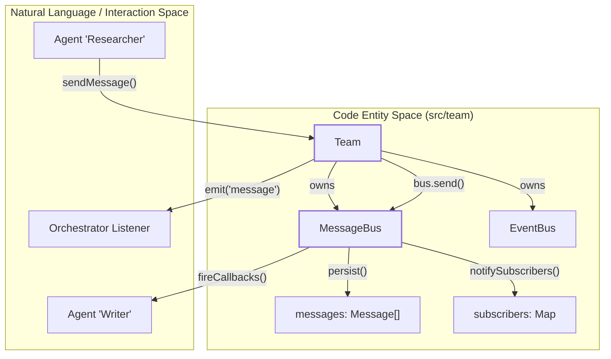
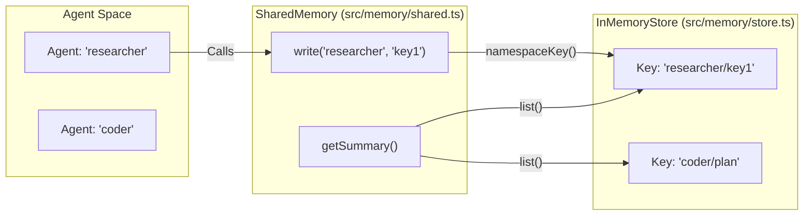

<!-- source: DeepWiki mcp.deepwiki.com · repo JackChen-me/open-multi-agent · page 2.2 Team and Messaging · fetched 2026-10-26 -->

# Team and Messaging

<details>
<summary>Relevant source files</summary>

The following files were used as context for generating this wiki page:

- [src/memory/shared.ts](src/memory/shared.ts)
- [src/team/messaging.ts](src/team/messaging.ts)
- [src/team/team.ts](src/team/team.ts)

</details>


The `Team` class serves as the central coordination hub for a group of agents. It manages the agent roster, facilitates inter-agent communication via a `MessageBus`, handles task distribution through a `TaskQueue`, and provides a `SharedMemory` layer for collaborative data persistence.

## The Team Class

The `Team` class [src/team/team.ts:88-250]() is the primary entity used by the `OpenMultiAgent` orchestrator to manage a collective of agents. It encapsulates all state and infrastructure required for agents to work together on complex tasks.

### Key Components
*   **Agent Roster**: A map of `AgentConfig` objects indexed by name for $O(1)$ lookup [src/team/team.ts:103-103]().
*   **MessageBus**: An internal instance of `MessageBus` for point-to-point and broadcast communication [src/team/team.ts:104-104]().
*   **TaskQueue**: Manages the lifecycle and dependencies of tasks assigned to the team [src/team/team.ts:105-105]().
*   **SharedMemory**: An optional namespaced memory store (enabled via `TeamConfig.sharedMemory`) [src/team/team.ts:106-106]().
*   **Internal Event Bus**: A private `EventBus` that bridges internal component events (like task completion) to external orchestrator listeners [src/team/team.ts:107-140]().

### Team Initialization and Event Bridging
When a `Team` is instantiated, it sets up listeners on its internal `TaskQueue` to re-emit events as `OrchestratorEvent` types. This allows external consumers to subscribe to a single event source for the entire team's lifecycle.

| Internal Event | Team Event | OrchestratorEvent Type | Description |
| :--- | :--- | :--- | :--- |
| `task:ready` | `task:ready` | `task_start` | Triggered when a task's dependencies are met [src/team/team.ts:110-117](). |
| `task:complete` | `task:complete` | `task_complete` | Triggered when an agent successfully finishes a task [src/team/team.ts:119-126](). |
| `task:failed` | `task:failed` | `error` | Triggered when a task fails or its dependencies fail [src/team/team.ts:128-135](). |

**Sources:** [src/team/team.ts:88-140](), [src/types.ts:100-115]()

## Messaging System

The `MessageBus` [src/team/messaging.ts:66-240]() provides a lightweight, in-memory pub/sub system. It allows agents to communicate without maintaining direct references to one another, using agent names as routing addresses.

### Message Structure
Every `Message` [src/team/messaging.ts:14-26]() contains:
*   `id`: A unique UUID [src/team/messaging.ts:96-96]().
*   `from`: The sender's agent name.
*   `to`: The recipient's name or `'*'` for broadcasts.
*   `content`: The raw string message.
*   `timestamp`: When the message was persisted.

### Delivery Logic
1.  **Point-to-Point**: A message sent to a specific `agentName` is delivered only to that agent's subscribers [src/team/messaging.ts:211-211]().
2.  **Broadcast**: A message sent to `'*'` is delivered to every registered subscriber *except* the sender [src/team/messaging.ts:34-37]().
3.  **Read State**: The bus tracks `readState` per agent [src/team/messaging.ts:74-74](). Agents can retrieve unread messages via `getUnread(agentName)` [src/team/messaging.ts:123-128]() and acknowledge them using `markRead` [src/team/messaging.ts:142-152]().

### Team Messaging Flow
The following diagram illustrates how the `Team` entity bridges the `MessageBus` to the high-level agent interactions.

**Team Messaging and Event Flow**

**Sources:** [src/team/messaging.ts:66-221](), [src/team/team.ts:161-201]()

## Shared Memory

`SharedMemory` [src/memory/shared.ts:36-181]() provides a persistent key-value store that is accessible to all agents in a team. It uses an `InMemoryStore` [src/memory/shared.ts:40-40]() but enforces a namespacing pattern to ensure data provenance.

### Namespacing and Writing
When an agent writes to memory, the key is automatically prefixed: `<agentName>/<key>` [src/memory/shared.ts:64-64]().
*   **Function**: `write(agentName, key, value, metadata)` [src/memory/shared.ts:58-69]().
*   **Provenance**: The `agent` name is also injected into the entry's metadata [src/memory/shared.ts:67-67]().

### Memory Summarization
A critical feature for LLM-based agents is the `getSummary()` method [src/memory/shared.ts:127-159](). It generates a Markdown-formatted digest of the entire store, grouped by agent.

**Example Summary Output:**
```markdown
## Shared Team Memory

### researcher
- findings: TypeScript 5.5 ships const type params

### coder
- plan: Implement feature X using const type params
```
The framework uses this summary to inject context into agent prompts, allowing them to "know" what their teammates have discovered or decided [src/memory/shared.ts:110-112]().

### Memory Architecture
The diagram below shows how the `SharedMemory` class wraps the underlying `InMemoryStore` to provide agent-aware access.

**Memory Layering and Namespacing**

**Sources:** [src/memory/shared.ts:36-159](), [src/memory/store.ts:1-50]()

## Task Management in Team

The `Team` class delegates task storage and dependency resolution to the `TaskQueue`, but provides high-level methods for task injection and retrieval.

*   **addTask**: Takes a partial task object, generates unique IDs and timestamps via `createTask`, and pushes it to the queue [src/team/team.ts:213-231]().
*   **getTasksByAssignee**: Filters the queue to return only tasks assigned to a specific agent [src/team/team.ts:238-243]().
*   **updateTaskStatus**: Allows the orchestrator or agents to transition a task's state (e.g., from `pending` to `completed`), which may unblock dependent tasks in the `TaskQueue` [src/team/team.ts:245-250]().

**Sources:** [src/team/team.ts:204-250](), [src/task/queue.ts:1-100]()

---

