# Page: Overview

# Overview

<details>
<summary>Relevant source files</summary>

The following files were used as context for generating this wiki page:

- [README.md](README.md)
- [package.json](package.json)
- [src/index.ts](src/index.ts)

</details>


`open-multi-agent` is a production-grade orchestration framework designed to build and manage teams of AI agents that collaborate to solve complex problems. It provides a model-agnostic infrastructure where different agents (e.g., Claude and GPT) can work together within a single Node.js process [package.json:36-49]().

The framework automates the lifecycle of multi-agent collaboration: planning a goal, decomposing it into a Directed Acyclic Graph (DAG) of tasks, and executing those tasks based on dependencies and agent capabilities [README.md:9-15]().

## High-Level Architecture

The system is organized into several layers, starting from high-level orchestration down to individual tool execution and LLM communication.

### System Component Relationship
This diagram maps the logical subsystems to their primary implementation classes in the codebase.

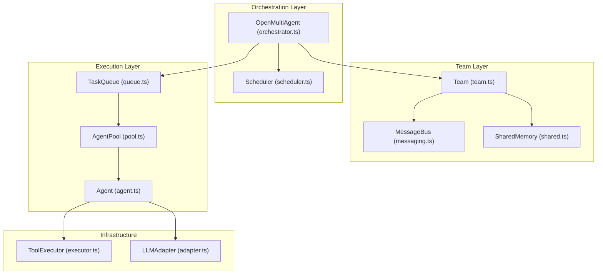
**Sources:** [src/index.ts:57-114](), [README.md:218-223]()

## Key Concepts

### 1. The Orchestrator
The `OpenMultiAgent` class serves as the primary entry point [src/index.ts:57](). It manages the high-level flow, whether running a single agent or a complex team. It handles task decomposition (the "Coordinator" pattern) and synthesizes results from multiple agents into a final output [README.md:82-87]().
*   For details, see **Orchestrator (2.1)**.

### 2. Teams and Messaging
A `Team` represents a collection of agents with a shared context [src/team/team.ts](). Agents within a team communicate via a `MessageBus` for real-time events and use `SharedMemory` to persist state and results across task boundaries [README.md:11-12]().
*   For details, see **Team and Messaging (2.2)** and **Memory System (6)**.

### 3. Task DAG Scheduling
The framework treats work as a series of `Task` objects [src/types.ts:156](). Tasks can depend on one another, forming a graph. The `TaskQueue` and `Scheduler` ensure that independent tasks run in parallel while dependent tasks wait for their requirements to be satisfied [README.md:94-120]().
*   For details, see **Task System (2.3)** and **Scheduler and AgentPool (2.4)**.

### 4. Agents and Tools
An `Agent` is a stateful entity that wraps an LLM and a set of tools [src/agent/agent.ts](). Agents use a "loop" (the `AgentRunner`) to reason, call tools, and process results until a goal is met or a limit is reached [README.md:195-212](). Tools are defined using Zod schemas for strict input validation [src/tool/framework.ts:89]().
*   For details, see **Agent Layer (3)** and **Tool System (5)**.

## Natural Language to Code Entity Mapping

The following diagram illustrates how natural language concepts used in the documentation translate to specific TypeScript entities in the `src/` directory.

```mermaid
giagram
graph LR
  subgraph "Natural Language Concept"
    N1["'The Boss' / Coordinator"]
    N2["'The Workspace'"]
    N3["'The Skills'"]
    N4["'The Brain'"]
  end

  subgraph "Code Entity Space"
    C1["OpenMultiAgent (src/orchestrator/orchestrator.ts)"]
    C2["SharedMemory (src/memory/shared.ts)"]
    C3["ToolRegistry (src/tool/framework.ts)"]
    C4["LLMAdapter (src/llm/adapter.ts)"]
  end

  N1 -- implements --> C1
  N2 -- implements --> C2
  N3 -- implements --> C3
  N4 -- implements --> C4
```
**Sources:** [src/index.ts:57-114](), [README.md:11-14]()

## Next Steps

To begin using the framework, refer to the following child pages:

*   **[Getting Started](#1.1)**: Learn how to install the package and run your first single-agent or multi-agent script.
*   **[Public API Reference](#1.2)**: A complete technical reference of all exported classes and types from the library.

---

# Page: Getting Started

# Getting Started

<details>
<summary>Relevant source files</summary>

The following files were used as context for generating this wiki page:

- [.gitignore](.gitignore)
- [package-lock.json](package-lock.json)
- [package.json](package.json)
- [tsconfig.json](tsconfig.json)

</details>


This page provides the essential technical instructions for installing, configuring, and running the `open-multi-agent` framework. It covers environment requirements, build scripts, and the fundamental patterns for both single-agent and multi-agent team execution.

## Prerequisites

The framework is built for modern Node.js environments and relies on strong typing via TypeScript.

*   **Node.js**: Version `18.0.0` or higher is required [package.json:36-38]().
*   **Package Manager**: `npm` is used for dependency management and script execution [package.json:14-21]().
*   **API Keys**: You will need valid API keys for the LLM providers you intend to use:
    *   `ANTHROPIC_API_KEY` for Anthropic (Claude) models.
    *   `OPENAI_API_KEY` for OpenAI (GPT) models.

Sources: [package.json:1-49]().

## Installation and Setup

To begin development, clone the repository and install the dependencies defined in `package.json`.

```bash
# Clone the repository
git clone https://github.com/JackChen-me/open-multi-agent.git
cd open-multi-agent

# Install dependencies
npm install
```

### Build and Test Scripts

The project uses `tsc` for compilation and `vitest` for testing.

| Command | Action | File Reference |
| :--- | :--- | :--- |
| `npm run build` | Compiles TypeScript source to the `dist/` directory. | [package.json:15-15]() |
| `npm run dev` | Runs the compiler in watch mode for active development. | [package.json:16-16]() |
| `npm run test` | Executes the test suite once using Vitest. | [package.json:17-17]() |
| `npm run lint` | Performs type-checking without emitting files. | [package.json:19-19]() |

Sources: [package.json:14-21](), [tsconfig.json:1-26]().

## Quick Start: Usage Patterns

The framework's primary entry point is the `OpenMultiAgent` orchestrator class. It abstracts the complexity of managing agents, teams, and task queues.

### Pattern 1: Single Agent Execution
For simple queries or single-turn tasks, use `runAgent`. This pattern bypasses the need for a full team structure.

```typescript
import { OpenMultiAgent } from '@jackchen_me/open-multi-agent';

const orchestrator = new OpenMultiAgent();

const result = await orchestrator.runAgent({
  name: "Assistant",
  instructions: "You are a helpful assistant.",
  model: "claude-3-5-sonnet-20241022",
  prompt: "What is the capital of France?"
});
```

### Pattern 2: Team Collaboration (Coordinator Pattern)
For complex tasks requiring multiple specialists, use `createTeam` and `runTeam`. This initiates a coordinator loop where a lead agent decomposes the request into sub-tasks for the team members.

```typescript
const team = orchestrator.createTeam({
  name: "DevTeam",
  agents: [
    { name: "Coder", instructions: "Write code.", model: "gpt-4o" },
    { name: "Reviewer", instructions: "Review code.", model: "claude-3-5-sonnet-20241022" }
  ]
});

const teamResult = await orchestrator.runTeam("DevTeam", "Build a simple web server.");
```

## System Initialization Flow

The following diagram illustrates how the `OpenMultiAgent` orchestrator initializes its internal components to transition from a configuration object to an active execution state.

**Initialization Data Flow**
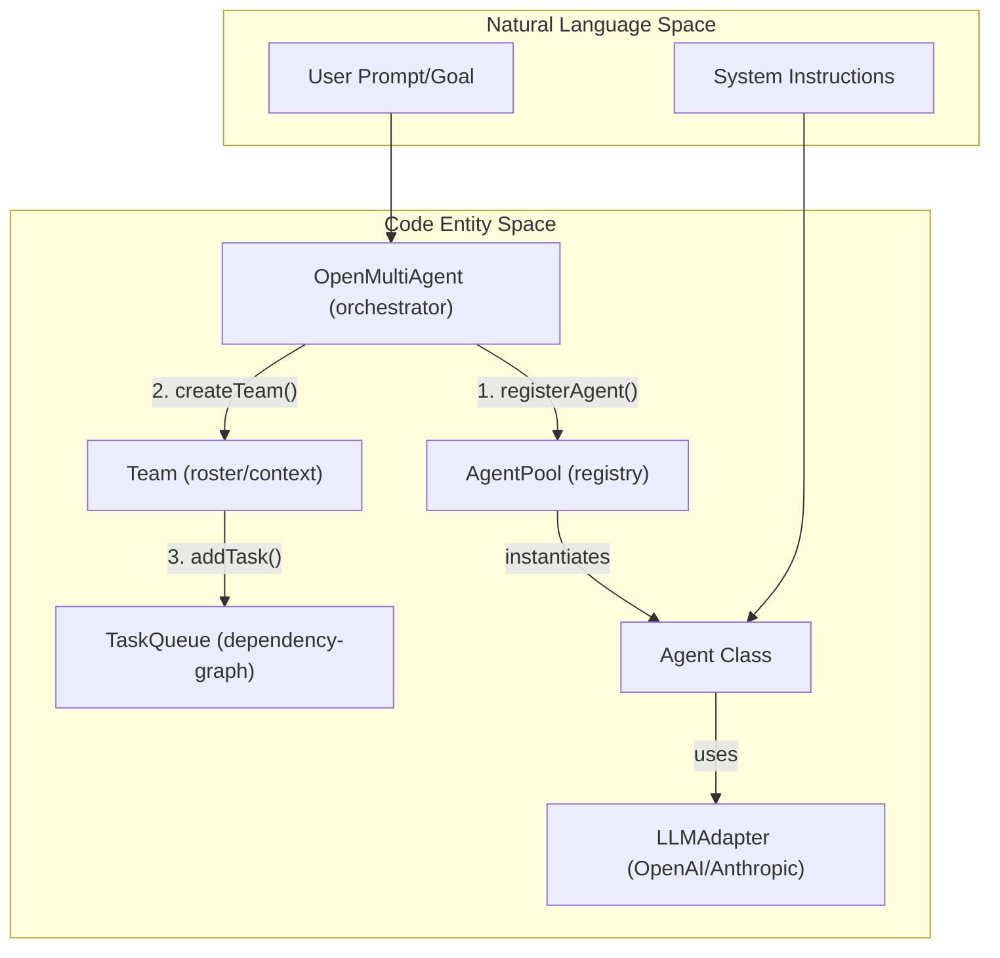
Sources: [package.json:4-4](), [tsconfig.json:23-23]().

## Implementation Detail: Component Interaction

When a user calls `runTeam`, the system enters a coordinated lifecycle. The `OpenMultiAgent` orchestrator manages the high-level flow, while the `AgentPool` controls the lifecycle and concurrency of individual `Agent` instances.

**Execution Logic and Code Entities**
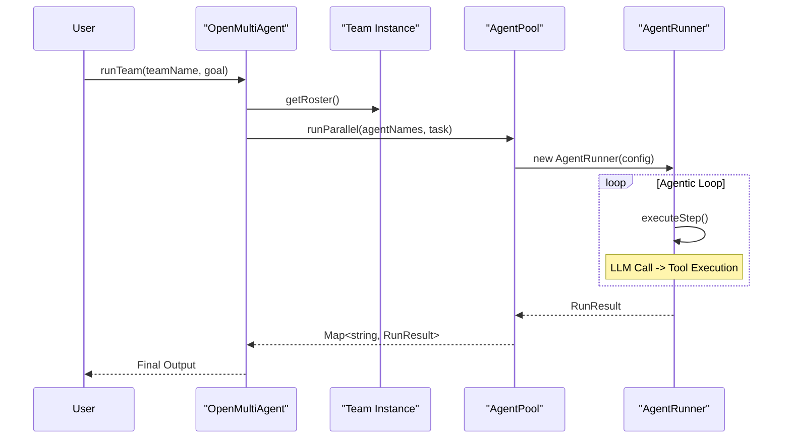
Sources: [package.json:39-43](), [tsconfig.json:7-11]().

---

# Page: Public API Reference

# Public API Reference

<details>
<summary>Relevant source files</summary>

The following files were used as context for generating this wiki page:

- [README.md](README.md)
- [src/index.ts](src/index.ts)
- [src/types.ts](src/types.ts)

</details>


This page provides a comprehensive reference for the symbols exported from the `open-multi-agent` package via `src/index.ts`. It covers the primary orchestrator, agent primitives, task management, tool systems, and the underlying type definitions.

## Overview of Public Surface

The framework is organized into several layers, with `OpenMultiAgent` serving as the primary entry point for most consumers.

### Code Entity Mapping
The following diagram bridges the natural language concepts of the multi-agent system to the specific code entities exported by the library.

**Entity Mapping: Concepts to Code**
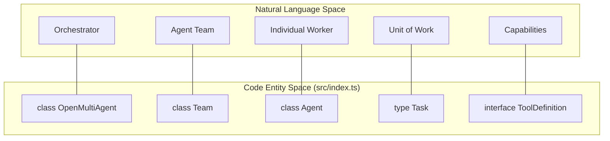
Sources: [src/index.ts:57-166](), [src/types.ts:15-180]()

---

## Orchestrator and Scheduling

The Orchestrator manages the lifecycle of teams and agents, providing high-level methods to execute goals.

### `OpenMultiAgent`
The primary class used to create teams and run tasks. It encapsulates the `AgentPool` and `Scheduler`.
- **`createTeam(id, config)`**: Initializes a `Team` instance with a specific set of agents and shared memory configuration [src/index.ts:57]().
- **`runAgent(config, prompt)`**: A convenience method for single-agent execution without formal team overhead [src/index.ts:57]().
- **`runTeam(team, goal)`**: Uses a "coordinator" pattern to decompose a natural language goal into a `TaskQueue` and execute it [src/index.ts:57]().
- **`runTasks(team, tasks)`**: Executes a predefined list of `Task` objects, respecting their `dependsOn` relationships [src/index.ts:57]().

### `Scheduler`
Handles the assignment of tasks to agents based on availability and capabilities.
- **`SchedulingStrategy`**: An enum or type defining how tasks are distributed (e.g., `round-robin`, `capability-match`) [src/index.ts:58-59]().

Sources: [src/index.ts:57-60](), [src/types.ts:223-238]()

---

## Agent and Pool Layer

Agents are the active entities that interact with LLMs and execute tools.

### `Agent`
The core class representing an autonomous worker.
- **`run(prompt)`**: Executes the agentic loop (LLM call -> Tool Use -> LLM call) until a final answer is reached or `maxTurns` is hit [src/index.ts:65]().
- **`stream(prompt)`**: Returns an `AsyncGenerator` emitting `StreamEvent` objects for real-time output [src/index.ts:65]().

### `AgentPool`
A registry and concurrency controller for agents.
- **`Semaphore`**: Used internally by the pool to limit the number of concurrent LLM requests or tool executions [src/index.ts:66]().

**Agent Data Flow**
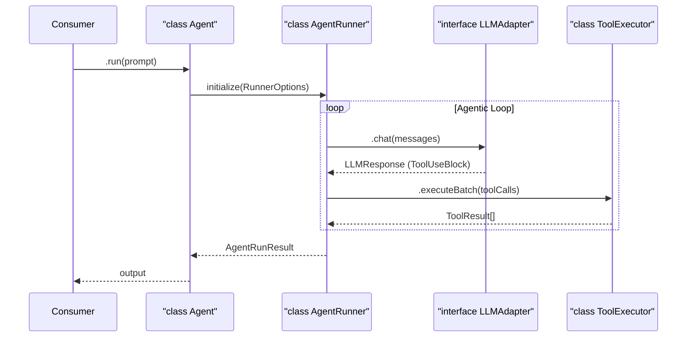
Sources: [src/index.ts:65-67](), [src/types.ts:186-214]()

---

## Task and Team Layer

Teams provide the organizational structure, while Tasks define the work graph.

### `Team`
Combines a group of agents with a `MessageBus` and `SharedMemory`.
- **`TeamConfig`**: Configuration object defining agent roles and whether `sharedMemory` is enabled [src/types.ts:243-248]().

### `Task` and `TaskQueue`
- **`Task`**: A unit of work with a `title`, `description`, and optional `assignee`. It supports a `dependsOn` array for DAG (Directed Acyclic Graph) construction [src/types.ts:253-264]().
- **`TaskQueue`**: Manages the lifecycle of tasks (`pending` -> `running` -> `completed`/`failed`). It emits `TaskQueueEvent` when task statuses change [src/index.ts:81-83]().

Sources: [src/index.ts:73-83](), [src/types.ts:243-264]()

---

## Tool System

The tool system allows agents to perform actions in the real world (e.g., file I/O, shell commands).

### `defineTool`
A factory function to create type-safe tools using Zod schemas.
- **`inputSchema`**: A Zod schema used to validate LLM generated arguments [src/types.ts:174-179]().
- **`execute`**: The implementation function receiving validated input and `ToolUseContext` [src/types.ts:178]().

### `ToolRegistry` & `ToolExecutor`
- **`ToolRegistry`**: A container for registered tools, capable of converting them to `LLMToolDef` for provider consumption [src/index.ts:89]().
- **`ToolExecutor`**: Handles the actual invocation of tool functions, including error isolation and `AbortSignal` propagation [src/index.ts:90]().

### Built-in Tools
The framework exports several pre-configured tools:
- `bashTool`, `fileReadTool`, `fileWriteTool`, `fileEditTool`, `grepTool` [src/index.ts:95-99]().
- `registerBuiltInTools(registry)`: Helper to quickly populate a registry [src/index.ts:92]().

Sources: [src/index.ts:89-100](), [src/types.ts:106-179]()

---

## Memory and LLM Adapters

### Memory
- **`InMemoryStore`**: A standard implementation of `MemoryStore` for transient session data [src/index.ts:113]().
- **`SharedMemory`**: A namespaced wrapper around a store that allows agents in a team to share information via a key-value pattern [src/index.ts:114]().

### LLM Adapters
- **`createAdapter(provider, options)`**: Factory function to instantiate an `LLMAdapter` (e.g., Anthropic or OpenAI) [src/index.ts:106]().
- **`SupportedProvider`**: Union type of `'anthropic' | 'openai'` [src/index.ts:107]().

Sources: [src/index.ts:106-114](), [src/types.ts:285-295]()

---

## Core Type Reference

### Content Blocks
The framework uses a unified block format for all message content.
- **`TextBlock`**: Raw text [src/types.ts:15-18]().
- **`ToolUseBlock`**: A request from the LLM to call a tool [src/types.ts:24-29]().
- **`ToolResultBlock`**: The output of a tool execution [src/types.ts:35-40]().

### Execution Results
- **`AgentRunResult`**: Contains `output`, `status`, `tokenUsage`, and a `toolCalls` log [src/types.ts:210-216]().
- **`TeamRunResult`**: Summary of a team execution, including a map of results from all involved agents [src/types.ts:269-275]().

Sources: [src/types.ts:15-53](), [src/types.ts:210-275]()

---

# Page: Core Architecture

# Core Architecture

<details>
<summary>Relevant source files</summary>

The following files were used as context for generating this wiki page:

- [README.md](README.md)
- [src/orchestrator/orchestrator.ts](src/orchestrator/orchestrator.ts)
- [src/types.ts](src/types.ts)

</details>


The `open-multi-agent` framework is designed as a layered ecosystem that transitions from high-level natural language goals to structured, autonomous execution. It manages the complexity of multi-agent collaboration by decomposing goals into a Directed Acyclic Graph (DAG) of tasks, which are then scheduled and executed by a pool of specialized agents.

## Architectural Layers

The framework's architecture is divided into three primary planes:

1.  **Orchestration Plane**: Manages the lifecycle of a "Team" and the flow of "Tasks". It uses a **Coordinator Pattern** to translate user prompts into actionable plans.
2.  **Execution Plane**: Contains the `AgentPool` and `Scheduler`. This layer handles concurrency, resource locking (via semaphores), and matching tasks to the best-suited agents.
3.  **Agent & Tool Plane**: The individual `Agent` instances, their `LLMAdapter` connections, and the `ToolExecutor` that runs validated code against the environment.

### System Data Flow

The following diagram illustrates how a high-level request moves through the system entities.

**Diagram: High-Level Request Flow**
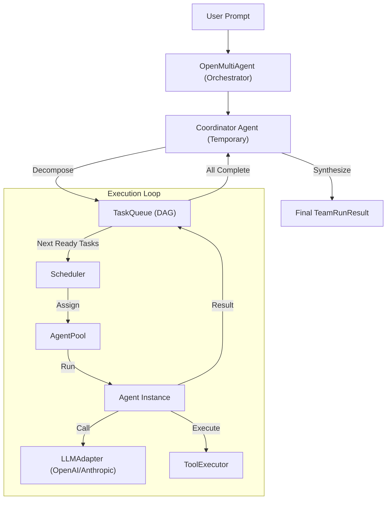
**Sources:** [src/orchestrator/orchestrator.ts:4-42](), [src/orchestrator/orchestrator.ts:158-180](), [README.md:218-240]()

---

## Core Components

### 1. Orchestrator (`OpenMultiAgent`)
The `OpenMultiAgent` class is the entry point for the framework. It coordinates the `Team`, `TaskQueue`, and `AgentPool`. Its primary responsibility is managing the "Coordinator" agent—a temporary agent created during `runTeam()` to break down goals into tasks [src/orchestrator/orchestrator.ts:33-35]().

For details, see [Orchestrator (#2.1)]().

### 2. Team and Messaging
A `Team` represents a roster of `AgentConfig` objects and a `SharedMemory` instance [src/team/team.ts:20-30](). It facilitates communication via a `MessageBus`, allowing agents to broadcast events or send point-to-point messages.

For details, see [Team and Messaging (#2.2)]().

### 3. Task System
Tasks are the unit of work in the framework. The `TaskQueue` manages a set of `Task` objects, tracking their `TaskStatus` (e.g., `pending`, `running`, `completed`, `blocked`). It uses a dependency graph to ensure that tasks only run once their `dependsOn` requirements are met [src/task/queue.ts:15-30]().

For details, see [Task System (#2.3)]().

### 4. Scheduler and AgentPool
The `Scheduler` implements strategies (like `round-robin` or `capability-match`) to pair available agents with pending tasks [src/orchestrator/scheduler.ts:10-25](). The `AgentPool` manages the actual execution, providing concurrency limits via a `Semaphore` to prevent overwhelming LLM rate limits or system resources [src/agent/pool.ts:15-25]().

For details, see [Scheduler and AgentPool (#2.4)]().

---

## Mapping Natural Language to Code Entities

The framework bridges the gap between natural language instructions and programmatic execution by mapping specific concepts to TypeScript classes and interfaces.

**Table: Concept to Code Mapping**

| Natural Language Concept | Code Entity | File Path |
| :--- | :--- | :--- |
| **The Team Goal** | `goal: string` (in `runTeam`) | [src/orchestrator/orchestrator.ts:254-254]() |
| **A Specific Job** | `Task` interface | [src/types.ts:241-255]() |
| **Agent Persona** | `AgentConfig` interface | [src/types.ts:186-196]() |
| **Memory/Context** | `MemoryStore` / `SharedMemory` | [src/types.ts:340-349]() |
| **Action/Capability** | `ToolDefinition` | [src/types.ts:174-179]() |

**Diagram: Entity Relationship and Code Links**
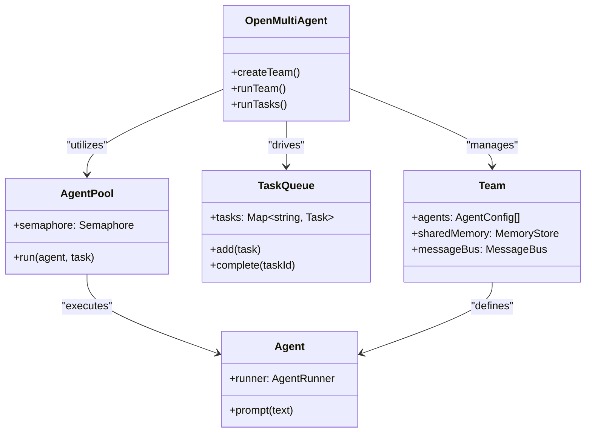
**Sources:** [src/orchestrator/orchestrator.ts:44-64](), [src/types.ts:186-210](), [src/types.ts:241-260]()

---

## Data Flow: From Goal to Result

1.  **Decomposition**: The `Orchestrator` calls a `Coordinator` agent to parse the `goal` into a `ParsedTaskSpec[]` [src/orchestrator/orchestrator.ts:99-104]().
2.  **Queueing**: These specs are converted into `Task` objects and inserted into the `TaskQueue` [src/orchestrator/orchestrator.ts:285-300]().
3.  **Scheduling**: The `executeQueue` loop identifies tasks with status `pending` (all dependencies met) [src/orchestrator/orchestrator.ts:188-192]().
4.  **Execution**: The `AgentPool` runs the assigned `Agent` for each task. The agent interacts with the `LLMAdapter` and `ToolExecutor` to fulfill the task description [src/agent/pool.ts:70-85]().
5.  **Synthesis**: Once the `TaskQueue` is empty, the `Coordinator` agent is called one last time to look at all `Task` results in `SharedMemory` and provide a final summary [src/orchestrator/orchestrator.ts:310-325]().

**Sources:** [src/orchestrator/orchestrator.ts:155-210](), [src/orchestrator/orchestrator.ts:254-330]()

---

# Page: Orchestrator

# Orchestrator

<details>
<summary>Relevant source files</summary>

The following files were used as context for generating this wiki page:

- [README.md](README.md)
- [src/orchestrator/orchestrator.ts](src/orchestrator/orchestrator.ts)
- [src/orchestrator/scheduler.ts](src/orchestrator/scheduler.ts)

</details>


The Orchestrator is the central brain of the `open-multi-agent` framework. Implemented via the `OpenMultiAgent` class, it manages the high-level lifecycle of agentic workflows, transitioning from natural language goals to structured task execution. It coordinates the `Team`, `TaskQueue`, `Scheduler`, and `AgentPool` to ensure that tasks are decomposed, assigned, and executed according to their dependency graph.

### Core Responsibilities
- **Decomposition**: Using the "Coordinator Pattern" to break a high-level goal into a Directed Acyclic Graph (DAG) of tasks [[src/orchestrator/orchestrator.ts:33-35]]().
- **Scheduling**: Mapping unassigned tasks to the most suitable agents based on configurable strategies [[src/orchestrator/scheduler.ts:4-10]]().
- **Execution**: Managing a parallel execution loop that respects task dependencies and agent concurrency limits [[src/orchestrator/orchestrator.ts:167-176]]().
- **Synthesis**: Aggregating results from multiple agents into a final coherent response [[src/orchestrator/orchestrator.ts:33-35]]().

Sources: [src/orchestrator/orchestrator.ts:1-42](), [src/orchestrator/scheduler.ts:1-14]()

---

## The Coordinator Pattern

The "killer feature" of the Orchestrator is the **Coordinator Pattern** used in `runTeam()`. Instead of requiring the user to manually define every task, the Orchestrator spins up a temporary "coordinator" agent.

### Decomposition and Synthesis Loop
1. **Decomposition**: The coordinator receives the `Team` roster and the user's goal. It outputs a JSON array of task specifications (`ParsedTaskSpec`) [[src/orchestrator/orchestrator.ts:99-104]]().
2. **Queueing**: These specs are converted into `Task` objects and injected into a `TaskQueue` [[src/orchestrator/orchestrator.ts:251-260]]().
3. **Execution**: The `executeQueue` function processes the tasks [[src/orchestrator/orchestrator.ts:177-180]]().
4. **Synthesis**: Once all tasks complete, the coordinator is prompted again to look at the `SharedMemory` (containing results from all agents) and produce the final answer [[src/orchestrator/orchestrator.ts:281-295]]().

### Natural Language to Code Entity Mapping: Decomposition
The following diagram shows how the Orchestrator translates a natural language prompt into internal system entities.

**Diagram: Goal Decomposition Flow**
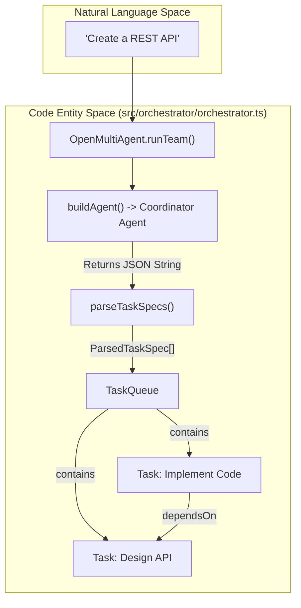
Sources: [src/orchestrator/orchestrator.ts:88-93](), [src/orchestrator/orchestrator.ts:111-149](), [src/orchestrator/orchestrator.ts:245-260]()

---

## Orchestration Loop (executeQueue)

The `executeQueue` function is the engine of the Orchestrator. It runs an iterative loop that continues until the `TaskQueue` is exhausted or stuck.

| Step | Logic | Code Reference |
| :--- | :--- | :--- |
| **1. Auto-Assign** | The `Scheduler` maps pending tasks to agents based on the chosen strategy. | [[src/orchestrator/orchestrator.ts:186-187]]() |
| **2. Identify Ready** | Finds all tasks with status `'pending'` (all dependencies met). | [[src/orchestrator/orchestrator.ts:188-188]]() |
| **3. Dispatch** | Executes tasks in parallel via `AgentPool.run()`. | [[src/orchestrator/orchestrator.ts:194-210]]() |
| **4. Update Memory** | Results are saved to `SharedMemory` for other agents to see. | [[src/orchestrator/orchestrator.ts:213-214]]() |
| **5. Unblock** | The `TaskQueue` marks dependents of finished tasks as `'pending'`. | [[src/orchestrator/orchestrator.ts:218-218]]() |

### Task Scheduling Strategies
The `Scheduler` supports four strategies for mapping tasks to agents [[src/orchestrator/scheduler.ts:23-35]]():
- `round-robin`: Distributes tasks evenly by agent index.
- `least-busy`: Prefers agents with the fewest active tasks.
- `capability-match`: Uses keyword overlap between task descriptions and agent roles.
- `dependency-first`: Prioritizes tasks that unblock the highest number of downstream tasks (Critical Path).

Sources: [src/orchestrator/orchestrator.ts:177-228](), [src/orchestrator/scheduler.ts:157-174]()

---

## System Wiring and Data Flow

The Orchestrator acts as the "glue" that wires together the various subsystems. When `runTeam` or `runTasks` is called, a `RunContext` is assembled to maintain state for that specific execution [[src/orchestrator/orchestrator.ts:158-164]]().

**Diagram: System Wiring**
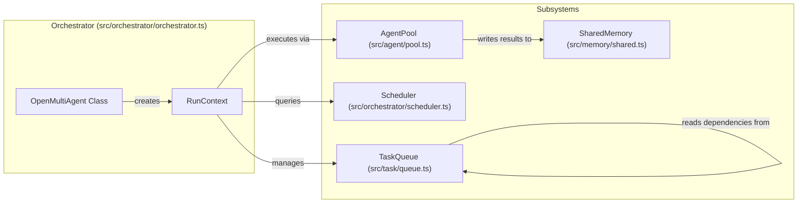

### Key Public Methods

- **`createTeam(id, config)`**: Initializes a `Team` with a roster of agents and optional shared memory [[src/orchestrator/orchestrator.ts:232-237]]().
- **`runAgent(config, prompt)`**: A shortcut for single-agent execution without the overhead of a team or task queue [[src/orchestrator/orchestrator.ts:311-325]]().
- **`runTeam(team, goal)`**: The primary entry point for the coordinator-led multi-agent workflow [[src/orchestrator/orchestrator.ts:239-244]]().
- **`runTasks(team, tasks)`**: Executes a predefined list of tasks (manual DAG) using the team's agents [[src/orchestrator/orchestrator.ts:297-302]]().
- **`getStatus(runId)`**: Returns the current status of all tasks and agents for an active run [[src/orchestrator/orchestrator.ts:335-341]]().
- **`shutdown()`**: Stops all active agents and clears the execution pool [[src/orchestrator/orchestrator.ts:348-350]]().

Sources: [src/orchestrator/orchestrator.ts:230-352](), [src/orchestrator/orchestrator.ts:158-164]()

---

# Page: Team and Messaging

# Team and Messaging

<details>
<summary>Relevant source files</summary>

The following files were used as context for generating this wiki page:

- [src/memory/shared.ts](src/memory/shared.ts)
- [src/team/messaging.ts](src/team/messaging.ts)
- [src/team/team.ts](src/team/team.ts)

</details>


The `Team` class serves as the central coordination hub for a group of agents. It manages the agent roster, facilitates inter-agent communication via a `MessageBus`, handles task distribution through a `TaskQueue`, and provides a `SharedMemory` layer for collaborative data persistence.

## The Team Class

The `Team` class [src/team/team.ts:88-250]() is the primary entity used by the `OpenMultiAgent` orchestrator to manage a collective of agents. It encapsulates all state and infrastructure required for agents to work together on complex tasks.

### Key Components
*   **Agent Roster**: A map of `AgentConfig` objects indexed by name for $O(1)$ lookup [src/team/team.ts:103-103]().
*   **MessageBus**: An internal instance of `MessageBus` for point-to-point and broadcast communication [src/team/team.ts:104-104]().
*   **TaskQueue**: Manages the lifecycle and dependencies of tasks assigned to the team [src/team/team.ts:105-105]().
*   **SharedMemory**: An optional namespaced memory store (enabled via `TeamConfig.sharedMemory`) [src/team/team.ts:106-106]().
*   **Internal Event Bus**: A private `EventBus` that bridges internal component events (like task completion) to external orchestrator listeners [src/team/team.ts:107-140]().

### Team Initialization and Event Bridging
When a `Team` is instantiated, it sets up listeners on its internal `TaskQueue` to re-emit events as `OrchestratorEvent` types. This allows external consumers to subscribe to a single event source for the entire team's lifecycle.

| Internal Event | Team Event | OrchestratorEvent Type | Description |
| :--- | :--- | :--- | :--- |
| `task:ready` | `task:ready` | `task_start` | Triggered when a task's dependencies are met [src/team/team.ts:110-117](). |
| `task:complete` | `task:complete` | `task_complete` | Triggered when an agent successfully finishes a task [src/team/team.ts:119-126](). |
| `task:failed` | `task:failed` | `error` | Triggered when a task fails or its dependencies fail [src/team/team.ts:128-135](). |

**Sources:** [src/team/team.ts:88-140](), [src/types.ts:100-115]()

## Messaging System

The `MessageBus` [src/team/messaging.ts:66-240]() provides a lightweight, in-memory pub/sub system. It allows agents to communicate without maintaining direct references to one another, using agent names as routing addresses.

### Message Structure
Every `Message` [src/team/messaging.ts:14-26]() contains:
*   `id`: A unique UUID [src/team/messaging.ts:96-96]().
*   `from`: The sender's agent name.
*   `to`: The recipient's name or `'*'` for broadcasts.
*   `content`: The raw string message.
*   `timestamp`: When the message was persisted.

### Delivery Logic
1.  **Point-to-Point**: A message sent to a specific `agentName` is delivered only to that agent's subscribers [src/team/messaging.ts:211-211]().
2.  **Broadcast**: A message sent to `'*'` is delivered to every registered subscriber *except* the sender [src/team/messaging.ts:34-37]().
3.  **Read State**: The bus tracks `readState` per agent [src/team/messaging.ts:74-74](). Agents can retrieve unread messages via `getUnread(agentName)` [src/team/messaging.ts:123-128]() and acknowledge them using `markRead` [src/team/messaging.ts:142-152]().

### Team Messaging Flow
The following diagram illustrates how the `Team` entity bridges the `MessageBus` to the high-level agent interactions.

**Team Messaging and Event Flow**
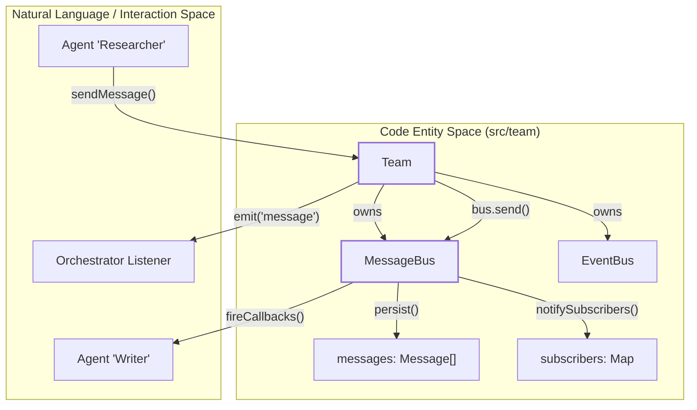
**Sources:** [src/team/messaging.ts:66-221](), [src/team/team.ts:161-201]()

## Shared Memory

`SharedMemory` [src/memory/shared.ts:36-181]() provides a persistent key-value store that is accessible to all agents in a team. It uses an `InMemoryStore` [src/memory/shared.ts:40-40]() but enforces a namespacing pattern to ensure data provenance.

### Namespacing and Writing
When an agent writes to memory, the key is automatically prefixed: `<agentName>/<key>` [src/memory/shared.ts:64-64]().
*   **Function**: `write(agentName, key, value, metadata)` [src/memory/shared.ts:58-69]().
*   **Provenance**: The `agent` name is also injected into the entry's metadata [src/memory/shared.ts:67-67]().

### Memory Summarization
A critical feature for LLM-based agents is the `getSummary()` method [src/memory/shared.ts:127-159](). It generates a Markdown-formatted digest of the entire store, grouped by agent.

**Example Summary Output:**
```markdown
## Shared Team Memory

### researcher
- findings: TypeScript 5.5 ships const type params

### coder
- plan: Implement feature X using const type params
```
The framework uses this summary to inject context into agent prompts, allowing them to "know" what their teammates have discovered or decided [src/memory/shared.ts:110-112]().

### Memory Architecture
The diagram below shows how the `SharedMemory` class wraps the underlying `InMemoryStore` to provide agent-aware access.

**Memory Layering and Namespacing**
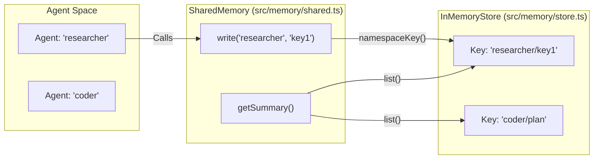
**Sources:** [src/memory/shared.ts:36-159](), [src/memory/store.ts:1-50]()

## Task Management in Team

The `Team` class delegates task storage and dependency resolution to the `TaskQueue`, but provides high-level methods for task injection and retrieval.

*   **addTask**: Takes a partial task object, generates unique IDs and timestamps via `createTask`, and pushes it to the queue [src/team/team.ts:213-231]().
*   **getTasksByAssignee**: Filters the queue to return only tasks assigned to a specific agent [src/team/team.ts:238-243]().
*   **updateTaskStatus**: Allows the orchestrator or agents to transition a task's state (e.g., from `pending` to `completed`), which may unblock dependent tasks in the `TaskQueue` [src/team/team.ts:245-250]().

**Sources:** [src/team/team.ts:204-250](), [src/task/queue.ts:1-100]()

---

# Page: Task System

# Task System

<details>
<summary>Relevant source files</summary>

The following files were used as context for generating this wiki page:

- [src/task/queue.ts](src/task/queue.ts)
- [src/task/task.ts](src/task/task.ts)
- [src/types.ts](src/types.ts)

</details>


The Task System provides a structured way to define, validate, and execute units of work with complex inter-dependencies. It transitions from high-level natural language descriptions to a dependency-aware execution graph managed by the `TaskQueue`.

## Task Model and Lifecycle

A `Task` is the primary unit of work within the framework. It contains metadata about the objective, the assigned agent, and its current position in the execution lifecycle.

### Task Status Lifecycle

Tasks transition through several states defined by the `TaskStatus` type [src/types.ts:228-235]().

| Status | Description |
| :--- | :--- |
| `pending` | The task is created but not yet executing. It may be waiting for dependencies. |
| `blocked` | The task has unresolved dependencies (upstream tasks that are not `completed`). |
| `running` | An agent is currently working on the task. |
| `completed` | The task finished successfully; the `result` field contains the output. |
| `failed` | The task or one of its dependencies encountered an error. |

### The Task Entity

The `Task` interface ensures that every piece of work has a unique identity and clear lineage.

**Task Definition Structure**
[src/types.ts:237-260]()
*   `id`: A unique UUID generated at creation.
*   `title` / `description`: Natural language goals for the agent.
*   `dependsOn`: An array of `taskId` strings that must complete before this task starts.
*   `assignee`: Optional name of the specific agent responsible for this task.
*   `result`: Stores the final string output or error message.

**Sources:** [src/types.ts:228-260](), [src/task/task.ts:28-46]()

---

## Task Helpers and Validation

The framework provides pure utility functions in `src/task/task.ts` to manage task creation and graph integrity without side effects.

### Creation and Readiness
*   **`createTask`**: A factory function that initializes a task with `pending` status and unique timestamps [src/task/task.ts:28-46]().
*   **`isTaskReady`**: Determines if a task can move to execution. A task is ready only if its status is `pending` and all IDs in `dependsOn` refer to tasks with a `completed` status [src/task/task.ts:69-85]().

### Dependency Management
To ensure a stable execution order, the system employs **Kahn's Algorithm** for topological sorting and cycle detection.

*   **`getTaskDependencyOrder`**: Sorts an array of tasks so that every task appears after its dependencies [src/task/task.ts:108-153]().
*   **`validateTaskDependencies`**: Performs a two-pass validation [src/task/task.ts:177-219]():
    1.  Checks for unknown task IDs and self-references.
    2.  Uses Depth-First Search (DFS) coloring to detect circular dependencies (cycles).

**Sources:** [src/task/task.ts:1-219]()

---

## TaskQueue: Dependency-Aware Scheduling

The `TaskQueue` is a mutable, event-driven manager that orchestrates the flow of tasks based on their dependency graph. It is responsible for promoting tasks from `blocked` to `pending` as work completes.

### Event-Driven Architecture

The `TaskQueue` emits specific events that the `Orchestrator` or `Team` listens to for driving the agent loop [src/task/queue.ts:17-21]():
*   `task:ready`: Fired when a task's dependencies are satisfied.
*   `task:complete`: Fired when a task reaches a terminal success state.
*   `task:failed`: Fired on failure or during a cascade.
*   `all:complete`: Fired when no more tasks remain in non-terminal states.

### Scheduling Logic

The following diagram illustrates how the `TaskQueue` manages the transition from natural language tasks to code-level execution readiness.

**Task Transition Flow (Natural Language to Code Execution)**
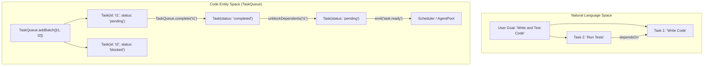
**Sources:** [src/task/queue.ts:54-93](), [src/task/queue.ts:130-138]()

### Failure Handling and Cascading

When a task fails, the `TaskQueue` ensures that the entire downstream pipeline is safely halted to prevent agents from working on invalid data.

*   **`fail(taskId, error)`**: Marks the target task as `failed` [src/task/queue.ts:149-157]().
*   **`cascadeFailure(failedTaskId)`**: Recursively identifies all tasks that transitively depend on the failed task and marks them as `failed` with a "Cancelled" message [src/task/queue.ts:166-179]().

### Key Methods

| Method | Role |
| :--- | :--- |
| `add(task)` | Inserts a task and calculates initial status (`pending` vs `blocked`) [src/task/queue.ts:73-79](). |
| `complete(taskId)` | Updates status to `completed` and triggers `unblockDependents` [src/task/queue.ts:130-138](). |
| `nextAvailable()` | Returns the first `pending` task that is not restricted to a specific assignee [src/task/queue.ts:206-220](). |
| `unblockDependents(id)` | Scans the queue for `blocked` tasks depending on `id` and re-evaluates their readiness [src/task/queue.ts:262-277](). |

**Sources:** [src/task/queue.ts:99-277]()

---

## Data Flow: Task Execution Loop

The following diagram bridges the `TaskQueue` logic with the `OpenMultiAgent` orchestrator components.

**Task Execution Data Flow**
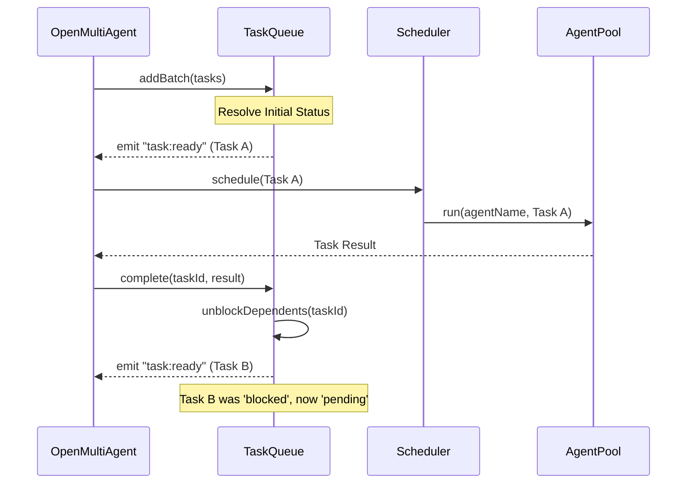

**Sources:** [src/task/queue.ts:130-138](), [src/task/queue.ts:262-277](), [src/task/task.ts:69-85]()

---

# Page: Scheduler and AgentPool

# Scheduler and AgentPool

<details>
<summary>Relevant source files</summary>

The following files were used as context for generating this wiki page:

- [src/agent/pool.ts](src/agent/pool.ts)
- [src/orchestrator/scheduler.ts](src/orchestrator/scheduler.ts)
- [src/utils/semaphore.ts](src/utils/semaphore.ts)

</details>


The `Scheduler` and `AgentPool` components manage how work is distributed across agents and how concurrent execution is throttled. While `AgentPool` acts as a physical registry and execution gate for `Agent` instances, the `Scheduler` provides the logic for mapping abstract `Task` objects to the most appropriate agents based on configurable strategies.

## AgentPool

The `AgentPool` class is a registry and execution manager for a collection of `Agent` instances [src/agent/pool.ts:57-58](). It enforces a global concurrency limit across all managed agents using a `Semaphore` [src/agent/pool.ts:68-69]().

### Concurrency Control
The pool uses a `Semaphore` to ensure that no more than `maxConcurrency` (default: 5) async agent runs occur simultaneously [src/agent/pool.ts:65-68](). This prevents overwhelming LLM provider rate limits or local system resources when running large teams.

- **`run(agentName, prompt)`**: Acquires a semaphore slot, executes the named agent's `run` method, and releases the slot upon completion or error [src/agent/pool.ts:126-135]().
- **`runParallel(tasks)`**: Takes an array of `{ agent, prompt }` descriptors and executes them all via `Promise.allSettled`. It internally calls `run`, meaning the concurrency cap is respected even if the input array is larger than the cap [src/agent/pool.ts:147-157]().
- **`runAny(prompt)`**: Implements a basic round-robin dispatch at the pool level. It selects the next agent in insertion order and executes the prompt [src/agent/pool.ts:185-195]().

### Registry and Status
Agents are added to the pool via `add(agent)` and must have unique names [src/agent/pool.ts:80-87](). The `getStatus()` method provides a snapshot of the pool's health, aggregating the `AgentState` of every registered agent into counts of `idle`, `running`, `completed`, and `error` [src/agent/pool.ts:211-224]().

**Sources:**
- [src/agent/pool.ts:57-69]() (Class definition and Semaphore initialization)
- [src/agent/pool.ts:126-174]() (Execution methods)
- [src/agent/pool.ts:211-224]() (Status reporting)
- [src/utils/semaphore.ts:24-50]() (Semaphore implementation)

---

## Scheduler

The `Scheduler` class contains the logic for assigning `Task` objects to `AgentConfig` definitions [src/orchestrator/scheduler.ts:127-136](). It is stateless; it takes a snapshot of tasks and agents and returns a mapping of recommendations.

### Scheduling Strategies
The framework supports four `SchedulingStrategy` types [src/orchestrator/scheduler.ts:31-35]():

| Strategy | Logic | Use Case |
| :--- | :--- | :--- |
| `round-robin` | Distributes tasks sequentially across agents using an internal `roundRobinCursor` [src/orchestrator/scheduler.ts:129-166](). | General purpose, balanced load. |
| `least-busy` | Assigns tasks to the agent currently associated with the fewest `in_progress` tasks in the `TaskQueue` [src/orchestrator/scheduler.ts:167-168](). | Dynamic load balancing. |
| `capability-match` | Scores agents by matching task description keywords against the agent's `role` and `goal` [src/orchestrator/scheduler.ts:169-170](). | Specialized teams (e.g., "coder" vs "reviewer"). |
| `dependency-first` | Uses a BFS to find tasks that are blocking the highest number of other tasks (the "critical path") [src/orchestrator/scheduler.ts:41-75](). | Complex DAGs where bottlenecks must be cleared. |

### Keyword Matching Logic
For the `capability-match` strategy, the scheduler uses `extractKeywords` to strip common stop-words [src/orchestrator/scheduler.ts:94-107](). It then calculates a `keywordScore` based on the overlap between the task's requirements and the agent's metadata [src/orchestrator/scheduler.ts:83-86]().

**Sources:**
- [src/orchestrator/scheduler.ts:31-35]() (Strategy types)
- [src/orchestrator/scheduler.ts:50-75]() (Dependency BFS logic)
- [src/orchestrator/scheduler.ts:157-174]() (Primary `schedule` method)

---

## Data Flow: Task Assignment to Execution

The following diagram illustrates how a `Task` moves from the `TaskQueue` through the `Scheduler` logic and finally into the `AgentPool` for execution.

### Task Dispatch Pipeline
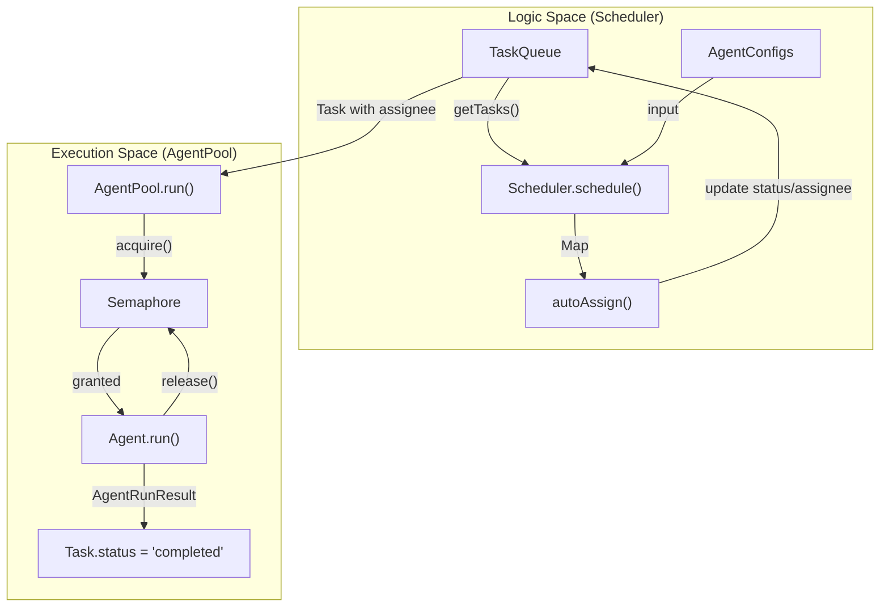
**Sources:**
- [src/orchestrator/scheduler.ts:176-187]() (Logic for `autoAssign`)
- [src/agent/pool.ts:126-135]() (Logic for `run` and Semaphore interaction)

---

## Implementation Details

### Semaphore-based Concurrency
The `Semaphore` class manages a FIFO `queue` of `resolve` functions [src/utils/semaphore.ts:26-49](). When `max` concurrency is reached, subsequent calls to `acquire()` return a `Promise` that remains pending until a previous task calls `release()` [src/utils/semaphore.ts:56-65]().

### Dependency Analysis
The `countBlockedDependents` function builds a reverse adjacency map (dependency ID to dependent tasks) [src/orchestrator/scheduler.ts:53-60](). It performs a Breadth-First Search (BFS) to count exactly how many tasks are transitively blocked by a specific task ID [src/orchestrator/scheduler.ts:63-75]().

### AgentPool Status Snapshot
The `PoolStatus` interface provides a read-only view of the pool [src/agent/pool.ts:33-44]().
```typescript
export interface PoolStatus {
  readonly total: number
  readonly idle: number
  readonly running: number
  readonly completed: number
  readonly error: number
}
```

**Sources:**
- [src/utils/semaphore.ts:41-65]() (Acquire/Release logic)
- [src/orchestrator/scheduler.ts:50-75]() (BFS dependency counting)
- [src/agent/pool.ts:33-44]() (Status interface)

---

# Page: Agent Layer

# Agent Layer

<details>
<summary>Relevant source files</summary>

The following files were used as context for generating this wiki page:

- [src/agent/agent.ts](src/agent/agent.ts)
- [src/agent/runner.ts](src/agent/runner.ts)

</details>


The **Agent Layer** is the primary execution engine of the `open-multi-agent` framework. It provides a high-level abstraction over LLM interactions, tool execution, and state management. While the Orchestrator (see [Orchestrator](#2.1)) manages groups of agents, the Agent Layer defines how a single entity perceives its environment, reasons through problems, and acts via tools.

### Core Components

The layer is built around two primary classes that separate state management from execution logic:

1.  **`Agent`**: The public-facing interface. It manages the agent's identity, configuration, persistent conversation history, and lifecycle state (e.g., `idle`, `running`).
2.  **`AgentRunner`**: The internal execution engine. It implements the "agentic loop," handling the low-level details of LLM requests, parallel tool execution, and token usage aggregation.

### High-Level Architecture

The following diagram illustrates how the Agent Layer bridges the gap between high-level user requests and low-level code execution.

**Diagram: Agent Layer Architecture**
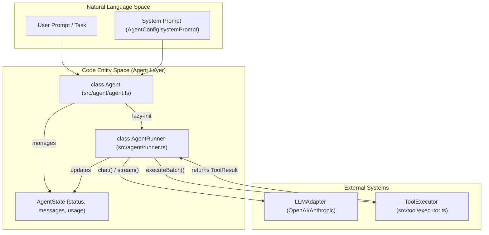
Sources: [src/agent/agent.ts:61-94](), [src/agent/runner.ts:139-149](), [src/agent/agent.ts:106-133]()

---

## 3.1 Agent Class

The `Agent` class serves as the primary entry point for developers. It encapsulates an `AgentConfig` and maintains an internal `AgentState`. 

### Key Responsibilities
- **State Management**: Tracks whether the agent is `idle`, `running`, `completed`, or in an `error` state [src/agent/agent.ts:89-93]().
- **Conversation Persistence**: Provides two modes of execution:
    - `run()`: A "one-shot" execution that does not save history [src/agent/agent.ts:147-153]().
    - `prompt()`: A "stateful" execution that appends messages to a persistent `messageHistory` [src/agent/agent.ts:163-179]().
- **Lazy Initialization**: The underlying `AgentRunner` and `LLMAdapter` are only instantiated when an execution method is first called [src/agent/agent.ts:106-133]().
- **Tool Management**: Allows dynamic addition and removal of tools at runtime via `addTool()` and `removeTool()` [src/agent/agent.ts:222-233]().

For details on configuration and the full API, see **[Agent Class](#3.1)**.

Sources: [src/agent/agent.ts:1-24](), [src/agent/agent.ts:61-70]()

---

## 3.2 AgentRunner and Conversation Loop

The `AgentRunner` is the "heart" of the framework, responsible for the iterative process of reasoning and acting. It operates on a `while(true)` loop that continues until the LLM provides a final answer or a limit is reached.

### The Agentic Loop
The runner executes the following sequence:
1.  **LLM Call**: Sends the current message history to the `LLMAdapter`.
2.  **Extraction**: Parses the response for `text` blocks and `tool_use` blocks [src/agent/runner.ts:108-110]().
3.  **Parallel Execution**: If tools are requested, it uses the `ToolExecutor` to run them concurrently [src/agent/runner.ts:7-8]().
4.  **Injection**: Appends the tool results back into the conversation history as `tool_result` blocks.
5.  **Repeat**: Loops back to step 1 until the LLM signals `end_turn` without further tool calls [src/agent/runner.ts:164-165]().

**Diagram: The Runner Execution Loop**
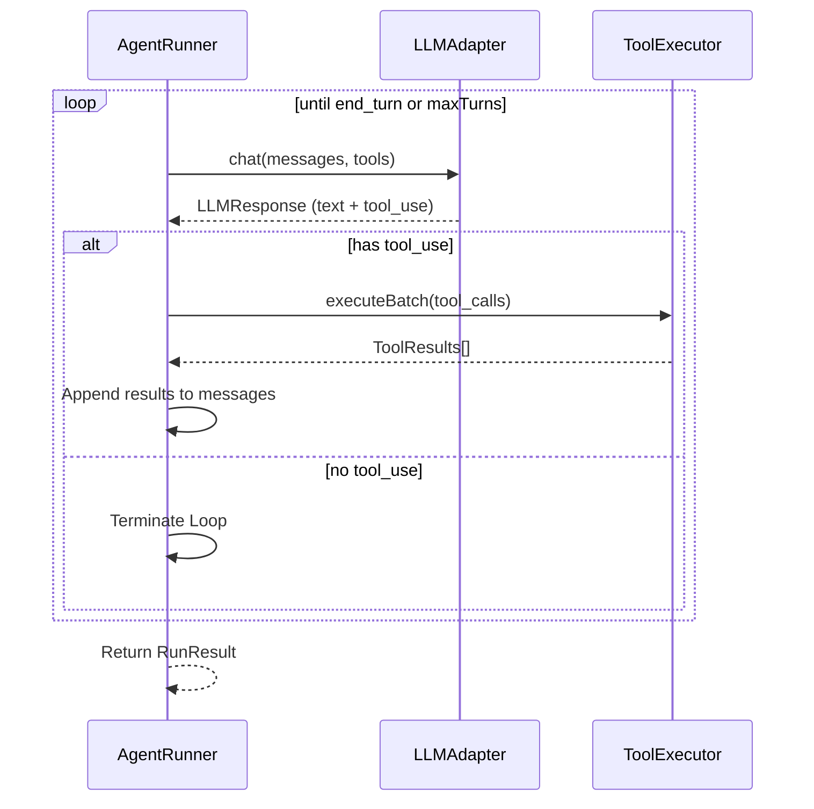
Sources: [src/agent/runner.ts:4-13](), [src/agent/runner.ts:139-149]()

### Execution Control
- **`maxTurns`**: Prevents infinite loops by capping the number of round-trips (default: 10) [src/agent/runner.ts:49-50]().
- **`AbortSignal`**: Supports cancellation of in-flight LLM requests and tool executions [src/agent/runner.ts:54-55]().
- **Streaming**: Provides real-time updates via an `AsyncGenerator`, yielding `StreamEvent` objects for text deltas and tool lifecycle events [src/agent/runner.ts:198-204]().

For a deep dive into the loop internals and result aggregation, see **[AgentRunner and Conversation Loop](#3.2)**.

Sources: [src/agent/runner.ts:81-93](), [src/agent/runner.ts:164-195]()

---

# Page: Agent Class

# Agent Class

<details>
<summary>Relevant source files</summary>

The following files were used as context for generating this wiki page:

- [src/agent/agent.ts](src/agent/agent.ts)
- [src/types.ts](src/types.ts)

</details>


The `Agent` class is the primary high-level interface for the `open-multi-agent` framework. It serves as a stateful wrapper around the `AgentRunner`, managing conversation history, lifecycle transitions, and tool registration. While the `AgentRunner` handles the low-level "while-true" loop of LLM interaction and tool execution, the `Agent` class provides the ergonomic API used by consumers to execute one-shot queries, maintain multi-turn dialogues, and track token usage.

### Core Architecture and Data Flow

The `Agent` class bridges the gap between the static `AgentConfig` and the dynamic execution environment. It uses a lazy initialization pattern for its internal `AgentRunner` to ensure that provider SDKs are only loaded when needed.

#### Entity Relationship: Natural Language to Code
This diagram illustrates how natural language concepts (like a "Researcher" persona) map to specific code entities within the `Agent` class.

**Agent Entity Mapping**
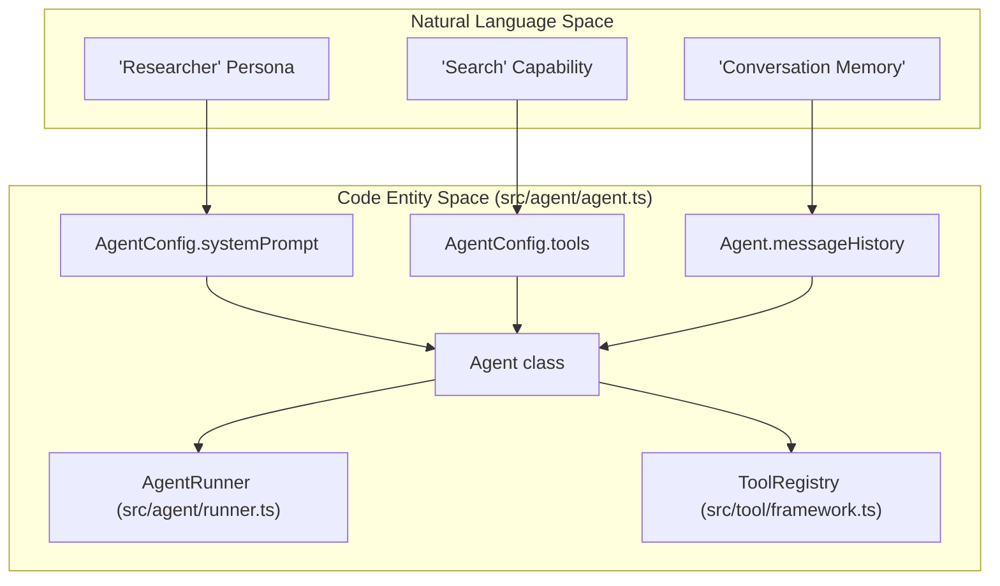
**Sources:** [src/agent/agent.ts:61-94](), [src/types.ts:186-196]()

---

### Agent Configuration and State

An `Agent` is initialized with an `AgentConfig`, a `ToolRegistry`, and a `ToolExecutor`. The registry and executor are injected to allow multiple agents (e.g., in a `Team`) to share the same tool definitions and execution logic.

#### AgentConfig
The configuration defines the agent's identity and constraints:
*   `name`: Unique identifier.
*   `model`: The specific LLM (e.g., `claude-3-5-sonnet-20240620`).
*   `provider`: `anthropic` or `openai`.
*   `tools`: A list of tool names the agent is permitted to use.
*   `maxTurns`: Maximum iterations in the agentic loop (defaulting to 10 in the runner).

#### AgentState
The agent tracks its lifecycle through the `AgentState` interface:
*   **`idle`**: Ready for a new task.
*   **`running`**: Currently processing a prompt or executing tools.
*   **`completed`**: Successfully finished the last run.
*   **`error`**: Encountered an unrecoverable failure.

**Sources:** [src/agent/agent.ts:79-94](), [src/types.ts:186-204]()

---

### Execution API

The `Agent` provides three primary methods for interaction, each handling the `AgentState` and `messageHistory` differently.

| Method | History Usage | Persistence | Best Use Case |
| :--- | :--- | :--- | :--- |
| `run(prompt)` | Ignored | Not saved | Stateless, one-off tasks. |
| `prompt(message)` | Included in context | Appended to history | Chatbots, multi-step reasoning. |
| `stream(prompt)` | Ignored | Not saved | Real-time UI updates for one-off tasks. |

#### Internal Execution Flow
When any execution method is called, the agent performs the following steps:
1.  **Lazy Initialization**: Calls `getRunner()` to instantiate the `AgentRunner` and `LLMAdapter` if they don't exist [src/agent/agent.ts:106-133]().
2.  **State Transition**: Updates status to `running` [src/agent/agent.ts:258]().
3.  **Runner Invocation**: Delegates the actual LLM-Tool loop to `this.runner.run()` or `this.runner.stream()` [src/agent/agent.ts:264]().
4.  **Usage Tracking**: Accumulates `TokenUsage` from the `LLMResponse` into the agent's internal state [src/agent/agent.ts:269-272]().

**Sequence: Agent.prompt() Execution**
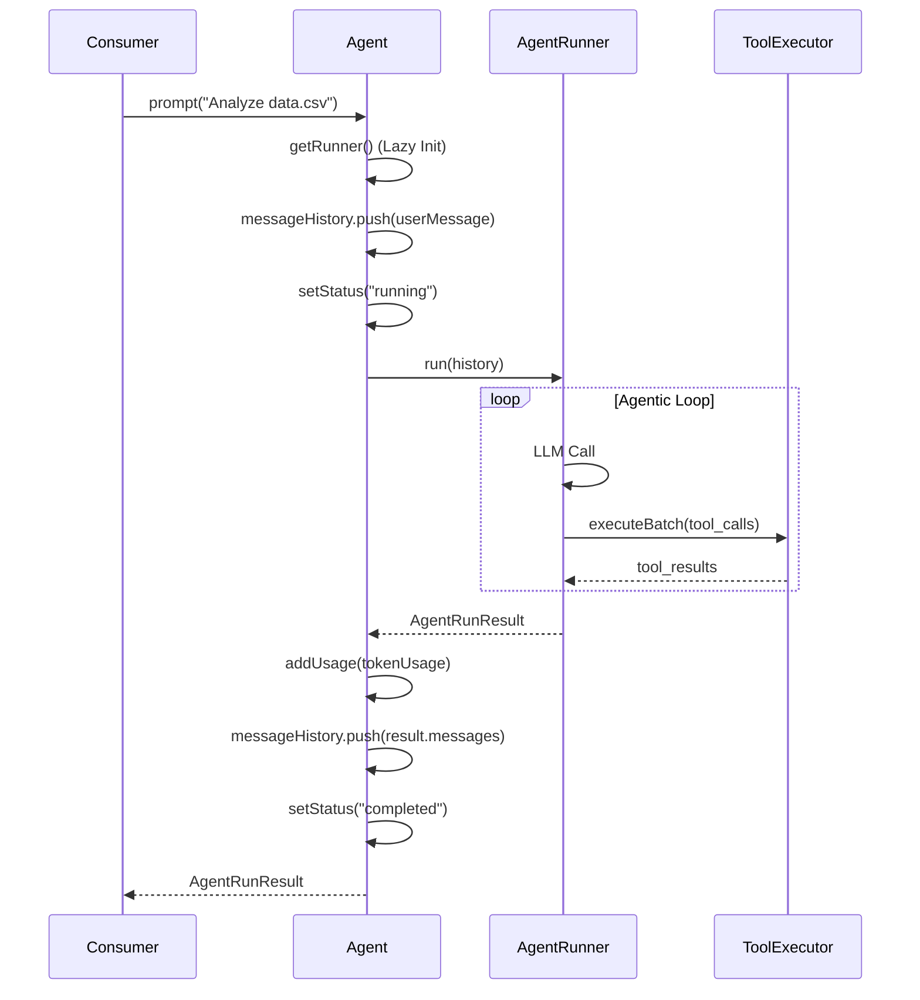
**Sources:** [src/agent/agent.ts:163-179](), [src/agent/agent.ts:253-281]()

---

### Token Usage Tracking

The agent maintains a cumulative count of tokens consumed across all turns in its lifecycle. This is handled by the internal `addUsage` helper which sums `input_tokens` and `output_tokens` from every LLM response returned by the runner.

*   **Initialization**: State starts with `ZERO_USAGE` (0/0) [src/agent/agent.ts:44-51]().
*   **Accumulation**: Every successful run adds the `usage` from the `AgentRunResult` to `this.state.tokenUsage` [src/agent/agent.ts:271]().
*   **Reset**: Calling `reset()` clears the usage back to zero [src/agent/agent.ts:212-219]().

**Sources:** [src/agent/agent.ts:44-51](), [src/agent/agent.ts:269-272]()

---

### Dynamic Tool Management

Agents can have their capabilities modified at runtime without needing to be re-instantiated.

*   **`addTool(name)`**: Adds a tool name to the agent's `allowedTools` list. The tool must exist in the `ToolRegistry` injected at construction [src/agent/agent.ts:226-231]().
*   **`removeTool(name)`**: Removes a tool from the agent's allowed list [src/agent/agent.ts:236-241]().

Note that these methods update the `RunnerOptions` within the `AgentRunner` instance if it has already been initialized, ensuring the LLM is immediately aware of the change in available tools during the next turn [src/agent/agent.ts:229]().

**Sources:** [src/agent/agent.ts:222-242]()

---

### State and History Management

The `Agent` class provides methods to inspect and clear its internal memory:

*   **`getState()`**: Returns a snapshot of the current `AgentState`, including status, all messages from the current/last run, and total token usage [src/agent/agent.ts:199-201]().
*   **`getHistory()`**: Returns only the persistent `LLMMessage` array used by the `prompt()` method [src/agent/agent.ts:204-206]().
*   **`reset()`**: Resets the status to `idle`, clears `messageHistory`, and zeros out `tokenUsage`. It **retains** the `AgentRunner` and `LLMAdapter` instances to avoid the overhead of re-initializing provider SDKs [src/agent/agent.ts:212-219]().

**Sources:** [src/agent/agent.ts:198-220]()

---

# Page: AgentRunner and Conversation Loop

# AgentRunner and Conversation Loop

<details>
<summary>Relevant source files</summary>

The following files were used as context for generating this wiki page:

- [src/agent/runner.ts](src/agent/runner.ts)
- [src/types.ts](src/types.ts)

</details>


The `AgentRunner` is the core execution engine of the `open-multi-agent` framework. It manages the iterative process of sending prompts to a Large Language Model (LLM), parsing tool requests, executing those tools, and feeding results back into the conversation until a final answer is reached or a limit is hit.

## The Agentic Loop

The `AgentRunner` implements a `while(true)` loop that continues as long as the LLM requests tool executions. This loop handles the transition between the "Natural Language Space" (LLM reasoning) and the "Code Entity Space" (tool execution).

### Conversation Lifecycle Diagram

```mermaid
graph TD
    "Start"["Start AgentRunner.run()"] --> "Loop"["while (turns < maxTurns)"]
    "Loop" --> "LLMCall"["LLMAdapter.chat() / .stream()"]
    "LLMCall" --> "Extract"["extractToolUseBlocks()"]
    "Extract" --> "CheckTools"{"Any ToolUseBlocks?"}
    
    "CheckTools" -- "No" --> "Finish"["Return RunResult"]
    "CheckTools" -- "Yes" --> "ParallelExec"["ToolExecutor.executeBatch()"]
    
    "ParallelExec" --> "Inject"["Append ToolResultBlocks to Messages"]
    "Inject" --> "Increment"["turns++"]
    "Increment" --> "Loop"
    
    "Finish" --> "End"["End"]
```
**Sources:** [src/agent/runner.ts:13-163](), [src/agent/runner.ts:245-310]()

## Runner Configuration and Options

The behavior of the runner is governed by two main sets of options: `RunnerOptions` (static configuration) and `RunOptions` (per-call hooks).

### RunnerOptions
These options are defined at instantiation and remain constant across calls.
| Property | Type | Description |
| :--- | :--- | :--- |
| `model` | `string` | The LLM model identifier. |
| `systemPrompt` | `string` | Prepended to every conversation. |
| `maxTurns` | `number` | Maximum tool-call round-trips (default: 10). |
| `allowedTools` | `string[]` | Whitelist of tools the agent is permitted to use. |
| `abortSignal` | `AbortSignal` | Mechanism to cancel in-flight runs. |

**Sources:** [src/agent/runner.ts:40-66](), [src/agent/runner.ts:140-149]()

### RunOptions
These are passed to the `run()` or `stream()` methods to provide observability.
- `onToolCall`: Triggered before a tool is dispatched.
- `onToolResult`: Triggered after a tool returns a result.
- `onMessage`: Triggered after a full `LLMMessage` is appended to the history.

**Sources:** [src/agent/runner.ts:72-79]()

## Tool Execution and Result Injection

When the LLM returns a response containing `ToolUseBlock` objects, the `AgentRunner` uses the `ToolExecutor` to process them.

1.  **Extraction**: The runner filters the `ContentBlock` array to find all blocks where `type === 'tool_use'`.
2.  **Parallel Execution**: All identified tools are executed in parallel using `ToolExecutor.executeBatch`. This improves performance for independent tasks (e.g., reading multiple files).
3.  **Context Injection**: Every tool receives a `ToolUseContext`, which includes `AgentInfo` (name, role, model) and optionally `TeamInfo` if running within a team.
4.  **Message Appending**: The results are converted into `ToolResultBlock` objects and appended as a new `LLMMessage` with the `user` role (as per LLM provider requirements for tool outputs).

### Data Flow: Natural Language to Tool Execution

```mermaid
graph LR
    subgraph "Natural Language Space (LLM)"
        "LLM_Response"["LLMResponse.content"]
    end

    subgraph "AgentRunner Logic"
        "Runner"["AgentRunner.stream()"]
        "Filter"["extractToolUseBlocks()"]
    end

    subgraph "Code Entity Space (Tools)"
        "Executor"["ToolExecutor.executeBatch()"]
        "Registry"["ToolRegistry.get()"]
        "ConcreteTool"["ToolDefinition.execute()"]
    end

    "LLM_Response" --> "Runner"
    "Runner" --> "Filter"
    "Filter" --> "Executor"
    "Executor" --> "Registry"
    "Registry" --> "ConcreteTool"
    "ConcreteTool" -- "ToolResult" --> "Runner"
```
**Sources:** [src/agent/runner.ts:108-110](), [src/agent/runner.ts:285-305](), [src/types.ts:126-146]()

## Streaming via AsyncGenerator

The `AgentRunner` provides a `stream()` method that returns an `AsyncGenerator<StreamEvent>`. This allows the UI or calling service to receive incremental updates.

### Stream Event Types
- `text`: Incremental text deltas from the assistant.
- `tool_use`: Emitted when the model requests a tool.
- `tool_result`: Emitted after a tool execution completes.
- `done`: The final event containing the `RunResult`.

**Sources:** [src/agent/runner.ts:198-230](), [src/types.ts:96-99]()

## RunResult and Accounting

Upon completion, the runner returns a `RunResult` object which aggregates data from the entire multi-turn conversation.

| Field | Description |
| :--- | :--- |
| `messages` | The full history of `assistant` and `user` (tool result) messages. |
| `output` | The final text string from the last assistant turn. |
| `toolCalls` | An array of `ToolCallRecord` tracking names, inputs, outputs, and duration. |
| `tokenUsage` | Summed `input_tokens` and `output_tokens` across all turns. |
| `turns` | The total count of LLM requests made. |

**Sources:** [src/agent/runner.ts:82-93](), [src/agent/runner.ts:113-118](), [src/agent/runner.ts:312-328]()

## Implementation Details: `_runLoop`

The internal `_runLoop` is the private generator that powers both `run()` and `stream()`. It manages the `maxTurns` counter and ensures that the `AbortSignal` is checked at every iteration. If the `stop_reason` from the `LLMAdapter` is not a tool call and no tool blocks are present, the loop terminates.

**Sources:** [src/agent/runner.ts:245-310]()

---

# Page: LLM Adapters

# LLM Adapters

<details>
<summary>Relevant source files</summary>

The following files were used as context for generating this wiki page:

- [src/llm/adapter.ts](src/llm/adapter.ts)
- [src/types.ts](src/types.ts)

</details>


The LLM Adapter layer provides a provider-agnostic interface for interacting with Large Language Models. By abstracting the specific APIs of different providers (such as Anthropic and OpenAI), the framework allows agents to switch models or providers with minimal configuration changes. The core of this system is the `LLMAdapter` interface and a factory function that lazily loads the required implementation.

### Architecture Overview

The adapter system acts as a translation layer between the internal framework types (like `LLMMessage` and `LLMResponse`) and the proprietary formats required by external SDKs. This ensures that the `AgentRunner` and `Agent` classes can operate on a unified data structure regardless of whether they are communicating with Claude or GPT-4.

**Provider Abstraction Diagram**

```mermaid
graph TD
    subgraph "Code Entity Space"
        A["AgentRunner"] -- "uses" --> B["LLMAdapter (Interface)"]
        C["createAdapter()"] -- "instantiates" --> D["AnthropicAdapter"]
        C -- "instantiates" --> E["OpenAIAdapter"]
        D -- "implements" --> B
        E -- "implements" --> B
    end

    subgraph "Natural Language Space"
        F["'anthropic' provider"]
        G["'openai' provider"]
    end

    C -.-> F
    C -.-> G
```
Sources: [src/llm/adapter.ts:35-40](), [src/llm/adapter.ts:55-74](), [src/types.ts:186-196]()

---

### The LLMAdapter Interface

The `LLMAdapter` interface defines the standard contract for all model interactions. It supports both unary chat completions and asynchronous streaming. It uses normalized types to ensure consistency across the codebase.

| Feature | Description |
| :--- | :--- |
| **Unified Messaging** | Uses `LLMMessage` containing `ContentBlock` arrays (text, images, tool calls, or tool results). |
| **Chat Method** | `chat(messages, options)` returns a complete `LLMResponse`. |
| **Stream Method** | `stream(messages, options)` returns an `AsyncGenerator<StreamEvent>`. |
| **Token Tracking** | Every response includes `TokenUsage` for input and output accounting. |

For details on the interface definition and the factory logic, see [LLMAdapter Interface](#4.1).

**Sources:** [src/types.ts:63-81](), [src/types.ts:96-99](), [src/llm/adapter.ts:17-31]()

---

### Concrete Implementations

The framework currently provides built-in support for two major providers. These adapters handle the complexities of their respective SDKs, including mapping stop reasons and formatting tool definitions into the specific JSON Schema flavors required by each provider.

*   **Anthropic Adapter**: Interfaces with the `@anthropic-ai/sdk`, supporting models like Claude 3.5 Sonnet. It maps Anthropic's "blocks" directly to the internal `ContentBlock` format.
*   **OpenAI Adapter**: Interfaces with the `openai` SDK, supporting GPT-4o and other compatible models. It translates OpenAI's `tool_calls` and role-based message structure into the unified framework format.

For details on implementation specifics and error handling, see [Anthropic and OpenAI Adapters](#4.2).

**Sources:** [src/llm/adapter.ts:59-67](), [src/types.ts:189-189]()

---

### Adapter Factory and Lazy Loading

The `createAdapter` function is the primary entry point for obtaining an LLM client. It features lazy loading to minimize the dependency footprint; for example, the Anthropic SDK is only imported if an Anthropic adapter is explicitly requested.

**Adapter Initialization Flow**

```mermaid
sequenceDiagram
    participant User as "Consumer/Agent"
    participant Factory as "createAdapter()"
    participant Env as "process.env"
    participant Concrete as "ConcreteAdapter (e.g. OpenAIAdapter)"

    User->>Factory: createAdapter('openai', optionalKey)
    alt "No key provided"
        Factory->>Env: read OPENAI_API_KEY
    end
    Factory->>Factory: dynamic import('./openai.js')
    Factory->>Concrete: new OpenAIAdapter(apiKey)
    Concrete-->>User: LLMAdapter instance
```
Sources: [src/llm/adapter.ts:43-58](), [src/llm/adapter.ts:64-67]()

### Summary of Key Types

| Type | File | Purpose |
| :--- | :--- | :--- |
| `LLMAdapter` | [src/types.ts]() | The primary interface for model interaction. |
| `LLMMessage` | [src/types.ts]() | A role (`user`/`assistant`) and a list of content blocks. |
| `LLMResponse` | [src/types.ts]() | The final result of a chat completion, including metadata. |
| `StreamEvent` | [src/types.ts]() | Discrete events (text, tool_use, error, done) for streaming. |
| `LLMToolDef` | [src/types.ts]() | The serializable schema sent to providers to describe tools. |

**Sources:** [src/types.ts:63-66](), [src/types.ts:75-81](), [src/types.ts:96-99](), [src/types.ts:106-111]()

---

# Page: LLMAdapter Interface

# LLMAdapter Interface

<details>
<summary>Relevant source files</summary>

The following files were used as context for generating this wiki page:

- [src/llm/adapter.ts](src/llm/adapter.ts)
- [src/types.ts](src/types.ts)

</details>


The `LLMAdapter` interface serves as the foundational abstraction layer for Large Language Model (LLM) interactions within the framework. It provides a provider-agnostic contract that allows the rest of the system—specifically agents and orchestrators—to communicate with different model providers (like Anthropic or OpenAI) using a unified data format.

## Interface Definition

The `LLMAdapter` interface enforces a standard set of methods for both blocking (unary) and streaming chat completions. This ensures that the `AgentRunner` can execute its logic without needing to handle provider-specific SDK quirks.

### LLMAdapter Interface
[src/types.ts:252-273]()

| Method | Description | Returns |
| :--- | :--- | :--- |
| `chat(messages, options)` | Performs a standard request-response cycle. | `Promise<LLMResponse>` |
| `stream(messages, options)` | Initiates a streaming response for real-time output. | `AsyncGenerator<StreamEvent>` |

### Core Data Structures

The interface relies on several key types to normalize inputs and outputs across different APIs:

*   **LLMMessage**: Represents a single turn in a conversation, containing an array of `ContentBlock` objects [src/types.ts:63-66]().
*   **ContentBlock**: A union type covering `TextBlock`, `ToolUseBlock`, `ToolResultBlock`, and `ImageBlock` [src/types.ts:53]().
*   **LLMResponse**: The final normalized output containing the generated content, stop reason, and token usage [src/types.ts:75-81]().

### Configuration Options

When invoking an adapter, two primary option objects are used to control model behavior:

1.  **LLMChatOptions**: Used for standard chat calls. It includes the `systemPrompt`, `temperature`, `maxTokens`, and an optional array of `LLMToolDef` [src/types.ts:221-231]().
2.  **LLMStreamOptions**: Extends `LLMChatOptions` and is passed to the `stream` method to handle incremental updates [src/types.ts:233-234]().

**Sources:** [src/types.ts:53-81](), [src/types.ts:221-234](), [src/types.ts:252-273]()

---

## Streaming and Events

The `stream` method returns an `AsyncGenerator` that yields `StreamEvent` objects. This allows the UI or calling process to react to incremental text generation or tool invocations as they happen.

### StreamEvent Types
[src/types.ts:96-99]()

| Event Type | Data Payload | Description |
| :--- | :--- | :--- |
| `text` | `string` | An incremental delta of generated text. |
| `tool_use` | `ToolUseBlock` | The model has initiated or finished defining a tool call. |
| `tool_result` | `ToolResultBlock` | A tool execution result has been injected into the stream. |
| `done` | `LLMResponse` | The final terminal event containing the full response and usage stats. |
| `error` | `Error` | Emitted if the connection drops or the provider returns an error. |

**Sources:** [src/types.ts:96-99]()

---

## The Adapter Factory

The `createAdapter` function is the primary entry point for instantiating LLM clients. It implements **lazy loading** and **automatic API key resolution** to minimize dependency overhead and simplify configuration.

### Implementation Details
[src/llm/adapter.ts:55-74]()

*   **Lazy Provider Loading**: Concrete implementations (e.g., `AnthropicAdapter`, `OpenAIAdapter`) are only imported when requested. This prevents the framework from requiring the OpenAI SDK if the user only intends to use Anthropic [src/llm/adapter.ts:48-49]().
*   **API Key Resolution**: If an `apiKey` is not provided to the factory, it attempts to resolve the key from environment variables (`ANTHROPIC_API_KEY` or `OPENAI_API_KEY`) [src/llm/adapter.ts:45-46]().

### Logic Flow: createAdapter

The following diagram illustrates how the factory resolves a provider request into a concrete instance.

**Adapter Resolution Flow**
```mermaid
graph TD
  A["Consumer Calls createAdapter(provider, apiKey?)"] --> B{"Check provider string"}
  B -- "['anthropic']" --> C["import('./anthropic.js')"]
  B -- "['openai']" --> D["import('./openai.js')"]
  B -- "else" --> E["Throw Error"]

  C --> F["Resolve API Key: Provided or ANTHROPIC_API_KEY"]
  D --> G["Resolve API Key: Provided or OPENAI_API_KEY"]

  F --> H["new AnthropicAdapter(apiKey)"]
  G --> I["new OpenAIAdapter(apiKey)"]

  H --> J["Return LLMAdapter Instance"]
  I --> J
```
**Sources:** [src/llm/adapter.ts:35-74]()

---

## Data Flow: Code Entities to LLM Space

This diagram maps the internal TypeScript entities used by the framework to the conceptual spaces they occupy during an LLM interaction.

**Entity Mapping Diagram**
```mermaid
graph LR
  subgraph "Framework Code Space"
    Agent["Agent Class"]
    Runner["AgentRunner Loop"]
    Registry["ToolRegistry"]
  end

  subgraph "LLMAdapter Interface"
    Chat["LLMAdapter.chat()"]
    Stream["LLMAdapter.stream()"]
    Msg["LLMMessage[]"]
    Tools["LLMToolDef[]"]
  end

  subgraph "External Provider Space"
    Anthropic["AnthropicAdapter (anthropic.js)"]
    OpenAI["OpenAIAdapter (openai.js)"]
  end

  Agent -- "triggers" --> Runner
  Runner -- "converts tools" --> Registry
  Registry -- "provides" --> Tools
  Runner -- "calls" --> Chat
  Runner -- "calls" --> Stream
  Chat -- "implements" --> Anthropic
  Chat -- "implements" --> OpenAI
  Msg -- "passed to" --> Chat
  Tools -- "passed to" --> Chat
```

**Sources:** [src/types.ts:106-111](), [src/types.ts:252-273](), [src/llm/adapter.ts:55-74]()

### Summary Table: Adapter Capabilities

| Feature | OpenAIAdapter | AnthropicAdapter |
| :--- | :--- | :--- |
| **File Location** | `src/llm/openai.ts` | `src/llm/anthropic.ts` |
| **Interface** | `LLMAdapter` | `LLMAdapter` |
| **Tool Support** | Via Function Calling | Via Tool Use |
| **Streaming** | Supported (`stream`) | Supported (`stream`) |
| **Default Env Var** | `OPENAI_API_KEY` | `ANTHROPIC_API_KEY` |

**Sources:** [src/llm/adapter.ts:1-74](), [src/types.ts:252-273]()

---

# Page: Anthropic and OpenAI Adapters

# Anthropic and OpenAI Adapters

<details>
<summary>Relevant source files</summary>

The following files were used as context for generating this wiki page:

- [src/llm/adapter.ts](src/llm/adapter.ts)
- [src/llm/anthropic.ts](src/llm/anthropic.ts)
- [src/llm/openai.ts](src/llm/openai.ts)

</details>


The `open-multi-agent` framework provides concrete implementations of the `LLMAdapter` interface for Anthropic and OpenAI. These adapters act as a translation layer between the framework's unified message format (`LLMMessage`, `ContentBlock`) and the provider-specific SDK formats. They handle the nuances of tool calling, streaming events, and error propagation while maintaining a consistent API for the `AgentRunner`.

### Adapter Architecture and Data Flow

The `createAdapter` factory function in `src/llm/adapter.ts` provides lazy-loaded access to these implementations. This ensures that users only need to install the SDKs for the providers they actually use [src/llm/adapter.ts:48-49]().

The following diagram illustrates the data flow from the framework's internal representation to the provider-specific wire formats and back.

**LLM Adapter Translation Flow**

```mermaid
graph TD
    subgraph "Framework Space"
        A["LLMMessage[]"] --> B["ContentBlock (text|tool_use|tool_result|image)"]
    end

    subgraph "Adapter Logic (Code Entity Space)"
        C["AnthropicAdapter.chat()"]
        D["OpenAIAdapter.chat()"]
        E["toAnthropicMessages()"]
        F["toOpenAIMessages()"]
    end

    subgraph "Provider SDKs"
        G["@anthropic-ai/sdk"]
        H["openai (SDK)"]
    end

    B --> C
    B --> D
    C --> E
    D --> F
    E --> G
    F --> H
    
    G -- "Anthropic.Messages.Message" --> I["fromAnthropicContentBlock()"]
    H -- "ChatCompletion" --> J["fromOpenAIResponse()"]
    
    I --> K["LLMResponse"]
    J --> K
```
Sources: [src/llm/anthropic.ts:118-123](), [src/llm/openai.ts:102-135](), [src/llm/anthropic.ts:149-175](), [src/llm/openai.ts:209-245]()

---

### AnthropicAdapter

The `AnthropicAdapter` uses the `@anthropic-ai/sdk` to communicate with Claude models. It maps the framework's content blocks directly to Anthropic's `ContentBlockParam` array [src/llm/anthropic.ts:61-109]().

#### Key Implementation Details
- **Tool Mapping**: Framework `LLMToolDef` objects are converted to Anthropic's `Tool` format. The `inputSchema` is passed directly as the `input_schema` [src/llm/anthropic.ts:131-140]().
- **Role Consistency**: Anthropic requires strict user/assistant alternation. The adapter relies on the caller (usually `AgentRunner`) to provide a valid history [src/llm/anthropic.ts:114-116]().
- **Streaming**: Implements `stream()` by listening to SDK events like `content_block_delta` and `message_delta` to emit framework-standard `StreamEvent` objects [src/llm/anthropic.ts:251-330]().

**Anthropic Entity Mapping**

| Framework Entity | Anthropic SDK Entity | Mapping Function |
| :--- | :--- | :--- |
| `LLMMessage` | `MessageParam` | `toAnthropicMessages` [src/llm/anthropic.ts:118]() |
| `ContentBlock` | `ContentBlockParam` | `toAnthropicContentBlockParam` [src/llm/anthropic.ts:61]() |
| `LLMToolDef` | `Tool` | `toAnthropicTools` [src/llm/anthropic.ts:131]() |
| `LLMResponse` | `Message` | `chat()` return value [src/llm/anthropic.ts:228]() |

Sources: [src/llm/anthropic.ts:1-330]()

---

### OpenAIAdapter

The `OpenAIAdapter` handles the transition to the OpenAI Chat Completions API. Because OpenAI uses a distinct `tool` role (instead of embedding results in a `user` message), this adapter performs structural transformations on the message history [src/llm/openai.ts:12-15]().

#### Structural Expansion
When the framework sends a `user` message containing `tool_result` blocks, the `OpenAIAdapter` splits it into multiple OpenAI messages:
1. One `user` message containing any text or image content [src/llm/openai.ts:115-118]().
2. One `tool` role message for **each** `tool_result` block, identified by `tool_call_id` [src/llm/openai.ts:120-129]().

#### Key Implementation Details
- **System Prompts**: Unlike Anthropic (which has a top-level `system` parameter), OpenAI typically uses a `system` role message. The adapter prepends the `systemPrompt` from `LLMChatOptions` to the message array [src/llm/openai.ts:265-268]().
- **Tool Calls**: Framework `tool_use` blocks are converted to OpenAI's `tool_calls` array within an assistant message [src/llm/openai.ts:178-187]().
- **Streaming**: The `stream()` method iterates over the OpenAI stream, accumulating tool call arguments until they are complete, then yielding a `tool_use` event [src/llm/openai.ts:340-440]().

**OpenAI Entity Mapping**

```mermaid
graph LR
    subgraph "open-multi-agent"
        M["LLMMessage (user)"]
        B1["ContentBlock (text)"]
        B2["ContentBlock (tool_result)"]
        M --> B1
        M --> B2
    end

    subgraph "OpenAI API"
        O1["role: user"]
        O2["role: tool"]
    end

    B1 -. "toOpenAIUserMessage()" .-> O1
    B2 -. "toOpenAIMessages() expansion" .-> O2
```
Sources: [src/llm/openai.ts:102-135](), [src/llm/openai.ts:141-166]()

---

### Error Handling and Abort Signals

Both adapters implement standardized error handling and request cancellation:

1.  **AbortSignal**: Both `chat()` and `stream()` methods accept an `AbortSignal` in the options. This signal is passed directly to the underlying SDK (`signal` in Anthropic [src/llm/anthropic.ts:222](), `signal` in OpenAI [src/llm/openai.ts:275]()) to terminate network requests immediately.
2.  **SDK Exceptions**: Adapters do not wrap provider-specific errors (e.g., `Anthropic.APIError` or `OpenAI.APIError`). Callers are expected to handle these to manage rate limits or context window overflows [src/llm/anthropic.ts:206-207](), [src/llm/openai.ts:257-258]().
3.  **Token Usage**: Both adapters extract usage metadata (input/output tokens) from the final response and map it to the framework's `TokenUsage` type [src/llm/anthropic.ts:233-237](), [src/llm/openai.ts:235-239]().

### Configuration

Adapters resolve API keys in the following order:
1.  Explicit `apiKey` passed to the constructor [src/llm/anthropic.ts:193-195](), [src/llm/openai.ts:251-253]().
2.  Environment variables: `ANTHROPIC_API_KEY` or `OPENAI_API_KEY` [src/llm/anthropic.ts:194](), [src/llm/openai.ts:252]().

Sources: [src/llm/anthropic.ts:187-240](), [src/llm/openai.ts:245-280](), [src/llm/adapter.ts:55-74]()

---

# Page: Tool System

# Tool System

<details>
<summary>Relevant source files</summary>

The following files were used as context for generating this wiki page:

- [src/tool/built-in/index.ts](src/tool/built-in/index.ts)
- [src/tool/executor.ts](src/tool/executor.ts)
- [src/tool/framework.ts](src/tool/framework.ts)

</details>


The **Tool System** provides a structured way for agents to interact with the external world. It handles the definition of tool schemas using Zod, registration within a central repository, and safe, concurrent execution. By bridging the gap between high-level LLM requests and low-level code execution, the system ensures that inputs are validated and errors are handled gracefully without crashing the agentic loop.

## Overview of the Tool Lifecycle

The tool system operates in three distinct phases: definition, registration, and execution. This separation allows tools to be defined once and reused across multiple agents or teams.

### 1. Definition & Registration
Tools are defined using `defineTool`, which pairs a Zod schema with an executable function [src/tool/framework.ts:71-83](). These definitions are then stored in a `ToolRegistry` [src/tool/framework.ts:93-203](). The registry is responsible for converting these definitions into the JSON Schema format required by LLM providers like OpenAI and Anthropic [src/tool/framework.ts:162-172]().

### 2. Execution
When an agent receives a tool call from an LLM, it uses a `ToolExecutor` [src/tool/executor.ts:47-54](). The executor validates the LLM's provided arguments against the tool's Zod schema [src/tool/executor.ts:139-147](). If valid, it runs the tool, capturing any errors or timeouts as a `ToolResult` [src/tool/executor.ts:157-168]().

### 3. Built-in Capabilities
The framework includes a set of pre-configured tools for common filesystem and shell operations, accessible via `registerBuiltInTools` [src/tool/built-in/index.ts:46-50]().

---

## Natural Language to Code Entity Mapping

The following diagrams illustrate how natural language concepts used by the LLM map to specific code entities and data structures within the framework.

### Tool Definition Mapping
This diagram shows how a tool's conceptual parts (Name, Purpose, Arguments) map to the `ToolDefinition` structure.

```mermaid
graph TD
    subgraph "Natural Language Space (LLM View)"
        A["'Tool Name'"] 
        B["'Description/Instructions'"]
        C["'Argument Constraints'"]
    end

    subgraph "Code Entity Space (Source)"
        D["ToolDefinition.name"]
        E["ToolDefinition.description"]
        F["ToolDefinition.inputSchema (Zod)"]
        G["ToolDefinition.execute (Function)"]
    end

    A --- D
    B --- E
    C --- F
    F --> G
    
    style D font-family:monospace
    style E font-family:monospace
    style F font-family:monospace
    style G font-family:monospace
```
**Sources:** [src/tool/framework.ts:71-83](), [src/types.ts:153-169]()

### Execution Flow & Data Translation
This diagram tracks how raw JSON from an LLM is processed by the `ToolExecutor` into a validated `ToolResult`.

```mermaid
graph LR
    subgraph "LLM Output"
        RAW["Raw JSON Input"]
    end

    subgraph "ToolExecutor Logic"
        V["safeParse()"]
        EX["execute()"]
        SEM["Semaphore"]
    end

    subgraph "Result Space"
        RES["ToolResult"]
    end

    RAW -->|"rawInput"| V
    V -->|"parseResult.data"| EX
    SEM -.->|"Concurrency Control"| EX
    EX -->|"isError: boolean"| RES

    style V font-family:monospace
    style EX font-family:monospace
    style SEM font-family:monospace
    style RES font-family:monospace
```
**Sources:** [src/tool/executor.ts:132-169](), [src/utils/semaphore.ts:1-10]()

---

## Sub-System Components

### [Tool Framework: defineTool and ToolRegistry](#5.1)
The framework layer defines the `ToolDefinition` interface and the `ToolRegistry` class. It includes a robust `zodToJsonSchema` converter that translates TypeScript/Zod types into the JSON Schema dialect understood by LLMs.
*   **Key Entity:** `ToolRegistry` manages the collection of tools for an agent [src/tool/framework.ts:93]().
*   **Key Entity:** `defineTool` provides type safety for tool implementations [src/tool/framework.ts:71]().

For details, see [Tool Framework: defineTool and ToolRegistry](#5.1).

### [ToolExecutor](#5.2)
The `ToolExecutor` is the engine that runs tools. It provides error isolation, ensuring that a crash in a tool function does not crash the agent. It also supports `executeBatch` for running multiple tool calls in parallel using a `Semaphore` to limit resource usage.
*   **Key Entity:** `ToolExecutor` handles validation and execution [src/tool/executor.ts:47]().
*   **Key Entity:** `BatchToolCall` represents a single request in a parallel execution set [src/tool/executor.ts:30]().

For details, see [ToolExecutor](#5.2).

### [Built-in Tools](#5.3)
The framework provides five essential tools out-of-the-box: `bash`, `file_read`, `file_write`, `file_edit`, and `grep`. These are optimized for agentic workflows, such as using `ripgrep` for efficient searching.
*   **Key Entity:** `BUILT_IN_TOOLS` array containing all standard tools [src/tool/built-in/index.ts:26]().
*   **Key Entity:** `registerBuiltInTools` helper for quick setup [src/tool/built-in/index.ts:46]().

For details, see [Built-in Tools](#5.3).

---
**Sources:**
- [src/tool/framework.ts:1-203]()
- [src/tool/executor.ts:1-178]()
- [src/tool/built-in/index.ts:1-50]()
- [src/types.ts:153-180]()

---

# Page: Tool Framework: defineTool and ToolRegistry

# Tool Framework: defineTool and ToolRegistry

<details>
<summary>Relevant source files</summary>

The following files were used as context for generating this wiki page:

- [src/tool/framework.ts](src/tool/framework.ts)
- [src/types.ts](src/types.ts)

</details>


The Tool Framework provides the core primitives for declaring, registering, and converting tools into the structured formats required by Large Language Models (LLMs). It abstracts the complexity of JSON Schema generation and validation, allowing developers to focus on the tool's logic and input constraints using Zod.

## Core Primitives

The framework relies on a set of standardized types to ensure consistency between tool definition, execution, and LLM communication.

### defineTool

The `defineTool` function is the primary entry point for creating a typed tool. It enforces a contract where the input is validated against a `ZodSchema` before being passed to an asynchronous `execute` function.

| Property | Type | Description |
| :--- | :--- | :--- |
| `name` | `string` | Unique identifier for the tool used by the LLM to invoke it. |
| `description` | `string` | Natural language description helping the LLM understand when to use the tool. |
| `inputSchema` | `ZodSchema<TInput>` | A Zod schema defining the expected structure of the tool's arguments. |
| `execute` | `Function` | The implementation logic: `(input: TInput, context: ToolUseContext) => Promise<ToolResult>`. |

**Sources:**
- [src/tool/framework.ts:71-83]() (defineTool implementation)
- [src/types.ts:174-179]() (ToolDefinition interface)

### ToolResult and Context

Tools do not throw exceptions for operational failures; instead, they return a `ToolResult` object. This allows the framework to pass the error back to the LLM as a "tool result" block so the model can attempt to self-correct.

- **ToolResult**: Contains `data` (the stringified output) and an optional `isError` boolean [src/types.ts:163-166]().
- **ToolUseContext**: Provides metadata to the tool during execution, including `agent` info, `team` info, a `cwd` (current working directory) hint, and an `abortSignal` for cancellation [src/types.ts:126-146]().

**Sources:**
- [src/types.ts:126-166]()

---

## ToolRegistry

The `ToolRegistry` acts as a central repository for tools. It manages the lifecycle of tool registration and provides methods to export these tools in formats compatible with different LLM providers (e.g., Anthropic, OpenAI).

### Key Methods

- **`register(tool)`**: Adds a `ToolDefinition` to the internal `Map`. It throws an error if a tool with the same name already exists to prevent silent overwrites [src/tool/framework.ts:102-110]().
- **`unregister(name)`**: Gracefully removes a tool by name [src/tool/framework.ts:148-150]().
- **`toToolDefs()`**: The primary method used by `AgentRunner`. It iterates through registered tools and converts their Zod schemas into JSON Schema objects [src/tool/framework.ts:162-171]().
- **`toLLMTools()`**: A specialized exporter that produces the specific `input_schema` structure expected by Anthropic's API [src/tool/framework.ts:178-202]().

### Tool Registration Data Flow

The following diagram illustrates how a tool moves from a code definition into the `ToolRegistry` and eventually into the LLM's context.

**Tool Registration and Transformation**
```mermaid
graph TD
    subgraph "Code Entity Space"
        A["defineTool()"] -- "returns" --> B["ToolDefinition"]
        B -- "register()" --> C["ToolRegistry"]
        C -- "toToolDefs()" --> D["LLMToolDef[]"]
    end

    subgraph "Natural Language Space (LLM)"
        D -- "Adapter Mapping" --> E["LLM System Prompt / Tools"]
        E -- "Model Reasoning" --> F["Tool Use Request"]
    end

    F -- "JSON Input" --> G["ToolExecutor"]
    G -- "Zod Validation" --> H["execute() function"]
    H -- "ToolResult" --> I["LLM Message History"]
```

**Sources:**
- [src/tool/framework.ts:93-203]() (ToolRegistry class)
- [src/types.ts:106-111]() (LLMToolDef type)

---

## Schema Conversion: zodToJsonSchema

To communicate tool requirements to an LLM, the framework must convert TypeScript/Zod definitions into standard JSON Schema. The `zodToJsonSchema` function handles this recursive transformation.

### Supported Zod Types
The converter supports a wide range of Zod primitives and wrappers:
- **Primitives**: `z.string()`, `z.number()`, `z.boolean()`, `z.null()`.
- **Collections**: `z.array()`, `z.object()`, `z.record()`.
- **Logic**: `z.enum()`, `z.nativeEnum()`, `z.union()`, `z.anyOf()`, `z.optional()`, `z.nullable()`.
- **Metadata**: It extracts descriptions from `.describe()` calls to populate the `description` field in JSON Schema.

### Conversion Logic
The function performs a type-check on the Zod internal `_def` and maps it to the `JSONSchemaProperty` type.

**Data Flow: Type to Schema**
```mermaid
graph LR
    subgraph "Zod Input"
        Z1["z.object({ name: z.string() })"]
    end

    subgraph "zodToJsonSchema Logic"
        P1["Identify ZodObject"]
        P2["Recurse into Properties"]
        P3["Extract Descriptions"]
    end

    subgraph "JSON Schema Output"
        J1["{ type: 'object', properties: { name: { type: 'string' } } }"]
    end

    Z1 --> P1
    P1 --> P2
    P2 --> P3
    P3 --> J1
```

**Sources:**
- [src/tool/framework.ts:29-45]() (JSONSchemaProperty definition)
- [src/tool/framework.ts:209-224]() (zodToJsonSchema entry point)
- [src/tool/framework.ts:238-348]() (Internal recursive conversion logic)

---

## Implementation Summary

| Component | Responsibility | Key File |
| :--- | :--- | :--- |
| `defineTool` | Factory for creating `ToolDefinition` objects with type safety. | [src/tool/framework.ts]() |
| `ToolRegistry` | Manages a collection of tools and exports them for LLM use. | [src/tool/framework.ts]() |
| `zodToJsonSchema` | Transforms Zod schemas into LLM-readable JSON Schema. | [src/tool/framework.ts]() |
| `ToolDefinition` | Interface defining the name, description, schema, and executor. | [src/types.ts]() |
| `ToolResult` | Standardized object for returning tool output or errors. | [src/types.ts]() |

**Sources:**
- [src/tool/framework.ts:1-350]()
- [src/types.ts:102-180]()

---

# Page: ToolExecutor

# ToolExecutor

<details>
<summary>Relevant source files</summary>

The following files were used as context for generating this wiki page:

- [src/tool/executor.ts](src/tool/executor.ts)
- [src/utils/semaphore.ts](src/utils/semaphore.ts)

</details>


The `ToolExecutor` is the engine responsible for invoking tools defined within the framework. It acts as a bridge between the raw tool calls generated by an LLM and the typed, validated execution environment of the codebase. It provides robust error isolation, Zod-based input validation, and concurrency management via a semaphore-based scheduling system.

## Core Responsibilities

The `ToolExecutor` class `[src/tool/executor.ts:47-178]()` handles the lifecycle of a tool call through several distinct phases:

1.  **Registry Lookup**: Verifies that the requested tool exists in the provided `ToolRegistry` `[src/tool/executor.ts:75-80]()`.
2.  **Pre-execution Checks**: Validates the `AbortSignal` to ensure the request hasn't been cancelled before starting `[src/tool/executor.ts:83-87]()`.
3.  **Input Validation**: Uses the tool's Zod `inputSchema` to parse and validate the raw input from the LLM `[src/tool/executor.ts:139-147]()`.
4.  **Concurrency Control**: For batch operations, it uses a `Semaphore` to limit the number of simultaneous tool executions `[src/tool/executor.ts:53, 113-115]()`.
5.  **Error Isolation**: Wraps execution in try-catch blocks to ensure that tool failures are returned as `ToolResult` objects rather than throwing exceptions that would crash the agent loop `[src/tool/executor.ts:157-168]()`.

### From LLM Request to Code Execution

The following diagram illustrates how a natural language request processed by an LLM translates into a specific execution path within the `ToolExecutor`.

**LLM Tool Call Flow**
```mermaid
graph TD
    subgraph "Natural Language Space"
        A["LLM generates 'call bash(command: 'ls')'"]
    end

    subgraph "Code Entity Space: ToolExecutor"
        B["ToolExecutor.execute()"]
        C["ToolRegistry.get('bash')"]
        D["Zod inputSchema.safeParse()"]
        E["tool.execute(parsedData, context)"]
        F["ToolResult { isError: boolean, data: any }"]
    end

    A --> B
    B --> C
    C --> D
    D -- "Success" --> E
    E --> F
    D -- "Validation Error" --> F
```
Sources: `[src/tool/executor.ts:70-90]()`, `[src/tool/executor.ts:132-169]()`

## Single Execution

The `execute` method `[src/tool/executor.ts:70-90]()` is the entry point for running a single tool. It is designed to be "fail-safe," meaning it will never reject its promise. Instead, any error—be it a missing tool, a validation failure, or a runtime exception—is captured and returned as a `ToolResult` with `isError: true` `[src/tool/executor.ts:172-177]()`.

- **Abort Signal**: The executor checks `context.abortSignal` twice: once before looking up the tool and again after potentially expensive Zod parsing `[src/tool/executor.ts:83, 150]()`.
- **Validation**: If Zod validation fails, the executor formats the Zod issues into a readable string for the LLM to process `[src/tool/executor.ts:141-146]()`.

## Batch Execution and Concurrency

When an agent needs to run multiple tools (e.g., searching multiple files simultaneously), it uses `executeBatch` `[src/tool/executor.ts:105-121]()`. This method accepts an array of `BatchToolCall` objects and returns a `Map<string, ToolResult>`.

### Concurrency Control via Semaphore

The `ToolExecutor` uses a `Semaphore` `[src/utils/semaphore.ts:24-89]()` to prevent resource exhaustion. By default, it allows a `maxConcurrency` of 4 `[src/tool/executor.ts:53]()`.

**Batch Execution Architecture**
```mermaid
sequenceDiagram
    participant AG as AgentRunner
    participant TE as ToolExecutor
    participant SEM as Semaphore
    participant T1 as Tool: "grep"
    participant T2 as Tool: "file_read"

    AG->>TE: executeBatch([call1, call2])
    par Call 1
        TE->>SEM: run(execute "grep")
        SEM->>SEM: acquire()
        SEM->>T1: execute()
        T1-->>SEM: ToolResult
        SEM->>SEM: release()
    and Call 2
        TE->>SEM: run(execute "file_read")
        SEM->>SEM: acquire()
        SEM->>T2: execute()
        T2-->>SEM: ToolResult
        SEM->>SEM: release()
    end
    TE-->>AG: Map { id1: Result, id2: Result }
```
Sources: `[src/tool/executor.ts:105-121]()`, `[src/utils/semaphore.ts:71-78]()`

## Error Handling and Result Formatting

The `ToolExecutor` treats errors as data. This is critical for agentic workflows where the LLM needs to know *why* a tool failed (e.g., a syntax error in a shell command) so it can attempt to correct its input in the next turn.

| Error Type | Detection Point | Result `isError` | Result `data` |
| :--- | :--- | :--- | :--- |
| **Missing Tool** | `registry.get()` | `true` | "Tool [name] is not registered..." |
| **Abort** | `abortSignal.aborted` | `true` | "Tool [name] was aborted..." |
| **Validation** | `inputSchema.safeParse()` | `true` | Formatted list of Zod issues |
| **Runtime Error** | `try/catch` block | `true` | Error message or stringified error |
| **Success** | `tool.execute()` | `false` | Tool-defined output |

Sources: `[src/tool/executor.ts:76-80]()`, `[src/tool/executor.ts:140-147]()`, `[src/tool/executor.ts:157-168]()`

## Class Reference

### ToolExecutor
- `constructor(registry: ToolRegistry, options?: ToolExecutorOptions)`: Initializes the executor with a tool registry and optional concurrency settings `[src/tool/executor.ts:51-54]()`.
- `execute(toolName, input, context)`: Executes a single tool with validation and error isolation `[src/tool/executor.ts:70-90]()`.
- `executeBatch(calls, context)`: Executes multiple tools in parallel using a semaphore `[src/tool/executor.ts:105-121]()`.

### ToolExecutorOptions
- `maxConcurrency`: (Optional) The maximum number of tools to run at once. Defaults to 4 `[src/tool/executor.ts:21-27]()`.

### BatchToolCall
- `id`: A unique identifier for the call, used to map results back to requests `[src/tool/executor.ts:31-32]()`.
- `name`: The name of the tool to execute `[src/tool/executor.ts:33-34]()`.
- `input`: The raw arguments provided for the tool `[src/tool/executor.ts:35-36]()`.

Sources: `[src/tool/executor.ts:21-47]()`

---

# Page: Built-in Tools

# Built-in Tools

<details>
<summary>Relevant source files</summary>

The following files were used as context for generating this wiki page:

- [src/tool/built-in/bash.ts](src/tool/built-in/bash.ts)
- [src/tool/built-in/file-edit.ts](src/tool/built-in/file-edit.ts)
- [src/tool/built-in/file-read.ts](src/tool/built-in/file-read.ts)
- [src/tool/built-in/file-write.ts](src/tool/built-in/file-write.ts)
- [src/tool/built-in/grep.ts](src/tool/built-in/grep.ts)
- [src/tool/built-in/index.ts](src/tool/built-in/index.ts)

</details>


The `open-multi-agent` framework provides a suite of high-utility built-in tools designed to give agents the capability to interact with the local file system, execute shell commands, and perform performant text searches. These tools are implemented using the standard `defineTool` primitive and are optimized for LLM consumption through clear schemas and structured error reporting.

### Registration and Availability

The built-in tools are managed through a central registry mechanism. Developers can either use the complete set or pick individual tools to register with a `ToolRegistry` [src/tool/built-in/index.ts:9-14]().

*   `BUILT_IN_TOOLS`: A constant array containing all five tool definitions [src/tool/built-in/index.ts:26-32]().
*   `registerBuiltInTools(registry)`: A convenience function that iterates over `BUILT_IN_TOOLS` and calls `registry.register(tool)` for each [src/tool/built-in/index.ts:46-50]().

### Tool Data Flow

The following diagram illustrates how a built-in tool (e.g., `bashTool`) transitions from a natural language request to execution within the Node.js environment.

**Built-in Tool Execution Flow**
```mermaid
graph TD
    subgraph "Natural Language Space"
        A["Agent (LLM)"] -- "Generates tool_call" --> B["Tool Name: 'bash'"]
        B -- "Arguments: { command: 'ls' }" --> C["AgentRunner"]
    end

    subgraph "Code Entity Space"
        C -- "calls" --> D["ToolExecutor.execute()"]
        D -- "look up" --> E["ToolRegistry"]
        E -- "returns" --> F["bashTool: ToolDefinition"]
        F -- "triggers" --> G["bashTool.execute()"]
        G -- "spawns" --> H["child_process.spawn('bash')"]
        H -- "returns RunResult" --> G
        G -- "wraps in" --> I["ToolResult { data, isError }"]
    end

    I -- "injected into" --> A
```
Sources: [src/tool/built-in/bash.ts:22-63](), [src/tool/built-in/index.ts:26-32](), [src/tool/built-in/index.ts:46-50]()

---

### 1. Bash Execution (`bash`)

The `bashTool` allows agents to execute arbitrary shell commands. It runs in a non-interactive shell via `bash -c` [src/tool/built-in/bash.ts:28-29]().

*   **Key Features**:
    *   **Timeout Control**: Defaults to 30,000ms to prevent hanging processes [src/tool/built-in/bash.ts:16-16]().
    *   **CWD Support**: Allows specifying the working directory for the command [src/tool/built-in/bash.ts:40-43]().
    *   **Abort Signal**: Integration with `AbortSignal` ensures that if the agent's run is cancelled, the underlying shell process is killed with `SIGKILL` [src/tool/built-in/bash.ts:126-128]().
*   **Implementation**: Uses `child_process.spawn` to capture `stdout` and `stderr` separately, merging them into a labeled output string if both are present [src/tool/built-in/bash.ts:93-100](), [src/tool/built-in/bash.ts:161-187]().

Sources: [src/tool/built-in/bash.ts:1-63]()

---

### 2. File Operations (`file_read`, `file_write`, `file_edit`)

These three tools provide a robust interface for file manipulation, moving from simple I/O to targeted string replacement.

#### `file_read`
Reads file contents with 1-based line numbers prefixed to every line [src/tool/built-in/file-read.ts:19-20]().
*   **Chunking**: Supports `offset` and `limit` parameters to read specific slices of large files, preventing context window overflow [src/tool/built-in/file-read.ts:21-22]().
*   **Metadata**: Appends a summary line (e.g., "showing lines 1–50 of 200") when a file is partially read [src/tool/built-in/file-read.ts:95-98]().

#### `file_write`
Creates or overwrites a file.
*   **Automatic Directory Creation**: Automatically performs the equivalent of `mkdir -p` for the parent directory of the target path [src/tool/built-in/file-write.ts:46-56]().
*   **Reporting**: Returns the byte count and line count of the written content [src/tool/built-in/file-write.ts:70-77]().

#### `file_edit`
Performs a targeted string replacement. This is preferred over `file_write` for modifying existing code to minimize the risk of the LLM hallucinating or deleting unrelated code [src/tool/built-in/file-edit.ts:22-24]().
*   **Uniqueness Invariant**: By default, it errors if the `old_string` appears more than once, forcing the agent to be specific [src/tool/built-in/file-edit.ts:77-85]().
*   **`replace_all`**: An optional flag to override the uniqueness check [src/tool/built-in/file-edit.ts:39-45]().

**File Tool Logic Map**
```mermaid
graph TD
    subgraph "File System Tools"
        FR["file_read.ts"]
        FW["file_write.ts"]
        FE["file_edit.ts"]
    end

    subgraph "Logic & Safety"
        FR_S["Line Numbering & Pagination"]
        FW_S["Recursive mkdir & Overwrite"]
        FE_S["countOccurrences & replaceAllOccurrences"]
    end

    FR --> FR_S
    FW --> FW_S
    FE --> FE_S

    FR_S -- "uses" --> FS_R["fs/promises.readFile"]
    FW_S -- "uses" --> FS_W["fs/promises.writeFile"]
    FE_S -- "uses" --> FS_RW["fs/promises.readFile + writeFile"]
```
Sources: [src/tool/built-in/file-read.ts:46-104](), [src/tool/built-in/file-write.ts:35-80](), [src/tool/built-in/file-edit.ts:48-111]()

---

### 3. Search (`grep`)

The `grepTool` provides high-performance regex searching across files and directories.

*   **Hybrid Implementation**:
    1.  **Ripgrep (`rg`)**: The tool first checks if the `ripgrep` binary is available on the system [src/tool/built-in/grep.ts:93-100](). If found, it uses `rg` for maximum speed and native glob support.
    2.  **Node.js Fallback**: If `rg` is missing, it falls back to a pure Node.js recursive implementation using `fs.readdir` and `fs.readFile` [src/tool/built-in/grep.ts:103-108]().
*   **Optimization**:
    *   **SKIP_DIRS**: Both implementations ignore common non-source directories like `.git`, `node_modules`, and `dist` [src/tool/built-in/grep.ts:24-32]().
    *   **Result Capping**: Results are limited by `maxResults` (default 100) to keep LLM responses manageable [src/tool/built-in/grep.ts:22-22]().

Sources: [src/tool/built-in/grep.ts:1-109]()

### Summary Table

| Tool Name | Primary Function | Key Parameters | Implementation Detail |
| :--- | :--- | :--- | :--- |
| `bash` | Shell execution | `command`, `timeout`, `cwd` | `child_process.spawn` [src/tool/built-in/bash.ts:93]() |
| `file_read` | Read file content | `path`, `offset`, `limit` | Line numbering (1-based) [src/tool/built-in/file-read.ts:91]() |
| `file_write` | Create/Overwrite | `path`, `content` | Recursive directory creation [src/tool/built-in/file-write.ts:48]() |
| `file_edit` | String replacement | `old_string`, `new_string` | Uniqueness check by default [src/tool/built-in/file-edit.ts:77]() |
| `grep` | Regex search | `pattern`, `path`, `glob` | Ripgrep with Node.js fallback [src/tool/built-in/grep.ts:92]() |

Sources: [src/tool/built-in/index.ts:26-32]()

---

# Page: Memory System

# Memory System

<details>
<summary>Relevant source files</summary>

The following files were used as context for generating this wiki page:

- [src/memory/shared.ts](src/memory/shared.ts)
- [src/memory/store.ts](src/memory/store.ts)
- [src/types.ts](src/types.ts)

</details>


The **Memory System** provides a persistent and shared state layer for agents within the `open-multi-agent` framework. It allows individual agents to store information and enables teams of agents to collaborate by sharing findings, task results, and context through a unified interface.

The system is built on a layered architecture: a low-level `MemoryStore` for raw data persistence, an `InMemoryStore` implementation for runtime storage, and a high-level `SharedMemory` manager that handles namespacing and context synthesis for agent teams.

### Memory Architecture Overview

The following diagram illustrates how the memory components relate to the core agent and team entities.

**Memory Layer Entity Map**
```mermaid
graph TD
    subgraph "Natural Language Space"
        A["Agent Context"] 
        B["Team Knowledge"]
    end

    subgraph "Code Entity Space (src/memory)"
        SM["SharedMemory (shared.ts)"]
        IMS["InMemoryStore (store.ts)"]
        MSI["MemoryStore (types.ts)"]
    end

    subgraph "Data Storage"
        ME["MemoryEntry (types.ts)"]
    end

    A -- "Uses getSummary()" --> SM
    B -- "Stored in" --> SM
    SM -- "Implements via" --> IMS
    IMS -- "Satisfies" --> MSI
    IMS -- "Manages" --> ME
```
Sources: [src/memory/shared.ts:36-41](), [src/memory/store.ts:31-32](), [src/types.ts:245-250]()

---

## 6.1 MemoryStore and InMemoryStore

The foundation of the memory system is the `MemoryStore` interface. It defines a standard asynchronous API for key-value storage, ensuring that the framework can remain agnostic of the underlying storage backend (e.g., Local RAM, Redis, or SQLite).

### Key Features
- **Asynchronous Interface**: All methods in `MemoryStore` return promises, allowing for easy migration to network-based or disk-based backends [src/memory/store.ts:17-19]().
- **InMemoryStore**: The default implementation uses a JavaScript `Map` [src/memory/store.ts:32-32](). It supports basic CRUD operations and includes a `search` method for case-insensitive substring matching across keys and values [src/memory/store.ts:99-108]().
- **Metadata Preservation**: When updating an existing key, the `set` method preserves the original `createdAt` timestamp [src/memory/store.ts:49-62]().

For implementation details and guidance on creating custom backends, see **[MemoryStore and InMemoryStore](#6.1)**.

Sources: [src/memory/store.ts:1-124](), [src/types.ts:252-261]()

---

## 6.2 SharedMemory

`SharedMemory` is a high-level wrapper around a `MemoryStore` designed specifically for multi-agent coordination. It introduces **Namespacing**, ensuring that while all agents can read from the shared pool, every write is attributed to a specific agent.

### Core Concepts
- **Namespaced Keys**: Writes are automatically prefixed using the pattern `<agentName>/<key>` [src/memory/shared.ts:58-69]().
- **Context Synthesis**: The `getSummary()` method generates a Markdown-formatted digest of all stored information. This summary is intended to be injected into an agent's system prompt so it understands the current state of the team's collective knowledge [src/memory/shared.ts:107-159]().
- **Orchestration**: The framework's orchestrator uses `SharedMemory` to pass outputs from one task as inputs to the next agent in a pipeline.

### Data Flow: Shared Memory Interaction
```mermaid
sequenceDiagram
    participant A as Agent ("researcher")
    participant SM as SharedMemory
    participant IMS as InMemoryStore

    A->>SM: write("findings", "data")
    Note over SM: Namespaces to "researcher/findings"
    SM->>IMS: set("researcher/findings", "data", {agent: "researcher"})
    
    participant B as Agent ("writer")
    B->>SM: getSummary()
    SM->>IMS: list()
    IMS-->>SM: MemoryEntry[]
    SM-->>B: "### researcher\n- findings: data"
```

For details on namespacing logic and summary generation, see **[SharedMemory](#6.2)**.

Sources: [src/memory/shared.ts:17-35](), [src/memory/shared.ts:127-159]()

---

# Page: MemoryStore and InMemoryStore

# MemoryStore and InMemoryStore

<details>
<summary>Relevant source files</summary>

The following files were used as context for generating this wiki page:

- [src/memory/store.ts](src/memory/store.ts)
- [src/types.ts](src/types.ts)

</details>


The Memory Store system provides a standardized interface for persisting and retrieving information across agent execution cycles. It serves as the foundational storage layer for the framework's shared memory capabilities, allowing agents within a team to exchange data, track task progress, and maintain long-term context.

## MemoryStore Interface

The `MemoryStore` interface defines a set of asynchronous methods for key-value storage. While the default implementation is in-memory, the interface is designed to be provider-agnostic, enabling developers to swap the underlying storage (e.g., to Redis or SQLite) without modifying the high-level agent or team logic [src/memory/store.ts:16-20]().

### Data Structures

All data in a `MemoryStore` is encapsulated in a `MemoryEntry` object:

| Property | Type | Description |
| :--- | :--- | :--- |
| `key` | `string` | The unique identifier for the memory entry. |
| `value` | `string` | The stored content. Structured data must be serialized (e.g., via `JSON.stringify`). |
| `metadata` | `Record<string, unknown>` | Optional key-value pairs for categorization or filtering. |
| `createdAt` | `Date` | The timestamp when the entry was first created. |

### Core Methods

The interface requires the following asynchronous operations [src/memory/store.ts:31-80]():

*   **`get(key: string)`**: Retrieves a `MemoryEntry` or `null` if the key does not exist.
*   **`set(key: string, value: string, metadata?: Record<string, unknown>)`**: Persists a value. Implementations must handle "upsert" logic.
*   **`list()`**: Returns an array of all `MemoryEntry` objects currently in the store.
*   **`delete(key: string)`**: Removes a specific entry by key.
*   **`clear()`**: Wipes all entries from the store.

**Sources:** [src/types.ts:213-245](), [src/memory/store.ts:1-30]()

---

## InMemoryStore Implementation

The `InMemoryStore` is the default implementation provided by the framework. It manages data using a standard JavaScript `Map` [src/memory/store.ts:32](). It is optimized for single-process use cases and testing environments where persistence across restarts is not required.

### Upsert and Lifecycle Semantics
When calling `set()`, the `InMemoryStore` performs a specific check on the `createdAt` property. If a key already exists, the original `createdAt` timestamp is **preserved**, while the `value` and `metadata` are updated [src/memory/store.ts:43-62](). This allows agents to track the "age" of a piece of information even if it has been updated multiple times.

### Search Extension
Beyond the standard interface, `InMemoryStore` includes a `search()` method. This performs a case-insensitive linear scan across both keys and values [src/memory/store.ts:86-109]().

### System Entity Mapping: Store to Implementation

The following diagram illustrates how the abstract `MemoryStore` interface relates to the concrete `InMemoryStore` and the internal data structures.

"Memory Storage Entity Mapping"
```mermaid
graph TD
    subgraph "Natural Language Space"
        A["Memory Record"]
        B["Storage Backend"]
    end

    subgraph "Code Entity Space"
        A --- C["MemoryEntry (interface)"]
        B --- D["MemoryStore (interface)"]
        D --- E["InMemoryStore (class)"]
        
        E --> F["data: Map<string, MemoryEntry>"]
        
        subgraph "InMemoryStore Methods"
            E1["set(key, value)"]
            E2["get(key)"]
            E3["search(query)"]
        end
    end

    C --- C1["key: string"]
    C --- C2["value: string"]
    C --- C3["createdAt: Date"]
```
**Sources:** [src/memory/store.ts:31-124](), [src/types.ts:213-245]()

---

## Data Flow: Memory Persistence

When an agent or the orchestrator interacts with memory, the data flows through the `SharedMemory` wrapper (which provides namespacing) down into the `MemoryStore`.

"Memory Set Data Flow"
```mermaid
sequenceDiagram
    participant C as Caller (Agent/Orchestrator)
    participant S as SharedMemory
    participant M as InMemoryStore
    participant D as data: Map

    C->>S: set(key, value)
    Note over S: Namespacing applied:<br/>"agentName/key"
    S->>M: set(fullKey, value, metadata)
    M->>D: get(fullKey)
    alt Key Exists
        D-->>M: existingEntry
        Note over M: Preserve existingEntry.createdAt
    else Key New
        Note over M: Generate new Date()
    end
    M->>D: set(fullKey, newEntry)
    M-->>S: void
    S-->>C: void
```
**Sources:** [src/memory/store.ts:49-62](), [src/types.ts:159-160]()

---

## Swapping Backends (Redis/SQLite)

The framework is designed to allow production-grade backends to replace the default `InMemoryStore`. To implement a custom backend, a class must satisfy the `MemoryStore` interface.

### Implementation Guidance

1.  **Async Requirements**: Even if the underlying driver is synchronous, the `MemoryStore` interface requires `Promise` returns to ensure compatibility [src/memory/store.ts:17-19]().
2.  **Serialization**: The store should expect `value` to be a string. For SQLite, this maps to a `TEXT` or `BLOB` column; for Redis, a standard `SET` command.
3.  **Metadata Handling**: The `metadata` field is a flat or nested object. In SQL backends, this is typically stored in a `JSON` column.
4.  **CreatedAt Preservation**: Ensure your `set` logic (or SQL `INSERT ... ON CONFLICT`) does not overwrite the initial creation timestamp if the record already exists [src/memory/store.ts:46-48]().

### Example Interface Alignment
To use a custom store, pass it to the `SharedMemory` constructor or the `Team` configuration:

```ts
// Example of how a custom store is integrated
const customStore = new MyRedisStore({ host: 'localhost' });
const team = createTeam({
  name: 'research-team',
  agents: [...],
  sharedMemory: new SharedMemory(customStore)
});
```

**Sources:** [src/memory/store.ts:4-8](), [src/types.ts:159-160]()

---

# Page: SharedMemory

# SharedMemory

<details>
<summary>Relevant source files</summary>

The following files were used as context for generating this wiki page:

- [src/memory/shared.ts](src/memory/shared.ts)
- [src/team/team.ts](src/team/team.ts)

</details>


The `SharedMemory` class provides a namespaced key-value storage layer designed for autonomous agents operating within a `Team`. It ensures that while all agents can read from the global pool of knowledge, every piece of information remains attributable to its creator through a structured naming convention.

## Overview and Namespace Pattern

`SharedMemory` acts as a wrapper around an `InMemoryStore` [src/memory/shared.ts:37-41](). It enforces a strict namespacing pattern for all write operations to prevent key collisions between agents and to maintain provenance.

### Key Composition
Every entry in the shared memory is identified by a fully-qualified key using the format:
`<agentName>/<key>`

When an agent writes to the store, the `SharedMemory` class automatically prepends the agent's name to the provided logical key [src/memory/shared.ts:64-68]().

| Operation | Input | Resulting Internal Key |
| :--- | :--- | :--- |
| **Write** | `agent: "researcher"`, `key: "stats"` | `"researcher/stats"` |
| **Read** | `key: "researcher/stats"` | Returns value for `"researcher/stats"` |

### Implementation Details
The class utilizes a private static helper `namespaceKey` to ensure consistent formatting across the API [src/memory/shared.ts:178-180]().

**Sources:**
- [src/memory/shared.ts:4-8]()
- [src/memory/shared.ts:36-41]()
- [src/memory/shared.ts:178-180]()

---

## Data Flow: Writing and Reading

The following diagram illustrates how the `SharedMemory` class bridges the gap between the high-level `Agent` names and the underlying `InMemoryStore` entities.

### Memory Access Flow
"This diagram shows how `SharedMemory.write` and `SharedMemory.read` interact with the `InMemoryStore`."

```mermaid
sequenceDiagram
    participant A as Agent ("researcher")
    participant SM as SharedMemory
    participant IMS as InMemoryStore

    Note over A, IMS: Write Operation
    A->>SM: write("researcher", "findings", "data...")
    SM->>SM: namespaceKey("researcher", "findings")
    SM->>IMS: set("researcher/findings", "data...", { agent: "researcher" })
    IMS-->>SM: void
    SM-->>A: void

    Note over A, IMS: Read Operation
    A->>SM: read("researcher/findings")
    SM->>IMS: get("researcher/findings")
    IMS-->>SM: MemoryEntry
    SM-->>A: MemoryEntry
```

**Sources:**
- [src/memory/shared.ts:58-69]()
- [src/memory/shared.ts:80-82]()
- [src/memory/shared.ts:178-180]()

---

## Context Injection via getSummary

One of the primary roles of `SharedMemory` is to provide context to LLMs. The `getSummary()` method generates a Markdown-formatted digest of the entire store [src/memory/shared.ts:127-159]().

### Summary Generation Logic
1.  **Grouping**: Entries are retrieved from `listAll()` and grouped by the prefix (the agent name) [src/memory/shared.ts:131-144]().
2.  **Truncation**: To protect the LLM's context window, values exceeding 200 characters are truncated [src/memory/shared.ts:151-153]().
3.  **Formatting**: The output is structured with Markdown headers for each agent [src/memory/shared.ts:146-158]().

### Example Output
```markdown
## Shared Team Memory

### researcher
- findings: TypeScript 5.5 ships const type params

### coder
- plan: Implement feature X using const type params
```

**Sources:**
- [src/memory/shared.ts:107-126]()
- [src/memory/shared.ts:127-159]()

---

## Orchestrator Integration

In a `Team` environment, `SharedMemory` is initialized if `config.sharedMemory` is true [src/team/team.ts:106](). The `OpenMultiAgent` orchestrator uses this shared space to pass results between agents, especially when tasks have dependencies.

### Orchestrator Result Propagation
"This diagram shows how `OpenMultiAgent` uses `SharedMemory` to facilitate data flow between agents in a task pipeline."

```mermaid
graph TD
    subgraph "Code Entity Space"
        OMA["OpenMultiAgent"]
        T["Team"]
        SM["SharedMemory"]
        AR["AgentRunner"]
    end

    OMA -- "1. Executes Task" --> AR
    AR -- "2. Returns TaskResult" --> OMA
    OMA -- "3. write(agent, 'task_result', result)" --> SM
    T -- "Contains" --> SM
    
    subgraph "Natural Language Space"
        R["'researcher' completes 'Market Analysis'"]
        M["Shared Memory updated with findings"]
        W["'writer' reads findings to start 'Report'"]
    end

    R -.-> OMA
    OMA -.-> M
    M -.-> W
```

### Key Functions
*   **`listByAgent(agentName)`**: Filters the store to return only entries where the key starts with the agent's namespace prefix [src/memory/shared.ts:97-101]().
*   **`getStore()`**: Provides direct access to the underlying `MemoryStore` for low-level operations [src/memory/shared.ts:170-172]().

**Sources:**
- [src/team/team.ts:95]()
- [src/team/team.ts:106]()
- [src/memory/shared.ts:97-101]()
- [src/memory/shared.ts:170-172]()

---

# Page: Usage Examples

# Usage Examples

<details>
<summary>Relevant source files</summary>

The following files were used as context for generating this wiki page:

- [examples/01-single-agent.ts](examples/01-single-agent.ts)
- [examples/02-team-collaboration.ts](examples/02-team-collaboration.ts)
- [examples/03-task-pipeline.ts](examples/03-task-pipeline.ts)
- [examples/04-multi-model-team.ts](examples/04-multi-model-team.ts)

</details>


This page provides a high-level overview of the practical application patterns for the `open-multi-agent` framework. By examining the provided example scripts, you can understand how to transition from simple single-agent queries to complex, multi-model team pipelines with custom tool integrations.

The framework is designed to be composable: you can use the high-level `OpenMultiAgent` orchestrator for automated workflows or wire the underlying `Agent`, `ToolRegistry`, and `AgentPool` components manually for granular control.

### Core Patterns Overview

The examples demonstrate three primary ways to interact with the framework:

| Pattern | Primary Entity | Use Case |
| :--- | :--- | :--- |
| **One-Shot / Streaming** | `Agent` | Simple Q&A, real-time UI updates, or basic tool use. |
| **Coordinated Team** | `OpenMultiAgent.runTeam` | High-level goals where the framework decomposes tasks. |
| **Explicit Pipeline** | `OpenMultiAgent.runTasks` | Workflows with strict dependency graphs (DAGs). |
| **Custom Integration** | `AgentPool` + `defineTool` | Mixing LLM providers and specialized domain tools. |

---

### Single Agent and Streaming

The simplest entry point is using a single agent to perform a task. This can be done via the `OpenMultiAgent` convenience wrapper or by instantiating the `Agent` class directly for more control over the lifecycle.

*   **One-Shot Tasks**: Use `OpenMultiAgent.runAgent` to execute a prompt and receive a final result including token usage and tool call history [examples/01-single-agent.ts:34-49]().
*   **Streaming**: For interactive applications, `Agent.stream()` provides an `AsyncGenerator` that yields `text`, `tool_call`, and `done` events [examples/01-single-agent.ts:93-103]().
*   **Multi-Turn**: The `Agent.prompt()` method maintains internal conversation history, allowing for back-and-forth tutoring or debugging sessions [examples/01-single-agent.ts:122-129]().

For details, see [Single Agent and Streaming](#7.1).

**Code Entity Mapping: Single Agent Flow**
```mermaid
graph LR
    subgraph "Natural Language Space"
        UserPrompt["'Create a TypeScript utility...'"]
    end

    subgraph "Code Entity Space"
        OMA["OpenMultiAgent"] -- "runAgent()" --> AG["Agent"]
        AG -- "uses" --> TR["ToolRegistry"]
        AG -- "executes via" --> TE["ToolExecutor"]
        TE -- "calls" --> BT["Built-in Tools (bash, file_write)"]
    end

    UserPrompt --> OMA
```
Sources: [examples/01-single-agent.ts:21-89](), [src/index.ts:1-20]()

---

### Team Collaboration and Task Pipelines

When a goal is too large for one agent, the framework supports multi-agent teams. Agents are assigned specific roles via their `systemPrompt` and toolsets.

*   **Autonomous Teams**: By using `createTeam` and `runTeam`, the `OpenMultiAgent` orchestrator acts as a coordinator. It decomposes the goal into a `TaskQueue` and assigns them to agents like `architect`, `developer`, or `reviewer` [examples/02-team-collaboration.ts:103-128]().
*   **Explicit Pipelines**: For predictable workflows, `runTasks` accepts an array of `Task` objects with `dependsOn` fields. This creates a Directed Acyclic Graph (DAG) where, for example, a `tester` agent waits for the `implementer` to finish [examples/03-task-pipeline.ts:114-165]().

For details, see [Team Collaboration and Task Pipelines](#7.2).

**Code Entity Mapping: Task Pipeline**
```mermaid
graph TD
    subgraph "Natural Language Space"
        Goal["'Build a URL Shortener'"]
    end

    subgraph "Code Entity Space"
        TQ["TaskQueue"]
        S["Scheduler"]
        AP["AgentPool"]
        
        T1["Task: Design"] -- "dependsOn: []" --> TQ
        T2["Task: Implement"] -- "dependsOn: [Design]" --> TQ
        T3["Task: Test"] -- "dependsOn: [Implement]" --> TQ
        
        TQ -- "schedules via" --> S
        S -- "dispatches to" --> AP
        AP -- "runs" --> A1["Agent: designer"]
    end

    Goal --> T1
```
Sources: [examples/03-task-pipeline.ts:104-165](), [src/types.ts:1-50]()

---

### Multi-Model Teams and Custom Tools

Advanced use cases often require mixing different LLM providers (e.g., Anthropic for reasoning, OpenAI for speed) and connecting to external APIs.

*   **Custom Tools**: Defined using `defineTool` with a Zod schema for input validation. This ensures the LLM receives accurate JSON schemas and the `ToolExecutor` validates arguments before execution [examples/04-multi-model-team.ts:29-72]().
*   **Provider Mixing**: An `AgentPool` can manage agents using different `LLMAdapter` implementations simultaneously [examples/04-multi-model-team.ts:140-163]().
*   **Manual Wiring**: For maximum flexibility, you can bypass the high-level orchestrator and manually register tools into a `ToolRegistry` to be injected into specific agents [examples/04-multi-model-team.ts:121-132]().

For details, see [Multi-Model Teams and Custom Tools](#7.3).

**Sources:**
- [examples/01-single-agent.ts:1-132]()
- [examples/02-team-collaboration.ts:1-168]()
- [examples/03-task-pipeline.ts:1-194]()
- [examples/04-multi-model-team.ts:1-189]()

---

# Page: Single Agent and Streaming

# Single Agent and Streaming

<details>
<summary>Relevant source files</summary>

The following files were used as context for generating this wiki page:

- [examples/01-single-agent.ts](examples/01-single-agent.ts)
- [src/agent/agent.ts](src/agent/agent.ts)

</details>


This page provides a technical walkthrough of the patterns demonstrated in `examples/01-single-agent.ts`. It covers three primary interaction modes: one-shot execution via the high-level `OpenMultiAgent` orchestrator, incremental output using the `Agent.stream()` method, and multi-turn stateful conversations using `Agent.prompt()`.

## Overview of Interaction Modes

The framework provides three distinct ways to interact with a single agent, depending on whether you need simple task execution, real-time UI updates, or a persistent conversation history.

| Method | Class | History Persistence | Use Case |
| :--- | :--- | :--- | :--- |
| `runAgent()` | `OpenMultiAgent` | No | Simplest entry point for one-off tasks. |
| `stream()` | `Agent` | No | Real-time streaming of text and tool events. |
| `prompt()` | `Agent` | Yes | Chatbots and multi-step interactive debugging. |

Sources: [examples/01-single-agent.ts:17-132](), [src/agent/agent.ts:139-192]()

---

## One-Shot Execution with OpenMultiAgent

The `OpenMultiAgent.runAgent` method is a convenience wrapper designed for the "simplest path" [examples/01-single-agent.ts:18-19](). It abstracts away the manual setup of a `ToolRegistry` and `ToolExecutor`.

### Data Flow: runAgent
When `runAgent` is called, the orchestrator performs the following:
1.  **Initialization**: It creates an internal `AgentPool` and registers the requested tools (e.g., `bash`, `file_read`) [examples/01-single-agent.ts:41]().
2.  **Execution**: It instantiates an `Agent` and calls its `run()` method.
3.  **Lifecycle**: The `onProgress` callback intercepts `OrchestratorEvent` types such as `agent_start` and `agent_complete` to provide telemetry [examples/01-single-agent.ts:23-29]().

### Code Entity Mapping: Orchestrator to Agent
The following diagram shows how the high-level `OpenMultiAgent` call bridges into the core `Agent` and `AgentRunner` logic.

**Orchestrator Execution Path**
```mermaid
graph TD
    User["User Code"] -- "runAgent(config, prompt)" --> O["OpenMultiAgent"]
    O -- "create internal" --> TR["ToolRegistry"]
    O -- "create internal" --> TE["ToolExecutor"]
    O -- "instantiate" --> A["Agent"]
    A -- "executeRun()" --> AR["AgentRunner"]
    AR -- "chat()" --> L["LLMAdapter"]
    
    subgraph "Code Entity Space"
        O
        TR
        TE
        A
        AR
    end
```
Sources: [examples/01-single-agent.ts:21-49](), [src/agent/agent.ts:147-153]()

---

## Streaming and Incremental Output

For applications requiring low latency or "typewriter" effects, the `Agent` class provides a `stream()` method that returns an `AsyncGenerator<StreamEvent>` [src/agent/agent.ts:186-192]().

### Implementation Details
To use streaming, the consumer must manually wire the `ToolRegistry` and `ToolExecutor` [examples/01-single-agent.ts:75-79]().
- **Tool Injection**: The `Agent` constructor requires these dependencies so that tools can be shared across agents if needed [src/agent/agent.ts:79-83]().
- **Event Handling**: The loop iterates over events of type `text`, `tool_use`, `tool_result`, and `done` [examples/01-single-agent.ts:93-103]().

### Stream Event Flow
The `AgentRunner` generates events during its internal loop. Unlike `run()`, which buffers the entire response, `stream()` yields chunks as they arrive from the `LLMAdapter`.

**Streaming Data Flow**
```mermaid
sequenceDiagram
    participant U as User Loop
    participant A as Agent.stream()
    participant R as AgentRunner
    participant L as LLMAdapter

    U->>A: for await (const event of agent.stream(prompt))
    A->>R: executeStream(messages)
    loop LLM Interaction
        R->>L: stream(messages)
        L-->>R: StreamEvent (chunk)
        R-->>A: yield event
        A-->>U: yield event
    end
    R->>U: yield type: "done"
```
Sources: [examples/01-single-agent.ts:93-103](), [src/agent/agent.ts:186-192]()

---

## Multi-Turn Conversations

The `Agent.prompt()` method enables stateful interactions where the agent remembers previous context [src/agent/agent.ts:163-180]().

### History Management
1.  **Persistence**: The `Agent` class maintains a `messageHistory: LLMMessage[]` array [src/agent/agent.ts:69]().
2.  **Appending**: Each call to `prompt()` appends the new user message to `messageHistory` [src/agent/agent.ts:169]().
3.  **Context Injection**: The entire history is passed to the `AgentRunner` for every turn [src/agent/agent.ts:171]().
4.  **Result Capture**: The assistant's response and any tool-use messages are appended back into the history to preserve the "conversation thread" [src/agent/agent.ts:174-176]().

### Comparison: run() vs prompt()
- **`run(prompt)`**: Creates a fresh message array `[{ role: 'user', content: prompt }]`. It does **not** modify `this.messageHistory` [src/agent/agent.ts:147-152]().
- **`prompt(message)`**: Mutates `this.messageHistory`. Subsequent calls "see" the previous turns [examples/01-single-agent.ts:122-129]().

**Conversation State Mapping**
```mermaid
graph LR
    subgraph "Agent Instance State"
        H["messageHistory (LLMMessage[])"]
        S["AgentState (status, usage)"]
    end

    U["User Call: prompt()"] --> H
    H --> AR["AgentRunner.run()"]
    AR --> Res["AgentRunResult"]
    Res --> H
    
    style H stroke-width:2px
```
Sources: [src/agent/agent.ts:61-94](), [src/agent/agent.ts:163-180](), [examples/01-single-agent.ts:109-130]()

---

## Technical Summary of Classes

| Class | Responsibility | Key Methods |
| :--- | :--- | :--- |
| `Agent` | High-level API, history management, state transitions. | `run()`, `prompt()`, `stream()`, `getHistory()` |
| `AgentRunner` | The core "agentic loop" (LLM -> Tool -> LLM). | `run()`, `stream()` |
| `ToolRegistry` | Stores and retrieves `ToolDefinition` objects. | `register()`, `get()` |
| `ToolExecutor` | Validates and executes tool logic with Zod. | `execute()`, `executeBatch()` |

Sources: [src/agent/agent.ts:61-222](), [examples/01-single-agent.ts:76-89]()

---

# Page: Team Collaboration and Task Pipelines

# Team Collaboration and Task Pipelines

<details>
<summary>Relevant source files</summary>

The following files were used as context for generating this wiki page:

- [examples/02-team-collaboration.ts](examples/02-team-collaboration.ts)
- [examples/03-task-pipeline.ts](examples/03-task-pipeline.ts)
- [src/orchestrator/orchestrator.ts](src/orchestrator/orchestrator.ts)

</details>


This page explores the two primary modes of multi-agent orchestration provided by the `OpenMultiAgent` framework: the **Coordinator Pattern** (automated decomposition) and **Explicit Task Pipelines** (directed acyclic graphs). 

## Overview of Collaboration Patterns

The framework supports two distinct ways to manage multiple agents working toward a goal:

1.  **Auto-Orchestrated (Coordinator Pattern):** A specialized "coordinator" agent analyzes a high-level goal, decomposes it into a JSON-based task list, assigns them to team members, and synthesizes the final result.
2.  **Explicit Pipelines:** The developer defines a list of `Task` objects with `dependsOn` arrays. The `TaskQueue` manages the lifecycle, ensuring agents only receive tasks once their dependencies are satisfied.

| Feature | `runTeam` (Coordinator) | `runTasks` (Pipeline) |
| :--- | :--- | :--- |
| **Task Creation** | Dynamic (LLM-generated) | Static (Developer-defined) |
| **Dependency Management** | Inferred by Coordinator | Explicit `dependsOn` IDs |
| **Primary Use Case** | Exploratory/Complex goals | Repeatable/Structured workflows |
| **Entry Point** | `orchestrator.runTeam()` | `orchestrator.runTasks()` |

Sources: [src/orchestrator/orchestrator.ts:33-41](), [examples/02-team-collaboration.ts:4-6](), [examples/03-task-pipeline.ts:4-6]()

---

## The Coordinator Pattern (Example 02)

In Example 02, a team consisting of an `architect`, `developer`, and `reviewer` is created to build a REST API. Instead of manual tasking, the `OpenMultiAgent` class uses a "coordinator" loop.

### Code-to-System Mapping: Coordinator Workflow

The following diagram bridges the natural language goal to the internal code entities that execute the coordinator pattern.

**Title: Coordinator Decomposition and Execution**
```mermaid
graph TD
    Goal["'Create Express API' (String)"] --> runTeam["OpenMultiAgent.runTeam()"]
    runTeam --> buildCoord["buildAgent() (Internal)"]
    buildCoord --> CoordAgent["Agent (name: 'coordinator')"]
    
    CoordAgent -- "LLM Prompting" --> JSON["ParsedTaskSpec[]"]
    JSON -- "parseTaskSpecs()" --> TQ["TaskQueue"]
    
    subgraph "Execution Loop (executeQueue)"
        TQ -- "getByStatus('pending')" --> Pending["Task[]"]
        Pending -- "scheduler.autoAssign()" --> Assigned["Task (with assignee)"]
        Assigned -- "pool.runAny()" --> AgentPool["AgentPool"]
    end
    
    AgentPool -- "AgentRunResult" --> Synthesis["Coordinator Synthesis"]
    Synthesis --> Final["TeamRunResult"]
```
Sources: [src/orchestrator/orchestrator.ts:33-41](), [src/orchestrator/orchestrator.ts:88-93](), [src/orchestrator/orchestrator.ts:106-149](), [src/orchestrator/orchestrator.ts:177-195]()

### Implementation Detail: `runTeam`
When `runTeam` is called [src/orchestrator/orchestrator.ts:246-246](), the orchestrator:
1.  **Initializes a Coordinator**: Creates a temporary `Agent` using the `defaultModel` [src/orchestrator/orchestrator.ts:257-262]().
2.  **Decomposes the Goal**: Prompts the coordinator to output a JSON array of tasks [src/orchestrator/orchestrator.ts:275-285]().
3.  **Parses Tasks**: Uses `parseTaskSpecs` to extract `title`, `description`, and `assignee` [src/orchestrator/orchestrator.ts:111-149]().
4.  **Executes**: Passes the populated `TaskQueue` to `executeQueue` for parallel execution [src/orchestrator/orchestrator.ts:303-303]().

Sources: [src/orchestrator/orchestrator.ts:246-310](), [examples/02-team-collaboration.ts:128-128]()

---

## Explicit Task Pipelines (Example 03)

Example 03 demonstrates a structured pipeline: **Design → Implement → (Test + Review)**. This utilizes `runTasks` where dependencies are explicitly declared using the `dependsOn` property.

### Code-to-System Mapping: Dependency Pipeline

This diagram shows how `Task` definitions in code translate to the internal `TaskQueue` state machine.

**Title: Task Dependency and Parallelism**
```mermaid
graph LR
    subgraph "Code Space: tasks array"
        T1["Task: Design (ID: 'T1')"]
        T2["Task: Implement (dependsOn: ['T1'])"]
        T3["Task: Test (dependsOn: ['T2'])"]
        T4["Task: Review (dependsOn: ['T2'])"]
    end

    subgraph "Entity Space: TaskQueue & Scheduler"
        TQ_S["TaskQueue.status"]
        T1_S["'pending'"]
        T2_S["'blocked'"]
        T3_S["'blocked'"]
        T4_S["'blocked'"]
    end

    T1 -- "completeTask('T1')" --> T2_S
    T2_S -- "becomes 'pending'" --> T2_Exec["AgentPool.run()"]
    T2_Exec -- "completeTask('T2')" --> T3_S
    T2_Exec -- "completeTask('T2')" --> T4_S
    T3_S -- "Parallel" --> T3_Exec["AgentPool.run()"]
    T4_S -- "Parallel" --> T4_Exec["AgentPool.run()"]
```
Sources: [examples/03-task-pipeline.ts:114-166](), [src/orchestrator/orchestrator.ts:177-195](), [src/task/queue.ts:104-121]()

### Key Implementation Features

#### 1. Task Dependency Resolution
The `TaskQueue` tracks the state of every task. A task remains in `'blocked'` status as long as `isTaskReady()` returns false [src/task/queue.ts:104-121](). When a parent task completes, the queue calls `unblockDependents()` [src/task/queue.ts:144-154](), transitioning child tasks to `'pending'`.

#### 2. Parallel Execution
The `executeQueue` function runs a `while(true)` loop [src/orchestrator/orchestrator.ts:183-183](). In each iteration, it identifies all `'pending'` tasks and dispatches them simultaneously using `Promise.all` [src/orchestrator/orchestrator.ts:193-215](). This allows the `Test` and `Review` tasks in Example 03 to run at the same time once the `Implement` task finishes.

#### 3. Shared Memory Integration
Both examples enable `sharedMemory: true` [examples/02-team-collaboration.ts:112-112](), [examples/03-task-pipeline.ts:107-107](). This ensures that when the `implementer` agent runs, it can access the output of the `designer` agent via the `SharedMemory` store, which the orchestrator automatically populates with task results [src/orchestrator/orchestrator.ts:211-211]().

Sources: [src/orchestrator/orchestrator.ts:177-220](), [src/task/queue.ts:104-154](), [examples/03-task-pipeline.ts:142-164]()

---

## Progress Monitoring

Both examples utilize the `onProgress` callback to provide real-time visibility into the team's operations. The orchestrator emits `OrchestratorEvent` objects [src/types.ts:236-258]().

### Common Events
| Event Type | Trigger | Data Provided |
| :--- | :--- | :--- |
| `task_start` | Task moves to execution | `task` (ID), `data` (Task object) |
| `task_complete` | Agent finishes task | `task`, `data` (Task object) |
| `agent_start` | Agent begins LLM loop | `agent` (Name) |
| `message` | Agent sends broadcast | `agent`, `data` (Message content) |

Sources: [examples/02-team-collaboration.ts:63-97](), [examples/03-task-pipeline.ts:64-92](), [src/orchestrator/orchestrator.ts:196-196]()

---

# Page: Multi-Model Teams and Custom Tools

# Multi-Model Teams and Custom Tools

<details>
<summary>Relevant source files</summary>

The following files were used as context for generating this wiki page:

- [examples/04-multi-model-team.ts](examples/04-multi-model-team.ts)
- [src/agent/pool.ts](src/agent/pool.ts)
- [src/tool/framework.ts](src/tool/framework.ts)

</details>


This page provides a technical walkthrough of **Example 04**, demonstrating how to compose advanced agent teams that bridge different LLM providers and utilize domain-specific custom tools. While the high-level `OpenMultiAgent` API provides sensible defaults, this example showcases the "manual wiring" pattern using `AgentPool`, `ToolRegistry`, and `ToolExecutor` for maximum flexibility.

## Overview of Example 04

Example 04 illustrates three primary advanced patterns:
1.  **Provider Mixing**: Assigning an Anthropic model to one agent and an OpenAI model to another within the same workflow [examples/04-multi-model-team.ts:135-163]().
2.  **Custom Tool Definition**: Using `defineTool` and `zod` to create type-safe tools with automatic JSON Schema generation [examples/04-multi-model-team.ts:29-99]().
3.  **Manual Agent Construction**: Bypassing the orchestrator's internal `buildAgent` logic to inject custom tool registries into agents [examples/04-multi-model-team.ts:116-132]().

### Data Flow: Custom Tool Execution
The following diagram shows how a custom tool moves from definition to execution within an agent's conversation loop.

**Custom Tool Lifecycle**
```mermaid
graph TD
    subgraph "Definition Space"
        Z["Zod Schema"] --> DT["defineTool()"]
        DT --> TD["ToolDefinition"]
    end

    subgraph "Registry Space"
        TD --> TR["ToolRegistry.register()"]
        TR --> TR_LIST["ToolRegistry.toToolDefs()"]
    end

    subgraph "Execution Space"
        TR_LIST --> LLM["LLM Provider (Anthropic/OpenAI)"]
        LLM -- "Tool Call" --> TE["ToolExecutor.execute()"]
        TE -- "Validate" --> Z
        TE -- "Invoke" --> DT
        DT -- "Result" --> AR["AgentRunner"]
    end
```
Sources: [src/tool/framework.ts:71-83](), [src/tool/framework.ts:162-171](), [examples/04-multi-model-team.ts:121-132]()

## Defining Custom Tools

Tools are defined using the `defineTool` factory function. This ensures that the `inputSchema` (a Zod object) is correctly associated with the `execute` function, providing compile-time and runtime type safety [src/tool/framework.ts:71-83]().

### Example: Exchange Rate Tool
The `exchangeRateTool` fetches data from an external API. It demonstrates graceful degradation by returning a stubbed rate if the network request fails, ensuring the agent team can continue its task [examples/04-multi-model-team.ts:29-72]().

| Property | Description | Code Entity |
| :--- | :--- | :--- |
| **Name** | `get_exchange_rate` | `config.name` |
| **Input** | `from` (string), `to` (string) | `config.inputSchema` |
| **Logic** | Async fetch with 5s timeout | `config.execute` |
| **Output** | JSON string with rate/timestamp | `ToolResult` |

Sources: [examples/04-multi-model-team.ts:29-72](), [src/tool/framework.ts:22-22]()

## Multi-Model Configuration

The framework abstracts provider differences via the `LLMAdapter` interface. In Example 04, the `researcher` uses Anthropic's Claude, while the `analyst` uses OpenAI's GPT-4 (with a fallback to Claude if no OpenAI key is present) [examples/04-multi-model-team.ts:140-163]().

**Agent Entity Association**
```mermaid
graph LR
    subgraph "AgentPool [src/agent/pool.ts]"
        P["AgentPool"] --> A1["Agent: 'researcher'"]
        P --> A2["Agent: 'analyst'"]
    end

    subgraph "Adapters [src/llm/adapters/]"
        A1 --> ANT["AnthropicAdapter"]
        A2 --> OAI["OpenAIAdapter"]
    end

    subgraph "Tools [src/tool/framework.ts]"
        A1 --> TR1["ToolRegistry (get_exchange_rate)"]
        A2 --> TR2["ToolRegistry (format_currency)"]
    end
```
Sources: [examples/04-multi-model-team.ts:138-163](), [src/agent/pool.ts:57-58](), [src/tool/framework.ts:93-95]()

## Manual Wiring with AgentPool

When using custom tools, agents must be constructed manually to ensure their `ToolRegistry` contains the new definitions. The helper function `buildCustomAgent` performs this wiring [examples/04-multi-model-team.ts:121-132]().

### Step-by-Step Wiring Process
1.  **Initialize Registry**: Create a new `ToolRegistry` instance [src/tool/framework.ts:93]().
2.  **Register Built-ins**: Call `registerBuiltInTools(registry)` to include standard tools like `bash` or `file_read` [examples/04-multi-model-team.ts:126]().
3.  **Register Custom Tools**: Call `registry.register(tool)` for each custom tool [src/tool/framework.ts:102]().
4.  **Initialize Executor**: Create a `ToolExecutor` passing the populated registry [examples/04-multi-model-team.ts:130]().
5.  **Instantiate Agent**: Pass the config, registry, and executor to the `Agent` constructor [examples/04-multi-model-team.ts:131]().

### Execution via AgentPool
The `AgentPool` manages these agents and enforces concurrency limits using a `Semaphore` [src/agent/pool.ts:67-69](). In this example, `maxConcurrency` is set to `1` for sequential readability [examples/04-multi-model-team.ts:181]().

The workflow follows a hand-off pattern:
1.  **Researcher Run**: `pool.run('researcher', ...)` executes. The result is captured as `researchResult.output` [examples/04-multi-model-team.ts:187-191]().
2.  **Analyst Run**: The researcher's output is passed as context to `pool.run('analyst', ...)` [examples/04-multi-model-team.ts:196-200]().

Sources: [examples/04-multi-model-team.ts:116-132](), [examples/04-multi-model-team.ts:181-200](), [src/agent/pool.ts:126-135]()

## Key Classes and Interfaces

| Class/Interface | Role | File |
| :--- | :--- | :--- |
| `ToolRegistry` | Manages tool metadata and converts Zod schemas to LLM-compatible JSON. | [src/tool/framework.ts:93]() |
| `ToolExecutor` | Handles the validation and execution of tool calls, including error isolation. | [src/index.ts:116]() |
| `AgentPool` | Acts as a registry and scheduler for agents, providing `runParallel` and `runAny`. | [src/agent/pool.ts:57]() |
| `defineTool` | Factory function that enforces the `ToolDefinition` structure. | [src/tool/framework.ts:71]() |
| `Semaphore` | Internal utility used by `AgentPool` to gate concurrent async operations. | [src/agent/pool.ts:68]() |

Sources: [src/tool/framework.ts:71-93](), [src/agent/pool.ts:57-68](), [examples/04-multi-model-team.ts:116-116]()

---

# Page: Glossary

# Glossary

<details>
<summary>Relevant source files</summary>

The following files were used as context for generating this wiki page:

- [README.md](README.md)
- [src/agent/runner.ts](src/agent/runner.ts)
- [src/memory/shared.ts](src/memory/shared.ts)
- [src/orchestrator/orchestrator.ts](src/orchestrator/orchestrator.ts)
- [src/orchestrator/scheduler.ts](src/orchestrator/scheduler.ts)
- [src/task/queue.ts](src/task/queue.ts)
- [src/tool/framework.ts](src/tool/framework.ts)
- [src/types.ts](src/types.ts)
- [src/utils/semaphore.ts](src/utils/semaphore.ts)

</details>


This glossary defines the technical terms, architectural patterns, and domain-specific concepts used throughout the `open-multi-agent` framework. It serves as a reference for onboarding engineers to understand how natural language goals are transformed into executable code entities.

## Core Concepts

### Agent
An autonomous unit of execution defined by an `AgentConfig` [src/types.ts:186-196](). It encapsulates a specific role, a system prompt, and a set of available tools. Internally, an `Agent` instance [src/orchestrator/orchestrator.ts:88-93]() manages its own conversation history and state machine [src/types.ts:199-204]().

### Coordinator Pattern
A specialized orchestration strategy where a temporary "coordinator" agent is created to decompose a high-level natural language goal into a structured plan [src/orchestrator/orchestrator.ts:33-35](). The coordinator parses the user's request, generates a list of `Task` objects, and later synthesizes the final result after all tasks are completed.

### Task DAG (Directed Acyclic Graph)
The framework treats a collection of tasks as a dependency graph. Tasks use the `dependsOn` field [src/types.ts:246]() to reference the `id` or `title` of other tasks. The `TaskQueue` resolves this graph topologically, ensuring that dependent tasks remain `blocked` until their requirements are `completed` [src/task/queue.ts:37-43]().

### Tool
A stateless function that an agent can invoke to interact with the external world (e.g., file system, shell). Tools are defined using `defineTool` [src/tool/framework.ts:71-83](), which requires a Zod schema for input validation and an `execute` function.

---

## Mapping: Natural Language to Code Entities

The following diagrams illustrate how abstract concepts described in natural language (like "The Team" or "The Plan") map to specific classes and data structures in the codebase.

### Entity Mapping: Orchestration Flow
This diagram shows how a high-level goal is processed by the `OpenMultiAgent` orchestrator into concrete code objects.

```mermaid
graph TD
  subgraph "Natural Language Space"
    Goal["'Build a website'"]
    Role["'Senior Developer'"]
  end

  subgraph "Code Entity Space"
    Orch["OpenMultiAgent Class"]
    Config["AgentConfig Object"]
    T["Task Interface"]
    TQ["TaskQueue Class"]
  end

  Goal -- "passed to runTeam()" --> Orch
  Role -- "defined in" --> Config
  Orch -- "creates via Coordinator" --> T
  T -- "managed by" --> TQ
  TQ -- "emits" --> ReadyEvent["'task:ready' Event"]
```
**Sources:** [src/orchestrator/orchestrator.ts:4-12](), [src/types.ts:186-196](), [src/task/queue.ts:54-61]()

### Entity Mapping: Execution Loop
This diagram bridges the gap between an LLM's "thoughts" (text/tool calls) and the internal execution machinery.

```mermaid
graph LR
  subgraph "LLM Output"
    RawText["Assistant Text"]
    RawTool["Tool Use Block"]
  end

  subgraph "Code Components"
    Runner["AgentRunner.stream()"]
    Registry["ToolRegistry.get()"]
    Executor["ToolExecutor.execute()"]
    Result["ToolResult Interface"]
  end

  RawText -- "yielded as" --> TextEvent["StreamEvent {type: 'text'}"]
  RawTool -- "extracted by" --> Runner
  Runner -- "look up name" --> Registry
  Registry -- "returns Definition" --> Executor
  Executor -- "produces" --> Result
  Result -- "fed back to" --> Runner
```
**Sources:** [src/agent/runner.ts:198-212](), [src/tool/framework.ts:114-116](), [src/tool/executor.ts:21-25](), [src/types.ts:163-166]()

---

## Technical Terms & Abbreviations

| Term | Definition | Code Pointer |
| :--- | :--- | :--- |
| **AgentPool** | A concurrency-controlled registry of active agents using a `Semaphore` to limit parallel LLM calls. | [src/agent/pool.ts]() |
| **Cascade Failure** | A mechanism where a failed task automatically marks all its downstream dependents as failed. | [src/task/queue.ts:166-179]() |
| **Capability Match** | A scheduling strategy that assigns tasks to agents based on keyword overlap between task descriptions and agent roles. | [src/orchestrator/scheduler.ts:8-9]() |
| **ContentBlock** | The fundamental unit of communication; can be `text`, `tool_use`, `tool_result`, or `image`. | [src/types.ts:53]() |
| **LLMAdapter** | A provider-agnostic interface (OpenAI, Anthropic) for sending messages and receiving responses/streams. | [src/types.ts:285-298]() |
| **Semaphore** | A counting utility used to cap concurrent operations (default `maxConcurrency` is 5). | [src/utils/semaphore.ts:24-35]() |
| **SharedMemory** | A namespaced key-value store where agents can `write` findings for other agents to `read`. | [src/memory/shared.ts:36-41]() |
| **TaskQueue** | An event-driven container that manages task statuses (`pending`, `blocked`, `running`, `completed`, `failed`). | [src/task/queue.ts:54-61]() |

---

## Component Interactions

The following diagram details the data flow during a multi-agent task execution.

### Data Flow: Task Execution Loop
```mermaid
sequenceDiagram
    participant S as Scheduler
    participant TQ as TaskQueue
    participant P as AgentPool
    participant R as AgentRunner
    participant EX as ToolExecutor

    Note over S, EX: executeQueue() Loop
    S->>TQ: autoAssign(queue, agents)
    TQ->>TQ: getByStatus('pending')
    TQ->>P: run(agentName, task.description)
    P->>R: run(messages)
    loop Agentic Loop
        R->>EX: executeBatch(toolCalls)
        EX-->>R: ToolResults
    end
    R-->>P: RunResult
    P-->>TQ: complete(taskId, result)
    TQ->>TQ: unblockDependents(taskId)
    Note over TQ: Fires 'task:ready'
```

**Sources:** [src/orchestrator/orchestrator.ts:177-195](), [src/orchestrator/scheduler.ts:178-187](), [src/agent/runner.ts:126-138](), [src/task/queue.ts:130-138]()