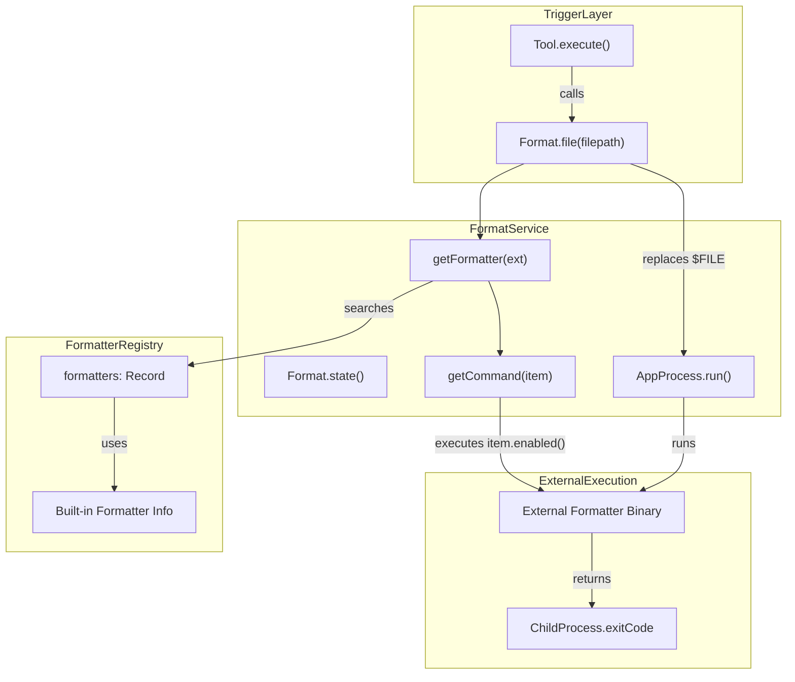
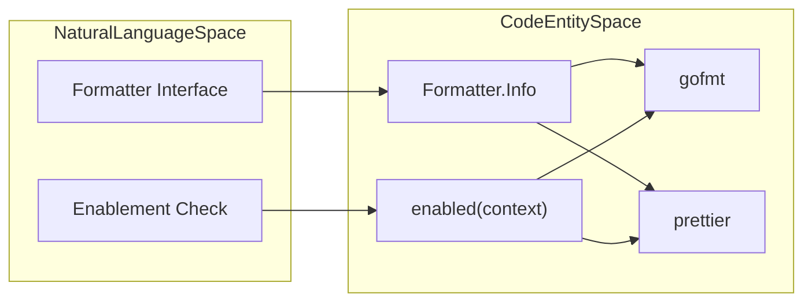
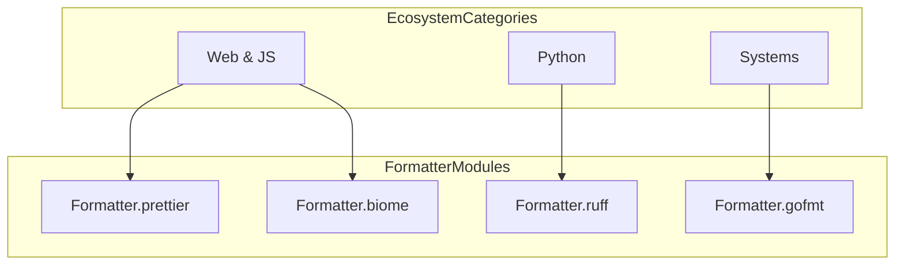

<!-- source: DeepWiki mcp.deepwiki.com · repo sst/opencode · page 5.5 Code Formatting System · fetched 2026-10-26 -->

# Code Formatting System

Relevant source files

The following files were used as context for generating this wiki page:

- [packages/opencode/src/cli/cmd/uninstall.ts](packages/opencode/src/cli/cmd/uninstall.ts)
- [packages/opencode/src/cli/cmd/upgrade.ts](packages/opencode/src/cli/cmd/upgrade.ts)
- [packages/opencode/src/cli/upgrade.ts](packages/opencode/src/cli/upgrade.ts)
- [packages/opencode/src/format/formatter.ts](packages/opencode/src/format/formatter.ts)
- [packages/opencode/src/format/index.ts](packages/opencode/src/format/index.ts)
- [packages/opencode/src/installation/index.ts](packages/opencode/src/installation/index.ts)
- [packages/opencode/src/lsp/client.ts](packages/opencode/src/lsp/client.ts)
- [packages/opencode/src/lsp/language.ts](packages/opencode/src/lsp/language.ts)
- [packages/opencode/src/lsp/lsp.ts](packages/opencode/src/lsp/lsp.ts)
- [packages/opencode/src/lsp/server.ts](packages/opencode/src/lsp/server.ts)
- [packages/opencode/src/snapshot/index.ts](packages/opencode/src/snapshot/index.ts)
- [packages/opencode/src/util/archive.ts](packages/opencode/src/util/archive.ts)
- [packages/opencode/src/util/filesystem.ts](packages/opencode/src/util/filesystem.ts)
- [packages/opencode/src/util/process.ts](packages/opencode/src/util/process.ts)
- [packages/opencode/test/format/format.test.ts](packages/opencode/test/format/format.test.ts)
- [packages/opencode/test/installation/installation.test.ts](packages/opencode/test/installation/installation.test.ts)
- [packages/opencode/test/lsp/client.test.ts](packages/opencode/test/lsp/client.test.ts)
- [packages/opencode/test/lsp/index.test.ts](packages/opencode/test/lsp/index.test.ts)
- [packages/opencode/test/lsp/lifecycle.test.ts](packages/opencode/test/lsp/lifecycle.test.ts)
- [packages/opencode/test/server/project-init-git.test.ts](packages/opencode/test/server/project-init-git.test.ts)
- [packages/opencode/test/snapshot/snapshot.test.ts](packages/opencode/test/snapshot/snapshot.test.ts)
- [packages/opencode/test/util/filesystem.test.ts](packages/opencode/test/util/filesystem.test.ts)
- [packages/opencode/test/util/process.test.ts](packages/opencode/test/util/process.test.ts)
- [packages/web/src/content/docs/formatters.mdx](packages/web/src/content/docs/formatters.mdx)
- [packages/web/src/content/docs/lsp.mdx](packages/web/src/content/docs/lsp.mdx)

The code formatting system automatically formats files after they are written or edited using language-specific formatters. This system maintains code style consistency by running appropriate formatters based on file extensions, project configuration, and detected dependencies.

For information about Language Server Protocol integration, see [Language Server Protocol Integration](#5.4). For tool system architecture, see [Tool Architecture](#5.1).

---

## Overview

The formatting system consists of three main components:

1. **Formatter Definitions**: Individual formatter configurations with commands, extensions, and enablement logic [packages/opencode/src/format/formatter.ts:11-16]().
2. **Format Coordinator**: Centralized system implemented as an Effect-based `Service` that manages formatter state and orchestrates execution [packages/opencode/src/format/index.ts:27-29]().
3. **Tool Integration**: Automatic formatting triggered by file operations in tools or explicit file formatting requests [packages/opencode/src/format/index.ts:188-191]().

The system supports numerous built-in formatters and allows custom formatter definitions through configuration.

Sources: [packages/opencode/src/format/index.ts:1-12](), [packages/opencode/src/format/formatter.ts:1-16]()

---

## System Architecture

### Formatting Data Flow
This diagram illustrates how a file operation triggers the selection and execution of specific code formatters through the `Format.Service`.

Sources: [packages/opencode/src/format/index.ts:33-167](), [packages/opencode/src/format/index.ts:188-193]()

**Formatting Lifecycle**

The system operates in the following sequence:

1. When a file is modified, the system invokes `yield* format.file(filepath)` [packages/opencode/src/format/index.ts:188-191]().
2. The `Format.Service` extracts the file extension using `path.extname(filepath)` [packages/opencode/src/format/index.ts:76]().
3. `getFormatter` filters the active registry for formatters matching that extension [packages/opencode/src/format/index.ts:57-71]().
4. For each match, `getCommand` checks if the formatter is enabled by inspecting binaries or configuration files [packages/opencode/src/format/index.ts:43-50]().
5. If enabled, the system uses `AppProcess.run` to execute the formatter command via `ChildProcess.make`, replacing the `$FILE` placeholder with the target path [packages/opencode/src/format/index.ts:84-94]().

Sources: [packages/opencode/src/format/index.ts:33-167](), [packages/opencode/src/format/index.ts:188-193]()

---

## Formatter Definition Interface

### Formatter Entity Mapping
This diagram maps natural language concepts to code entities in `packages/opencode/src/format/formatter.ts`.

Sources: [packages/opencode/src/format/formatter.ts:11-16]()

**Interface Structure**

Each formatter implements the `Info` interface defined in `formatter.ts` [packages/opencode/src/format/formatter.ts:11-16]():

| Property      | Type                    | Purpose                                             |
| ------------- | ----------------------- | --------------------------------------------------- |
| `name`        | `string`                | Unique identifier (e.g., `"prettier"`, `"ruff"`)     |
| `extensions`  | `string[]`              | List of file extensions supported (e.g., `[".ts"]`) |
| `enabled()`   | `Promise<string[] | false>` | Returns the command array if available, else `false` |
| `environment` | `Record<string,string>` | Optional environment variables (e.g., `BUN_BE_BUN: "1"`) |

Sources: [packages/opencode/src/format/formatter.ts:11-16]()

**Enablement Logic Patterns**

Formatters use various strategies in their `enabled()` implementation:

1. **Command Availability**: Check if binary exists via `which()` utility (e.g., `gofmt` [packages/opencode/src/format/formatter.ts:22-23](), `zig` [packages/opencode/src/format/formatter.ts:160-161]()).
2. **Config File Detection**: Search for configuration files via `Filesystem.findUp()` (e.g., `biome` [packages/opencode/src/format/formatter.ts:144-151](), `clang` [packages/opencode/src/format/formatter.ts:170-174]()).
3. **Dependency Detection**: Parse `package.json` for dependencies (e.g., `prettier` [packages/opencode/src/format/formatter.ts:72-81](), `oxfmt` [packages/opencode/src/format/formatter.ts:95-105]()).
4. **Help Output Validation**: Running `--help` to verify specific capabilities (e.g., `air` for R language [packages/opencode/src/format/formatter.ts:225-231](), `uvformat` [packages/opencode/src/format/formatter.ts:243-244]()).

Sources: [packages/opencode/src/format/formatter.ts:11-16](), [packages/opencode/src/format/formatter.ts:18-248]()

---

## Built-in Formatter Implementations

### Formatter Ecosystem Mapping
This diagram maps ecosystem categories to concrete implementation files and functions.

Sources: [packages/opencode/src/format/formatter.ts:18-154](), [packages/opencode/src/format/formatter.ts:189-216]()

**Formatter Categories**

The system includes formatters organized by ecosystem [packages/web/src/content/docs/formatters.mdx:14-41]():

| Formatter            | Extensions                                                                                               | Requirements                                                                                          |
| -------------------- | -------------------------------------------------------------------------------------------------------- | ----------------------------------------------------------------------------------------------------- |
| air                  | .R                                                                                                       | `air` command available                                                                               |
| biome                | .js, .jsx, .ts, .tsx, .html, .css, .md, .json, .yaml, and [more](https://biomejs.dev)                   | `biome.json(c)` config file                                                                           |
| cargofmt             | .rs                                                                                                      | `cargo fmt` command available                                                                         |
| clang-format         | .c, .cpp, .h, .hpp, .ino, and [more](https://clang.llvm.org/docs/ClangFormat.html)                       | `.clang-format` config file                                                                           |
| cljfmt               | .clj, .cljs, .cljc, .edn                                                                                 | `cljfmt` command available                                                                            |
| dart                 | .dart                                                                                                    | `dart` command available                                                                              |
| dfmt                 | .d                                                                                                       | `dfmt` command available                                                                              |
| gleam                | .gleam                                                                                                   | `gleam` command available                                                                             |
| gofmt                | .go                                                                                                      | `gofmt` command available                                                                             |
| htmlbeautifier       | .erb, .html.erb                                                                                          | `htmlbeautifier` command available                                                                    |
| ktlint               | .kt, .kts                                                                                                | `ktlint` command available                                                                            |
| mix                  | .ex, .exs, .eex, .heex, .leex, .neex, .sface                                                             | `mix` command available                                                                               |
| nixfmt               | .nix                                                                                                     | `nixfmt` command available                                                                            |
| ocamlformat          | .ml, .mli                                                                                                | `ocamlformat` command available and `.ocamlformat` config file                                        |
| ormolu               | .hs                                                                                                      | `ormolu` command available                                                                            |
| oxfmt (Experimental) | .js, .jsx, .ts, .tsx                                                                                     | `oxfmt` dependency in `package.json` and an [experimental env variable flag](/docs/cli/#experimental) |
| pint                 | .php                                                                                                     | `laravel/pint` dependency in `composer.json`                                                          |
| prettier             | .js, .jsx, .ts, .tsx, .html, .css, .md, .json, .yaml, and [more](https://prettier.io/docs/en/index.html) | `prettier` dependency in `package.json`                                                               |
| rubocop              | .rb, .rake, .gemspec, .ru                                                                                | `rubocop` command available                                                                           |
| ruff                 | .py, .pyi                                                                                                | `ruff` command available with config                                                                  |
| rustfmt              | .rs                                                                                                      | `rustfmt` command available                                                                           |
| shfmt                | .sh, .bash                                                                                               | `shfmt` command available                                                                             |
| standardrb           | .rb, .rake, .gemspec, .ru                                                                                | `standardrb` command available                                                                        |
| terraform            | .tf, .tfvars                                                                                             | `terraform` command available                                                                         |
| uv                   | .py, .pyi                                                                                                | `uv` command available                                                                                |
| zig                  | .zig, .zon                                                                                               | `zig` command available                                                                               |

Sources: [packages/web/src/content/docs/formatters.mdx:14-41]()

**Special Cases**

* **prettier**: Searches for `prettier` in `dependencies` or `devDependencies` of `package.json` before enabling [packages/opencode/src/format/formatter.ts:72-82]().
* **ruff**: Checks for `pyproject.toml` containing `[tool.ruff]` or other specific config files like `ruff.toml` [packages/opencode/src/format/formatter.ts:194-203]().
* **uv**: Only enables if `ruff` is not already enabled for the project to avoid redundant formatting [packages/opencode/src/format/formatter.ts:240]().
* **oxfmt**: Requires the `experimentalOxfmt` runtime flag to be enabled [packages/opencode/src/format/formatter.ts:94]().

Sources: [packages/opencode/src/format/formatter.ts:72-108](), [packages/opencode/src/format/formatter.ts:189-247]()

---

## Configuration System

The formatting system is configured through the `Config.Service` and processed via `Format.Service` initialization.

**Configuration Merging**

The `Format.state` function handles merging built-in formatters with user-provided configuration [packages/opencode/src/format/index.ts:130-158]():

1. If `cfg.formatter` is `false`, all formatters are disabled [packages/opencode/src/format/index.ts:120-128]().
2. Built-in formatters are loaded from the `Formatter` module [packages/opencode/src/format/index.ts:130-132]().
3. User overrides can disable specific formatters (e.g., `disabled: true`) [packages/opencode/src/format/index.ts:145-148]().
4. **Ruff and UV Linkage**: Disabling either `ruff` or `uv` in the configuration disables both to prevent conflicts in Python environments [packages/opencode/src/format/index.ts:139-144]().
5. Custom formatters can be added by providing a `command` and `extensions` list in the config, which overrides or extends the built-in definitions [packages/opencode/src/format/index.ts:149-157]().

Sources: [packages/opencode/src/format/index.ts:118-167]()

---

## State and Initialization

The system uses `InstanceState` to manage the lifecycle of formatters within a project session.

* **Initialization**: `Format.init()` triggers the creation of the formatter state [packages/opencode/src/format/index.ts:170-172]().
* **Status Reporting**: `Format.status()` returns a list of all formatters, their supported extensions, and whether they are currently enabled for the workspace [packages/opencode/src/format/index.ts:174-186]().
* **Command Caching**: The system caches the result of `enabled()` checks in the `commands` record to avoid repeated filesystem lookups during a session [packages/opencode/src/format/index.ts:44-50]().

Sources: [packages/opencode/src/format/index.ts:38-55](), [packages/opencode/src/format/index.ts:170-186]()

---

