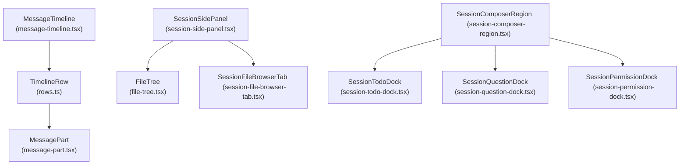
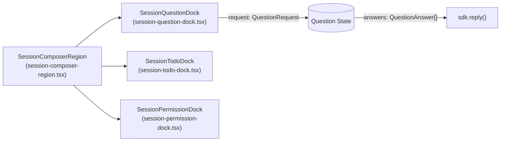

<!-- source: DeepWiki mcp.deepwiki.com · repo sst/opencode · page 6.10 Session Rendering Components · fetched 2026-10-26 -->

# Session Rendering Components

Relevant source files

The following files were used as context for generating this wiki page:

- [packages/app/e2e/regression/file-browser-sidebar-tab-switch.spec.ts](packages/app/e2e/regression/file-browser-sidebar-tab-switch.spec.ts)
- [packages/app/e2e/regression/review-open-file.spec.ts](packages/app/e2e/regression/review-open-file.spec.ts)
- [packages/app/e2e/regression/review-terminal-stacked.spec.ts](packages/app/e2e/regression/review-terminal-stacked.spec.ts)
- [packages/app/e2e/regression/session-request-docks.spec.ts](packages/app/e2e/regression/session-request-docks.spec.ts)
- [packages/app/e2e/regression/session-timeline-lifecycle-state.spec.ts](packages/app/e2e/regression/session-timeline-lifecycle-state.spec.ts)
- [packages/app/e2e/regression/session-todo-dock-navigation.spec.ts](packages/app/e2e/regression/session-todo-dock-navigation.spec.ts)
- [packages/app/e2e/utils/mock-server.ts](packages/app/e2e/utils/mock-server.ts)
- [packages/app/src/components/debug-bar.tsx](packages/app/src/components/debug-bar.tsx)
- [packages/app/src/components/file-tree-v2.tsx](packages/app/src/components/file-tree-v2.tsx)
- [packages/app/src/components/file-tree.tsx](packages/app/src/components/file-tree.tsx)
- [packages/app/src/components/prompt-input.stories.tsx](packages/app/src/components/prompt-input.stories.tsx)
- [packages/app/src/components/session/open-in-app-v2.tsx](packages/app/src/components/session/open-in-app-v2.tsx)
- [packages/app/src/components/session/open-in-app.tsx](packages/app/src/components/session/open-in-app.tsx)
- [packages/app/src/components/session/session-sortable-tab-v2.tsx](packages/app/src/components/session/session-sortable-tab-v2.tsx)
- [packages/app/src/components/session/session-sortable-tab.tsx](packages/app/src/components/session/session-sortable-tab.tsx)
- [packages/app/src/context/local-agent.test.ts](packages/app/src/context/local-agent.test.ts)
- [packages/app/src/context/local-agent.ts](packages/app/src/context/local-agent.ts)
- [packages/app/src/pages/layout-new.tsx](packages/app/src/pages/layout-new.tsx)
- [packages/app/src/pages/new-session.tsx](packages/app/src/pages/new-session.tsx)
- [packages/app/src/pages/session/composer/index.ts](packages/app/src/pages/session/composer/index.ts)
- [packages/app/src/pages/session/composer/session-composer-controls.ts](packages/app/src/pages/session/composer/session-composer-controls.ts)
- [packages/app/src/pages/session/composer/session-composer-region-controller.ts](packages/app/src/pages/session/composer/session-composer-region-controller.ts)
- [packages/app/src/pages/session/composer/session-composer-region.tsx](packages/app/src/pages/session/composer/session-composer-region.tsx)
- [packages/app/src/pages/session/composer/session-composer-state.test.ts](packages/app/src/pages/session/composer/session-composer-state.test.ts)
- [packages/app/src/pages/session/composer/session-composer-state.ts](packages/app/src/pages/session/composer/session-composer-state.ts)
- [packages/app/src/pages/session/composer/session-question-dock.tsx](packages/app/src/pages/session/composer/session-question-dock.tsx)
- [packages/app/src/pages/session/composer/session-request-tree.ts](packages/app/src/pages/session/composer/session-request-tree.ts)
- [packages/app/src/pages/session/composer/session-todo-dock.tsx](packages/app/src/pages/session/composer/session-todo-dock.tsx)
- [packages/app/src/pages/session/composer/todo-panel-motion.stories.tsx](packages/app/src/pages/session/composer/todo-panel-motion.stories.tsx)
- [packages/app/src/pages/session/file-tabs.tsx](packages/app/src/pages/session/file-tabs.tsx)
- [packages/app/src/pages/session/session-side-panel.tsx](packages/app/src/pages/session/session-side-panel.tsx)
- [packages/app/src/pages/session/timeline/message-timeline.tsx](packages/app/src/pages/session/timeline/message-timeline.tsx)
- [packages/app/src/pages/session/timeline/model.test.ts](packages/app/src/pages/session/timeline/model.test.ts)
- [packages/app/src/pages/session/timeline/model.ts](packages/app/src/pages/session/timeline/model.ts)
- [packages/app/src/pages/session/timeline/projection.ts](packages/app/src/pages/session/timeline/projection.ts)
- [packages/app/src/pages/session/timeline/rows-current.test.ts](packages/app/src/pages/session/timeline/rows-current.test.ts)
- [packages/app/src/pages/session/timeline/rows.ts](packages/app/src/pages/session/timeline/rows.ts)
- [packages/app/src/pages/session/timeline/summary-diffs.test.ts](packages/app/src/pages/session/timeline/summary-diffs.test.ts)
- [packages/app/src/pages/session/timeline/summary-diffs.ts](packages/app/src/pages/session/timeline/summary-diffs.ts)
- [packages/app/src/pages/session/use-composer-commands.tsx](packages/app/src/pages/session/use-composer-commands.tsx)
- [packages/app/src/pages/session/use-session-commands.tsx](packages/app/src/pages/session/use-session-commands.tsx)
- [packages/app/src/pages/session/v2/review-diff-kinds.test.ts](packages/app/src/pages/session/v2/review-diff-kinds.test.ts)
- [packages/app/src/pages/session/v2/review-diff-kinds.ts](packages/app/src/pages/session/v2/review-diff-kinds.ts)
- [packages/app/src/pages/session/v2/review-panel-v2-state.ts](packages/app/src/pages/session/v2/review-panel-v2-state.ts)
- [packages/app/src/pages/session/v2/review-panel-v2.tsx](packages/app/src/pages/session/v2/review-panel-v2.tsx)
- [packages/app/src/pages/session/v2/session-file-browser-tab.tsx](packages/app/src/pages/session/v2/session-file-browser-tab.tsx)
- [packages/app/src/pages/session/v2/session-file-list-v2.tsx](packages/app/src/pages/session/v2/session-file-list-v2.tsx)
- [packages/app/test-browser/review-panel-v2-state.test.ts](packages/app/test-browser/review-panel-v2-state.test.ts)
- [packages/desktop/src/main/debug.ts](packages/desktop/src/main/debug.ts)
- [packages/session-ui/src/components/basic-tool.tsx](packages/session-ui/src/components/basic-tool.tsx)
- [packages/session-ui/src/components/markdown.css](packages/session-ui/src/components/markdown.css)
- [packages/session-ui/src/components/markdown.tsx](packages/session-ui/src/components/markdown.tsx)
- [packages/session-ui/src/components/message-part.css](packages/session-ui/src/components/message-part.css)
- [packages/session-ui/src/components/message-part.tsx](packages/session-ui/src/components/message-part.tsx)
- [packages/session-ui/src/components/part-default-open.test.ts](packages/session-ui/src/components/part-default-open.test.ts)
- [packages/session-ui/src/components/part-default-open.ts](packages/session-ui/src/components/part-default-open.ts)
- [packages/session-ui/src/components/session-review.css](packages/session-ui/src/components/session-review.css)
- [packages/session-ui/src/components/session-turn.css](packages/session-ui/src/components/session-turn.css)
- [packages/session-ui/src/v2/components/session-review-file-preview-v2.tsx](packages/session-ui/src/v2/components/session-review-file-preview-v2.tsx)
- [packages/session-ui/src/v2/components/session-review-v2.css](packages/session-ui/src/v2/components/session-review-v2.css)
- [packages/session-ui/src/v2/components/session-review-v2.tsx](packages/session-ui/src/v2/components/session-review-v2.tsx)
- [packages/ui/src/components/dock-surface.css](packages/ui/src/components/dock-surface.css)
- [packages/ui/src/components/file-icon.css](packages/ui/src/components/file-icon.css)
- [packages/ui/src/components/file-icon.tsx](packages/ui/src/components/file-icon.tsx)
- [packages/ui/src/components/tabs.css](packages/ui/src/components/tabs.css)
- [packages/ui/src/components/tabs.tsx](packages/ui/src/components/tabs.tsx)
- [packages/ui/src/v2/components/line-comment-v2.tsx](packages/ui/src/v2/components/line-comment-v2.tsx)

This page details the UI components responsible for rendering conversation turns, message parts, timeline projections, side panels, composer docks, and message display logic in `packages/session-ui` and the app session pages (`packages/app/src/pages/session/`). These systems handle real-time AI streaming updates, diff reviews, interactive permissions, question prompts, and progressive rendering optimizations for large conversation histories.

---

## 1. Architecture Overview

The session rendering layer is built using [SolidJS](https://www.solidjs.com) and organizes interaction into a reactive hierarchy separating the message timeline, side navigation, and composer docks.

### Component Hierarchy and Code Entities

Title: Session UI Hierarchy and Code Entities

Sources: [packages/app/src/pages/session/timeline/message-timeline.tsx:1-79](), [packages/app/src/pages/session/session-side-panel.tsx:68-114](), [packages/app/src/pages/session/composer/session-composer-region.tsx:11-168]()

---

## 2. Message Timeline and Projection

The `MessageTimeline` component ([packages/app/src/pages/session/timeline/message-timeline.tsx:1-1847]()) renders session conversations using virtualization to guarantee high performance under heavy chat histories.

### Virtualization and Row Caching
`MessageTimeline` integrates `@tanstack/solid-virtual` via `createVirtualizer` to render only the visible rows in the DOM. It leverages a module-level `timelineCache` map to persist scroll measurements and open tool states (`toolOpen`) across session view mounts, avoiding layout thrashing [packages/app/src/pages/session/timeline/message-timeline.tsx:91-92]().

| Feature | Implementation Component / Function | Source File |
| :--- | :--- | :--- |
| **Thinking Indicator** | `TimelineThinkingRow` with `TextShimmer` & `TextReveal` | [packages/app/src/pages/session/timeline/message-timeline.tsx:132-143]() |
| **Diff Summary Row** | `TimelineDiffSummaryRow` with `DiffChanges` | [packages/app/src/pages/session/timeline/message-timeline.tsx:145-168]() |
| **Task Extraction** | `taskDescription` utility helper | [packages/app/src/pages/session/timeline/message-timeline.tsx:93-99]() |
| **Boundary Gestures** | `markBoundaryGesture` and `boundaryTarget` | [packages/app/src/pages/session/timeline/message-timeline.tsx:101-130]() |

Sources: [packages/app/src/pages/session/timeline/message-timeline.tsx:91-168]()

---

## 3. Side Panels and File Navigation

`SessionSidePanel` ([packages/app/src/pages/session/session-side-panel.tsx:68-84]()) controls the visibility of the workspace file tree, review diffs, and session context usage.

### File Tree Integration
The panel enforces a minimum width constraint (`FILE_TREE_WIDTH_MIN = 240`) and computes diff markers using `renderDiff` across `FileDiffInfo`, `SnapshotFileDiff`, and `VcsFileDiff` types [packages/app/src/pages/session/session-side-panel.tsx:60-114](). File tree nodes are rendered via `FileTree` ([packages/app/src/components/file-tree.tsx:193-211]()), supporting drag-and-drop file paths into prompts with custom drag images (`withFileDragImage`) [packages/app/src/components/file-tree.tsx:102-108]().

Sources: [packages/app/src/pages/session/session-side-panel.tsx:68-141](), [packages/app/src/components/file-tree.tsx:102-190]()

---

## 4. Composer Docks and Interactive Region

The composer region ([packages/app/src/pages/session/composer/session-composer-region.tsx:11-168]()) acts as the anchor for user inputs, interactive approval dialogs, and progress widgets.

### Dock Components
Managed by `SessionComposerRegionController`, the container dynamically switches between several task-specific docks:
*   `SessionQuestionDock`: Presents multi-choice or radio question prompts to users when agents require explicit clarification [packages/app/src/pages/session/composer/session-question-dock.tsx:64-97]().
*   `SessionPermissionDock`: Handles tool execution security approvals.
*   `SessionTodoDock`: Displays task execution checklists (`Todo[]`) with `AnimatedNumber` progression counters and active item previews via `TextReveal`.
*   `SessionFollowupDock` & `SessionRevertDock`: Facilitate quick prompt suggestions and state restorations.

Title: Composer Dock Data Flow

Sources: [packages/app/src/pages/session/composer/session-composer-region.tsx:39-141](), [packages/app/src/pages/session/composer/session-question-dock.tsx:64-129]()

---

## 5. Message Display and Part Logic

Located in `packages/session-ui/src/components/message-part.tsx`, the message component decomposes user and assistant messages into discrete `Part` schemas (`TextPart`, `ToolPart`, `ReasoningPart`, `FilePart`) [packages/session-ui/src/components/message-part.tsx:19-33]().

### Diagnostics and Content Rendering
Tool executions and file edits render integrated diagnostic feedback (`DiagnosticsDisplay`) parsing compiler or LSP errors (`Diagnostic[]`) directly beneath tool result containers [packages/session-ui/src/components/message-part.tsx:136-164](). Assistant messages utilize performance isolation rules, including container layout containment.

Sources: [packages/session-ui/src/components/message-part.tsx:136-206]()

---

## 6. Scroll Synchronization and Performance

To maintain 60 frames-per-second streaming performance during active model token generation and large diff rendering, the UI relies on dedicated scroll controllers:
*   `createScrollSync` ([packages/app/src/pages/session/file-tabs.tsx:92-206]()): Synchronizes scroll offsets (`ScrollPos`) between file viewer viewports and shadow DOM diff containers using batched `requestAnimationFrame` hooks [packages/app/src/pages/session/file-tabs.tsx:117-126]().
*   `markBoundaryGesture` ([packages/app/src/pages/session/timeline/message-timeline.tsx:109-130]()): Detects when scroll gestures reach the boundary of nested scrollable elements and seamlessly bubbles scroll focus back to the parent timeline viewport [packages/app/src/pages/session/timeline/message-timeline.tsx:109-130]().

Sources: [packages/app/src/pages/session/file-tabs.tsx:92-206](), [packages/app/src/pages/session/timeline/message-timeline.tsx:109-130]()

---

