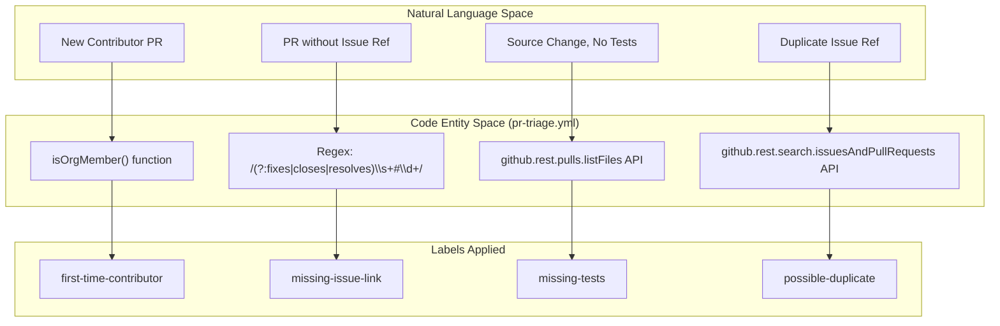
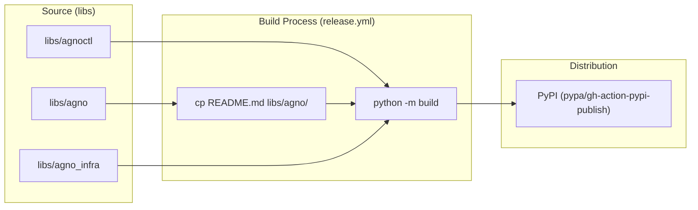

<!-- source: DeepWiki mcp.deepwiki.com · repo agno-agi/agno · page 9.5 Contributing Guidelines · fetched 2026-10-26 -->

# Contributing Guidelines

Relevant source files

The following files were used as context for generating this wiki page:

- [.github/pull_request_template.md](.github/pull_request_template.md)
- [CONTRIBUTING.md](CONTRIBUTING.md)
- [README.md](README.md)
- [libs/agno/agno/tools/reasoning.py](libs/agno/agno/tools/reasoning.py)

This document details the development workflow, code quality standards, and extensibility patterns for contributing to Agno. It covers the fork-and-pr model, mandatory validation scripts, and specific implementation guides for adding new Models, Vector Databases, and Tools.

## Development Environment Setup

Agno utilizes `uv` for high-performance dependency management and virtual environment isolation.

### Virtual Environment Configuration

1. **Clone the repository.**
2. **Verify `uv` installation**: Run `uv --version`. If missing, install via `pip install uv` [CONTRIBUTING.md:34-36]().
3. **Initialize Environment**:
   * **Unix**: Run `./scripts/dev_setup.sh` [CONTRIBUTING.md:38]().
   * **Windows**: Run `.\scripts\dev_setup.bat` [CONTRIBUTING.md:39]().
   * This setup creates a `.venv` directory, installs required packages, and installs the `agno` package in editable mode [CONTRIBUTING.md:40-43]().
4. **Activation**:
   * **Unix**: `source .venv/bin/activate` [CONTRIBUTING.md:45]().
   * **Windows**: `.venv\Scripts\activate` [CONTRIBUTING.md:46]().

Sources: [CONTRIBUTING.md:31-48]()

---

## Pull Request Workflow

Agno follows a standard fork-and-pull-request workflow. All contributions must pass automated quality gates.

### PR Guidelines and Standards

To maintain project history and quality, adhere to these core rules enforced by the `PR Lint` workflow [CONTRIBUTING.md:29]():

| Requirement | Description |
| :--- | :--- |
| **Title Format** | Must follow `[type] description` (e.g., `[feat] Add user authentication`) [CONTRIBUTING.md:20-21](). |
| **Issue Linking** | Description should reference the issue using keywords like `fixes #<number>`, `closes #<number>`, or `resolves #<number>` [CONTRIBUTING.md:23-24](). |
| **No Duplicates** | Search [open pull requests](https://github.com/agno-agi/agno/pulls) before starting work [CONTRIBUTING.md:25](). |
| **Respect Assignments** | Do not open PRs for issues already assigned to others without maintainer approval [CONTRIBUTING.md:26](). |
| **AI Disclosure** | Disclose if a PR was entirely generated by AI (Copilot, Claude Code, etc.) in the PR template [CONTRIBUTING.md:27](), [.github/pull_request_template.md:32](). |

### Valid PR Type Tags
* `[feat]`: New functionality.
* `[fix]`: Bug fixes.
* `[cookbook]`: New or updated examples.
* `[test]`: Testing infrastructure or new test cases.
* `[refactor]`: Code changes that neither fix a bug nor add a feature.
* `[chore]`: Maintenance tasks (dependencies, build scripts).
* `[style]`, `[revert]`, `[release]`.

Sources: [CONTRIBUTING.md:16-30](), [.github/pull_request_template.md:1-38]()

---

## Code Quality and Validation

Before submitting a PR, contributors **must** run formatting and validation scripts locally.

### Formatting and Static Analysis
* **Format**: Run `./scripts/format.sh` (Unix) or `.\scripts\format.bat` (Windows). This uses `ruff` to ensure consistent code style [CONTRIBUTING.md:54-61]().
* **Validate**: Run `./scripts/validate.sh` (Unix) or `.\scripts\validate.bat` (Windows). This executes `ruff` linting and `mypy` for static type checking [CONTRIBUTING.md:54-61]().

### Local Testing
Execute the test suite using `./scripts/test.sh` [CONTRIBUTING.md:69](). For specific modules, use pytest directly:
`pytest ./libs/agno/tests/unit/utils/test_string.py` [CONTRIBUTING.md:71]().

Sources: [CONTRIBUTING.md:50-74]()

---

## Extensibility Patterns

Agno is designed for modular growth. Follow these patterns when adding new components.

### 1. Adding a New Vector Database
1. **Directory**: Create a new directory under `libs/agno/agno/vectordb/` [CONTRIBUTING.md:78]().
2. **Implementation**: Create a class inheriting from the `VectorDb` interface defined in `libs/agno/agno/vectordb/base.py` [CONTRIBUTING.md:79-81]().
3. **Exports**: Import the class in `libs/agno/agno/vectordb/<your_db>/__init__.py` [CONTRIBUTING.md:82]().
4. **Example**: Add a recipe in `cookbook/07_knowledge/09_archive/vector_dbs/<your_db>` [CONTRIBUTING.md:84]().

### 2. Adding a New Model Provider
* **OpenAI-Compatible**: Inherit from `OpenAILike` in `libs/agno/agno/models/openai/like.py` [CONTRIBUTING.md:93-94]().
* **Custom API**: Inherit from the base `Model` class. Reference `agno/models/anthropic/claude.py` for inspiration [CONTRIBUTING.md:98-100]().
* **Registration**: Update the `_PROVIDERS` table in `libs/agno/agno/models/utils.py` [CONTRIBUTING.md:101-102](). This table is the source of truth for the construction registry (`MODEL_PROVIDER_CLASSES`) and resolution indices [CONTRIBUTING.md:104-106]().

### 3. Adding a New Tool
1. **Implementation**: Create a class inheriting from `Toolkit` [libs/agno/agno/tools/reasoning.py:10]().
2. **Function Registration**: Define methods within the toolkit (e.g., `think`, `analyze`) [libs/agno/agno/tools/reasoning.py:50-57]() and pass them to the `super().__init__(tools=[...])` call [libs/agno/agno/tools/reasoning.py:42-48]().
3. **Context Access**: Tools can access the `RunContext` to store or retrieve session state [libs/agno/agno/tools/reasoning.py:52](), such as `run_context.session_state` [libs/agno/agno/tools/reasoning.py:86-92]().

Sources: [CONTRIBUTING.md:75-113](), [libs/agno/agno/tools/reasoning.py:1-171]()

---

## CI/CD and Automation Architecture

The repository utilizes GitHub Actions to enforce standards and manage the PR lifecycle.

### PR Triage and Labeling Architecture

Sources: [CONTRIBUTING.md:29-30]()

### Release Pipeline Architecture

Sources: [CONTRIBUTING.md:1-113]()

---

## AI-Assisted Development

Agno encourages the use of AI tools for development while maintaining high quality standards.

### AI Disclosure and Review
AI-generated contributions (via Copilot, Claude Code, Cursor, etc.) must be disclosed in the PR template [CONTRIBUTING.md:27](), [.github/pull_request_template.md:32](). These PRs are held to the same quality bar: they must include tests, pass CI, and demonstrate that the author understands the changes [CONTRIBUTING.md:27]().

### Coding Agent Integration
Developers can integrate Agno documentation into their AI tools:
1. **Indexed Source**: Add `https://docs.agno.com/llms-full.txt` to Cursor or Windsurf [README.md:66]().
2. **MCP Server**: Add `docs.agno.com/mcp` to support model context protocol enabled agents [README.md:65]().

Sources: [CONTRIBUTING.md:27](), [README.md:61-68](), [.github/pull_request_template.md:28-34]()

---

