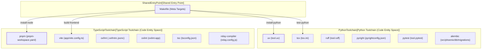
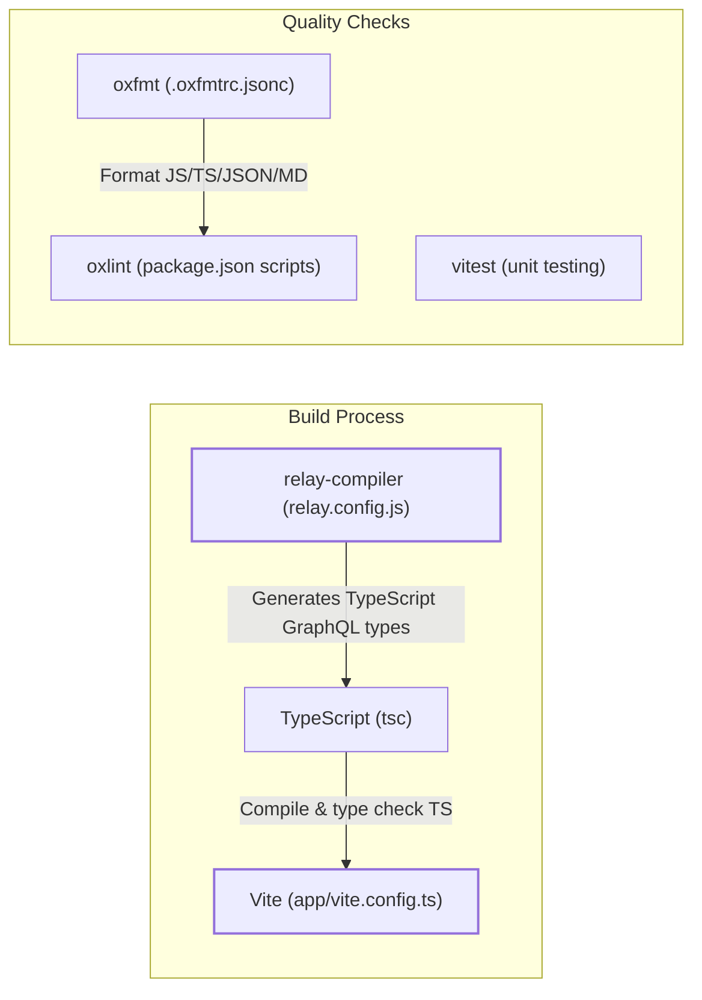
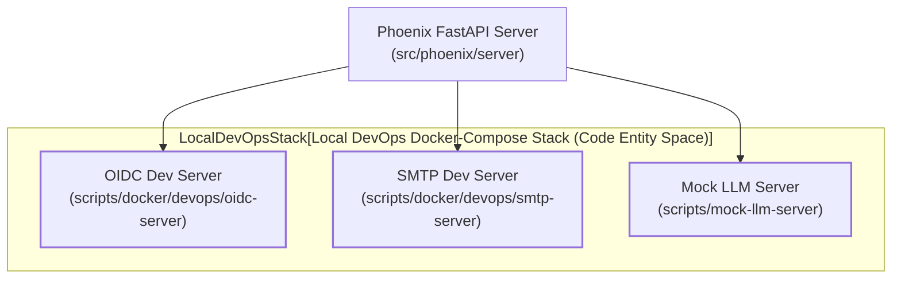
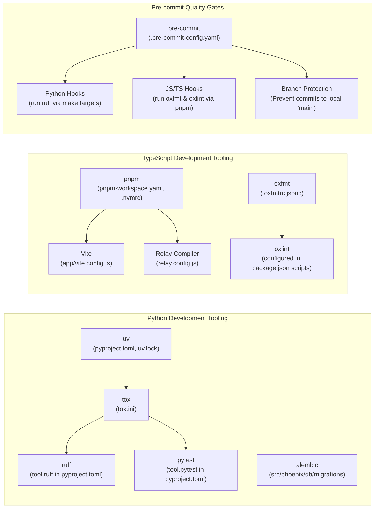

<!-- source: DeepWiki mcp.deepwiki.com · repo Arize-ai/phoenix · page 6.1 Development Workflow & Tooling · fetched 2026-10-26 -->

# Development Workflow & Tooling

<details>
<summary>Relevant source files</summary>

The following files were used as context for generating this wiki page:

- [.cursor/rules/python/RULE.md](.cursor/rules/python/RULE.md)
- [.gitignore](.gitignore)
- [.pre-commit-config.yaml](.pre-commit-config.yaml)
- [.vscode/extensions.json](.vscode/extensions.json)
- [AGENTS.md](AGENTS.md)
- [CLAUDE.md](CLAUDE.md)
- [DEVELOPMENT.md](DEVELOPMENT.md)
- [Makefile](Makefile)
- [evals/harbor/README.md](evals/harbor/README.md)
- [evals/harbor/tasks/regression/prompt-hill-climb/README.md](evals/harbor/tasks/regression/prompt-hill-climb/README.md)
- [evals/harbor/tasks/regression/prompt-hill-climb/steps/step_01_create_evaluator/tests/check.py](evals/harbor/tasks/regression/prompt-hill-climb/steps/step_01_create_evaluator/tests/check.py)
- [evals/harbor/tasks/regression/prompt-hill-climb/steps/step_02_hill_climb/tests/check.py](evals/harbor/tasks/regression/prompt-hill-climb/steps/step_02_hill_climb/tests/check.py)
- [evals/harbor/tasks/regression/prompt-hill-climb/steps/step_03_compare/tests/check.py](evals/harbor/tasks/regression/prompt-hill-climb/steps/step_03_compare/tests/check.py)
- [evals/harbor/tasks/regression/prompt-hill-climb/tests/hill_climb_checks.py](evals/harbor/tasks/regression/prompt-hill-climb/tests/hill_climb_checks.py)
- [evals/harbor/tasks/regression/prompt-hill-climb/tests/test.sh](evals/harbor/tasks/regression/prompt-hill-climb/tests/test.sh)
- [evals/harbor/tasks/trail-benchmark-dev/most-failing-tool/tests/expected.json](evals/harbor/tasks/trail-benchmark-dev/most-failing-tool/tests/expected.json)
- [evals/harbor/verifiers/harbor_verifiers/verify.py](evals/harbor/verifiers/harbor_verifiers/verify.py)
- [js/DEVELOPMENT.md](js/DEVELOPMENT.md)
- [pytest-quiet.ini](pytest-quiet.ini)
- [scripts/ci/ensure_graphql_mutations_have_permission_classes.py](scripts/ci/ensure_graphql_mutations_have_permission_classes.py)
- [scripts/ci/test_skill_graphql_examples.py](scripts/ci/test_skill_graphql_examples.py)
- [scripts/docker/devops/dev.sh](scripts/docker/devops/dev.sh)
- [scripts/docker/devops/docker-compose.yml](scripts/docker/devops/docker-compose.yml)
- [scripts/docker/devops/oidc-server/Dockerfile](scripts/docker/devops/oidc-server/Dockerfile)
- [scripts/docker/devops/oidc-server/frontend/package.json](scripts/docker/devops/oidc-server/frontend/package.json)
- [scripts/docker/devops/oidc-server/frontend/pnpm-workspace.yaml](scripts/docker/devops/oidc-server/frontend/pnpm-workspace.yaml)
- [scripts/docker/devops/oidc-server/frontend/src/UserSelector.tsx](scripts/docker/devops/oidc-server/frontend/src/UserSelector.tsx)
- [scripts/docker/devops/oidc-server/package.json](scripts/docker/devops/oidc-server/package.json)
- [scripts/docker/devops/oidc-server/src/database/client.ts](scripts/docker/devops/oidc-server/src/database/client.ts)
- [scripts/docker/devops/oidc-server/src/server.ts](scripts/docker/devops/oidc-server/src/server.ts)
- [scripts/docker/devops/overrides/ldap-no-email.yml](scripts/docker/devops/overrides/ldap-no-email.yml)
- [scripts/docker/devops/overrides/ldap-posix.yml](scripts/docker/devops/overrides/ldap-posix.yml)
- [scripts/docker/devops/overrides/pkce-confidential.yml](scripts/docker/devops/overrides/pkce-confidential.yml)
- [scripts/docker/devops/overrides/pkce-public.yml](scripts/docker/devops/overrides/pkce-public.yml)
- [scripts/docker/devops/smtp-server/Dockerfile](scripts/docker/devops/smtp-server/Dockerfile)
- [scripts/docker/devops/smtp-server/package.json](scripts/docker/devops/smtp-server/package.json)
- [scripts/docker/devops/smtp-server/pnpm-workspace.yaml](scripts/docker/devops/smtp-server/pnpm-workspace.yaml)
- [scripts/docker/devops/smtp-server/src/server.ts](scripts/docker/devops/smtp-server/src/server.ts)
- [scripts/docker/devops/smtp-server/ui/package.json](scripts/docker/devops/smtp-server/ui/package.json)
- [scripts/docker/devops/vite-dev/Dockerfile](scripts/docker/devops/vite-dev/Dockerfile)
- [scripts/gh-comment-watch/pnpm-workspace.yaml](scripts/gh-comment-watch/pnpm-workspace.yaml)
- [scripts/gh-comment-watch/web/package.json](scripts/gh-comment-watch/web/package.json)
- [scripts/mock-llm-server/dashboard/package.json](scripts/mock-llm-server/dashboard/package.json)
- [scripts/mock-llm-server/pnpm-workspace.yaml](scripts/mock-llm-server/pnpm-workspace.yaml)
- [scripts/ts-span-generator/README.md](scripts/ts-span-generator/README.md)
- [scripts/ts-span-generator/generate-spans.ts](scripts/ts-span-generator/generate-spans.ts)
- [scripts/ts-span-generator/package-lock.json](scripts/ts-span-generator/package-lock.json)
- [scripts/ts-span-generator/package.json](scripts/ts-span-generator/package.json)
- [scripts/ts-span-generator/tsconfig.json](scripts/ts-span-generator/tsconfig.json)
- [src/phoenix/server/email/sender.py](src/phoenix/server/email/sender.py)
- [src/phoenix/server/email/templates/db_disk_usage_notification.html](src/phoenix/server/email/templates/db_disk_usage_notification.html)
- [src/phoenix/server/email/templates/password_reset.html](src/phoenix/server/email/templates/password_reset.html)
- [src/phoenix/server/email/templates/welcome.html](src/phoenix/server/email/templates/welcome.html)
- [src/phoenix/server/email/types.py](src/phoenix/server/email/types.py)
- [tests/integration/server/test_db_disk_usage_monitor.py](tests/integration/server/test_db_disk_usage_monitor.py)
- [tests/unit/harbor/cassettes/test_verify/test_reference_check_grades_semantic_answers.yaml](tests/unit/harbor/cassettes/test_verify/test_reference_check_grades_semantic_answers.yaml)
- [tests/unit/harbor/test_verify.py](tests/unit/harbor/test_verify.py)

</details>


This page documents the development environment setup, tooling, and workflows for contributing to Phoenix. It covers package managers, code formatting and linting tools, testing frameworks, pre-commit hooks, and the local devops docker-compose stack (OIDC server, SMTP server, and mock LLM server) for both the Python backend and the TypeScript frontend codebases.

For details about CI/CD pipelines, testing strategy, and deployment, please see the related pages [6.3 CI/CD Pipeline](), [6.2 Testing Strategy](), and [6.5 Kubernetes Deployment]().

---

## Development Environment Overview

Phoenix is a monorepo consisting of Python and TypeScript packages, requiring separate but coordinated toolchains and workflows. A `Makefile` serves as a unified interface for common tasks across languages, simplifying developer experience [Makefile:1-112]().

### Workflow Tooling Diagram: Mapping Natural Language to Code Entities



**Sources:** [DEVELOPMENT.md:25-125](), [Makefile:27-40](), [.pre-commit-config.yaml:1-62]()

---

## Python Development Tools

### Package Management: uv

Phoenix uses [uv](https://astral.sh/uv) as the primary package and workspace manager for Python dependencies. The project pins a specific `uv` version via `tool.uv.required-version` in the root `pyproject.toml` to ensure consistent environments. 

Running `uv sync --python 3.11` installs the main `arize-phoenix` package and the sub-packages (`phoenix.evals`, `phoenix.otel`, `phoenix.client`) in editable mode within an isolated virtual environment [DEVELOPMENT.md:27-89]().

Common `uv` commands used include:

| Command                                      | Description                                                                      |
|----------------------------------------------|----------------------------------------------------------------------------------|
| `uv sync --python 3.11 --all-packages`       | Installs all Python packages + workspaces in editable mode with Python 3.11      |
| `scripts/uv.sh add <package>`                | Safely adds a dependency using the pinned wrapper script                         |
| `uv lock --check`                            | Validates that the `uv.lock` matches `pyproject.toml` dependency specifications  |

The workspaces ensure that the monorepo Python sub-packages are properly linked during development to allow iterative changes without reinstallation.

### Testing & Environment Orchestration: tox

Phoenix uses `tox` to automate and isolate multiple test environments, ensuring consistency when running tests, linters, formatters, and type checks against supported Python versions and database backends [DEVELOPMENT.md:138-163]().

`tox.ini` defines numerous environments. Important ones include:
- `unit_tests`: Runs tests via `pytest`. Supports database backend selection via `--db postgresql` or SQLite [DEVELOPMENT.md:146-158]().
- `ruff`: Runs code formatting and linting using `ruff`.

`tox` isolates virtual environments per target and ensures deterministic dependency installation when running commands such as `tox run -e unit_tests`.

### Code Formatting and Linting (Python)

- `ruff` is used as the primary Python linter and formatter, configured in `pyproject.toml` under `tool.ruff`.
- Formatting is executed via the `make format-python` target [Makefile:93]().
- Linting runs via `make lint-python` [Makefile:98]().

**Sources:** [DEVELOPMENT.md:27-89, 138-163](), [Makefile:93-98](), [.pre-commit-config.yaml:4-15]()

---

## TypeScript Development Tools

### Package Management: pnpm

The frontend React SPA under `js/app/` and shared TypeScript libraries under `js/` are managed using `pnpm` (version 12.0.0 pinned) for efficient monorepo package resolution and installation [DEVELOPMENT.md:39-48]().

Typical installation commands:

```bash
# Install Node.js via nvm respecting .nvmrc
nvm install
npm i -g pnpm@12.0.0

# Install dependencies and build the frontend
cd js
pnpm install
pnpm build
```

### Build and Quality Toolchain

Phoenix's frontend development uses these tools:



- **Vite** serves as the build system and development server for the React frontend.
- **Relay Compiler** generates strongly-typed TypeScript interfaces for the GraphQL schema.
- **oxfmt** is a Rust-based formatter for JavaScript, TypeScript, and related files.
- **oxlint** is a Rust-based linter for JS/TS code style and correctness.

**Sources:** [DEVELOPMENT.md:39-48](), [.pre-commit-config.yaml:27-50]()

---

## Pre-commit Hooks

Phoenix enforces automated pre-commit hooks to uphold code quality consistently across languages. Hooks are configured in `.pre-commit-config.yaml` and will auto-run on `git commit` after installation [.pre-commit-config.yaml:1-62]().

### Pre-commit Hooks Summary

| Hook ID                             | Purpose                                                       | Implementation Detail                    |
|-----------------------------------|---------------------------------------------------------------|----------------------------------------|
| `format-python`                   | Automatically format Python files using `make format-python`  | Runs `make format-python` (ruff) [.pre-commit-config.yaml:4-8]() |
| `lint-python`                     | Lint Python code using `make lint-python`                     | Runs `make lint-python` (ruff checks) [.pre-commit-config.yaml:10-14]() |
| `clean-notebooks`                 | Strip output and metadata from Jupyter notebooks              | Runs `uv run jupyter nbconvert` [.pre-commit-config.yaml:16-25]() |
| `oxfmt-app`                      | Format frontend React app code                                 | Runs `pnpm --dir app run fmt` [.pre-commit-config.yaml:27-32]() |
| `oxfmt-js`                       | Format shared JS/TS workspace code                             | Runs `pnpm --dir js run fmt` [.pre-commit-config.yaml:33-38]() |
| `oxlint-app`                     | Lint frontend React app code                                   | Runs `pnpm --dir app run lint` [.pre-commit-config.yaml:39-44]() |
| `oxlint-js`                      | Lint shared JS/TS workspace code                               | Runs `pnpm --dir js run lint` [.pre-commit-config.yaml:45-50]() |
| `forbid-commit-to-local-main-branch` | Prevent committing directly to local `main` branch          | Bash check on branch name [.pre-commit-config.yaml:51-55]() |
| `uv-lock-check`                  | Ensure Python dependency `uv.lock` consistency                 | Runs `uv lock --check` [.pre-commit-config.yaml:56-62]() |

### Installing Pre-commit Hooks

Install the `pre-commit` tool globally via uv and enable project hooks:

```bash
uv tool install pre-commit --with pre-commit-uv
pre-commit install
```

**Sources:** [.pre-commit-config.yaml:1-62]()

---

## Local DevOps Docker-Compose Stack

Phoenix includes a local DevOps docker-compose stack (`scripts/docker/devops/docker-compose.yml`) to facilitate testing authentication, email notifications, and generative model interactions without external cloud dependencies.

### Services Overview



1. **OIDC Dev Server (`scripts/docker/devops/oidc-server/`)**: Provides a lightweight Fastify-based OIDC server (`scripts/docker/devops/oidc-server/src/server.ts`) with a React user selection interface (`scripts/docker/devops/oidc-server/frontend/`) for testing authentication flows, token exchange, and JWT validation in Phoenix.
2. **SMTP Dev Server (`scripts/docker/devops/smtp-server/`)**: Implements a local SMTP server and React UI (`scripts/docker/devops/smtp-server/ui/`) that captures outgoing server emails (such as welcome messages, password resets, and database disk usage warnings generated by `SimpleEmailSender` in `src/phoenix/server/email/sender.py`) for local verification.
3. **Mock LLM Server (`scripts/mock-llm-server/`)**: Mocks OpenAI-compatible generative model endpoints to test Phoenix's playground, tracing, and evaluation subsystems locally.

**Sources:** [scripts/docker/devops/oidc-server/package.json:1-42](), [scripts/docker/devops/smtp-server/package.json:1-46](), [src/phoenix/server/email/sender.py:22-136]()

---

## Agent / AI Coding Assistant Configuration Files

Phoenix integrates support for AI-assisted development via specialized configuration files and directories controlling agent behavior and IDE integration.

### Directory Structure & Settings

- **`.agents/`**: Contains skill definitions and agent behaviors, such as `.agents/skills/phoenix-github/SKILL.md` [`.agents/skills/phoenix-github/SKILL.md:1-103`]().
- **`.claude/settings.json`**: Configures environment variables and hook commands used by the Claude AI assistant during code editing, executing automatic formatting, linting, and schema builds on file edits [`.claude/settings.json:1-38`]().
- **`.cursor/`**: Holds Cursor rules for automated code analysis, such as `.cursor/rules/python/RULE.md`.
- **`.codex/`**: Includes configuration files and bash validation scripts for the Codex AI assistant.

**Sources:** [.agents/skills/phoenix-github/SKILL.md:1-103](), [.claude/settings.json:1-38]()

---

## Makefile and Unified Commands

The `Makefile` aggregates commands across Python and TypeScript stacks, operating as the central entry point for all development tasks [Makefile:1-112]().

### Key Make Targets

| Target                     | Description                                                          |
|----------------------------|----------------------------------------------------------------------|
| `setup`                    | Performs full environment setup (Python packages + JS dependencies)  |
| `install-python`           | Installs Python dependencies using `uv`                              |
| `install-node`             | Installs Node.js dependencies using `pnpm`                           |
| `dev`                      | Runs full dev environment: Python server + frontend with hot reload  |
| `dev-backend`              | Runs backend FastAPI server only                                     |
| `dev-frontend`             | Runs frontend Vite dev server only                                   |
| `dev-docker`               | Runs local DevOps container stack                                    |
| `test`                     | Runs all tests (Python + TypeScript workspace)                       |
| `lint`                     | Lints all codebases                                                  |
| `format`                   | Formats all codebases                                                |

**Sources:** [Makefile:1-112]()

---

# Summary

Phoenix development leverages robust, modern tooling for both backend and frontend development:

| Area                      | Tool(s)                         | Key Config Files                         |
|---------------------------|--------------------------------|----------------------------------------|
| Python Package Management | `uv`                           | `pyproject.toml`, `uv.lock`             |
| Python Testing & Linting  | `tox`, `pytest`, `ruff`        | `tox.ini`, `pyproject.toml`             |
| TypeScript Package Mgmt   | `pnpm`                         | `pnpm-workspace.yaml`, `.nvmrc`         |
| TypeScript Build          | `vite`, `relay-compiler`, `tsc` | `app/vite.config.ts`, `relay.config.js`, `tsconfig.json` |
| TypeScript Lint & Format  | `oxlint`, `oxfmt`              | `.oxfmtrc.jsonc`                         |
| Pre-commit Hooks          | `pre-commit`                   | `.pre-commit-config.yaml`                |
| DevOps Environments       | Docker Compose (Postgres, OIDC, SMTP mocks) | `scripts/docker/devops/docker-compose.yml` |
| AI Agent Configurations   | `.agents/`, `.claude/`, `.cursor/`, `.codex/` | Agent skills YAML, JSON hook configs |

---

# Detailed Development Tooling Diagram: Natural Language to Code Entity Space



**Sources:** [DEVELOPMENT.md:25-125](), [.pre-commit-config.yaml:1-62](), [Makefile:1-112]()

# End of Development Workflow & Tooling Page

---

