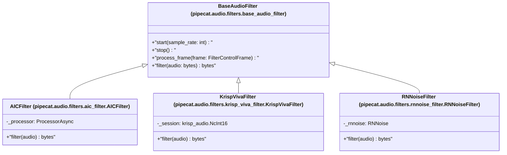
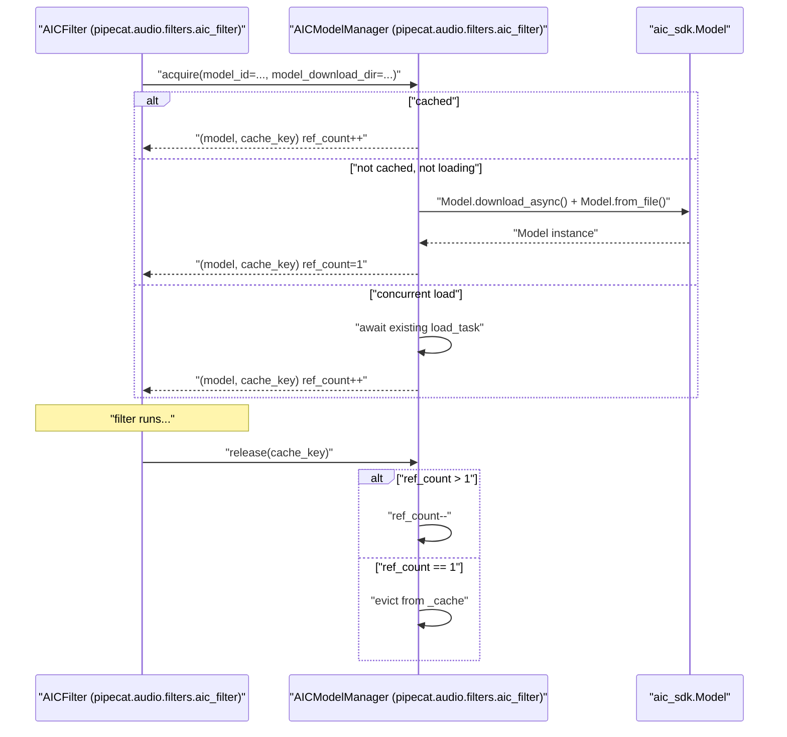
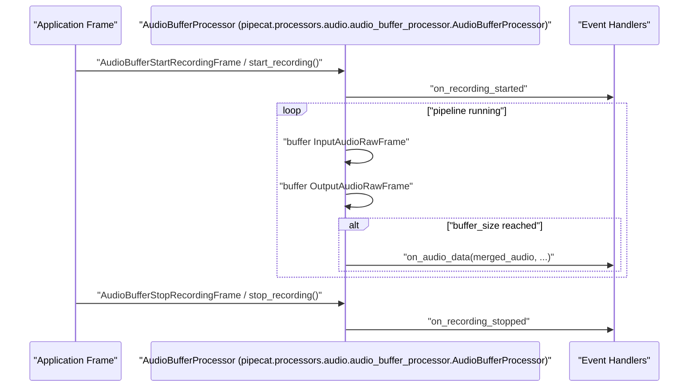

<!-- source: DeepWiki mcp.deepwiki.com · repo pipecat-ai/pipecat · page 6.2 Audio Filters and Enhancement · fetched 2026-10-26 -->

# Audio Filters and Enhancement

Relevant source files

The following files were used as context for generating this wiki page:

- [examples/audio/audio-bot-background-sound.py](examples/audio/audio-bot-background-sound.py)
- [examples/audio/audio-recording.py](examples/audio/audio-recording.py)
- [examples/audio/audio-sound-effects.py](examples/audio/audio-sound-effects.py)
- [examples/voice/voice-aicoustics-vad-only.py](examples/voice/voice-aicoustics-vad-only.py)
- [examples/voice/voice-aicoustics.py](examples/voice/voice-aicoustics.py)
- [examples/voice/voice-krisp-viva.py](examples/voice/voice-krisp-viva.py)
- [scripts/krisp/test_krisp_viva_filter_audiofile.py](scripts/krisp/test_krisp_viva_filter_audiofile.py)
- [scripts/krisp/test_krisp_viva_turn_audiofile.py](scripts/krisp/test_krisp_viva_turn_audiofile.py)
- [src/pipecat/audio/filters/aic_filter.py](src/pipecat/audio/filters/aic_filter.py)
- [src/pipecat/audio/filters/krisp_viva_filter.py](src/pipecat/audio/filters/krisp_viva_filter.py)
- [src/pipecat/audio/krisp_instance.py](src/pipecat/audio/krisp_instance.py)
- [src/pipecat/audio/turn/krisp_viva_turn.py](src/pipecat/audio/turn/krisp_viva_turn.py)
- [src/pipecat/audio/vad/aic_quail_vad.py](src/pipecat/audio/vad/aic_quail_vad.py)
- [src/pipecat/audio/vad/krisp_viva_vad.py](src/pipecat/audio/vad/krisp_viva_vad.py)
- [src/pipecat/processors/audio/audio_buffer_processor.py](src/pipecat/processors/audio/audio_buffer_processor.py)
- [src/pipecat/turns/user_start/__init__.py](src/pipecat/turns/user_start/__init__.py)
- [src/pipecat/turns/user_start/krisp_viva_ip_user_turn_start_strategy.py](src/pipecat/turns/user_start/krisp_viva_ip_user_turn_start_strategy.py)
- [tests/aic_mocks.py](tests/aic_mocks.py)
- [tests/conftest.py](tests/conftest.py)
- [tests/test_aic_filter.py](tests/test_aic_filter.py)
- [tests/test_aic_quail_vad.py](tests/test_aic_quail_vad.py)
- [tests/test_audio_buffer_processor.py](tests/test_audio_buffer_processor.py)
- [tests/test_base_smart_turn_buffer.py](tests/test_base_smart_turn_buffer.py)
- [tests/test_krisp_ip_user_turn_start_strategy.py](tests/test_krisp_ip_user_turn_start_strategy.py)
- [tests/test_krisp_sdk_manager.py](tests/test_krisp_sdk_manager.py)
- [tests/test_krisp_viva_filter.py](tests/test_krisp_viva_filter.py)
- [tests/test_krisp_viva_vad.py](tests/test_krisp_viva_vad.py)

This page covers the audio filter interface, the ai-coustics (`AIC`), Krisp, RNNoise, and other noise enhancement integrations, the `AudioBufferProcessor` for recording and mixing pipeline audio, and the low-level audio utility functions used throughout Pipecat. For Voice Activity Detection analyzers (including how filters plug into the VAD pipeline), see [Voice Activity Detection](6.1). For transport-level audio capture and delivery, see [Transport I/O Architecture](3.5).

---

## Overview

Pipecat's audio processing stack handles real-time enhancement, buffering, and synchronization across several specialized modules:

| Concern | Primary Classes / Functions | Location |
|---|---|---|
| Real-time noise reduction / enhancement | `BaseAudioFilter`, `AICFilter`, `KrispVivaFilter`, `RNNoiseFilter`, `NoisereduceFilter`, `KoalaFilter` | [src/pipecat/audio/filters/base_audio_filter.py:12-32](), [src/pipecat/audio/filters/aic_filter.py:210-230](), [src/pipecat/audio/filters/krisp_viva_filter.py:37-352](), [src/pipecat/audio/filters/rnnoise_filter.py:28-35]() |
| Standalone High-Performance VAD | `AICQuailVADAnalyzer` | [src/pipecat/audio/vad/aic_quail_vad.py:51-90]() |
| Filter enable/disable signalling | `FilterControlFrame`, `FilterEnableFrame` | [src/pipecat/frames/frames.py:35-36]() |
| Recording, mixing, and buffer management | `AudioBufferProcessor`, `TurnAudioData` | [src/pipecat/processors/audio/audio_buffer_processor.py:44-98]() |
| Codec conversion, resampling, volume | `mix_audio`, `ulaw_to_pcm`, `calculate_audio_volume`, `detect_speech_onset` | [src/pipecat/audio/utils.py:7-12]() |

Audio filters are attached to a transport's input side and operate before frames reach any STT or pipeline processor. `AudioBufferProcessor` lives inside the pipeline itself and works with both input and output frames [examples/voice/voice-aicoustics.py:113-128]().

Sources:
[src/pipecat/audio/filters/base_audio_filter.py:12-32]()
[src/pipecat/audio/filters/aic_filter.py:210-230]()
[src/pipecat/audio/filters/krisp_viva_filter.py:37-352]()
[src/pipecat/audio/filters/rnnoise_filter.py:28-35]()
[src/pipecat/audio/vad/aic_quail_vad.py:51-90]()
[src/pipecat/frames/frames.py:35-36]()
[src/pipecat/processors/audio/audio_buffer_processor.py:44-98]()
[src/pipecat/audio/utils.py:7-12]()
[examples/voice/voice-aicoustics.py:113-128]()

---

## Filter Interface

Title: Audio Filter Class Hierarchy (Natural Language to Code Entity Space)

`BaseAudioFilter` defines lifecycle methods that every filter must implement. Transports call `start` when the session begins, `stop` when it ends, `process_frame` to handle `FilterControlFrame` signals, and `filter` for each incoming audio chunk [src/pipecat/audio/filters/base_audio_filter.py:12-32]().

Sources:
[src/pipecat/audio/filters/base_audio_filter.py:12-32]()

---

## AICFilter

`AICFilter` ([src/pipecat/audio/filters/aic_filter.py:210-474]()) wraps the [ai-coustics](https://ai-coustics.io) `aic-sdk` to perform real-time speech enhancement. It mirrors the structure of other filters and integrates with Pipecat's input transport pipeline [src/pipecat/audio/filters/aic_filter.py:7-11]().

### Authentication and Environment
The AIC SDK requires an API key for authentication. Pipecat uses the `AIC_SDK_LICENSE` environment variable [examples/voice/voice-aicoustics.py:42-48]().

### Key constructor parameters

| Parameter | Type | Purpose |
|---|---|---|
| `license_key` | `str` | Required. ai-coustics SDK authentication [src/pipecat/audio/filters/aic_filter.py:210-230](). |
| `model_id` | `str` | Model identifier downloaded from the CDN [src/pipecat/audio/filters/aic_filter.py:109-110](). |
| `model_path` | `Path` | Path to a local `.aicmodel` file. Takes precedence over `model_id` [src/pipecat/audio/filters/aic_filter.py:137](). |
| `model_download_dir` | `Path` | Download directory. Defaults to `~/.cache/pipecat/aic-models` [src/pipecat/audio/vad/aic_quail_vad.py:158-160](). |

Either `model_id` or `model_path` must be supplied; providing neither raises `ValueError` [src/pipecat/audio/aic_filter.py:92-93]().

Sources:
[src/pipecat/audio/filters/aic_filter.py:210-474]()
[src/pipecat/audio/filters/aic_filter.py:7-11]()
[examples/voice/voice-aicoustics.py:42-48]()
[src/pipecat/audio/filters/aic_filter.py:109-110]()
[src/pipecat/audio/filters/aic_filter.py:137]()
[src/pipecat/audio/vad/aic_quail_vad.py:158-160]()
[src/pipecat/audio/filters/aic_filter.py:92-93]()

---

## AICModelManager

`AICModelManager` ([src/pipecat/audio/filters/aic_filter.py:43-182]()) is a thread-safe singleton that caches `Model` instances keyed by file path or `(model_id, download_dir)`. Multiple `AICFilter` instances sharing the same model share one Model; the manager acquires on first use and releases when the last reference is dropped [src/pipecat/audio/filters/aic_filter.py:43-55]().

Title: AICModelManager Acquisition and Release Flow

Sources:
[src/pipecat/audio/filters/aic_filter.py:43-182]()

---

## KrispVivaFilter

`KrispVivaFilter` ([src/pipecat/audio/filters/krisp_viva_filter.py:37-352]()) provides real-time noise reduction using the Krisp VIVA SDK. It requires a valid Krisp model file (`.kef` extension) and can optionally support TTS detection to delay noise cancellation until bot speech playback has stopped [src/pipecat/audio/filters/krisp_viva_filter.py:37-47]().

### Configuration

| Parameter | Type | Default | Purpose |
|---|---|---|---|
| `model_path` | `str \| None` | `None` | Path to the Krisp NC model file. Uses `KRISP_VIVA_FILTER_MODEL_PATH` environment variable if `None` [src/pipecat/audio/filters/krisp_viva_filter.py:86-100](). |
| `frame_duration` | `int` | `10` | Frame duration in milliseconds [src/pipecat/audio/filters/krisp_viva_filter.py:62](). |
| `noise_suppression_level` | `float` | `100.0` | Noise suppression level [src/pipecat/audio/filters/krisp_viva_filter.py:63](). |
| `api_key` | `str` | `""` | Krisp SDK API key. Falls back to `KRISP_VIVA_API_KEY` environment variable [src/pipecat/audio/filters/krisp_viva_filter.py:64-66](). |
| `tts_model_path` | `str \| None` | `None` | Path to the Krisp TTS detection model file. Uses `KRISP_VIVA_TTS_MODEL_PATH` environment variable if `None` [src/pipecat/audio/filters/krisp_viva_filter.py:67-70](). |
| `tts_threshold` | `float` | `0.5` | Probability threshold for TTS detection [src/pipecat/audio/filters/krisp_viva_filter.py:71](). |
| `tts_detection_timeout` | `float` | `3.0` | Seconds to wait for TTS before starting NC [src/pipecat/audio/filters/krisp_viva_filter.py:72](). |

### Krisp SDK Instance Management

The `KrispVivaFilter` uses `KrispVivaSDKManager` ([src/pipecat/audio/krisp_instance.py:100-170]()) to manage the Krisp SDK instance. This manager ensures that the SDK is initialized and released properly. The `_create_session` method ([src/pipecat/audio/filters/krisp_viva_filter.py:143-166]()) initializes the Krisp NC session with the specified sample rate and frame duration.

### TTS Detection

When `tts_model_path` is provided, the filter can detect TTS in the audio stream to delay noise cancellation until bot speech has finished [src/pipecat/audio/filters/krisp_viva_filter.py:111-120]().

Sources:
[src/pipecat/audio/filters/krisp_viva_filter.py:37-352]()
[src/pipecat/audio/filters/krisp_viva_filter.py:86-100]()
[src/pipecat/audio/filters/krisp_viva_filter.py:62-72]()
[src/pipecat/audio/krisp_instance.py:100-170]()
[src/pipecat/audio/filters/krisp_viva_filter.py:143-166]()
[src/pipecat/audio/filters/krisp_viva_filter.py:111-120]()

---

## RNNoiseFilter

`RNNoiseFilter` ([src/pipecat/audio/filters/rnnoise_filter.py:28-158]()) provides noise suppression using the RNNoise library by converting audio to float32, processing it through `RNNoise`, and converting it back to int16 [tests/test_rnnoise_filter.py:26-64]().

Sources:
[src/pipecat/audio/filters/rnnoise_filter.py:28-158]()
[tests/test_rnnoise_filter.py:26-64]()

---

## AudioBufferProcessor

`AudioBufferProcessor` ([src/pipecat/processors/audio/audio_buffer_processor.py:62-98]()) manages audio buffering and synchronization, providing merged and track-specific audio access through event handlers [src/pipecat/processors/audio/audio_buffer_processor.py:69-81]().

### Configuration

| Parameter | Type | Default | Purpose |
|---|---|---|---|
| `sample_rate` | `int \| None` | `None` | Desired output sample rate. If `None`, uses source rate [src/pipecat/processors/audio/audio_buffer_processor.py:103](). |
| `num_channels` | `int` | `1` | `1` = mono mix, `2` = stereo (user left, bot right) [src/pipecat/processors/audio/audio_buffer_processor.py:104](). |
| `buffer_size` | `int` | `0` | Size of buffer before triggering events. `0` for no buffering [src/pipecat/processors/audio/audio_buffer_processor.py:105](). |
| `enable_turn_audio` | `bool` | `False` | Whether turn audio event handlers should be triggered [src/pipecat/processors/audio/audio_buffer_processor.py:106](). |
| `auto_start_recording` | `bool` | `False` | Whether to start recording automatically when the pipeline starts [src/pipecat/processors/audio/audio_buffer_processor.py:107-109](). |

### Events

- `on_audio_data`: Triggered when `buffer_size` is reached, providing merged audio [src/pipecat/processors/audio/audio_buffer_processor.py:152]().
- `on_track_audio_data`: Triggered when `buffer_size` is reached, providing separate tracks [src/pipecat/processors/audio/audio_buffer_processor.py:153]().
- `on_user_turn_audio`: Triggered when a turn ends, providing `TurnAudioData` [src/pipecat/processors/audio/audio_buffer_processor.py:73-76]().
- `on_bot_turn_audio`: Triggered when a turn ends, providing `TurnAudioData` [src/pipecat/processors/audio/audio_buffer_processor.py:73-76]().
- `on_recording_started`: Triggered when recording starts [src/pipecat/processors/audio/audio_buffer_processor.py:158]().
- `on_recording_stopped`: Triggered after recording stops [src/pipecat/processors/audio/audio_buffer_processor.py:159]().

Title: AudioBufferProcessor Recording and Event Flow (Natural Language to Code Entity Space)

Sources:
[src/pipecat/processors/audio/audio_buffer_processor.py:62-98]()
[src/pipecat/processors/audio/audio_buffer_processor.py:103-109]()
[src/pipecat/processors/audio/audio_buffer_processor.py:152-159]()

---

## Audio Utility Functions

| Function | Signature | Notes |
|---|---|---|
| `create_stream_resampler` | `(**kwargs) → SOXRStreamAudioResampler` | Creates a streaming resampler supporting history clearance after inactivity [src/pipecat/audio/utils.py:40-51](). |
| `create_file_resampler` | `(**kwargs) → SOXRAudioResampler` | Creates a resampler for batch file processing [src/pipecat/audio/utils.py:28-39](). |
| `mix_audio` | `(audio1, audio2) → bytes` | Mixes two audio streams by adding samples with clipping [src/pipecat/audio/utils.py:54-82](). |
| `interleave_stereo_audio` | `(left, right) → bytes` | Combines mono channels into stereo [src/pipecat/audio/utils.py:85-108](). |
| `pcm_to_wav` | `(pcm, sample_rate, num_channels) → bytes` | Wraps raw PCM data into a WAV container [src/pipecat/audio/utils.py:111-145](). |
| `calculate_audio_volume` | `(audio, sample_rate) → float` | Computes ITU-R BS.1770 loudness (0 to 1) [src/pipecat/audio/utils.py:163-188](). |

Sources:
[src/pipecat/audio/utils.py:28-51]()
[src/pipecat/audio/utils.py:54-82]()
[src/pipecat/audio/utils.py:85-108]()
[src/pipecat/audio/utils.py:111-145]()
[src/pipecat/audio/utils.py:163-188]()

---

