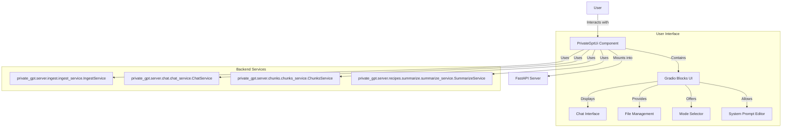
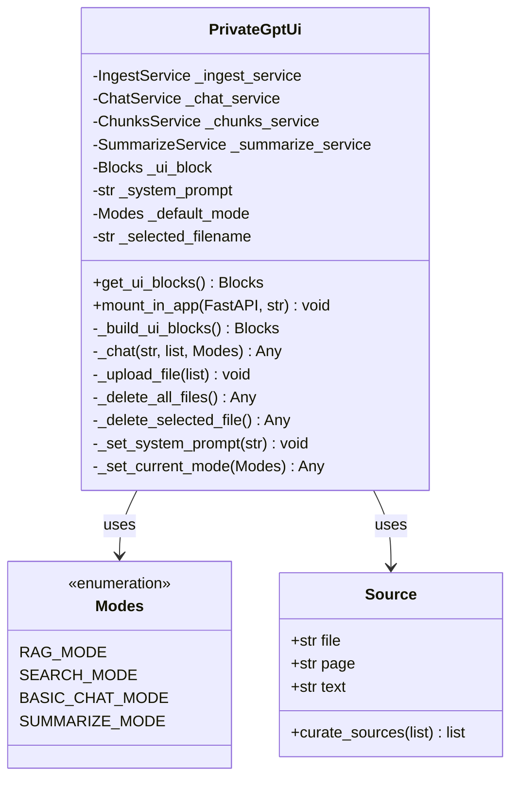
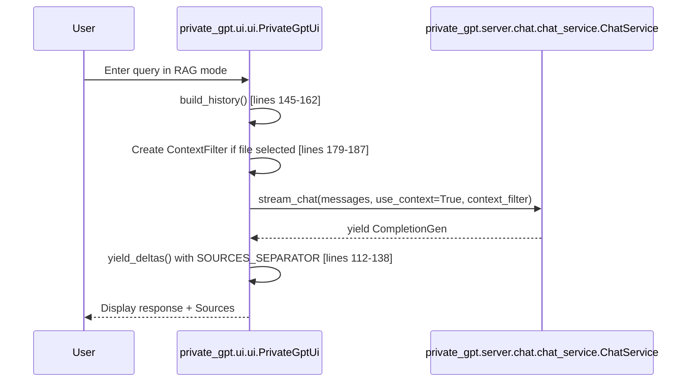
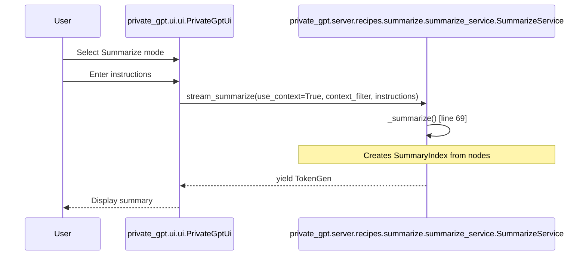
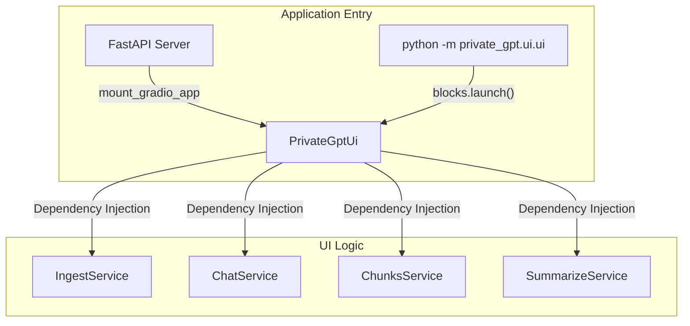

<!-- source: DeepWiki mcp.deepwiki.com · repo zylon-ai/private-gpt · page 5 User Interface · fetched 2026-10-26 -->

# User Interface

Relevant source files

The following files were used as context for generating this wiki page:

- [fern/docs/pages/ui/alternatives.mdx](fern/docs/pages/ui/alternatives.mdx)
- [fern/docs/pages/ui/gradio.mdx](fern/docs/pages/ui/gradio.mdx)
- [private_gpt/server/recipes/summarize/summarize_service.py](private_gpt/server/recipes/summarize/summarize_service.py)
- [private_gpt/ui/ui.py](private_gpt/ui/ui.py)

The User Interface (UI) in PrivateGPT provides a web-based interface for interacting with all system functionalities. This document covers the UI architecture, components, modes, and primary features. For API-based interactions, see the [API Reference](#5.1) page.

## Overview

PrivateGPT offers a feature-rich UI built with [Gradio](https://www.gradio.app) that allows users to:
- Upload and manage documents.
- Chat with documents using RAG-powered responses.
- Search for specific content within documents.
- Generate summaries of document content.
- Interact directly with the LLM through basic chat functionality.

The UI provides a bridge between users and the underlying PrivateGPT services, presenting a cohesive interface for document-based AI interactions.

Sources: [private_gpt/ui/ui.py:82-96](), [fern/docs/pages/ui/gradio.mdx:1-10]()

## UI Architecture

The UI component is instantiated as a singleton class `PrivateGptUi` that integrates with the main application via dependency injection [private_gpt/ui/ui.py:82-91](). It is designed to be mounted into the FastAPI server or run as a standalone application.

Sources: [private_gpt/ui/ui.py:82-107](), [private_gpt/ui/ui.py:40-52]()

## UI Components

The UI is composed of several key components that work together to provide a comprehensive user experience:

### 1. Mode Selector

The Mode Selector allows users to switch between different operational modes defined in the `Modes` Enum [private_gpt/ui/ui.py:40-45]():

| Mode | Description | API Interaction |
|------|-------------|---------|
| **RAG** | Retrieval Augmented Generation | Uses `/chat/completions` with `use_context=true` [fern/docs/pages/ui/gradio.mdx:16-20]() |
| **Search** | Document Retrieval | Uses `/chunks` API to return related text chunks [fern/docs/pages/ui/gradio.mdx:21-24]() |
| **Basic** | Direct LLM Interaction | Uses `/chat/completions` with `use_context=false` [fern/docs/pages/ui/gradio.mdx:25-28]() |
| **Summarize** | Document Summarization | Uses `SummarizeService` to generate document overviews [private_gpt/ui/ui.py:215-233]() |

Sources: [private_gpt/ui/ui.py:40-52](), [fern/docs/pages/ui/gradio.mdx:12-28]()

### 2. File Management Panel

The File Management panel enables document operations through the `IngestService`:

- **Upload Files**: Add new documents to the system via `_upload_file` [private_gpt/ui/ui.py:298-320]().
- **View Ingested Files**: List currently available documents using `list_ingested()` [private_gpt/ui/ui.py:340-352]().
- **Select Files**: Choose specific documents to restrict context via `ContextFilter` [private_gpt/ui/ui.py:179-187]().
- **Delete Files**: Remove documents via `_delete_all_files` or `_delete_selected_file` [private_gpt/ui/ui.py:322-338]().

Sources: [private_gpt/ui/ui.py:298-364](), [fern/docs/pages/ui/gradio.mdx:29-38]()

### 3. System Prompt Editor

The System Prompt Editor allows customization of the LLM's behavior. Default prompts are loaded from settings based on the active mode:
- **RAG Mode**: Uses `ui.default_query_system_prompt` [fern/docs/pages/ui/gradio.mdx:47]().
- **Basic Mode**: Uses `ui.default_chat_system_prompt` [fern/docs/pages/ui/gradio.mdx:49]().
- **Summarize Mode**: Uses `DEFAULT_SUMMARIZE_PROMPT` if not overridden [private_gpt/server/recipes/summarize/summarize_service.py:24-31]().

Sources: [private_gpt/ui/ui.py:237-253](), [fern/docs/pages/ui/gradio.mdx:43-58]()

### 4. Chat Interface

The Chat Interface handles the conversation loop. It builds message history (limited to 20 messages to avoid context overflow) and prepends the system prompt before calling the `ChatService` [private_gpt/ui/ui.py:145-174]().

Sources: [private_gpt/ui/ui.py:109-234](), [fern/docs/pages/ui/gradio.mdx:39-42]()

## Interaction Flows

### RAG Mode Chat Flow

Sources: [private_gpt/ui/ui.py:109-194]()

### Summarize Mode Flow

The `SummarizeService` utilizes a `SummaryIndex` and `ResponseMode.TREE_SUMMARIZE` to process nodes [private_gpt/server/recipes/summarize/summarize_service.py:113-126]().

Sources: [private_gpt/ui/ui.py:215-233](), [private_gpt/server/recipes/summarize/summarize_service.py:69-138]()

## System Integration

The UI is integrated into the FastAPI application via the `mount_in_app` method [private_gpt/ui/ui.py:573-582]().

Sources: [private_gpt/ui/ui.py:82-96](), [private_gpt/ui/ui.py:585-589]()

## Technical Details

### Source Handling
The UI uses a `Source` helper class to curate and display metadata from `Chunk` objects returned by the services [private_gpt/ui/ui.py:55-79](). It extracts `file_name` and `page_label` from the document metadata [private_gpt/ui/ui.py:68-74]().

### Context Filtering
When a user selects a specific file in the UI, the `_selected_filename` is used to look up `doc_id`s from the `IngestService` [private_gpt/ui/ui.py:179-186](). These are passed as a `ContextFilter` to ensure the LLM only considers that specific document [private_gpt/ui/ui.py:187-193]().

## UI Alternatives
While Gradio is the default, PrivateGPT supports other interfaces:
- **API**: For programmatic access and custom frontends. For details, see [API Reference](#5.1).
- **SDK Demo**: A React-based alternative using Tailwind and shadcn/ui [fern/docs/pages/ui/alternatives.mdx:12-22]().

Sources: [fern/docs/pages/ui/alternatives.mdx:1-22]()

---

