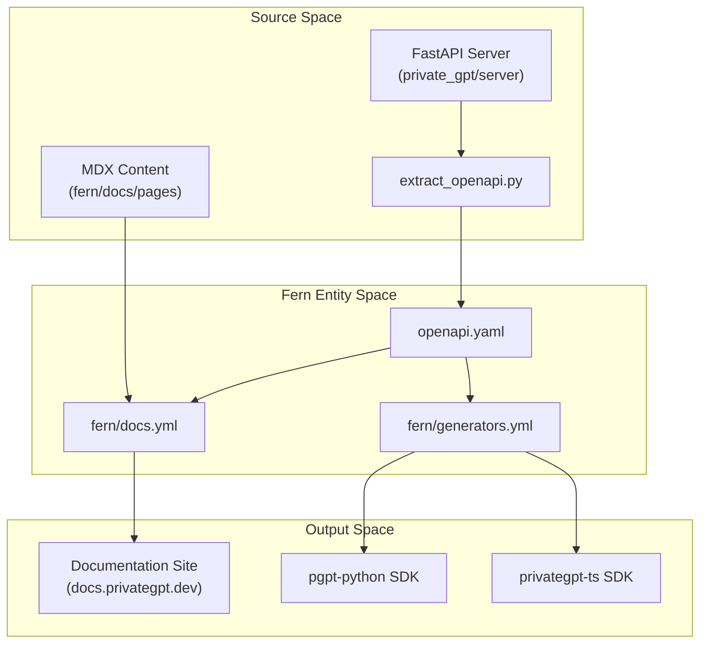
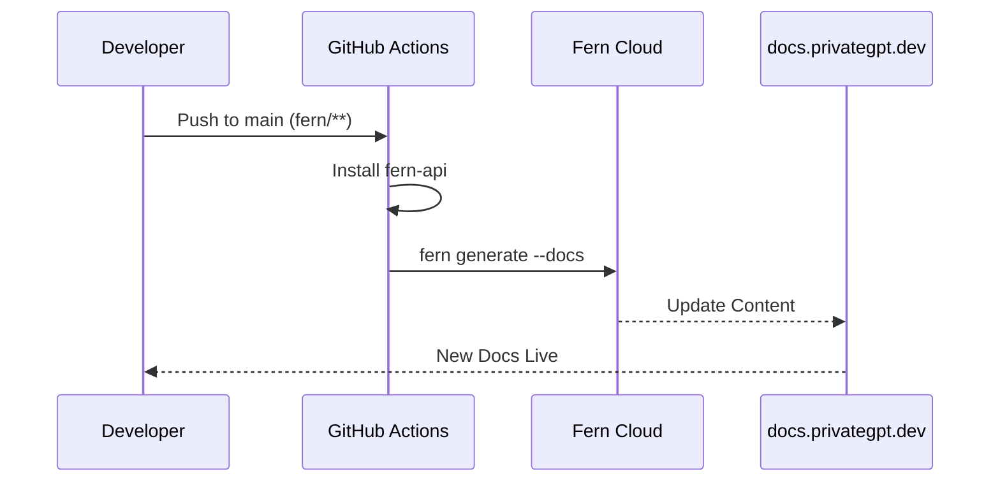

<!-- source: DeepWiki mcp.deepwiki.com · repo zylon-ai/private-gpt · page 6.3 Documentation System · fetched 2026-10-26 -->

# Documentation System

Relevant source files

The following files were used as context for generating this wiki page:

- [.github/workflows/fern-check.yml](.github/workflows/fern-check.yml)
- [.github/workflows/preview-docs.yml](.github/workflows/preview-docs.yml)
- [.github/workflows/publish-docs.yml](.github/workflows/publish-docs.yml)
- [CITATION.cff](CITATION.cff)
- [fern/docs.yml](fern/docs.yml)
- [fern/docs/pages/api-reference/sdks.mdx](fern/docs/pages/api-reference/sdks.mdx)
- [fern/docs/pages/manual/settings.mdx](fern/docs/pages/manual/settings.mdx)
- [fern/fern.config.json](fern/fern.config.json)
- [fern/generators.yml](fern/generators.yml)
- [scripts/extract_openapi.py](scripts/extract_openapi.py)

This document explains how PrivateGPT's documentation is generated, maintained, and published. PrivateGPT uses [Fern](https://buildwithfern.com) to generate both user-facing documentation and client SDKs for multiple programming languages. The system automates the extraction of the OpenAPI specification from the FastAPI server and uses it to keep SDKs and API references in sync with the codebase.

## Overview

PrivateGPT maintains a comprehensive documentation system that consists of:

1. **User-facing documentation website**: Published at `docs.privategpt.dev` [fern/docs.yml:4]().
2. **API reference documentation**: Automatically generated from the server's OpenAPI spec [fern/docs.yml:105]().
3. **Programmatic SDKs**: Language-specific clients for Node.js, Python, Go, and Java [fern/docs/pages/api-reference/sdks.mdx:1-1]().

The documentation is defined using MDX files and YAML configuration files in the `/fern` directory.

### Documentation Data Flow

The following diagram illustrates how raw code and content are transformed into published documentation and SDKs.

Sources: [scripts/extract_openapi.py:8-13](), [fern/docs.yml:1-130](), [fern/generators.yml:1-9]()

## OpenAPI Specification Extraction

The core of the API documentation and SDK generation is the OpenAPI specification. Rather than maintaining this manually, PrivateGPT uses a script to extract it directly from the FastAPI application instance.

The script `scripts/extract_openapi.py` performs the following:
1. Imports the FastAPI `app` from the specified module (typically `private_gpt.main:app`) [scripts/extract_openapi.py:23]().
2. Calls the `app.openapi()` method to generate the schema [scripts/extract_openapi.py:24]().
3. Serializes the resulting dictionary into a `yaml` or `json` file [scripts/extract_openapi.py:28-32]().

This ensures that any changes to route decorators (e.g., `@router.post("/chat/completions")`) or Pydantic models in the server package are immediately reflected in the documentation.

Sources: [scripts/extract_openapi.py:1-35]()

## Documentation Structure and Configuration

The documentation hierarchy is managed via `fern/docs.yml`. It defines the visual layout, including the navigation sidebar and top-level tabs.

### Navigation and Tabs
The documentation is split into several primary tabs, each with a specific icon:
- **Overview**: General introduction [fern/docs.yml:10-12]().
- **Quickstart**: Fast-track setup [fern/docs.yml:13-15]().
- **Installation**: Deep dive into setup and troubleshooting [fern/docs.yml:16-18]().
- **Manual**: Configuration, Ingestion, and Storage details [fern/docs.yml:19-21]().
- **Recipes**: Specific use cases like summarization [fern/docs.yml:22-24]().
- **API Reference**: The interactive API explorer [fern/docs.yml:25-27]().

### Visual Configuration
The branding is controlled through the `colors`, `logo`, and `favicon` keys in the configuration file [fern/docs.yml:119-129]().

Sources: [fern/docs.yml:8-130]()

## SDK Generation

PrivateGPT uses Fern Generators to produce client libraries. These generators take the OpenAPI spec and output idiomatic code for different languages.

### Generator Configuration
Generators are defined in `fern/generators.yml`. For example, the Python SDK generator is configured as follows:
- **Generator**: `fernapi/fern-python-sdk` [fern/generators.yml:4]().
- **Output**: Local file system path `../../pgpt-sdk/python` [fern/generators.yml:8]().

### Supported SDKs
The documentation links to several SDK repositories maintained by the Zylon team:
| Language | Repository | Status |
| :--- | :--- | :--- |
| TypeScript | `zylon-ai/privategpt-ts` | Available |
| Python | `zylon-ai/pgpt-python` | Available |
| Java | `zylon-ai/private-gpt-java` | WIP |
| Go | `zylon-ai/private-gpt-go` | WIP |

Sources: [fern/generators.yml:1-9](), [fern/docs/pages/api-reference/sdks.mdx:9-36]()

## CI/CD Workflows

The documentation system is integrated into GitHub Actions to ensure quality and automate publishing.

### Validation and Preview
- **Fern Check**: A workflow runs `fern check` on pull requests to ensure the Fern configuration and API definitions are valid [.github/workflows/fern-check.yml:21]().
- **Preview Docs**: When files in the `fern/` directory are modified in a PR, the `deploy preview docs` workflow generates a temporary documentation site [.github/workflows/preview-docs.yml:7-8](). It uses `fern generate --docs --preview` and posts the resulting URL as a PR comment [.github/workflows/preview-docs.yml:37-53]().

### Publishing
When changes are merged into the `main` branch, the `publish docs` workflow executes `fern generate --docs` using the `FERN_TOKEN` secret to update the live site at `docs.privategpt.dev` [.github/workflows/publish-docs.yml:23-26]().

Sources: [.github/workflows/preview-docs.yml:1-55](), [.github/workflows/publish-docs.yml:1-27](), [.github/workflows/fern-check.yml:1-21]()

## Documentation Content
The actual content resides in MDX files within `fern/docs/pages/`. These files document critical system behaviors:
- **Settings**: Detailed explanation of the `PGPT_PROFILES` and `PGPT_SETTINGS_FOLDER` environment variables [fern/docs/pages/manual/settings.mdx:52-62]().
- **Profiles**: How `settings-{profile}.yaml` files are merged over the base `settings.yaml` [fern/docs/pages/manual/settings.mdx:63-70]().
- **Environment Expansion**: Support for `${VARIABLE_NAME:default_value}` syntax in configuration [fern/docs/pages/manual/settings.mdx:71-85]().

Sources: [fern/docs/pages/manual/settings.mdx:1-85]()

---

