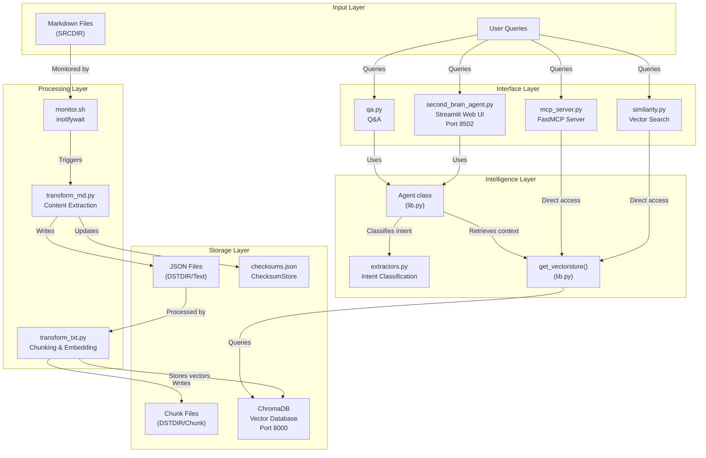
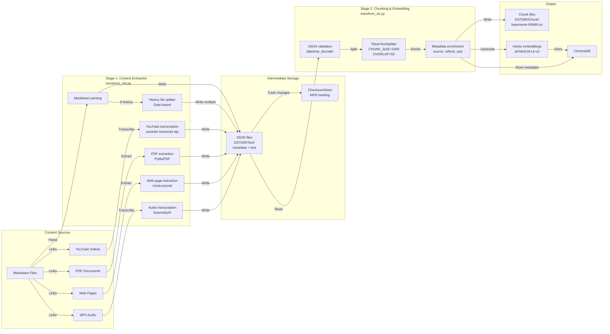
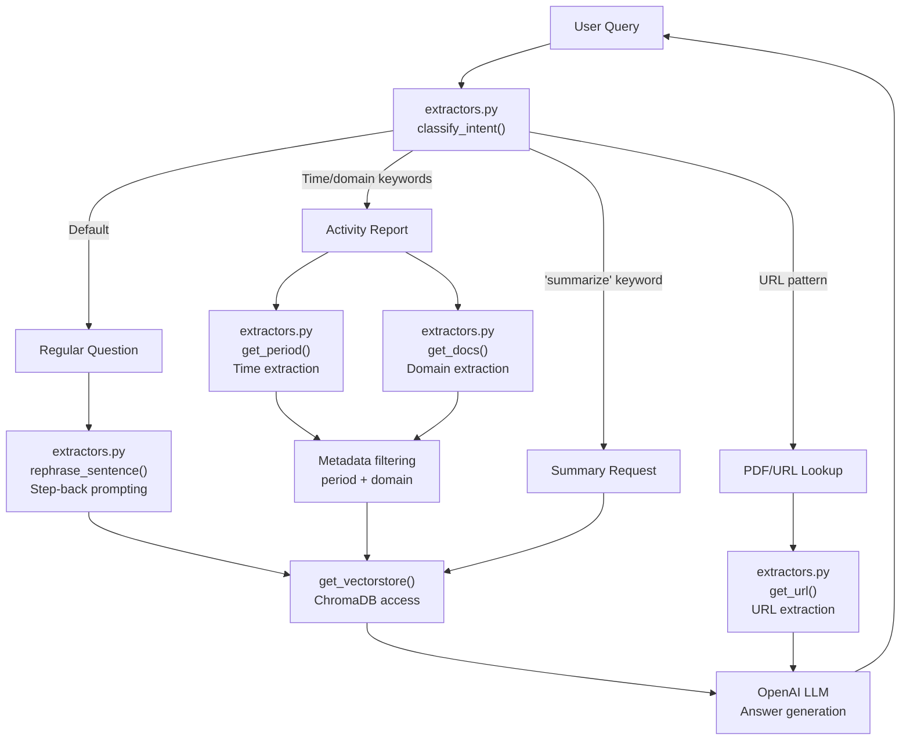

<!-- source: DeepWiki mcp.deepwiki.com · repo flepied/second-brain-agent · page 1 Overview · fetched 2026-10-26 -->

# Overview

<details>
<summary>Relevant source files</summary>

The following files were used as context for generating this wiki page:

- [README.md](README.md)
- [pyproject.toml](pyproject.toml)

</details>


## Purpose and Scope

This page provides a high-level introduction to the Second Brain AI Agent system, its architecture, core capabilities, and technology stack. It is intended for developers and technical users who need to understand how the system works as a whole before diving into specific subsystems.

For detailed information about specific components, see:
- Data processing pipeline details: [Data Processing Pipeline](#2)
- Agent intelligence and RAG implementation: [Agent and Intelligence Layer](#3)
- User interfaces: [User Interfaces](#4)
- Deployment and infrastructure: [Infrastructure and Deployment](#5)
- Development setup: [Development Environment](#6)

## System Purpose

The Second Brain AI Agent is a **Personal Knowledge Management (PKM) system** that automatically indexes and enables semantic search over markdown notes and embedded content. Inspired by Tiago Forte's Second Brain methodology, it transforms unstructured personal knowledge into a queryable AI-powered system.

### Core Capabilities

| Capability | Description | Implementation |
|------------|-------------|----------------|
| **Automated Indexing** | Monitors markdown files and extracts content from embedded links (PDFs, YouTube videos, web pages, audio files) | `transform_md.py`, `monitor.sh` |
| **Semantic Search** | Vector-based similarity search using embeddings | `ChromaDB`, `similarity.py` |
| **RAG-based Q&A** | Question answering using Retrieval-Augmented Generation with OpenAI LLMs | `lib.py:Agent`, `qa.py` |
| **Intent Classification** | Routes queries to specialized processing chains based on intent (summary, activity report, lookup) | `extractors.py` |
| **Multi-Interface Access** | Web UI, MCP protocol server, and CLI tools | `second_brain_agent.py`, `mcp_server.py`, CLI scripts |
| **Continuous Processing** | Automatic reprocessing of changed files via filesystem monitoring | `monitor.sh`, systemd services |

Sources: [README.md:5-36](), [README.md:40-73]()

## System Architecture

The system follows a **three-layer architecture**: data ingestion, storage, and query interfaces, with an AI orchestration layer coordinating intelligent query processing.



**Architecture Analysis**: The system separates data ingestion from query processing, with `ChromaDB` serving as the central knowledge repository. The `Agent` class in `lib.py` acts as the orchestrator for intelligent queries, while simpler tools can bypass it for direct vector database access.

Sources: [README.md:40-52](), Diagram 1 from context

## Data Flow Pipeline

The system implements a **two-stage pipeline** that decouples content extraction from vectorization:



**Pipeline Design**: The two-stage design allows content extraction to be independent of vectorization. `ChecksumStore` provides incremental processing by tracking file changes via MD5 hashing, ensuring only modified content is reprocessed.

Sources: [README.md:40-52](), [README.md:47-49](), Diagram 2 from context

## Query Processing Architecture

The system implements **intent-based query routing** where different query types follow optimized processing paths:

### Query Types and Processing Chains

| Intent Type | Detection Method | Processing Chain | Key Functions |
|-------------|------------------|------------------|---------------|
| **Regular Question** | Default classification | Step-back prompting → Vector retrieval → LLM generation | `extractors.py:rephrase_sentence()`, `lib.py:Agent.question()` |
| **Activity Report** | Time period or domain keywords | Period extraction → Document filtering → Filtered retrieval → LLM | `extractors.py:get_period()`, `extractors.py:get_docs()` |
| **Summary Request** | "summarize" keyword | Retrieve all chunks → LLM summarization | `lib.py:Agent.question()` |
| **PDF/URL Lookup** | URL pattern detection | Direct document extraction | `extractors.py:get_url()` |

### Intent Classification Flow



**Intent Routing**: The `Agent` class in `lib.py` delegates intent classification to `extractors.py`, which uses LLM-based parsing to extract time periods, domains, and query types. This enables specialized retrieval strategies for different question types.

Sources: [README.md:53-73](), Diagram 3 from context

## Key Features

### Multi-Source Content Ingestion

The system supports diverse content types through specialized extractors:

- **YouTube videos**: Transcript API with Whisper fallback ([transform_md.py]())
- **PDF documents**: PyMuPDF-based extraction ([transform_md.py]())
- **Web pages**: Unstructured library for HTML parsing ([transform_md.py]())
- **Audio files**: AssemblyAI transcription service ([transform_md.py]())
- **History files**: Date-based segmentation for journal entries ([transform_md.py]())

### Domain-Based Organization

The system implements a **domain metadata system** for document classification:

1. Domain extraction: Removes numbers and keywords (`At`, `Journal`, `Project`, `Notes`, `History`) from filenames
2. Example: `WorkoutHistory202412.md` → domain: `Workout`
3. Organization document: `SecondBrainOrganization.md` (configurable via `SBA_ORG_DOC`) maps domains to categories
4. Used for filtered retrieval in activity reports

Sources: [README.md:68-72]()

### MCP Protocol Server

The `mcp_server.py` implements a **FastMCP server** providing programmatic access:

| Tool | Function | Parameters |
|------|----------|------------|
| `search_documents` | Semantic search with metadata filtering | `query`, `filter_metadata`, `n_results` |
| `get_document_count` | Returns total document count | None |
| `get_domains` | Lists available domains | None |
| `get_recent_documents` | Retrieves recently accessed documents | `n_results` |

The MCP server enables integration with external applications without requiring the full Agent reasoning layer.

Sources: [README.md:74-124]()

## Technology Stack

### Core Dependencies

The system is built on the **LangChain framework** with specialized integrations:

| Category | Technology | Purpose |
|----------|------------|---------|
| **RAG Framework** | `langchain`, `langchain-core` | Orchestration and chain management |
| **Vector Database** | `chromadb` (v0.4+) | Embedding storage and similarity search |
| **LLM Provider** | `openai`, `langchain-openai` | GPT models for answer generation |
| **Embeddings** | `sentence-transformers`, `langchain-huggingface` | Text vectorization (all-MiniLM-L6-v2) |
| **Document Loaders** | `langchain-community`, `pymupdf`, `unstructured` | Multi-format content extraction |
| **Web UI** | `streamlit`, `altair` | Interactive query interface |
| **MCP Server** | `fastmcp`, `pydantic` | Programmatic API |
| **Audio/Video** | `youtube-transcript-api`, `yt-dlp`, `pydub`, `assemblyai` | Multimedia transcription |

### Dependency Management

The project uses **Poetry** for dependency management:
- Main dependencies: [pyproject.toml:17-46]()
- Test dependencies: [pyproject.toml:48-54]()
- Python version requirement: `>=3.10,<3.12`

Sources: [pyproject.toml:1-70](), [README.md:38-39](), Diagram 5 from context

## Runtime Infrastructure

The system runs as a set of coordinated services:

### Background Services (systemd)

| Service | Script | Purpose | Dependencies |
|---------|--------|---------|--------------|
| `sba-md.service` | `transform_md.py` via `monitor.sh` | Content extraction from markdown files | `inotify-tools` |
| `sba-txt.service` | `transform_txt.py` via `monitor.sh` | Chunking and embedding generation | `ChromaDB` container |

### Database Container

ChromaDB runs in a Docker container:
- Configuration: `compose.yaml`
- Port: 8000
- Persistent storage: Volumes defined in compose configuration
- Version: Synchronized with `poetry.lock` via `Makefile`

Sources: [README.md:159-172](), Diagram 4 from context

## System Requirements

### Installation Prerequisites

- **Python**: 3.10 or 3.11 (not 3.12)
- **Package Manager**: Poetry
- **System Tools**: `inotify-tools` for file monitoring
- **Container Runtime**: Docker or Podman (for ChromaDB)
- **Operating System**: Tested on Fedora Linux 42 and Ubuntu latest

### API Keys Required

The system requires API keys configured in `.env`:
- `OPENAI_API_KEY`: For GPT models
- `HUGGINGFACEHUB_API_TOKEN`: For embeddings
- `ASSEMBLYAI_API_KEY`: For audio transcription (optional)

For configuration details, see [Configuration Management](#5.3).

Sources: [README.md:126-157](), [pyproject.toml:18]()

## Getting Started

### Basic Usage Flow

1. **Setup**: Install dependencies, configure `.env`, start ChromaDB container
2. **Ingestion**: Point `SRCDIR` to markdown notes directory, start systemd services
3. **Query**: Use web UI (`streamlit run second_brain_agent.py`), CLI tools (`similarity.py`, `qa.py`), or MCP server

### Example Commands

```bash
# Similarity search
./similarity.py "What is LangChain?" type=notes

# Question answering
./qa.py "What did I work on last week?"

# Launch web UI
streamlit run second_brain_agent.py

# Start MCP server
poetry run python mcp_server.py
```

Sources: [README.md:174-198]()

---

