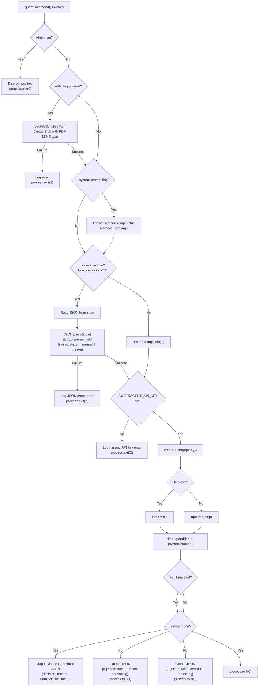
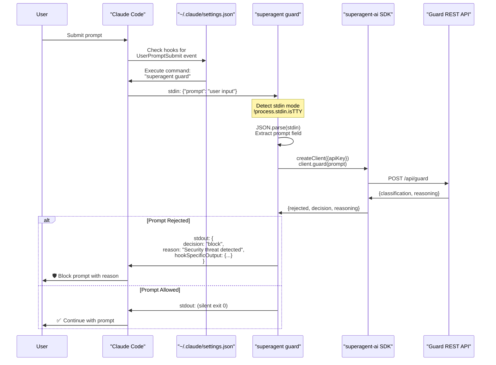
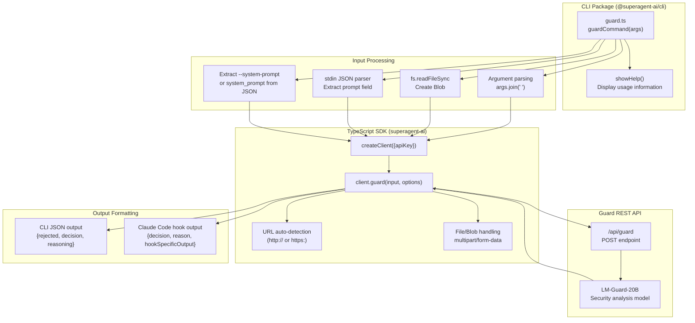

<!-- source: DeepWiki mcp.deepwiki.com · repo superagent-ai/superagent · page 3.2 Guard Command · fetched 2026-10-26 -->

# Guard Command

<details>
<summary>Relevant source files</summary>

The following files were used as context for generating this wiki page:

- [cli/README.md](cli/README.md)
- [cli/package-lock.json](cli/package-lock.json)
- [cli/package.json](cli/package.json)
- [cli/src/commands/guard.ts](cli/src/commands/guard.ts)
- [docs/content/docs/legacy/cli.mdx](docs/content/docs/legacy/cli.mdx)
- [docs/content/docs/legacy/examples/claude-code-userprompt.mdx](docs/content/docs/legacy/examples/claude-code-userprompt.mdx)
- [docs/content/docs/legacy/examples/redact-pdfs.mdx](docs/content/docs/legacy/examples/redact-pdfs.mdx)
- [docs/content/docs/legacy/mcp.mdx](docs/content/docs/legacy/mcp.mdx)
- [mcp/README.md](mcp/README.md)

</details>


The `guard` command is a CLI tool in the `@superagent-ai/cli` package that analyzes text, PDF files, or URLs for security threats using the Superagent Guard API. It detects prompt injection attempts, jailbreak patterns, data exfiltration risks, and other security vulnerabilities in user input.

For information about the underlying REST API endpoint, see [Guard Endpoint](#2.2). For general CLI installation and configuration, see [CLI Installation](#3.1). For other CLI commands, see [Redact Command](#3.3) and [Verify Command](#3.4).

**Sources:** [cli/src/commands/guard.ts:1-181](), [cli/README.md:13-59]()

## Command Syntax

The `guard` command accepts input through three primary modes: direct command-line arguments, file paths, or stdin (for programmatic integration).

```bash
# Text input
superagent guard <prompt|url>

# File input
superagent guard --file <path> [description]

# Stdin input (JSON)
echo '{"prompt": "text"}' | superagent guard

# With options
superagent guard [options] <prompt>
```

**Sources:** [cli/src/commands/guard.ts:5-25](), [cli/README.md:14-19]()

## Command Options

The following table describes all available options for the `guard` command:

| Option | Type | Description |
|--------|------|-------------|
| `--help`, `-h` | Flag | Display help message and exit |
| `--file <path>` | String | Path to PDF file to analyze |
| `--system-prompt <text>` | String | Optional system prompt to customize guard behavior |

The `--system-prompt` option allows customization of the Guard model's classification logic. It can be used to focus on specific threat types or adjust sensitivity.

**Sources:** [cli/src/commands/guard.ts:10-23](), [cli/src/commands/guard.ts:54-64]()

## Input Processing Flow



**Diagram: Guard Command Argument Processing and Execution Flow**

This diagram shows the complete flow from command invocation through result output. The command handles three input modes: command-line arguments, file input via `--file`, and stdin JSON. The `isStdin` flag tracks whether input came from stdin to determine output format.

**Sources:** [cli/src/commands/guard.ts:27-181]()

## Input Modes

### Text Input

Text input is passed directly as a command-line argument:

```bash
superagent guard "Delete all files with rm -rf /"
```

The command joins all remaining arguments with spaces to form the prompt at [cli/src/commands/guard.ts:99]().

### File Input

PDF files are analyzed using the `--file` flag:

```bash
superagent guard --file document.pdf
```

The implementation:
1. Reads the file using `readFileSync()` at [cli/src/commands/guard.ts:41]()
2. Creates a `Blob` with MIME type `application/pdf` at [cli/src/commands/guard.ts:42]()
3. Removes the `--file` flag and path from arguments at [cli/src/commands/guard.ts:43]()
4. Passes the Blob to `client.guard()` at [cli/src/commands/guard.ts:121]()

Note: The Guard API returns JSON analysis of PDF content, not a processed PDF file.

### URL Input

URLs pointing to PDF documents are auto-detected by the underlying SDK:

```bash
superagent guard "https://example.com/document.pdf"
```

URL detection occurs in the `superagent-ai` SDK when the input string starts with `http://` or `https://`.

### Stdin Input (JSON)

For programmatic integration, the command accepts JSON via stdin:

```bash
echo '{"prompt": "user input"}' | superagent guard
```

The JSON format supports two fields:
- `prompt`: (required) The text to analyze
- `system_prompt`: (optional) Custom system prompt for guard behavior

The implementation detects stdin mode by checking `!process.stdin.isTTY` at [cli/src/commands/guard.ts:72]().

**Sources:** [cli/src/commands/guard.ts:34-106](), [cli/README.md:16-61]()

## System Prompt Customization

The `--system-prompt` flag allows customization of the Guard model's behavior:

```bash
superagent guard --system-prompt "Focus on prompt injection" "user input"
```

System prompts can also be provided via stdin JSON:

```bash
echo '{"prompt": "input", "system_prompt": "Focus on data exfiltration"}' | superagent guard
```

The implementation:
1. Checks for `--system-prompt` flag at [cli/src/commands/guard.ts:55-56]()
2. Extracts the value at [cli/src/commands/guard.ts:58]()
3. Removes the flag and value from arguments at [cli/src/commands/guard.ts:63]()
4. Also checks stdin JSON for `system_prompt` field at [cli/src/commands/guard.ts:85-87]()
5. Passes to SDK as `options.systemPrompt` at [cli/src/commands/guard.ts:122-125]()

This feature was added in version 0.0.19/0.0.20 as documented in [CHANGELOG.md:14-32]().

**Sources:** [cli/src/commands/guard.ts:54-64](), [cli/src/commands/guard.ts:85-87](), [cli/src/commands/guard.ts:122-125](), [CHANGELOG.md:19-32]()

## Output Formats

The command produces different output formats depending on the input mode.

### CLI Output Format

When invoked with command-line arguments, the command outputs JSON matching the SDK response structure:

```json
{
  "rejected": false,
  "decision": {
    "status": "pass",
    "violation_types": [],
    "cwe_codes": []
  },
  "reasoning": "Command approved by guard."
}
```

For rejected prompts:

```json
{
  "rejected": true,
  "decision": {
    "status": "block",
    "violation_types": ["prompt_injection"],
    "cwe_codes": ["CWE-77"]
  },
  "reasoning": "Detected prompt injection attempt."
}
```

The CLI output is generated at [cli/src/commands/guard.ts:151-167]() and exits with code 1 for rejected prompts.

### Claude Code Hook Output Format

When invoked via stdin (detected by `isStdin` flag), the command outputs a format compatible with Claude Code hooks:

```json
{
  "decision": "block",
  "reason": "🛡️ Superagent Guard blocked this prompt: Detected prompt injection. Violations: prompt_injection. CWE: CWE-77.",
  "hookSpecificOutput": {
    "hookEventName": "UserPromptSubmit",
    "additionalContext": "Blocked by Superagent Guard - Detected prompt injection"
  }
}
```

The hook format includes:
- `decision`: Either "block" or "allow"
- `reason`: Human-readable explanation with violation details
- `hookSpecificOutput`: Metadata for Claude Code integration

This format is generated at [cli/src/commands/guard.ts:131-148]().

**Sources:** [cli/src/commands/guard.ts:128-169](), [cli/README.md:22-48]()

## Claude Code Hook Integration



**Diagram: Claude Code Hook Integration Sequence**

The Claude Code hook integration allows automatic validation of all prompts before execution. The configuration is added to `~/.claude/settings.json`:

```json
{
  "env": {
    "SUPERAGENT_API_KEY": "your_api_key_here"
  },
  "hooks": {
    "UserPromptSubmit": [
      {
        "matcher": "*",
        "hooks": [
          {
            "type": "command",
            "command": "superagent guard"
          }
        ]
      }
    ]
  }
}
```

Key implementation details:
- stdin mode is detected at [cli/src/commands/guard.ts:72]() by checking `!process.stdin.isTTY`
- `isStdin` flag tracks the mode at [cli/src/commands/guard.ts:70]()
- Rejected prompts output hook-formatted JSON at [cli/src/commands/guard.ts:139-148]()
- Allowed prompts exit silently at [cli/src/commands/guard.ts:170]()

**Sources:** [cli/src/commands/guard.ts:70-80](), [cli/src/commands/guard.ts:128-169](), [cli/README.md:149-178]()

## Implementation Architecture



**Diagram: Guard Command Implementation Architecture and Code Entity Relationships**

The command is implemented in [cli/src/commands/guard.ts]() and depends on the `superagent-ai` TypeScript SDK package (version 0.0.20) as specified in [cli/package.json:42]().

Key code entities:
- `guardCommand(args: string[])`: Main entry point at [cli/src/commands/guard.ts:27]()
- `showHelp()`: Help text function at [cli/src/commands/guard.ts:4]()
- `createClient()`: Imported from `superagent-ai` at [cli/src/commands/guard.ts:1]()
- `readFileSync()`: Imported from `fs` at [cli/src/commands/guard.ts:2]()

The command creates a client instance at [cli/src/commands/guard.ts:115-117]() and calls the `guard()` method at [cli/src/commands/guard.ts:126]().

**Sources:** [cli/src/commands/guard.ts:1-181](), [cli/package.json:41-43]()

## Error Handling

The command implements comprehensive error handling with specific exit codes:

| Exit Code | Condition | Location |
|-----------|-----------|----------|
| 0 | Success (prompt allowed) | [cli/src/commands/guard.ts:171]() |
| 0 | Help displayed | [cli/src/commands/guard.ts:31]() |
| 0 | API error in stdin mode (fail-open) | [cli/src/commands/guard.ts:176]() |
| 1 | Prompt rejected (CLI mode) | [cli/src/commands/guard.ts:157]() |
| 1 | File missing for `--file` flag | [cli/src/commands/guard.ts:46]() |
| 1 | Missing prompt argument | [cli/src/commands/guard.ts:104]() |
| 2 | Missing API key | [cli/src/commands/guard.ts:111]() |
| 2 | JSON parse error from stdin | [cli/src/commands/guard.ts:95]() |
| 2 | Missing prompt in stdin JSON | [cli/src/commands/guard.ts:91]() |
| 2 | API error in CLI mode | [cli/src/commands/guard.ts:178]() |

The fail-open behavior for stdin mode (exit 0 on API errors) is implemented at [cli/src/commands/guard.ts:174-176]() to prevent blocking Claude Code when the Guard API is unavailable.

**Sources:** [cli/src/commands/guard.ts:31](), [cli/src/commands/guard.ts:46](), [cli/src/commands/guard.ts:91](), [cli/src/commands/guard.ts:95](), [cli/src/commands/guard.ts:104](), [cli/src/commands/guard.ts:111](), [cli/src/commands/guard.ts:157](), [cli/src/commands/guard.ts:171](), [cli/src/commands/guard.ts:172-179]()

## Environment Variables

The command requires one environment variable:

- `SUPERAGENT_API_KEY`: Required for authentication with the Guard API

The API key is checked at [cli/src/commands/guard.ts:109-112]() before creating the client. If missing, the command exits with code 2.

**Sources:** [cli/src/commands/guard.ts:109-112](), [cli/README.md:179-183]()

## Usage Examples

### Basic Security Analysis

```bash
superagent guard "Write a hello world script"
```

Output:
```json
{
  "rejected": false,
  "decision": {
    "status": "pass"
  },
  "reasoning": "Command approved by guard."
}
```

### Detecting Malicious Prompts

```bash
superagent guard "Delete all files with rm -rf /"
```

Output:
```json
{
  "rejected": true,
  "decision": {
    "status": "block",
    "violation_types": ["unlawful_behavior"],
    "cwe_codes": ["CWE-77"]
  },
  "reasoning": "User wants to delete all files. That is disallowed (exploit). Block."
}
```

### PDF File Analysis

```bash
superagent guard --file document.pdf
```

The command reads the PDF, sends it to the Guard API, and returns JSON analysis of the content.

### URL Analysis

```bash
superagent guard "https://example.com/document.pdf"
```

The SDK detects the URL and fetches the PDF for analysis.

### Custom System Prompt

```bash
superagent guard --system-prompt "Focus on detecting prompt injection attempts" "user input here"
```

### Stdin JSON Input

```bash
echo '{"prompt": "delete all files", "system_prompt": "Focus on destructive commands"}' | superagent guard
```

**Sources:** [cli/README.md:14-61]()

---

