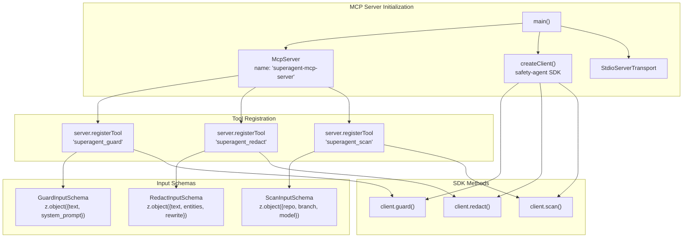
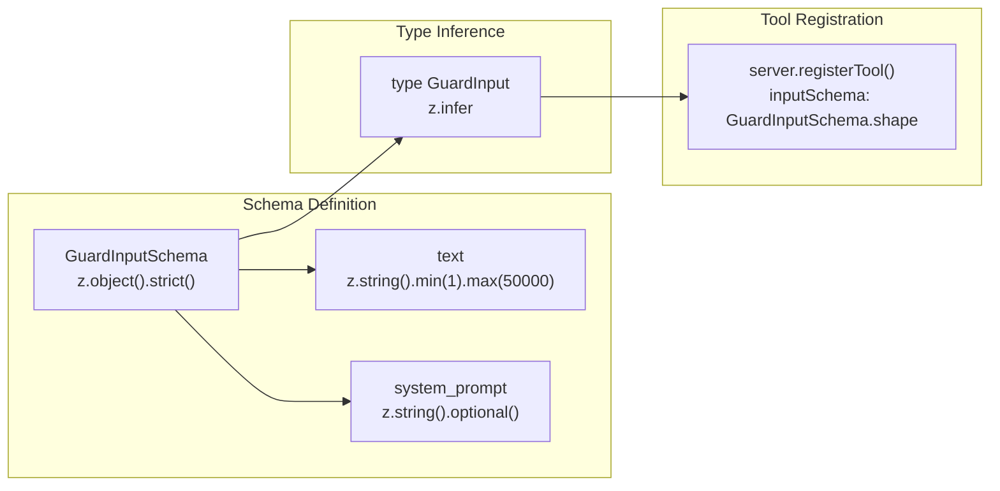
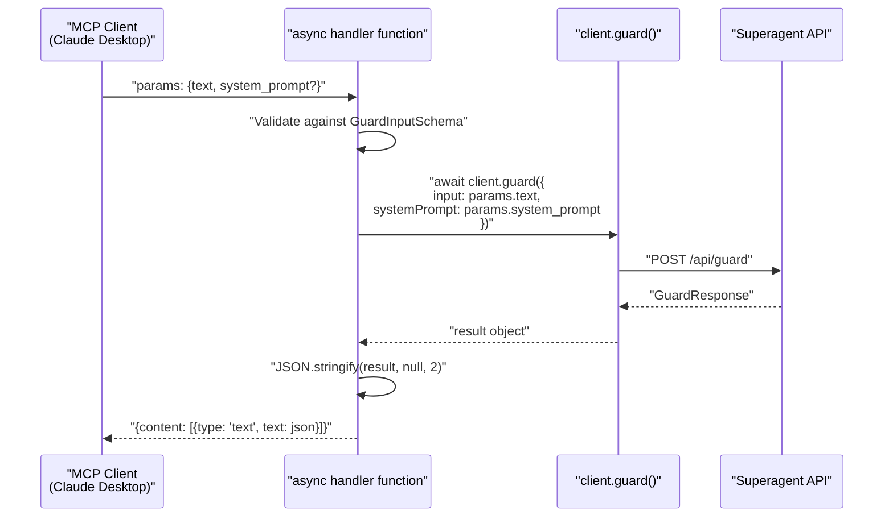
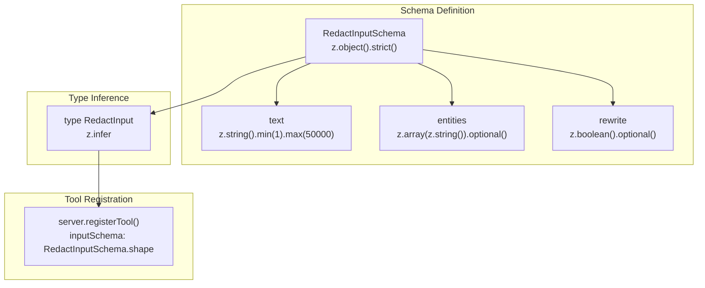
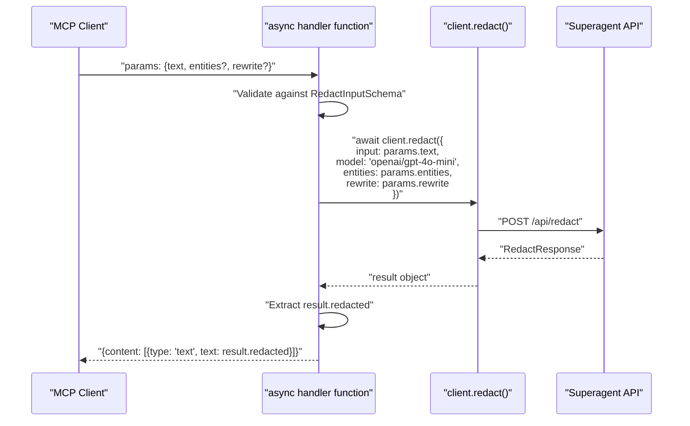
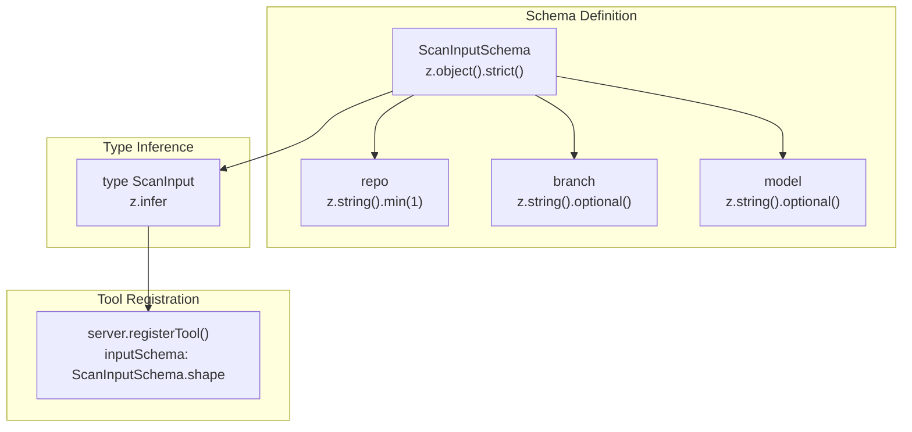
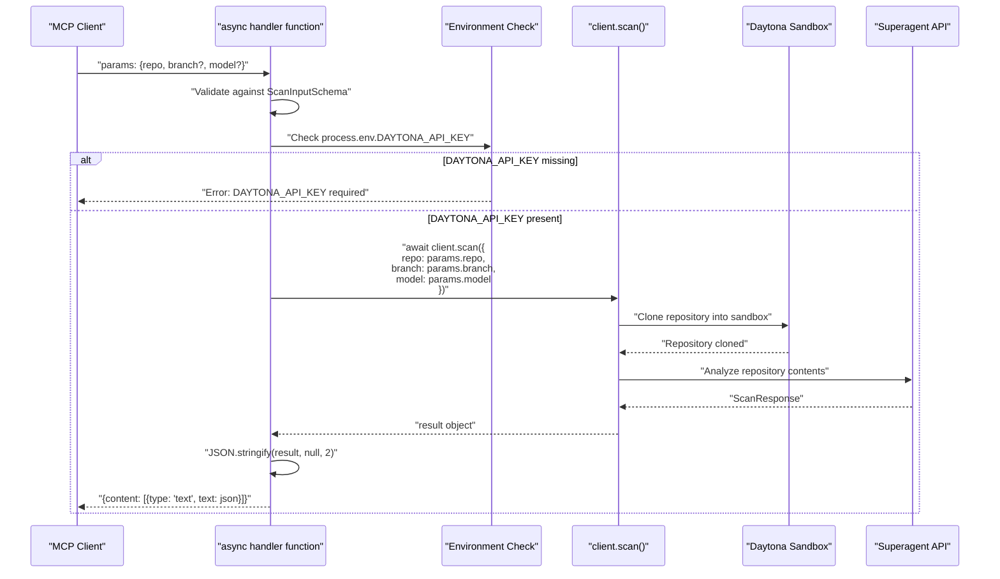
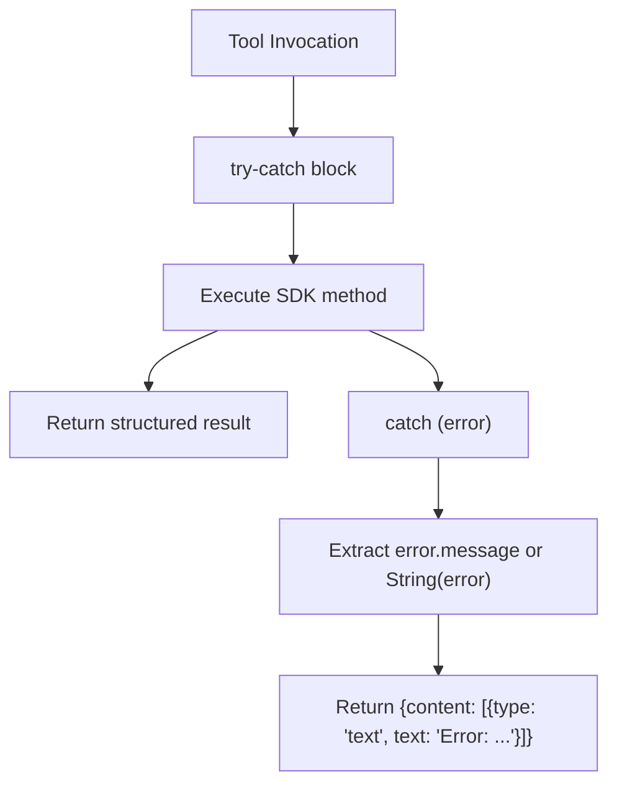
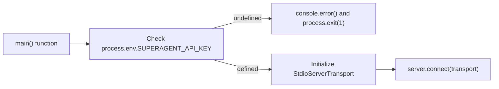

<!-- source: DeepWiki mcp.deepwiki.com · repo superagent-ai/superagent · page 4.2 Tool Reference · fetched 2026-10-26 -->

# Tool Reference

<details>
<summary>Relevant source files</summary>

The following files were used as context for generating this wiki page:

- [cli/README.md](cli/README.md)
- [mcp/README.md](mcp/README.md)
- [mcp/package-lock.json](mcp/package-lock.json)
- [mcp/package.json](mcp/package.json)
- [mcp/src/index.ts](mcp/src/index.ts)

</details>


This document provides technical reference for the three MCP tools exposed by the `safety-agent-mcp` server: `superagent_guard`, `superagent_redact`, and `superagent_scan`. Each tool provides a structured interface for Claude Desktop and other MCP clients to access Superagent's security analysis, PII redaction, and repository scanning capabilities.

For information about installing and configuring the MCP server, see page 4.1. For details about the underlying TypeScript SDK methods that these tools wrap, see page 2.

## Tool Registration Architecture

The MCP server registers three tools using the `@modelcontextprotocol/sdk` framework. Each tool follows a consistent pattern: input validation via Zod schemas, execution via the Superagent TypeScript SDK (`safety-agent`), and structured JSON responses.

**MCP Server Architecture Diagram**



Sources: [mcp/src/index.ts:1-382](), [mcp/src/index.ts:102-105](), [mcp/src/index.ts:19-21](), [mcp/src/index.ts:351-375]()

## superagent_guard

The `superagent_guard` tool analyzes text, PDF files, or PDF URLs for security threats including prompt injection, system prompt extraction, and data exfiltration attempts.

### Input Schema

The tool accepts a Zod schema defined as `GuardInputSchema`:

| Parameter | Type | Required | Max Length | Description |
|-----------|------|----------|------------|-------------|
| `text` | string | Yes | 50,000 chars | User input text or PDF URL (auto-detected if starts with http:// or https:) |
| `system_prompt` | string | No | - | Optional system prompt to customize classification logic and steer guard behavior |

**GuardInputSchema Structure**



Sources: [mcp/src/index.ts:27-43](), [mcp/src/index.ts:45](), [mcp/src/index.ts:111-143]()

### Execution Flow

The tool execution follows this pattern:

1. MCP client invokes tool with parameters matching `GuardInput` type
2. Server validates input against `GuardInputSchema`
3. Server calls `client.guard()` with input and optional `systemPrompt`
4. Result is returned as JSON string in MCP text content format

**superagent_guard Execution Sequence**



Sources: [mcp/src/index.ts:144-173]()

### Response Format

The tool returns the raw result from `client.guard()` as formatted JSON. The response structure includes classification status, detected violation types, CWE codes, reasoning, and usage metrics:

```json
{
  "classification": "pass" | "block",
  "violation_types": ["prompt_injection", "system_prompt_extraction", "data_exfiltration", "jailbreak"],
  "cwe_codes": ["CWE-79", "CWE-89", "CWE-78", "CWE-22"],
  "reasoning": "Explanation of the classification decision",
  "usage": {
    "prompt_tokens": 150,
    "completion_tokens": 45,
    "total_tokens": 195
  }
}
```

Sources: [mcp/src/index.ts:147-160]()

### Tool Annotations

The tool is registered with specific MCP annotations indicating its behavior characteristics:

| Annotation | Value | Meaning |
|------------|-------|---------|
| `readOnlyHint` | `true` | Tool performs read-only analysis without modifying state |
| `destructiveHint` | `false` | Tool is safe to execute with no destructive side effects |
| `idempotentHint` | `true` | Repeated calls with same input produce same result |
| `openWorldHint` | `true` | Tool makes external API calls to Superagent backend |

Sources: [mcp/src/index.ts:137-142]()

### Common Violation Types

The tool detects four primary security threat categories:

- **prompt_injection**: Attempts to override system instructions
- **system_prompt_extraction**: Tries to reveal system prompts or internal instructions  
- **data_exfiltration**: Attempts to extract sensitive data or bypass security controls
- **jailbreak**: Attempts to bypass safety guidelines or content policies

Sources: [mcp/src/index.ts:131-135]()

## superagent_redact

The `superagent_redact` tool identifies and redacts personally identifiable information (PII) and protected health information (PHI) from text using the LM-Redact-20B model.

### Input Schema

The tool accepts a Zod schema defined as `RedactInputSchema`:

| Parameter | Type | Required | Max Length | Description |
|-----------|------|----------|------------|-------------|
| `text` | string | Yes | 50,000 chars | Text content to analyze and redact for sensitive information |
| `entities` | string[] | No | - | Custom entity types to redact (defaults to standard PII entities if omitted) |
| `rewrite` | boolean | No | - | When true, naturally rewrite content instead of using placeholder tokens |

**RedactInputSchema Structure**



Sources: [mcp/src/index.ts:48-69](), [mcp/src/index.ts:71](), [mcp/src/index.ts:180-227]()

### Standard Entity Types

When the `entities` parameter is omitted, the tool detects and redacts these standard PII/PHI types:

- **EMAIL**: Email addresses
- **SSN**: Social Security Numbers
- **PHONE_NUMBER**: Phone numbers in various formats
- **CREDIT_CARD**: Credit card numbers
- **NAME**: Person names
- **ADDRESS**: Physical addresses
- **DATE_OF_BIRTH**: Birth dates
- **MEDICAL_RECORD_NUMBER**: Medical record identifiers
- **IP_ADDRESS**: IP addresses
- **ACCOUNT_NUMBER**: Bank or account numbers

Sources: [mcp/src/index.ts:209-219]()

### Rewrite Mode

The `rewrite` parameter controls the output format for redacted content:

**When `rewrite=false` (default):**
```
Input:  "My email is john@example.com and SSN is 123-45-6789"
Output: "My email is <EMAIL_REDACTED> and SSN is <SSN_REDACTED>"
```

**When `rewrite=true`:**
```
Input:  "Contact me at john@example.com"
Output: "Contact me via email"
```

The rewrite mode produces more natural text by rephrasing rather than using placeholder tokens.

Sources: [mcp/src/index.ts:62-67](), [mcp/src/index.ts:193-200]()

### Execution Flow

**superagent_redact Execution Sequence**



Sources: [mcp/src/index.ts:228-259]()

### Response Format

Unlike `superagent_guard`, this tool returns only the redacted text string, not a full JSON object. The MCP response structure is:

```typescript
{
  content: [
    {
      type: "text",
      text: result.redacted  // The redacted text string only
    }
  ]
}
```

Example output:
```
"My email is <EMAIL_REDACTED> and SSN is <SSN_REDACTED>"
```

Sources: [mcp/src/index.ts:239-246]()

## superagent_scan

The `superagent_scan` tool scans Git repositories for AI agent-targeted attacks including repository poisoning, hidden prompt injection, and malicious instructions embedded in code, comments, or documentation.

### Input Schema

The tool accepts a Zod schema defined as `ScanInputSchema`:

| Parameter | Type | Required | Description |
|-----------|------|----------|-------------|
| `repo` | string | Yes | Git repository URL to scan (must start with https:// or git@) |
| `branch` | string | No | Branch, tag, or commit SHA to checkout (defaults to repository's default branch) |
| `model` | string | No | Model to use for analysis in 'provider/model' format (default: 'anthropic/claude-sonnet-4-5') |

**ScanInputSchema Structure**



Sources: [mcp/src/index.ts:73-94](), [mcp/src/index.ts:96](), [mcp/src/index.ts:266-301]()

### Daytona Sandbox Integration

The scan operation requires `DAYTONA_API_KEY` environment variable to be set. The tool checks for this key before execution and returns an error if not present:

```typescript
if (!process.env.DAYTONA_API_KEY) {
  return {
    content: [{
      type: "text",
      text: "Error: DAYTONA_API_KEY environment variable is required..."
    }]
  };
}
```

The repository is cloned into a Daytona sandbox environment for secure analysis.

Sources: [mcp/src/index.ts:304-314]()

### Execution Flow

**superagent_scan Execution Sequence**



Sources: [mcp/src/index.ts:302-344]()

### Threat Detection Categories

The tool detects four primary AI agent security threats:

- **repo_poisoning**: Malicious code designed to exploit AI agents or training data
- **prompt_injection**: Hidden instructions embedded in code comments, documentation, or configuration files
- **data_exfiltration**: Code that attempts to steal data through AI interactions
- **malicious_instructions**: Concealed commands in various file types that manipulate AI behavior

Sources: [mcp/src/index.ts:289-293]()

### Response Format

The tool returns the scan results as formatted JSON including the security report and usage metrics:

```json
{
  "security_report": {
    "findings": [
      {
        "type": "repo_poisoning",
        "severity": "high",
        "file": "path/to/file",
        "line": 123,
        "description": "Detected malicious instruction..."
      }
    ]
  },
  "usage": {
    "prompt_tokens": 5000,
    "completion_tokens": 800,
    "total_tokens": 5800
  },
  "cost": {
    "input_cost": 0.015,
    "output_cost": 0.024,
    "total_cost": 0.039
  }
}
```

Sources: [mcp/src/index.ts:317-330]()

## Error Handling

All three tools implement consistent error handling patterns using try-catch blocks to intercept SDK or API failures.

**Error Handling Flow**



All tools use the same error response structure:

```typescript
{
  content: [
    {
      type: "text",
      text: `Error: ${errorMessage}`
    }
  ]
}
```

Sources: [mcp/src/index.ts:161-172](), [mcp/src/index.ts:248-258](), [mcp/src/index.ts:332-343]()

## Environment Variable Requirements

### SUPERAGENT_API_KEY (Required)

All tools require `SUPERAGENT_API_KEY` to be set. The server validates this at startup in the `main()` function:

**Environment Validation Flow**



Sources: [mcp/src/index.ts:351-375]()

### DAYTONA_API_KEY (Required for Scan)

The `superagent_scan` tool additionally requires `DAYTONA_API_KEY` for repository scanning operations. This is checked at tool execution time, not server startup:

```typescript
if (!process.env.DAYTONA_API_KEY) {
  return {
    content: [{
      type: "text",
      text: "Error: DAYTONA_API_KEY environment variable is required for repository scanning. Get your API key at https://daytona.io"
    }]
  };
}
```

Sources: [mcp/src/index.ts:304-314]()

## Tool Annotations Summary

All three tools share identical MCP annotations:

| Annotation | Value | Description |
|------------|-------|-------------|
| `readOnlyHint` | `true` | Tools perform read-only analysis |
| `destructiveHint` | `false` | No destructive operations |
| `idempotentHint` | `true` | Same input produces same output |
| `openWorldHint` | `true` | Tools make external API calls |

These annotations inform MCP clients about the tools' behavior characteristics for proper handling and user prompting.

**Sources:** [mcp/src/index.ts:144-149](), [mcp/src/index.ts:229-234](), [mcp/src/index.ts:310-315]()

---

