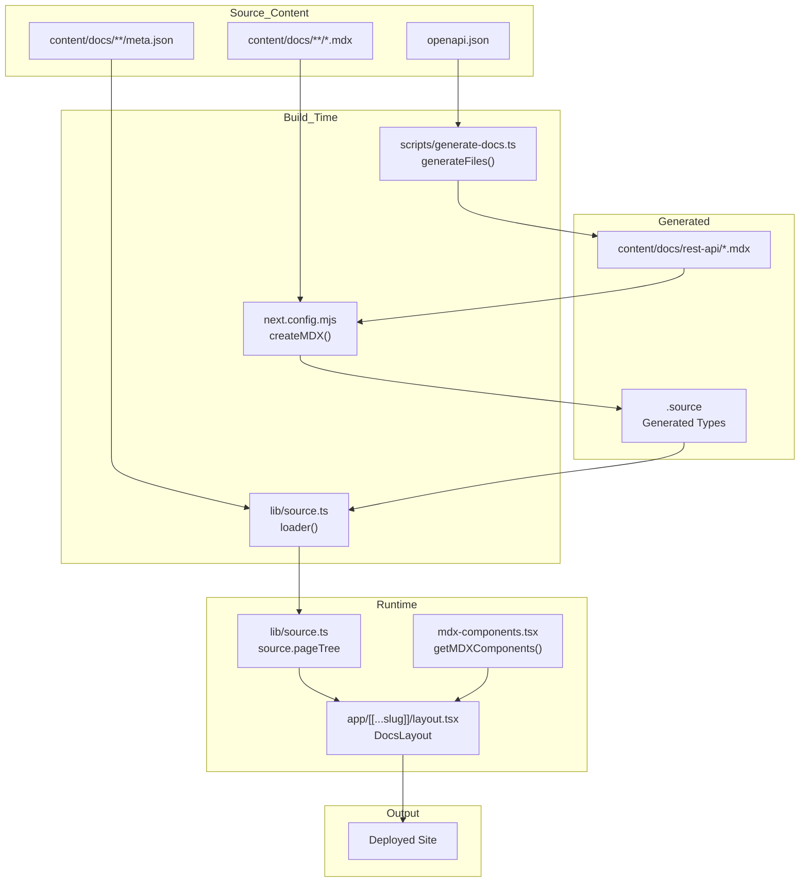
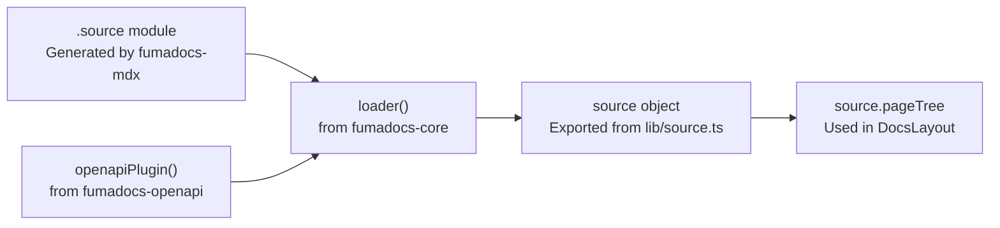
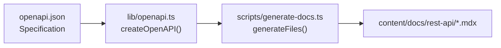
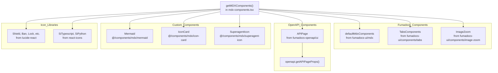
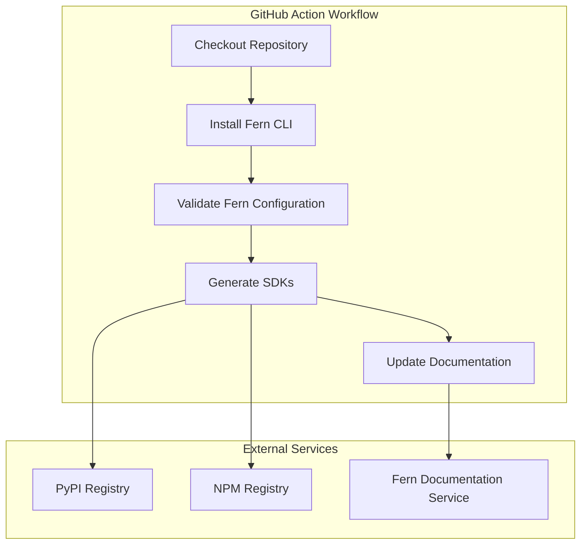

<!-- source: DeepWiki mcp.deepwiki.com · repo superagent-ai/superagent · page 7.4 Documentation Site · fetched 2026-10-26 -->

# Documentation Site

<details>
<summary>Relevant source files</summary>

The following files were used as context for generating this wiki page:

- [docs/app/[[...slug]]/layout.tsx](docs/app/[[...slug]]/layout.tsx)
- [docs/app/global.css](docs/app/global.css)
- [docs/content/docs/meta.json](docs/content/docs/meta.json)
- [docs/lib/openapi.ts](docs/lib/openapi.ts)
- [docs/lib/source.ts](docs/lib/source.ts)
- [docs/mdx-components.tsx](docs/mdx-components.tsx)
- [docs/next.config.mjs](docs/next.config.mjs)
- [docs/scripts/generate-docs.ts](docs/scripts/generate-docs.ts)

</details>


This page explains the Next.js documentation site located in the `docs/` directory, including the Fumadocs framework, MDX content organization, OpenAPI integration, custom components, and local development workflow.

## Overview

The documentation site is a Next.js application using the [Fumadocs](https://fumadocs.vercel.app) framework for content management and rendering. Fumadocs provides MDX support, automatic API documentation generation from OpenAPI specifications, and a rich component library.

### Documentation Architecture



Sources: [docs/lib/source.ts:1-12](), [docs/next.config.mjs:1-34](), [docs/scripts/generate-docs.ts:1-11](), [docs/app/[[...slug]]/layout.tsx:1-62]()

## Project Structure

The documentation site is organized as follows:

| Directory/File | Purpose |
|----------------|---------|
| `docs/app/` | Next.js App Router pages and layouts |
| `docs/content/docs/` | MDX documentation files |
| `docs/lib/` | Configuration and utilities |
| `docs/scripts/` | Build-time scripts |
| `docs/components/mdx/` | Custom MDX components |
| `docs/public/` | Static assets |
| `docs/openapi.json` | OpenAPI specification for REST API |
| `docs/next.config.mjs` | Next.js configuration with MDX support |
| `docs/mdx-components.tsx` | MDX component registry |

Sources: [docs/lib/source.ts:1-12](), [docs/next.config.mjs:1-34]()

## Fumadocs Framework

The site uses multiple Fumadocs packages that work together:

| Package | Purpose | Usage |
|---------|---------|-------|
| `fumadocs-core` | Content loading and source API | Provides `loader()` function |
| `fumadocs-mdx` | MDX compilation | Integrated via `createMDX()` |
| `fumadocs-openapi` | OpenAPI integration | Plugin for API documentation |
| `fumadocs-ui` | UI components and layouts | Provides `DocsLayout`, `ImageZoom`, etc. |

The framework enables:
- Automatic page routing from MDX file structure
- Type-safe content access via generated `.source` module
- Built-in search functionality
- Code syntax highlighting
- Custom component embedding in MDX

Sources: [docs/lib/source.ts:1-12](), [docs/next.config.mjs:1-34]()

## Content Organization

Documentation is written in MDX files located in `docs/content/docs/`. MDX allows embedding React components directly in Markdown.

### Navigation Structure with meta.json

Each directory can contain a `meta.json` file that defines navigation structure:

```json
{
  "title": "Framework",
  "description": "The docs framework",
  "icon": "Building",
  "root": true,
  "pages": [
    "sdk",
    "legacy"
  ]
}
```

The `meta.json` file controls:
- Page ordering in the sidebar
- Section titles and descriptions
- Icons displayed in the navigation
- Whether the section is a root-level tab

Sources: [docs/content/docs/meta.json:1-11]()

### Content Loading Pipeline

The content loading system is configured in `lib/source.ts`:



The `loader()` function in [docs/lib/source.ts:1-12]():
- Takes MDX files from the `.source` module
- Converts them to Fumadocs format with `toFumadocsSource()`
- Applies `openapiPlugin()` for API documentation
- Generates URL routes based on file paths
- Exports `source.pageTree` for sidebar navigation

Sources: [docs/lib/source.ts:1-12]()

### Next.js Configuration

The `next.config.mjs` file configures MDX processing and routing:

**MDX Integration**:
```javascript
import { createMDX } from 'fumadocs-mdx/next';
const withMDX = createMDX();
```

**Redirects**:
- `/` → `/sdk` (root redirects to SDK documentation)
- `/safety-agent/:path*` → `/sdk/:path*` (legacy path migration)

**Rewrites**:
- `/:path*.mdx` → `/llms.mdx/:path*` (allows fetching raw MDX content)

Sources: [docs/next.config.mjs:1-34]()

## OpenAPI Documentation

REST API documentation is automatically generated from the OpenAPI specification.

### OpenAPI Generation Pipeline



### OpenAPI Configuration

The `lib/openapi.ts` file creates an OpenAPI instance:

```typescript
import { createOpenAPI } from "fumadocs-openapi/server";

export const openapi = createOpenAPI({
  input: ["./openapi.json"],
});
```

This configuration is used in two places:
1. The generation script (`scripts/generate-docs.ts`)
2. The MDX components (`mdx-components.tsx`) for the `APIPage` component

Sources: [docs/lib/openapi.ts:1-7]()

### Documentation Generation Script

The `scripts/generate-docs.ts` script generates MDX files from the OpenAPI spec:

```typescript
import { generateFiles } from "fumadocs-openapi";
import { openapi } from "@/lib/openapi";

void generateFiles({
  input: openapi,
  output: "./content/docs/rest-api",
  includeDescription: true,
});
```

Running this script creates MDX files in `content/docs/rest-api/` containing:
- Endpoint descriptions
- Request/response schemas  
- Authentication details
- Example requests

To regenerate API docs after updating `openapi.json`, run:
```bash
npx tsx scripts/generate-docs.ts
```

Sources: [docs/scripts/generate-docs.ts:1-11]()

## Custom MDX Components

The `mdx-components.tsx` file registers custom components available in MDX files.

### Component Architecture



### Available Components

The `getMDXComponents()` function in [docs/mdx-components.tsx:36-71]() registers:

| Component | Source | Usage in MDX |
|-----------|--------|--------------|
| `APIPage` | `fumadocs-openapi/ui` | Renders OpenAPI endpoint documentation |
| `Mermaid` | `@/components/mdx/mermaid` | `<Mermaid chart={...} />` |
| `IconCard` | `@/components/mdx/icon-card` | `<IconCard icon={...} title="..." />` |
| `SuperagentIcon` | `@/components/mdx/superagent-icon` | Custom Superagent logo |
| `ImageZoom` | `fumadocs-ui/components/image-zoom` | Automatically applied to `` tags |
| `Tabs`, `Tab` | `fumadocs-ui/components/tabs` | `<Tabs><Tab>...</Tab></Tabs>` |
| Icons | `lucide-react` | `<Shield />`, `<Lock />`, `<Server />`, etc. |
| Language Icons | `react-icons` | `<TypeScriptIcon />`, `<PythonIcon />` |

### Using Components in MDX

Example usage in an MDX file:

```mdx
<IconCard icon={<Shield />} title="Security">
  Guard operation detects prompt injection
</IconCard>

<Tabs>
  <Tab value="typescript" label="TypeScript">
    ```typescript
    const client = createClient();
    ```
  </Tab>
  <Tab value="python" label="Python">
    ```python
    client = SafetyClient()
    ```
  </Tab>
</Tabs>
```

Sources: [docs/mdx-components.tsx:1-72]()

## CI/CD Integration

The SDK and documentation generation is automated as part of Superagent's CI/CD pipeline using GitHub Actions.



Sources: [.github/workflows/ci.yml:1-43]()

### SDK Release Process

The SDK generation and release process is defined in the `.github/workflows/ci.yml` file. This workflow runs when a new version tag is pushed to the repository. The process includes:

1. Checking that the Fern API definitions are valid
2. Generating SDKs for all supported languages (Python and TypeScript)
3. Publishing packages to PyPI and NPM
4. Updating the documentation site

The version number used for the SDKs is extracted from the Git tag.

Here's a simplified view of the relevant GitHub Actions workflow:

| Step | Action | Description |
|------|--------|-------------|
| 1 | `fern check` | Validates that the Fern API definitions are correct |
| 2 | `fern generate --group publish` | Generates and publishes SDKs to package repositories |
| 3 | `fern generate --docs` | Updates the documentation site |

Sources: [.github/workflows/ci.yml:16-43]()

## SDK Usage

Developers can install the Superagent SDKs from their respective package managers:

For Python:
```
pip install superagent-py
```

For JavaScript/TypeScript:
```
npm install superagentai-js
```

The SDKs provide type-safe interfaces for interacting with all Superagent APIs, including agents, tools, datasources, and workflows.

Sources: [fern/docs.yml:27-29](), [fern/apis/prod/generators.yml:7-36]()

## Documentation Customization

The documentation site is customized with Superagent's branding, including:

- Custom colors (accent color: #FDC537)
- Logo and favicon
- External links to Discord, GitHub, and the login page

The site is hosted on a custom domain (docs.superagent.sh).

Sources: [fern/docs.yml:116-135]()

---

