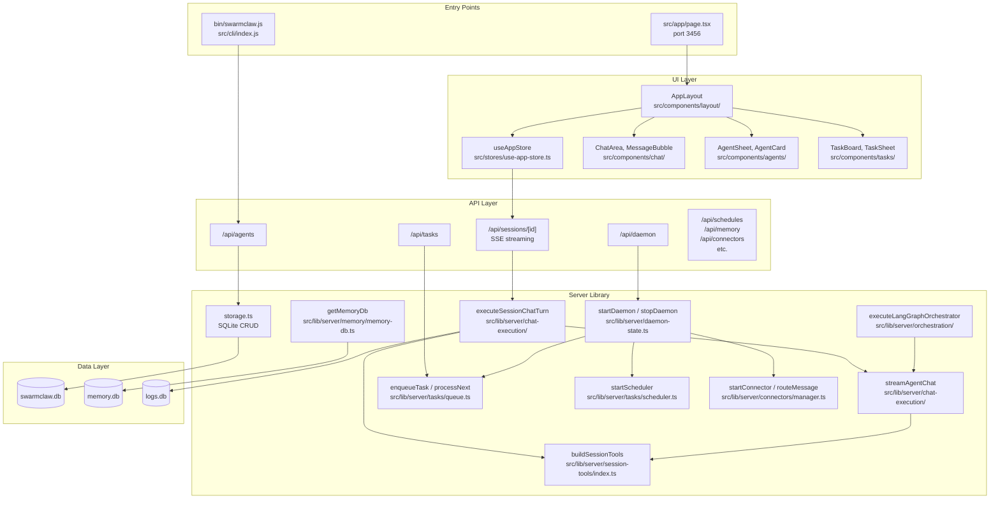
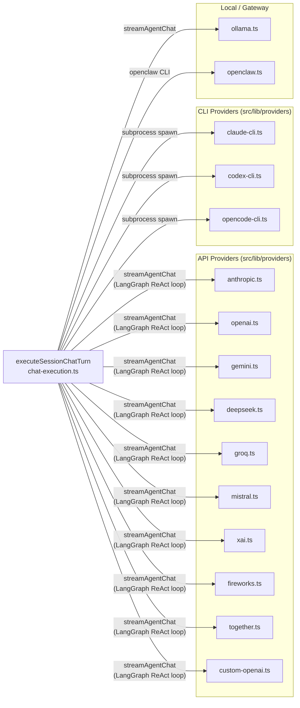

<!-- source: DeepWiki mcp.deepwiki.com · repo swarmclawai/swarmclaw · page 1 Overview · fetched 2026-10-26 -->

# Overview

Relevant source files

The following files were used as context for generating this wiki page:

- [.eslint-baseline.json](.eslint-baseline.json)
- [.github/workflows/desktop-release.yml](.github/workflows/desktop-release.yml)
- [.gitignore](.gitignore)
- [CLAUDE.md](CLAUDE.md)
- [README.md](README.md)
- [electron/free-port.ts](electron/free-port.ts)
- [electron/menu.ts](electron/menu.ts)
- [electron/paths.ts](electron/paths.ts)
- [electron/tsconfig.json](electron/tsconfig.json)
- [package-lock.json](package-lock.json)
- [package.json](package.json)
- [skills/swarmclaw/SKILL.md](skills/swarmclaw/SKILL.md)
- [skills/swarmvault/SKILL.md](skills/swarmvault/SKILL.md)
- [src/app/api/mcp-servers/route.ts](src/app/api/mcp-servers/route.ts)
- [src/cli/index.js](src/cli/index.js)
- [src/cli/spec.js](src/cli/spec.js)
- [src/components/mcp-servers/mcp-server-sheet.tsx](src/components/mcp-servers/mcp-server-sheet.tsx)
- [src/lib/server/__fixtures__/fake-mcp-stdio-server.mjs](src/lib/server/__fixtures__/fake-mcp-stdio-server.mjs)
- [src/lib/server/mcp-client.ts](src/lib/server/mcp-client.ts)
- [src/lib/server/missions/mission-templates.ts](src/lib/server/missions/mission-templates.ts)
- [src/lib/server/storage.ts](src/lib/server/storage.ts)
- [src/types/index.ts](src/types/index.ts)
- [src/types/misc.ts](src/types/misc.ts)

This page introduces SwarmClaw: what it is, who it is for, what its major subsystems are, and how they relate to each other at a high level. Detailed documentation for each subsystem is linked throughout. For installation steps, see [Getting Started](#2). For the full architectural breakdown, see [Architecture](#3).

---

## What is SwarmClaw?

SwarmClaw is a self-hosted AI agent orchestration platform. It provides a single dashboard for managing multiple LLM providers, running autonomous or semi-autonomous AI agents, scheduling recurring agent tasks, and bridging agents to external chat platforms (Discord, Slack, Telegram, WhatsApp).

It is packaged as a Node.js application exposing a Next.js web UI on port `3456` and a `swarmclaw` CLI binary. All state is stored locally in SQLite databases under a `data/` directory — no external services are required to run a minimal instance.

Sources: [README.md:1-11](), [package.json:1-10](), [package.json:34-36]()

---

## Primary Use Cases

| Use Case | Key Feature |
|---|---|
| Chat with AI agents | Session-based chat with streaming SSE responses |
| Autonomous background agents | Main agent loop with heartbeat-driven ticks |
| Multi-agent orchestration | LangGraph-powered orchestrator with sub-agent delegation |
| Scheduled tasks | Cron, interval, and one-time schedules via the daemon |
| External chat platform integration | Discord, Slack, Telegram, WhatsApp connectors |
| Local inference | Ollama and OpenClaw gateway providers |
| Code/research automation | Shell, browser, sandbox, and file tools per agent |
| Skill learning | SKILL.md discovery and MCP integration |

Sources: [README.md:24-52](), [package.json:4-4]()

---

## System Layers

The application is divided into horizontal layers. Each layer has a distinct responsibility and communicates downward through well-defined interfaces.

**Figure 1 — System Layers and Primary Code Entities**

Sources: [src/lib/server/storage.ts:89-100](), [src/cli/index.js:12-32](), [src/stores/use-app-store.ts:1-20](), [src/lib/server/storage.ts:128-186]()

---

## Major Subsystems

### Agents
An agent is the central entity. It holds a persona (soul), a chosen LLM provider, skills, and a tool policy. Agents operate in sessions holding conversation history.
- **Key entities**: `Agent`, `Session`, `Message`.
- **Location**: `src/types/agent.ts`, `src/types/session.ts`.

### LLM Providers
Supports API-based (Anthropic, OpenAI, etc.), CLI-based (Claude Code, Codex), and local (Ollama).
- **Location**: `src/lib/providers/`.

### Agent Tools
Tools cover files, shell execution, browser control, and memory. MCP (Model Context Protocol) allows extending these tools via external servers like SwarmVault.
- **Location**: `src/lib/server/session-tools/`, `src/components/mcp-servers/mcp-server-sheet.tsx`.

### Task & Schedule System
Queued work items with retry logic and cron/interval scheduling.
- **Location**: `src/lib/server/tasks/`, `src/lib/server/scheduler.ts`.

### Memory & Dreaming
Persistent storage with FTS5 search. "Dreaming" allows agents to reflect and consolidate memories during idle periods.
- **Location**: `src/lib/server/memory/`, `skills/swarmclaw/SKILL.md:95-110]().

### Chat Connectors
Bridges to Discord, Slack, Telegram, WhatsApp, and Email.
- **Location**: `src/lib/server/connectors/`.

### Missions & Protocols
Missions track long-running goals with budgets. Protocols define multi-agent DAG workflows.
- **Location**: `src/lib/server/missions/`, `src/lib/server/protocols/`.

Sources: [package.json:99-110](), [src/lib/server/storage.ts:128-186](), [skills/swarmclaw/SKILL.md:24-35]()

---

## Data Storage

Three SQLite databases persist all state:

| Database | File | Contents |
|---|---|---|
| **Operational** | `swarmclaw.db` | Agents, sessions, tasks, credentials, schedules, connectors, settings, etc. |
| **Memory** | `memory.db` | Per-agent memories with FTS5 index and vector embeddings. |
| **Audit/Logs** | `logs.db` | Execution logs, tool calls, and error traces. |

Sources: [src/lib/server/storage.ts:89-99](), [src/lib/server/storage.ts:128-186]()

---

## Provider Support

**Figure 2 — Provider Types and Dispatch Path**

Sources: [README.md:41-67](), [CLAUDE.md:56-64]()

---

## Key Technology Stack

| Component | Technology |
|---|---|
| **Web framework** | Next.js 16, React 19 |
| **Agent loop** | LangGraph (`@langchain/langgraph`) |
| **LLM integration** | LangChain (`@langchain/core`) |
| **Database** | `better-sqlite3` (WAL mode) |
| **State management** | Zustand |
| **Styling** | Tailwind v4, shadcn/ui |
| **Connectors** | `discord.js`, `grammy`, `@whiskeysockets/baileys`, `@slack/bolt` |
| **Browser** | `@playwright/mcp` |
| **Embeddings** | `@huggingface/transformers` |

Sources: [package.json:97-125](), [package-lock.json:12-85]()

---

## Security & Auth

- **Access Control**: Uses an `ACCESS_KEY` stored in `.env.local`. Checked via `X-Access-Key` header in `src/lib/app/api-client.ts`.
- **Credential Safety**: API keys are stored encrypted in `swarmclaw.db` and redacted from logs.
- **Capability Policy**: Gated tool access (permissive, balanced, strict) enforced in `src/lib/server/session-tools/index.ts`.

Sources: [src/lib/server/storage.ts:70-76](), [CLAUDE.md:65-75](), [skills/swarmclaw/SKILL.md:51-60]()

---

