# Page: Overview

# Overview

<details>
<summary>Relevant source files</summary>

The following files were used as context for generating this wiki page:

- [.github/CODE_OF_CONDUCT.md](.github/CODE_OF_CONDUCT.md)
- [README.md](README.md)
- [docs/assets/mini_logo.svg](docs/assets/mini_logo.svg)
- [docs/assets/mini_logo_text_below.svg](docs/assets/mini_logo_text_below.svg)
- [docs/config/env.md](docs/config/env.md)
- [docs/index.md](docs/index.md)
- [docs/installation/changelog.md](docs/installation/changelog.md)
- [docs/overrides/main.html](docs/overrides/main.html)
- [docs/usage/cl_tutorial.md](docs/usage/cl_tutorial.md)
- [mkdocs.yml](mkdocs.yml)
- [sweagent/__init__.py](sweagent/__init__.py)
- [tests/test_models.py](tests/test_models.py)

</details>


This document provides a high-level introduction to SWE-agent, its purpose, architecture, and major components. For detailed information about specific subsystems, see the relevant sections: [Installation and Setup](#2), [Agent Framework](#3), [Environment System](#4), [Execution and Run System](#5), [Tool System](#6), and [Command Line Interface](#7).

## What is SWE-agent?

SWE-agent is an autonomous software engineering agent that enables language models (such as GPT-4o or Claude Sonnet 4) to solve real-world software engineering tasks. The system can fix issues in GitHub repositories, find cybersecurity vulnerabilities, and perform custom coding tasks.

**Key characteristics:**

- **State-of-the-art performance:** Achieves leading results on SWE-bench among open-source projects
- **Model flexibility:** Supports 7+ language model providers through litellm
- **Highly configurable:** All behavior governed by YAML configuration files
- **Research-oriented:** Simple, hackable architecture designed for experimentation
- **Sandboxed execution:** Safe code execution via containerized environments

**Primary use cases:**

1. Fixing GitHub issues autonomously
2. Benchmarking on SWE-bench and other evaluation datasets
3. Solving coding challenges
4. Custom software engineering tasks

Sources: [README.md:14-24](), [docs/index.md:16-24]()

## System Architecture

SWE-agent is organized into several major subsystems that work together to enable autonomous software engineering:

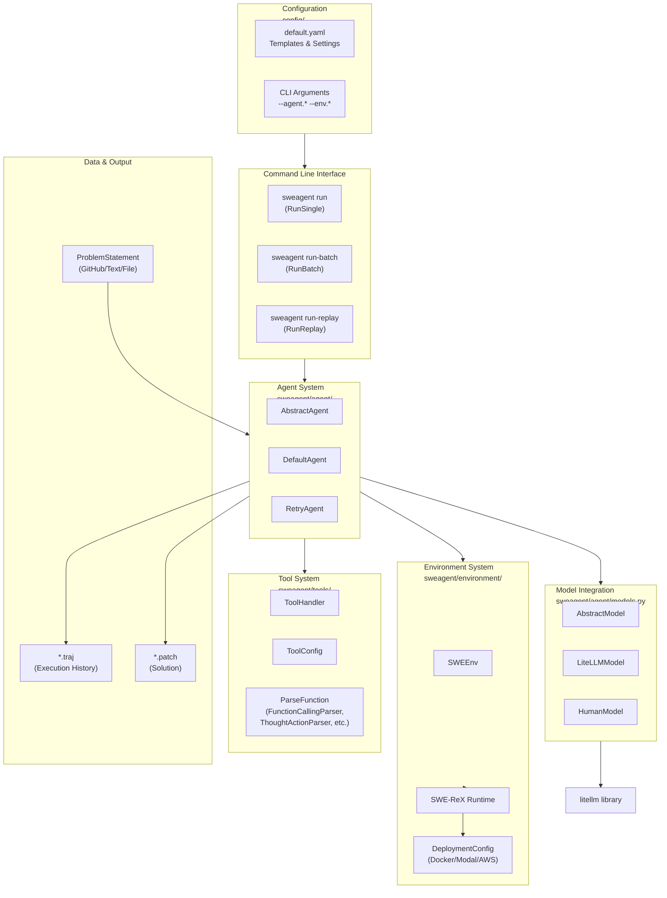

**Architecture Diagram: Major Components and Code Locations**

This diagram shows how the system is organized into logical subsystems with their corresponding code locations. Each component is implemented in specific modules that can be found at the indicated paths.

Sources: [sweagent/__init__.py:1-115](), [README.md:14-24](), Diagram 1 from provided architecture

## Core Components to Code Mapping

The following table maps high-level system concepts to their concrete implementations in the codebase:

| Component | Code Entity | Location | Purpose |
|-----------|-------------|----------|---------|
| **Agent** | `DefaultAgent` | `sweagent/agent/agents.py` | Core problem-solving logic, manages agent lifecycle |
| **Retry System** | `RetryAgent` | `sweagent/agent/agents.py` | Multi-attempt orchestration with solution evaluation |
| **Model Abstraction** | `LiteLLMModel` | `sweagent/agent/models.py` | Language model interface via litellm |
| **Environment** | `SWEEnv` | `sweagent/environment/swe_env.py` | Manages execution environment and communication |
| **Runtime** | SWE-ReX | External package `swerex` | Sandboxed command execution in containers |
| **Tool Handler** | `ToolHandler` | `sweagent/tools/tools.py` | Tool lifecycle management and action execution |
| **Action Parser** | `ParseFunction` | `sweagent/tools/parsing.py` | Extracts actions from model outputs |
| **Run Orchestrator** | `RunSingle`, `RunBatch` | `sweagent/run/` | Coordinates agent execution for single/batch runs |
| **Configuration** | `RunSingleConfig` | `sweagent/run/run_single.py` | Pydantic models for configuration |
| **Problem Input** | `ProblemStatement` | `sweagent/agent/problem_statement.py` | Union type for various problem sources |

Sources: [sweagent/__init__.py:28-47](), architecture diagrams, [mkdocs.yml:99-118]()

## Execution Flow Overview

The following diagram illustrates the high-level execution flow from user input to solution output:

```mermaid
sequenceDiagram
    participant User
    participant RunOrchestrator["RunSingle/RunBatch<br/>sweagent/run/"]
    participant Agent["DefaultAgent<br/>sweagent/agent/agents.py"]
    participant Model["LiteLLMModel<br/>sweagent/agent/models.py"]
    participant ToolHandler["ToolHandler<br/>sweagent/tools/tools.py"]
    participant SWEEnv["SWEEnv<br/>sweagent/environment/swe_env.py"]
    participant SWERex["SWE-ReX Runtime<br/>swerex package"]
    
    User->>RunOrchestrator: sweagent run --config ...
    RunOrchestrator->>SWEEnv: Initialize environment
    SWEEnv->>SWERex: Start container (Docker/Modal/AWS)
    SWERex-->>SWEEnv: Environment ready
    
    RunOrchestrator->>Agent: Create agent instance
    Agent->>Model: Initialize model (via litellm)
    Agent->>ToolHandler: Load tool bundles
    
    RunOrchestrator->>Agent: setup(problem_statement, env)
    
    loop Agent Step Loop
        RunOrchestrator->>Agent: step()
        Agent->>Model: query(history)
        Model-->>Agent: Response with action
        Agent->>ToolHandler: parse_actions(response)
        ToolHandler-->>Agent: Parsed thought + action
        Agent->>ToolHandler: should_block_action(action)?
        alt Action allowed
            Agent->>SWEEnv: communicate(action)
            SWEEnv->>SWERex: Execute command
            SWERex-->>SWEEnv: Observation
            SWEEnv-->>Agent: Observation + state
        else Action blocked
            Agent->>Agent: Add error to history
        end
        Agent->>Agent: Check exit conditions
    end
    
    Agent-->>RunOrchestrator: AgentRunResult
    RunOrchestrator->>RunOrchestrator: Extract patch from trajectory
    RunOrchestrator-->>User: Save *.traj and *.patch
```

**Execution Flow Sequence Diagram**

This sequence shows the interaction between major components during a typical agent run. The `RunOrchestrator` coordinates the overall flow, while the `Agent` manages the problem-solving loop by querying the `Model`, parsing actions via `ToolHandler`, and executing them in `SWEEnv`.

Sources: Diagram 2 from provided architecture, [sweagent/run/run_single.py](), [sweagent/agent/agents.py]()

## Major Subsystems

### 1. Command Line Interface (CLI)

The CLI provides three main commands implemented in `sweagent/cli/`:

- **`sweagent run`**: Execute agent on a single problem instance ([details](#7.1))
- **`sweagent run-batch`**: Parallel execution on multiple instances ([details](#5.2))
- **`sweagent run-replay`**: Replay previously recorded trajectories

All commands use a hierarchical configuration system that merges YAML files, environment variables, and command-line arguments ([details](#7.2)).

Sources: [docs/usage/cl_tutorial.md:20-59](), [mkdocs.yml:84]()

### 2. Agent Framework

The agent framework implements the core problem-solving logic:

- **`AbstractAgent`**: Base interface defining the agent contract
- **`DefaultAgent`**: Main implementation with setup/step/completion lifecycle
- **`RetryAgent`**: Meta-orchestration for multi-attempt strategies
- **`AbstractRetryLoop`**: Interface for solution evaluation and selection

Agents maintain a `History` of messages and a `Trajectory` of action-observation pairs ([details](#3)).

Sources: [sweagent/agent/agents.py](), architecture diagrams, [mkdocs.yml:106-112]()

### 3. Model Integration

The model integration layer abstracts over multiple language model providers:

- **`AbstractModel`**: Interface for all model implementations
- **`LiteLLMModel`**: Primary implementation using litellm for API-based models
- **`HumanModel`**: Human-in-the-loop mode for testing
- **`ReplayModel`**: Replays actions from recorded trajectories

The system supports OpenAI, Anthropic, AWS Bedrock, Together AI, Groq, DeepSeek, and local models ([details](#3.2)).

Sources: [sweagent/agent/models.py](), [tests/test_models.py:11-23](), [docs/installation/changelog.md:78-141]()

### 4. Environment System

The environment system manages safe code execution:

- **`SWEEnv`**: Main environment manager that coordinates execution
- **SWE-ReX Runtime**: External package (`swerex >= 1.2.0`) for sandboxed execution
- **Deployment configurations**: Docker (local), Modal (cloud), AWS Fargate

The environment handles repository cloning, tool installation, and command execution with configurable timeouts ([details](#4)).

Sources: [sweagent/__init__.py:17-18](), [sweagent/environment/](), architecture diagrams

### 5. Tool System

Tools define the actions available to the agent:

- **`ToolConfig`**: Defines available tools and commands
- **Tool Bundles**: Modular collections (e.g., `edit_anthropic`, `registry`, `submit`)
- **`ToolHandler`**: Manages tool lifecycle, action blocking, and state
- **`ParseFunction`**: Extracts actions from model outputs (function calling, thought-action, JSON, XML formats)

Tools can include file editing commands, bash execution, code search, and submission ([details](#6)).

Sources: [sweagent/tools/](), [mkdocs.yml:92](), [docs/usage/cl_tutorial.md:217-265]()

### 6. Configuration System

Configuration uses a hierarchical merge system with pydantic-settings:

1. **YAML files**: `config/default.yaml` and custom configs
2. **Environment variables**: Prefixed with `SWE_AGENT_*`
3. **CLI arguments**: Override any config value via `--key.subkey=value`

The system supports union types for flexible configuration (e.g., `ProblemStatement` can be GitHub issue, text, or file) ([details](#7.2)).

Sources: [docs/usage/cl_tutorial.md:62-138](), [docs/config/env.md:1-24](), [sweagent/__init__.py:40-46]()

### 7. Data and Output

SWE-agent produces several output formats:

- **Trajectory files (`.traj`)**: Complete execution history in JSON format ([details](#8.1))
- **Patch files (`.patch`)**: Solutions in git diff format
- **Predictions (`preds.json`)**: SWE-bench compatible evaluation format
- **Demo files (`.demo.yaml`)**: Replay-ready action sequences

Trajectories can be inspected using the command-line TUI or web viewer ([details](#8.2)).

Sources: [mkdocs.yml:85](), [docs/usage/cl_tutorial.md:276-297]()

## Technology Stack

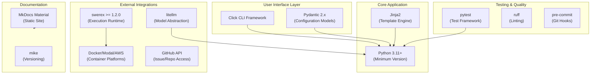

**Technology Stack Diagram**

Key dependencies and version requirements:

- **Python**: 3.11+ minimum ([sweagent/__init__.py:16]())
- **SWE-ReX**: 1.2.0+ minimum, 1.2.1+ recommended ([sweagent/__init__.py:17-18]())
- **Configuration**: pydantic-settings for hierarchical config merging
- **Templates**: Jinja2 for system/instance/error prompts
- **Models**: litellm for unified API across all providers
- **Testing**: pytest with fixtures and mock models
- **Documentation**: MkDocs Material with versioning via mike

Sources: [sweagent/__init__.py:15-104](), [mkdocs.yml:1-183](), [docs/installation/changelog.md:119-138]()

## Version Information

Current version: **1.1.0**

The package exposes version information and dependency checks:

- `sweagent.__version__`: Current version string
- `sweagent.get_agent_version_info()`: Full version info including commit hashes
- Automatic SWE-ReX version validation on import

The system enforces minimum version requirements for dependencies and logs warnings for recommended updates.

Sources: [sweagent/__init__.py:15-106]()

## Getting Started

To begin using SWE-agent:

1. **Installation**: See [Installation and Setup](#2) for pip installation and dependency setup
2. **Configuration**: Set up API keys as described in [API Keys and Model Configuration](#2.2)
3. **First Run**: Follow the [Command Line Basics](#7.1) tutorial to run your first agent
4. **Benchmarking**: See [Batch Processing](#5.2) for evaluation on SWE-bench

For developers contributing to the codebase, see [Development and Testing](#9).

Sources: [README.md:35-45](), [docs/index.md:28-67]()

---

# Page: Installation and Setup

# Installation and Setup

<details>
<summary>Relevant source files</summary>

The following files were used as context for generating this wiki page:

- [.github/CODE_OF_CONDUCT.md](.github/CODE_OF_CONDUCT.md)
- [CONTRIBUTING.md](CONTRIBUTING.md)
- [docs/_footer.md](docs/_footer.md)
- [docs/assets/navigation_cards.css](docs/assets/navigation_cards.css)
- [docs/config/env.md](docs/config/env.md)
- [docs/dev/contribute.md](docs/dev/contribute.md)
- [docs/dev/formatting_conflicts.md](docs/dev/formatting_conflicts.md)
- [docs/installation/changelog.md](docs/installation/changelog.md)
- [docs/installation/index.md](docs/installation/index.md)
- [docs/usage/index.md](docs/usage/index.md)
- [mlc_config.json](mlc_config.json)
- [sweagent/__init__.py](sweagent/__init__.py)
- [tests/test_models.py](tests/test_models.py)

</details>


This page provides an overview of installing SWE-agent and configuring the basic system requirements. It covers system prerequisites, installation methods, dependency verification, and directory configuration.

For detailed API key configuration and language model setup, see [API Keys and Model Configuration](#2.2).
For step-by-step installation procedures, see [Installing SWE-agent](#2.1).

## System Requirements

SWE-agent has specific version requirements enforced at runtime:

| Component | Requirement | Verification Location |
|-----------|-------------|---------------------|
| Python | >= 3.11 | [sweagent/\_\_init\_\_.py:16](), [sweagent/\_\_init\_\_.py:30-35]() |
| SWE-ReX | >= 1.2.0 (recommended >= 1.2.1) | [sweagent/\_\_init\_\_.py:17-18](), [sweagent/\_\_init\_\_.py:85-104]() |
| Docker | Required for environment execution | (external dependency) |

The Python version check occurs immediately on import and will raise a `RuntimeError` if the version is insufficient. The SWE-ReX version check is performed by the `impose_rex_lower_bound()` function, which warns if the version is below the recommended threshold and raises an error if below the minimum.

**Installation Flow**

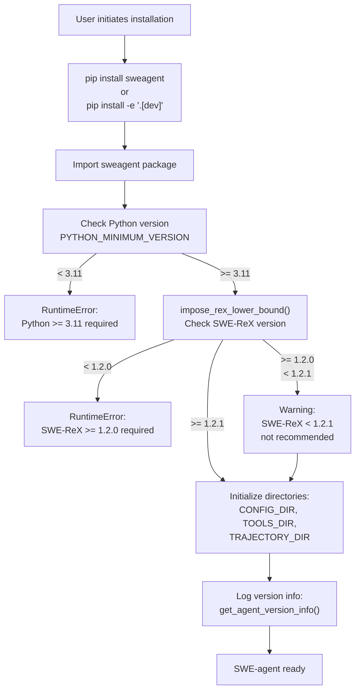

Sources: [sweagent/\_\_init\_\_.py:1-115](), [docs/dev/contribute.md:16-22]()

## Installation Methods

SWE-agent supports two primary installation modes:

### Basic Installation

```bash
pip install sweagent
```

This installs the core package with runtime dependencies. The package is distributed via PyPI with version management handled by the `__version__` variable in [sweagent/\_\_init\_\_.py:15]().

### Development Installation

```bash
pip install -e '.[dev]'
```

This installs the package in editable mode with additional development dependencies including:
- Testing frameworks (`pytest`, `pytest-xdist`)
- Code quality tools (`ruff`, `pre-commit`)
- Debugging utilities (`pdbpp`)
- Documentation tools (`mkdocs`)

After development installation, pre-commit hooks should be configured:

```bash
pre-commit install
```

Sources: [docs/dev/contribute.md:18-29](), [docs/installation/changelog.md:1-150]()

## Package Initialization and Dependency Verification

**Package Initialization Sequence**

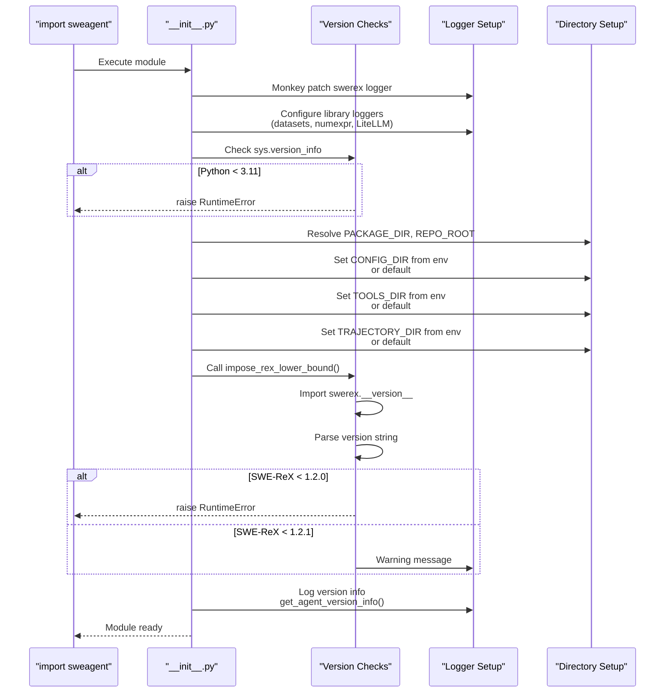

The `impose_rex_lower_bound()` function performs runtime dependency verification:

```python
# From sweagent/__init__.py:85-104
def impose_rex_lower_bound() -> None:
    rex_version = get_rex_version()
    minimal_rex_version = "1.2.0"
    if version.parse(rex_version) < version.parse(minimal_rex_version):
        # Raises RuntimeError with upgrade instructions
    if version.parse(rex_version) < version.parse(SWEREX_RECOMMENDED_VERSION):
        # Logs warning message
```

Sources: [sweagent/\_\_init\_\_.py:1-115]()

## Directory Structure and Environment Variables

SWE-agent uses three primary directories for configuration and data storage. These can be customized via environment variables:

**Directory Configuration**

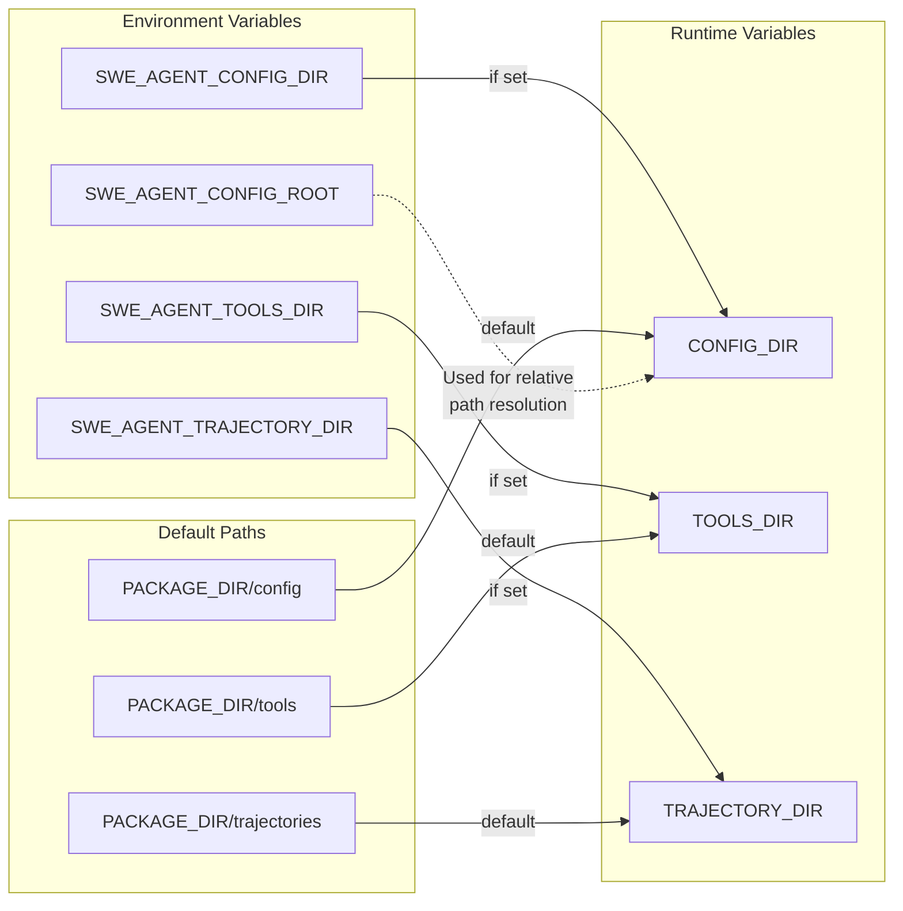

| Environment Variable | Default Value | Purpose | Code Reference |
|---------------------|---------------|---------|----------------|
| `SWE_AGENT_CONFIG_DIR` | `<PACKAGE>/config` | Configuration files (YAML) | [sweagent/\_\_init\_\_.py:40]() |
| `SWE_AGENT_TOOLS_DIR` | `<PACKAGE>/tools` | Tool bundle definitions | [sweagent/\_\_init\_\_.py:43]() |
| `SWE_AGENT_TRAJECTORY_DIR` | `<PACKAGE>/trajectories` | Execution trajectory storage | [sweagent/\_\_init\_\_.py:46]() |
| `SWE_AGENT_CONFIG_ROOT` | `<PACKAGE>` | Root for relative path resolution | Used in config system |

**Important**: When installing with `pip install` (non-editable), these environment variables should be set to point to accessible directories, as the package directory may not be writable.

Sources: [sweagent/\_\_init\_\_.py:28-47](), [docs/config/env.md:1-24]()

## Logging Configuration

SWE-agent configures logging on import with several customization options:

**Additional Environment Variables**

| Variable | Purpose | Default |
|----------|---------|---------|
| `SWE_AGENT_LOG_TIME` | Add timestamps to log messages | Not set |
| `SWE_AGENT_LOG_STREAM_LEVEL` | Console log level (TRACE, DEBUG, INFO, etc.) | INFO |

The initialization process also modifies third-party library logging levels to reduce noise:

```python
# From sweagent/__init__.py:20-26
# Monkey patch the logger to use our implementation
log_swerex.get_logger = partial(get_logger, emoji="🦖")

# Reduce verbosity of common libraries
getLogger("datasets").setLevel(WARNING)
getLogger("numexpr.utils").setLevel(WARNING)
getLogger("LiteLLM").setLevel(WARNING)
```

Sources: [sweagent/\_\_init\_\_.py:13-26](), [docs/config/env.md:18-22]()

## Version Information and Diagnostics

SWE-agent provides functions to retrieve version and commit information for debugging:

**Version Information Functions**

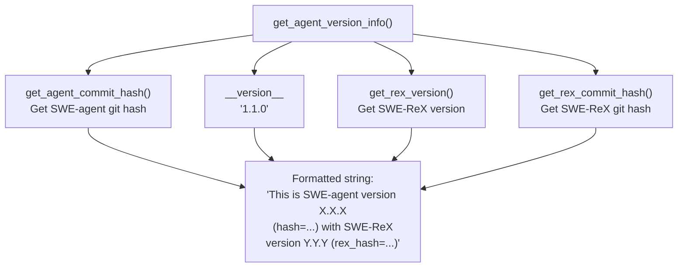

These functions are defined in [sweagent/\_\_init\_\_.py:50-83]() and provide diagnostic information logged on startup.

Sources: [sweagent/\_\_init\_\_.py:50-83](), [sweagent/\_\_init\_\_.py:105]()

## Testing Installation

After installation, you can verify the setup by checking the version:

```python
import sweagent
print(sweagent.__version__)
print(sweagent.get_agent_version_info())
```

A minimal test to verify model integration works:

```python
from pydantic import SecretStr
from sweagent.agent.models import GenericAPIModelConfig, get_model
from sweagent.tools.parsing import Identity
from sweagent.tools.tools import ToolConfig
from sweagent.types import History

# Create a mock model (no API key needed)
model = get_model(
    GenericAPIModelConfig(
        name="gpt-4o",
        completion_kwargs={"mock_response": "Hello, world!"},
        api_key=SecretStr("dummy_key"),
        top_p=None,
    ),
    ToolConfig(parse_function=Identity()),
)

# Test query
response = model.query(History([{"role": "user", "content": "Test"}]))
print(response)
```

Sources: [tests/test_models.py:1-24]()

## Development Setup

For contributors, additional setup steps are required:

1. **Install with development dependencies**
   ```bash
   pip install -e '.[dev]'
   ```

2. **Configure pre-commit hooks**
   ```bash
   pre-commit install
   ```
   
   Pre-commit runs automated formatting (`ruff`) and checks (`typos`) before each commit. Most issues are auto-fixed; if pre-commit fails, run `git commit` again after reviewing changes.

3. **Optional: Enable unsafe auto-fixes**
   ```bash
   pipx run ruff check --fix --unsafe-fixes
   ```

4. **Run tests to verify setup**
   ```bash
   # All tests
   pytest
   
   # Exclude slow tests
   pytest -m "not slow"
   
   # Parallel execution
   pytest -n auto
   ```

Sources: [docs/dev/contribute.md:16-63]()

## Common Installation Issues

**SWE-ReX Version Mismatch**

If you encounter:
```
RuntimeError: SWE-ReX version X.X.X is too old. Please update to at least 1.2.0
```

Solution:
```bash
pip install --upgrade swe-rex
# Or reinstall SWE-agent
pip install -e .
```

**Directory Not Found Errors**

If directories cannot be found after non-editable installation, set environment variables:
```bash
export SWE_AGENT_CONFIG_DIR=/path/to/config
export SWE_AGENT_TOOLS_DIR=/path/to/tools
export SWE_AGENT_TRAJECTORY_DIR=/path/to/trajectories
```

Environment variables can also be stored in a `.env` file in the working directory.

Sources: [sweagent/\_\_init\_\_.py:85-104](), [docs/config/env.md:23-24]()

## Next Steps

After completing installation:

1. **Configure API Keys**: Set up authentication for language model providers. See [API Keys and Model Configuration](#2.2) for details on configuring OpenAI, Anthropic, and other providers.

2. **Verify Docker**: Ensure Docker is installed and running, as SWE-agent uses Docker containers for isolated code execution via SWE-ReX.

3. **Explore Configuration**: Review the default configuration files in `CONFIG_DIR` to understand available options.

4. **Run Your First Task**: Follow the getting started guide to run SWE-agent on a simple task.

Sources: [docs/installation/index.md:1-34](), [docs/config/env.md:1-24]()

---

# Page: Installing SWE-agent

# Installing SWE-agent

<details>
<summary>Relevant source files</summary>

The following files were used as context for generating this wiki page:

- [.github/CODE_OF_CONDUCT.md](.github/CODE_OF_CONDUCT.md)
- [CONTRIBUTING.md](CONTRIBUTING.md)
- [docs/_footer.md](docs/_footer.md)
- [docs/assets/navigation_cards.css](docs/assets/navigation_cards.css)
- [docs/config/env.md](docs/config/env.md)
- [docs/dev/contribute.md](docs/dev/contribute.md)
- [docs/dev/formatting_conflicts.md](docs/dev/formatting_conflicts.md)
- [docs/installation/changelog.md](docs/installation/changelog.md)
- [docs/installation/index.md](docs/installation/index.md)
- [docs/usage/index.md](docs/usage/index.md)
- [mlc_config.json](mlc_config.json)
- [sweagent/__init__.py](sweagent/__init__.py)
- [tests/test_models.py](tests/test_models.py)

</details>


This page provides detailed instructions for installing SWE-agent on your system. It covers system requirements, installation methods, and verification steps. For configuring API keys and language models after installation, see [API Keys and Model Configuration](#2.2).

## Prerequisites

### Python Version Requirement

SWE-agent requires Python 3.11 or higher. This requirement is enforced at import time by the package initialization code.

**Version Check Implementation:**

[sweagent/__init__.py:16]() defines `PYTHON_MINIMUM_VERSION = (3, 11)`, and [sweagent/__init__.py:30-35]() performs the version check:

```python
if sys.version_info < PYTHON_MINIMUM_VERSION:
    msg = (
        f"Python {sys.version_info.major}.{sys.version_info.minor} is not supported. "
        "SWE-agent requires Python 3.11 or higher."
    )
    raise RuntimeError(msg)
```

### SWE-ReX Dependency

SWE-agent depends on the SWE-ReX library for code execution. The minimum required version is automatically enforced.

| Dependency | Minimum Version | Recommended Version |
|------------|----------------|---------------------|
| swerex | 1.2.0 | 1.2.1 |

The version enforcement occurs automatically when importing the package [sweagent/__init__.py:85-104]():

```python
def impose_rex_lower_bound() -> None:
    rex_version = get_rex_version()
    minimal_rex_version = "1.2.0"
    if version.parse(rex_version) < version.parse(minimal_rex_version):
        msg = (
            f"SWE-ReX version {rex_version} is too old. Please update to at least {minimal_rex_version} by "
            "running `pip install --upgrade swe-rex`."
        )
        raise RuntimeError(msg)
```

**Sources:** [sweagent/__init__.py:16-18](), [sweagent/__init__.py:30-35](), [sweagent/__init__.py:85-104]()

## Installation Methods

### Installation Flow

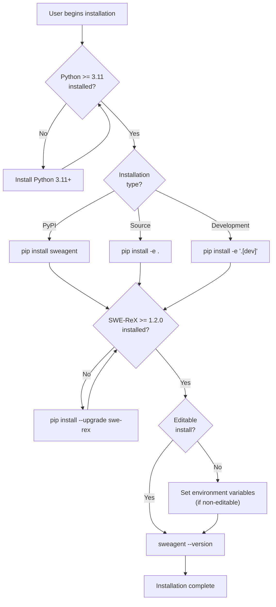

**Sources:** [sweagent/__init__.py:85-104](), [docs/dev/contribute.md:18-22]()

### Method 1: Install from PyPI (Recommended for Users)

Install the latest stable release from PyPI:

```bash
pip install sweagent
```

This installs SWE-agent as a standard Python package. For non-editable installations, you must configure directory paths using environment variables (see [Environment Variables](#environment-variables-for-non-editable-installs)).

**Sources:** [docs/installation/changelog.md:305]()

### Method 2: Install from Source (Recommended for Development)

Clone the repository and install in editable mode:

```bash
git clone https://github.com/SWE-agent/SWE-agent.git
cd SWE-agent
pip install -e .
```

The `-e` flag creates an editable installation, allowing code changes to take effect immediately without reinstalling.

**Sources:** [docs/dev/contribute.md:18]()

### Method 3: Development Installation with Extra Dependencies

For contributing to SWE-agent, install with development dependencies:

```bash
git clone https://github.com/SWE-agent/SWE-agent.git
cd SWE-agent
pip install -e '.[dev]'
```

This includes additional tools for testing, linting, and documentation building. After installation, set up pre-commit hooks:

```bash
pre-commit install
```

Pre-commit hooks automatically check formatting and syntax before commits. Most issues are auto-fixed; if a commit fails, simply run `git commit` again.

**Sources:** [docs/dev/contribute.md:18-36]()

## Package Structure and Directory Configuration

### Directory Initialization

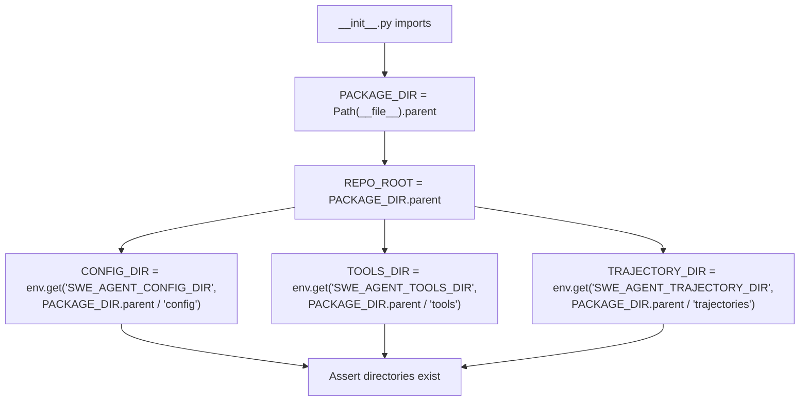

**Sources:** [sweagent/__init__.py:28-47]()

### Default Directory Structure

For editable installations, SWE-agent uses the following directory structure:

| Directory | Purpose | Default Path | Code Reference |
|-----------|---------|--------------|----------------|
| `PACKAGE_DIR` | Package source code | `<repo>/sweagent` | [sweagent/__init__.py:28]() |
| `REPO_ROOT` | Repository root | `<repo>` | [sweagent/__init__.py:38-39]() |
| `CONFIG_DIR` | Configuration files | `<repo>/config` | [sweagent/__init__.py:40-41]() |
| `TOOLS_DIR` | Tool bundles | `<repo>/tools` | [sweagent/__init__.py:43-44]() |
| `TRAJECTORY_DIR` | Execution trajectories | `<repo>/trajectories` | [sweagent/__init__.py:46-47]() |

**Sources:** [sweagent/__init__.py:28-47](), [docs/config/env.md:12-16]()

### Environment Variables for Non-Editable Installs

When installing without the `--editable` option (e.g., `pip install sweagent`), the package is installed to your Python site-packages directory. In this case, you must set environment variables to point to the correct directories:

```bash
export SWE_AGENT_CONFIG_DIR=/path/to/config
export SWE_AGENT_TOOLS_DIR=/path/to/tools
export SWE_AGENT_TRAJECTORY_DIR=/path/to/trajectories
```

These environment variables override the default paths that assume an editable installation. The package initialization checks these variables [sweagent/__init__.py:40-47]():

```python
CONFIG_DIR = Path(os.getenv("SWE_AGENT_CONFIG_DIR", PACKAGE_DIR.parent / "config"))
TOOLS_DIR = Path(os.getenv("SWE_AGENT_TOOLS_DIR", PACKAGE_DIR.parent / "tools"))
TRAJECTORY_DIR = Path(os.getenv("SWE_AGENT_TRAJECTORY_DIR", PACKAGE_DIR.parent / "trajectories"))
```

**Sources:** [docs/config/env.md:12-16](), [sweagent/__init__.py:40-47]()

## Verifying Installation

### Version Information

Check the installed version:

```bash
sweagent --version
```

This outputs version information including the SWE-agent version, commit hash, and SWE-ReX version.

### Version Retrieval Implementation

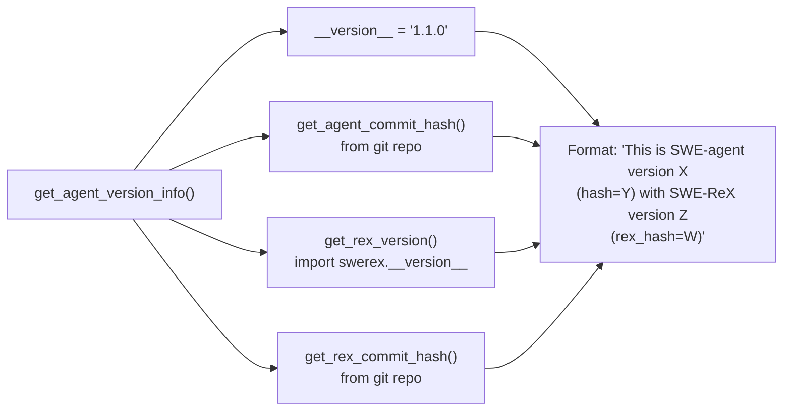

**Implementation Details:**

- `__version__` constant: [sweagent/__init__.py:15]()
- `get_agent_commit_hash()`: [sweagent/__init__.py:50-59]() - Retrieves git commit hash from the repository
- `get_rex_version()`: [sweagent/__init__.py:72-75]() - Imports SWE-ReX version
- `get_rex_commit_hash()`: [sweagent/__init__.py:62-69]() - Retrieves git commit hash of SWE-ReX installation
- `get_agent_version_info()`: [sweagent/__init__.py:78-82]() - Combines all version information

The version information is automatically logged on import [sweagent/__init__.py:105]().

**Sources:** [sweagent/__init__.py:15](), [sweagent/__init__.py:50-82](), [sweagent/__init__.py:105]()

### Dependency Verification

The package automatically verifies dependencies on import:

1. **Python Version Check**: Runs immediately at import [sweagent/__init__.py:30-35]()
2. **SWE-ReX Version Check**: Runs via `impose_rex_lower_bound()` [sweagent/__init__.py:104]()

If dependencies are not met, a `RuntimeError` is raised with instructions for resolution.

**Sources:** [sweagent/__init__.py:30-35](), [sweagent/__init__.py:85-104]()

## Troubleshooting Common Installation Issues

### Python Version Too Old

**Error Message:**
```
RuntimeError: Python 3.10 is not supported. SWE-agent requires Python 3.11 or higher.
```

**Solution:** Install Python 3.11 or higher and create a new virtual environment.

### SWE-ReX Version Too Old

**Error Message:**
```
RuntimeError: SWE-ReX version 1.1.0 is too old. Please update to at least 1.2.0 by running `pip install --upgrade swe-rex`.
```

**Solution:** Run the upgrade command:
```bash
pip install --upgrade swe-rex
```

Or reinstall SWE-agent to get the latest dependencies:
```bash
pip install -e .
```

**Sources:** [sweagent/__init__.py:85-101]()

### Missing Directories (Non-Editable Install)

**Error Message:**
```
AssertionError: /path/to/site-packages/config
```

**Solution:** Set the required environment variables to point to valid directories containing configuration files, tools, and trajectories. You can copy these from the repository:

```bash
git clone https://github.com/SWE-agent/SWE-agent.git
export SWE_AGENT_CONFIG_DIR=/path/to/SWE-agent/config
export SWE_AGENT_TOOLS_DIR=/path/to/SWE-agent/tools
export SWE_AGENT_TRAJECTORY_DIR=/path/to/SWE-agent/trajectories
```

**Sources:** [docs/config/env.md:12-16](), [sweagent/__init__.py:40-47]()

## Next Steps

After installation, proceed to:

- **[API Keys and Model Configuration](#2.2)**: Set up authentication for language model providers
- **[Basic Usage and Commands](#7.1)**: Learn how to run SWE-agent
- **[Development Setup](#9.1)**: Additional setup for contributors

**Sources:** Table of contents structure

---

# Page: API Keys and Model Configuration

# API Keys and Model Configuration

<details>
<summary>Relevant source files</summary>

The following files were used as context for generating this wiki page:

- [.devcontainer/bashrc_epilog.sh](.devcontainer/bashrc_epilog.sh)
- [docs/config/models.md](docs/config/models.md)
- [docs/installation/keys.md](docs/installation/keys.md)
- [docs/usage/hello_world.md](docs/usage/hello_world.md)
- [sweagent/agent/agents.py](sweagent/agent/agents.py)
- [sweagent/agent/models.py](sweagent/agent/models.py)
- [sweagent/agent/reviewer.py](sweagent/agent/reviewer.py)
- [sweagent/types.py](sweagent/types.py)

</details>


This page documents how SWE-agent authenticates with language model providers and configures model behavior. It covers API key management, model configuration options, cost tracking, and integration with various LM providers through litellm.

For information about specific model setup and troubleshooting, see the installation guide documentation at [docs/installation/keys.md](). For the full configuration system including how model config fits into the larger config hierarchy, see [Configuration System](#7.2).

---

## API Key Authentication

### Authentication Methods

SWE-agent supports three methods for providing API keys, evaluated in the following priority order:

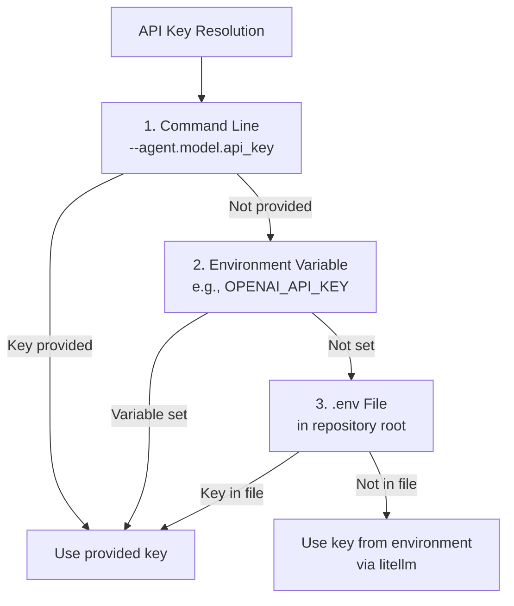

**Sources:** [sweagent/agent/models.py:66-124](), [docs/installation/keys.md:9-30]()

### API Key Configuration

The `GenericAPIModelConfig` class handles API key configuration:

| Field | Type | Description |
|-------|------|-------------|
| `api_key` | `SecretStr \| None` | API key for the model provider |
| `api_base` | `str \| None` | Base URL for API requests |
| `api_version` | `str \| None` | API version string |

**Key Features:**

1. **Environment Variable References:** Keys starting with `$` are treated as environment variable names
2. **Multiple Keys:** Concatenate keys with `:::` separator for rotation
3. **Thread-Based Selection:** When `choose_api_key_by_thread=True`, each thread consistently uses the same key

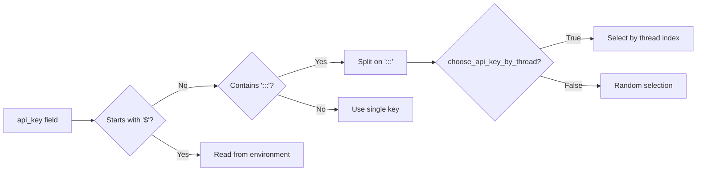

**Sources:** [sweagent/agent/models.py:85-91](), [sweagent/agent/models.py:155-190]()

### Multiple API Key Rotation

The key rotation system ensures efficient use of multiple API keys while preserving prompt caching:

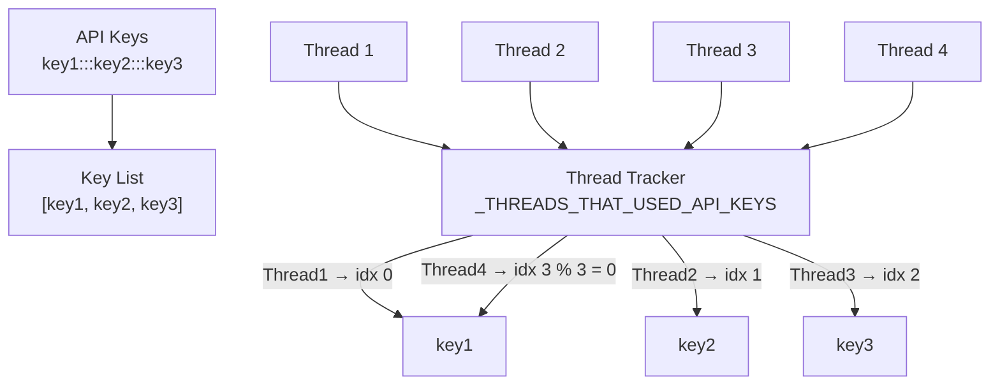

Each thread is assigned a consistent key based on its index modulo the number of available keys. This ensures that prompt caching remains effective within a single thread while distributing load across multiple keys.

**Sources:** [sweagent/agent/models.py:51-53](), [sweagent/agent/models.py:172-190]()

---

## Model Configuration Classes

### Configuration Hierarchy

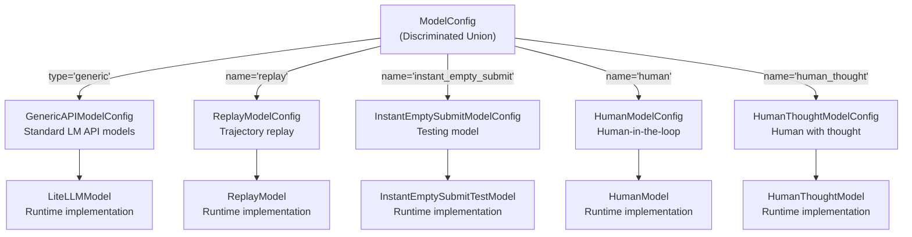

**Sources:** [sweagent/agent/models.py:263-270]()

### GenericAPIModelConfig

The primary configuration class for API-based language models:

| Field | Type | Default | Description |
|-------|------|---------|-------------|
| `name` | `str` | Required | Model identifier (e.g., `claude-sonnet-4-20250514`) |
| `temperature` | `float` | `0.0` | Sampling temperature |
| `top_p` | `float \| None` | `1.0` | Nucleus sampling parameter |
| `per_instance_cost_limit` | `float` | `3.0` | Cost limit per task ($) |
| `total_cost_limit` | `float` | `0.0` | Total cost limit across all tasks ($) |
| `per_instance_call_limit` | `int` | `0` | Maximum API calls per task |
| `api_base` | `str \| None` | `None` | API endpoint override |
| `api_version` | `str \| None` | `None` | API version string |
| `api_key` | `SecretStr \| None` | `None` | API key |
| `stop` | `list[str]` | `[]` | Custom stop sequences |
| `completion_kwargs` | `dict[str, Any]` | `{}` | Additional litellm.completion arguments |
| `convert_system_to_user` | `bool` | `False` | Convert system messages to user messages |
| `delay` | `float` | `0.0` | Minimum delay between queries (seconds) |
| `fallbacks` | `list[dict[str, Any]]` | `[]` | Fallback model configurations |
| `choose_api_key_by_thread` | `bool` | `True` | Enable thread-based key selection |
| `max_input_tokens` | `int \| None` | `None` | Override maximum input tokens |
| `max_output_tokens` | `int \| None` | `None` | Override maximum output tokens |
| `litellm_model_registry` | `str \| None` | `None` | Path to custom model registry |
| `custom_tokenizer` | `dict[str, Any] \| None` | `None` | Custom tokenizer configuration |

**Sources:** [sweagent/agent/models.py:66-153]()

### Retry Configuration

The `RetryConfig` class controls how failed API calls are retried:

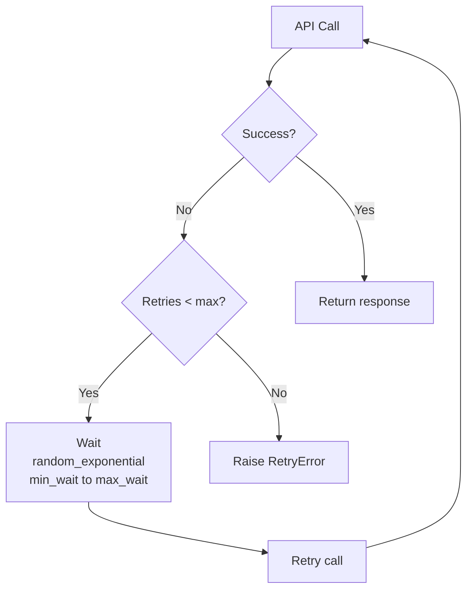

| Field | Type | Default | Description |
|-------|------|---------|-------------|
| `retries` | `int` | `20` | Maximum number of retry attempts |
| `min_wait` | `float` | `10` | Minimum wait time between retries (seconds) |
| `max_wait` | `float` | `120` | Maximum wait time between retries (seconds) |

The retry mechanism uses exponential backoff with random jitter via the `tenacity` library.

**Sources:** [sweagent/agent/models.py:55-64](), [sweagent/agent/models.py:20-26]()

---

## Cost Tracking System

### Cost Tracking Architecture

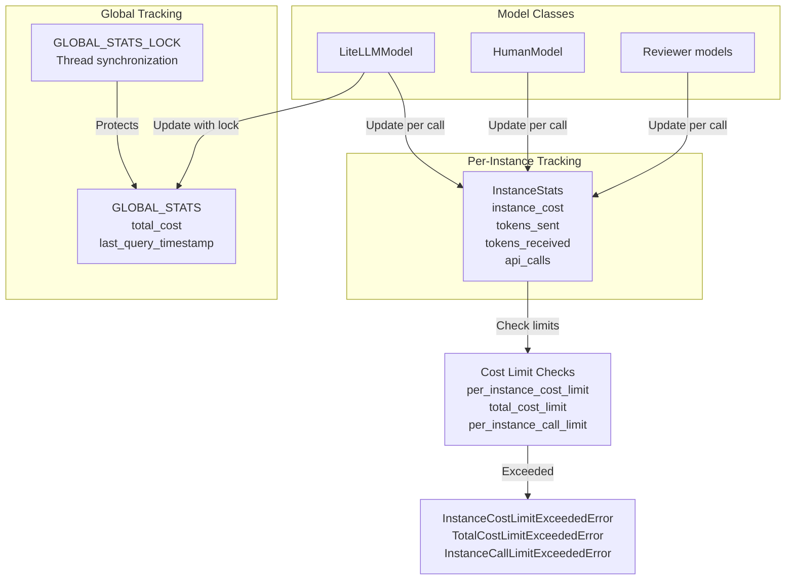

**Sources:** [sweagent/agent/models.py:273-309](), [sweagent/agent/models.py:632-671]()

### Cost Calculation Flow

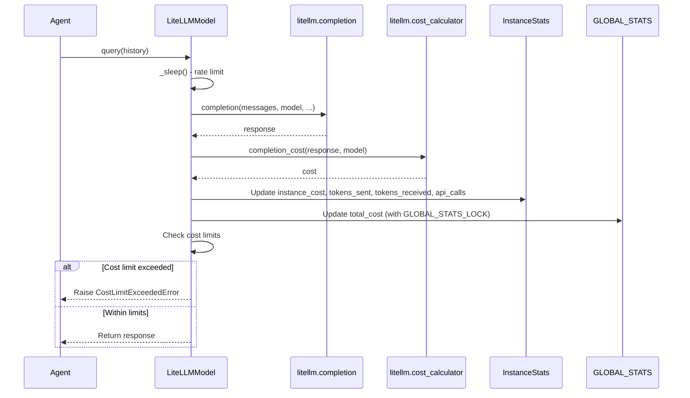

**Sources:** [sweagent/agent/models.py:632-671](), [sweagent/agent/models.py:679-774]()

### Cost Limits and Exceptions

Three types of cost limits are enforced:

1. **Per-Instance Cost Limit:** Maximum cost for a single task
2. **Total Cost Limit:** Maximum cost across all tasks
3. **Per-Instance Call Limit:** Maximum number of API calls per task

```python
# Exceptions hierarchy
CostLimitExceededError
├── InstanceCostLimitExceededError  # per_instance_cost_limit exceeded
├── TotalCostLimitExceededError     # total_cost_limit exceeded
└── InstanceCallLimitExceededError  # per_instance_call_limit exceeded
```

**Sources:** [sweagent/agent/models.py:32-38](), [sweagent/exceptions.py]()

---

## LiteLLM Integration

### Model Serving Architecture

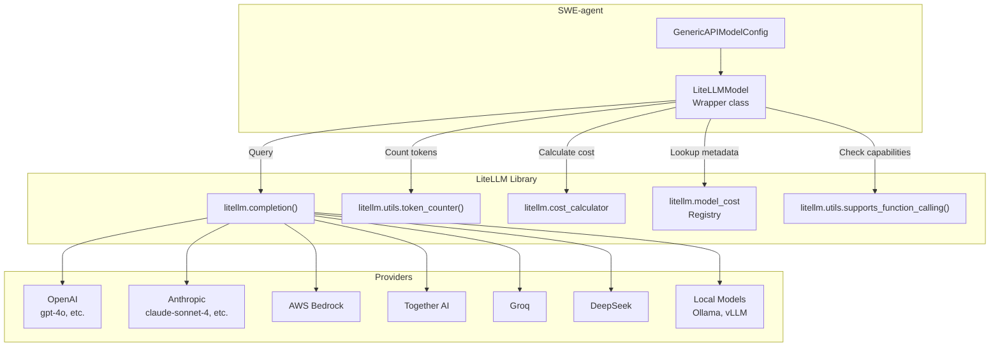

**Sources:** [sweagent/agent/models.py:578-626]()

### LiteLLMModel Implementation

The `LiteLLMModel` class wraps litellm's completion API and provides:

1. **Token Counting:** Pre-flight token counting to enforce context window limits
2. **Cost Calculation:** Automatic cost tracking via litellm's cost calculator
3. **Function Calling Support:** Detection and handling of function calling capabilities
4. **Custom Model Registries:** Support for models not in litellm's default registry

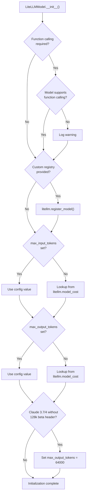

**Sources:** [sweagent/agent/models.py:578-626]()

### Custom Model Registry

For models not in litellm's default registry (local models, new models, or to override costs):

```json
{
  "ollama/llama2": {
    "max_tokens": 8192,
    "max_input_tokens": 8192,
    "max_output_tokens": 8192,
    "input_cost_per_token": 0.00002,
    "output_cost_per_token": 0.00006,
    "litellm_provider": "ollama",
    "mode": "chat"
  }
}
```

Configure in YAML:

```yaml
agent:
  model:
    litellm_model_registry: "path/to/registry.json"
```

**Sources:** [sweagent/agent/models.py:141-144](), [sweagent/agent/models.py:595-598](), [docs/config/models.md:93-131]()

---

## Query Execution Flow

### Single Query Execution

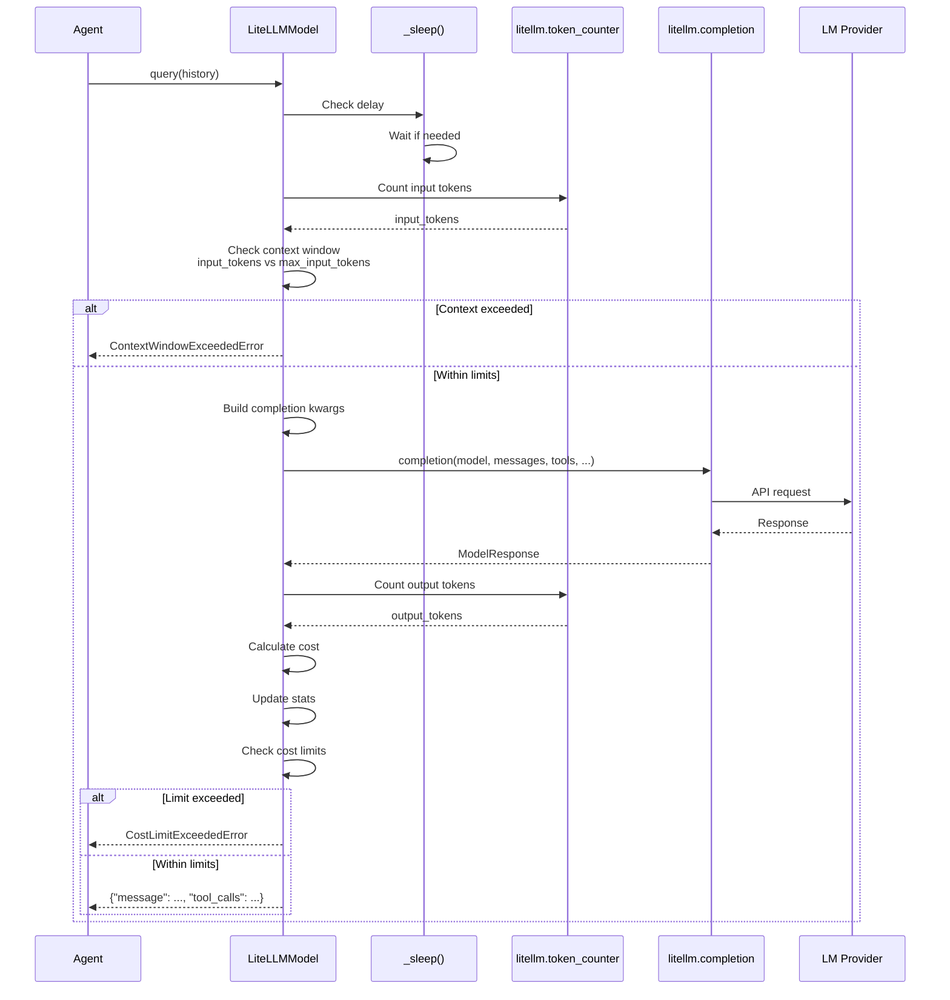

**Sources:** [sweagent/agent/models.py:679-774]()

### Retry Mechanism with Tenacity

The query execution includes automatic retry with exponential backoff:

```mermaid
graph TB
    Query["model.query(history)"]
    
    Retrying["Retrying wrapper<br/>from tenacity"]
    
    SingleQuery["_single_query()"]
    
    CheckException{"Exception type"}
    
    ContextExceeded["ContextWindowExceededError"]
    ContentPolicy["ContentPolicyViolationError"]
    Other["Other exception"]
    
    Retry{"Retry?<br/>(< max attempts)"}
    Wait["Wait<br/>random_exponential<br/>10-120 seconds"]
    
    RaiseFinal["Raise exception"]
    Success["Return response"]
    
    Query --> Retrying
    Retrying --> SingleQuery
    SingleQuery --> CheckException
    
    CheckException -->|"Context window"| ContextExceeded
    CheckException -->|"Content policy"| ContentPolicy
    CheckException -->|"Network/API"| Other
    
    ContextExceeded --> RaiseFinal
    ContentPolicy --> RaiseFinal
    Other --> Retry
    
    Retry -->|"Yes"| Wait
    Retry -->|"No"| RaiseFinal
    Wait --> SingleQuery
    
    SingleQuery -->|"Success"| Success
```

The retry logic skips certain exceptions (context window, content policy) that won't be resolved by retrying.

**Sources:** [sweagent/agent/models.py:778-819]()

---

## Token Limit Management

### Token Limit Configuration

```mermaid
graph TB
    Config["Model Configuration"]
    
    MaxInput{"max_input_tokens<br/>configured?"}
    MaxOutput{"max_output_tokens<br/>configured?"}
    
    UseInputConfig["Use configured<br/>max_input_tokens"]
    UseOutputConfig["Use configured<br/>max_output_tokens"]
    
    LookupInput["Lookup from<br/>litellm.model_cost"]
    LookupOutput["Lookup from<br/>litellm.model_cost"]
    
    ClaudeCheck{"Is Claude 3.7/4?"}
    BetaCheck{"Has 128k beta header?"}
    Set64k["Set max_output_tokens<br/>to 64000"]
    Keep128k["Keep max_output_tokens<br/>at 128000"]
    
    Config --> MaxInput
    Config --> MaxOutput
    
    MaxInput -->|"Yes"| UseInputConfig
    MaxInput -->|"No"| LookupInput
    
    MaxOutput -->|"Yes"| UseOutputConfig
    MaxOutput -->|"No"| LookupOutput
    
    LookupOutput --> ClaudeCheck
    UseOutputConfig --> ClaudeCheck
    
    ClaudeCheck -->|"Yes"| BetaCheck
    ClaudeCheck -->|"No"| Done["Configuration complete"]
    
    BetaCheck -->|"Yes"| Keep128k
    BetaCheck -->|"No"| Set64k
    
    Keep128k --> Done
    Set64k --> Done
```

Special handling for Claude 3.7/4 models: By default, these models support only 64k output tokens. To enable 128k output, the `anthropic-beta: output-128k-2025-02-19` header must be set in `completion_kwargs`.

**Sources:** [sweagent/agent/models.py:599-621]()

### Custom Tokenizer Support

For models with non-standard tokenizers:

```yaml
agent:
  model:
    custom_tokenizer:
      identifier: "hf-internal-testing/llama-tokenizer"
```

This creates a pretrained tokenizer via `litellm.utils.create_pretrained_tokenizer()` used for accurate token counting.

**Sources:** [sweagent/agent/models.py:146-150](), [sweagent/agent/models.py:623-625]()

---

## Testing and Special Models

### Testing Model Types

```mermaid
graph TB
    AbstractModel["AbstractModel<br/>Base interface"]
    
    LiteLLM["LiteLLMModel<br/>Production model"]
    Human["HumanModel<br/>Human-in-the-loop"]
    HumanThought["HumanThoughtModel<br/>Human with thought"]
    Replay["ReplayModel<br/>Replay trajectories"]
    Submit["InstantEmptySubmitTestModel<br/>Quick submission test"]
    Predetermined["PredeterminedTestModel<br/>Scripted responses"]
    
    AbstractModel --> LiteLLM
    AbstractModel --> Human
    AbstractModel --> HumanThought
    AbstractModel --> Replay
    AbstractModel --> Submit
    AbstractModel --> Predetermined
```

**Sources:** [sweagent/agent/models.py:311-327]()

### HumanModel

Prompts user for input at each step:

- Supports multi-line commands with end keywords
- Saves/loads readline history for autocomplete
- Can simulate cost by using `spend_money` command
- Special `raise_*` commands for testing error handling

**Sources:** [sweagent/agent/models.py:344-443]()

### ReplayModel

Replays actions from a trajectory file:

- Loads actions from `.traj` file
- Steps through actions sequentially
- Handles both string and dict action formats
- Auto-submits if trajectory ends prematurely

**Sources:** [sweagent/agent/models.py:464-527]()

### InstantEmptySubmitTestModel

Creates minimal reproduction file and immediately submits:

- Useful for testing infrastructure
- Creates `reproduce.py` file
- Submits after 2 actions
- Configurable delay for timing tests

**Sources:** [sweagent/agent/models.py:551-576]()

---

## Model Integration with Agents

### Model Initialization in Agents

```mermaid
graph TB
    AgentConfig["DefaultAgentConfig"]
    ModelConfig["ModelConfig"]
    ToolConfig["ToolConfig"]
    
    GetModel["get_model()<br/>Factory function"]
    
    CheckType{"Model type?"}
    
    LiteLLM["Create LiteLLMModel"]
    Human["Create HumanModel"]
    Replay["Create ReplayModel"]
    Submit["Create InstantEmptySubmitTestModel"]
    
    SpecialCheck{"Is HumanThoughtModel?"}
    SetThoughtParser["Set ThoughtActionParser"]
    
    IsHumanCheck{"Is HumanModel?"}
    SetActionParser["Set ActionOnlyParser"]
    
    Agent["DefaultAgent<br/>with model instance"]
    
    AgentConfig --> ModelConfig
    AgentConfig --> ToolConfig
    
    ModelConfig --> GetModel
    ToolConfig --> GetModel
    
    GetModel --> CheckType
    
    CheckType -->|"generic"| LiteLLM
    CheckType -->|"human"| Human
    CheckType -->|"replay"| Replay
    CheckType -->|"instant_empty_submit"| Submit
    
    LiteLLM --> Agent
    Human --> SpecialCheck
    Replay --> Agent
    Submit --> Agent
    
    SpecialCheck -->|"Yes"| SetThoughtParser
    SpecialCheck -->|"No"| IsHumanCheck
    
    SetThoughtParser --> Agent
    
    IsHumanCheck -->|"Yes"| SetActionParser
    IsHumanCheck -->|"No"| Agent
    
    SetActionParser --> Agent
```

**Sources:** [sweagent/agent/agents.py:501-514](), [sweagent/agent/models.py:467-470]()

### Model Usage in Reviewer

Reviewers use separate model instances for scoring solutions:

```mermaid
graph TB
    RetryLoopConfig["ScoreRetryLoopConfig"]
    ReviewerConfig["ReviewerConfig"]
    ModelConfig["model: ModelConfig"]
    
    RetryLoop["ScoreRetryLoop"]
    GetModel["get_model()"]
    ReviewerModel["Separate model instance"]
    Reviewer["Reviewer"]
    
    InstanceStats1["Agent model stats"]
    InstanceStats2["Reviewer model stats"]
    TotalStats["Combined stats<br/>for cost limits"]
    
    RetryLoopConfig --> ModelConfig
    RetryLoopConfig --> ReviewerConfig
    
    RetryLoopConfig --> RetryLoop
    ModelConfig --> GetModel
    GetModel --> ReviewerModel
    ReviewerModel --> Reviewer
    RetryLoop --> Reviewer
    
    ReviewerModel --> InstanceStats2
    InstanceStats1 --> TotalStats
    InstanceStats2 --> TotalStats
```

The reviewer's model costs are tracked separately but combined with agent costs for total cost limit checks.

**Sources:** [sweagent/agent/reviewer.py:559-568]()

---

## Advanced Configuration Options

### Completion Kwargs

The `completion_kwargs` field allows passing arbitrary arguments to `litellm.completion()`:

```yaml
agent:
  model:
    completion_kwargs:
      extra_headers:
        anthropic-beta: "output-128k-2025-02-19"
      reasoning_effort: "high"
      stream: false
```

**Sources:** [sweagent/agent/models.py:95-96](), [sweagent/agent/models.py:711-724]()

### Fallback Models

Configure fallback models for automatic failover:

```yaml
agent:
  model:
    name: "gpt-4o"
    fallbacks:
      - model: "gpt-4o-mini"
        context_window_fallbacks: [{"model": "gpt-4-turbo"}]
```

Follows litellm's fallback format.

**Sources:** [sweagent/agent/models.py:113-117](), [sweagent/agent/models.py:722]()

### Convert System Messages

Some models (e.g., o1) don't support system messages:

```yaml
agent:
  model:
    convert_system_to_user: true
```

This flag converts system messages to user messages before sending to the model.

**Sources:** [sweagent/agent/models.py:98-101]()

### Rate Limiting

Control request rate with delay:

```yaml
agent:
  model:
    delay: 2.0  # Minimum 2 seconds between requests
```

Uses `GLOBAL_STATS.last_query_timestamp` to enforce delays across all model instances.

**Sources:** [sweagent/agent/models.py:108-111](), [sweagent/agent/models.py:672-677]()

---

# Page: Agent Framework

# Agent Framework

<details>
<summary>Relevant source files</summary>

The following files were used as context for generating this wiki page:

- [sweagent/agent/agents.py](sweagent/agent/agents.py)
- [sweagent/agent/models.py](sweagent/agent/models.py)
- [sweagent/agent/reviewer.py](sweagent/agent/reviewer.py)
- [sweagent/types.py](sweagent/types.py)

</details>


The Agent Framework is the core decision-making layer of SWE-agent that orchestrates problem-solving behavior. It defines how agents interact with language models to generate actions, execute those actions in environments, maintain conversational context, and iterate toward solutions. This page covers the agent architecture, model abstraction, execution flow, and retry mechanisms.

For information about the environment where agents execute commands, see [Environment System](#4). For details on the tools and actions available to agents, see [Tool System](#6). For orchestration of agent runs across multiple instances, see [Execution and Run System](#5).

---

## Core Agent Architecture

The agent system is built around a class hierarchy that separates concerns between basic problem-solving (`DefaultAgent`) and meta-orchestration (`RetryAgent`).

### Agent Class Hierarchy

```mermaid
classDiagram
    class AbstractAgent {
        <<interface>>
        +from_config(config)
        +add_hook(hook)
        +get_trajectory_data()
        +step()
        +run()
        +model: AbstractModel
        +logger: Logger
    }
    
    class DefaultAgent {
        +templates: TemplateConfig
        +tools: ToolHandler
        +model: AbstractModel
        +history: History
        +trajectory: Trajectory
        +info: AgentInfo
        +setup(env, problem_statement)
        +step() StepOutput
        +run() AgentRunResult
        +forward(history)
        +forward_with_handling(history)
        +handle_action(step)
        +handle_submission(step)
    }
    
    class RetryAgent {
        +config: RetryAgentConfig
        +_agent: DefaultAgent
        +_rloop: AbstractRetryLoop
        +_attempt_data: list
        +setup(env, problem_statement)
        +step() StepOutput
        +run() AgentRunResult
        -_setup_agent()
        -_next_attempt()
        -_finalize_agent_run()
    }
    
    class ShellAgent {
        +Specialized agent for shell tasks
    }
    
    AbstractAgent <|-- DefaultAgent
    AbstractAgent <|-- RetryAgent
    AbstractAgent <|-- ShellAgent
    
    RetryAgent *-- DefaultAgent : manages
    RetryAgent *-- AbstractRetryLoop : uses
```

**Sources:** [sweagent/agent/agents.py:224-255]()

### DefaultAgent: The Core Problem-Solving Agent

`DefaultAgent` implements the primary agent logic. It maintains conversation history, generates actions via language models, executes those actions in the environment, and tracks the solution trajectory.

**Key Attributes:**

| Attribute | Type | Purpose |
|-----------|------|---------|
| `templates` | `TemplateConfig` | Jinja2 templates for system messages, instance prompts, observations |
| `tools` | `ToolHandler` | Manages available commands and action parsing |
| `model` | `AbstractModel` | Language model for generating actions |
| `history` | `History` | Full conversational context (list of `HistoryItem`) |
| `trajectory` | `Trajectory` | Action-observation pairs (list of `TrajectoryStep`) |
| `info` | `AgentInfo` | Metadata about the run (costs, exit status, submission) |

**Sources:** [sweagent/agent/agents.py:443-500]()

### RetryAgent: Multi-Attempt Orchestration

`RetryAgent` wraps around `DefaultAgent` to enable multiple solution attempts with evaluation and selection. It manages the retry loop, tracks costs across attempts, and selects the best solution using a review mechanism.

**Architecture:**

```mermaid
graph TB
    RetryAgent["RetryAgent"]
    
    subgraph "Attempt Management"
        Setup["setup()<br/>Initialize problem"]
        CreateAgent["_setup_agent()<br/>Create DefaultAgent"]
        StepAgent["step()<br/>Execute agent step"]
        Finalize["_finalize_agent_run()<br/>Save results"]
        NextAttempt["_next_attempt()<br/>Reset & retry"]
    end
    
    subgraph "Selection"
        Loop["AbstractRetryLoop<br/>(ScoreRetryLoop or ChooserRetryLoop)"]
        OnSubmit["on_submit()<br/>Process submission"]
        Retry["retry()<br/>Decision: continue?"]
        GetBest["get_best()<br/>Select best attempt"]
    end
    
    RetryAgent --> Setup
    Setup --> CreateAgent
    CreateAgent --> StepAgent
    StepAgent --> Finalize
    Finalize --> OnSubmit
    OnSubmit --> Retry
    Retry -->|Yes| NextAttempt
    NextAttempt --> CreateAgent
    Retry -->|No| GetBest
```

**Sources:** [sweagent/agent/agents.py:257-441]()

### Agent Configuration

Agents are configured via pydantic models that define their behavior, model selection, templates, and tools.

```mermaid
classDiagram
    class AgentConfig {
        <<union>>
    }
    
    class DefaultAgentConfig {
        +name: str
        +templates: TemplateConfig
        +tools: ToolConfig
        +model: ModelConfig
        +history_processors: list
        +max_requeries: int
        +action_sampler: ActionSamplerConfig
        +type: "default"
    }
    
    class RetryAgentConfig {
        +name: str
        +agent_configs: list[DefaultAgentConfig]
        +retry_loop: RetryLoopConfig
        +type: "retry"
    }
    
    class ShellAgentConfig {
        +name: str
        +templates: TemplateConfig
        +tools: ToolConfig
        +model: ModelConfig
        +type: "shell"
    }
    
    AgentConfig <|-- DefaultAgentConfig
    AgentConfig <|-- RetryAgentConfig
    AgentConfig <|-- ShellAgentConfig
```

**Sources:** [sweagent/agent/agents.py:149-196]()

---

## Agent Lifecycle and Execution Flow

The agent follows a structured lifecycle from initialization through problem-solving to completion.

### Agent Lifecycle Phases

```mermaid
stateDiagram-v2
    [*] --> Created: from_config()
    
    Created --> Setup: setup(env, problem_statement)
    
    state Setup {
        [*] --> InstallTools: tools.install(env)
        InstallTools --> AddSystemMsg: add_system_message_to_history()
        AddSystemMsg --> AddDemos: add_demonstrations_to_history()
        AddDemos --> AddInstance: add_instance_template_to_history()
        AddInstance --> [*]
    }
    
    Setup --> StepLoop: run()
    
    state StepLoop {
        [*] --> Forward: step()
        Forward --> Query: forward() -> model.query()
        Query --> Parse: tools.parse_actions()
        Parse --> Execute: handle_action()
        Execute --> Observe: env.communicate()
        Observe --> UpdateHistory: add_step_to_history()
        UpdateHistory --> CheckDone
        CheckDone --> [*]: done=True
        CheckDone --> Forward: done=False
    }
    
    StepLoop --> SaveTrajectory: save_trajectory()
    SaveTrajectory --> [*]
```

**Sources:** [sweagent/agent/agents.py:561-606](), [sweagent/agent/agents.py:1157-1198]()

### The Step Method: Core Execution Loop

The `step()` method is the heart of agent execution. Each step queries the model, parses actions, executes them, and updates the history.

**Execution Flow:**

1. **Query Model:** Call `forward_with_handling()` which invokes `model.query(history)`
2. **Parse Actions:** Extract thought and action from model output via `tools.parse_actions()`
3. **Execute Action:** Run command in environment via `handle_action()` → `env.communicate()`
4. **Handle Submission:** Check if action was a submit command via `handle_submission()`
5. **Update State:** Add step to history and trajectory, collect execution statistics

**Sources:** [sweagent/agent/agents.py:1157-1198](), [sweagent/agent/agents.py:1006-1060]()

### Error Handling and Requeries

The agent includes sophisticated error handling with automatic recovery:

```mermaid
graph TB
    Forward["forward_with_handling(history)"]
    TryForward["Try: forward(history)"]
    
    Success["Success: Return StepOutput"]
    
    FormatError["FormatError<br/>(malformed output)"]
    BlockedError["_BlockedActionError<br/>(blocked command)"]
    BashError["BashIncorrectSyntaxError"]
    RetryWith["_RetryWithOutput"]
    RetryWithout["_RetryWithoutOutput"]
    
    Requery["Requery model with error"]
    AddToTraj["Add error step to trajectory"]
    
    Forward --> TryForward
    TryForward -->|Success| Success
    TryForward -->|Exception| FormatError
    TryForward -->|Exception| BlockedError
    TryForward -->|Exception| BashError
    TryForward -->|Exception| RetryWith
    TryForward -->|Exception| RetryWithout
    
    FormatError --> Requery
    BlockedError --> Requery
    BashError --> Requery
    RetryWith --> Requery
    RetryWithout --> AddToTraj
    
    Requery --> TryForward
    AddToTraj --> TryForward
```

The agent will requery up to `max_requeries` times (default 3) when encountering recoverable errors.

**Sources:** [sweagent/agent/agents.py:1062-1155]()

---

## Model Abstraction Layer

The model abstraction decouples agent logic from specific language model implementations, enabling support for multiple providers and interaction modes.

### Model Class Hierarchy

```mermaid
classDiagram
    class AbstractModel {
        <<interface>>
        +config: ModelConfig
        +stats: InstanceStats
        +query(history) dict
        +reset_stats()
        +instance_cost_limit float
    }
    
    class LiteLLMModel {
        +config: GenericAPIModelConfig
        +tools: ToolConfig
        +model_max_input_tokens: int
        +model_max_output_tokens: int
        +custom_tokenizer
        +query(history, n, temperature)
        -_single_query(messages)
        -_history_to_messages(history)
        -_update_stats()
        -_sleep()
    }
    
    class HumanModel {
        +config: HumanModelConfig
        +multi_line_command_endings: dict
        +query(history, action_prompt)
        -_query(history, action_prompt)
        -_update_stats()
    }
    
    class HumanThoughtModel {
        +query(history)
    }
    
    class ReplayModel {
        +config: ReplayModelConfig
        +_replays: list
        +_replay_idx: int
        +_action_idx: int
        +query(history)
        -_next_replay()
    }
    
    class InstantEmptySubmitTestModel {
        +config: InstantEmptySubmitModelConfig
        +query(history)
    }
    
    class PredeterminedTestModel {
        +_outputs: list
        +_idx: int
        +query()
    }
    
    AbstractModel <|-- LiteLLMModel
    AbstractModel <|-- HumanModel
    HumanModel <|-- HumanThoughtModel
    AbstractModel <|-- ReplayModel
    AbstractModel <|-- InstantEmptySubmitTestModel
    AbstractModel <|-- PredeterminedTestModel
```

**Sources:** [sweagent/agent/models.py:311-327](), [sweagent/agent/models.py:578-866]()

### LiteLLMModel: API-Based Language Models

`LiteLLMModel` provides unified access to 100+ language model providers via the `litellm` library. It handles API calls, cost tracking, retry logic, and context window management.

**Key Features:**

| Feature | Implementation |
|---------|----------------|
| **Provider Support** | OpenAI, Anthropic, AWS Bedrock, Together, Groq, DeepSeek, Ollama, etc. |
| **Cost Tracking** | Token counting, per-instance and total cost limits |
| **Retry Logic** | Exponential backoff for rate limits, configurable retry attempts |
| **Context Window** | Automatic detection of model limits, raises `ContextWindowExceededError` |
| **Function Calling** | Native support for tool/function calling APIs |
| **Caching** | Support for prompt caching (e.g., Anthropic's cache control) |
| **Custom Tokenizers** | Override default tokenizers for local/custom models |

**Sources:** [sweagent/agent/models.py:578-866]()

### Model Configuration

```mermaid
classDiagram
    class ModelConfig {
        <<union>>
    }
    
    class GenericAPIModelConfig {
        +name: str
        +temperature: float
        +top_p: float
        +api_key: SecretStr
        +api_base: str
        +per_instance_cost_limit: float
        +total_cost_limit: float
        +per_instance_call_limit: int
        +retry: RetryConfig
        +delay: float
        +fallbacks: list
        +max_input_tokens: int
        +max_output_tokens: int
        +completion_kwargs: dict
    }
    
    class HumanModelConfig {
        +name: "human"
        +cost_per_call: float
        +catch_eof: bool
    }
    
    class ReplayModelConfig {
        +name: "replay"
        +replay_path: Path
    }
    
    class InstantEmptySubmitModelConfig {
        +name: "instant_empty_submit"
        +delay: float
    }
    
    ModelConfig <|-- GenericAPIModelConfig
    ModelConfig <|-- HumanModelConfig
    ModelConfig <|-- ReplayModelConfig
    ModelConfig <|-- InstantEmptySubmitModelConfig
```

**Sources:** [sweagent/agent/models.py:66-270]()

### Special Model Types

**HumanModel:** Allows human-in-the-loop interaction. Prompts user for actions via `input()`, supports multiline commands, saves readline history.

**HumanThoughtModel:** Extends `HumanModel` to explicitly separate thought and action input, useful for testing thought-action parsing.

**ReplayModel:** Replays actions from a `.traj` file, used for trajectory replay and debugging.

**InstantEmptySubmitTestModel:** Immediately creates a trivial file and submits, used for testing infrastructure.

**PredeterminedTestModel:** Outputs a predetermined sequence of messages, used for unit testing.

**Sources:** [sweagent/agent/models.py:344-576]()

---

## History and Trajectory Management

The agent maintains two parallel data structures to track execution: **History** (conversational messages) and **Trajectory** (action-observation pairs).

### History vs Trajectory

```mermaid
graph LR
    subgraph "History: Conversational Context"
        H1["HistoryItem<br/>role: system<br/>content: system prompt"]
        H2["HistoryItem<br/>role: user<br/>content: problem statement"]
        H3["HistoryItem<br/>role: assistant<br/>content: thought + action<br/>tool_calls: [...]"]
        H4["HistoryItem<br/>role: tool<br/>content: observation<br/>tool_call_ids: [...]"]
        H1 --> H2 --> H3 --> H4
    end
    
    subgraph "Trajectory: Action-Observation Pairs"
        T1["TrajectoryStep<br/>action: command<br/>observation: output<br/>thought: reasoning<br/>state: env state"]
        T2["TrajectoryStep<br/>action: command<br/>observation: output"]
        T1 --> T2
    end
    
    H3 -.->|Extracted from| T1
    H4 -.->|Extracted from| T1
```

**History (`History`):** A list of `HistoryItem` objects representing the full conversational context. Each item has a `role` (system/user/assistant/tool), `content`, and optional metadata like `tool_calls`, `thinking_blocks`, `cache_control`. This is what gets sent to the language model.

**Trajectory (`Trajectory`):** A list of `TrajectoryStep` objects capturing action-observation pairs. Each step includes the `action` executed, `observation` received, `thought` generated, environment `state`, and execution metadata. This is what gets saved for analysis and replay.

**Sources:** [sweagent/types.py:44-78]()

### HistoryItem Structure

```python
class HistoryItem(TypedDict):
    role: str  # "system", "user", "assistant", "tool"
    content: str | list[dict[str, Any]]
    message_type: Literal["thought", "action", "observation"]
    
    # Optional fields:
    agent: str  # Agent name for multi-agent scenarios
    is_demo: bool  # Marks demonstration messages
    thought: str
    action: str
    tool_calls: list[dict]  # For function calling
    tool_call_ids: list[str]  # Links tool results to calls
    cache_control: dict  # Prompt caching metadata
    thinking_blocks: list[dict]  # Extended thinking (e.g., o1)
```

**Sources:** [sweagent/types.py:56-75]()

### TrajectoryStep Structure

```python
class TrajectoryStep(TypedDict):
    action: str  # Command executed
    observation: str  # Output received
    response: str  # Raw model output
    state: dict[str, str]  # Environment state (working_dir, open_file, etc.)
    thought: str  # Model reasoning
    execution_time: float  # Command execution time
    query: list[dict]  # Full query sent to model
    extra_info: dict  # Additional metadata
```

**Sources:** [sweagent/types.py:44-53]()

### History Processors

History processors modify the conversational history before sending it to the model. They enable features like prompt caching and context filtering.

```mermaid
graph LR
    RawHistory["Raw History<br/>(all messages)"]
    Filter["Filter by agent name"]
    Proc1["HistoryProcessor 1"]
    Proc2["HistoryProcessor 2"]
    ProcN["HistoryProcessor N"]
    FinalHistory["Processed History<br/>(sent to model)"]
    
    RawHistory --> Filter
    Filter --> Proc1
    Proc1 --> Proc2
    Proc2 --> ProcN
    ProcN --> FinalHistory
```

**DefaultHistoryProcessor:** Adds Anthropic cache control markers to enable prompt caching, reducing costs for repeated context.

**Sources:** [sweagent/agent/agents.py:540-551](), [sweagent/agent/history_processors.py]()

---

## Retry and Review System

The retry system enables agents to make multiple solution attempts and select the best one based on automated evaluation.

### Retry Loop Architecture

```mermaid
graph TB
    subgraph "AbstractRetryLoop Interface"
        OnSubmit["on_submit(submission)<br/>Called after each attempt"]
        Retry["retry() → bool<br/>Decide if should retry"]
        GetBest["get_best() → int<br/>Select best attempt"]
    end
    
    subgraph "ScoreRetryLoop"
        Reviewer["Reviewer<br/>Scores each submission"]
        CheckScore["Check if score ≥ accept_score"]
        CheckBudget["Check remaining budget"]
        ScoreGetBest["Return attempt with highest score"]
    end
    
    subgraph "ChooserRetryLoop"
        Preselector["Preselector (optional)<br/>Filter to top K candidates"]
        Chooser["Chooser<br/>Select best from candidates"]
        ChooserGetBest["Return chosen attempt"]
    end
    
    OnSubmit --> Reviewer
    Reviewer --> CheckScore
    CheckScore --> Retry
    CheckBudget --> Retry
    Retry -->|No| ScoreGetBest
    
    OnSubmit -.-> Preselector
    Preselector -.-> Chooser
    Retry -.->|No| ChooserGetBest
```

**Sources:** [sweagent/agent/reviewer.py:91-123]()

### ScoreRetryLoop: Score-Based Selection

`ScoreRetryLoop` uses an LM-based reviewer to score each submission. The agent retries until a submission scores above `accept_score` or budget/attempt limits are reached.

**Configuration:**

| Parameter | Purpose |
|-----------|---------|
| `reviewer_config` | Configuration for the reviewer model and templates |
| `accept_score` | Minimum score to accept a submission |
| `max_accepts` | Maximum number of accepted submissions before stopping |
| `max_attempts` | Maximum number of total attempts |
| `cost_limit` | Total budget for all attempts + reviews (excluding final review) |
| `min_budget_for_new_attempt` | Minimum remaining budget to start a new attempt |

**Reviewer Operation:**

1. **Format Messages:** Combine problem statement, submission, and trajectory into reviewer prompt
2. **Sample Scores:** Query reviewer model `n_sample` times (default 5) for score averaging
3. **Interpret Scores:** Extract numerical score from model responses, validate against `score_range`
4. **Apply Penalties:** Subtract `failure_score_penalty` if submission didn't properly exit
5. **Reduce by Std:** Optionally subtract `reduce_by_std * std` to penalize inconsistent scores

**Sources:** [sweagent/agent/reviewer.py:200-235](), [sweagent/agent/reviewer.py:559-659]()

### ChooserRetryLoop: LM-Based Selection

`ChooserRetryLoop` defers selection to the end. After all attempts, a chooser LM compares submissions and selects the best one.

**Architecture:**

```mermaid
sequenceDiagram
    participant RL as ChooserRetryLoop
    participant PS as Preselector
    participant CH as Chooser
    
    Note over RL: All attempts completed
    RL->>RL: Filter to only "submitted" attempts<br/>(if ≥2 exist)
    
    alt Has Preselector & >2 candidates
        RL->>PS: choose(problem, candidates)
        PS->>PS: Format all submissions
        PS->>PS: Query model for top indices
        PS-->>RL: Top K indices
    end
    
    RL->>CH: choose(problem, filtered_candidates)
    CH->>CH: Format selected submissions
    CH->>CH: Query model for best index
    CH-->>RL: Chosen index
    
    RL->>RL: Return chosen attempt
```

**Chooser Prompting:** The chooser receives formatted submissions (including patches) and must output the index of the best solution. Regex extracts the last number from the response.

**Preselector (Optional):** Pre-filters candidates before the chooser to reduce context length and costs when many attempts exist.

**Sources:** [sweagent/agent/reviewer.py:180-198](), [sweagent/agent/reviewer.py:499-556]()

### Reviewer Configuration

**TrajFormatterConfig:** Controls how trajectories are formatted in reviewer prompts.

| Parameter | Purpose |
|-----------|---------|
| `filter` | List of action prefixes to exclude from trajectory (e.g., `["find"]`) |
| `output_filter` | List of actions whose outputs should be hidden |
| `item_template` | Jinja2 template for formatting each trajectory step |
| `only_show_last_n_output` | Only show observation for last N steps |

**ReviewerConfig:** Defines the reviewer model and scoring behavior.

| Parameter | Purpose |
|-----------|---------|
| `system_template` | System prompt for reviewer |
| `instance_template` | Template for formatting problem + submission |
| `failure_score_penalty` | Score penalty for submissions that exit abnormally |
| `n_sample` | Number of times to query reviewer for score averaging |
| `reduce_by_std` | Multiplier for standard deviation penalty |
| `score_range` | Expected score range for validation |

**Sources:** [sweagent/agent/reviewer.py:145-178]()

---

## Template System

Agents use Jinja2 templates to format messages sent to language models. Templates enable dynamic content injection and consistent formatting.

### TemplateConfig

```mermaid
classDiagram
    class TemplateConfig {
        +system_template: str
        +instance_template: str
        +next_step_template: str
        +next_step_truncated_observation_template: str
        +next_step_no_output_template: str
        +strategy_template: str
        +demonstration_template: str
        +demonstrations: list[Path]
        +put_demos_in_history: bool
        +shell_check_error_template: str
        +command_cancelled_timeout_template: str
        +max_observation_length: int
        +disable_image_processing: bool
    }
```

**Key Templates:**

| Template | Purpose | Variables |
|----------|---------|-----------|
| `system_template` | Agent's system message | `command_docs`, `problem_statement`, `repo`, env variables |
| `instance_template` | Problem statement presentation | `problem_statement`, `repo`, extra fields from problem statement |
| `next_step_template` | Format observation after action | `observation`, environment state variables |
| `next_step_truncated_observation_template` | Format truncated observations | `observation`, `max_observation_length`, `elided_chars` |
| `shell_check_error_template` | Bash syntax error message | `bash_stdout`, `bash_stderr` |
| `command_cancelled_timeout_template` | Command timeout message | `command`, `timeout` |

**Sources:** [sweagent/agent/agents.py:60-147]()

### Template Rendering

Templates are rendered using `Template(template_str).render(**format_dict)` where `format_dict` includes:

```python
format_dict = {
    "command_docs": self.tools.config.command_docs,
    **self.tools.config.env_variables,
    "problem_statement": problem_statement.get_problem_statement(),
    "repo": env.repo.repo_name,
    **problem_statement.get_extra_fields(),
    # Plus any additional kwargs passed to the rendering method
}
```

**Sources:** [sweagent/agent/agents.py:658-673]()

### Demonstrations

Demonstrations are example trajectories that can be added to agent history to provide few-shot learning.

**Two modes:**

1. **Single Message:** All demo steps concatenated into one user message (uses `demonstration_template`)
2. **In History:** Each demo step added as separate history item (uses `put_demos_in_history=True`)

**Demo Format:** `.yaml` or `.json` files containing a `history` field with `HistoryItem` objects.

**Sources:** [sweagent/agent/agents.py:617-656]()

---

## Integration Points

### Agent-Model-Environment Interaction Flow

```mermaid
sequenceDiagram
    participant A as DefaultAgent
    participant M as AbstractModel
    participant T as ToolHandler
    participant E as SWEEnv
    
    A->>A: step()
    A->>A: forward_with_handling(history)
    A->>M: query(history)
    M->>M: _history_to_messages()
    M->>M: litellm.completion()
    M-->>A: output with message/tool_calls
    
    A->>T: parse_actions(output)
    T->>T: apply ParseFunction
    T-->>A: (thought, action)
    
    A->>T: should_block_action(action)?
    T-->>A: False
    
    A->>T: guard_multiline_input(action)
    T-->>A: guarded_action
    
    A->>E: communicate(guarded_action)
    E->>E: Execute in SWE-ReX runtime
    E-->>A: observation
    
    A->>T: get_state(env)
    T->>E: Query file/dir state
    E-->>T: state dict
    T-->>A: state
    
    A->>A: handle_submission(step)
    A->>T: check_for_submission_cmd()
    T-->>A: is_submission
    
    alt is_submission
        A->>E: read_file("/root/model.patch")
        E-->>A: patch content
        A->>A: step.submission = patch
        A->>A: step.done = True
    end
    
    A->>A: add_step_to_history(step)
    A-->>A: StepOutput
```

**Sources:** [sweagent/agent/agents.py:1157-1198](), [sweagent/agent/agents.py:936-1004]()

### Factory Functions

```python
# Get agent from config
def get_agent_from_config(config: AgentConfig) -> AbstractAgent:
    if config.type == "default":
        return DefaultAgent.from_config(config)
    elif config.type == "retry":
        return RetryAgent.from_config(config)
    elif config.type == "shell":
        return ShellAgent.from_config(config)
```

```python
# Get model from config
def get_model(args: ModelConfig, tools: ToolConfig) -> AbstractModel:
    if args.name == "human":
        return HumanModel(args, tools)
    elif args.name == "replay":
        return ReplayModel(args, tools)
    elif args.name == "instant_empty_submit":
        return InstantEmptySubmitTestModel(args, tools)
    else:
        return LiteLLMModel(args, tools)
```

**Sources:** [sweagent/agent/agents.py:242-255](), [sweagent/agent/models.py:868-896]()

---

## Statistics and Cost Tracking

### InstanceStats

Tracks resource usage for a single problem instance:

```python
class InstanceStats(BaseModel):
    instance_cost: float = 0  # $ spent on this instance
    tokens_sent: int = 0      # Total input tokens
    tokens_received: int = 0  # Total output tokens
    api_calls: int = 0        # Number of API calls
```

**Operations:** Supports `+` and `-` operators for combining/comparing stats across attempts.

**Sources:** [sweagent/agent/models.py:292-309]()

### GlobalStats

Tracks aggregate usage across all instances:

```python
class GlobalStats(BaseModel):
    total_cost: float = 0  # Cumulative cost
    last_query_timestamp: float = 0  # For rate limiting
```

**Thread Safety:** Access via `GLOBAL_STATS_LOCK` to prevent race conditions in batch runs.

**Sources:** [sweagent/agent/models.py:273-290]()

### Cost Limit Enforcement

Cost limits are checked at multiple points:

1. **Before Query:** `LiteLLMModel._update_stats()` checks after each API call
2. **During Retry:** `RetryAgent.step()` checks total cost before each step
3. **Retry Loop:** `ScoreRetryLoop.retry()` and `ChooserRetryLoop.retry()` check remaining budget

**Exceptions:**
- `InstanceCostLimitExceededError`: Per-instance limit reached
- `TotalCostLimitExceededError`: Total limit reached (stops all execution)

**Sources:** [sweagent/agent/models.py:632-671]()

---

## Agent Hooks

Hooks enable observation and modification of agent behavior at specific lifecycle points.

```mermaid
graph TB
    OnInit["on_init(agent)<br/>Agent created"]
    OnToolsInstall["on_tools_installation_started()<br/>Before tool install"]
    OnSetup["on_setup_attempt()<br/>After setup"]
    OnSetupDone["on_setup_done()<br/>Setup complete"]
    OnRunStart["on_run_start()<br/>Run begins"]
    OnQuery["on_model_query(messages)<br/>Before model query"]
    OnActions["on_actions_generated(step)<br/>After parsing"]
    OnActionStart["on_action_started(step)<br/>Before execution"]
    OnActionExec["on_action_executed(step)<br/>After execution"]
    OnQueryMsg["on_query_message_added(item)<br/>Message added to history"]
    OnRunDone["on_run_done(trajectory, info)<br/>Run complete"]
    
    OnInit --> OnToolsInstall
    OnToolsInstall --> OnSetup
    OnSetup --> OnSetupDone
    OnSetupDone --> OnRunStart
    OnRunStart --> OnQuery
    OnQuery --> OnActions
    OnActions --> OnActionStart
    OnActionStart --> OnActionExec
    OnActionExec --> OnQueryMsg
    OnQueryMsg --> OnQuery
    OnQuery --> OnRunDone
```

**CombinedAgentHook:** Aggregates multiple hooks and dispatches events to all of them. Agents use a single `CombinedAgentHook` internally and expose `add_hook()` to register additional hooks.

**Sources:** [sweagent/agent/hooks/abstract.py](), [sweagent/agent/agents.py:516-519]()

---

## Error Handling and Recovery

### Exception Hierarchy

```mermaid
graph TB
    Exception["Exception"]
    
    SWEAError["SWEAgentError"]
    ContentError["ContentPolicyViolationError"]
    ContextError["ContextWindowExceededError"]
    CostError["CostLimitExceededError"]
    FormatError["FormatError"]
    
    InstanceCostError["InstanceCostLimitExceededError"]
    TotalCostError["TotalCostLimitExceededError"]
    
    Exception --> SWEAError
    SWEAError --> ContentError
    SWEAError --> ContextError
    SWEAError --> CostError
    SWEAError --> FormatError
    
    CostError --> InstanceCostError
    CostError --> TotalCostError
```

**Sources:** [sweagent/exceptions.py]()

### Automatic Submission on Error

When critical errors occur (cost limits, context exceeded, runtime crashes), the agent attempts to extract and submit whatever patch exists:

1. **Check Runtime:** Is environment still alive?
2. **Try Submit Command:** Execute `git add -A && git diff --cached > /root/model.patch`
3. **Read Patch:** Read `/root/model.patch` from environment
4. **Fallback:** If runtime dead, try to extract diff from last trajectory step state
5. **Mark Submission:** Set `step.done = True` and `step.exit_status = "submitted (error_type)"`

**Sources:** [sweagent/agent/agents.py:823-868]()

---

## Summary

The Agent Framework provides a flexible, extensible architecture for autonomous problem-solving:

- **DefaultAgent** implements core logic: query models, parse actions, execute in environments, track history/trajectory
- **RetryAgent** adds meta-orchestration: multiple attempts with automated evaluation and selection
- **AbstractModel** abstracts language model providers via litellm, supporting 100+ APIs and special modes (human, replay)
- **History/Trajectory** maintain dual views: conversational context for models vs. action-observation pairs for analysis
- **Retry Loops** enable sophisticated attempt strategies: score-based (with reviewer) or chooser-based (with LM comparison)
- **Templates** provide flexible message formatting with Jinja2, supporting dynamic content and demonstrations
- **Hooks** enable observation and modification of agent behavior at key lifecycle points

This architecture separates concerns cleanly: agents orchestrate, models generate, environments execute, and tools define capabilities.

---

# Page: Core Agent System

# Core Agent System

<details>
<summary>Relevant source files</summary>

The following files were used as context for generating this wiki page:

- [sweagent/agent/agents.py](sweagent/agent/agents.py)
- [sweagent/agent/models.py](sweagent/agent/models.py)
- [sweagent/agent/reviewer.py](sweagent/agent/reviewer.py)
- [sweagent/run/hooks/swe_bench_evaluate.py](sweagent/run/hooks/swe_bench_evaluate.py)
- [sweagent/types.py](sweagent/types.py)
- [tests/test_agent.py](tests/test_agent.py)
- [tests/test_batch_instance.py](tests/test_batch_instance.py)
- [tests/test_run_batch.py](tests/test_run_batch.py)
- [tests/test_run_single.py](tests/test_run_single.py)

</details>


The Core Agent System forms the central reasoning and execution engine of SWE-agent. This system defines the abstract agent interface, concrete agent implementations, and the complete agent execution lifecycle. It orchestrates interactions between language models, tools, and the execution environment to solve software engineering problems.

For information about language model integration and configuration, see [Models and Language Models](#3.2). For details on retry mechanisms and review loops, see [Retry and Review System](#3.3). For conversation and context management, see [History Management](#3.4). For tool system integration, see [Tool System](#6).

## Agent Architecture Overview

The Core Agent System is built around an abstract agent interface with multiple concrete implementations. The system supports both single-attempt problem solving and multi-attempt retry strategies.

```mermaid
classDiagram
    class AbstractAgent {
        <<abstract>>
        +model: AbstractModel
        +logger: logging.Logger
        +from_config(config)* AgentConfig
        +add_hook(hook)* AbstractAgentHook
        +get_trajectory_data()* dict
        +step()* StepOutput
        +run()* AgentRunResult
    }
    
    class DefaultAgent {
        +templates: TemplateConfig
        +tools: ToolHandler
        +history_processors: list[HistoryProcessor]
        +model: AbstractModel
        +max_requeries: int
        +history: list
        +trajectory: list[TrajectoryStep]
        +info: AgentInfo
        +setup(env, problem_statement)
        +step() StepOutput
        +run() AgentRunResult
        +add_step_to_history()
        +save_trajectory()
    }
    
    class RetryAgent {
        +config: RetryAgentConfig
        +agent_configs: list[DefaultAgentConfig]
        +retry_loop: RetryLoopConfig
        -_agent: DefaultAgent
        -_attempt_data: list
        -_rloop: ScoreRetryLoop|ChooserRetryLoop
        +setup(env, problem_statement)
        +step() StepOutput
        +run() AgentRunResult
        -_setup_agent() AbstractAgent
        -_next_attempt()
    }
    
    class AgentConfig {
        <<union>>
        DefaultAgentConfig
        RetryAgentConfig
        ShellAgentConfig
    }
    
    class DefaultAgentConfig {
        +name: str
        +templates: TemplateConfig
        +tools: ToolConfig
        +history_processors: list[HistoryProcessor]
        +model: ModelConfig
        +max_requeries: int
        +action_sampler: ActionSamplerConfig
    }
    
    class RetryAgentConfig {
        +name: str
        +agent_configs: list[DefaultAgentConfig]
        +retry_loop: RetryLoopConfig
    }

    AbstractAgent <|-- DefaultAgent
    AbstractAgent <|-- RetryAgent
    DefaultAgentConfig --|> AgentConfig
    RetryAgentConfig --|> AgentConfig
    DefaultAgent ..> DefaultAgentConfig : configured by
    RetryAgent ..> RetryAgentConfig : configured by
    RetryAgent --> DefaultAgent : manages
```

**Sources:** [sweagent/agent/agents.py:224-255](), [sweagent/agent/agents.py:443-514](), [sweagent/agent/agents.py:257-284](), [sweagent/agent/agents.py:149-196]()

## Agent Types and Implementations

### AbstractAgent Interface

The `AbstractAgent` class defines the core interface that all agent implementations must follow. It establishes the contract for agent initialization, execution, and data retrieval.

```mermaid
graph TB
    subgraph "AbstractAgent Interface"
        from_config["from_config(config: AgentConfig)"]
        add_hook["add_hook(hook: AbstractAgentHook)"]
        get_trajectory_data["get_trajectory_data() -> dict"]
        step["step() -> StepOutput"]
        run["run() -> AgentRunResult"]
    end
    
    subgraph "Factory Function"
        get_agent["get_agent_from_config(config)"]
    end
    
    get_agent --> from_config
    from_config --> DefaultAgent
    from_config --> RetryAgent
    from_config --> ShellAgent
```

**Sources:** [sweagent/agent/agents.py:224-240](), [sweagent/agent/agents.py:242-254]()

### DefaultAgent Implementation

The `DefaultAgent` class provides the primary agent implementation that handles single-attempt problem solving. It manages the complete interaction cycle between language models, tools, and the execution environment.

Key responsibilities include:
- **Setup and Initialization**: Environment configuration and template setup
- **Step Execution**: Single interaction steps with observation-action cycles  
- **History Management**: Maintaining conversation history and context
- **Tool Integration**: Parsing model outputs and executing commands
- **Trajectory Tracking**: Recording all interactions for analysis

```mermaid
sequenceDiagram
    participant Config as "DefaultAgentConfig"
    participant Agent as "DefaultAgent"
    participant Model as "AbstractModel"
    participant Tools as "ToolHandler"
    participant Env as "SWEEnv"
    
    Config->>Agent: from_config()
    Agent->>Agent: setup(env, problem_statement)
    Agent->>Tools: install(env)
    Agent->>Agent: add_system_message_to_history()
    Agent->>Agent: add_demonstrations_to_history()
    Agent->>Agent: add_instance_template_to_history()
    
    loop Problem-Solving Loop
        Agent->>Model: query(history)
        Model-->>Agent: response
        Agent->>Tools: parse_actions(response)
        Tools-->>Agent: thought, action
        Agent->>Env: execute_command(action)
        Env-->>Agent: observation
        Agent->>Agent: add_step_to_history()
        Agent->>Agent: save_trajectory()
    end
```

**Sources:** [sweagent/agent/agents.py:443-514](), [sweagent/agent/agents.py:561-606](), [sweagent/agent/agents.py:914-1145]()

### RetryAgent Implementation

The `RetryAgent` class wraps multiple `DefaultAgent` instances to implement retry strategies with review mechanisms. It manages multiple problem-solving attempts and selects the best solution.

Key features include:
- **Multi-Attempt Management**: Coordinating multiple solution attempts
- **Agent Cycling**: Using different agent configurations for each attempt
- **Review Integration**: Scoring and selecting the best attempt
- **Cost Management**: Tracking cumulative costs across attempts
- **Environment Reset**: Preparing clean environments for each attempt

```mermaid
graph TB
    subgraph "RetryAgent Lifecycle"
        setup["setup(env, problem_statement)"]
        setup_agent["_setup_agent() -> DefaultAgent"]
        run_attempt["step() -> StepOutput"]
        finalize["_finalize_agent_run()"]
        review["retry_loop.on_submit()"]
        decision{"retry_loop.retry()"}
        next_attempt["_next_attempt()"]
        choose_best["retry_loop.get_best()"]
        save["save_trajectory(choose=True)"]
    end
    
    setup --> setup_agent
    setup_agent --> run_attempt
    run_attempt --> finalize
    finalize --> review
    review --> decision
    decision -->|Yes| next_attempt
    next_attempt --> setup_agent
    decision -->|No| choose_best
    choose_best --> save
```

**Sources:** [sweagent/agent/agents.py:257-284](), [sweagent/agent/agents.py:303-327](), [sweagent/agent/agents.py:390-440]()

## Agent Execution Lifecycle

### Setup Phase

The agent setup phase prepares the environment and initializes the agent state for problem solving.

| Setup Component | Description | Configuration |
|-----------------|-------------|---------------|
| Environment Variables | Sets problem statement and tool configurations | `ProblemStatement.get_problem_statement_for_env()` |
| Tool Installation | Installs and configures available tools | `ToolHandler.install(env)` |
| System Message | Adds system prompt to conversation history | `TemplateConfig.system_template` |
| Demonstrations | Loads example trajectories if configured | `TemplateConfig.demonstrations` |
| Instance Template | Adds problem-specific prompt | `TemplateConfig.instance_template` |

**Sources:** [sweagent/agent/agents.py:561-606](), [sweagent/agent/agents.py:608-656]()

### Step Execution Cycle

Each step represents one complete interaction cycle with the language model and environment.

```mermaid
flowchart TD
    start["Start Step"]
    query["Query Language Model"]
    parse["Parse Model Response"]
    validate["Validate Action"]
    blocked{"Action Blocked?"}
    execute["Execute Command"]
    observe["Collect Observation"]
    update["Update History & Trajectory"]
    check_done{"Done?"}
    requery["Requery Model"]
    submit["Handle Submission"]
    end_step["End Step"]
    
    start --> query
    query --> parse
    parse --> validate
    validate --> blocked
    blocked -->|Yes| requery
    blocked -->|No| execute
    execute --> observe
    observe --> update
    update --> check_done
    check_done -->|No| end_step
    check_done -->|Yes| submit
    submit --> end_step
    requery --> query
```

**Sources:** [sweagent/agent/agents.py:914-1145](), [sweagent/agent/agents.py:1146-1227]()

### Error Handling and Recovery

The agent system includes comprehensive error handling with automatic recovery mechanisms:

- **Format Errors**: Requery model when output cannot be parsed
- **Blocked Actions**: Requery when commands are on blocklist  
- **Syntax Errors**: Requery when bash commands have syntax issues
- **Timeout Errors**: Handle command timeouts and environment failures
- **Cost Limits**: Stop execution when cost limits are exceeded

**Sources:** [sweagent/agent/agents.py:788-821](), [sweagent/agent/agents.py:822-867]()

## Agent Configuration System

### Template Configuration

The `TemplateConfig` class manages all message templates used for agent-model communication.

```mermaid
graph LR
    subgraph "TemplateConfig"
        system["system_template"]
        instance["instance_template"]
        next_step["next_step_template"]
        truncated["next_step_truncated_observation_template"]
        no_output["next_step_no_output_template"]
        strategy["strategy_template"]
        demo["demonstration_template"]
        shell_error["shell_check_error_template"]
        timeout["command_cancelled_timeout_template"]
    end
    
    subgraph "Template Variables"
        obs["observation"]
        cmd_docs["command_docs"]
        prob_stmt["problem_statement"]
        state_vars["state variables"]
        env_vars["env_variables"]
    end
    
    system --> obs
    instance --> prob_stmt
    next_step --> obs
    truncated --> obs
    demo --> cmd_docs
    strategy --> state_vars
```

**Sources:** [sweagent/agent/agents.py:60-147]()

### Agent Configuration Types

| Configuration Type | Purpose | Key Fields |
|-------------------|---------|------------|
| `DefaultAgentConfig` | Single-attempt agent setup | `templates`, `tools`, `model`, `history_processors` |
| `RetryAgentConfig` | Multi-attempt retry setup | `agent_configs`, `retry_loop`, `max_attempts` |
| `ShellAgentConfig` | Shell-focused agent variant | `templates`, `tools`, `model` (shell-optimized) |

**Sources:** [sweagent/agent/agents.py:149-196]()

## Agent-Environment Integration

### State Management

Agents maintain comprehensive state throughout execution:

```mermaid
graph TB
    subgraph "Agent State"
        history["history: list[HistoryItem]"]
        trajectory["trajectory: list[TrajectoryStep]"]
        info["info: AgentInfo"]
        env_state["Environment State"]
    end
    
    subgraph "Step Data"
        step_out["StepOutput"]
        thought["thought: str"]
        action["action: str"]
        observation["observation: str"]
        execution_time["execution_time: float"]
        tool_calls["tool_calls: list"]
    end
    
    subgraph "Persistence"
        traj_file[".traj files"]
        json_export["JSON export"]
    end
    
    history --> step_out
    trajectory --> step_out
    step_out --> thought
    step_out --> action
    step_out --> observation
    step_out --> execution_time
    step_out --> tool_calls
    
    trajectory --> traj_file
    info --> traj_file
    traj_file --> json_export
```

**Sources:** [sweagent/agent/agents.py:481-483](), [sweagent/types.py:15-40](), [sweagent/types.py:42-74]()

### Hook System Integration

Agents support a hook system for extensibility and monitoring:

```mermaid
graph LR
    subgraph "Agent Hooks"
        on_init["on_init()"]
        on_setup["on_setup_attempt()"]
        on_tools["on_tools_installation_started()"]
        on_setup_done["on_setup_done()"]
        on_query["on_query_message_added()"]
        on_run_start["on_run_start()"]
        on_run_done["on_run_done()"]
    end
    
    subgraph "Hook Implementations"
        progress["ProgressHook"]
        evaluation["EvaluationHook"]
        logging["LoggingHook"]
        custom["Custom Hooks"]
    end
    
    on_init --> progress
    on_setup --> evaluation
    on_query --> logging
    on_run_done --> custom
```

**Sources:** [sweagent/agent/agents.py:516-519](), [sweagent/agent/agents.py:485]()

---

# Page: Models and Language Models

# Models and Language Models

<details>
<summary>Relevant source files</summary>

The following files were used as context for generating this wiki page:

- [.devcontainer/bashrc_epilog.sh](.devcontainer/bashrc_epilog.sh)
- [docs/config/models.md](docs/config/models.md)
- [docs/installation/keys.md](docs/installation/keys.md)
- [docs/usage/hello_world.md](docs/usage/hello_world.md)
- [sweagent/agent/agents.py](sweagent/agent/agents.py)
- [sweagent/agent/models.py](sweagent/agent/models.py)
- [sweagent/agent/reviewer.py](sweagent/agent/reviewer.py)
- [sweagent/types.py](sweagent/types.py)

</details>


This page documents the model system in SWE-agent, which provides a unified interface for interacting with various language models including API-based models (via LiteLLM), human interaction models, and specialized testing models. The system is built around the `ModelConfig` union type and the `get_model()` factory function, which handle query formatting, response parsing, cost tracking, and error handling for all language model interactions within the agent framework.

For information about how models integrate with the overall agent system, see [Core Agent System](#3.1). For details about retry mechanisms and review systems that use models, see [Retry and Review System](#3.3).

## Model Architecture Overview

The model system is built around the `AbstractModel` interface with multiple implementations controlled by the `ModelConfig` union type and instantiated through the `get_model()` factory function.

**Model System Architecture**
```mermaid
graph TB
    subgraph "Configuration Layer"
        ModelConfig["ModelConfig<br/>(Union Type)"]
        GenericAPIModelConfig["GenericAPIModelConfig"]
        ReplayModelConfig["ReplayModelConfig"]
        HumanModelConfig["HumanModelConfig"]
        HumanThoughtModelConfig["HumanThoughtModelConfig"]
        InstantEmptySubmitModelConfig["InstantEmptySubmitModelConfig"]
    end
    
    subgraph "Factory & Interface"
        get_model["get_model()<br/>(models.py:859-887)"]
        AbstractModel["AbstractModel<br/>(models.py:311-327)"]
        query_method["query(history) -> dict"]
        reset_stats["reset_stats()"]
        instance_cost_limit["instance_cost_limit"]
    end
    
    subgraph "Concrete Implementations"
        LiteLLMModel["LiteLLMModel<br/>(models.py:578-857)"]
        HumanModel["HumanModel<br/>(models.py:344-443)"]
        HumanThoughtModel["HumanThoughtModel<br/>(models.py:446-461)"]
        ReplayModel["ReplayModel<br/>(models.py:464-526)"]
        InstantEmptySubmitTestModel["InstantEmptySubmitTestModel<br/>(models.py:551-575)"]
    end
    
    subgraph "Usage Statistics"
        InstanceStats["InstanceStats<br/>(models.py:292-308)"]
        GlobalStats["GlobalStats<br/>(models.py:273-281)"]
        GLOBAL_STATS_LOCK["GLOBAL_STATS_LOCK"]
    end
    
    ModelConfig --> GenericAPIModelConfig
    ModelConfig --> ReplayModelConfig
    ModelConfig --> HumanModelConfig
    ModelConfig --> HumanThoughtModelConfig
    ModelConfig --> InstantEmptySubmitModelConfig
    
    get_model --> ModelConfig
    get_model --> AbstractModel
    
    AbstractModel --> query_method
    AbstractModel --> reset_stats
    AbstractModel --> instance_cost_limit
    
    LiteLLMModel --> AbstractModel
    HumanModel --> AbstractModel
    HumanThoughtModel --> AbstractModel
    ReplayModel --> AbstractModel
    InstantEmptySubmitTestModel --> AbstractModel
    
    LiteLLMModel --> InstanceStats
    HumanModel --> InstanceStats
    GlobalStats --> GLOBAL_STATS_LOCK
```

Sources: [sweagent/agent/models.py:263-270](), [sweagent/agent/models.py:859-887](), [sweagent/agent/models.py:311-327]()

## AbstractModel Interface

The `AbstractModel` class defines the core interface that all model implementations must follow. It provides methods for querying models and tracking usage statistics.

| Method | Purpose | Returns |
|--------|---------|---------|
| `query(history, action_prompt)` | Send a conversation history to the model | `dict` with model response |
| `reset_stats()` | Reset usage statistics for new instance | `None` |
| `instance_cost_limit` | Get cost limit for current instance | `float` |

The `query` method is the primary interface for model interaction, taking a `History` object (list of conversation messages) and returning a dictionary containing the model's response. All models must implement this method to provide consistent behavior across different model types.

```mermaid
graph LR
    subgraph "Input Processing"
        History["History<br/>(list[HistoryItem])"]
        format_messages["_history_to_messages()"]
        litellm_messages["LiteLLM Messages"]
    end
    
    subgraph "Model Query"
        single_query["_single_query()"]
        litellm_completion["litellm.completion()"]
        response["ModelResponse"]
    end
    
    subgraph "Response Processing"
        extract_content["Extract content & tool_calls"]
        update_stats["_update_stats()"]
        output_dict["dict[message, tool_calls]"]
    end
    
    History --> format_messages
    format_messages --> litellm_messages
    litellm_messages --> single_query
    single_query --> litellm_completion
    litellm_completion --> response
    response --> extract_content
    extract_content --> update_stats
    update_stats --> output_dict
```

Sources: [sweagent/agent/models.py:311-327](), [sweagent/agent/models.py:769-824]()

## LiteLLM Integration

The `LiteLLMModel` class provides the primary implementation for API-based language models using the LiteLLM library. This enables support for models from OpenAI, Anthropic, and other providers through a unified interface.

## GenericAPIModelConfig

The `GenericAPIModelConfig` class at [sweagent/agent/models.py:66-153]() provides the primary configuration for API-based language models, supporting extensive customization for LiteLLM integration.

### Core Configuration Options

| Configuration Option | Purpose | Default | Code Reference |
|---------------------|---------|---------|----------------|
| `name` | Model identifier (e.g., "gpt-4o", "claude-3-5-sonnet") | Required | [sweagent/agent/models.py:71]() |
| `temperature` | Sampling temperature | 0.0 | [sweagent/agent/models.py:79]() |
| `top_p` | Nucleus sampling parameter | 1.0 | [sweagent/agent/models.py:81]() |
| `per_instance_cost_limit` | Cost limit per problem instance | 3.0 | [sweagent/agent/models.py:73-76]() |
| `total_cost_limit` | Total cost limit across all instances | 0.0 | [sweagent/agent/models.py:77]() |
| `api_key` | API key (supports multiple keys separated by ":::") | None | [sweagent/agent/models.py:85-91]() |
| `completion_kwargs` | Additional parameters for litellm.completion | {} | [sweagent/agent/models.py:95-96]() |
| `max_input_tokens` | Override model's max input tokens | None | [sweagent/agent/models.py:125-131]() |
| `max_output_tokens` | Override model's max output tokens | None | [sweagent/agent/models.py:133-139]() |

### API Key Management

The configuration system supports multiple API keys for load balancing through the `choose_api_key()` method at [sweagent/agent/models.py:172-190](). It automatically chooses keys based on thread to maintain prompt caching effectiveness during batch processing via the `choose_api_key_by_thread` option.

**API Key Selection Logic**
```mermaid
graph TB
    subgraph "API Key Configuration"
        api_key_field["api_key: SecretStr"]
        multiple_keys["key1:::key2:::key3"]
        env_var_ref["$ENV_VAR_NAME"]
    end
    
    subgraph "Key Selection Method"
        get_api_keys["get_api_keys()<br/>(models.py:155-170)"]
        choose_api_key["choose_api_key()<br/>(models.py:172-190)"]
        thread_based["choose_api_key_by_thread"]
    end
    
    subgraph "Selection Strategy"
        random_choice["random.choice()"]
        thread_tracking["_THREADS_THAT_USED_API_KEYS"]
        thread_mapping["thread_idx % len(api_keys)"]
    end
    
    api_key_field --> multiple_keys
    api_key_field --> env_var_ref
    multiple_keys --> get_api_keys
    env_var_ref --> get_api_keys
    get_api_keys --> choose_api_key
    choose_api_key --> thread_based
    thread_based --> random_choice
    thread_based --> thread_tracking
    thread_tracking --> thread_mapping
```

Sources: [sweagent/agent/models.py:66-153](), [sweagent/agent/models.py:155-190](), [sweagent/agent/models.py:51-52]()

## Error Handling and Retry Logic

The `LiteLLMModel` implements comprehensive error handling with configurable retry logic through the `RetryConfig` class at [sweagent/agent/models.py:55-64]() and tenacity-based retry mechanism at [sweagent/agent/models.py:795-824]().

### RetryConfig Parameters

| Parameter | Purpose | Default | Code Reference |
|-----------|---------|---------|----------------|
| `retries` | Maximum number of retry attempts | 20 | [sweagent/agent/models.py:58]() |
| `min_wait` | Minimum wait time between retries (seconds) | 10 | [sweagent/agent/models.py:60]() |
| `max_wait` | Maximum wait time between retries (seconds) | 120 | [sweagent/agent/models.py:62]() |

**Retry Logic Implementation**
```mermaid
graph TB
    subgraph "LiteLLMModel.query() Method"
        query_call["query(history, n, temperature)<br/>(models.py:780-824)"]
        tenacity_wrapper["@Retrying decorator"]
        retry_attempt["for attempt in Retrying(...)"]
    end
    
    subgraph "Retry Configuration"
        stop_condition["stop_after_attempt(config.retry.retries)"]
        wait_strategy["wait_random_exponential(min, max)"]
        retry_filter["retry_if_not_exception_type()"]
    end
    
    subgraph "Exception Categories"
        retryable_exceptions["Retryable:<br/>- Rate limit errors<br/>- Network timeouts<br/>- Server errors"]
        non_retryable["Non-retryable:<br/>- ContextWindowExceededError<br/>- CostLimitExceededError<br/>- AuthenticationError<br/>- ContentPolicyViolationError"]
    end
    
    subgraph "Retry Behavior"
        exponential_backoff["Exponential backoff with jitter"]
        retry_warning["retry_warning() callback<br/>(models.py:783-793)"]
        attempt_logging["Log attempt number and sleep time"]
    end
    
    query_call --> tenacity_wrapper
    tenacity_wrapper --> retry_attempt
    retry_attempt --> stop_condition
    retry_attempt --> wait_strategy
    retry_attempt --> retry_filter
    
    retry_filter --> retryable_exceptions
    retry_filter --> non_retryable
    
    wait_strategy --> exponential_backoff
    tenacity_wrapper --> retry_warning
    retry_warning --> attempt_logging
```

### Exception Mapping

The retry logic at [sweagent/agent/models.py:799-817]() categorizes exceptions into retryable and non-retryable types:

**Non-retryable exceptions** (immediate failure):
- `ContextWindowExceededError` - Input too long for model
- `CostLimitExceededError` - Budget exceeded  
- `AuthenticationError` - Invalid API credentials
- `ContentPolicyViolationError` - Request violates model policies
- `TypeError`, `IndexError` - Programming errors

**Retryable exceptions** (with exponential backoff):
- Rate limit errors from API providers
- Network timeouts and connection errors  
- Temporary server errors (5xx responses)

Sources: [sweagent/agent/models.py:55-64](), [sweagent/agent/models.py:780-824](), [sweagent/agent/models.py:799-817]()

## ModelConfig Union Type System

The system uses a `ModelConfig` union type defined at [sweagent/agent/models.py:263-270]() to support multiple specialized model configurations. The `get_model()` factory function at [sweagent/agent/models.py:859-887]() automatically instantiates the correct model class based on the configuration type.

### Configuration Type Mapping

| Config Type | Model Implementation | Purpose | Key Features |
|-------------|-------------------|---------|--------------|
| `GenericAPIModelConfig` | `LiteLLMModel` | Standard API models | Full LiteLLM support, cost tracking, retry logic |
| `ReplayModelConfig` | `ReplayModel` | Trajectory replay | Reads from `.traj` files, deterministic replay |
| `InstantEmptySubmitModelConfig` | `InstantEmptySubmitTestModel` | Testing | Immediate empty submission, configurable delay |
| `HumanModelConfig` | `HumanModel` | Human interaction | Interactive CLI input, readline history |
| `HumanThoughtModelConfig` | `HumanThoughtModel` | Human with thoughts | Structured thought+action input format |

**ModelConfig Factory Pattern**
```mermaid
graph LR
    subgraph "Configuration Input"
        config_yaml["YAML Config"]
        config_dict["Config Dict"]
    end
    
    subgraph "ModelConfig Union Resolution"
        pydantic_validation["Pydantic Validation<br/>(Field union_mode='left_to_right')"]
        config_type_detection["Config Type Detection<br/>(Based on 'name' field)"]
    end
    
    subgraph "Factory Function"
        get_model_func["get_model(args, tools)<br/>(models.py:859-887)"]
        type_checking["isinstance() checks"]
        model_instantiation["Model Class.__init__()"]
    end
    
    subgraph "Model Instances"
        concrete_model["AbstractModel instance"]
        tools_integration["tools.use_function_calling"]
        stats_initialization["InstanceStats()"]
    end
    
    config_yaml --> pydantic_validation
    config_dict --> pydantic_validation
    pydantic_validation --> config_type_detection
    config_type_detection --> get_model_func
    get_model_func --> type_checking
    type_checking --> model_instantiation
    model_instantiation --> concrete_model
    concrete_model --> tools_integration
    concrete_model --> stats_initialization
```

Sources: [sweagent/agent/models.py:263-270](), [sweagent/agent/models.py:859-887](), [sweagent/agent/models.py:862-887]()

## Alternative Model Implementations

### HumanModel

The `HumanModel` enables human-in-the-loop interaction, allowing users to manually provide actions through a CLI interface. It supports multi-line commands and maintains readline history for improved user experience.

Key features:
- Interactive command input with readline support
- Multi-line command handling for complex actions
- Command history persistence
- Special commands for testing (`spend_money`, `raise_*` commands)

### ReplayModel

The `ReplayModel` replays actions from previously recorded trajectories, useful for debugging and testing. It reads trajectory files and reissues the same sequence of actions.

### InstantEmptySubmitTestModel

A specialized testing model that immediately submits empty patches, useful for testing the submission pipeline without model costs.

Sources: [sweagent/agent/models.py:344-462](), [sweagent/agent/models.py:464-527](), [sweagent/agent/models.py:551-576]()

## Usage Statistics and Cost Management

The model system implements comprehensive usage tracking and cost management through the `InstanceStats` and `GlobalStats` classes, with thread-safe access and automatic limit enforcement.

### InstanceStats Class

The `InstanceStats` class at [sweagent/agent/models.py:292-308]() tracks usage for individual problem instances:

| Field | Purpose | Type |
|-------|---------|------|
| `instance_cost` | Total cost for the current instance | `float` |
| `tokens_sent` | Number of input tokens | `int` |
| `tokens_received` | Number of output tokens | `int` |
| `api_calls` | Number of API calls made | `int` |

The class supports arithmetic operations (`__add__`, `__sub__`) for combining stats across multiple attempts or models.

### GlobalStats and Thread Safety

The `GlobalStats` class at [sweagent/agent/models.py:273-281]() tracks usage across all instances with thread-safe access through `GLOBAL_STATS_LOCK` at [sweagent/agent/models.py:288-289]():

```python
# Global singleton instance
GLOBAL_STATS = GlobalStats()
GLOBAL_STATS_LOCK = Lock()
```

**Cost Tracking and Limit Enforcement**
```mermaid
graph TB
    subgraph "Stats Update Flow"
        _update_stats["_update_stats()<br/>(models.py:632-671)"]
        litellm_response["LiteLLM Response"]
        cost_calculation["litellm.cost_calculator.completion_cost()"]
        token_counting["litellm.utils.token_counter()"]
    end
    
    subgraph "Thread-Safe Updates"
        GLOBAL_STATS_LOCK["GLOBAL_STATS_LOCK<br/>(models.py:288)"]
        global_update["GLOBAL_STATS.total_cost += cost"]
        instance_update["self.stats.instance_cost += cost<br/>self.stats.tokens_sent += input_tokens<br/>self.stats.api_calls += 1"]
    end
    
    subgraph "Limit Checks"
        total_limit_check["total_cost > total_cost_limit"]
        instance_limit_check["instance_cost > per_instance_cost_limit"]
        call_limit_check["api_calls > per_instance_call_limit"]
    end
    
    subgraph "Exception Raising"
        TotalCostLimitExceededError["TotalCostLimitExceededError"]
        InstanceCostLimitExceededError["InstanceCostLimitExceededError"]
        InstanceCallLimitExceededError["InstanceCallLimitExceededError"]
    end
    
    litellm_response --> cost_calculation
    litellm_response --> token_counting
    cost_calculation --> _update_stats
    token_counting --> _update_stats
    
    _update_stats --> GLOBAL_STATS_LOCK
    GLOBAL_STATS_LOCK --> global_update
    _update_stats --> instance_update
    
    global_update --> total_limit_check
    instance_update --> instance_limit_check
    instance_update --> call_limit_check
    
    total_limit_check --> TotalCostLimitExceededError
    instance_limit_check --> InstanceCostLimitExceededError
    call_limit_check --> InstanceCallLimitExceededError
```

### Cost Limit Enforcement

The `_update_stats()` method at [sweagent/agent/models.py:632-671]() enforces three types of limits:

1. **Total Cost Limit** - Enforced across all instances globally
2. **Per-Instance Cost Limit** - Enforced per problem instance  
3. **Per-Instance Call Limit** - Enforced per problem instance

When limits are exceeded, appropriate exceptions are raised to stop execution and prevent runaway costs.

Sources: [sweagent/agent/models.py:292-308](), [sweagent/agent/models.py:273-289](), [sweagent/agent/models.py:632-671]()

## Integration with Agent Framework

Models integrate tightly with the agent framework through the `DefaultAgent` class, which coordinates model queries with tool execution and history management.

### Model-Agent Integration Flow

```mermaid
graph TB
    subgraph "Agent Components"
        DefaultAgent["DefaultAgent"]
        ToolHandler["ToolHandler"]
        HistoryProcessor["HistoryProcessor"]
        Templates["TemplateConfig"]
    end
    
    subgraph "Model Integration"
        get_model["get_model(config, tools)"]
        AbstractModel["AbstractModel"]
        model_query["model.query(history)"]
    end
    
    subgraph "Query Processing"
        messages["agent.messages"]
        history_processors["Apply HistoryProcessors"]
        model_response["Model Response"]
        parse_actions["tools.parse_actions()"]
    end
    
    DefaultAgent --> get_model
    get_model --> AbstractModel
    ToolHandler --> get_model
    
    DefaultAgent --> messages
    messages --> history_processors
    history_processors --> model_query
    model_query --> model_response
    model_response --> parse_actions
    
    HistoryProcessor --> history_processors
    Templates --> messages
```

The agent's `forward()` method orchestrates the complete model query cycle, handling errors and retries as needed. Function calling support is automatically configured based on the tool configuration.

Sources: [sweagent/agent/agents.py:502-514](), [sweagent/agent/agents.py:1005-1058]()

---

# Page: Retry and Review System

# Retry and Review System

<details>
<summary>Relevant source files</summary>

The following files were used as context for generating this wiki page:

- [sweagent/agent/agents.py](sweagent/agent/agents.py)
- [sweagent/agent/models.py](sweagent/agent/models.py)
- [sweagent/agent/reviewer.py](sweagent/agent/reviewer.py)
- [sweagent/types.py](sweagent/types.py)

</details>


## Purpose and Scope

The Retry and Review System provides SWE-agent with the ability to make multiple attempts at solving a problem and automatically evaluate and select the best solution. This system orchestrates retry loops, manages cost budgets across attempts, and implements sophisticated review mechanisms to assess solution quality.

For information about single-run execution without retries, see [Single Run Execution](#5.1). For details about the core agent implementations used within retry attempts, see [Core Agent System](#3.1).

## Core Components Overview

### System Architecture

```mermaid
graph TB
    subgraph "Retry Orchestration"
        RetryAgent["RetryAgent"]
        RetryAgentConfig["RetryAgentConfig"]
        get_retry_loop_from_config["get_retry_loop_from_config()"]
    end
    
    subgraph "Retry Loop Implementations"
        AbstractRetryLoop["AbstractRetryLoop"]
        ScoreRetryLoop["ScoreRetryLoop"]
        ChooserRetryLoop["ChooserRetryLoop"]
        ScoreRetryLoopConfig["ScoreRetryLoopConfig"]
        ChooserRetryLoopConfig["ChooserRetryLoopConfig"]
    end
    
    subgraph "Review and Selection"
        AbstractReviewer["AbstractReviewer"]
        Reviewer["Reviewer"]
        Chooser["Chooser"]
        Preselector["Preselector"]
        ReviewSubmission["ReviewSubmission"]
        ReviewerResult["ReviewerResult"]
    end
    
    subgraph "Agent Execution"
        DefaultAgent["DefaultAgent"]
        InstanceStats["InstanceStats"]
        get_agent_from_config["get_agent_from_config()"]
    end
    
    RetryAgent --> RetryAgentConfig
    RetryAgentConfig --> get_retry_loop_from_config
    get_retry_loop_from_config --> ScoreRetryLoop
    get_retry_loop_from_config --> ChooserRetryLoop
    
    ScoreRetryLoopConfig --> ScoreRetryLoop
    ChooserRetryLoopConfig --> ChooserRetryLoop
    
    ScoreRetryLoop --> AbstractReviewer
    AbstractReviewer --> Reviewer
    ChooserRetryLoop --> Chooser
    Chooser --> Preselector
    
    RetryAgent --> DefaultAgent
    get_agent_from_config --> RetryAgent
    DefaultAgent --> ReviewSubmission
    Reviewer --> ReviewerResult
```

**Sources:** [sweagent/agent/agents.py:188-194](), [sweagent/agent/reviewer.py:661-664](), [sweagent/agent/agents.py:242-254]()

### Key Classes and Interfaces

| Component | Class/Function | Purpose | Location |
|-----------|----------------|---------|----------|
| **Retry Orchestration** | `RetryAgent` | Primary orchestrator for multi-attempt execution | [sweagent/agent/agents.py:257-441]() |
| **Agent Factory** | `get_agent_from_config()` | Creates agents based on config type | [sweagent/agent/agents.py:242-254]() |
| **Retry Logic Interface** | `AbstractRetryLoop` | Abstract interface for retry decision making | [sweagent/agent/reviewer.py:91-123]() |
| **Score-based Retry** | `ScoreRetryLoop` | Numerical scoring-based retry decisions | [sweagent/agent/reviewer.py:559-658]() |
| **Selection-based Retry** | `ChooserRetryLoop` | Model-based selection of best attempt | [sweagent/agent/reviewer.py:499-556]() |
| **Review Interface** | `AbstractReviewer` | Abstract interface for solution evaluation | [sweagent/agent/reviewer.py:81-89]() |
| **Review Implementation** | `Reviewer` | Template-based solution reviewer | [sweagent/agent/reviewer.py:375-449]() |
| **Selection Logic** | `Chooser` | Model-based selection between multiple submissions | [sweagent/agent/reviewer.py:292-372]() |

**Sources:** [sweagent/agent/agents.py:257-441](), [sweagent/agent/reviewer.py:91-123](), [sweagent/agent/reviewer.py:375-449]()

## Retry Agent Architecture

The `RetryAgent` serves as the primary orchestrator for multi-attempt problem solving. It manages the lifecycle of individual attempts and coordinates with review systems to determine retry decisions.

### RetryAgent Execution Flow

```mermaid
sequenceDiagram
    participant Client
    participant RetryAgent
    participant RetryLoop as "_rloop (ScoreRetryLoop/ChooserRetryLoop)"
    participant DefaultAgent as "_agent (DefaultAgent)"
    participant Reviewer
    participant SWEEnv as "_env"
    
    Client->>RetryAgent: "run(env, problem_statement, output_dir)"
    RetryAgent->>RetryAgent: "setup(env, problem_statement, output_dir)"
    RetryAgent->>RetryAgent: "_setup_agent()"
    
    loop "Until step_output.done or max attempts"
        RetryAgent->>DefaultAgent: "step()"
        DefaultAgent->>SWEEnv: "execute_command()"
        SWEEnv-->>DefaultAgent: "observation"
        DefaultAgent-->>RetryAgent: "StepOutput"
        
        alt "step_output.done == True"
            RetryAgent->>RetryLoop: "on_submit(ReviewSubmission)"
            
            alt "ScoreRetryLoop"
                RetryLoop->>Reviewer: "review(instance, submission)"
                Reviewer-->>RetryLoop: "ReviewerResult"
            end
            
            RetryAgent->>RetryAgent: "_finalize_agent_run()"
            RetryAgent->>RetryAgent: "save_trajectory(choose=False)"
            RetryLoop-->>RetryAgent: "retry() -> bool"
            
            alt "Should retry"
                RetryAgent->>RetryAgent: "_next_attempt()"
                RetryAgent->>SWEEnv: "hard_reset()"
                RetryAgent->>RetryAgent: "_setup_agent()"
                Note right of RetryAgent: "step_output.done = False"
            end
        end
    end
    
    RetryAgent->>RetryAgent: "save_trajectory(choose=True)"
    RetryAgent->>RetryLoop: "get_best()"
    RetryLoop-->>RetryAgent: "best_attempt_idx"
    RetryAgent-->>Client: "AgentRunResult"
```

**Sources:** [sweagent/agent/agents.py:390-441](), [sweagent/agent/agents.py:321-327](), [sweagent/agent/agents.py:413-432]()

### Attempt Management

The `RetryAgent` maintains state across multiple attempts through several key mechanisms:

| Mechanism | Implementation | Purpose |
|-----------|----------------|---------|
| **Attempt Data Storage** | `self._attempt_data: list[dict[str, Any]]` | Stores trajectory and metadata for each attempt |
| **Cost Tracking** | `self._total_instance_attempt_stats: InstanceStats` | Cumulative cost tracking across attempts |
| **Environment Reset** | `self._env.hard_reset()` | Resets environment state between attempts |
| **Agent Configuration** | `self.config.agent_configs[self._i_attempt % len(self.config.agent_configs)]` | Cycles through different agent configurations |
| **Attempt Counter** | `self._i_attempt: int` | Tracks current attempt number |

#### State Management Methods

| Method | Purpose | Key Operations |
|--------|---------|----------------|
| **`_setup_agent()`** | Initializes agent for current attempt with budget allocation | Creates `DefaultAgent`, sets cost limits, configures output directory |
| **`_next_attempt()`** | Prepares for next attempt | Increments `_i_attempt`, calls `hard_reset()`, calls `_setup_agent()` |
| **`_finalize_agent_run()`** | Saves attempt data and accumulates statistics | Calls `save_trajectory()`, appends to `_attempt_data`, updates `_total_instance_attempt_stats` |

#### Dynamic Budget Allocation

```python
# From _setup_agent() method
remaining_budget = self.config.retry_loop.cost_limit - self._total_instance_stats.instance_cost
if remaining_budget < agent_config.model.per_instance_cost_limit:
    agent_config.model.per_instance_cost_limit = remaining_budget
```

**Sources:** [sweagent/agent/agents.py:258-276](), [sweagent/agent/agents.py:303-327](), [sweagent/agent/agents.py:351-357](), [sweagent/agent/agents.py:307-311]()

## Review and Evaluation System

The review system evaluates solution quality and determines whether attempts should be accepted or rejected. It supports multiple evaluation strategies through configurable reviewers.

### Review Submission Process

```mermaid
graph LR
    subgraph "Submission Creation"
        Trajectory["Trajectory"]
        AgentInfo["AgentInfo"] 
        InstanceStats["InstanceStats"]
    end
    
    subgraph "Review Processing"
        ReviewSubmission["ReviewSubmission"]
        Reviewer["Reviewer"]
        TrajFormatter["TrajectoryFormatter"]
    end
    
    subgraph "Review Output"
        ReviewerResult["ReviewerResult"]
        Score["accept: bool | float"]
        Messages["messages: list[dict]"]
    end
    
    Trajectory --> ReviewSubmission
    AgentInfo --> ReviewSubmission
    InstanceStats --> ReviewSubmission
    
    ReviewSubmission --> Reviewer
    Reviewer --> TrajFormatter
    TrajFormatter --> ReviewerResult
    
    ReviewerResult --> Score
    ReviewerResult --> Messages
```

**Sources:** [sweagent/agent/reviewer.py:30-38](), [sweagent/agent/reviewer.py:59-63](), [sweagent/agent/reviewer.py:375-449]()

### Reviewer Configuration and Templates

The `Reviewer` class uses configurable templates to format prompts for evaluation:

- **System Template**: Defines the reviewer's role and evaluation criteria
- **Instance Template**: Formats the problem statement and submission details
- **Trajectory Formatter**: Filters and formats execution traces for review
- **Score Interpretation**: Extracts numerical scores from reviewer responses

**Sources:** [sweagent/agent/reviewer.py:157-178](), [sweagent/agent/reviewer.py:400-414](), [sweagent/agent/reviewer.py:455-496]()

## Retry Loop Implementations

Two primary retry loop implementations provide different strategies for managing multiple attempts:

### ScoreRetryLoop

The `ScoreRetryLoop` uses numerical scoring to evaluate submissions and decide on retries:

```mermaid
graph TD
    subgraph "ScoreRetryLoop Process"
        on_submit["on_submit(ReviewSubmission)"] --> _review["_review()"]
        _review --> reviewer_review["self._reviewer.review()"]
        reviewer_review --> ReviewerResult["ReviewerResult"]
        ReviewerResult --> retry_decision{"retry() -> bool"}
        
        retry_decision -->|"self._n_accepted >= max_accepts"| StopAccepted["Stop: Max accepts reached"]
        retry_decision -->|"self._n_attempts >= max_attempts"| StopAttempts["Stop: Max attempts reached"]
        retry_decision -->|"self._total_stats.instance_cost > cost_limit"| StopCost["Stop: Cost limit exceeded"]
        retry_decision -->|"remaining_budget < min_budget_for_new_attempt"| StopBudget["Stop: Insufficient budget"]
        retry_decision -->|"continue"| Continue["Continue retrying"]
    end
    
    subgraph "ScoreRetryLoopConfig Properties"
        accept_score["accept_score: float"]
        max_accepts["max_accepts: int"]
        max_attempts["max_attempts: int"]
        cost_limit["cost_limit: float"]
        min_budget_for_new_attempt["min_budget_for_new_attempt: float"]
        reviewer_config["reviewer_config: ReviewerConfig"]
    end
    
    accept_score --> retry_decision
    max_accepts --> retry_decision
    max_attempts --> retry_decision
    cost_limit --> retry_decision
    min_budget_for_new_attempt --> retry_decision
    reviewer_config --> reviewer_review
```

#### Score Evaluation Logic

The `ScoreRetryLoop` maintains several key properties for decision making:

- **`self._n_accepted`**: Count of submissions scoring >= `accept_score`
- **`self._total_stats`**: Combined costs of all attempts plus review model costs
- **`self._reviews`**: List of `ReviewerResult` objects from all reviews

**Sources:** [sweagent/agent/reviewer.py:559-658](), [sweagent/agent/reviewer.py:200-235](), [sweagent/agent/reviewer.py:617-645]()

### ChooserRetryLoop

The `ChooserRetryLoop` defers selection to the end and uses a chooser model to pick the best attempt:

```mermaid
graph TD
    subgraph "ChooserRetryLoop Process"
        on_submit["on_submit(ReviewSubmission)"] --> append_submissions["self._submissions.append()"]
        append_submissions --> retry_decision{"retry() -> bool"}
        
        retry_decision -->|"self._n_attempts >= max_attempts"| get_best["get_best()"]
        retry_decision -->|"self._total_stats.instance_cost > cost_limit"| get_best
        retry_decision -->|"remaining_budget < min_budget_for_new_attempt"| get_best
        retry_decision -->|"continue"| Continue["Continue retrying"]
        
        get_best --> chooser_choose["self._chooser.choose()"]
        chooser_choose --> ChooserOutput["ChooserOutput"]
        ChooserOutput --> chosen_idx["chosen_idx"]
    end
    
    subgraph "Chooser.choose() Logic"
        filter_submitted["Filter by exit_status='submitted'"]
        optional_preselector["Optional Preselector"]
        build_messages["build_messages()"]
        model_query["self.model.query()"]
        interpret_response["interpret() -> int"]
        
        filter_submitted --> optional_preselector
        optional_preselector --> build_messages
        build_messages --> model_query
        model_query --> interpret_response
    end
    
    subgraph "ChooserRetryLoopConfig Properties"
        max_attempts["max_attempts: int"]
        cost_limit["cost_limit: float"]
        min_budget_for_new_attempt["min_budget_for_new_attempt: float"]
        chooser["chooser: ChooserConfig"]
    end
    
    chooser_choose --> filter_submitted
    max_attempts --> retry_decision
    cost_limit --> retry_decision
    min_budget_for_new_attempt --> retry_decision
    chooser --> chooser_choose
```

#### Chooser Selection Strategy

The `Chooser` implements a multi-stage selection process:

1. **Exit Status Filtering**: Prefers submissions with `exit_status='submitted'` when ≥2 exist
2. **Optional Preselection**: `Preselector` can reduce candidate set before final choice
3. **Model-based Selection**: Uses configured model to choose from filtered candidates
4. **Fallback Logic**: Handles edge cases with invalid responses or indices

**Sources:** [sweagent/agent/reviewer.py:499-556](), [sweagent/agent/reviewer.py:180-198](), [sweagent/agent/reviewer.py:292-372](), [sweagent/agent/reviewer.py:329-372]()

## Cost Management and Budgeting

The retry system implements sophisticated cost tracking and budget allocation across attempts:

### Cost Limit Enforcement

Cost limits are enforced at multiple levels through the following mechanisms:

| Level | Implementation | Location |
|-------|----------------|----------|
| **Total Cost Limit** | `config.retry_loop.cost_limit` | Maximum budget for all attempts combined |
| **Per-Attempt Limits** | Dynamic adjustment based on remaining budget | Individual attempt budgets are recalculated |
| **Minimum Budget Checks** | `min_budget_for_new_attempt` | Ensures sufficient budget remains for new attempts |
| **Review Cost Inclusion** | `review_model_stats` | Review costs tracked separately but included in totals |

#### Cost Enforcement Logic

#### Dynamic Budget Allocation in RetryAgent

```python
# From RetryAgent._setup_agent() method
remaining_budget = self.config.retry_loop.cost_limit - self._total_instance_stats.instance_cost
if remaining_budget < agent_config.model.per_instance_cost_limit:
    self.logger.debug("Setting agent per-attempt cost limit to remaining budget: %s", remaining_budget)
    agent_config.model.per_instance_cost_limit = remaining_budget
```

#### Retry Decision Cost Checks

Both retry loop implementations perform cost checks in their `retry()` methods:

```python
# ScoreRetryLoop and ChooserRetryLoop
remaining_budget = self._config.cost_limit - self._total_stats.instance_cost
if self._config.min_budget_for_new_attempt > 0 and remaining_budget < self._config.min_budget_for_new_attempt:
    return False  # Stop retrying
```

#### Cost Tracking Properties

- **`self._total_instance_stats`**: Property that combines attempt costs and review costs
- **`self._total_instance_attempt_stats`**: Direct attempt costs only
- **`self._rloop.review_model_stats`**: Review-specific model costs

**Sources:** [sweagent/agent/agents.py:307-311](), [sweagent/agent/reviewer.py:621-643](), [sweagent/agent/reviewer.py:536-544](), [sweagent/agent/agents.py:278-281]()

### Budget Allocation Strategy

```mermaid
graph LR
    subgraph "Budget Management"
        TotalBudget["config.cost_limit"]
        UsedBudget["_total_instance_stats.cost"]
        RemainingBudget["remaining_budget"]
        
        TotalBudget --> RemainingBudget
        UsedBudget --> RemainingBudget
    end
    
    subgraph "Per-Attempt Allocation"
        AgentConfig["agent_config.per_instance_cost_limit"]
        AdjustedLimit["min(original_limit, remaining_budget)"]
        
        RemainingBudget --> AdjustedLimit
        AgentConfig --> AdjustedLimit
    end
    
    subgraph "Retry Decisions"
        MinBudget["min_budget_for_new_attempt"]
        RetryDecision["retry() -> bool"]
        
        RemainingBudget --> RetryDecision
        MinBudget --> RetryDecision
    end
```

**Sources:** [sweagent/agent/agents.py:301-304](), [sweagent/agent/reviewer.py:536-544]()

## Configuration and Setup

### RetryAgentConfig Structure

The retry system is configured through the `RetryAgentConfig` which specifies:

```python
class RetryAgentConfig(BaseModel):
    name: str = "retry_main"
    agent_configs: list[DefaultAgentConfig]
    retry_loop: RetryLoopConfig  # ScoreRetryLoopConfig | ChooserRetryLoopConfig
    type: Literal["retry"] = "retry"
```

Key configuration components:

- **`agent_configs`**: List of `DefaultAgentConfig` objects to cycle through attempts
- **`retry_loop`**: Either `ScoreRetryLoopConfig` or `ChooserRetryLoopConfig`
- **`type`**: Literal `"retry"` for proper factory instantiation

**Sources:** [sweagent/agent/agents.py:188-194](), [sweagent/agent/reviewer.py:237]()

### Retry Loop Configuration Types

#### ScoreRetryLoopConfig

```python
class ScoreRetryLoopConfig(BaseModel):
    type: Literal["score"] = "score"
    reviewer_config: ReviewerConfig
    accept_score: float
    max_accepts: int = 1
    max_attempts: int
    cost_limit: float
    min_budget_for_new_attempt: float = 0.0
    model: ModelConfig  # For the reviewer
```

#### ChooserRetryLoopConfig

```python
class ChooserRetryLoopConfig(BaseModel):
    type: Literal["chooser"] = "chooser"
    chooser: ChooserConfig
    max_attempts: int
    cost_limit: float
    min_budget_for_new_attempt: float = 0.0
```

**Sources:** [sweagent/agent/reviewer.py:200-235](), [sweagent/agent/reviewer.py:180-198]()

### Integration with Run System

#### Agent Factory Logic

```python
def get_agent_from_config(config: AgentConfig) -> AbstractAgent:
    if config.type == "default":
        return DefaultAgent.from_config(config)
    elif config.type == "retry":
        return RetryAgent.from_config(config)
    elif config.type == "shell":
        from sweagent.agent.extra.shell_agent import ShellAgent
        return ShellAgent.from_config(config)
```

#### Retry Loop Factory

```python
def get_retry_loop_from_config(
    config: RetryLoopConfig, problem_statement: ProblemStatement
) -> ScoreRetryLoop | ChooserRetryLoop:
    return config.get_retry_loop(problem_statement=problem_statement)
```

#### Integration Points

| Integration Point | Implementation | Purpose |
|------------------|----------------|---------|
| **Factory Pattern** | `get_agent_from_config()` | Creates agents based on `config.type` |
| **Hook System** | `self._chook: CombinedAgentHook` | Supports same hook system as `DefaultAgent` |
| **Trajectory Management** | `get_trajectory_data(choose=bool)` | Enhanced `.traj` files with attempt metadata |
| **Result Selection** | `save_trajectory(choose=True)` | Final results reflect chosen best attempt |

**Sources:** [sweagent/agent/agents.py:242-254](), [sweagent/agent/reviewer.py:661-664](), [sweagent/agent/agents.py:358-383](), [sweagent/agent/agents.py:385-389]()

# Retry and Review System

## Purpose and Scope

The Retry and Review System provides SWE-agent with the ability to make multiple attempts at solving a problem and automatically evaluate and select the best solution. This system orchestrates retry loops, manages cost budgets across attempts, and implements sophisticated review mechanisms to assess solution quality.

For information about single-run execution without retries, see [Single Run Execution](#5.1). For details about the core agent implementations used within retry attempts, see [Core Agent System](#3.1).

## Core Components Overview

The retry and review system consists of several interconnected components that work together to enable multi-attempt problem solving:

```mermaid
graph TB
    subgraph "Retry Orchestration"
        RetryAgent["RetryAgent"]
        RetryLoopConfig["RetryLoopConfig"]
        ScoreRetryLoop["ScoreRetryLoop"]
        ChooserRetryLoop["ChooserRetryLoop"]
    end
    
    subgraph "Review System"
        AbstractReviewer["AbstractReviewer"]
        Reviewer["Reviewer"]
        ReviewSubmission["ReviewSubmission"]
        ReviewerResult["ReviewerResult"]
    end
    
    subgraph "Selection System"
        Chooser["Chooser"]
        Preselector["Preselector"]
        ChooserOutput["ChooserOutput"]
    end
    
    subgraph "Agent Execution"
        DefaultAgent["DefaultAgent"]
        InstanceStats["InstanceStats"]
        AgentRunResult["AgentRunResult"]
    end
    
    RetryAgent --> RetryLoopConfig
    RetryLoopConfig --> ScoreRetryLoop
    RetryLoopConfig --> ChooserRetryLoop
    
    ScoreRetryLoop --> AbstractReviewer
    AbstractReviewer --> Reviewer
    Reviewer --> ReviewerResult
    
    ChooserRetryLoop --> Chooser
    Chooser --> Preselector
    Chooser --> ChooserOutput
    
    RetryAgent --> DefaultAgent
    DefaultAgent --> ReviewSubmission
    ReviewSubmission --> InstanceStats
    DefaultAgent --> AgentRunResult
```

**Sources:** [sweagent/agent/agents.py:182-190](), [sweagent/agent/reviewer.py:30-77](), [sweagent/agent/reviewer.py:200-237]()

## Retry Agent Architecture

The `RetryAgent` serves as the primary orchestrator for multi-attempt problem solving. It manages the lifecycle of individual attempts and coordinates with review systems to determine retry decisions.

### RetryAgent Execution Flow

```mermaid
sequenceDiagram
    participant Client
    participant RetryAgent
    participant RetryLoop as "RetryLoop (Score/Chooser)"
    participant DefaultAgent
    participant Reviewer
    participant SWEEnv
    
    Client->>RetryAgent: "run(env, problem_statement)"
    RetryAgent->>RetryAgent: "setup(env, problem_statement)"
    RetryAgent->>RetryAgent: "_setup_agent()"
    
    loop "Until done or max attempts"
        RetryAgent->>DefaultAgent: "step()"
        DefaultAgent->>SWEEnv: "execute_command()"
        SWEEnv-->>DefaultAgent: "observation"
        DefaultAgent-->>RetryAgent: "StepOutput"
        
        alt "Agent submits solution"
            RetryAgent->>RetryLoop: "on_submit(ReviewSubmission)"
            RetryLoop->>Reviewer: "review(instance, submission)"
            Reviewer-->>RetryLoop: "ReviewerResult"
            RetryLoop-->>RetryAgent: "retry() decision"
            
            alt "Should retry"
                RetryAgent->>RetryAgent: "_next_attempt()"
                RetryAgent->>SWEEnv: "hard_reset()"
                RetryAgent->>RetryAgent: "_setup_agent()"
            else "Stop retrying"
                RetryAgent->>RetryLoop: "get_best()"
                RetryLoop-->>RetryAgent: "best_attempt_idx"
            end
        end
    end
    
    RetryAgent->>RetryAgent: "save_trajectory(choose=True)"
    RetryAgent-->>Client: "AgentRunResult"
```

**Sources:** [sweagent/agent/agents.py:384-435](), [sweagent/agent/agents.py:315-343]()

### Attempt Management

The `RetryAgent` maintains state across multiple attempts through several key mechanisms:

- **Attempt Data Storage**: Each attempt's trajectory and metadata are stored in `_attempt_data`
- **Cost Tracking**: Cumulative costs are tracked via `_total_instance_attempt_stats`
- **Environment Reset**: The environment is reset between attempts using `hard_reset()`
- **Agent Configuration**: Different agent configurations can be cycled through attempts

**Sources:** [sweagent/agent/agents.py:252-270](), [sweagent/agent/agents.py:315-320]()

## Review and Evaluation System

The review system evaluates solution quality and determines whether attempts should be accepted or rejected. It supports multiple evaluation strategies through configurable reviewers.

### Review Submission Process

```mermaid
graph LR
    subgraph "Submission Creation"
        Trajectory["Trajectory"]
        AgentInfo["AgentInfo"] 
        InstanceStats["InstanceStats"]
    end
    
    subgraph "Review Processing"
        ReviewSubmission["ReviewSubmission"]
        Reviewer["Reviewer"]
        TrajFormatter["TrajectoryFormatter"]
    end
    
    subgraph "Review Output"
        ReviewerResult["ReviewerResult"]
        Score["accept: bool | float"]
        Messages["messages: list[dict]"]
    end
    
    Trajectory --> ReviewSubmission
    AgentInfo --> ReviewSubmission
    InstanceStats --> ReviewSubmission
    
    ReviewSubmission --> Reviewer
    Reviewer --> TrajFormatter
    TrajFormatter --> ReviewerResult
    
    ReviewerResult --> Score
    ReviewerResult --> Messages
```

**Sources:** [sweagent/agent/reviewer.py:30-38](), [sweagent/agent/reviewer.py:59-63](), [sweagent/agent/reviewer.py:375-449]()

### Reviewer Configuration and Templates

The `Reviewer` class uses configurable templates to format prompts for evaluation:

- **System Template**: Defines the reviewer's role and evaluation criteria
- **Instance Template**: Formats the problem statement and submission details
- **Trajectory Formatter**: Filters and formats execution traces for review
- **Score Interpretation**: Extracts numerical scores from reviewer responses

**Sources:** [sweagent/agent/reviewer.py:157-178](), [sweagent/agent/reviewer.py:400-414](), [sweagent/agent/reviewer.py:455-496]()

## Retry Loop Implementations

Two primary retry loop implementations provide different strategies for managing multiple attempts:

### ScoreRetryLoop

The `ScoreRetryLoop` uses numerical scoring to evaluate submissions and decide on retries:

```mermaid
graph TD
    subgraph "ScoreRetryLoop Process"
        Submit["on_submit()"] --> Review["_review()"]
        Review --> Score["ReviewerResult.accept"]
        Score --> Decision{"retry() decision"}
        
        Decision -->|"score >= accept_score"| Accept["Stop: Accept"]
        Decision -->|"max_attempts reached"| MaxAttempts["Stop: Max attempts"]
        Decision -->|"cost_limit exceeded"| CostLimit["Stop: Cost limit"]
        Decision -->|"continue"| Continue["Continue retrying"]
    end
    
    subgraph "Configuration"
        AcceptScore["accept_score: float"]
        MaxAccepts["max_accepts: int"]
        MaxAttempts2["max_attempts: int"]
        CostLimit2["cost_limit: float"]
    end
    
    AcceptScore --> Decision
    MaxAccepts --> Decision
    MaxAttempts2 --> Decision
    CostLimit2 --> Decision
```

**Sources:** [sweagent/agent/reviewer.py:559-658](), [sweagent/agent/reviewer.py:200-235]()

### ChooserRetryLoop

The `ChooserRetryLoop` defers selection to the end and uses a chooser model to pick the best attempt:

```mermaid
graph TD
    subgraph "ChooserRetryLoop Process"
        Submit["on_submit()"] --> Store["Store submission"]
        Store --> Decision{"retry() decision"}
        
        Decision -->|"max_attempts reached"| Choose["get_best()"]
        Decision -->|"cost_limit exceeded"| Choose
        Decision -->|"continue"| Continue["Continue retrying"]
        
        Choose --> Preselector["Preselector (optional)"]
        Preselector --> Chooser["Chooser model"]
        Chooser --> BestIdx["chosen_idx"]
    end
    
    subgraph "Selection Strategy"
        FilterSubmitted["Filter by exit_status='submitted'"]
        PreselectTop["Preselect top candidates"]
        ChooseFromFiltered["Choose from filtered set"]
    end
    
    Choose --> FilterSubmitted
    FilterSubmitted --> PreselectTop
    PreselectTop --> ChooseFromFiltered
```

**Sources:** [sweagent/agent/reviewer.py:499-556](), [sweagent/agent/reviewer.py:180-198](), [sweagent/agent/reviewer.py:292-372]()

## Cost Management and Budgeting

The retry system implements sophisticated cost tracking and budget allocation across attempts:

### Cost Limit Enforcement

Cost limits are enforced at multiple levels:

1. **Total Cost Limit**: Maximum budget for all attempts combined
2. **Per-Attempt Limits**: Individual attempt budgets are dynamically adjusted
3. **Minimum Budget Checks**: Ensures sufficient budget remains for new attempts
4. **Review Cost Inclusion**: Review costs are tracked separately but included in totals

**Sources:** [sweagent/agent/agents.py:300-304](), [sweagent/agent/reviewer.py:621-643](), [sweagent/agent/reviewer.py:524-544]()

### Budget Allocation Strategy

```mermaid
graph LR
    subgraph "Budget Management"
        TotalBudget["config.cost_limit"]
        UsedBudget["_total_instance_stats.cost"]
        RemainingBudget["remaining_budget"]
        
        TotalBudget --> RemainingBudget
        UsedBudget --> RemainingBudget
    end
    
    subgraph "Per-Attempt Allocation"
        AgentConfig["agent_config.per_instance_cost_limit"]
        AdjustedLimit["min(original_limit, remaining_budget)"]
        
        RemainingBudget --> AdjustedLimit
        AgentConfig --> AdjustedLimit
    end
    
    subgraph "Retry Decisions"
        MinBudget["min_budget_for_new_attempt"]
        RetryDecision["retry() -> bool"]
        
        RemainingBudget --> RetryDecision
        MinBudget --> RetryDecision
    end
```

**Sources:** [sweagent/agent/agents.py:301-304](), [sweagent/agent/reviewer.py:536-544]()

## Configuration and Setup

### RetryAgentConfig Structure

The retry system is configured through the `RetryAgentConfig` which specifies:

- **Agent Configurations**: List of `DefaultAgentConfig` objects to cycle through
- **Retry Loop Configuration**: Either `ScoreRetryLoopConfig` or `ChooserRetryLoopConfig`
- **Type Specification**: Literal type identifier for proper instantiation

**Sources:** [sweagent/agent/agents.py:182-188](), [sweagent/agent/agents.py:236-248]()

### Integration with Run System

The retry agent integrates with the broader SWE-agent execution system:

1. **Factory Pattern**: `get_agent_from_config()` creates appropriate agent instances
2. **Hook System**: Retry agents support the same hook system as regular agents
3. **Trajectory Management**: Enhanced trajectory files include attempt metadata
4. **Result Selection**: Final results reflect the chosen best attempt

**Sources:** [sweagent/agent/agents.py:236-248](), [sweagent/agent/agents.py:352-377](), [sweagent/agent/agents.py:379-383]()

---

# Page: History Management

# History Management

<details>
<summary>Relevant source files</summary>

The following files were used as context for generating this wiki page:

- [sweagent/agent/agents.py](sweagent/agent/agents.py)
- [sweagent/agent/models.py](sweagent/agent/models.py)
- [sweagent/agent/reviewer.py](sweagent/agent/reviewer.py)
- [sweagent/types.py](sweagent/types.py)

</details>


The History Management system controls how conversation context is processed and maintained throughout agent execution. This system filters, transforms, and optimizes the conversation history before sending it to language models, enabling efficient context management for long-running agent sessions.

For information about agent execution lifecycle, see [Core Agent System](#3.1). For model configuration and API settings, see [Models and Language Models](#3.2).

## Purpose and Architecture

The history management system processes the conversation history between agents, tools, and the environment before each language model query. History processors can reduce context length, add metadata, optimize caching, and handle multimodal content to ensure efficient and effective agent-environment interactions.

```mermaid
graph TD
    Agent["Agent"] --> HistoryChain["History Processor Chain"]
    HistoryChain --> ProcessedHistory["Processed History"]
    ProcessedHistory --> LLM["Language Model"]
    
    HistoryChain --> LastN["LastNObservations"]
    HistoryChain --> TagTool["TagToolCallObservations"] 
    HistoryChain --> CacheCtrl["CacheControlHistoryProcessor"]
    HistoryChain --> RemoveRx["RemoveRegex"]
    HistoryChain --> ImageParse["ImageParsingHistoryProcessor"]
    HistoryChain --> ClosedWin["ClosedWindowHistoryProcessor"]
    
    RawHistory["Raw History\n(HistoryItem[])"] --> HistoryChain
    
    subgraph "History Structure"
        HistoryItem["HistoryItem"]
        HistoryItem --> Role["role: system|user|assistant|tool"]
        HistoryItem --> Content["content: str | list[dict]"]
        HistoryItem --> MessageType["message_type: observation|action"]
        HistoryItem --> Tags["tags: list[str]"]
    end
```

**History Flow and Processing Chain**

Sources: [sweagent/agent/history_processors.py:1-400](), [sweagent/types.py]()

## Core Data Structures

The system operates on `History` objects, which are lists of `HistoryItem` dictionaries. Each history item represents one turn in the conversation with specific roles and metadata.

| Field | Type | Description |
|-------|------|-------------|
| `role` | `str` | Message role: `system`, `user`, `assistant`, or `tool` |
| `content` | `str \| list[dict]` | Message content, either plain text or multimodal content |
| `message_type` | `str` | Optional type: `observation`, `action`, `system_prompt` |
| `tags` | `list[str]` | Optional tags for filtering and processing |
| `tool_calls` | `list[dict]` | Function calls made by the agent |

```mermaid
graph LR
    subgraph "HistoryItem Structure"
        Item["HistoryItem"]
        Item --> Role["role"]
        Item --> Content["content"] 
        Item --> MsgType["message_type"]
        Item --> Tags["tags"]
        Item --> ToolCalls["tool_calls"]
    end
    
    subgraph "Content Types"
        Content --> TextContent["str: 'Hello world'"]
        Content --> MultiModal["list[dict]: [{'type': 'text', 'text': '...'}, {'type': 'image_url', 'image_url': {...}}]"]
    end
    
    subgraph "Common Roles"
        Role --> System["system"]
        Role --> User["user"]  
        Role --> Assistant["assistant"]
        Role --> Tool["tool"]
    end
```

**HistoryItem Data Structure and Content Types**

Sources: [sweagent/agent/history_processors.py:23-51](), [sweagent/types.py]()

## Available History Processors

### DefaultHistoryProcessor

The `DefaultHistoryProcessor` performs no modifications and returns the history unchanged. It serves as the base case when no history processing is needed.

```yaml
agent:
  history_processors:
    - type: default
```

Sources: [sweagent/agent/history_processors.py:74-82]()

### LastNObservations

The `LastNObservations` processor maintains only the last N observations to control context length. This was the classic approach used in the original SWE-agent paper to manage long conversations by eliding older observations.

```yaml
agent:
  history_processors:
    - type: last_n_observations
      n: 5
      polling: 1
      always_remove_output_for_tags: ["remove_output"]
      always_keep_output_for_tags: ["keep_output"]
```

| Parameter | Type | Default | Description |
|-----------|------|---------|-------------|
| `n` | `int` | Required | Number of observations to keep |
| `polling` | `int` | `1` | Steps between updates for caching optimization |
| `always_remove_output_for_tags` | `set[str]` | `{"remove_output"}` | Force removal for tagged observations |
| `always_keep_output_for_tags` | `set[str]` | `{"keep_output"}` | Force retention for tagged observations |

Elided observations are replaced with summary messages like `"Old environment output: (n lines omitted)"`.

Sources: [sweagent/agent/history_processors.py:85-176]()

### TagToolCallObservations

The `TagToolCallObservations` processor adds tags to history items based on tool call patterns. This enables selective processing of specific tool interactions.

```yaml
agent:
  history_processors:
    - type: tag_tool_call_observations
      tags: ["keep_output"]
      function_names: ["edit", "search_file"]
```

Sources: [sweagent/agent/history_processors.py:179-212]()

### CacheControlHistoryProcessor

The `CacheControlHistoryProcessor` adds Anthropic Claude cache control markers to optimize API costs and response times through prompt caching.

```yaml
agent:
  history_processors:
    - type: cache_control
      last_n_messages: 2
      last_n_messages_offset: 0
      tagged_roles: ["user", "tool"]
```

Sources: [sweagent/agent/history_processors.py:261-302]()

### RemoveRegex

The `RemoveRegex` processor removes content matching specified regex patterns, useful for cleaning up verbose outputs or removing sensitive information.

```yaml
agent:
  history_processors:
    - type: remove_regex
      remove: ["<diff>.*</diff>"]
      keep_last: 2
```

Sources: [sweagent/agent/history_processors.py:305-337]()

### ImageParsingHistoryProcessor

The `ImageParsingHistoryProcessor` converts embedded base64 images from markdown format to multimodal message format for vision-capable models.

```yaml
agent:
  history_processors:
    - type: image_parsing
      allowed_mime_types: ["image/png", "image/jpeg", "image/webp"]
```

Sources: [sweagent/agent/history_processors.py:340-387]()

## Processor Chain Configuration

History processors are configured as a list in the agent configuration and are applied sequentially in the order specified.

```mermaid
graph TD
    Config["Agent Config"] --> ProcessorList["history_processors: list"]
    ProcessorList --> Proc1["Processor 1\n(e.g., TagToolCallObservations)"]
    ProcessorList --> Proc2["Processor 2\n(e.g., LastNObservations)"] 
    ProcessorList --> Proc3["Processor 3\n(e.g., CacheControlHistoryProcessor)"]
    
    RawHist["Raw History"] --> Proc1
    Proc1 --> Intermediate1["Tagged History"]
    Intermediate1 --> Proc2
    Proc2 --> Intermediate2["Filtered History"]
    Intermediate2 --> Proc3
    Proc3 --> FinalHist["Final Processed History"]
    
    FinalHist --> ModelQuery["Model Query"]
```

**Sequential History Processor Chain Execution**

The configuration uses Pydantic discriminated unions for type-safe processor selection:

```python
HistoryProcessor = Annotated[
    DefaultHistoryProcessor
    | LastNObservations  
    | ClosedWindowHistoryProcessor
    | TagToolCallObservations
    | CacheControlHistoryProcessor
    | RemoveRegex
    | ImageParsingHistoryProcessor,
    Field(discriminator="type"),
]
```

Sources: [sweagent/agent/history_processors.py:390-399](), [tests/test_data/trajectories/gpt4__swe-agent-test-repo__default_from_url__t-0.00__p-0.95__c-3.00__install-1/args.yaml:302-307]()

## Integration with Agent Execution

History processors are invoked by the agent before each language model query. The processed history maintains the conversation structure while optimizing for context length, caching, and content filtering.

```mermaid
sequenceDiagram
    participant Agent as "DefaultAgent"
    participant Processors as "History Processors"
    participant LLM as "Language Model"
    
    Agent->>Agent: "Build raw history from conversation"
    Agent->>Processors: "Apply processor chain"
    
    loop "For each processor"
        Processors->>Processors: "Transform history"
    end
    
    Processors-->>Agent: "Return processed history"
    Agent->>LLM: "Send processed history + new prompt"
    LLM-->>Agent: "Return model response"
    Agent->>Agent: "Add response to raw history"
```

**History Processing in Agent Query Cycle**

Example trajectory structure showing how history items flow through the system:

```json
{
  "history": [
    {
      "role": "system",
      "content": "SETTING: You are an autonomous programmer...",
      "message_type": "system_prompt"
    },
    {
      "role": "user", 
      "content": "We're currently solving the following issue...",
      "message_type": "observation"
    },
    {
      "role": "assistant",
      "content": "I'll start by examining the file...",
      "action": "find_file missing_colon.py",
      "message_type": "action"
    }
  ]
}
```

Sources: [sweagent/agent/history_processors.py:13-16](), [tests/test_data/trajectories/gpt4__swe-agent-test-repo__default_from_url__t-0.00__p-0.95__c-3.00__install-1/6e44b9__sweagenttestrepo-1c2844.traj:60-180]()

## Utility Functions

The history processors module provides several utility functions for manipulating history content:

| Function | Purpose |
|----------|---------|
| `_get_content_stats()` | Extract line count and image count from history entries |
| `_get_content_text()` | Extract text content from multimodal entries |
| `_set_content_text()` | Update text content in multimodal entries |
| `_clear_cache_control()` | Remove cache control metadata |
| `_set_cache_control()` | Add Anthropic cache control markers |

Sources: [sweagent/agent/history_processors.py:23-68]()

---

# Page: Environment System

# Environment System

<details>
<summary>Relevant source files</summary>

The following files were used as context for generating this wiki page:

- [pyproject.toml](pyproject.toml)
- [sweagent/environment/swe_env.py](sweagent/environment/swe_env.py)
- [tests/conftest.py](tests/conftest.py)
- [tests/test_env.py](tests/test_env.py)
- [tests/test_run.py](tests/test_run.py)

</details>


The Environment System provides a containerized execution environment for SWE-agent where language model agents can safely interact with codebases and execute commands. This system abstracts Docker containers and runtime management through the SWE-ReX backend, providing file operations, command execution, and repository management capabilities.

For information about agent tool usage within environments, see [Tool System](#6). For details about running agents and orchestration, see [Execution and Run System](#5).

## Core Architecture

The Environment System is built around two primary classes: `EnvironmentConfig` for configuration management and `SWEEnv` for runtime operations. The system integrates with SWE-ReX to provide containerized execution environments.

```mermaid
graph TB
    subgraph "Configuration Layer"
        EnvironmentConfig["EnvironmentConfig<br/>(sweagent.environment.swe_env)"]
        DeploymentConfig["DeploymentConfig<br/>(swerex.deployment.config)"]
        RepoConfig["RepoConfig<br/>(sweagent.environment.repo)"]
    end
    
    subgraph "Runtime Layer"
        SWEEnv["SWEEnv<br/>(sweagent.environment.swe_env)"]
        AbstractDeployment["AbstractDeployment<br/>(swerex.deployment.abstract)"]
        Runtime["Runtime<br/>(swerex.runtime)"]
    end
    
    subgraph "Container Infrastructure"
        DockerContainer["Docker Container"]
        BashSession["Bash Session"]
        FileSystem["Container File System"]
    end
    
    subgraph "Hook System"
        CombinedEnvHooks["CombinedEnvHooks"]
        EnvHook["EnvHook"]
    end
    
    EnvironmentConfig --> SWEEnv
    DeploymentConfig --> AbstractDeployment
    RepoConfig --> SWEEnv
    
    SWEEnv --> AbstractDeployment
    SWEEnv --> CombinedEnvHooks
    CombinedEnvHooks --> EnvHook
    
    AbstractDeployment --> Runtime
    Runtime --> DockerContainer
    Runtime --> BashSession
    Runtime --> FileSystem
    
    style SWEEnv fill:#ffcccc
    style EnvironmentConfig fill:#ccffcc
```

**Core Environment Architecture**

Sources: [sweagent/environment/swe_env.py:1-277](), [pyproject.toml:60-60]()

## Environment Configuration

The `EnvironmentConfig` class defines the environment setup parameters including deployment options, repository configuration, and startup commands.

| Configuration Field | Type | Purpose |
|---------------------|------|---------|
| `deployment` | `DeploymentConfig` | Container deployment settings (Docker image, Python setup) |
| `repo` | `RepoConfig \| None` | Repository to clone/mount in the environment |
| `post_startup_commands` | `list[str]` | Commands executed after environment initialization |
| `post_startup_command_timeout` | `int` | Timeout for startup commands (default: 500s) |
| `name` | `str` | Environment identifier (default: "main") |

```mermaid
graph LR
    subgraph "Configuration Sources"
        YAMLConfig["YAML Configuration Files"]
        CLIArgs["CLI Arguments"]
        Defaults["Default Values"]
    end
    
    subgraph "Environment Configuration"
        EnvironmentConfig_Model["EnvironmentConfig<br/>model_config = forbid"]
        DeploymentConfig_Field["deployment: DeploymentConfig"]
        RepoConfig_Field["repo: RepoConfig | None"]
        PostStartup["post_startup_commands: list[str]"]
        Timeout["post_startup_command_timeout: int"]
    end
    
    subgraph "Runtime Instantiation"
        from_config["SWEEnv.from_config()"]
        get_deployment["get_deployment()"]
        SWEEnv_Instance["SWEEnv Instance"]
    end
    
    YAMLConfig --> EnvironmentConfig_Model
    CLIArgs --> EnvironmentConfig_Model
    Defaults --> EnvironmentConfig_Model
    
    EnvironmentConfig_Model --> DeploymentConfig_Field
    EnvironmentConfig_Model --> RepoConfig_Field
    EnvironmentConfig_Model --> PostStartup
    EnvironmentConfig_Model --> Timeout
    
    EnvironmentConfig_Model --> from_config
    DeploymentConfig_Field --> get_deployment
    from_config --> SWEEnv_Instance
```

**Environment Configuration Flow**

Sources: [sweagent/environment/swe_env.py:24-49](), [sweagent/environment/swe_env.py:84-98]()

## SWE-ReX Runtime Integration

The `SWEEnv` class integrates with SWE-ReX to provide containerized execution through the `AbstractDeployment` interface. This abstraction supports different deployment types including Docker containers and dummy environments for testing.

```mermaid
sequenceDiagram
    participant Client as "SWEEnv Client"
    participant SWEEnv as "SWEEnv"
    participant Deployment as "AbstractDeployment"
    participant Runtime as "SWE-ReX Runtime"
    participant Container as "Docker Container"
    
    Client->>SWEEnv: "start()"
    SWEEnv->>SWEEnv: "_init_deployment()"
    SWEEnv->>Deployment: "start()"
    Deployment->>Container: "Create/Start Container"
    SWEEnv->>Runtime: "create_session(CreateBashSessionRequest)"
    Runtime->>Container: "Initialize Bash Session"
    SWEEnv->>SWEEnv: "set_env_variables()"
    SWEEnv->>SWEEnv: "reset()"
    SWEEnv->>SWEEnv: "_copy_repo()"
    SWEEnv->>SWEEnv: "_reset_repository()"
    
    loop "Agent Operations"
        Client->>SWEEnv: "communicate(command)"
        SWEEnv->>Runtime: "run_in_session(BashAction)"
        Runtime->>Container: "Execute Command"
        Container-->>Runtime: "Command Output"
        Runtime-->>SWEEnv: "BashAction Result"
        SWEEnv-->>Client: "Command Output"
    end
    
    Client->>SWEEnv: "close()"
    SWEEnv->>Deployment: "stop()"
    Deployment->>Container: "Stop Container"
```

**SWE-ReX Integration Sequence**

Sources: [sweagent/environment/swe_env.py:109-114](), [sweagent/environment/swe_env.py:176-190](), [sweagent/environment/swe_env.py:168-172]()

## Command Execution and Communication

The `communicate` method provides the primary interface for executing commands in the containerized environment. It supports timeout handling, exit code checking, and error management.

```mermaid
graph TD
    subgraph "Command Execution Interface"
        communicate["communicate(input, timeout, check, error_msg)"]
        BashAction_Creation["BashAction(command, timeout, check)"]
        run_in_session["runtime.run_in_session()"]
        Output_Processing["Process Output & Exit Code"]
    end
    
    subgraph "Check Modes"
        ignore_mode["check='ignore'<br/>No exit code validation"]
        warn_mode["check='warn'<br/>Log error on failure"]
        raise_mode["check='raise'<br/>Raise RuntimeError on failure"]
    end
    
    subgraph "File Operations"
        read_file["read_file(path, encoding, errors)"]
        write_file["write_file(path, content)"]
        ReadFileRequest["ReadFileRequest"]
        WriteFileRequest["WriteFileRequest"]
    end
    
    subgraph "Environment Management"
        set_env_variables["set_env_variables(env_variables)"]
        execute_command["execute_command(command, shell, check)"]
        interrupt_session["interrupt_session()"]
    end
    
    communicate --> BashAction_Creation
    BashAction_Creation --> run_in_session
    run_in_session --> Output_Processing
    
    Output_Processing --> ignore_mode
    Output_Processing --> warn_mode
    Output_Processing --> raise_mode
    
    read_file --> ReadFileRequest
    write_file --> WriteFileRequest
    
    style communicate fill:#ffeeee
    style read_file fill:#eeffee
    style write_file fill:#eeffee
```

**Command Execution and File Operations**

Sources: [sweagent/environment/swe_env.py:196-232](), [sweagent/environment/swe_env.py:234-254](), [sweagent/environment/swe_env.py:256-276]()

## Repository Management

The environment system handles repository setup, including cloning, copying, and resetting to specific commits. Repository operations are coordinated through the `Repo` protocol and `RepoConfig` classes.

```mermaid
graph TB
    subgraph "Repository Lifecycle"
        start_env["Environment Start"]
        copy_repo["_copy_repo()"]
        check_existing["Check if repo exists<br/>ls command"]
        repo_copy["repo.copy(deployment)"]
        reset_repo["_reset_repository()"]
        reset_commands["repo.get_reset_commands()"]
    end
    
    subgraph "Repository Operations"
        cd_repo["cd /{repo.repo_name}"]
        export_root["export ROOT=$(pwd -P)"]
        git_reset["Git reset operations"]
        cleanup["Repository cleanup"]
    end
    
    subgraph "Reset Scenarios"
        hard_reset["hard_reset()<br/>Complete restart"]
        soft_reset["reset()<br/>Clean state only"]
        close_start["close() → start()"]
    end
    
    start_env --> copy_repo
    copy_repo --> check_existing
    check_existing --> repo_copy
    repo_copy --> reset_repo
    reset_repo --> cd_repo
    cd_repo --> export_root
    export_root --> reset_commands
    reset_commands --> git_reset
    
    hard_reset --> close_start
    soft_reset --> copy_repo
    
    style copy_repo fill:#ffffcc
    style reset_repo fill:#ccffff
```

**Repository Management Flow**

Sources: [sweagent/environment/swe_env.py:116-127](), [sweagent/environment/swe_env.py:149-166](), [sweagent/environment/swe_env.py:128-133]()

## Hook System Integration

The environment supports an extensible hook system through `EnvHook` classes that can inject custom functionality at various lifecycle stages. Hooks are managed by the `CombinedEnvHooks` coordinator.

| Hook Method | Trigger Point | Purpose |
|------------|---------------|---------|
| `on_init` | Environment initialization | Setup hook state |
| `on_start_deployment` | Before deployment start | Pre-deployment setup |
| `on_copy_repo_started` | Before repository copy | Repository setup hooks |
| `on_environment_startup` | After environment reset | Post-initialization logic |
| `on_close` | Environment shutdown | Cleanup operations |

```mermaid
graph LR
    subgraph "Hook Registration"
        add_hook["add_hook(hook: EnvHook)"]
        hook_on_init["hook.on_init(env=self)"]
        combined_add["_chook.add_hook(hook)"]
    end
    
    subgraph "Hook Triggers"
        start_deployment["_chook.on_start_deployment()"]
        copy_repo_hook["_chook.on_copy_repo_started(repo)"]
        startup_hook["_chook.on_environment_startup()"]
        close_hook["_chook.on_close()"]
    end
    
    subgraph "Hook Implementation"
        EnvHook_Abstract["EnvHook (Abstract)"]
        Custom_Hook_1["Custom Hook Implementation"]
        Custom_Hook_2["Another Hook Implementation"]
        CombinedEnvHooks_Coordinator["CombinedEnvHooks<br/>(_chook)"]
    end
    
    add_hook --> hook_on_init
    hook_on_init --> combined_add
    
    EnvHook_Abstract --> Custom_Hook_1
    EnvHook_Abstract --> Custom_Hook_2
    Custom_Hook_1 --> CombinedEnvHooks_Coordinator
    Custom_Hook_2 --> CombinedEnvHooks_Coordinator
    
    CombinedEnvHooks_Coordinator --> start_deployment
    CombinedEnvHooks_Coordinator --> copy_repo_hook
    CombinedEnvHooks_Coordinator --> startup_hook
    CombinedEnvHooks_Coordinator --> close_hook
```

**Environment Hook System**

Sources: [sweagent/environment/swe_env.py:100-107](), [sweagent/environment/swe_env.py:19-19](), [sweagent/environment/swe_env.py:80-82]()

## Environment Lifecycle Management

The environment follows a structured lifecycle from initialization through operation to cleanup, with support for both soft resets and complete restarts.

```mermaid
stateDiagram-v2
    [*] --> Uninitialized
    
    Uninitialized --> Initializing : from_config()
    Initializing --> Configured : Configuration loaded
    
    Configured --> Starting : start()
    Starting --> DeploymentInit : _init_deployment()
    DeploymentInit --> SessionCreated : create_session()
    SessionCreated --> EnvSetup : set_env_variables()
    EnvSetup --> Ready : reset()
    
    Ready --> Operating : Agent commands
    Operating --> Operating : communicate()
    Operating --> Operating : read_file()
    Operating --> Operating : write_file()
    
    Operating --> Resetting : reset()
    Resetting --> Ready : Repository reset
    
    Operating --> HardReset : hard_reset()
    HardReset --> Closed : close()
    Closed --> Starting : start()
    
    Ready --> Closed : close()
    Operating --> Closed : close()
    Closed --> [*]
    
    Ready --> InterruptedSession : interrupt_session()
    Operating --> InterruptedSession : interrupt_session()
    InterruptedSession --> Ready : Session restored
```

**Environment State Lifecycle**

Sources: [sweagent/environment/swe_env.py:109-114](), [sweagent/environment/swe_env.py:135-147](), [sweagent/environment/swe_env.py:168-172]()

---

# Page: SWEEnv and Runtime

# SWEEnv and Runtime

<details>
<summary>Relevant source files</summary>

The following files were used as context for generating this wiki page:

- [pyproject.toml](pyproject.toml)
- [sweagent/environment/swe_env.py](sweagent/environment/swe_env.py)
- [tests/conftest.py](tests/conftest.py)
- [tests/test_env.py](tests/test_env.py)
- [tests/test_run.py](tests/test_run.py)

</details>


This document covers the `SWEEnv` class and its integration with the SWE-ReX runtime system for containerized code execution. The `SWEEnv` class provides the core execution environment where agents interact with repositories and execute commands in isolated Docker containers.

For information about repository configuration and cloning, see [Repository Management](#4.2). For deployment options and Docker configurations, see [Deployment Configuration](#4.3).

## Purpose and Architecture

The `SWEEnv` class serves as the primary interface between SWE-agent and the containerized execution environment. It manages the lifecycle of Docker containers, handles command execution, file operations, and repository setup through the SWE-ReX runtime backend.

### Core SWEEnv Class Structure

```mermaid
classDiagram
    class EnvironmentConfig {
        +DeploymentConfig deployment
        +RepoConfig repo
        +list[str] post_startup_commands
        +int post_startup_command_timeout
        +str name
    }
    
    class SWEEnv {
        +AbstractDeployment deployment
        +Repo repo
        +CombinedEnvHooks _chook
        +from_config(config) SWEEnv
        +start() None
        +reset() None
        +communicate(input, timeout, check) str
        +read_file(path, encoding) str
        +write_file(path, content) None
        +close() None
        +add_hook(hook) None
    }
    
    class AbstractDeployment {
        +Runtime runtime
        +start() None
        +stop() None
    }
    
    class CombinedEnvHooks {
        +on_init(env) None
        +on_start_deployment() None
        +on_environment_startup() None
        +on_close() None
    }
    
    EnvironmentConfig --> SWEEnv : "creates via from_config()"
    SWEEnv --> AbstractDeployment : "manages"
    SWEEnv --> CombinedEnvHooks : "notifies"
```

Sources: [sweagent/environment/swe_env.py:24-49](), [sweagent/environment/swe_env.py:51-83]()

### SWE-ReX Runtime Integration

The `SWEEnv` class integrates with SWE-ReX (SWE Runtime Execution) for containerized command execution. SWE-ReX provides the runtime backend that manages Docker containers and executes commands.

```mermaid
graph TB
    subgraph "SWE-Agent Layer"
        SWEEnv["SWEEnv"]
        EnvironmentConfig["EnvironmentConfig"]
    end
    
    subgraph "SWE-ReX Layer"
        AbstractDeployment["AbstractDeployment"]
        DockerDeploymentConfig["DockerDeploymentConfig"]
        Runtime["Runtime"]
    end
    
    subgraph "Runtime Actions"
        BashAction["BashAction"]
        ReadFileRequest["ReadFileRequest"] 
        WriteFileRequest["WriteFileRequest"]
        CreateBashSessionRequest["CreateBashSessionRequest"]
        BashInterruptAction["BashInterruptAction"]
    end
    
    subgraph "Container Layer"
        DockerContainer["Docker Container"]
        BashSession["Bash Session"]
    end
    
    EnvironmentConfig --> SWEEnv
    SWEEnv --> AbstractDeployment
    DockerDeploymentConfig --> AbstractDeployment
    AbstractDeployment --> Runtime
    Runtime --> BashAction
    Runtime --> ReadFileRequest
    Runtime --> WriteFileRequest
    Runtime --> CreateBashSessionRequest
    Runtime --> BashInterruptAction
    
    BashAction --> BashSession
    ReadFileRequest --> DockerContainer
    WriteFileRequest --> DockerContainer
    CreateBashSessionRequest --> BashSession
    BashInterruptAction --> BashSession
    
    BashSession --> DockerContainer
```

Sources: [sweagent/environment/swe_env.py:8-17](), [sweagent/environment/swe_env.py:176-188]()

## Environment Lifecycle Management

The `SWEEnv` class manages a complete lifecycle from initialization to cleanup, with specific phases for deployment setup, repository preparation, and environment reset.

### Initialization and Startup Flow

| Phase | Method | Description |
|-------|--------|-------------|
| Configuration | `from_config()` | Creates SWEEnv instance from EnvironmentConfig |
| Startup | `start()` | Initializes deployment and performs initial reset |
| Deployment Init | `_init_deployment()` | Starts Docker container and creates bash session |
| Repository Setup | `_copy_repo()` | Clones/copies repository into container |
| Reset | `reset()` | Resets repository to clean state |
| Shutdown | `close()` | Stops deployment and cleans up resources |

```mermaid
sequenceDiagram
    participant Client
    participant SWEEnv
    participant AbstractDeployment
    participant Runtime
    participant DockerContainer
    
    Client->>SWEEnv: "from_config(EnvironmentConfig)"
    Client->>SWEEnv: "start()"
    SWEEnv->>SWEEnv: "_init_deployment()"
    SWEEnv->>AbstractDeployment: "start()"
    AbstractDeployment->>DockerContainer: "create container"
    SWEEnv->>Runtime: "create_session(CreateBashSessionRequest)"
    Runtime->>DockerContainer: "start bash session"
    SWEEnv->>SWEEnv: "set_env_variables()"
    SWEEnv->>SWEEnv: "reset()"
    SWEEnv->>SWEEnv: "_copy_repo()"
    SWEEnv->>SWEEnv: "_reset_repository()"
    
    Note over SWEEnv: "Environment ready for agent interaction"
    
    Client->>SWEEnv: "close()"
    SWEEnv->>AbstractDeployment: "stop()"
    AbstractDeployment->>DockerContainer: "stop container"
```

Sources: [sweagent/environment/swe_env.py:84-98](), [sweagent/environment/swe_env.py:109-115](), [sweagent/environment/swe_env.py:176-190]()

## Command Execution and Communication

The `communicate()` method is the primary interface for executing commands in the containerized environment. It provides error handling, timeout management, and logging capabilities.

### Command Execution Parameters

| Parameter | Type | Description |
|-----------|------|-------------|
| `input` | `str` | Command to execute in bash session |
| `timeout` | `int \| float` | Command timeout in seconds (default: 25) |
| `check` | `Literal["warn", "ignore", "raise"]` | Exit code handling strategy |
| `error_msg` | `str` | Custom error message for failures |

```python
# Command execution with error handling
output = env.communicate(
    input="python script.py", 
    timeout=30,
    check="raise",
    error_msg="Script execution failed"
)
```

### Error Handling Strategies

```mermaid
graph TD
    Command["communicate(input, check)"]
    
    Command --> BashAction["Runtime.run_in_session(BashAction)"]
    BashAction --> Result["BashActionResult"]
    
    Result --> CheckIgnore{"check == 'ignore'?"}
    CheckIgnore -->|Yes| Return["Return output"]
    CheckIgnore -->|No| ExitCheck{"exit_code != 0?"}
    
    ExitCheck -->|No| Return
    ExitCheck -->|Yes| CheckWarn{"check == 'warn'?"}
    
    CheckWarn -->|Yes| LogError["Log error"] --> Return
    CheckWarn -->|No| CheckRaise{"check == 'raise'?"}
    
    CheckRaise -->|Yes| CloseEnv["Close environment"] --> RaiseError["Raise RuntimeError"]
    CheckRaise -->|No| Return
```

Sources: [sweagent/environment/swe_env.py:197-232]()

## File Operations

The `SWEEnv` class provides direct file access methods that bypass the bash session for more efficient file I/O operations.

### File Access Methods

| Method | Purpose | Runtime Action |
|--------|---------|----------------|
| `read_file(path, encoding, errors)` | Read file contents | `ReadFileRequest` |
| `write_file(path, content)` | Write file contents | `WriteFileRequest` |

```mermaid
graph LR
    subgraph "SWEEnv File Operations"
        ReadFile["read_file()"]
        WriteFile["write_file()"]
    end
    
    subgraph "SWE-ReX Runtime"
        ReadFileRequest["ReadFileRequest"]
        WriteFileRequest["WriteFileRequest"]
    end
    
    subgraph "Container Filesystem"
        FileSystem["Container Files"]
    end
    
    ReadFile --> ReadFileRequest
    WriteFile --> WriteFileRequest
    ReadFileRequest --> FileSystem
    WriteFileRequest --> FileSystem
```

Sources: [sweagent/environment/swe_env.py:234-254]()

## Repository Management Integration

The `SWEEnv` class integrates with repository management to handle code repository setup and reset operations within the containerized environment.

### Repository Operations

```mermaid
graph TD
    subgraph "Repository Lifecycle"
        CopyRepo["_copy_repo()"]
        ResetRepo["_reset_repository()"]
        CheckExists["Check if repo exists"]
        CloneRepo["repo.copy(deployment)"]
        ResetCommands["repo.get_reset_commands()"]
    end
    
    CopyRepo --> CheckExists
    CheckExists -->|"Not exists"| CloneRepo
    CheckExists -->|"Exists"| Skip["Skip cloning"]
    
    ResetRepo --> ResetCommands
    ResetCommands --> ExecuteReset["Execute reset commands"]
```

Sources: [sweagent/environment/swe_env.py:116-127](), [sweagent/environment/swe_env.py:149-166]()

## Configuration and Deployment

The `EnvironmentConfig` class defines the configuration structure for environment setup, including deployment options, repository settings, and startup commands.

### Configuration Structure

```mermaid
graph TB
    subgraph "EnvironmentConfig"
        DeploymentField["deployment: DeploymentConfig"]
        RepoField["repo: RepoConfig | None"]
        StartupCommands["post_startup_commands: list[str]"]
        CommandTimeout["post_startup_command_timeout: int"]
        NameField["name: str"]
    end
    
    subgraph "Default Values"
        DefaultDeployment["DockerDeploymentConfig(image='python:3.11')"]
        DefaultRepo["None"]
        DefaultCommands["[]"]
        DefaultTimeout["500"]
        DefaultName["'main'"]
    end
    
    DeploymentField --> DefaultDeployment
    RepoField --> DefaultRepo
    StartupCommands --> DefaultCommands
    CommandTimeout --> DefaultTimeout
    NameField --> DefaultName
```

### Environment Hooks System

The `SWEEnv` class supports a hooks system for extensibility, allowing custom functionality to be injected at different lifecycle stages.

| Hook Method | Trigger Point |
|-------------|---------------|
| `on_init()` | Environment initialization |
| `on_start_deployment()` | Deployment startup |
| `on_copy_repo_started()` | Repository copying begins |
| `on_environment_startup()` | Environment ready |
| `on_close()` | Environment shutdown |

Sources: [sweagent/environment/swe_env.py:24-49](), [sweagent/environment/swe_env.py:100-107](), [sweagent/environment/hooks/abstract.py]()

---

# Page: Repository Management

# Repository Management

<details>
<summary>Relevant source files</summary>

The following files were used as context for generating this wiki page:

- [pyproject.toml](pyproject.toml)
- [sweagent/environment/swe_env.py](sweagent/environment/swe_env.py)
- [sweagent/run/batch_instances.py](sweagent/run/batch_instances.py)
- [sweagent/run/common.py](sweagent/run/common.py)
- [sweagent/run/hooks/apply_patch.py](sweagent/run/hooks/apply_patch.py)
- [sweagent/run/run_batch.py](sweagent/run/run_batch.py)
- [sweagent/run/run_replay.py](sweagent/run/run_replay.py)
- [sweagent/run/run_single.py](sweagent/run/run_single.py)
- [sweagent/utils/log.py](sweagent/utils/log.py)
- [tests/conftest.py](tests/conftest.py)
- [tests/test_env.py](tests/test_env.py)
- [tests/test_run.py](tests/test_run.py)

</details>


This document covers the repository management system within SWE-agent's environment framework. Repository management handles the configuration, cloning, copying, and lifecycle management of code repositories that agents operate on within containerized environments.

For information about the broader SWE environment runtime system, see [SWEEnv and Runtime](#4.1). For deployment and containerization configuration, see [Deployment Configuration](#4.3). For agent tools that manipulate files within repositories, see [Edit and File Operations](#6.2).

## Repository Configuration System

The repository management system centers around the `RepoConfig` class hierarchy and its integration with `EnvironmentConfig`. The configuration system supports multiple repository sources and cloning strategies.

### Configuration Structure

The `EnvironmentConfig` class [sweagent/environment/swe_env.py:24-49]() contains an optional `repo` field that accepts either a `RepoConfig` instance or `None`. This field controls whether and how a repository is made available in the environment:

```mermaid
graph TB
    EnvironmentConfig["EnvironmentConfig"] --> RepoConfig["repo: RepoConfig | None"]
    EnvironmentConfig --> DeploymentConfig["deployment: DeploymentConfig"]
    EnvironmentConfig --> PostStartup["post_startup_commands: list[str]"]
    
    RepoConfig --> LocalRepoConfig["LocalRepoConfig"]
    RepoConfig --> GitRepoConfig["GitRepoConfig"] 
    RepoConfig --> OtherConfigs["Other RepoConfig types"]
    
    LocalRepoConfig --> LocalPath["path: Path"]
    GitRepoConfig --> RepoURL["repo_url: str"]
    GitRepoConfig --> BaseCommit["base_commit: str"]
    GitRepoConfig --> RepoName["repo_name: str"]
```

**Repository Configuration Types**

| Config Type | Purpose | Key Fields |
|-------------|---------|------------|
| `LocalRepoConfig` | Local filesystem repositories | `path: Path` |
| `GitRepoConfig` | Remote Git repositories | `repo_url`, `base_commit`, `repo_name` |

Sources: [sweagent/environment/swe_env.py:31-34](), [tests/conftest.py:84-87]()

## Repository Lifecycle Management

Repository management follows a structured lifecycle within the `SWEEnv` class, coordinating cloning, copying, and reset operations with the containerized execution environment.

### Repository Lifecycle Flow

```mermaid
sequenceDiagram
    participant SWEEnv as "SWEEnv"
    participant Repo as "Repo"
    participant Deployment as "AbstractDeployment"
    participant Container as "Container Runtime"
    
    Note over SWEEnv: Environment startup
    SWEEnv->>SWEEnv: "_init_deployment()"
    SWEEnv->>SWEEnv: "reset()"
    SWEEnv->>SWEEnv: "_copy_repo()"
    
    alt Repository exists
        SWEEnv->>Container: "ls command"
        Container-->>SWEEnv: "folder list"
        Note over SWEEnv: Skip if repo_name found
    else Repository needs copying
        SWEEnv->>Repo: "copy(deployment)"
        Repo->>Deployment: "Clone/copy operations"
        Deployment->>Container: "Repository files"
    end
    
    SWEEnv->>SWEEnv: "_reset_repository()"
    SWEEnv->>Container: "cd /repo_name && git reset --hard"
    Container-->>SWEEnv: "Repository reset complete"
```

Sources: [sweagent/environment/swe_env.py:109-147](), [sweagent/environment/swe_env.py:116-127]()

## Repository Operations

The `SWEEnv` class provides several key methods for managing repository state and ensuring clean, reproducible environments for agent execution.

### Core Repository Methods

**Repository Copying**
The `_copy_repo()` method [sweagent/environment/swe_env.py:116-127]() handles initial repository setup:

- Checks if repository already exists in container using `ls` command
- Calls environment hooks via `_chook.on_copy_repo_started()`
- Delegates actual copying to the `Repo.copy()` method
- Skips copying if repository directory already present

**Repository Reset**
The `_reset_repository()` method [sweagent/environment/swe_env.py:149-166]() ensures clean state:

- Changes to repository root directory
- Sets `ROOT` environment variable to repository path
- Executes repository-specific reset commands via `repo.get_reset_commands()`
- Uses 120-second timeout for reset operations (handles slow index rebuilds)

### Environment Integration

```mermaid
graph LR
    subgraph "Environment Lifecycle"
        Start["start()"] --> InitDeploy["_init_deployment()"]
        InitDeploy --> Reset["reset()"]
        Reset --> CopyRepo["_copy_repo()"]
        CopyRepo --> ResetRepo["_reset_repository()"]
        ResetRepo --> PostStartup["post_startup_commands"]
    end
    
    subgraph "Repository Operations"
        CopyRepo --> CheckExists["ls command check"]
        CheckExists --> RepoExists{"repo_name in folders?"}
        RepoExists -->|No| CallCopy["repo.copy(deployment)"]
        RepoExists -->|Yes| Skip["Skip copying"]
        
        ResetRepo --> CDRepo["cd /repo_name"]
        CDRepo --> SetRoot["export ROOT=$(pwd -P)"]
        SetRoot --> ResetCmds["repo.get_reset_commands()"]
    end
    
    subgraph "Hook Integration"
        CallCopy --> OnCopyHook["_chook.on_copy_repo_started()"]
        PostStartup --> OnStartupHook["_chook.on_environment_startup()"]
    end
```

Sources: [sweagent/environment/swe_env.py:109-147](), [sweagent/environment/swe_env.py:149-166]()

## Repository State Management

Repository management includes mechanisms for handling different repository states and providing clean environments for each agent execution attempt.

### Reset and Recovery Operations

The system supports both soft resets and hard resets for different scenarios:

**Soft Reset via `reset()`**
- Preserves deployment and container state
- Resets repository to base commit
- Called between agent attempts on same problem
- Maintains container session and installed dependencies

**Hard Reset via `hard_reset()`**
The `hard_reset()` method [sweagent/environment/swe_env.py:128-133]() provides complete environment recreation:
- Calls `close()` to shutdown deployment
- Calls `start()` to recreate everything from scratch
- Used when environment corruption suspected
- More expensive but guarantees clean state

### Repository Configuration in Testing

Test configurations demonstrate typical repository setup patterns:

```python
# Local repository configuration
test_env_args = EnvironmentConfig(
    deployment=DockerDeploymentConfig(image="python:3.11"),
    repo=LocalRepoConfig(path=Path(local_repo_path)),
)

# Remote repository cloning in tests
clone_cmd = ["git", "clone", "https://github.com/swe-agent/test-repo", str(local_repo_path)]
```

Sources: [tests/conftest.py:84-87](), [tests/conftest.py:125-127](), [sweagent/environment/swe_env.py:128-133]()

## Error Handling and Timeouts

Repository operations include robust error handling and timeout mechanisms to handle various failure scenarios:

### Timeout Configuration

| Operation | Default Timeout | Purpose |
|-----------|----------------|---------|
| Repository reset | 120 seconds | Handles slow Git index rebuilds |
| Post-startup commands | 500 seconds | Configurable via `post_startup_command_timeout` |
| General communication | 25 seconds | Default for `communicate()` method |

### Error Recovery

Repository reset operations use the `communicate()` method with error handling:
- `check="raise"` parameter ensures failures are caught
- Custom error messages via `error_msg` parameter
- Automatic environment cleanup on critical failures

Sources: [sweagent/environment/swe_env.py:160-166](), [sweagent/environment/swe_env.py:40-43](), [sweagent/environment/swe_env.py:197-232]()

---

# Page: Deployment Configuration

# Deployment Configuration

<details>
<summary>Relevant source files</summary>

The following files were used as context for generating this wiki page:

- [README.md](README.md)
- [docs/assets/mini_logo.svg](docs/assets/mini_logo.svg)
- [docs/assets/mini_logo_text_below.svg](docs/assets/mini_logo_text_below.svg)
- [docs/index.md](docs/index.md)
- [docs/overrides/main.html](docs/overrides/main.html)
- [docs/usage/cl_tutorial.md](docs/usage/cl_tutorial.md)
- [mkdocs.yml](mkdocs.yml)
- [pyproject.toml](pyproject.toml)
- [sweagent/environment/swe_env.py](sweagent/environment/swe_env.py)
- [tests/conftest.py](tests/conftest.py)
- [tests/test_env.py](tests/test_env.py)
- [tests/test_run.py](tests/test_run.py)

</details>


This document explains the deployment configuration system in SWE-agent, which controls how the agent execution environment is deployed and managed. This covers Docker container configuration, cloud deployment options, and integration with the SWE-ReX runtime system. For information about repository setup within the deployment, see [Repository Management](#4.2). For details about the SWEEnv runtime itself, see [SWEEnv and Runtime](#4.1).

## Overview

The deployment configuration system in SWE-agent provides a flexible framework for running agent environments in different deployment contexts, primarily through containerized Docker environments. The system is built around the `EnvironmentConfig` class which integrates deployment settings with repository and startup configurations.

```mermaid
graph TB
    subgraph "Configuration Layer"
        EnvConfig["EnvironmentConfig"]
        DeployConfig["DeploymentConfig"]
        RepoConfig["RepoConfig"]
    end
    
    subgraph "SWE-ReX Integration"
        GetDeploy["get_deployment()"]
        AbstractDeploy["AbstractDeployment"]
        DockerDeploy["DockerDeployment"]
    end
    
    subgraph "Container Runtime"
        DockerImage["Docker Images"]
        PythonStandalone["Python Standalone"]
        BashSession["Bash Sessions"]
    end
    
    EnvConfig --> DeployConfig
    EnvConfig --> RepoConfig
    DeployConfig --> GetDeploy
    GetDeploy --> AbstractDeploy
    AbstractDeploy --> DockerDeploy
    DockerDeploy --> DockerImage
    DockerImage --> PythonStandalone
    DockerImage --> BashSession
```

**Deployment Configuration Architecture**

Sources: [sweagent/environment/swe_env.py:24-49](), [sweagent/environment/swe_env.py:8-9]()

## Environment Configuration

The `EnvironmentConfig` class serves as the primary configuration interface, combining deployment settings with repository and startup configurations:

| Field | Type | Default | Description |
|-------|------|---------|-------------|
| `deployment` | `DeploymentConfig` | `DockerDeploymentConfig` | Deployment backend configuration |
| `repo` | `RepoConfig \| None` | `None` | Repository configuration |
| `post_startup_commands` | `list[str]` | `[]` | Commands to execute after environment setup |
| `post_startup_command_timeout` | `int` | `500` | Timeout for startup commands |
| `name` | `str` | `"main"` | Environment instance name |

```mermaid
flowchart LR
    subgraph "EnvironmentConfig"
        DeployField["deployment: DeploymentConfig"]
        RepoField["repo: RepoConfig"]
        StartupField["post_startup_commands: list[str]"]
        TimeoutField["post_startup_command_timeout: int"]
        NameField["name: str"]
    end
    
    subgraph "SWEEnv Creation"
        FromConfig["SWEEnv.from_config()"]
        GetDeployment["get_deployment()"]
        SWEEnvInstance["SWEEnv Instance"]
    end
    
    DeployField --> FromConfig
    RepoField --> FromConfig
    StartupField --> FromConfig
    FromConfig --> GetDeployment
    GetDeployment --> SWEEnvInstance
```

**Environment Configuration to SWEEnv Pipeline**

Sources: [sweagent/environment/swe_env.py:24-49](), [sweagent/environment/swe_env.py:84-98]()

## Docker Deployment Configuration

The default deployment backend uses Docker containers through `DockerDeploymentConfig`. This configuration specifies the container image and Python environment setup:

```python
# Default Docker deployment configuration
DockerDeploymentConfig(
    image="python:3.11", 
    python_standalone_dir="/root"
)
```

The Docker deployment system integrates with SWE-ReX to provide:

- **Container Lifecycle Management**: Starting, stopping, and resetting containers
- **Bash Session Management**: Creating isolated bash sessions for command execution
- **File System Operations**: Reading and writing files within the container
- **Environment Variable Management**: Setting up the container environment

```mermaid
sequenceDiagram
    participant Config as "EnvironmentConfig"
    participant SWEEnv as "SWEEnv.from_config()"
    participant GetDeploy as "get_deployment()"
    participant Docker as "DockerDeployment"
    participant Container as "Docker Container"
    
    Config->>SWEEnv: "Create environment"
    SWEEnv->>GetDeploy: "deployment config"
    GetDeploy->>Docker: "AbstractDeployment instance"
    SWEEnv->>Docker: "deployment.start()"
    Docker->>Container: "Start container with image"
    Docker->>Container: "Create bash session"
    Docker->>SWEEnv: "Ready for commands"
```

**Docker Deployment Initialization Sequence**

Sources: [sweagent/environment/swe_env.py:27-30](), [sweagent/environment/swe_env.py:176-190]()

## Deployment Integration with SWEEnv

The `SWEEnv` class consumes deployment configuration through its `from_config` class method, which creates a deployment instance and integrates it with other environment components:

```mermaid
graph TB
    subgraph "Configuration Input"
        YAMLConfig["YAML Config Files"]
        EnvVars["Environment Variables"]
        CLIArgs["CLI Arguments"]
    end
    
    subgraph "Environment Creation"
        EnvConfig["EnvironmentConfig"]
        FromConfig["SWEEnv.from_config()"]
        GetDeploy["get_deployment()"]
    end
    
    subgraph "Runtime Components"
        AbstractDeploy["AbstractDeployment"]
        RepoInstance["Repo Instance"]
        StartupCmds["Post-startup Commands"]
        EnvHooks["Environment Hooks"]
    end
    
    YAMLConfig --> EnvConfig
    EnvVars --> EnvConfig
    CLIArgs --> EnvConfig
    
    EnvConfig --> FromConfig
    FromConfig --> GetDeploy
    GetDeploy --> AbstractDeploy
    FromConfig --> RepoInstance
    FromConfig --> StartupCmds
    FromConfig --> EnvHooks
```

**Configuration to Runtime Integration**

The deployment lifecycle includes several key phases:

1. **Initialization**: `_init_deployment()` starts the container and creates bash sessions
2. **Environment Setup**: Sets default environment variables and prepares the workspace
3. **Repository Integration**: Copies and configures the target repository
4. **Startup Commands**: Executes post-startup commands with configured timeouts

Sources: [sweagent/environment/swe_env.py:84-98](), [sweagent/environment/swe_env.py:176-190]()

## Testing and Development Configurations

The testing framework demonstrates both Docker and dummy deployment configurations:

| Configuration Type | Use Case | Implementation |
|-------------------|----------|----------------|
| `DockerDeploymentConfig` | Integration testing | Uses `python:3.11` image for realistic testing |
| `DummyDeploymentConfig` | Unit testing | Lightweight mock deployment for fast tests |
| `LocalRepoConfig` | Development | Points to local repository clones |

```mermaid
graph LR
    subgraph "Test Configurations"
        TestEnvArgs["test_env_args fixture"]
        DummyEnvArgs["dummy_env_args fixture"]
    end
    
    subgraph "Deployment Types"
        DockerConfig["DockerDeploymentConfig"]
        DummyConfig["DummyDeploymentConfig"]
    end
    
    subgraph "Repository Types"
        LocalRepo["LocalRepoConfig"]
        NoRepo["repo: None"]
    end
    
    TestEnvArgs --> DockerConfig
    TestEnvArgs --> LocalRepo
    DummyEnvArgs --> DummyConfig
    DummyEnvArgs --> NoRepo
```

**Testing Configuration Patterns**

Sources: [tests/conftest.py:76-89](), [tests/conftest.py:92-97](), [tests/test_env.py:14-24]()

## Cloud and Alternative Deployments

While Docker is the primary deployment backend, the system's architecture supports extension to other deployment types through the `AbstractDeployment` interface from SWE-ReX. The `get_deployment()` function serves as a factory for creating deployment instances based on configuration type.

The deployment system is designed to support:

- **Local Docker Deployments**: Standard containerized execution
- **Remote Docker Deployments**: Docker containers on remote hosts
- **Cloud Provider Integration**: Potential integration with cloud container services
- **Mock Deployments**: Testing and development environments

Sources: [sweagent/environment/swe_env.py:8-9](), [sweagent/environment/swe_env.py:93]()

## Configuration Management

Deployment configuration follows SWE-agent's hierarchical configuration system, where settings can be specified through:

1. **YAML Configuration Files**: Primary configuration method
2. **Environment Variables**: Runtime overrides and secrets
3. **CLI Arguments**: Command-line overrides for specific runs

The `model_config = ConfigDict(extra="forbid")` setting ensures strict validation of deployment configuration parameters, preventing configuration errors from propagating to runtime.

Sources: [sweagent/environment/swe_env.py:46](), [pyproject.toml:60]()

---

# Page: Execution and Run System

# Execution and Run System

<details>
<summary>Relevant source files</summary>

The following files were used as context for generating this wiki page:

- [sweagent/run/batch_instances.py](sweagent/run/batch_instances.py)
- [sweagent/run/common.py](sweagent/run/common.py)
- [sweagent/run/hooks/apply_patch.py](sweagent/run/hooks/apply_patch.py)
- [sweagent/run/run_batch.py](sweagent/run/run_batch.py)
- [sweagent/run/run_replay.py](sweagent/run/run_replay.py)
- [sweagent/run/run_single.py](sweagent/run/run_single.py)
- [sweagent/utils/log.py](sweagent/utils/log.py)

</details>


## Purpose and Scope

The Execution and Run System orchestrates the complete lifecycle of agent execution in SWE-agent. It handles configuration loading, instance preparation, environment initialization, agent invocation, result collection, and post-execution actions. This system supports three execution modes: single-instance runs, parallel batch processing, and trajectory replay.

For details on the agent decision-making logic, see [Core Agent System](#3.1). For environment management specifics, see [SWEEnv and Runtime](#4.1). For detailed information on single runs, batch processing, and hooks, see sections [5.1](#5.1), [5.2](#5.2), and [5.3](#5.3).

## Architecture Overview

The run system is organized into three primary orchestrators (`RunSingle`, `RunBatch`, `RunReplay`) that coordinate between configuration, agents, environments, and hooks. Each orchestrator implements a specific execution pattern while sharing common infrastructure.

### System Components and Relationships

```mermaid
graph TB
    CLI["CLI Entry Points<br/>sweagent run/run-batch/run-replay"]
    
    subgraph "Configuration Layer"
        RunSingleConfig["RunSingleConfig<br/>(run_single.py:83-98)"]
        RunBatchConfig["RunBatchConfig<br/>(run_batch.py:75-131)"]
        RunReplayConfig["RunReplayConfig<br/>(run_replay.py:46-64)"]
        BasicCLI["BasicCLI<br/>(common.py:187-368)"]
    end
    
    subgraph "Orchestration Layer"
        RunSingle["RunSingle<br/>(run_single.py:125-208)"]
        RunBatch["RunBatch<br/>(run_batch.py:137-425)"]
        RunReplay["RunReplay<br/>(run_replay.py:66-203)"]
    end
    
    subgraph "Instance Management"
        BatchInstance["BatchInstance<br/>(batch_instances.py:37-44)"]
        AbstractInstanceSource["AbstractInstanceSource<br/>(batch_instances.py:30-35)"]
        SWEBenchInstances["SWEBenchInstances<br/>(batch_instances.py:268-338)"]
        InstancesFromFile["InstancesFromFile<br/>(batch_instances.py:193-228)"]
    end
    
    subgraph "Hooks System"
        RunHook["RunHook<br/>(abstract.py)"]
        CombinedRunHooks["CombinedRunHooks<br/>(abstract.py)"]
        SaveApplyPatchHook["SaveApplyPatchHook<br/>(apply_patch.py:17-107)"]
    end
    
    subgraph "Core Systems"
        AgentConfig["AgentConfig"]
        SWEEnv["SWEEnv"]
        AbstractAgent["AbstractAgent"]
    end
    
    CLI --> BasicCLI
    BasicCLI --> RunSingleConfig
    BasicCLI --> RunBatchConfig
    BasicCLI --> RunReplayConfig
    
    RunSingleConfig --> RunSingle
    RunBatchConfig --> RunBatch
    RunReplayConfig --> RunReplay
    
    RunBatch --> AbstractInstanceSource
    AbstractInstanceSource --> SWEBenchInstances
    AbstractInstanceSource --> InstancesFromFile
    SWEBenchInstances --> BatchInstance
    InstancesFromFile --> BatchInstance
    
    RunSingle --> CombinedRunHooks
    RunBatch --> CombinedRunHooks
    CombinedRunHooks --> RunHook
    RunHook --> SaveApplyPatchHook
    
    RunSingle --> AgentConfig
    RunSingle --> SWEEnv
    RunSingle --> AbstractAgent
    RunBatch --> AgentConfig
    RunBatch --> SWEEnv
    RunBatch --> AbstractAgent
```

**Sources:** [sweagent/run/run_single.py:1-226](), [sweagent/run/run_batch.py:1-443](), [sweagent/run/run_replay.py:1-220](), [sweagent/run/batch_instances.py:1-420]()

## Configuration System

The run system uses `pydantic-settings` for hierarchical configuration merging. The `BasicCLI` class [sweagent/run/common.py:187-368]() implements a three-stage configuration resolution process:

1. **Default config files**: Loaded from `config/default.yaml` unless `--no_config_file` is specified
2. **Additional config files**: Specified with `--config <path>` (can be used multiple times)
3. **CLI arguments**: Override any previous settings using dotted notation (e.g., `--agent.model.name gpt-4o`)

### Configuration Classes

| Configuration Class | Purpose | Location |
|---------------------|---------|----------|
| `RunSingleConfig` | Single instance execution parameters | [sweagent/run/run_single.py:83-123]() |
| `RunBatchConfig` | Batch processing parameters including worker count and instance sources | [sweagent/run/run_batch.py:75-131]() |
| `RunReplayConfig` | Trajectory replay parameters | [sweagent/run/run_replay.py:46-64]() |
| `RunSingleActionConfig` | Post-execution actions (PR creation, patch application) | [sweagent/run/run_single.py:55-66]() |

Each configuration class includes:
- **Agent configuration**: Model settings, tool configurations, templates
- **Environment configuration**: Deployment type, repository settings, post-startup commands
- **Problem statement**: Issue description from GitHub, text, or file
- **Output directory**: Where trajectories and patches are saved

### Configuration Merging Process

```mermaid
graph LR
    subgraph "Input Sources"
        DefaultYAML["default.yaml<br/>(if no --config)"]
        ConfigYAML["--config files<br/>(merged in order)"]
        CLIArgs["CLI Arguments<br/>(--key.subkey value)"]
    end
    
    subgraph "Processing"
        BasicCLI_parse["BasicCLI.get_config()<br/>(common.py:227-368)"]
        ArgParse["argparse<br/>(--config, --help)"]
        NestedDict["_parse_args_to_nested_dict()<br/>(common.py:149-183)"]
        Merge["merge_nested_dicts()<br/>(serialization.py)"]
    end
    
    subgraph "Validation"
        CliApp["pydantic_settings.CliApp.run()<br/>(common.py:323)"]
        ValidationError["ValidationError<br/>handling"]
    end
    
    subgraph "Output"
        ConfigObject["RunSingleConfig/<br/>RunBatchConfig/<br/>RunReplayConfig"]
    end
    
    DefaultYAML --> Merge
    ConfigYAML --> Merge
    CLIArgs --> ArgParse
    ArgParse --> NestedDict
    NestedDict --> Merge
    
    Merge --> CliApp
    CliApp --> ValidationError
    ValidationError --> ConfigObject
    CliApp --> ConfigObject
    
    ConfigObject --> BasicCLI_parse
```

**Sources:** [sweagent/run/common.py:187-368](), [sweagent/run/run_single.py:83-123](), [sweagent/run/run_batch.py:75-131]()

## Instance Sources and Batch Configuration

Batch execution requires loading problem instances from various sources. All sources implement the `AbstractInstanceSource` interface [sweagent/run/batch_instances.py:30-35](), which defines a single method: `get_instance_configs()`.

### Instance Source Types

```mermaid
graph TB
    AbstractInstanceSource["AbstractInstanceSource<br/>(batch_instances.py:30-35)"]
    
    SWEBenchInstances["SWEBenchInstances<br/>(batch_instances.py:268-338)<br/>subset: lite/verified/full<br/>split: dev/test"]
    
    InstancesFromFile["InstancesFromFile<br/>(batch_instances.py:193-228)<br/>path: Path to JSON/JSONL"]
    
    InstancesFromHuggingFace["InstancesFromHuggingFace<br/>(batch_instances.py:230-266)<br/>dataset_name: HF dataset"]
    
    ExpertInstancesFromFile["ExpertInstancesFromFile<br/>(batch_instances.py:340-367)<br/>Full BatchInstance objects"]
    
    SWESmithInstances["SWESmithInstances<br/>(batch_instances.py:369-415)<br/>SWE-smith format"]
    
    SimpleBatchInstance["SimpleBatchInstance<br/>(batch_instances.py:85-191)<br/>image_name, problem_statement,<br/>instance_id, repo_name"]
    
    BatchInstance["BatchInstance<br/>(batch_instances.py:37-44)<br/>env: EnvironmentConfig<br/>problem_statement: ProblemStatementConfig"]
    
    AbstractInstanceSource --> SWEBenchInstances
    AbstractInstanceSource --> InstancesFromFile
    AbstractInstanceSource --> InstancesFromHuggingFace
    AbstractInstanceSource --> ExpertInstancesFromFile
    AbstractInstanceSource --> SWESmithInstances
    
    SWEBenchInstances --> SimpleBatchInstance
    InstancesFromFile --> SimpleBatchInstance
    InstancesFromHuggingFace --> SimpleBatchInstance
    SWESmithInstances --> SimpleBatchInstance
    
    SimpleBatchInstance --> BatchInstance
    ExpertInstancesFromFile --> BatchInstance
```

### Instance Filtering and Slicing

All instance sources support three common operations [sweagent/run/batch_instances.py:65-82]():

1. **Filter**: Regular expression matching on instance IDs (`--instances.filter='instance_id_1|instance_id_2'`)
2. **Slice**: Python-style slicing (`--instances.slice :50` for first 50 instances)
3. **Shuffle**: Random shuffling with fixed seed (`--instances.shuffle=True`)

The filtering process is implemented in `_filter_batch_items()` [sweagent/run/batch_instances.py:65-82]() and applied consistently across all source types.

**Sources:** [sweagent/run/batch_instances.py:1-420]()

## Single Instance Execution

The `RunSingle` class [sweagent/run/run_single.py:125-208]() orchestrates execution for a single problem instance. The execution flow follows a linear sequence:

### RunSingle Execution Flow

```mermaid
sequenceDiagram
    participant CLI as "run_from_cli()<br/>(run_single.py:214)"
    participant BasicCLI as "BasicCLI.get_config()<br/>(common.py:227)"
    participant RunSingle as "RunSingle<br/>(run_single.py:125)"
    participant Hooks as "CombinedRunHooks<br/>(abstract.py)"
    participant SWEEnv as "SWEEnv<br/>(swe_env.py)"
    participant Agent as "AbstractAgent<br/>(agents.py)"
    
    CLI->>BasicCLI: Parse args + config files
    BasicCLI->>RunSingle: from_config(RunSingleConfig)
    RunSingle->>RunSingle: __init__(env, agent, problem_statement)
    RunSingle->>Hooks: Add SaveApplyPatchHook
    RunSingle->>Hooks: Add OpenPRHook (if enabled)
    
    Note over RunSingle: run() method (run_single.py:188)
    
    RunSingle->>Hooks: on_start()
    RunSingle->>SWEEnv: start()
    SWEEnv-->>RunSingle: Environment ready
    
    RunSingle->>Hooks: on_instance_start(index=0, env, problem_statement)
    RunSingle->>Agent: run(problem_statement, env, output_dir)
    
    loop Agent Execution
        Agent->>Agent: step()
        Agent->>SWEEnv: communicate(action)
        SWEEnv-->>Agent: observation
    end
    
    Agent-->>RunSingle: AgentRunResult
    RunSingle->>Hooks: on_instance_completed(result)
    RunSingle->>RunSingle: save_predictions()
    RunSingle->>Hooks: on_end()
    RunSingle->>SWEEnv: close()
```

The `from_config()` class method [sweagent/run/run_single.py:165-182]() handles initialization:
- Loads environment variables from `.env` file if specified
- Sets default output directory based on user, model, and problem ID
- Initializes `SWEEnv` and agent from configurations
- Attaches hooks based on action configuration

**Sources:** [sweagent/run/run_single.py:1-226](), [sweagent/run/common.py:187-368]()

## Batch Processing

The `RunBatch` class [sweagent/run/run_batch.py:137-425]() extends single-instance execution to support parallel processing of multiple instances. It includes sophisticated progress tracking, error handling, and multi-worker coordination.

### Batch Processing Architecture

```mermaid
graph TB
    subgraph "RunBatch Class (run_batch.py:137)"
        Init["__init__()<br/>(run_batch.py:138-186)"]
        Main["main()<br/>(run_batch.py:240-254)"]
        MainSingle["main_single_worker()<br/>(run_batch.py:256-266)"]
        MainMulti["main_multi_worker()<br/>(run_batch.py:268-289)"]
        RunInstance["run_instance()<br/>(run_batch.py:291-331)"]
        RunInstanceImpl["_run_instance()<br/>(run_batch.py:333-374)"]
        ShouldSkip["should_skip()<br/>(run_batch.py:376-409)"]
    end
    
    subgraph "Progress Management"
        ProgressManager["RunBatchProgressManager<br/>(_progress.py)"]
        LiveDisplay["rich.live.Live"]
    end
    
    subgraph "Worker Management"
        ThreadPoolExecutor["ThreadPoolExecutor<br/>(run_batch.py:276)"]
        Futures["futures list"]
    end
    
    subgraph "Instance Processing"
        LogHandlers["add_file_handler()<br/>remove_file_handler()<br/>(utils/log.py)"]
        EnvInit["SWEEnv.from_config()<br/>(run_batch.py:350)"]
        AgentInit["get_agent_from_config()<br/>(run_batch.py:337)"]
        AgentRun["agent.run()<br/>(run_batch.py:360-364)"]
    end
    
    Main --> MainSingle
    Main --> MainMulti
    
    MainSingle --> RunInstance
    MainMulti --> ThreadPoolExecutor
    ThreadPoolExecutor --> Futures
    Futures --> RunInstance
    
    RunInstance --> LogHandlers
    RunInstance --> ShouldSkip
    RunInstance --> RunInstanceImpl
    
    RunInstanceImpl --> EnvInit
    RunInstanceImpl --> AgentInit
    RunInstanceImpl --> AgentRun
    
    MainSingle --> ProgressManager
    MainMulti --> ProgressManager
    ProgressManager --> LiveDisplay
```

### Worker Configuration

The number of parallel workers is controlled by `num_workers` parameter [sweagent/run/run_batch.py:87-88]():
- **Single worker mode** (`num_workers=1`): Sequential execution with optional progress bar
- **Multi-worker mode** (`num_workers>1`): Parallel execution using `ThreadPoolExecutor` [sweagent/run/run_batch.py:276]()

Multi-worker execution includes special handling:
- Logger names include thread identifiers [sweagent/utils/log.py:38-42]()
- Stream handlers set to WARNING level [sweagent/run/run_batch.py:269-273]()
- Random startup delays to avoid race conditions [sweagent/run/run_batch.py:296-297]()

### Instance Skip Logic

Before executing an instance, `should_skip()` [sweagent/run/run_batch.py:376-409]() checks for existing trajectories:

1. Checks if trajectory file exists at `{output_dir}/{instance_id}/{instance_id}.traj`
2. Validates trajectory is not empty
3. Reads `exit_status` from trajectory's `info` section
4. Skips if `exit_status` is not `"early_exit"` or `None`

This allows batch runs to resume from where they left off when `redo_existing=False` [sweagent/run/run_batch.py:83-84]().

**Sources:** [sweagent/run/run_batch.py:1-443](), [sweagent/utils/log.py:1-176]()

## Trajectory Replay

The `RunReplay` class [sweagent/run/run_replay.py:66-203]() re-executes actions from a trajectory file to reproduce results or create demos. This is useful for debugging tool behavior and converting trajectories to demo format.

### Replay Process

```mermaid
sequenceDiagram
    participant CLI as "run_from_cli()<br/>(run_replay.py:209)"
    participant RunReplay as "RunReplay<br/>(run_replay.py:66)"
    participant TrajFile as "Trajectory File<br/>(.traj or .demo.yaml)"
    participant ReplayModel as "ReplayModel<br/>(models.py)"
    participant Agent as "DefaultAgent"
    participant Env as "SWEEnv"
    
    CLI->>RunReplay: from_config(RunReplayConfig)
    RunReplay->>TrajFile: Read trajectory data
    TrajFile-->>RunReplay: history, replay_config
    
    RunReplay->>RunReplay: _get_config_from_agent()<br/>(run_replay.py:96-121)
    Note over RunReplay: Extract RunSingleConfig<br/>Replace model with ReplayModelConfig
    
    RunReplay->>RunReplay: main() (run_replay.py:194)
    RunReplay->>RunReplay: _create_actions_file()<br/>(run_replay.py:138-171)
    
    Note over RunReplay: Extract actions from history<br/>Save to temporary JSON file
    
    RunReplay->>Env: _get_env()
    RunReplay->>Agent: _get_agent()
    Agent->>ReplayModel: Initialize with action file
    
    RunReplay->>Agent: run(problem_statement, env)
    
    loop For each action
        Agent->>ReplayModel: query()
        ReplayModel-->>Agent: Pre-recorded action
        Agent->>Env: communicate(action)
        Env-->>Agent: observation
    end
    
    Agent-->>RunReplay: AgentRunResult
    RunReplay->>RunReplay: Save new trajectory
```

The replay system extracts actions from the trajectory's history [sweagent/run/run_replay.py:138-171]() and writes them to a temporary file. The `ReplayModel` reads actions sequentially from this file instead of querying a language model.

**Key implementation details:**
- Validates compatibility between trajectory and config (function calling vs. thought-action parsing)
- Supports config updates via `--update_config` parameter [sweagent/run/run_replay.py:53-54]()
- Can override deployment configuration [sweagent/run/run_replay.py:48-49]()

**Sources:** [sweagent/run/run_replay.py:1-220]()

## Output and Results Management

All run orchestrators produce standardized outputs in structured directories. The output directory structure follows this pattern:

```
{output_dir}/
├── {instance_id}/
│   ├── {instance_id}.traj          # Complete trajectory JSON
│   ├── {instance_id}.patch         # Git-formatted patch
│   ├── {instance_id}.pred          # SWE-bench prediction format
│   ├── {instance_id}.config.yaml   # Replay configuration
│   ├── {instance_id}.trace.log     # TRACE level logs
│   ├── {instance_id}.debug.log     # DEBUG level logs
│   └── {instance_id}.info.log      # INFO level logs
├── preds.json                      # Merged predictions (batch only)
└── run_batch.log                   # Run-level logs (batch only)
```

### Prediction Saving

The `save_predictions()` function [sweagent/run/common.py:370-380]() writes prediction files in SWE-bench format:

```python
{
    "model_name_or_path": str,  # Trajectory directory name
    "instance_id": str,
    "model_patch": str,         # The submitted patch
}
```

For batch runs, `merge_predictions()` [sweagent/run/merge_predictions.py]() aggregates individual prediction files into a single `preds.json` [sweagent/run/run_batch.py:249-252]().

### Trajectory File Structure

Trajectory files contain the complete execution record:
- `history`: List of conversation messages
- `trajectory`: List of action-observation pairs
- `info`: Metadata including exit status, costs, submission
- `replay_config`: Configuration needed to replay the trajectory

**Sources:** [sweagent/run/common.py:370-388](), [sweagent/run/run_batch.py:249-252](), [sweagent/run/run_single.py:188-207]()

## Hooks System

The hooks system provides extension points throughout the execution lifecycle. Hooks implement the `RunHook` interface and are invoked by `CombinedRunHooks` [sweagent/run/hooks/abstract.py]().

### Hook Lifecycle

```mermaid
graph LR
    subgraph "Lifecycle Events"
        Init["on_init(run)"]
        Start["on_start()"]
        InstanceStart["on_instance_start(index, env, problem_statement)"]
        InstanceCompleted["on_instance_completed(result)"]
        End["on_end()"]
    end
    
    subgraph "Hook Implementations"
        SaveApplyPatchHook["SaveApplyPatchHook<br/>(apply_patch.py:17)"]
        OpenPRHook["OpenPRHook<br/>(open_pr.py)"]
        SweBenchEvaluate["SweBenchEvaluate<br/>(swe_bench_evaluate.py)"]
    end
    
    Init --> Start --> InstanceStart --> InstanceCompleted --> End
    
    SaveApplyPatchHook -.implements.-> Init
    SaveApplyPatchHook -.implements.-> InstanceStart
    SaveApplyPatchHook -.implements.-> InstanceCompleted
    
    OpenPRHook -.implements.-> Init
    OpenPRHook -.implements.-> InstanceCompleted
    
    SweBenchEvaluate -.implements.-> Init
    SweBenchEvaluate -.implements.-> InstanceCompleted
    SweBenchEvaluate -.implements.-> End
```

### Standard Hooks

| Hook Class | Purpose | Invocation Points |
|------------|---------|-------------------|
| `SaveApplyPatchHook` | Saves patches to disk and optionally applies to local repo | `on_instance_start`, `on_instance_completed` |
| `OpenPRHook` | Creates GitHub pull requests with patches | `on_instance_completed` |
| `SweBenchEvaluate` | Submits predictions to SWE-bench for evaluation | `on_instance_completed`, `on_end` |

Hooks are added to runs via `add_hook()` [sweagent/run/run_single.py:184-186]() and automatically invoked at appropriate lifecycle points. The `CombinedRunHooks` class manages multiple hooks and ensures all are called in order.

**Sources:** [sweagent/run/hooks/apply_patch.py:1-107](), [sweagent/run/run_single.py:184-186](), [sweagent/run/run_batch.py:236-238]()

## Logging System

The run system implements comprehensive logging with per-instance log files and configurable verbosity levels. The logging infrastructure is provided by [sweagent/utils/log.py:1-176]().

### Log File Management

Batch execution creates three log files per instance at different verbosity levels:
- **TRACE**: Most detailed, includes all internal operations
- **DEBUG**: Debug-level information
- **INFO**: High-level progress information

Log handlers are dynamically added and removed for each instance:
- `_add_instance_log_file_handlers()` [sweagent/run/run_batch.py:411-420]() creates handlers at the start
- `_remove_instance_log_file_handlers()` [sweagent/run/run_batch.py:422-424]() cleans up handlers at the end

### Multi-Worker Logging

In multi-worker mode [sweagent/run/run_batch.py:268-273]():
- Thread names are registered with instance IDs [sweagent/utils/log.py:38-42]()
- Logger names include thread identifiers automatically
- Stream handler levels are elevated to WARNING to reduce console noise
- File handlers filter by instance ID to separate logs

**Sources:** [sweagent/utils/log.py:1-176](), [sweagent/run/run_batch.py:268-273](), [sweagent/run/run_batch.py:411-424]()

---

# Page: Single Run Execution

# Single Run Execution

<details>
<summary>Relevant source files</summary>

The following files were used as context for generating this wiki page:

- [README.md](README.md)
- [docs/assets/mini_logo.svg](docs/assets/mini_logo.svg)
- [docs/assets/mini_logo_text_below.svg](docs/assets/mini_logo_text_below.svg)
- [docs/index.md](docs/index.md)
- [docs/overrides/main.html](docs/overrides/main.html)
- [docs/usage/cl_tutorial.md](docs/usage/cl_tutorial.md)
- [mkdocs.yml](mkdocs.yml)
- [sweagent/run/batch_instances.py](sweagent/run/batch_instances.py)
- [sweagent/run/common.py](sweagent/run/common.py)
- [sweagent/run/hooks/apply_patch.py](sweagent/run/hooks/apply_patch.py)
- [sweagent/run/run_batch.py](sweagent/run/run_batch.py)
- [sweagent/run/run_replay.py](sweagent/run/run_replay.py)
- [sweagent/run/run_single.py](sweagent/run/run_single.py)
- [sweagent/utils/log.py](sweagent/utils/log.py)

</details>


This document covers the execution of SWE-agent on a single problem instance through the `RunSingle` class. Single run execution is the foundational execution mode for running agents on individual tasks such as GitHub issues or coding challenges. 

For batch processing of multiple instances, see [Batch Processing](5.2). For trajectory inspection and analysis tools, see [Trajectory Management and Inspection](8).

## Overview

Single run execution is orchestrated through the `RunSingle` class located in [sweagent/run/run_single.py:125-208](). The process involves configuring an agent with a problem statement, setting up the execution environment, running the agent, and handling the results through a hooks system.

**RunSingle Execution Architecture**

```mermaid
graph TD
    CLI["sweagent run"] --> run_from_cli["run_from_cli()"]
    run_from_cli --> BasicCLI["BasicCLI(RunSingleConfig)"]
    BasicCLI --> RunSingleConfig["RunSingleConfig"]
    
    RunSingleConfig --> agent["agent: AgentConfig"]
    RunSingleConfig --> env["env: EnvironmentConfig"] 
    RunSingleConfig --> problem_statement["problem_statement: ProblemStatementConfig"]
    RunSingleConfig --> actions["actions: RunSingleActionConfig"]
    
    RunSingle_from_config["RunSingle.from_config()"] --> RunSingleConfig
    RunSingle_from_config --> get_agent_from_config["get_agent_from_config()"]
    RunSingle_from_config --> SWEEnv_from_config["SWEEnv.from_config()"]
    
    RunSingle_run["RunSingle.run()"] --> agent_run["agent.run()"]
    agent_run --> AgentRunResult["AgentRunResult"]
    
    AgentRunResult --> save_predictions["save_predictions()"]
    save_predictions --> traj_file["instance_id.traj"]
    save_predictions --> pred_file["instance_id.pred"]
    
    RunSingle_run --> CombinedRunHooks["CombinedRunHooks"]
    CombinedRunHooks --> SaveApplyPatchHook["SaveApplyPatchHook"]
```

Sources: [sweagent/run/run_single.py:125-208](), [sweagent/run/run_single.py:214-221](), [sweagent/run/common.py:187-368]()

## Configuration System

Single run execution is configured through the `RunSingleConfig` class defined in [sweagent/run/run_single.py:83-123](). This configuration class inherits from `BaseSettings` and provides structured configuration for all aspects of single run execution.

**RunSingleConfig Structure**

```mermaid
graph LR
    subgraph "RunSingleConfig Fields"
        env["env: EnvironmentConfig"]
        agent["agent: AgentConfig"]
        problem_statement["problem_statement: ProblemStatementConfig"]
        output_dir["output_dir: Path"]
        actions["actions: RunSingleActionConfig"]
        env_var_path["env_var_path: Path | None"]
    end
    
    subgraph "RunSingleActionConfig"
        open_pr["open_pr: bool"]
        pr_config["pr_config: OpenPRConfig"]
        apply_patch_locally["apply_patch_locally: bool"]
    end
    
    subgraph "Default Values"
        default_env["EnvironmentConfig()"]
        default_problem["EmptyProblemStatement()"]
        default_output["Path('DEFAULT')"]
        default_actions["RunSingleActionConfig()"]
    end
    
    env --> default_env
    problem_statement --> default_problem
    output_dir --> default_output
    actions --> default_actions
    actions --> open_pr
    actions --> pr_config
    actions --> apply_patch_locally
```

**Configuration Loading Process**

| Configuration Source | Priority | Method | Example |
|---------------------|----------|---------|---------|
| CLI Arguments | Highest | `CliApp.run()` | `--agent.model.name gpt-4o` |
| Config Files | Medium | `--config config.yaml` | YAML configuration files |
| Environment Variables | Low | `SWE_AGENT_*` prefix | `SWE_AGENT_OUTPUT_DIR=/path` |
| Defaults | Lowest | Class field defaults | `Path("DEFAULT")` |

Sources: [sweagent/run/run_single.py:83-123](), [sweagent/run/run_single.py:55-66](), [sweagent/run/common.py:227-367]()

## Problem Statement Types

SWE-agent supports multiple problem statement types, each with specific use cases and configuration options.

| Type | Class | Use Case | Configuration |
|------|-------|----------|---------------|
| Text | `TextProblemStatement` | Direct text input | `--problem_statement.text="description"` |
| File | `FileProblemStatement` | Problem from file | `--problem_statement.path=problem.md` |
| GitHub Issue | `GithubIssue` | GitHub issue URL | `--problem_statement.github_url=URL` |
| Empty | `EmptyProblemStatement` | No specific problem | Default when none specified |

**Problem Statement Processing Flow**

```mermaid
flowchart TD
    Input["Problem Statement Input"] --> TypeDetection["Type Detection"]
    
    TypeDetection --> TextInput["Text Input"]
    TypeDetection --> FileInput["File Path"]
    TypeDetection --> GitHubInput["GitHub URL"]
    
    TextInput --> TextPS["TextProblemStatement"]
    FileInput --> FilePS["FileProblemStatement"]
    GitHubInput --> GitHubPS["GithubIssue"]
    
    TextPS --> HashID["ID = hash(text)[:6]"]
    FilePS --> FileHashID["ID = hash(file_content)[:6]"]
    GitHubPS --> GitHubID["ID = owner__repo-i{issue_number}"]
    
    HashID --> ProblemStatement["get_problem_statement()"]
    FileHashID --> ProblemStatement
    GitHubID --> ProblemStatement
    
    ProblemStatement --> AgentExecution["Agent Execution"]
```

Sources: [sweagent/agent/problem_statement.py:39-149](), [tests/test_run_single.py:94-98]()

## Repository Configuration

The execution environment requires a repository configuration that determines where and how the agent operates.

**Repository Types and Setup**

```mermaid
graph TD
    RepoConfig["RepoConfig"] --> LocalRepo["LocalRepoConfig"]
    RepoConfig --> GitHubRepo["GithubRepoConfig"]
    RepoConfig --> PreExisting["PreExistingRepoConfig"]
    
    LocalRepo --> LocalPath["path: Path"]
    LocalRepo --> LocalCommit["base_commit: str = 'HEAD'"]
    LocalRepo --> LocalCopy["copy() -> upload to deployment"]
    
    GitHubRepo --> GitHubURL["github_url: str"]
    GitHubRepo --> GitHubCommit["base_commit: str = 'HEAD'"]
    GitHubRepo --> GitHubClone["copy() -> git clone"]
    
    PreExisting --> RepoName["repo_name: str"]
    PreExisting --> PreCommit["base_commit: str = 'HEAD'"]
    PreExisting --> NoOp["copy() -> no operation"]
    
    LocalCopy --> ResetCommands["get_reset_commands()"]
    GitHubClone --> ResetCommands
    NoOp --> ResetCommands
    
    ResetCommands --> GitReset["git reset --hard {base_commit}"]
```

Sources: [sweagent/environment/repo.py:74-187](), [tests/test_run_single.py:101-105]()

## Execution Flow

The `RunSingle.run()` method coordinates the complete execution lifecycle, managing environment setup, agent execution, and result processing through a hooks-based architecture.

**RunSingle Execution Sequence**

```mermaid
sequenceDiagram
    participant CLI as "run_from_cli()"
    participant BasicCLI as "BasicCLI"
    participant Config as "RunSingleConfig"
    participant RunSingle as "RunSingle"
    participant Agent as "AbstractAgent"
    participant SWEEnv as "SWEEnv"
    participant Hooks as "CombinedRunHooks"
    
    CLI->>BasicCLI: "get_config(args)"
    BasicCLI->>Config: "load & validate config"
    Config->>RunSingle: "RunSingle.from_config()"
    
    RunSingle->>Agent: "get_agent_from_config()"
    RunSingle->>SWEEnv: "SWEEnv.from_config()"
    RunSingle->>Hooks: "add_hook(SaveApplyPatchHook)"
    
    Note over RunSingle: "RunSingle.run() starts"
    RunSingle->>Hooks: "_chooks.on_start()"
    RunSingle->>SWEEnv: "env.start()"
    RunSingle->>Hooks: "_chooks.on_instance_start()"
    
    RunSingle->>Agent: "agent.run(problem_statement, env, output_dir)"
    Agent-->>RunSingle: "AgentRunResult"
    
    RunSingle->>Hooks: "_chooks.on_instance_completed(result)"
    RunSingle->>Hooks: "_chooks.on_end()"
    RunSingle->>RunSingle: "save_predictions()"
    RunSingle->>SWEEnv: "env.close()"
```

**Key Execution Steps**

| Step | Method | Purpose | Output |
|------|--------|---------|---------|
| 1. Configuration | `BasicCLI.get_config()` | Parse CLI args and config files | `RunSingleConfig` |
| 2. Initialization | `RunSingle.from_config()` | Create agent and environment | `RunSingle` instance |
| 3. Environment Setup | `env.start()` | Start container/deployment | Active environment |
| 4. Agent Execution | `agent.run()` | Execute agent reasoning loop | `AgentRunResult` |
| 5. Result Processing | `save_predictions()` | Save trajectory and outputs | Files in `output_dir` |
| 6. Cleanup | `env.close()` | Teardown environment | Resources released |

Sources: [sweagent/run/run_single.py:188-208](), [sweagent/run/run_single.py:164-182](), [sweagent/run/common.py:370-379]()

## Output Handling

Single run execution produces structured outputs in the configured `output_dir`, with file names based on the problem statement ID. The `save_predictions()` function handles standard output generation, while hooks manage specialized outputs.

**Output Files and Structure**

| Output Type | File Pattern | Generator | Content |
|-------------|--------------|-----------|---------|
| Trajectory | `{instance_id}.traj` | Agent trajectory logging | Complete execution history as JSON |
| Prediction | `{instance_id}.pred` | `save_predictions()` | SWE-bench compatible prediction format |
| Configuration | `config.yaml` | `RunSingle.run()` | Replay configuration for the run |
| Patch | `{instance_id}.patch` | `SaveApplyPatchHook` | Git-applicable patch file |
| Logs | `{instance_id}.{level}.log` | Logging system | Debug/info/trace level logs |

**Output Generation Flow**

```mermaid
flowchart TD
    AgentRunResult["AgentRunResult"] --> trajectory["result.trajectory"]
    AgentRunResult --> info["result.info"]
    
    trajectory --> traj_file["{instance_id}.traj"]
    info --> save_predictions["save_predictions()"]
    save_predictions --> pred_file["{instance_id}.pred"]
    
    subgraph "Hook-Based Outputs"
        SaveApplyPatchHook["SaveApplyPatchHook"]
        info --> patch_check["_is_promising_patch()"]
        patch_check --> patch_file["{instance_id}.patch"]
        apply_locally["apply_patch_locally=True"]
        patch_file --> apply_locally
        apply_locally --> git_apply["git apply patch"]
    end
    
    subgraph "Output Directory Structure"
        output_dir["output_dir/{instance_id}/"]
        traj_file --> output_dir
        pred_file --> output_dir
        patch_file --> output_dir
        config_yaml["config.yaml"] --> output_dir
        log_files["{instance_id}.{level}.log"] --> output_dir
    end
```

**Default Output Directory Generation**

The default output directory follows a structured naming convention when `output_dir=Path("DEFAULT")`:

```
trajectories/{user_id}/{config_file}__{model_id}___{problem_id}/
```

Where:
- `user_id`: Current system user from `getpass.getuser()`
- `config_file`: Stem of the config file used
- `model_id`: Model identifier from `agent.model.id`
- `problem_id`: Problem statement ID

Sources: [sweagent/run/common.py:370-379](), [sweagent/run/run_single.py:68-80](), [sweagent/run/hooks/apply_patch.py:32-91](), [sweagent/run/run_single.py:140-147]()

## CLI Usage

The `sweagent run` command provides a comprehensive CLI interface through the `run_from_cli()` function, which utilizes the `BasicCLI` class for argument parsing and configuration management.

**Basic CLI Pattern**
```bash
sweagent run --config CONFIG_FILE [CONFIGURATION_OPTIONS]
```

**CLI Configuration Hierarchy**

The CLI supports hierarchical configuration options that map directly to the `RunSingleConfig` structure:

```mermaid
graph TD
    subgraph "CLI Configuration Paths"
        agent_model["--agent.model.name"]
        agent_cost["--agent.model.per_instance_cost_limit"]
        env_repo["--env.repo.path"]
        env_deployment["--env.deployment.type"]
        problem_text["--problem_statement.text"]
        problem_path["--problem_statement.path"]
        problem_github["--problem_statement.github_url"]
        actions_patch["--actions.apply_patch_locally"]
        actions_pr["--actions.open_pr"]
    end
    
    subgraph "RunSingleConfig Fields"
        agent["agent: AgentConfig"]
        env["env: EnvironmentConfig"]
        problem_statement["problem_statement: ProblemStatementConfig"]
        actions["actions: RunSingleActionConfig"]
    end
    
    agent_model --> agent
    agent_cost --> agent
    env_repo --> env
    env_deployment --> env
    problem_text --> problem_statement
    problem_path --> problem_statement
    problem_github --> problem_statement
    actions_patch --> actions
    actions_pr --> actions
```

**Common Usage Examples**

| Scenario | Command |
|----------|---------|
| GitHub issue + repo | `sweagent run --config config/default.yaml --problem_statement.github_url=URL --env.repo.github_url=REPO_URL` |
| Local repository | `sweagent run --config config/default.yaml --problem_statement.path=problem.md --env.repo.path=/path/to/repo` |
| Text problem | `sweagent run --config config/default.yaml --problem_statement.text="Fix the bug" --env.repo.path=/path/to/repo` |
| Apply patch locally | `sweagent run --config config/default.yaml --actions.apply_patch_locally=True` |
| Custom model | `sweagent run --config config/default.yaml --agent.model.name=gpt-4o` |

**Auto-Correction System**

The CLI includes an auto-correction system through `RunSingleConfig._get_auto_correct()` that provides helpful suggestions for common mistakes:

| Common Mistake | Suggestion |
|----------------|------------|
| `--model` | Use `--agent.model.name` |
| `--data_path` | Use `--problem_statement.*` options |
| `--repo_path` | Use `--env.repo.path` |
| `--repo.path` | Use `--env.repo.path` |

**Help and Configuration Options**

```bash
# Show general help
sweagent run --help

# Show help for specific configuration class
sweagent run --help_option sweagent.agent.agents.AgentConfig

# Print final merged configuration
sweagent run --print_config [other options]

# Load multiple config files
sweagent run --config config1.yaml --config config2.yaml
```

Sources: [sweagent/run/run_single.py:214-221](), [sweagent/run/run_single.py:104-122](), [sweagent/run/common.py:213-284]()

## Specialized Run Modes

### Shell Agent Mode

The `RunShell` class provides an alternative execution mode for semi-interactive agent operation, allowing human intervention during execution.

**Shell Mode Features**
- Human model integration via `HumanModel`
- Interactive command execution through `ShellAgent`
- Keyboard interrupt handling for human step-in
- Repository mounting via Docker volumes

Sources: [sweagent/run/run_shell.py:40-151](), [sweagent/agent/extra/shell_agent.py:14-107]()

### Configuration Validation

The system includes comprehensive validation for configuration parameters and execution prerequisites.

**Validation Checks**
- Repository accessibility and Git status validation
- Model configuration compatibility
- Tool bundle availability
- Output directory permissions

Sources: [sweagent/environment/repo.py:95-104](), [tests/test_run_single.py:32-44]()

---

# Page: Batch Processing

# Batch Processing

<details>
<summary>Relevant source files</summary>

The following files were used as context for generating this wiki page:

- [README.md](README.md)
- [docs/assets/mini_logo.svg](docs/assets/mini_logo.svg)
- [docs/assets/mini_logo_text_below.svg](docs/assets/mini_logo_text_below.svg)
- [docs/index.md](docs/index.md)
- [docs/overrides/main.html](docs/overrides/main.html)
- [docs/usage/cl_tutorial.md](docs/usage/cl_tutorial.md)
- [mkdocs.yml](mkdocs.yml)
- [sweagent/run/batch_instances.py](sweagent/run/batch_instances.py)
- [sweagent/run/common.py](sweagent/run/common.py)
- [sweagent/run/hooks/apply_patch.py](sweagent/run/hooks/apply_patch.py)
- [sweagent/run/run_batch.py](sweagent/run/run_batch.py)
- [sweagent/run/run_replay.py](sweagent/run/run_replay.py)
- [sweagent/run/run_single.py](sweagent/run/run_single.py)
- [sweagent/utils/log.py](sweagent/utils/log.py)

</details>


This document covers the batch processing system in SWE-agent, which enables running the agent on multiple problem instances simultaneously. Batch processing supports parallel execution, progress tracking, and various instance sources including SWE-bench, custom files, and HuggingFace datasets.

For information about running single instances, see [Single Run Execution](#5.1). For details about progress tracking and reporting features, see [Progress Tracking and Reporting](#5.3).

## Overview

The batch processing system orchestrates the execution of SWE-agent across multiple problem instances. It provides a scalable framework for benchmarking, evaluation, and bulk problem-solving tasks.

### Core Components

```mermaid
graph TB
    subgraph "Batch Configuration"
        RBC["RunBatchConfig"]
        BISC["BatchInstanceSourceConfig"]
        AC["AgentConfig"]
    end
    
    subgraph "Instance Sources"
        SBI["SWEBenchInstances"]
        IFF["InstancesFromFile"]
        IFH["InstancesFromHuggingFace"]
        EIF["ExpertInstancesFromFile"]
        SWS["SWESmithInstances"]
    end
    
    subgraph "Execution Engine"
        RB["RunBatch"]
        TPE["ThreadPoolExecutor"]
        PM["RunBatchProgressManager"]
    end
    
    subgraph "Per-Instance Execution"
        BI["BatchInstance"]
        RS["RunSingle"]
        Agent["Agent"]
        Env["SWEEnv"]
    end
    
    RBC --> BISC
    BISC --> SBI
    BISC --> IFF
    BISC --> IFH
    BISC --> EIF
    BISC --> SWS
    
    RBC --> RB
    RB --> TPE
    RB --> PM
    
    TPE --> BI
    BI --> RS
    RS --> Agent
    RS --> Env
    
    style RB fill:#f9f,stroke:#333,stroke-width:2px
    style TPE fill:#bbf,stroke:#333,stroke-width:2px
```

**Batch Processing Architecture**

Sources: [sweagent/run/run_batch.py:75-131](), [sweagent/run/batch_instances.py:417-419]()

## Configuration System

### RunBatchConfig

The `RunBatchConfig` class defines the configuration for batch processing operations:

| Field | Type | Description |
|-------|------|-------------|
| `instances` | `BatchInstanceSourceConfig` | Source configuration for instances to run |
| `agent` | `AgentConfig` | Agent configuration options |
| `output_dir` | `Path` | Output directory for results |
| `num_workers` | `int` | Number of parallel workers (default: 1) |
| `raise_exceptions` | `bool` | Whether to raise exceptions or skip failed instances |
| `redo_existing` | `bool` | Whether to rerun instances with existing trajectories |
| `progress_bar` | `bool` | Whether to show progress bar |
| `random_delay_multiplier` | `float` | Random delay factor for worker startup |

Sources: [sweagent/run/run_batch.py:75-101]()

### Instance Sources

The system supports multiple instance sources through the `BatchInstanceSourceConfig` union type:

```mermaid
graph LR
    subgraph "Instance Source Types"
        BISC["BatchInstanceSourceConfig"]
        
        subgraph "SWE-bench"
            SBI["SWEBenchInstances"]
            SBI_subset["subset: lite/verified/full"]
            SBI_split["split: dev/test"]
        end
        
        subgraph "File-based"
            IFF["InstancesFromFile"]
            EIF["ExpertInstancesFromFile"]
            SWS["SWESmithInstances"]
        end
        
        subgraph "HuggingFace"
            IFH["InstancesFromHuggingFace"]
            IFH_dataset["dataset_name"]
            IFH_split["split"]
        end
        
        subgraph "Common Options"
            filter["filter: regex pattern"]
            slice["slice: start:stop:step"]
            shuffle["shuffle: bool"]
        end
    end
    
    BISC --> SBI
    BISC --> IFF
    BISC --> IFH
    BISC --> EIF
    BISC --> SWS
    
    SBI --> SBI_subset
    SBI --> SBI_split
    IFH --> IFH_dataset
    IFH --> IFH_split
    
    SBI --> filter
    IFF --> filter
    IFH --> filter
    EIF --> filter
    SWS --> filter
    
    filter --> slice
    slice --> shuffle
```

**Instance Source Configuration Options**

Sources: [sweagent/run/batch_instances.py:417-419](), [sweagent/run/batch_instances.py:268-338]()

## Execution Flow

### Single Worker Execution

```mermaid
sequenceDiagram
    participant CLI as "CLI/Config"
    participant RB as "RunBatch"
    participant PM as "ProgressManager"
    participant BI as "BatchInstance"
    participant RS as "RunSingle"
    participant Agent as "Agent"
    participant Env as "SWEEnv"
    
    CLI->>RB: from_config()
    RB->>PM: initialize progress tracking
    
    loop for each instance
        RB->>BI: load instance config
        RB->>PM: on_instance_start()
        
        alt should_skip()
            RB->>PM: on_instance_end(skipped)
        else
            RB->>RS: create RunSingle
            RB->>Agent: get_agent_from_config()
            RB->>Env: SWEEnv.from_config()
            
            RS->>Env: start()
            RS->>Agent: run()
            Agent->>Env: interact
            Agent-->>RS: AgentRunResult
            
            RS->>PM: on_instance_end()
            RS->>Env: close()
        end
    end
    
    RB->>RB: merge_predictions()
```

**Single Worker Execution Flow**

Sources: [sweagent/run/run_batch.py:256-267](), [sweagent/run/run_batch.py:291-374]()

### Multi-Worker Execution

For parallel execution, the system uses `ThreadPoolExecutor`:

```mermaid
graph TB
    subgraph "Main Thread"
        RB["RunBatch"]
        TPE["ThreadPoolExecutor"]
        PM["ProgressManager"]
    end
    
    subgraph "Worker Thread 1"
        BI1["BatchInstance 1"]
        RS1["RunSingle 1"]
        A1["Agent 1"]
        E1["SWEEnv 1"]
    end
    
    subgraph "Worker Thread 2"
        BI2["BatchInstance 2"]
        RS2["RunSingle 2"]
        A2["Agent 2"]
        E2["SWEEnv 2"]
    end
    
    subgraph "Worker Thread N"
        BIN["BatchInstance N"]
        RSN["RunSingle N"]
        AN["Agent N"]
        EN["SWEEnv N"]
    end
    
    RB --> TPE
    TPE --> BI1
    TPE --> BI2
    TPE --> BIN
    
    BI1 --> RS1
    BI2 --> RS2
    BIN --> RSN
    
    RS1 --> A1
    RS1 --> E1
    RS2 --> A2
    RS2 --> E2
    RSN --> AN
    RSN --> EN
    
    A1 -.-> PM
    A2 -.-> PM
    AN -.-> PM
    
    style TPE fill:#bbf,stroke:#333,stroke-width:2px
    style PM fill:#fbb,stroke:#333,stroke-width:2px
```

**Multi-Worker Parallel Execution**

Sources: [sweagent/run/run_batch.py:268-290](), [sweagent/run/run_batch.py:39]()

## Instance Management

### BatchInstance Structure

Each `BatchInstance` combines environment configuration with problem statement:

```python
class BatchInstance(BaseModel):
    env: EnvironmentConfig
    problem_statement: ProblemStatementConfig
```

### SimpleBatchInstance Conversion

For simplified configuration, `SimpleBatchInstance` provides a convenient interface:

```mermaid
graph LR
    subgraph "Input"
        SBI["SimpleBatchInstance"]
        image["image_name"]
        problem["problem_statement"]
        repo["repo_name"]
        commit["base_commit"]
    end
    
    subgraph "Conversion Process"
        DC["DeploymentConfig"]
        RC["RepoConfig"]
        PS["ProblemStatement"]
    end
    
    subgraph "Output"
        BI["BatchInstance"]
        EC["EnvironmentConfig"]
        PSC["ProblemStatementConfig"]
    end
    
    SBI --> DC
    image --> DC
    repo --> RC
    commit --> RC
    problem --> PS
    
    DC --> EC
    RC --> EC
    PS --> PSC
    
    EC --> BI
    PSC --> BI
```

**SimpleBatchInstance to BatchInstance Conversion**

Sources: [sweagent/run/batch_instances.py:85-157](), [sweagent/run/batch_instances.py:112-157]()

## Progress Tracking and Logging

### File-based Logging

The batch system implements comprehensive logging with per-instance file handlers:

```mermaid
graph TB
    subgraph "Log Directory Structure"
        OD["output_dir/"]
        RBL["run_batch.log"]
        YES["run_batch_exit_statuses.yaml"]
        
        subgraph "Per Instance"
            IID["instance_id/"]
            TL["trace.log"]
            DL["debug.log"]
            IL["info.log"]
            TF["instance_id.traj"]
            CF["config.yaml"]
        end
    end
    
    OD --> RBL
    OD --> YES
    OD --> IID
    IID --> TL
    IID --> DL
    IID --> IL
    IID --> TF
    IID --> CF
    
    subgraph "Logging Components"
        RB["RunBatch"]
        PM["ProgressManager"]
        FH["FileHandler"]
    end
    
    RB --> FH
    PM --> YES
    FH --> TL
    FH --> DL
    FH --> IL
```

**Batch Processing Log Structure**

Sources: [sweagent/run/run_batch.py:167-173](), [sweagent/run/run_batch.py:411-424]()

### Progress Management

The `RunBatchProgressManager` tracks execution status:

- Instance start/completion tracking
- Exit status monitoring
- Error reporting and statistics
- Live progress display for multi-worker runs

Sources: [sweagent/run/_progress.py](), [sweagent/run/run_batch.py:182-184]()

## Error Handling and Recovery

### Instance Skipping Logic

The system implements sophisticated logic for skipping already-processed instances:

```mermaid
flowchart TD
    Start["should_skip()"]
    CheckRedo{"redo_existing?"}
    CheckFile{"trajectory file exists?"}
    CheckEmpty{"file empty?"}
    ParseTraj{"parse trajectory"}
    CheckExit{"has exit_status?"}
    CheckStatus{"exit_status valid?"}
    
    Start --> CheckRedo
    CheckRedo -->|Yes| ReturnFalse["Return False (don't skip)"]
    CheckRedo -->|No| CheckFile
    CheckFile -->|No| ReturnFalse
    CheckFile -->|Yes| CheckEmpty
    CheckEmpty -->|Yes| RemoveFile["Remove file"] --> ReturnFalse
    CheckEmpty -->|No| ParseTraj
    ParseTraj -->|Error| RemoveFile
    ParseTraj -->|Success| CheckExit
    CheckExit -->|No| RemoveFile
    CheckExit -->|Yes| CheckStatus
    CheckStatus -->|early_exit/None| RemoveFile
    CheckStatus -->|Valid| ReturnStatus["Return exit_status (skip)"]
```

**Instance Skipping Decision Flow**

Sources: [sweagent/run/run_batch.py:376-409]()

### Exception Handling

The batch system provides multiple levels of exception handling:

1. **Instance-level**: Catch and log exceptions per instance
2. **Batch-level**: Handle system-level exceptions that should stop the batch
3. **Worker-level**: Manage thread-specific exceptions in parallel execution

Sources: [sweagent/run/run_batch.py:310-331](), [sweagent/run/run_batch.py:314-324]()

## Hooks and Evaluation

### Hook System Integration

Batch processing integrates with the hooks system for automated evaluation:

```mermaid
graph LR
    subgraph "Batch Hooks"
        RB["RunBatch"]
        CH["CombinedRunHooks"]
        SAP["SaveApplyPatchHook"]
        SBE["SweBenchEvaluate"]
    end
    
    subgraph "Hook Lifecycle"
        Init["on_init()"]
        Start["on_start()"]
        InstStart["on_instance_start()"]
        InstComp["on_instance_completed()"]
        End["on_end()"]
    end
    
    RB --> CH
    CH --> SAP
    CH --> SBE
    
    CH --> Init
    Init --> Start
    Start --> InstStart
    InstStart --> InstComp
    InstComp --> End
```

**Batch Processing Hook Integration**

Sources: [sweagent/run/run_batch.py:177-181](), [sweagent/run/run_batch.py:223-234]()

### SWE-bench Evaluation

For SWE-bench instances, automatic evaluation can be enabled:

```python
if isinstance(config.instances, SWEBenchInstances) and config.instances.evaluate:
    from sweagent.run.hooks.swe_bench_evaluate import SweBenchEvaluate
    rb.add_hook(SweBenchEvaluate(...))
```

Sources: [sweagent/run/run_batch.py:223-234]()

## Output Management

### Predictions Merging

The batch system automatically merges predictions from all instances:

```mermaid
graph LR
    subgraph "Instance Outputs"
        I1["instance_1/instance_1.pred"]
        I2["instance_2/instance_2.pred"]
        IN["instance_n/instance_n.pred"]
    end
    
    subgraph "Merge Process"
        MP["merge_predictions()"]
        PJ["preds.json"]
    end
    
    I1 --> MP
    I2 --> MP
    IN --> MP
    MP --> PJ
```

**Predictions Merging Process**

Sources: [sweagent/run/run_batch.py:249-252](), [sweagent/run/merge_predictions.py]()

### Directory Structure

The batch system creates a structured output directory:

```
output_dir/
├── run_batch.log
├── run_batch_exit_statuses.yaml
├── run_batch.config.yaml
├── preds.json
├── instance_1/
│   ├── instance_1.traj
│   ├── instance_1.pred
│   ├── instance_1.patch
│   ├── config.yaml
│   └── *.log files
└── instance_n/
    └── ...
```

Sources: [sweagent/run/run_batch.py:199-200](), [sweagent/run/run_batch.py:334-344]()

---

# Page: Run Hooks and Evaluation

# Run Hooks and Evaluation

<details>
<summary>Relevant source files</summary>

The following files were used as context for generating this wiki page:

- [sweagent/run/batch_instances.py](sweagent/run/batch_instances.py)
- [sweagent/run/common.py](sweagent/run/common.py)
- [sweagent/run/hooks/apply_patch.py](sweagent/run/hooks/apply_patch.py)
- [sweagent/run/hooks/swe_bench_evaluate.py](sweagent/run/hooks/swe_bench_evaluate.py)
- [sweagent/run/run_batch.py](sweagent/run/run_batch.py)
- [sweagent/run/run_replay.py](sweagent/run/run_replay.py)
- [sweagent/run/run_single.py](sweagent/run/run_single.py)
- [sweagent/utils/log.py](sweagent/utils/log.py)
- [tests/test_agent.py](tests/test_agent.py)
- [tests/test_batch_instance.py](tests/test_batch_instance.py)
- [tests/test_run_batch.py](tests/test_run_batch.py)
- [tests/test_run_single.py](tests/test_run_single.py)

</details>


This page documents the run hook system that allows extending SWE-agent execution with custom behaviors, and specifically covers the automated evaluation system for SWE-bench. Run hooks enable actions like saving patches, opening pull requests, and submitting results for evaluation without modifying core execution logic.

For information about the core execution orchestration, see [Single Run Execution](#5.1) and [Batch Processing](#5.2).

## Overview

The run hook system provides a plugin architecture for injecting custom behavior at specific points during agent execution. Hooks implement the `RunHook` interface and receive callbacks at key lifecycle events. This design allows separation of concerns between core agent logic and auxiliary actions like file I/O, API calls, or evaluation submissions.

The `CombinedRunHooks` class aggregates multiple hooks and ensures they are all invoked at each lifecycle point. Both `RunSingle` and `RunBatch` use this system to coordinate hooks across single-instance and batch execution contexts.

**Sources:** [sweagent/run/run_batch.py:59](), [sweagent/run/run_single.py:48]()

## Hook Lifecycle

All hooks follow a standard lifecycle with five callback methods that correspond to different phases of execution:

| Method | Called When | Receives | Purpose |
|--------|------------|----------|---------|
| `on_init` | Hook is added to run | `run` (RunSingle or RunBatch) | Initialize hook with access to run configuration |
| `on_start` | Before any instances execute | None | Perform setup before execution begins |
| `on_instance_start` | Before each instance starts | `index`, `env`, `problem_statement` | Prepare for individual instance execution |
| `on_instance_completed` | After each instance finishes | `result` (AgentRunResult) | Process results from completed instance |
| `on_end` | After all instances complete | None | Perform cleanup and final actions |

**Sources:** [sweagent/run/run_batch.py:236-254](), [sweagent/run/run_single.py:184-205]()

### Hook Lifecycle Sequence

```mermaid
sequenceDiagram
    participant Run as "RunSingle/RunBatch"
    participant Combined as "CombinedRunHooks"
    participant Hook1 as "Hook 1"
    participant Hook2 as "Hook 2"
    
    Run->>Hook1: add_hook(hook1)
    Hook1->>Hook1: on_init(run)
    Run->>Hook2: add_hook(hook2)
    Hook2->>Hook2: on_init(run)
    
    Run->>Combined: on_start()
    Combined->>Hook1: on_start()
    Combined->>Hook2: on_start()
    
    loop For each instance
        Run->>Combined: on_instance_start(index, env, problem_statement)
        Combined->>Hook1: on_instance_start(...)
        Combined->>Hook2: on_instance_start(...)
        
        Note over Run: Agent executes on instance
        
        Run->>Combined: on_instance_completed(result)
        Combined->>Hook1: on_instance_completed(result)
        Combined->>Hook2: on_instance_completed(result)
    end
    
    Run->>Combined: on_end()
    Combined->>Hook1: on_end()
    Combined->>Hook2: on_end()
```

**Sources:** [sweagent/run/run_batch.py:242-254](), [sweagent/run/run_single.py:189-205]()

## Built-in Hooks

SWE-agent provides three built-in hooks for common post-execution actions:

### SaveApplyPatchHook

The `SaveApplyPatchHook` saves generated patches to the filesystem and optionally applies them to local repositories. This is the default hook added to all runs.

**Key behaviors:**
- Saves patches as `{instance_id}.patch` files in the output directory
- Only applies patches when `apply_patch_locally=True` and the repository is local
- Uses `_is_promising_patch` to check if the patch likely solves the issue (exit status is "submitted")
- Displays success message with instructions for inspecting/applying the patch

**Configuration:**
```python
SaveApplyPatchHook(
    apply_patch_locally: bool = False,  # Apply to local repo
    show_success_message: bool = True    # Show congratulations panel
)
```

**Sources:** [sweagent/run/hooks/apply_patch.py:17-106]()

### OpenPRHook

The `OpenPRHook` creates GitHub pull requests with generated patches when issues are resolved. This hook is added when `actions.open_pr=True` in the run configuration.

**Key behaviors:**
- Only opens PRs for promising patches (submitted exit status)
- Uses GitHub API to create PR with patch content
- Configurable via `OpenPRConfig` for PR title, body template, and other options

**Sources:** [sweagent/run/run_single.py:179-181]()

### SweBenchEvaluate

The `SweBenchEvaluate` hook automates submission of predictions to SWE-bench for evaluation. It is automatically added to batch runs when `SWEBenchInstances.evaluate=True`.

**Key behaviors:**
- Merges predictions into `preds.json` after all instances complete
- Submits to `sb-cli` (SWE-bench command-line interface) with appropriate subset and split
- Supports continuous submission during long-running batch jobs
- Moves final evaluation report from `sb-cli-reports/` to `results.json`

**Configuration:**
```python
SweBenchEvaluate(
    output_dir: Path,
    subset: str,                          # "lite", "verified", "full", "multimodal", "multilingual"
    split: str,                           # "dev", "test"
    continuous_submission_every: int = 0  # Submit every N seconds (0 = disabled)
)
```

**Sources:** [sweagent/run/hooks/swe_bench_evaluate.py:19-113](), [sweagent/run/run_batch.py:223-233]()

## Hook Integration Architecture

```mermaid
graph TB
    subgraph "Run Layer"
        RunSingle["RunSingle"]
        RunBatch["RunBatch"]
    end
    
    subgraph "Hook Aggregation"
        CombinedRunHooks["CombinedRunHooks"]
    end
    
    subgraph "Hook Interface"
        RunHook["RunHook (ABC)"]
    end
    
    subgraph "Concrete Hooks"
        SaveApplyPatchHook["SaveApplyPatchHook"]
        OpenPRHook["OpenPRHook"]
        SweBenchEvaluate["SweBenchEvaluate"]
        CustomHook["Custom Hooks"]
    end
    
    subgraph "External Systems"
        FileSystem["File System<br/>(patches)"]
        GitHubAPI["GitHub API<br/>(PRs)"]
        SBCLI["sb-cli<br/>(evaluation)"]
    end
    
    RunSingle --> CombinedRunHooks
    RunBatch --> CombinedRunHooks
    
    CombinedRunHooks --> RunHook
    
    RunHook --> SaveApplyPatchHook
    RunHook --> OpenPRHook
    RunHook --> SweBenchEvaluate
    RunHook --> CustomHook
    
    SaveApplyPatchHook --> FileSystem
    OpenPRHook --> GitHubAPI
    SweBenchEvaluate --> SBCLI
```

**Sources:** [sweagent/run/run_batch.py:59](), [sweagent/run/run_single.py:48](), [sweagent/run/hooks/apply_patch.py:17](), [sweagent/run/hooks/swe_bench_evaluate.py:19]()

## Using Hooks

### Adding Hooks to Single Runs

Hooks can be added programmatically or configured via CLI/YAML:

**Programmatic:**
```python
from sweagent.run.run_single import RunSingle, RunSingleConfig
from sweagent.run.hooks.apply_patch import SaveApplyPatchHook

config = RunSingleConfig(...)
run = RunSingle.from_config(config)
run.add_hook(SaveApplyPatchHook(apply_patch_locally=True))
run.run()
```

**CLI configuration:**
```bash
sweagent run \
    --actions.apply_patch_locally=True \
    --actions.open_pr=True \
    --actions.pr_config.draft=True
```

The `RunSingle.from_config` method automatically adds hooks based on `actions` configuration:
- `SaveApplyPatchHook` is always added
- `OpenPRHook` is added when `actions.open_pr=True`

**Sources:** [sweagent/run/run_single.py:164-182]()

### Adding Hooks to Batch Runs

For batch execution, hooks are added similarly but with special handling for SWE-bench evaluation:

**Programmatic:**
```python
from sweagent.run.run_batch import RunBatch, RunBatchConfig
from sweagent.run.hooks.swe_bench_evaluate import SweBenchEvaluate

config = RunBatchConfig(...)
run = RunBatch.from_config(config)
run.add_hook(SweBenchEvaluate(
    output_dir=config.output_dir,
    subset="lite",
    split="dev",
    continuous_submission_every=300  # Submit every 5 minutes
))
run.main()
```

**CLI configuration:**
```bash
sweagent run-batch \
    --instances.type=swe_bench \
    --instances.subset=lite \
    --instances.evaluate=True  # Automatically adds SweBenchEvaluate hook
```

The default hook for batch runs is `SaveApplyPatchHook(show_success_message=False)` to avoid excessive console output during parallel execution.

**Sources:** [sweagent/run/run_batch.py:195-234]()

## SWE-bench Evaluation System

The SWE-bench evaluation system uses the `SweBenchEvaluate` hook to automatically submit predictions and retrieve evaluation results.

### Evaluation Workflow

```mermaid
sequenceDiagram
    participant RB as "RunBatch"
    participant SBH as "SweBenchEvaluate"
    participant MP as "merge_predictions"
    participant SBCLI as "sb-cli"
    participant SBServ as "SWE-bench Server"
    
    Note over RB,SBH: Initialization
    RB->>SBH: on_init(run)
    SBH->>SBH: Set output_dir, subset, split
    
    Note over RB,SBH: During Execution
    loop For each completed instance
        RB->>SBH: on_instance_completed(result)
        alt Continuous submission enabled
            SBH->>SBH: Check if interval elapsed
            SBH->>MP: merge_predictions(output_dir, tmppreds.json)
            SBH->>SBCLI: Popen(submit --wait_for_evaluation=0)
            Note over SBH,SBCLI: Non-blocking submission
        end
    end
    
    Note over RB,SBH: After All Instances
    RB->>SBH: on_end()
    SBH->>MP: merge_predictions(output_dir, preds.json)
    SBH->>SBCLI: run(submit swe-bench_lite dev --predictions_path preds.json)
    SBCLI->>SBServ: Submit predictions
    SBServ->>SBCLI: Evaluate and return results
    SBCLI->>SBH: Write to sb-cli-reports/*.json
    SBH->>SBH: move_sb_cli_report()
    Note over SBH: Rename report to results.json
```

**Sources:** [sweagent/run/hooks/swe_bench_evaluate.py:65-113]()

### SWE-bench Subset Mapping

The hook maps friendly subset names to SWE-bench dataset identifiers:

| Subset | SWE-bench Dataset |
|--------|-------------------|
| `lite` | `swe-bench_lite` |
| `verified` | `swe-bench_verified` |
| `multimodal` | `swe-bench_multimodal` |

**Sources:** [sweagent/run/hooks/swe_bench_evaluate.py:20]()

### Continuous Evaluation

The `continuous_submission_every` parameter enables periodic submissions during long batch runs:

**Behavior:**
1. After each instance completes, check if the interval has elapsed
2. If yes, merge current predictions to `tmppreds.json`
3. Submit to `sb-cli` with `--wait_for_evaluation=0` for non-blocking execution
4. Track running submissions and log errors if they fail

This allows monitoring progress and catching issues early in multi-hour runs without waiting for all instances to complete.

**Sources:** [sweagent/run/hooks/swe_bench_evaluate.py:65-83]()

### sb-cli Command Construction

The hook constructs `sb-cli submit` commands with the following structure:

```bash
sb-cli submit {subset_mapped} {split} \
    --predictions_path {preds_path} \
    --run_id {output_dir_name}_{timestamp} \
    --output_dir {output_dir}/sb-cli-reports
```

For continuous submissions, additional flags suppress blocking behavior:
```bash
--wait_for_evaluation 0 --gen_report 0 --verify_submission 0
```

The `run_id` includes a timestamp suffix to avoid collisions when reusing output directories.

**Sources:** [sweagent/run/hooks/swe_bench_evaluate.py:40-55]()

## Prediction Format and Merging

Predictions are saved in SWE-bench format throughout execution and merged at the end:

### Individual Prediction Files

Each instance produces a `.pred` file:

```json
{
  "model_name_or_path": "trajectory_dir_name",
  "instance_id": "django__django-12345",
  "model_patch": "diff --git a/file.py ...\n..."
}
```

**Sources:** [sweagent/run/common.py:370-379]()

### Merged Predictions File

The `merge_predictions` function aggregates all `.pred` files into a single `preds.json`:

```json
[
  {
    "model_name_or_path": "...",
    "instance_id": "instance_1",
    "model_patch": "..."
  },
  {
    "model_name_or_path": "...",
    "instance_id": "instance_2",
    "model_patch": "..."
  }
]
```

This format is required by `sb-cli` for evaluation submission.

**Sources:** [sweagent/run/run_batch.py:249-252](), [sweagent/run/hooks/swe_bench_evaluate.py:74]()

## Evaluation Results

After successful evaluation, the hook moves the results from `sb-cli-reports/{run_id}.json` to `results.json` in the output directory. The results file contains:

- Per-instance evaluation outcomes (resolved/unresolved)
- Overall metrics (resolution rate, etc.)
- Execution details and error messages

**Sources:** [sweagent/run/hooks/swe_bench_evaluate.py:85-96]()

## Custom Hooks

To implement custom hooks, subclass `RunHook` and implement the desired lifecycle methods:

```python
from sweagent.run.hooks.abstract import RunHook
from sweagent.types import AgentRunResult

class CustomHook(RunHook):
    def on_init(self, *, run):
        self.run = run
        # Access run.output_dir, run.agent_config, etc.
    
    def on_instance_start(self, *, index: int, env, problem_statement):
        # Called before each instance
        print(f"Starting instance {problem_statement.id}")
    
    def on_instance_completed(self, *, result: AgentRunResult):
        # Called after each instance
        print(f"Completed with status: {result.info['exit_status']}")
    
    def on_end(self):
        # Called at the end of all execution
        print("All instances completed")
```

Then add the hook to your run:
```python
run.add_hook(CustomHook())
```

**Sources:** [sweagent/run/run_batch.py:236-238](), [tests/test_run_single.py:17-29]()

---

# Page: Tool System

# Tool System

<details>
<summary>Relevant source files</summary>

The following files were used as context for generating this wiki page:

- [config/bash_only.yaml](config/bash_only.yaml)
- [docs/reference/exceptions.md](docs/reference/exceptions.md)
- [sweagent/exceptions.py](sweagent/exceptions.py)
- [sweagent/tools/commands.py](sweagent/tools/commands.py)
- [sweagent/tools/parsing.py](sweagent/tools/parsing.py)
- [sweagent/tools/tools.py](sweagent/tools/tools.py)
- [sweagent/tools/utils.py](sweagent/tools/utils.py)
- [tests/test_parsing.py](tests/test_parsing.py)
- [tests/test_tools_command_parsing.py](tests/test_tools_command_parsing.py)

</details>


The Tool System defines what actions agents can take in their environments. It manages the complete lifecycle from tool installation to command execution, including configuration, action parsing, validation, and state tracking. The system provides a pluggable architecture that supports multiple tool bundles, parsing strategies, and security filtering mechanisms.

For information about how agents use tools during execution, see [Core Agent System](#3.1). For details on the execution environment where tools run, see [SWEEnv and Runtime](#4.1).

## Architecture Overview

The Tool System consists of four primary components that work together to enable agent actions:

```mermaid
graph TB
    subgraph "Configuration Layer"
        ToolConfig["ToolConfig<br/>(sweagent/tools/tools.py)"]
        ToolFilterConfig["ToolFilterConfig<br/>Blocklists & regex filters"]
        Bundle["Bundle<br/>(sweagent/tools/bundle.py)"]
    end
    
    subgraph "Definition Layer"
        Command["Command<br/>(sweagent/tools/commands.py)"]
        Argument["Argument<br/>Type definitions"]
        BASH_COMMAND["BASH_COMMAND<br/>Built-in bash tool"]
    end
    
    subgraph "Parsing Layer"
        ParseFunction["ParseFunction<br/>Union type of parsers"]
        FunctionCallingParser["FunctionCallingParser"]
        ThoughtActionParser["ThoughtActionParser"]
        XMLFunctionCallingParser["XMLFunctionCallingParser"]
        JsonParser["JsonParser"]
        OtherParsers["Other Parsers"]
    end
    
    subgraph "Execution Layer"
        ToolHandler["ToolHandler<br/>(sweagent/tools/tools.py)"]
        InstallLogic["install() / reset()"]
        BlockingLogic["should_block_action()"]
        StateLogic["get_state()"]
        ParsingLogic["parse_actions()<br/>guard_multiline_input()"]
    end
    
    ToolConfig --> ToolFilterConfig
    ToolConfig --> Bundle
    ToolConfig --> ParseFunction
    
    Bundle --> Command
    Command --> Argument
    ToolConfig --> BASH_COMMAND
    
    ParseFunction --> FunctionCallingParser
    ParseFunction --> ThoughtActionParser
    ParseFunction --> XMLFunctionCallingParser
    ParseFunction --> JsonParser
    ParseFunction --> OtherParsers
    
    ToolHandler --> ToolConfig
    ToolHandler --> InstallLogic
    ToolHandler --> BlockingLogic
    ToolHandler --> StateLogic
    ToolHandler --> ParsingLogic
    
    ParsingLogic --> ParseFunction
    BlockingLogic --> ToolFilterConfig
    InstallLogic --> Bundle
```

**Sources:** [sweagent/tools/tools.py:1-431](), [sweagent/tools/commands.py:1-221](), [sweagent/tools/parsing.py:1-620]()

## Core Components

### ToolConfig Class

The `ToolConfig` class is the central configuration object that defines all aspects of the tool system. It is typically loaded from YAML configuration files and can be modified via command-line arguments.

| Field | Type | Purpose |
|-------|------|---------|
| `bundles` | `list[Bundle]` | Tool bundles to load (e.g., edit, registry, submit) |
| `parse_function` | `ParseFunction` | Strategy for parsing model outputs into actions |
| `filter` | `ToolFilterConfig` | Command blocking and filtering rules |
| `enable_bash_tool` | `bool` | Whether to enable the built-in bash tool |
| `submit_command` | `str` | Name of the submission command (default: "submit") |
| `env_variables` | `dict[str, Any]` | Environment variables to set in the tool environment |
| `registry_variables` | `dict[str, Any]` | Variables to populate in the registry file |
| `reset_commands` | `list[str \| list[str]]` | Commands executed on environment reset |
| `execution_timeout` | `int` | Timeout for individual command execution (seconds) |
| `install_timeout` | `int` | Timeout for tool installation (seconds) |

```mermaid
graph LR
    YAMLConfig["YAML Config File<br/>(config/*.yaml)"] --> ToolConfig
    CLIArgs["CLI Arguments<br/>(--agent.tools.*)"] --> ToolConfig
    
    ToolConfig --> commands["commands property<br/>List[Command]"]
    ToolConfig --> tools["tools property<br/>List[dict]"]
    ToolConfig --> command_docs["command_docs property<br/>Generated documentation"]
    
    commands --> CommandValidation["Validates:<br/>- No duplicate tool names<br/>- All tools available"]
    tools --> FunctionCallingSchema["OpenAI function<br/>calling schemas"]
    command_docs --> PromptGeneration["Included in<br/>system prompts"]
```

The `ToolConfig` performs validation at initialization time, checking for duplicate tool names across bundles and ensuring that argument formats are valid.

**Sources:** [sweagent/tools/tools.py:75-225](), [config/bash_only.yaml:208-213]()

### Command and Argument Classes

The `Command` class defines an executable action with typed arguments and documentation. Commands can be simple one-line bash commands or multi-line commands terminated by an end marker.

```mermaid
classDiagram
    class Command {
        +str name
        +str docstring
        +str signature
        +str end_name
        +list~Argument~ arguments
        +invoke_format() str
        +get_function_calling_tool() dict
    }
    
    class Argument {
        +str name
        +str type
        +str description
        +bool required
        +list~str~ enum
        +str argument_format
    }
    
    class BASH_COMMAND {
        name: "bash"
        signature: "<command>"
        docstring: "runs the given command directly in bash"
    }
    
    Command "1" --> "*" Argument
    BASH_COMMAND --|> Command
```

**Command Signature Formats:**

Commands support multiple signature formats that are normalized to an `invoke_format` for execution:

| Signature Format | Example | Normalized To |
|-----------------|---------|---------------|
| Angle brackets | `goto <line_number>` | `goto {line_number}` |
| Optional brackets | `open "<path>" [<line_number>]` | `open "{path}" {line_number}` |
| Flag-style | `grep --pattern <pattern>` | `grep --pattern {pattern}` |
| No arguments | `scroll_up` | `scroll_up` |
| Default (no signature) | N/A | `{name} {arg1} {arg2} ...` |

The `invoke_format` property uses Python format string syntax where argument names become format placeholders. Individual arguments can customize their rendering via the `argument_format` field (default: `"{{value}}"`).

**Sources:** [sweagent/tools/commands.py:79-221](), [tests/test_tools_command_parsing.py:6-56]()

### Tool Bundles

A `Bundle` represents a collection of related tools packaged together. Bundles are directories containing executable scripts and configuration files.

```mermaid
graph TB
    subgraph "Bundle Directory Structure"
        BundlePath["tools/bundlename/"]
        BinDir["bin/<br/>Executable scripts"]
        InstallSh["install.sh<br/>(optional)"]
        StateCmd["State command<br/>(optional)"]
    end
    
    BundlePath --> BinDir
    BundlePath --> InstallSh
    BundlePath --> StateCmd
    
    subgraph "Bundle Loading Process"
        LoadBundle["Bundle.from_path()"]
        ParseCommands["Parse commands from<br/>scripts and functions"]
        ValidateSignatures["Validate command<br/>signatures & arguments"]
    end
    
    BundlePath --> LoadBundle
    LoadBundle --> ParseCommands
    ParseCommands --> ValidateSignatures
    
    subgraph "Installation Process"
        Upload["Upload bundle to<br/>/root/tools/bundlename"]
        AddToPath["Add bin/ to PATH"]
        RunInstall["Execute install.sh"]
        MakeExecutable["chmod +x bin/*"]
    end
    
    ValidateSignatures --> Upload
    Upload --> AddToPath
    AddToPath --> RunInstall
    RunInstall --> MakeExecutable
```

Common bundles in SWE-agent include:
- `tools/submit` - Contains the submit command for solution submission
- `tools/edit_anthropic` - File editing tools optimized for Claude models
- `tools/registry` - Variable registry for storing/retrieving values

**Sources:** [sweagent/tools/tools.py:266-312](), [sweagent/tools/bundle.py]()

## Action Parsing

Action parsing is the process of converting a language model's output into executable commands. The `ParseFunction` interface defines multiple parsing strategies to support different model output formats.

### ParseFunction Interface

```mermaid
graph TB
    subgraph "AbstractParseFunction Interface"
        CallMethod["__call__(model_response, commands, strict)<br/>→ tuple[str, str]"]
        ErrorTemplate["format_error_template property"]
    end
    
    subgraph "Concrete Parsers"
        FunctionCallingParser["FunctionCallingParser<br/>type='function_calling'"]
        ThoughtActionParser["ThoughtActionParser<br/>type='thought_action'"]
        XMLFunctionCallingParser["XMLFunctionCallingParser<br/>type='xml_function_calling'"]
        JsonParser["JsonParser<br/>type='json'"]
        XMLThoughtActionParser["XMLThoughtActionParser<br/>type='xml_thought_action'"]
        BashCodeBlockParser["BashCodeBlockParser<br/>type='all_bash_code_blocks'"]
        SingleBashCodeBlockParser["SingleBashCodeBlockParser<br/>type='single_bash_code_block'"]
        ActionParser["ActionParser<br/>type='action'"]
        Identity["Identity<br/>type='identity'"]
    end
    
    CallMethod --> FunctionCallingParser
    CallMethod --> ThoughtActionParser
    CallMethod --> XMLFunctionCallingParser
    CallMethod --> JsonParser
    CallMethod --> XMLThoughtActionParser
    CallMethod --> BashCodeBlockParser
    CallMethod --> SingleBashCodeBlockParser
    CallMethod --> ActionParser
    CallMethod --> Identity
```

All parsers return a tuple of `(thought, action)` where:
- `thought`: The reasoning/explanation portion of the model's response
- `action`: The executable command string

When parsing fails, parsers raise a `FormatError` or `FunctionCallingFormatError` exception with a detailed error message that is presented back to the model.

**Sources:** [sweagent/tools/parsing.py:52-67](), [sweagent/exceptions.py:6-25]()

### Parser Comparison

| Parser | Input Format | Use Case | Example |
|--------|-------------|----------|---------|
| `FunctionCallingParser` | LiteLLM tool calls | Models with native function calling | `tool_calls: [{"function": {"name": "bash", "arguments": {...}}}]` |
| `ThoughtActionParser` | Markdown code blocks | General instruction-following models | `Let's check...\n```\nls -l\n```` |
| `XMLFunctionCallingParser` | XML tags | Models trained on XML formats | `<function=bash>\n<parameter=command>ls</parameter>\n</function>` |
| `JsonParser` | JSON object | Structured output models | `{"thought": "...", "command": {"name": "bash", "arguments": {...}}}` |
| `BashCodeBlockParser` | Bash code blocks | Execute all bash blocks | ` ```bash\nls\n```\n```bash\npwd\n``` ` |
| `SingleBashCodeBlockParser` | Single bash block | Enforce one command per turn | ` ```bash\nls -la\n``` ` |

**Example: FunctionCallingParser**

```python
# Input (model_response)
{
    "message": "Let's list the files",
    "tool_calls": [
        {
            "function": {
                "name": "bash",
                "arguments": {"command": "ls -la"}
            }
        }
    ]
}

# Output
thought = "Let's list the files"
action = "bash ls -la"
```

**Example: ThoughtActionParser**

```python
# Input (model_response)
{
    "message": "Let's look at the files in the current directory.\n```\nls -l\n```"
}

# Output
thought = "Let's look at the files in the current directory.\n"
action = "ls -l\n"
```

**Sources:** [sweagent/tools/parsing.py:109-605](), [tests/test_parsing.py:19-126]()

### Function Calling Schema Generation

When using `FunctionCallingParser`, the `ToolConfig` automatically generates OpenAI-compatible function calling schemas for all commands. These schemas are passed to the language model via the `tools` parameter.

```mermaid
graph LR
    Command["Command object"] --> GetTool["get_function_calling_tool()"]
    
    GetTool --> Schema["OpenAI Function Schema"]
    
    Schema --> SchemaFields["Schema Fields:<br/>- type: 'function'<br/>- name<br/>- description<br/>- parameters.properties<br/>- parameters.required"]
    
    SchemaFields --> ModelAPI["Sent to LM API<br/>as tools parameter"]
    
    ModelAPI --> ToolCall["Model returns<br/>tool_calls in response"]
    
    ToolCall --> FunctionCallingParser["FunctionCallingParser<br/>parses tool call"]
```

**Sources:** [sweagent/tools/commands.py:133-162](), [sweagent/tools/tools.py:194-195]()

## ToolHandler Lifecycle

The `ToolHandler` class manages the complete lifecycle of tools within an environment, from installation to execution.

```mermaid
sequenceDiagram
    participant Agent
    participant ToolHandler
    participant SWEEnv
    participant Runtime as "SWE-ReX Runtime"
    
    Note over Agent,Runtime: Installation Phase
    Agent->>ToolHandler: install(env)
    ToolHandler->>ToolHandler: _install_commands(env)
    ToolHandler->>SWEEnv: set_env_variables(env_variables)
    ToolHandler->>SWEEnv: communicate("pwd")
    ToolHandler->>Runtime: upload_bundles()
    Runtime-->>ToolHandler: Bundles uploaded to /root/tools/
    loop For each bundle
        ToolHandler->>SWEEnv: Add bin/ to PATH
        ToolHandler->>SWEEnv: chmod +x bin/*
        alt install.sh exists
            ToolHandler->>SWEEnv: source install.sh
        end
    end
    ToolHandler->>Runtime: check_available_commands()
    ToolHandler->>ToolHandler: reset(env)
    
    Note over Agent,Runtime: Reset Phase
    ToolHandler->>SWEEnv: set_env_variables()
    ToolHandler->>SWEEnv: write_file("/root/.swe-agent-env", registry_variables)
    ToolHandler->>SWEEnv: write_file("/root/state.json", "{}")
    ToolHandler->>SWEEnv: communicate(reset_commands)
    
    Note over Agent,Runtime: Execution Phase
    loop Agent step
        Agent->>ToolHandler: parse_actions(model_output)
        ToolHandler->>ToolHandler: config.parse_function()
        ToolHandler-->>Agent: (thought, action)
        Agent->>ToolHandler: should_block_action(action)
        ToolHandler->>ToolHandler: Check blocklists & regex
        ToolHandler-->>Agent: blocked: bool
        alt Not blocked
            Agent->>SWEEnv: communicate(action)
            SWEEnv-->>Agent: observation
            Agent->>ToolHandler: get_state(env)
            ToolHandler->>SWEEnv: communicate(state_commands)
            ToolHandler->>SWEEnv: read_file("/root/state.json")
            ToolHandler-->>Agent: state dict
        end
    end
```

**Sources:** [sweagent/tools/tools.py:227-431]()

### Installation and Reset

The installation process prepares tools for use:

1. **Upload bundles**: Copy tool directories to `/root/tools/` in the container
2. **Configure PATH**: Add each bundle's `bin/` directory to `$PATH`
3. **Make executable**: Run `chmod +x` on all scripts in `bin/`
4. **Run install.sh**: Execute bundle-specific installation scripts if present
5. **Verify availability**: Check that all command names are available via `which`

The reset process initializes the tool environment:

1. **Set environment variables**: Apply configured variables (e.g., `PAGER=cat`)
2. **Propagate variables**: Copy specified variables from host environment
3. **Initialize registry**: Write `registry_variables` to `/root/.swe-agent-env`
4. **Clear state**: Create empty `/root/state.json`
5. **Execute reset commands**: Run any configured setup commands

**Sources:** [sweagent/tools/tools.py:252-312]()

## Command Filtering and Blocking

The Tool System includes security features to prevent dangerous or problematic commands from executing. This is managed by the `ToolFilterConfig` class and implemented by `ToolHandler.should_block_action()`.

### Blocking Mechanisms

```mermaid
graph TB
    Action["action: str"] --> CheckEmpty["Check if empty"]
    CheckEmpty -->|Empty| Allow["Return False<br/>(allow)"]
    CheckEmpty -->|Not empty| CheckBlocklist
    
    CheckBlocklist["Check blocklist<br/>(prefix match)"] -->|Match| Block
    CheckBlocklist -->|No match| CheckStandalone
    
    CheckStandalone["Check blocklist_standalone<br/>(exact match)"] -->|Match| Block
    CheckStandalone -->|No match| CheckRegex
    
    CheckRegex["Check block_unless_regex<br/>(conditional block)"] -->|No match| Block
    CheckRegex -->|Match or N/A| Allow
    
    Block["Return True<br/>(block)"]
```

**Blocklist (Prefix Match):**
Commands that start with these strings are blocked:

```python
blocklist = [
    "vim", "vi", "emacs", "nano",  # Interactive editors
    "nohup",                        # Background processes
    "gdb",                          # Debugger
    "less", "tail -f",             # Interactive viewers
    "python -m venv",              # Virtual environments
    "make",                        # Build system
]
```

**Blocklist Standalone (Exact Match):**
Commands that match exactly are blocked:

```python
blocklist_standalone = [
    "python", "python3", "ipython",  # Interactive REPLs
    "bash", "sh", "/bin/bash", "/bin/sh",  # Shell spawning
    "vi", "vim", "emacs", "nano",    # Interactive editors
    "su",                            # User switching
]
```

**Conditional Blocking:**
Some commands are allowed only if they match a specific regex pattern:

```python
block_unless_regex = {
    "radare2": r"\b(?:radare2)\b.*\s+-c\s+.*",  # Only allow non-interactive mode
    "r2": r"\b(?:radare2)\b.*\s+-c\s+.*",
}
```

When a command is blocked, the agent receives an error message:

```
Operation '{action}' is not supported by this environment.
```

This error is added to the agent's history, allowing it to try a different approach.

**Sources:** [sweagent/tools/tools.py:29-74](), [sweagent/tools/tools.py:353-367]()

## State Management

The Tool System maintains environment state that can be queried between command executions. State is stored in `/root/state.json` and updated by state commands defined in tool bundles.

```mermaid
graph TB
    subgraph "State Commands in Bundles"
        Bundle["Bundle"] --> StateCommand["state_command: str"]
        StateCommand --> Example["Example:<br/>'state_update_open_file'"]
    end
    
    subgraph "State Update Flow"
        ExecuteAction["Execute action"] --> StateCmd["Execute all state_commands"]
        StateCmd --> ReadState["Read /root/state.json"]
        ReadState --> ParseJSON["Parse JSON"]
        ParseJSON --> ReturnState["Return state dict"]
    end
    
    subgraph "Common State Variables"
        WorkingDir["working_dir: Current directory"]
        OpenFile["open_file: Currently open file"]
        WindowStart["window_start: File window position"]
        Custom["Custom variables from bundles"]
    end
    
    ReturnState --> WorkingDir
    ReturnState --> OpenFile
    ReturnState --> WindowStart
    ReturnState --> Custom
```

**State Access Pattern:**

```python
# After action execution
state = tool_handler.get_state(env)
# state = {
#     "working_dir": "/testbed",
#     "open_file": "src/main.py",
#     "window_start": 100
# }
```

State commands are shell scripts that update `/root/state.json`. They are executed after each agent action but before the observation is returned to the agent. This allows the environment to provide contextual information about the current working state.

**Sources:** [sweagent/tools/tools.py:159-164](), [sweagent/tools/tools.py:314-348]()

## Multiline Commands and Heredocs

Commands with an `end_name` field are multiline commands that accept large text blocks as input. These use bash heredoc syntax for safe transmission of multiline content.

### Heredoc Transformation

```mermaid
graph LR
    ModelOutput["Model Output:<br/>edit file.py<br/>def hello():<br/>    print('hi')<br/>EOF"] --> GuardFunction["guard_multiline_input()"]
    
    GuardFunction --> DetectPattern["Detect multiline command<br/>via regex pattern"]
    
    DetectPattern --> Transform["Transform to heredoc"]
    
    Transform --> FinalCommand["Final Command:<br/>edit file.py << 'EOF'<br/>def hello():<br/>    print('hi')<br/>EOF"]
    
    FinalCommand --> BashExecution["Bash executes:<br/>Content piped to stdin"]
```

**Example Transformation:**

```python
# Input action
action = """edit file.py
def hello():
    print("hi")
EOF"""

# After guard_multiline_input()
guarded = """edit file.py << 'EOF'
def hello():
    print("hi")
EOF"""
```

The heredoc marker ensures that special characters, whitespace, and newlines in the content are preserved exactly as written. The `ToolHandler._get_command_patterns()` method creates regex patterns for each multiline command to detect and transform them.

**Pattern Structure:**
```python
# For a command with end_name
pattern = re.compile(
    rf"^\s*({command.name})\s*(.*?)^({command.end_name})\s*$",
    re.DOTALL | re.MULTILINE,
)
# Groups: (1) command name, (2) arguments, (3) end marker
```

**Sources:** [sweagent/tools/tools.py:382-430](), [sweagent/tools/utils.py:8-36]()

## Configuration Example

Here is a complete example showing how tools are configured in a YAML file:

```yaml
agent:
  tools:
    execution_timeout: 60
    bundles:
      - path: tools/submit
      - path: tools/edit_anthropic
      - path: tools/registry
    parse_function:
      type: function_calling
    filter:
      blocklist:
        - vim
        - vi
        - emacs
      blocklist_standalone:
        - python
        - bash
    env_variables:
      PAGER: cat
      GIT_PAGER: cat
    registry_variables:
      CURRENT_FILE: null
      CURRENT_LINE: 0
    enable_bash_tool: true
    submit_command: submit
```

This configuration:
- Sets a 60-second timeout for command execution
- Loads three tool bundles (submit, edit_anthropic, registry)
- Uses function calling parser for models with native tool support
- Blocks interactive editors and shells
- Configures environment variables to prevent pager usage
- Initializes registry with tracking variables
- Enables the built-in bash tool
- Sets "submit" as the submission command

**Sources:** [config/bash_only.yaml:208-213](), [sweagent/tools/tools.py:75-225]()

---

# Page: Tool Configuration and Bundles

# Edit and File Operations

<details>
<summary>Relevant source files</summary>

The following files were used as context for generating this wiki page:

- [config/bash_only.yaml](config/bash_only.yaml)
- [config/default.yaml](config/default.yaml)
- [docs/reference/exceptions.md](docs/reference/exceptions.md)
- [sweagent/exceptions.py](sweagent/exceptions.py)
- [sweagent/tools/commands.py](sweagent/tools/commands.py)
- [sweagent/tools/parsing.py](sweagent/tools/parsing.py)
- [sweagent/tools/tools.py](sweagent/tools/tools.py)
- [sweagent/tools/utils.py](sweagent/tools/utils.py)
- [tests/test_parsing.py](tests/test_parsing.py)
- [tests/test_tools_command_parsing.py](tests/test_tools_command_parsing.py)

</details>


This document covers the file manipulation and editing tools available in the SWE-agent system. These tools enable agents to view, create, modify, and manage files within their execution environments. The system provides two main approaches: the `str_replace_editor` tool for direct file operations and the `WindowedFile` system for managing large files with windowed views.

For information about the broader tool system architecture, see [Tool System](#6). For details on parsing functions that process tool outputs, see [Parsing Functions](#6.1).

## System Architecture

The edit and file operations system consists of several interconnected components that work together to provide comprehensive file manipulation capabilities:

```mermaid
graph TB
    subgraph "Agent Interface"
        Agent["Agent"]
        ParseFunc["Parse Functions"]
    end
    
    subgraph "Edit Tools"
        StrReplaceEditor["str_replace_editor<br/>EditTool class"]
        WindowedFile["WindowedFile<br/>windowed_file.py"]
        StateCommand["_state_anthropic<br/>State Management"]
    end
    
    subgraph "Core Operations"
        ViewOp["view<br/>File/Directory Viewing"]
        CreateOp["create<br/>File Creation"]
        StrReplaceOp["str_replace<br/>Text Replacement"]
        InsertOp["insert<br/>Text Insertion"]
        UndoOp["undo_edit<br/>Edit Reversal"]
    end
    
    subgraph "Supporting Systems"
        WindowExpander["WindowExpander<br/>Smart Viewport"]
        Linter["Flake8Error<br/>Syntax Checking"]
        Filemap["Filemap<br/>Tree-sitter Overview"]
        Registry["Registry<br/>State Persistence"]
    end
    
    Agent --> StrReplaceEditor
    Agent --> WindowedFile
    ParseFunc --> StrReplaceEditor
    
    StrReplaceEditor --> ViewOp
    StrReplaceEditor --> CreateOp
    StrReplaceEditor --> StrReplaceOp
    StrReplaceEditor --> InsertOp
    StrReplaceEditor --> UndoOp
    
    WindowedFile --> Registry
    StrReplaceEditor --> WindowExpander
    StrReplaceEditor --> Linter
    StrReplaceEditor --> Filemap
    StrReplaceEditor --> StateCommand
    
    style StrReplaceEditor fill:#e8f5e8
    style WindowedFile fill:#e1f5fe
    style Registry fill:#fff3e0
```

Sources: [tools/edit_anthropic/bin/str_replace_editor:1-711](), [tools/windowed/lib/windowed_file.py:1-316](), [tools/edit_anthropic/config.yaml:1-57]()

## str_replace_editor Tool

The `str_replace_editor` is the primary file manipulation tool, implemented in the `EditTool` class. It provides a comprehensive interface for file operations with built-in safety features and intelligent error handling.

### Command Interface

The tool supports five core commands, each with specific parameters and validation:

```mermaid
graph LR
    subgraph "Commands"
        View["view<br/>File/Directory Inspection"]
        Create["create<br/>File Creation"]
        StrReplace["str_replace<br/>Text Replacement"]
        Insert["insert<br/>Line Insertion"]
        Undo["undo_edit<br/>Edit Reversal"]
    end
    
    subgraph "Parameters"
        Path["path<br/>Absolute file path"]
        FileText["file_text<br/>Content for creation"]
        ViewRange["view_range<br/>[start, end] lines"]
        OldStr["old_str<br/>Search text"]
        NewStr["new_str<br/>Replacement text"]
        InsertLine["insert_line<br/>Insertion position"]
    end
    
    View --> Path
    View --> ViewRange
    Create --> Path
    Create --> FileText
    StrReplace --> Path
    StrReplace --> OldStr
    StrReplace --> NewStr
    Insert --> Path
    Insert --> InsertLine
    Insert --> NewStr
    Undo --> Path
    
    style View fill:#e8f5e8
    style Create fill:#e1f5fe
    style StrReplace fill:#f3e5f5
    style Insert fill:#fff3e0
```

Sources: [tools/edit_anthropic/bin/str_replace_editor:362-402](), [tools/edit_anthropic/config.yaml:20-55]()

### File Operations Implementation

The `EditTool` class handles core file operations with comprehensive validation and error handling:

| Operation | Method | Key Features |
|-----------|---------|-------------|
| **View** | `view()` | Directory listing, file content display, range viewing, filemap for large files |
| **Create** | `create_file()` | Path validation, parent directory checks, file history tracking |
| **Replace** | `str_replace()` | Exact string matching, uniqueness validation, linting integration |
| **Insert** | `insert()` | Line-based insertion, boundary checking, snippet generation |
| **Undo** | `undo_edit()` | History-based reversal, state restoration |

Sources: [tools/edit_anthropic/bin/str_replace_editor:436-641]()

### Window Expansion System

The `WindowExpander` class provides intelligent viewport management for better code context:

```mermaid
graph TB
    subgraph "WindowExpander"
        FindBreakpoints["_find_breakpoints()<br/>Scoring Algorithm"]
        ExpandWindow["expand_window()<br/>Viewport Extension"]
    end
    
    subgraph "Breakpoint Scoring"
        BlankLine["Blank Lines<br/>Score: 1-2"]
        PythonDef["Python def/class<br/>Score: 3"]
        FileEnds["File Boundaries<br/>Score: 3"]
        Decorators["Python @decorator<br/>Score: 3"]
    end
    
    subgraph "Configuration"
        MaxViewExpansion["MAX_WINDOW_EXPANSION_VIEW"]
        MaxEditExpansion["MAX_WINDOW_EXPANSION_EDIT_CONFIRM"]
    end
    
    FindBreakpoints --> BlankLine
    FindBreakpoints --> PythonDef
    FindBreakpoints --> FileEnds
    FindBreakpoints --> Decorators
    
    ExpandWindow --> FindBreakpoints
    ExpandWindow --> MaxViewExpansion
    ExpandWindow --> MaxEditExpansion
    
    style FindBreakpoints fill:#e8f5e8
    style ExpandWindow fill:#e1f5fe
```

Sources: [tools/edit_anthropic/bin/str_replace_editor:228-340](), [tools/edit_anthropic/bin/str_replace_editor:29-30]()

## WindowedFile System

The `WindowedFile` class provides a windowed view interface for managing large files efficiently, with state persistence and intelligent navigation:

### Core Architecture

```mermaid
graph TB
    subgraph "WindowedFile Properties"
        Path["path<br/>File location"]
        FirstLine["first_line<br/>Window start position"]
        Window["window<br/>Display size"]
        LineRange["line_range<br/>Current viewport"]
    end
    
    subgraph "Operations"
        GetWindow["get_window_text()<br/>Extract visible content"]
        SetWindow["set_window_text()<br/>Replace visible content"]
        ReplaceWindow["replace_in_window()<br/>Search & replace"]
        PrintWindow["print_window()<br/>Display with formatting"]
    end
    
    subgraph "Navigation"
        Goto["goto()<br/>Jump to line"]
        Scroll["scroll()<br/>Move viewport"]
        FindOccur["find_all_occurrences()<br/>Search locations"]
    end
    
    subgraph "State Management"
        Registry["Registry<br/>Persistent state"]
        OriginalText["_original_text<br/>Backup for undo"]
        OriginalLine["_original_first_line<br/>Position backup"]
    end
    
    Path --> GetWindow
    FirstLine --> LineRange
    Window --> LineRange
    LineRange --> GetWindow
    
    GetWindow --> SetWindow
    SetWindow --> ReplaceWindow
    ReplaceWindow --> PrintWindow
    
    FirstLine --> Goto
    FirstLine --> Scroll
    
    Registry --> FirstLine
    Registry --> Window
    
    style GetWindow fill:#e8f5e8
    style Registry fill:#e1f5fe
    style Navigation fill:#f3e5f5
```

Sources: [tools/windowed/lib/windowed_file.py:53-316](), [tools/windowed/lib/windowed_file.py:116-126]()

### Text Manipulation Features

The `WindowedFile` class provides several text manipulation methods with intelligent positioning:

| Method | Purpose | Key Features |
|--------|---------|-------------|
| `replace_in_window()` | Replace text in current window | Returns `ReplacementInfo`, auto-repositioning |
| `replace()` | Replace text in entire file | Multiple occurrence handling, line tracking |
| `insert()` | Insert text at specified position | Flexible positioning, returns `InsertInfo` |
| `find_all_occurrences()` | Search for text patterns | Zero/one-based indexing options |
| `undo_edit()` | Revert to original state | Restores text and position |

Sources: [tools/windowed/lib/windowed_file.py:190-279]()

## Linting and Validation

The system includes comprehensive linting support through the `Flake8Error` class and error filtering:

```mermaid
graph LR
    subgraph "Linting Pipeline"
        PreEdit["Pre-edit Scan<br/>flake8()"]
        PostEdit["Post-edit Scan<br/>flake8()"]
        ErrorFilter["Error Filtering<br/>format_flake8_output()"]
    end
    
    subgraph "Error Processing"
        ParseErrors["Flake8Error.from_line()<br/>Parse error format"]
        UpdateErrors["_update_previous_errors()<br/>Line number adjustment"]
        FilterPrevious["Filter previous errors<br/>Show only new issues"]
    end
    
    subgraph "Configuration"
        LintCommand["LINT_COMMAND<br/>flake8 --isolated"]
        UseLinter["USE_LINTER<br/>Enable/disable"]
        ErrorCodes["F821,F822,F831,E111,E112,E113,E999,E902"]
    end
    
    PreEdit --> ErrorFilter
    PostEdit --> ErrorFilter
    ErrorFilter --> ParseErrors
    ParseErrors --> UpdateErrors
    UpdateErrors --> FilterPrevious
    
    LintCommand --> PreEdit
    LintCommand --> PostEdit
    UseLinter --> PreEdit
    
    style ErrorFilter fill:#e8f5e8
    style ParseErrors fill:#e1f5fe
    style LintCommand fill:#fff3e0
```

Sources: [tools/edit_anthropic/bin/str_replace_editor:65-188](), [tools/edit_anthropic/bin/str_replace_editor:538-572]()

## Filemap Integration

For large Python files, the system uses tree-sitter-based filemap generation to provide abbreviated views:

```mermaid
graph TB
    subgraph "Filemap System"
        TreeSitter["tree-sitter<br/>Python parser"]
        FunctionQuery["Function Detection<br/>tree-sitter query"]
        ElidingLogic["Eliding Logic<br/>5+ line functions"]
    end
    
    subgraph "Output Generation"
        ElideRanges["elide_line_ranges<br/>Function body ranges"]
        ElideMessages["elide_messages<br/>... eliding lines X-Y ..."]
        NumberedOutput["Numbered output<br/>Line numbers preserved"]
    end
    
    subgraph "Configuration"
        UseFilemap["USE_FILEMAP<br/>Enable feature"]
        MaxResponseLen["MAX_RESPONSE_LEN<br/>16000 chars"]
        TreeSitterLang["tree_sitter_languages<br/>Python support"]
    end
    
    TreeSitter --> FunctionQuery
    FunctionQuery --> ElidingLogic
    ElidingLogic --> ElideRanges
    ElideRanges --> ElideMessages
    ElideMessages --> NumberedOutput
    
    UseFilemap --> TreeSitter
    MaxResponseLen --> ElidingLogic
    
    style TreeSitter fill:#e8f5e8
    style ElidingLogic fill:#e1f5fe
    style NumberedOutput fill:#f3e5f5
```

Sources: [tools/edit_anthropic/bin/str_replace_editor:190-226](), [tools/edit_anthropic/bin/str_replace_editor:26-32]()

## Registry and State Management

Both edit systems use a registry-based approach for state persistence:

| Registry Key | Purpose | Used By |
|-------------|---------|----------|
| `CURRENT_FILE` | Current file path | `WindowedFile`, `str_replace_editor` |
| `FIRST_LINE` | Window start position | `WindowedFile` |
| `WINDOW` | Window size | `WindowedFile` |
| `file_history` | Edit history for undo | `str_replace_editor` |
| `OVERLAP` | Scroll overlap amount | `WindowedFile` |

The `_state_anthropic` command provides additional state management by tracking the current working directory in `/root/state.json`.

Sources: [tools/windowed/lib/windowed_file.py:15-16](), [tools/edit_anthropic/bin/str_replace_editor:18](), [tools/edit_anthropic/bin/_state_anthropic:1-22]()

## Error Handling and Validation

The system implements comprehensive error handling with specific exit codes and validation:

| Error Type | Exit Code | Validation |
|------------|-----------|------------|
| Missing required parameter | 1-4 | Parameter presence check |
| Invalid command | 5 | Command enumeration |
| Path validation errors | 6-9 | Absolute path, existence, directory checks |
| View range errors | 10-14 | Range bounds, integer validation |
| String replacement errors | 15-16 | Uniqueness, occurrence validation |
| File operation errors | 17-21 | Insert bounds, undo history, I/O errors |

Sources: [tools/edit_anthropic/bin/str_replace_editor:404-427](), [tools/edit_anthropic/bin/str_replace_editor:459-479](), [tools/edit_anthropic/bin/str_replace_editor:522-536]()

---

# Page: Action Parsing

# Action Parsing

<details>
<summary>Relevant source files</summary>

The following files were used as context for generating this wiki page:

- [config/bash_only.yaml](config/bash_only.yaml)
- [docs/reference/exceptions.md](docs/reference/exceptions.md)
- [sweagent/exceptions.py](sweagent/exceptions.py)
- [sweagent/tools/commands.py](sweagent/tools/commands.py)
- [sweagent/tools/parsing.py](sweagent/tools/parsing.py)
- [sweagent/tools/tools.py](sweagent/tools/tools.py)
- [sweagent/tools/utils.py](sweagent/tools/utils.py)
- [tests/test_parsing.py](tests/test_parsing.py)
- [tests/test_tools_command_parsing.py](tests/test_tools_command_parsing.py)

</details>


Action parsing is the process of extracting executable commands (actions) from language model outputs. When a model generates text in response to a problem, that text must be transformed into concrete shell commands that can be executed in the environment. This document describes the parsing system that performs this transformation.

For information about tool configuration and available commands, see [Tool Configuration and Bundles](#6.1). For information about how parsed actions are executed and filtered, see [Command Execution and Filtering](#6.3).

## Overview

The action parsing system serves as the bridge between unstructured language model outputs and structured commands that can be executed. Different language models produce outputs in different formats (natural language with code blocks, XML tags, JSON objects, or native function calls), so SWE-agent provides multiple parser implementations to handle these variations.

**Sources:** [sweagent/tools/parsing.py:1-34]()

## Parser Architecture

### AbstractParseFunction Interface

All parsers implement the `AbstractParseFunction` interface, which defines two key components:

1. A `__call__` method that takes model output and returns a tuple of `(thought, action)`
2. An `error_message` template for formatting error messages when parsing fails

```mermaid
classDiagram
    class AbstractParseFunction {
        <<abstract>>
        +error_message: str
        +__call__(model_response, commands, strict) tuple[str, str]
        +format_error_template: str
    }
    
    class ThoughtActionParser {
        +type: "thought_action"
        +__call__() tuple[str, str]
    }
    
    class FunctionCallingParser {
        +type: "function_calling"
        +_parse_tool_call()
        +__call__() tuple[str, str]
    }
    
    class XMLFunctionCallingParser {
        +type: "xml_function_calling"
        +__call__() tuple[str, str]
    }
    
    class JsonParser {
        +type: "json"
        +__call__() tuple[str, str]
    }
    
    class XMLThoughtActionParser {
        +type: "xml_thought_action"
        +__call__() tuple[str, str]
    }
    
    class ActionParser {
        +type: "action"
        +__call__() tuple[str, str]
    }
    
    class BashCodeBlockParser {
        +type: "all_bash_code_blocks"
        +__call__() tuple[str, str]
    }
    
    class SingleBashCodeBlockParser {
        +type: "single_bash_code_block"
        +__call__() tuple[str, str]
    }
    
    AbstractParseFunction <|-- ThoughtActionParser
    AbstractParseFunction <|-- FunctionCallingParser
    AbstractParseFunction <|-- XMLFunctionCallingParser
    AbstractParseFunction <|-- JsonParser
    AbstractParseFunction <|-- XMLThoughtActionParser
    AbstractParseFunction <|-- ActionParser
    AbstractParseFunction <|-- BashCodeBlockParser
    AbstractParseFunction <|-- SingleBashCodeBlockParser
```

**Sources:** [sweagent/tools/parsing.py:52-67]()

### Parsing Flow

The parsing process follows this sequence:

```mermaid
sequenceDiagram
    participant Model as "Language Model"
    participant Agent as "Agent"
    participant ToolHandler as "ToolHandler"
    participant Parser as "ParseFunction"
    participant Commands as "Command[]"
    
    Model->>Agent: "model_response dict"
    Agent->>ToolHandler: "parse_actions(output)"
    ToolHandler->>Parser: "__call__(model_response, commands)"
    Parser->>Parser: "Extract thought & action"
    Parser->>Commands: "Validate command name & args"
    Commands-->>Parser: "Command definition"
    Parser->>Parser: "Format action with invoke_format"
    
    alt Parsing succeeds
        Parser-->>ToolHandler: "(thought, action)"
        ToolHandler-->>Agent: "(thought, action)"
    else Parsing fails
        Parser-->>ToolHandler: "FormatError"
        ToolHandler-->>Agent: "FormatError"
    end
```

**Sources:** [sweagent/tools/tools.py:378-380](), [sweagent/tools/parsing.py:60-62]()

## Parser Implementations

### Parser Types and Formats

The following table summarizes the available parser types and their expected input formats:

| Parser Type | Input Format | Use Case |
|------------|--------------|----------|
| `thought_action` | Discussion + code block with backticks | General purpose, works with most models |
| `function_calling` | LiteLLM tool call format | Models with native function calling (GPT-4, Claude) |
| `xml_function_calling` | XML tags with parameters | XML-based function calling |
| `json` | JSON object with thought/command | Structured JSON output |
| `xml_thought_action` | Discussion + XML command tags | XML-based command wrapping |
| `action` | Single command only | Simple command-only mode |
| `action_only` | Command without thought | No discussion, direct command |
| `edit_format` | Discussion + code block | File editing workflow |
| `identity` | Passthrough | No parsing, returns as-is |
| `all_bash_code_blocks` | Multiple bash code blocks | Execute all bash blocks |
| `single_bash_code_block` | Single bash code block | Execute one bash block |

**Sources:** [sweagent/tools/parsing.py:72-619]()

### ThoughtActionParser

The `ThoughtActionParser` expects model output in the format of a discussion followed by a command wrapped in triple backticks:

**Input Example:**
```
Let's look at the files in the current directory.

```
ls -l
```
```

**Output:** `("Let's look at the files in the current directory.\n", "ls -l\n")`

The parser uses a regex pattern to find code blocks and extracts the last valid (non-nested) code block as the action. Everything outside the code block becomes the thought.

**Sources:** [sweagent/tools/parsing.py:109-166](), [tests/test_parsing.py:29-37]()

### FunctionCallingParser

The `FunctionCallingParser` handles native function calling formats from LiteLLM, which wraps function calls from providers like OpenAI and Anthropic:

**Input Example:**
```python
{
    "message": "Let's list the files",
    "tool_calls": [
        {
            "function": {
                "name": "ls",
                "arguments": {"path": "."}
            }
        }
    ]
}
```

**Output:** `("Let's list the files", "ls .")`

The parser performs several validations:
- Exactly one tool call must be present
- The command name must exist in the available commands
- All required arguments must be provided
- No extra arguments beyond those defined in the command
- Arguments are properly formatted using the command's `argument_format` templates

**Sources:** [sweagent/tools/parsing.py:371-453](), [tests/test_parsing.py:83-126]()

### XMLFunctionCallingParser

The `XMLFunctionCallingParser` parses XML-formatted function calls:

**Input Example:**
```
Let's look at the files in the current directory.
<function=bash>
<parameter=command>find /testbed -type f -name "_discovery.py"</parameter>
</function>
```

**Output:** `("Let's look at the files in the current directory.", "find /testbed -type f -name \"_discovery.py\"")`

The parser uses regex patterns to extract the function name and parameters, validates them against command definitions, and formats the final action.

**Sources:** [sweagent/tools/parsing.py:225-322]()

### JsonParser

The `JsonParser` expects a JSON object with structured thought and command fields:

**Input Example:**
```json
{
    "thought": "List files",
    "command": {
        "name": "ls",
        "arguments": {
            "path": "."
        }
    }
}
```

**Output:** `("List files", "ls .")`

The parser validates the JSON structure, checks for required keys, and formats arguments according to the command's `invoke_format`.

**Sources:** [sweagent/tools/parsing.py:455-539](), [tests/test_parsing.py:67-81]()

### BashCodeBlockParser

The `BashCodeBlockParser` extracts and executes all bash code blocks from the model output:

**Input Example:**
```
First, let's check the directory:
```bash
ls -la
```

Then look at a specific file:
```bash
cat file.txt
```
```

**Output:** `("<extracted_code_block>\n\nThen look at a specific file:\n<extracted_code_block>", "ls -la\ncat file.txt")`

This parser is useful when you want to execute multiple commands from a single response.

**Sources:** [sweagent/tools/parsing.py:541-570]()

### SingleBashCodeBlockParser

Similar to `BashCodeBlockParser`, but enforces exactly one bash code block:

**Input Example:**
```
Let me check the directory:
```bash
ls -la
```
```

**Output:** `("Let me check the directory:\n<extracted_code_block>", "ls -la")`

This parser raises a `FormatError` if zero or multiple bash blocks are detected.

**Sources:** [sweagent/tools/parsing.py:572-605]()

## Configuration

### Setting the Parser

Parsers are configured through the `ToolConfig.parse_function` field. You can specify the parser in several ways:

**YAML Configuration:**
```yaml
agent:
  tools:
    parse_function:
      type: "thought_action"
```

**Command Line:**
```bash
sweagent run --agent.tools.parse_function.type=function_calling
```

**Python:**
```python
from sweagent.tools.parsing import FunctionCallingParser
from sweagent.tools.tools import ToolConfig

config = ToolConfig(
    parse_function=FunctionCallingParser()
)
```

**Sources:** [sweagent/tools/tools.py:112-114](), [config/bash_only.yaml:212-213]()

### Parser Integration with ToolConfig

The `ToolConfig` class integrates the parser with other tool configuration:

```mermaid
graph TB
    ToolConfig["ToolConfig"]
    ParseFunction["parse_function: ParseFunction"]
    Commands["commands: list[Command]"]
    FormatError["format_error_template: str"]
    
    ToolConfig --> ParseFunction
    ToolConfig --> Commands
    ToolConfig --> FormatError
    
    ParseFunction --> UseFunctionCalling["use_function_calling: bool"]
    ParseFunction --> ErrorTemplate["error_message: str"]
    
    Commands --> Validation["Command validation"]
    
    FormatError -.-> ErrorTemplate
    
    note1["Default: FunctionCallingParser"]
    ParseFunction -.-> note1
    
    note2["Auto-populated from parse_function"]
    FormatError -.-> note2
```

The `ToolConfig` automatically determines if function calling is enabled based on the parser type:

**Sources:** [sweagent/tools/tools.py:75-225]()

## Error Handling

### FormatError Exception

When parsing fails, parsers raise a `FormatError` exception. This exception carries a message that is shown to the model in the next step, allowing it to correct its output format.

```mermaid
graph TB
    ModelOutput["Model Output"]
    Parser["ParseFunction.__call__()"]
    Success["Success: (thought, action)"]
    FormatError["FormatError raised"]
    ErrorTemplate["format_error_template"]
    Agent["Agent adds error to history"]
    NextModelCall["Next model call includes error"]
    
    ModelOutput --> Parser
    Parser --> Success
    Parser --> FormatError
    FormatError --> ErrorTemplate
    ErrorTemplate --> Agent
    Agent --> NextModelCall
```

**Sources:** [sweagent/exceptions.py:6-8]()

### FunctionCallingFormatError

The `FunctionCallingFormatError` is a specialized format error for function calling parsers that includes an error code and extra information:

**Error Codes:**
- `"missing"` - No tool calls in output
- `"multiple"` - Multiple tool calls (expected one)
- `"invalid_json"` - Arguments not valid JSON
- `"invalid_command"` - Command name not found
- `"missing_arg"` - Required argument missing
- `"unexpected_arg"` - Extra argument provided

**Error Message Template:**

The error templates use Jinja2 syntax to customize the message based on the error code:

```jinja2

Your last output did not use any tool calls!
Please make sure your output includes exactly _ONE_ function call!

Your last output included multiple tool calls!

Your action could not be parsed properly: {{exception_message}}.

Your action could not be parsed properly: {{exception_message}}.

```

**Sources:** [sweagent/exceptions.py:10-25](), [sweagent/tools/parsing.py:374-392](), [tests/test_parsing.py:128-131]()

## Argument Formatting

### Command-Specific Formatting

Parsers use the `Command.invoke_format` and `Argument.argument_format` fields to construct the final action string:

```mermaid
graph LR
    ParsedArgs["Parsed Arguments<br/>{arg1: 'value1', arg2: 'value2'}"]
    ArgFormat["Argument.argument_format<br/>'--{value}'"]
    FormattedArgs["Formatted Arguments<br/>{arg1: '--value1', arg2: '--value2'}"]
    InvokeFormat["Command.invoke_format<br/>'cmd {arg1} {arg2}'"]
    FinalAction["Final Action<br/>'cmd --value1 --value2'"]
    
    ParsedArgs --> ArgFormat
    ArgFormat --> FormattedArgs
    FormattedArgs --> InvokeFormat
    InvokeFormat --> FinalAction
```

**Example:**
```python
command = Command(
    name="grep",
    signature="grep --pattern <pattern> --file <file>",
    arguments=[
        Argument(
            name="pattern",
            type="string",
            description="search pattern",
            required=True,
            argument_format="--pattern {value}"
        ),
        Argument(
            name="file",
            type="string",
            description="file to search",
            required=True,
            argument_format="--file {value}"
        )
    ]
)
```

**Sources:** [sweagent/tools/commands.py:102-132](), [sweagent/tools/parsing.py:310-321](), [sweagent/tools/parsing.py:431-437]()

### Quoting Logic

The parsers use the `_should_quote()` utility function to determine when to quote string arguments:

- Bash commands: Never quoted (command itself handles quoting)
- Multi-line commands: Never quoted (use heredoc syntax)
- Single-line string arguments: Quoted using `shlex.quote()`

**Sources:** [sweagent/tools/utils.py:39-43](), [sweagent/tools/parsing.py:313-315](), [sweagent/tools/parsing.py:423-429]()

## Parser Selection Guidelines

Choosing the right parser depends on your model and use case:

| Scenario | Recommended Parser | Rationale |
|----------|-------------------|-----------|
| Models with native function calling (GPT-4, Claude Sonnet 4) | `function_calling` | Most reliable, leverages native API features |
| Models without function calling | `thought_action` or `single_bash_code_block` | Works with any instruction-following model |
| XML-preferring models | `xml_function_calling` or `xml_thought_action` | Better for models trained on XML formats |
| Structured output required | `json` | Ensures consistent output structure |
| Multiple commands per step | `all_bash_code_blocks` | Extracts all bash blocks |
| Testing/debugging | `identity` | No parsing, see raw model output |

**Note:** If you don't use `FunctionCallingParser`, you must include tool documentation in your system prompt using the `{{command_docs}}` template variable. Function calling parsers automatically provide this information through the API.

**Sources:** [sweagent/tools/parsing.py:29-33](), [config/bash_only.yaml:212-213]()

## Integration with ToolHandler

The `ToolHandler` class uses the configured parser to extract actions from model outputs:

```mermaid
graph TB
    ModelOutput["Model Output<br/>(dict with 'message' key)"]
    ToolHandler["ToolHandler.parse_actions()"]
    ParseFunction["parse_function.__call__()"]
    Commands["commands: list[Command]"]
    Result["(thought, action)"]
    
    ModelOutput --> ToolHandler
    ToolHandler --> ParseFunction
    Commands --> ParseFunction
    ParseFunction --> Result
    
    style ModelOutput fill:#f9f9f9
    style Result fill:#f9f9f9
```

The `parse_actions()` method in `ToolHandler` delegates to the configured parser:

```python
def parse_actions(self, output: dict) -> tuple[str, str]:
    """Parse the model output into a thought and action."""
    return self.config.parse_function(output, self.config.commands)
```

After parsing, the `ToolHandler` performs additional processing:
1. Checks if action should be blocked (see [Command Execution and Filtering](#6.3))
2. Guards multi-line commands with heredoc syntax
3. Communicates the action to the environment

**Sources:** [sweagent/tools/tools.py:378-380](), [sweagent/tools/tools.py:382-388]()

## Validation and Testing

### Parser Testing

The test suite provides comprehensive coverage of parser behavior:

```mermaid
graph TB
    TestParsing["test_parsing.py"]
    
    ThoughtActionTest["test_thought_action_parser()"]
    FunctionCallingTest["test_function_calling_parser()"]
    XMLTest["test_xml_thought_action_parser()"]
    JsonTest["test_json_parser()"]
    ErrorTest["test_function_calling_parser_error_message()"]
    
    TestParsing --> ThoughtActionTest
    TestParsing --> FunctionCallingTest
    TestParsing --> XMLTest
    TestParsing --> JsonTest
    TestParsing --> ErrorTest
    
    ThoughtActionTest --> SuccessCase["Success: Extracts code block"]
    ThoughtActionTest --> FailCase["Failure: No code block"]
    
    FunctionCallingTest --> SuccessFC["Success: Valid tool call"]
    FunctionCallingTest --> MissingFC["Failure: No tool calls"]
    FunctionCallingTest --> MultipleFC["Failure: Multiple tool calls"]
    FunctionCallingTest --> InvalidFC["Failure: Invalid command/args"]
```

Each parser test verifies:
- Successful parsing with valid input
- Error handling with invalid input
- Proper thought/action separation
- Argument validation

**Sources:** [tests/test_parsing.py:1-132]()

### Command Validation

Parsers validate parsed actions against `Command` definitions:

1. **Command Name:** Must match an available command
2. **Required Arguments:** All required arguments must be present
3. **Valid Arguments:** No extra arguments beyond those defined
4. **Argument Types:** Arguments must match expected types

This validation ensures that parsed actions can be successfully executed by the environment.

**Sources:** [sweagent/tools/parsing.py:293-308](), [sweagent/tools/parsing.py:409-421]()

---

# Page: Command Execution and Filtering

# Command Execution and Filtering

<details>
<summary>Relevant source files</summary>

The following files were used as context for generating this wiki page:

- [config/bash_only.yaml](config/bash_only.yaml)
- [docs/reference/exceptions.md](docs/reference/exceptions.md)
- [sweagent/exceptions.py](sweagent/exceptions.py)
- [sweagent/tools/commands.py](sweagent/tools/commands.py)
- [sweagent/tools/parsing.py](sweagent/tools/parsing.py)
- [sweagent/tools/tools.py](sweagent/tools/tools.py)
- [sweagent/tools/utils.py](sweagent/tools/utils.py)
- [tests/test_parsing.py](tests/test_parsing.py)
- [tests/test_tools_command_parsing.py](tests/test_tools_command_parsing.py)

</details>


This document covers how SWE-agent executes commands and filters potentially dangerous actions through the `ToolHandler` system. It explains the command execution flow, action blocking mechanisms, multiline command handling, and state management.

For information about command parsing from model outputs, see [Action Parsing](#6.2). For tool configuration and bundle management, see [Tool Configuration and Bundles](#6.1).

## Overview

The `ToolHandler` class serves as the central orchestrator for command execution in SWE-agent. It manages the complete lifecycle from action validation to execution, implementing safety mechanisms to prevent harmful commands while supporting complex multiline operations.

## ToolHandler Architecture

```mermaid
graph TB
    subgraph "ToolHandler Core"
        TH["ToolHandler"]
        TC["ToolConfig"]
        TFC["ToolFilterConfig"]
    end
    
    subgraph "Command Processing"
        PA["parse_actions()"]
        SBA["should_block_action()"]
        GMI["guard_multiline_input()"]
        GFMC["_get_first_multiline_cmd()"]
    end
    
    subgraph "State Management"
        GS["get_state()"]
        _GS["_get_state()"]
        MS["mock_state"]
    end
    
    subgraph "Installation & Reset"
        I["install()"]
        R["reset()"]
        _IC["_install_commands()"]
        _UB["_upload_bundles()"]
    end
    
    subgraph "Environment Integration"
        SWEEnv["SWEEnv"]
        StateFile["/root/state.json"]
        RegistryFile["/root/.swe-agent-env"]
    end
    
    TH --> TC
    TC --> TFC
    TH --> PA
    TH --> SBA
    TH --> GMI
    TH --> GS
    TH --> I
    TH --> R
    
    PA --> GFMC
    GMI --> GFMC
    GS --> _GS
    I --> _IC
    I --> _UB
    R --> _IC
    
    TH --> SWEEnv
    _GS --> StateFile
    R --> RegistryFile
```

**ToolHandler Command Execution Architecture**

The `ToolHandler` integrates multiple subsystems to provide safe command execution with comprehensive filtering and state management capabilities.

Sources: [sweagent/tools/tools.py:227-431]()

## Command Filtering System

The filtering system prevents execution of potentially dangerous or interactive commands through multiple blocking mechanisms:

### Blocklist Configuration

```mermaid
graph LR
    subgraph "ToolFilterConfig"
        BL["blocklist"]
        BLS["blocklist_standalone"] 
        BUR["block_unless_regex"]
        BET["blocklist_error_template"]
    end
    
    subgraph "Blocked Commands"
        Interactive["vim, vi, emacs, nano"]
        Background["nohup"]
        Debug["gdb"]
        Shells["python, bash, sh"]
        Build["make"]
    end
    
    subgraph "Conditional Blocks"
        R2["radare2/r2"]
        R2Regex["requires -c flag"]
    end
    
    BL --> Interactive
    BL --> Background
    BL --> Debug
    BL --> Build
    
    BLS --> Shells
    BLS --> Interactive
    
    BUR --> R2
    R2 --> R2Regex
    
    BET --> ErrorMsg["Operation '{{action}}' not supported"]
```

**Command Filtering Mechanisms**

The system uses three types of blocklists to prevent execution of dangerous or interactive commands.

Sources: [sweagent/tools/tools.py:29-73]()

### Action Blocking Logic

The `should_block_action` method implements the filtering logic:

```mermaid
flowchart TD
    Start["should_block_action(action)"]
    Strip["action = action.strip()"]
    Empty{"action empty?"}
    
    CheckPrefix{"any blocklist item\nstarts with action?"}
    CheckStandalone{"action in\nblocklist_standalone?"}
    CheckRegex{"command in\nblock_unless_regex?"}
    RegexMatch{"action matches\nrequired regex?"}
    
    Block["return True"]
    Allow["return False"]
    
    Start --> Strip
    Strip --> Empty
    Empty -->|Yes| Allow
    Empty -->|No| CheckPrefix
    CheckPrefix -->|Yes| Block
    CheckPrefix -->|No| CheckStandalone
    CheckStandalone -->|Yes| Block
    CheckStandalone -->|No| CheckRegex
    CheckRegex -->|Yes| RegexMatch
    CheckRegex -->|No| Allow
    RegexMatch -->|Yes| Allow
    RegexMatch -->|No| Block
```

**Action Blocking Decision Flow**

The filtering system applies multiple checks in sequence to determine if a command should be blocked.

Sources: [sweagent/tools/tools.py:353-367]()

## Multiline Command Handling

SWE-agent supports multiline commands that span multiple lines and are terminated by specific end markers. These use bash heredoc syntax for safe transmission.

### Multiline Command Processing

```mermaid
sequenceDiagram
    participant Agent
    participant ToolHandler
    participant GuardFunction
    participant PatternMatcher
    participant BashShell
    
    Agent->>ToolHandler: guard_multiline_input(action)
    ToolHandler->>GuardFunction: _guard_multiline_input(action, match_fct)
    
    loop For each command in action
        GuardFunction->>PatternMatcher: _get_first_multiline_cmd(action)
        PatternMatcher->>PatternMatcher: Check command patterns
        PatternMatcher-->>GuardFunction: Match with groups (cmd, args, end_name)
        
        alt Command has end_name
            GuardFunction->>GuardFunction: Check if heredoc already present
            alt No heredoc
                GuardFunction->>GuardFunction: Add "<< 'end_name'" to first line
            end
        end
    end
    
    GuardFunction-->>ToolHandler: Guarded action string
    ToolHandler->>BashShell: Execute with heredoc syntax
```

**Multiline Command Processing Flow**

The system automatically adds heredoc syntax to multiline commands to ensure safe execution in bash.

Sources: [sweagent/tools/tools.py:382-409](), [sweagent/tools/utils.py:8-36]()

### Command Pattern Matching

The `_get_command_patterns` method creates regex patterns for each command:

| Command Type | Pattern | Example |
|--------------|---------|---------|
| Single-line | `^\s*(command)\s*(.*?)$` | `bash ls -la` |
| Multi-line | `^\s*(command)\s*(.*?)^(end_name)\s*$` | `edit file.py\ncontent\nEOF` |
| Submit | `^\s*(submit)\s*(.*?)^(submit_end_name)\s*$` | `submit\nsolution\nEOF` |

Sources: [sweagent/tools/tools.py:411-430]()

## State Management

The `ToolHandler` maintains environment state through JSON files and state commands from tool bundles.

### State Retrieval Process

```mermaid
graph TB
    subgraph "State Sources"
        SC["State Commands"]
        SF["State File (/root/state.json)"]
        MS["Mock State (testing)"]
    end
    
    subgraph "State Processing"
        GS["get_state()"]
        _GS["_get_state()"]
        Validate["JSON validation"]
        Combine["Combine results"]
    end
    
    subgraph "State Output"
        Dict["dict[str, str]"]
        WD["working_dir"]
        OF["open_file"]
        Custom["Custom variables"]
    end
    
    SC --> GS
    GS --> _GS
    _GS --> SF
    SF --> Validate
    Validate --> Combine
    MS --> GS
    
    Combine --> Dict
    Dict --> WD
    Dict --> OF
    Dict --> Custom
```

**State Management System**

The system maintains environment state through file-based storage and command execution.

Sources: [sweagent/tools/tools.py:317-348]()

## Installation and Reset Process

The `ToolHandler` manages tool installation and environment reset through a structured process:

### Installation Flow

```mermaid
sequenceDiagram
    participant TH as ToolHandler
    participant Env as SWEEnv
    participant Runtime as SWE-ReX Runtime
    participant Container as Docker Container
    
    TH->>TH: install(env)
    TH->>TH: _install_commands(env)
    TH->>Env: set_env_variables(config.env_variables)
    TH->>Env: communicate("pwd")
    
    TH->>Runtime: _upload_bundles(env)
    loop For each bundle
        TH->>Runtime: upload(bundle.path -> /root/tools)
    end
    
    loop For each bundle
        TH->>Container: export PATH=/root/tools/bundle/bin:$PATH
        TH->>Container: chmod +x /root/tools/bundle/bin/*
        alt install.sh exists
            TH->>Container: cd bundle && source install.sh
        end
    end
    
    TH->>Runtime: _check_available_commands(env)
    loop For each command
        TH->>Container: which command_name
    end
    
    TH->>TH: reset(env)
```

**Tool Installation and Setup Process**

The installation process uploads bundles, sets permissions, runs installation scripts, and verifies command availability.

Sources: [sweagent/tools/tools.py:252-312]()

### Reset Operations

The reset process initializes the environment state:

1. **Environment Variables**: Sets configured variables and propagates specified ones
2. **Registry File**: Writes `/root/.swe-agent-env` with registry variables as JSON
3. **State File**: Initializes `/root/state.json` as empty object
4. **Reset Commands**: Executes all configured reset commands

Sources: [sweagent/tools/tools.py:256-264]()

## Integration with Parsing System

The `ToolHandler` integrates with the parsing system to convert model outputs into executable actions:

```mermaid
graph LR
    subgraph "Model Output"
        Response["Model Response"]
        TC["Tool Calls"]
        Message["Message Text"]
    end
    
    subgraph "ToolHandler Processing"
        PA["parse_actions()"]
        PF["ParseFunction"]
        Commands["Command List"]
    end
    
    subgraph "Action Processing"
        Thought["Thought"]
        Action["Action"]
        Guard["guard_multiline_input()"]
        Block["should_block_action()"]
    end
    
    Response --> PA
    TC --> PA
    Message --> PA
    PA --> PF
    Commands --> PF
    PF --> Thought
    PF --> Action
    Action --> Guard
    Guard --> Block
```

**Integration with Parsing System**

The `ToolHandler` delegates parsing to configured `ParseFunction` implementations while handling multiline guarding and blocking.

Sources: [sweagent/tools/tools.py:378-380]()

## Error Handling and Timeouts

The system implements comprehensive error handling and timeout management:

### Timeout Configuration

| Timeout Type | Default | Purpose |
|--------------|---------|---------|
| `execution_timeout` | 30s | Individual command execution |
| `install_timeout` | 300s | Tool installation commands |
| `total_execution_timeout` | 1800s | Total execution time limit |
| `max_consecutive_execution_timeouts` | 3 | Consecutive timeout limit |

### Error Templates

The system uses Jinja2 templates for error messages, allowing dynamic content based on the specific error condition and blocked action.

Sources: [sweagent/tools/tools.py:139-152]()

---

# Page: WindowedFile System

# WindowedFile System

<details>
<summary>Relevant source files</summary>

The following files were used as context for generating this wiki page:

- [tests/tools/conftest.py](tests/tools/conftest.py)
- [tests/tools/test_default_utils.py](tests/tools/test_default_utils.py)
- [tests/tools/test_edit_replace.py](tests/tools/test_edit_replace.py)
- [tools/windowed/lib/windowed_file.py](tools/windowed/lib/windowed_file.py)

</details>


The WindowedFile system provides a windowed interface for viewing and editing files, allowing agents to work with large files by displaying only a portion at a time. This system is essential for efficient file manipulation within SWE-agent's tool framework, enabling agents to navigate, search, and edit files without loading entire file contents into context.

For information about how tools are configured and loaded, see [Tool Configuration and Bundles](#6.1). For details on how tool commands are executed, see [Command Execution and Filtering](#6.3).

## Overview

The WindowedFile system implements a text editor-like interface where only a "window" of lines is visible at any given time. This approach is critical for working with large files while maintaining manageable context sizes for language models. The system tracks the current viewing position, handles text modifications, and provides navigation commands.

The core implementation is in [tools/windowed/lib/windowed_file.py]() and is used by various editing tools in the windowed tool bundle.

**Key Concepts:**

| Concept | Description |
|---------|-------------|
| Window | The visible portion of the file (e.g., 10 or 100 lines) |
| First Line | The starting line number of the current window (0-indexed) |
| Overlap | Number of lines to keep visible when scrolling |
| Offset Multiplier | Controls positioning when jumping to a line |

Sources: [tools/windowed/lib/windowed_file.py:53-115]()

## Architecture

### WindowedFile Class Structure

```mermaid
classDiagram
    class WindowedFile {
        +Path path
        +int first_line
        +int window
        +int overlap
        +float offset_multiplier
        -bool _exit_on_exception
        -str _original_text
        -int _original_first_line
        
        +__init__(path, first_line, window, exit_on_exception)
        +get_window_text() str
        +set_window_text(new_text, line_range)
        +replace_in_window(search, replace) ReplacementInfo
        +replace(search, replace) ReplacementInfo
        +insert(text, line) InsertInfo
        +print_window()
        +goto(line, mode)
        +scroll(n_lines)
        +undo_edit()
        +find_all_occurrences(search) List[int]
    }
    
    class ReplacementInfo {
        +int first_replaced_line
        +int n_search_lines
        +int n_replace_lines
        +int n_replacements
    }
    
    class InsertInfo {
        +int first_inserted_line
        +int n_lines_added
    }
    
    class Registry {
        +get(key, default)
        +get_if_none(value, key, default)
        +__setitem__(key, value)
    }
    
    WindowedFile ..> ReplacementInfo : "returns"
    WindowedFile ..> InsertInfo : "returns"
    WindowedFile --> Registry : "reads/writes state"
    
    class FileNotOpened {
        <<exception>>
    }
    
    class TextNotFound {
        <<exception>>
    }
    
    WindowedFile ..> FileNotOpened : "raises"
    WindowedFile ..> TextNotFound : "raises"
```

**WindowedFile Class Design**

The `WindowedFile` class [tools/windowed/lib/windowed_file.py:53-316]() is the central component. It manages:

- **File Access**: Reads and writes to the underlying file via `Path` operations
- **Window State**: Tracks which portion of the file is currently visible
- **State Persistence**: Synchronizes window position with the registry system
- **Edit History**: Maintains original text for undo operations

Sources: [tools/windowed/lib/windowed_file.py:53-115](), [tools/windowed/lib/windowed_file.py:36-51](), [tools/windowed/lib/windowed_file.py:18-24]()

## State Management and Registry Integration

The WindowedFile system integrates with the registry system (see [State Management](#6.3)) to persist viewing state across command invocations.

### Registry Keys

```mermaid
graph LR
    subgraph "Registry State"
        CURRENT_FILE["CURRENT_FILE<br/>(file path)"]
        FIRST_LINE["FIRST_LINE<br/>(window position)"]
        WINDOW["WINDOW<br/>(window size)"]
        OVERLAP["OVERLAP<br/>(scroll overlap)"]
    end
    
    subgraph "WindowedFile Instance"
        path["path: Path"]
        first_line["first_line: int"]
        window["window: int"]
        overlap["overlap: int"]
    end
    
    CURRENT_FILE -->|"read/write"| path
    FIRST_LINE -->|"read/write"| first_line
    WINDOW -->|"read"| window
    OVERLAP -->|"read"| overlap
```

**State Synchronization Flow**

| Operation | Registry Read | Registry Write |
|-----------|--------------|----------------|
| Initialization | `CURRENT_FILE`, `FIRST_LINE`, `WINDOW`, `OVERLAP` | `CURRENT_FILE` (resolved path) |
| Window Movement | None | `FIRST_LINE` |
| File Creation | `CURRENT_FILE` | `CURRENT_FILE` (new file path) |

The registry enables stateful editing across multiple tool invocations. When an agent executes a command like `goto 50`, the `FIRST_LINE` value is updated in the registry [tools/windowed/lib/windowed_file.py:125](), and subsequent commands operate on the new window position.

Sources: [tools/windowed/lib/windowed_file.py:80-111](), [tools/windowed/lib/windowed_file.py:120-125]()

## File Viewing Operations

### Window Display

The `get_window_text()` method [tools/windowed/lib/windowed_file.py:150-175]() provides flexible text retrieval with optional formatting:

```mermaid
flowchart TD
    A["get_window_text(line_numbers, status_line, pre_post_line)"] --> B["Calculate line_range<br/>(first_line to first_line + window - 1)"]
    B --> C["Extract lines from file text"]
    C --> D{Include<br/>status_line?}
    D -->|Yes| E["Add file path and total lines"]
    D -->|No| F{Include<br/>pre_post_line?}
    E --> F
    F -->|Yes| G["Add lines above/below count"]
    F -->|No| H{Include<br/>line_numbers?}
    G --> H
    H -->|Yes| I["Format with line_number:content"]
    H -->|No| J["Plain text lines"]
    I --> K["Return formatted string"]
    J --> K
```

**Example Output Format**

With all options enabled, the output looks like:
```
[File: /path/to/file.py (100 lines total)]
(10 more lines above)
11:def example():
12:    pass
13:
14:if __name__ == "__main__":
15:    example()
(85 more lines below)
```

Sources: [tools/windowed/lib/windowed_file.py:150-175](), [tests/tools/test_default_utils.py:114-137]()

### Line Range Calculation

The `line_range` property [tools/windowed/lib/windowed_file.py:141-148]() calculates visible lines:

```python
# Returns (first_line, last_line) tuple
# Ensures exactly 'window' lines are shown (when possible)
line_range = (self.first_line, min(self.first_line + self.window - 1, self.n_lines - 1))
```

The `first_line` setter [tools/windowed/lib/windowed_file.py:120-125]() ensures the window stays within file bounds:

```python
# Clamps first_line to valid range
self._first_line = max(0, min(value, self.n_lines - self.window))
```

Sources: [tools/windowed/lib/windowed_file.py:116-148]()

## File Editing Operations

### Window-Based Replacement

```mermaid
sequenceDiagram
    participant Agent
    participant WindowedFile
    participant FileSystem
    participant Registry
    
    Agent->>WindowedFile: replace_in_window("old_text", "new_text")
    WindowedFile->>WindowedFile: get_window_text()
    WindowedFile->>WindowedFile: Find search text in window
    alt Text found
        WindowedFile->>WindowedFile: Calculate replacement line
        WindowedFile->>WindowedFile: Replace text in window
        WindowedFile->>FileSystem: Write modified text
        WindowedFile->>WindowedFile: goto(replacement_line)
        WindowedFile->>Registry: Update FIRST_LINE
        WindowedFile-->>Agent: ReplacementInfo
    else Text not found
        WindowedFile-->>Agent: TextNotFound exception
    end
```

**replace_in_window() Method**

The `replace_in_window()` method [tools/windowed/lib/windowed_file.py:190-226]() performs search-and-replace within the current visible window:

1. Retrieves current window text
2. Searches for the target string
3. Calculates the line number where replacement occurs
4. Replaces text and updates file
5. Repositions window to show the replacement
6. Returns `ReplacementInfo` with metadata

**Return Value Structure:**
```python
ReplacementInfo(
    first_replaced_line=47,      # Line where replacement started
    n_search_lines=3,            # Lines in search string
    n_replace_lines=5,           # Lines in replacement string
    n_replacements=1             # Always 1 for window operations
)
```

Sources: [tools/windowed/lib/windowed_file.py:190-226](), [tools/windowed/lib/windowed_file.py:36-44]()

### Full-File Replacement

The `replace()` method [tools/windowed/lib/windowed_file.py:240-259]() searches and replaces across the entire file:

```python
# Replaces ALL occurrences in the file
info = wf.replace("old_text", "new_text")
# Returns number of replacements made
print(info.n_replacements)  # Could be > 1
```

**Difference from replace_in_window():**

| Method | Scope | Replacements | Use Case |
|--------|-------|--------------|----------|
| `replace_in_window()` | Current window only | First occurrence | Targeted edit in visible area |
| `replace()` | Entire file | All occurrences | Global find-and-replace |

Sources: [tools/windowed/lib/windowed_file.py:240-259](), [tools/windowed/lib/windowed_file.py:228-238]()

### Text Insertion

```mermaid
flowchart TD
    A["insert(text, line, reset_first_line)"] --> B{line value?}
    B -->|None| C["Append to end of file"]
    B -->|"< 0"| D["Insert at start of file"]
    B -->|"≥ 0"| E["Insert at specific line"]
    
    C --> F["Split file into lines"]
    D --> F
    E --> F
    
    F --> G["Insert new text at position"]
    G --> H["Join lines back together"]
    H --> I["Write to file"]
    I --> J{reset_first_line<br/>!= 'keep'?}
    J -->|Yes| K["goto(insert_line)"]
    J -->|No| L["Keep current position"]
    K --> M["Return InsertInfo"]
    L --> M
```

The `insert()` method [tools/windowed/lib/windowed_file.py:280-315]() handles three insertion modes:

1. **Append mode** (`line=None`): Adds text to end of file
2. **Prepend mode** (`line < 0`): Adds text to start of file  
3. **Insert mode** (`line ≥ 0`): Inserts at specified line number

Sources: [tools/windowed/lib/windowed_file.py:280-315](), [tools/windowed/lib/windowed_file.py:47-50]()

## Navigation and Window Movement

### goto() Operation

```mermaid
graph TB
    subgraph "Before goto(50)"
        B1["First Line: 10<br/>Window: 10 lines<br/>Visible: 10-19"]
    end
    
    subgraph "Operation"
        O["goto(50, mode='top')"]
        O --> C["Calculate offset:<br/>50 - (10 * 0.166) = 48"]
    end
    
    subgraph "After goto(50)"
        A1["First Line: 48<br/>Window: 10 lines<br/>Visible: 48-57"]
        A2["Line 50 is now<br/>near top of window"]
    end
    
    B1 --> O
    C --> A1
    A1 --> A2
```

The `goto()` method [tools/windowed/lib/windowed_file.py:264-268]() positions the window so the target line appears near the top:

```python
# Default offset_multiplier is 1/6
# So target line appears at position: window_size / 6 from top
def goto(self, line: int, mode: str = "top"):
    if mode == "top":
        self.first_line = line - self.window * self.offset_multiplier
```

**Offset Multiplier Usage:**

The `offset_multiplier` [tools/windowed/lib/windowed_file.py:112]() controls how close to the top the target line appears:
- Default: `1/6` (target line at 1/6th position in window)
- Tests use: `1/4` for easier verification [tests/tools/test_default_utils.py:32]()

Sources: [tools/windowed/lib/windowed_file.py:264-268](), [tests/tools/test_default_utils.py:66-77]()

### scroll() Operation

The `scroll()` method [tools/windowed/lib/windowed_file.py:270-274]() moves the window by a specified number of lines:

```python
def scroll(self, n_lines: int):
    if n_lines > 0:
        # Scroll down: move forward minus overlap
        self.first_line += n_lines - self.overlap
    elif n_lines < 0:
        # Scroll up: move backward plus overlap
        self.first_line += n_lines + self.overlap
```

**Overlap Behavior:**

| Overlap Value | Scroll Down by 10 | Scroll Up by 10 |
|---------------|-------------------|-----------------|
| 0 (default) | `first_line += 10` | `first_line -= 10` |
| 2 | `first_line += 8` | `first_line -= 8` |

The overlap ensures some context is preserved when scrolling, similar to the `scroll` option in vim or less.

Sources: [tools/windowed/lib/windowed_file.py:270-274](), [tests/tools/test_default_utils.py:79-92]()

## Initialization and File Handling

### Initialization Flow

```mermaid
sequenceDiagram
    participant Tool
    participant WindowedFile
    participant Registry
    participant FileSystem
    
    Tool->>WindowedFile: __init__(path, first_line, window)
    WindowedFile->>Registry: get_if_none(path, "CURRENT_FILE")
    Registry-->>WindowedFile: file path or None
    
    alt No file path
        WindowedFile-->>Tool: FileNotOpened exception
    else File path exists
        WindowedFile->>FileSystem: Check if path exists
        alt Path is directory
            WindowedFile-->>Tool: IsADirectoryError
        else Path not found
            WindowedFile-->>Tool: FileNotFoundError
        else Valid file
            WindowedFile->>Registry: Set CURRENT_FILE (resolved)
            WindowedFile->>Registry: Get WINDOW, OVERLAP, FIRST_LINE
            WindowedFile->>FileSystem: Read file text
            WindowedFile->>WindowedFile: Store original_text and original_first_line
            WindowedFile-->>Tool: WindowedFile instance
        end
    end
```

**Parameter Resolution:**

The constructor [tools/windowed/lib/windowed_file.py:54-115]() uses `registry.get_if_none()` to resolve parameters:

```python
# If parameter is None, get from registry; if registry missing, use default
self.window = int(registry.get_if_none(window, "WINDOW"))
self.first_line = int(registry.get_if_none(first_line, "FIRST_LINE", 0))
```

This allows tools to omit parameters and rely on persistent registry state.

Sources: [tools/windowed/lib/windowed_file.py:54-115]()

### Exception Handling

The `exit_on_exception` parameter [tools/windowed/lib/windowed_file.py:60]() controls error behavior:

| Value | Behavior on Error |
|-------|-------------------|
| `True` (default) | Print error message and call `exit(1)` |
| `False` | Raise Python exception |

**Test Mode Usage:**

Tests set `exit_on_exception=False` [tests/tools/test_default_utils.py:31]() to catch exceptions:

```python
wf = WindowedFile(exit_on_exception=False)
with pytest.raises(TextNotFound):
    wf.replace_in_window("nonexistent", "replacement")
```

Sources: [tools/windowed/lib/windowed_file.py:60-98](), [tests/tools/test_default_utils.py:62-64]()

## Undo Functionality

The `undo_edit()` method [tools/windowed/lib/windowed_file.py:276-278]() reverts to the original file state:

```python
def undo_edit(self):
    self.text = self._original_text
    self.first_line = self._original_first_line
```

The original state is captured during initialization:
- `_original_text`: File contents when `WindowedFile` was created [tools/windowed/lib/windowed_file.py:113]()
- `_original_first_line`: Window position when created [tools/windowed/lib/windowed_file.py:114]()

This provides a single-level undo capability for the agent to revert mistaken edits.

Sources: [tools/windowed/lib/windowed_file.py:276-278](), [tools/windowed/lib/windowed_file.py:113-114]()

## Usage in Tool Commands

The WindowedFile class is used by various command-line tools in the windowed bundle. Common pattern:

```python
#!/usr/bin/env python3
from windowed_file import WindowedFile

# Tool script creates WindowedFile instance
wf = WindowedFile()  # Uses registry state

# Perform operations
wf.goto(50)
wf.print_window()

# Changes automatically persist to registry
```

The tools that use this system include:
- `goto`: Navigate to a line
- `scroll_down`/`scroll_up`: Move window
- `edit`: Make replacements
- `str_replace`: Search and replace
- `insert`: Add new lines

These are defined in the windowed tool bundle configuration (see [Tool Configuration and Bundles](#6.1)).

Sources: [tools/windowed/lib/windowed_file.py:1-16]()

---

# Page: Command Line Interface

# Command Line Interface

<details>
<summary>Relevant source files</summary>

The following files were used as context for generating this wiki page:

- [README.md](README.md)
- [docs/assets/mini_logo.svg](docs/assets/mini_logo.svg)
- [docs/assets/mini_logo_text_below.svg](docs/assets/mini_logo_text_below.svg)
- [docs/index.md](docs/index.md)
- [docs/overrides/main.html](docs/overrides/main.html)
- [docs/usage/cl_tutorial.md](docs/usage/cl_tutorial.md)
- [mkdocs.yml](mkdocs.yml)
- [sweagent/run/batch_instances.py](sweagent/run/batch_instances.py)
- [sweagent/run/common.py](sweagent/run/common.py)
- [sweagent/run/hooks/apply_patch.py](sweagent/run/hooks/apply_patch.py)
- [sweagent/run/run_batch.py](sweagent/run/run_batch.py)
- [sweagent/run/run_replay.py](sweagent/run/run_replay.py)
- [sweagent/run/run_single.py](sweagent/run/run_single.py)
- [sweagent/utils/log.py](sweagent/utils/log.py)

</details>


The Command Line Interface (CLI) provides the primary entry point for interacting with SWE-agent through the `sweagent` command. This system implements a modular command dispatch architecture that routes user commands to specialized execution modules for different SWE-agent operations.

This document covers the overall CLI architecture and command routing system. For detailed command usage patterns and examples, see [Basic Usage and Commands](#7.1). For YAML configuration file management and options, see [Configuration Options](#7.2).

## CLI Architecture Overview

The SWE-agent CLI implements a centralized dispatcher pattern where the main `sweagent` command routes subcommands to specialized modules. This design enables modular command handling while maintaining a consistent interface.

**CLI Architecture and Command Dispatch**
```mermaid
graph TD
    User["User Input<br/>sweagent <cmd> [args]"]
    MainCLI["main()<br/>sweagent/run/run.py"]
    Parser["get_cli()<br/>ArgumentParser"]
    Dispatcher["Command Dispatcher<br/>main() switch logic"]
    
    subgraph "Execution Commands"
        RunSingle["run_single_main()<br/>sweagent/run/run_single.py"]
        RunBatch["run_batch_main()<br/>sweagent/run/run_batch.py"]
        RunReplay["run_replay_main()<br/>sweagent/run/run_replay.py"]
        RunAPI["run_api_main()<br/>sweagent/api/server.py"]
    end
    
    subgraph "Analysis Commands"
        InspectCLI["inspect_main()<br/>sweagent/run/inspector_cli.py"]
        InspectorWeb["inspector_main()<br/>sweagent/inspector/server.py"]
        QuickStats["quick_stats_main()<br/>sweagent/run/quick_stats.py"]
        CompareRuns["compare_runs_main()<br/>sweagent/run/compare_runs.py"]
    end
    
    subgraph "Utility Commands"
        TrajToDemo["convert_traj_to_demo_main()<br/>sweagent/run/run_traj_to_demo.py"]
        MergePreds["merge_predictions_main()<br/>sweagent/run/merge_predictions.py"]
        RemoveUnfinished["remove_unfinished_main()<br/>sweagent/run/remove_unfinished.py"]
        Shell["run_shell_main()<br/>sweagent/run/run_shell.py"]
    end
    
    User --> MainCLI
    MainCLI --> Parser
    Parser --> Dispatcher
    
    Dispatcher --> RunSingle
    Dispatcher --> RunBatch
    Dispatcher --> RunReplay
    Dispatcher --> RunAPI
    
    Dispatcher --> InspectCLI
    Dispatcher --> InspectorWeb
    Dispatcher --> QuickStats
    Dispatcher --> CompareRuns
    
    Dispatcher --> TrajToDemo
    Dispatcher --> MergePreds
    Dispatcher --> RemoveUnfinished
    Dispatcher --> Shell
```

Sources: [sweagent/run/run.py:37-67](), [sweagent/run/run.py:70-144]()

## Command Dispatch System

The CLI system uses a two-phase parsing approach where the main parser identifies the subcommand, then delegates argument parsing to the specific command module. This allows each command to define its own argument structure while maintaining a unified entry point.

**Command Parsing and Module Loading Flow**
```mermaid
sequenceDiagram
    participant CLI as "CLI Entry Point"
    participant Parser as "get_cli()"
    participant Dispatcher as "main() Dispatcher"
    participant Module as "Command Module"
    participant Function as "run_from_cli()"
    
    CLI->>Parser: "Parse initial args"
    Parser->>Parser: "parse_known_args()"
    Parser->>Dispatcher: "command + remaining_args"
    
    alt Command Found
        Dispatcher->>Module: "Dynamic import"
        Module->>Function: "run_from_cli(remaining_args)"
        Function->>Function: "Command-specific parsing"
        Function->>CLI: "Execute and return"
    else Unknown Command
        Dispatcher->>CLI: "ValueError: Unknown command"
    end
    
    alt Help Requested
        Dispatcher->>Function: "run_from_cli(['--help'])"
        Function->>CLI: "Display command help"
    end
```

Sources: [sweagent/run/run.py:70-87](), [sweagent/run/run.py:88-144]()

## Subcommand Categories

The CLI organizes subcommands into logical categories based on their primary function. Each category serves a specific aspect of the SWE-agent workflow.

| Category | Commands | Primary Module | Purpose |
|----------|----------|----------------|---------|
| **Execution** | `run`, `run-batch`, `run-replay`, `run-api` | `sweagent/run/` | Execute agents on problems |
| **Analysis** | `inspect`, `inspector`, `quick-stats`, `compare-runs` | `sweagent/run/`, `sweagent/inspector/` | Analyze trajectories and results |
| **Utilities** | `traj-to-demo`, `merge-preds`, `remove-unfinished`, `shell` | `sweagent/run/` | File manipulation and utilities |

### Command Aliases and Shortcuts

The CLI provides short aliases for frequently used commands to improve developer productivity:

| Full Command | Alias | Module Reference |
|--------------|-------|------------------|
| `run` | `r` | [sweagent/run/run_single.py]() |
| `run-batch` | `b` | [sweagent/run/run_batch.py]() |
| `inspect` | `i` | [sweagent/run/inspector_cli.py]() |
| `inspector` | `I` | [sweagent/inspector/server.py]() |
| `compare-runs` | `cr` | [sweagent/run/compare_runs.py]() |
| `remove-unfinished` | `ru` | [sweagent/run/remove_unfinished.py]() |
| `quick-stats` | `qs` | [sweagent/run/quick_stats.py]() |
| `shell` | `sh` | [sweagent/run/run_shell.py]() |

Sources: [sweagent/run/run.py:41-63]()

## Implementation Pattern

Each CLI subcommand follows a consistent implementation pattern that promotes modularity and testability. Command modules implement a standardized interface for argument parsing and execution.

**Standard Command Module Pattern**
```mermaid
graph TD
    CommandModule["Command Module<br/>(e.g., quick_stats.py)"]
    
    subgraph "Required Functions"
        GetParser["get_cli_parser()<br/>Returns ArgumentParser"]
        RunFromCLI["run_from_cli(args)<br/>CLI Entry Point"]
        CoreFunction["Core Function<br/>(e.g., quick_stats())"]
    end
    
    subgraph "Optional Components"
        MainBlock["if __name__ == '__main__'<br/>Direct execution support"]
        Logger["Logger Instance<br/>get_logger()"]
        Tests["Test Module<br/>test_*.py"]
    end
    
    CommandModule --> GetParser
    CommandModule --> RunFromCLI
    CommandModule --> CoreFunction
    CommandModule --> MainBlock
    CommandModule --> Logger
    CommandModule --> Tests
    
    GetParser --> RunFromCLI
    RunFromCLI --> CoreFunction
```

### Example: Quick Stats Command Implementation

The `quick-stats` command demonstrates the standard pattern:

```python
# Core function that can be used programmatically
def quick_stats(directory: Path | str = ".") -> str:
    # Implementation logic
    
# CLI argument parser setup
def get_cli_parser() -> argparse.ArgumentParser:
    # Define command-specific arguments
    
# CLI entry point called by main dispatcher  
def run_from_cli(args: list[str] | None = None) -> None:
    # Parse args and call core function
```

Sources: [sweagent/run/quick_stats.py:16-73](), [sweagent/run/quick_stats.py:75-96]()

## Error Handling and Help System

The CLI implements a hierarchical help system where users can request help at the main level or for specific subcommands. The dispatcher handles unknown commands gracefully and provides informative error messages.

**Help System Flow**
```mermaid
graph TD
    UserHelp["User requests help<br/>sweagent --help"]
    CommandHelp["User requests command help<br/>sweagent run --help"]
    MainHelp["Display main help<br/>rich.print(__doc__)"]
    SubCommandHelp["Forward to subcommand<br/>remaining_args.append('--help')"]
    
    UserHelp --> MainHelp
    CommandHelp --> SubCommandHelp
    
    UnknownCmd["Unknown command"]
    ErrorMsg["ValueError: Unknown command"]
    
    UnknownCmd --> ErrorMsg
```

The main CLI module uses rich formatting to display comprehensive help documentation that includes command descriptions, usage patterns, and examples.

Sources: [sweagent/run/run.py:1-29](), [sweagent/run/run.py:77-87](), [sweagent/run/run.py:142-143]()

---

# Page: Basic Usage and Commands

# Basic Usage and Commands

<details>
<summary>Relevant source files</summary>

The following files were used as context for generating this wiki page:

- [README.md](README.md)
- [docs/assets/mini_logo.svg](docs/assets/mini_logo.svg)
- [docs/assets/mini_logo_text_below.svg](docs/assets/mini_logo_text_below.svg)
- [docs/index.md](docs/index.md)
- [docs/overrides/main.html](docs/overrides/main.html)
- [docs/usage/cl_tutorial.md](docs/usage/cl_tutorial.md)
- [mkdocs.yml](mkdocs.yml)
- [sweagent/run/batch_instances.py](sweagent/run/batch_instances.py)
- [sweagent/run/common.py](sweagent/run/common.py)
- [sweagent/run/hooks/apply_patch.py](sweagent/run/hooks/apply_patch.py)
- [sweagent/run/run_batch.py](sweagent/run/run_batch.py)
- [sweagent/run/run_replay.py](sweagent/run/run_replay.py)
- [sweagent/run/run_single.py](sweagent/run/run_single.py)
- [sweagent/utils/log.py](sweagent/utils/log.py)

</details>


This document covers the basic usage patterns and command structure of the SWE-agent command line interface (CLI). It focuses on the entry point commands, command categories, and how the CLI dispatches to different execution modules.

For detailed configuration options and YAML files, see [Configuration Options](#7.2). For specific execution details of single runs and batch processing, see [Single Run Execution](#5.1) and [Batch Processing](#5.2). For detailed inspection tool usage, see [Inspection Tools](#8.2).

## CLI System Overview

The SWE-agent CLI provides a unified entry point through the `sweagent` command with multiple subcommands for different operations. The main CLI dispatcher is implemented in [sweagent/run/run.py:37-147]() and uses a lazy-loading pattern to minimize startup time.

**CLI Command Structure**
```mermaid
graph TD
    sweagent["sweagent (main entry point)"]
    
    subgraph "Execution Commands"
        run["run (r) - Single problem execution"]
        runbatch["run-batch (b) - Batch execution"]
        replay["run-replay - Replay trajectories"]
        api["run-api - Backend server"]
    end
    
    subgraph "Analysis Commands" 
        inspect["inspect (i) - Terminal viewer"]
        inspector["inspector (I) - Web viewer"]
        quickstats["quick-stats (qs) - Statistics"]
        compareruns["compare-runs (cr) - Compare results"]
    end
    
    subgraph "Utility Commands"
        mergepreds["merge-preds - Merge predictions"]
        trajdemo["traj-to-demo - Convert trajectories"]
        removeunfinished["remove-unfinished (ru) - Cleanup"]
        extractpred["extract-pred - Extract predictions"]
        shell["shell (sh) - Interactive shell"]
    end
    
    sweagent --> run
    sweagent --> runbatch  
    sweagent --> replay
    sweagent --> api
    sweagent --> inspect
    sweagent --> inspector
    sweagent --> quickstats
    sweagent --> compareruns
    sweagent --> mergepreds
    sweagent --> trajdemo
    sweagent --> removeunfinished
    sweagent --> extractpred
    sweagent --> shell
```

Sources: [sweagent/run/run.py:1-29](), [sweagent/run/run.py:37-67]()

## Command Categories

The CLI commands are organized into three main categories based on their primary function:

| Category | Commands | Purpose |
|----------|----------|---------|
| **Execution** | `run`, `run-batch`, `run-replay`, `run-api` | Execute agents and run SWE-agent |
| **Analysis** | `inspect`, `inspector`, `quick-stats`, `compare-runs` | Analyze results and trajectories |
| **Utilities** | `merge-preds`, `traj-to-demo`, `remove-unfinished`, `extract-pred`, `shell` | Data management and conversion |

### Execution Commands

- **`run` (alias: `r`)**: Execute SWE-agent on a single problem statement or GitHub issue
- **`run-batch` (alias: `b`)**: Execute SWE-agent on multiple problems, such as SWE-Bench datasets  
- **`run-replay`**: Replay trajectory files or demonstration files
- **`run-api`**: Start SWE-agent as a backend server for GUI interfaces

### Analysis Commands

- **`inspect` (alias: `i`)**: Open trajectory files in a terminal-based viewer
- **`inspector` (alias: `I`)**: Launch web-based trajectory viewer
- **`quick-stats` (alias: `qs`)**: Generate statistics from trajectory directories
- **`compare-runs` (alias: `cr`)**: Compare results between different runs

### Utility Commands

- **`merge-preds`**: Combine multiple prediction files into a single file
- **`traj-to-demo`**: Convert trajectory files to editable demonstration format
- **`remove-unfinished` (alias: `ru`)**: Clean up incomplete trajectory files
- **`extract-pred`**: Extract prediction data from trajectory files
- **`shell` (alias: `sh`)**: Start interactive SWE-agent shell

Sources: [sweagent/run/run.py:11-29](), [sweagent/run/run.py:41-63]()

## Command Dispatch Mechanism

**CLI Dispatch Flow**
```mermaid
graph TD
    main_func["main() function"]
    get_cli["get_cli() - Create ArgumentParser"]
    parse_args["parse_known_args() - Parse command"]
    dispatch["Command dispatch logic"]
    
    subgraph "Module Imports (Lazy Loading)"
        run_single["sweagent.run.run_single"]
        run_batch["sweagent.run.run_batch"] 
        inspector_server["sweagent.inspector.server"]
        quick_stats_mod["sweagent.run.quick_stats"]
        others["Other command modules..."]
    end
    
    subgraph "CLI Functions"
        run_single_cli["run_single_main(remaining_args)"]
        run_batch_cli["run_batch_main(remaining_args)"]
        inspector_cli["inspector_main(remaining_args)"]
        quick_stats_cli["quick_stats_main(remaining_args)"]
    end
    
    main_func --> get_cli
    get_cli --> parse_args
    parse_args --> dispatch
    
    dispatch --> run_single
    dispatch --> run_batch
    dispatch --> inspector_server
    dispatch --> quick_stats_mod
    dispatch --> others
    
    run_single --> run_single_cli
    run_batch --> run_batch_cli
    inspector_server --> inspector_cli
    quick_stats_mod --> quick_stats_cli
```

The CLI system uses a lazy-loading pattern implemented in [sweagent/run/run.py:88-144]() where modules are only imported when their corresponding commands are invoked. This reduces startup time by avoiding unnecessary imports.

Each command module provides a `run_from_cli()` function that handles command-line argument parsing and execution for that specific command.

Sources: [sweagent/run/run.py:70-87](), [sweagent/run/run.py:88-144]()

## Basic Usage Patterns

### Help System

```bash
# Show main help with all commands
sweagent --help

# Show help for specific command  
sweagent run --help
sweagent run-batch --help
```

The help system is implemented in [sweagent/run/run.py:76-84]() and displays the rich-formatted documentation from [sweagent/run/run.py:1-29]().

### Common Command Examples

```bash
# Execute agent on single problem
sweagent run --config default.yaml --problem_statement "Fix the bug..."

# Run batch processing
sweagent run-batch --config default.yaml --instance_source swe-bench

# Quick statistics from trajectory directory
sweagent quick-stats ./results/

# Inspect single trajectory
sweagent inspect ./results/trajectory.traj

# Launch web inspector
sweagent inspector ./results/
```

### Command Aliases

Many frequently used commands have short aliases:

| Full Command | Alias | Usage |
|--------------|-------|-------|
| `run` | `r` | `sweagent r --config default.yaml` |
| `run-batch` | `b` | `sweagent b --instance_source swe-bench` |
| `inspect` | `i` | `sweagent i trajectory.traj` |
| `inspector` | `I` | `sweagent I ./results/` |
| `quick-stats` | `qs` | `sweagent qs ./results/` |
| `compare-runs` | `cr` | `sweagent cr run1/ run2/` |
| `remove-unfinished` | `ru` | `sweagent ru ./results/` |
| `shell` | `sh` | `sweagent sh` |

Sources: [sweagent/run/run.py:41-63](), [sweagent/run/run.py:89-141]()

## Quick Stats Example

The `quick-stats` command demonstrates the typical CLI command pattern. It analyzes trajectory files and provides statistics about API calls and exit statuses:

**Quick Stats Implementation Flow**
```mermaid
graph TD
    cli_entry["run_from_cli()"]
    parser["get_cli_parser()"] 
    quick_stats_func["quick_stats(directory)"]
    
    subgraph "File Processing"
        glob_trajs["glob('**/*.traj')"]
        parse_json["json.loads() for each file"]
        extract_data["Extract api_calls and exit_status"]
    end
    
    subgraph "Statistics Calculation"
        group_status["Group files by exit_status"]
        calc_avg["Calculate average API calls"]
        format_output["Format markdown output"]
    end
    
    cli_entry --> parser
    parser --> quick_stats_func
    quick_stats_func --> glob_trajs
    glob_trajs --> parse_json
    parse_json --> extract_data
    extract_data --> group_status
    extract_data --> calc_avg
    group_status --> format_output
    calc_avg --> format_output
```

The command processes `.traj` files to extract `info.model_stats.api_calls` and `info.exit_status` fields, then generates statistics grouped by exit status.

Sources: [sweagent/run/quick_stats.py:16-73](), [sweagent/run/quick_stats.py:87-93]()

---

# Page: Configuration System

# Configuration System

<details>
<summary>Relevant source files</summary>

The following files were used as context for generating this wiki page:

- [README.md](README.md)
- [config/default.yaml](config/default.yaml)
- [docs/assets/mini_logo.svg](docs/assets/mini_logo.svg)
- [docs/assets/mini_logo_text_below.svg](docs/assets/mini_logo_text_below.svg)
- [docs/index.md](docs/index.md)
- [docs/overrides/main.html](docs/overrides/main.html)
- [docs/usage/cl_tutorial.md](docs/usage/cl_tutorial.md)
- [mkdocs.yml](mkdocs.yml)
- [sweagent/run/batch_instances.py](sweagent/run/batch_instances.py)
- [sweagent/run/common.py](sweagent/run/common.py)
- [sweagent/run/hooks/apply_patch.py](sweagent/run/hooks/apply_patch.py)
- [sweagent/run/run_batch.py](sweagent/run/run_batch.py)
- [sweagent/run/run_replay.py](sweagent/run/run_replay.py)
- [sweagent/run/run_single.py](sweagent/run/run_single.py)
- [sweagent/utils/log.py](sweagent/utils/log.py)

</details>


This page documents the hierarchical configuration system that powers SWE-agent's command line interface. The system uses `pydantic-settings` to merge YAML files, CLI arguments, and environment variables into strongly-typed configuration objects.

For CLI usage patterns and examples, see page 7.1. For tool-specific configurations, see page 6.1.

## Architecture Overview

SWE-agent's configuration system is built on `pydantic-settings` and provides hierarchical configuration merging with strong type safety. The `BasicCLI` class orchestrates the loading and validation process.

### Configuration Class Hierarchy

```mermaid
graph TB
    RunSingleConfig["RunSingleConfig<br/>sweagent/run/run_single.py:83"]
    RunBatchConfig["RunBatchConfig<br/>sweagent/run/run_batch.py:75"]
    RunReplayConfig["RunReplayConfig<br/>sweagent/run/run_replay.py:46"]
    
    AgentConfig["AgentConfig<br/>sweagent/agent/agents.py"]
    EnvironmentConfig["EnvironmentConfig<br/>sweagent/environment/swe_env.py"]
    ProblemStatementConfig["ProblemStatementConfig<br/>Union type"]
    
    RunSingleConfig --> AgentConfig
    RunSingleConfig --> EnvironmentConfig
    RunSingleConfig --> ProblemStatementConfig
    
    RunBatchConfig --> AgentConfig
    RunBatchConfig --> BatchInstanceSourceConfig
    
    RunReplayConfig --> traj_path
    
    BatchInstanceSourceConfig["BatchInstanceSourceConfig<br/>Union of instance sources"]
    
    BatchInstanceSourceConfig --> SWEBenchInstances
    BatchInstanceSourceConfig --> InstancesFromFile
    BatchInstanceSourceConfig --> InstancesFromHuggingFace
    
    SWEBenchInstances["SWEBenchInstances<br/>sweagent/run/batch_instances.py:268"]
    InstancesFromFile["InstancesFromFile<br/>sweagent/run/batch_instances.py:193"]
    InstancesFromHuggingFace["InstancesFromHuggingFace<br/>sweagent/run/batch_instances.py:230"]
```

**Sources**: [sweagent/run/run_single.py:83-98](), [sweagent/run/run_batch.py:75-101](), [sweagent/run/batch_instances.py:193-420]()

### Configuration Loading Pipeline

```mermaid
graph LR
    CLI["CLI Arguments<br/>sys.argv"]
    ArgParser["ArgumentParser<br/>sweagent/run/common.py:234"]
    
    YAML1["config/default.yaml"]
    YAML2["Custom YAML<br/>--config"]
    
    CLIParser["parse_known_args<br/>sweagent/run/common.py:270"]
    
    YAMLLoader["yaml.safe_load<br/>sweagent/run/common.py:297"]
    
    Merger["merge_nested_dicts<br/>sweagent/utils/serialization.py"]
    
    PydanticCLI["CliApp.run<br/>pydantic-settings<br/>sweagent/run/common.py:323"]
    
    Validator["ValidationError<br/>sweagent/run/common.py:324"]
    
    FinalConfig["RunSingleConfig<br/>or RunBatchConfig"]
    
    CLI --> ArgParser
    ArgParser --> CLIParser
    
    YAML1 --> YAMLLoader
    YAML2 --> YAMLLoader
    
    CLIParser --> Merger
    YAMLLoader --> Merger
    
    Merger --> PydanticCLI
    PydanticCLI --> Validator
    Validator --> FinalConfig
```

**Sources**: [sweagent/run/common.py:227-368]()
</thinking>

## Core Configuration Classes

### BaseSettings with Environment Prefix

All top-level configuration classes inherit from `pydantic_settings.BaseSettings` with a common environment variable prefix:

```python
# sweagent/run/run_single.py:83
class RunSingleConfig(BaseSettings, cli_implicit_flags=False):
    env: EnvironmentConfig = Field(...)
    agent: AgentConfig = Field(...)
    problem_statement: ProblemStatementConfig = Field(...)
    
    model_config = SettingsConfigDict(extra="forbid", env_prefix="SWE_AGENT_")
```

This means environment variables like `SWE_AGENT_OUTPUT_DIR` will be automatically mapped to the `output_dir` field.

**Sources**: [sweagent/run/run_single.py:83-98](), [sweagent/run/run_batch.py:75-101]()

### Configuration Fields Reference

| Class | Field | Type | Purpose |
|-------|-------|------|---------|
| `RunSingleConfig` | `env` | `EnvironmentConfig` | Environment/deployment settings |
| `RunSingleConfig` | `agent` | `AgentConfig` | Agent behavior and model config |
| `RunSingleConfig` | `problem_statement` | `ProblemStatementConfig` | Problem to solve (union type) |
| `RunSingleConfig` | `output_dir` | `Path` | Trajectory output location |
| `RunBatchConfig` | `instances` | `BatchInstanceSourceConfig` | Instance source (union type) |
| `RunBatchConfig` | `num_workers` | `int` | Parallel execution workers |
| `RunBatchConfig` | `redo_existing` | `bool` | Skip completed instances |

**Sources**: [sweagent/run/run_single.py:83-98](), [sweagent/run/run_batch.py:75-101]()

## Configuration Merging Process

### BasicCLI Implementation

The `BasicCLI` class in [sweagent/run/common.py:187-368]() orchestrates the configuration loading process:

1. **Argument Parsing** (lines 234-270): Uses `ArgumentParser` to extract `--config` flags and other special options
2. **YAML Loading** (lines 288-314): Loads and merges YAML files using `yaml.safe_load`
3. **Hierarchical Merging** (line 298): Calls `merge_nested_dicts` to combine YAML configs
4. **Pydantic Validation** (line 323): Uses `CliApp.run` from `pydantic-settings` to merge CLI args and validate

### Merge Order Example

Given these inputs:

```bash
sweagent run --config config/default.yaml --config my_config.yaml --agent.model.name=gpt-4o
```

The merge order is:
1. `config/default.yaml` loaded first
2. `my_config.yaml` merged into it (nested override)
3. CLI argument `--agent.model.name=gpt-4o` overrides final result

**Sources**: [sweagent/run/common.py:187-368](), [sweagent/utils/serialization.py]()

### merge_nested_dicts Function

The hierarchical merge uses `merge_nested_dicts` from [sweagent/utils/serialization.py]() which:
- Recursively merges dictionaries at each level
- Preserves structure from earlier configs
- Later configs override specific keys without replacing entire sections

This means if `config/default.yaml` has:
```yaml
agent:
  model:
    name: gpt-4o
    temperature: 0.0
  tools:
    bundles: [tools/registry]
```

And `my_config.yaml` has:
```yaml
agent:
  model:
    name: claude-sonnet-4
```

The result preserves `temperature` and `tools` while only overriding `name`.

**Sources**: [sweagent/run/common.py:288-314]()

### Default Configuration File Structure

The default configuration at [config/default.yaml:1-70]() defines the baseline settings:

```mermaid
graph TB
    DefaultYAML["config/default.yaml"]
    
    AgentTemplates["agent.templates<br/>system_template<br/>instance_template<br/>next_step_template"]
    
    AgentTools["agent.tools<br/>env_variables<br/>bundles<br/>registry_variables"]
    
    ToolBundles["tools/registry<br/>tools/edit_anthropic<br/>tools/review_on_submit_m"]
    
    HistoryProc["agent.history_processors<br/>cache_control"]
    
    DefaultYAML --> AgentTemplates
    DefaultYAML --> AgentTools
    AgentTools --> ToolBundles
    DefaultYAML --> HistoryProc
```

Key sections in [config/default.yaml]():
- Lines 6-27: Jinja2 templates for system/instance/next_step prompts
- Lines 34-40: Environment variables (PAGER, MANPAGER, etc.)
- Lines 41-44: Tool bundle paths
- Lines 45-63: Registry variables including `SUBMIT_REVIEW_MESSAGES`
- Lines 65-66: Parse function configuration (`function_calling`)
- Lines 67-69: History processor configuration (`cache_control`)

**Sources**: [config/default.yaml:1-70]()

## Union Types and Discriminated Configuration

### Problem Statement Union Type

The `problem_statement` field in `RunSingleConfig` is a union type, meaning it can be one of several concrete types:

```mermaid
graph TB
    ProblemStatementConfig["ProblemStatementConfig<br/>Union Type"]
    
    GithubIssue["GithubIssue<br/>Required: github_url"]
    TextProblemStatement["TextProblemStatement<br/>Required: text"]
    FileProblemStatement["FileProblemStatement<br/>Required: path"]
    EmptyProblemStatement["EmptyProblemStatement<br/>No requirements"]
    
    ProblemStatementConfig --> GithubIssue
    ProblemStatementConfig --> TextProblemStatement
    ProblemStatementConfig --> FileProblemStatement
    ProblemStatementConfig --> EmptyProblemStatement
    
    GithubIssue --> github_url["github_url: str"]
    TextProblemStatement --> text["text: str"]
    FileProblemStatement --> path["path: Path"]
```

The configuration system automatically selects the correct type based on which fields are provided. For example:
- Providing `--problem_statement.github_url=...` → `GithubIssue`
- Providing `--problem_statement.text=...` → `TextProblemStatement`
- Providing `--problem_statement.path=...` → `FileProblemStatement`

**Sources**: [sweagent/run/run_single.py:86-87](), [sweagent/agent/problem_statement.py](), [docs/usage/cl_tutorial.md:139-198]()

### Batch Instance Source Union Type

Similarly, `RunBatchConfig.instances` is a union type from [sweagent/run/batch_instances.py:417-419]():

```python
BatchInstanceSourceConfig = (
    InstancesFromHuggingFace | InstancesFromFile | SWEBenchInstances | 
    ExpertInstancesFromFile | SWESmithInstances
)
```

Each type has a `type` discriminator field:
- `type: "huggingface"` → `InstancesFromHuggingFace`
- `type: "file"` → `InstancesFromFile`
- `type: "swe_bench"` → `SWEBenchInstances`
- `type: "expert_file"` → `ExpertInstancesFromFile`
- `type: "swesmith"` → `SWESmithInstances`

**Sources**: [sweagent/run/batch_instances.py:230-420](), [docs/usage/cl_tutorial.md:156-198]()

## CLI Argument Parsing

### Dot-Notation Argument Parsing

The `_parse_args_to_nested_dict` function at [sweagent/run/common.py:149-183]() converts flat CLI arguments into nested dictionaries:

```python
# Input: ["--agent.model.name=gpt-4o", "--num_workers", "4"]
# Output: {"agent": {"model": {"name": "gpt-4o"}}, "num_workers": 4}
```

The parser handles both `--key=value` and `--key value` formats and automatically converts numeric strings to integers.

**Sources**: [sweagent/run/common.py:149-183]()

### Special CLI Options

The `ArgumentParser` in `BasicCLI` recognizes several special options:

| Option | Purpose | Implementation |
|--------|---------|----------------|
| `--config` | Load YAML config file(s) | [sweagent/run/common.py:235-243]() |
| `--help` | Show help text | [sweagent/run/common.py:246-250]() |
| `--help_option` | Show help for specific config class | [sweagent/run/common.py:251-254]() |
| `--no_config_file` | Skip loading default config | [sweagent/run/common.py:256-260]() |
| `--print_config` | Print final config and exit | [sweagent/run/common.py:261-265]() |

**Sources**: [sweagent/run/common.py:234-265]()

### Configuration Precedence Flow

```mermaid
graph TB
    EnvVars["Environment Variables<br/>SWE_AGENT_*<br/>(Lowest Priority)"]
    
    DefaultYAML["Default Config<br/>config/default.yaml<br/>(if no --config)"]
    
    ConfigFiles["Custom YAML Files<br/>--config file1.yaml<br/>--config file2.yaml<br/>(Later files override)"]
    
    CLIArgs["CLI Arguments<br/>--agent.model.name=...<br/>(Highest Priority)"]
    
    EnvVars --> MergeStep1["Step 1:<br/>Load env vars via<br/>pydantic-settings"]
    DefaultYAML --> MergeStep2["Step 2:<br/>yaml.safe_load"]
    ConfigFiles --> MergeStep3["Step 3:<br/>merge_nested_dicts"]
    
    MergeStep2 --> MergeStep3
    MergeStep3 --> PydanticMerge["Step 4:<br/>CliApp.run<br/>(merges CLI args)"]
    MergeStep1 --> PydanticMerge
    CLIArgs --> PydanticMerge
    
    PydanticMerge --> Final["Final Config Object"]
```

**Sources**: [sweagent/run/common.py:288-323]()

## Configuration Validation and Error Handling

### Pydantic Validation

After merging, `CliApp.run` from `pydantic-settings` validates the configuration at [sweagent/run/common.py:323]():

```python
config: BaseSettings = CliApp.run(
    self.arg_type, 
    remaining_args, 
    **config_merged, 
    cli_exit_on_error=False
)
```

This performs:
- Type checking (e.g., `int` fields must be integers)
- Required field validation
- Constraint validation (e.g., `Field(gt=0)` for positive integers)
- Union type discrimination

**Sources**: [sweagent/run/common.py:323]()

### Error Reporting

When validation fails, the system displays multiple diagnostic panels at [sweagent/run/common.py:325-358]():

1. **Configuration from config files**: Shows merged YAML content
2. **Configuration from CLI arguments**: Shows parsed CLI args
3. **Merged configuration**: Shows final merged dict before validation
4. **Validation error**: Shows Pydantic's error messages with field paths

For union types that fail, Pydantic tries each option and reports why each failed, which can lead to verbose output (see explanation at [sweagent/run/common.py:50-61]()).

**Sources**: [sweagent/run/common.py:324-358](), [docs/usage/cl_tutorial.md:179-196]()

### Auto-Correct Suggestions

The `AutoCorrectSuggestion` class at [sweagent/run/common.py:73-100]() provides helpful error messages for common mistakes:

```python
class AutoCorrectSuggestion:
    def __init__(self, original: str, alternative: str = "", ...):
        # Maps old argument names to new ones
        # e.g., "model" -> "agent.model.name"
```

For example, if you type `--model=gpt-4o`, it suggests `--agent.model.name=gpt-4o`.

**Sources**: [sweagent/run/common.py:73-100](), [sweagent/run/run_single.py:105-122]()

## Demonstrations Configuration

### Demonstration Integration

Demonstrations are integrated into configuration files to guide agent behavior through example trajectories:

```yaml
agent:
  templates:
    demonstrations:
      - path: demos/example_demo.yaml
      - path: demos/editing_demo.yaml
```

### Demonstration Creation Workflow

```mermaid
graph LR
    subgraph "Creation Methods"
        HumanThought["human_thought Model<br/>(Manual Input)"]
        ExistingTraj["Existing Trajectory<br/>(.traj files)"]
    end
    
    subgraph "Conversion Process"
        TrajToDemo["sweagent traj-to-demo<br/>(Conversion Command)"]
        ManualEdit["Manual Editing<br/>(YAML format)"]
    end
    
    subgraph "Validation"
        RunReplay["sweagent run-replay<br/>(Validation)"]
        Integration["Config Integration<br/>(demonstrations path)"]
    end
    
    HumanThought --> TrajToDemo
    ExistingTraj --> TrajToDemo
    TrajToDemo --> ManualEdit
    ManualEdit --> RunReplay
    RunReplay --> Integration
```

**Sources**: [docs/config/demonstrations.md:12-17](), [docs/config/demonstrations.md:28-40]()

## Multimodal Configuration

### Multimodal-Specific Settings

For vision-capable models and image processing, specialized configuration options are available:

```yaml
agent:
  templates:
    disable_image_processing: false  # Enable image processing
    max_observation_length: 10_000_000  # Increased for images
  tools:
    bundles:
      - path: tools/image_tools  # Image viewing capabilities
      - path: tools/web_browser  # Browser automation
  history_processors:
    - type: image_parsing  # Required for image tools
```

### Multimodal Configuration File

The `default_mm_with_images.yaml` configuration provides:

- **SWE-bench Multimodal Image processing**: GitHub issue image processing
- **Extended observation length**: Accommodates image data
- **Image tools bundle**: Image viewing and manipulation
- **Web browsing tools**: Browser automation capabilities
- **Image parsing history processor**: Processes image tool outputs

**Sources**: [docs/config/config.md:43-72]()

## Configuration Validation

### Type Safety and Validation

The configuration system uses Pydantic for type checking and validation:

- **Type enforcement**: Ensures configuration values match expected types
- **Required field validation**: Validates that required configuration keys are present
- **Path validation**: Ensures file and directory paths exist and are accessible
- **Model name validation**: Validates that specified language models are available

### Error Handling

Configuration errors are reported with clear messages indicating:
- Invalid configuration keys
- Type mismatches
- Missing required fields
- Inaccessible file paths

**Sources**: [docs/config/config.md:25-27]()

---

# Page: Trajectory Management and Inspection

# Trajectory Management and Inspection

<details>
<summary>Relevant source files</summary>

The following files were used as context for generating this wiki page:

- [sweagent/run/inspector_cli.py](sweagent/run/inspector_cli.py)
- [sweagent/run/run_traj_to_demo.py](sweagent/run/run_traj_to_demo.py)
- [sweagent/utils/files.py](sweagent/utils/files.py)
- [sweagent/utils/serialization.py](sweagent/utils/serialization.py)
- [trajectories/demonstrations/str_replace_anthropic_demo.yaml](trajectories/demonstrations/str_replace_anthropic_demo.yaml)

</details>


This document covers the trajectory management and inspection system in SWE-agent, which handles the creation, storage, analysis, and conversion of agent execution traces. A trajectory represents the complete step-by-step execution record of an agent run, including all thoughts, actions, observations, and metadata.

For information about the core agent execution system that generates these trajectories, see [Agent Framework](#3). For details about batch execution and run orchestration, see [Execution and Run System](#5).

## Purpose and Scope

The trajectory management system provides:
- **Trajectory Storage**: JSON-based format for storing complete agent execution traces
- **Interactive Inspection**: Terminal-based UI for browsing and analyzing trajectories
- **Demo Conversion**: Tools for converting trajectories into editable demo files for replay
- **Batch Analysis**: Support for analyzing multiple trajectories with overview statistics

## Trajectory File Format

Trajectory files use the `.traj` extension and contain JSON-formatted execution traces with the following structure:

```json
{
  "trajectory": [
    {
      "thought": "Agent's reasoning",
      "action": "Command or tool call",
      "observation": "Environment response",
      "response": "Raw model response", 
      "execution_time": 1.234
    }
  ],
  "info": {
    "exit_status": "submitted",
    "model_stats": {
      "api_calls": 42,
      "instance_cost": 0.15
    },
    "submission": "Final patch or solution"
  },
  "history": [
    {
      "role": "user|assistant|tool",
      "content": "Message content",
      "tool_calls": [],
      "agent": "main"
    }
  ],
  "replay_config": {
    "env": {},
    "agent": {},
    "problem_statement": {}
  }
}
```

### Trajectory Data Flow

```mermaid
graph TD
    AgentRun["Agent Execution"] --> TrajFile["Trajectory File (.traj)"]
    TrajFile --> Inspector["Trajectory Inspector"]
    TrajFile --> DemoConverter["Demo Converter"]
    TrajFile --> ResultsAnalysis["Batch Analysis"]
    
    Inspector --> TUIView["Interactive TUI View"]
    DemoConverter --> DemoFile["Demo File (.yaml)"]
    ResultsAnalysis --> StatsOverview["Overview Statistics"]
    
    DemoFile --> Replay["Replay System"]
    
    subgraph "File Types"
        TrajFile
        DemoFile
        LogFile["Debug Log (.debug.log)"]
        ResultsFile["Results Summary (results.json)"]
    end
```

**Sources:** [sweagent/run/inspector_cli.py:54-58](), [sweagent/run/run_traj_to_demo.py:35-41]()

## Interactive Trajectory Inspector

The `TrajectoryInspectorApp` provides a terminal-based interface for inspecting trajectory files with full keyboard navigation and multiple viewing modes.

### Inspector Architecture

```mermaid
graph TB
    CLI["inspector_cli.py"] --> App["TrajectoryInspectorApp"]
    App --> Viewer["TrajectoryViewer"]
    App --> Selector["TrajectorySelectorScreen"]
    App --> FileViewer["FileViewerScreen"]
    
    Viewer --> Content["Step Content Display"]
    Viewer --> Navigation["Step Navigation"]
    
    Selector --> Filter["Trajectory Filtering"]
    Selector --> Selection["Trajectory Selection"]
    
    FileViewer --> LogView["Debug Log Viewer"]
    FileViewer --> FullView["Full Trajectory View"]
    
    subgraph "View Modes"
        Simple["Simple View (thought/action/observation)"]
        Full["Full YAML View"]
        Info["Info View (metadata)"]
    end
    
    Viewer --> Simple
    Viewer --> Full
    Viewer --> Info
```

**Sources:** [sweagent/run/inspector_cli.py:336-364](), [sweagent/run/inspector_cli.py:39-76]()

### Key Inspector Features

| Feature | Keybinding | Description |
|---------|------------|-------------|
| Step Navigation | `h/l`, `←/→` | Move between trajectory steps |
| View Toggle | `v` | Switch between simple and full YAML view |
| Trajectory Selection | `t` | Open trajectory selector modal |
| Scrolling | `j/k`, `↑/↓` | Scroll within current view |
| Log Viewing | `o` | View debug log file |
| Full File View | `r` | View complete trajectory file |

The inspector automatically loads trajectory statistics and provides filtering capabilities for large batch results.

**Sources:** [sweagent/run/inspector_cli.py:40-48](), [sweagent/run/inspector_cli.py:337-344]()

## Demo Conversion System

The demo conversion system transforms trajectory files into editable YAML demo files that can be replayed or modified.

### Conversion Process

```mermaid
graph LR
    TrajFile["Trajectory File"] --> Converter["convert_traj_to_action_demo"]
    Converter --> Filter["Role Filtering"]
    Filter --> Structure["Demo Structure"]
    Structure --> YAMLFile["Demo YAML File"]
    
    subgraph "Filtering Logic"
        AllRoles["All History Entries"]
        AssistantOnly["Assistant Actions Only"]
        MainAgent["Main Agent Only"]
        NoDemos["Exclude Demo Entries"]
    end
    
    AllRoles --> AssistantOnly
    AssistantOnly --> MainAgent
    MainAgent --> NoDemos
    NoDemos --> Filter
    
    subgraph "Output Structure"
        History["history: []"]
        ReplayConfig["replay_config: {}"]
    end
    
    Structure --> History
    Structure --> ReplayConfig
```

**Sources:** [sweagent/run/run_traj_to_demo.py:35-56](), [sweagent/run/run_traj_to_demo.py:43-52]()

### Demo File Structure

Demo files contain two main sections:

1. **History Section**: Filtered conversation history with only assistant actions
2. **Replay Config Section**: Complete environment and agent configuration for replay

The conversion process:
- Filters history to include only `assistant` role entries
- Excludes demo entries and non-main agents
- Preserves essential fields: `content`, `role`, `tool_calls`, `agent`, `message_type`
- Includes complete replay configuration for environment reconstruction

**Sources:** [sweagent/run/run_traj_to_demo.py:43-55](), [trajectories/demonstrations/str_replace_anthropic_demo.yaml:176-432]()

## File Format Utilities

The trajectory system uses specialized serialization utilities for handling multi-line strings and various file formats.

### Serialization Components

```mermaid
graph TB
    LoadFile["load_file()"] --> FileType["File Type Detection"]
    FileType --> JSONLoad["JSON Loader (.traj, .json)"]
    FileType --> YAMLLoad["YAML Loader (.yaml)"]
    FileType --> JSONLLoad["JSONL Loader (.jsonl)"]
    
    YAMLSerial["_yaml_serialization_with_linebreaks()"] --> LSS["LiteralScalarString"]
    LSS --> YAMLOutput["Formatted YAML Output"]
    
    subgraph "Trajectory Processing"
        ItemReorder["_move_items_top()"]
        MultiLineConvert["_convert_to_yaml_literal_string()"]
    end
    
    YAMLSerial --> ItemReorder
    YAMLSerial --> MultiLineConvert
```

**Sources:** [sweagent/utils/files.py:8-27](), [sweagent/utils/serialization.py:25-33]()

### Key Utilities

| Function | Purpose | File |
|----------|---------|------|
| `load_file()` | Multi-format file loader | [sweagent/utils/files.py:8-27]() |
| `_yaml_serialization_with_linebreaks()` | YAML formatting with literal strings | [sweagent/utils/serialization.py:25-33]() |
| `_move_items_top()` | Reorder dictionary keys for display | [sweagent/run/inspector_cli.py:23-36]() |
| `_convert_to_yaml_literal_string()` | Convert multiline strings to YAML literals | [sweagent/utils/serialization.py:9-22]() |

These utilities ensure proper formatting of trajectory content, especially for multi-line strings like code snippets, thoughts, and observations.

**Sources:** [sweagent/utils/files.py:20-21](), [sweagent/utils/serialization.py:20-21]()

## Command Line Interface

The trajectory management system provides command-line tools for both inspection and conversion:

### Inspector CLI
```bash
python -m sweagent.run.inspector_cli [trajectory_path] [-d data_path]
```

### Demo Conversion CLI
```bash
python -m sweagent.run.run_traj_to_demo trajectory.traj [--output_dir demos] [--include_user] [--overwrite]
```

The inspector supports both single trajectory files and directories containing multiple trajectories, automatically building overview statistics from `results.json` files when available.

**Sources:** [sweagent/run/inspector_cli.py:477-489](), [sweagent/run/run_traj_to_demo.py:68-81]()

---

# Page: Trajectory Files and Format

# Trajectory Files and Format

<details>
<summary>Relevant source files</summary>

The following files were used as context for generating this wiki page:

- [sweagent/agent/agents.py](sweagent/agent/agents.py)
- [sweagent/agent/models.py](sweagent/agent/models.py)
- [sweagent/agent/reviewer.py](sweagent/agent/reviewer.py)
- [sweagent/run/inspector_cli.py](sweagent/run/inspector_cli.py)
- [sweagent/run/run_traj_to_demo.py](sweagent/run/run_traj_to_demo.py)
- [sweagent/types.py](sweagent/types.py)
- [sweagent/utils/files.py](sweagent/utils/files.py)
- [sweagent/utils/serialization.py](sweagent/utils/serialization.py)
- [trajectories/demonstrations/str_replace_anthropic_demo.yaml](trajectories/demonstrations/str_replace_anthropic_demo.yaml)

</details>


This document explains the structure and format of trajectory files in SWE-agent, which record agent execution sessions and enable replay, analysis, and demonstration creation. Trajectory files capture the complete interaction history between agents and environments, including actions taken, observations received, and execution metadata.

For information about trajectory inspection and analysis tools, see [Inspection Tools](#8.2). For details about batch processing that generates trajectories, see [Batch Processing](#5.2).

## File Format Overview

SWE-agent uses JSON-based trajectory files with the `.traj` extension to store execution records. These files contain structured data about agent sessions including the conversation history, environment interactions, configuration settings, and execution metadata.

```mermaid
graph TD
    subgraph "Trajectory File (.traj)"
        TrajJSON["trajectory.traj<br/>(JSON Format)"]
        TrajJSON --> History["history[]<br/>Conversation Steps"]
        TrajJSON --> Info["info{}<br/>Execution Metadata"]
        TrajJSON --> ReplayConfig["replay_config{}<br/>Reproduction Settings"]
        TrajJSON --> TrajectorySteps["trajectory[]<br/>Action/Observation Steps"]
    end
    
    subgraph "Demo Files (.demo.yaml)"
        DemoYAML["demo.yaml<br/>(YAML Format)"]
        DemoYAML --> FilteredHistory["history[]<br/>Assistant Actions Only"]
        DemoYAML --> DemoReplayConfig["replay_config{}<br/>Environment Setup"]
    end
    
    subgraph "Processing Tools"
        Inspector["TrajectoryInspectorApp"]
        Converter["run_traj_to_demo.py"]
        FileLoader["load_file()"]
    end
    
    TrajJSON --> Inspector
    TrajJSON --> Converter
    Converter --> DemoYAML
    FileLoader --> TrajJSON
    FileLoader --> DemoYAML
```

Sources: [sweagent/run/inspector_cli.py:54](), [sweagent/run/run_traj_to_demo.py:36-41](), [sweagent/utils/files.py:20-21]()

## Core Trajectory Structure

### Main Trajectory Format

Trajectory files contain two primary data structures for recording agent interactions:

| Field | Type | Description |
|-------|------|-------------|
| `trajectory` | Array | Step-by-step action/observation pairs |
| `history` | Array | Complete conversation history including system messages |
| `info` | Object | Execution metadata and statistics |
| `replay_config` | Object/String | Configuration for reproducing the session |

```mermaid
graph LR
    subgraph "Trajectory Step Structure"
        Step["Step Object"]
        Step --> Thought["thought: string<br/>Agent reasoning"]
        Step --> Action["action: string<br/>Command executed"]
        Step --> Observation["observation: string<br/>Environment response"]
        Step --> Response["response: string<br/>Full LLM output"]
        Step --> ExecTime["execution_time: float<br/>Step duration"]
    end
    
    subgraph "History Message Structure"
        Message["Message Object"]
        Message --> Role["role: assistant|user|tool"]
        Message --> Content["content: string"]
        Message --> Agent["agent: string"]
        Message --> MessageType["message_type: action|observation"]
        Message --> ToolCalls["tool_calls: array"]
        Message --> ToolCallIds["tool_call_ids: array"]
    end
```

Sources: [sweagent/run/inspector_cli.py:78-90](), [sweagent/run/inspector_cli.py:94-102](), [trajectories/demonstrations/str_replace_anthropic_demo.yaml:9-175]()

### Information Metadata

The `info` section contains execution statistics and results:

```mermaid
graph TD
    subgraph "Info Object Structure"
        Info["info{}"]
        Info --> ExitStatus["exit_status: string<br/>Session termination"]
        Info --> ModelStats["model_stats{}<br/>API usage metrics"]
        Info --> Submission["submission: string<br/>Final agent output"]
        
        ModelStats --> APICalls["api_calls: int"]
        ModelStats --> InstanceCost["instance_cost: float"]
        ModelStats --> TotalTokens["total_tokens: int"]
    end
    
    subgraph "Computed Fields"
        Result["result: ✅|❌|❓<br/>Success indicator"]
        GoldPatch["gold_patch: string<br/>Expected solution"]
    end
    
    Info --> Result
    Info --> GoldPatch
```

Sources: [sweagent/run/inspector_cli.py:105-113](), [sweagent/run/inspector_cli.py:384-411]()

## File Loading and Serialization

### File Type Detection

The system automatically detects and loads trajectory files based on extension:

```mermaid
graph LR
    subgraph "File Loading Pipeline"
        LoadFile["load_file()"]
        LoadFile --> CheckExt["Check Extension"]
        CheckExt --> JSONLoad[".traj/.json<br/>JSON parsing"]
        CheckExt --> YAMLLoad[".yaml<br/>YAML parsing"]
        CheckExt --> JSONLLoad[".jsonl<br/>Line-by-line JSON"]
        CheckExt --> DirLoad["Directory<br/>Dataset loading"]
    end
    
    subgraph "Serialization Utilities"
        YAMLSer["_yaml_serialization_with_linebreaks()"]
        YAMLSer --> LiteralStr["LiteralScalarString<br/>Multi-line preservation"]
        YAMLSer --> YAMLConfig["YAML formatting<br/>indent, width, flow"]
    end
```

Sources: [sweagent/utils/files.py:8-27](), [sweagent/utils/serialization.py:25-33]()

### YAML Serialization Features

The system provides specialized YAML serialization to preserve multi-line strings:

```mermaid
graph TD
    subgraph "YAML Processing"
        Convert["_convert_to_yaml_literal_string()"]
        Convert --> Detect["Detect \\n in strings"]
        Detect --> Transform["Convert to LiteralScalarString"]
        Transform --> YAMLDump["YAML dump with formatting"]
        
        YAMLDump --> Indent["mapping: 2, sequence: 4"]
        YAMLDump --> Width["width: infinite"]
        YAMLDump --> Flow["default_flow_style: false"]
    end
```

Sources: [sweagent/utils/serialization.py:9-22](), [sweagent/utils/serialization.py:25-33]()

## Conversion Utilities

### Trajectory to Demo Conversion

The `run_traj_to_demo.py` script converts full trajectory files into demonstration format suitable for replay:

```mermaid
graph LR
    subgraph "Conversion Process"
        TrajFile["trajectory.traj"]
        TrajFile --> LoadTraj["Load JSON"]
        LoadTraj --> ExtractConfig["Extract replay_config"]
        LoadTraj --> FilterHistory["Filter history messages"]
        
        FilterHistory --> RoleFilter["admissible_roles:<br/>assistant, user, tool"]
        FilterHistory --> AgentFilter["agent: main|primary"]
        FilterHistory --> DemoFilter["!is_demo"]
        
        RoleFilter --> CopyFields["Copy fields:<br/>content, role, tool_calls<br/>agent, message_type, tool_call_ids"]
        CopyFields --> OutputData["Demo YAML structure"]
        OutputData --> SaveDemo["Save with header comment"]
    end
```

Sources: [sweagent/run/run_traj_to_demo.py:35-56](), [sweagent/run/run_traj_to_demo.py:43-52]()

### Demo File Structure

Demo files contain filtered conversation history optimized for replay:

| Field | Content | Purpose |
|-------|---------|---------|
| `history` | Assistant actions only | Replay commands |
| `replay_config` | Environment setup | Reproduction context |
| Header comment | Original trajectory path | Documentation |

```mermaid
graph TD
    subgraph "Demo File Components"
        DemoFile["demo.yaml"]
        DemoFile --> Header["# Header Comment<br/>Original trajectory path<br/>Usage instructions"]
        DemoFile --> HistorySection["history:<br/>- role: assistant<br/>  content: action text<br/>  tool_calls: function calls"]
        DemoFile --> ConfigSection["replay_config:<br/>  env: environment setup<br/>  agent: model configuration"]
    end
    
    subgraph "Field Filtering"
        OriginalMsg["Original Message"]
        OriginalMsg --> FilteredMsg["Filtered Message"]
        FilteredMsg --> ContentField["content"]
        FilteredMsg --> RoleField["role"]
        FilteredMsg --> ToolCallsField["tool_calls"]
        FilteredMsg --> AgentField["agent"]
        FilteredMsg --> MessageTypeField["message_type"]
        FilteredMsg --> ToolCallIdsField["tool_call_ids"]
    end
```

Sources: [sweagent/run/run_traj_to_demo.py:17-24](), [sweagent/run/run_traj_to_demo.py:43-52](), [trajectories/demonstrations/str_replace_anthropic_demo.yaml:1-8]()

## Replay Configuration

### Environment Configuration

The `replay_config` section contains all settings needed to reproduce a trajectory:

```mermaid
graph TD
    subgraph "Replay Configuration Structure"
        ReplayConfig["replay_config"]
        ReplayConfig --> EnvConfig["env{}"]
        ReplayConfig --> AgentConfig["agent{}"]
        ReplayConfig --> ProblemConfig["problem_statement{}"]
        ReplayConfig --> OutputConfig["output_dir, actions{}"]
        
        EnvConfig --> Deployment["deployment:<br/>image, port, type"]
        EnvConfig --> Repo["repo:<br/>path, base_commit, type"]
        EnvConfig --> PostStartup["post_startup_commands"]
        
        AgentConfig --> AgentName["name: main"]
        AgentConfig --> Templates["templates: system, instance"]
        AgentConfig --> Tools["tools: bundles, parsing"]
        AgentConfig --> Model["model: name, cost limits"]
        AgentConfig --> HistoryProc["history_processors"]
    end
```

Sources: [trajectories/demonstrations/str_replace_anthropic_demo.yaml:176-432]()

### Tool Configuration

Agent tools are configured with specific parsing functions and command filters:

```mermaid
graph LR
    subgraph "Tool System Configuration"
        ToolsConfig["tools{}"]
        ToolsConfig --> Filter["filter:<br/>blocklist, regex patterns"]
        ToolsConfig --> Bundles["bundles:<br/>edit_anthropic, submit"]
        ToolsConfig --> EnvVars["env_variables:<br/>WINDOW, OVERLAP"]
        ToolsConfig --> ParseFunc["parse_function:<br/>type: function_calling"]
        
        Filter --> Blocklist["blocklist:<br/>vim, git, python"]
        Filter --> Standalone["blocklist_standalone:<br/>interactive commands"]
        
        Bundles --> EditBundle["tools/edit_anthropic"]
        Bundles --> SubmitBundle["tools/submit"]
    end
```

Sources: [trajectories/demonstrations/str_replace_anthropic_demo.yaml:286-346](), [trajectories/demonstrations/str_replace_anthropic_demo.yaml:317-325]()

---

# Page: Inspection Tools

# Inspection Tools

<details>
<summary>Relevant source files</summary>

The following files were used as context for generating this wiki page:

- [sweagent/run/inspector_cli.py](sweagent/run/inspector_cli.py)
- [sweagent/run/run_traj_to_demo.py](sweagent/run/run_traj_to_demo.py)
- [sweagent/utils/files.py](sweagent/utils/files.py)
- [sweagent/utils/serialization.py](sweagent/utils/serialization.py)
- [trajectories/demonstrations/str_replace_anthropic_demo.yaml](trajectories/demonstrations/str_replace_anthropic_demo.yaml)

</details>


This document covers the trajectory inspection and analysis tools provided by SWE-agent. These tools enable users to examine agent execution trajectories, analyze behavior patterns, and convert trajectories to reusable demonstration files. For information about trajectory file formats and structure, see [Trajectory Files and Format](#8.1).

## Overview

SWE-agent provides several tools for inspecting and analyzing agent trajectories:

- **TrajectoryInspectorApp**: A terminal-based user interface for interactive trajectory exploration
- **CLI Inspector**: Command-line tool for trajectory examination
- **Trajectory-to-Demo Converter**: Utility for converting trajectories into reusable demonstration files
- **Supporting Utilities**: File loading and serialization helpers

## TrajectoryInspectorApp Architecture

The trajectory inspector is built using the Textual framework and provides an interactive TUI for examining trajectory files.

### Core Components

```mermaid
graph TB
    subgraph "TUI Application Layer"
        TIA["TrajectoryInspectorApp"]
        TSS["TrajectorySelectorScreen"]
        FVS["FileViewerScreen"]
    end
    
    subgraph "Viewer Components"
        TV["TrajectoryViewer"]
        VS["VerticalScroll"]
        Static["Static Content"]
    end
    
    subgraph "Data Processing"
        JSONLoader["JSON Trajectory Loader"]
        StatsBuilder["Overview Stats Builder"]
        YAMLSerializer["YAML Serializer"]
    end
    
    subgraph "File System"
        TrajFiles["*.traj files"]
        LogFiles["*.debug.log files"]
        ResultsJSON["results.json"]
    end
    
    TIA --> TV
    TIA --> TSS
    TIA --> FVS
    TV --> VS
    TV --> Static
    
    TIA --> JSONLoader
    TIA --> StatsBuilder
    TV --> YAMLSerializer
    
    JSONLoader --> TrajFiles
    FVS --> LogFiles
    StatsBuilder --> ResultsJSON
    
    style TIA fill:#ffcc99
    style TV fill:#ccffcc
```

**Core TUI Classes and Responsibilities**

| Class | Purpose | Key Methods |
|-------|---------|-------------|
| `TrajectoryInspectorApp` | Main application controller | `action_next_traj`, `action_show_traj_selector` |
| `TrajectoryViewer` | Individual trajectory display | `action_next_item`, `action_toggle_view` |
| `TrajectorySelectorScreen` | Trajectory selection modal | `on_list_view_selected`, `on_input_changed` |
| `FileViewerScreen` | File content viewer | `action_open_editor`, `action_scroll_down` |

Sources: [sweagent/run/inspector_cli.py:336-475]()

### Key Bindings and Navigation

The inspector provides vim-style navigation bindings:

```mermaid
graph LR
    subgraph "Trajectory Navigation"
        H["H (previous_traj)"]
        L["L (next_traj)"]
        T["t (show_traj_selector)"]
    end
    
    subgraph "Step Navigation"
        h["h/left (previous_item)"]
        l["l/right (next_item)"]
        Zero["0 (first_item)"]
        Dollar["$ (last_item)"]
    end
    
    subgraph "View Controls"
        v["v (toggle_view)"]
        j["j/down (scroll_down)"]
        k["k/up (scroll_up)"]
    end
    
    subgraph "File Operations"
        o["o (show_log)"]
        r["r (show_full)"]
        e["e (open_editor)"]
    end
    
    H --> TrajectoryLevel
    L --> TrajectoryLevel
    T --> TrajectoryLevel
    
    h --> StepLevel
    l --> StepLevel
    Zero --> StepLevel
    Dollar --> StepLevel
    
    v --> ViewLevel
    j --> ViewLevel
    k --> ViewLevel
    
    o --> FileLevel
    r --> FileLevel
    e --> FileLevel
```

Sources: [sweagent/run/inspector_cli.py:40-48](), [sweagent/run/inspector_cli.py:337-344](), [sweagent/run/inspector_cli.py:271-276]()

## Trajectory Viewing Modes

The `TrajectoryViewer` supports multiple display modes for examining trajectory steps:

### Simple View Mode
- Displays `thought`, `action`, and `observation` as plain text
- Optimized for readability during step-by-step analysis
- Activated by default or via `action_toggle_view`

### Full YAML View Mode  
- Shows complete trajectory step data in YAML format with syntax highlighting
- Uses `_move_items_top` to prioritize key fields: `thought`, `action`, `observation`, `response`, `execution_time`
- Leverages `_yaml_serialization_with_linebreaks` for proper formatting

### Info View Mode
- Displays trajectory metadata including `result`, `exit_status`, `model_stats`, `submission`
- Shows when `i_step < 0` or `i_step >= n_steps`
- Includes gold patch information if available

Sources: [sweagent/run/inspector_cli.py:82-125]()

## CLI Usage and Entry Points

### Inspector CLI

The main entry point for trajectory inspection:

```bash
python -m sweagent.run.inspector_cli [trajectory_path] [-d data_path]
```

**Arguments:**
- `trajectory_path`: Path to trajectory file or directory containing `*.traj` files (defaults to current directory)
- `-d, --data_path`: Path to data file for loading gold patches

### Trajectory Selection and Filtering

The `TrajectorySelectorScreen` provides advanced trajectory selection:

```mermaid
graph TB
    subgraph "Selection Interface"
        Input["Filter Input"]
        ListView["Trajectory ListView"]
        AutoSelect["Auto-select Logic"]
    end
    
    subgraph "Data Processing"
        PathList["Available Paths"]
        StatsOverview["Overview Statistics"]
        FilterLogic["Filter Logic"]
    end
    
    subgraph "Display Format"
        CommonPrefix["Common Path Prefix Removal"]
        StatusFormat["Status String Format"]
        ItemLabels["List Item Labels"]
    end
    
    Input --> FilterLogic
    FilterLogic --> ListView
    FilterLogic --> AutoSelect
    
    PathList --> CommonPrefix
    StatsOverview --> StatusFormat
    CommonPrefix --> ItemLabels
    StatusFormat --> ItemLabels
    ItemLabels --> ListView
    
    AutoSelect --> SingleMatch["Single Match → Auto-dismiss"]
```

**Status Information Display:**
- Exit status (success/failure indicators)
- Result status (✅/❌/❓ based on `results.json`)
- Cost information (`$X.XX` format)
- API call count

Sources: [sweagent/run/inspector_cli.py:165-234](), [sweagent/run/inspector_cli.py:178-191]()

## Trajectory-to-Demo Conversion

The conversion tool transforms trajectory files into editable demonstration files for replay scenarios.

### Conversion Process Flow

```mermaid
graph TD
    subgraph "Input Processing"
        TrajFile["Trajectory .traj File"]
        JSONLoad["JSON Loading"]
        HistoryExtract["History Extraction"]
    end
    
    subgraph "Filtering Logic"
        RoleFilter["Role Filtering"]
        AgentFilter["Agent Filtering"]
        FieldFilter["Field Filtering"]
    end
    
    subgraph "Output Generation"
        YAMLFormat["YAML Formatting"]
        HeaderAdd["Header Addition"]
        DemoFile["Demo .yaml File"]
    end
    
    TrajFile --> JSONLoad
    JSONLoad --> HistoryExtract
    HistoryExtract --> RoleFilter
    
    RoleFilter --> AgentFilter
    AgentFilter --> FieldFilter
    FieldFilter --> YAMLFormat
    
    YAMLFormat --> HeaderAdd
    HeaderAdd --> DemoFile
    
    subgraph "Configuration"
        ReplayConfig["Replay Config"]
        CopyFields["Copy Fields Set"]
        AdmissibleRoles["Admissible Roles"]
    end
    
    JSONLoad --> ReplayConfig
    ReplayConfig --> YAMLFormat
    FieldFilter --> CopyFields
    RoleFilter --> AdmissibleRoles
```

### Field Filtering and Role Selection

The conversion process uses specific filtering criteria:

**Copy Fields Set:**
```python
{"content", "role", "tool_calls", "agent", "message_type", "tool_call_ids"}
```

**Role Filtering:**
- Default: `{"assistant"}` (assistant actions only)
- With `--include_user`: `{"assistant", "user", "tool"}` (full conversation)

**Agent Filtering:**
- Includes agents: `{"main", "primary"}`
- Excludes demo steps: `not step.get("is_demo")`

Sources: [sweagent/run/run_traj_to_demo.py:43-55]()

### CLI Usage for Conversion

```bash
python -m sweagent.run.run_traj_to_demo trajectory.traj [options]
```

**Options:**
- `--output_dir`: Output directory (default: `./demos`)
- `--suffix`: Suffix for output filename
- `--overwrite`: Overwrite existing files
- `--include_user`: Include user/computer responses

**Output Structure:**
```
demos/
└── {parent_directory_name}{suffix}/
    └── {trajectory_stem}.demo.yaml
```

Sources: [sweagent/run/run_traj_to_demo.py:68-82]()

## Supporting Utilities

### YAML Serialization with Line Breaks

The `_yaml_serialization_with_linebreaks` function provides enhanced YAML formatting:

- Converts multi-line strings to `LiteralScalarString` (YAML `|-` syntax)
- Handles nested dictionaries and lists recursively
- Configures YAML output with proper indentation and unlimited width

```mermaid
graph LR
    subgraph "Serialization Pipeline"
        Input["Input Data"]
        Convert["_convert_to_yaml_literal_string"]
        Configure["YAML Configuration"]
        Output["Formatted YAML String"]
    end
    
    Input --> Convert
    Convert --> Configure
    Configure --> Output
    
    subgraph "YAML Settings"
        Indent["mapping=2, sequence=4, offset=2"]
        Width["width=float('inf')"]
        Flow["default_flow_style=False"]
    end
    
    Configure --> Indent
    Configure --> Width
    Configure --> Flow
```

Sources: [sweagent/utils/serialization.py:9-33]()

### File Loading Utilities

The `load_file` function provides unified file loading based on extensions:

| Extension | Loading Method | Return Type |
|-----------|----------------|-------------|
| `.json`, `.traj` | `json.loads()` | `dict` |
| `.jsonl` | Line-by-line JSON parsing | `list[dict]` |
| `.yaml` | `yaml.safe_load()` | `dict` |
| Directory | `datasets.load_from_disk()` | Dataset |

Sources: [sweagent/utils/files.py:8-27]()

## Overview Statistics and Result Integration

The inspector builds comprehensive statistics for trajectory analysis:

### Statistics Collection Process

```mermaid
graph TB
    subgraph "Results Integration"
        ResultsJSON["results.json"]
        ResolvedIDs["resolved_ids list"]
        StatusMapping["Status Mapping"]
    end
    
    subgraph "Trajectory Analysis"
        TrajInfo["Trajectory info field"]
        ModelStats["model_stats"]
        ExitStatus["exit_status"]
    end
    
    subgraph "Computed Statistics"
        ResultIcon["Result Icons (✅/❌/❓)"]
        APICalls["API Call Count"]
        Cost["Instance Cost"]
        ExitCode["Exit Status Code"]
    end
    
    ResultsJSON --> ResolvedIDs
    ResolvedIDs --> StatusMapping
    StatusMapping --> ResultIcon
    
    TrajInfo --> ModelStats
    TrajInfo --> ExitStatus
    ModelStats --> APICalls
    ModelStats --> Cost
    ExitStatus --> ExitCode
    
    ResultIcon --> Display["Display Format"]
    APICalls --> Display
    Cost --> Display
    ExitCode --> Display
```

**Threading for Performance:**
- Uses `ThreadPoolExecutor` for parallel trajectory info extraction
- Maintains order correspondence with `executor.map()`
- Reduces loading time for large trajectory sets

Sources: [sweagent/run/inspector_cli.py:384-412]()

---

# Page: Development and Testing

# Development and Testing

<details>
<summary>Relevant source files</summary>

The following files were used as context for generating this wiki page:

- [CONTRIBUTING.md](CONTRIBUTING.md)
- [docs/_footer.md](docs/_footer.md)
- [docs/assets/navigation_cards.css](docs/assets/navigation_cards.css)
- [docs/dev/contribute.md](docs/dev/contribute.md)
- [docs/dev/formatting_conflicts.md](docs/dev/formatting_conflicts.md)
- [docs/installation/index.md](docs/installation/index.md)
- [docs/usage/index.md](docs/usage/index.md)
- [mlc_config.json](mlc_config.json)

</details>


This document covers the development workflow, testing infrastructure, and quality assurance systems for the SWE-agent codebase. It provides an overview of the testing framework, evaluation systems, and development tools that ensure code quality and system reliability.

For detailed information about specific testing approaches, see [Testing Framework](#9.1). For documentation generation and maintenance, see [Documentation System](#9.2). For continuous integration and deployment processes, see [CI/CD and Deployment](#9.3).

## Overview

The SWE-agent development ecosystem consists of three main components:

1. **Testing Framework** - Comprehensive test suite using pytest with specialized fixtures and mock systems
2. **Evaluation System** - Automated evaluation against SWE-bench datasets with continuous submission capabilities  
3. **Quality Assurance** - Pre-commit hooks, linting, type checking, and CI/CD pipeline integration

## Testing Architecture

The testing system is built around pytest and provides specialized fixtures for testing agent behavior, environment interactions, and tool parsing.

```mermaid
graph TB
    subgraph "Test Infrastructure"
        PyTest["pytest Framework"]
        Fixtures["Test Fixtures"]
        Mocks["Mock Systems"]
        Configs["Test Configurations"]
    end
    
    subgraph "Agent Testing"
        AgentTests["test_agent.py"]
        AgentFixtures["Agent Fixtures"]
        MockModels["Mock Models"]
        ParseTests["Parser Tests"]
    end
    
    subgraph "Execution Testing"
        SingleTests["test_run_single.py"]
        BatchTests["test_run_batch.py"]
        InstanceTests["test_batch_instance.py"]
        IntegrationTests["Integration Tests"]
    end
    
    subgraph "Evaluation System"
        SWEBenchHook["SweBenchEvaluate"]
        EvalPipeline["Evaluation Pipeline"]
        ResultMerger["Result Consolidation"]
        ContinuousEval["Continuous Evaluation"]
    end
    
    PyTest --> AgentTests
    PyTest --> SingleTests
    PyTest --> BatchTests
    
    Fixtures --> AgentFixtures
    Fixtures --> MockModels
    
    AgentTests --> ParseTests
    SingleTests --> IntegrationTests
    BatchTests --> InstanceTests
    
    SWEBenchHook --> EvalPipeline
    EvalPipeline --> ResultMerger
    ResultMerger --> ContinuousEval
    
    MockModels --> AgentTests
    Configs --> AgentTests
```

**Sources:** [tests/test_agent.py:1-263](), [tests/test_run_single.py:1-126](), [tests/test_run_batch.py:1-111](), [tests/test_batch_instance.py:1-44]()

## Test Fixture System

The testing framework provides specialized fixtures for different testing scenarios:

| Fixture Type | Purpose | Key Classes |
|-------------|---------|-------------|
| Agent Configurations | Different parsing and model configurations | `DefaultAgentConfig`, `InstantEmptySubmitModelConfig` |
| Mock Models | Predictable model responses for testing | `PredeterminedTestModel`, `InstantEmptySubmitModelConfig` |
| Parser Fixtures | Testing different command parsing strategies | `Identity`, `ThoughtActionParser`, `FunctionCallingParser` |
| Environment Fixtures | Controlled environment for testing | `SWEEnv`, `DummyRuntime` |

```mermaid
graph LR
    subgraph "Configuration Fixtures"
        IdentityConfig["identity_agent_config"]
        ThoughtActionConfig["thought_action_agent_config"] 
        FunctionCallingConfig["function_calling_agent_config"]
        DefaultConfig["default_agent_config"]
    end
    
    subgraph "Agent Fixtures"
        TestAgent["test_agent"]
        DefaultAgent["default_agent"]
        ThoughtActionAgent["thought_action_agent"]
        FunctionCallingAgent["function_calling_agent"]
    end
    
    subgraph "Mock Systems"
        PredeterminedModel["PredeterminedTestModel"]
        InstantSubmit["InstantEmptySubmitModelConfig"]
        DummyEnv["dummy_env"]
        MockRuntime["DummyRuntime"]
    end
    
    IdentityConfig --> TestAgent
    ThoughtActionConfig --> ThoughtActionAgent
    FunctionCallingConfig --> FunctionCallingAgent
    DefaultConfig --> DefaultAgent
    
    TestAgent --> PredeterminedModel
    DefaultAgent --> InstantSubmit
    
    TestAgent --> DummyEnv
    DummyEnv --> MockRuntime
```

**Sources:** [tests/test_agent.py:20-78](), [tests/test_run_single.py:32-44]()

## Evaluation and Benchmarking

The `SweBenchEvaluate` hook provides automated evaluation against SWE-bench datasets with support for continuous submission and result tracking.

### Key Components

- **`SweBenchEvaluate`** - Main evaluation hook class
- **Continuous Evaluation** - Automatic submission at configurable intervals
- **Result Consolidation** - Merging predictions from multiple runs
- **SB-CLI Integration** - Direct integration with SWE-bench evaluation CLI

```mermaid
sequenceDiagram
    participant RunBatch as "RunBatch Orchestrator"
    participant Hook as "SweBenchEvaluate Hook"
    participant Merger as "merge_predictions"
    participant SBCLI as "sb-cli submit"
    participant Report as "Results Report"
    
    RunBatch->>Hook: "on_instance_completed(result)"
    Hook->>Hook: "Check evaluation_interval"
    
    alt "Continuous evaluation triggered"
        Hook->>Merger: "merge_predictions(output_dir, tmppreds.json)"
        Hook->>SBCLI: "Popen(sb-cli submit tmppreds.json)"
        Note over SBCLI: "Background submission"
    end
    
    RunBatch->>Hook: "on_end()"
    Hook->>SBCLI: "subprocess.run(sb-cli submit preds.json)"
    SBCLI->>Report: "Generate results.json"
    Hook->>Hook: "move_sb_cli_report()"
```

**Sources:** [sweagent/run/hooks/swe_bench_evaluate.py:1-114]()

## Test Categories and Exit Conditions

The testing framework validates various agent behaviors and exit conditions:

### Exit Status Testing

| Test Type | Purpose | Expected Behavior |
|-----------|---------|-------------------|
| `test_exit_cost` | Cost limit reached | `exit_cost` status |
| `test_exit_context` | Context limit exceeded | `exit_context` status |
| `test_exit_model_error` | Model runtime errors | `exit_environment_error` status |
| `test_exit_format` | Invalid command format | `exit_format` status |
| `test_exit_blocklist` | Blocked commands used | `exit_format` status |

### Agent Behavior Testing

- **Step-by-step execution** - Validates agent history and message handling
- **Tool calling** - Tests function calling parser with structured responses
- **Submission handling** - Tests automatic submission detection and processing
- **Error handling** - Validates graceful error recovery and reporting

**Sources:** [tests/test_agent.py:80-263]()

## Integration Testing

### Single Run Testing

Tests individual agent execution with various configurations:
- Repository sources (local, GitHub)
- Problem statement sources (GitHub issues, local files, text)
- Output format validation (trajectory, predictions, patches)

### Batch Processing Testing

Validates batch execution capabilities:
- Instance loading from different sources
- Parallel execution coordination
- Progress tracking and reporting
- Exception handling and recovery

**Sources:** [tests/test_run_single.py:82-126](), [tests/test_run_batch.py:8-89]()

## Mock and Test Infrastructure

### Mock Model System

The `PredeterminedTestModel` provides controlled responses for testing:
- Predictable command sequences
- Error condition simulation
- Cost and context limit testing

### Environment Mocking

- **`DummyRuntime`** - Simulated command execution
- **`RuntimeRaisesFirst`** - Error condition testing
- **Mock state injection** - Controlled environment state

```mermaid
graph TB
    subgraph "Mock Infrastructure"
        PredeterminedModel["PredeterminedTestModel"]
        DummyRuntime["DummyRuntime"]
        MockState["Mock State Injection"]
    end
    
    subgraph "Test Scenarios"
        ExitTests["Exit Condition Tests"]
        ParserTests["Parser Function Tests"]
        SubmissionTests["Submission Tests"]
        ErrorTests["Error Handling Tests"]
    end
    
    subgraph "Validation"
        TrajectoryCheck["Trajectory Validation"]
        MessageCheck["Message History Check"]
        StatusCheck["Exit Status Check"]
        OutputCheck["Output Format Check"]
    end
    
    PredeterminedModel --> ExitTests
    DummyRuntime --> ParserTests
    MockState --> SubmissionTests
    
    ExitTests --> StatusCheck
    ParserTests --> TrajectoryCheck
    SubmissionTests --> MessageCheck
    ErrorTests --> OutputCheck
```

**Sources:** [tests/test_agent.py:130-263]()

---

# Page: Development Setup

# Development Setup

<details>
<summary>Relevant source files</summary>

The following files were used as context for generating this wiki page:

- [.github/CODE_OF_CONDUCT.md](.github/CODE_OF_CONDUCT.md)
- [CONTRIBUTING.md](CONTRIBUTING.md)
- [docs/_footer.md](docs/_footer.md)
- [docs/assets/navigation_cards.css](docs/assets/navigation_cards.css)
- [docs/config/env.md](docs/config/env.md)
- [docs/dev/contribute.md](docs/dev/contribute.md)
- [docs/dev/formatting_conflicts.md](docs/dev/formatting_conflicts.md)
- [docs/installation/changelog.md](docs/installation/changelog.md)
- [docs/installation/index.md](docs/installation/index.md)
- [docs/usage/index.md](docs/usage/index.md)
- [mlc_config.json](mlc_config.json)
- [sweagent/__init__.py](sweagent/__init__.py)
- [tests/test_models.py](tests/test_models.py)

</details>


This document covers the development environment setup for contributing to SWE-agent. It includes instructions for installing dependencies, configuring pre-commit hooks, setting up debugging tools, and understanding the development directory structure. For information about running tests, see [Testing Framework](#9.2). For details on code quality enforcement, see [Code Quality Tools](#9.3).

## Prerequisites and System Requirements

SWE-agent requires Python 3.11 or higher. The minimum and recommended versions are enforced at package initialization:

```mermaid
graph TB
    Import["Import sweagent"]
    CheckPython["Check Python Version<br/>[sweagent/__init__.py:30-35]()"]
    CheckSWERex["Check SWE-ReX Version<br/>[sweagent/__init__.py:85-101]()"]
    ValidPython{"Python >= 3.11?"}
    ValidSWERex{"SWE-ReX >= 1.2.0?"}
    Recommended{"SWE-ReX >= 1.2.1?"}
    RuntimeError["Raise RuntimeError"]
    Warning["Log Warning"]
    Success["Package Ready"]
    
    Import --> CheckPython
    CheckPython --> ValidPython
    ValidPython -->|No| RuntimeError
    ValidPython -->|Yes| CheckSWERex
    CheckSWERex --> ValidSWERex
    ValidSWERex -->|No| RuntimeError
    ValidSWERex -->|Yes| Recommended
    Recommended -->|No| Warning
    Recommended -->|Yes| Success
    Warning --> Success
```

**Version Requirements**

| Requirement | Minimum Version | Recommended Version | Enforcement Location |
|------------|----------------|---------------------|---------------------|
| Python | 3.11 | 3.11+ | [sweagent/__init__.py:16,30-35]() |
| SWE-ReX | 1.2.0 | 1.2.1 | [sweagent/__init__.py:17-18,85-101]() |

Sources: [sweagent/__init__.py:15-18,30-35,85-104](), [docs/dev/contribute.md:1-148]()

## Installing for Development

Install the repository from source with development dependencies:

```bash
# Clone the repository
git clone https://github.com/SWE-agent/SWE-agent.git
cd SWE-agent

# Install with development extras
pip install -e '.[dev]'
```

The `[dev]` extra includes additional dependencies for testing, documentation building, and code quality tools. The `-e` flag installs the package in editable mode, allowing you to modify the source code without reinstalling.

**Development Installation Flow**

```mermaid
graph LR
    Clone["git clone<br/>SWE-agent/SWE-agent"]
    Install["pip install -e '.[dev]'"]
    InstallBase["Install Base Dependencies<br/>litellm, pydantic, etc."]
    InstallDev["Install Dev Dependencies<br/>pytest, ruff, mkdocs, etc."]
    InstallSWERex["Install/Upgrade SWE-ReX<br/>>= 1.2.0"]
    CheckVersion["impose_rex_lower_bound()<br/>[sweagent/__init__.py:85-101]()"]
    Ready["Development Environment Ready"]
    
    Clone --> Install
    Install --> InstallBase
    Install --> InstallDev
    Install --> InstallSWERex
    InstallSWERex --> CheckVersion
    CheckVersion --> Ready
```

Sources: [docs/dev/contribute.md:16-22](), [sweagent/__init__.py:85-104]()

## Directory Structure and Environment Variables

SWE-agent uses several directory paths that can be overridden via environment variables when not installed in editable mode:

```mermaid
graph TB
    PackageInit["Package Initialization<br/>[sweagent/__init__.py]()"]
    
    subgraph "Core Directories"
        PackageDir["PACKAGE_DIR<br/>sweagent package location<br/>[sweagent/__init__.py:28]()"]
        RepoRoot["REPO_ROOT<br/>Repository root<br/>[sweagent/__init__.py:38-39]()"]
    end
    
    subgraph "Configurable Directories"
        ConfigDir["CONFIG_DIR<br/>default: PACKAGE_DIR/../config<br/>env: SWE_AGENT_CONFIG_DIR<br/>[sweagent/__init__.py:40-41]()"]
        ToolsDir["TOOLS_DIR<br/>default: PACKAGE_DIR/../tools<br/>env: SWE_AGENT_TOOLS_DIR<br/>[sweagent/__init__.py:43-44]()"]
        TrajDir["TRAJECTORY_DIR<br/>default: PACKAGE_DIR/../trajectories<br/>env: SWE_AGENT_TRAJECTORY_DIR<br/>[sweagent/__init__.py:46-47]()"]
    end
    
    PackageInit --> PackageDir
    PackageInit --> RepoRoot
    PackageInit --> ConfigDir
    PackageInit --> ToolsDir
    PackageInit --> TrajDir
```

**Environment Variables for Development**

| Variable | Purpose | Default | When to Set |
|----------|---------|---------|------------|
| `SWE_AGENT_CONFIG_DIR` | Configuration files location | `<PACKAGE>/config` | Non-editable install |
| `SWE_AGENT_TOOLS_DIR` | Tool bundles location | `<PACKAGE>/tools` | Non-editable install |
| `SWE_AGENT_TRAJECTORY_DIR` | Trajectory files location | `<PACKAGE>/trajectories` | Non-editable install |
| `SWE_AGENT_LOG_TIME` | Add timestamps to log output | Not set | When debugging timing |
| `SWE_AGENT_LOG_STREAM_LEVEL` | CLI log level | INFO | Set to DEBUG or TRACE |

Environment variables can be set in a `.env` file at the repository root, which is automatically loaded by the configuration system.

Sources: [sweagent/__init__.py:28-47](), [docs/config/env.md:1-24]()

## Pre-commit Hooks Setup

Pre-commit hooks enforce code quality standards before commits are created:

```bash
# Install pre-commit hooks
pre-commit install
```

The hooks run automatically on `git commit` and check for formatting errors, syntax issues, and common problems.

```mermaid
graph TB
    GitCommit["git commit"]
    PreCommit["pre-commit hooks"]
    Ruff["ruff<br/>Python linting"]
    RuffFormat["ruff-format<br/>Code formatting"]
    Typos["typos<br/>Spell checking"]
    TrailingWS["trailing-whitespace<br/>Whitespace cleanup"]
    EndOfFile["end-of-file-fixer<br/>Newline at EOF"]
    
    AllPass{"All checks<br/>pass?"}
    AutoFix["Auto-fix applied"]
    CommitSuccess["Commit succeeds"]
    CommitFail["Commit blocked"]
    Retry["Run git commit again"]
    
    GitCommit --> PreCommit
    PreCommit --> Ruff
    PreCommit --> RuffFormat
    PreCommit --> Typos
    PreCommit --> TrailingWS
    PreCommit --> EndOfFile
    
    Ruff --> AllPass
    RuffFormat --> AllPass
    Typos --> AllPass
    TrailingWS --> AllPass
    EndOfFile --> AllPass
    
    AllPass -->|Yes| CommitSuccess
    AllPass -->|No, auto-fixable| AutoFix
    AllPass -->|No, manual fix needed| CommitFail
    AutoFix --> Retry
```

**Auto-fixes and Manual Intervention**

Most formatting issues are automatically fixed by the hooks. If a commit fails:

1. The hooks apply automatic fixes to the staged files
2. Run `git commit` again to commit the fixed code
3. For issues requiring manual fixes, edit the files and stage them

For additional auto-fixes using unsafe transformations:

```bash
pipx run ruff check --fix --unsafe-fixes
```

**Bypassing Hooks**

In rare cases where you need to commit without running hooks (not recommended):

```bash
git commit --no-verify
```

Sources: [docs/dev/contribute.md:24-41](), [docs/dev/formatting_conflicts.md:1-64]()

## Version Management and Commit Tracking

SWE-agent tracks version information for both the agent and SWE-ReX runtime:

```mermaid
graph TB
    subgraph "Version Information Functions"
        GetAgentCommit["get_agent_commit_hash()<br/>[sweagent/__init__.py:50-59]()"]
        GetRexCommit["get_rex_commit_hash()<br/>[sweagent/__init__.py:62-69]()"]
        GetRexVersion["get_rex_version()<br/>[sweagent/__init__.py:72-75]()"]
        GetVersionInfo["get_agent_version_info()<br/>[sweagent/__init__.py:78-82]()"]
    end
    
    subgraph "Version Data"
        AgentVersion["__version__ = '1.1.0'<br/>[sweagent/__init__.py:15]()"]
        AgentHash["Agent commit hash<br/>from git repo"]
        RexVersion["swerex.__version__"]
        RexHash["SWE-ReX commit hash<br/>from git repo"]
    end
    
    GetAgentCommit --> AgentHash
    GetRexVersion --> RexVersion
    GetRexCommit --> RexHash
    GetVersionInfo --> AgentVersion
    GetVersionInfo --> AgentHash
    GetVersionInfo --> RexVersion
    GetVersionInfo --> RexHash
    
    LogStartup["Startup Log Message<br/>[sweagent/__init__.py:105]()"]
    GetVersionInfo --> LogStartup
```

**Version Information Output**

When SWE-agent starts, it logs version information including commit hashes for both the agent and SWE-ReX:

```
This is SWE-agent version 1.1.0 (hash='abc123...') with SWE-ReX version 1.2.1 (rex_hash='def456...')
```

This information is useful for debugging and reproducibility. The commit hashes are determined by inspecting the git repository at [sweagent/__init__.py:50-69]().

Sources: [sweagent/__init__.py:15,50-82,105]()

## Debugging Tools

### pdbpp - Enhanced Python Debugger

Install `pdbpp` for improved debugging features:

```bash
pip install pdbpp
```

Set breakpoints in code using Python's built-in `breakpoint()` function:

```python
# In any Python file
def problematic_function():
    x = compute_something()
    breakpoint()  # Execution will pause here
    return process(x)
```

Run SWE-agent with the debugger:

```bash
pdb -m sweagent run -- --agent.model.name=gpt-4o --problem_statement.text="Fix the bug"
```

Note the `--` separator between `pdb` options and `sweagent` options.

### pytest Debugging Options

When debugging a specific test:

```bash
# Run single test with full output
pytest -k test_name -s --capture=no --log-cli-level=DEBUG

# Run with breakpoints enabled
pytest -k test_name -s --capture=no --pdb
```

**pytest Options for Debugging**

| Option | Purpose |
|--------|---------|
| `-k test_name` | Run only tests matching the pattern |
| `-s` | Disable output capture (show print statements) |
| `--capture=no` | Disable all capturing |
| `--log-cli-level=DEBUG` | Show DEBUG level logs in console |
| `--pdb` | Drop into debugger on test failure |
| `-n auto` | Run tests in parallel (for fast iteration) |
| `-m "not slow"` | Exclude slow integration tests |

```mermaid
graph LR
    subgraph "Fast Development Cycle"
        EditCode["Edit Code"]
        RunTest["pytest -k test_name -s"]
        CheckResult{"Test<br/>passes?"}
        Debug["pytest --pdb<br/>or add breakpoint()"]
        Fix["Fix Issue"]
    end
    
    EditCode --> RunTest
    RunTest --> CheckResult
    CheckResult -->|No| Debug
    Debug --> Fix
    Fix --> EditCode
    CheckResult -->|Yes| Done["Continue Development"]
```

Sources: [docs/dev/contribute.md:82-106](), [tests/test_models.py:1-24]()

## Development Environment Options

SWE-agent supports multiple development environment configurations:

```mermaid
graph TB
    subgraph "Local Development"
        LocalInstall["pip install -e '.[dev]'<br/>[docs/dev/contribute.md:18-22]()"]
        LocalPreCommit["pre-commit install<br/>[docs/dev/contribute.md:24-29]()"]
        LocalDebug["pdbpp + pytest<br/>[docs/dev/contribute.md:84-106]()"]
    end
    
    subgraph "Container-Based"
        DevContainer[".devcontainer/<br/>VSCode Dev Containers"]
        Codespaces["GitHub Codespaces<br/>Browser-based VSCode<br/>[docs/installation/index.md:14-22]()"]
    end
    
    subgraph "Editor Configuration"
        VSCodeLaunch[".vscode/launch.json<br/>[docs/dev/contribute.md:64-72]()"]
        VSCodeSettings[".vscode/settings.json<br/>[docs/dev/contribute.md:74-80]()"]
    end
    
    Developer["Developer"]
    
    Developer -->|Most common| LocalInstall
    Developer -->|Quick start| Codespaces
    Developer -->|Containerized| DevContainer
    
    LocalInstall --> LocalPreCommit
    LocalInstall --> LocalDebug
    LocalInstall --> VSCodeLaunch
    LocalInstall --> VSCodeSettings
```

### Local Development

Standard development setup on your local machine. Provides full control and fastest execution.

### Dev Containers

VSCode Dev Containers provide a containerized development environment with all dependencies pre-configured. Configuration is stored in the `.devcontainer/` directory.

### GitHub Codespaces

Browser-based development environment that runs in the cloud. Useful for quick experimentation without local setup. Access via the GitHub repository's "Code" button.

**Choosing a Development Environment**

| Environment | Setup Time | Performance | Use Case |
|-------------|-----------|-------------|----------|
| Local | Medium | Fast | Primary development |
| Dev Container | Medium | Medium | Consistent environment |
| Codespaces | Fast | Medium | Quick testing, demos |

Sources: [docs/dev/contribute.md:16-29,64-80](), [docs/installation/index.md:14-22]()

## Configuration and Logging

### Logging Configuration

Control logging verbosity during development:

```bash
# Enable DEBUG level logging
export SWE_AGENT_LOG_STREAM_LEVEL=DEBUG

# Enable TRACE level (below DEBUG)
export SWE_AGENT_LOG_STREAM_LEVEL=TRACE

# Add timestamps to logs
export SWE_AGENT_LOG_TIME=1
```

### Running Tests with Different Configurations

```bash
# Run all tests
pytest

# Run only fast tests
pytest -m "not slow"

# Run tests in parallel
pytest -n auto

# Run specific test file
pytest tests/test_models.py

# Run with verbose output
pytest -v
```

**Test Organization**

```mermaid
graph TB
    TestsDir["tests/"]
    
    UnitTests["Unit Tests<br/>Fast, isolated<br/>test_*.py"]
    IntegrationTests["Integration Tests<br/>Marked with @pytest.mark.slow<br/>test_*.py"]
    Fixtures["Test Fixtures<br/>conftest.py"]
    
    TestsDir --> UnitTests
    TestsDir --> IntegrationTests
    TestsDir --> Fixtures
    
    UnitTests --> RunFast["pytest -m 'not slow'"]
    IntegrationTests --> RunSlow["pytest -m slow"]
    Fixtures --> Both["Used by both"]
```

Sources: [docs/dev/contribute.md:43-63](), [docs/config/env.md:18-22]()

## Formatting Conflict Resolution

If you encounter merge conflicts after the formatting changes (introduced May 28, 2024), follow the automated resolution process:

```bash
# Add upstream remote
git remote add upstream https://github.com/SWE-agent/SWE-agent.git
git fetch upstream

# Get updated formatting configuration
git checkout upstream/main -- .pre-commit-config.yaml pyproject.toml
git commit -m "Update formatting instructions" --no-verify

# Rebase with automatic formatting
export FEATURE_BRANCH="main"  # or your branch name
git branch "${FEATURE_BRANCH}_REBASED" "${FEATURE_BRANCH}"
git rebase upstream/main "${FEATURE_BRANCH}_REBASED" \
  -Xtheirs \
  --exec 'git reset --soft HEAD^; pre-commit run; pipx run ruff check --fix --unsafe-fixes; git add -u; git commit -C HEAD@{1} --no-verify'
```

This command rebases your changes while applying formatting at each step.

Sources: [docs/dev/formatting_conflicts.md:1-64]()

## Next Steps

After setting up your development environment:

- Review the [Testing Framework](#9.2) for information on writing and running tests
- See [Code Quality Tools](#9.3) for details on the enforcement mechanisms
- Consult [Documentation System](#9.4) to learn how to build and preview documentation changes
- Check [CI/CD Pipeline](#9.5) to understand what checks run on pull requests

For questions or issues during setup, open an issue on GitHub or join the community Slack channel.

Sources: [docs/dev/contribute.md:108-148](), [CONTRIBUTING.md:1-16]()

---

# Page: Testing Framework

# Testing Framework

<details>
<summary>Relevant source files</summary>

The following files were used as context for generating this wiki page:

- [CONTRIBUTING.md](CONTRIBUTING.md)
- [docs/_footer.md](docs/_footer.md)
- [docs/assets/navigation_cards.css](docs/assets/navigation_cards.css)
- [docs/dev/contribute.md](docs/dev/contribute.md)
- [docs/dev/formatting_conflicts.md](docs/dev/formatting_conflicts.md)
- [docs/installation/index.md](docs/installation/index.md)
- [docs/usage/index.md](docs/usage/index.md)
- [mlc_config.json](mlc_config.json)
- [sweagent/run/hooks/swe_bench_evaluate.py](sweagent/run/hooks/swe_bench_evaluate.py)
- [tests/test_agent.py](tests/test_agent.py)
- [tests/test_batch_instance.py](tests/test_batch_instance.py)
- [tests/test_run_batch.py](tests/test_run_batch.py)
- [tests/test_run_single.py](tests/test_run_single.py)

</details>


The SWE-agent testing framework provides comprehensive validation of agent behavior, execution environments, and system integration. This document covers the test structure, mock implementations, fixtures, and testing patterns used to ensure reliable agent performance across single runs, batch processing, and evaluation scenarios.

For information about the actual agent execution system, see [Core Agent System](#3.1). For details about batch processing functionality, see [Batch Processing](#5.2).

## Test Architecture Overview

The testing framework is built on pytest and provides multiple layers of validation from unit tests to integration tests. The system uses mock implementations to isolate components and custom fixtures to provide reusable test configurations.

**Test Architecture and Component Relationships**
```mermaid
graph TB
    subgraph "Test Categories"
        UnitTests["Unit Tests<br/>test_agent.py"]
        IntegrationTests["Integration Tests<br/>test_run_single.py<br/>test_run_batch.py"]
        InstanceTests["Instance Tests<br/>test_batch_instance.py"]
    end
    
    subgraph "Mock Implementations"
        DummyRuntime["DummyRuntime<br/>swerex.runtime.dummy"]
        PredeterminedTestModel["PredeterminedTestModel<br/>sweagent.agent.models"]
        InstantEmptySubmit["InstantEmptySubmitModelConfig<br/>Mock Model Config"]
    end
    
    subgraph "Test Fixtures"
        AgentConfigs["Agent Configurations<br/>identity_agent_config<br/>thought_action_agent_config<br/>function_calling_agent_config"]
        TestAgents["Test Agent Instances<br/>default_agent<br/>test_agent"]
        MockEnvironments["Mock Environments<br/>dummy_env"]
    end
    
    subgraph "Core Components Under Test"
        DefaultAgent["DefaultAgent<br/>sweagent.agent.agents"]
        SWEEnv["SWEEnv<br/>sweagent.environment.swe_env"]
        RunSingle["RunSingle<br/>sweagent.run.run_single"]
        RunBatch["RunBatch<br/>sweagent.run.run_batch"]
    end
    
    UnitTests --> AgentConfigs
    UnitTests --> MockEnvironments
    IntegrationTests --> TestAgents
    InstanceTests --> MockEnvironments
    
    AgentConfigs --> PredeterminedTestModel
    AgentConfigs --> InstantEmptySubmit
    MockEnvironments --> DummyRuntime
    
    TestAgents --> DefaultAgent
    MockEnvironments --> SWEEnv
    IntegrationTests --> RunSingle
    IntegrationTests --> RunBatch
    
    PredeterminedTestModel --> DefaultAgent
    DummyRuntime --> SWEEnv
```

Sources: [tests/test_agent.py:1-263](), [tests/test_run_single.py:1-126](), [tests/test_batch_instance.py:1-44](), [tests/test_run_batch.py:1-111]()

## Test Fixtures and Configuration

The testing framework provides reusable fixtures that create standardized test configurations for different agent setups and parsing strategies.

**Test Fixture Dependencies and Configuration Flow**
```mermaid
graph TD
    subgraph "Base Configurations"
        Identity["identity_agent_config<br/>Identity Parser"]
        ThoughtAction["thought_action_agent_config<br/>ThoughtActionParser"]
        FunctionCalling["function_calling_agent_config<br/>FunctionCallingParser"]
        Default["default_agent_config<br/>YAML Config Loading"]
    end
    
    subgraph "Agent Instances"
        TestAgent["test_agent<br/>DefaultAgent"]
        ThoughtActionAgent["thought_action_agent<br/>DefaultAgent"]
        FunctionCallingAgent["function_calling_agent<br/>DefaultAgent"]
        DefaultAgent["default_agent<br/>DefaultAgent"]
    end
    
    subgraph "Mock Components"
        InstantModel["InstantEmptySubmitModelConfig<br/>Immediate Submission"]
        PredeterminedModel["PredeterminedTestModel<br/>Scripted Responses"]
        DummyEnv["dummy_env<br/>SWEEnv with DummyRuntime"]
    end
    
    subgraph "Tool Configurations"
        IdentityParser["Identity<br/>sweagent.tools.parsing"]
        ThoughtActionParser["ThoughtActionParser<br/>sweagent.tools.parsing"]
        FunctionCallingParser["FunctionCallingParser<br/>sweagent.tools.parsing"]
        ToolConfig["ToolConfig<br/>sweagent.tools.tools"]
    end
    
    Identity --> IdentityParser
    ThoughtAction --> ThoughtActionParser
    FunctionCalling --> FunctionCallingParser
    Default --> ToolConfig
    
    Identity --> InstantModel
    ThoughtAction --> InstantModel
    FunctionCalling --> InstantModel
    Default --> InstantModel
    
    Identity --> TestAgent
    ThoughtAction --> ThoughtActionAgent
    FunctionCalling --> FunctionCallingAgent
    Default --> DefaultAgent
    
    TestAgent --> PredeterminedModel
    ThoughtActionAgent --> PredeterminedModel
    FunctionCallingAgent --> PredeterminedModel
    DefaultAgent --> DummyEnv
```

Sources: [tests/test_agent.py:20-77](), [tests/test_run_single.py:32-44]()

| Fixture | Purpose | Configuration |
|---------|---------|---------------|
| `identity_agent_config` | Basic agent with Identity parser | Uses `InstantEmptySubmitModelConfig` and `Identity()` parser |
| `thought_action_agent_config` | Agent with ThoughtAction format | Uses `ThoughtActionParser()` for command interpretation |
| `function_calling_agent_config` | Agent with function calling | Uses `FunctionCallingParser()` for structured responses |
| `default_agent_config` | Full configuration from YAML | Loads from `CONFIG_DIR / "sweagent_0_7/07.yaml"` |
| `dummy_env` | Mock execution environment | Provides `SWEEnv` with `DummyRuntime` backend |

## Agent Testing Patterns

The framework tests various agent behaviors including exit conditions, error handling, step-by-step execution, and different parsing strategies.

### Exit Condition Testing

Tests validate proper handling of different termination scenarios:

```python
# Cost limit exceeded
def test_exit_cost(dummy_env: SWEEnv, test_agent: DefaultAgent, tmp_path):
    test_agent.model = PredeterminedTestModel(["raise_cost"])
    result = test_agent.run(problem_statement=EmptyProblemStatement(), 
                           env=dummy_env, output_dir=tmp_path)
    assert result.info["exit_status"] == "exit_cost"
```

**Agent Exit Status Flow**
```mermaid
stateDiagram-v2
    [*] --> AgentRunning
    AgentRunning --> ExitCost: "raise_cost command"
    AgentRunning --> ExitContext: "raise_context command"
    AgentRunning --> ExitEnvironmentError: "Runtime exception"
    AgentRunning --> ExitFormat: "Invalid format response"
    AgentRunning --> ExitBlocklist: "Blocked command used"
    AgentRunning --> ExitCommand: "exit command"
    AgentRunning --> Submitted: "successful submission"
    
    ExitCost --> [*]
    ExitContext --> [*]
    ExitEnvironmentError --> [*]
    ExitFormat --> [*]
    ExitBlocklist --> [*]
    ExitCommand --> [*]
    Submitted --> [*]
```

Sources: [tests/test_agent.py:80-147](), [tests/test_agent.py:236-244]()

### Mock Implementation Strategy

The framework uses specialized mock classes to control agent behavior during testing:

| Mock Class | Purpose | Usage |
|------------|---------|-------|
| `PredeterminedTestModel` | Scripted model responses | Returns predefined sequences of commands/responses |
| `InstantEmptySubmitModelConfig` | Immediate submission | Causes agent to submit empty solution immediately |
| `DummyRuntime` | Mock execution environment | Simulates command execution without real containers |
| `RuntimeRaisesFirst` | Exception testing | Raises `SwerexException` on specific commands |

The `RuntimeRaisesFirst` class demonstrates custom runtime behavior for testing error handling:

```python
class RuntimeRaisesFirst(DummyRuntime):
    async def run_in_session(self, action: Action) -> Observation:
        if action.action_type == "bash" and action.command == "raise":
            raise SwerexException()
        return await super().run_in_session(action)
```

Sources: [tests/test_agent.py:130-146]()

## Integration Testing

Integration tests validate end-to-end functionality including repository handling, problem statement processing, and output generation.

### Single Run Integration Testing

Tests verify complete execution workflows with different repository and problem statement configurations:

**Integration Test Matrix**
```mermaid
graph LR
    subgraph "Repository Sources"
        LocalRepo["Local Repository<br/>--env.repo.path"]
        GitHubRepo["GitHub Repository<br/>--env.repo.github_url"]
    end
    
    subgraph "Problem Statement Sources"
        GitHubIssue["GitHub Issue<br/>--problem_statement.github_url"]
        LocalFile["Local File<br/>--problem_statement.path"]
        TextInput["Text Input<br/>--problem_statement.text"]
    end
    
    subgraph "Output Formats"
        TrajFile["*.traj<br/>Trajectory File"]
        PredFile["*.pred<br/>Prediction File"]
        PatchFile["*.patch<br/>Patch File"]
    end
    
    LocalRepo --> TestExecution
    GitHubRepo --> TestExecution
    GitHubIssue --> TestExecution
    LocalFile --> TestExecution
    TextInput --> TestExecution
    
    TestExecution --> TrajFile
    TestExecution --> PredFile
    TestExecution --> PatchFile
```

Sources: [tests/test_run_single.py:81-126]()

### Batch Processing Testing

Batch tests validate parallel execution, instance loading, and result consolidation:

```python
def test_expert_instances(test_data_sources_path: Path, tmp_path: Path):
    cmd = ["run-batch", "--agent.model.name", "instant_empty_submit",
           "--instances.type", "expert_file", 
           "--instances.path", str(ds_path),
           "--output_dir", str(tmp_path)]
    main(cmd)
    # Verify trajectory files created for each instance
    for _id in ["simple_test_problem", "simple_test_problem_2"]:
        assert (tmp_path / f"{_id}" / f"{_id}.traj").exists()
```

Sources: [tests/test_run_batch.py:8-28]()

## Evaluation and Validation Integration

The testing framework integrates with the SWE-bench evaluation system through hooks that provide automated validation of agent performance.

**SWE-bench Evaluation Integration**
```mermaid
sequenceDiagram
    participant Test as "Test Suite"
    participant Agent as "DefaultAgent"
    participant Hook as "SweBenchEvaluate"
    participant SBCli as "sb-cli submit"
    participant Results as "Results Storage"
    
    Test->>Agent: "Execute test instance"
    Agent->>Hook: "on_instance_completed(result)"
    Hook->>Hook: "merge_predictions()"
    Hook->>SBCli: "subprocess.Popen(submit)"
    SBCli-->>Results: "Store evaluation results"
    Hook->>Test: "on_end() final submission"
    Test->>Results: "Verify results.json"
```

Sources: [sweagent/run/hooks/swe_bench_evaluate.py:65-114]()

The `SweBenchEvaluate` hook provides continuous evaluation during batch testing:

- **Continuous Submission**: Submits results every N completed instances via `continuous_submission_every` parameter
- **Final Evaluation**: Performs complete evaluation at test completion using `sb-cli submit`
- **Result Management**: Automatically merges predictions and manages temporary files
- **Error Handling**: Monitors subprocess calls and logs evaluation failures

## Test Execution and Validation

Tests use pytest markers to categorize execution requirements:

| Marker | Purpose | Usage |
|--------|---------|-------|
| `@pytest.mark.slow` | Integration tests | Long-running tests with real environments |
| `@pytest.mark.xfail` | Expected failures | Tests requiring specific environment setup |
| `@pytest.mark.parametrize` | Matrix testing | Test multiple configurations systematically |

The framework validates outputs through assertion patterns:
- **Exit Status Verification**: Confirms proper termination conditions
- **File Generation**: Validates creation of trajectory, prediction, and patch files  
- **Content Validation**: Checks message history, observations, and state consistency
- **Error Propagation**: Ensures exceptions are properly caught and reported

Sources: [tests/test_agent.py:189-234](), [tests/test_run_single.py:23-29](), [tests/test_run_single.py:47-64]()

---

# Page: Code Quality Tools

# Code Quality Tools

<details>
<summary>Relevant source files</summary>

The following files were used as context for generating this wiki page:

- [.pre-commit-config.yaml](.pre-commit-config.yaml)
- [CONTRIBUTING.md](CONTRIBUTING.md)
- [docs/_footer.md](docs/_footer.md)
- [docs/assets/navigation_cards.css](docs/assets/navigation_cards.css)
- [docs/dev/contribute.md](docs/dev/contribute.md)
- [docs/dev/formatting_conflicts.md](docs/dev/formatting_conflicts.md)
- [docs/installation/index.md](docs/installation/index.md)
- [docs/usage/index.md](docs/usage/index.md)
- [mlc_config.json](mlc_config.json)

</details>


This document describes the code quality enforcement mechanisms in the SWE-agent codebase. These tools ensure consistent code style, catch common errors, and maintain documentation quality through automated checks that run before commits and in CI/CD pipelines.

For information about the broader development setup and testing framework, see [Development Setup](#9.1) and [Testing Framework](#9.2). For CI/CD pipeline configuration, see [CI/CD Pipeline](#9.5).

## Overview

SWE-agent uses a layered approach to code quality with three enforcement points:

1. **Pre-commit hooks** - Automated checks that run before each git commit
2. **CI validation** - Same checks run on GitHub Actions for all PRs
3. **Automated updates** - pre-commit.ci service automatically updates hook versions

The quality tooling covers Python code (linting, formatting, syntax), documentation (spell checking, link validation), and web assets (JavaScript/CSS formatting).

## Pre-commit Hook System

### Framework Configuration

The pre-commit framework is configured in [.pre-commit-config.yaml:1-39](). The configuration defines four repository sources:

| Repository | Purpose | Hooks |
|------------|---------|-------|
| `pre-commit/pre-commit-hooks` | General file checks | 8 hooks for file integrity |
| `crate-ci/typos` | Spell checking | Typo detection in source files |
| `astral-sh/ruff-pre-commit` | Python quality | Linting and formatting |
| `pre-commit/mirrors-prettier` | Web assets | JavaScript/CSS formatting |

**Sources:** [.pre-commit-config.yaml:1-39]()

### Installation and Usage

Developers enable pre-commit hooks during initial setup:

```bash
pip install -e '.[dev]'
pre-commit install
```

Once installed, all hooks run automatically before each commit. Failed checks block the commit until issues are resolved. Most formatting issues are auto-fixed, requiring developers to re-stage files and retry the commit.

Manual execution of all hooks:

```bash
pre-commit run --all-files
```

**Sources:** [docs/dev/contribute.md:18-36]()

### Hook Execution Flow

```mermaid
sequenceDiagram
    participant Dev as "Developer"
    participant Git as "git commit"
    participant PreCommit as "pre-commit"
    participant Hooks as "Quality Hooks"
    participant Files as "Working Files"
    
    Dev->>Git: git commit
    Git->>PreCommit: Trigger hooks
    
    PreCommit->>Hooks: check-added-large-files
    PreCommit->>Hooks: check-merge-conflict
    PreCommit->>Hooks: detect-private-key
    PreCommit->>Hooks: check-ast
    PreCommit->>Hooks: trailing-whitespace
    PreCommit->>Hooks: typos
    PreCommit->>Hooks: ruff (lint)
    PreCommit->>Hooks: ruff-format
    PreCommit->>Hooks: prettier
    
    Hooks-->>Files: Auto-fix issues
    
    alt All checks pass
        PreCommit-->>Git: Allow commit
        Git-->>Dev: Commit successful
    else Checks fail
        PreCommit-->>Git: Block commit
        Git-->>Dev: Commit failed
        Dev->>Files: Review auto-fixes
        Dev->>Git: git add -u
        Dev->>Git: git commit (retry)
    end
```

**Diagram: Pre-commit hook execution flow showing automated checks and auto-fix cycle**

**Sources:** [.pre-commit-config.yaml:1-39](), [docs/dev/contribute.md:24-36]()

## Ruff: Python Linting and Formatting

### Configuration

Ruff serves dual purposes as both a linter (replacing flake8, isort, and others) and formatter (replacing black). The pre-commit configuration runs ruff in two stages:

1. **Linting phase** - [.pre-commit-config.yaml:28-29](): Runs `ruff` with `--fix` to automatically fix issues
2. **Formatting phase** - [.pre-commit-config.yaml:30-31](): Runs `ruff-format` to enforce code style

Ruff's specific rules and configuration are defined in `pyproject.toml` (not shown in provided files but referenced throughout).

**Sources:** [.pre-commit-config.yaml:24-31]()

### Auto-fix Capabilities

Ruff provides two levels of auto-fixing:

- **Safe fixes** (default): Applied automatically via `--fix` flag
- **Unsafe fixes**: Applied with explicit `--unsafe-fixes` flag

```bash
# Manual execution with unsafe fixes
pipx run ruff check --fix --unsafe-fixes
```

Unsafe fixes make more aggressive changes that could potentially alter code semantics, requiring developer review.

**Sources:** [docs/dev/contribute.md:37-41]()

### Usage in Formatting Conflicts

When rebasing branches that predate the introduction of automated formatting, developers can apply ruff during rebase:

```bash
git rebase upstream/main "${FEATURE_BRANCH}_REBASED" \
  -Xtheirs \
  --exec 'git reset --soft HEAD^; pre-commit run; pipx run ruff check --fix --unsafe-fixes; git add -u; git commit -C HEAD@{1} --no-verify'
```

This command applies formatting to each commit during rebase, preventing merge conflicts from style differences.

**Sources:** [docs/dev/formatting_conflicts.md:38-41]()

## Typos Spell Checker

### Configuration

The typos checker scans source files for spelling errors. Configuration at [.pre-commit-config.yaml:17-22]():

```yaml
- repo: https://github.com/crate-ci/typos
  rev: v1
  hooks:
    - id: typos
      files: \.(py|md|rst|yaml|toml)
      exclude: pyproject.toml
```

**File coverage:**
- Python files (`.py`)
- Documentation (`.md`, `.rst`)
- Configuration files (`.yaml`, `.toml`)

**Exclusions:**
- `pyproject.toml` - Contains valid package names that may appear as typos

**Sources:** [.pre-commit-config.yaml:17-22]()

## Standard Pre-commit Hooks

### File Integrity Checks

The `pre-commit-hooks` repository provides eight standard checks [.pre-commit-config.yaml:8-15]():

| Hook | Purpose |
|------|---------|
| `check-added-large-files` | Prevents accidentally committing large files |
| `check-case-conflict` | Detects files that would conflict on case-insensitive filesystems |
| `check-merge-conflict` | Detects merge conflict markers in files |
| `check-symlinks` | Validates symbolic links point to existing files |
| `mixed-line-ending` | Ensures consistent line endings |
| `detect-private-key` | Prevents committing private keys |
| `check-ast` | Validates Python syntax by parsing AST |
| `trailing-whitespace` | Removes trailing whitespace |

These hooks catch common developer errors before they reach the repository.

**Sources:** [.pre-commit-config.yaml:5-15]()

## Prettier for Web Assets

### Configuration

Prettier formats JavaScript and CSS files [.pre-commit-config.yaml:33-37]():

```yaml
- repo: https://github.com/pre-commit/mirrors-prettier
  rev: "v4.0.0-alpha.8"
  hooks:
    - id: prettier
      types_or: ["javascript", "css"]
```

This ensures consistent formatting for web components like the trajectory inspector interface.

**Sources:** [.pre-commit-config.yaml:33-37]()

## Global Exclusions

### Excluded Paths

The pre-commit configuration excludes specific directories from all checks [.pre-commit-config.yaml:39]():

```yaml
exclude: "^tests/test_data/|^tools/.*/.*.py"
```

**Excluded patterns:**
- `tests/test_data/` - Test fixtures that may intentionally contain malformed code
- `tools/.*/.*.py` - Tool bundle scripts that may have different formatting requirements

**Sources:** [.pre-commit-config.yaml:39]()

## Link Checking System

### Configuration

Link validation is configured separately in [mlc_config.json:1-44](). This file defines patterns for links that should be ignored during validation:

```mermaid
graph TB
    LinkChecker["markdown-link-check"]
    Config["mlc_config.json"]
    
    subgraph "Ignored Patterns"
        GitHub["GitHub URLs<br/>github.com/?.*"]
        OpenAI["OpenAI Docs<br/>platform.openai.com/docs/.*"]
        Anthropic["Anthropic Docs<br/>docs.anthropic.com/.*"]
        Localhost["Local URLs<br/>.*localhost.*"]
        Twitter["Twitter/X<br/>twitter.com/*, x.com/*"]
        Other["Other domains<br/>linuxize.com, leetcode.com, etc."]
    end
    
    subgraph "Replacements"
        Anchors["Strip URL anchors<br/>/#.* → ''"]
    end
    
    Config-->GitHub
    Config-->OpenAI
    Config-->Anthropic
    Config-->Localhost
    Config-->Twitter
    Config-->Other
    Config-->Anchors
    
    LinkChecker-->Config
```

**Diagram: Link checker configuration showing ignored URL patterns**

**Sources:** [mlc_config.json:1-44]()

### Pattern Categories

The configuration ignores links that:

1. **External API documentation** - OpenAI, Anthropic docs (frequently reorganized)
2. **Social media** - Twitter/X links (authentication issues)
3. **Development URLs** - localhost references
4. **Problem-specific links** - LeetCode, specific tutorials
5. **Internal fragments** - Links to generated API docs (`*.md/#sweagent.*`)

The replacements section strips URL anchors before checking, as anchors may not be reliably validated.

**Sources:** [mlc_config.json:2-44]()

## Code Quality Tool Integration

```mermaid
graph TB
    subgraph "Developer Machine"
        IDE["IDE/Editor"]
        WorkingDir["Working Directory"]
        PreCommitLocal["pre-commit<br/>Local hooks"]
    end
    
    subgraph "Git Operations"
        GitCommit["git commit"]
        GitPush["git push"]
    end
    
    subgraph "Quality Tools"
        Ruff["ruff<br/>Linter + Formatter"]
        Typos["typos<br/>Spell checker"]
        StandardHooks["Standard Hooks<br/>File checks"]
        Prettier["prettier<br/>JS/CSS formatter"]
    end
    
    subgraph "GitHub"
        PR["Pull Request"]
        Actions["GitHub Actions"]
        PreCommitCI["pre-commit.ci<br/>Auto-update service"]
    end
    
    subgraph "CI Checks"
        PytestWorkflow["Pytest Workflow"]
        LinkCheck["Link Check Workflow"]
    end
    
    IDE-->WorkingDir
    WorkingDir-->GitCommit
    GitCommit-->PreCommitLocal
    
    PreCommitLocal-->Ruff
    PreCommitLocal-->Typos
    PreCommitLocal-->StandardHooks
    PreCommitLocal-->Prettier
    
    Ruff--"Pass/Fail"-->GitCommit
    Typos--"Pass/Fail"-->GitCommit
    StandardHooks--"Pass/Fail"-->GitCommit
    Prettier--"Pass/Fail"-->GitCommit
    
    GitCommit--"Success"-->GitPush
    GitPush-->PR
    
    PR-->Actions
    Actions-->PytestWorkflow
    Actions-->LinkCheck
    Actions-->PreCommitLocal
    
    PreCommitCI--"Update hook versions"-->PR
```

**Diagram: Integration of code quality tools across development and CI environments**

**Sources:** [.pre-commit-config.yaml:1-39](), [docs/dev/contribute.md:24-36]()

## CI Auto-update Configuration

### Pre-commit.ci Integration

The pre-commit configuration enables automatic hook updates via pre-commit.ci [.pre-commit-config.yaml:1-2]():

```yaml
ci:
  autoupdate_commit_msg: "chore: update pre-commit hooks"
```

The pre-commit.ci service automatically:
1. Checks for new versions of configured hooks
2. Creates PRs with updated versions
3. Uses the custom commit message format

This ensures hooks stay current without manual intervention.

**Sources:** [.pre-commit-config.yaml:1-2]()

## Common Workflows

### Initial Setup

1. Install development dependencies: `pip install -e '.[dev]'`
2. Install pre-commit hooks: `pre-commit install`
3. Verify installation: `pre-commit run --all-files`

**Sources:** [docs/dev/contribute.md:18-29]()

### Handling Failed Commits

When pre-commit checks fail:

1. Review the output to identify issues
2. Most formatting issues are auto-fixed - check `git status`
3. Stage auto-fixed files: `git add -u`
4. Retry commit: `git commit`

For manual fixes:

1. Edit files to address reported issues
2. Stage changes: `git add <files>`
3. Retry commit: `git commit`

**Sources:** [docs/dev/contribute.md:33-36]()

### Dealing with Formatting Conflicts

When merging branches that predate formatting changes:

1. Checkout formatting config: `git checkout upstream/main -- .pre-commit-config.yaml pyproject.toml`
2. Use interactive rebase with formatting: See [docs/dev/formatting_conflicts.md:38-41]()
3. Resolve any remaining non-formatting conflicts manually

**Sources:** [docs/dev/formatting_conflicts.md:1-64]()

## Tool Version Management

```mermaid
graph LR
    Config[".pre-commit-config.yaml"]
    
    subgraph "Hook Versions"
        PreCommitV["pre-commit-hooks<br/>v6.0.0"]
        TyposV["typos<br/>v1"]
        RuffV["ruff-pre-commit<br/>v0.13.0"]
        PrettierV["prettier<br/>v4.0.0-alpha.8"]
    end
    
    subgraph "Update Mechanism"
        PreCommitCIService["pre-commit.ci"]
        AutoPR["Auto-generated PR"]
    end
    
    Config-->PreCommitV
    Config-->TyposV
    Config-->RuffV
    Config-->PrettierV
    
    PreCommitCIService--"Check versions"-->Config
    PreCommitCIService--"Create PR"-->AutoPR
    AutoPR--"Update"-->Config
```

**Diagram: Version management for pre-commit hooks showing automated update flow**

Current versions defined in [.pre-commit-config.yaml:6-34]():
- `pre-commit-hooks`: v6.0.0
- `typos`: v1
- `ruff-pre-commit`: v0.13.0
- `prettier`: v4.0.0-alpha.8

**Sources:** [.pre-commit-config.yaml:6-34]()

## Summary Table

| Tool | Purpose | Auto-fix | File Types | Configuration |
|------|---------|----------|------------|---------------|
| ruff | Linting | Yes | `.py` | `.pre-commit-config.yaml`, `pyproject.toml` |
| ruff-format | Formatting | Yes | `.py` | `.pre-commit-config.yaml`, `pyproject.toml` |
| typos | Spell check | No | `.py`, `.md`, `.rst`, `.yaml`, `.toml` | `.pre-commit-config.yaml` |
| prettier | Formatting | Yes | `.js`, `.css` | `.pre-commit-config.yaml` |
| check-ast | Syntax validation | No | `.py` | `.pre-commit-config.yaml` |
| trailing-whitespace | Whitespace cleanup | Yes | All text files | `.pre-commit-config.yaml` |
| check-added-large-files | Large file prevention | No | All files | `.pre-commit-config.yaml` |
| Other hooks | File integrity | Varies | Varies | `.pre-commit-config.yaml` |

**Sources:** [.pre-commit-config.yaml:1-39]()

---

# Page: Documentation System

# Documentation System

<details>
<summary>Relevant source files</summary>

The following files were used as context for generating this wiki page:

- [.cursor/rules/general.mdc](.cursor/rules/general.mdc)
- [.cursor/rules/project-overview.mdc](.cursor/rules/project-overview.mdc)
- [.github/workflows/build-docs.yaml](.github/workflows/build-docs.yaml)
- [.github/workflows/check-links-periodic.yaml](.github/workflows/check-links-periodic.yaml)
- [.github/workflows/check-links-pr.yaml](.github/workflows/check-links-pr.yaml)
- [.github/workflows/pytest.yaml](.github/workflows/pytest.yaml)
- [CONTRIBUTING.md](CONTRIBUTING.md)
- [docs/_footer.md](docs/_footer.md)
- [docs/assets/navigation_cards.css](docs/assets/navigation_cards.css)
- [docs/dev/contribute.md](docs/dev/contribute.md)
- [docs/dev/formatting_conflicts.md](docs/dev/formatting_conflicts.md)
- [docs/installation/index.md](docs/installation/index.md)
- [docs/usage/batch_mode.md](docs/usage/batch_mode.md)
- [docs/usage/index.md](docs/usage/index.md)
- [mlc_config.json](mlc_config.json)

</details>


## Purpose and Scope

This document covers the MkDocs-based documentation system used by SWE-agent. The system handles static site generation, API reference documentation, versioning, and automated deployment. For information about testing framework and development workflows, see [Testing Framework](#9.1) and [CI/CD and Deployment](#9.3).

## MkDocs Configuration Architecture

The documentation system is built around MkDocs with the Material theme and several specialized plugins. The core configuration defines site structure, build behavior, and deployment settings.

```mermaid
graph TB
    subgraph "Configuration Layer"
        mkdocs_yml["mkdocs.yml<br/>Main Configuration"]
        theme_config["Material Theme<br/>UI Configuration"]
        plugin_config["Plugin Configuration<br/>Extensions & Features"]
    end
    
    subgraph "Content Sources"
        docs_dir["docs/<br/>Manual Content"]
        code_base["sweagent/<br/>Python Code"]
        config_files["config/<br/>YAML Configs"]
        assets["docs/assets/<br/>CSS, JS, Images"]
    end
    
    subgraph "Processing Plugins"
        mkdocstrings["mkdocstrings<br/>API Documentation"]
        include_md["include-markdown<br/>Content Inclusion"]
        mike["mike<br/>Version Management"]
        search["search<br/>Site Search"]
    end
    
    subgraph "Output"
        static_site["Static Website<br/>HTML/CSS/JS"]
        gh_pages["GitHub Pages<br/>Deployed Site"]
    end
    
    mkdocs_yml --> theme_config
    mkdocs_yml --> plugin_config
    
    docs_dir --> include_md
    code_base --> mkdocstrings
    config_files --> include_md
    assets --> theme_config
    
    mkdocstrings --> static_site
    include_md --> static_site
    mike --> gh_pages
    search --> static_site
    
    static_site --> gh_pages
```

Sources: [mkdocs.yml:1-181]()

## Site Configuration and Theme

The documentation uses the Material theme with extensive customization for navigation, search, and visual appearance. The configuration includes palette management, feature flags, and custom styling.

| Configuration Section | Purpose | Key Settings |
|----------------------|---------|--------------|
| `site_name` | Site identification | "SWE-agent documentation" |
| `theme.name` | Base theme | "material" |
| `theme.features` | UI capabilities | navigation.tabs, content.code.copy |
| `theme.palette` | Color schemes | Light/dark mode support |
| `markdown_extensions` | Content processing | admonition, pymdownx.superfences |

The theme configuration enables advanced features like:
- **Navigation tabs**: Top-level section organization [mkdocs.yml:40-41]()
- **Code annotations**: Interactive code explanations [mkdocs.yml:39]()
- **Content editing**: Direct GitHub editing links [mkdocs.yml:33]()
- **Search functionality**: Built-in site search [mkdocs.yml:121]()

Sources: [mkdocs.yml:3-41](), [docs/assets/custom.css](), [docs/assets/mkdocstrings.css]()

## Navigation Structure and Content Organization

The documentation follows a hierarchical structure with distinct sections for different user needs and experience levels.

```mermaid
graph TB
    subgraph "Top Level Navigation"
        getting_started["Getting Started<br/>index.md, installation/, tutorials/"]
        user_guides["User Guides<br/>usage/, config/, dev/"]
        api_ref["API Reference<br/>reference/"]
    end
    
    subgraph "Getting Started Content"
        installation["Installation<br/>Source, Browser, Keys"]
        tutorials["Tutorials<br/>Hello World, CLI, Batch"]
        faq["FAQ<br/>Common Questions"]
    end
    
    subgraph "User Guides Content"
        usage["Usage Guides<br/>CLI, Output Files"]
        config["Configuration<br/>Files, Templates, Models"]
        development["Development<br/>Contribution, Formatting"]
    end
    
    subgraph "API Reference Content"
        run_config["Run Configuration<br/>Single, Batch"]
        agent_config["Agent Configuration<br/>Model, Tools, Templates"]
        classes["Class References<br/>Agent, Environment"]
    end
    
    getting_started --> installation
    getting_started --> tutorials
    getting_started --> faq
    
    user_guides --> usage
    user_guides --> config
    user_guides --> development
    
    api_ref --> run_config
    api_ref --> agent_config
    api_ref --> classes
```

The navigation structure is defined in the `nav` section and includes:
- **Progressive complexity**: From hello world to advanced configuration
- **Task-oriented sections**: Installation, tutorials, configuration, development
- **Reference material**: Comprehensive API documentation

Sources: [mkdocs.yml:57-118]()

## Plugin System and Content Generation

The documentation system uses multiple plugins to process different types of content and generate comprehensive documentation automatically.

```mermaid
graph LR
    subgraph "Content Processing Pipeline"
        markdown_files["Markdown Files<br/>.md sources"]
        yaml_configs["YAML Configs<br/>config/*.yaml"]
        python_code["Python Code<br/>sweagent/"]
    end
    
    subgraph "Plugin Processing"
        include_plugin["include-markdown<br/>Plugin"]
        mkdocstrings_plugin["mkdocstrings<br/>Plugin"]
        search_plugin["search<br/>Plugin"]
        mike_plugin["mike<br/>Plugin"]
    end
    
    subgraph "Generated Content"
        embedded_yaml["Embedded YAML<br/>Config Examples"]
        api_docs["API Documentation<br/>Class/Function Docs"]
        search_index["Search Index<br/>Site Navigation"]
        versioned_docs["Versioned Docs<br/>Multiple Releases"]
    end
    
    markdown_files --> include_plugin
    yaml_configs --> include_plugin
    python_code --> mkdocstrings_plugin
    
    include_plugin --> embedded_yaml
    mkdocstrings_plugin --> api_docs
    search_plugin --> search_index
    mike_plugin --> versioned_docs
```

### Key Plugins Configuration

**mkdocstrings Plugin**: Generates API documentation from Python docstrings
- **Handler**: Python with custom options [mkdocs.yml:126-150]()
- **Path resolution**: Points to `sweagent` package [mkdocs.yml:130]()
- **Documentation style**: Google-style docstrings [mkdocs.yml:136]()
- **Filtering**: Excludes private members and model internals [mkdocs.yml:148-151]()

**include-markdown Plugin**: Embeds external content
- **Path checking**: Validates included file paths [mkdocs.yml:52-53]()
- **YAML embedding**: Includes configuration examples in tutorials
- **Content reuse**: Shares common content across pages

**mike Plugin**: Manages documentation versioning
- **Version aliasing**: Maps version numbers to deployment targets [mkdocs.yml:123-125]()
- **Canonical version**: Sets "latest" as default [mkdocs.yml:124]()

Sources: [mkdocs.yml:119-151]()

## Build and Deployment Pipeline

The documentation system uses GitHub Actions for automated building and deployment with different strategies for different branches.

```mermaid
graph TB
    subgraph "Trigger Events"
        push_main["Push to main<br/>Production Deploy"]
        push_branch["Push to build-docs-*<br/>Test Build"]
        pull_request["Pull Request<br/>Validation Build"]
    end
    
    subgraph "Build Environment"
        ubuntu["Ubuntu Latest<br/>GitHub Runner"]
        python_setup["Python 3.x<br/>Environment"]
        uv_installer["uv Package Manager<br/>Fast Installation"]
        cache_system["MkDocs Cache<br/>Weekly Rotation"]
    end
    
    subgraph "Build Process"
        repo_checkout["Checkout Repository<br/>fetch-depth: 0"]
        deps_install["Install Dependencies<br/>'.[dev]' extras"]
        mkdocs_build["MkDocs Build<br/>Static Generation"]
        mike_deploy["Mike Deploy<br/>Version Management"]
    end
    
    subgraph "Deployment Targets"
        gh_pages["GitHub Pages<br/>swe-agent.com"]
        version_latest["Version: latest<br/>Main Branch"]
        version_specific["Version: 1.0<br/>Tagged Release"]
    end
    
    push_main --> ubuntu
    push_branch --> ubuntu
    pull_request --> ubuntu
    
    ubuntu --> python_setup
    python_setup --> uv_installer
    uv_installer --> cache_system
    
    cache_system --> repo_checkout
    repo_checkout --> deps_install
    deps_install --> mkdocs_build
    mkdocs_build --> mike_deploy
    
    mike_deploy --> gh_pages
    gh_pages --> version_latest
    gh_pages --> version_specific
```

### Deployment Strategy

The build process handles different deployment scenarios:

**Main Branch Deployment**: Full deployment with versioning
- **Command**: `mike deploy --push 1.0 latest` [.github/workflows/build-docs.yaml:52]()
- **Target**: Production site with version management
- **Git configuration**: Uses GitHub Actions bot credentials [.github/workflows/build-docs.yaml:26-29]()

**Branch Testing**: Build validation without deployment
- **Command**: `mkdocs build` [.github/workflows/build-docs.yaml:46]()
- **Purpose**: Validates documentation builds correctly
- **Scope**: Pull requests and feature branches

**Caching Strategy**: Optimized build performance
- **Cache key**: Weekly rotation based on week number [.github/workflows/build-docs.yaml:33-39]()
- **Cache content**: MkDocs Material theme assets
- **Fallback**: Previous cache versions for faster builds

Sources: [.github/workflows/build-docs.yaml:1-53]()

## Local Development Workflow

The documentation system supports local development with hot-reload capabilities for rapid iteration during content creation and modification.

### Development Setup

**Prerequisites Installation**:
```bash
pip install -e '.[dev]'  # Install with development dependencies
```

**Local Development Server**:
```bash
mkdocs serve  # Start development server on port 8000
```

The development setup includes:
- **Hot reload**: Automatic page refresh on content changes
- **Local preview**: Full site functionality without deployment
- **Debug output**: Detailed build information for troubleshooting

### Content Creation Guidelines

**Manual Content**: Written in Markdown with specific extensions
- **Location**: `docs/` directory with organized subdirectories
- **Format**: Standard Markdown with Material theme extensions
- **Includes**: YAML configuration examples using include-markdown

**API Documentation**: Auto-generated from Python code
- **Source**: Python docstrings in `sweagent/` package
- **Style**: Google-style docstring format
- **Integration**: Seamless embedding in manual content

Sources: [docs/dev/contribute.md:123-133](), [mkdocs.yml:52-53]()

## Asset Management and Customization

The documentation system includes custom styling, JavaScript functionality, and static assets to enhance the user experience beyond the default Material theme.

### Custom Assets Structure

| Asset Type | Location | Purpose |
|------------|----------|---------|
| CSS Stylesheets | `docs/assets/custom.css` | Theme customization |
| API Styling | `docs/assets/mkdocstrings.css` | API documentation styling |
| Image Themes | `docs/assets/image_theme.css` | Image display handling |
| Interactive UI | `docs/assets/bubbles.css` | UI enhancements |
| JavaScript | `docs/assets/js/sh-annotation.js` | Shell command annotations |

### Theme Customization Features

**Visual Customization**:
- **Logo and favicon**: Custom SWE-agent branding [mkdocs.yml:9-10]()
- **Color palette**: Coordinated light/dark themes [mkdocs.yml:11-29]()
- **Custom CSS**: Override Material theme defaults [mkdocs.yml:157-161]()

**Enhanced Functionality**:
- **Analytics integration**: Google Analytics tracking [mkdocs.yml:165-167]()
- **Interactive elements**: Enhanced code blocks and annotations
- **Responsive design**: Mobile-friendly layouts

Sources: [mkdocs.yml:155-181](), [docs/assets/]()

---

# Page: CI/CD Pipeline

# CI/CD Pipeline

<details>
<summary>Relevant source files</summary>

The following files were used as context for generating this wiki page:

- [.cursor/rules/general.mdc](.cursor/rules/general.mdc)
- [.cursor/rules/project-overview.mdc](.cursor/rules/project-overview.mdc)
- [.github/workflows/build-docs.yaml](.github/workflows/build-docs.yaml)
- [.github/workflows/check-links-periodic.yaml](.github/workflows/check-links-periodic.yaml)
- [.github/workflows/check-links-pr.yaml](.github/workflows/check-links-pr.yaml)
- [.github/workflows/pytest.yaml](.github/workflows/pytest.yaml)
- [docs/usage/batch_mode.md](docs/usage/batch_mode.md)

</details>


This page documents the continuous integration and continuous deployment (CI/CD) infrastructure for SWE-agent. The CI/CD pipeline ensures code quality through automated testing, documentation building, link validation, and coverage reporting using GitHub Actions workflows. For related information about development environment setup, see [Development Setup](9.1) and [Code Quality Tools](9.3).

## Overview of CI/CD Workflows

SWE-agent uses GitHub Actions to implement a comprehensive CI/CD pipeline with four primary workflows:

| Workflow | File | Trigger | Purpose |
|----------|------|---------|---------|
| Testing | `pytest.yaml` | Push/PR to main | Run test suite on Python 3.11 and 3.12 |
| Documentation | `build-docs.yaml` | Push/PR to main | Build and deploy versioned docs with MkDocs |
| Link Check (PR) | `check-links-pr.yaml` | Pull requests | Validate links in modified files only |
| Link Check (Periodic) | `check-links-periodic.yaml` | Monthly schedule | Validate all documentation links |

Sources: [.github/workflows/pytest.yaml:1-76](), [.github/workflows/build-docs.yaml:1-53](), [.github/workflows/check-links-pr.yaml:1-14](), [.github/workflows/check-links-periodic.yaml:1-21]()

## pytest.yaml - Testing Workflow

The primary CI workflow runs the test suite on multiple Python versions with coverage reporting and artifact collection.

### Workflow Trigger Configuration

The workflow triggers on:
- **Push events**: To `main` and `prepare-public2` branches
- **Pull requests**: Targeting `main` and `prepare-public2` branches
- **Path filtering**: Excludes `docs/**`, `.cursor/**`, `README.md`, and `mkdocs.yml` to avoid running tests on documentation-only changes

```yaml
on:
  push:
    branches: [main, prepare-public2]
    paths-ignore: ['docs/**', '.cursor/**', 'README.md', 'mkdocs.yml']
  pull_request:
    branches: [main, prepare-public2]
    paths-ignore: ['docs/**', 'README.md', 'mkdocs.yml']
```

Sources: [.github/workflows/pytest.yaml:6-23]()

### Testing Workflow Execution

```mermaid
sequenceDiagram
    participant GH as "GitHub Event"
    participant Job as "ubuntu-latest runner"
    participant UV as "uv package manager"
    participant Pytest as "sjvrijn/pytest-last-failed@v2"
    participant Artifacts as "actions/upload-artifact@v4"
    participant Codecov as "codecov actions"
    
    GH->>Job: "Trigger on push/PR (non-docs)"
    Job->>Job: "actions/checkout@v5"
    Job->>Job: "actions/setup-python@v6 (3.11 or 3.12)"
    Job->>UV: "curl -LsSf https://astral.sh/uv/install.sh"
    Job->>UV: "uv pip install -e .[dev]"
    UV->>Job: "Dependencies installed"
    Job->>Pytest: "pytest-args: --junitxml --cov -n auto -s"
    Pytest->>Pytest: "Run tests with last-failed priority"
    Pytest->>Job: "test-results.xml + .coverage generated"
    Job->>Artifacts: "Upload trajectories/runner/"
    Job->>Codecov: "codecov-action@v5.5.1 (3.11 only)"
    Job->>Codecov: "test-results-action@v1 (3.11 only)"
```

Sources: [.github/workflows/pytest.yaml:28-76]()

### Python Version Matrix

The workflow uses a matrix strategy to test on multiple Python versions:

| Matrix Variable | Values | Purpose |
|----------------|--------|---------|
| `python-version` | `["3.11", "3.12"]` | Ensures compatibility across supported Python versions |

The matrix creates two parallel jobs, one for each Python version.

Sources: [.github/workflows/pytest.yaml:30-32]()

### Key Workflow Steps

#### 1. Environment Setup

```yaml
- name: Checkout code
  uses: actions/checkout@v5
- uses: actions/setup-python@v6
  with:
    python-version: "${{ matrix.python-version }}"
```

Sources: [.github/workflows/pytest.yaml:37-41]()

#### 2. Dependency Installation with uv

The workflow uses `uv`, a fast Python package installer, for dependency management:

```yaml
- name: Install uv
  run: curl -LsSf https://astral.sh/uv/install.sh | sh
- name: Install dependencies
  run: uv pip install --python ${Python_ROOT_DIR} -e '.[dev]'
```

Sources: [.github/workflows/pytest.yaml:42-47]()

#### 3. Test Execution

The workflow uses `sjvrijn/pytest-last-failed@v2` action, which intelligently reruns previously failed tests first:

```yaml
- name: Run pytest
  uses: sjvrijn/pytest-last-failed@v2
  with:
    pytest-args: '--junitxml=test-results.xml --cov -n auto -s'
```

**Pytest arguments**:
- `--junitxml=test-results.xml`: Generate JUnit XML for test results
- `--cov`: Collect coverage data
- `-n auto`: Parallel test execution (auto-detect CPU cores)
- `-s`: Show print statements (no capture)

Sources: [.github/workflows/pytest.yaml:51-54]()

#### 4. Artifact Collection

Test trajectories are uploaded as artifacts for debugging:

```yaml
- name: Upload logs & trajectories
  uses: actions/upload-artifact@v4
  if: always()
  with:
    name: trajectories-py${{ matrix.python-version }}
    path: trajectories/runner/
```

The `if: always()` condition ensures artifacts are uploaded even if tests fail.

Sources: [.github/workflows/pytest.yaml:55-61]()

#### 5. Coverage Reporting

Coverage reports are uploaded to Codecov only for Python 3.11 to avoid duplicate reports:

```yaml
- name: Explicitly convert coverage to xml
  if: matrix.python-version == '3.11'
  run: coverage xml
- name: Upload coverage reports to Codecov
  if: matrix.python-version == '3.11'
  uses: codecov/codecov-action@v5.5.1
  with:
    token: ${{ secrets.CODECOV_TOKEN }}
    slug: SWE-agent/SWE-agent
- name: Upload test results to Codecov
  if: matrix.python-version == '3.11'
  uses: codecov/test-results-action@v1
  with:
    files: test-results.xml
```

Sources: [.github/workflows/pytest.yaml:62-76]()

## build-docs.yaml - Documentation Workflow

The documentation workflow builds and deploys versioned documentation using MkDocs Material and mike for version management.

### Documentation Workflow Triggers

```yaml
on:
  push:
    branches: [main, "build-docs-*"]
  pull_request:
    branches: [main]
```

The workflow includes concurrency control to prevent conflicts when deploying to `gh-pages`:

```yaml
concurrency:
  group: build-docs-${{ github.ref }}
  cancel-in-progress: false
```

Sources: [.github/workflows/build-docs.yaml:3-15]()

### Documentation Build and Deployment Flow

```mermaid
flowchart TD
    Trigger["Push/PR Event"] --> Checkout["actions/checkout@v5<br/>fetch-depth: 0"]
    Checkout --> GitConfig["Configure Git credentials<br/>github-actions[bot]"]
    GitConfig --> SetupPython["actions/setup-python@v6<br/>python 3.x"]
    SetupPython --> Cache["actions/cache@v4<br/>mkdocs-material cache"]
    Cache --> InstallUV["Install uv package manager"]
    InstallUV --> InstallDeps["uv pip install .[dev]"]
    InstallDeps --> Branch{{"Check branch"}}
    
    Branch -->|"PR or other"| BuildOnly["mkdocs build"]
    Branch -->|"refs/heads/v0.7"| Deploy07["mike deploy --push 0.7"]
    Branch -->|"refs/heads/main"| DeployMain["mike deploy --push 1.0 latest"]
    
    BuildOnly --> End["Workflow Complete"]
    Deploy07 --> End
    DeployMain --> End
```

Sources: [.github/workflows/build-docs.yaml:20-52]()

### Version Management with mike

The workflow uses `mike` for documentation versioning:

| Branch | Action | Version Tags | Description |
|--------|--------|--------------|-------------|
| `main` | `mike deploy --push 1.0 latest` | `1.0`, `latest` | Deploy current stable docs |
| `v0.7` | `mike deploy --push 0.7` | `0.7` | Deploy legacy version docs |
| Other branches/PRs | `mkdocs build` | N/A | Build only (no deploy) |

The `--push` flag automatically pushes the built documentation to the `gh-pages` branch.

Sources: [.github/workflows/build-docs.yaml:44-52]()

### MkDocs Material Caching

The workflow uses weekly cache rotation for MkDocs Material plugins:

```yaml
- run: echo "cache_id=$(date --utc '+%V')" >> $GITHUB_ENV
- uses: actions/cache@v4
  with:
    key: mkdocs-material-${{ env.cache_id }}
    path: .cache
    restore-keys: mkdocs-material-
```

This caches the `.cache` directory, which stores downloaded assets and plugin state.

Sources: [.github/workflows/build-docs.yaml:33-39]()

## Link Checking Workflows

SWE-agent maintains two separate link checking workflows to ensure documentation quality.

### check-links-pr.yaml - Pull Request Link Checking

This workflow validates links only in files modified by a pull request:

```yaml
on: [pull_request]
name: Check Markdown links in modified files
jobs:
  markdown-link-check:
    runs-on: ubuntu-latest
    steps:
    - uses: actions/checkout@v5
    - uses: tcort/github-action-markdown-link-check@v1
      with:
        use-quiet-mode: 'yes'
        use-verbose-mode: 'yes'
        check-modified-files-only: 'yes'
        base-branch: 'main'
```

The `check-modified-files-only: 'yes'` option ensures only changed files are validated, making PR checks fast.

Sources: [.github/workflows/check-links-pr.yaml:1-14]()

### check-links-periodic.yaml - Scheduled Full Link Checking

This workflow performs comprehensive link validation on the entire documentation:

```yaml
on:
  workflow_dispatch:
  push:
    branches: [main, bala/fix_broken_links]
  schedule:
    - cron: "0 0 1 * *"  # Monthly on the 1st at midnight
```

**Trigger conditions**:
- **Manual dispatch**: Can be triggered manually via GitHub UI
- **Push**: On main branch and specific fix branches
- **Schedule**: Monthly on the 1st at midnight UTC (`0 0 1 * *`)

The workflow uses the same `tcort/github-action-markdown-link-check@v1` action but checks all files.

Sources: [.github/workflows/check-links-periodic.yaml:1-21]()

### Link Checker Configuration

Both workflows use the same configuration:

| Option | Value | Purpose |
|--------|-------|---------|
| `use-quiet-mode` | `yes` | Reduce output noise |
| `use-verbose-mode` | `yes` | Show detailed error information |
| `check-modified-files-only` | `yes` (PR only) | Only check changed files in PRs |
| `base-branch` | `main` (PR only) | Base branch for diff comparison |

Sources: [.github/workflows/check-links-pr.yaml:8-13](), [.github/workflows/check-links-periodic.yaml:16-20]()

## 8. CI/CD Integration with Development Workflow

The CI/CD pipeline integrates seamlessly with the development workflow, providing automated quality assurance through pre-commit hooks and GitHub Actions workflows.

### Development to Deployment Flow

```mermaid
sequenceDiagram
    participant Dev as "Developer"
    participant PreCommit as ".pre-commit-config.yaml"
    participant Git as "Git Repository"
    participant GHA as "GitHub Actions"
    participant Pytest as "pytest.yaml"
    participant Codecov as "Codecov Services"
    
    Dev->>PreCommit: "git commit attempt"
    PreCommit->>PreCommit: "ruff --fix, ruff-format, typos, prettier"
    PreCommit->>Git: "Commit allowed if hooks pass"
    Git->>GHA: "Trigger pytest.yaml on push/PR"
    GHA->>Pytest: "Run matrix jobs Python 3.11, 3.12"
    Pytest->>Pytest: "sjvrijn/pytest-last-failed@v2 --cov -n auto"
    Pytest->>Codecov: "codecov/codecov-action@v5.4.3"
    Pytest->>GHA: "actions/upload-artifact@v4 trajectories"
    
    alt All Checks Pass
        GHA->>Git: "Mark status checks as passed"
        Dev->>Git: "Merge pull request enabled"
    else Any Check Fails
        GHA->>Git: "Mark status checks as failed"
        GHA->>Dev: "Block merge until fixed"
    end
```

### Quality Gates and Enforcement

| Stage | Tool/Action | Enforcement Point | Failure Action |
|-------|-------------|-------------------|----------------|
| Pre-commit | `ruff`, `typos`, `prettier` | Local git hooks | Block commit |
| CI Tests | `sjvrijn/pytest-last-failed@v2` | GitHub Actions | Block merge |
| Coverage | `codecov/codecov-action@v5.4.3` | Codecov integration | Generate report |
| Links | `gaurav-nelson/github-action-markdown-link-check@v1` | Monthly schedule | Create issue |

The system enforces quality through multiple layers: local pre-commit hooks prevent bad commits, while GitHub Actions workflows prevent merging of failing code.

Sources: [.github/workflows/pytest.yaml:6-24](), [.github/workflows/check-links.yaml:3-8](), [.pre-commit-config.yaml:24-32]()

## 7. Production Deployment Considerations

When deploying SWE-agent in a production environment, consider the following:

1. **Docker Socket Mounting**: The container requires access to the host's Docker socket (`/var/run/docker.sock`) to create and manage other containers.

2. **Volume Mounting**: For persistence of data and trajectories, mounting volumes is recommended:
   - Trajectory storage
   - Configuration files
   - Repository caching

3. **Network Configuration**: Properly configure network settings to allow:
   - Access to the web interface
   - Communication with language model APIs
   - Git repository access

4. **Security Considerations**:
   - The Docker-in-Docker approach grants significant permissions to the container
   - Consider using Docker's security features like seccomp profiles and read-only filesystems where possible
   - Limit container capabilities to only what's necessary

Sources: [Dockerfile:1-25]()

## 8. Development vs. Production Deployment

The Docker configuration supports both development and production deployment scenarios:

| Aspect | Development Usage | Production Usage |
|--------|-------------------|------------------|
| Code Mounting | Mount local code for live editing | Use built image with code copied in |
| Frontend | Run with hot reloading | Serve pre-built static files |
| Environment Variables | Development config | Production config with API keys |
| Network | Exposed ports for debugging | Limited port exposure |
| Volumes | Temporary | Persistent data storage |

For development, you might run the container with additional mounts and environment settings:

```
docker run -v $(pwd):/app -p 5000:5000 -v /var/run/docker.sock:/var/run/docker.sock swe-agent:latest
```

Sources: [Dockerfile:1-25]()

---

# Page: Package Structure and Utilities

# Package Structure and Utilities

<details>
<summary>Relevant source files</summary>

The following files were used as context for generating this wiki page:

- [.github/CODE_OF_CONDUCT.md](.github/CODE_OF_CONDUCT.md)
- [docs/config/env.md](docs/config/env.md)
- [docs/installation/changelog.md](docs/installation/changelog.md)
- [sweagent/__init__.py](sweagent/__init__.py)
- [tests/test_models.py](tests/test_models.py)

</details>


This document covers the internal package organization and utility functions that support the core SWE-agent functionality. It includes package initialization, version management, path constants, dependency checking, and environment configuration.

For information about the core agent framework, see [Agent Framework](#3). For details about the command-line interface, see [Command Line Interface](#7). For configuration file formats and options, see [Configuration Options](#7.2).

## Package Initialization and Constants

The SWE-agent package initialization system establishes core constants, manages dependencies, and configures the runtime environment through `sweagent/__init__.py`.

### Package Structure and Initialization

```mermaid
graph TB
    subgraph "Package Initialization"
        InitFile["sweagent.__init__.py"]
        VersionConstant["__version__ = '1.1.0'"]
        PythonVersionCheck["PYTHON_MINIMUM_VERSION = (3, 11)"]
        SWEReXVersionCheck["SWEREX_MINIMUM_VERSION"]
    end
    
    subgraph "Path Constants"
        PackageDir["PACKAGE_DIR"]
        RepoRoot["REPO_ROOT"]
        ConfigDir["CONFIG_DIR"]
        ToolsDir["TOOLS_DIR"]
        TrajectoryDir["TRAJECTORY_DIR"]
    end
    
    subgraph "Environment Variables"
        ConfigDirEnv["SWE_AGENT_CONFIG_DIR"]
        ToolsDirEnv["SWE_AGENT_TOOLS_DIR"]
        TrajectoryDirEnv["SWE_AGENT_TRAJECTORY_DIR"]
    end
    
    subgraph "Version Functions"
        GetAgentCommitHash["get_agent_commit_hash()"]
        GetRexCommitHash["get_rex_commit_hash()"]
        GetAgentVersionInfo["get_agent_version_info()"]
        ImposeRexLowerBound["impose_rex_lower_bound()"]
    end
    
    InitFile --> VersionConstant
    InitFile --> PythonVersionCheck
    InitFile --> SWEReXVersionCheck
    
    InitFile --> PackageDir
    PackageDir --> RepoRoot
    ConfigDirEnv --> ConfigDir
    ToolsDirEnv --> ToolsDir
    TrajectoryDirEnv --> TrajectoryDir
    
    InitFile --> GetAgentCommitHash
    InitFile --> GetRexCommitHash
    InitFile --> GetAgentVersionInfo
    InitFile --> ImposeRexLowerBound
```

**Package Initialization and Path Management System**

The package initialization system manages version compatibility, establishes directory constants, and configures the runtime environment.

Sources: [sweagent/__init__.py:1-115]()

## Version Management and Dependencies

The version management system ensures compatibility between SWE-agent and its dependencies, particularly SWE-ReX, and provides version information functions.

### Version Compatibility System

```mermaid
graph TB
    subgraph "Version Constants"
        SWEAgentVersion["__version__ = '1.1.0'"]
        PythonMinVersion["PYTHON_MINIMUM_VERSION = (3, 11)"]
        SWEReXMinVersion["SWEREX_MINIMUM_VERSION = '1.2.0'"]
        SWEReXRecommendedVersion["SWEREX_RECOMMENDED_VERSION = '1.2.1'"]
    end
    
    subgraph "Version Checking Functions"
        GetRexVersion["get_rex_version()"]
        ImposeRexLowerBound["impose_rex_lower_bound()"]
        PythonVersionCheck["sys.version_info check"]
    end
    
    subgraph "Version Information"
        GetAgentCommitHash["get_agent_commit_hash()"]
        GetRexCommitHash["get_rex_commit_hash()"]
        GetAgentVersionInfo["get_agent_version_info()"]
    end
    
    subgraph "Error Handling"
        RuntimeError["RuntimeError for incompatible versions"]
        WarningLog["Warning logs for recommended versions"]
    end
    
    SWEAgentVersion --> GetAgentVersionInfo
    PythonMinVersion --> PythonVersionCheck
    SWEReXMinVersion --> ImposeRexLowerBound
    SWEReXRecommendedVersion --> ImposeRexLowerBound
    
    GetRexVersion --> ImposeRexLowerBound
    PythonVersionCheck --> RuntimeError
    ImposeRexLowerBound --> RuntimeError
    ImposeRexLowerBound --> WarningLog
    
    GetAgentCommitHash --> GetAgentVersionInfo
    GetRexCommitHash --> GetAgentVersionInfo
    GetRexVersion --> GetAgentVersionInfo
```

**Version Management and Dependency Validation System**

The version management system provides several key functions:

| Function | Purpose | Behavior |
|----------|---------|----------|
| `get_agent_commit_hash()` | Get current SWE-agent Git commit hash | Returns hash or "unavailable" if not in Git repo |
| `get_rex_commit_hash()` | Get current SWE-ReX Git commit hash | Returns hash or "unavailable" if not accessible |
| `get_rex_version()` | Get installed SWE-ReX version | Returns version string from swerex package |
| `impose_rex_lower_bound()` | Enforce minimum SWE-ReX version | Raises RuntimeError if too old, warns if not recommended |
| `get_agent_version_info()` | Get comprehensive version information | Returns formatted string with all version details |

Sources: [sweagent/__init__.py:15-18](), [sweagent/__init__.py:50-105]()

## Path Management and Environment Configuration

The path management system establishes directory constants and supports environment variable configuration for flexible deployment scenarios.

### Directory Constants and Environment Variables

```mermaid
graph LR
    subgraph "Path Resolution"
        InitFile["__file__"]
        PackageDir["PACKAGE_DIR = Path(__file__).resolve().parent"]
        RepoRoot["REPO_ROOT = PACKAGE_DIR.parent"]
    end
    
    subgraph "Configurable Directories"
        ConfigDir["CONFIG_DIR"]
        ToolsDir["TOOLS_DIR"]
        TrajectoryDir["TRAJECTORY_DIR"]
    end
    
    subgraph "Environment Variables"
        ConfigEnv["SWE_AGENT_CONFIG_DIR"]
        ToolsEnv["SWE_AGENT_TOOLS_DIR"]
        TrajectoryEnv["SWE_AGENT_TRAJECTORY_DIR"]
    end
    
    subgraph "Default Paths"
        DefaultConfig["PACKAGE_DIR.parent / 'config'"]
        DefaultTools["PACKAGE_DIR.parent / 'tools'"]
        DefaultTrajectory["PACKAGE_DIR.parent / 'trajectories'"]
    end
    
    InitFile --> PackageDir
    PackageDir --> RepoRoot
    
    ConfigEnv --> ConfigDir
    ToolsEnv --> ToolsDir
    TrajectoryEnv --> TrajectoryDir
    
    DefaultConfig --> ConfigDir
    DefaultTools --> ToolsDir
    DefaultTrajectory --> TrajectoryDir
```

**Path Constants and Environment Configuration System**

The path management system provides these key constants:

| Constant | Default Value | Environment Variable | Purpose |
|----------|---------------|---------------------|---------|
| `PACKAGE_DIR` | `Path(__file__).resolve().parent` | N/A | SWE-agent package directory |
| `REPO_ROOT` | `PACKAGE_DIR.parent` | N/A | Repository root directory |
| `CONFIG_DIR` | `REPO_ROOT / "config"` | `SWE_AGENT_CONFIG_DIR` | Configuration files location |
| `TOOLS_DIR` | `REPO_ROOT / "tools"` | `SWE_AGENT_TOOLS_DIR` | Tool definitions location |
| `TRAJECTORY_DIR` | `REPO_ROOT / "trajectories"` | `SWE_AGENT_TRAJECTORY_DIR` | Trajectory storage location |

Sources: [sweagent/__init__.py:28-47](), [docs/config/env.md:14-16]()

## Git Integration and Version Tracking

The Git integration system provides functions for extracting version information from Git repositories and managing repository metadata.

### Git Repository Integration

```mermaid
graph TB
    subgraph "Git Repository Access"
        RepoClass["git.Repo()"]
        SWEAgentRepo["Repo(REPO_ROOT)"]
        SWEReXRepo["Repo(swerex package path)"]
    end
    
    subgraph "Commit Hash Functions"
        GetAgentCommitHash["get_agent_commit_hash()"]
        GetRexCommitHash["get_rex_commit_hash()"]
        HeadObjectHexsha["repo.head.object.hexsha"]
    end
    
    subgraph "Error Handling"
        ExceptionHandling["Exception handling for Git access"]
        UnavailableReturn["Return 'unavailable' on error"]
    end
    
    subgraph "Version Information"
        GetAgentVersionInfo["get_agent_version_info()"]
        FormattedVersionString["Formatted version string with hashes"]
    end
    
    SWEAgentRepo --> GetAgentCommitHash
    SWEReXRepo --> GetRexCommitHash
    RepoClass --> HeadObjectHexsha
    
    GetAgentCommitHash --> ExceptionHandling
    GetRexCommitHash --> ExceptionHandling
    ExceptionHandling --> UnavailableReturn
    
    GetAgentCommitHash --> GetAgentVersionInfo
    GetRexCommitHash --> GetAgentVersionInfo
    GetAgentVersionInfo --> FormattedVersionString
```

**Git Repository Integration and Version Tracking System**

The Git integration provides robust version tracking with fallback handling:

- `get_agent_commit_hash()` - Extracts commit hash from SWE-agent repository [sweagent/__init__.py:50-59]()
- `get_rex_commit_hash()` - Extracts commit hash from SWE-ReX installation [sweagent/__init__.py:62-69]()
- `get_agent_version_info()` - Combines version numbers and commit hashes into comprehensive version string [sweagent/__init__.py:78-82]()

All functions handle Git repository access errors gracefully by returning `"unavailable"` when repository information cannot be accessed.

Sources: [sweagent/__init__.py:50-82]()

## Package Metadata and Versioning

The package metadata system provides version information and repository structure constants used throughout the codebase.

### Version Management

```mermaid
graph LR
    subgraph "Package Metadata"
        InitFile["sweagent.__init__.py"]
        VersionAttr["__version__"]
        RepoRootConst["REPO_ROOT"]
    end
    
    subgraph "Version Format"
        MajorVersion["Major.Minor.Patch"]
        SemanticVersioning["Semantic Versioning"]
    end
    
    subgraph "Repository Structure"
        ConfigRoot["Configuration Root"]
        RelativePaths["Relative Path Resolution"]
        AbsolutePaths["Absolute Path Conversion"]
    end
    
    InitFile --> VersionAttr
    InitFile --> RepoRootConst
    
    VersionAttr --> MajorVersion
    MajorVersion --> SemanticVersioning
    
    RepoRootConst --> ConfigRoot
    RepoRootConst --> RelativePaths
    RepoRootConst --> AbsolutePaths
```

**Package Metadata and Repository Structure Constants**

The version follows semantic versioning with major.minor.patch format, validated to ensure proper structure [tests/test_packaging.py:6-7](). The `REPO_ROOT` constant provides a reference point for all relative path operations throughout the system.

Sources: [tests/test_packaging.py:1-8](), [sweagent/utils/config.py:9]()

## Testing Infrastructure

The utility testing infrastructure validates path handling, URL parsing, and configuration management functionality.

### Test Coverage Areas

| Test Module | Coverage Area | Key Validations |
|-------------|---------------|-----------------|
| `test_utils.py` | Path conversion utilities | Absolute/relative path handling |
| `test_env_utils.py` | GitHub URL parsing, trajectory formatting | URL validation, markdown processing |
| `test_packaging.py` | Package metadata | Version format validation |

The tests ensure robust handling of edge cases in path processing, URL parsing, and configuration management across different operating systems and deployment environments.

Sources: [tests/test_utils.py:1-16](), [tests/test_env_utils.py:1-90](), [tests/test_packaging.py:1-8]()

---

# Page: Package Initialization and Versioning

# Package Initialization and Versioning

<details>
<summary>Relevant source files</summary>

The following files were used as context for generating this wiki page:

- [.github/CODE_OF_CONDUCT.md](.github/CODE_OF_CONDUCT.md)
- [docs/config/env.md](docs/config/env.md)
- [docs/installation/changelog.md](docs/installation/changelog.md)
- [sweagent/__init__.py](sweagent/__init__.py)
- [tests/test_models.py](tests/test_models.py)

</details>


This document covers the SWE-agent package initialization process, version management system, dependency enforcement (particularly SWE-ReX version checking), and directory path configuration. The core initialization logic resides in `sweagent/__init__.py`, which executes critical setup steps whenever the package is imported.

For runtime configuration options and CLI usage, see [Configuration System](7.2). For API key configuration, see [API Keys and Model Configuration](2.2).

## Package Initialization Overview

The `sweagent/__init__.py` module executes several critical initialization steps on import:

```mermaid
graph TB
    subgraph "Import Time Initialization"
        Import["import sweagent"]
        CheckPython["Check Python Version >= 3.11"]
        MonkeyPatch["Monkey Patch swerex Logger"]
        ConfigLoggers["Configure Third-Party Loggers"]
        DefinePaths["Define Package Directories"]
        CheckRex["impose_rex_lower_bound()"]
        LogVersion["Log Version Information"]
    end
    
    Import --> CheckPython
    CheckPython --> MonkeyPatch
    MonkeyPatch --> ConfigLoggers
    ConfigLoggers --> DefinePaths
    DefinePaths --> CheckRex
    CheckRex --> LogVersion
```

**Key Initialization Steps:**

1. **Python Version Check** [sweagent/__init__.py:30-35](): Raises `RuntimeError` if Python < 3.11
2. **Logger Setup** [sweagent/__init__.py:20-26](): Monkey-patches SWE-ReX logger and configures third-party loggers
3. **Directory Path Configuration** [sweagent/__init__.py:28-47](): Defines `PACKAGE_DIR`, `REPO_ROOT`, `CONFIG_DIR`, `TOOLS_DIR`, `TRAJECTORY_DIR`
4. **SWE-ReX Version Check** [sweagent/__init__.py:104](): Calls `impose_rex_lower_bound()` to enforce minimum SWE-ReX version
5. **Version Logging** [sweagent/__init__.py:105](): Logs complete version information including commit hashes

Sources: [sweagent/__init__.py:1-115]()

## Version Management System

SWE-agent uses semantic versioning with additional version tracking for both the main package and its SWE-ReX dependency.

### Version Constants

| Constant | Value (v1.1.0) | Purpose | Line Reference |
|----------|----------------|---------|----------------|
| `__version__` | `"1.1.0"` | SWE-agent package version | [sweagent/__init__.py:15]() |
| `PYTHON_MINIMUM_VERSION` | `(3, 11)` | Minimum Python version tuple | [sweagent/__init__.py:16]() |
| `SWEREX_MINIMUM_VERSION` | `"1.2.0"` | Hard requirement for SWE-ReX | [sweagent/__init__.py:17]() |
| `SWEREX_RECOMMENDED_VERSION` | `"1.2.1"` | Recommended SWE-ReX version | [sweagent/__init__.py:18]() |

### Version Information Functions

**Package Initialization and Version Tracking Functions**

```mermaid
graph TD
    subgraph "Version Tracking System"
        GetAgentVersion["get_agent_commit_hash()"]
        GetRexVersion["get_rex_commit_hash()"]
        GetRexVersionStr["get_rex_version()"]
        GetVersionInfo["get_agent_version_info()"]
        ImposeRex["impose_rex_lower_bound()"]
    end
    
    subgraph "Dependencies"
        GitRepo["git.Repo"]
        SwerexVersion["swerex.__version__"]
        PackagingVersion["packaging.version"]
    end
    
    GetAgentVersion --> GitRepo
    GetRexVersion --> GitRepo
    GetRexVersionStr --> SwerexVersion
    GetVersionInfo --> GetAgentVersion
    GetVersionInfo --> GetRexVersion
    GetVersionInfo --> GetRexVersionStr
    ImposeRex --> GetRexVersionStr
    ImposeRex --> PackagingVersion
```

**Function Descriptions:**

| Function | Return Type | Purpose | Line Reference |
|----------|-------------|---------|----------------|
| `get_agent_commit_hash()` | `str` | Returns Git commit hash of SWE-agent, or `"unavailable"` | [sweagent/__init__.py:50-59]() |
| `get_rex_commit_hash()` | `str` | Returns Git commit hash of SWE-ReX, or `"unavailable"` | [sweagent/__init__.py:62-69]() |
| `get_rex_version()` | `str` | Returns SWE-ReX version string from `swerex.__version__` | [sweagent/__init__.py:72-75]() |
| `get_agent_version_info()` | `str` | Returns complete version string with all commit hashes | [sweagent/__init__.py:78-82]() |
| `impose_rex_lower_bound()` | `None` | Validates SWE-ReX version meets minimum requirements | [sweagent/__init__.py:85-101]() |

**Example Version String Format:**

```
This is SWE-agent version 1.1.0 (hash='abc123...') with SWE-ReX version 1.2.1 (rex_hash='def456...')
```

Sources: [sweagent/__init__.py:50-82](), [docs/installation/changelog.md:3-6]()

## SWE-ReX Dependency Enforcement

SWE-agent requires SWE-ReX >= 1.2.0 for proper functionality. The version enforcement occurs automatically on package import.

### Dependency Checking Flow

```mermaid
graph TD
    subgraph "impose_rex_lower_bound() Execution"
        Start["impose_rex_lower_bound() called"]
        GetVersion["rex_version = get_rex_version()"]
        ParseVersion["version.parse(rex_version)"]
        CompareMin{"rex_version < 1.2.0?"}
        CompareRec{"rex_version < 1.2.1?"}
        RaiseError["raise RuntimeError"]
        LogWarning["logger.warning()"]
        Success["Continue execution"]
    end
    
    Start --> GetVersion
    GetVersion --> ParseVersion
    ParseVersion --> CompareMin
    CompareMin -->|"True"| RaiseError
    CompareMin -->|"False"| CompareRec
    CompareRec -->|"True"| LogWarning
    CompareRec -->|"False"| Success
    LogWarning --> Success
```

**Version Check Logic:**

1. **Hard Requirement (>= 1.2.0)** [sweagent/__init__.py:88-94](): Raises `RuntimeError` with upgrade instructions if not met
2. **Recommended Version (>= 1.2.1)** [sweagent/__init__.py:95-101](): Logs warning but allows execution to continue

**Error Message Format:**

```
RuntimeError: SWE-ReX version 1.1.0 is too old. Please update to at least 1.2.0 by 
running `pip install --upgrade swe-rex`.
You can also rerun `pip install -e .` in this repository to install the latest version.
```

Sources: [sweagent/__init__.py:85-104]()

## Directory Path Configuration

SWE-agent defines standard directory paths on initialization, all configurable via environment variables. This allows flexible deployment without code changes.

### Directory Path Constants

**Directory Path Initialization Flow**

```mermaid
graph LR
    subgraph "Package Directory Paths"
        PACKAGE_DIR["PACKAGE_DIR"]
        REPO_ROOT["REPO_ROOT"]
        CONFIG_DIR["CONFIG_DIR"]
        TOOLS_DIR["TOOLS_DIR"]
        TRAJECTORY_DIR["TRAJECTORY_DIR"]
    end
    
    subgraph "Environment Variables"
        ENV_CONFIG["SWE_AGENT_CONFIG_DIR"]
        ENV_TOOLS["SWE_AGENT_TOOLS_DIR"]
        ENV_TRAJ["SWE_AGENT_TRAJECTORY_DIR"]
    end
    
    PACKAGE_DIR --> REPO_ROOT
    REPO_ROOT --> CONFIG_DIR
    REPO_ROOT --> TOOLS_DIR
    REPO_ROOT --> TRAJECTORY_DIR
    ENV_CONFIG -.-> CONFIG_DIR
    ENV_TOOLS -.-> TOOLS_DIR
    ENV_TRAJ -.-> TRAJECTORY_DIR
```

**Directory Path Definitions:**

| Constant | Default Value | Environment Override | Purpose | Line Reference |
|----------|--------------|---------------------|---------|----------------|
| `PACKAGE_DIR` | `Path(__file__).resolve().parent` | None | SWE-agent package directory | [sweagent/__init__.py:28]() |
| `REPO_ROOT` | `PACKAGE_DIR.parent` | None | Repository root directory | [sweagent/__init__.py:38-39]() |
| `CONFIG_DIR` | `REPO_ROOT / "config"` | `SWE_AGENT_CONFIG_DIR` | Configuration files location | [sweagent/__init__.py:40-41]() |
| `TOOLS_DIR` | `REPO_ROOT / "tools"` | `SWE_AGENT_TOOLS_DIR` | Tool bundles location | [sweagent/__init__.py:43-44]() |
| `TRAJECTORY_DIR` | `REPO_ROOT / "trajectories"` | `SWE_AGENT_TRAJECTORY_DIR` | Trajectory output location | [sweagent/__init__.py:46-47]() |

**Validation:**

Each directory path is validated with `assert path.is_dir()` after initialization to ensure it exists [sweagent/__init__.py:37,39,41,44,47]().

**Non-Editable Installation:**

When installing with `pip install sweagent` (non-editable), you must set the environment variables:
- `SWE_AGENT_CONFIG_DIR`
- `SWE_AGENT_TOOLS_DIR`
- `SWE_AGENT_TRAJECTORY_DIR`

Otherwise, the paths will point to non-existent directories within the installed package.

Sources: [sweagent/__init__.py:28-47](), [docs/config/env.md:12-16]()

## Logger Configuration

SWE-agent configures logging for both its own components and third-party libraries during package initialization.

### Logger Setup Process

**Logger Initialization and Configuration**

```mermaid
graph TD
    subgraph "Logger Configuration"
        MonkeyPatch["Monkey Patch swerex Logger"]
        GetLogger["get_logger('swe-agent', emoji='👋')"]
        SuppressDatasets["getLogger('datasets').setLevel(WARNING)"]
        SuppressNumexpr["getLogger('numexpr.utils').setLevel(WARNING)"]
        SuppressLiteLLM["getLogger('LiteLLM').setLevel(WARNING)"]
        LogVersion["logger.info(get_agent_version_info())"]
    end
    
    MonkeyPatch --> SuppressDatasets
    SuppressDatasets --> SuppressNumexpr
    SuppressNumexpr --> SuppressLiteLLM
    SuppressLiteLLM --> GetLogger
    GetLogger --> LogVersion
```

**Logger Configuration Details:**

1. **SWE-ReX Logger Monkey Patch** [sweagent/__init__.py:20-21](): Replaces `swerex.utils.log.get_logger` with SWE-agent's implementation using a 🦖 emoji
2. **Third-Party Logger Suppression** [sweagent/__init__.py:23-26](): Sets `WARNING` level for verbose libraries:
   - `datasets`: HuggingFace datasets library
   - `numexpr.utils`: Numerical expression evaluator
   - `LiteLLM`: Language model API wrapper
3. **Version Info Logging** [sweagent/__init__.py:105](): Logs complete version information on import

**Additional Logging Environment Variables:**

| Variable | Effect | Line Reference |
|----------|--------|----------------|
| `SWE_AGENT_LOG_TIME` | Add timestamps to log output | [docs/config/env.md:20]() |
| `SWE_AGENT_LOG_STREAM_LEVEL` | Set CLI log level (`TRACE`, `DEBUG`, etc.) | [docs/config/env.md:21]() |

Sources: [sweagent/__init__.py:20-26,105](), [docs/config/env.md:18-21]()

## Python Version Requirements

SWE-agent enforces a minimum Python version at import time to prevent runtime errors from incompatible Python features.

### Python Version Check Implementation

**Python Version Validation Flow**

```mermaid
graph TD
    subgraph "Python Version Check"
        Import["Package Import"]
        CheckVersion{"sys.version_info < (3, 11)?"}
        FormatError["Format error message with current version"]
        RaiseError["raise RuntimeError"]
        Continue["Continue initialization"]
    end
    
    Import --> CheckVersion
    CheckVersion -->|"True"| FormatError
    CheckVersion -->|"False"| Continue
    FormatError --> RaiseError
```

**Implementation Details:**

```python
PYTHON_MINIMUM_VERSION = (3, 11)

if sys.version_info < PYTHON_MINIMUM_VERSION:
    msg = (
        f"Python {sys.version_info.major}.{sys.version_info.minor} is not supported. "
        "SWE-agent requires Python 3.11 or higher."
    )
    raise RuntimeError(msg)
```

The check occurs immediately after constant definition [sweagent/__init__.py:30-35](), preventing any further initialization if the Python version is too old.

**Why Python 3.11+:**

Python 3.11 introduced several features and performance improvements that SWE-agent relies on:
- Improved error messages
- Performance optimizations (10-60% faster than 3.10)
- Exception groups and `except*` syntax
- Typing improvements

Sources: [sweagent/__init__.py:16,30-35](), [docs/installation/changelog.md:92]()

## Integration with Package Structure

The configuration system integrates closely with the overall package structure, providing consistent path handling and environment management across all components.

### Key Integration Points

| Component | Integration Point | Purpose |
|-----------|------------------|---------|
| `REPO_ROOT` | Base directory reference | Provides consistent root path for all relative path operations |
| `SWE_AGENT_CONFIG_ROOT` | Environment variable | Allows override of configuration base directory |
| Logger system | `get_logger("swea-config")` | Provides consistent logging for configuration operations |
| Path utilities | Cross-component path resolution | Ensures consistent path handling across all modules |

The configuration utilities are designed to work seamlessly with the broader SWE-agent architecture, providing the foundation for:
- Tool bundle path resolution
- Template file location
- Environment configuration
- Repository path management
- Output directory handling

Sources: [sweagent/utils/config.py:9-12](), [sweagent/utils/config.py:15-21]()

---

# Page: Configuration Files Reference

# Configuration Files Reference

<details>
<summary>Relevant source files</summary>

The following files were used as context for generating this wiki page:

- [.github/CODE_OF_CONDUCT.md](.github/CODE_OF_CONDUCT.md)
- [config/default.yaml](config/default.yaml)
- [docs/config/env.md](docs/config/env.md)
- [docs/installation/changelog.md](docs/installation/changelog.md)
- [sweagent/__init__.py](sweagent/__init__.py)
- [tests/test_models.py](tests/test_models.py)

</details>


This page provides reference documentation for SWE-agent's configuration files, including the structure of YAML configuration files, agent prompt templates, tool configurations, and environment variables. This is a technical reference for understanding and modifying configuration files.

For information on how to use the configuration system from the command line and how configurations are merged, see [Configuration System](#7.2). For API key configuration, see [API Keys and Model Configuration](#2.2).

## Configuration Directory Structure

SWE-agent uses several directories for configuration and tool definitions, which can be customized via environment variables or default to locations relative to the package installation.

```mermaid
graph TB
    subgraph "Configuration Directories"
        PACKAGE_DIR["PACKAGE_DIR<br/>(sweagent package root)"]
        CONFIG_DIR["CONFIG_DIR<br/>Default: PACKAGE_DIR/config"]
        TOOLS_DIR["TOOLS_DIR<br/>Default: PACKAGE_DIR/tools"]
        TRAJECTORY_DIR["TRAJECTORY_DIR<br/>Default: PACKAGE_DIR/trajectories"]
    end
    
    subgraph "CONFIG_DIR Contents"
        DefaultYAML["default.yaml<br/>(main configuration)"]
        FunctionCallingYAML["function_calling.yaml"]
        OtherConfigs["Other .yaml configs"]
    end
    
    subgraph "TOOLS_DIR Contents"
        RegistryBundle["registry/<br/>(registry tool bundle)"]
        EditBundle["edit_anthropic/<br/>(editing tool bundle)"]
        ReviewBundle["review_on_submit_m/<br/>(review tool bundle)"]
        OtherBundles["Other tool bundles"]
    end
    
    subgraph "Environment Variable Overrides"
        SWE_AGENT_CONFIG_DIR["SWE_AGENT_CONFIG_DIR"]
        SWE_AGENT_TOOLS_DIR["SWE_AGENT_TOOLS_DIR"]
        SWE_AGENT_TRAJECTORY_DIR["SWE_AGENT_TRAJECTORY_DIR"]
    end
    
    PACKAGE_DIR --> CONFIG_DIR
    PACKAGE_DIR --> TOOLS_DIR
    PACKAGE_DIR --> TRAJECTORY_DIR
    
    CONFIG_DIR --> DefaultYAML
    CONFIG_DIR --> FunctionCallingYAML
    CONFIG_DIR --> OtherConfigs
    
    TOOLS_DIR --> RegistryBundle
    TOOLS_DIR --> EditBundle
    TOOLS_DIR --> ReviewBundle
    TOOLS_DIR --> OtherBundles
    
    SWE_AGENT_CONFIG_DIR -.Override.-> CONFIG_DIR
    SWE_AGENT_TOOLS_DIR -.Override.-> TOOLS_DIR
    SWE_AGENT_TRAJECTORY_DIR -.Override.-> TRAJECTORY_DIR
```

**Sources:** [sweagent/__init__.py:28-47](), [docs/config/env.md:12-16]()

### Directory Resolution

| Directory | Default Location | Environment Variable Override | Purpose |
|-----------|-----------------|------------------------------|----------|
| `CONFIG_DIR` | `<PACKAGE_DIR>/config` | `SWE_AGENT_CONFIG_DIR` | YAML configuration files |
| `TOOLS_DIR` | `<PACKAGE_DIR>/tools` | `SWE_AGENT_TOOLS_DIR` | Tool bundle definitions |
| `TRAJECTORY_DIR` | `<PACKAGE_DIR>/trajectories` | `SWE_AGENT_TRAJECTORY_DIR` | Saved execution trajectories |

The `PACKAGE_DIR` is automatically resolved as the parent directory of the `sweagent/__init__.py` file at [sweagent/__init__.py:28-39](). All directory paths must exist or SWE-agent will raise an assertion error during package initialization.

**Sources:** [sweagent/__init__.py:40-47]()

## Default Configuration File Structure

The primary configuration file is `config/default.yaml`, which defines the default agent behavior, templates, and tools. The configuration is organized into an `agent` section containing templates, tools, and history processors.

```mermaid
graph LR
    subgraph "config/default.yaml Structure"
        Root["agent:<br/>(AgentConfig)"]
        
        Templates["templates:<br/>(PromptTemplates)"]
        Tools["tools:<br/>(ToolConfig)"]
        HistoryProcs["history_processors:<br/>(list)"]
        
        SystemTemplate["system_template:<br/>jinja2 string"]
        InstanceTemplate["instance_template:<br/>jinja2 string"]
        NextStepTemplate["next_step_template:<br/>jinja2 string"]
        
        EnvVars["env_variables:<br/>dict"]
        Bundles["bundles:<br/>list of paths"]
        RegistryVars["registry_variables:<br/>dict"]
        EnableBash["enable_bash_tool:<br/>bool"]
        ParseFunc["parse_function:<br/>ParseFunction config"]
        
        CacheControl["cache_control:<br/>HistoryProcessor"]
    end
    
    Root --> Templates
    Root --> Tools
    Root --> HistoryProcs
    
    Templates --> SystemTemplate
    Templates --> InstanceTemplate
    Templates --> NextStepTemplate
    
    Tools --> EnvVars
    Tools --> Bundles
    Tools --> RegistryVars
    Tools --> EnableBash
    Tools --> ParseFunc
    
    HistoryProcs --> CacheControl
```

**Sources:** [config/default.yaml:1-70]()

### Agent Templates Section

The `agent.templates` section defines Jinja2 templates used to construct prompts sent to the language model. These templates support variable interpolation and are rendered during agent execution.

| Template Key | Purpose | Available Variables |
|--------------|---------|-------------------|
| `system_template` | System message defining agent role | None (static) |
| `instance_template` | Initial task description | `working_dir`, `problem_statement` |
| `next_step_template` | Format for observations | `observation` |
| `next_step_no_output_template` | Message for empty output | None (static) |

**Example from default.yaml:**

```yaml
system_template: |-
  You are a helpful assistant that can interact with a computer to solve tasks.

instance_template: |-
  <uploaded_files>
  {{working_dir}}
  </uploaded_files>
  I've uploaded a python code repository in the directory {{working_dir}}. 
  Consider the following PR description:
  
  <pr_description>
  {{problem_statement}}
  </pr_description>
```

The templates use Jinja2 syntax with `{{variable}}` for interpolation. Multi-line templates use the `|-` YAML syntax to preserve formatting.

**Sources:** [config/default.yaml:5-32]()

### Tool Configuration Section

The `agent.tools` section configures the tool system, including environment variables, tool bundles, registry variables, and action parsing.

#### Environment Variables

Environment variables set in the execution environment for all commands:

```yaml
env_variables:
  PAGER: cat
  MANPAGER: cat
  LESS: -R
  PIP_PROGRESS_BAR: 'off'
  TQDM_DISABLE: '1'
  GIT_PAGER: cat
```

These variables are injected into the bash session to suppress interactive prompts and pagination.

**Sources:** [config/default.yaml:34-40]()

#### Tool Bundles

Tool bundles are directories containing tool definitions. Each bundle is specified by a `path` relative to `TOOLS_DIR`:

```yaml
bundles:
  - path: tools/registry
  - path: tools/edit_anthropic
  - path: tools/review_on_submit_m
```

The `path` can be:
- Relative to `SWE_AGENT_CONFIG_ROOT` (if set) or `PACKAGE_DIR`
- Absolute path

**Sources:** [config/default.yaml:41-44](), [docs/config/env.md:6-8]()

#### Registry Variables

Registry variables are custom key-value pairs available to tools via the registry system:

```yaml
registry_variables:
  USE_FILEMAP: 'true'
  SUBMIT_REVIEW_MESSAGES:
    - |
      Thank you for your work on this issue. Please carefully follow the steps below...
```

Variables can be strings, booleans, or lists. The `SUBMIT_REVIEW_MESSAGES` example shows a multi-line list used by the review tool bundle.

**Sources:** [config/default.yaml:45-63]()

#### Parse Function Configuration

The `parse_function` section specifies how to extract actions from model outputs:

```yaml
parse_function:
  type: function_calling
```

Available types include:
- `function_calling`: For models supporting native function calling
- `thought_action`: For models using thought/action format
- `json`: For models outputting JSON
- `xml`: For models using XML function calling format

**Sources:** [config/default.yaml:65-66]()

### History Processors Section

History processors modify the conversation history before sending to the model:

```yaml
history_processors:
  - type: cache_control
    last_n_messages: 2
```

The `cache_control` processor adds Anthropic's prompt caching markers to the last N messages to reduce API costs.

**Sources:** [config/default.yaml:67-69]()

## Configuration Loading and Resolution

SWE-agent uses a hierarchical configuration system where settings can come from multiple sources with a defined precedence order.

```mermaid
graph TB
    subgraph "Configuration Sources (Lowest to Highest Precedence)"
        DefaultYAML["1. config/default.yaml<br/>(base configuration)"]
        CustomYAML["2. Custom YAML file<br/>(--config path)"]
        EnvFile["3. .env file<br/>(environment variables)"]
        EnvVars["4. Environment variables<br/>(SWE_AGENT_*, API keys)"]
        CLIArgs["5. CLI arguments<br/>(--agent.model.name, etc.)"]
    end
    
    subgraph "Configuration Merging"
        PydanticSettings["pydantic-settings<br/>ConfigDict merger"]
        FinalConfig["Final AgentConfig<br/>+ EnvironmentConfig<br/>+ RunConfig"]
    end
    
    subgraph "Usage"
        RunSingle["RunSingle execution"]
        RunBatch["RunBatch execution"]
    end
    
    DefaultYAML --> PydanticSettings
    CustomYAML --> PydanticSettings
    EnvFile --> PydanticSettings
    EnvVars --> PydanticSettings
    CLIArgs --> PydanticSettings
    
    PydanticSettings --> FinalConfig
    
    FinalConfig --> RunSingle
    FinalConfig --> RunBatch
```

**Sources:** [sweagent/__init__.py:40-44](), [docs/config/env.md:1-24]()

### Configuration Precedence Rules

1. **Default YAML**: Base configuration loaded from `config/default.yaml`
2. **Custom YAML**: User-specified config via `--config` flag
3. **Environment File**: Variables from `.env` file in current directory
4. **Environment Variables**: Shell environment variables (prefixed with `SWE_AGENT_`)
5. **CLI Arguments**: Command-line arguments (highest precedence)

Later sources override earlier ones. For nested configurations, the merge happens hierarchically - you can override `agent.model.name` without replacing the entire `agent.model` section.

**Sources:** [docs/installation/changelog.md:58]()

## Environment Variables Reference

### Directory and Path Variables

| Variable | Default | Purpose | Set As |
|----------|---------|---------|--------|
| `SWE_AGENT_CONFIG_DIR` | `<PACKAGE_DIR>/config` | Location of YAML configuration files | Env var only |
| `SWE_AGENT_TOOLS_DIR` | `<PACKAGE_DIR>/tools` | Location of tool bundles | Env var only |
| `SWE_AGENT_TRAJECTORY_DIR` | `<PACKAGE_DIR>/trajectories` | Location for saved trajectories | Env var only |
| `SWE_AGENT_CONFIG_ROOT` | `<PACKAGE_DIR>` | Root for resolving relative paths in configs | Env var or config |

**Sources:** [docs/config/env.md:12-16](), [sweagent/__init__.py:40-47]()

### Logging Variables

| Variable | Purpose | Values |
|----------|---------|--------|
| `SWE_AGENT_LOG_TIME` | Add timestamps to log output | Any value enables |
| `SWE_AGENT_LOG_STREAM_LEVEL` | Console log level | `TRACE`, `DEBUG`, `INFO`, `WARNING`, `ERROR` |

The `TRACE` level is a custom level below `DEBUG` for very detailed logging. These variables only affect `run` and `run-replay` commands, not `run-batch`.

**Sources:** [docs/config/env.md:18-21]()

### API Key Variables

All API keys can be provided as environment variables. The specific variable names depend on the model provider:

| Provider | Variable Examples | Notes |
|----------|------------------|-------|
| OpenAI | `OPENAI_API_KEY` | Standard OpenAI models |
| Anthropic | `ANTHROPIC_API_KEY` | Claude models |
| Azure OpenAI | `AZURE_API_KEY`, `AZURE_API_BASE`, `AZURE_API_VERSION` | Azure-hosted models |
| AWS Bedrock | `AWS_ACCESS_KEY_ID`, `AWS_SECRET_ACCESS_KEY`, `AWS_REGION_NAME` | Bedrock models |
| GitHub | `GITHUB_TOKEN` | For accessing private repos and creating PRs |
| Together AI | `TOGETHER_API_KEY` | Together AI models |
| Groq | `GROQ_API_KEY` | Groq models |

See [API Keys and Model Configuration](#2.2) for detailed configuration of each provider.

**Sources:** [docs/config/env.md:5](), [docs/installation/changelog.md:312]()

### Other Configuration Variables

Variables prefixed with `SWE_AGENT_` can be used to override any configuration key. For example:
- `SWE_AGENT_AGENT_MODEL_NAME` → `agent.model.name`
- `SWE_AGENT_ENV_DEPLOYMENT_TYPE` → `env.deployment.type`

This is handled by the `pydantic-settings` library with the `env_prefix` set to `"SWE_AGENT_"`.

**Sources:** [docs/installation/changelog.md:41]()

## Tool Bundle Structure

Tool bundles are directories in `TOOLS_DIR` that define commands available to the agent. Each bundle contains tool definitions and can include shell scripts, Python code, or configuration files.

### Common Tool Bundles

| Bundle Path | Purpose | Key Commands |
|-------------|---------|--------------|
| `tools/registry` | File navigation and registry management | `file_editor`, `registry` commands |
| `tools/edit_anthropic` | Anthropic-inspired editing commands | File viewing and editing with windowed interface |
| `tools/review_on_submit_m` | Solution review before submission | `submit` command with review prompts |

**Sources:** [config/default.yaml:41-44]()

### Bundle Loading Process

```mermaid
sequenceDiagram
    participant ToolConfig
    participant Bundle
    participant Commands
    participant ParseFunction
    participant Environment
    
    ToolConfig->>Bundle: Load from bundles list
    Bundle->>Bundle: Read bundle.yaml or metadata
    Bundle->>Commands: Load command definitions
    Commands->>Commands: Resolve {{variables}} from registry
    ToolConfig->>ParseFunction: Configure parser (type: function_calling, etc.)
    ToolConfig->>Environment: Set env_variables
    Environment->>Environment: Install bash tools if enable_bash_tool=true
    ToolConfig->>ToolConfig: Merge all commands into ToolHandler
```

**Sources:** [config/default.yaml:33-66]()

### Bundle Configuration Format

While `config/default.yaml` references tool bundles by path, each bundle directory typically contains:
- Command definition files (shell scripts or Python)
- Optional metadata files
- Optional configuration for command behavior

The registry variables from `config/default.yaml` are available to all tools in all bundles via the registry system.

**Sources:** [config/default.yaml:45-63]()

## Special Configuration Features

### Jinja2 Template Variables

Agent templates can use any variables passed to the rendering context:

| Variable | Available In | Type | Description |
|----------|--------------|------|-------------|
| `working_dir` | `instance_template` | string | Repository working directory path |
| `problem_statement` | `instance_template` | string | Issue description or task |
| `observation` | `next_step_template` | string | Output from previous command |
| `diff` | Tool templates | string | Git diff of changes made |

Templates support full Jinja2 syntax including conditionals, loops, and filters.

**Sources:** [config/default.yaml:8-31]()

### Parse Function Types

The `parse_function.type` determines how the agent extracts actions from model outputs:

```yaml
# Option 1: Function calling (recommended for GPT-4, Claude 3.5+)
parse_function:
  type: function_calling

# Option 2: Thought-action format
parse_function:
  type: thought_action

# Option 3: JSON format
parse_function:
  type: json

# Option 4: XML function calling
parse_function:
  type: xml
```

Each type expects different output formats from the model and uses different parsing logic. The `function_calling` type is recommended for modern models that support native function calling.

**Sources:** [config/default.yaml:65-66]()

### History Processor Configuration

History processors can be chained to apply multiple transformations:

```yaml
history_processors:
  - type: cache_control
    last_n_messages: 2
  # Additional processors could be added here
```

The `cache_control` processor is specific to Anthropic models and adds prompt caching markers to reduce costs. The `last_n_messages` parameter controls how many recent messages to mark for caching.

**Sources:** [config/default.yaml:67-69]()

## Environment Variable Persistence

Environment variables can be set in multiple ways with different persistence:

1. **Shell export**: Temporary, current session only
   ```bash
   export SWE_AGENT_CONFIG_DIR=/custom/path
   ```

2. **`.env` file**: Persistent, project-specific
   ```
   SWE_AGENT_CONFIG_DIR=/custom/path
   OPENAI_API_KEY=sk-...
   ```

3. **Shell profile** (`.bashrc`, `.zshrc`): Persistent, user-wide
   ```bash
   export SWE_AGENT_CONFIG_DIR=/custom/path
   ```

The `.env` file is automatically loaded by SWE-agent using `pydantic-settings` and is the recommended method for local development.

**Sources:** [docs/config/env.md:23-24]()

## Version-Specific Configuration Notes

### Changes in Version 1.1.0

- Tool bundles using "windowed" file viewer were renamed (e.g., `defaults` → `edit_anthropic`)
- `review_on_submit` tool bundle removed, replaced by `review_on_submit_m`
- Default configuration changed from previous configs to `default.yaml` (formerly `anthropic_filemap.yaml`)

**Sources:** [docs/installation/changelog.md:13-14]()

### Changes in Version 1.0.0

- All configuration now uses `pydantic` models instead of plain dictionaries
- Templates changed from custom format to Jinja2
- Model configuration unified under `litellm` instead of provider-specific configs

**Sources:** [docs/installation/changelog.md:135-137]()