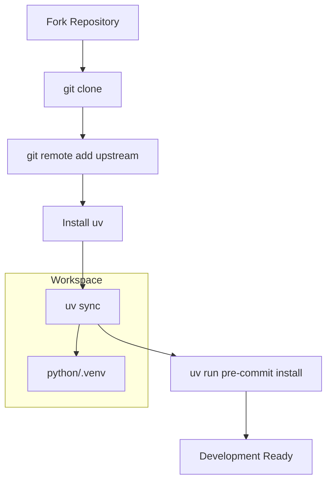
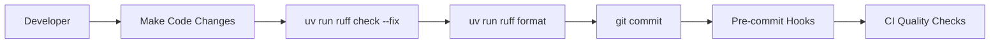
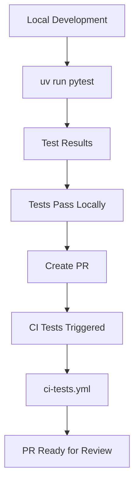
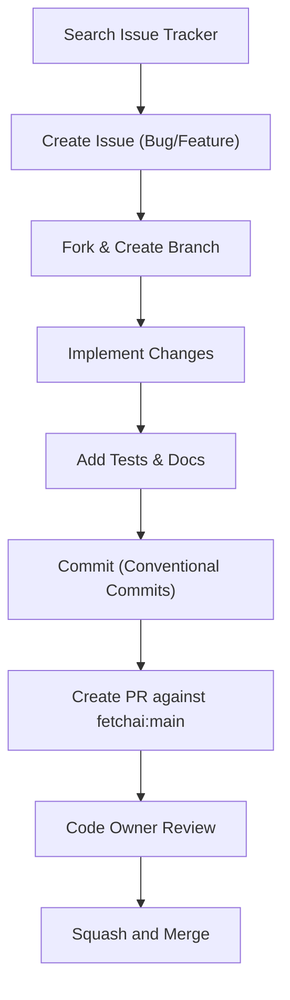
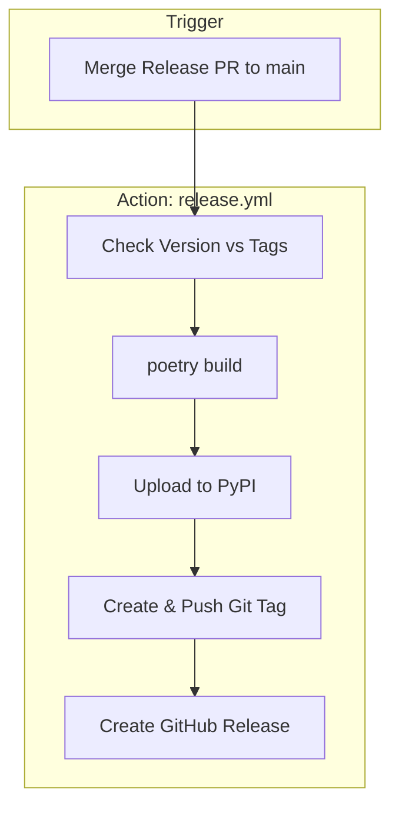

<!-- source: DeepWiki mcp.deepwiki.com · repo fetchai/uAgents · page 7 Development · fetched 2026-10-26 -->

# Development

Relevant source files

The following files were used as context for generating this wiki page:

- [.github/CODEOWNERS](.github/CODEOWNERS)
- [.github/ISSUE_TEMPLATE/bug-report.yml](.github/ISSUE_TEMPLATE/bug-report.yml)
- [.github/ISSUE_TEMPLATE/feature-request.yml](.github/ISSUE_TEMPLATE/feature-request.yml)
- [.github/pull_request_template.md](.github/pull_request_template.md)
- [.github/workflows/pr-title-linting.yml](.github/workflows/pr-title-linting.yml)
- [CONTRIBUTING.md](CONTRIBUTING.md)
- [DEVELOPING.md](DEVELOPING.md)
- [LICENSE](LICENSE)
- [README.md](README.md)
- [python/uagents-core/uagents_core/__init__.py](python/uagents-core/uagents_core/__init__.py)

This document provides comprehensive guidance for developers contributing to the uAgents project. It covers development environment setup, contribution workflows, code quality standards, testing procedures, and release processes.

For detailed guidelines, see the following child pages:
- [Contributing Guide](#7.1) — Detailed instructions on commit conventions, PR requirements, and code standards.
- [Release Process](#7.2) — Documentation of the automated release pipeline and versioning strategy.
- [Deployment](#7.3) — Guides for containerization and cloud deployment.

## Development Environment Setup

Setting up a development environment for uAgents requires Python 3.10-3.13 and [uv](https://docs.astral.sh/uv) for dependency management. The project follows a structured approach with pre-commit hooks for code quality enforcement.

### Environment Configuration

The development setup process is centered in the `python` directory. Running `uv sync` prepares the virtual environment, and `pre-commit install` ensures that linting and formatting are checked during `git commit`.

**Sources:** [DEVELOPING.md:13-35](), [DEVELOPING.md:39-40]()

### Code Quality Standards

The project enforces strict code quality standards using [Ruff](https://github.com/astral-sh/ruff) for linting and formatting.

Consistency is maintained through automated formatting. Developers are encouraged to add `ruff` to their IDE to speed up development.

**Sources:** [DEVELOPING.md:41-49](), [CONTRIBUTING.md:126]()

## Testing Infrastructure

The project uses `pytest` for unit and integration testing. All new features and bug fixes must include tests to ensure correctness and prevent regressions.

### Test Execution Workflow

Testing is a prerequisite for any PR submission. Local execution via `uv run pytest` saves CI hours and ensures only clean code is committed.

**Sources:** [DEVELOPING.md:52-56](), [CONTRIBUTING.md:129-133]()

## Contribution Workflow

The contribution process follows GitHub Flow. Major features require an initial proposal issue, while small features and bug fixes can be submitted directly as Pull Requests.

### PR Submission Process

The project uses `Conventional Commits` to determine versioning and generate release notes. PR titles are automatically linted to ensure they follow types like `feat`, `fix`, `docs`, etc.

**Sources:** [CONTRIBUTING.md:60-95](), [.github/workflows/pr-title-linting.yml:19-29](), [.github/pull_request_template.md:1-30]()

## Release and Deployment

The release process is automated via GitHub Actions and the `do_release.py` script. It supports multiple packages within the monorepo: `uagents`, `uagents-core`, and `uagents-ai-engine`.

### Release Automation

For deployment, uAgents can be containerized using Docker or deployed at scale using Kubernetes. Reference implementations like `hello-agent` provide templates for these configurations.

For details, see [Release Process](#7.2) and [Deployment](#7.3).

**Sources:** [README.md:104-106](), [CONTRIBUTING.md:135](), [.github/CODEOWNERS:1-3]()

---

