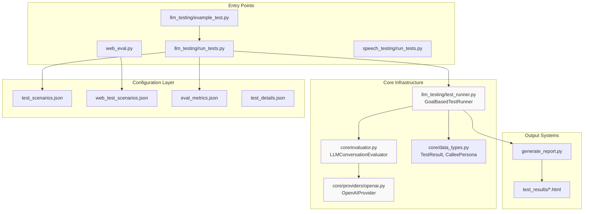
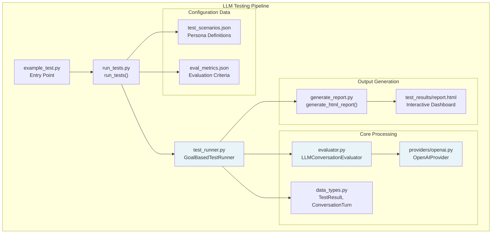
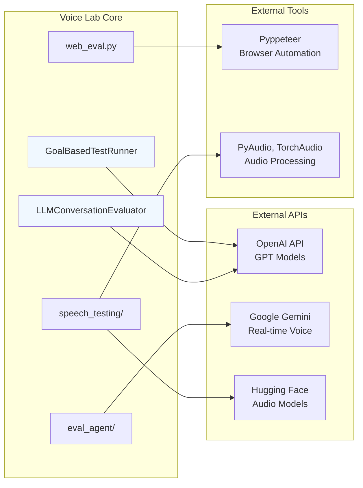

<!-- source: DeepWiki mcp.deepwiki.com · repo saharmor/voice-lab · page 1 Voice Lab Overview · fetched 2026-10-26 -->

# Voice Lab Overview

Relevant source files

The following files were used as context for generating this wiki page:

- [.DS_Store](.DS_Store)
- [LICENSE](LICENSE)
- [README.md](README.md)
- [llm_testing/.DS_Store](llm_testing/.DS_Store)

## Purpose and Scope

This document provides a comprehensive overview of the Voice Lab testing framework, a Python-based system designed for evaluating and iterating on LLM-powered voice agents. Voice Lab supports multiple testing modalities including LLM conversation testing, web chatbot evaluation, speech analysis, and real-time voice interactions.

The framework enables data-driven decision making for voice agent development through automated testing, performance metrics, and cost optimization across different language models and configurations. While optimized for voice agents, Voice Lab is valuable for any LLM-powered agent evaluation needs.

For detailed setup instructions, see [Getting Started](#2). For specific testing system implementations, see [Testing Systems](#3). For configuration management, see [Test Configuration](#4).

## System Architecture

Voice Lab follows a modular architecture with four core testing systems built on shared infrastructure components. The framework integrates with external LLM providers and generates comprehensive HTML reports for analysis.

### Core Components Architecture

**Sources:** [README.md:1-170](), [llm_testing/example_test.py](), [llm_testing/run_tests.py](), [llm_testing/test_runner.py](), [core/evaluator.py](), [core/data_types.py](), [core/providers/openai.py]()

## Testing Modalities

Voice Lab supports four distinct testing approaches, each optimized for different evaluation scenarios and agent types.

### Testing Systems Overview

| System | Entry Point | Core Classes | Purpose |
|--------|-------------|--------------|---------|
| LLM Conversation Testing | `llm_testing/example_test.py` | `GoalBasedTestRunner`, `LLMConversationEvaluator` | Goal-based conversation testing with persona simulation |
| Web Chatbot Evaluation | `web_eval.py` | Browser automation classes | Automated testing of web-embedded chatbots |
| Speech Analysis Testing | `speech_testing/run_tests.py` | Audio processing utilities | Voice interaction analysis with interruption detection |
| Real-time Voice Interaction | `eval_agent/gemini_connection.py` | Gemini API integration | Live bidirectional voice communication testing |

### LLM Testing System Data Flow

**Sources:** [llm_testing/example_test.py](), [llm_testing/run_tests.py](), [llm_testing/test_runner.py](), [core/evaluator.py](), [core/providers/openai.py](), [core/data_types.py](), [test_scenarios.json](), [eval_metrics.json]()

## Data Types and Interfaces

The framework uses strongly-typed data structures to maintain consistency across testing modalities and enable reliable result aggregation.

### Core Data Models

The `core/data_types.py` module defines the fundamental data structures used throughout the system:

- **`TestResult`**: Encapsulates complete test execution results including conversation history, evaluation scores, and metadata
- **`CalleePersona`**: Defines user personas with traits, moods, and response styles for conversation simulation  
- **`ConversationTurn`**: Represents individual message exchanges between agent and user
- **`EvaluationMetric`**: Structured evaluation criteria with scoring methods

### Provider Interface Pattern

The `core/providers/` directory implements a provider pattern for LLM integrations:

- **`OpenAIProvider`**: Primary implementation supporting GPT models with conversation management
- **Provider Interface**: Abstraction layer enabling support for additional LLM services

**Sources:** [core/data_types.py](), [core/providers/openai.py]()

## Integration Architecture  

Voice Lab integrates with multiple external services and maintains a plugin-based architecture for extending functionality.

### External Service Integration

**Sources:** [core/providers/openai.py](), [web_eval.py](), [speech_testing/](), [eval_agent/gemini_connection.py](), [README.md:60-62]()

## Configuration and Extensibility

The framework uses JSON-based configuration files to define test scenarios, evaluation metrics, and system behavior. This approach enables non-technical stakeholders to modify test parameters without code changes.

### Configuration Files Structure

| File | Purpose | Key Components |
|------|---------|----------------|
| `test_scenarios.json` | LLM conversation test definitions | Persona configurations, success criteria, system prompts |
| `web_test_scenarios.json` | Web chatbot test scenarios | User personas, interaction flows, success outcomes |
| `eval_metrics.json` | Evaluation criteria definitions | Scoring methods, metric weights, judgment criteria |
| `test_details.json` | Detailed agent configurations | System prompts, tool definitions, conversation parameters |

The framework also provides a [Voice Lab Configuration Editor](https://saharmor.me/voice-lab-ui) for generating configuration files through a graphical interface.

**Sources:** [README.md:71-78](), [test_scenarios.json](), [web_test_scenarios.json](), [eval_metrics.json](), [test_details.json]()

## Next Steps

- For installation and setup instructions, see [Getting Started](#2)
- For detailed testing system documentation, see [Testing Systems](#3) 
- For configuration management, see [Test Configuration](#4)
- For understanding evaluation methodologies, see [Evaluation & Metrics](#5)
- For report generation and analysis, see [Test Results & Reporting](#6)

---

