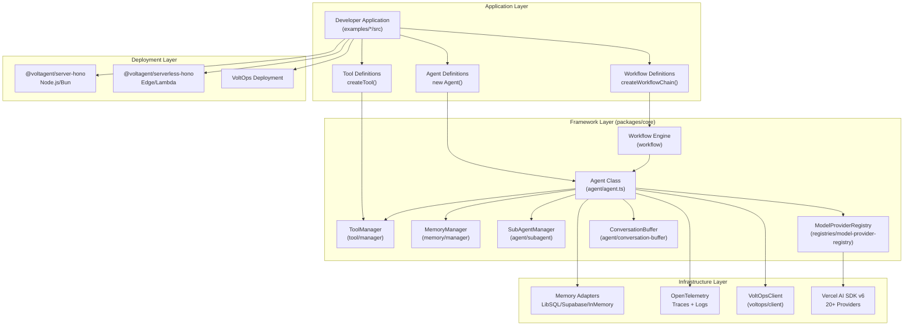
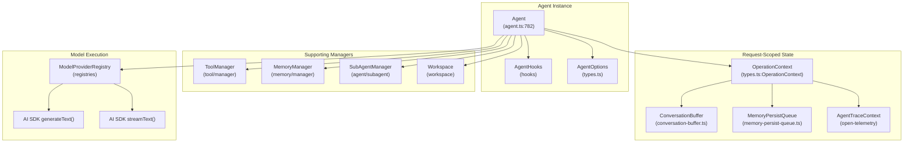
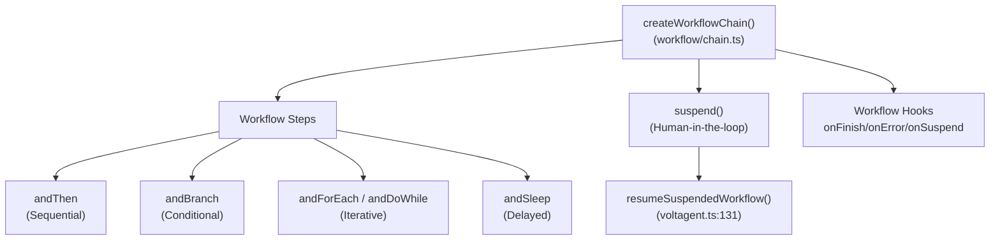

<!-- source: DeepWiki mcp.deepwiki.com · repo VoltAgent/voltagent · page 1.1 Architecture Overview · fetched 2026-10-26 -->

# Architecture Overview

Relevant source files

The following files were used as context for generating this wiki page:

- [CHANGELOG.md](CHANGELOG.md)
- [README.md](README.md)
- [changelog.sh](changelog.sh)
- [examples/base/src/index.ts](examples/base/src/index.ts)
- [i18n/README-cn-bsc.md](i18n/README-cn-bsc.md)
- [i18n/README-cn-traditional.md](i18n/README-cn-traditional.md)
- [i18n/README-jp.md](i18n/README-jp.md)
- [i18n/README-kr.md](i18n/README-kr.md)
- [packages/cli/README.md](packages/cli/README.md)
- [packages/cli/package.json](packages/cli/package.json)
- [packages/core/README.md](packages/core/README.md)
- [packages/core/src/types.ts](packages/core/src/types.ts)
- [packages/core/src/voltagent.spec.ts](packages/core/src/voltagent.spec.ts)
- [packages/core/src/voltagent.ts](packages/core/src/voltagent.ts)
- [packages/create-voltagent-app/CHANGELOG.md](packages/create-voltagent-app/CHANGELOG.md)
- [packages/create-voltagent-app/package.json](packages/create-voltagent-app/package.json)
- [packages/supabase/README.md](packages/supabase/README.md)
- [packages/voice/CHANGELOG.md](packages/voice/CHANGELOG.md)
- [packages/voice/README.md](packages/voice/README.md)
- [packages/voice/package.json](packages/voice/package.json)

## Purpose and Scope

This document provides a comprehensive overview of VoltAgent's system architecture, explaining how the framework's packages, runtime components, and external integrations work together. It covers the monorepo structure, core agent orchestration, data persistence, observability, and deployment patterns.

For detailed information about specific subsystems:
- Package-level details: see [Package Ecosystem](#1.2)
- Agent internals and execution pipeline: see [Agent Fundamentals](#2.1) and [Message Processing Pipeline](#2.8)
- Workflow orchestration: see [Workflow System](#3)
- Multi-agent patterns: see [Sub-Agent and Supervisor Patterns](#4)
- AI provider integration: see [AI Provider Integration](#5)

---

## System Layers

VoltAgent is organized into four distinct architectural layers: the application layer where developers define agents and workflows, the framework layer containing core orchestration logic, the infrastructure layer providing persistence and observability, and the deployment layer supporting multiple runtime environments.

**Sources:** [packages/core/src/agent/agent.ts:782-840](), [README.md:43-65](), [packages/core/src/voltagent.ts:33-125]()

---

## Monorepo Package Structure

The VoltAgent monorepo consists of core framework packages, server implementations, storage adapters, and specialized feature packages.

| Package | Purpose | Key Exports |
|---------|---------|-------------|
| `@voltagent/core` | Agent orchestration, workflows, tools | `Agent`, `createWorkflowChain`, `VoltAgent`, `Memory` |
| `@voltagent/server-hono` | HTTP server for Node.js/Bun | `honoServer()`, REST API endpoints |
| `@voltagent/serverless-hono` | Edge runtime server | `serverlessHonoServer()` |
| `@voltagent/libsql` | SQLite-based storage | `LibSQLMemoryAdapter`, `LibSQLVectorAdapter` |
| `@voltagent/supabase` | PostgreSQL via Supabase | `SupabaseMemoryAdapter` |
| `@voltagent/voice` | Voice I/O capabilities | OpenAI, ElevenLabs, XS.ai providers |
| `@voltagent/logger` | Structured logging | `createPinoLogger()` |
| `@voltagent/cli` | Development tools | `volt` CLI commands |
| `@voltagent/create-voltagent-app` | Project scaffolding | `create-voltagent-app` CLI |

**Sources:** [README.md:50-65](), [packages/core/src/voltagent.ts:1-28](), [packages/create-voltagent-app/package.json:1-8](), [packages/voice/package.json:1-10]()

---

## Core Agent Runtime Architecture

The `Agent` class serves as the central orchestrator. Each agent instance maintains references to specialized managers and coordinates their interactions during request processing.

**Sources:** [packages/core/src/agent/agent.ts:782-840](), [packages/core/src/voltagent.ts:58-135]()

### Key Components

**VoltAgent Class** [packages/core/src/voltagent.ts:33]()
- The top-level entry point for bootstrapping applications.
- Manages the `AgentRegistry`, `WorkflowRegistry`, and `TriggerRegistry`.
- Handles global configuration for `memory`, `logger`, and `observability`.
- Connects the server provider (e.g., `honoServer`) to the framework registries.

**Agent Class** [packages/core/src/agent/agent.ts:782]()
- Defines agent configuration including `name`, `instructions`, `model`, `tools`.
- Orchestrates the request-response lifecycle.
- Provides methods for text and object generation/streaming.

**OperationContext** [packages/core/src/types.ts:48-52]()
- Request-scoped container holding `operationId`, `userId`, `conversationId`.
- Shared across all hooks, tools, and sub-agents in a single operation.

**MemoryPersistQueue** [packages/core/src/agent/memory-persist-queue.ts]()
- Queues conversation updates for batch persistence.
- Supports configurable debounce intervals via `agentConversationPersistence` option [packages/core/src/voltagent.ts:68-69]().

**Sources:** [packages/core/src/voltagent.ts:33-180](), [packages/core/src/agent/agent.ts:782-1770](), [packages/core/src/types.ts:1-225]()

---

## Workflow System Architecture

The workflow system allows for declarative multi-step automations with complex control flow.

**Sources:** [CHANGELOG.md:64-229](), [packages/core/src/voltagent.ts:131-136]()

### Workflow Components

**WorkflowChain** [CHANGELOG.md:64-80]()
- Created via `createWorkflowChain`.
- Supports branching logic (`andBranch`), loops (`andForEach`, `andDoWhile`), and data mapping (`andMap`).
- Provides built-in retry configurations and lifecycle hooks.

**Suspend and Resume** [CHANGELOG.md:167-186](), [packages/core/src/types.ts:122-136]()
- Workflows can be paused using `suspend` for human intervention.
- Resumption is handled via the `workflowRegistry.resumeSuspendedWorkflow` method, typically triggered by an API call to the server.

**Sources:** [CHANGELOG.md:64-265](), [packages/core/src/types.ts:122-137]()

---

## Memory and Persistence

VoltAgent supports diverse storage backends through a unified `Memory` interface.

| Component | Implementation | Source |
|-----------|----------------|--------|
| **Memory Instance** | Core orchestration of storage/embeddings | [packages/core/src/memory/memory.ts]() |
| **SQLite Adapter** | `LibSQLMemoryAdapter` | [examples/base/src/index.ts:14]() |
| **Vector Storage** | `LibSQLVectorAdapter` | [examples/base/src/index.ts:16]() |
| **Global Memory** | Set via `VoltAgent` constructor | [packages/core/src/voltagent.ts:69-77]() |

**Sources:** [packages/core/src/voltagent.ts:66-77](), [examples/base/src/index.ts:12-18]()

---

## Observability and VoltOps Console

Observability is a first-class citizen, integrated via OpenTelemetry and the VoltOps platform.

- **VoltAgentObservability**: Initialized during `VoltAgent` construction [packages/core/src/voltagent.ts:114-124]().
- **VoltOpsClient**: Handles communication with the VoltOps Console for traces, logs, and prompt management [packages/core/src/voltagent.ts:97-101]().
- **Local Prompts**: Supports offline-first local prompt resolution with version and label selection [CHANGELOG.md:7-15]().

**Sources:** [packages/core/src/voltagent.ts:97-124](), [CHANGELOG.md:7-29]()

---

