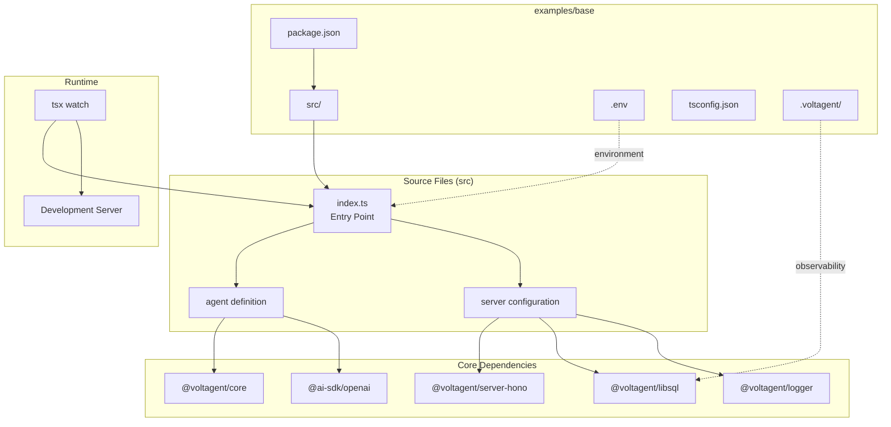
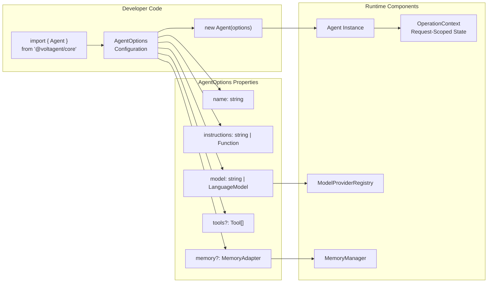
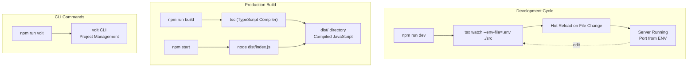
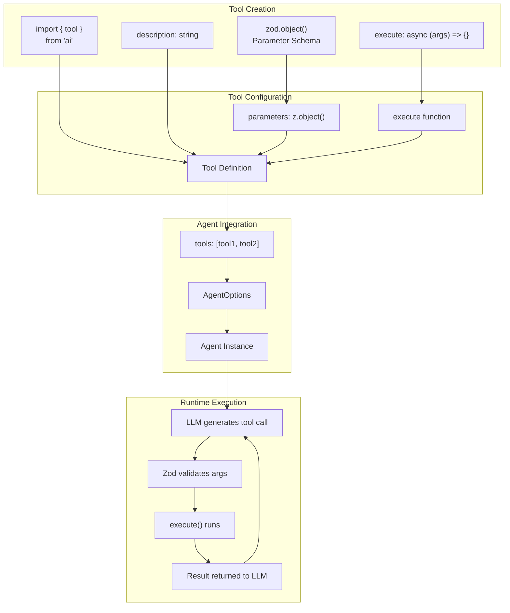
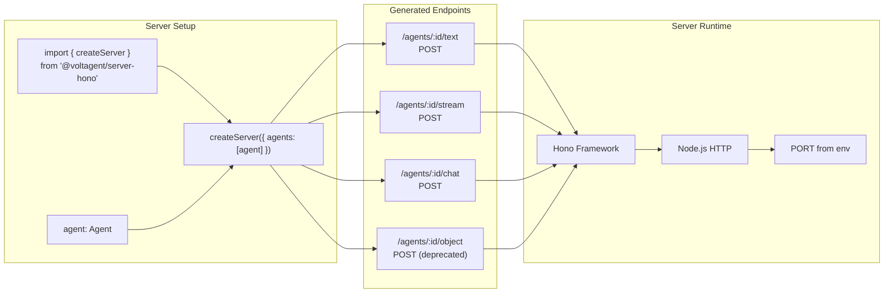
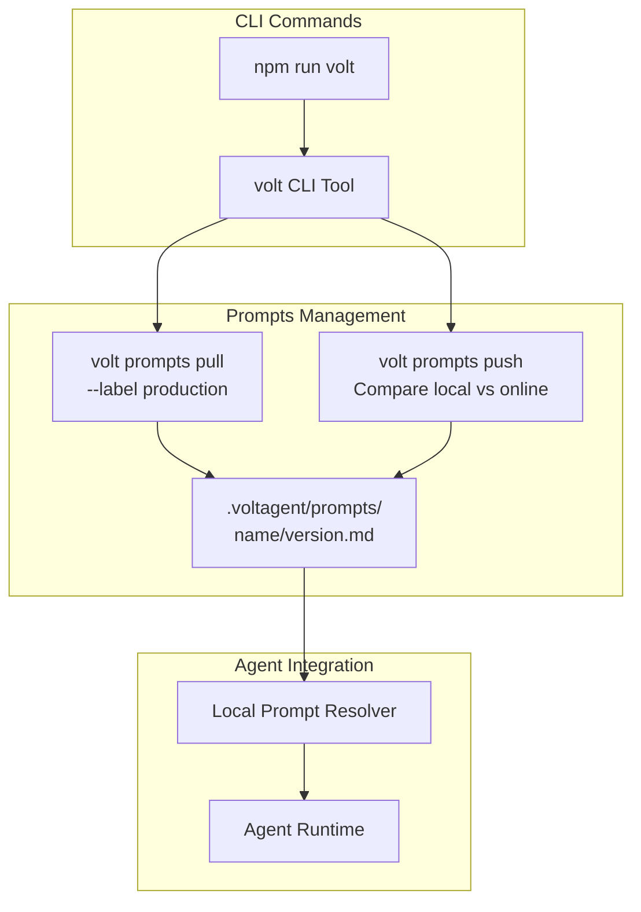

<!-- source: DeepWiki mcp.deepwiki.com · repo VoltAgent/voltagent · page 12.1 Basic Examples · fetched 2026-10-26 -->

# Basic Examples

<details>
<summary>Relevant source files</summary>

The following files were used as context for generating this wiki page:

- [CHANGELOG.md](CHANGELOG.md)
- [changelog.sh](changelog.sh)
- [examples/base/package.json](examples/base/package.json)
- [examples/base/src/index.ts](examples/base/src/index.ts)
- [examples/github-repo-analyzer/package.json](examples/github-repo-analyzer/package.json)
- [examples/with-rag-chatbot/package.json](examples/with-rag-chatbot/package.json)
- [examples/with-retrieval/package.json](examples/with-retrieval/package.json)
- [examples/with-subagents/package.json](examples/with-subagents/package.json)
- [examples/with-supabase/package.json](examples/with-supabase/package.json)
- [examples/with-tools/package.json](examples/with-tools/package.json)
- [examples/with-vercel-ai/package.json](examples/with-vercel-ai/package.json)
- [examples/with-voice-elevenlabs/package.json](examples/with-voice-elevenlabs/package.json)
- [examples/with-voice-openai/package.json](examples/with-voice-openai/package.json)
- [packages/cli/package.json](packages/cli/package.json)
- [packages/create-voltagent-app/CHANGELOG.md](packages/create-voltagent-app/CHANGELOG.md)
- [packages/create-voltagent-app/package.json](packages/create-voltagent-app/package.json)
- [packages/voice/CHANGELOG.md](packages/voice/CHANGELOG.md)
- [packages/voice/package.json](packages/voice/package.json)

</details>


This page documents the foundational examples that demonstrate core VoltAgent agent creation patterns. These examples focus on simple agent instantiation, basic configuration, and fundamental usage without complex integrations like RAG, voice, or multi-agent systems. For provider-specific examples (Anthropic, Google, Groq), see [Integration Examples](#12.2). For advanced patterns like workflows, sub-agents, and RAG, see [Advanced Examples](#12.3).

## Scope and Purpose

Basic examples cover:
- **Base Example**: The minimal starter configuration with OpenAI and LibSQL.
- **Simple Tool Usage**: Creating and using custom tools with Zod validation.
- **Development Workflow**: Hot reload with `tsx watch` and TypeScript compilation.
- **Offline Prompts**: Using local markdown files for agent instructions.

These examples serve as starting points for new projects and demonstrate the essential VoltAgent patterns without additional complexity.

---

## Base Example Overview

The `base` example provides the minimal configuration required for a VoltAgent project. It demonstrates a complete working agent with OpenAI as the LLM provider and LibSQL for local observability storage.

### Project Structure



**Sources:** [examples/base/package.json:1-38]()

### Package Dependencies

The base example uses these core packages:

| Package | Version | Purpose |
|---------|---------|---------|
| `@voltagent/core` | ^2.7.4 | Agent framework and orchestration |
| `@voltagent/server-hono` | ^2.0.13 | Hono-based HTTP server for REST APIs |
| `@voltagent/libsql` | ^2.1.2 | SQLite-based local observability storage |
| `@voltagent/logger` | ^2.0.2 | Pino-based structured logging |
| `@ai-sdk/openai` | ^3.0.0 | OpenAI provider for Vercel AI SDK |
| `ai` | ^6.0.0 | Vercel AI SDK core |
| `zod` | ^3.25.76 | Schema validation for tools and inputs |

**Development Dependencies:**

| Package | Version | Purpose |
|---------|---------|---------|
| `tsx` | ^4.21.0 | TypeScript execution with hot reload |
| `typescript` | ^5.8.2 | TypeScript compiler |
| `@types/node` | ^24.2.1 | Node.js type definitions |

**Sources:** [examples/base/package.json:1-38]()

---

## Minimal Agent Creation Pattern

### Agent Instantiation Flow



**Sources:** [examples/base/package.json:4-12](), [CHANGELOG.md:32-38]()

### Basic Agent Configuration Example

The base example demonstrates the minimum required configuration. Recent updates also allow for dynamic instruction fetching from local prompt files.

```typescript
import { Agent } from '@voltagent/core';
import { openai } from '@ai-sdk/openai';

const agent = new Agent({
  name: 'base-agent',
  // Static instructions
  instructions: 'You are a helpful assistant.',
  // Or dynamic prompt resolution (Offline-first)
  /*
  instructions: async ({ prompts }) => {
    return await prompts.getPrompt({
      promptName: "support-agent",
      label: "production",
    });
  },
  */
  model: openai('gpt-4o-mini'),
});
```

**Key Configuration Properties:**

- **name**: Identifier for the agent, used in observability traces.
- **instructions**: System prompt defining agent behavior. Can be a static string or an async function using the `prompts` manager.
- **model**: Language model specification (string reference or instance).

**Sources:** [examples/base/package.json:4-12](), [CHANGELOG.md:41-48]()

---

## Development Workflow

### Script Commands

The base example provides standard npm scripts for development and production:



**Sources:** [examples/base/package.json:31-36]()

### Environment Configuration

The base example requires environment variables for API keys and optional observability configuration:

| Variable | Required | Purpose |
|----------|----------|---------|
| `OPENAI_API_KEY` | Yes | OpenAI API authentication |
| `VOLTOPS_API_KEY` | No | VoltOps Console integration (optional) |
| `VOLTAGENT_PROMPTS_PATH` | No | Path to local markdown prompts (e.g., `./.voltagent/prompts`) |
| `PORT` | No | Server port (defaults to 3000) |

**Sources:** [examples/base/package.json:33](), [CHANGELOG.md:54-56]()

---

## Tool Usage Example

The `with-tools` example demonstrates how to extend agent capabilities with custom tools using Zod schemas for validation.

### Tool Definition Pattern



**Sources:** [examples/with-tools/package.json:1-39]()

### Tool Execution Lifecycle

Tools in VoltAgent follow the Vercel AI SDK pattern with Zod validation:

1. **Definition**: Tool is defined with `tool()` from the `ai` package.
2. **Schema**: Parameters are validated using Zod schemas.
3. **Registration**: Tools are passed to the agent via the `tools` array in `AgentOptions`.
4. **Execution**: When the LLM calls the tool, VoltAgent:
   - Validates arguments against the Zod schema.
   - Calls the `execute` function with validated args.
   - Returns the result to the LLM for continued reasoning.

**Sources:** [examples/with-tools/package.json:1-39]()

---

## Common Example Patterns

### Dependency Pattern Across Examples

All basic examples follow a consistent dependency pattern:

```mermaid
graph TB
    subgraph "Every Basic Example"
        EX["example/package.json"]
    end
    
    subgraph "Required Core Dependencies"
        CORE["@voltagent/core<br/>Agent Framework"]
        SERVER["@voltagent/server-hono<br/>HTTP Server"]
        AI["ai<br/>Vercel AI SDK"]
        ZOD["zod<br/>Schema Validation"]
    end
    
    subgraph "Observability (Standard)"
        LIBSQL["@voltagent/libsql<br/>Local Storage"]
        LOGGER["@voltagent/logger<br/>Structured Logging"]
    end
    
    subgraph "Provider Selection (One Of)"
        OPENAI["@ai-sdk/openai"]
        ANTHROPIC["@ai-sdk/anthropic"]
        GOOGLE["@ai-sdk/google"]
        GROQ["@ai-sdk/groq"]
        OTHER["... 15+ more providers"]
    end
    
    subgraph "Development Tools"
        TSX["tsx<br/>TypeScript Runner"]
        TS["typescript<br/>Compiler"]
        TYPES["@types/node<br/>Type Definitions"]
    end
    
    EX --> CORE
    EX --> SERVER
    EX --> AI
    EX --> ZOD
    
    EX --> LIBSQL
    EX --> LOGGER
    
    EX -.chooses one.-> OPENAI
    EX -.chooses one.-> ANTHROPIC
    EX -.chooses one.-> GOOGLE
    EX -.chooses one.-> GROQ
    EX -.chooses one.-> OTHER
    
    EX --> TSX
    EX --> TS
    EX --> TYPES
```



**Sources:** [examples/base/package.json:1-38](), [examples/with-tools/package.json:1-39](), [examples/with-vercel-ai/package.json:1-37]()

---

## Server Configuration

### HTTP Server Setup Pattern

Basic examples use `@voltagent/server-hono` to expose agents via REST APIs:



**Sources:** [examples/base/package.json:9-10]()

---

## CLI Integration

All basic examples include the `@voltagent/cli` package for project management. A significant recent addition is the prompt management system.

### Prompt Management Workflow



**Sources:** [CHANGELOG.md:7-28](), [examples/base/package.json:35]()

### Available CLI Commands

| Command | Purpose |
|---------|---------|
| `volt prompts pull` | Downloads latest prompts from VoltOps to local markdown files. |
| `volt prompts push` | Compares local changes with VoltOps and creates new versions. |
| `volt mcp setup` | Configures Model Context Protocol (MCP) server connections. |
| `volt init` | Scaffolds a new VoltAgent project. |

**Sources:** [CHANGELOG.md:18-28](), [packages/create-voltagent-app/package.json:1-8]()

---

