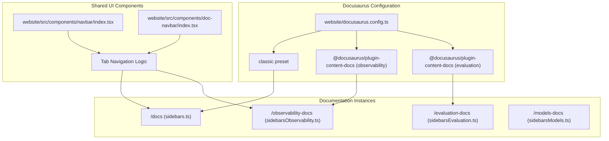
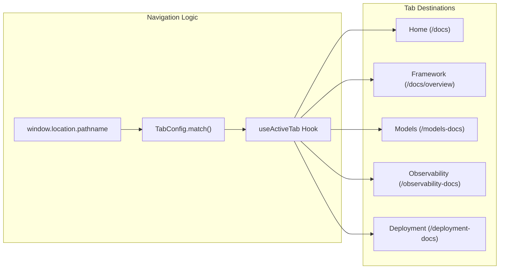

<!-- source: DeepWiki mcp.deepwiki.com · repo VoltAgent/voltagent · page 13.2 Documentation Structure · fetched 2026-10-26 -->

# Documentation Structure

<details>
<summary>Relevant source files</summary>

The following files were used as context for generating this wiki page:

- [packages/core/src/triggers/catalog-data/default-trigger-catalog.ts](packages/core/src/triggers/catalog-data/default-trigger-catalog.ts)
- [packages/core/src/voltops/actions/client.ts](packages/core/src/voltops/actions/client.ts)
- [packages/core/src/voltops/client.spec.ts](packages/core/src/voltops/client.spec.ts)
- [packages/core/src/voltops/client.ts](packages/core/src/voltops/client.ts)
- [packages/core/src/voltops/index.ts](packages/core/src/voltops/index.ts)
- [packages/core/src/voltops/types.ts](packages/core/src/voltops/types.ts)
- [packages/sdk/src/client/index.spec.ts](packages/sdk/src/client/index.spec.ts)
- [packages/sdk/src/client/index.ts](packages/sdk/src/client/index.ts)
- [packages/sdk/src/index.ts](packages/sdk/src/index.ts)
- [packages/sdk/src/types.ts](packages/sdk/src/types.ts)
- [website/blog/2026-01-23-tool-routing/index.md](website/blog/2026-01-23-tool-routing/index.md)
- [website/docs/index.md](website/docs/index.md)
- [website/docusaurus.config.ts](website/docusaurus.config.ts)
- [website/observability/mcp.md](website/observability/mcp.md)
- [website/observability/overview.md](website/observability/overview.md)
- [website/sidebars.ts](website/sidebars.ts)
- [website/sidebarsObservability.ts](website/sidebarsObservability.ts)
- [website/src/components/doc-navbar/index.tsx](website/src/components/doc-navbar/index.tsx)
- [website/src/components/doc-navbar/styles.module.css](website/src/components/doc-navbar/styles.module.css)
- [website/src/components/navbar/index.tsx](website/src/components/navbar/index.tsx)
- [website/src/components/navbar/styles.module.css](website/src/components/navbar/styles.module.css)
- [website/src/components/ops/Observability.tsx](website/src/components/ops/Observability.tsx)
- [website/src/components/supervisor-agent/index.tsx](website/src/components/supervisor-agent/index.tsx)
- [website/src/components/supervisor-agent/mobile-code-block.tsx](website/src/components/supervisor-agent/mobile-code-block.tsx)
- [website/src/components/tutorial/TutorialNavbar.tsx](website/src/components/tutorial/TutorialNavbar.tsx)
- [website/src/css/layout.css](website/src/css/layout.css)
- [website/src/data/tweets.json](website/src/data/tweets.json)
- [website/src/theme/DocSidebar/Desktop/Content/index.js](website/src/theme/DocSidebar/Desktop/Content/index.js)
- [website/src/theme/DocSidebar/Desktop/Content/styles.module.css](website/src/theme/DocSidebar/Desktop/Content/styles.module.css)
- [website/src/theme/Layout/index.js](website/src/theme/Layout/index.js)
- [website/src/theme/Navbar/Logo/index.js](website/src/theme/Navbar/Logo/index.js)
- [website/src/theme/Navbar/Logo/styles.module.css](website/src/theme/Navbar/Logo/styles.module.css)
- [website/src/theme/Root.tsx](website/src/theme/Root.tsx)
- [website/src/theme/TOC/index.js](website/src/theme/TOC/index.js)

</details>


This document describes the organization and configuration of the VoltAgent documentation system, including multiple documentation instances, sidebar hierarchies, and navigation components.

## Documentation System Architecture

The VoltAgent website uses Docusaurus with a multi-instance documentation architecture. This allows separate configuration (sidebars, paths, and IDs) for different product areas while maintaining a unified site structure.

### Multi-Instance Documentation Design



**Sources:** [website/docusaurus.config.ts:41-165](), [website/src/components/navbar/index.tsx:45-87]()

The documentation system is partitioned into several independent instances:

1.  **Main Framework Docs**: Configured via the `classic` preset, handling core framework concepts, workflows, and agents. [website/docusaurus.config.ts:42-66]()
2.  **Observability Docs**: A standalone instance for the VoltOps platform, tracing, and debugging. [website/docusaurus.config.ts:83-93]()
3.  **Specialized Instances**: Separate plugins manage Evaluation, Prompt Engineering, Deployment, Models, and Recipes. [website/docusaurus.config.ts:95-165]()

## Sidebar Configuration System

Each documentation instance utilizes a dedicated sidebar file to define its navigation hierarchy. These are defined using the `SidebarsConfig` type.

### Main Framework Sidebar (`sidebars.ts`)

The main sidebar organizes the framework into logical progression categories:

| Category | Purpose | Key Docs |
| :--- | :--- | :--- |
| **Get Started** | Onboarding and setup | `quick-start`, `manual-setup`, `providers-models` |
| **Agents** | Core Agent entities | `voltagent-instance`, `tools`, `mcp`, `hooks` |
| **Workspaces** | Experimental sandbox features | `filesystem`, `sandbox`, `skills` |
| **Workflows** | Multi-step orchestration | `suspend-resume`, `steps/and-then`, `loop` |
| **Memory** | Persistence and context | `working-memory`, `semantic-search`, `storage-adapters` |

**Sources:** [website/sidebars.ts:14-262]()

### Observability Sidebar (`sidebarsObservability.ts`)

The observability sidebar focuses on the VoltOps platform and tracing lifecycle:

*   **Getting Started**: Overview, Setup, and Mental Model. [website/sidebarsObservability.ts:9-22]()
*   **Tracing**: Deep dives into waterfall views, node-based traces, and logs. [website/sidebarsObservability.ts:39-49]()
*   **Analytics**: LLM Usage & Costs, Feedback, and Alerts. [website/sidebarsObservability.ts:28-54]()

### Badge System

VoltAgent uses a custom property system to render status badges in the sidebar. This is implemented via `customProps` in the sidebar configuration.

```typescript
{
  type: "doc",
  id: "agents/plan-agent",
  label: "PlanAgent",
  customProps: {
    badge: {
      label: "Experimental",
      variant: "accent",
    },
  },
}
```

**Sources:** [website/sidebars.ts:64-74](), [website/sidebars.ts:201-210]()

## Navigation and Tab System

The site uses a dual-navbar approach: a global marketing navbar and a specialized documentation navbar (`DocNavbar`).

### Documentation Navbar Logic

The `DocNavbar` component at [website/src/components/doc-navbar/index.tsx]() manages the high-level switching between documentation instances using a tab-based interface.



**Sources:** [website/src/components/doc-navbar/index.tsx:20-69](), [website/src/components/doc-navbar/index.tsx:81-93]()

### Path Normalization and Matching

To ensure reliable tab highlighting, the system uses a `normalizePathname` utility to handle trailing slashes consistently [website/src/components/doc-navbar/index.tsx:71-73](). The `getActiveTabFromPathname` function iterates through the `tabs` configuration array and executes the `match` predicate for each entry [website/src/components/doc-navbar/index.tsx:75-79]().

## Tutorial and Interactive Docs

The framework includes a specialized 5-step interactive tutorial with its own navigation context.

### Tutorial Navigation (`TutorialNavbar.tsx`)

The `TutorialNavbar` provides a progress-tracking interface specifically for the onboarding flow.

*   **Progress Tracking**: Calculates percentage based on `currentStep / totalSteps`. [website/src/components/tutorial/TutorialNavbar.tsx:82-89]()
*   **Step Definitions**:
    1.  Introduction
    2.  Chatbot Problem
    3.  Memory
    4.  MCP
    5.  Subagents

**Sources:** [website/src/components/tutorial/TutorialNavbar.tsx:12-18](), [website/src/components/tutorial/TutorialNavbar.tsx:132-137]()

## URL Redirects and Maintenance

The documentation structure is preserved across versions and rebrands using the `@docusaurus/plugin-client-redirects` plugin.

| Old Path Pattern | New Path Destination |
| :--- | :--- |
| `/marketplace/` | `/ai-agent-marketplace/` |
| `/voltops-llm-observability-docs/` | `/observability-docs/` |
| `/docs/deployment/overview/` | `/deployment-docs/` |
| `/docs/triggers/*` | `/actions-triggers-docs/triggers/*` |

**Sources:** [website/docusaurus.config.ts:170-235]()

## VoltOps Documentation Content

The observability documentation (`observability/overview.md`) serves as the entry point for the VoltOps platform. It emphasizes visual tracing and debugging for non-deterministic AI agents [website/observability/overview.md:20-25]().

Key documentation pillars for VoltOps:
1.  **Setup**: Connecting applications via `VoltOpsClient`. [website/observability/overview.md:29]()
2.  **Mental Model**: Mapping traces and spans to the UI. [website/observability/overview.md:30]()
3.  **Public Trace API**: Programmatic access to persisted traces. [website/observability/overview.md:31]()
4.  **MCP Tracing**: Read-only inspection via MCP servers. [website/observability/overview.md:32]()

**Sources:** [website/observability/overview.md:1-34]()

---

