# Page: Overview

# Overview

<details>
<summary>Relevant source files</summary>

The following files were used as context for generating this wiki page:

- [CHANGELOG.md](CHANGELOG.md)
- [README.md](README.md)
- [changelog.sh](changelog.sh)
- [examples/base/src/index.ts](examples/base/src/index.ts)
- [examples/with-google-ai/package.json](examples/with-google-ai/package.json)
- [examples/with-google-vertex-ai/package.json](examples/with-google-vertex-ai/package.json)
- [examples/with-groq-ai/package.json](examples/with-groq-ai/package.json)
- [examples/with-mcp/package.json](examples/with-mcp/package.json)
- [examples/with-nextjs/package.json](examples/with-nextjs/package.json)
- [i18n/README-cn-bsc.md](i18n/README-cn-bsc.md)
- [i18n/README-cn-traditional.md](i18n/README-cn-traditional.md)
- [i18n/README-jp.md](i18n/README-jp.md)
- [i18n/README-kr.md](i18n/README-kr.md)
- [packages/cli/README.md](packages/cli/README.md)
- [packages/cli/package.json](packages/cli/package.json)
- [packages/core/README.md](packages/core/README.md)
- [packages/core/package.json](packages/core/package.json)
- [packages/create-voltagent-app/CHANGELOG.md](packages/create-voltagent-app/CHANGELOG.md)
- [packages/create-voltagent-app/package.json](packages/create-voltagent-app/package.json)
- [packages/supabase/README.md](packages/supabase/README.md)
- [packages/voice/CHANGELOG.md](packages/voice/CHANGELOG.md)
- [packages/voice/README.md](packages/voice/README.md)
- [packages/voice/package.json](packages/voice/package.json)
- [pnpm-lock.yaml](pnpm-lock.yaml)

</details>


VoltAgent is an end-to-end AI Agent Engineering Platform consisting of two main components: an open-source TypeScript framework for building intelligent agents with memory, tools, and multi-step workflows, and the VoltOps Console (cloud or self-hosted) for observability, automation, and deployment. This document provides a high-level introduction to the system architecture, package organization, and core concepts.

For detailed information about specific subsystems:
- Agent system implementation: see [Core Agent System](#2)
- Architecture and orchestration: see [Architecture Overview](#1.1)
- Monorepo package structure: see [Package Ecosystem](#1.2)
- Workflow orchestration: see [Workflow System](#3)
- Multi-agent coordination: see [Sub-Agent and Supervisor Patterns](#4)
- Platform features: see [VoltOps Platform](#9)
- Quick start guide: see [Getting Started](#1.3)

## System Components

VoltAgent is organized as a monorepo containing framework packages, server implementations, storage adapters, specialized features, and 40+ example applications. The framework provides the runtime and abstractions for building agents, while VoltOps Console provides production-ready observability and operations.

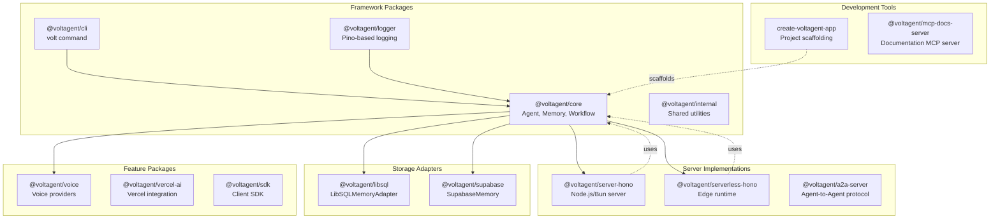

**Sources:** [pnpm-lock.yaml:1-110](), [packages/core/package.json:1-112](), [README.md:43-66]()

## Core Framework Architecture

The framework centers around the `Agent` class from `@voltagent/core`, which serves as the primary abstraction for building AI agents. Applications instantiate the `VoltAgent` class to register agents and workflows, then attach a server implementation to expose them via HTTP.

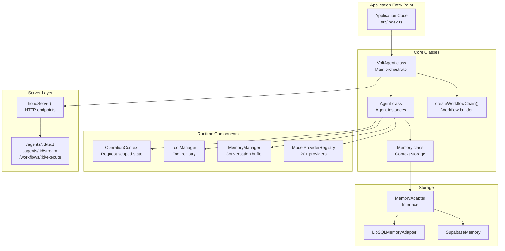

**Sources:** [README.md:85-124](), [examples/base/src/index.ts:1-31](), [packages/core/package.json:1-112]()

## Application Structure

A typical VoltAgent application follows this initialization pattern, as generated by `create-voltagent-app`:

| Component | Purpose | Configuration |
|-----------|---------|---------------|
| `Agent` | Define agent behavior | `name`, `instructions`, `model`, `tools`, `memory` |
| `Memory` | Persistent conversation storage | Storage adapter (LibSQL, Supabase, etc.) |
| `createPinoLogger` | Structured logging | Log level, output format |
| `honoServer()` | HTTP server | Port, CORS, middleware |
| `VoltAgent` | Main orchestrator | Agents map, workflows map, server instance |

The framework uses dependency injection—agents receive a `Memory` instance, tools receive lifecycle hooks, and the `VoltAgent` class coordinates all components. Agents execute via `generateText()` or `streamText()` methods that handle the full LLM interaction lifecycle.

**Sources:** [README.md:85-124](), [examples/base/src/index.ts:1-31](), [packages/core/package.json:1-112]()

## Multi-Provider Architecture

VoltAgent abstracts model providers through Vercel AI SDK v6, supporting 20+ providers via a unified interface. Applications reference models using string identifiers (`"provider/model-name"`) or direct SDK instances, enabling provider switching through configuration rather than code changes.

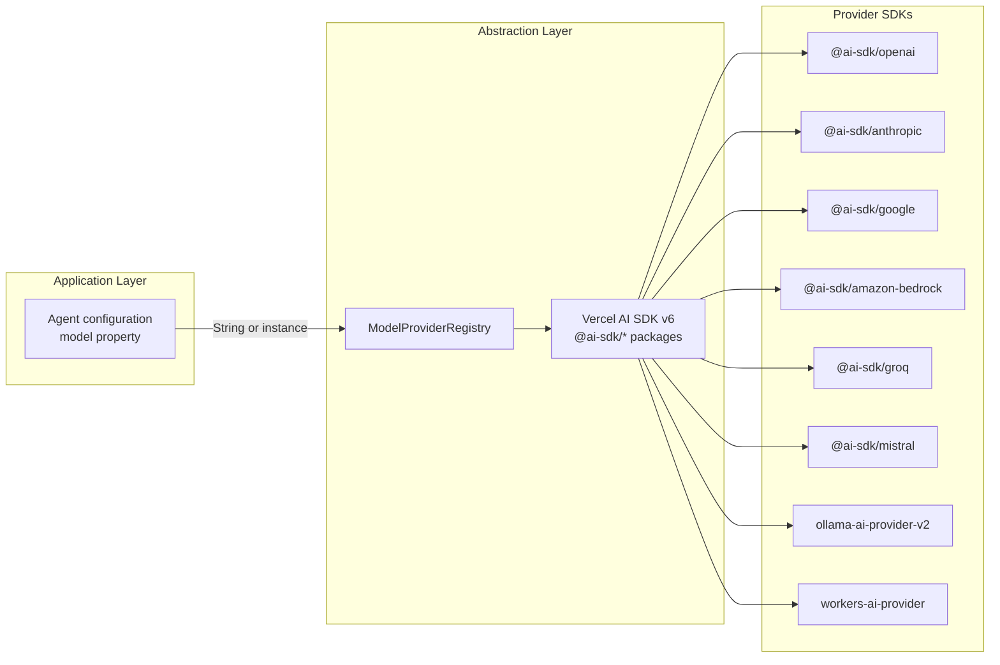

The framework also supports model fallback arrays for resilience and automatic failover if the primary model is unavailable or rate-limited.

**Sources:** [packages/core/package.json:6-50](), [pnpm-lock.yaml:113-224]()

## Development Workflow

VoltAgent provides a complete development toolchain from project creation through production deployment:

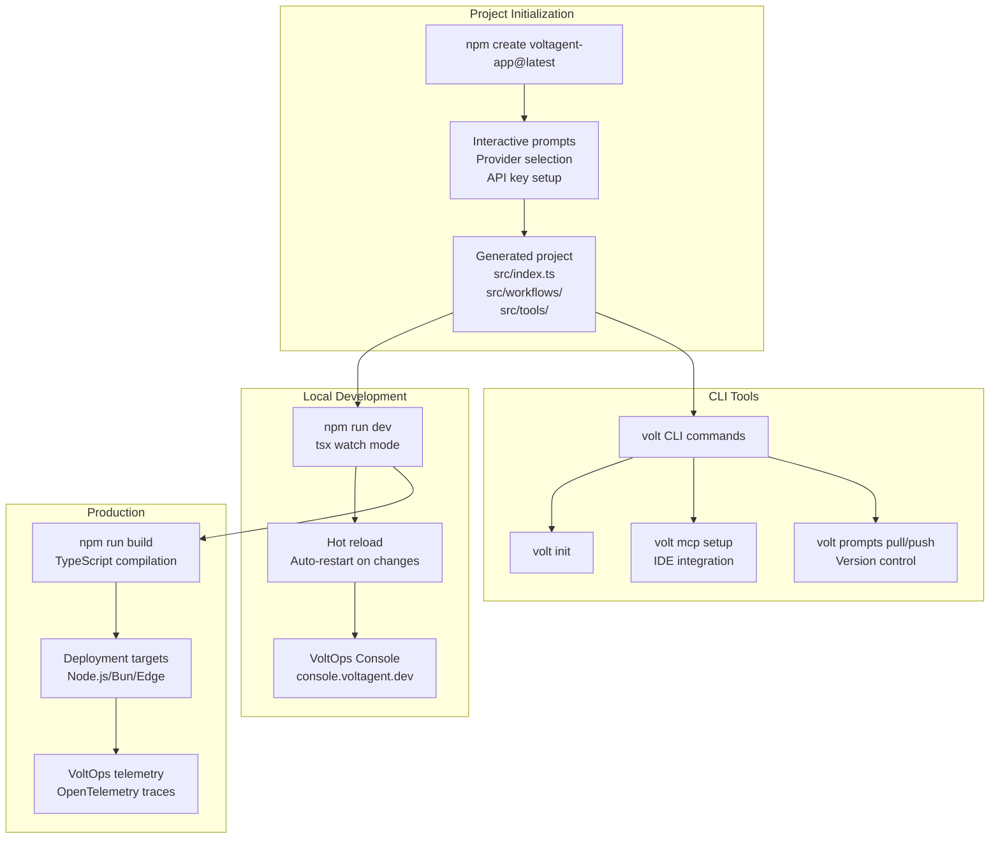

**Sources:** [README.md:73-143](), [packages/create-voltagent-app/package.json:1-61](), [CHANGELOG.md:16-28]()

## Observability Integration

VoltAgent includes built-in observability through OpenTelemetry instrumentation and VoltOps Console integration. The framework automatically exports traces and logs for agent executions, tool calls, and workflow steps.

| Component | Technology | Purpose |
|-----------|------------|---------|
| Trace Export | `@opentelemetry/exporter-trace-otlp-http` | Distributed tracing |
| Log Export | `@opentelemetry/exporter-logs-otlp-http` | Structured logging |
| Semantic Conventions | `@opentelemetry/semantic-conventions` | Standardized attributes |
| VoltOpsClient | Custom integration | Console connectivity |

Applications receive automatic instrumentation. VoltOps Console displays real-time execution traces, performance metrics, conversation history, and workflow visualization.

**Sources:** [packages/core/package.json:27-38](), [README.md:46-48]()

## Example Applications

The monorepo contains 40+ example applications demonstrating integration patterns, provider usage, and advanced features.

- **Basic patterns**: `examples/base` [examples/base/src/index.ts:1-31]()
- **Provider integrations**: `examples/with-google-ai`, `examples/with-groq-ai`, `examples/with-google-vertex-ai`
- **Advanced features**: `examples/with-mcp`, `examples/with-nextjs`
- **Voice capabilities**: Demonstrated via `@voltagent/voice` [packages/voice/package.json:1-57]()

**Sources:** [pnpm-lock.yaml:111-224](), [README.md:19-20]()

## Getting Started

New projects use the `create-voltagent-app` scaffolding tool:

```bash
npm create voltagent-app@latest
```

This generates a fully configured project with TypeScript compilation, development server with hot reload, memory persistence (e.g., LibSQL), and structured logging. For more details, see [Getting Started](#1.3).

**Sources:** [README.md:73-83](), [packages/create-voltagent-app/package.json:1-8]()

---

# Page: Architecture Overview

# Architecture Overview

<details>
<summary>Relevant source files</summary>

The following files were used as context for generating this wiki page:

- [CHANGELOG.md](CHANGELOG.md)
- [README.md](README.md)
- [changelog.sh](changelog.sh)
- [examples/base/src/index.ts](examples/base/src/index.ts)
- [i18n/README-cn-bsc.md](i18n/README-cn-bsc.md)
- [i18n/README-cn-traditional.md](i18n/README-cn-traditional.md)
- [i18n/README-jp.md](i18n/README-jp.md)
- [i18n/README-kr.md](i18n/README-kr.md)
- [packages/cli/README.md](packages/cli/README.md)
- [packages/cli/package.json](packages/cli/package.json)
- [packages/core/README.md](packages/core/README.md)
- [packages/core/src/types.ts](packages/core/src/types.ts)
- [packages/core/src/voltagent.spec.ts](packages/core/src/voltagent.spec.ts)
- [packages/core/src/voltagent.ts](packages/core/src/voltagent.ts)
- [packages/create-voltagent-app/CHANGELOG.md](packages/create-voltagent-app/CHANGELOG.md)
- [packages/create-voltagent-app/package.json](packages/create-voltagent-app/package.json)
- [packages/supabase/README.md](packages/supabase/README.md)
- [packages/voice/CHANGELOG.md](packages/voice/CHANGELOG.md)
- [packages/voice/README.md](packages/voice/README.md)
- [packages/voice/package.json](packages/voice/package.json)

</details>


## Purpose and Scope

This document provides a comprehensive overview of VoltAgent's system architecture, explaining how the framework's packages, runtime components, and external integrations work together. It covers the monorepo structure, core agent orchestration, data persistence, observability, and deployment patterns.

For detailed information about specific subsystems:
- Package-level details: see [Package Ecosystem](#1.2)
- Agent internals and execution pipeline: see [Agent Fundamentals](#2.1) and [Message Processing Pipeline](#2.8)
- Workflow orchestration: see [Workflow System](#3)
- Multi-agent patterns: see [Sub-Agent and Supervisor Patterns](#4)
- AI provider integration: see [AI Provider Integration](#5)

---

## System Layers

VoltAgent is organized into four distinct architectural layers: the application layer where developers define agents and workflows, the framework layer containing core orchestration logic, the infrastructure layer providing persistence and observability, and the deployment layer supporting multiple runtime environments.

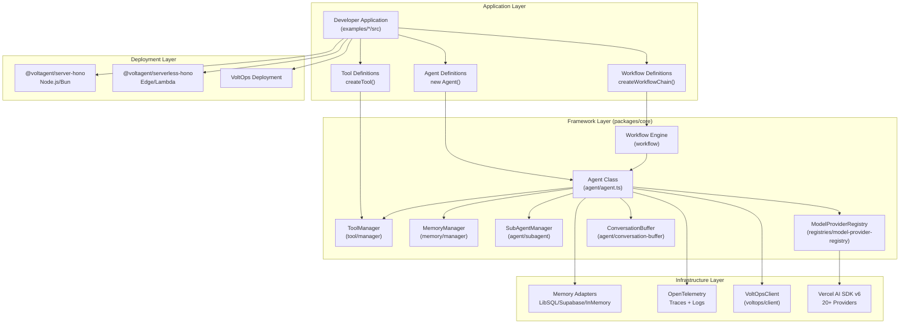

**Sources:** [packages/core/src/agent/agent.ts:782-840](), [README.md:43-65](), [packages/core/src/voltagent.ts:33-125]()

---

## Monorepo Package Structure

The VoltAgent monorepo consists of core framework packages, server implementations, storage adapters, and specialized feature packages.

| Package | Purpose | Key Exports |
|---------|---------|-------------|
| `@voltagent/core` | Agent orchestration, workflows, tools | `Agent`, `createWorkflowChain`, `VoltAgent`, `Memory` |
| `@voltagent/server-hono` | HTTP server for Node.js/Bun | `honoServer()`, REST API endpoints |
| `@voltagent/serverless-hono` | Edge runtime server | `serverlessHonoServer()` |
| `@voltagent/libsql` | SQLite-based storage | `LibSQLMemoryAdapter`, `LibSQLVectorAdapter` |
| `@voltagent/supabase` | PostgreSQL via Supabase | `SupabaseMemoryAdapter` |
| `@voltagent/voice` | Voice I/O capabilities | OpenAI, ElevenLabs, XS.ai providers |
| `@voltagent/logger` | Structured logging | `createPinoLogger()` |
| `@voltagent/cli` | Development tools | `volt` CLI commands |
| `@voltagent/create-voltagent-app` | Project scaffolding | `create-voltagent-app` CLI |

**Sources:** [README.md:50-65](), [packages/core/src/voltagent.ts:1-28](), [packages/create-voltagent-app/package.json:1-8](), [packages/voice/package.json:1-10]()

---

## Core Agent Runtime Architecture

The `Agent` class serves as the central orchestrator. Each agent instance maintains references to specialized managers and coordinates their interactions during request processing.

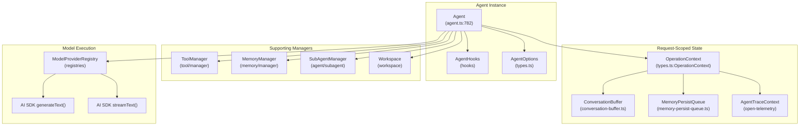

**Sources:** [packages/core/src/agent/agent.ts:782-840](), [packages/core/src/voltagent.ts:58-135]()

### Key Components

**VoltAgent Class** [packages/core/src/voltagent.ts:33]()
- The top-level entry point for bootstrapping applications.
- Manages the `AgentRegistry`, `WorkflowRegistry`, and `TriggerRegistry`.
- Handles global configuration for `memory`, `logger`, and `observability`.
- Connects the server provider (e.g., `honoServer`) to the framework registries.

**Agent Class** [packages/core/src/agent/agent.ts:782]()
- Defines agent configuration including `name`, `instructions`, `model`, `tools`.
- Orchestrates the request-response lifecycle.
- Provides methods for text and object generation/streaming.

**OperationContext** [packages/core/src/types.ts:48-52]()
- Request-scoped container holding `operationId`, `userId`, `conversationId`.
- Shared across all hooks, tools, and sub-agents in a single operation.

**MemoryPersistQueue** [packages/core/src/agent/memory-persist-queue.ts]()
- Queues conversation updates for batch persistence.
- Supports configurable debounce intervals via `agentConversationPersistence` option [packages/core/src/voltagent.ts:68-69]().

**Sources:** [packages/core/src/voltagent.ts:33-180](), [packages/core/src/agent/agent.ts:782-1770](), [packages/core/src/types.ts:1-225]()

---

## Workflow System Architecture

The workflow system allows for declarative multi-step automations with complex control flow.

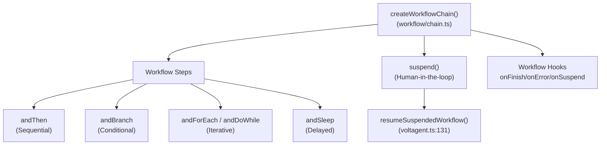

**Sources:** [CHANGELOG.md:64-229](), [packages/core/src/voltagent.ts:131-136]()

### Workflow Components

**WorkflowChain** [CHANGELOG.md:64-80]()
- Created via `createWorkflowChain`.
- Supports branching logic (`andBranch`), loops (`andForEach`, `andDoWhile`), and data mapping (`andMap`).
- Provides built-in retry configurations and lifecycle hooks.

**Suspend and Resume** [CHANGELOG.md:167-186](), [packages/core/src/types.ts:122-136]()
- Workflows can be paused using `suspend` for human intervention.
- Resumption is handled via the `workflowRegistry.resumeSuspendedWorkflow` method, typically triggered by an API call to the server.

**Sources:** [CHANGELOG.md:64-265](), [packages/core/src/types.ts:122-137]()

---

## Memory and Persistence

VoltAgent supports diverse storage backends through a unified `Memory` interface.

| Component | Implementation | Source |
|-----------|----------------|--------|
| **Memory Instance** | Core orchestration of storage/embeddings | [packages/core/src/memory/memory.ts]() |
| **SQLite Adapter** | `LibSQLMemoryAdapter` | [examples/base/src/index.ts:14]() |
| **Vector Storage** | `LibSQLVectorAdapter` | [examples/base/src/index.ts:16]() |
| **Global Memory** | Set via `VoltAgent` constructor | [packages/core/src/voltagent.ts:69-77]() |

**Sources:** [packages/core/src/voltagent.ts:66-77](), [examples/base/src/index.ts:12-18]()

---

## Observability and VoltOps Console

Observability is a first-class citizen, integrated via OpenTelemetry and the VoltOps platform.

- **VoltAgentObservability**: Initialized during `VoltAgent` construction [packages/core/src/voltagent.ts:114-124]().
- **VoltOpsClient**: Handles communication with the VoltOps Console for traces, logs, and prompt management [packages/core/src/voltagent.ts:97-101]().
- **Local Prompts**: Supports offline-first local prompt resolution with version and label selection [CHANGELOG.md:7-15]().

**Sources:** [packages/core/src/voltagent.ts:97-124](), [CHANGELOG.md:7-29]()

---

# Page: Package Ecosystem

# Package Ecosystem

<details>
<summary>Relevant source files</summary>

The following files were used as context for generating this wiki page:

- [examples/with-google-ai/package.json](examples/with-google-ai/package.json)
- [examples/with-google-vertex-ai/package.json](examples/with-google-vertex-ai/package.json)
- [examples/with-groq-ai/package.json](examples/with-groq-ai/package.json)
- [examples/with-mcp/package.json](examples/with-mcp/package.json)
- [examples/with-nextjs/package.json](examples/with-nextjs/package.json)
- [packages/core/package.json](packages/core/package.json)
- [packages/langfuse-exporter/CHANGELOG.md](packages/langfuse-exporter/CHANGELOG.md)
- [packages/langfuse-exporter/package.json](packages/langfuse-exporter/package.json)
- [packages/libsql/package.json](packages/libsql/package.json)
- [packages/sdk/CHANGELOG.md](packages/sdk/CHANGELOG.md)
- [packages/sdk/package.json](packages/sdk/package.json)
- [packages/server-core/CHANGELOG.md](packages/server-core/CHANGELOG.md)
- [packages/server-core/package.json](packages/server-core/package.json)
- [packages/server-hono/package.json](packages/server-hono/package.json)
- [packages/supabase/CHANGELOG.md](packages/supabase/CHANGELOG.md)
- [packages/supabase/package.json](packages/supabase/package.json)
- [packages/vercel-ai-exporter/CHANGELOG.md](packages/vercel-ai-exporter/CHANGELOG.md)
- [packages/vercel-ai-exporter/package.json](packages/vercel-ai-exporter/package.json)
- [pnpm-lock.yaml](pnpm-lock.yaml)

</details>


This document provides a comprehensive overview of all packages in the VoltAgent monorepo, their purposes, relationships, and integration patterns. The VoltAgent framework is organized as a monorepo containing core framework packages, memory providers, server implementations, observability tools, and development utilities.

For information about the overall system architecture, see [Architecture Overview](#1.1). For getting started with package installation and usage, see [Getting Started](#1.3).

## Package Organization

The VoltAgent monorepo contains over 15 packages organized into distinct categories, each serving specific roles in the AI agent framework ecosystem.

### Package Categories Diagram

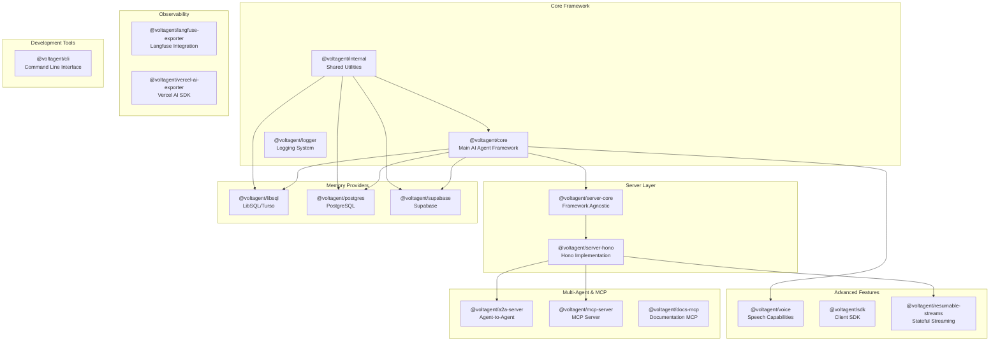

Sources: [pnpm-lock.yaml:1-110](), [packages/core/package.json:1-50](), [packages/server-hono/package.json:1-17]()

## Core Framework Packages

### @voltagent/core

The foundational package providing the core AI agent framework with agent orchestration, memory management, tool execution, and workflow capabilities. It acts as the primary interface for developers to build autonomous agents.

**Key Features:**
- `Agent` class for AI agent creation and management [packages/core/package.json:2-3]().
- `Memory` system with pluggable storage adapters.
- `ToolManager` for tool registration and execution.
- Model Provider Registry supporting 20+ providers including OpenAI, Anthropic, Google, and Bedrock [packages/core/package.json:6-22]().
- OpenTelemetry integration for observability [packages/core/package.json:27-38]().

**Dependencies:**
- `@modelcontextprotocol/sdk` for MCP integration [packages/core/package.json:25-25]().
- `@opentelemetry/*` packages for telemetry [packages/core/package.json:27-38]().
- `@voltagent/internal` for shared utilities [packages/core/package.json:39-39]().
- `ts-pattern` for pattern matching [packages/core/package.json:44-44]().
- `zod-from-json-schema` for schema conversion [packages/core/package.json:48-49]().

Sources: [packages/core/package.json:1-112]()

### @voltagent/internal

Shared internal utilities used across VoltAgent packages, providing common functionality for serialization, validation, and helper functions.

Sources: [packages/core/package.json:39-39](), [packages/libsql/package.json:7-7](), [packages/server-core/package.json:8-8]()

### @voltagent/logger

Logging system providing structured logging capabilities for VoltAgent applications with configurable output formats and levels. It is an optional peer dependency for core and storage packages.

Sources: [packages/core/package.json:81-89](), [packages/supabase/package.json:36-36](), [packages/libsql/package.json:45-45]()

## Memory Provider Packages

Memory providers implement the storage adapter interface to persist agent conversations, working memory, and history across different database systems.

### Package Dependencies Diagram

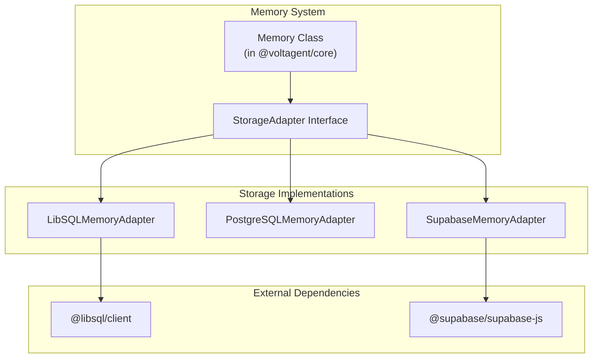

Sources: [packages/libsql/package.json:1-8](), [packages/supabase/package.json:1-9]()

### @voltagent/libsql

LibSQL/Turso memory provider implementing persistent storage using LibSQL databases, supporting both local SQLite and distributed Turso deployments.

**Key Features:**
- `LibSQLMemoryAdapter` implementing `StorageAdapter`.
- Local SQLite and remote Turso support [packages/libsql/package.json:6-6]().
- Edge-ready exports for Cloudflare Workers/Vercel Edge [packages/libsql/package.json:26-35]().

Sources: [packages/libsql/package.json:1-68]()

### @voltagent/supabase

Supabase memory provider enabling cloud-native persistence with real-time capabilities and PostgreSQL storage.

**Key Features:**
- `SupabaseMemoryAdapter` for Supabase integration.
- Built-in authentication and Row Level Security (RLS) support [packages/supabase/package.json:6-6]().

Sources: [packages/supabase/package.json:1-56]()

## Server and API Packages

### @voltagent/server-core

Framework-agnostic server core providing HTTP API functionality, WebSocket support, and MCP integration without dependency on specific web frameworks. It handles the heavy lifting of request/response parsing and security.

**Key Features:**
- REST API route handlers for agents and workflows.
- JWT authentication middleware [packages/server-core/package.json:10-10]().
- `createServerCoreSchemas` factory for Zod-based validation [packages/server-core/CHANGELOG.md:18-22]().
- Support for request-scoped headers in dynamic agent configurations [packages/server-core/CHANGELOG.md:31-40]().

Sources: [packages/server-core/package.json:1-65](), [packages/server-core/CHANGELOG.md:1-50]()

### @voltagent/server-hono

Hono-based server implementation providing a complete HTTP server with OpenAPI documentation and production-ready features.

**Key Features:**
- `HonoVoltAgentServer` class.
- OpenAPI/Swagger documentation generation [packages/server-hono/package.json:7-7]().
- Integration with `@voltagent/resumable-streams` for stateful client connections [packages/server-hono/package.json:12-12]().

Sources: [packages/server-hono/package.json:1-57]()

## Example Projects Structure

The monorepo includes comprehensive example projects demonstrating various VoltAgent capabilities.

### Natural Language to Code Mapping

The following diagram maps high-level features to their implementation examples in the codebase.

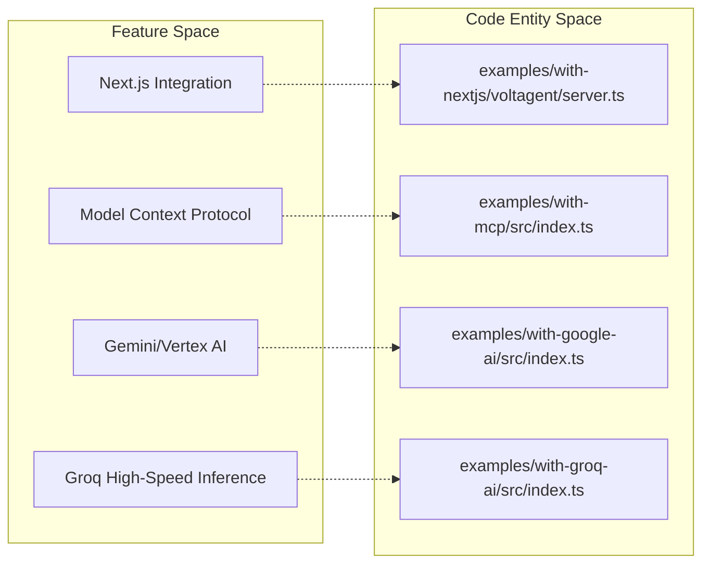

Sources: [examples/with-nextjs/package.json:43-43](), [examples/with-mcp/package.json:28-28](), [examples/with-google-ai/package.json:32-32](), [examples/with-groq-ai/package.json:32-32]()

### Dependency Mapping for Integration

This diagram shows how specific integration examples pull in the necessary packages from the ecosystem.

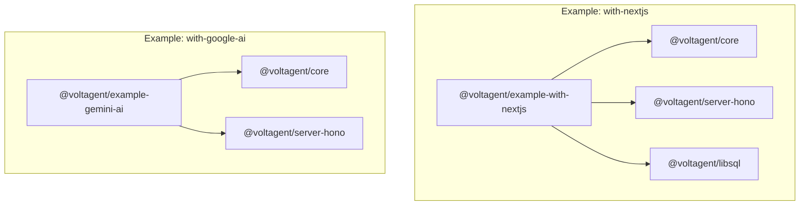

Sources: [examples/with-nextjs/package.json:8-13](), [examples/with-google-ai/package.json:5-11]()

### Example Categories

| Category | Examples | Purpose |
|----------|----------|---------|
| **Framework Base** | `examples/base` | Minimal setup with OpenAI and LibSQL [examples/base/package.json:111-136](). |
| **Frontend Integration** | `examples/with-nextjs` | Next.js 16 + React 19 implementation [examples/with-nextjs/package.json:15-19](). |
| **LLM Providers** | `with-google-ai`, `with-groq-ai`, `with-google-vertex-ai` | Dedicated provider configurations [examples/with-google-ai/package.json:1-12](). |
| **Protocol Support** | `examples/with-mcp` | Demonstrating MCP filesystem server integration [examples/with-mcp/package.json:2-3](). |
| **Serverless** | `examples/github-star-stories` | Cloudflare Workers + Wrangler deployment [examples/github-star-stories/package.json:202-210](). |

Sources: [examples/base/package.json:1-147](), [examples/with-nextjs/package.json:1-46](), [examples/with-mcp/package.json:1-34](), [examples/github-star-stories/package.json:188-224]()

---

# Page: Getting Started

# Getting Started

<details>
<summary>Relevant source files</summary>

The following files were used as context for generating this wiki page:

- [CONSOLE.md](CONSOLE.md)
- [examples/base/package.json](examples/base/package.json)
- [examples/github-repo-analyzer/package.json](examples/github-repo-analyzer/package.json)
- [examples/with-rag-chatbot/package.json](examples/with-rag-chatbot/package.json)
- [examples/with-retrieval/package.json](examples/with-retrieval/package.json)
- [examples/with-subagents/package.json](examples/with-subagents/package.json)
- [examples/with-supabase/package.json](examples/with-supabase/package.json)
- [examples/with-tools/package.json](examples/with-tools/package.json)
- [examples/with-vercel-ai/package.json](examples/with-vercel-ai/package.json)
- [examples/with-voice-elevenlabs/package.json](examples/with-voice-elevenlabs/package.json)
- [examples/with-voice-openai/package.json](examples/with-voice-openai/package.json)
- [packages/core/src/tool/manager/BaseToolManager.ts](packages/core/src/tool/manager/BaseToolManager.ts)
- [packages/core/src/tool/manager/ToolkitManager.ts](packages/core/src/tool/manager/ToolkitManager.ts)
- [packages/create-voltagent-app/README.md](packages/create-voltagent-app/README.md)
- [packages/create-voltagent-app/src/cli.integration.spec.ts](packages/create-voltagent-app/src/cli.integration.spec.ts)
- [packages/create-voltagent-app/src/cli.ts](packages/create-voltagent-app/src/cli.ts)
- [packages/create-voltagent-app/src/project-creator.ts](packages/create-voltagent-app/src/project-creator.ts)
- [packages/create-voltagent-app/src/types.ts](packages/create-voltagent-app/src/types.ts)
- [packages/create-voltagent-app/src/utils/analytics.ts](packages/create-voltagent-app/src/utils/analytics.ts)
- [packages/create-voltagent-app/src/utils/animation.ts](packages/create-voltagent-app/src/utils/animation.ts)
- [packages/create-voltagent-app/src/utils/dependency-installer.ts](packages/create-voltagent-app/src/utils/dependency-installer.ts)
- [packages/create-voltagent-app/src/utils/env-manager.ts](packages/create-voltagent-app/src/utils/env-manager.ts)
- [packages/create-voltagent-app/src/utils/package-manager.ts](packages/create-voltagent-app/src/utils/package-manager.ts)
- [packages/create-voltagent-app/src/utils/templates.ts](packages/create-voltagent-app/src/utils/templates.ts)
- [packages/create-voltagent-app/templates/base/.dockerignore.template](packages/create-voltagent-app/templates/base/.dockerignore.template)
- [packages/create-voltagent-app/templates/base/README.md.template](packages/create-voltagent-app/templates/base/README.md.template)
- [packages/create-voltagent-app/templates/base/index.ts.template](packages/create-voltagent-app/templates/base/index.ts.template)
- [packages/create-voltagent-app/templates/base/tools/index.ts.template](packages/create-voltagent-app/templates/base/tools/index.ts.template)
- [packages/create-voltagent-app/templates/base/tsconfig.json.template](packages/create-voltagent-app/templates/base/tsconfig.json.template)
- [packages/create-voltagent-app/templates/base/tsdown.config.ts.template](packages/create-voltagent-app/templates/base/tsdown.config.ts.template)
- [packages/create-voltagent-app/templates/base/workflows/index.ts.template](packages/create-voltagent-app/templates/base/workflows/index.ts.template)
- [website/docs/getting-started/manual-setup.md](website/docs/getting-started/manual-setup.md)
- [website/docs/getting-started/overview.md](website/docs/getting-started/overview.md)
- [website/docs/getting-started/quick-start.md](website/docs/getting-started/quick-start.md)
- [website/src/components/docs-widgets/EnterpriseCard.tsx](website/src/components/docs-widgets/EnterpriseCard.tsx)
- [website/src/components/docs-widgets/WorkflowDiagramFlow.tsx](website/src/components/docs-widgets/WorkflowDiagramFlow.tsx)
- [website/src/theme/DocHeaderMobile/index.tsx](website/src/theme/DocHeaderMobile/index.tsx)
- [website/src/theme/DocRoot/Layout/Main/index.tsx](website/src/theme/DocRoot/Layout/Main/index.tsx)
- [website/src/theme/DocRoot/Layout/Main/styles.module.css](website/src/theme/DocRoot/Layout/Main/styles.module.css)
- [website/src/theme/Navbar/Content/index.js](website/src/theme/Navbar/Content/index.js)
- [website/src/theme/Navbar/index.js](website/src/theme/Navbar/index.js)
- [website/tailwind.config.js](website/tailwind.config.js)

</details>


This page guides you through creating your first VoltAgent project using the `create-voltagent-app` CLI tool. You'll learn how to scaffold a project, configure an AI provider, and run your first agent.

---

## Prerequisites

Before creating a VoltAgent application, ensure your environment meets the following requirements:

| Requirement | Minimum Version | Notes |
|-------------|----------------|-------|
| Node.js | 20.19+ | Generated `tsdown` build requires Node 20.19+ for ESM resolution [website/docs/getting-started/quick-start.md:61-63]() |
| Package Manager | npm, pnpm, or yarn | Supported for project scaffolding [website/docs/getting-started/quick-start.md:31-53]() |
| TypeScript | 5.8+ | Used in examples and templates [examples/base/package.json:18-18]() |

**AI Provider Access**: You'll need an API key from at least one supported provider (OpenAI, Anthropic, Google, Groq, Mistral). The CLI will prompt you to select a provider and enter your API key during project setup [website/docs/getting-started/quick-start.md:55-55]().

Sources: [website/docs/getting-started/quick-start.md:31-63](), [examples/base/package.json:14-18]()

---

## Automatic Setup (Recommended)

### Running the Generator

The `create-voltagent-app` CLI provides an interactive wizard that guides you through project setup:

```bash
npm create voltagent-app@latest my-agent-app
```

This command downloads the latest version of the scaffolding tool and launches an interactive prompt.

Sources: [website/docs/getting-started/quick-start.md:27-36](), [CONSOLE.md:96-103]()

### Interactive Configuration Flow

The CLI prompts for:

1. **Project Name**: Directory name for the project (e.g., `my-agent-app`).
2. **AI Provider**: Select from OpenAI, Anthropic, Google, Groq, or Mistral [website/docs/getting-started/quick-start.md:71-117]().
3. **API Key**: Optional prompt to enter your provider's API key. If skipped, you must add it to `.env` later [website/docs/getting-started/quick-start.md:67-70]().

Sources: [website/docs/getting-started/quick-start.md:55-117]()

### Generated Project Structure

The scaffolded project is based on the `voltagent-example-base` template.

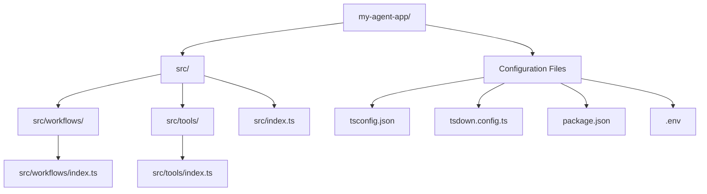

**Key Generated Files**:

| File | Purpose | Key Components |
|------|---------|----------------|
| `src/index.ts` | Main application entry point | Agent definitions, VoltAgent initialization, server startup [examples/base/package.json:33-33]() |
| `package.json` | Project metadata | Scripts (`dev`, `build`, `start`), dependencies [examples/base/package.json:1-38]() |
| `.env` | Environment variables | Provider API keys (e.g., `OPENAI_API_KEY`) [website/docs/getting-started/quick-start.md:69-77]() |

Sources: [examples/base/package.json:1-38](), [website/docs/getting-started/quick-start.md:67-77]()

---

## Configuration

### Environment Variables

Create or edit `.env` in the project root to provide your API keys:

```bash
# Example for OpenAI
OPENAI_API_KEY=your-api-key-here

# Example for Anthropic
ANTHROPIC_API_KEY=your-api-key-here
```

| Provider | Env Variable | API Key Location |
|----------|--------------|------------------|
| OpenAI | `OPENAI_API_KEY` | [platform.openai.com](https://platform.openai.com/api-keys) |
| Anthropic | `ANTHROPIC_API_KEY` | [console.anthropic.com](https://console.anthropic.com/settings/keys) |
| Google Gemini | `GOOGLE_GENERATIVE_AI_API_KEY` | [aistudio.google.com](https://aistudio.google.com/app/apikey) |
| Groq | `GROQ_API_KEY` | [console.groq.com](https://console.groq.com/keys) |
| Mistral | `MISTRAL_API_KEY` | [console.mistral.ai](https://console.mistral.ai/api-keys) |

Sources: [website/docs/getting-started/quick-start.md:71-117]()

---

## Running the Application

### Development Mode

Start the development server with hot-reload using `tsx`:

```bash
npm run dev
```

The `dev` script executes `tsx watch --env-file=.env ./src` [examples/base/package.json:33-33]().

**Expected Output**:

```bash
══════════════════════════════════════════════════
  VOLTAGENT SERVER STARTED SUCCESSFULLY
══════════════════════════════════════════════════
  ✓ HTTP Server:  http://localhost:3141
  ✓ Swagger UI:   http://localhost:3141/ui

  Test your agents with VoltOps Console: https://console.voltagent.dev
══════════════════════════════════════════════════
```

Sources: [website/docs/getting-started/quick-start.md:149-162](), [CONSOLE.md:113-124]()

### Server Architecture

The server, typically powered by `@voltagent/server-hono`, exposes endpoints for interaction and observability.

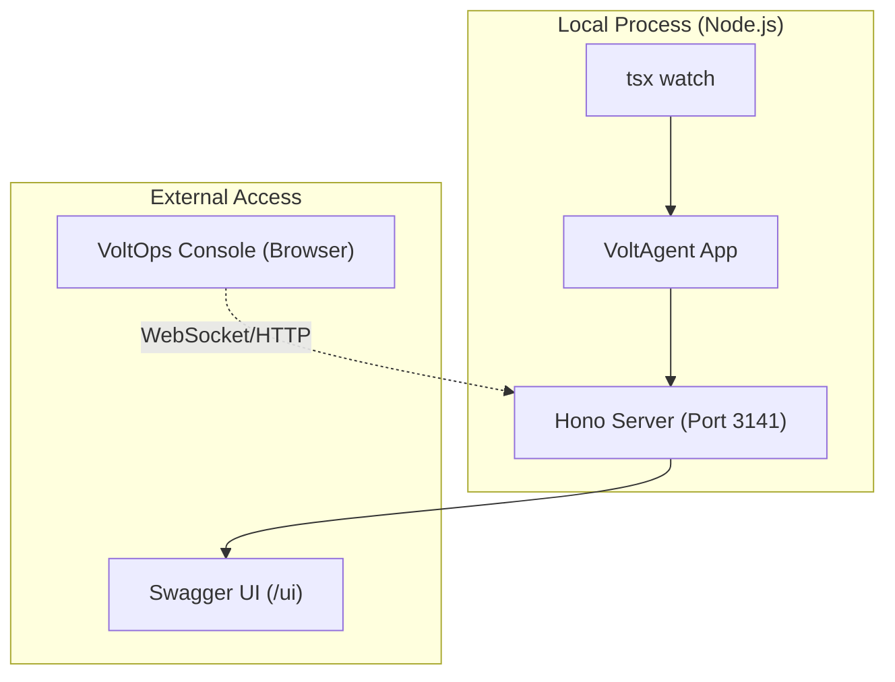

Sources: [examples/base/package.json:10-10](), [CONSOLE.md:119-128]()

---

## Interacting with Your Agent

### VoltOps Console Connection

The VoltOps Console connects directly to your local agent process via your browser.

1. Open [console.voltagent.dev](https://console.voltagent.dev).
2. Click **Agents & Workflows** in the sidebar [website/docs/getting-started/quick-start.md:177-177]().
3. Communication happens directly between the browser and `http://localhost:3141`. No data is sent to external servers [CONSOLE.md:128-131]().

Sources: [CONSOLE.md:122-131](), [website/docs/getting-started/quick-start.md:177-177]()

### Manual Setup (Reference)

If you are building a project from scratch without the CLI, your `package.json` should include these core dependencies:

| Package | Purpose |
|---------|---------|
| `@voltagent/core` | Core agent and workflow logic [examples/base/package.json:7-7]() |
| `@voltagent/server-hono` | HTTP server implementation [examples/base/package.json:10-10]() |
| `@voltagent/libsql` | Default SQLite memory adapter [examples/base/package.json:8-8]() |
| `@voltagent/logger` | Structured logging [examples/base/package.json:9-9]() |
| `ai` | Vercel AI SDK core [examples/base/package.json:11-11]() |

Sources: [examples/base/package.json:4-13]()

---

## Code Entity Space: Initialization

This diagram maps the natural language setup steps to the code entities initialized in a standard project.

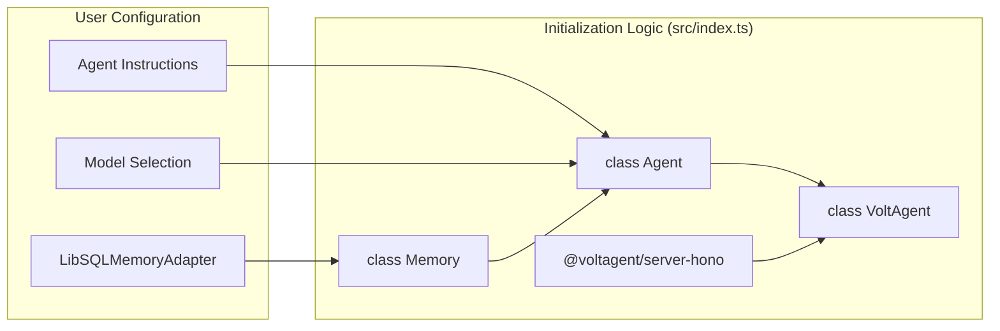

Sources: [examples/base/package.json:4-13](), [examples/with-supabase/package.json:4-12]()

---

# Page: Core Agent System

# Core Agent System

<details>
<summary>Relevant source files</summary>

The following files were used as context for generating this wiki page:

- [examples/with-subagents/src/index.ts](examples/with-subagents/src/index.ts)
- [packages/core/src/agent/agent.spec-d.ts](packages/core/src/agent/agent.spec-d.ts)
- [packages/core/src/agent/agent.spec.ts](packages/core/src/agent/agent.spec.ts)
- [packages/core/src/agent/agent.ts](packages/core/src/agent/agent.ts)
- [packages/core/src/agent/hooks/index.spec.ts](packages/core/src/agent/hooks/index.spec.ts)
- [packages/core/src/agent/hooks/index.ts](packages/core/src/agent/hooks/index.ts)
- [packages/core/src/agent/index.ts](packages/core/src/agent/index.ts)
- [packages/core/src/agent/providers/base/types.ts](packages/core/src/agent/providers/base/types.ts)
- [packages/core/src/agent/subagent/index.spec.ts](packages/core/src/agent/subagent/index.spec.ts)
- [packages/core/src/agent/subagent/index.ts](packages/core/src/agent/subagent/index.ts)
- [packages/core/src/agent/types.ts](packages/core/src/agent/types.ts)
- [packages/core/src/events/types.ts](packages/core/src/events/types.ts)
- [packages/core/src/index.ts](packages/core/src/index.ts)
- [packages/server-core/src/handlers/agent.handlers.spec.ts](packages/server-core/src/handlers/agent.handlers.spec.ts)
- [packages/server-core/src/handlers/agent.handlers.ts](packages/server-core/src/handlers/agent.handlers.ts)
- [packages/server-core/src/schemas/agent.schemas.spec.ts](packages/server-core/src/schemas/agent.schemas.spec.ts)
- [packages/server-core/src/schemas/agent.schemas.ts](packages/server-core/src/schemas/agent.schemas.ts)
- [packages/server-core/src/utils/options.ts](packages/server-core/src/utils/options.ts)
- [packages/server-elysia/src/routes/agent.routes.ts](packages/server-elysia/src/routes/agent.routes.ts)
- [website/docs/agents/context.md](website/docs/agents/context.md)
- [website/docs/agents/hooks.md](website/docs/agents/hooks.md)
- [website/docs/agents/overview.md](website/docs/agents/overview.md)
- [website/docs/agents/prompts.md](website/docs/agents/prompts.md)
- [website/docs/agents/subagents.md](website/docs/agents/subagents.md)
- [website/docs/agents/tools.md](website/docs/agents/tools.md)
- [website/docs/api/endpoints/agents.md](website/docs/api/endpoints/agents.md)
- [website/docs/ui/ai-sdk-integration.md](website/docs/ui/ai-sdk-integration.md)

</details>


The `Agent` class in `@voltagent/core` is the central orchestrator for AI-powered conversations and task execution. It manages the complete lifecycle of agent operations: coordinating language model calls, executing tools, persisting conversation history, applying validation rules, and emitting telemetry. The class exposes primary execution methods (`generateText()`, `streamText()`, `generateObject()`, `streamObject()`) that follow a consistent request-response pipeline.

## What is an Agent?

An `Agent` instance represents a configured AI assistant with a specific personality (instructions), capabilities (tools), and operational constraints (guardrails, hooks). Agents are stateful in that they can persist conversation history through memory adapters, but individual operations are isolated through per-request `OperationContext` instances.

The Agent class coordinates several specialized subsystems:
- **Model execution** via AI SDK language model abstraction.
- **Tool management** for extending agent capabilities. For details, see [Tools and Toolkits](#2.3).
- **Memory persistence** for conversation continuity. For details, see [Memory System](#2.4) and [Memory Storage Adapters](#2.5).
- **Lifecycle hooks** for observability and customization. For details, see [Lifecycle Hooks](#2.6).
- **Guardrails and middleware** for validation and transformation. For details, see [Guardrails and Middleware](#2.7).
- **Sub-agent delegation** for task routing. For details, see [Sub-Agent and Supervisor Patterns](#4).

## Agent Instantiation

Agents are created by passing an `AgentOptions` configuration object to the constructor [packages/core/src/agent/agent.ts:782-938](). The configuration specifies the agent's identity, model, instructions, and optional capabilities.

### Basic Agent Creation

```typescript
import { Agent } from "@voltagent/core";

const agent = new Agent({
  name: "customer-support",
  instructions: "You are a helpful customer support agent",
  model: "openai/gpt-4o-mini",
  tools: [searchTool],
  memory: memoryInstance,
});
```

The constructor initializes internal managers (`MemoryManager`, `ToolManager`, `SubAgentManager`) and normalizes configuration (guardrails, hooks, instructions). For details, see [Agent Fundamentals](#2.1).

### Agent Component Architecture

The Agent orchestrates several specialized subsystems through manager objects. Each manager is responsible for a specific domain and exposes methods called during execution.

```mermaid
graph TB
    subgraph "Code Entity: Agent Class [packages/core/src/agent/agent.ts]"
        AgentCore["Agent"]
        id["id: string"]
        name["name: string"]
        instructions["instructions: InstructionsDynamicValue"]
        model["model: AgentModelValue"]
        hooks["hooks: AgentHooks"]
    end
    
    subgraph "Code Entity: Managers [packages/core/src/agent/agent.ts]"
        MemoryManager["MemoryManager [packages/core/src/memory/manager/memory-manager.ts]"]
        ToolManager["ToolManager [packages/core/src/tool/manager.ts]"]
        SubAgentManager["SubAgentManager [packages/core/src/agent/subagent/index.ts]"]
    end
    
    subgraph "Code Entity: Operation Context [packages/core/src/agent/types.ts]"
        OperationContext["OperationContext (request-scoped)"]
        ConversationBuffer["ConversationBuffer [packages/core/src/agent/conversation-buffer.ts]"]
        MemoryPersistQueue["MemoryPersistQueue [packages/core/src/agent/memory-persist-queue.ts]"]
        AgentTraceContext["AgentTraceContext [packages/core/src/agent/open-telemetry/trace-context.ts]"]
    end
    
    subgraph "Natural Language: External Services"
        LanguageModel["LLM Provider (OpenAI, Anthropic, etc.)"]
        Memory["Storage Adapter (SQLite, PG, etc.)"]
        VoltAgentObservability["Observability / Telemetry"]
    end
    
    AgentCore --> MemoryManager
    AgentCore --> ToolManager
    AgentCore --> SubAgentManager
    AgentCore --> LanguageModel
    AgentCore --> Memory
    AgentCore --> VoltAgentObservability
    
    AgentCore -.creates per-request.-> OperationContext
    OperationContext --> ConversationBuffer
    OperationContext --> MemoryPersistQueue
    OperationContext --> AgentTraceContext
```

**Sources:** [packages/core/src/agent/agent.ts:782-938](), [packages/core/src/agent/types.ts:204-207](), [packages/core/src/agent/agent.ts:349-365]()

## Core Execution Methods

The Agent class provides methods for interacting with language models. Each method creates an `OperationContext`, executes a request-response pipeline, and returns results with the operation context attached [packages/core/src/agent/agent.ts:944-1541]().

| Method | Return Type | Use Case |
|--------|-------------|----------|
| `generateText()` | `Promise<GenerateTextResultWithContext>` | Complete text generation (batch) |
| `streamText()` | `Promise<StreamTextResultWithContext>` | Real-time text streaming |
| `generateObject()` | `Promise<GenerateObjectResultWithContext>` | Structured data extraction |
| `streamObject()` | `Promise<StreamObjectResultWithContext>` | Streaming structured data |

All methods accept input as `string`, `UIMessage[]`, or `BaseMessage[]`. For details, see [Agent Fundamentals](#2.1) and [Message Processing Pipeline](#2.8).

**Sources:** [packages/core/src/agent/agent.ts:944-1148](), [packages/core/src/agent/agent.ts:1150-1541](), [packages/core/src/agent/types.ts:677-776]()

## Operation Lifecycle Overview

Every agent execution follows a multi-phase pipeline managed by the Agent class.

### High-Level Execution Pipeline

```mermaid
graph LR
    subgraph "Phase 1: Setup"
        CreateContext["createOperationContext()"]
        InitTrace["AgentTraceContext.start()"]
    end
    
    subgraph "Phase 2: Pre-Processing"
        OnStart["hooks.onStart()"]
        InputGuardrails["executeInputGuardrails()"]
        InputMiddlewares["runInputMiddlewares()"]
    end
    
    subgraph "Phase 3: Preparation"
        LoadMemory["MemoryManager.retrieveMessages()"]
        PrepareTools["ToolManager.prepareForExecution()"]
    end
    
    subgraph "Phase 4: Execution"
        AISDKCall["generateText / streamText"]
        ToolLoop["Tool Execution Loop"]
        StepPersist["MemoryPersistQueue.scheduleSave()"]
    end
    
    subgraph "Phase 5: Post-Processing"
        OutputGuardrails["executeOutputGuardrails()"]
        OnEnd["hooks.onEnd()"]
    end
    
    CreateContext --> InitTrace
    InitTrace --> OnStart
    OnStart --> InputGuardrails
    InputGuardrails --> InputMiddlewares
    InputMiddlewares --> LoadMemory
    LoadMemory --> PrepareTools
    PrepareTools --> AISDKCall
    AISDKCall --> ToolLoop
    ToolLoop --> StepPersist
    StepPersist --> OutputGuardrails
    OutputGuardrails --> OnEnd
```

**Sources:** [packages/core/src/agent/agent.ts:944-1148](), [packages/core/src/agent/agent.ts:1939-2037](), [packages/core/src/agent/agent.ts:2127-2187]()

## Subsystem Overviews

### Operation Context
The `OperationContext` is a request-scoped state container passed through the entire pipeline. It includes a `context` Map for cross-component data flow [packages/core/src/agent/types.ts:204-207](). For details, see [Operation Context](#2.2).

### Tools and Toolkits
The `ToolManager` handles tool registration and execution logic, including multi-step loops and tool routing [packages/core/src/tool/manager.ts](). For details, see [Tools and Toolkits](#2.3).

### Memory System
Conversation history is managed by `MemoryManager` [packages/core/src/memory/manager/memory-manager.ts](). It utilizes a `ConversationBuffer` for in-memory accumulation and a `MemoryPersistQueue` for debounced storage [packages/core/src/agent/conversation-buffer.ts:36-104](). For details, see [Memory System](#2.4) and [Memory Storage Adapters](#2.5).

### Lifecycle Hooks
The `AgentHooks` system provides over 12 interception points (e.g., `onStart`, `onToolStart`, `onEnd`) allowing developers to inject logic into the execution pipeline [packages/core/src/agent/hooks/index.ts:1-128](). For details, see [Lifecycle Hooks](#2.6).

### Guardrails and Middleware
The system supports `InputGuardrail` and `OutputGuardrail` for validation, alongside a middleware pipeline for pre-processing transformations [packages/core/src/agent/guardrail.ts](). For details, see [Guardrails and Middleware](#2.7).

### Sub-Agent and Supervisor Patterns
Agents can delegate tasks to sub-agents via the `SubAgentManager` [packages/core/src/agent/subagent/index.ts](). This allows for complex hierarchical agent structures. For details, see [Sub-Agent and Supervisor Patterns](#4).

### Observability and Tracing
The system integrates OpenTelemetry through `AgentTraceContext` [packages/core/src/agent/open-telemetry/trace-context.ts](). Standardized attributes are applied to spans for monitoring model usage, tool calls, and agent performance. For details, see [VoltOps Platform](#9).

**Sources:** [packages/core/src/agent/agent.ts:782-938](), [packages/core/src/agent/hooks/index.ts](), [packages/core/src/agent/subagent/index.ts](), [packages/core/src/agent/open-telemetry/trace-context.ts]()

---

# Page: Agent Fundamentals

# Agent Fundamentals

<details>
<summary>Relevant source files</summary>

The following files were used as context for generating this wiki page:

- [examples/with-subagents/src/index.ts](examples/with-subagents/src/index.ts)
- [packages/core/src/agent/agent.spec-d.ts](packages/core/src/agent/agent.spec-d.ts)
- [packages/core/src/agent/agent.spec.ts](packages/core/src/agent/agent.spec.ts)
- [packages/core/src/agent/agent.ts](packages/core/src/agent/agent.ts)
- [packages/core/src/agent/hooks/index.spec.ts](packages/core/src/agent/hooks/index.spec.ts)
- [packages/core/src/agent/hooks/index.ts](packages/core/src/agent/hooks/index.ts)
- [packages/core/src/agent/index.ts](packages/core/src/agent/index.ts)
- [packages/core/src/agent/providers/base/types.ts](packages/core/src/agent/providers/base/types.ts)
- [packages/core/src/agent/subagent/index.spec.ts](packages/core/src/agent/subagent/index.spec.ts)
- [packages/core/src/agent/subagent/index.ts](packages/core/src/agent/subagent/index.ts)
- [packages/core/src/agent/types.ts](packages/core/src/agent/types.ts)
- [packages/core/src/events/types.ts](packages/core/src/events/types.ts)
- [packages/core/src/index.ts](packages/core/src/index.ts)
- [packages/core/src/types.ts](packages/core/src/types.ts)
- [packages/core/src/voltagent.spec.ts](packages/core/src/voltagent.spec.ts)
- [packages/core/src/voltagent.ts](packages/core/src/voltagent.ts)
- [packages/server-core/src/handlers/agent.handlers.spec.ts](packages/server-core/src/handlers/agent.handlers.spec.ts)
- [packages/server-core/src/handlers/agent.handlers.ts](packages/server-core/src/handlers/agent.handlers.ts)
- [packages/server-core/src/schemas/agent.schemas.spec.ts](packages/server-core/src/schemas/agent.schemas.spec.ts)
- [packages/server-core/src/schemas/agent.schemas.ts](packages/server-core/src/schemas/agent.schemas.ts)
- [packages/server-core/src/utils/options.ts](packages/server-core/src/utils/options.ts)
- [packages/server-elysia/src/routes/agent.routes.ts](packages/server-elysia/src/routes/agent.routes.ts)
- [website/docs/agents/context.md](website/docs/agents/context.md)
- [website/docs/agents/hooks.md](website/docs/agents/hooks.md)
- [website/docs/agents/overview.md](website/docs/agents/overview.md)
- [website/docs/agents/prompts.md](website/docs/agents/prompts.md)
- [website/docs/agents/subagents.md](website/docs/agents/subagents.md)
- [website/docs/agents/tools.md](website/docs/agents/tools.md)
- [website/docs/api/endpoints/agents.md](website/docs/api/endpoints/agents.md)
- [website/docs/ui/ai-sdk-integration.md](website/docs/ui/ai-sdk-integration.md)

</details>


## Purpose and Scope

This document covers the core `Agent` class in VoltAgent: how to instantiate agents, configure their options, and invoke text generation methods. It explains the fundamental building blocks including `AgentOptions`, instruction configuration, model specification, and the `OperationContext` that flows through agent operations.

For information about tools and toolkits, see [Tools and Toolkits](#2.3). For memory persistence and conversation history, see [Memory System](#2.4). For lifecycle hooks and interception points, see [Lifecycle Hooks](#2.6).

## Agent Class Overview

The `Agent` class ([packages/core/src/agent/agent.ts:782-2900]()) is the primary orchestration layer for AI-powered operations. An agent wraps a language model with instructions, tools, memory, and execution policies, providing a unified interface for text generation and structured output.

**Core Responsibilities:**

| Responsibility | Description |
|---|---|
| **Model Orchestration** | Manages model selection, fallback, and retry logic |
| **Context Management** | Maintains `OperationContext` with request-scoped state |
| **Tool Execution** | Coordinates tool calls and approval workflows |
| **Memory Integration** | Persists conversation history and manages summarization |
| **Pipeline Control** | Executes guardrails, middleware, and lifecycle hooks |
| **Observability** | Integrates OpenTelemetry tracing and logging |

### Agent Architecture Diagram

This diagram bridges the natural language concept of an "Agent" to the specific code entities in the `@voltagent/core` package.

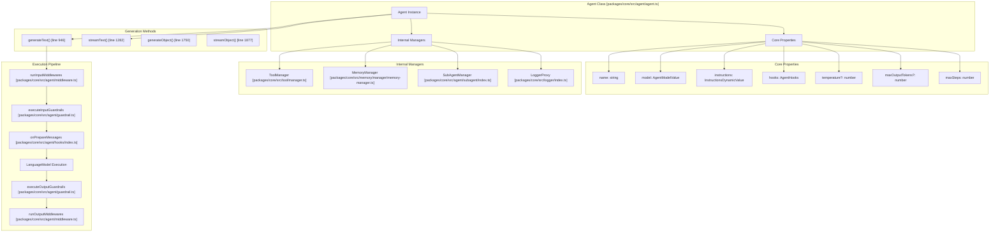

Sources: [packages/core/src/agent/agent.ts:782-2900](), [packages/core/src/agent/types.ts:641-730](), [packages/core/src/agent/middleware.ts:168-169](), [packages/core/src/agent/guardrail.ts:152-153]()

## Creating an Agent

Agents are instantiated using the `Agent` constructor with an `AgentOptions` object. Three fields are required: `name`, `instructions`, and `model`.

### Minimal Agent Example

```typescript
import { Agent } from "@voltagent/core";

const agent = new Agent({
  name: "Assistant",
  instructions: "You are a helpful assistant.",
  model: "openai/gpt-4o-mini"
});
```

The constructor ([packages/core/src/agent/agent.ts:832-938]()) initializes internal managers, resolves configuration, and registers the agent in the `AgentRegistry`.

### AgentOptions Structure

The `AgentOptions` interface defines the configuration surface for an agent.

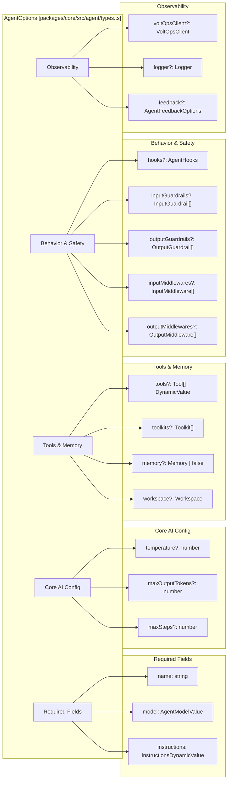

Sources: [packages/core/src/agent/types.ts:641-730](), [packages/core/src/agent/agent.ts:832-938]()

## Agent Configuration Options

### Core Configuration Fields

| Field | Type | Default | Description |
|---|---|---|---|
| `name` | `string` | Required | Agent identifier |
| `id` | `string?` | `name` | Unique ID (defaults to `name`) |
| `purpose` | `string?` | - | Brief purpose description (used in supervisor context) |
| `instructions` | `InstructionsDynamicValue` | Required | Behavior guidelines (static or dynamic) |
| `model` | `AgentModelValue` | Required | Model reference or fallback list |
| `temperature` | `number?` | - | Creativity parameter (0-1) |
| `maxOutputTokens` | `number?` | - | Token generation limit |
| `maxSteps` | `number?` | `5` (or `100` with workspace) | Maximum tool-use iterations |
| `maxRetries` | `number?` | `3` | Retry attempts before fallback |

The `maxSteps` default changes based on workspace configuration ([packages/core/src/agent/agent.ts:848-849]()):

```typescript
const defaultMaxSteps = this.workspace ? 100 : 5;
this.maxSteps = options.maxSteps ?? defaultMaxSteps;
```

### Sub-Agent Configuration

When an agent has `subAgents`, it operates as a supervisor using the `SubAgentManager` ([packages/core/src/agent/subagent/index.ts:55]()).

| Field | Type | Description |
|---|---|---|
| `subAgents` | `SubAgentConfig[]?` | Sub-agents for task delegation |
| `supervisorConfig` | `SupervisorConfig?` | Supervisor behavior customization |

The `supervisorConfig` controls delegation behavior and stream event forwarding ([packages/core/src/agent/types.ts:319-386]()).

Sources: [packages/core/src/agent/types.ts:641-730](), [packages/core/src/agent/agent.ts:832-938](), [packages/core/src/agent/subagent/index.ts:55-91]()

## Instructions Configuration

Instructions define agent behavior and can be static strings, dynamic functions, or managed prompts from VoltOps.

### InstructionsDynamicValue Type

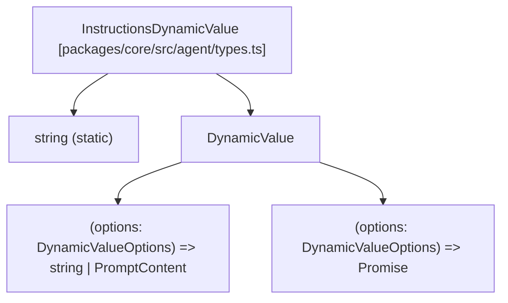

### Dynamic Instructions

Instructions can be a function that receives `DynamicValueOptions` ([packages/core/src/voltops/types.ts:15-17]()) and returns text based on runtime context:

```typescript
const agent = new Agent({
  name: "Assistant",
  instructions: ({ context }) => {
    const tier = context?.get("tier") || "free";
    return tier === "premium"
      ? "You are a premium assistant."
      : "You are a basic assistant.";
  },
  model: "openai/gpt-4o-mini"
});
```

### VoltOps Prompt Management

When a `VoltOpsClient` is configured, instructions can reference managed prompts. The prompt helper is initialized in the constructor ([packages/core/src/agent/agent.ts:937]()).

```typescript
const agent = new Agent({
  name: "Assistant",
  instructions: async ({ prompts }) => {
    return await prompts?.get("assistant-instructions", { version: "2.1.0" });
  },
  model: "openai/gpt-4o-mini",
  voltOpsClient: new VoltOpsClient({ ... })
});
```

Sources: [packages/core/src/agent/types.ts:226](), [packages/core/src/voltops/types.ts:15-44](), [packages/core/src/agent/agent.ts:836-937]()

## Model Configuration

The `model` field specifies which language model(s) to use. VoltAgent supports multiple specification methods to enable fallback and retry strategies.

### Model Specification Methods

**1. Model String:** Resolved by `ModelProviderRegistry` ([packages/core/src/registries/model-provider-registry.ts]()).

```typescript
const agent = new Agent({
  name: "Assistant",
  model: "openai/gpt-4o-mini"
});
```

**2. Fallback List:** Configured via `AgentModelConfig[]` ([packages/core/src/agent/types.ts:241-265]()).

```typescript
const agent = new Agent({
  name: "Assistant",
  model: [
    { model: "openai/gpt-4o", maxRetries: 2 },
    { model: "anthropic/claude-3-5-sonnet", maxRetries: 3 }
  ]
});
```

Model resolution happens in `resolveModel()` ([packages/core/src/agent/agent.ts:2151-2272]()).

Sources: [packages/core/src/agent/types.ts:229-265](), [packages/core/src/agent/agent.ts:2151-2272]()

## Generation Methods

The `Agent` class provides core methods for text generation.

### generateText

Generates complete text response synchronously ([packages/core/src/agent/agent.ts:946-1216]()):

```typescript
const result = await agent.generateText("What is TypeScript?");
console.log(result.text);
```

### streamText

Streams text response incrementally ([packages/core/src/agent/agent.ts:1282-1682]()):

```typescript
const response = await agent.streamText("Explain async/await");
for await (const chunk of response.textStream) {
  process.stdout.write(chunk);
}
```

**Return Type Fields:**
- `textStream`: AsyncIterable of text chunks.
- `fullStream`: AsyncIterable of detailed events (`text-delta`, `tool-call`, `tool-result`, `finish`) ([packages/core/src/agent/subagent/types.ts:24-27]()).

Sources: [packages/core/src/agent/agent.ts:946-1682](), [packages/core/src/agent/types.ts:759-776]()

## OperationContext

`OperationContext` ([packages/core/src/agent/types.ts:865]()) is the request-scoped state container that flows through all agent operations.

### OperationContext Structure

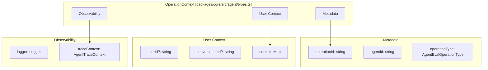

The `context` map enables passing custom data. It is initialized in `createOperationContext()` ([packages/core/src/agent/agent.ts:2008-2136]()).

Sources: [packages/core/src/agent/types.ts:865-937](), [packages/core/src/agent/agent.ts:2008-2136]()

---

# Page: Operation Context

# Operation Context

<details>
<summary>Relevant source files</summary>

The following files were used as context for generating this wiki page:

- [examples/with-subagents/src/index.ts](examples/with-subagents/src/index.ts)
- [packages/core/src/agent/agent.spec-d.ts](packages/core/src/agent/agent.spec-d.ts)
- [packages/core/src/agent/agent.spec.ts](packages/core/src/agent/agent.spec.ts)
- [packages/core/src/agent/agent.ts](packages/core/src/agent/agent.ts)
- [packages/core/src/agent/hooks/index.spec.ts](packages/core/src/agent/hooks/index.spec.ts)
- [packages/core/src/agent/hooks/index.ts](packages/core/src/agent/hooks/index.ts)
- [packages/core/src/agent/index.ts](packages/core/src/agent/index.ts)
- [packages/core/src/agent/providers/base/types.ts](packages/core/src/agent/providers/base/types.ts)
- [packages/core/src/agent/subagent/index.spec.ts](packages/core/src/agent/subagent/index.spec.ts)
- [packages/core/src/agent/subagent/index.ts](packages/core/src/agent/subagent/index.ts)
- [packages/core/src/agent/types.ts](packages/core/src/agent/types.ts)
- [packages/core/src/events/types.ts](packages/core/src/events/types.ts)
- [packages/core/src/index.ts](packages/core/src/index.ts)
- [packages/server-core/src/handlers/agent.handlers.spec.ts](packages/server-core/src/handlers/agent.handlers.spec.ts)
- [packages/server-core/src/handlers/agent.handlers.ts](packages/server-core/src/handlers/agent.handlers.ts)
- [packages/server-core/src/schemas/agent.schemas.spec.ts](packages/server-core/src/schemas/agent.schemas.spec.ts)
- [packages/server-core/src/schemas/agent.schemas.ts](packages/server-core/src/schemas/agent.schemas.ts)
- [packages/server-core/src/utils/options.ts](packages/server-core/src/utils/options.ts)
- [packages/server-elysia/src/routes/agent.routes.ts](packages/server-elysia/src/routes/agent.routes.ts)
- [website/docs/agents/context.md](website/docs/agents/context.md)
- [website/docs/agents/hooks.md](website/docs/agents/hooks.md)
- [website/docs/agents/overview.md](website/docs/agents/overview.md)
- [website/docs/agents/prompts.md](website/docs/agents/prompts.md)
- [website/docs/agents/subagents.md](website/docs/agents/subagents.md)
- [website/docs/agents/tools.md](website/docs/agents/tools.md)
- [website/docs/api/endpoints/agents.md](website/docs/api/endpoints/agents.md)
- [website/docs/ui/ai-sdk-integration.md](website/docs/ui/ai-sdk-integration.md)

</details>


**Purpose**: This document explains the `OperationContext` type, which serves as a request-scoped state container that flows through all components during a single agent operation. It describes the two context maps (`context` and `systemContext`), their lifecycle, and how data propagates across hooks, tools, memory, retrievers, and sub-agents.

**Related Pages**: For agent lifecycle hooks that receive `OperationContext`, see [Lifecycle Hooks](#2.6). For tool execution that accesses context, see [Tools and Toolkits](#2.3). For memory persistence that uses context, see [Memory System](#2.4).

---

## Overview

`OperationContext` is the central state container for a single agent operation (e.g., one `generateText()` or `streamText()` call). The framework creates a fresh `OperationContext` at the start of each operation and passes it through every component that participates in that operation.

Title: Operation Context Lifecycle
```mermaid
graph TB
    subgraph "Single Operation Lifecycle"
        START["generateText() or streamText() call"]
        CREATE["createOperationContext()"]
        HOOKS_START["onStart hook"]
        PREP["prepareExecution()"]
        LLM["LLM execution"]
        TOOLS["Tool execution"]
        MEMORY["Memory persistence"]
        HOOKS_END["onEnd hook"]
        RETURN["Return result with context"]
        
        START --> CREATE
        CREATE --> HOOKS_START
        HOOKS_START --> PREP
        PREP --> LLM
        LLM --> TOOLS
        TOOLS --> MEMORY
        MEMORY --> HOOKS_END
        HOOKS_END --> RETURN
    end
    
    CREATE -.creates.-> OC["OperationContext instance"]
    OC -.flows to.-> HOOKS_START
    OC -.flows to.-> PREP
    OC -.flows to.-> LLM
    OC -.flows to.-> TOOLS
    OC -.flows to.-> MEMORY
    OC -.flows to.-> HOOKS_END
    OC -.returned in.-> RETURN
```

**Sources**: [packages/core/src/agent/agent.ts:954-1124](), [packages/core/src/agent/agent.ts:3343-3438]()

---

## Context Structure

`OperationContext` contains two distinct `Map` instances for storing state:

### User Context Map (`context`)

A `Map<string | symbol, unknown>` for application-defined data. Users set values in three ways:

1. **Agent-level default**: Passed to `Agent` constructor.
2. **Operation-level**: Passed to `generateText()`, `streamText()`, etc.
3. **Runtime modification**: Written by hooks, tools, or retrievers during execution.

Title: User Context Mapping
```mermaid
graph LR
    subgraph "context Map - User-Managed"
        UC["context: Map"]
        UC --> K1["'language' → 'en'"]
        UC --> K2["'requestId' → 'req-123'"]
        UC --> K3["'userRole' → 'admin'"]
        UC --> K4["Symbol(custom) → { data }"]
    end
```

### System Context Map (`systemContext`)

A `Map<string | symbol, unknown>` for internal framework state. VoltAgent uses symbols as keys to avoid collisions. Examples include:

- `BUFFER_CONTEXT_KEY`: `ConversationBuffer` instance.
- `QUEUE_CONTEXT_KEY`: `MemoryPersistQueue` instance.
- Stream writers for sub-agent forwarding.
- Tool routing state.

**Code Symbols**:
- `BUFFER_CONTEXT_KEY` at [packages/core/src/agent/agent.ts:141]()
- `QUEUE_CONTEXT_KEY` at [packages/core/src/agent/agent.ts:160]()
- `AGENT_METADATA_CONTEXT_KEY` at [packages/core/src/agent/memory-persist-queue.ts:158]()

Title: System Context Mapping
```mermaid
graph LR
    subgraph "systemContext Map - Framework-Internal"
        SC["systemContext: Map"]
        SC --> S1["BUFFER_CONTEXT_KEY → ConversationBuffer"]
        SC --> S2["QUEUE_CONTEXT_KEY → MemoryPersistQueue"]
        SC --> S3["AGENT_METADATA_CONTEXT_KEY → metadata"]
        SC --> S4["STREAM_WRITER_KEY → WritableStream"]
    end
```

**Sources**: [packages/core/src/agent/agent.ts:140-161](), [packages/core/src/agent/memory-persist-queue.ts:158-161]()

---

## OperationContext Type Definition

The `OperationContext` type is defined at [packages/core/src/agent/types.ts:250]().

| Property | Type | Purpose |
|----------|------|---------|
| `operationId` | `string` | Unique identifier for this operation |
| `context` | `Map<string \| symbol, unknown>` | User-managed state |
| `systemContext` | `Map<string \| symbol, unknown>` | Internal framework state |
| `userId` | `string?` | Optional user identifier |
| `conversationId` | `string?` | Optional conversation identifier |
| `workspace` | `Workspace?` | Workspace instance if configured |
| `logger` | `Logger` | Operation-scoped logger with context |
| `traceContext` | `AgentTraceContext` | OpenTelemetry span management |
| `abortController` | `AbortController` | For operation cancellation |
| `input` | `string \| UIMessage[] \| BaseMessage[]?` | Original request input |
| `output` | `string \| object?` | Generated response |
| `startTime` | `Date` | Operation start timestamp |
| `isActive` | `boolean` | Whether operation is still active |
| `parentAgentId` | `string?` | Parent agent ID if sub-agent |
| `conversationSteps` | `StepWithContent[]?` | Full conversation history |

**Sources**: [packages/core/src/agent/types.ts:250-250](), [website/docs/agents/context.md:10-152]()

---

## Context Creation and Initialization

The `createOperationContext()` method instantiates context with priority-based initialization:

Title: createOperationContext Priority Flow
```mermaid
graph TB
    START["createOperationContext(input, options)"]
    
    subgraph "Priority Order for context Map"
        P1["1. parentOperationContext?.context<br/>(if sub-agent)"]
        P2["2. options.context<br/>(runtime override)"]
        P3["3. agent's default context<br/>(constructor value)"]
        P4["4. new Map()<br/>(empty if none above)"]
    end
    
    subgraph "Create New Properties"
        NEW_OID["operationId = randomUUID()"]
        NEW_SC["systemContext = new Map()"]
        NEW_LOGGER["logger = LoggerProxy with scope"]
        NEW_TRACE["traceContext = new AgentTraceContext()"]
        NEW_ABORT["abortController = new AbortController()"]
        NEW_TIME["startTime = new Date()"]
    end
    
    START --> P1
    P1 -->|exists| USE_PARENT["Use parent's Map reference"]
    P1 -->|null| P2
    P2 -->|provided| USE_OPTS["toContextMap(options.context)"]
    P2 -->|null| P3
    P3 -->|configured| USE_AGENT["Clone agent's default Map"]
    P3 -->|null| P4
    P4 --> USE_EMPTY["new Map()"]
    
    USE_PARENT --> MERGE["Merge operation-specific values"]
    USE_OPTS --> MERGE
    USE_AGENT --> MERGE
    USE_EMPTY --> MERGE
    
    MERGE --> NEW_OID
    NEW_OID --> NEW_SC
    NEW_SC --> NEW_LOGGER
    NEW_LOGGER --> NEW_TRACE
    NEW_TRACE --> NEW_ABORT
    NEW_ABORT --> NEW_TIME
    NEW_TIME --> RETURN["Return OperationContext instance"]
```

**Key Implementation Details**:

1. **Sub-agent inheritance**: If `parentOperationContext` is provided, the parent's `context` Map reference is reused (not cloned). This enables bidirectional updates between parent and sub-agent [packages/core/src/agent/agent.ts:3343-3371]().
2. **Context merging**: The framework populates missing keys from lower-priority sources without overriding existing values.
3. **Fresh system state**: `systemContext`, `operationId`, `logger`, `traceContext`, and `abortController` are always created fresh per operation.

**Sources**: [packages/core/src/agent/agent.ts:3343-3438](), [packages/core/src/agent/agent.ts:471-474]()

---

## Cross-Component Data Flow

`OperationContext` flows through all components that participate in an operation:

Title: Operation Context Data Flow
```mermaid
graph TB
    subgraph "Component Access to OperationContext"
        AGENT["Agent instance"]
        HOOKS["AgentHooks"]
        TOOLS["Tool.execute()"]
        RETRIEVERS["BaseRetriever.retrieve()"]
        MEMORY["MemoryManager"]
        SUBAGENT["SubAgentManager delegation"]
        MIDDLEWARE["Input/Output Middleware"]
        GUARDRAILS["Input/Output Guardrails"]
    end
    
    subgraph "OperationContext Properties"
        OC["OperationContext"]
        CONTEXT_MAP["context: Map (user data)"]
        SYS_MAP["systemContext: Map (internal)"]
        META["operationId, userId, conversationId"]
        LOGGER["logger: Logger"]
        ABORT["abortController"]
        WORKSPACE["workspace: Workspace"]
    end
    
    AGENT --> OC
    OC --> HOOKS
    OC --> TOOLS
    OC --> RETRIEVERS
    OC --> MEMORY
    OC --> SUBAGENT
    OC --> MIDDLEWARE
    OC --> GUARDRAILS
    
    HOOKS -.read/write.-> CONTEXT_MAP
    TOOLS -.read/write.-> CONTEXT_MAP
    RETRIEVERS -.read/write.-> CONTEXT_MAP
    
    HOOKS -.read.-> META
    TOOLS -.read.-> META
    TOOLS -.read.-> WORKSPACE
    
    HOOKS -.use.-> LOGGER
    TOOLS -.use.-> LOGGER
    
    TOOLS -.trigger.-> ABORT
    
    MEMORY -.read/write.-> SYS_MAP
    SUBAGENT -.inherit.-> OC
```

### Hooks Access Pattern

Hooks receive `OperationContext` as part of their argument objects. The `OnStartHookArgs`, `OnEndHookArgs`, and `OnToolStartHookArgs` include a `context: OperationContext` field [packages/core/src/agent/hooks/index.ts:10-60]().

### Tools Access Pattern

Tools receive `Partial<OperationContext>` as their second `options` parameter. The `ToolExecuteOptions` type provides access to all operation metadata [packages/core/src/agent/agent.ts:677-678]().

### Memory System Access Pattern

The `MemoryManager` and `MemoryPersistQueue` access `systemContext` to store internal state:
- `ConversationBuffer` instance stored under `BUFFER_CONTEXT_KEY`.
- `MemoryPersistQueue` instance stored under `QUEUE_CONTEXT_KEY`.

Title: Memory System Context Logic
```mermaid
graph LR
    subgraph "Memory System Context Usage"
        GET_BUFFER["getConversationBuffer(oc)"]
        GET_QUEUE["getMemoryPersistQueue(oc)"]
        
        GET_BUFFER --> READ_SYS["systemContext.get(BUFFER_CONTEXT_KEY)"]
        GET_QUEUE --> READ_SYS2["systemContext.get(QUEUE_CONTEXT_KEY)"]
        
        READ_SYS -->|miss| CREATE_BUF["new ConversationBuffer()"]
        READ_SYS2 -->|miss| CREATE_Q["new MemoryPersistQueue()"]
        
        CREATE_BUF --> STORE_BUF["systemContext.set(BUFFER_CONTEXT_KEY, buffer)"]
        CREATE_Q --> STORE_Q["systemContext.set(QUEUE_CONTEXT_KEY, queue)"]
    end
```

**Sources**: [packages/core/src/agent/agent.ts:3540-3584](), [packages/core/src/agent/memory-persist-queue.ts:158-161]()

---

## Context Inheritance in Sub-Agents

When a supervisor agent delegates to a sub-agent via `SubAgentManager`, the parent's `OperationContext` is passed down [packages/core/src/agent/subagent/index.ts:22-50]().

Title: Sub-Agent Context Inheritance
```mermaid
graph TB
    subgraph "Supervisor Agent"
        SUP_START["generateText() called"]
        SUP_CTX["Create OperationContext<br/>context = new Map()"]
        SUP_SET["context.set('projectId', 'proj-123')"]
        SUP_DELEGATE["Delegate to sub-agent"]
    end
    
    subgraph "Sub-Agent Execution"
        SUB_RECEIVE["Receive parentOperationContext"]
        SUB_REUSE["Reuse parent's context Map reference"]
        SUB_READ["Read: context.get('projectId')"]
        SUB_WRITE["Write: context.set('workerResult', data)"]
    end
    
    subgraph "Back to Supervisor"
        SUP_CONTINUE["Sub-agent returns"]
        SUP_ACCESS["Access: context.get('workerResult')"]
    end
    
    SUP_START --> SUP_CTX
    SUP_CTX --> SUP_SET
    SUP_SET --> SUP_DELEGATE
    SUP_DELEGATE --> SUB_RECEIVE
    SUB_RECEIVE --> SUB_REUSE
    SUB_REUSE --> SUB_READ
    SUB_READ --> SUB_WRITE
    SUB_WRITE --> SUP_CONTINUE
    SUP_CONTINUE --> SUP_ACCESS
    
    SUP_CTX -.same Map instance.-> SUB_REUSE
```

**Sources**: [packages/core/src/agent/agent.ts:3343-3371](), [packages/core/src/agent/subagent/index.ts:55-148]()

---

## AbortController Integration

The `abortController` field enables operation cancellation from multiple sources [packages/core/src/agent/agent.ts:3385-3416]().

Title: Abort Propagation Flow
```mermaid
graph LR
    subgraph "Abort Sources"
        EXT["External AbortSignal<br/>(from options.abortSignal)"]
        TOOL["Tool calls abort()<br/>(from tool.execute())"]
        TIMEOUT["Timeout reached<br/>(workspace timeout)"]
        ERROR["Critical error<br/>(framework error)"]
    end
    
    subgraph "OperationContext"
        AC["abortController"]
        SIGNAL["abortController.signal"]
    end
    
    subgraph "Components Check Signal"
        LLM["LLM execution"]
        TOOL_EXEC["Tool execution"]
        MEMORY_OP["Memory operations"]
        STREAM["Stream processing"]
    end
    
    EXT -->|cascaded to| AC
    TOOL -->|calls| AC
    TIMEOUT -->|triggers| AC
    ERROR -->|triggers| AC
    
    AC --> SIGNAL
    SIGNAL -->|checked by| LLM
    SIGNAL -->|checked by| TOOL_EXEC
    SIGNAL -->|checked by| MEMORY_OP
    SIGNAL -->|checked by| STREAM
```

**Sources**: [packages/core/src/agent/agent.ts:3385-3416](), [website/docs/agents/context.md:191-244]()

---

## Key Context Access Methods

The `Agent` class provides internal methods to retrieve and manage context state:

| Method | Purpose | Defined At |
|--------|---------|------------|
| `getConversationBuffer(oc)` | Retrieve or create conversation buffer | [packages/core/src/agent/agent.ts:3540]() |
| `getMemoryPersistQueue(oc)` | Retrieve or create memory persist queue | [packages/core/src/agent/agent.ts:3558]() |
| `setupAbortSignalListener(oc)` | Wire external abort signal | [packages/core/src/agent/agent.ts:3385]() |

---

## Context Keys and Symbols

VoltAgent uses exported symbols to avoid key collisions in the `systemContext`:

- `BUFFER_CONTEXT_KEY`: `Symbol("conversationBuffer")` [packages/core/src/agent/agent.ts:141]()
- `QUEUE_CONTEXT_KEY`: `Symbol("memoryPersistQueue")` [packages/core/src/agent/agent.ts:160]()
- `AGENT_METADATA_CONTEXT_KEY`: `Symbol("agentMetadata")` [packages/core/src/agent/memory-persist-queue.ts:158]()
- `TRIGGER_CONTEXT_KEY`: `Symbol("trigger")` [packages/core/src/observability/context-keys.ts:1]()

**Sources**: [packages/core/src/agent/agent.ts:141-161](), [packages/core/src/agent/memory-persist-queue.ts:158-161](), [packages/core/src/observability/context-keys.ts:1-2]()

---

# Page: Tools and Toolkits

# Tools and Toolkits

<details>
<summary>Relevant source files</summary>

The following files were used as context for generating this wiki page:

- [CONSOLE.md](CONSOLE.md)
- [examples/with-tools/src/tools/calendar.ts](examples/with-tools/src/tools/calendar.ts)
- [examples/with-tools/src/tools/search.ts](examples/with-tools/src/tools/search.ts)
- [examples/with-tools/src/tools/weather.ts](examples/with-tools/src/tools/weather.ts)
- [packages/core/src/agent/agent.spec-d.ts](packages/core/src/agent/agent.spec-d.ts)
- [packages/core/src/agent/agent.spec.ts](packages/core/src/agent/agent.spec.ts)
- [packages/core/src/agent/agent.ts](packages/core/src/agent/agent.ts)
- [packages/core/src/agent/hooks/index.spec.ts](packages/core/src/agent/hooks/index.spec.ts)
- [packages/core/src/agent/hooks/index.ts](packages/core/src/agent/hooks/index.ts)
- [packages/core/src/agent/test-utils.ts](packages/core/src/agent/test-utils.ts)
- [packages/core/src/tool/index.spec.ts](packages/core/src/tool/index.spec.ts)
- [packages/core/src/tool/index.ts](packages/core/src/tool/index.ts)
- [packages/core/src/tool/manager/BaseToolManager.ts](packages/core/src/tool/manager/BaseToolManager.ts)
- [packages/core/src/tool/manager/ToolManager.ts](packages/core/src/tool/manager/ToolManager.ts)
- [packages/core/src/tool/manager/ToolkitManager.ts](packages/core/src/tool/manager/ToolkitManager.ts)
- [packages/core/src/tool/manager/index.spec.ts](packages/core/src/tool/manager/index.spec.ts)
- [packages/core/src/tool/manager/index.ts](packages/core/src/tool/manager/index.ts)
- [packages/server-core/src/handlers/agent.handlers.spec.ts](packages/server-core/src/handlers/agent.handlers.spec.ts)
- [packages/server-core/src/handlers/agent.handlers.ts](packages/server-core/src/handlers/agent.handlers.ts)
- [packages/server-core/src/schemas/agent.schemas.spec.ts](packages/server-core/src/schemas/agent.schemas.spec.ts)
- [packages/server-core/src/schemas/agent.schemas.ts](packages/server-core/src/schemas/agent.schemas.ts)
- [packages/server-core/src/utils/options.ts](packages/server-core/src/utils/options.ts)
- [packages/server-elysia/src/routes/agent.routes.ts](packages/server-elysia/src/routes/agent.routes.ts)
- [website/docs/agents/context.md](website/docs/agents/context.md)
- [website/docs/agents/hooks.md](website/docs/agents/hooks.md)
- [website/docs/agents/prompts.md](website/docs/agents/prompts.md)
- [website/docs/agents/tools.md](website/docs/agents/tools.md)
- [website/docs/api/endpoints/agents.md](website/docs/api/endpoints/agents.md)
- [website/docs/getting-started/manual-setup.md](website/docs/getting-started/manual-setup.md)
- [website/docs/getting-started/overview.md](website/docs/getting-started/overview.md)
- [website/docs/getting-started/quick-start.md](website/docs/getting-started/quick-start.md)
- [website/docs/tools/overview.md](website/docs/tools/overview.md)
- [website/docs/ui/ai-sdk-integration.md](website/docs/ui/ai-sdk-integration.md)
- [website/src/components/docs-widgets/EnterpriseCard.tsx](website/src/components/docs-widgets/EnterpriseCard.tsx)
- [website/src/components/docs-widgets/WorkflowDiagramFlow.tsx](website/src/components/docs-widgets/WorkflowDiagramFlow.tsx)
- [website/src/theme/DocHeaderMobile/index.tsx](website/src/theme/DocHeaderMobile/index.tsx)
- [website/src/theme/DocRoot/Layout/Main/index.tsx](website/src/theme/DocRoot/Layout/Main/index.tsx)
- [website/src/theme/DocRoot/Layout/Main/styles.module.css](website/src/theme/DocRoot/Layout/Main/styles.module.css)
- [website/src/theme/Navbar/Content/index.js](website/src/theme/Navbar/Content/index.js)
- [website/src/theme/Navbar/index.js](website/src/theme/Navbar/index.js)
- [website/tailwind.config.js](website/tailwind.config.js)

</details>


## Purpose and Scope

This document describes the VoltAgent tool system, which enables agents to extend their capabilities by invoking functions with validated parameters. It covers tool creation using `createTool`, execution logic, approval workflows, and Model Context Protocol (MCP) integration.

The tool system is built to be type-safe, using Zod for parameter and output validation, and integrates directly with the Vercel AI SDK and VoltOps observability platform.

---

## Tool Architecture Overview

The following diagram illustrates the relationship between tool definitions, the `ToolManager`, and the `Agent` runtime.

### Tool System Components

```mermaid
graph TB
    subgraph "Natural Language Space"
        UserIntent["User Intent: 'What is the weather?'"]
        ModelDecision["LLM Tool Selection<br/>(based on name/description)"]
    end

    subgraph "Code Entity Space (@voltagent/core)"
        ToolDef["Tool Class Instance<br/>packages/core/src/tool/index.ts"]
        ZodSchema["parameters: z.ZodSchema<br/>outputSchema: z.ZodSchema"]
        ToolManager["ToolManager Class<br/>packages/core/src/tool/manager/ToolManager.ts"]
        Agent["Agent Class<br/>packages/core/src/agent/agent.ts"]
    end

    subgraph "Execution Layer"
        ExecuteFn["execute(args, options)<br/>Tool implementation"]
        OpCtx["OperationContext<br/>packages/core/src/agent/types.ts"]
    end

    UserIntent --> Agent
    Agent --> ToolManager
    ToolManager --> ToolDef
    ToolDef --> ZodSchema
    ModelDecision -.-> ToolDef
    ToolDef --> ExecuteFn
    ExecuteFn --> OpCtx
```

**Sources:** [packages/core/src/tool/index.ts:198-261](), [packages/core/src/agent/agent.ts:63-66](), [packages/core/src/tool/manager/ToolManager.ts:1-50]()

---

## Tool Creation and Definition

Tools are defined using the `createTool` factory function. This ensures that the `execute` function's arguments are correctly inferred from the provided Zod schema.

### Core Properties

| Property | Type | Description |
|----------|------|-------------|
| `name` | `string` | Unique identifier used by the LLM to call the tool. |
| `description` | `string` | Natural language description used by the LLM for reasoning. |
| `parameters` | `ZodSchema` | Schema for input validation and type inference. |
| `outputSchema` | `ZodSchema` | (Optional) Validates the data returned by the tool. |
| `execute` | `Function` | The logic to run. Can be `async` or an `AsyncIterable` for streaming. |
| `tags` | `string[]` | Labels for organization and observability filtering. |
| `needsApproval` | `boolean \| Function` | Enables human-in-the-loop approval workflows. |

**Sources:** [packages/core/src/tool/index.ts:100-193](), [website/docs/agents/tools.md:10-47]()

### Implementation Example

```typescript
import { createTool } from "@voltagent/core";
import { z } from "zod";

const weatherTool = createTool({
  name: "get_weather",
  description: "Get current weather for a location",
  parameters: z.object({
    location: z.string().describe("The city name"),
  }),
  execute: async ({ location }, options) => {
    // Access OperationContext via options
    const userId = options?.userId;
    const response = await fetch(`https://api.weather.com/current?city=${location}`);
    return await response.json();
  },
});
```

**Sources:** [website/docs/agents/tools.md:14-36](), [packages/core/src/tool/index.ts:184-187]()

---

## Tool Execution and Streaming

VoltAgent supports both synchronous and streaming tool results. If a tool returns an `AsyncIterable`, the agent emits preliminary results to the client.

### Tool Execution Flow

```mermaid
sequenceDiagram
    participant LLM as Language Model
    participant Agent as Agent.generateText()
    participant TM as ToolManager
    participant Tool as Tool.execute()

    LLM->>Agent: Tool Call Request (name, args)
    Agent->>TM: getTool(name)
    TM-->>Agent: Tool Instance
    Agent->>Agent: Validate Args (Zod)
    Agent->>Tool: execute(args, OperationContext)
    alt Streaming Result
        Tool-->>Agent: AsyncIterable (Yields status)
        Agent-->>Client: Stream Preliminary Result
    end
    Tool-->>Agent: Final Result
    Agent->>LLM: Tool Result Message
```

**Sources:** [packages/core/src/agent/agent.ts:119-123](), [website/docs/agents/tools.md:82-132]()

### Streaming Tool Example
By yielding values in a generator, tools can provide "loading" states or progress updates to the UI before the final result is ready.

```typescript
const searchTool = createTool({
  name: "search",
  parameters: z.object({ query: z.string() }),
  async *execute({ query }) {
    yield { status: "searching", query }; // Preliminary
    const results = await performSearch(query);
    yield { status: "complete", results }; // Final
  }
});
```

**Sources:** [website/docs/agents/tools.md:107-132]()

---

## Approval Workflows

The `needsApproval` property enables human-in-the-loop constraints. When a tool requires approval, the agent execution pauses, and the tool call is flagged in the stream.

### Dynamic Approval
Approval can be a static boolean or a function that evaluates the arguments.

```typescript
const paymentTool = createTool({
  name: "send_payment",
  parameters: z.object({ amount: z.number() }),
  needsApproval: ({ amount }) => amount > 100, // Only approve large amounts
  execute: async ({ amount }) => { /* ... */ }
});
```

**Sources:** [packages/core/src/tool/index.ts:135-138](), [packages/core/src/tool/index.ts:231-233]()

---

## Toolkits and Organization

A `Toolkit` is a logical grouping of tools. Agents can accept both individual tools and toolkits in their configuration.

### Toolkit Structure
Toolkits simplify sharing sets of tools (e.g., "Database Tools", "Slack Tools") across multiple agents.

```mermaid
graph LR
    subgraph "Toolkit (@voltagent/core)"
        TK["Toolkit Instance<br/>packages/core/src/tool/toolkit.ts"]
        T1["Tool 1"]
        T2["Tool 2"]
    end
    
    Agent["Agent Instance"]
    Agent --> TK
    TK --> T1
    TK --> T2
```

**Sources:** [packages/core/src/tool/toolkit.ts:1-20](), [packages/core/src/agent/agent.ts:383-385]()

---

## Model Context Protocol (MCP) Integration

VoltAgent provides native support for MCP, allowing agents to connect to external MCP servers and automatically ingest their tools.

### MCP Tool Flow
When an MCP client is connected, the tools exposed by the MCP server are dynamically registered into the Agent's `ToolManager`.

1. **Discovery**: Agent queries MCP server for available tools.
2. **Registration**: MCP tools are wrapped as `ProviderTool` instances.
3. **Execution**: When the LLM calls an MCP tool, the Agent forwards the request to the MCP server via the protocol.

**Sources:** [packages/core/src/tool/manager/index.ts:65-66](), [packages/core/src/agent/agent.ts:63-66]()

---

## Observability and Tracing

Tool executions are automatically instrumented with OpenTelemetry. VoltOps captures:
- Tool input arguments (sanitized).
- Execution duration.
- Success/Failure status and error messages.
- Custom `tags` assigned to the tool.

**Sources:** [website/docs/agents/tools.md:185-189](), [packages/core/src/agent/open-telemetry/trace-context.ts:111-112]()

---

# Page: Memory System

# Memory System

<details>
<summary>Relevant source files</summary>

The following files were used as context for generating this wiki page:

- [.github/workflows/prerelease.yml](.github/workflows/prerelease.yml)
- [.github/workflows/pull-request.yml](.github/workflows/pull-request.yml)
- [.github/workflows/release.yml](.github/workflows/release.yml)
- [docs/structure.md](docs/structure.md)
- [examples/with-nextjs/app/api/messages/route.ts](examples/with-nextjs/app/api/messages/route.ts)
- [package.json](package.json)
- [packages/core/src/agent/conversation-buffer.spec.ts](packages/core/src/agent/conversation-buffer.spec.ts)
- [packages/core/src/agent/conversation-buffer.ts](packages/core/src/agent/conversation-buffer.ts)
- [packages/core/src/agent/memory-persist-queue.spec.ts](packages/core/src/agent/memory-persist-queue.spec.ts)
- [packages/core/src/agent/memory-persist-queue.ts](packages/core/src/agent/memory-persist-queue.ts)
- [packages/core/src/agent/memory-persistence.integration.spec.ts](packages/core/src/agent/memory-persistence.integration.spec.ts)
- [packages/core/src/agent/message-normalizer.spec.ts](packages/core/src/agent/message-normalizer.spec.ts)
- [packages/core/src/agent/message-normalizer.ts](packages/core/src/agent/message-normalizer.ts)
- [packages/core/src/agent/step-persistence.spec.ts](packages/core/src/agent/step-persistence.spec.ts)
- [packages/core/src/memory/index.spec-d.ts](packages/core/src/memory/index.spec-d.ts)
- [packages/core/src/memory/index.ts](packages/core/src/memory/index.ts)
- [packages/core/src/memory/manager/memory-manager.spec.ts](packages/core/src/memory/manager/memory-manager.spec.ts)
- [packages/core/src/memory/manager/memory-manager.ts](packages/core/src/memory/manager/memory-manager.ts)
- [packages/core/src/memory/semantic-search.spec.ts](packages/core/src/memory/semantic-search.spec.ts)
- [packages/core/src/memory/types.ts](packages/core/src/memory/types.ts)
- [packages/core/src/utils/message-converter.spec.ts](packages/core/src/utils/message-converter.spec.ts)
- [packages/core/src/utils/message-converter.ts](packages/core/src/utils/message-converter.ts)
- [packages/e2e/src/message-persistence.libsql.e2e.spec.ts](packages/e2e/src/message-persistence.libsql.e2e.spec.ts)
- [pnpm-workspace.yaml](pnpm-workspace.yaml)
- [website/docs/agents/memory.md](website/docs/agents/memory.md)
- [website/docs/agents/memory/in-memory.md](website/docs/agents/memory/in-memory.md)
- [website/docs/agents/memory/overview.md](website/docs/agents/memory/overview.md)
- [website/docs/agents/memory/semantic-search.md](website/docs/agents/memory/semantic-search.md)
- [website/docs/agents/voltagent-instance.md](website/docs/agents/voltagent-instance.md)

</details>


## Purpose and Scope

The Memory System manages conversation state and message persistence for VoltAgent agents. It provides a multi-layered architecture that balances performance (in-memory buffers), efficiency (batched writes), and intelligence (summarization and semantic search). This page covers the core memory architecture, message flow, and memory types. For details on storage adapter implementations (PostgreSQL, LibSQL, Supabase, etc.), see [Memory Storage Adapters](#2.5).

---

## Architecture Overview

The memory system consists of four primary layers that work together to manage conversation state:

```mermaid
graph TB
    subgraph "Agent Execution Space"
        Agent["Agent (packages/core/src/agent/agent.ts)"]
        OpContext["OperationContext (packages/core/src/agent/types.ts)"]
    end
    
    subgraph "Memory Layer 1: Buffering"
        ConvBuffer["ConversationBuffer (packages/core/src/agent/conversation-buffer.ts)"]
    end
    
    subgraph "Memory Layer 2: Batch Persistence"
        PersistQueue["MemoryPersistQueue (packages/core/src/agent/memory-persist-queue.ts)"]
    end
    
    subgraph "Memory Layer 3: Coordination"
        MemoryManager["MemoryManager (packages/core/src/memory/manager/memory-manager.ts)"]
        Memory["Memory Class (packages/core/src/memory/index.ts)"]
    end
    
    subgraph "Memory Layer 4: Storage"
        StorageAdapter["StorageAdapter Interface (packages/core/src/memory/types.ts)"]
    end
    
    Agent --> OpContext
    OpContext --> ConvBuffer
    OpContext --> PersistQueue
    ConvBuffer --> PersistQueue
    PersistQueue --> MemoryManager
    MemoryManager --> Memory
    Memory --> StorageAdapter
```

**Sources:** [packages/core/src/agent/agent.ts:37-38](), [packages/core/src/memory/manager/memory-manager.ts:28-57](), [packages/core/src/agent/conversation-buffer.ts:56-61]()

---

## Memory Manager

The `MemoryManager` class coordinates conversation management and observability. It acts as the bridge between the agent's execution and the `Memory` instance.

### Responsibilities

| Responsibility | Description |
|----------------|-------------|
| **Message Persistence** | Saves messages with contextual metadata through `saveMessage` [packages/core/src/memory/manager/memory-manager.ts:105-110]() |
| **Conversation Lifecycle** | Handles creation of new conversations and resolving titles [packages/core/src/memory/manager/memory-manager.ts:137-164]() |
| **Background Operations** | Uses a `BackgroundQueue` for non-blocking memory operations [packages/core/src/memory/manager/memory-manager.ts:94-98]() |
| **Telemetry Integration** | Creates OpenTelemetry spans for memory writes (`memory.write`) [packages/core/src/memory/manager/memory-manager.ts:123-130]() |

### Initialization Logic
The `MemoryManager` handles three memory states:
1. **Explicitly Disabled**: `memory: false` results in no conversation memory [packages/core/src/memory/manager/memory-manager.ts:75-77]().
2. **Provided Instance**: Uses a pre-configured `Memory` instance [packages/core/src/memory/manager/memory-manager.ts:78-80]().
3. **Default**: Falls back to `InMemoryStorageAdapter` [packages/core/src/memory/manager/memory-manager.ts:87-91]().

**Sources:** [packages/core/src/memory/manager/memory-manager.ts:62-99]()

---

## Conversation Buffer

The `ConversationBuffer` is a lightweight buffer that manages message state during a single turn. It is responsible for merging tool call/result pairs and maintaining the sequence of `UIMessage` objects.

### Key Mechanisms

- **Tool Merging**: It automatically pairs tool results with their corresponding tool calls to maintain a clean history for the model [packages/core/src/agent/conversation-buffer.ts:54-55]().
- **Pending State**: Messages added during a turn are marked as "pending" until they are drained for persistence [packages/core/src/agent/conversation-buffer.ts:114-141]().
- **Metadata Enrichment**: Allows adding metadata (like usage or operation IDs) to the last assistant message before it is saved [packages/core/src/agent/conversation-buffer.ts:147-177]().

**Sources:** [packages/core/src/agent/conversation-buffer.ts:56-141]()

---

## Memory Persist Queue

The `MemoryPersistQueue` provides controlled persistence of messages. It supports both debounced saving and immediate flushing.

### Persistence Modes

| Mode | Behavior |
|------|----------|
| **Step Mode** (`mode: "step"`) | Persists incremental checkpoints after every LLM step or tool result [packages/core/src/agent/step-persistence.spec.ts:113-146](). |
| **Finish Mode** (`mode: "finish"`) | Only persists at the end of the entire agent turn [packages/core/src/agent/step-persistence.spec.ts:148-156](). |

### Flush Behavior
- **Debounced Save**: Non-tool steps are scheduled with a debounce (default 200ms) to avoid database thrashing [packages/core/src/agent/step-persistence.spec.ts:113-124]().
- **Immediate Flush**: Tool results trigger an immediate flush (`flushOnToolResult: true`) to ensure critical tool data is not lost if the process crashes [website/docs/agents/memory/overview.md:79-80]().

**Sources:** [packages/core/src/agent/memory-persist-queue.ts:1-50](), [packages/core/src/agent/step-persistence.spec.ts:108-156]()

---

## Conversation Summarization & Titles

VoltAgent can automatically generate titles for conversations based on the initial user message.

### Title Generation Logic
- **Trigger**: Runs only when a conversation is first created [website/docs/agents/memory/overview.md:31-32]().
- **Model Selection**: Uses the agent's main model by default, but can be overridden via `generateTitle.model` [website/docs/agents/memory/overview.md:50-51]().
- **Configurability**: Supports custom system prompts, max length, and temperature settings [packages/core/src/memory/types.ts:104-111]().

```ts
const memory = new Memory({
  storage: new LibSQLMemoryAdapter({ url: "file:./memory.db" }),
  generateTitle: {
    enabled: true,
    maxLength: 60,
    systemPrompt: "Generate a short title (max 6 words)."
  },
});
```

**Sources:** [website/docs/agents/memory/overview.md:29-71](), [packages/core/src/memory/types.ts:104-111]()

---

## Message Normalization

Before persistence, messages are processed by the `message-normalizer` to ensure they are compatible with both storage and future LLM context.

```mermaid
graph LR
    Raw["Raw UIMessage"] --> Sanitize["Sanitize (packages/core/src/agent/message-normalizer.ts)"]
    Sanitize --> DropEmpty["Drop Empty Text Parts"]
    Sanitize --> FilterTools["Filter Internal Tools (Working Memory)"]
    Sanitize --> Reasoning["Extract Reasoning IDs"]
    Reasoning --> Stored["StoredUIMessage"]
```

### Normalization Rules
1. **Internal Tools**: Tool calls for `update_working_memory` and `get_working_memory` are stripped before saving to the main history [packages/core/src/agent/message-normalizer.ts:11-15]().
2. **Reasoning Extraction**: Extracts reasoning traces (e.g., OpenAI `reasoning_trace_id`) and maps them to `reasoningId` for consistent storage [packages/core/src/agent/message-normalizer.ts:103-132]().
3. **Empty Parts**: Text parts containing only whitespace are removed [packages/core/src/agent/message-normalizer.ts:68-71]().

**Sources:** [packages/core/src/agent/message-normalizer.ts:1-132](), [packages/core/src/agent/message-normalizer.spec.ts:16-35]()

---

## Working Memory

Working memory provides a way to store compact, structured context across turns without cluttering the main conversation history.

### Key Features
- **Scopes**: Can be scoped to a `conversation` (default) or a `user` [packages/core/src/memory/types.ts:222]().
- **Formats**: Supports Markdown templates, Zod schemas for JSON, or free-form text [packages/core/src/memory/types.ts:241-248]().
- **Agent Tools**: The agent is automatically equipped with `get_working_memory`, `update_working_memory`, and `clear_working_memory` tools [website/docs/agents/memory/overview.md:94]().

**Sources:** [packages/core/src/memory/types.ts:216-249](), [website/docs/agents/memory/overview.md:89-96]()

---

# Page: Memory Storage Adapters

# Memory Storage Adapters

<details>
<summary>Relevant source files</summary>

The following files were used as context for generating this wiki page:

- [examples/with-voltagent-managed-memory/package.json](examples/with-voltagent-managed-memory/package.json)
- [packages/cloudflare-d1/src/memory-adapter.spec.ts](packages/cloudflare-d1/src/memory-adapter.spec.ts)
- [packages/cloudflare-d1/src/memory-adapter.ts](packages/cloudflare-d1/src/memory-adapter.ts)
- [packages/core/src/memory/adapters/storage/in-memory.spec.ts](packages/core/src/memory/adapters/storage/in-memory.spec.ts)
- [packages/core/src/memory/adapters/storage/in-memory.ts](packages/core/src/memory/adapters/storage/in-memory.ts)
- [packages/libsql/package.json](packages/libsql/package.json)
- [packages/libsql/src/memory-core.ts](packages/libsql/src/memory-core.ts)
- [packages/libsql/src/memory-v2-adapter.spec.ts](packages/libsql/src/memory-v2-adapter.spec.ts)
- [packages/libsql/src/memory-v2-adapter.ts](packages/libsql/src/memory-v2-adapter.ts)
- [packages/postgres/src/index.integration.test.ts](packages/postgres/src/index.integration.test.ts)
- [packages/postgres/src/index.ts](packages/postgres/src/index.ts)
- [packages/postgres/src/memory-adapter.spec.ts](packages/postgres/src/memory-adapter.spec.ts)
- [packages/postgres/src/memory-adapter.ts](packages/postgres/src/memory-adapter.ts)
- [packages/supabase/CHANGELOG.md](packages/supabase/CHANGELOG.md)
- [packages/supabase/package.json](packages/supabase/package.json)
- [packages/supabase/src/index.ts](packages/supabase/src/index.ts)
- [packages/supabase/src/memory-adapter.spec.ts](packages/supabase/src/memory-adapter.spec.ts)
- [packages/supabase/src/memory-adapter.ts](packages/supabase/src/memory-adapter.ts)
- [packages/voltagent-memory/src/index.ts](packages/voltagent-memory/src/index.ts)
- [website/docs/agents/memory/libsql.md](website/docs/agents/memory/libsql.md)
- [website/docs/agents/memory/postgres.md](website/docs/agents/memory/postgres.md)
- [website/docs/agents/memory/supabase.md](website/docs/agents/memory/supabase.md)

</details>


This page documents the storage adapter implementations for VoltAgent's memory system. Storage adapters provide persistent storage backends for conversation history, agent execution history, and workflow state across different database technologies and deployment environments.

For information about the in-memory conversation buffer and summarization logic, see [Memory System](#2.4). For VoltOps managed memory service for serverless deployments, see [Managed Memory Integration](#9.4).

## Overview

Storage adapters implement the persistence layer for VoltAgent's memory system. The `Memory` class accepts a `storage` configuration option that determines where conversation data, agent history, and workflow execution records are stored. Each adapter implements the `StorageAdapter` interface defined in `@voltagent/core` [packages/postgres/src/memory-adapter.ts:74-74]().

## Storage Adapter Architecture

The following diagram shows how storage adapters integrate with the Memory system and the specific table names used in the codebase:

**Diagram: Memory Storage Data Flow and Entity Mapping**
```mermaid
graph TB
    subgraph "Natural Language Space"
        UserRequest["User Message"]
        AgentLogic["Agent Execution"]
        WorkflowState["Workflow Progress"]
    end

    subgraph "Code Entity Space (@voltagent/core)"
        Agent["Agent Class"]
        Memory["Memory Class"]
        IAdapter["StorageAdapter Interface"]
    end

    subgraph "Database Entities (SQL Adapters)"
        T_Conv["[tablePrefix]_conversations"]
        T_Msg["[tablePrefix]_messages"]
        T_Steps["[tablePrefix]_steps"]
        T_Work["[tablePrefix]_workflow_states"]
        T_Users["[tablePrefix]_users"]
    end

    Agent --> Memory
    Memory --> IAdapter
    
    IAdapter -.->|implemented by| PostgreSQLMemoryAdapter
    IAdapter -.->|implemented by| SupabaseMemoryAdapter
    IAdapter -.->|implemented by| D1MemoryAdapter
    IAdapter -.->|implemented by| LibSQLMemoryCore

    PostgreSQLMemoryAdapter --> T_Conv
    PostgreSQLMemoryAdapter --> T_Msg
    PostgreSQLMemoryAdapter --> T_Steps
    PostgreSQLMemoryAdapter --> T_Work
    
    SupabaseMemoryAdapter --> T_Conv
    SupabaseMemoryAdapter --> T_Msg
```

**Sources:** [packages/postgres/src/memory-adapter.ts:74-233](), [packages/supabase/src/memory-adapter.ts:90-220](), [packages/cloudflare-d1/src/memory-adapter.ts:68-231]()

## Available Storage Adapters

### InMemoryAdapter
The default in-memory adapter stores all data in JavaScript `Map` objects within the Node.js process. Data is lost when the process terminates.

**Use Cases:**
- Development and testing.
- Ephemeral agents that don't require persistence.

**Sources:** [packages/core/src/memory/adapters/storage/in-memory.ts:1-20]()

### LibSQLMemoryAdapter
Uses LibSQL (SQLite-compatible) for file-based persistence. It supports both Node.js and Edge environments via `LibSQLMemoryCore` [packages/libsql/src/memory-core.ts:52-52]().

**Configuration:**
```typescript
import { LibSQLMemoryAdapter } from "@voltagent/libsql";

const adapter = new LibSQLMemoryAdapter({
  url: "file:./memory.db",
  tablePrefix: "my_agent"
});
```
**Key Features:**
- Supports `PRAGMA journal_mode=WAL` for better concurrency [packages/libsql/src/memory-core.ts:126-126]().
- Implements `executeWithRetry` to handle `SQLITE_BUSY` errors [packages/libsql/src/memory-core.ts:75-108]().

**Sources:** [packages/libsql/src/memory-core.ts:1-222](), [packages/libsql/package.json:1-68]()

### PostgreSQLMemoryAdapter
Production-ready adapter for PostgreSQL. It manages a connection pool using the `pg` library [packages/postgres/src/memory-adapter.ts:88-93]().

**Configuration:**
```typescript
import { PostgreSQLMemoryAdapter } from "@voltagent/postgres";

const storage = new PostgreSQLMemoryAdapter({
  connection: process.env.DATABASE_URL!,
  schema: "public",
  tablePrefix: "voltagent_memory"
});
```

**Implementation Details:**
- Uses `Pool` from `pg` for efficient connection management [packages/postgres/src/memory-adapter.ts:23-23]().
- Automatically creates tables and schemas if they do not exist during `initialize()` [packages/postgres/src/memory-adapter.ts:132-150]().
- Supports `JSONB` for metadata and message parts [packages/postgres/src/memory-adapter.ts:175-189]().

**Sources:** [packages/postgres/src/memory-adapter.ts:28-218](), [packages/postgres/src/index.ts:1-15]()

### SupabaseMemoryAdapter
Optimized for Supabase users, wrapping the `@supabase/supabase-js` client [packages/supabase/src/memory-adapter.ts:7-7]().

**Configuration:**
```typescript
import { SupabaseMemoryAdapter } from "@voltagent/supabase";

const storage = new SupabaseMemoryAdapter({
  supabaseUrl: process.env.SUPABASE_URL!,
  supabaseKey: process.env.SUPABASE_KEY!,
});
```

**Implementation Details:**
- Validates if a migration to "Memory V2" is needed by checking for specific columns like `parts` and `format_version` [packages/supabase/src/memory-adapter.ts:178-208]().
- Deduplicates conversation steps before performing batch `upsert` operations to avoid Postgres conflict errors [packages/supabase/CHANGELOG.md:70-75]().

**Sources:** [packages/supabase/src/memory-adapter.ts:28-132](), [packages/supabase/package.json:1-56]()

### Cloudflare D1 Adapter
Designed for Cloudflare Workers using the D1 SQL database [packages/cloudflare-d1/src/memory-adapter.ts:6-6]().

**Implementation Details:**
- Uses `db.batch()` for atomic schema initialization [packages/cloudflare-d1/src/memory-adapter.ts:183-231]().
- Implements exponential backoff retry logic for `SQLITE_BUSY` scenarios [packages/cloudflare-d1/src/memory-adapter.ts:122-154]().

**Sources:** [packages/cloudflare-d1/src/memory-adapter.ts:28-180]()

### VoltOps Managed Memory
A managed service provided via `@voltagent/voltagent-memory` for serverless environments where managing a database is not desired [examples/with-voltagent-managed-memory/package.json:9-9]().

## Database Schema and Data Models

All SQL-based adapters (PostgreSQL, Supabase, LibSQL, D1) follow a unified schema structure to ensure parity across environments.

**Diagram: Unified SQL Schema Entity Relationship**
```mermaid
erDiagram
    USERS ||--o{ CONVERSATIONS : "owns"
    CONVERSATIONS ||--o{ MESSAGES : "contains"
    CONVERSATIONS ||--o{ STEPS : "records"
    WORKFLOW_STATES ||--o| CONVERSATIONS : "associates"

    USERS {
        string id PK
        jsonb metadata
        timestamp created_at
    }
    CONVERSATIONS {
        string id PK
        string resource_id
        string user_id
        string title
        jsonb metadata
    }
    MESSAGES {
        string conversation_id FK
        string message_id PK
        string role
        jsonb parts
        int format_version
    }
    STEPS {
        string id PK
        string conversation_id FK
        string agent_id
        int step_index
        jsonb result
        jsonb usage
    }
    WORKFLOW_STATES {
        string id PK
        string status
        jsonb input
        jsonb context
        jsonb workflow_state
        jsonb output
    }
```

**Sources:** [packages/postgres/src/memory-adapter.ts:159-231](), [website/docs/agents/memory/supabase.md:47-114](), [packages/cloudflare-d1/src/memory-adapter.ts:184-245]()

## Storage Adapter Comparison

| Feature | PostgreSQL | Supabase | LibSQL/D1 | Managed |
| :--- | :--- | :--- | :--- | :--- |
| **Package** | `@voltagent/postgres` | `@voltagent/supabase` | `@voltagent/libsql` | `@voltagent/voltagent-memory` |
| **Primary Use** | Self-hosted Prod | Managed Cloud | Edge/Local | Serverless |
| **JSON Support** | Native JSONB | Native JSONB | Stringified JSON | API-based |
| **Concurrency** | High (Pool) | High (API) | Medium (WAL) | High (Managed) |
| **Migrations** | Auto-init | SQL Script/Auto | Auto-init | N/A |

**Sources:** [packages/postgres/src/memory-adapter.ts:88-93](), [packages/supabase/src/memory-adapter.ts:108-116](), [packages/libsql/src/memory-core.ts:126-131](), [packages/cloudflare-d1/src/memory-adapter.ts:128-148]()

## Core Functionality

### Initialization
Most adapters implement an `initialize()` or `ensureInitialized()` method that runs on the first request or during constructor execution. This method creates the necessary tables (`conversations`, `messages`, `steps`, `workflow_states`, `users`) [packages/postgres/src/memory-adapter.ts:132-150](), [packages/cloudflare-d1/src/memory-adapter.ts:156-170]().

### Workflow State Persistence
Adapters store complete workflow execution contexts, including `input`, `context`, `workflow_state`, `suspension` (for human-in-the-loop), and `events` [packages/postgres/src/memory-adapter.ts:200-218](), [packages/supabase/CHANGELOG.md:7-9]().

### Multi-Tenant Filtering
The adapters support filtering workflow executions by `userId` and `metadata` (e.g., `metadata.tenantId`), enabling multi-tenant isolation at the storage layer [packages/supabase/CHANGELOG.md:15-34]().

**Sources:** [packages/postgres/src/memory-adapter.ts:74-233](), [packages/supabase/src/memory-adapter.ts:90-220](), [packages/libsql/src/memory-core.ts:113-220]()

---

# Page: Lifecycle Hooks

# Lifecycle Hooks

<details>
<summary>Relevant source files</summary>

The following files were used as context for generating this wiki page:

- [examples/with-hooks/package.json](examples/with-hooks/package.json)
- [packages/core/src/agent/agent.spec-d.ts](packages/core/src/agent/agent.spec-d.ts)
- [packages/core/src/agent/agent.spec.ts](packages/core/src/agent/agent.spec.ts)
- [packages/core/src/agent/agent.ts](packages/core/src/agent/agent.ts)
- [packages/core/src/agent/hooks/index.spec.ts](packages/core/src/agent/hooks/index.spec.ts)
- [packages/core/src/agent/hooks/index.ts](packages/core/src/agent/hooks/index.ts)
- [packages/server-core/src/handlers/agent.handlers.spec.ts](packages/server-core/src/handlers/agent.handlers.spec.ts)
- [packages/server-core/src/handlers/agent.handlers.ts](packages/server-core/src/handlers/agent.handlers.ts)
- [packages/server-core/src/schemas/agent.schemas.spec.ts](packages/server-core/src/schemas/agent.schemas.spec.ts)
- [packages/server-core/src/schemas/agent.schemas.ts](packages/server-core/src/schemas/agent.schemas.ts)
- [packages/server-core/src/utils/options.ts](packages/server-core/src/utils/options.ts)
- [packages/server-elysia/src/routes/agent.routes.ts](packages/server-elysia/src/routes/agent.routes.ts)
- [website/docs/agents/context.md](website/docs/agents/context.md)
- [website/docs/agents/hooks.md](website/docs/agents/hooks.md)
- [website/docs/agents/prompts.md](website/docs/agents/prompts.md)
- [website/docs/agents/tools.md](website/docs/agents/tools.md)
- [website/docs/api/endpoints/agents.md](website/docs/api/endpoints/agents.md)
- [website/docs/ui/ai-sdk-integration.md](website/docs/ui/ai-sdk-integration.md)

</details>


Lifecycle hooks provide interception points throughout the agent execution pipeline. Hooks enable observability, custom logic injection, message transformation, and error handling at specific stages of operation processing. All hooks receive a single argument object containing relevant context and data.

This document covers the complete hook system available in the `Agent` class. For information about tool-specific hooks that execute within tool execution, see [Tools and Toolkits](#2.3). For information about how hooks access operation data, see [Operation Context](#2.2).

---

## Hook System Overview

VoltAgent provides 13 lifecycle hooks that intercept execution at different stages:

| Hook | Execution Point | Primary Use Case |
|------|----------------|------------------|
| `onStart` | Before operation begins | Initialization, logging, context setup |
| `onPrepareMessages` | After sanitization, before LLM | Message transformation, content injection |
| `onPrepareModelMessages` | After conversion to `ModelMessage` | Provider-specific adjustments |
| `onRetry` | Before retry attempt | Retry tracking, alerts |
| `onFallback` | Before fallback model selection | Fallback diagnostics, monitoring |
| `onToolStart` | Before tool execution | Tool usage logging, argument validation |
| `onToolEnd` | After tool execution (success or error) | Result post-processing, override |
| `onToolError` | Only on tool error | Custom error payload construction |
| `onHandoff` | When task delegated to sub-agent | Delegation tracking |
| `onHandoffComplete` | After sub-agent completes | Result inspection, supervisor bypass |
| `onStepFinish` | After each LLM step | Step-level observability |
| `onEnd` | After operation completes | Cleanup, final logging, storage |
| `onError` | On any error | Error handling, logging |

**Sources:** [packages/core/src/agent/hooks/index.ts:9-230](), [packages/core/src/agent/agent.ts:109-123]()

---

## Hook Definition and Registration

### Defining Hooks

Use the `createHooks` helper to define hooks with type safety. This helper ensures that your hook functions receive the correct argument objects.

```typescript
import { createHooks, type OnStartHookArgs, type OnEndHookArgs } from "@voltagent/core";

const hooks = createHooks({
  onStart: async ({ agent, context }: OnStartHookArgs) => {
    console.log(`Starting ${agent.name} operation ${context.operationId}`);
  },
  
  onEnd: async ({ agent, output, error, context }: OnEndHookArgs) => {
    if (error) {
      console.error(`Failed: ${error.message}`);
    } else {
      console.log(`Completed: ${output?.text}`);
    }
  },
});
```

### Registering Hooks

Hooks can be registered at two levels:

**Agent-level (applies to all operations):**
Passed via the `AgentOptions` in the constructor.

```typescript
const agent = new Agent({
  name: "MyAgent",
  instructions: "...",
  model: "openai/gpt-4o",
  hooks: hooks,
});
```

**Method-level (applies to single invocation):**
Passed via the options object in methods like `generateText`, `streamText`, `generateObject`, or `streamObject`.

```typescript
await agent.generateText("input", {
  hooks: {
    onEnd: async ({ context }) => {
      // Method-specific logic
    },
  },
});
```

**Sources:** [packages/core/src/agent/agent.ts:194-230](), [packages/core/src/agent/hooks/index.ts:253-270](), [website/docs/agents/hooks.md:10-178]()

---

## Hook Execution Order

The following diagram shows the complete lifecycle of an agent operation with all hook execution points:

### Agent Execution Lifecycle
```mermaid
sequenceDiagram
    participant Client
    participant Agent as Agent.generateText
    participant Hooks as AgentHooks
    participant LLM as ModelProvider
    participant Tools as ToolManager

    Client->>Agent: Call operation
    Agent->>Hooks: onStart({ agent, context })
    
    Agent->>Agent: Sanitize & Load Memory
    
    Agent->>Hooks: onPrepareMessages({ messages })
    Hooks-->>Agent: { messages } (transformed)
    
    Agent->>Agent: Convert to ModelMessages
    Agent->>Hooks: onPrepareModelMessages({ modelMessages })
    Hooks-->>Agent: { modelMessages } (transformed)
    
    loop LLM Steps
        Agent->>Hooks: onRetry (if applicable)
        Agent->>LLM: Request Generation
        
        alt Tool Call Detected
            Agent->>Hooks: onToolStart({ tool, args })
            Agent->>Tools: execute()
            
            alt Success
                Tools-->>Agent: Result
                Agent->>Hooks: onToolEnd({ tool, output })
            else Error
                Tools-->>Agent: Error
                Agent->>Hooks: onToolError({ tool, error })
                Agent->>Hooks: onToolEnd({ tool, error })
            end
        end
        
        Agent->>Hooks: onStepFinish({ step })
    end
    
    alt Success
        Agent->>Hooks: onEnd({ output, context })
    else Error
        Agent->>Hooks: onError({ error, context })
        Agent->>Hooks: onEnd({ error, context })
    end
    
    Agent-->>Client: Result
```

**Sources:** [packages/core/src/agent/agent.ts:1045-1159](), [packages/core/src/agent/agent.ts:1853-1943]()

---

## Hook Composition and Priority

### Agent-Level vs Method-Level Hooks

When hooks are provided at both levels, the execution behavior depends on the hook type:

**Standard Hooks (Sequential Execution):**
For hooks like `onStart`, `onEnd`, `onToolStart`, etc., both levels execute. The **method-level hook executes first**, followed by the agent-level hook.

**Preparation Hooks (Replacement):**
For `onPrepareMessages` and `onPrepareModelMessages`, the **method-level hook replaces the agent-level hook entirely** if provided. This allows callers to completely override message formatting for a specific request.

### Natural Language Space to Code Entity Space: Hook Logic
```mermaid
graph TB
    subgraph "Standard Execution"
        S1["Operation Event"] --> M1["Check method-level AgentHooks"]
        M1 -->|Exists| E1["Execute Method Hook"]
        E1 --> A1["Execute Agent-level Hook"]
        M1 -->|Missing| A1
    end
    
    subgraph "Preparation Execution"
        S2["Prepare Messages"] --> M2["Check method-level AgentHooks"]
        M2 -->|Exists| E2["Execute ONLY Method Hook"]
        M2 -->|Missing| A2["Execute Agent-level Hook"]
    end

    E1 --- HookFn["AgentHookOnStart / AgentHookOnEnd"]
    E2 --- PrepFn["AgentHookOnPrepareMessages"]
```

**Sources:** [packages/core/src/agent/agent.ts:358-378](), [website/docs/agents/hooks.md:180-235]()

---

## Core Lifecycle Hooks

### onPrepareMessages

**Execution:** After message sanitization and memory injection, but before conversion to provider-specific formats.

**Arguments (`OnPrepareMessagesHookArgs`):**
- `messages: UIMessage[]` - The current list of messages.
- `rawMessages?: UIMessage[]` - The messages before sanitization.
- `agent: Agent` - The agent instance.
- `context: OperationContext` - The shared operation context.

**Return:** `{ messages?: UIMessage[] }` - Transformed messages.

```typescript
onPrepareMessages: ({ messages }) => {
  // Add a dynamic system reminder to every call
  return {
    messages: [
      ...messages,
      { role: 'system', content: 'Always mention the current weather.' }
    ]
  };
}
```

**Sources:** [packages/core/src/agent/hooks/index.ts:97-111](), [packages/core/src/agent/agent.ts:1071-1082]()

---

### onToolEnd

**Execution:** After a tool completes execution, whether it succeeded or failed.

**Arguments (`OnToolEndHookArgs`):**
- `tool: AgentTool` - The tool that was called.
- `output: unknown` - The result returned by the tool (if successful).
- `error: VoltAgentError | AbortError` - The error (if failed).

**Return:** `{ output?: unknown }` - An optional replacement for the tool result.

**Use Case:** Truncating large tool outputs before they are sent back to the LLM to save tokens.

```typescript
onToolEnd: ({ tool, output }) => {
  if (tool.name === 'fetch_logs' && typeof output === 'string') {
    return { output: output.slice(0, 1000) };
  }
}
```

**Sources:** [packages/core/src/agent/hooks/index.ts:62-76](), [packages/core/src/agent/agent.ts:1907-1929]()

---

## Sub-Agent and Handoff Hooks

VoltAgent includes specific hooks for multi-agent orchestration.

### onHandoffComplete

**Execution:** After a sub-agent has finished its task, but before the result is returned to the supervisor agent.

**Arguments (`OnHandoffCompleteHookArgs`):**
- `agent: Agent` - The sub-agent.
- `sourceAgent: Agent` - The supervisor agent.
- `result: string` - The text result produced by the sub-agent.
- `bail: (transformedResult?: string) => void` - A function to "bail" out of the supervisor's loop.

**Bail Pattern:** If `bail()` is called, the supervisor stops processing and immediately returns the sub-agent's result (or the `transformedResult`) to the end user.

**Sources:** [packages/core/src/agent/hooks/index.ts:33-52](), [packages/core/src/agent/subagent/index.ts:203-223]()

---

## Error and Retry Hooks

### onRetry

**Execution:** Triggered when the system attempts to retry a failed LLM call or a middleware failure.

**Arguments (`OnRetryHookArgs`):**
This is a union type: `OnRetryLLMHookArgs` or `OnRetryMiddlewareHookArgs`.
- `source: "llm" | "middleware"`
- `attempt: number`
- `maxRetries: number`
- `error: unknown`

**Sources:** [packages/core/src/agent/hooks/index.ts:143-171]()

---

## Code Reference: Hook Definitions

### Natural Language Space to Code Entity Space: Hooks Interface
| Hook Name | Code Identifier (Hook Type) | Argument Interface |
|-----------|-----------------------------|--------------------|
| Start | `AgentHookOnStart` | `OnStartHookArgs` |
| End | `AgentHookOnEnd` | `OnEndHookArgs` |
| Tool Start | `AgentHookOnToolStart` | `OnToolStartHookArgs` |
| Tool End | `AgentHookOnToolEnd` | `OnToolEndHookArgs` |
| Tool Error | `AgentHookOnToolError` | `OnToolErrorHookArgs` |
| Prepare UI | `AgentHookOnPrepareMessages` | `OnPrepareMessagesHookArgs` |
| Prepare Model | `AgentHookOnPrepareModelMessages` | `OnPrepareModelMessagesHookArgs` |
| Handoff | `AgentHookOnHandoff` | `OnHandoffHookArgs` |
| Handoff Done | `AgentHookOnHandoffComplete` | `OnHandoffCompleteHookArgs` |
| Error | `AgentHookOnError` | `OnErrorHookArgs` |

**Sources:** [packages/core/src/agent/hooks/index.ts:190-213]()

---

# Page: Guardrails and Middleware

# Guardrails and Middleware

<details>
<summary>Relevant source files</summary>

The following files were used as context for generating this wiki page:

- [examples/with-guardrails/package.json](examples/with-guardrails/package.json)
- [examples/with-middleware/package.json](examples/with-middleware/package.json)
- [examples/with-retries-fallback/package.json](examples/with-retries-fallback/package.json)
- [examples/with-subagents/src/index.ts](examples/with-subagents/src/index.ts)
- [packages/core/src/agent/index.ts](packages/core/src/agent/index.ts)
- [packages/core/src/agent/providers/base/types.ts](packages/core/src/agent/providers/base/types.ts)
- [packages/core/src/agent/subagent/index.spec.ts](packages/core/src/agent/subagent/index.spec.ts)
- [packages/core/src/agent/subagent/index.ts](packages/core/src/agent/subagent/index.ts)
- [packages/core/src/agent/types.ts](packages/core/src/agent/types.ts)
- [packages/core/src/events/types.ts](packages/core/src/events/types.ts)
- [packages/core/src/index.ts](packages/core/src/index.ts)
- [website/docs/agents/overview.md](website/docs/agents/overview.md)
- [website/docs/agents/subagents.md](website/docs/agents/subagents.md)

</details>


Guardrails and middleware are validation, transformation, and control flow mechanisms that execute before and after LLM calls. While both can validate and transform content, they serve distinct purposes in the agent execution pipeline.

**Guardrails** enforce hard constraints and validation rules. They pass/block/modify content based on policies (e.g., profanity detection, PII redaction, length limits).

**Middleware** provides flexible preprocessing and postprocessing with retry capabilities. They can transform input/output, add context, implement circuit breakers, or abort and retry operations based on runtime conditions.

For information about hooks (lifecycle interception points), see [Lifecycle Hooks](/docs/agents/hooks). For information about tools (function calling), see [Tools and Toolkits](/docs/agents/tools).

---

## Guardrails vs Middleware

| Feature | Guardrails | Middleware |
|---------|-----------|------------|
| **Purpose** | Enforce validation policies | Transform and control flow |
| **Retry Capability** | No - block or pass | Yes - can abort and retry with feedback |
| **Execution Order** | After input middleware, before output middleware | First (input) and last (output) |
| **Return Actions** | `allow`, `modify`, `block` | `abort` with optional `retry` |
| **Primary Use Cases** | Content filtering, safety checks, PII redaction | Context injection, rate limiting, error recovery |
| **State Management** | Stateless per request | Can use context for retry state |

**Sources:** [packages/core/src/agent/types.ts:229-250](), [packages/core/src/agent/types.ts:273-280]()

---

## Complete Execution Pipeline

This diagram illustrates the flow from `UserInput` through the middleware and guardrail layers, associating the conceptual stages with internal system functions like `runInputMiddlewares` and `executeInputGuardrails`.

```mermaid
graph TB
    UserInput["User Input<br/>(string | UIMessage[])"]
    
    subgraph "Input Phase"
        InputMW["Input Middleware<br/>runInputMiddlewares()"]
        InputGR["Input Guardrails<br/>executeInputGuardrails()"]
        MWRetry{{"Middleware<br/>Retry?"}}
    end
    
    PrepareExecution["prepareExecution()<br/>Build messages + tools"]
    LLMCall["LLM Call<br/>generateText | streamText"]
    LLMResponse["LLM Response<br/>text | object"]
    
    subgraph "Output Phase"
        OutputGR["Output Guardrails<br/>executeOutputGuardrails()"]
        OutputMW["Output Middleware<br/>runOutputMiddlewares()"]
        MWRetryOut{{"Middleware<br/>Retry?"}}
    end
    
    FinalOutput["Final Output<br/>Result with context"]
    BlockedInput["Blocked<br/>(throw error)"]
    BlockedOutput["Blocked<br/>(throw error)"]
    
    UserInput --> InputMW
    InputMW -->|"success"| InputGR
    InputMW -->|"abort: true<br/>retry: true"| MWRetry
    MWRetry -->|"retryCount < max"| InputMW
    MWRetry -->|"retryCount >= max"| BlockedInput
    InputMW -->|"abort: true<br/>retry: false"| BlockedInput
    
    InputGR -->|"pass: true"| PrepareExecution
    InputGR -->|"pass: false"| BlockedInput
    
    PrepareExecution --> LLMCall
    LLMCall --> LLMResponse
    LLMResponse --> OutputGR
    
    OutputGR -->|"pass: true"| OutputMW
    OutputGR -->|"pass: false"| BlockedOutput
    
    OutputMW -->|"success"| FinalOutput
    OutputMW -->|"abort: true<br/>retry: true"| MWRetryOut
    MWRetryOut -->|"retryCount < max"| UserInput
    MWRetryOut -->|"retryCount >= max"| BlockedOutput
    OutputMW -->|"abort: true<br/>retry: false"| BlockedOutput
```

**Execution order:**
1. **Input Middleware** - Transform input, add context, implement rate limiting.
2. **Input Guardrails** - Validate input, block malicious content.
3. **LLM Execution** - Model generates response via `Agent.generateText` or `Agent.streamText`.
4. **Output Guardrails** - Validate output, redact sensitive data.
5. **Output Middleware** - Post-process output, log metrics, or trigger retries.

**Sources:** [packages/core/src/agent/types.ts:240-250](), [packages/core/src/agent/types.ts:282-315]()

---

## Middleware Architecture

### Input Middleware

Input middleware executes before input guardrails and receives the raw user input. It is defined by the `InputMiddleware` type [packages/core/src/agent/types.ts:240]().

**Type Definition:**

```typescript
type InputMiddleware = MiddlewareConfig<InputMiddlewareArgs, InputMiddlewareResult>

interface InputMiddlewareArgs extends MiddlewareContext {
  input: string | UIMessage[] | BaseMessage[];
  inputText: string;
  retryCount: number;
  retryFeedback?: MiddlewareRetryFeedback;
}

interface InputMiddlewareResult {
  abort?: boolean;           // Stop execution
  retry?: boolean;           // Retry from beginning (requires abort: true)
  retryFeedback?: MiddlewareRetryFeedback;  // Data for next attempt
  modifiedInput?: string | UIMessage[] | BaseMessage[];  // Transform input
}
```

**Sources:** [packages/core/src/agent/types.ts:240-245](), [packages/core/src/agent/middleware.ts]()

### Output Middleware

Output middleware executes after output guardrails and receives the final LLM response. It is defined by the `OutputMiddleware` type [packages/core/src/agent/types.ts:241]().

**Type Definition:**

```typescript
type OutputMiddleware<TOutput = unknown> = MiddlewareConfig<
  OutputMiddlewareArgs<TOutput>,
  OutputMiddlewareResult<TOutput>
>

interface OutputMiddlewareArgs<TOutput = unknown> extends MiddlewareContext {
  output: TOutput;
  outputText?: string;
  usage?: UsageInfo;
  finishReason?: string | null;
  retryCount: number;
  retryFeedback?: MiddlewareRetryFeedback;
}

interface OutputMiddlewareResult<TOutput = unknown> {
  abort?: boolean;
  retry?: boolean;
  retryFeedback?: MiddlewareRetryFeedback;
  modifiedOutput?: TOutput;
}
```

**Sources:** [packages/core/src/agent/types.ts:241-245](), [packages/core/src/agent/middleware.ts]()

---

## Creating Custom Middleware

### Input Middleware Example

```typescript
import { createInputMiddleware } from "@voltagent/core";

const rateLimitMiddleware = createInputMiddleware({
  id: "rate-limiter",
  name: "Rate Limiter",
  handler: async ({ input, context, retryCount }) => {
    // Logic to check limits using OperationContext
    return {};  // Continue execution
  },
});
```

### Output Middleware with Retry

```typescript
import { createOutputMiddleware } from "@voltagent/core";

const qualityCheckMiddleware = createOutputMiddleware({
  id: "quality-check",
  name: "Output Quality Checker",
  handler: async ({ output, outputText, retryCount }) => {
    if (typeof outputText === "string" && outputText.length < 10 && retryCount < 2) {
      return {
        abort: true,
        retry: true,
        retryFeedback: { reason: "Response too short" },
      };
    }
    return {};
  },
});
```

**Sources:** [packages/core/src/agent/middleware.ts](), [packages/core/src/index.ts:90]()

---

## Guardrail Architecture

The following diagram maps the guardrail types to their code entities and shows the data flow from `UserInput` to `FinalOutput`.

```mermaid
graph LR
    UserInput["User Input"]
    
    subgraph "Guardrail Pipeline"
        InputGR["InputGuardrail<br/>(Direction: input)"]
        LLM["Agent.generateText()"]
        OutputGR["OutputGuardrail<br/>(Direction: output)"]
    end
    
    UserInput --> InputGR
    InputGR -->|"InputGuardrailResult"| LLM
    LLM -->|"ProviderTextResponse"| OutputGR
    OutputGR -->|"OutputGuardrailResult"| FinalOutput["Final Result"]
    
    InputGR -.->|"pass: false"| Block1["Throw VoltAgentError"]
    OutputGR -.->|"pass: false"| Block2["Throw VoltAgentError"]
```

**Sources:** [packages/core/src/agent/types.ts:231-239](), [packages/core/src/agent/types.ts:346-421]()

### Guardrail Actions and Results

Every guardrail returns a `GuardrailBaseResult` [packages/core/src/agent/types.ts:273]() that controls subsequent execution.

| Action | Effect |
|--------|--------|
| `allow` | Pass content through unchanged. |
| `modify` | Transform content (e.g., redact PII) before the next stage. |
| `block` | Stop execution and throw a `VoltAgentError`. |

**Sources:** [packages/core/src/agent/types.ts:229-230](), [packages/core/src/agent/types.ts:273-280]()

---

## Built-in Guardrails

VoltAgent provides production-ready guardrails via the `defaults.ts` module [packages/core/src/agent/guardrails/defaults.ts]().

### Default Safety Suites
- `createDefaultInputSafetyGuardrails()`: Combines profanity, PII, and prompt injection detection for inputs.
- `createDefaultPIIGuardrails()`: Redacts email, phone, and sensitive numbers in outputs.
- `createDefaultSafetyGuardrails()`: A general-purpose output safety suite.

### Specific Validators
- `createEmailRedactorGuardrail()`: Specifically targets email patterns.
- `createPromptInjectionGuardrail()`: Inspects input for common jailbreak patterns.
- `createMaxLengthGuardrail(limit)`: Enforces hard character limits.

**Sources:** [packages/core/src/agent/guardrails/defaults.ts](), [packages/core/src/index.ts:74-88]()

---

## Streaming Guardrails

Output guardrails support real-time validation via `OutputGuardrailStreamHandler` [packages/core/src/agent/types.ts:296]().

```typescript
const streamingRedactor = createOutputGuardrail({
  id: "stream-redactor",
  name: "Stream Redactor",
  streamHandler: ({ part, abort }) => {
    if (part.type === "text-delta" && part.textDelta.includes("SECRET")) {
      return { ...part, textDelta: part.textDelta.replace("SECRET", "[REDACTED]") };
    }
    return part;
  },
  handler: async () => ({ pass: true }) // Final check
});
```

**Sources:** [packages/core/src/agent/types.ts:282-315](), [packages/core/src/agent/types.ts:413-416]()

---

## Agent State Representation

Guardrails and middleware are represented in the `AgentFullState` [packages/core/src/agent/types.ts:202]() to allow for platform observability.

```typescript
export interface AgentGuardrailState {
  id?: string;
  name: string;
  direction: "input" | "output";
  severity?: GuardrailSeverity;
  node_id: string;
}

export interface AgentFullState {
  // ... other fields
  guardrails?: AgentGuardrailStateGroup;
}
```

**Sources:** [packages/core/src/agent/types.ts:220-221](), [packages/core/src/agent/types.ts:324-344]()

---

# Page: Message Processing Pipeline

# Message Processing Pipeline

<details>
<summary>Relevant source files</summary>

The following files were used as context for generating this wiki page:

- [docs/structure.md](docs/structure.md)
- [examples/with-nextjs/app/api/messages/route.ts](examples/with-nextjs/app/api/messages/route.ts)
- [packages/core/src/agent/agent.spec-d.ts](packages/core/src/agent/agent.spec-d.ts)
- [packages/core/src/agent/agent.spec.ts](packages/core/src/agent/agent.spec.ts)
- [packages/core/src/agent/agent.ts](packages/core/src/agent/agent.ts)
- [packages/core/src/agent/hooks/index.spec.ts](packages/core/src/agent/hooks/index.spec.ts)
- [packages/core/src/agent/hooks/index.ts](packages/core/src/agent/hooks/index.ts)
- [packages/core/src/agent/memory-persist-queue.spec.ts](packages/core/src/agent/memory-persist-queue.spec.ts)
- [packages/core/src/agent/memory-persist-queue.ts](packages/core/src/agent/memory-persist-queue.ts)
- [packages/core/src/agent/message-normalizer.spec.ts](packages/core/src/agent/message-normalizer.spec.ts)
- [packages/core/src/agent/message-normalizer.ts](packages/core/src/agent/message-normalizer.ts)
- [packages/core/src/agent/step-persistence.spec.ts](packages/core/src/agent/step-persistence.spec.ts)
- [packages/core/src/memory/index.spec-d.ts](packages/core/src/memory/index.spec-d.ts)
- [packages/core/src/utils/message-converter.spec.ts](packages/core/src/utils/message-converter.spec.ts)
- [packages/core/src/utils/message-converter.ts](packages/core/src/utils/message-converter.ts)
- [packages/server-core/src/handlers/agent.handlers.spec.ts](packages/server-core/src/handlers/agent.handlers.spec.ts)
- [packages/server-core/src/handlers/agent.handlers.ts](packages/server-core/src/handlers/agent.handlers.ts)
- [packages/server-core/src/schemas/agent.schemas.spec.ts](packages/server-core/src/schemas/agent.schemas.spec.ts)
- [packages/server-core/src/schemas/agent.schemas.ts](packages/server-core/src/schemas/agent.schemas.ts)
- [packages/server-core/src/utils/options.ts](packages/server-core/src/utils/options.ts)
- [packages/server-elysia/src/routes/agent.routes.ts](packages/server-elysia/src/routes/agent.routes.ts)
- [website/docs/agents/context.md](website/docs/agents/context.md)
- [website/docs/agents/hooks.md](website/docs/agents/hooks.md)
- [website/docs/agents/prompts.md](website/docs/agents/prompts.md)
- [website/docs/agents/tools.md](website/docs/agents/tools.md)
- [website/docs/api/endpoints/agents.md](website/docs/api/endpoints/agents.md)
- [website/docs/ui/ai-sdk-integration.md](website/docs/ui/ai-sdk-integration.md)

</details>


This page details the complete request-response lifecycle within the `Agent` class, from receiving input through producing output. It covers input processing, message preparation, LLM execution with retry logic, tool execution loops, output processing, and memory persistence.

For information about the configuration options and lifecycle hooks that intersect with this pipeline, see [Lifecycle Hooks](2.6) and [Guardrails and Middleware](2.7). For details on memory persistence mechanisms, see [Memory System](2.4).

---

## Pipeline Overview

Every agent operation (`generateText`, `streamText`, `generateObject`, `streamObject`) flows through a standardized pipeline with multiple stages. The pipeline enforces consistent behavior, observability, and error handling across all operations.

**Pipeline Stages**

```mermaid
graph TB
    START["Input: string | UIMessage[] | BaseMessage[]"]
    
    subgraph "Pre-Processing"
        CREATE_CTX["Create OperationContext"]
        INPUT_MW["Input Middleware Loop"]
        INPUT_GR["Input Guardrails"]
    end
    
    subgraph "Execution Preparation"
        PREP_EXEC["prepareExecution()"]
        LOAD_MEM["Load Memory via MemoryManager"]
        PREP_MSG["onPrepareMessages Hook"]
        PREP_MODEL["onPrepareModelMessages Hook"]
    end
    
    subgraph "LLM Execution"
        RETRY_LOOP["Retry/Fallback Loop"]
        AI_SDK["AI SDK generateText/streamText"]
        TOOL_LOOP["Tool Execution Loop"]
    end
    
    subgraph "Post-Processing"
        OUTPUT_GR["Output Guardrails"]
        OUTPUT_MW["Output Middleware Loop"]
    end
    
    subgraph "Persistence"
        QUEUE["MemoryPersistQueue"]
        SUMMARIZE["applySummarization()"]
        SAVE["Save to Memory Adapter"]
    end
    
    RESULT["Result with Context"]
    
    START --> CREATE_CTX
    CREATE_CTX --> INPUT_MW
    INPUT_MW --> INPUT_GR
    INPUT_GR --> PREP_EXEC
    PREP_EXEC --> LOAD_MEM
    LOAD_MEM --> PREP_MSG
    PREP_MSG --> PREP_MODEL
    PREP_MODEL --> RETRY_LOOP
    RETRY_LOOP --> AI_SDK
    AI_SDK --> TOOL_LOOP
    TOOL_LOOP --> OUTPUT_GR
    OUTPUT_GR --> OUTPUT_MW
    OUTPUT_MW --> QUEUE
    QUEUE --> SUMMARIZE
    SUMMARIZE --> SAVE
    SAVE --> RESULT
```

**Sources:** [packages/core/src/agent/agent.ts:944-1159]()

---

## Input Processing Stage

The input processing stage transforms and validates the user input before it reaches the LLM. This stage consists of sequential sub-stages: input middleware and input guardrails.

### Middleware Retry Loop

The entire pipeline from input middleware through output middleware can be retried if a middleware requests it by throwing `MiddlewareAbortError`. The retry counter is tracked separately from LLM retries.

```mermaid
graph TB
    START["Request Input"]
    
    RETRY_CHECK{"Retry Count < maxMiddlewareRetries?"}
    RESET_STATE["resetOperationAttemptState()"]
    
    INPUT_MW["runInputMiddlewares()"]
    INPUT_GR["executeInputGuardrails()"]
    
    PREP["Preparation & Execution"]
    
    OUTPUT_GR["executeOutputGuardrails()"]
    OUTPUT_MW["runOutputMiddlewares()"]
    
    MW_ABORT{"MiddlewareAbortError?"}
    INCREMENT["Increment middlewareRetryCount"]
    
    SUCCESS["Return Result"]
    FAIL["Throw Error"]
    
    START --> RETRY_CHECK
    RETRY_CHECK -->|Yes| RESET_STATE
    RETRY_CHECK -->|No| FAIL
    RESET_STATE --> INPUT_MW
    INPUT_MW --> INPUT_GR
    INPUT_GR --> PREP
    PREP --> OUTPUT_GR
    OUTPUT_GR --> OUTPUT_MW
    OUTPUT_MW --> MW_ABORT
    MW_ABORT -->|Yes| INCREMENT
    INCREMENT --> RETRY_CHECK
    MW_ABORT -->|No| SUCCESS
```

**Sources:** [packages/core/src/agent/agent.ts:967-1159](), [packages/core/src/agent/middleware.ts:1-200](), [packages/core/src/agent/errors.ts:100-100]()

### Input Middleware Execution

Input middleware can transform the input, add metadata, or abort the request. Middlewares execute in sequence, with each receiving the output of the previous one.

```mermaid
graph LR
    INPUT["Original Input"]
    
    MW1["Middleware 1"]
    MW2["Middleware 2"]
    MWN["Middleware N"]
    
    TRANSFORMED["Transformed Input"]
    
    INPUT --> MW1
    MW1 --> MW2
    MW2 --> MWN
    MWN --> TRANSFORMED
```

The `runInputMiddlewares` function iterates through normalized middleware objects.

**Key Functions:**
- `normalizeInputMiddlewareList`: Converts middleware definitions to `NormalizedInputMiddleware` objects [packages/core/src/agent/middleware.ts:155-155]()
- `runInputMiddlewares`: Executes middleware sequence, passing `OperationContext` [packages/core/src/agent/middleware.ts:159-159]()

**Sources:** [packages/core/src/agent/agent.ts:982-989](), [packages/core/src/agent/middleware.ts:155-160]()

### Input Guardrails Validation

Input guardrails validate the (potentially transformed) input. If validation fails, the operation aborts immediately by throwing a `GuardrailError`.

```mermaid
graph TD
    INPUT["Transformed Input"]
    
    GR1["Guardrail 1: validate()"]
    GR2["Guardrail 2: validate()"]
    GRN["Guardrail N: validate()"]
    
    PASS["Validation Passed"]
    FAIL["Throw GuardrailError"]
    
    INPUT --> GR1
    GR1 -->|Valid| GR2
    GR1 -->|Invalid| FAIL
    GR2 -->|Valid| GRN
    GR2 -->|Invalid| FAIL
    GRN -->|Valid| PASS
    GRN -->|Invalid| FAIL
```

**Key Functions:**
- `normalizeInputGuardrailList`: Converts guardrail definitions to `NormalizedInputGuardrail` objects [packages/core/src/agent/guardrail.ts:154-154]()
- `executeInputGuardrails`: Runs all guardrails in sequence [packages/core/src/agent/guardrail.ts:152-152]()

**Sources:** [packages/core/src/agent/agent.ts:991-997](), [packages/core/src/agent/guardrail.ts:140-160]()

---

## Message Preparation Stage

After input processing, the agent prepares messages for the LLM. This includes loading conversation history, resolving dynamic values, and applying hooks.

### Execution Preparation

The `prepareExecution` method orchestrates all preparation steps, from model resolution to final hook execution.

```mermaid
graph TB
    START["prepareExecution()"]
    
    RESOLVE_MODEL["Resolve Model<br/>(resolveModel)"]
    RESOLVE_TOOLS["Resolve Tools<br/>(resolveDynamicTools)"]
    RESOLVE_INST["Resolve Instructions<br/>(resolveInstructions)"]
    
    LOAD_MEM["Load Memory<br/>(MemoryManager.getMessages)"]
    BUILD_UI["Build UIMessage[]<br/>(buildUIMessagesFromInput)"]
    
    SANITIZE["Sanitize Messages<br/>(sanitizeMessagesForModel)"]
    PREP_MSG_HOOK["onPrepareMessages Hook"]
    
    CONVERT["Convert to ModelMessage[]<br/>(convertToModelMessages)"]
    PREP_MODEL_HOOK["onPrepareModelMessages Hook"]
    
    RESULT["Return PreparedExecution"]
    
    START --> RESOLVE_MODEL
    RESOLVE_MODEL --> RESOLVE_TOOLS
    RESOLVE_TOOLS --> RESOLVE_INST
    RESOLVE_INST --> LOAD_MEM
    LOAD_MEM --> BUILD_UI
    BUILD_UI --> SANITIZE
    SANITIZE --> PREP_MSG_HOOK
    PREP_MSG_HOOK --> CONVERT
    CONVERT --> PREP_MODEL_HOOK
    PREP_MODEL_HOOK --> RESULT
```

**Sources:** [packages/core/src/agent/agent.ts:2983-3214]()

### Memory Loading and Message Sanitization

The `MemoryManager` loads conversation history based on `userId` and `conversationId`. Before hooks run, messages are sanitized via `sanitizeMessagesForModel` to remove empty or invalid content.

- Empty user messages and whitespace-only parts are removed [packages/core/src/agent/message-normalizer.ts:4-30]().
- Tool approval messages without valid structure are removed [packages/core/src/agent/message-normalizer.ts:195-218]().
- Dangling OpenAI reasoning tokens are stripped via `stripDanglingOpenAIReasoningFromModelMessages` [packages/core/src/agent/model-message-normalizer.ts:110-110]().

**Sources:** [packages/core/src/agent/agent.ts:3051-3115](), [packages/core/src/agent/message-normalizer.ts:1-250]()

### Hooks: onPrepareMessages and onPrepareModelMessages

The `onPrepareMessages` hook receives sanitized `UIMessage[]` and can transform them before they are converted to provider-specific formats. After conversion via AI SDK's `convertToModelMessages`, the `onPrepareModelMessages` hook runs for final provider-level adjustments.

**Sources:** [packages/core/src/agent/agent.ts:3127-3154](), [packages/core/src/agent/hooks/index.ts:97-127]()

---

## LLM Execution Stage

The LLM execution stage wraps AI SDK calls with retry logic, fallback handling, and observability.

### Retry and Fallback Architecture

VoltAgent supports single models with retries and fallback arrays. If a model fails with a retryable error (e.g., HTTP 5xx or rate limit), the agent increments the attempt counter and calls the `onRetry` hook. If max retries are reached, it moves to the next model in the fallback array and calls `onFallback`.

```mermaid
graph TD
    START["Start Execution"]
    
    MODEL_IDX{"Current Model Index"}
    RESOLVE["Resolve Model<br/>(string or function)"]
    
    ATTEMPT{"Attempt <= maxRetries?"}
    EXECUTE["Execute AI SDK Call"]
    
    SUCCESS["Return Result"]
    
    RETRYABLE{"Error Retryable?<br/>(HTTP 5xx, rate limit)"}
    NEXT_ATTEMPT["Increment Attempt"]
    ON_RETRY["onRetry Hook"]
    
    FALLBACK{"More Models?"}
    NEXT_MODEL["Increment Model Index"]
    ON_FALLBACK["onFallback Hook"]
    
    FAIL["Throw Error"]
    
    START --> MODEL_IDX
    MODEL_IDX --> RESOLVE
    RESOLVE --> ATTEMPT
    ATTEMPT -->|Yes| EXECUTE
    ATTEMPT -->|No| FALLBACK
    EXECUTE -->|Success| SUCCESS
    EXECUTE -->|Error| RETRYABLE
    RETRYABLE -->|Yes| NEXT_ATTEMPT
    RETRYABLE -->|No| FALLBACK
    NEXT_ATTEMPT --> ON_RETRY
    ON_RETRY --> ATTEMPT
    FALLBACK -->|Yes| NEXT_MODEL
    FALLBACK -->|No| FAIL
    NEXT_MODEL --> ON_FALLBACK
    ON_FALLBACK --> MODEL_IDX
```

**Sources:** [packages/core/src/agent/agent.ts:1683-1930](), [packages/core/src/agent/agent.ts:3647-3826]()

---

## Tool Execution Loop

When the LLM requests tool calls, VoltAgent wraps the AI SDK tool execution with approval checks, hooks, and error handling.

### Tool Execution Flow

Tools receive the full `OperationContext` through the `options` parameter [website/docs/agents/context.md:191-193](). If a tool requires approval, the agent returns an `approval-requested` state and waits for user response.

```mermaid
graph TD
    LLM["LLM Returns Tool Calls"]
    
    APPROVAL_CHECK{"Tool needsApproval?"}
    APPROVAL_REQ["Return Approval Request<br/>(state: approval-requested)"]
    WAIT_APPROVAL["Wait for User Response"]
    
    DENIED{"Approved?"}
    DENIED_MSG["Return Denial Message"]
    
    ON_TOOL_START["onToolStart Hook"]
    EXECUTE["Tool execute()"]
    ON_TOOL_END["onToolEnd Hook"]
    
    ERROR{"Error?"}
    ON_TOOL_ERROR["onToolError Hook"]
    BUILD_ERROR["buildToolErrorResult()"]
    
    RESULT["Return Tool Result"]
    BACK_TO_LLM["Back to LLM<br/>(Next Step)"]
    
    LLM --> APPROVAL_CHECK
    APPROVAL_CHECK -->|Yes| APPROVAL_REQ
    APPROVAL_CHECK -->|No| ON_TOOL_START
    APPROVAL_REQ --> WAIT_APPROVAL
    WAIT_APPROVAL --> DENIED
    DENIED -->|No| DENIED_MSG
    DENIED -->|Yes| ON_TOOL_START
    ON_TOOL_START --> EXECUTE
    EXECUTE --> ERROR
    ERROR -->|No| ON_TOOL_END
    ERROR -->|Yes| ON_TOOL_ERROR
    ON_TOOL_ERROR --> BUILD_ERROR
    BUILD_ERROR --> RESULT
    ON_TOOL_END --> RESULT
    RESULT --> BACK_TO_LLM
    DENIED_MSG --> BACK_TO_LLM
```

**Sources:** [packages/core/src/agent/agent.ts:2192-2451](), [packages/core/src/agent/error-utils.ts:1-50](), [website/docs/agents/tools.md:450-556]()

---

## Output Processing and Persistence

After LLM execution completes, the output flows through guardrails and middleware before being persisted.

### Memory Persist Queue and Summarization

The `MemoryPersistQueue` batches memory updates to reduce storage adapter calls [packages/core/src/agent/memory-persist-queue.ts:1-100](). In `step` mode, the agent flushes immediately on tool results or errors [packages/core/src/agent/step-persistence.spec.ts:126-146]().

When conversation token count exceeds the threshold, `applySummarization` replaces older messages with a summary [packages/core/src/agent/apply-summarization.ts:1-50]().

```mermaid
graph TB
    AGENT["Agent Operation"]
    
    QUEUE["MemoryPersistQueue"]
    BUFFER["ConversationBuffer<br/>(in-memory messages)"]
    
    DEBOUNCE["Debounce Timer<br/>(default: 200ms)"]
    
    FLUSH{"Flush Conditions"}
    
    ADAPTER["Storage Adapter<br/>(save operation)"]
    
    AGENT --> QUEUE
    QUEUE --> BUFFER
    BUFFER --> DEBOUNCE
    DEBOUNCE --> FLUSH
    FLUSH -->|Timer expired| ADAPTER
    FLUSH -->|Tool result| ADAPTER
    FLUSH -->|Operation end| ADAPTER
```

**Sources:** [packages/core/src/agent/agent.ts:1133-1159](), [packages/core/src/agent/memory-persist-queue.ts:1-100](), [packages/core/src/agent/step-persistence.spec.ts:108-160]()

---

## Streaming Architecture

For streaming operations (`streamText`), VoltAgent uses a `guardrail-stream` pipeline to buffer output parts and validate them against guardrails once the stream completes.

```mermaid
graph LR
    STREAM["AI SDK fullStream"]
    
    PIPELINE["createGuardrailPipeline<br/>(buffers parts)"]
    
    VALIDATE["executeOutputGuardrails<br/>(on complete)"]
    
    CLIENT["Client consumption"]
    
    STREAM --> PIPELINE
    PIPELINE --> VALIDATE
    VALIDATE --> CLIENT
```

**Sources:** [packages/core/src/agent/agent.ts:1161-1400](), [packages/core/src/agent/streaming/guardrail-stream.ts:1-100]()

---

# Page: Workflow System

# Workflow System

<details>
<summary>Relevant source files</summary>

The following files were used as context for generating this wiki page:

- [packages/core/src/agent/subagent/stream-metadata-enricher.ts](packages/core/src/agent/subagent/stream-metadata-enricher.ts)
- [packages/core/src/agent/subagent/types.ts](packages/core/src/agent/subagent/types.ts)
- [packages/core/src/utils/streams/types.ts](packages/core/src/utils/streams/types.ts)
- [packages/core/src/workflow/chain.spec.ts](packages/core/src/workflow/chain.spec.ts)
- [packages/core/src/workflow/chain.ts](packages/core/src/workflow/chain.ts)
- [packages/core/src/workflow/core.spec.ts](packages/core/src/workflow/core.spec.ts)
- [packages/core/src/workflow/core.ts](packages/core/src/workflow/core.ts)
- [packages/core/src/workflow/index.ts](packages/core/src/workflow/index.ts)
- [packages/core/src/workflow/internal/state.ts](packages/core/src/workflow/internal/state.ts)
- [packages/core/src/workflow/registry.ts](packages/core/src/workflow/registry.ts)
- [packages/core/src/workflow/steps/types.ts](packages/core/src/workflow/steps/types.ts)
- [packages/core/src/workflow/stream.spec.ts](packages/core/src/workflow/stream.spec.ts)
- [packages/core/src/workflow/stream.ts](packages/core/src/workflow/stream.ts)
- [packages/core/src/workflow/suspend-resume.spec.ts](packages/core/src/workflow/suspend-resume.spec.ts)
- [packages/core/src/workflow/types.ts](packages/core/src/workflow/types.ts)
- [website/docs/workflows/overview.md](website/docs/workflows/overview.md)
- [website/docs/workflows/streaming.md](website/docs/workflows/streaming.md)
- [website/docs/workflows/suspend-resume.md](website/docs/workflows/suspend-resume.md)

</details>


The Workflow System provides orchestration capabilities for multi-step agent operations. It enables deterministic, code-defined execution pipelines where steps can be agents, functions, conditional branches, parallel operations, or loops. Unlike the agent-to-agent pattern where the LLM decides which agents to invoke, workflows define the execution flow explicitly in code using a fluent API.

For details on specific control flow operations, see [Workflow Control Flow](#3.1). For human-in-the-loop patterns, see [Workflow Suspend and Resume](#3.2). For observability and lifecycle tracking, see [Workflow Hooks and History](#3.3).

---

## Core Architecture

The workflow system is built around the `WorkflowChain` class, which provides a builder pattern to construct execution graphs. Each workflow maintains an execution context (`WorkflowExecutionContext`) that flows through steps, manages state persistence via `WorkflowState`, and tracks token usage across agent calls.

### Bridge: Natural Language to Code Entities

The following diagram maps high-level workflow concepts to the specific classes and functions in the codebase.

```mermaid
graph TD
    subgraph "Natural Language Space"
        Concept_Chain["Chain of Steps"]
        Concept_Agent["AI Step"]
        Concept_State["Shared State"]
        Concept_History["Execution History"]
    end

    subgraph "Code Entity Space"
        ChainAPI["createWorkflowChain()"]
        WorkflowCore["class Workflow"]
        AgentStep["andAgent()"]
        StateMgr["createWorkflowStateManager()"]
        Registry["WorkflowRegistry"]
        MemoryV2["class Memory"]
    end

    Concept_Chain -.-> ChainAPI
    Concept_Chain -.-> WorkflowCore
    Concept_Agent -.-> AgentStep
    Concept_State -.-> StateMgr
    Concept_History -.-> Registry
    Concept_History -.-> MemoryV2
```

**Sources:** [packages/core/src/workflow/chain.ts:71-110](), [packages/core/src/workflow/core.ts:31-58](), [packages/core/src/workflow/registry.ts:42-63]()

---

## Workflow Definition and Execution

Workflows are defined using `createWorkflowChain` (fluent API) or `createWorkflow` (functional API). They require a unique `id`, `input` schema, and `result` schema for type-safe execution.

### Execution Flow

```mermaid
graph LR
    Input["Input Data"] --> Run["workflow.run()"]
    Run --> Steps["Step Execution Loop"]
    Steps --> Success["Success Event"]
    Steps --> Suspend["Suspend Event"]
    Steps --> Error["Error Event"]
    Success --> Result["WorkflowResult"]
```

### Execution Methods

The system supports multiple execution patterns depending on the required responsiveness and persistence:

| Method | Return Type | Description |
|--------|-------------|-------------|
| `run()` | `Promise<WorkflowExecutionResult>` | Standard execution that resolves when the workflow finishes or suspends. [packages/core/src/workflow/core.ts:503-515]() |
| `stream()` | `AsyncIterable<WorkflowStreamEvent>` | Real-time execution emitting events for every step and agent token. [packages/core/src/workflow/core.ts:730-745]() |
| `startAsync()` | `Promise<WorkflowStartAsyncResult>` | Fire-and-forget execution that returns an `executionId` immediately. [packages/core/src/workflow/core.ts:681-692]() |
| `timeTravel()` | `Promise<WorkflowExecutionResult>` | Replays a workflow from a specific historical step using stored state. [packages/core/src/workflow/core.ts:1141-1155]() |

**Sources:** [packages/core/src/workflow/types.ts:143-203](), [website/docs/workflows/streaming.md:43-111]()

---

## State and Context Management

Workflows maintain two types of state:
1.  **Step Data**: The output of every individual step is indexed by `stepId` and can be retrieved using `getStepData(id)`. [packages/core/src/workflow/core.ts:217-228]()
2.  **Workflow State**: A shared, mutable object accessible across all steps via `setWorkflowState`. This is persisted to the `Memory` adapter. [packages/core/src/workflow/core.spec.ts:101-105]()

### Data Flow Pattern

The output of one step is automatically merged into the `data` object passed to the next step, creating a cumulative state object.

```mermaid
graph TD
    Step1["Step 1 (andThen)"] -- "Output: {a: 1}" --> Step2["Step 2 (andAgent)"]
    Step2 -- "Data: {input, a: 1}" --> Step3["Step 3 (andWhen)"]
    Step3 -- "Data: {input, a: 1, agentResult: '...'}" --> Final["Result"]
```

**Sources:** [website/docs/workflows/overview.md:197-208](), [packages/core/src/workflow/core.spec.ts:138-187]()

---

## Streaming and Observability

The `WorkflowStreamController` manages real-time event emission. When using `.stream()`, the workflow emits granular events that can be consumed by UI components or external monitors.

### Event Types
- `workflow-start` / `workflow-complete`: Lifecycle of the entire run.
- `step-start` / `step-complete`: Granular step tracking.
- `step-suspend`: Emitted when a step triggers a human-in-the-loop pause.
- `custom`: Emitted via the `writer.write()` API within a step.

**Sources:** [packages/core/src/workflow/stream.ts:9-48](), [website/docs/workflows/streaming.md:26-41]()

---

## Child Pages

- **[Workflow Control Flow](#3.1)**: Detailed documentation on `andThen`, `andBranch`, `andForEach`, `andMap`, `andWhen`, `andSleep`, and loop constructs.
- **[Workflow Suspend and Resume](#3.2)**: Guide to building human-in-the-loop workflows, handling `WorkflowSuspendController`, and using `suspendSchema` for data validation.
- **[Workflow Hooks and History](#3.3)**: How to use `WorkflowHooks` for logging and how the `WorkflowRegistry` tracks execution history across the system.

---

# Page: Workflow Control Flow

# Workflow Control Flow

<details>
<summary>Relevant source files</summary>

The following files were used as context for generating this wiki page:

- [examples/with-workflow/src/index.ts](examples/with-workflow/src/index.ts)
- [packages/core/src/agent/subagent/stream-metadata-enricher.ts](packages/core/src/agent/subagent/stream-metadata-enricher.ts)
- [packages/core/src/agent/subagent/types.ts](packages/core/src/agent/subagent/types.ts)
- [packages/core/src/test-utils/mocks/workflows.ts](packages/core/src/test-utils/mocks/workflows.ts)
- [packages/core/src/utils/streams/types.ts](packages/core/src/utils/streams/types.ts)
- [packages/core/src/workflow/chain.spec-d.ts](packages/core/src/workflow/chain.spec-d.ts)
- [packages/core/src/workflow/chain.spec.ts](packages/core/src/workflow/chain.spec.ts)
- [packages/core/src/workflow/chain.ts](packages/core/src/workflow/chain.ts)
- [packages/core/src/workflow/context.ts](packages/core/src/workflow/context.ts)
- [packages/core/src/workflow/core.spec-d.ts](packages/core/src/workflow/core.spec-d.ts)
- [packages/core/src/workflow/core.spec.ts](packages/core/src/workflow/core.spec.ts)
- [packages/core/src/workflow/core.ts](packages/core/src/workflow/core.ts)
- [packages/core/src/workflow/index.ts](packages/core/src/workflow/index.ts)
- [packages/core/src/workflow/internal/state.ts](packages/core/src/workflow/internal/state.ts)
- [packages/core/src/workflow/internal/types.ts](packages/core/src/workflow/internal/types.ts)
- [packages/core/src/workflow/internal/utils.ts](packages/core/src/workflow/internal/utils.ts)
- [packages/core/src/workflow/registry.ts](packages/core/src/workflow/registry.ts)
- [packages/core/src/workflow/steps/and-agent.spec.ts](packages/core/src/workflow/steps/and-agent.spec.ts)
- [packages/core/src/workflow/steps/and-agent.ts](packages/core/src/workflow/steps/and-agent.ts)
- [packages/core/src/workflow/steps/and-loop.spec.ts](packages/core/src/workflow/steps/and-loop.spec.ts)
- [packages/core/src/workflow/steps/and-loop.ts](packages/core/src/workflow/steps/and-loop.ts)
- [packages/core/src/workflow/steps/index.ts](packages/core/src/workflow/steps/index.ts)
- [packages/core/src/workflow/steps/types.ts](packages/core/src/workflow/steps/types.ts)
- [packages/core/src/workflow/stream.spec.ts](packages/core/src/workflow/stream.spec.ts)
- [packages/core/src/workflow/stream.ts](packages/core/src/workflow/stream.ts)
- [packages/core/src/workflow/suspend-resume.spec.ts](packages/core/src/workflow/suspend-resume.spec.ts)
- [packages/core/src/workflow/types.ts](packages/core/src/workflow/types.ts)
- [website/docs/workflows/overview.md](website/docs/workflows/overview.md)
- [website/docs/workflows/steps/and-agent.md](website/docs/workflows/steps/and-agent.md)
- [website/docs/workflows/steps/and-loop.md](website/docs/workflows/steps/and-loop.md)
- [website/docs/workflows/steps/and-then.md](website/docs/workflows/steps/and-then.md)
- [website/docs/workflows/streaming.md](website/docs/workflows/streaming.md)
- [website/docs/workflows/suspend-resume.md](website/docs/workflows/suspend-resume.md)

</details>


## Purpose and Scope

This document describes the control flow primitives available in VoltAgent's workflow system. Control flow steps determine how execution progresses through a workflow chain, enabling sequential operations, conditional branching, loops, parallel execution, and time-based delays. These primitives are implemented as builder methods on `WorkflowChain` [packages/core/src/workflow/chain.ts:111-117]() and allow declarative composition of complex multi-step processes.

## Control Flow Primitives

VoltAgent workflows provide distinct control flow step types, each exposing a builder method on `WorkflowChain`. All steps follow a consistent pattern: they accept configuration, execute logic based on the current workflow state, and return updated data that flows to subsequent steps.

| Step Type | Builder Method | Purpose | Implementation Class |
|-----------|---------------|---------|----------------------|
| Sequential | `andThen` | Execute code in order | `WorkflowStepFunc` |
| Conditional | `andWhen` | Execute if condition met | `WorkflowStepConditionalWhen` |
| Branching | `andBranch` | Route to one of multiple paths | `WorkflowStepBranch` |
| Iteration | `andForEach` | Process array elements | `WorkflowStepForEach` |
| Looping | `andDoWhile`, `andDoUntil` | Repeat until condition | `WorkflowStepLoop` |
| Mapping | `andMap` | Transform data structure | `WorkflowStepMap` |
| Delay | `andSleep`, `andSleepUntil` | Time-based pauses | `WorkflowStepSleep` |
| Delegation | `andAgent` | Call agent for structured task | `WorkflowStepAgent` |

**Sources:** [packages/core/src/workflow/steps/types.ts:15-29](), [packages/core/src/workflow/chain.ts:111-223](), [packages/core/src/workflow/index.ts:1-17]()

## Sequential Execution

### andThen

The `andThen` method executes a function and passes its output to the next step. This is the fundamental building block for workflows.

```typescript
.andThen({
  id: "step-id",
  execute: async ({ data, getStepData, state, workflowState }) => {
    // Access current data
    const value = data.someField;
    // Access previous step outputs
    const previousResult = getStepData("previous-step-id");
    // Return new or merged data
    return { ...data, newField: "result" };
  }
})
```

The `execute` function receives a `WorkflowExecuteContext` [packages/core/src/workflow/internal/types.ts:74-95](), which provides:
- `data`: Merged output from all previous steps.
- `getStepData(stepId)`: Access specific step's `WorkflowStepData` [packages/core/src/workflow/internal/utils.ts:92-99]().
- `state`: Request-scoped `WorkflowStepState` including `executionId`, `userId`, and `conversationId` [packages/core/src/workflow/internal/utils.ts:26-49]().
- `workflowState`: Persistent state shared across the entire workflow execution [packages/core/src/workflow/internal/utils.ts:114]().

**Sources:** [packages/core/src/workflow/chain.ts:79-102](), [packages/core/src/workflow/internal/utils.ts:72-119]()

## Conditional Execution

### andWhen

Executes a step only when a condition evaluates to true. If the condition returns `false`, the step is skipped and data flows unchanged to the next step [packages/core/src/workflow/steps/types.ts:101-111]().

```typescript
.andWhen({
  id: "conditional-step",
  condition: async ({ data }) => data.amount > 1000,
  step: andThen({
    id: "flag-large",
    execute: async ({ data }) => ({ ...data, large: true }),
  }),
})
```

### andBranch

Routes execution to the first matching branch in an ordered list. Branches are evaluated sequentially until one matches [packages/core/src/workflow/steps/types.ts:237-251]().

```mermaid
graph TD
    "InputData"["Input Data"] --> "andBranch"["andBranch Step"]
    "andBranch" --> "Cond1"{"Condition 1?"}
    "Cond1" -->|true| "Step1"["Execute Branch 1"]
    "Cond1" -->|false| "Cond2"{"Condition 2?"}
    "Cond2" -->|true| "Step2"["Execute Branch 2"]
    "Cond2" -->|false| "NoMatch"["Data flows unchanged"]
    "Step1" --> "Output"["Next Workflow Step"]
    "Step2" --> "Output"
    "NoMatch" --> "Output"
```

**Sources:** [packages/core/src/workflow/steps/types.ts:92-111](), [packages/core/src/workflow/steps/types.ts:237-251](), [website/docs/workflows/overview.md:160-180]()

## Iteration and Loops

### andForEach

Processes elements of an array. It supports `concurrency` control for parallel execution of the inner step across array items [packages/core/src/workflow/steps/types.ts:176-196]().

```typescript
.andForEach({
  id: "process-items",
  concurrency: 5,
  items: ({ data }) => data.items,
  step: andAgent("Summarize this item", agent, { schema: z.string() })
})
```

### Looping: andDoWhile and andDoUntil

VoltAgent provides both pre-condition (`andDoWhile`) and post-condition (`andDoUntil`) loops [packages/core/src/workflow/steps/types.ts:206-235]().

```mermaid
graph LR
    subgraph "andDoWhile"
        "DW_Start"["Start"] --> "DW_Check"{"Condition?"}
        "DW_Check" -->|true| "DW_Exec"["Execute Step"]
        "DW_Exec" --> "DW_Check"
        "DW_Check" -->|false| "DW_End"["End"]
    end
    
    subgraph "andDoUntil"
        "DU_Start"["Start"] --> "DU_Exec"["Execute Step"]
        "DU_Exec" --> "DU_Check"{"Condition?"}
        "DU_Check" -->|false| "DU_Exec"
        "DU_Check" -->|true| "DU_End"["End"]
    end
```

**Sources:** [packages/core/src/workflow/steps/types.ts:176-235]()

## Delegation

### andAgent

Delegates work to an `Agent` instance using `generateText` [packages/core/src/workflow/steps/and-agent.ts:110-117](). It supports structured output via Zod schemas or AI SDK `Output` specs [packages/core/src/workflow/steps/and-agent.ts:95-97]().

```typescript
.andAgent(
  async ({ data }) => `Analyze: ${data.text}`,
  agent,
  { schema: z.object({ sentiment: z.string() }) },
  (output, { data }) => ({ ...data, analysis: output }) // Optional mapper
)
```

**Data Flow in andAgent:**
1. **Task Resolution**: The prompt is resolved from a string or function [packages/core/src/workflow/steps/and-agent.ts:93]().
2. **Execution**: `agent.generateText` is called with the resolved prompt and schema [packages/core/src/workflow/steps/and-agent.ts:137-145]().
3. **Usage Tracking**: Token usage is automatically accumulated into the workflow's total usage [packages/core/src/workflow/steps/and-agent.ts:150-161]().
4. **Mapping**: The output is passed through an optional mapper function to merge with existing data [packages/core/src/workflow/steps/and-agent.ts:99-105]().

**Sources:** [packages/core/src/workflow/steps/and-agent.ts:69-181](), [website/docs/workflows/steps/and-agent.md:34-58]()

## System Architecture: Code to Concept

The following diagram bridges the natural language concepts of "Steps" and "Context" to the specific code entities in `@voltagent/core`.

```mermaid
graph TD
    subgraph "Natural Language Space"
        "Concept_Chain"["Workflow Chain"]
        "Concept_Step"["Step Execution"]
        "Concept_Data"["Shared State"]
    end

    subgraph "Code Entity Space"
        "WorkflowChain"["WorkflowChain Class"]
        "WorkflowExecuteContext"["WorkflowExecuteContext Interface"]
        "WorkflowState"["WorkflowState Store"]
        "WorkflowStepData"["WorkflowStepData Type"]
    end

    "Concept_Chain" --- "WorkflowChain"
    "Concept_Step" --- "WorkflowExecuteContext"
    "Concept_Data" --- "WorkflowState"
    "WorkflowChain" -->|"manages"| "WorkflowStepData"
    "WorkflowExecuteContext" -->|"accesses"| "WorkflowStepData"
    "WorkflowExecuteContext" -->|"updates"| "WorkflowState"
```

**Sources:** [packages/core/src/workflow/chain.ts:111-128](), [packages/core/src/workflow/internal/types.ts:74-95](), [packages/core/src/workflow/types.ts:354-368](), [packages/core/src/workflow/internal/state.ts:12-25]()

## Data Flow and Persistence

Workflows manage data through several mechanisms:
1. **Step Data**: Each step's input and output are stored in `WorkflowStepData` and can be retrieved by ID via `getStepData(stepId)` [packages/core/src/workflow/internal/utils.ts:92-99]().
2. **Merged Data**: By default, the `data` object passed to a step is the output of the immediately preceding step, though the chain pattern often merges results [website/docs/workflows/overview.md:197-200]().
3. **Workflow State**: Persistent key-value storage accessible via `workflowState` and updatable via `setWorkflowState` [packages/core/src/workflow/internal/utils.ts:114-115](). This state persists across steps and even across suspension/resumption [packages/core/src/workflow/core.spec.ts:83-136]().

```mermaid
sequenceDiagram
    participant W as Workflow Engine
    participant S1 as Step 1 (andThen)
    participant S2 as Step 2 (andAgent)
    participant M as Memory/State Store

    W->>S1: execute({ data: initialInput })
    S1-->>W: return { result1: "val" }
    W->>M: persist Step 1 output
    W->>S2: execute({ data: { result1: "val" } })
    S2->>M: getStepData("step-1")
    M-->>S2: { output: { result1: "val" } }
    S2-->>W: return { final: "val" }
    W->>M: persist Step 2 output
```

**Sources:** [packages/core/src/workflow/core.ts:1134-1160](), [packages/core/src/workflow/internal/utils.ts:72-119](), [packages/core/src/workflow/core.spec.ts:83-136]()

## Time-Based Control

### andSleep and andSleepUntil

Workflows can pause execution using `andSleep` (duration-based) or `andSleepUntil` (timestamp-based) [packages/core/src/workflow/steps/types.ts:142-160]().

- **andSleep**: Accepts a `duration` in milliseconds or a function returning it [packages/core/src/workflow/steps/types.ts:143]().
- **andSleepUntil**: Accepts a `Date` or a function returning a `Date` [packages/core/src/workflow/steps/types.ts:153]().

These steps utilize `waitWithSignal` to ensure they can be aborted if the workflow is cancelled during the sleep period [packages/core/src/workflow/core.ts:29]().

**Sources:** [packages/core/src/workflow/steps/types.ts:142-160](), [packages/core/src/workflow/core.ts:29]()

---

# Page: Workflow Suspend and Resume

# Workflow Suspend and Resume

<details>
<summary>Relevant source files</summary>

The following files were used as context for generating this wiki page:

- [examples/with-workflow/package.json](examples/with-workflow/package.json)
- [packages/core/src/agent/subagent/stream-metadata-enricher.ts](packages/core/src/agent/subagent/stream-metadata-enricher.ts)
- [packages/core/src/agent/subagent/types.ts](packages/core/src/agent/subagent/types.ts)
- [packages/core/src/utils/streams/types.ts](packages/core/src/utils/streams/types.ts)
- [packages/core/src/workflow/chain.spec.ts](packages/core/src/workflow/chain.spec.ts)
- [packages/core/src/workflow/chain.ts](packages/core/src/workflow/chain.ts)
- [packages/core/src/workflow/core.spec.ts](packages/core/src/workflow/core.spec.ts)
- [packages/core/src/workflow/core.ts](packages/core/src/workflow/core.ts)
- [packages/core/src/workflow/index.ts](packages/core/src/workflow/index.ts)
- [packages/core/src/workflow/internal/state.ts](packages/core/src/workflow/internal/state.ts)
- [packages/core/src/workflow/registry.ts](packages/core/src/workflow/registry.ts)
- [packages/core/src/workflow/steps/types.ts](packages/core/src/workflow/steps/types.ts)
- [packages/core/src/workflow/stream.spec.ts](packages/core/src/workflow/stream.spec.ts)
- [packages/core/src/workflow/stream.ts](packages/core/src/workflow/stream.ts)
- [packages/core/src/workflow/suspend-resume.spec.ts](packages/core/src/workflow/suspend-resume.spec.ts)
- [packages/core/src/workflow/types.ts](packages/core/src/workflow/types.ts)
- [website/docs/workflows/overview.md](website/docs/workflows/overview.md)
- [website/docs/workflows/streaming.md](website/docs/workflows/streaming.md)
- [website/docs/workflows/suspend-resume.md](website/docs/workflows/suspend-resume.md)

</details>


## Purpose and Scope

This document explains VoltAgent's workflow suspend and resume capability, which enables human-in-the-loop patterns where workflows pause execution to await external input, approval, or data before continuing. This feature allows workflows to exit the execution context, persist their state, and resume later with validated input.

For general workflow concepts and step types, see [Workflow Control Flow](#3.1). For execution history and observability hooks, see [Workflow Hooks and History](#3.3).

---

## Overview

Workflow suspension enables **durable, human-in-the-loop workflows** that can pause execution and resume later with external input. When a workflow suspends:

1. Execution stops at a specific step.
2. Workflow state is persisted (including execution history and data) via a `WorkflowStateStore` [packages/core/src/workflow/types.ts:35-35]().
3. Control returns to the caller with `WorkflowSuspensionMetadata` [packages/core/src/workflow/types.ts:17-41]().
4. The workflow can be resumed later with validated input using the `resume` function [packages/core/src/workflow/types.ts:161-164]().
5. Execution continues from the suspension point using persisted checkpoint data [packages/core/src/workflow/types.ts:29-40]().

This pattern supports approval workflows, form submissions, document reviews, payment confirmations, and other scenarios where workflows must wait for external events or human decisions.

**Sources:** [packages/core/src/workflow/types.ts:17-41](), [packages/core/src/workflow/types.ts:161-164](), [website/docs/workflows/overview.md:1-54]()

---

## Suspension Architecture

### Suspension Flow

The following diagram bridges the natural language requirement for "waiting" with the code entities responsible for managing the lifecycle.

```mermaid
graph TB
    START["Workflow Execution Begins"]
    STEP1["WorkflowStep.execute()"]
    SUSPEND_CTRL["WorkflowSuspendController.suspend()"]
    BAIL_SIGNAL["WorkflowBailSignal"]
    STATE_MGR["WorkflowStateManager.save()"]
    RETURN["WorkflowExecutionResult<br/>(status: 'suspended')"]
    
    RESUME_CALL["Workflow.resume(executionId, input)"]
    REPLAY["WorkflowCore.run() with Checkpoint"]
    VALIDATE["Zod.parse(input)"]
    STEP_CONT["Continue from suspendedStepIndex"]
    
    START --> STEP1
    STEP1 --> SUSPEND_CTRL
    SUSPEND_CTRL --> BAIL_SIGNAL
    BAIL_SIGNAL --> STATE_MGR
    STATE_MGR --> RETURN
    
    RETURN -.waits for external action.-> RESUME_CALL
    
    RESUME_CALL --> VALIDATE
    VALIDATE --> REPLAY
    REPLAY --> STEP_CONT
```

**Sources:** [packages/core/src/workflow/core.ts:66-74](), [packages/core/src/workflow/suspend-controller.ts:1-50](), [packages/core/src/workflow/types.ts:161-164](), [packages/core/src/workflow/types.ts:17-41]()

### Suspension State Management

Suspension state is encapsulated in the `WorkflowSuspensionMetadata` interface, which includes the timestamp, reason, and a `checkpoint` object for restoration.

```mermaid
classDiagram
    class WorkflowSuspensionMetadata {
        +Date suspendedAt
        +string reason
        +number suspendedStepIndex
        +any suspendData
        +Checkpoint checkpoint
    }
    class Checkpoint {
        +any stepExecutionState
        +any[] completedStepsData
        +WorkflowStateStore workflowState
        +Record stepData
        +UsageInfo usage
    }
    WorkflowSuspensionMetadata --> Checkpoint
```

**Sources:** [packages/core/src/workflow/types.ts:17-41](), [packages/core/src/workflow/core.ts:217-228]()

---

## Suspending a Workflow

### The `suspend()` Function

Workflows suspend by calling the `suspend()` function within a step's `execute` handler. This is internally managed by the `WorkflowSuspendController` [packages/core/src/workflow/types.ts:53-82]().

**Key Properties in `WorkflowSuspensionMetadata`:**

| Property | Type | Description |
|----------|------|-------------|
| `suspendedAt` | `Date` | Timestamp when the workflow was paused [packages/core/src/workflow/types.ts:19-19]() |
| `reason` | `string` | Reason for suspension (e.g., "user-requested") [packages/core/src/workflow/types.ts:21-21]() |
| `suspendedStepIndex`| `number` | The index of the step where suspension occurred [packages/core/src/workflow/types.ts:23-23]() |
| `suspendData` | `any` | Validated data passed when suspending [packages/core/src/workflow/types.ts:27-27]() |

**Sources:** [packages/core/src/workflow/types.ts:17-41](), [packages/core/src/workflow/suspend-controller.ts:1-50]()

### Suspension Example with `createWorkflowChain`

The `WorkflowChain` class provides a fluent API for defining steps that can suspend [packages/core/src/workflow/chain.ts:111-128]().

```typescript
import { createWorkflowChain } from "@voltagent/core";
import { z } from "zod";

const workflow = createWorkflowChain({
  id: "approval-process",
  input: z.object({ amount: z.number() }),
  result: z.object({ approved: z.boolean() }),
  // Define schemas for the suspension point
  suspendSchema: z.object({ message: z.string() }),
  resumeSchema: z.object({ decision: z.boolean() })
})
  .andThen({
    id: "request-approval",
    execute: async ({ data, suspend }) => {
      if (data.amount > 100) {
        // Triggers suspension
        return suspend("Manager approval required");
      }
      return { approved: true };
    }
  });
```

**Sources:** [packages/core/src/workflow/chain.ts:111-128](), [packages/core/src/workflow/types.ts:161-164]()

---

## Resuming a Workflow

### Resume Mechanism

To resume a suspended workflow, the `resume()` method is called on the `WorkflowExecutionResult` [packages/core/src/workflow/types.ts:161-164]().

1. **Input Validation**: If a `resumeSchema` was provided in the workflow configuration, the input is validated [packages/core/src/workflow/chain.ts:116-116]().
2. **State Restoration**: The `WorkflowCore` uses `deserializeCheckpointStepData` to restore the state of previous steps [packages/core/src/workflow/core.ts:217-228]().
3. **Replay**: The engine skips already "success" status steps and begins execution from the `suspended` step [packages/core/src/workflow/core.ts:147-154]().

**Sources:** [packages/core/src/workflow/core.ts:217-228](), [packages/core/src/workflow/types.ts:161-164](), [packages/core/src/workflow/chain.ts:111-128]()

### Resume Example

```typescript
const result = await workflow.run({ amount: 500 });

if (result.status === "suspended") {
  // Resume the workflow later
  const finalResult = await result.resume({ decision: true });
  console.log(finalResult.result); // { approved: true }
}
```

**Sources:** [packages/core/src/workflow/types.ts:161-164](), [packages/core/src/workflow/core.spec.ts:59-81]()

---

## Streaming and Suspension

When using `.stream()`, the workflow emits a `workflow-suspended` event [website/docs/workflows/streaming.md:36-36](). The `WorkflowStreamResult` also provides `suspend()` and `cancel()` methods to manually trigger these states from the consumer side [packages/core/src/workflow/types.ts:196-202]().

### Workflow Stream Events during Suspension

| Event Type | Source | Description |
|------------|--------|-------------|
| `workflow-suspended` | Workflow | Emitted when the entire workflow enters suspended state [website/docs/workflows/streaming.md:36-36]() |
| `step-suspend` | Step | Emitted when a specific step triggers suspension [website/docs/workflows/streaming.md:40-40]() |

**Sources:** [website/docs/workflows/streaming.md:5-42](), [packages/core/src/workflow/types.ts:171-203]()

---

## Internal Implementation Details

### Checkpoint Logic

The core engine uses a specialized key `VOLTAGENT_RESTART_CHECKPOINT_KEY` to handle re-entry points [packages/core/src/workflow/core.ts:60-60](). Error handling during suspension uses `WorkflowBailSignal` to stop the current execution stack without marking the workflow as "failed" [packages/core/src/workflow/core.ts:66-74]().

### Data Flow for Resume

1. **Serialization**: Step errors are serialized using `serializeStepError` before storage [packages/core/src/workflow/core.ts:98-122]().
2. **Deserialization**: Upon resume, `deserializeStepError` reconstructs Error objects [packages/core/src/workflow/core.ts:124-145]().
3. **Step Status**: The engine verifies step status (e.g., `running`, `success`, `suspended`) to determine where to pick up [packages/core/src/workflow/core.ts:147-154]().

**Sources:** [packages/core/src/workflow/core.ts:60-154](), [packages/core/src/workflow/types.ts:29-40]()

---

## Best Practices

1. **Idempotency**: Ensure that steps before the suspension point are idempotent, as they may be logged or re-evaluated during state restoration [packages/core/src/workflow/core.ts:217-228]().
2. **Type Safety**: Use Zod schemas for `suspendSchema` and `resumeSchema` in `createWorkflowChain` to ensure the "Human-in-the-loop" data is valid [packages/core/src/workflow/chain.ts:115-116]().
3. **Memory Persistence**: Use a persistent storage adapter (like `LibSQLMemoryAdapter` or `PostgreSQL`) for workflows that suspend, as `InMemoryStorageAdapter` will lose suspended states on process restart [packages/core/src/workflow/chain.ts:77-77]().

**Sources:** [packages/core/src/workflow/chain.ts:66-109](), [packages/core/src/workflow/core.ts:217-228](), [packages/core/src/workflow/types.ts:161-164]()

---

# Page: Workflow Hooks and History

# Workflow Hooks and History

<details>
<summary>Relevant source files</summary>

The following files were used as context for generating this wiki page:

- [examples/with-workflow-chain/package.json](examples/with-workflow-chain/package.json)
- [packages/core/src/agent/subagent/stream-metadata-enricher.ts](packages/core/src/agent/subagent/stream-metadata-enricher.ts)
- [packages/core/src/agent/subagent/types.ts](packages/core/src/agent/subagent/types.ts)
- [packages/core/src/utils/streams/types.ts](packages/core/src/utils/streams/types.ts)
- [packages/core/src/workflow/chain.spec.ts](packages/core/src/workflow/chain.spec.ts)
- [packages/core/src/workflow/chain.ts](packages/core/src/workflow/chain.ts)
- [packages/core/src/workflow/core.spec.ts](packages/core/src/workflow/core.spec.ts)
- [packages/core/src/workflow/core.ts](packages/core/src/workflow/core.ts)
- [packages/core/src/workflow/index.ts](packages/core/src/workflow/index.ts)
- [packages/core/src/workflow/internal/state.ts](packages/core/src/workflow/internal/state.ts)
- [packages/core/src/workflow/registry.ts](packages/core/src/workflow/registry.ts)
- [packages/core/src/workflow/steps/types.ts](packages/core/src/workflow/steps/types.ts)
- [packages/core/src/workflow/stream.spec.ts](packages/core/src/workflow/stream.spec.ts)
- [packages/core/src/workflow/stream.ts](packages/core/src/workflow/stream.ts)
- [packages/core/src/workflow/suspend-resume.spec.ts](packages/core/src/workflow/suspend-resume.spec.ts)
- [packages/core/src/workflow/types.ts](packages/core/src/workflow/types.ts)
- [website/docs/workflows/overview.md](website/docs/workflows/overview.md)
- [website/docs/workflows/streaming.md](website/docs/workflows/streaming.md)
- [website/docs/workflows/suspend-resume.md](website/docs/workflows/suspend-resume.md)

</details>


## Purpose and Scope

This document describes the workflow lifecycle hooks system and execution history tracking in VoltAgent workflows. Hooks provide interception points at specific stages of workflow execution (start, step boundaries, errors, completion) for logging, monitoring, debugging, and observability integration. Execution history tracks the input, output, and status of each step as the workflow progresses, enabling features like deterministic replay and time-travel debugging.

**Sources:** [packages/core/src/workflow/core.ts:43-58](), [website/docs/workflows/streaming.md:5-24]()

---

## Workflow Hook Types

VoltAgent workflows support lifecycle hooks that execute at specific points during workflow execution. These are defined within the `WorkflowHooks` interface and passed via the `hooks` property in `createWorkflowChain` or `createWorkflow`.

### Hook Signatures

| Hook | Trigger | Parameters | Purpose |
|------|---------|------------|---------|
| `onStart` | Workflow begins | `(state)` | Initialize monitoring, log start of execution. |
| `onStepStart` | Before step execution | `(state)` | Log step entry, start timers, or apply dynamic guardrails. |
| `onStepEnd` | After step succeeds | `(state)` | Log step exit, record metrics, and capture step output. |
| `onSuspend` | Workflow suspends | `(info)` | Notify on pause, persist suspension metadata for later resumption. |
| `onError` | Workflow fails | `(info)` | Alert on error, log failure details and stack traces. |
| `onFinish` | Terminal state reached | `(info)` | Record final completion status and aggregate results. |
| `onEnd` | Workflow ends (any reason) | `(state, info)` | Final processing and audit trail generation. |

**Sources:** [packages/core/src/workflow/types.ts:24-45](), [packages/core/src/workflow/core.ts:43-58]()

---

## Workflow Execution Pipeline with Hooks

The workflow engine manages the execution of steps while triggering hooks at appropriate lifecycle boundaries.

### Workflow Execution and Hook Interception Points

```mermaid
graph TB
    START["workflow.run() / .stream()"] --> ONSTART["onStart(state)"]
    ONSTART --> STEP1START["onStepStart(state)<br/>stepId: step-1"]
    STEP1START --> EXEC1["Execute Step 1<br/>(andThen/andAgent/etc)"]
    EXEC1 --> ERROR1{"Step Failed?"}
    
    ERROR1 -->|Yes| ONERROR["onError(info)"]
    ONERROR --> ONFINISH_ERR["onFinish(info)<br/>status: 'error'"]
    ONFINISH_ERR --> ONEND_ERR["onEnd(state, info)"]
    ONEND_ERR --> END_ERR["Return Error"]
    
    ERROR1 -->|No| SUSPEND1{"Suspended?"}
    SUSPEND1 -->|Yes| ONSUSPEND["onSuspend(info)"]
    ONSUSPEND --> ONFINISH_SUSP["onFinish(info)<br/>status: 'suspended'"]
    ONFINISH_SUSP --> ONEND_SUSP["onEnd(state, info)"]
    ONEND_SUSP --> END_SUSP["Return Suspension"]
    
    SUSPEND1 -->|No| STEP1END["onStepEnd(state)<br/>stepId: step-1"]
    STEP1END --> MORESTEPS{"More Steps?"}
    
    MORESTEPS -->|Yes| STEP2START["onStepStart(state)<br/>stepId: step-2"]
    STEP2START --> EXEC2["Execute Step 2"]
    EXEC2 --> ERROR2{"Step Failed?"}
    ERROR2 -->|Yes| ONERROR
    ERROR2 -->|No| STEP2END["onStepEnd(state)<br/>stepId: step-2"]
    STEP2END --> MORESTEPS
    
    MORESTEPS -->|No| ONFINISH_OK["onFinish(info)<br/>status: 'completed'"]
    ONFINISH_OK --> ONEND_OK["onEnd(state, info)"]
    ONEND_OK --> END_OK["Return Result"]
```

**Key Pipeline Stages:**
1. **Initialization**: `onStart` fires once when execution begins. [packages/core/src/workflow/core.ts:655-660]()
2. **Step Boundary**: `onStepStart` triggers before execution, and `onStepEnd` triggers after a successful return. [packages/core/src/workflow/core.ts:710-725]()
3. **Error Path**: If a step throws, `onError` is called, followed by terminal hooks. [packages/core/src/workflow/core.ts:840-855]()
4. **Suspension Path**: If a step requests suspension (e.g., via `suspend()`), `onSuspend` is triggered. [packages/core/src/workflow/core.ts:780-795]()

**Sources:** [packages/core/src/workflow/core.ts:650-860](), [packages/core/src/workflow/types.ts:143-165]()

---

## Execution History and Streaming

VoltAgent tracks execution history through `WorkflowStreamEvent` objects emitted during execution. This history is persisted in the `WorkflowStateStore` via the provided `Memory` adapter.

### Workflow Stream Event Schema

Every event emitted during workflow execution follows the `WorkflowStreamEvent` structure:

| Field | Type | Description |
|-------|------|-------------|
| `type` | `string` | Event identifier (e.g., `step-start`, `step-complete`). |
| `executionId` | `string` | Unique ID for the workflow run. |
| `from` | `string` | Source step ID or name. |
| `input` | `unknown` | Data passed into the step. |
| `output` | `unknown` | Data returned from the step. |
| `status` | `string` | `pending`, `running`, `success`, `error`, or `suspended`. |
| `stepIndex` | `number` | The ordinal index of the step in the chain. |
| `usage` | `UsageInfo` | Token usage details (for `andAgent` steps). |

**Sources:** [packages/core/src/workflow/types.ts:204-230](), [website/docs/workflows/streaming.md:7-24]()

### Data Flow: Stream Controller to History

The `WorkflowStreamController` manages real-time event emission while the `WorkflowStateManager` handles persistence to the memory adapter.

```mermaid
graph LR
    WRITER["WorkflowStreamWriterImpl"] -- "write(event)" --> CONTROLLER["WorkflowStreamController"]
    CONTROLLER -- "emit(event)" --> ITERATOR["AsyncIterableIterator"]
    CONTROLLER -- "watch()" --> OBSERVER["Observer / UI"]
    
    CORE["Workflow Engine (core.ts)"] -- "updateState" --> STATE_MGR["WorkflowStateManager"]
    STATE_MGR -- "save" --> MEMORY["Memory / StorageAdapter"]
```

**Sources:** [packages/core/src/workflow/stream.ts:9-48](), [packages/core/src/workflow/internal/state.ts:19-45]()

---

## Time Travel and Deterministic Replay

VoltAgent supports "Time Travel" — the ability to resume or replay a workflow from a specific historical step using stored execution data.

### Time Travel Execution

When `timeTravel()` or `timeTravelStream()` is called, the engine:
1. Retrieves the historical `WorkflowState` and step checkpoints from the `Memory` adapter. [packages/core/src/workflow/core.ts:1105-1120]()
2. Reconstructs the workflow data up to the requested `stepId`. [packages/core/src/workflow/core.ts:1125-1140]()
3. Skips previously successful steps and begins execution from the target step. [packages/core/src/workflow/core.ts:1145-1160]()

### Time Travel Options

```typescript
interface WorkflowTimeTravelOptions {
  executionId: string; // The ID of the historical run
  stepId?: string;     // The step ID to start replay from
  stepIndex?: number;  // Alternatively, the step index
  input?: unknown;     // Optional new input to override history at the branch point
}
```

**Sources:** [packages/core/src/workflow/types.ts:280-295](), [website/docs/workflows/streaming.md:90-111]()

---

## State and Info Objects

Hooks and step execution contexts interact with two primary state containers: `WorkflowState` and `WorkflowExecuteContext`.

### WorkflowExecuteContext
Available within the `execute` function of a step:
- `data`: The current accumulated workflow data. [packages/core/src/workflow/internal/types.ts:11-15]()
- `workflowState`: A key-value store for custom persistent state across steps. [packages/core/src/workflow/internal/types.ts:16-20]()
- `getStepData(id)`: Retrieves the input/output of a previous step. [packages/core/src/workflow/internal/types.ts:21-25]()
- `writer`: The `WorkflowStreamWriter` for emitting custom events. [packages/core/src/workflow/internal/types.ts:26-30]()

### WorkflowStepData (Checkpoint History)
Stored for each completed step:
- `input`: The input data used for the step.
- `output`: The resulting data.
- `status`: Final status of the step.
- `error`: Serialized error if the step failed.

**Sources:** [packages/core/src/workflow/core.ts:222-228](), [packages/core/src/workflow/types.ts:57-65]()

---

## Hook Best Practices

1. **Non-Blocking Hooks**: Hooks should ideally be non-blocking. If a hook performs a long-running task (like an external API call), it should be handled asynchronously to avoid delaying the workflow pipeline. [packages/core/src/workflow/core.ts:655-670]()
2. **Error Isolation**: Errors thrown inside a hook should be caught within the hook to prevent them from crashing the main workflow execution, unless intentional.
3. **Usage Tracking**: Use `onFinish` or `onEnd` to aggregate `UsageInfo` (tokens) from `info.usage` for billing or monitoring purposes. [packages/core/src/workflow/types.ts:137-138]()
4. **Custom Events**: Leverage the `writer.write()` API within steps to emit domain-specific events (e.g., `order-validated`) that can be captured by `watch()` or streaming clients. [packages/core/src/workflow/stream.ts:232-245]()

**Sources:** [packages/core/src/workflow/stream.ts:194-214](), [website/docs/workflows/streaming.md:159-188]()

---

# Page: Sub-Agent and Supervisor Patterns

# Sub-Agent and Supervisor Patterns

<details>
<summary>Relevant source files</summary>

The following files were used as context for generating this wiki page:

- [examples/with-subagents/src/index.ts](examples/with-subagents/src/index.ts)
- [packages/core/src/agent/index.ts](packages/core/src/agent/index.ts)
- [packages/core/src/agent/providers/base/types.ts](packages/core/src/agent/providers/base/types.ts)
- [packages/core/src/agent/subagent/index.spec.ts](packages/core/src/agent/subagent/index.spec.ts)
- [packages/core/src/agent/subagent/index.ts](packages/core/src/agent/subagent/index.ts)
- [packages/core/src/agent/types.ts](packages/core/src/agent/types.ts)
- [packages/core/src/events/types.ts](packages/core/src/events/types.ts)
- [packages/core/src/index.ts](packages/core/src/index.ts)
- [website/docs/agents/overview.md](website/docs/agents/overview.md)
- [website/docs/agents/subagents.md](website/docs/agents/subagents.md)

</details>


## Purpose and Scope

This document describes VoltAgent's sub-agent architecture, which enables hierarchical agent systems where a supervisor agent coordinates specialized sub-agents to handle specific tasks. The system provides automatic tool generation for delegation, configurable event forwarding, and supervisor behavior customization.

**Related pages:**
- For sub-agent routing and the `delegate_task` tool, see [Sub-Agent Delegation](#4.1)
- For stream enrichment and forwarding, see [Stream Event Forwarding](#4.2)
- For basic agent creation and usage, see [Agent Fundamentals](#2.1)
- For tool creation and execution, see [Tools and Toolkits](#2.3)
- For workflow-based orchestration, see [Workflow System](#3)

---

## Architecture Overview

The sub-agent system is managed by the `SubAgentManager` class, which is instantiated within the `Agent` class when sub-agents are provided in the configuration. It handles the generation of delegation tools, system prompt augmentation, and the execution of handoffs between agents.

### Core Components Diagram

```mermaid
graph TB
    Agent["Agent class"]
    SubAgentManager["SubAgentManager"]
    SubAgentConfigs["subAgents: SubAgentConfig[]"]
    AgentRegistry["AgentRegistry.getInstance()"]
    DelegateTool["delegate_task tool<br/>(auto-generated)"]
    
    Agent -->|"this.subAgentManager"| SubAgentManager [packages/core/src/agent/subagent/index.ts:55-91]
    Agent -->|"options.supervisorConfig"| SupervisorConfig["SupervisorConfig"] [packages/core/src/agent/types.ts:70-70]
    SubAgentManager -->|"this.subAgentConfigs"| SubAgentConfigs [packages/core/src/agent/subagent/index.ts:64-64]
    SubAgentConfigs -->|"Agent instances or configs"| SubAgents["Multiple Sub-Agents"]
    
    SubAgentManager -->|"createDelegateTools()"| DelegateTool [packages/core/src/agent/subagent/index.ts:591-656]
    Agent -->|"prepareExecution()"| DelegateTool [packages/core/src/agent/agent.ts:1000-1082]
    
    SubAgentManager -->|"registerSubAgent()"| AgentRegistry [packages/core/src/registries/agent-registry.ts]
    AgentRegistry -->|"parentToChildren Map"| Relationships["Parent-Child Relationships"]
    
    SubAgentManager -->|"handoffTask()"| SubAgents [packages/core/src/agent/subagent/index.ts:317-589]
    SubAgentManager -->|"generateSupervisorSystemMessage()"| SystemMsg["Enhanced System Instructions"] [packages/core/src/agent/subagent/index.ts:235-307]
    
    SupervisorConfig -->|"configures"| SystemMsg
    SupervisorConfig -->|"fullStreamEventForwarding"| EventForwarding["Stream Event Filtering"] [packages/core/src/agent/subagent/stream-metadata-enricher.ts]
```

**Sources:**
- [packages/core/src/agent/agent.ts:832-934]()
- [packages/core/src/agent/subagent/index.ts:55-135]()
- [packages/core/src/agent/types.ts:151-221]()

---

## Sub-Agent Configuration

Sub-agents can be configured as direct `Agent` instances or via the `createSubagent` helper which allows specifying execution methods (`streamText`, `generateText`, `streamObject`, `generateObject`) and custom options.

### SubAgentConfig Types

```mermaid
graph LR
    SubAgentConfig["SubAgentConfig<br/>union type"]
    
    SubAgentConfig -->|"Type 1"| DirectAgent["Agent instance<br/>(uses streamText)"]
    SubAgentConfig -->|"Type 2"| ConfigObject["Config object with<br/>method property"]
    
    ConfigObject -->|"method: 'streamText'"| StreamText["StreamTextSubAgentConfig"]
    ConfigObject -->|"method: 'generateText'"| GenerateText["GenerateTextSubAgentConfig"]
    ConfigObject -->|"method: 'streamObject'"| StreamObject["StreamObjectSubAgentConfig"]
    ConfigObject -->|"method: 'generateObject'"| GenerateObject["GenerateObjectSubAgentConfig"]
    
    StreamText -->|"agent: Agent"| Agent1["Agent instance"]
    GenerateText -->|"agent: Agent"| Agent2["Agent instance"]
    StreamObject -->|"schema: z.ZodType"| Schema1["Zod schema"]
    GenerateObject -->|"schema: z.ZodType"| Schema2["Zod schema"]
```

**Configuration Examples:**

| Configuration Type | Use Case | Implementation |
|-------------------|----------|--------------|
| **Direct Agent** | Default streaming behavior | `subAgents: [researchAgent]` |
| **StreamText** | Custom streaming options | `createSubagent({ agent: writer, method: "streamText", options: { ... } })` |
| **GenerateText** | Non-streaming completion | `createSubagent({ agent: summary, method: "generateText" })` |
| **StreamObject** | Streaming structured data | `createSubagent({ agent: data, method: "streamObject", schema: mySchema })` |

For details, see [Sub-Agent Delegation](#4.1).

**Sources:**
- [packages/core/src/agent/subagent/types.ts:1-142]()
- [packages/core/src/agent/subagent/index.ts:176-207]()

---

## Supervisor System Message Generation

The `SubAgentManager` automatically enhances the supervisor's system instructions to include a registry of specialized agents. This is handled by `generateSupervisorSystemMessage`.

### Purpose vs. Instructions

VoltAgent distinguishes between what the supervisor sees and how the sub-agent acts:
- **`purpose`**: A concise description used in the supervisor's system prompt to keep it small [website/docs/agents/subagents.md:75-80]().
- **`instructions`**: The full behavior definition used when the sub-agent is actually executing.

### System Message Construction

1. **Specialized Agents**: Lists sub-agents using `extractAgentName()` and `extractAgentPurpose()` [packages/core/src/agent/subagent/index.ts:153-172]().
2. **Guidelines**: Injects default coordination guidelines (e.g., "optimize by contacting multiple agents simultaneously") and `customGuidelines` from `SupervisorConfig` [packages/core/src/agent/subagent/index.ts:250-280]().
3. **Memory**: Optionally appends `agentsMemory` if `includeAgentsMemory` is enabled [packages/core/src/agent/subagent/index.ts:290-305]().

**Sources:**
- [packages/core/src/agent/subagent/index.ts:235-307]()
- [packages/core/src/agent/subagent/index.spec.ts:143-214]()

---

## Event Forwarding and Context Inheritance

When a supervisor delegates a task, it propagates its `OperationContext` to the sub-agent, ensuring consistent `userId`, `conversationId`, and trace IDs. If the supervisor is streaming, sub-agent events can be forwarded to the client.

### Event Forwarding Pipeline

```mermaid
graph TB
    SubStream["Sub-agent fullStream"]
    
    SubStream --> CheckForward{"shouldForwardChunk()<br/>event.type in types?"}
    
    CheckForward -->|"Yes"| Enrich["createMetadataEnrichedStream()"]
    CheckForward -->|"No"| Drop["Drop event"]
    
    Enrich --> AddMeta["Add Metadata:<br/>- subAgentId<br/>- executingAgentId<br/>- agentPath[]"]
    AddMeta --> Parent["Forward to client stream"]
    
    DefaultTypes["Default types:<br/>['tool-call', 'tool-result']"]
    CheckForward -.->|"Default"| DefaultTypes
```

**Key Features:**
- **Metadata Enrichment**: Adds `subAgentId`, `executingAgentId`, and `agentPath` to stream parts [packages/core/src/agent/providers/base/types.ts:87-96]().
- **Context Inheritance**: Propagates `parentAgentId` and `parentOperationContext` to maintain the hierarchy [packages/core/src/agent/subagent/index.ts:393-404]().

For details, see [Stream Event Forwarding](#4.2).

**Sources:**
- [packages/core/src/agent/subagent/stream-metadata-enricher.ts:1-139]()
- [packages/core/src/agent/subagent/index.ts:407-484]()

---

## Error Handling

The supervisor's behavior during sub-agent failures is controlled by `SupervisorConfig`:
- **`throwOnStreamError`**: If `true`, sub-agent errors throw exceptions. If `false` (default), they are captured as error results [packages/core/src/agent/subagent/index.ts:486-589]().
- **`includeErrorInEmptyResponse`**: If no content is generated, the error message is returned as the result string [website/docs/agents/subagents.md:196-200]().

**Sources:**
- [packages/core/src/agent/types.ts:371-386]()
- [website/docs/agents/subagents.md:181-215]()

---

# Page: Sub-Agent Delegation

# Sub-Agent Delegation

<details>
<summary>Relevant source files</summary>

The following files were used as context for generating this wiki page:

- [examples/with-subagents/src/index.ts](examples/with-subagents/src/index.ts)
- [packages/core/src/agent/index.ts](packages/core/src/agent/index.ts)
- [packages/core/src/agent/providers/base/types.ts](packages/core/src/agent/providers/base/types.ts)
- [packages/core/src/agent/subagent/index.spec.ts](packages/core/src/agent/subagent/index.spec.ts)
- [packages/core/src/agent/subagent/index.ts](packages/core/src/agent/subagent/index.ts)
- [packages/core/src/agent/types.ts](packages/core/src/agent/types.ts)
- [packages/core/src/events/types.ts](packages/core/src/events/types.ts)
- [packages/core/src/index.ts](packages/core/src/index.ts)
- [website/docs/agents/overview.md](website/docs/agents/overview.md)
- [website/docs/agents/subagents.md](website/docs/agents/subagents.md)

</details>


This page explains the delegation mechanism that allows supervisor agents to hand off tasks to specialized sub-agents. It covers the `SubAgentManager` class, the `delegate_task` tool, task routing, and the execution flow from delegation to completion.

For information about configuring sub-agents and supervisor behavior patterns, see [Sub-Agent and Supervisor Patterns](#4). For stream event forwarding from sub-agents to parent streams, see [Stream Event Forwarding](#4.2).

## Purpose and Architecture

Sub-agent delegation enables a supervisor agent to coordinate multiple specialized agents by routing tasks based on capability and context. The supervisor receives a `delegate_task` tool that the LLM can call to delegate work, and the `SubAgentManager` handles the execution and result aggregation.

### System Architecture

```mermaid
graph TB
    SupervisorAgent["Agent (Supervisor)<br/>packages/core/src/agent/agent.ts"]
    SubAgentManager["SubAgentManager<br/>packages/core/src/agent/subagent/index.ts"]
    DelegateTool["delegate_task Tool<br/>createDelegateTool()"]
    SubAgentConfigs["subAgents: SubAgentConfig[]<br/>packages/core/src/agent/subagent/types.ts"]
    
    ResearchAgent["Agent (Researcher)"]
    WriterAgent["Agent (Writer)"]
    
    SupervisorAgent -->|"owns"| SubAgentManager
    SubAgentManager -->|"generates"| DelegateTool
    SubAgentManager -->|"manages"| SubAgentConfigs
    
    SubAgentConfigs -->|"references"| ResearchAgent
    SubAgentConfigs -->|"references"| WriterAgent
    
    DelegateTool -->|"calls handoffTask"| SubAgentManager
    SubAgentManager -->|"executes"| ResearchAgent
    SubAgentManager -->|"executes"| WriterAgent
    
    AgentRegistry["AgentRegistry<br/>packages/core/src/registries/agent-registry.ts"]
    SubAgentManager -.->|"registers parent-child"| AgentRegistry
```

**Sources:** [packages/core/src/agent/subagent/index.ts:53-128](), [packages/core/src/agent/agent.ts:929-934]()

### Key Components

| Component | Type | Purpose |
|-----------|------|---------|
| `SubAgentManager` | Class | Manages sub-agent lifecycle, delegation, and coordination |
| `delegate_task` | Tool | LLM-callable tool for task delegation |
| `SubAgentConfig` | Type | Configuration for sub-agent method and options |
| `handoffTask` | Method | Executes delegation to a specific sub-agent |
| `AgentRegistry` | Singleton | Tracks parent-child agent relationships |

**Sources:** [packages/core/src/agent/subagent/index.ts:55-91](), [packages/core/src/agent/subagent/types.ts:22-30]()

## SubAgentManager Class

The `SubAgentManager` class is instantiated within the `Agent` constructor when sub-agents are provided. It encapsulates all delegation logic and maintains the relationship between supervisor and sub-agents.

### Initialization

```mermaid
sequenceDiagram
    participant AgentConstructor as "Agent constructor<br/>packages/core/src/agent/agent.ts"
    participant SubAgentManager as "SubAgentManager<br/>packages/core/src/agent/subagent/index.ts"
    participant AgentRegistry as "AgentRegistry<br/>packages/core/src/registries/agent-registry.ts"
    
    AgentConstructor->>SubAgentManager: new SubAgentManager(agentName, subAgents, supervisorConfig)
    
    loop For each subAgent
        SubAgentManager->>SubAgentManager: addSubAgent(agentConfig)
        SubAgentManager->>AgentRegistry: registerSubAgent(parentName, childId)
    end
    
    AgentConstructor->>SubAgentManager: Store reference
```

**Sources:** [packages/core/src/agent/agent.ts:929-934](), [packages/core/src/agent/subagent/index.ts:78-91]()

### Core Responsibilities

The `SubAgentManager` handles:

1. **Registration**: Tracks parent-child relationships in `AgentRegistry` for graph traversal [packages/core/src/agent/subagent/index.ts:102-103]().
2. **System Message Generation**: Creates supervisor prompts listing available sub-agents [packages/core/src/agent/subagent/index.ts:231-316]().
3. **Tool Creation**: Generates the `delegate_task` tool with proper schema and execution logic [packages/core/src/agent/subagent/index.ts:505-636]().
4. **Task Routing**: Routes delegation requests to appropriate sub-agents via `handoffTask` [packages/core/src/agent/subagent/index.ts:318-437]().
5. **Result Aggregation**: Collects results, usage, and messages from delegated tasks [packages/core/src/agent/subagent/index.ts:638-706]().

**Sources:** [packages/core/src/agent/subagent/index.ts:54-128]()

### Key Methods

| Method | Signature | Purpose |
|--------|-----------|---------|
| `addSubAgent` | `(agentConfig: SubAgentConfig) => void` | Registers a new sub-agent and updates `AgentRegistry` |
| `removeSubAgent` | `(agentId: string) => void` | Unregisters a sub-agent from the local list and registry |
| `generateSupervisorSystemMessage` | `(baseInstructions, agentsMemory?, config?) => string` | Builds supervisor prompt with `<specialized_agents>` block |
| `createDelegateTool` | `(options) => Tool` | Creates the Zod-validated `delegate_task` tool |
| `handoffTask` | `(options) => Promise<HandoffResult>` | Executes delegation to a specific sub-agent |
| `handoffToMultiple` | `(options) => Promise<HandoffResult[]>` | Executes parallel delegation to multiple sub-agents |

**Sources:** [packages/core/src/agent/subagent/index.ts:95-128](), [packages/core/src/agent/subagent/index.ts:231-316](), [packages/core/src/agent/subagent/index.ts:318-503](), [packages/core/src/agent/subagent/index.ts:505-636]()

## SubAgentConfig Types

Sub-agents can be configured in two ways: direct agent references or explicit method configurations.

### Configuration Types

```mermaid
graph LR
    SubAgentConfig["SubAgentConfig<br/>packages/core/src/agent/subagent/types.ts"]
    
    DirectAgent["Direct Agent Instance<br/>(Agent class)"]
    MethodConfig["Method Config Object"]
    
    StreamText["StreamTextSubAgentConfig"]
    GenerateText["GenerateTextSubAgentConfig"]
    StreamObject["StreamObjectSubAgentConfig"]
    GenerateObject["GenerateObjectSubAgentConfig"]
    
    SubAgentConfig -->|"Union Type"| DirectAgent
    SubAgentConfig -->|"Union Type"| MethodConfig
    
    MethodConfig --> StreamText
    MethodConfig --> GenerateText
    MethodConfig --> StreamObject
    MethodConfig --> GenerateObject
```

**Sources:** [packages/core/src/agent/subagent/types.ts:1-200]()

### Direct Agent Configuration

When passing an `Agent` instance directly, `SubAgentManager` uses `streamText` by default [packages/core/src/agent/subagent/index.ts:406-414]():

```typescript
// Direct agent - streamText by default
const researchAgent = new Agent({ 
  name: "Researcher",
  model: "openai/gpt-4o"
});

const supervisor = new Agent({
  subAgents: [researchAgent], // Direct reference
});
```

**Sources:** [packages/core/src/agent/subagent/index.ts:177-179]()

### Method-Specific Configuration

For explicit control over which agent method to use, provide a configuration object:

| Config Type | Method | Use Case |
|------------|--------|----------|
| `StreamTextSubAgentConfig` | `streamText` | Real-time text streaming (default) |
| `GenerateTextSubAgentConfig` | `generateText` | Complete text response at once |
| `StreamObjectSubAgentConfig` | `streamObject` | Streaming structured output |
| `GenerateObjectSubAgentConfig` | `generateObject` | Complete structured response |

**Sources:** [packages/core/src/agent/subagent/types.ts:22-91](), [packages/core/src/agent/subagent/index.ts:418-452]()

### Helper: createSubagent

The `createSubagent` helper function provides type-safe configuration [packages/core/src/agent/subagent/types.ts:93-187]():

```typescript
import { createSubagent } from "@voltagent/core";

const writerConfig = createSubagent({
  agent: writerAgent,
  method: "generateText",
  options: { temperature: 0.8 }
});
```

**Sources:** [packages/core/src/agent/subagent/types.ts:93-187]()

## The delegate_task Tool

The `delegate_task` tool is automatically generated by `SubAgentManager.createDelegateTool` and exposed to the supervisor agent's LLM.

### Tool Schema

```mermaid
graph TB
    DelegateTool["delegate_task tool"]
    Parameters["Parameters Schema (Zod)"]
    
    TargetAgent["targetAgent: string<br/>(required)"]
    Task["task: string<br/>(required)"]
    Context["additionalContext: object<br/>(optional)"]
    
    DelegateTool --> Parameters
    Parameters --> TargetAgent
    Parameters --> Task
    Parameters --> Context
    
    TargetAgentEnum["Enum of sub-agent IDs"]
    TargetAgent -.->|"validates against"| TargetAgentEnum
```

**Sources:** [packages/core/src/agent/subagent/index.ts:505-636]()

### Tool Generation

The tool is created in [packages/core/src/agent/subagent/index.ts:505-636]():

1. **Schema Definition**: Uses Zod to define `targetAgent`, `task`, and optional `additionalContext` [packages/core/src/agent/subagent/index.ts:517-531]().
2. **Enum Constraint**: `targetAgent` is constrained to registered sub-agent IDs [packages/core/src/agent/subagent/index.ts:522]().
3. **Description**: Auto-generated with list of available agents and their purposes [packages/core/src/agent/subagent/index.ts:534-546]().
4. **Execute Handler**: Calls `SubAgentManager.handoffTask` with proper context propagation [packages/core/src/agent/subagent/index.ts:548-636]().

**Sources:** [packages/core/src/agent/subagent/index.ts:505-636]()

### Execution Context

When the tool executes, it receives:

| Context Field | Type | Purpose |
|---------------|------|---------|
| `parentToolSpan` | `Span` | OpenTelemetry span for tracing [packages/core/src/agent/subagent/index.ts:555]() |
| `abortSignal` | `AbortSignal` | Cancellation signal [packages/core/src/agent/subagent/index.ts:554]() |
| `context` | `Map` | Operation context from supervisor [packages/core/src/agent/subagent/index.ts:552]() |
| `operationContext` | `OperationContext` | Full operation metadata [packages/core/src/agent/subagent/index.ts:553]() |

The tool propagates these to the sub-agent execution via `baseOptions` in [packages/core/src/agent/subagent/index.ts:393-404]().

**Sources:** [packages/core/src/agent/subagent/index.ts:548-636]()

## Task Handoff Process

The delegation flow from supervisor to sub-agent involves context preparation, method selection, execution, and result aggregation.

### Handoff Sequence

```mermaid
sequenceDiagram
    participant LLM as "Supervisor LLM"
    participant DelegateTool as "delegate_task tool"
    participant SubAgentManager
    participant TargetAgent as "Sub-Agent"
    participant Memory as "MemoryV2"
    
    LLM->>DelegateTool: Call with targetAgent, task
    DelegateTool->>SubAgentManager: handoffTask(options)
    
    SubAgentManager->>SubAgentManager: Build taskMessage with context
    
    alt Direct Agent or StreamText
        SubAgentManager->>TargetAgent: streamText(messages, options)
        TargetAgent-->>SubAgentManager: Stream result
    else GenerateText
        SubAgentManager->>TargetAgent: generateText(messages, options)
        TargetAgent-->>SubAgentManager: Complete result
    end
    
    SubAgentManager->>Memory: Save interaction (optional)
    SubAgentManager-->>DelegateTool: Return result + messages + usage
    DelegateTool-->>LLM: Tool result
```

**Sources:** [packages/core/src/agent/subagent/index.ts:318-503]()

### Base Options Propagation

The `baseOptions` object in [packages/core/src/agent/subagent/index.ts:393-404]() ensures context continuity:

```typescript
const baseOptions = {
  conversationId: handoffConversationId,
  userId,
  parentAgentId: sourceAgent?.id || parentAgentId,
  parentHistoryEntryId,
  parentOperationContext,
  context, // User-defined context map
  abortSignal: parentOperationContext?.abortController?.signal,
  maxSteps,
  parentSpan, // OpenTelemetry span from delegate_task tool
};
```

**Sources:** [packages/core/src/agent/subagent/index.ts:393-404]()

### Method Selection Logic

The sub-agent execution method is determined by type guards in `SubAgentManager` [packages/core/src/agent/subagent/index.ts:406-452]():

- `isDirectAgent`: Uses `streamText` [packages/core/src/agent/subagent/index.ts:177]().
- `isStreamTextConfig`: Uses `streamText` [packages/core/src/agent/subagent/index.ts:184]().
- `isGenerateTextConfig`: Uses `generateText` [packages/core/src/agent/subagent/index.ts:191]().
- `isStreamObjectConfig`: Uses `streamObject` [packages/core/src/agent/subagent/index.ts:198]().
- `isGenerateObjectConfig`: Uses `generateObject` [packages/core/src/agent/subagent/index.ts:205]().

**Sources:** [packages/core/src/agent/subagent/index.ts:176-207](), [packages/core/src/agent/subagent/index.ts:406-452]()

## Context and Memory Inheritance

### Context Propagation

The `context` Map flows from supervisor through delegation. Sub-agents can read and modify this shared context [packages/core/src/agent/subagent/index.ts:369-374]().

**Sources:** [packages/core/src/agent/subagent/index.ts:369-374](), [packages/core/src/agent/subagent/index.ts:393-404]()

### Parent Tracking

Each sub-agent execution tracks its lineage through:

| Field | Source | Purpose |
|-------|--------|---------|
| `parentAgentId` | Supervisor agent ID | Identifies parent in traces [packages/core/src/agent/subagent/index.ts:395]() |
| `parentOperationContext` | Supervisor operation context | Access to parent state [packages/core/src/agent/subagent/index.ts:397]() |
| `parentSpan` | Tool execution span | OpenTelemetry trace continuity [packages/core/src/agent/subagent/index.ts:401]() |

**Sources:** [packages/core/src/agent/subagent/index.ts:395-403]()

### Conversation ID Strategy

The `handoffTask` method generates a unique `conversationId` for each delegation unless one is provided [packages/core/src/agent/subagent/index.ts:357]():

```typescript
const handoffConversationId = conversationId || crypto.randomUUID();
```

**Sources:** [packages/core/src/agent/subagent/index.ts:357]()

## Error Handling

Delegation errors are caught and returned as structured results rather than throwing exceptions, unless `supervisorConfig.throwOnStreamError` is enabled [packages/core/src/agent/subagent/index.ts:672-705]().

### Error Capture

```typescript
try {
  // Execute sub-agent
} catch (error) {
  const errorMessage = error instanceof Error ? error.message : String(error);
  const includeErrorMessage = config?.includeErrorInEmptyResponse !== false;
  
  return {
    result: includeErrorMessage 
      ? `Error in delegating task to ${targetAgent.name}: ${errorMessage}`
      : "",
    status: "error",
    error: errorMessage,
  };
}
```

**Sources:** [packages/core/src/agent/subagent/index.ts:672-705]()

---

# Page: Stream Event Forwarding

# Stream Event Forwarding

<details>
<summary>Relevant source files</summary>

The following files were used as context for generating this wiki page:

- [examples/with-subagents/src/index.ts](examples/with-subagents/src/index.ts)
- [packages/core/src/agent/index.ts](packages/core/src/agent/index.ts)
- [packages/core/src/agent/providers/base/types.ts](packages/core/src/agent/providers/base/types.ts)
- [packages/core/src/agent/subagent/index.spec.ts](packages/core/src/agent/subagent/index.spec.ts)
- [packages/core/src/agent/subagent/index.ts](packages/core/src/agent/subagent/index.ts)
- [packages/core/src/agent/subagent/stream-metadata-enricher.ts](packages/core/src/agent/subagent/stream-metadata-enricher.ts)
- [packages/core/src/agent/subagent/types.ts](packages/core/src/agent/subagent/types.ts)
- [packages/core/src/agent/types.ts](packages/core/src/agent/types.ts)
- [packages/core/src/events/types.ts](packages/core/src/events/types.ts)
- [packages/core/src/index.ts](packages/core/src/index.ts)
- [packages/core/src/utils/streams/types.ts](packages/core/src/utils/streams/types.ts)
- [packages/core/src/workflow/chain.spec.ts](packages/core/src/workflow/chain.spec.ts)
- [packages/core/src/workflow/chain.ts](packages/core/src/workflow/chain.ts)
- [packages/core/src/workflow/core.spec.ts](packages/core/src/workflow/core.spec.ts)
- [packages/core/src/workflow/core.ts](packages/core/src/workflow/core.ts)
- [packages/core/src/workflow/index.ts](packages/core/src/workflow/index.ts)
- [packages/core/src/workflow/internal/state.ts](packages/core/src/workflow/internal/state.ts)
- [packages/core/src/workflow/registry.ts](packages/core/src/workflow/registry.ts)
- [packages/core/src/workflow/steps/types.ts](packages/core/src/workflow/steps/types.ts)
- [packages/core/src/workflow/stream.spec.ts](packages/core/src/workflow/stream.spec.ts)
- [packages/core/src/workflow/stream.ts](packages/core/src/workflow/stream.ts)
- [packages/core/src/workflow/suspend-resume.spec.ts](packages/core/src/workflow/suspend-resume.spec.ts)
- [packages/core/src/workflow/types.ts](packages/core/src/workflow/types.ts)
- [website/docs/agents/overview.md](website/docs/agents/overview.md)
- [website/docs/agents/subagents.md](website/docs/agents/subagents.md)
- [website/docs/workflows/overview.md](website/docs/workflows/overview.md)
- [website/docs/workflows/streaming.md](website/docs/workflows/streaming.md)
- [website/docs/workflows/suspend-resume.md](website/docs/workflows/suspend-resume.md)

</details>


## Purpose and Scope

Stream Event Forwarding is a filtering and metadata enrichment system that controls how streaming events from sub-agents propagate to supervisor agents and ultimately to client applications. This document covers the configuration, event types, metadata enrichment, and implementation details of stream event forwarding in multi-agent supervisor/sub-agent architectures.

For general information about sub-agents and delegation patterns, see [Sub-Agent Delegation](#4.1). For memory persistence of sub-agent interactions, see [Memory System](#2.4).

## Overview

When a supervisor agent delegates tasks to sub-agents via the `delegate_task` tool, the sub-agent executes and produces streaming events (text deltas, tool calls, tool results, etc.). Stream Event Forwarding determines:

1.  **Which event types** are forwarded from sub-agents to the supervisor's output streams.
2.  **What metadata** is attached to each forwarded event for attribution.
3.  **How events** reach client applications through `fullStream` and `toUIMessageStream()` APIs.

By default, only `tool-call` and `tool-result` events are forwarded to reduce stream noise and token costs. All other event types (including `text-delta`) are filtered unless explicitly configured.

**Sources:** [packages/core/src/agent/types.ts:328-369](), [packages/core/src/agent/subagent/index.ts:36-50]()

## Configuration

### SupervisorConfig

Stream event forwarding is configured through the `supervisorConfig.fullStreamEventForwarding` property when creating a supervisor agent:

```typescript
const supervisor = new Agent({
  name: "Coordinator",
  subAgents: [writerAgent, editorAgent],
  supervisorConfig: {
    fullStreamEventForwarding: {
      types: ['tool-call', 'tool-result', 'text-delta', 'reasoning-delta']
    }
  }
});
```

| Property | Type | Default | Description |
| :--- | :--- | :--- | :--- |
| `types` | `StreamEventType[]` | `['tool-call', 'tool-result']` | Array of event types to forward from sub-agents |

**Sources:** [packages/core/src/agent/types.ts:328-342](), [website/docs/agents/subagents.md:113-159]()

### Default Configuration

When `fullStreamEventForwarding` is omitted or `types` is undefined, the system uses the default configuration within the `SubAgentManager`:

```typescript
// Implicit default
supervisorConfig: {
  fullStreamEventForwarding: {
    types: ['tool-call', 'tool-result']
  }
}
```

This conservative default minimizes stream overhead by forwarding only tool execution events, which are typically the most important for observability.

**Sources:** [packages/core/src/agent/subagent/index.ts:622](), [packages/core/src/agent/subagent/index.ts:650-653]()

## Event Types

### Available StreamEventType Values

The following event types can be forwarded from sub-agents. These correspond to the underlying provider response types:

| Event Type | Category | Description |
| :--- | :--- | :--- |
| `text-delta` | Text | Incremental text chunk |
| `reasoning-start` | Reasoning | Model reasoning begins |
| `reasoning-delta` | Reasoning | Incremental reasoning chunk |
| `reasoning-end` | Reasoning | Model reasoning completes |
| `tool-call` | Tool | Tool invocation with arguments |
| `tool-result` | Tool | Tool execution result |
| `source` | Context | Retrieved context/sources (RAG) |
| `error` | Lifecycle | Stream error |
| `finish` | Lifecycle | Stream completes |

**Sources:** [packages/core/src/agent/types.ts:320-323](), [website/docs/agents/overview.md:82-105]()

### Common Configuration Patterns

```typescript
// Minimal: Only tool events (default)
types: ['tool-call', 'tool-result']

// Text + Tools: Include text generation
types: ['tool-call', 'tool-result', 'text-delta']

// Full Visibility: All events including reasoning
types: [
  'tool-call', 'tool-result', 
  'text-delta', 'reasoning-start', 'reasoning-delta', 'reasoning-end', 
  'source', 'error', 'finish'
]
```

**Sources:** [website/docs/agents/subagents.md:135-157]()

## Metadata Enrichment

### Enriched Event Structure

All forwarded events are enriched with metadata fields that identify the event's origin in the agent hierarchy. This is managed by `SubAgentForwardingMetadata`.

```typescript
interface EnrichedStreamEvent {
  // Original event fields (type, toolName, etc.)
  
  // Enrichment metadata
  subAgentId: string;          // ID of the sub-agent that produced the event
  subAgentName: string;        // Name of the sub-agent
  executingAgentId: string;    // ID of the executing agent
  executingAgentName: string;  // Name of the executing agent
  parentAgentId?: string;      // ID of the supervisor agent
  parentAgentName?: string;    // Name of the supervisor agent
  agentPath: string[];         // Ordered path from supervisor to executing agent
}
```

**Sources:** [packages/core/src/agent/subagent/index.ts:42-50]()

### Metadata Fields

| Field | Type | Description | Example |
| :--- | :--- | :--- | :--- |
| `subAgentId` | `string` | Unique identifier of the sub-agent | `"writer-agent-123"` |
| `subAgentName` | `string` | Display name of the sub-agent | `"Writer Agent"` |
| `executingAgentId` | `string` | ID of the agent currently running | `"writer-agent-123"` |
| `agentPath` | `string[]` | Ordered names from supervisor to sub-agent | `["Coordinator", "Writer Agent"]` |

**Sources:** [packages/core/src/agent/subagent/index.ts:42-50]()

### Diagram: Event Flow and Metadata Enrichment

This diagram maps the flow from sub-agent execution to the client-side `fullStream`.

```mermaid
graph TB
    subgraph "ClientSpace"
        CLIENT["Client Application"]
        FULLSTREAM["for await (event of result.fullStream)"]
    end
    
    subgraph "SupervisorAgent"
        SUPERVISOR["Agent Class (Supervisor)"]
        MANAGER["SubAgentManager"]
        DELEGATE["delegate_task Tool"]
    end
    
    subgraph "SubAgentExecution"
        SUBAGENT["Agent Class (Sub-Agent)"]
        ENRICHER["stream-metadata-enricher.ts"]
        FILTER["shouldForwardChunk()"]
    end
    
    CLIENT -->|"streamText()"| SUPERVISOR
    SUPERVISOR -->|"calls"| MANAGER
    MANAGER -->|"executes"| DELEGATE
    DELEGATE -->|"triggers"| SUBAGENT
    SUBAGENT -->|"generates events"| ENRICHER
    ENRICHER -->|"metadata attachment"| FILTER
    FILTER -->|"enriched & filtered events"| FULLSTREAM
```

**Sources:** [packages/core/src/agent/subagent/index.ts:602-680](), [packages/core/src/agent/subagent/stream-metadata-enricher.ts]()

## Implementation Details

### Stream Forwarding Pipeline

The forwarding pipeline consists of three main components executed during sub-agent delegation within `SubAgentManager`.

#### 1. Stream Writer Retrieval

The supervisor's `OperationContext` stores stream writers in `systemContext` for sub-agents to access via `getStreamWriters`.

```typescript
private getStreamWriters(parentOperationContext?: OperationContext) {
  const uiStreamWriter = parentOperationContext?.systemContext?.get("uiStreamWriter");
  const fullStreamWriter = parentOperationContext?.systemContext?.get("fullStreamWriter");
  return { uiStreamWriter, fullStreamWriter };
}
```

**Sources:** [packages/core/src/agent/subagent/index.ts:590-601]()

#### 2. Metadata Construction

When `handoffTask` is called, the `SubAgentManager` builds `SubAgentForwardingMetadata` from the agent context.

```typescript
const forwardingMetadata: SubAgentForwardingMetadata = {
  subAgentId: targetAgent.id,
  subAgentName: targetAgent.name,
  executingAgentId: targetAgent.id,
  executingAgentName: targetAgent.name,
  parentAgentId: agentMetadata?.agentId,
  parentAgentName: agentMetadata?.agentName,
  agentPath: [...(parentPath || []), targetAgent.name]
};
```

**Sources:** [packages/core/src/agent/subagent/index.ts:688-731]()

#### 3. Event Processing

`SubAgentManager` handles two parallel forwarding paths:

*   **UI Stream Path**: Uses `uiStreamWriter.merge()` to combine the sub-agent's UI message stream.
*   **Full Stream Path**: Iterates through `response.fullStream`, checks `shouldForwardChunk`, and writes enriched parts to `fullStreamWriter`.

**Sources:** [packages/core/src/agent/subagent/index.ts:608-680]()

### Diagram: Implementation Architecture

This diagram bridges the conceptual "Forwarding" to the internal classes and functions.

```mermaid
graph LR
    subgraph "CodeEntitySpace"
        SAM["SubAgentManager.ts"]
        SME["stream-metadata-enricher.ts"]
        OPCTX["OperationContext"]
        FWD["forwardStreamEvents()"]
    end
    
    subgraph "DataFlow"
        META["SubAgentForwardingMetadata"]
        WRITER["fullStreamWriter"]
        CHUNK["shouldForwardChunk()"]
    end
    
    SAM -->|"calls"| FWD
    FWD -->|"retrieves writers from"| OPCTX
    FWD -->|"constructs"| META
    FWD -->|"filters via"| CHUNK
    CHUNK -->|"defined in"| SME
    FWD -->|"writes to"| WRITER
```

**Sources:** [packages/core/src/agent/subagent/index.ts:590-680](), [packages/core/src/agent/subagent/stream-metadata-enricher.ts]()

### Type Filtering Logic

The `shouldForwardChunk` function determines whether an event should be forwarded based on the allowed types list.

```typescript
export function shouldForwardChunk(
  chunk: VoltAgentTextStreamPart,
  allowedTypes: StreamEventType[]
): boolean {
  return allowedTypes.includes(chunk.type as StreamEventType);
}
```

**Sources:** [packages/core/src/agent/subagent/index.ts:38-39](), [packages/core/src/agent/subagent/index.ts:660]()

## Usage Patterns

### Consuming Enriched Events

Clients can filter and attribute events using the enrichment metadata provided in the stream.

```typescript
const result = await supervisor.streamText("Analyze this data");

for await (const event of result.fullStream) {
  if (event.subAgentId) {
    console.log(`[Sub-Agent: ${event.subAgentName}] Event: ${event.type}`);
    if (event.type === 'text-delta') {
      process.stdout.write(event.textDelta);
    }
  }
}
```

**Sources:** [website/docs/agents/subagents.md:286-310]()

### Integration with Memory Persistence

Sub-agent metadata is persisted alongside conversation messages. The `SUBAGENT_TOOL_CALL_METADATA_KEY` in `OperationContext.systemContext` stores metadata during tool execution, which is then serialized into message records by the `MemoryPersistQueue`.

**Sources:** [packages/core/src/agent/memory-persist-queue.ts:19](), [packages/core/src/agent/subagent/index.ts:19]()

## Error Handling

Stream errors in sub-agents are subject to the same forwarding rules. To see sub-agent errors in the supervisor's stream, `error` must be included in the `types` array.

```typescript
supervisorConfig: {
  fullStreamEventForwarding: {
    types: ['tool-call', 'tool-result', 'error']
  }
}
```

**Sources:** [website/docs/agents/subagents.md:162-248]()

---

# Page: AI Provider Integration

# AI Provider Integration

<details>
<summary>Relevant source files</summary>

The following files were used as context for generating this wiki page:

- [examples/with-google-ai/package.json](examples/with-google-ai/package.json)
- [examples/with-google-vertex-ai/package.json](examples/with-google-vertex-ai/package.json)
- [examples/with-groq-ai/package.json](examples/with-groq-ai/package.json)
- [examples/with-mcp/package.json](examples/with-mcp/package.json)
- [examples/with-nextjs/package.json](examples/with-nextjs/package.json)
- [packages/core/package.json](packages/core/package.json)
- [packages/core/src/agent/agent.spec-d.ts](packages/core/src/agent/agent.spec-d.ts)
- [packages/core/src/agent/agent.spec.ts](packages/core/src/agent/agent.spec.ts)
- [packages/core/src/agent/agent.ts](packages/core/src/agent/agent.ts)
- [packages/core/src/agent/hooks/index.spec.ts](packages/core/src/agent/hooks/index.spec.ts)
- [packages/core/src/agent/hooks/index.ts](packages/core/src/agent/hooks/index.ts)
- [packages/server-core/src/handlers/agent.handlers.spec.ts](packages/server-core/src/handlers/agent.handlers.spec.ts)
- [packages/server-core/src/handlers/agent.handlers.ts](packages/server-core/src/handlers/agent.handlers.ts)
- [packages/server-core/src/schemas/agent.schemas.spec.ts](packages/server-core/src/schemas/agent.schemas.spec.ts)
- [packages/server-core/src/schemas/agent.schemas.ts](packages/server-core/src/schemas/agent.schemas.ts)
- [packages/server-core/src/utils/options.ts](packages/server-core/src/utils/options.ts)
- [packages/server-elysia/src/routes/agent.routes.ts](packages/server-elysia/src/routes/agent.routes.ts)
- [pnpm-lock.yaml](pnpm-lock.yaml)
- [website/docs/agents/context.md](website/docs/agents/context.md)
- [website/docs/agents/hooks.md](website/docs/agents/hooks.md)
- [website/docs/agents/prompts.md](website/docs/agents/prompts.md)
- [website/docs/agents/tools.md](website/docs/agents/tools.md)
- [website/docs/api/endpoints/agents.md](website/docs/api/endpoints/agents.md)
- [website/docs/ui/ai-sdk-integration.md](website/docs/ui/ai-sdk-integration.md)

</details>


This document describes VoltAgent's multi-provider AI integration architecture, which enables agents to work with 20+ AI providers through a unified interface. The system abstracts away provider-specific details through the `ModelProviderRegistry` and Vercel AI SDK v6, allowing developers to switch between providers with minimal code changes.

For detailed listings of all supported providers and their capabilities, see [Supported Providers](#5.1). For information about configuring model fallback arrays and retry strategies, see [Model Fallback and Retry](#5.2). For details on how VoltAgent builds upon Vercel AI SDK v6, see [Vercel AI SDK Integration](#5.3).

---

## Architecture Overview

VoltAgent's provider integration uses a layered architecture that decouples application code from provider-specific implementations. The `ModelProviderRegistry` serves as the central abstraction layer, translating model identifiers and instances into executable AI SDK calls.

### Provider Integration Layers

```mermaid
graph TB
    subgraph "Application Layer"
        APP["Application Code"]
        AGENT["Agent Instance"]
    end
    
    subgraph "VoltAgent Core"
        MODEL_REGISTRY["ModelProviderRegistry"]
        MODEL_MANAGER["ModelManager"]
        RESOLVER["Model Resolver"]
    end
    
    subgraph "Vercel AI SDK v6"
        AI_SDK_CORE["ai package<br/>Unified API"]
        GENERATE_TEXT["generateText()"]
        STREAM_TEXT["streamText()"]
    end
    
    subgraph "Provider SDK Layer"
        OPENAI_SDK["@ai-sdk/openai"]
        ANTHROPIC_SDK["@ai-sdk/anthropic"]
        GOOGLE_SDK["@ai-sdk/google"]
        GROQ_SDK["@ai-sdk/groq"]
        BEDROCK_SDK["@ai-sdk/amazon-bedrock"]
        MISTRAL_SDK["@ai-sdk/mistral"]
        VERTEX_SDK["@ai-sdk/google-vertex"]
        XAI_SDK["@ai-sdk/xai"]
        OLLAMA_SDK["ollama-ai-provider-v2"]
        WORKERS_SDK["workers-ai-provider"]
        MORE_SDK["... 10+ more"]
    end
    
    subgraph "AI Services"
        GPT["OpenAI<br/>GPT-4/3.5"]
        CLAUDE["Anthropic<br/>Claude 3/3.5"]
        GEMINI["Google<br/>Gemini"]
        GROQ_SVC["Groq<br/>LLaMA/Mixtral"]
        BEDROCK_SVC["AWS Bedrock<br/>Multi-Model"]
        OLLAMA_SVC["Ollama<br/>Local Models"]
    end
    
    APP --> AGENT
    AGENT -->|"model config"| MODEL_REGISTRY
    MODEL_REGISTRY --> MODEL_MANAGER
    MODEL_MANAGER --> RESOLVER
    
    RESOLVER --> AI_SDK_CORE
    AI_SDK_CORE --> GENERATE_TEXT
    AI_SDK_CORE --> STREAM_TEXT
    
    GENERATE_TEXT --> OPENAI_SDK
    GENERATE_TEXT --> ANTHROPIC_SDK
    GENERATE_TEXT --> GOOGLE_SDK
    GENERATE_TEXT --> GROQ_SDK
    GENERATE_TEXT --> BEDROCK_SDK
    GENERATE_TEXT --> MISTRAL_SDK
    GENERATE_TEXT --> VERTEX_SDK
    GENERATE_TEXT --> XAI_SDK
    GENERATE_TEXT --> OLLAMA_SDK
    GENERATE_TEXT --> WORKERS_SDK
    
    STREAM_TEXT --> OPENAI_SDK
    STREAM_TEXT --> ANTHROPIC_SDK
    STREAM_TEXT --> GOOGLE_SDK
    
    OPENAI_SDK -.HTTP API.-> GPT
    ANTHROPIC_SDK -.HTTP API.-> CLAUDE
    GOOGLE_SDK -.HTTP API.-> GEMINI
    GROQ_SDK -.HTTP API.-> GROQ_SVC
    BEDROCK_SDK -.AWS API.-> BEDROCK_SVC
    OLLAMA_SDK -.Local/HTTP.-> OLLAMA_SVC
```

**Sources:** [packages/core/package.json:5-49](), [packages/core/src/registries/model-provider-registry.ts:61-61](), [pnpm-lock.yaml:113-136]()

---

## Model Specification Methods

VoltAgent provides three distinct methods for specifying which AI model an agent should use. Each method serves different use cases and provides varying levels of control.

### Method 1: String Identifier

The simplest approach uses string identifiers that follow the format `"provider/model-name"`. The `ModelProviderRegistry` resolves these strings to actual provider instances.

```typescript
// String identifier format
const agent = new Agent({
  name: "assistant",
  model: "openai/gpt-4o-mini",
  instructions: "You are a helpful assistant"
});
```

Common string identifiers include:
- `"openai/gpt-4o"` - OpenAI GPT-4 Optimized
- `"openai/gpt-4o-mini"` - OpenAI GPT-4 Mini
- `"anthropic/claude-3-5-sonnet-20241022"` - Anthropic Claude 3.5 Sonnet
- `"google/gemini-2.0-flash-exp"` - Google Gemini 2.0 Flash
- `"groq/llama-3.3-70b-versatile"` - Groq LLaMA 3.3

### Method 2: Direct Provider Instance

For more control over provider configuration (API keys, base URLs, headers), instantiate provider SDKs directly:

```typescript
import { anthropic } from '@ai-sdk/anthropic';
import { openai } from '@ai-sdk/openai';

const agent = new Agent({
  name: "assistant",
  model: anthropic('claude-3-5-sonnet-20241022', {
    apiKey: process.env.ANTHROPIC_API_KEY,
    headers: { 'X-Custom-Header': 'value' }
  }),
  instructions: "You are a helpful assistant"
});
```

### Method 3: Fallback Array

For production resilience, specify an array of models that the agent will try in sequence if earlier models fail:

```typescript
import { openai } from '@ai-sdk/openai';
import { anthropic } from '@ai-sdk/anthropic';

const agent = new Agent({
  name: "assistant",
  model: [
    openai('gpt-4o'),           // Primary model
    openai('gpt-4o-mini'),      // Fallback 1
    anthropic('claude-3-5-sonnet-20241022')  // Fallback 2
  ],
  instructions: "You are a helpful assistant"
});
```

See [Model Fallback and Retry](#5.2) for detailed fallback behavior and retry configuration.

**Sources:** [packages/core/src/agent/agent.ts:192-194](), [packages/core/src/agent/agent.spec-d.ts:80-88](), [packages/core/src/agent/agent.spec-d.ts:220-238]()

---

## Model Specification Flow

This diagram shows how different model specification methods flow through the `ModelProviderRegistry` to ultimately invoke AI provider APIs.

```mermaid
graph TB
    subgraph "Developer Specification"
        STRING["String ID<br/>'openai/gpt-4o-mini'"]
        INSTANCE["Direct Instance<br/>anthropic('claude-3-5-sonnet')"]
        ARRAY["Fallback Array<br/>[primary, fallback1, fallback2]"]
    end
    
    subgraph "Agent Initialization"
        AGENT_OPTIONS["AgentOptions<br/>{model: ...}"]
        MODEL_CONFIG["Model Configuration<br/>Stored in Agent"]
    end
    
    subgraph "Request Processing"
        GENERATE["generateText() call"]
        RESOLVE["resolveModel()<br/>in ModelManager"]
        REGISTRY_LOOKUP["ModelProviderRegistry<br/>lookup()"]
    end
    
    subgraph "Model Resolution"
        STRING_PARSE["Parse string<br/>provider/model"]
        GET_PROVIDER["getProvider(provider)"]
        INSTANTIATE["Instantiate<br/>provider(model)"]
        USE_INSTANCE["Use provided<br/>instance"]
        FALLBACK_LOGIC["Try models in order<br/>on failure"]
    end
    
    subgraph "Execution"
        AI_SDK_CALL["AI SDK<br/>generateText/streamText"]
        PROVIDER_SDK["Provider SDK<br/>HTTP calls"]
        RESULT["Result / Error"]
    end
    
    STRING --> AGENT_OPTIONS
    INSTANCE --> AGENT_OPTIONS
    ARRAY --> AGENT_OPTIONS
    
    AGENT_OPTIONS --> MODEL_CONFIG
    
    MODEL_CONFIG --> GENERATE
    GENERATE --> RESOLVE
    RESOLVE --> REGISTRY_LOOKUP
    
    REGISTRY_LOOKUP -->|"if string"| STRING_PARSE
    STRING_PARSE --> GET_PROVIDER
    GET_PROVIDER --> INSTANTIATE
    
    REGISTRY_LOOKUP -->|"if instance"| USE_INSTANCE
    
    REGISTRY_LOOKUP -->|"if array"| FALLBACK_LOGIC
    FALLBACK_LOGIC --> INSTANTIATE
    FALLBACK_LOGIC --> USE_INSTANCE
    
    INSTANTIATE --> AI_SDK_CALL
    USE_INSTANCE --> AI_SDK_CALL
    
    AI_SDK_CALL --> PROVIDER_SDK
    PROVIDER_SDK --> RESULT
    
    RESULT -->|"error"| FALLBACK_LOGIC
```

**Sources:** [packages/core/src/agent/agent.ts:60-61](), [packages/core/src/agent/agent.spec.ts:101-102](), [packages/core/src/agent/agent.spec.ts:231-235]()

---

## Provider SDK Dependencies

VoltAgent Core bundles provider SDKs as direct dependencies, allowing string-based model references without requiring developers to install provider packages separately.

### Core Provider Dependencies

The following table lists the primary provider SDK packages included in `@voltagent/core`:

| Provider SDK Package | Provider | Example Models | Dependency Type |
|---------------------|----------|----------------|-----------------|
| `@ai-sdk/openai` | OpenAI | gpt-4o, gpt-4o-mini | Direct |
| `@ai-sdk/anthropic` | Anthropic | claude-3-5-sonnet | Direct |
| `@ai-sdk/google` | Google AI | gemini-2.0-flash | Direct |
| `@ai-sdk/google-vertex` | Google Vertex AI | gemini-1.5-pro | Direct |
| `@ai-sdk/amazon-bedrock` | AWS Bedrock | Multiple AWS models | Direct |
| `@ai-sdk/groq` | Groq | llama-3.3-70b | Direct |
| `@ai-sdk/mistral` | Mistral AI | mistral-large | Direct |
| `@ai-sdk/xai` | xAI | grok-beta | Direct |
| `@ai-sdk/azure` | Azure OpenAI | Azure-hosted OpenAI | Direct |
| `@ai-sdk/cerebras` | Cerebras | llama-3.1-70b | Direct |
| `@ai-sdk/cohere` | Cohere | command-r | Direct |
| `@ai-sdk/perplexity` | Perplexity | sonar-small | Direct |
| `@ai-sdk/togetherai` | Together AI | Various open models | Direct |
| `@ai-sdk/vercel` | Vercel AI | Vercel-hosted models | Direct |
| `@ai-sdk/gateway` | Gateway | Custom gateway routing | Direct |
| `@ai-sdk/openai-compatible` | OpenAI Compatible | Custom endpoints | Direct |
| `@ai-sdk/deepinfra` | DeepInfra | Various hosted models | Direct |
| `ollama-ai-provider-v2` | Ollama | Local models | Direct |
| `workers-ai-provider` | Cloudflare Workers AI | Edge models | Direct |

**Sources:** [packages/core/package.json:6-22](), [packages/core/package.json:43-47]()

---

## Example: Multi-Provider Agent Configuration

This example demonstrates how to configure an agent that can use different providers based on runtime conditions or as fallbacks.

### String-Based Configuration

```typescript
// From examples/base
import { Agent } from '@voltagent/core';

const agent = new Agent({
  name: "base-assistant",
  model: "openai/gpt-4o-mini",
  instructions: "You are a helpful assistant"
});
```

### Provider-Specific Examples

```typescript
// Google AI - examples/with-google-ai
const googleAgent = new Agent({
  name: "gemini-assistant",
  model: "google/gemini-2.0-flash-exp",
  instructions: "You are a helpful assistant"
});

// Groq - examples/with-groq-ai
const groqAgent = new Agent({
  name: "groq-assistant",
  model: "groq/llama-3.3-70b-versatile",
  instructions: "You are a helpful assistant"
});
```

**Sources:** [examples/base/package.json:113-131](), [examples/with-google-ai/package.json:4-12](), [examples/with-groq-ai/package.json:4-12]()

---

## Provider Authentication

Each provider requires appropriate authentication credentials, typically provided through environment variables. The `ModelProviderRegistry` passes these to provider SDKs when instantiating models.

### Common Authentication Patterns

| Provider | Environment Variable | Example Value |
|----------|---------------------|---------------|
| OpenAI | `OPENAI_API_KEY` | `sk-...` |
| Anthropic | `ANTHROPIC_API_KEY` | `sk-ant-...` |
| Google AI | `GOOGLE_GENERATIVE_AI_API_KEY` | `AIza...` |
| Groq | `GROQ_API_KEY` | `gsk_...` |

**Sources:** [examples/with-google-ai/package.json:32-32](), [examples/with-groq-ai/package.json:32-32](), [examples/with-nextjs/package.json:43-43]()

---

## Model Provider Registry Implementation

The `ModelProviderRegistry` serves as the central registry for all AI providers. It maintains a mapping of provider names to their SDK functions and handles model resolution at runtime.

### Registry Structure

```mermaid
graph LR
    subgraph "ModelProviderRegistry"
        PROVIDERS["providers: Map<string, ProviderFactory>"]
        REGISTER["register()<br/>Add provider"]
        GET_PROVIDER["getProvider()<br/>Lookup provider"]
        RESOLVE["resolveModel()<br/>String to instance"]
    end
    
    subgraph "Provider Factories"
        OPENAI_FACTORY["openai factory<br/>() => openai(...)"]
        ANTHROPIC_FACTORY["anthropic factory<br/>() => anthropic(...)"]
        GOOGLE_FACTORY["google factory<br/>() => google(...)"]
        GROQ_FACTORY["groq factory<br/>() => groq(...)"]
        OTHER_FACTORIES["... other providers"]
    end
    
    subgraph "Usage"
        STRING_INPUT["'openai/gpt-4o-mini'"]
        PARSE["Parse to<br/>'openai' + 'gpt-4o-mini'"]
        LOOKUP["Get 'openai' factory"]
        CALL_FACTORY["Call factory('gpt-4o-mini')"]
        MODEL_INSTANCE["LanguageModel instance"]
    end
    
    REGISTER --> PROVIDERS
    PROVIDERS --> OPENAI_FACTORY
    PROVIDERS --> ANTHROPIC_FACTORY
    PROVIDERS --> GOOGLE_FACTORY
    PROVIDERS --> GROQ_FACTORY
    PROVIDERS --> OTHER_FACTORIES
    
    STRING_INPUT --> PARSE
    PARSE --> RESOLVE
    RESOLVE --> GET_PROVIDER
    GET_PROVIDER --> LOOKUP
    LOOKUP --> OPENAI_FACTORY
    OPENAI_FACTORY --> CALL_FACTORY
    CALL_FACTORY --> MODEL_INSTANCE
```

**Sources:** [packages/core/src/agent/agent.ts:61-61](), [packages/core/src/agent/agent.spec.ts:15-15](), [packages/core/package.json:99-99]()

---

## Integration with Agent System

Agents consume the provider integration layer through their `model` configuration option. The integration is transparent to agent logic, allowing the same agent code to work with any provider.

### Agent Model Configuration

```mermaid
graph TB
    subgraph "Agent Configuration"
        AGENT_OPTS["AgentOptions"]
        MODEL_FIELD["model:<br/>string | LanguageModel | Array"]
        NAME["name: string"]
        INSTRUCTIONS["instructions"]
        TOOLS["tools"]
    end
    
    subgraph "Model Processing"
        VALIDATE["Validate model config"]
        RESOLVE["Resolve to LanguageModel"]
        STORE["Store resolved model"]
    end
    
    subgraph "Runtime Usage"
        GENERATE["generateText()"]
        STREAM["streamText()"]
        GET_MODEL["Get resolved model"]
        EXECUTE["Execute with AI SDK"]
    end
    
    AGENT_OPTS --> MODEL_FIELD
    MODEL_FIELD --> VALIDATE
    VALIDATE --> RESOLVE
    RESOLVE --> STORE
    
    GENERATE --> GET_MODEL
    STREAM --> GET_MODEL
    GET_MODEL --> EXECUTE
    STORE --> GET_MODEL
```

### Model Configuration in Agent Lifecycle

During agent initialization:
1. Agent constructor receives `model` in `AgentOptions` [packages/core/src/agent/agent.ts:192-194]()
2. Model configuration is validated for type and structure [packages/core/src/agent/agent.spec-d.ts:90-106]()
3. String models are resolved via `ModelProviderRegistry` [packages/core/src/agent/agent.ts:61-61]()
4. Resolved model instances are stored for runtime use [packages/core/src/agent/agent.spec.ts:129-129]()

During agent execution:
1. `generateText()` or `streamText()` retrieves resolved model [packages/core/src/agent/agent.spec.ts:231-235]()
2. Model instance is passed to AI SDK methods [packages/core/src/agent/agent.ts:41-47]()
3. Provider SDK executes API calls
4. Results flow back through the layers to agent [packages/core/src/agent/agent.spec.ts:172-195]()

**Sources:** [packages/core/src/agent/agent.ts:41-47](), [packages/core/src/agent/agent.ts:192-194](), [packages/core/src/agent/agent.spec.ts:129-129](), [packages/core/src/agent/agent.spec.ts:231-235]()

---

# Page: Supported Providers

# Supported Providers

<details>
<summary>Relevant source files</summary>

The following files were used as context for generating this wiki page:

- [examples/with-amazon-bedrock/package.json](examples/with-amazon-bedrock/package.json)
- [examples/with-anthropic/package.json](examples/with-anthropic/package.json)
- [examples/with-google-ai/package.json](examples/with-google-ai/package.json)
- [examples/with-google-vertex-ai/package.json](examples/with-google-vertex-ai/package.json)
- [examples/with-groq-ai/package.json](examples/with-groq-ai/package.json)
- [examples/with-mcp/package.json](examples/with-mcp/package.json)
- [examples/with-nextjs/package.json](examples/with-nextjs/package.json)
- [examples/with-ollama/package.json](examples/with-ollama/package.json)
- [packages/core/package.json](packages/core/package.json)
- [pnpm-lock.yaml](pnpm-lock.yaml)

</details>


This document catalogs the AI model providers supported by VoltAgent and explains how provider integration works through the Vercel AI SDK abstraction layer and the internal `ModelProviderRegistry`.

## Overview

VoltAgent does not implement its own LLM client libraries. Instead, it leverages the [Vercel AI SDK](https://sdk.vercel.ai) to provide a unified interface across multiple model providers. This design allows VoltAgent to support any provider that implements the AI SDK's `LanguageModel` interface.

The `Agent` class accepts a `model` parameter that expects an AI SDK-compatible language model instance. Provider-specific features (like prompt caching or specialized tool formats) are handled by the AI SDK provider packages.

**Sources**: [packages/core/package.json:6-23](), [packages/core/package.json:82-83]()

## Provider Integration Architecture

VoltAgent's architecture bridges the high-level agent configuration with the specific SDK implementations provided by the AI community.

```mermaid
graph TB
    subgraph "VoltAgent Core [packages/core]"
        Agent["Agent class"]
        ModelRegistry["ModelProviderRegistry<br/>(Internal Registry)"]
        AgentOptions["AgentOptions"]
    end
    
    subgraph "Vercel AI SDK Abstraction"
        LanguageModel["LanguageModel Interface<br/>(ai package)"]
    end
    
    subgraph "Provider Implementations"
        OpenAI["@ai-sdk/openai"]
        Anthropic["@ai-sdk/anthropic"]
        Google["@ai-sdk/google"]
        Bedrock["@ai-sdk/amazon-bedrock"]
        Groq["@ai-sdk/groq"]
        Ollama["ollama-ai-provider-v2"]
    end
    
    AgentOptions --> Agent
    Agent --> LanguageModel
    
    OpenAI -.-> LanguageModel
    Anthropic -.-> LanguageModel
    Google -.-> LanguageModel
    Bedrock -.-> LanguageModel
    Groq -.-> LanguageModel
    Ollama -.-> LanguageModel

    ModelRegistry -.-> OpenAI
    ModelRegistry -.-> Anthropic
```

**Architecture: VoltAgent uses AI SDK's provider abstraction**

The framework includes a `ModelProviderRegistry` which is used by the CLI and internal tools to manage the vast array of supported providers. This registry is often generated or updated via internal scripts.

**Sources**: [packages/core/package.json:99-99](), [packages/core/package.json:5-23]()

## Configuration and Data Flow

When a developer instantiates an `Agent`, the `LanguageModel` instance is passed into the `AgentOptions`. During execution (e.g., calling `agent.chat()`), VoltAgent delegates the actual LLM call to the AI SDK's `generateText` or `streamText` functions.

```mermaid
sequenceDiagram
    participant Dev as "Developer Code"
    participant Agent as "Agent [packages/core/src/agent.ts]"
    participant Registry as "ModelProviderRegistry"
    participant Provider as "AI SDK Provider (e.g. @ai-sdk/openai)"
    participant API as "Provider API (OpenAI/Anthropic/etc)"

    Dev->>Provider: Create model instance: openai('gpt-4o')
    Dev->>Agent: new Agent({ model: modelInstance })
    
    Note over Dev, Agent: Execution Phase
    
    Dev->>Agent: agent.chat({ messages })
    Agent->>Provider: Call generateText(modelInstance, ...)
    Provider->>API: HTTPS POST /v1/chat/completions
    API-->>Provider: JSON Response
    Provider-->>Agent: Normalized LanguageModelV1 result
    Agent-->>Dev: AgentResponse
```

**Flow: Provider model instances are stored in Agent and invoked by AI SDK**

**Sources**: [examples/base/src/index.ts:113-136](), [packages/core/package.json:82-83]()

## Supported Providers List

VoltAgent supports a wide range of providers out-of-the-box through its dependency on the AI SDK ecosystem.

| Provider | AI SDK Package | Dependency Location |
| :--- | :--- | :--- |
| **OpenAI** | `@ai-sdk/openai` | [packages/core/package.json:17]() |
| **Anthropic** | `@ai-sdk/anthropic` | [packages/core/package.json:7]() |
| **Google Generative AI** | `@ai-sdk/google` | [packages/core/package.json:13]() |
| **Google Vertex AI** | `@ai-sdk/google-vertex` | [packages/core/package.json:14]() |
| **Amazon Bedrock** | `@ai-sdk/amazon-bedrock` | [packages/core/package.json:6]() |
| **Groq** | `@ai-sdk/groq` | [packages/core/package.json:15]() |
| **Mistral** | `@ai-sdk/mistral` | [packages/core/package.json:16]() |
| **Azure OpenAI** | `@ai-sdk/azure` | [packages/core/package.json:8]() |
| **Ollama (Local)** | `ollama-ai-provider-v2` | [packages/core/package.json:43]() |
| **Cerebras** | `@ai-sdk/cerebras` | [packages/core/package.json:9]() |
| **Cohere** | `@ai-sdk/cohere` | [packages/core/package.json:10]() |
| **DeepInfra** | `@ai-sdk/deepinfra` | [packages/core/package.json:11]() |
| **Perplexity** | `@ai-sdk/perplexity` | [packages/core/package.json:19]() |
| **Together AI** | `@ai-sdk/togetherai` | [packages/core/package.json:20]() |
| **xAI (Grok)** | `@ai-sdk/xai` | [packages/core/package.json:22]() |
| **Cloudflare Workers AI**| `workers-ai-provider` | [packages/core/package.json:47]() |

**Sources**: [packages/core/package.json:5-49]()

## Detailed Provider Implementation

### OpenAI & Azure
OpenAI is the primary reference implementation for most VoltAgent features. It supports advanced capabilities like structured output and tool calling natively.

```typescript
import { openai } from "@ai-sdk/openai";
import { Agent } from "@voltagent/core";

const agent = new Agent({
  model: openai("gpt-4o"),
  // ...
});
```
**Sources**: [examples/base/package.json:113-115](), [examples/with-nextjs/package.json:13-13]()

### Anthropic
Anthropic's Claude models are supported via `@ai-sdk/anthropic`. These are frequently used for complex reasoning tasks in VoltAgent workflows.

```typescript
import { anthropic } from "@ai-sdk/anthropic";
const agent = new Agent({
  model: anthropic("claude-3-5-sonnet-20240620"),
});
```
**Sources**: [examples/with-anthropic/package.json:4-12]()

### Google (AI & Vertex)
VoltAgent supports both the standard Google AI (Gemini) and the enterprise-grade Vertex AI.

*   **Google AI**: Uses `GOOGLE_GENERATIVE_AI_API_KEY`.
*   **Vertex AI**: Requires GCP project configuration.

**Sources**: [examples/with-google-ai/package.json:4-12](), [examples/with-google-vertex-ai/package.json:4-12]()

### Amazon Bedrock
Bedrock support allows running models like Claude or Llama within AWS infrastructure. It is configured using the `@ai-sdk/amazon-bedrock` provider.

**Sources**: [examples/with-amazon-bedrock/package.json:4-12]()

### Local & Open Source (Ollama & Groq)
For local development or high-performance open-source inference:
*   **Ollama**: Used for local LLM execution.
*   **Groq**: Used for low-latency inference of Llama 3, Mixtral, and Gemma models.

**Sources**: [examples/with-ollama/package.json:3-11](), [examples/with-groq-ai/package.json:4-12]()

## Integration with create-voltagent-app

The CLI tool `create-voltagent-app` automates the selection and configuration of these providers during project initialization. It generates the necessary environment variable templates and boilerplate code based on the user's choice.

**Sources**: [packages/core/package.json:99-99](), [examples/with-nextjs/package.json:8-12]()

## Provider-Specific Tools

VoltAgent supports "Provider-Defined Tools" where the LLM provider itself handles the tool execution (e.g., OpenAI's web search or code interpreter). These are passed through the `tools` array in the `Agent` configuration.

**Sources**: [packages/core/package.json:29](), [packages/core/package.json:56-58]()

---

# Page: Model Fallback and Retry

# Model Fallback and Retry

<details>
<summary>Relevant source files</summary>

The following files were used as context for generating this wiki page:

- [examples/with-middleware/package.json](examples/with-middleware/package.json)
- [examples/with-retries-fallback/package.json](examples/with-retries-fallback/package.json)
- [examples/with-subagents/src/index.ts](examples/with-subagents/src/index.ts)
- [packages/core/src/agent/index.ts](packages/core/src/agent/index.ts)
- [packages/core/src/agent/providers/base/types.ts](packages/core/src/agent/providers/base/types.ts)
- [packages/core/src/agent/subagent/index.spec.ts](packages/core/src/agent/subagent/index.spec.ts)
- [packages/core/src/agent/subagent/index.ts](packages/core/src/agent/subagent/index.ts)
- [packages/core/src/agent/types.ts](packages/core/src/agent/types.ts)
- [packages/core/src/events/types.ts](packages/core/src/events/types.ts)
- [packages/core/src/index.ts](packages/core/src/index.ts)
- [website/docs/agents/overview.md](website/docs/agents/overview.md)
- [website/docs/agents/subagents.md](website/docs/agents/subagents.md)

</details>


This page documents VoltAgent's model fallback and retry mechanisms, which provide resilience and flexibility when calling language models. These features allow agents to automatically retry failed requests and fall back to alternative models when primary models are unavailable or exceed retry limits.

---

## Overview

VoltAgent provides three levels of resilience for model calls:

1.  **Retry Logic**: Automatically retries failed requests to the same model.
2.  **Model Fallback**: Switches to alternative models when retries are exhausted.
3.  **Error Classification**: Distinguishes between retryable and non-retryable errors.

These mechanisms work together to maximize success rates while minimizing unnecessary retries and costs.

**Sources:** [packages/core/src/agent/agent.ts:657](), [packages/core/src/agent/types.ts:241-265]()

---

## Model Configuration Options

### Single Model Configuration

The simplest configuration uses a single model reference:

```typescript
const agent = new Agent({
  name: "assistant",
  model: "openai/gpt-4o-mini",
  instructions: "Answer questions",
  maxRetries: 3, // Agent-level retry count
});
```

**Sources:** [packages/core/src/agent/types.ts:265](), [packages/core/src/agent/agent.ts:850]()

### Fallback Array Configuration

For production resilience, configure multiple models with independent retry counts using an array of `AgentModelConfig` objects [packages/core/src/agent/types.ts:241-260]().

```typescript
const agent = new Agent({
  name: "resilient-assistant",
  instructions: "Answer questions",
  model: [
    {
      id: "primary",
      model: "openai/gpt-4o",
      maxRetries: 2,
      enabled: true,
    },
    {
      id: "fallback-1",
      model: "anthropic/claude-3-5-sonnet",
      maxRetries: 2,
      enabled: true,
    },
    {
      id: "fallback-2",
      model: "openai/gpt-4o-mini",
      maxRetries: 1,
      enabled: true,
    },
  ],
  maxRetries: 3, // Default if model entry doesn't specify
});
```

Each `AgentModelConfig` entry supports:

| Field | Type | Default | Description |
| :--- | :--- | :--- | :--- |
| `id` | `string` | undefined | Optional identifier for logging |
| `model` | `AgentModelReference` | required | Model reference (string or LanguageModel) |
| `maxRetries` | `number` | agent.maxRetries | Maximum retries before fallback |
| `enabled` | `boolean` | true | Whether this model is available |

**Sources:** [packages/core/src/agent/types.ts:241-260]()

### Dynamic Model Configuration

Models can be resolved dynamically using a `ModelDynamicValue` function [packages/core/src/agent/types.ts:231-232]():

```typescript
const agent = new Agent({
  name: "dynamic-assistant",
  instructions: "Answer questions",
  model: async ({ context }) => {
    const tier = context.get("userTier");
    if (tier === "premium") {
      return "openai/gpt-4o";
    }
    return "openai/gpt-4o-mini";
  },
});
```

Dynamic model values are resolved once per operation. To use dynamic values with fallback arrays, wrap the entire array in a function.

**Sources:** [packages/core/src/agent/types.ts:231-232]()

---

## Retry Configuration Hierarchy

The system resolves the maximum number of retries for a specific model call by following a strict hierarchy.

Title: Retry Configuration Resolution Order
```mermaid
graph TB
    CALL["Call-Level maxRetries<br/>(options.maxRetries)"]
    MODEL["Model-Level maxRetries<br/>(AgentModelConfig.maxRetries)"]
    AGENT["Agent-Level maxRetries<br/>(agent.maxRetries)"]
    DEFAULT["Default: 3<br/>(DEFAULT_LLM_MAX_RETRIES)"]
    
    CALL -->|"if provided"| USE_CALL["Use call-level value"]
    CALL -->|"if not provided"| MODEL
    MODEL -->|"if provided"| USE_MODEL["Use model-level value"]
    MODEL -->|"if not provided"| AGENT
    AGENT -->|"if provided"| USE_AGENT["Use agent-level value"]
    AGENT -->|"if not provided"| DEFAULT
    
    USE_CALL --> RESULT["Final maxRetries value"]
    USE_MODEL --> RESULT
    USE_AGENT --> RESULT
    DEFAULT --> RESULT
```

### Priority Levels

1.  **Call-Level** (highest priority): Override for a single operation via `GenerateTextOptions` or `StreamTextOptions`.
2.  **Model-Level**: Per-model retry count defined in the `AgentModelConfig` fallback array.
3.  **Agent-Level**: Default retry count defined in `AgentOptions`.
4.  **System Default**: 3 retries defined by `DEFAULT_LLM_MAX_RETRIES`.

**Sources:** [packages/core/src/agent/agent.ts:850](), [packages/core/src/agent/agent.ts:657](), [packages/core/src/agent/types.ts:241-260]()

---

## Fallback Execution Flow

Title: Model Fallback and Retry Execution Flow
```mermaid
graph TD
    START["Operation Start"]
    RESOLVE["Resolve Model Array"]
    NEXT["Select Next Model"]
    TRY["Attempt 1"]
    
    START --> RESOLVE
    RESOLVE --> NEXT
    NEXT --> TRY
    
    TRY --> CHECK_SUCCESS{"Success?"}
    CHECK_SUCCESS -->|"Yes"| RETURN["Return Result"]
    CHECK_SUCCESS -->|"No"| CHECK_RETRYABLE{"Retryable Error?"}
    
    CHECK_RETRYABLE -->|"No"| CHECK_FALLBACK{"More Models?"}
    CHECK_RETRYABLE -->|"Yes"| CHECK_RETRY_COUNT{"Attempts < maxRetries?"}
    
    CHECK_RETRY_COUNT -->|"Yes"| RETRY["Retry Same Model"]
    RETRY --> TRY
    
    CHECK_RETRY_COUNT -->|"No"| CHECK_FALLBACK
    CHECK_FALLBACK -->|"Yes"| NEXT
    CHECK_FALLBACK -->|"No"| ERROR["Throw Error"]
```

### Execution Logic

1.  **Model Selection**: Iterate through enabled models in array order.
2.  **Retry Phase**: For each model, attempt up to `maxRetries` times.
3.  **Fallback Decision**: After exhausting retries, move to the next model in the fallback list.
4.  **Error Propagation**: If all models fail, throw the last encountered `VoltAgentError`.

**Sources:** [packages/core/src/agent/agent.ts:1000-1100](), [packages/core/src/agent/types.ts:25]()

---

## Error Classification

VoltAgent distinguishes between retryable and non-retryable errors to avoid wasting retries on permanent failures.

### Retryable Errors

These errors are transient and may succeed on retry:

| Error Type | HTTP Status | Description |
| :--- | :--- | :--- |
| Rate Limit | 429 | API rate limit exceeded |
| Server Error | 500-599 | Temporary server issues |
| Timeout | - | Request timeout |
| Network Error | - | Connection failures |

### Non-Retryable Errors

These errors are permanent and skip to fallback immediately:

| Error Type | HTTP Status | Description |
| :--- | :--- | :--- |
| Authentication | 401 | Invalid API key |
| Authorization | 403 | Insufficient permissions |
| Invalid Request | 400 | Malformed request |
| Not Found | 404 | Resource doesn't exist |
| Content Filter | 422 | Content policy violation |

The internal utility `isClientHTTPError()` checks for non-retryable HTTP status codes to facilitate this logic.

**Sources:** [packages/core/src/agent/agent.ts:98](), [packages/core/src/agent/types.ts:25]()

---

## Retry Hooks and Observability

### OnRetry Hook

The `onRetry` hook defined in `AgentHooks` provides visibility into retry attempts [packages/core/src/agent/hooks/index.ts:142-160]().

```typescript
const agent = new Agent({
  name: "monitored-agent",
  model: [
    { id: "primary", model: "openai/gpt-4o", maxRetries: 2 },
    { id: "fallback", model: "anthropic/claude-3-5-sonnet", maxRetries: 2 },
  ],
  hooks: {
    onRetry: async (args) => {
      if (args.source === "llm") {
        console.log(`[Retry] Model: ${args.modelName}`);
        console.log(`[Retry] Attempt: ${args.attempt}/${args.maxRetries}`);
        console.log(`[Retry] Error: ${args.error}`);
      }
    },
  },
});
```

**Hook Parameters:**

| Field | Type | Description |
| :--- | :--- | :--- |
| `source` | `"llm" \| "middleware"` | Retry source |
| `modelName` | `string` | Current model identifier |
| `modelIndex` | `number` | Position in fallback array |
| `attempt` | `number` | Current attempt number (1-based) |
| `maxRetries` | `number` | Maximum allowed retries |
| `error` | `unknown` | Error that triggered retry |
| `isRetryable` | `boolean` | Whether error is retryable |

**Sources:** [packages/core/src/agent/hooks/index.ts:142-160]()

---

## OpenTelemetry Integration

Retry and fallback events are automatically traced using OpenTelemetry.

Title: OpenTelemetry Span Attributes for Retry and Fallback
```mermaid
graph LR
    SPAN["agent.generateText span"]
    ATTEMPT1["Attempt 1: gpt-4o"]
    ATTEMPT2["Attempt 2: gpt-4o"]
    FALLBACK["Attempt 1: claude-3-5-sonnet"]
    SUCCESS["Success"]
    
    SPAN --> ATTEMPT1
    ATTEMPT1 -->|"429 Rate Limit"| ATTEMPT2
    ATTEMPT2 -->|"500 Server Error"| FALLBACK
    FALLBACK -->|"200 OK"| SUCCESS
    
    ATTEMPT1 -.->|"span attribute:<br/>agent.retry.attempt=1<br/>agent.retry.modelIndex=0"| ATTR1
    ATTEMPT2 -.->|"span attribute:<br/>agent.retry.attempt=2<br/>agent.retry.modelIndex=0"| ATTR2
    FALLBACK -.->|"span attribute:<br/>agent.retry.attempt=1<br/>agent.retry.modelIndex=1"| ATTR3
```

Span attributes recorded include `agent.model.name`, `agent.model.index`, and `agent.retry.attempt`.

**Sources:** [packages/core/src/agent/open-telemetry/trace-context.ts]()

---

## Configuration Reference

### AgentModelConfig Interface

```typescript
export type AgentModelConfig = {
  id?: string;
  model: ModelDynamicValue<AgentModelReference>;
  maxRetries?: number;
  enabled?: boolean;
};
```

**Sources:** [packages/core/src/agent/types.ts:241-260]()

### AgentOptions.model Field

```typescript
export type AgentModelValue = 
  | ModelDynamicValue<AgentModelReference>
  | AgentModelConfig[];
```

**Sources:** [packages/core/src/agent/types.ts:265]()

### Default Constants

- `DEFAULT_LLM_MAX_RETRIES`: 3 [packages/core/src/agent/agent.ts:657]()

---

## Related Features

- **[Supported Providers](#5.1)**: Complete list of available AI providers and models.
- **[Lifecycle Hooks](#2.6)**: Documentation for `AgentHooks` including retry interception.
- **[VoltOps Platform](#9)**: Telemetry and observability for tracking model performance.

**Sources:** [packages/core/src/agent/agent.ts](), [packages/core/src/agent/types.ts]()

---

# Page: Vercel AI SDK Integration

# Vercel AI SDK Integration

<details>
<summary>Relevant source files</summary>

The following files were used as context for generating this wiki page:

- [examples/with-google-ai/package.json](examples/with-google-ai/package.json)
- [examples/with-google-vertex-ai/package.json](examples/with-google-vertex-ai/package.json)
- [examples/with-groq-ai/package.json](examples/with-groq-ai/package.json)
- [examples/with-mcp/package.json](examples/with-mcp/package.json)
- [examples/with-nextjs/package.json](examples/with-nextjs/package.json)
- [packages/core/package.json](packages/core/package.json)
- [packages/langfuse-exporter/CHANGELOG.md](packages/langfuse-exporter/CHANGELOG.md)
- [packages/langfuse-exporter/package.json](packages/langfuse-exporter/package.json)
- [packages/sdk/CHANGELOG.md](packages/sdk/CHANGELOG.md)
- [packages/sdk/package.json](packages/sdk/package.json)
- [packages/vercel-ai-exporter/CHANGELOG.md](packages/vercel-ai-exporter/CHANGELOG.md)
- [packages/vercel-ai-exporter/package.json](packages/vercel-ai-exporter/package.json)
- [pnpm-lock.yaml](pnpm-lock.yaml)

</details>


This document explains how VoltAgent integrates with and builds upon the Vercel AI SDK v6 to provide multi-provider AI capabilities. VoltAgent uses the AI SDK as its foundational abstraction layer for interacting with language models, while adding orchestration, memory, observability, and agent-specific features on top.

For information about specific AI providers supported, see [Supported Providers](#5.1). For model fallback and retry strategies, see [Model Fallback and Retry](#5.2).

## Purpose and Scope

VoltAgent maintains a strict peer dependency on `ai` (Vercel AI SDK) version `^6.0.0` and includes direct dependencies on 20+ provider-specific packages from the `@ai-sdk/*` namespace. This architectural choice enables:

- **Provider-agnostic model specification** - Models can be referenced via string identifiers without importing provider SDKs.
- **Unified streaming interface** - All providers expose consistent streaming APIs through AI SDK.
- **Standardized tool calling** - Tool execution follows AI SDK conventions across all providers.
- **Type safety** - Provider utilities ensure compile-time validation of model configurations.

## Dependency Architecture

### Core Package Dependencies

The `@voltagent/core` package declares AI SDK dependencies as follows:

| Dependency Type | Package | Version Constraint | Purpose |
|----------------|---------|-------------------|---------|
| Peer Dependency | `ai` | `^6.0.0` | Core AI SDK runtime |
| Peer Dependency | `@ai-sdk/provider-utils` | `4.x` | Provider implementation utilities |
| Dependency | `@ai-sdk/openai` | `^3.0.0` | OpenAI provider |
| Dependency | `@ai-sdk/anthropic` | `^3.0.0` | Anthropic provider |
| Dependency | `@ai-sdk/google` | `^3.0.0` | Google AI provider |
| Dependency | `@ai-sdk/groq` | `^3.0.0` | Groq provider |
| Dependency | `@ai-sdk/amazon-bedrock` | `^3.0.0` | AWS Bedrock provider |
| Dependency | Additional 15+ provider packages | Various | Extended provider support |

**Sources:** [packages/core/package.json:79-84](), [packages/core/package.json:6-26]()

### Peer Dependency Rationale

```mermaid
graph TB
    subgraph "Application Layer"
        APP["Application Code"]
    end
    
    subgraph "VoltAgent Packages"
        CORE["@voltagent/core"]
        SERVER["@voltagent/server-hono"]
    end
    
    subgraph "Peer Dependencies - Single Installation"
        AI_SDK["ai@6.0.3<br/>(Vercel AI SDK)"]
        PROVIDER_UTILS["@ai-sdk/provider-utils@4.x"]
    end
    
    subgraph "Direct Dependencies - Bundled"
        OPENAI["@ai-sdk/openai"]
        ANTHROPIC["@ai-sdk/anthropic"]
        GOOGLE["@ai-sdk/google"]
        GROQ["@ai-sdk/groq"]
        BEDROCK["@ai-sdk/amazon-bedrock"]
        MORE_PROVIDERS["... 15+ more providers"]
    end
    
    APP --> CORE
    APP --> SERVER
    APP --> AI_SDK
    
    CORE -. "peer dependency" .-> AI_SDK
    CORE -. "peer dependency" .-> PROVIDER_UTILS
    CORE --> OPENAI
    CORE --> ANTHROPIC
    CORE --> GOOGLE
    CORE --> GROQ
    CORE --> BEDROCK
    CORE --> MORE_PROVIDERS
    
    OPENAI -. "uses" .-> PROVIDER_UTILS
    ANTHROPIC -. "uses" .-> PROVIDER_UTILS
    GOOGLE -. "uses" .-> PROVIDER_UTILS
```

**Diagram: VoltAgent AI SDK Dependency Structure**

The peer dependency pattern ensures that:
- Only one copy of `ai` exists in the application's `node_modules`.
- All VoltAgent packages share the same AI SDK instance.
- Applications can import directly from `ai` without version conflicts.
- Provider SDKs (`@ai-sdk/*`) are bundled with core to enable string-based model lookup.

**Sources:** [packages/core/package.json:79-89](), [pnpm-lock.yaml:131-133]()

## ModelProviderRegistry Integration

### String-Based Model Resolution

VoltAgent's `ModelProviderRegistry` enables model specification via strings like `"openai/gpt-4o-mini"` without explicit provider imports. The core package includes scripts to maintain this registry across a wide array of AI SDK providers.

```mermaid
graph LR
    subgraph "Agent Configuration"
        AGENT_OPTIONS["AgentOptions"]
        MODEL_STRING["model: 'openai/gpt-4o-mini'"]
    end
    
    subgraph "ModelProviderRegistry"
        REGISTRY["ModelProviderRegistry.resolve()"]
        PROVIDER_MAP["Provider Map<br/>{openai: createOpenAI()}"]
        MODEL_LOOKUP["Model Lookup<br/>provider + modelId"]
    end
    
    subgraph "AI SDK Provider"
        OPENAI_INSTANCE["createOpenAI()<br/>from @ai-sdk/openai"]
        MODEL_INSTANCE["LanguageModel<br/>instance"]
    end
    
    AGENT_OPTIONS --> MODEL_STRING
    MODEL_STRING --> REGISTRY
    REGISTRY --> PROVIDER_MAP
    PROVIDER_MAP --> MODEL_LOOKUP
    MODEL_LOOKUP --> OPENAI_INSTANCE
    OPENAI_INSTANCE --> MODEL_INSTANCE
```

**Diagram: String-Based Model Resolution Flow**

The registry maintains a mapping of provider names to factory functions that instantiate AI SDK provider instances. This pattern abstracts away the complexity of provider initialization while maintaining full compatibility with AI SDK's native model interfaces.

**Sources:** [packages/core/package.json:6-26](), [packages/core/package.json:99]()

### Direct Model Instance Support

Applications can also bypass the registry by providing direct AI SDK model instances, which is common in Next.js or React-based frontend integrations.

```mermaid
graph LR
    subgraph "Application Code"
        IMPORT["import { openai } from '@ai-sdk/openai'"]
        CREATE_MODEL["openai('gpt-4o')"]
    end
    
    subgraph "Agent Configuration"
        AGENT_OPTIONS["AgentOptions"]
        MODEL_INSTANCE["model: LanguageModel"]
    end
    
    subgraph "Agent Runtime"
        AGENT_EXEC["Agent.generateText()"]
        AI_SDK_CALL["AI SDK generateText()"]
    end
    
    IMPORT --> CREATE_MODEL
    CREATE_MODEL --> MODEL_INSTANCE
    MODEL_INSTANCE --> AGENT_OPTIONS
    AGENT_OPTIONS --> AGENT_EXEC
    AGENT_EXEC --> AI_SDK_CALL
```

**Diagram: Direct Model Instance Usage**

This approach provides maximum flexibility for advanced use cases requiring custom provider configuration, custom headers, or specialized model settings.

**Sources:** [examples/base/package.json:113-115](), [examples/next-js-chatbot-starter-template/package.json:227-229]()

## AI SDK Feature Integration

### generateText Wrapper

VoltAgent agents wrap AI SDK's `generateText` function to add orchestration layers. In VoltAgent 2.x (aligned with AI SDK v6), structured output is handled by `generateText` using `Output.object(...)` instead of the deprecated `generateObject`.

```mermaid
graph TB
    subgraph "Agent.generateText() - Entry Point"
        AGENT_GENERATE["Agent.generateText(input)"]
    end
    
    subgraph "VoltAgent Orchestration Layers"
        INPUT_GUARD["Input Guardrails"]
        MEMORY_LOAD["Load Conversation History"]
        PREPARE_MSG["onPrepareMessages Hook"]
        CONTEXT_INJECT["Inject Instructions & Context"]
    end
    
    subgraph "AI SDK Core - generateText()"
        SDK_GENERATE["ai.generateText({<br/>  model,<br/>  messages,<br/>  tools,<br/>  maxSteps<br/>})"]
    end
    
    subgraph "VoltAgent Post-Processing"
        TOOL_HANDLER["Tool Execution Loop"]
        OUTPUT_GUARD["Output Guardrails"]
        MEMORY_SAVE["Save to Memory"]
    end
    
    subgraph "AI SDK Response"
        RESULT["GenerateTextResult<br/>{text, toolCalls, usage}"]
    end
    
    AGENT_GENERATE --> INPUT_GUARD
    INPUT_GUARD --> MEMORY_LOAD
    MEMORY_LOAD --> PREPARE_MSG
    PREPARE_MSG --> CONTEXT_INJECT
    CONTEXT_INJECT --> SDK_GENERATE
    SDK_GENERATE --> TOOL_HANDLER
    TOOL_HANDLER --> OUTPUT_GUARD
    OUTPUT_GUARD --> MEMORY_SAVE
    MEMORY_SAVE --> RESULT
```

**Diagram: Agent generateText Orchestration Over AI SDK**

The agent's `generateText` method delegates to AI SDK's `generateText` but injects VoltAgent-specific functionality before and after the LLM call. This preserves full compatibility with AI SDK while enabling advanced features like memory management, observability, and guardrails.

**Sources:** [packages/core/package.json:56](), [packages/langfuse-exporter/CHANGELOG.md:25-28]()

### streamText Integration

Streaming follows an identical pattern, wrapping AI SDK's `streamText` while adding VoltAgent-specific event handlers. VoltAgent 2.x supports AI SDK v6's streaming capabilities, including UI hooks via `@ai-sdk/react`.

```mermaid
graph TB
    subgraph "Agent.streamText() - Entry Point"
        AGENT_STREAM["Agent.streamText(input)"]
    end
    
    subgraph "VoltAgent Pre-Stream Setup"
        INPUT_PROCESS["Input Processing"]
        MEMORY_LOAD["Load History"]
        CONTEXT_PREP["Prepare Context"]
    end
    
    subgraph "AI SDK Core - streamText()"
        SDK_STREAM["ai.streamText({<br/>  model,<br/>  messages,<br/>  tools,<br/>  onChunk,<br/>  onFinish<br/>})"]
    end
    
    subgraph "VoltAgent Stream Handlers"
        ON_CHUNK["VoltAgent onChunk<br/>- Observability<br/>- Event Forwarding"]
        ON_FINISH["VoltAgent onFinish<br/>- Memory Persistence<br/>- Hooks"]
    end
    
    subgraph "AI SDK Stream Response"
        STREAM_RESULT["StreamTextResult<br/>{textStream, fullStream}"]
    end
    
    AGENT_STREAM --> INPUT_PROCESS
    INPUT_PROCESS --> MEMORY_LOAD
    MEMORY_LOAD --> CONTEXT_PREP
    CONTEXT_PREP --> SDK_STREAM
    SDK_STREAM --> ON_CHUNK
    SDK_STREAM --> ON_FINISH
    ON_CHUNK --> STREAM_RESULT
    ON_FINISH --> STREAM_RESULT
```

**Diagram: Agent streamText Orchestration Over AI SDK**

VoltAgent's stream handlers intercept AI SDK events to inject observability traces, forward events to clients, and trigger lifecycle hooks without disrupting the streaming flow.

**Sources:** [packages/core/package.json:56](), [packages/langfuse-exporter/CHANGELOG.md:44]()

### Tool Calling Integration

VoltAgent tools are compatible with AI SDK's tool format but add approval workflows and lifecycle hooks. VoltAgent 2.x specifically supports provider-defined tools (e.g., `openai.tools.webSearch()`) by passing through provider tool metadata untouched.

```mermaid
graph LR
    subgraph "VoltAgent Tool Definition"
        TOOL_DEF["createTool({<br/>  name,<br/>  description,<br/>  parameters: zodSchema,<br/>  execute<br/>})"]
    end
    
    subgraph "AI SDK Tool Format Conversion"
        CONVERT["Convert to AI SDK Tool<br/>{<br/>  name,<br/>  description,<br/>  parameters: jsonSchema<br/>}"]
    end
    
    subgraph "LLM Tool Call via AI SDK"
        LLM_CALL["LLM requests tool"]
        SDK_TOOL_CALL["AI SDK toolCall event"]
    end
    
    subgraph "VoltAgent Execution Layer"
        APPROVAL["Tool Approval Check"]
        HOOKS["onToolStart Hook"]
        EXECUTE["Execute Tool Function"]
        RESULT["Tool Result"]
    end
    
    TOOL_DEF --> CONVERT
    CONVERT --> LLM_CALL
    LLM_CALL --> SDK_TOOL_CALL
    SDK_TOOL_CALL --> APPROVAL
    APPROVAL --> HOOKS
    HOOKS --> EXECUTE
    EXECUTE --> RESULT
```

**Diagram: Tool Calling Flow with AI SDK Integration**

VoltAgent maintains AI SDK's tool interface specification while layering approval logic, observability, and error handling on top. The `parameters` field uses Zod schemas which are automatically converted to JSON Schema format expected by AI SDK.

**Sources:** [packages/core/package.json:56-58](), [packages/langfuse-exporter/CHANGELOG.md:81-84]()

## Observability and Exporters

VoltAgent provides specialized OpenTelemetry exporters to bridge AI SDK traces with external platforms like Langfuse or VoltOps.

| Exporter Package | Purpose | AI SDK Dependency |
|------------------|---------|-------------------|
| `@voltagent/vercel-ai-exporter` | Automated tracing for Vercel AI SDK | `ai: ^6.0.0` |
| `@voltagent/langfuse-exporter` | Mapping AI SDK spans to Langfuse | `ai: ^6.0.0` |

**Sources:** [packages/vercel-ai-exporter/package.json:2-9](), [packages/langfuse-exporter/package.json:2-9]()

### Attribute Mapping

The `@voltagent/langfuse-exporter` performs robust attribute mapping to align AI SDK span attributes with observability platform fields:

- **Usage tokens**: Maps `gen_ai.usage.*` from AI SDK.
- **Model params**: Prefers `gen_ai.request.*` or `ai.model.*`.
- **Input/Output**: Maps `ai.prompt.messages` and `ai.response.text`.
- **Tools**: Maps `tool.arguments` and `tool.result`.

**Sources:** [packages/langfuse-exporter/CHANGELOG.md:148-154]()

## Version Compatibility

### AI SDK Version Locking

All VoltAgent 2.x packages and examples use `ai: "^6.0.0"` to ensure compatibility with AI SDK v6's breaking changes.

| VoltAgent Version | AI SDK Requirement | Provider Utils Version |
|------------------|-------------------|----------------------|
| v2.7.x | `^6.0.0` | `4.x` |
| v2.0.x | `^6.0.0` | `4.x` |

**Sources:** [packages/core/package.json:79-84](), [packages/langfuse-exporter/CHANGELOG.md:13-28]()

### Provider SDK Versions

VoltAgent core maintains compatibility with latest stable provider SDK versions compatible with AI SDK v6.

```mermaid
graph TB
    subgraph "VoltAgent Core Dependencies"
        CORE["@voltagent/core@2.7.4"]
    end
    
    subgraph "AI SDK v6 Providers"
        OPENAI["@ai-sdk/openai@^3.0.0"]
        ANTHROPIC["@ai-sdk/anthropic@^3.0.0"]
        GOOGLE["@ai-sdk/google@^3.0.0"]
        GROQ["@ai-sdk/groq@^3.0.0"]
        BEDROCK["@ai-sdk/amazon-bedrock@^3.0.0"]
        MISTRAL["@ai-sdk/mistral@^3.0.0"]
        XAI["@ai-sdk/xai@^3.0.26"]
        OLLAMA["ollama-ai-provider-v2@^1.5.3"]
    end
    
    CORE --> OPENAI
    CORE --> ANTHROPIC
    CORE --> GOOGLE
    CORE --> GROQ
    CORE --> BEDROCK
    CORE --> MISTRAL
    CORE --> XAI
    CORE --> OLLAMA
```

**Diagram: Provider SDK Version Matrix**

**Sources:** [packages/core/package.json:6-22](), [packages/core/package.json:43]()

---

# Page: Protocol Integrations

# Protocol Integrations

<details>
<summary>Relevant source files</summary>

The following files were used as context for generating this wiki page:

- [examples/with-a2a-server/package.json](examples/with-a2a-server/package.json)
- [examples/with-mcp-elicitation/README.md](examples/with-mcp-elicitation/README.md)
- [examples/with-mcp-elicitation/go-server/go.mod](examples/with-mcp-elicitation/go-server/go.mod)
- [examples/with-mcp-elicitation/go-server/go.sum](examples/with-mcp-elicitation/go-server/go.sum)
- [examples/with-mcp-elicitation/go-server/main.go](examples/with-mcp-elicitation/go-server/main.go)
- [examples/with-mcp-elicitation/src/index.ts](examples/with-mcp-elicitation/src/index.ts)
- [packages/core/src/mcp/client/index.spec.ts](packages/core/src/mcp/client/index.spec.ts)
- [packages/core/src/mcp/client/index.ts](packages/core/src/mcp/client/index.ts)
- [packages/core/src/mcp/client/user-input-bridge.ts](packages/core/src/mcp/client/user-input-bridge.ts)
- [packages/core/src/mcp/index.ts](packages/core/src/mcp/index.ts)
- [packages/core/src/mcp/registry/index.spec.ts](packages/core/src/mcp/registry/index.spec.ts)
- [packages/core/src/mcp/registry/index.ts](packages/core/src/mcp/registry/index.ts)
- [packages/core/src/mcp/types.ts](packages/core/src/mcp/types.ts)
- [website/docs/agents/mcp/mcp.md](website/docs/agents/mcp/mcp.md)

</details>


This document covers VoltAgent's support for standard protocols that enable interoperability with external systems and agents. VoltAgent integrates two major protocols: **Model Context Protocol (MCP)** for exposing and consuming context servers, and **Agent-to-Agent (A2A) Protocol** for inter-agent communication.

For information about AI provider integrations (OpenAI, Anthropic, etc.), see [AI Provider Integration](#5). For server deployment and API endpoints, see [API Server Architecture](#7).

---

## Overview

VoltAgent implements protocol support through dedicated client and server packages:

| Protocol | Role | Package | Purpose |
|----------|------|---------|---------|
| **MCP** | Client | `@voltagent/core` | Connect to MCP servers and use their tools/resources |
| **MCP** | Server | `@voltagent/core` (via server packages) | Expose agents as MCP servers |
| **A2A** | Server | `@voltagent/a2a-server` | Enable agent-to-agent communication via HTTP |

**Sources:** [packages/core/src/mcp/index.ts:1-27](), [examples/with-a2a-server/package.json:1-11]()

---

## MCP Architecture Overview

The following diagram shows how VoltAgent integrates with MCP servers through the `MCPConfiguration` and `MCPClient` classes:

```mermaid
graph TB
    subgraph "VoltAgent Application"
        APP["Application Code"]
        MCPCONFIG["MCPConfiguration"]
        AGENTS["Agent Instances"]
    end
    
    subgraph "MCP Client Layer"
        MCPCLIENT["MCPClient"]
        TOOLREGISTRY["Tool Registry"]
        ELICITBRIDGE["UserInputBridge"]
        AUTHZ["Authorization Layer<br/>can() function"]
    end
    
    subgraph "MCP Protocol Transport"
        STDIO["StdioClientTransport"]
        SSE["SSEClientTransport"]
        HTTP["StreamableHTTPClientTransport"]
    end
    
    subgraph "External MCP Servers"
        FS["Filesystem Server"]
        GDRIVE["Google Drive Server"]
        COMPOSIO["Composio Server"]
        CUSTOM["Custom MCP Server"]
    end
    
    APP --> MCPCONFIG
    MCPCONFIG -->|"getConnectedClient()"| MCPCLIENT
    MCPCONFIG --> AUTHZ
    
    MCPCLIENT --> TOOLREGISTRY
    MCPCLIENT --> ELICITBRIDGE
    MCPCLIENT --> STDIO
    MCPCLIENT --> SSE
    MCPCLIENT --> HTTP
    
    AGENTS -->|"tools: getTools()"| MCPCONFIG
    AGENTS -->|"elicitation: request"| ELICITBRIDGE
    
    STDIO --> FS
    SSE --> GDRIVE
    HTTP --> COMPOSIO
    HTTP --> CUSTOM
```

**Sources:** [packages/core/src/mcp/client/index.ts:46-194](), [packages/core/src/mcp/registry/index.ts:43-125](), [packages/core/src/mcp/client/user-input-bridge.ts:43-140]()

---

## MCPConfiguration and Server Discovery

The `MCPConfiguration` class manages connections to multiple MCP servers and exposes their tools to agents.

### Basic Configuration

```typescript
import { MCPConfiguration } from "@voltagent/core";

const mcp = new MCPConfiguration({
  servers: {
    filesystem: {
      type: "stdio",
      command: "npx",
      args: ["-y", "@modelcontextprotocol/server-filesystem", "/workspace"],
    },
    expenses: {
      type: "http",
      url: "http://localhost:3142/mcp",
    },
    gdrive: {
      type: "sse",
      url: "https://mcp.example.com/gdrive/sse",
    },
  },
});
```

### Server Types and Transports

VoltAgent supports four transport types, including automatic fallback for standard HTTP connections.

| Type | Transport | Use Case |
|------|-----------|----------|
| `stdio` | `StdioClientTransport` | Local process, subprocess execution [packages/core/src/mcp/client/index.ts:178-185]() |
| `http` | `StreamableHTTPClientTransport` | Attempts streamable HTTP first, falls back to SSE [packages/core/src/mcp/client/index.ts:160-165]() |
| `sse` | `SSEClientTransport` | Explicit Server-Sent Events transport [packages/core/src/mcp/client/index.ts:166-171]() |
| `streamable-http` | `StreamableHTTPClientTransport` | Direct streamable HTTP without fallback [packages/core/src/mcp/client/index.ts:172-177]() |

### Retrieving Clients

```typescript
const clients = await mcp.getClients();
const fsClient = clients.filesystem;
```

**Sources:** [packages/core/src/mcp/registry/index.ts:43-66](), [packages/core/src/mcp/types.ts:151-285](), [website/docs/agents/mcp/mcp.md:10-18]()

---

## Tool Integration with Agents

MCP tools are retrieved from servers and converted into VoltAgent `Tool` objects.

```typescript
import { Agent, MCPConfiguration } from "@voltagent/core";

const mcp = new MCPConfiguration({
  servers: {
    demo: { type: "http", url: "http://localhost:3142/mcp" },
  },
});

const tools = await mcp.getTools();

const agent = new Agent({
  name: "MCP Agent",
  model: "openai/gpt-4o",
  tools: tools,
});
```

**Sources:** [packages/core/src/mcp/registry/index.ts:101-125](), [examples/with-mcp-elicitation/src/index.ts:14-35]()

---

## MCP Authorization Layer

The authorization layer controls tool discovery and execution through a `can` function provided in the `MCPAuthorizationConfig`.

```mermaid
graph LR
    subgraph "Authorization Flow"
        REQUEST["Agent OperationContext"]
        DISCOVERY["getTools()"]
        EXECUTION["callTool()"]
        
        CAN_FN["can()<br/>MCPCanFunction"]
        
        FILTER["filterOnDiscovery"]
        CHECK["checkOnExecution"]
    end
    
    REQUEST --> DISCOVERY
    REQUEST --> EXECUTION
    
    DISCOVERY --> CAN_FN
    CAN_FN -->|"allowed: true"| FILTER
    
    EXECUTION --> CAN_FN
    CAN_FN -->|"allowed: true"| CHECK
```

### Authorization Configuration

```typescript
const mcp = new MCPConfiguration({
  servers: { /* ... */ },
  authorization: {
    can: async ({ toolName, action, userId, context }) => {
      if (toolName === "delete_customer" && action === "execution") {
        return userId === "admin";
      }
      return true;
    },
    filterOnDiscovery: true,
    checkOnExecution: true,
  },
});
```

**Sources:** [packages/core/src/mcp/registry/index.ts:55-66](), [packages/core/src/mcp/registry/index.ts:157-198](), [packages/core/src/mcp/authorization.ts:1-50]()

---

## Elicitation Handling

MCP servers can request user input during tool execution (e.g., for confirmations). VoltAgent handles this via the `UserInputBridge`.

### Handling Flow

1. **Server Request**: Server sends `elicitation/create`.
2. **Bridge Processing**: `UserInputBridge` receives the request.
3. **Normalization**: If `message` is empty, the bridge extracts a prompt from the `requestedSchema` [packages/core/src/mcp/client/user-input-bridge.ts:175-225]().
4. **Handler Execution**: The registered `UserInputHandler` is called.

### Setting Handlers

```typescript
// Persistent handler
mcpClient.elicitation.setHandler(async (request) => {
  return { action: "accept", content: { confirmed: true } };
});

// One-time handler
mcpClient.elicitation.once(async (request) => {
  return { action: "accept", content: { approved: true } };
});
```

**Sources:** [packages/core/src/mcp/client/user-input-bridge.ts:43-140](), [examples/with-mcp-elicitation/src/index.ts:41-51]()

---

## Agent-to-Agent (A2A) Protocol

The `@voltagent/a2a-server` package enables agents to communicate over HTTP using a standardized interface.

```mermaid
graph LR
    subgraph "Caller Agent"
        A_AGENT["Agent Instance"]
        A_A2A["A2A Request"]
    end
    
    subgraph "Receiver Agent"
        B_A2A_SRV["A2A Server Routes"]
        B_AGENT["Agent Instance"]
    end
    
    A_AGENT -->|"execute"| A_A2A
    A_A2A -->|"POST /agents/:id/execute"| B_A2A_SRV
    B_A2A_SRV --> B_AGENT
```

### A2A Server Setup

The A2A server is typically integrated with a Hono-based server to expose agent endpoints for remote execution.

**Sources:** [examples/with-a2a-server/package.json:1-11](), [packages/core/src/mcp/types.ts:1-10]()

---

## Summary

VoltAgent's protocol integration layer provides:

1. **MCP Client Support**: Multi-transport connections (`stdio`, `http`, `sse`) via `MCPConfiguration` [packages/core/src/mcp/registry/index.ts:43-66]().
2. **Dynamic Tooling**: Automatic conversion of MCP server tools into agent-ready `Tool` objects [packages/core/src/mcp/registry/index.ts:101-125]().
3. **Authorization**: Middleware-style `can` functions to restrict tool discovery and execution [packages/core/src/mcp/authorization.ts:1-50]().
4. **Elicitation**: Advanced user-input handling with schema-based fallback prompts [packages/core/src/mcp/client/user-input-bridge.ts:175-225]().
5. **A2A Communication**: Standardized HTTP routes for agent-to-agent delegation [examples/with-a2a-server/package.json:1-11]().

For implementation details of MCP client usage, see [Model Context Protocol (MCP)](#6.1). For A2A server setup, see [Agent-to-Agent (A2A) Protocol](#6.2).

---

# Page: Model Context Protocol (MCP)

# Model Context Protocol (MCP)

<details>
<summary>Relevant source files</summary>

The following files were used as context for generating this wiki page:

- [.syncpackrc](.syncpackrc)
- [examples/with-mcp-elicitation/README.md](examples/with-mcp-elicitation/README.md)
- [examples/with-mcp-elicitation/go-server/go.mod](examples/with-mcp-elicitation/go-server/go.mod)
- [examples/with-mcp-elicitation/go-server/go.sum](examples/with-mcp-elicitation/go-server/go.sum)
- [examples/with-mcp-elicitation/go-server/main.go](examples/with-mcp-elicitation/go-server/main.go)
- [examples/with-mcp-elicitation/package.json](examples/with-mcp-elicitation/package.json)
- [examples/with-mcp-elicitation/src/index.ts](examples/with-mcp-elicitation/src/index.ts)
- [examples/with-mcp-server/package.json](examples/with-mcp-server/package.json)
- [packages/cli/src/commands/mcp.ts](packages/cli/src/commands/mcp.ts)
- [packages/core/src/mcp/client/index.spec.ts](packages/core/src/mcp/client/index.spec.ts)
- [packages/core/src/mcp/client/index.ts](packages/core/src/mcp/client/index.ts)
- [packages/core/src/mcp/client/user-input-bridge.ts](packages/core/src/mcp/client/user-input-bridge.ts)
- [packages/core/src/mcp/index.ts](packages/core/src/mcp/index.ts)
- [packages/core/src/mcp/registry/index.spec.ts](packages/core/src/mcp/registry/index.spec.ts)
- [packages/core/src/mcp/registry/index.ts](packages/core/src/mcp/registry/index.ts)
- [packages/core/src/mcp/types.ts](packages/core/src/mcp/types.ts)
- [packages/create-voltagent-app/src/utils/mcp-config.ts](packages/create-voltagent-app/src/utils/mcp-config.ts)
- [packages/docs-mcp/CHANGELOG.md](packages/docs-mcp/CHANGELOG.md)
- [packages/docs-mcp/README.md](packages/docs-mcp/README.md)
- [packages/docs-mcp/package.json](packages/docs-mcp/package.json)
- [packages/docs-mcp/src/index.ts](packages/docs-mcp/src/index.ts)
- [packages/docs-mcp/src/tools.ts](packages/docs-mcp/src/tools.ts)
- [packages/docs-mcp/tsup.config.ts](packages/docs-mcp/tsup.config.ts)
- [packages/server-hono/src/routes/path-params.ts](packages/server-hono/src/routes/path-params.ts)
- [packages/server-hono/src/zod-openapi-compat.ts](packages/server-hono/src/zod-openapi-compat.ts)
- [website/docs/agents/mcp/mcp.md](website/docs/agents/mcp/mcp.md)

</details>


This document covers VoltAgent's integration with the Model Context Protocol (MCP), including client implementation, server connections, authorization layer, and elicitation handling. VoltAgent leverages the official MCP SDK to provide a standardized interface for agents to interact with external tool servers.

---

## Overview

### What is MCP

The Model Context Protocol (MCP) is a standard protocol for connecting AI agents to external tool servers. VoltAgent implements a high-level `MCPClient` that wraps the official SDK to provide simplified connection management, automatic tool discovery, and advanced user-input handling.

**Key capabilities:**
- **Multi-Transport Support**: Connect via `stdio`, `http`, `sse`, or `streamable-http` [packages/core/src/mcp/client/index.ts:160-190]().
- **Automatic Tool Normalization**: Converts MCP JSON schemas into Zod schemas for VoltAgent tool compatibility [packages/core/src/mcp/client/index.ts:18-19]().
- **Elicitation Layer**: Handles server-side requests for user input (e.g., confirmations, credentials) [packages/core/src/mcp/client/user-input-bridge.ts:1-133]().
- **Authorization**: Granular control over tool discovery and execution [packages/core/src/mcp/authorization/index.ts:1-74]().

### Core Classes

| Class | Purpose | Location |
|-------|---------|----------|
| `MCPConfiguration` | Manages multiple MCP server connections and registry | [packages/core/src/mcp/registry/index.ts:43]() |
| `MCPClient` | Wraps `@modelcontextprotocol/sdk` for individual connections | [packages/core/src/mcp/client/index.ts:46]() |
| `UserInputBridge` | Manages elicitation request handlers for a client | [packages/core/src/mcp/client/user-input-bridge.ts:25]() |

Sources: [packages/core/src/mcp/index.ts:1-27](), [packages/core/src/mcp/types.ts:95-146]()

---

## MCP Client Configuration

### Server Connection Architecture

```mermaid
graph TB
    subgraph "VoltAgent Core"
        MCP_CONFIG["MCPConfiguration"]
        MCP_CLIENT["MCPClient"]
        BRIDGE["UserInputBridge"]
    end
    
    subgraph "Transport Layer (MCP SDK)"
        STDIO["StdioClientTransport"]
        HTTP["StreamableHTTPClientTransport"]
        SSE["SSEClientTransport"]
    end
    
    subgraph "External MCP Servers"
        S1["Local Process (stdio)"]
        S2["Remote Server (HTTP/SSE)"]
    end
    
    MCP_CONFIG -->|"instantiates"| MCP_CLIENT
    MCP_CLIENT --> BRIDGE
    
    MCP_CLIENT -->|"selects"| STDIO
    MCP_CLIENT -->|"selects"| HTTP
    MCP_CLIENT -->|"selects"| SSE
    
    STDIO --> S1
    HTTP --> S2
    SSE --> S2
```
Sources: [packages/core/src/mcp/client/index.ts:1-40](), [packages/core/src/mcp/registry/index.ts:43-66]()

### Configuration Setup

The `MCPConfiguration` class manages the lifecycle of multiple MCP connections. It supports automatic fallback for HTTP connections (trying streamable HTTP first, then SSE) [packages/core/src/mcp/client/index.ts:160-165]().

```typescript
import { MCPConfiguration } from "@voltagent/core";

const mcp = new MCPConfiguration({
  servers: {
    // stdio transport (local process)
    filesystem: {
      type: "stdio",
      command: "npx",
      args: ["-y", "@modelcontextprotocol/server-filesystem", "/path/to/files"],
    },
    // HTTP transport with automatic fallback to SSE
    api: {
      type: "http",
      url: "https://mcp.example.com",
    },
  },
});
```

**Transport Options:**
- **stdio**: Uses `StdioClientTransport` with process isolation [packages/core/src/mcp/client/index.ts:178-185]().
- **http**: Uses `StreamableHTTPClientTransport` with optional SSE fallback [packages/core/src/mcp/client/index.ts:160-165]().
- **sse**: Explicitly uses `SSEClientTransport` [packages/core/src/mcp/client/index.ts:166-171]().
- **streamable-http**: Explicitly uses `StreamableHTTPClientTransport` with session support [packages/core/src/mcp/client/index.ts:172-177]().

Sources: [packages/core/src/mcp/types.ts:149-285](), [packages/core/src/mcp/client/index.ts:123-194]()

---

## Authorization Layer

VoltAgent provides a robust authorization layer to filter tools during discovery and prevent unauthorized execution.

### Authorization Workflow

```mermaid
sequenceDiagram
    participant Agent
    participant MCPConfig as MCPConfiguration
    participant Auth as AuthorizationHandler
    participant Client as MCPClient
    participant Server as MCPServer

    Agent->>MCPConfig: getTools(authContext)
    MCPConfig->>Client: getAgentTools()
    Client->>Server: listTools()
    Server-->>Client: Raw Tool Definitions
    Client-->>MCPConfig: VoltAgent Tool Objects
    
    loop For each Tool
        MCPConfig->>Auth: can({ toolName, action: "discovery", ... })
        Auth-->>MCPConfig: allowed: boolean
    end
    
    MCPConfig-->>Agent: Filtered Tool List
```
Sources: [packages/core/src/mcp/registry/index.ts:101-125](), [packages/core/src/mcp/registry/index.ts:157-198]()

### Implementing the `can` Function

The `can` function receives `MCPCanParams` including `toolName`, `serverName`, `action` (`discovery` or `execution`), and the `userId`/`context` from the `OperationContext` [packages/core/src/mcp/authorization/index.ts:31-48]().

```typescript
const mcp = new MCPConfiguration({
  servers: { ... },
  authorization: {
    can: async ({ toolName, action, context }) => {
      const userRole = context?.get("role");
      if (toolName.includes("admin") && userRole !== "admin") {
        return { allowed: false, reason: "Insufficient permissions" };
      }
      return true;
    },
    filterOnDiscovery: true, // Hide tools user can't access
    checkOnExecution: true,  // Verify permissions before calling
  }
});
```
Sources: [packages/core/src/mcp/registry/index.ts:119-122](), [packages/core/src/mcp/authorization/index.ts:1-25]()

---

## Elicitation Handling

Elicitation allows MCP servers to request additional information from the user during tool execution. VoltAgent manages this via the `UserInputBridge` [packages/core/src/mcp/client/user-input-bridge.ts:25]().

### The Elicitation Bridge

The `UserInputBridge` maintains a registry of handlers and integrates with the MCP SDK's `ElicitRequestSchema` [packages/core/src/mcp/client/index.ts:148-153]().

| Method | Description |
|--------|-------------|
| `setHandler(handler)` | Registers a persistent handler for user input [packages/core/src/mcp/client/user-input-bridge.ts:46-51](). |
| `once(handler)` | Registers a one-time handler that unregisters after use [packages/core/src/mcp/client/user-input-bridge.ts:58-62](). |
| `removeHandler()` | Clears the current handler [packages/core/src/mcp/client/user-input-bridge.ts:67-70](). |

### Handling a Request

When a server sends an `elicit` request, the bridge invokes the registered handler. If no handler is present, it defaults to a `cancel` action [packages/core/src/mcp/client/user-input-bridge.ts:114-118]().

```typescript
mcpClient.elicitation.setHandler(async (request) => {
  // request.message contains the server's prompt
  // request.requestedSchema describes expected data
  const userInput = await myUI.showPrompt(request.message);
  
  return {
    action: "accept",
    content: { value: userInput }
  };
});
```
Sources: [packages/core/src/mcp/client/user-input-bridge.ts:88-132](), [packages/core/src/mcp/types.ts:11-16]()

---

## MCP Server Implementation

VoltAgent provides the `@voltagent/mcp-server` package (and tools in `@voltagent/docs-mcp`) to expose local capabilities as MCP tools.

### Tool Mapping

The `voltagent-docs-mcp` server maps VoltAgent `Tool` objects to MCP-compliant definitions using `z.toJSONSchema()` [packages/docs-mcp/src/index.ts:10-14]().

```mermaid
graph LR
    subgraph "VoltAgent Space"
        VAT["voltAgentDocsTools"]
        EXEC["tool.execute(args)"]
    end
    
    subgraph "MCP Space"
        MCP_REQ["CallToolRequestSchema"]
        MCP_RES["CallToolResult"]
    end
    
    MCP_REQ -->|"lookup name"| VAT
    VAT -->|"params to schema"| MCP_RES
    EXEC -->|"result to text"| MCP_RES
```
Sources: [packages/docs-mcp/src/index.ts:50-86](), [packages/docs-mcp/src/tools.ts:7-12]()

### Starting the Server

The server uses `StdioServerTransport` to communicate with MCP clients [packages/docs-mcp/src/index.ts:89-91]().

```typescript
// From packages/docs-mcp/src/index.ts
const server = new Server({ name: "voltagent-docs-mcp", version: "0.0.1" }, {
  capabilities: { tools: {} }
});

server.setRequestHandler(ListToolsRequestSchema, async () => ({
  tools: mcpTools // Pre-mapped VoltAgent tools
}));

const transport = new StdioServerTransport();
await server.connect(transport);
```
Sources: [packages/docs-mcp/src/index.ts:24-48](), [packages/docs-mcp/package.json:5-10]()

---

## Data Flow: Tool Call with Elicitation

```mermaid
sequenceDiagram
    participant LLM
    participant Agent
    participant Client as MCPClient
    participant Bridge as UserInputBridge
    participant Server as MCPServer

    LLM->>Agent: Generate Tool Call
    Agent->>Client: callTool(name, args)
    Client->>Server: tools/call
    
    Note over Server: Tool requires user confirmation
    
    Server->>Client: elicitation/create (Request)
    Client->>Bridge: handleRequest(Request)
    Bridge->>Bridge: Invoke Registered Handler
    Bridge-->>Client: ElicitResult (accept/decline)
    Client->>Server: elicitation/result
    
    Server-->>Client: Tool Result
    Client-->>Agent: Result
    Agent-->>LLM: Observation
```
Sources: [packages/core/src/mcp/client/index.ts:208-215](), [packages/core/src/mcp/client/user-input-bridge.ts:88-132](), [packages/docs-mcp/src/index.ts:51-86]()

---

# Page: Agent-to-Agent (A2A) Protocol

# Agent-to-Agent (A2A) Protocol

<details>
<summary>Relevant source files</summary>

The following files were used as context for generating this wiki page:

- [examples/with-a2a-server/package.json](examples/with-a2a-server/package.json)
- [examples/with-subagents/src/index.ts](examples/with-subagents/src/index.ts)
- [packages/core/src/agent/index.ts](packages/core/src/agent/index.ts)
- [packages/core/src/agent/providers/base/types.ts](packages/core/src/agent/providers/base/types.ts)
- [packages/core/src/agent/subagent/index.spec.ts](packages/core/src/agent/subagent/index.spec.ts)
- [packages/core/src/agent/subagent/index.ts](packages/core/src/agent/subagent/index.ts)
- [packages/core/src/agent/types.ts](packages/core/src/agent/types.ts)
- [packages/core/src/events/types.ts](packages/core/src/events/types.ts)
- [packages/core/src/index.ts](packages/core/src/index.ts)
- [website/docs/agents/overview.md](website/docs/agents/overview.md)
- [website/docs/agents/subagents.md](website/docs/agents/subagents.md)

</details>


## Purpose and Scope

The Agent-to-Agent (A2A) Protocol provides a standardized communication mechanism for VoltAgent instances to interact with each other over a network. This enables multi-agent architectures where agents can discover, query, and collaborate with other agents across different processes or physical machines.

This document covers the A2A server implementation (`@voltagent/a2a-server`) and its integration with the VoltAgent framework. For internal agent delegation within a single instance, see [Sub-Agent Delegation](). For Model Context Protocol integration, see [Model Context Protocol (MCP)]().

---

## Package Architecture

The A2A protocol is implemented as a specialized server package that wraps the core agent orchestration logic into a standardized communication interface.

### Package Structure

```mermaid
graph TB
    subgraph "A2A Server Package [@voltagent/a2a-server]"
        A2A_CORE["A2A Server Implementation"]
    end
    
    subgraph "Core Dependencies"
        CORE["@voltagent/core"]
        INTERNAL["@voltagent/internal"]
        LOGGER["@voltagent/logger"]
        SERVER_HONO["@voltagent/server-hono"]
    end
    
    subgraph "Runtime Dependencies"
        AI["ai (Vercel AI SDK)"]
        ZOD["zod"]
    end
    
    A2A_CORE --> CORE
    A2A_CORE --> INTERNAL
    A2A_CORE --> LOGGER
    A2A_CORE --> SERVER_HONO
    A2A_CORE --> AI
    A2A_CORE --> ZOD
    
    SERVER_HONO --> CORE
```

**Sources:** [examples/with-a2a-server/package.json:1-11]()

### Dependency Requirements

| Package | Version | Purpose |
|---------|---------|---------|
| `@voltagent/core` | ^2.7.4 | Agent orchestration, `Agent` class, and memory management |
| `@voltagent/server-hono` | ^2.0.13 | HTTP server foundation using Hono |
| `@voltagent/internal` | ^1.0.3 | Shared internal utilities and `safeStringify` |
| `@voltagent/logger` | ^2.0.2 | Structured logging via `createPinoLogger` |
| `ai` | ^6.0.0 | Vercel AI SDK v6 for streaming and model protocols |
| `zod` | ^3.25.76 | Runtime schema validation for agent inputs/outputs |

**Sources:** [examples/with-a2a-server/package.json:3-10]()

---

## Agent-to-Agent Communication Flow

The A2A protocol bridges "Natural Language Space" (the agent's intent) to "Code Entity Space" (the HTTP server and agent methods).

### Data Flow: Remote Invocation

```mermaid
sequenceDiagram
    participant ClientAgent as "Client Agent"
    participant A2AServer as "A2A Server (@voltagent/a2a-server)"
    participant AgentRegistry as "AgentRegistry"
    participant TargetAgent as "Target Agent (Agent Instance)"
    participant Memory as "Memory (MemoryV2)"

    ClientAgent->>A2AServer: POST /agents/:id/text (JSON Body)
    A2AServer->>AgentRegistry: getInstance().getAgent(id)
    AgentRegistry-->>A2AServer: Returns Agent Instance
    A2AServer->>TargetAgent: .streamText(prompt, options)
    TargetAgent->>Memory: getMessages(conversationId)
    Memory-->>TargetAgent: Previous Context
    TargetAgent-->>A2AServer: StreamTextResultWithContext
    A2AServer-->>ClientAgent: SSE Stream (text-delta, tool-call, etc.)
```

**Sources:** [packages/core/src/agent/agent.ts:44-55](), [packages/core/src/agent/subagent/index.ts:102-104](), [website/docs/agents/overview.md:61-64]()

---

## Implementation Details

The A2A server leverages the `Agent` class methods to fulfill remote requests. It specifically handles the translation of HTTP requests into `GenerateTextOptions` or `StreamTextOptions`.

### Key Functions and Classes

| Entity | Location | Role |
|--------|----------|------|
| `Agent` | [packages/core/src/agent/agent.ts:1]() | The primary executor that handles instructions, tools, and model calls. |
| `AgentRegistry` | [packages/core/src/agent/subagent/index.ts:6]() | A singleton that tracks available agent instances for routing requests. |
| `SubAgentManager` | [packages/core/src/agent/subagent/index.ts:55]() | Manages delegation logic if the target agent needs to call further sub-agents. |
| `honoServer` | [examples/with-subagents/src/index.ts:11]() | The factory function that initializes the Hono-based HTTP transport. |

**Sources:** [packages/core/src/index.ts:43-55](), [packages/core/src/agent/subagent/index.ts:55-81]()

### Remote Tool Execution
Agents communicating via A2A often expose their capabilities as tools. The protocol supports forwarding these through `fullStreamEventForwarding`.

```mermaid
graph LR
    subgraph "A2A Event Types"
        TC["tool-call"]
        TR["tool-result"]
        TD["text-delta"]
        RS["reasoning-start"]
    end

    TC --- |"Forwarded by"| SCM["SupervisorConfig"]
    TR --- |"Forwarded by"| SCM
    TD --- |"Forwarded by"| SCM
```

**Sources:** [packages/core/src/agent/subagent/index.ts:67-70](), [website/docs/agents/subagents.md:127-140]()

---

## Example Server Setup

A typical A2A server setup involves registering agents and starting the Hono-based listener.

```typescript
// Example from with-subagents demonstrating server registration
new VoltAgent({
  agents: {
    supervisorAgent, // Instance of Agent
    formatterAgent,
    contentCreatorAgent,
  },
  logger,
  server: honoServer(), // Starts the A2A-compatible HTTP server
  observability: new VoltAgentObservability({
    storage: new LibSQLObservabilityAdapter(),
  }),
});
```

**Sources:** [examples/with-subagents/src/index.ts:70-82]()

---

## Protocol Features

### 1. Resumable Streaming
The A2A protocol supports `fullStream` which provides detailed events including reasoning steps and tool execution status. This is critical for agents that need to observe the "thought process" of another agent.

### 2. Context Inheritance
When an agent calls another via the A2A server, it can pass `OperationContext` data. This ensures that `traceId` and `userId` are preserved across the network boundary for consistent observability.

### 3. Schema Enforcement
By using `zod` schemas in the `Agent` configuration, the A2A server can validate that incoming requests for structured data (`streamObject`) match the expected format before the LLM is even invoked.

**Sources:** [packages/core/src/agent/types.ts:202-221](), [packages/core/src/agent/providers/base/types.ts:101-117](), [website/docs/agents/overview.md:188-197]()

---

## Comparison with MCP

| Feature | A2A Protocol | Model Context Protocol (MCP) |
|---------|--------------|------------------------------|
| **Primary Actor** | Agent-to-Agent | Model-to-Tool/Resource |
| **Transport** | HTTP (REST/SSE) | stdio or SSE |
| **Discovery** | AgentRegistry | MCP Client/Server handshake |
| **State** | Stateful (MemoryV2) | Generally Stateless |
| **VoltAgent Package** | `@voltagent/a2a-server` | Built-in MCP Client in `@voltagent/core` |

**Sources:** [packages/core/src/index.ts:170-177](), [examples/with-a2a-server/package.json:1-11]()

---

# Page: API Server Architecture

# API Server Architecture

<details>
<summary>Relevant source files</summary>

The following files were used as context for generating this wiki page:

- [packages/server-core/CHANGELOG.md](packages/server-core/CHANGELOG.md)
- [packages/server-core/package.json](packages/server-core/package.json)
- [packages/server-core/src/auth/defaults.spec.ts](packages/server-core/src/auth/defaults.spec.ts)
- [packages/server-core/src/auth/defaults.ts](packages/server-core/src/auth/defaults.ts)
- [packages/server-core/src/edge.ts](packages/server-core/src/edge.ts)
- [packages/server-core/src/handlers/workflow.handlers.ts](packages/server-core/src/handlers/workflow.handlers.ts)
- [packages/server-core/src/handlers/workflow.stream-attach.handlers.spec.ts](packages/server-core/src/handlers/workflow.stream-attach.handlers.spec.ts)
- [packages/server-core/src/routes/definitions.ts](packages/server-core/src/routes/definitions.ts)
- [packages/server-elysia/src/routes/workflow.routes.ts](packages/server-elysia/src/routes/workflow.routes.ts)
- [packages/server-hono/package.json](packages/server-hono/package.json)
- [packages/server-hono/src/routes/agent.routes.ts](packages/server-hono/src/routes/agent.routes.ts)
- [packages/server-hono/src/routes/index.ts](packages/server-hono/src/routes/index.ts)
- [packages/serverless-hono/src/routes.ts](packages/serverless-hono/src/routes.ts)
- [website/docs/api/overview.md](website/docs/api/overview.md)

</details>


## Purpose and Scope

This document covers the HTTP server layer of VoltAgent, which exposes agents and workflows as REST API endpoints. It describes the framework-agnostic core and the specific server packages (`@voltagent/server-hono` and `@voltagent/serverless-hono`), their architectural differences, and how they integrate with the Hono web framework to provide HTTP access to VoltAgent functionality.

For detailed information about specific API endpoints and their request/response formats, see [API Endpoints Reference](#7.1). For resumable streaming architecture, see [Resumable Streaming](#7.2). For authentication patterns, see [Authentication and Security](#7.3).

## Server Packages Overview

VoltAgent provides a pluggable server architecture centered around a framework-agnostic core [website/docs/api/overview.md:8-17]().

| Package | Runtime | Role | Key Dependencies |
|---------|---------|------|------------------|
| `@voltagent/server-core` | Universal | Core route definitions, handlers, and schemas | `ai`, `ws`, `zod-from-json-schema` |
| `@voltagent/server-hono` | Node.js, Bun | Official implementation for persistent servers | `hono`, `@hono/node-server`, `openapi3-ts` |
| `@voltagent/serverless-hono` | Edge / Lambda | Optimized for Cloudflare Workers, Vercel Edge | `hono`, `@voltagent/server-core` |

The `server-core` package defines the standard `AGENT_ROUTES`, `WORKFLOW_ROUTES`, and `MEMORY_ROUTES` used across all implementations [packages/server-core/src/edge.ts:3-11]().

**Sources:** [packages/server-core/package.json:1-14](), [packages/server-hono/package.json:1-17](), [website/docs/api/overview.md:12-17]()

## Architecture Overview

The following diagram bridges the high-level concepts to the specific code entities responsible for the server lifecycle.

### Code-to-System Mapping: Server Initialization
```mermaid
graph TB
    subgraph "Core Entity Space"
        VA["VoltAgent Class"]
        AG["Agent Class"]
        WF["Workflow Definition"]
    end
    
    subgraph "Server Package Space"
        HS["honoServer() @server-hono"]
        HLS["honoServerless() @serverless-hono"]
        SC["@voltagent/server-core"]
    end
    
    subgraph "Route Definition Space"
        AR["AGENT_ROUTES"]
        WR["WORKFLOW_ROUTES"]
        MR["MEMORY_ROUTES"]
    end
    
    VA -->|Uses| HS
    VA -->|Uses| HLS
    HS -->|Imports| SC
    HLS -->|Imports| SC
    
    SC -->|Defines| AR
    SC -->|Defines| WR
    SC -->|Defines| MR
    
    AR -->|Mapped by| RH["registerAgentRoutes()"]
    WR -->|Mapped by| RWF["registerWorkflowRoutes()"]
```

**Sources:** [packages/server-hono/src/routes/index.ts:1-74](), [packages/server-core/src/edge.ts:3-11](), [website/docs/api/overview.md:20-39]()

## HTTP Endpoint Structure

The server maps Agent and Workflow methods to standard REST endpoints. Handlers in `server-core` process these requests by interacting with the underlying Agent instances.

### Code-to-System Mapping: Request Handling
```mermaid
graph LR
    subgraph "External Request"
        REQ["POST /agents/:id/text"]
    end

    subgraph "Hono Route Handler"
        TR["textRoute @agent.routes.ts"]
        HGT["handleGenerateText() @server-core"]
    end

    subgraph "Agent Logic"
        AI["Agent.generateText()"]
        OC["OperationContext"]
    end

    REQ --> TR
    TR --> HGT
    HGT --> AI
    AI --> OC
```

### Core Endpoint Categories
- **Agent Endpoints**: `/agents/:id/text`, `/agents/:id/stream`, `/agents/:id/chat`, `/agents/:id/object` [packages/server-hono/src/routes/index.ts:97-203]().
- **Workflow Endpoints**: `/workflows/:id/execute`, `/workflows/:id/stream`, `/workflows/:id/executions/:executionId/resume` [packages/server-elysia/src/routes/workflow.routes.ts:178-233]().
- **Memory Endpoints**: `/api/memory/conversations`, `/api/memory/search`, `/api/memory/conversations/:conversationId/working-memory` [website/docs/api/overview.md:117-130]().

**Sources:** [packages/server-hono/src/routes/index.ts:70-230](), [website/docs/api/overview.md:91-148](), [packages/server-core/src/routes/definitions.ts:35-203]()

## Server Package Implementation Details

### @voltagent/server-hono
This package is designed for long-running Node.js or Bun environments. It includes built-in support for Swagger UI and OpenAPI documentation generation [packages/server-hono/package.json:6-7]().

- **Swagger UI**: Accessible at `/ui` [website/docs/api/overview.md:83]().
- **OpenAPI Spec**: Raw JSON available at `/doc` [website/docs/api/overview.md:89]().
- **Dynamic Headers**: The server passes request headers (like `authorization` or `x-tenant-id`) into the agent's dynamic configuration functions [packages/server-core/CHANGELOG.md:31-40]().

### @voltagent/serverless-hono
Optimized for edge runtimes like Cloudflare Workers. It provides helper functions to merge serverless environment variables into the VoltAgent `OperationContext` [packages/serverless-hono/src/routes.ts:172-213]().

- **Context Injection**: Uses `mergeContextWithServerlessEnv` to ensure platform secrets are available to tools and models [packages/serverless-hono/src/routes.ts:172-192]().
- **A2A Support**: Implements Agent-to-Agent protocol routes for cross-agent communication [packages/serverless-hono/src/routes.ts:27-36]().

**Sources:** [packages/server-hono/package.json:1-17](), [packages/serverless-hono/src/routes.ts:1-86](), [packages/server-core/CHANGELOG.md:31-40]()

## Authentication and Security

VoltAgent implements an "Opt-In" authentication model. Routes are categorized into `DEFAULT_PUBLIC_ROUTES` and `PROTECTED_ROUTES` [packages/server-core/src/auth/defaults.ts:8-146]().

- **Public Routes**: Includes discovery endpoints like `/agents`, `/workflows`, and `/doc` [packages/server-core/src/auth/defaults.ts:8-32]().
- **Protected Routes**: Includes execution endpoints like `/agents/:id/text` and all `/api/memory/*` paths [packages/server-core/src/auth/defaults.ts:88-146]().
- **Path Matching**: Uses `pathMatches` to validate request paths against patterns, supporting parameters (e.g., `:id`) and wildcards (e.g., `/*`) [packages/server-core/src/auth/defaults.ts:166-203]().

For details, see [Authentication and Security](#7.3).

**Sources:** [packages/server-core/src/auth/defaults.ts:1-203](), [packages/server-core/src/auth/defaults.spec.ts:5-150]()

## Advanced Capabilities

### Resumable Streaming
The server supports resuming interrupted SSE streams via the `/agents/:id/chat/:conversationId/stream` endpoint [packages/server-hono/src/routes/index.ts:150-159](). This requires a persistence layer like Redis.

For details, see [Resumable Streaming](#7.2).

### Workspace Management
Agents can expose their sandboxed filesystem and skills over HTTP via `/agents/:id/workspace` endpoints [packages/server-hono/src/routes/index.ts:221-230]().

**Sources:** [packages/server-hono/src/routes/index.ts:150-230](), [packages/server-core/src/routes/definitions.ts:158-188]()

---

# Page: API Endpoints Reference

# API Endpoints Reference

<details>
<summary>Relevant source files</summary>

The following files were used as context for generating this wiki page:

- [packages/core/src/agent/agent.spec-d.ts](packages/core/src/agent/agent.spec-d.ts)
- [packages/core/src/agent/agent.spec.ts](packages/core/src/agent/agent.spec.ts)
- [packages/core/src/agent/agent.ts](packages/core/src/agent/agent.ts)
- [packages/core/src/agent/hooks/index.spec.ts](packages/core/src/agent/hooks/index.spec.ts)
- [packages/core/src/agent/hooks/index.ts](packages/core/src/agent/hooks/index.ts)
- [packages/server-core/src/auth/defaults.spec.ts](packages/server-core/src/auth/defaults.spec.ts)
- [packages/server-core/src/auth/defaults.ts](packages/server-core/src/auth/defaults.ts)
- [packages/server-core/src/edge.ts](packages/server-core/src/edge.ts)
- [packages/server-core/src/handlers/agent.handlers.spec.ts](packages/server-core/src/handlers/agent.handlers.spec.ts)
- [packages/server-core/src/handlers/agent.handlers.ts](packages/server-core/src/handlers/agent.handlers.ts)
- [packages/server-core/src/handlers/workflow.handlers.ts](packages/server-core/src/handlers/workflow.handlers.ts)
- [packages/server-core/src/handlers/workflow.stream-attach.handlers.spec.ts](packages/server-core/src/handlers/workflow.stream-attach.handlers.spec.ts)
- [packages/server-core/src/routes/definitions.ts](packages/server-core/src/routes/definitions.ts)
- [packages/server-core/src/schemas/agent.schemas.spec.ts](packages/server-core/src/schemas/agent.schemas.spec.ts)
- [packages/server-core/src/schemas/agent.schemas.ts](packages/server-core/src/schemas/agent.schemas.ts)
- [packages/server-core/src/utils/options.ts](packages/server-core/src/utils/options.ts)
- [packages/server-elysia/src/routes/agent.routes.ts](packages/server-elysia/src/routes/agent.routes.ts)
- [packages/server-elysia/src/routes/workflow.routes.ts](packages/server-elysia/src/routes/workflow.routes.ts)
- [packages/server-hono/src/routes/agent.routes.ts](packages/server-hono/src/routes/agent.routes.ts)
- [packages/server-hono/src/routes/index.ts](packages/server-hono/src/routes/index.ts)
- [packages/serverless-hono/src/routes.ts](packages/serverless-hono/src/routes.ts)
- [website/docs/agents/context.md](website/docs/agents/context.md)
- [website/docs/agents/hooks.md](website/docs/agents/hooks.md)
- [website/docs/agents/prompts.md](website/docs/agents/prompts.md)
- [website/docs/agents/tools.md](website/docs/agents/tools.md)
- [website/docs/api/endpoints/agents.md](website/docs/api/endpoints/agents.md)
- [website/docs/api/overview.md](website/docs/api/overview.md)
- [website/docs/ui/ai-sdk-integration.md](website/docs/ui/ai-sdk-integration.md)

</details>


## Purpose and Scope

This document provides a complete technical reference for the REST API endpoints exposed by VoltAgent's HTTP server packages (`@voltagent/server-hono`, `@voltagent/serverless-hono`, and `@voltagent/server-elysia`). These endpoints allow agents and workflows to be invoked over HTTP from any client application using standard formats like JSON and Server-Sent Events (SSE).

VoltAgent 1.x introduces a pluggable server architecture where route definitions and handlers are decoupled from the underlying framework [website/docs/api/overview.md:10-17]().

---

## Server Initialization and Routing

The server architecture is built on a shared set of route definitions and handlers defined in `@voltagent/server-core` [packages/serverless-hono/src/routes.ts:1-86](). When a `VoltAgent` instance is initialized, it binds these handlers to the specific server implementation (e.g., Hono) [website/docs/api/overview.md:22-38]().

### Request Handling Flow

The following diagram bridges the HTTP request space to the internal class methods.

**HTTP to Code Entity Mapping**

```mermaid
sequenceDiagram
    participant C as "HTTP Client"
    participant R as "server-hono/routes"
    participant H as "server-core/handlers"
    participant A as "Agent Class"

    C->>R: POST /agents/:id/text
    R->>H: handleGenerateText(agentId, body, deps)
    H->>A: agent.generateText(input, options)
    A-->>H: GenerateTextResultWithContext
    H-->>R: Standardized JSON
    R-->>C: 200 OK

    C->>R: POST /agents/:id/stream
    R->>H: handleStreamText(agentId, body, deps)
    H->>A: agent.streamText(input, options)
    A-->>H: StreamTextResultWithContext
    H-->>R: Response (SSE)
    R-->>C: HTTP Stream
```
**Sources:** [packages/server-hono/src/routes/index.ts:98-133](), [packages/server-core/src/handlers/agent.handlers.ts:1-100]()

---

## Agent Endpoints

All agent endpoints follow the pattern `/agents/:id/*` [website/docs/api/endpoints/agents.md:8-9]().

### POST `/agents/:id/text`
Generates a complete text response synchronously. It maps to the `handleGenerateText` handler [packages/server-hono/src/routes/index.ts:98-119]().

**Request Body Schema:**
Defined by `GenerateOptionsSchema` [packages/server-core/src/schemas/agent.schemas.ts:228-265]().
*   `input`: `string | UIMessage[] | ModelMessage[]` [website/docs/api/endpoints/agents.md:175-180]()
*   `options`: Includes `memory`, `maxSteps`, `temperature`, `maxOutputTokens`, and `context` [website/docs/api/endpoints/agents.md:183-221]().

### POST `/agents/:id/stream`
Streams raw `fullStream` events via SSE. This endpoint provides granular visibility into the execution pipeline, including tool calls and reasoning [website/docs/api/ui/ai-sdk-integration.md:23-26](). It uses the `handleStreamText` handler [packages/server-hono/src/routes/index.ts:122-133]().

### POST `/agents/:id/chat`
A specialized streaming endpoint optimized for Vercel AI SDK's `useChat` hook [website/docs/api/ui/ai-sdk-integration.md:22-25](). It returns a stream of `UIMessage` objects rather than raw protocol events [website/docs/api/ui/ai-sdk-integration.md:41-53]().

### POST `/agents/:id/object`
Generates structured JSON data validated against a provided Zod or JSON schema [packages/server-core/src/schemas/agent.schemas.ts:122-135](). It maps to `handleGenerateObject` [packages/server-hono/src/routes/index.ts:162-182]().

---

## Data Flow and Context Injection

VoltAgent handles complex context merging, especially in serverless environments where environment variables need to be injected into the agent's operation context.

**Context Propagation Diagram**

```mermaid
graph TD
    subgraph "Request Payload"
        REQ_BODY["JSON Body"]
        REQ_CTX["body.options.context"]
    end

    subgraph "Server Environment"
        ENV["Process Env / Cloudflare Env"]
    end

    subgraph "Internal Processing"
        MERGE["mergeContextWithServerlessEnv"]
        AGENT_OP["OperationContext"]
    end

    REQ_CTX --> MERGE
    ENV --> MERGE
    MERGE --> AGENT_OP
    AGENT_OP -->|"Accessible in"| TOOLS["Tools"]
    AGENT_OP -->|"Accessible in"| HOOKS["Hooks"]
```
**Sources:** [packages/serverless-hono/src/routes.ts:172-192](), [website/docs/agents/context.md:12-22]()

---

## Memory and Persistence Endpoints

VoltAgent provides a comprehensive suite of endpoints for managing conversation history and "Working Memory" (scratchpads).

| Endpoint | Method | Purpose | Handler |
| :--- | :--- | :--- | :--- |
| `/api/memory/conversations` | `GET` | List all conversations | `handleListMemoryConversations` |
| `/api/memory/conversations/:id` | `GET` | Get specific conversation | `handleGetMemoryConversation` |
| `/api/memory/conversations/:id/working-memory` | `GET` | Get agent scratchpad | `handleGetMemoryWorkingMemory` |
| `/api/memory/search` | `GET` | Vector/Semantic search | `handleSearchMemory` |

**Sources:** [packages/serverless-hono/src/routes.ts:29-32](), [website/docs/api/overview.md:117-130]()

---

## Implementation Details: `@voltagent/server-core`

The core logic for every endpoint resides in "Handlers". These are framework-blind functions that take a `ServerProviderDeps` object (containing the agent and workflow registries) and return a standardized response [packages/server-hono/src/routes/index.ts:1-35]().

### Key Handler Functions
*   `handleGenerateText`: Orchestrates input validation using Zod schemas, retrieves the agent from the `AgentRegistry`, and executes `agent.generateText()` [packages/server-core/src/handlers/agent.handlers.ts]().
*   `handleChatStream`: Converts the `AsyncIterableStream` from the agent into a `Response` object compatible with SSE headers [packages/server-core/src/handlers/agent.handlers.ts]().
*   `withServerlessEnvInOptions`: Middleware-like utility that ensures environment-specific secrets are available to tools during execution [packages/serverless-hono/src/routes.ts:194-213]().

### Validation Schemas
The server uses `zod` to enforce strict request shapes:
*   `GenerateOptionsSchema`: Validates LLM parameters and memory configurations [packages/server-core/src/schemas/agent.schemas.ts:228-265]().
*   `MemoryPersistenceOptionsSchema`: Controls how and when messages are saved (e.g., `mode: "step"` vs `"finish"`) [packages/server-core/src/schemas/agent.schemas.ts:201-218]().

**Sources:** [packages/server-core/src/schemas/agent.schemas.ts:1-265](), [packages/server-hono/src/routes/index.ts:70-230]()

---

# Page: Resumable Streaming

# Resumable Streaming

<details>
<summary>Relevant source files</summary>

The following files were used as context for generating this wiki page:

- [examples/with-nextjs-resumable-stream/package.json](examples/with-nextjs-resumable-stream/package.json)
- [examples/with-resumable-streams/package.json](examples/with-resumable-streams/package.json)
- [examples/with-voltops-resumable-streams/package.json](examples/with-voltops-resumable-streams/package.json)

</details>


## Purpose and Scope

Resumable Streaming enables VoltAgent agents to persist in-flight stream responses and allow clients to reconnect and resume receiving the stream after network interruptions or browser refreshes. This capability is critical for production chat applications where users expect uninterrupted conversations despite temporary connection losses.

This document covers the resumable streaming architecture, storage backends (Redis and VoltOps Managed), server configuration, and client integration patterns.

**Sources:** [examples/with-resumable-streams/package.json:2-3](), [examples/with-voltops-resumable-streams/package.json:2-3]()

---

## Architecture Overview

Resumable streaming consists of four layers: a persistent storage backend, a stream adapter that manages serialization, server middleware that exposes resumption endpoints, and client logic that detects disconnections and reconnects.

### System Architecture

```mermaid
graph TB
    subgraph "Client Layer"
        CLIENT["AI SDK Client<br/>useChat with resume:true"]
        TRANSPORT["DefaultChatTransport"]
    end
    
    subgraph "VoltAgent Server"
        HONO_SERVER["honoServer()"]
        RESUMABLE_MW["Resumable Stream<br/>Middleware"]
        AGENT_HANDLER["Agent Handler<br/>/agents/:id/chat"]
        RESUME_HANDLER["Resume Endpoint<br/>/agents/:id/chat/:conversationId/stream"]
    end
    
    subgraph "Stream Adapter Layer"
        ADAPTER["ResumableStreamAdapter"]
        SERIALIZER["Stream Serializer"]
        STATE_MGR["State Manager"]
    end
    
    subgraph "Storage Backends"
        REDIS_STORE["RedisStore<br/>createResumableStreamRedisStore()"]
        VOLTOPS_STORE["VoltOpsStore<br/>Managed Storage"]
        CUSTOM_STORE["Custom Store<br/>StreamStore Interface"]
    end
    
    CLIENT -->|"POST /chat<br/>resumableStream:true"| AGENT_HANDLER
    AGENT_HANDLER --> RESUMABLE_MW
    RESUMABLE_MW --> ADAPTER
    
    CLIENT -->|"Reconnect:<br/>GET /:conversationId/stream"| RESUME_HANDLER
    RESUME_HANDLER --> ADAPTER
    
    ADAPTER --> SERIALIZER
    ADAPTER --> STATE_MGR
    
    STATE_MGR -->|"Store chunks"| REDIS_STORE
    STATE_MGR -->|"Store chunks"| VOLTOPS_STORE
    STATE_MGR -->|"Store chunks"| CUSTOM_STORE
    
    HONO_SERVER --> AGENT_HANDLER
    HONO_SERVER --> RESUME_HANDLER
```

**Key Components:**

| Component | Responsibility |
|-----------|---------------|
| `ResumableStreamAdapter` | Wraps agent streams, persists chunks to storage |
| `StreamStore` | Interface for storage backends (Redis, VoltOps, custom) |
| `resumableStream` middleware | Intercepts requests with `resumableStream: true` |
| Resume endpoint | Serves stored chunks to reconnecting clients |
| `DefaultChatTransport` | AI SDK client transport with reconnection logic |

**Sources:** [examples/with-resumable-streams/package.json:7-11](), [examples/with-nextjs-resumable-stream/package.json:20-26]()

---

## Storage Backends

Resumable streaming requires a persistent store to buffer stream chunks during transmission. VoltAgent provides built-in implementations and a `StreamStore` interface for custom backends.

### Redis Store

The Redis store uses a Redis instance to persist stream chunks with automatic TTL expiration. Suitable for Node.js and Bun deployments.

```typescript
import { createResumableStreamRedisStore } from "@voltagent/resumable-streams";

const streamStore = await createResumableStreamRedisStore({
  url: process.env.REDIS_URL,
  ttl: 3600, // Stream state expires after 1 hour
});
```

### VoltOps Managed Store

The VoltOps managed store is hosted and requires no infrastructure setup. Recommended for serverless and edge deployments where Redis is unavailable.

```typescript
import { createVoltOpsStreamStore } from "@voltagent/resumable-streams";

const streamStore = createVoltOpsStreamStore({
  publicKey: process.env.VOLTAGENT_PUBLIC_KEY,
  secretKey: process.env.VOLTAGENT_SECRET_KEY,
});
```

**Sources:** [examples/with-resumable-streams/package.json:9](), [examples/with-voltops-resumable-streams/package.json:9]()

---

## Server Configuration

Enable resumable streaming by passing a `resumableStream` adapter to `honoServer()` or `serverlessHono()`.

### Basic Server Setup

```typescript
import { Agent, VoltAgent } from "@voltagent/core";
import { honoServer } from "@voltagent/server-hono";
import {
  createResumableStreamAdapter,
  createResumableStreamRedisStore,
} from "@voltagent/resumable-streams";

// 1. Create storage backend
const streamStore = await createResumableStreamRedisStore({
  url: process.env.REDIS_URL,
});

// 2. Create resumable stream adapter
const resumableStream = await createResumableStreamAdapter({ 
  streamStore 
});

// 3. Start server with resumable streaming enabled
new VoltAgent({
  agents: { assistant: agent },
  server: honoServer({
    resumableStream: { adapter: resumableStream },
  }),
});
```

**Sources:** [examples/with-resumable-streams/package.json:9-10](), [examples/with-nextjs-resumable-stream/package.json:23-24]()

---

## Client Integration

Clients must opt into resumable streaming by setting `resumableStream: true` in request options and configuring reconnection logic.

### AI SDK React Integration

The AI SDK provides automatic resumption through `DefaultChatTransport`. The `useChat` hook from `@ai-sdk/react` can be configured to use this transport.

```typescript
import { useChat } from "@ai-sdk/react";
import { DefaultChatTransport } from "ai";

const { messages, sendMessage } = useChat({
  id: chatId,
  resume: true, // Enable automatic resumption
  transport: new DefaultChatTransport({
    api: "/api/chat",
    
    // Configure initial request
    prepareSendMessagesRequest: ({ id, messages }) => ({
      body: {
        message: messages[messages.length - 1],
        options: {
          conversationId: id,
          resumableStream: true, // Server-side flag
        },
      },
    }),
    
    // Configure reconnection endpoint
    prepareReconnectToStreamRequest: ({ id }) => ({
      api: `/api/chat/${id}/stream`,
    }),
  }),
});
```

**Sources:** [examples/with-nextjs-resumable-stream/package.json:5](), [examples/with-nextjs-resumable-stream/package.json:26]()

---

## Request/Response Flow

### Initial Stream Request

```mermaid
sequenceDiagram
    participant C as Client
    participant S as Server
    participant A as Agent
    participant Store as StreamStore
    participant LLM as LLM Provider
    
    C->>S: POST /agents/:id/chat<br/>{resumableStream: true}
    S->>A: agent.streamText(input, options)
    A->>LLM: Stream request
    
    loop For each chunk
        LLM->>A: Stream chunk
        A->>S: Forward chunk
        S->>Store: save(conversationId, chunk)
        S->>C: SSE: chunk
    end
    
    LLM->>A: Stream complete
    A->>S: End stream
    S->>C: SSE: done
```

### Reconnection Flow

```mermaid
sequenceDiagram
    participant C as Client
    participant S as Server
    participant Store as StreamStore
    
    Note over C: Connection lost
    
    C->>S: GET /agents/:id/chat/:conversationId/stream
    S->>Store: load(conversationId)
    Store->>S: [chunk1, chunk2, ...]
    
    S->>C: Replay cached chunks
    
    Note over S,C: Continue streaming new chunks if active
```

**Sources:** [examples/with-resumable-streams/package.json:2-3](), [examples/with-nextjs-resumable-stream/package.json:23]()

---

## State Management

### Storage Key Structure

Resumable streams are typically keyed by `conversationId`. In a Redis store, these keys often follow a standard prefix pattern.

```
resumable-stream:{conversationId}
```

### Cleanup Strategies

| Strategy | Implementation | Use Case |
|----------|----------------|----------|
| **TTL Expiration** | Redis native TTL | Automatic cleanup after inactivity |
| **Manual** | Explicit cleanup API call | Custom retention policies |
| **VoltOps Managed** | Platform Cleanup | Serverless environments |

**Sources:** [examples/with-resumable-streams/package.json:9](), [examples/with-voltops-resumable-streams/package.json:9]()

---

## Example Implementation

See the following examples for complete, runnable implementations:

- **[examples/with-resumable-streams/package.json]()** - Basic resumable streaming with Hono.
- **[examples/with-voltops-resumable-streams/package.json]()** - Resumable streaming using VoltOps managed store.
- **[examples/with-nextjs-resumable-stream/package.json]()** - Full-stack Next.js integration with AI SDK.

**Sources:** [examples/with-resumable-streams/package.json:2-3](), [examples/with-voltops-resumable-streams/package.json:2-3](), [examples/with-nextjs-resumable-stream/package.json:2-3]()

---

# Page: Authentication and Security

# Authentication and Security

<details>
<summary>Relevant source files</summary>

The following files were used as context for generating this wiki page:

- [examples/with-auth/package.json](examples/with-auth/package.json)
- [examples/with-auth/src/index.ts](examples/with-auth/src/index.ts)
- [examples/with-cerbos/package.json](examples/with-cerbos/package.json)
- [packages/server-core/src/auth/index.ts](packages/server-core/src/auth/index.ts)
- [packages/server-core/src/auth/next.spec.ts](packages/server-core/src/auth/next.spec.ts)
- [packages/server-core/src/auth/next.ts](packages/server-core/src/auth/next.ts)
- [packages/server-core/src/auth/utils.spec.ts](packages/server-core/src/auth/utils.spec.ts)
- [packages/server-core/src/auth/utils.ts](packages/server-core/src/auth/utils.ts)
- [packages/server-core/src/websocket/setup.ts](packages/server-core/src/websocket/setup.ts)
- [packages/server-hono/src/app-factory.spec.ts](packages/server-hono/src/app-factory.spec.ts)
- [packages/server-hono/src/app-factory.ts](packages/server-hono/src/app-factory.ts)
- [packages/server-hono/src/auth/index.ts](packages/server-hono/src/auth/index.ts)
- [packages/server-hono/src/auth/middleware.spec.ts](packages/server-hono/src/auth/middleware.spec.ts)
- [packages/server-hono/src/auth/middleware.ts](packages/server-hono/src/auth/middleware.ts)
- [packages/server-hono/src/index.ts](packages/server-hono/src/index.ts)
- [packages/server-hono/src/routes/tool.routes.ts](packages/server-hono/src/routes/tool.routes.ts)
- [packages/server-hono/src/types.ts](packages/server-hono/src/types.ts)
- [website/docs/api/authentication.md](website/docs/api/authentication.md)
- [website/docs/api/custom-endpoints.md](website/docs/api/custom-endpoints.md)

</details>


This document covers authentication mechanisms, security patterns, and authorization controls in VoltAgent applications. It focuses on securing API endpoints via the `authNext` policy model, managing credentials, and implementing fine-grained access control for tools and resources.

## Overview

VoltAgent applications handle authentication and security at multiple layers:

| Layer | Mechanism | Purpose |
|-------|-----------|---------|
| **Provider Authentication** | API keys (environment variables) | Authenticate with AI providers (OpenAI, Anthropic, etc.) |
| **Console Access** | `VOLTAGENT_CONSOLE_ACCESS_KEY` | Secure management, observability, and docs endpoints |
| **User Authentication** | `authNext` (JWT/Custom) | Secure agent and workflow execution endpoints |
| **Development Bypass** | `x-voltagent-dev` header | Allow unauthenticated access during local development |
| **Tool Authorization** | MCP authorization layer | Control tool discovery and execution based on user identity |

Sources: [website/docs/api/authentication.md:72-78](), [packages/server-hono/src/types.ts:140-152]()

---

## Authentication Architecture

VoltAgent uses a policy-driven authentication model called `authNext`. It separates requests into three categories: **public**, **console**, and **user**.

### Authentication Flow

The following diagram illustrates how the `createAuthNextMiddleware` in `packages/server-hono/src/auth/middleware.ts` processes incoming requests.

```mermaid
graph TD
    subgraph "Request Entry"
        Req["Incoming Request"]
    end

    subgraph "Policy Resolution"
        Res["resolveAuthNextAccess()"]
    end

    subgraph "Access Levels"
        Public["Public Access"]
        Console["Console Access"]
        User["User Access"]
    end

    subgraph "Verification Entities"
        DevBypass["isDevRequest()"]
        ConsoleKey["hasConsoleAccess()"]
        Provider["AuthProvider.verifyToken()"]
    end

    Req --> Res
    Res -->|Matches publicRoutes| Public
    Res -->|Matches consoleRoutes| Console
    Res -->|Default / Others| User

    Public --> Next["Allow (next())"]
    
    Console --> DevBypass
    DevBypass -->|True| Next
    DevBypass -->|False| ConsoleKey
    ConsoleKey -->|Match| Next
    ConsoleKey -->|No Match| Deny401["401 Unauthorized"]

    User --> DevBypass2["isDevRequest()"]
    DevBypass2 -->|True| Next
    DevBypass2 -->|False| Provider
    Provider -->|Valid| Next
    Provider -->|Invalid| Deny401
```

Sources: [packages/server-hono/src/auth/middleware.ts:109-189](), [packages/server-core/src/auth/utils.ts:33-91](), [website/docs/api/authentication.md:83-88]()

---

## The authNext Policy Model

The `authNext` configuration allows developers to protect everything by default while explicitly carving out public and management access.

### Configuration Structure

The `HonoServerConfig` interface defines the `authNext` property which accepts an `AuthNextConfig`.

```typescript
// packages/server-hono/src/types.ts
export interface HonoServerConfig {
  authNext?: AuthNextConfig;
  // ...
}
```

**Key Properties:**
- `provider`: An `AuthProvider` (e.g., `jwtAuth`) responsible for token extraction and verification.
- `publicRoutes`: An array of route patterns (e.g., `GET /health`) that bypass all checks.
- `consoleRoutes`: (Optional) Overrides the default list of management routes requiring the Console Access Key.

### Implementation Example

```typescript
import { jwtAuth } from "@voltagent/server-core";
import { honoServer } from "@voltagent/server-hono";

new VoltAgent({
  server: honoServer({
    authNext: {
      provider: jwtAuth({
        secret: process.env.JWT_SECRET!,
      }),
      publicRoutes: ["GET /health", "POST /webhooks/*"],
    },
  }),
});
```

Sources: [packages/server-hono/src/types.ts:140-152](), [website/docs/api/authentication.md:34-49](), [website/docs/api/authentication.md:193-201]()

---

## Access Control Layers

### 1. Console Access Key
Management endpoints (like `/agents`, `/doc`, `/observability/*`) are protected by a static key. 
- **Env Var**: `VOLTAGENT_CONSOLE_ACCESS_KEY`
- **Header**: `x-console-access-key`
- **Query Param**: `?key=...` (often used for WebSockets)

The `hasConsoleAccess` function in `packages/server-core/src/auth/utils.ts` handles this logic.

Sources: [packages/server-core/src/auth/utils.ts:74-91](), [website/docs/api/authentication.md:75-75]()

### 2. User Context Injection
When a user is authenticated via `authNext`, the middleware injects the user object into the request context and the Hono context (`c.set("authenticatedUser", user)`). It also intercepts `c.req.json()` to automatically append user data to the agent's operation context.

```typescript
// packages/server-hono/src/auth/middleware.ts
function injectUserContext(c: Context, user: any) {
  c.set("authenticatedUser", user);
  // Intercepts body to inject context.user and userId
}
```

Sources: [packages/server-hono/src/auth/middleware.ts:191-217]()

### 3. Development Bypass
To improve Developer Experience (DX), VoltAgent allows bypassing authentication if `NODE_ENV` is not `production` and the `x-voltagent-dev: true` header is present. This is verified by `isDevRequest`.

Sources: [packages/server-core/src/auth/utils.ts:33-47](), [website/docs/api/authentication.md:77-77]()

---

## Security in Custom Endpoints

When adding custom routes via `configureApp`, these routes are **protected by default** if `authNext` is configured. The middleware is registered before custom routes in the `createApp` factory.

```mermaid
graph LR
    subgraph "app-factory.ts Registration Order"
        M_CORS["middlewares.cors()"]
        M_AUTH["middlewares.auth()"]
        R_CORE["Core Routes (Agents/Workflows)"]
        R_CUST["configureApp(app) (Custom Routes)"]
    end

    M_CORS --> M_AUTH
    M_AUTH --> R_CORE
    R_CORE --> R_CUST
```

Sources: [packages/server-hono/src/app-factory.ts:110-135](), [packages/server-hono/src/app-factory.spec.ts:162-181]()

---

## CORS Configuration

Cross-Origin Resource Sharing (CORS) is managed via the `cors` property in the server configuration.

| Mode | Configuration | Result |
|------|---------------|--------|
| **Default** | (Empty) | Allows all origins (`*`) |
| **Custom** | `cors: { origin: "..." }` | Applies specific Hono CORS middleware |
| **Disabled** | `cors: false` | Disables global CORS; allows route-specific config in `configureApp` |

Sources: [packages/server-hono/src/types.ts:70-70](), [packages/server-hono/src/app-factory.ts:77-81](), [website/docs/api/custom-endpoints.md:131-135]()

---

## WebSocket Security

WebSockets require a different authentication approach because headers cannot always be sent during the handshake. VoltAgent supports passing tokens via query parameters.

- **Endpoint**: `/ws`
- **Auth**: `?token=<JWT>` or `?key=<CONSOLE_KEY>`
- **Handler**: `setupWebSocketUpgrade` in `packages/server-core/src/websocket/setup.ts` validates the upgrade request before the connection is established.

Sources: [packages/server-core/src/websocket/setup.ts:225-233](), [website/docs/api/authentication.md:111-112]()

---

## MCP Tool Authorization

Beyond API security, the Model Context Protocol (MCP) integration includes an authorization layer to control tool usage.

```typescript
const mcp = new MCPConfiguration({
  authorization: {
    can: async ({ toolName, userId }) => {
      // Logic to check if user has access to this tool
      return userId === "admin";
    },
    filterOnDiscovery: true, // Hide tools from the list if unauthorized
    checkOnExecution: true   // Verify again before running the tool
  }
});
```

Sources: [packages/server-hono/src/routes/tool.routes.ts:137-151](), [website/docs/api/authentication.md:101-101]()

---

## Security Checklist

1. **Environment Variables**: Ensure `VOLTAGENT_CONSOLE_ACCESS_KEY` is set in production.
2. **authNext**: Use `authNext` instead of the legacy `auth` for default-private security.
3. **CORS**: Restrict `origin` in production environments.
4. **JWT Secrets**: Use strong, unique secrets for `jwtAuth`.
5. **Tool Permissions**: Implement `can` handlers in `MCPConfiguration` for sensitive tools.

Sources: [website/docs/api/authentication.md:8-10](), [website/docs/api/custom-endpoints.md:80-93]()

---

# Page: Advanced Features

# Advanced Features

<details>
<summary>Relevant source files</summary>

The following files were used as context for generating this wiki page:

- [CHANGELOG.md](CHANGELOG.md)
- [changelog.sh](changelog.sh)
- [examples/base/src/index.ts](examples/base/src/index.ts)
- [packages/cli/package.json](packages/cli/package.json)
- [packages/create-voltagent-app/CHANGELOG.md](packages/create-voltagent-app/CHANGELOG.md)
- [packages/create-voltagent-app/package.json](packages/create-voltagent-app/package.json)
- [packages/voice/CHANGELOG.md](packages/voice/CHANGELOG.md)
- [packages/voice/package.json](packages/voice/package.json)
- [website/docs/index.md](website/docs/index.md)
- [website/observability/mcp.md](website/observability/mcp.md)
- [website/sidebars.ts](website/sidebars.ts)
- [website/src/data/tweets.json](website/src/data/tweets.json)

</details>


This document provides an overview of VoltAgent's advanced capabilities that extend beyond basic agent operations. These features enable specialized functionality including voice interaction, retrieval-augmented generation (RAG), persistent memory storage, and evaluation frameworks.

For core agent functionality, see [Core Agent System](#2). For workflow orchestration, see [Workflow System](#3). For protocol integrations (MCP, A2A), see [Protocol Integrations](#6).

---

## Scope and Organization

VoltAgent's advanced features are organized into categories that provide deep integration with the core runtime while maintaining a modular package structure.

| Feature Category | Package(s) | Primary Use Case |
|-----------------|-----------|------------------|
| **Voice Integration** | `@voltagent/voice` | Speech-to-text, text-to-speech, voice-enabled agents |
| **RAG and Retrieval** | Core retriever system | Semantic search, vector database integration |
| **Evaluation System** | `@voltagent/evals` | Testing, scoring, and quality assurance |
| **Workspace System** | Core / CLI | Filesystem sandboxing, skills, and tool auto-generation |
| **Prompt Management** | Core / CLI | Offline-first prompt versioning and local resolution |
| **Actions & Triggers** | Core / VoltOps | Automating agent responses to external events |

Each category has dedicated documentation pages (sections 8.1-8.7) that provide implementation details, configuration options, and usage examples.

---

## Advanced Features Architecture

```mermaid
graph TB
    subgraph "Core Agent System [Agent Class]"
        Agent["Agent"]
        Memory["Memory"]
        Tools["Tools"]
        Prompts["PromptManager"]
    end
    
    subgraph "Voice Integration [@voltagent/voice]"
        VoiceProvider["Voice Provider Interface"]
        XSAIVoice["XSAI Provider"]
        ElevenLabsVoice["ElevenLabs Provider"]
        OpenAIVoice["OpenAI Provider"]
    end
    
    subgraph "Workspace System"
        FS["Filesystem Sandbox"]
        Skills["Skills System"]
        ToolkitGen["Toolkit Auto-gen"]
    end
    
    subgraph "RAG System"
        Retriever["VoltAgentRagRetriever"]
        Chunkers["Chunking Strategies"]
        KnowledgeBase["Knowledge Base"]
    end
    
    subgraph "Evaluation Framework [@voltagent/evals]"
        Evaluator["Evaluator"]
        Scorers["Scorers"]
        VitEval["viteval Integration"]
    end
    
    subgraph "Automation [VoltOps]"
        Triggers["Triggers (Slack/Gmail/GitHub)"]
        Actions["Actions (Webhooks/Schedules)"]
    end
    
    Agent --> Memory
    Agent --> Tools
    Agent --> Prompts
    
    Agent --> VoiceProvider
    VoiceProvider --> XSAIVoice
    VoiceProvider --> ElevenLabsVoice
    VoiceProvider --> OpenAIVoice
    
    Agent --> FS
    FS --> Skills
    
    Agent --> Retriever
    Retriever --> Chunkers
    
    Agent -.->|"tested by"| Evaluator
    Evaluator --> Scorers
    
    Triggers -->|"executes"| Agent
    Agent -->|"triggers"| Actions
```

**Sources:** [website/sidebars.ts:51-262](), [packages/voice/package.json:1-10](), [CHANGELOG.md:1-15](), [examples/base/src/index.ts:1-32]()

---

## Voice Integration

The `@voltagent/voice` package enables agents to process speech input and generate voice output through multiple provider integrations.

### Supported Providers
- **XSAI**: Provides speech generation and transcription support via `@xsai/generate-speech` and `@xsai/generate-transcription` [packages/voice/package.json:6-7]().
- **OpenAI**: Native support for Whisper (STT) and TTS models [packages/voice/package.json:9]().
- **ElevenLabs**: High-fidelity text-to-speech with support for models like `scribe_v2` [packages/voice/CHANGELOG.md:7-9]().

For detailed implementation examples, see [Voice Integration](#8.1).

---

## RAG and Vector Retrieval

The retrieval system provides semantic search capabilities through the `VoltAgentRagRetriever`. It supports advanced chunking strategies (Token, Sentence, Recursive, Markdown, Semantic, etc.) to optimize context injection [website/sidebars.ts:237-262]().

### Core Components
- **Knowledge Base**: Centralized integration for document indexing.
- **Retrieval Patterns**: Strategies for fetching relevant context during the `Agent` execution lifecycle.

For implementation details, see [RAG and Vector Retrieval](#8.2).

---

## Evaluation System

The evaluation framework enables technical teams to measure agent performance using standardized scorers and datasets.

- **Scorers**: Built-in and custom logic to grade agent outputs.
- **viteval Integration**: Seamless testing patterns for AI agents.
- **CLI Integration**: Run evaluations via `volt evals` [packages/cli/package.json:9]().

For complete evaluation workflows, see [Evaluation System](#8.3).

---

## Workspace and Prompt Management

VoltAgent includes advanced systems for managing the agent's environment and instructions.

### Workspace System
Provides a sandboxed `Filesystem` for agents to read/write files, a `Skills` system for modular capability injection, and automatic `Toolkit` generation from code entities [website/sidebars.ts:108-148]().

### Prompt Management
VoltAgent 2.0.10 introduced an **offline-first** prompt resolution system [CHANGELOG.md:7-15]().
- **Local Resolution**: Prompts are stored in `.voltagent/prompts/<name>/<version>.md`.
- **Versioning**: Supports version and label (e.g., `production`) selection in `Agent` instructions [CHANGELOG.md:32-48]().
- **CLI Sync**: Use `volt prompts pull` and `volt prompts push` to sync with VoltOps [CHANGELOG.md:18-28]().

For details, see [Workspace System](#8.4) and [Prompt Management](#8.5).

---

## Actions and Triggers

Automate agent behavior by responding to external events or scheduling tasks.

- **Triggers**: Connect agents to events from Gmail, Slack, Airtable, and GitHub [website/sidebars.ts:221-223]().
- **Actions**: Define webhooks or schedules that the agent can execute or respond to [website/sidebars.ts:225-228]().

For implementation details, see [Actions and Triggers](#8.6).

---

## Plan Agent (Experimental)

The `PlanAgent` is an advanced orchestration pattern for multi-step task planning [website/sidebars.ts:65-74]().
- **Planning DSL**: Uses a domain-specific language for task decomposition.
- **Filesystem Integration**: Deep integration with workspaces for complex file-based tasks.

For details, see [Plan Agent](#8.7).

---

## Integration with Core System

Advanced features integrate with the core `Agent` and `VoltAgent` classes through the `AgentOptions` and the `VoltOpsClient` for observability.

```mermaid
graph LR
    subgraph "Agent [Agent.ts]"
        Options["AgentOptions"]
        Hooks["AgentHooks"]
    end
    
    subgraph "Advanced Feature Hooks"
        VoiceHook["Voice Interface"]
        RagHook["Retriever Interface"]
        EvalHook["Scorer Hooks"]
        PromptHook["Prompt Resolution"]
    end
    
    Options --> VoiceHook
    Options --> RagHook
    Options --> PromptHook
    Hooks --> EvalHook
```

**Sources:** [examples/base/src/index.ts:20-25](), [CHANGELOG.md:32-48](), [website/sidebars.ts:93-94]()

---

# Page: Voice Integration

# Voice Integration

<details>
<summary>Relevant source files</summary>

The following files were used as context for generating this wiki page:

- [CHANGELOG.md](CHANGELOG.md)
- [changelog.sh](changelog.sh)
- [examples/base/package.json](examples/base/package.json)
- [examples/base/src/index.ts](examples/base/src/index.ts)
- [examples/github-repo-analyzer/package.json](examples/github-repo-analyzer/package.json)
- [examples/with-rag-chatbot/package.json](examples/with-rag-chatbot/package.json)
- [examples/with-retrieval/package.json](examples/with-retrieval/package.json)
- [examples/with-subagents/package.json](examples/with-subagents/package.json)
- [examples/with-supabase/package.json](examples/with-supabase/package.json)
- [examples/with-tools/package.json](examples/with-tools/package.json)
- [examples/with-vercel-ai/package.json](examples/with-vercel-ai/package.json)
- [examples/with-voice-elevenlabs/package.json](examples/with-voice-elevenlabs/package.json)
- [examples/with-voice-openai/package.json](examples/with-voice-openai/package.json)
- [examples/with-voice-xsai/package.json](examples/with-voice-xsai/package.json)
- [packages/cli/package.json](packages/cli/package.json)
- [packages/create-voltagent-app/CHANGELOG.md](packages/create-voltagent-app/CHANGELOG.md)
- [packages/create-voltagent-app/package.json](packages/create-voltagent-app/package.json)
- [packages/voice/CHANGELOG.md](packages/voice/CHANGELOG.md)
- [packages/voice/package.json](packages/voice/package.json)

</details>


The `@voltagent/voice` package provides speech-to-text (transcription) and text-to-speech (generation) capabilities for VoltAgent agents. It supports multiple voice service providers including OpenAI, ElevenLabs, and XS.ai through a unified interface.

This page documents the voice package architecture, provider integrations, and usage patterns for building voice-enabled agents.

## Package Overview

The `@voltagent/voice` package provides voice capabilities through three primary provider integrations. It is built as part of the VoltAgent monorepo and designed to work seamlessly with `@voltagent/core`.

**Package Structure:**

```mermaid
graph TB
    subgraph "@voltagent/voice_Package"
        VOICE_PKG["@voltagent/voice"]
        
        subgraph "Provider_Dependencies"
            XSAI_TRANS["@xsai/generate-transcription"]
            XSAI_SPEECH["@xsai/generate-speech"]
            OPENAI_CLIENT["openai"]
            ELEVENLABS_CLIENT["elevenlabs"]
        end
        
        subgraph "Core_Integration"
            CORE_DEP["@voltagent/core"]
        end
    end
    
    VOICE_PKG --> XSAI_TRANS
    VOICE_PKG --> XSAI_SPEECH
    VOICE_PKG --> OPENAI_CLIENT
    VOICE_PKG --> ELEVENLABS_CLIENT
    VOICE_PKG -.->|peer_dependency| CORE_DEP
```

| Provider | Transcription | Speech Generation | Key Dependencies |
|----------|---------------|-------------------|-----------------|
| **XS.ai** | ✓ | ✓ | `@xsai/generate-transcription`, `@xsai/generate-speech` |
| **OpenAI** | ✓ | ✓ | `openai` |
| **ElevenLabs** | ✗ | ✓ | `elevenlabs` |

**Sources:** [packages/voice/package.json:1-51](), [examples/with-voice-openai/package.json:1-42](), [examples/with-voice-xsai/package.json:1-42]()

## Exports and Module Structure

The voice package exports dual formats (CommonJS and ESM) with full TypeScript support using `tsup` for bundling.

**Export Structure:**

| Export Type | Path | Description |
|-------------|------|-------------|
| ESM Types | `./dist/index.d.mts` | TypeScript declarations for ESM |
| ESM Module | `./dist/index.mjs` | JavaScript ESM export |
| CJS Types | `./dist/index.d.ts` | TypeScript declarations for CommonJS |
| CJS Module | `./dist/index.js` | JavaScript CommonJS export |

**Sources:** [packages/voice/package.json:19-50]()

## Provider Integrations

### OpenAI Voice
OpenAI integration utilizes the official `openai` SDK to provide Whisper-based transcription and high-quality TTS.

- **Transcription:** `whisper-1` model.
- **Speech:** `tts-1` and `tts-1-hd` models.
- **Voices:** `alloy`, `echo`, `fable`, `onyx`, `nova`, `shimmer`.

**Sources:** [examples/with-voice-openai/package.json:10-13]()

### ElevenLabs Voice
ElevenLabs provides industry-leading text-to-speech with a focus on natural prosody and voice cloning.

- **Capabilities:** Speech generation only.
- **Features:** Supports streaming audio for low-latency agent responses.
- **Fixes:** Improved stream handling for edge cases in recent versions.

**Sources:** [examples/with-voice-elevenlabs/package.json:10-13](), [packages/voice/CHANGELOG.md:177-181]()

### XS.ai Voice
XS.ai integration uses specialized beta packages for high-performance audio processing.

- **Packages:** `@xsai/generate-transcription` and `@xsai/generate-speech`.
- **Updates:** Version `0.4.0-beta.1` added support for file-based processing and reasoning features.

**Sources:** [packages/voice/package.json:6-7](), [packages/voice/CHANGELOG.md:31-31]()

## Implementation and Data Flow

Voice integration bridges the gap between raw audio signals (Natural Language Space) and the agent's logic (Code Entity Space).

**Voice Processing Pipeline:**

```mermaid
graph LR
    subgraph "Natural_Language_Space"
        AUDIO_IN["User Audio Input"]
        AUDIO_OUT["Agent Speech Output"]
    end

    subgraph "Code_Entity_Space"
        TRANS["@voltagent/voice Provider"]
        AGENT["@voltagent/core Agent"]
        MEMORY["LibSQLMemoryAdapter"]
    end

    AUDIO_IN -->|"Transcription"| TRANS
    TRANS -->|"Text"| AGENT
    AGENT -->|"Store Context"| MEMORY
    AGENT -->|"Text Response"| TRANS
    TRANS -->|"Synthesis"| AUDIO_OUT
```

**Sources:** [examples/with-voice-openai/package.json:6-10](), [examples/with-voice-xsai/package.json:6-10]()

## Example Applications

The framework provides reference implementations for each voice provider to demonstrate setup and tool usage.

### Standard Dependencies
All voice examples share a common core stack:
- `@voltagent/core`: Framework orchestration.
- `@voltagent/server-hono`: HTTP interface for streaming audio.
- `@voltagent/libsql`: Local SQLite-based memory for conversation history.
- `ai`: Vercel AI SDK for model communication.

**Sources:** [examples/with-voice-openai/package.json:4-15](), [examples/with-voice-elevenlabs/package.json:4-13]()

### Development Workflow
Examples are managed via standard npm scripts:
- `pnpm dev`: Runs `tsx watch --env-file=.env ./src` for rapid iteration.
- `pnpm build`: Compiles TypeScript via `tsc`.
- `pnpm volt`: Accesses the VoltAgent CLI for prompt management and debugging.

**Sources:** [examples/with-voice-openai/package.json:35-40](), [examples/with-voice-xsai/package.json:35-40]()

## Testing and Quality Assurance

The voice package maintains high reliability through a comprehensive testing suite and strict linting.

| Tool | Purpose |
|------|---------|
| **Vitest** | Unit testing for providers and audio stream handling. |
| **Biome** | Linting and formatting to ensure codebase consistency. |
| **Publint** | Validating `package.json` exports for compatibility. |
| **TypeScript** | Strict type checking across the provider interface. |

**Sources:** [packages/voice/package.json:11-18](), [packages/voice/package.json:40-49]()

---

# Page: RAG and Vector Retrieval

# RAG and Vector Retrieval

<details>
<summary>Relevant source files</summary>

The following files were used as context for generating this wiki page:

- [examples/with-chroma/.env.example](examples/with-chroma/.env.example)
- [examples/with-chroma/.gitignore](examples/with-chroma/.gitignore)
- [examples/with-chroma/README.md](examples/with-chroma/README.md)
- [examples/with-chroma/package.json](examples/with-chroma/package.json)
- [examples/with-chroma/src/index.ts](examples/with-chroma/src/index.ts)
- [examples/with-chroma/src/retriever/index.ts](examples/with-chroma/src/retriever/index.ts)
- [examples/with-chroma/tsconfig.json](examples/with-chroma/tsconfig.json)
- [examples/with-pinecone/package.json](examples/with-pinecone/package.json)
- [examples/with-qdrant/package.json](examples/with-qdrant/package.json)
- [website/blog/2025-04-24-rag-chatbot/index.md](website/blog/2025-04-24-rag-chatbot/index.md)
- [website/docs/rag/chroma.md](website/docs/rag/chroma.md)
- [website/docs/rag/overview.md](website/docs/rag/overview.md)
- [website/docs/rag/voltagent.md](website/docs/rag/voltagent.md)
- [website/src/components/blog-widgets/RetrieverMethodHelper/index.tsx](website/src/components/blog-widgets/RetrieverMethodHelper/index.tsx)

</details>


## Purpose and Scope

This document describes VoltAgent's Retrieval Augmented Generation (RAG) capabilities for grounding agent responses in external knowledge bases. RAG enables agents to retrieve relevant context from large document collections using semantic search, augmenting responses with facts beyond what fits in the training data or immediate conversation buffer.

VoltAgent provides two primary RAG approaches:

**1. VoltAgent Knowledge Base (Managed RAG)**
- `VoltAgentRagRetriever` connects to VoltAgent Knowledge Bases hosted in VoltOps Console.
- Zero infrastructure setup—upload documents via Console, query via API.
- Automatic chunking, embedding generation, and vector search.
- Recommended for most production use cases.

**2. Custom RAG Implementation**
- Implement `BaseRetriever` to connect to any database (Chroma, Pinecone, Qdrant, etc.).
- Full control over embedding models, chunking strategies, and retrieval logic.
- Integration via direct attachment or as an agent tool.

Sources: [website/docs/rag/overview.md:6-109](), [website/docs/rag/voltagent.md:16-27]()

---

## RAG Architecture Overview

The following diagram illustrates the flow from a user query to retrieved context using both managed and custom paths.

```mermaid
graph TB
    subgraph "Natural Language Space"
        UserQuery["User Input Text"]
    end

    subgraph "Agent Orchestration"
        Agent["Agent Instance"]
        RetrieverLogic["agent.retriever"]
        ToolsLogic["agent.tools"]
    end

    subgraph "Code Entity Space: Managed RAG"
        VARetriever["VoltAgentRagRetriever"]
        VoltOpsAPI["VoltOps API"]
        KB["Knowledge Base (managed)"]
    end

    subgraph "Code Entity Space: Custom RAG"
        BaseRetriever["BaseRetriever (abstract)"]
        CustomImpl["ChromaRetriever / MyRetriever"]
        VectorDB["Chroma / Pinecone / Qdrant"]
    end

    UserQuery --> Agent
    Agent -->|"Option 1: Always-On"| RetrieverLogic
    Agent -->|"Option 2: On-Demand"| ToolsLogic

    RetrieverLogic --> VARetriever
    RetrieverLogic --> CustomImpl

    ToolsLogic -->|"search_knowledge_base"| VARetriever
    ToolsLogic -->|"custom_search_tool"| CustomImpl

    VARetriever --> VoltOpsAPI
    VoltOpsAPI --> KB

    CustomImpl --> VectorDB
    BaseRetriever -.->|"extends"| CustomImpl
```

Sources: [website/docs/rag/overview.md:52-109](), [website/docs/rag/voltagent.md:96-155]()

---

## VoltAgentRagRetriever (Managed RAG)

### Overview

`VoltAgentRagRetriever` is the fastest way to add RAG. It handles document ingestion, chunking, and semantic search via the VoltOps platform [website/docs/rag/voltagent.md:16-17]().

**Key Features:**
- **Supported Formats**: PDF, DOCX, XLSX, CSV, HTML, MD, JSON, and more [website/docs/rag/voltagent.md:31-39]().
- **Smart Chunking**: Supports "Flat Mode" (delimiter-based) and "Parent-Child Mode" (hierarchical context) [website/docs/rag/voltagent.md:41-57]().
- **Semantic Search**: Uses `e5-mistral-7b-it` (4096 dimensions) and `pgvector` [website/docs/rag/voltagent.md:58-63]().

### Configuration and Usage

```typescript
import { Agent, VoltAgentRagRetriever } from "@voltagent/core";

const retriever = new VoltAgentRagRetriever({
  knowledgeBaseName: "my-docs", // From VoltOps Console
  topK: 8,
  includeSources: true,
});

const agent = new Agent({
  name: "Support Bot",
  retriever, // Automatic injection
});
```

| Option | Type | Default | Description |
| :--- | :--- | :--- | :--- |
| `knowledgeBaseName` | `string` | **required** | Name of your KB in Console [website/docs/rag/voltagent.md:168]() |
| `topK` | `number` | `8` | Number of chunks to retrieve [website/docs/rag/voltagent.md:169]() |
| `tagFilters` | `array` | `null` | Filter results by custom tags [website/docs/rag/voltagent.md:170]() |
| `includeSources` | `boolean` | `true` | Include document names in response [website/docs/rag/voltagent.md:172]() |

Sources: [website/docs/rag/voltagent.md:100-177]()

---

## Custom Retriever Implementation

To connect to your own data source, extend the `BaseRetriever` class [website/docs/rag/overview.md:83-84]().

### The BaseRetriever Contract

```typescript
import { BaseRetriever, type BaseMessage, type RetrieveOptions } from "@voltagent/core";

class MyRetriever extends BaseRetriever {
  async retrieve(input: string | BaseMessage[], options: RetrieveOptions): Promise<string> {
    // 1. Extract query from input
    const query = typeof input === "string" ? input : input[input.length - 1].content;
    
    // 2. Perform search in your DB
    const results = await this.myDatabase.search(query);
    
    // 3. (Optional) Track sources in context
    if (options.context) {
      options.context.set("sources", results.map(r => r.source));
    }

    return results.map(r => r.content).join("\n\n");
  }
}
```

Sources: [website/docs/rag/overview.md:86-103](), [website/blog/2025-04-24-rag-chatbot/index.md:131-152]()

### Chroma Integration Example

VoltAgent provides specific examples for ChromaDB, which can run locally without Docker or Python using the bundled CLI [website/docs/rag/chroma.md:17-18]().

```mermaid
graph LR
    subgraph "Application Code"
        Agent["Agent"]
        Retriever["ChromaRetriever"]
    end

    subgraph "Chroma Infrastructure"
        Client["ChromaClient / CloudClient"]
        Collection["'voltagent-knowledge-base'"]
        EmbedFn["OpenAIEmbeddingFunction"]
    end

    Agent -->|"retrieve()"| Retriever
    Retriever --> Client
    Client --> Collection
    Collection -->|"text-embedding-3-small"| EmbedFn
```

**Implementation Details:**
- **Initialization**: Use `chromaClient.getOrCreateCollection` with an `embeddingFunction` [examples/with-chroma/src/retriever/index.ts:23-26]().
- **Querying**: Use `collection.query` and the `.rows()` method for data access [examples/with-chroma/src/retriever/index.ts:67-73]().
- **Context Mapping**: The `ChromaRetriever` maps distances and metadata to the operation context [examples/with-chroma/src/retriever/index.ts:128-137]().

Sources: [website/docs/rag/chroma.md:162-194](), [examples/with-chroma/src/retriever/index.ts:5-154]()

---

## RAG Patterns: Always-On vs. On-Demand

VoltAgent allows you to choose how the agent interacts with the retriever.

### 1. Direct Attachment (Always-On)
The retriever runs automatically **before every** LLM call. This is ideal for support bots where context is almost always needed [website/docs/rag/overview.md:56-66]().

```typescript
const agent = new Agent({
  retriever: myRetriever,
});
```

### 2. Tool-Based (On-Demand)
The LLM decides **when** to search. This is more efficient for general assistants where retrieval is only needed for specific queries [website/docs/rag/overview.md:68-76]().

```typescript
const agent = new Agent({
  tools: [myRetriever.tool], // Automatically exposes search_knowledge_base
});
```

### Decision Matrix

| Factor | Direct Attachment | Tool-Based |
| :--- | :--- | :--- |
| **Execution** | Every request | Only when LLM chooses |
| **Efficiency** | Lower (always calls DB) | Higher (selective calls) |
| **Control** | Developer-defined | LLM-defined |
| **Best For** | Documentation bots | Complex multi-step workflows |

Sources: [website/docs/rag/overview.md:52-76](), [website/src/components/blog-widgets/RetrieverMethodHelper/index.tsx:48-83](), [website/docs/rag/voltagent.md:157-162]()

---

## Vector Database Support

VoltAgent is database-agnostic. While `VoltAgentRagRetriever` is the managed option, the community and core provide examples for several providers:

| Provider | Integration Type | Best For |
| :--- | :--- | :--- |
| **Chroma** | Local/Cloud | Local development and open-source stacks [website/docs/rag/chroma.md:8-18]() |
| **Pinecone** | Managed | Production-ready serverless scaling [website/docs/rag/pinecone.md:192-194]() |
| **Qdrant** | Open Source/Cloud | Production stacks requiring advanced filtering [website/docs/rag/qdrant.md:205-208]() |
| **LanceDB** | Embedded | Serverless/Edge environments without API keys [website/docs/rag/lancedb.md:215-218]() |

Sources: [website/docs/rag/overview.md:113-118](), [examples/with-chroma/package.json:14](), [examples/with-pinecone/package.json:5](), [examples/with-qdrant/package.json:5]()

---

## Chunking and Source Tracking

### Metadata and References
When a retriever finds relevant documents, it can pass metadata back to the agent's context. This allows the agent to cite its sources [website/docs/rag/overview.md:39]().

In `ChromaRetriever`, references are set as:
```typescript
options.context.set("references", results.map((doc, index) => ({
  id: doc.id,
  title: doc.metadata.title || `Document ${index + 1}`,
  source: "Chroma Knowledge Base",
  distance: doc.distance,
})));
```
Sources: [examples/with-chroma/src/retriever/index.ts:128-137]()

### Managed Chunking Strategies
VoltAgent Knowledge Base provides two primary strategies:
1. **Flat Mode**: Splits text on delimiters (e.g., `\n\n`) with configurable chunk sizes (100-4000 characters) and overlap [website/docs/rag/voltagent.md:45-49]().
2. **Parent-Child Mode**: Hierarchical chunking where "parent" chunks provide broad context and "child" chunks provide precise semantic matching [website/docs/rag/voltagent.md:51-56]().

Sources: [website/docs/rag/voltagent.md:41-57]()

---

# Page: Evaluation System

# Evaluation System

<details>
<summary>Relevant source files</summary>

The following files were used as context for generating this wiki page:

- [examples/README.md](examples/README.md)
- [examples/with-offline-evals/package.json](examples/with-offline-evals/package.json)
- [examples/with-openrouter/.env.example](examples/with-openrouter/.env.example)
- [examples/with-openrouter/.gitignore](examples/with-openrouter/.gitignore)
- [examples/with-openrouter/README.md](examples/with-openrouter/README.md)
- [examples/with-openrouter/src/index.ts](examples/with-openrouter/src/index.ts)
- [examples/with-openrouter/tsconfig.json](examples/with-openrouter/tsconfig.json)
- [examples/with-research-assistant/package.json](examples/with-research-assistant/package.json)
- [examples/with-viteval/package.json](examples/with-viteval/package.json)
- [packages/core/src/agent/agent-observability.spec.ts](packages/core/src/agent/agent-observability.spec.ts)
- [packages/core/src/agent/open-telemetry/trace-context.ts](packages/core/src/agent/open-telemetry/trace-context.ts)
- [packages/core/src/agent/prompt-context-usage.spec.ts](packages/core/src/agent/prompt-context-usage.spec.ts)
- [packages/core/src/agent/prompt-context-usage.ts](packages/core/src/agent/prompt-context-usage.ts)

</details>


## Purpose and Scope

The Evaluation System enables automated testing of agent outputs during development and production. It provides a framework for defining scorers that validate agent responses against quality, safety, and correctness criteria. Evaluations can be sampled and triggered based on environment, helping teams catch issues before they impact users.

This document covers evaluation configuration on agents, scorer implementation, sampling strategies, and integration with the `viteval` testing framework. For information about general observability and monitoring, see [Telemetry Architecture](9.2). For guardrails that block requests in real-time, see [Guardrails and Middleware](2.7).

---

## Evaluation Architecture

The evaluation layer sits between the agent output and the storage/observability systems. It intercepts agent responses to run configured scorers based on sampling logic.

### Data Flow Diagram

```mermaid
graph TB
    subgraph "Agent Execution Flow"
        INPUT["Input Request"]
        AGENT["Agent.generateText/streamText"]
        OUTPUT["Agent Response"]
    end
    
    subgraph "Evaluation Layer"
        EVAL_CONFIG["Agent eval Configuration"]
        TRIGGER_CHECK{"Trigger Check"}
        SAMPLE_CHECK{"Sampling Check"}
        SCORER_EXEC["Execute Scorers"]
        RESULTS["Evaluation Results"]
    end
    
    subgraph "Storage & Observability"
        MEMORY["Memory Storage"]
        VOLTOPS["VoltOps Console"]
        TRACE["AgentTraceContext"]
    end
    
    INPUT --> AGENT
    AGENT --> OUTPUT
    OUTPUT --> EVAL_CONFIG
    EVAL_CONFIG --> TRIGGER_CHECK
    
    TRIGGER_CHECK -->|"triggerSource matches"| SAMPLE_CHECK
    TRIGGER_CHECK -->|"no match"| END["Skip Evaluation"]
    
    SAMPLE_CHECK -->|"within sample rate"| SCORER_EXEC
    SAMPLE_CHECK -->|"outside sample"| END
    
    SCORER_EXEC --> RESULTS
    RESULTS --> MEMORY
    RESULTS --> VOLTOPS
    RESULTS --> TRACE
```

**Sources:** [packages/core/src/agent/open-telemetry/trace-context.ts:58-63](), [packages/core/src/agent/agent-observability.spec.ts:183-210]()

---

## Agent Evaluation Configuration

Evaluations are configured at the agent level through the `eval` property in `AgentOptions`. This configuration determines when evaluations run, what they test, and how results are stored.

### Configuration Structure

```typescript
const agent = new Agent({
  name: "support-agent",
  instructions: "Answer customer questions about products.",
  model: openai("gpt-4o"),
  eval: {
    triggerSource: "production",
    environment: "prod-us-east",
    sampling: { type: "ratio", rate: 0.1 },
    scorers: {
      moderation: {
        scorer: createModerationScorer({
          model: openai("gpt-4o-mini"),
          threshold: 0.5,
        }),
      },
    },
  },
});
```

### Configuration Properties

| Property | Type | Description |
|----------|------|-------------|
| `triggerSource` | `string` | Environment identifier (e.g., "production", "staging", "development") |
| `environment` | `string` | Deployment region or instance (e.g., "prod-us-east", "staging-eu") |
| `sampling` | `object` | Sampling strategy configuration (e.g., `{ type: "ratio", rate: 0.1 }`) |
| `scorers` | `Record<string, ScorerConfig>` | Named scorers to execute on agent outputs |

**Sources:** [examples/with-offline-evals/package.json:7-8](), [packages/core/src/agent/agent-observability.spec.ts:187-210]()

---

## Observability and Token Estimation

Evaluations often rely on token usage metrics to assess cost and efficiency. VoltAgent provides utility functions to estimate prompt context usage before and after execution.

### Token Estimation Functions

The system uses `estimatePromptContextUsage` to calculate token counts for system messages, user messages, and tool definitions [packages/core/src/agent/prompt-context-usage.ts:32-35](). These estimates are then mapped to OpenTelemetry span attributes using `promptContextUsageEstimateToAttributes` [packages/core/src/agent/prompt-context-usage.ts:81-83]().

| Attribute | Source |
|-----------|--------|
| `usage.prompt_context.system_tokens_estimated` | System message length [packages/core/src/agent/prompt-context-usage.ts:85]() |
| `usage.prompt_context.tool_tokens_estimated` | Tool definition schemas [packages/core/src/agent/prompt-context-usage.ts:89]() |
| `usage.prompt_context.total_tokens_estimated` | Aggregate of messages and tools [packages/core/src/agent/prompt-context-usage.ts:90]() |

**Sources:** [packages/core/src/agent/prompt-context-usage.ts:5-15](), [packages/core/src/agent/prompt-context-usage.spec.ts:9-48]()

---

## Scorers

Scorers are functions that evaluate agent outputs against specific criteria. VoltAgent supports both built-in scorers and custom implementations.

### Built-in Scorers

The `@voltagent/scorers` package provides standard implementations for common evaluation tasks [examples/with-offline-evals/package.json:8]().

#### Moderation Scorer
Detects harmful content in agent outputs using LLM-based moderation. It typically compares the model's output against a defined threshold.

### Custom Scorer Implementation

Teams can implement custom scorers by following the scorer interface. These are executed during the agent's generation lifecycle, often within the context of a child span managed by `AgentTraceContext` [packages/core/src/agent/open-telemetry/trace-context.ts:194-205]().

```typescript
// Example of custom logic integrated via AgentTraceContext
const childSpan = traceContext.createChildSpan("custom-scorer", "guardrail");
// ... logic to evaluate output ...
childSpan.end();
```

**Sources:** [packages/core/src/agent/open-telemetry/trace-context.ts:194-205](), [packages/core/src/agent/agent-observability.spec.ts:187-197]()

---

## Testing Framework Integration

VoltAgent provides deep integration with modern testing and evaluation tools like `viteval` and `vitest`.

### Viteval Integration

The `with-viteval` example demonstrates how to use `viteval` for systematic evaluation workflows [examples/with-viteval/package.json:22]().

```json
{
  "scripts": {
    "eval": "viteval"
  },
  "devDependencies": {
    "viteval": "^0.5.3"
  }
}
```

**Sources:** [examples/with-viteval/package.json:22-41]()

### Offline Evaluations

The `with-offline-evals` package allows running evaluations against historical data or pre-generated outputs without requiring a live agent connection for every test run [examples/with-offline-evals/package.json:1-12]().

---

## Trace and Cost Analysis

Evaluations are often used to monitor costs. The `AgentTraceContext` ensures that usage and cost attributes from providers like OpenRouter are propagated to the root spans for analysis [packages/core/src/agent/agent-observability.spec.ts:156-170]().

### Provider Cost Mapping

When using providers like OpenRouter, the evaluation system captures detailed cost metrics [packages/core/src/agent/agent-observability.spec.ts:44-56]():

| Attribute | Description |
|-----------|-------------|
| `usage.cost` | Total cost of the generation [packages/core/src/agent/agent-observability.spec.ts:193]() |
| `usage.cost_details.upstream_inference_input_cost` | Cost of input tokens [packages/core/src/agent/agent-observability.spec.ts:196]() |
| `usage.cost_details.upstream_inference_output_cost` | Cost of output tokens [packages/core/src/agent/agent-observability.spec.ts:197]() |

### Evaluation Context Hierarchy

```mermaid
classDiagram
    class AgentTraceContext {
        -Span rootSpan
        -Tracer tracer
        +createChildSpan(name, type)
    }
    class PromptContextUsage {
        +estimatePromptContextUsage(params)
        +promptContextUsageEstimateToAttributes(estimate)
    }
    class AgentObservability {
        +onWebSocketEvent(callback)
    }
    
    AgentTraceContext --> PromptContextUsage : uses for attributes
    AgentObservability ..> AgentTraceContext : tracks spans
```

**Sources:** [packages/core/src/agent/open-telemetry/trace-context.ts:79-189](), [packages/core/src/agent/prompt-context-usage.ts:32-80](), [packages/core/src/agent/agent-observability.spec.ts:5-63]()

---

## Best Practices

### 1. Sampling Strategy Selection
- **Development**: Use `rate: 1.0` to evaluate every request during local testing.
- **Production**: Use a lower ratio (e.g., `0.01` to `0.1`) to monitor quality without excessive LLM costs for scorers.

### 2. Token Estimation
Always use `estimatePromptContextUsage` before calling expensive models to implement budget-based guardrails [packages/core/src/agent/prompt-context-usage.ts:32-79]().

### 3. Observability
Ensure `AgentTraceContext` is initialized to properly link evaluation results to the original agent request [packages/core/src/agent/open-telemetry/trace-context.ts:85-130]().

**Sources:** [packages/core/src/agent/prompt-context-usage.ts:5-30](), [packages/core/src/agent/open-telemetry/trace-context.ts:101-130]()

---

# Page: Workspace System

# Workspace System

<details>
<summary>Relevant source files</summary>

The following files were used as context for generating this wiki page:

- [.gitignore](.gitignore)
- [examples/with-workspace/package.json](examples/with-workspace/package.json)
- [packages/core/src/workspace/index.ts](packages/core/src/workspace/index.ts)
- [packages/core/src/workspace/sandbox/index.ts](packages/core/src/workspace/sandbox/index.ts)
- [packages/core/src/workspace/sandbox/toolkit.spec.ts](packages/core/src/workspace/sandbox/toolkit.spec.ts)
- [packages/core/src/workspace/sandbox/toolkit.ts](packages/core/src/workspace/sandbox/toolkit.ts)
- [packages/core/src/workspace/sandbox/types.ts](packages/core/src/workspace/sandbox/types.ts)
- [packages/core/src/workspace/search/index.spec.ts](packages/core/src/workspace/search/index.spec.ts)
- [packages/core/src/workspace/search/index.ts](packages/core/src/workspace/search/index.ts)
- [packages/core/src/workspace/search/types.ts](packages/core/src/workspace/search/types.ts)
- [packages/core/src/workspace/skills/index.spec.ts](packages/core/src/workspace/skills/index.spec.ts)
- [packages/core/src/workspace/skills/index.ts](packages/core/src/workspace/skills/index.ts)
- [packages/core/src/workspace/skills/types.ts](packages/core/src/workspace/skills/types.ts)
- [website/docs/workspaces/filesystem.md](website/docs/workspaces/filesystem.md)
- [website/docs/workspaces/overview.md](website/docs/workspaces/overview.md)
- [website/docs/workspaces/sandbox.md](website/docs/workspaces/sandbox.md)
- [website/docs/workspaces/search.md](website/docs/workspaces/search.md)
- [website/docs/workspaces/security.md](website/docs/workspaces/security.md)
- [website/docs/workspaces/skills.md](website/docs/workspaces/skills.md)

</details>


The Workspace System provides agents with a persistent, structured environment for file management, code execution, vector search, and skill discovery. It serves as a unified abstraction over filesystem operations, sandbox execution, content indexing, and skill-based prompt augmentation. Agents automatically receive workspace-aware tools when configured with a `Workspace` instance.

For general tool creation and usage patterns, see [Tools and Toolkits](#2.3). For agent configuration fundamentals, see [Agent Fundamentals](#2.1). For operation context propagation, see [Operation Context](#2.2).

---

## System Architecture

The Workspace System consists of four primary subsystems that integrate through a unified `Workspace` class. Each subsystem can be independently configured or disabled.

### Component Overview

```mermaid
graph TB
    subgraph "Agent Integration Layer"
        Agent["Agent<br/>(agent.ts)"]
        AgentRegistry["AgentRegistry<br/>(Global Workspace)"]
    end
    
    subgraph "Workspace Core"
        Workspace["Workspace<br/>(workspace/index.ts)"]
        WorkspaceOptions["WorkspaceOptions"]
    end
    
    subgraph "Subsystems"
        Filesystem["Filesystem<br/>(WorkspaceFilesystem)"]
        Sandbox["Sandbox<br/>(WorkspaceSandbox)"]
        Search["Search<br/>(WorkspaceSearch)"]
        Skills["Skills<br/>(WorkspaceSkills)"]
    end
    
    subgraph "Toolkit Generation"
        FilesystemToolkit["createWorkspaceFilesystemToolkit()"]
        SandboxToolkit["createWorkspaceSandboxToolkit()"]
        SearchToolkit["createWorkspaceSearchToolkit()"]
        SkillsToolkit["createWorkspaceSkillsToolkit()"]
        SkillsPromptHook["createWorkspaceSkillsPromptHook()"]
    end
    
    subgraph "Tool Execution Context"
        ToolExecuteOptions["ToolExecuteOptions"]
        OperationContext["OperationContext"]
    end
    
    Agent -->|"workspace option"| Workspace
    Agent -->|"workspaceToolkits option"| FilesystemToolkit
    Agent -->|"workspaceToolkits option"| SandboxToolkit
    Agent -->|"workspaceToolkits option"| SearchToolkit
    Agent -->|"workspaceToolkits option"| SkillsToolkit
    Agent -->|"workspaceSkillsPrompt option"| SkillsPromptHook
    
    Workspace --> Filesystem
    Workspace --> Sandbox
    Workspace --> Search
    Workspace --> Skills
    
    Filesystem --> FilesystemToolkit
    Sandbox --> SandboxToolkit
    Search --> SearchToolkit
    Skills --> SkillsToolkit
    Skills --> SkillsPromptHook
    
    ToolExecuteOptions -->|"workspace field"| Workspace
    OperationContext -->|"workspace field"| Workspace
```

**Sources:** [packages/core/src/workspace/index.ts:128-161](), [packages/core/src/workspace/index.ts:224-255](), [website/docs/workspaces/overview.md:12-42]()

---

## Workspace Configuration

A `Workspace` instance accepts configuration for all four subsystems. The agent automatically generates toolkits from the enabled subsystems.

### Basic Workspace Instantiation

```typescript
const workspace = new Workspace({
  id: "demo-workspace",
  operationTimeoutMs: 30000,
  filesystem: {
    // Defaults to in-memory backend
  },
  sandbox: new LocalSandbox({
    rootDir: "/tmp/voltagent",
  }),
  search: {
    autoIndexPaths: ["/"],
    embedding: "openai:text-embedding-3-small",
    vector: new InMemoryVectorAdapter(),
  },
  skills: {
    rootPaths: ["/skills"],
  },
});
```

The `Workspace` class acts as a coordinator, initializing the `WorkspaceFilesystem`, `WorkspaceSandbox`, `WorkspaceSearch`, and `WorkspaceSkills` instances based on the provided `WorkspaceConfig`.

**Sources:** [packages/core/src/workspace/index.ts:142-161](), [website/docs/workspaces/overview.md:16-34]()

---

## Filesystem Subsystem

The filesystem subsystem provides file operations through an abstraction that supports both in-memory and persistent backends. It is implemented in the `WorkspaceFilesystem` class.

### Backend Options

| Backend | Implementation | Use Case |
|---------|----------------|----------|
| **In-Memory** | `InMemoryFilesystemBackend` | Testing, ephemeral workspaces |
| **Node.js** | `NodeFilesystemBackend` | Disk persistence for local development |
| **Custom** | `FilesystemBackendFactory` | Dynamic routing (e.g., per-tenant storage) |

### Runtime Context Routing

The filesystem backend can be dynamically resolved using a factory function that receives the `OperationContext`. This enables multi-tenant storage patterns:

```typescript
const workspace = new Workspace({
  filesystem: {
    backend: ({ operationContext }) => {
      const tenantId = operationContext?.context.get("tenantId") ?? "default";
      return new NodeFilesystemBackend({ rootDir: `./.workspace/${tenantId}` });
    },
  },
});
```

**Sources:** [packages/core/src/workspace/index.ts:146](), [website/docs/workspaces/filesystem.md:14-49]()

---

## Sandbox Subsystem

The sandbox subsystem executes shell commands in an isolated environment. The primary implementation is `LocalSandbox`, which supports OS-level isolation on macOS (`sandbox-exec`) and Linux (`bwrap`).

### Command Execution Flow

When an agent calls `execute_command`, the `WorkspaceSandbox` implementation handles the execution and returns a `WorkspaceSandboxResult`.

```mermaid
graph LR
    Tool["execute_command Tool"]
    Sandbox["WorkspaceSandbox.execute()"]
    Normalization["normalizeCommandAndArgs()"]
    Isolation["Isolation Provider<br/>(bwrap/sandbox-exec)"]
    Result["WorkspaceSandboxResult"]

    Tool --> Sandbox
    Sandbox --> Normalization
    Normalization --> Isolation
    Isolation --> Result
```

### Sandbox Result Handling

Large outputs are automatically truncated or evicted to the workspace filesystem to prevent context window overflow.

- **Truncation**: Appends `... [output truncated]` if output exceeds limits.
- **Eviction**: Stores large stdout/stderr in `/sandbox_results` and returns the file path to the agent.

**Sources:** [packages/core/src/workspace/sandbox/toolkit.ts:21-65](), [packages/core/src/workspace/sandbox/toolkit.ts:113-146](), [website/docs/workspaces/sandbox.md:12-53]()

---

## Search Subsystem

The search subsystem (`WorkspaceSearch`) provides BM25 (lexical), vector (semantic), and hybrid search capabilities over indexed workspace content.

### Hybrid Search Implementation

The system combines BM25 scores from `WorkspaceBm25Index` and vector scores from a `VectorAdapter`. Scores are normalized to a 0-1 range and combined using a weighted average.

```mermaid
graph TB
    Query["Search Query"]
    BM25["WorkspaceBm25Index<br/>(Lexical)"]
    Vector["VectorAdapter<br/>(Semantic)"]
    Normalize["normalizeScores()"]
    Weight["Weighted Combine<br/>(lexicalWeight / vectorWeight)"]
    Output["WorkspaceSearchResult[]"]

    Query --> BM25
    Query --> Vector
    BM25 --> Normalize
    Vector --> Normalize
    Normalize --> Weight
    Weight --> Output
```

### Search Parameters

The `workspace_search` tool supports:
- `mode`: "bm25", "vector", or "hybrid".
- `top_k`: Number of results (default 5).
- `min_score`: Minimum threshold (0-1).
- `include_content`: Whether to return the full file content.

**Sources:** [packages/core/src/workspace/search/index.ts:207-230](), [packages/core/src/workspace/search/index.ts:36-41](), [website/docs/workspaces/search.md:107-129]()

---

## Skills Subsystem

The skills subsystem (`WorkspaceSkills`) manages reusable instructions stored as `SKILL.md` files. These files contain YAML frontmatter for metadata and Markdown for instructions.

### Skill Layout and Discovery

Skills are organized in folders under a root path. The discovery process identifies these folders and parses the `SKILL.md` file.

```mermaid
graph TD
    Root["Skills Root Path"]
    Discovery["Skill Discovery"]
    Folder["Skill Folder"]
    SkillMD["SKILL.md<br/>(Frontmatter + Markdown)"]
    Assets["Assets/Scripts/References"]

    Root --> Discovery
    Discovery --> Folder
    Folder --> SkillMD
    Folder --> Assets
```

### Skill Tools

The `WorkspaceSkills` toolkit provides tools for:
- `workspace_list_skills`: Discovery of available capabilities.
- `workspace_activate_skill`: Mark a skill as active for prompt injection.
- `workspace_read_skill`: Retrieve the full markdown instructions.
- `workspace_read_skill_asset`: Access files associated with a skill.

**Sources:** [website/docs/workspaces/skills.md:14-28](), [website/docs/workspaces/skills.md:144-156](), [packages/core/src/workspace/index.ts:154-159]()

---

## Workspace Lifecycle and Utilities

The `Workspace` class provides lifecycle methods to manage the state of its subsystems.

| Method | Implementation Detail |
|--------|------------------------|
| `init()` | Sequentially initializes filesystem, starts sandbox, and runs auto-indexing/discovery for search and skills. |
| `destroy()` | Sets status to `destroyed` and calls `destroy()` on all subsystems to release resources (e.g., local sandbox directories). |
| `getInfo()` | Aggregates status and configuration data from all subsystems into a `WorkspaceInfo` object. |
| `getPathContext()` | Returns a `WorkspacePathContext` containing instructions for the filesystem and sandbox. |

**Sources:** [packages/core/src/workspace/index.ts:163-204](), [packages/core/src/workspace/index.ts:206-218](), [packages/core/src/workspace/index.ts:224-255]()

---

## Security and Isolation

Workspace security is managed through tool policies and sandbox isolation providers.

### Tool Policies

`WorkspaceToolPolicies` allow developers to control tool access at a granular level:
- `enabled`: Disable specific tools (e.g., `delete_file`).
- `needsApproval`: Require human-in-the-loop for destructive operations.
- `requireReadBeforeWrite`: Enforce that an agent must read a file before editing it.

### Sandbox Isolation

The `LocalSandbox` supports multiple isolation levels:
- `sandbox-exec`: macOS seatbelt profiles.
- `bwrap`: Linux bubblewrap containers with unprivileged user namespaces.
- `none`: Standard process execution (no isolation).

**Sources:** [packages/core/src/workspace/index.ts:107-126](), [website/docs/workspaces/sandbox.md:38-53](), [website/docs/workspaces/filesystem.md:87-113]()

---

# Page: Prompt Management

# Prompt Management

<details>
<summary>Relevant source files</summary>

The following files were used as context for generating this wiki page:

- [CHANGELOG.md](CHANGELOG.md)
- [changelog.sh](changelog.sh)
- [examples/base/src/index.ts](examples/base/src/index.ts)
- [examples/with-dynamic-prompts/package.json](examples/with-dynamic-prompts/package.json)
- [packages/cli/package.json](packages/cli/package.json)
- [packages/create-voltagent-app/CHANGELOG.md](packages/create-voltagent-app/CHANGELOG.md)
- [packages/create-voltagent-app/package.json](packages/create-voltagent-app/package.json)
- [packages/voice/CHANGELOG.md](packages/voice/CHANGELOG.md)
- [packages/voice/package.json](packages/voice/package.json)

</details>


## Purpose and Scope

Prompt Management provides an **offline-first** system for storing, versioning, and retrieving agent instructions. Prompts are stored as Markdown files in `.voltagent/prompts/<promptName>/<version>.md`, enabling version control integration, local development, and optional synchronization with VoltOps Console. This document covers the file structure, CLI commands (`volt prompts pull`, `volt prompts push`), and agent integration via the `prompts.getPrompt()` API.

For information about dynamic instructions and instruction functions, see [Agent Fundamentals](2.1). For VoltOps platform integration, see [VoltOps Console Integration](9.3).

---

## Architecture Overview

The prompt management system operates on an **offline-first** principle: local Markdown files are resolved first, and VoltOps is only queried when a local prompt is missing. This design enables fully offline development after an initial pull, supports version control workflows (Git commits, branches), and provides warnings when local prompts fall behind the online version.

### Prompt Resolution Flow

```mermaid
graph TB
    Agent["Agent with dynamic instructions"]
    PromptsAPI["prompts.getPrompt()"]
    LocalCheck{"Local .md<br/>file exists?"}
    LocalFile[".voltagent/prompts/<br/><name>/<version>.md"]
    VoltOps["VoltOps API<br/>(if configured)"]
    VersionCheck{"Local version<br/>behind online?"}
    LogWarning["Log warning:<br/>Local prompt outdated"]
    RecordMetadata["Record metadata:<br/>localVersion, onlineVersion"]
    Return["Return prompt content"]
    
    Agent --> PromptsAPI
    PromptsAPI --> LocalCheck
    LocalCheck -->|Yes| LocalFile
    LocalCheck -->|No| VoltOps
    LocalFile --> VersionCheck
    VersionCheck -->|Yes| LogWarning
    VersionCheck -->|No| Return
    LogWarning --> RecordMetadata
    RecordMetadata --> Return
    VoltOps --> Return
```

**Sources:** [CHANGELOG.md:7-57]()

---

## File Structure

Prompts are organized in a hierarchical directory structure under `.voltagent/prompts/`, with each prompt having its own subdirectory and versioned Markdown files.

### Directory Layout

```
.voltagent/
└── prompts/
    ├── support-agent/
    │   ├── 1.md
    │   ├── 2.md
    │   ├── 3.md
    │   └── 4.md
    ├── sales-agent/
    │   ├── 1.md
    │   └── 2.md
    └── research-agent/
        └── 1.md
```

### File Naming Convention

| Pattern | Description | Example |
|---------|-------------|---------|
| `<promptName>/<version>.md` | Numeric version | `support-agent/4.md` |
| `<promptName>/latest.md` | Symbolic link or copy of latest | `support-agent/latest.md` |

Each Markdown file contains the full instruction text for that version. The version number is an integer that increments with each update.

**Sources:** [CHANGELOG.md:10-12]()

---

## CLI Commands

The `volt` CLI provided by `@voltagent/cli` includes commands for synchronizing prompts between local storage and VoltOps Console.

### `volt prompts pull`

Downloads prompts from VoltOps and stores them locally. By default, pulls the latest version of all prompts.

#### Basic Usage

```bash
# Pull latest versions of all prompts
volt prompts pull

# Pull specific prompt by name
volt prompts pull --names support-agent

# Pull multiple prompts
volt prompts pull --names support-agent,sales-agent

# Pull specific version
volt prompts pull --names support-agent --prompt-version 4

# Pull by label (e.g., production, staging, dev)
volt prompts pull --names support-agent --label production
```

#### Options Table

| Option | Type | Description | Example |
|--------|------|-------------|---------|
| `--names` | `string` | Comma-separated prompt names | `--names support-agent,sales-agent` |
| `--prompt-version` | `number` | Specific version number | `--prompt-version 4` |
| `--label` | `string` | Environment label | `--label production` |

**Sources:** [CHANGELOG.md:16-28](), [packages/cli/package.json:5-7]()

### `volt prompts push`

Compares local prompt files with online versions and creates new versions after confirmation. The CLI performs a diff to show changes before pushing.

#### Basic Usage

```bash
# Compare local prompts with online and push after confirmation
volt prompts push

# The CLI will:
# 1. Detect modified prompts
# 2. Show a diff of changes
# 3. Prompt for confirmation
# 4. Create new versions in VoltOps
```

#### Push Workflow Diagram

```mermaid
graph TB
    Start["volt prompts push"]
    ScanLocal["Scan .voltagent/prompts/"]
    FetchOnline["Fetch online versions<br/>from VoltOps"]
    Diff["Compute diff for<br/>each modified prompt"]
    ShowDiff["Display diff to user"]
    Confirm{"User confirms?"}
    CreateVersion["Create new version<br/>in VoltOps"]
    UpdateLocal["Update local version number"]
    Abort["Abort without changes"]
    
    Start --> ScanLocal
    ScanLocal --> FetchOnline
    FetchOnline --> Diff
    Diff --> ShowDiff
    ShowDiff --> Confirm
    Confirm -->|Yes| CreateVersion
    Confirm -->|No| Abort
    CreateVersion --> UpdateLocal
```

**Sources:** [CHANGELOG.md:25-28]()

---

## Agent Usage

Agents retrieve prompts dynamically at runtime using the `prompts` parameter in instruction functions.

### Basic Pattern

The `instructions` option in the `Agent` class accepts a function that receives a `prompts` object with a `getPrompt()` method:

```typescript
import { Agent } from "@voltagent/core";

const agent = new Agent({
  name: "Support Agent",
  model: "openai/gpt-4o-mini",
  instructions: async ({ prompts }) => {
    return await prompts.getPrompt({
      promptName: "support-agent",
      version: 4,
    });
  },
});
```

**Sources:** [CHANGELOG.md:30-39](), [examples/base/src/index.ts:20-25]()

### `getPrompt()` API

```typescript
interface GetPromptParams {
  promptName: string;
  version?: number;
  label?: string;
}

interface PromptsAPI {
  getPrompt(params: GetPromptParams): Promise<string>;
}
```

#### Parameter Priority

| Scenario | Parameters | Resolution |
|----------|------------|------------|
| Version specified | `{ promptName, version }` | `.voltagent/prompts/<name>/<version>.md` |
| Label specified | `{ promptName, label }` | Query VoltOps for version tagged with label, then local |
| Neither specified | `{ promptName }` | Latest local version |

**Sources:** [CHANGELOG.md:30-48]()

---

## Code Entity Mapping

The following diagram bridges the natural language concept of "Prompt Management" to the specific code entities in the `@voltagent/core` and `@voltagent/cli` packages.

```mermaid
classDiagram
    class Agent {
        +instructions: InstructionFunction
    }
    class OperationContext {
        +prompts: PromptsAPI
    }
    class PromptsAPI {
        +getPrompt(params: GetPromptParams): string
    }
    class CLI_Commands {
        +volt_prompts_pull()
        +volt_prompts_push()
    }
    class FileSystem {
        +path: .voltagent/prompts/
    }

    Agent --> OperationContext : uses
    OperationContext --> PromptsAPI : provides
    PromptsAPI --> FileSystem : reads from
    CLI_Commands --> FileSystem : manages
```

**Sources:** [CHANGELOG.md:7-15](), [packages/cli/package.json:5-7](), [examples/base/src/index.ts:20-25]()

---

## Version Staleness Detection

When a local prompt is behind the online version, VoltAgent logs a warning and records metadata for observability.

### Staleness Warning Flow

```mermaid
graph TB
    LoadLocal["Load local prompt<br/>version N"]
    QueryVoltOps["Query VoltOps for<br/>latest version"]
    Compare{"Local < Online?"}
    LogWarn["Logger.warn:<br/>'Prompt X behind'"]
    SetMeta["opContext.set:<br/>promptMetadata"]
    Return["Return local content"]
    NoWarn["No warning"]
    
    LoadLocal --> QueryVoltOps
    QueryVoltOps --> Compare
    Compare -->|Yes| LogWarn
    Compare -->|No| NoWarn
    LogWarn --> SetMeta
    SetMeta --> Return
    NoWarn --> Return
```

### Metadata Structure

The `OperationContext` stores prompt metadata when staleness is detected:

```typescript
interface PromptMetadata {
  promptName: string;
  localVersion: number;
  onlineVersion: number;
  outdated: boolean;
}
```

This metadata is available in hooks and traces for monitoring prompt version drift across agents.

**Sources:** [CHANGELOG.md:12-14]()

---

## Environment Configuration

### `VOLTAGENT_PROMPTS_PATH`

Overrides the default `.voltagent/prompts` directory. Useful for monorepos or custom directory structures.

```bash
# .env file
VOLTAGENT_PROMPTS_PATH="./.voltagent/prompts"
```

**Sources:** [CHANGELOG.md:50-56]()

### VoltOps API Keys

Required for `volt prompts pull` and `volt prompts push`. These are typically passed to the `VoltOpsClient` in the `VoltAgent` configuration.

```typescript
import { VoltAgent, VoltOpsClient } from "@voltagent/core";

new VoltAgent({
  // ...
  voltOpsClient: new VoltOpsClient({
    publicKey: process.env.VOLTAGENT_PUBLIC_KEY || "",
    secretKey: process.env.VOLTAGENT_SECRET_KEY || "",
  }),
});
```

**Sources:** [packages/create-voltagent-app/CHANGELOG.md:117-144]()

---

## Summary

| Feature | Implementation | Benefit |
|---------|---------------|---------|
| **Offline-first** | Local `.md` files | Works without network |
| **Versioning** | Integer versions (1, 2, 3...) | Track prompt evolution |
| **Labels** | VoltOps label → version mapping | Environment-specific prompts |
| **Git integration** | Plain text Markdown | Version control with code |
| **Staleness detection** | Local vs online comparison | Detect version drift |
| **CLI sync** | `pull` and `push` commands | Bidirectional sync with VoltOps |
| **Dynamic loading** | `prompts.getPrompt()` API | Per-request prompt selection |

**Sources:** [CHANGELOG.md:7-57]()

---

# Page: Actions and Triggers

# Actions and Triggers

<details>
<summary>Relevant source files</summary>

The following files were used as context for generating this wiki page:

- [examples/with-airtable/package.json](examples/with-airtable/package.json)
- [examples/with-slack/package.json](examples/with-slack/package.json)
- [examples/with-voltagent-actions/package.json](examples/with-voltagent-actions/package.json)
- [packages/core/src/triggers/catalog-data/default-trigger-catalog.ts](packages/core/src/triggers/catalog-data/default-trigger-catalog.ts)
- [packages/core/src/voltops/actions/client.ts](packages/core/src/voltops/actions/client.ts)
- [packages/core/src/voltops/client.spec.ts](packages/core/src/voltops/client.spec.ts)
- [packages/core/src/voltops/client.ts](packages/core/src/voltops/client.ts)
- [packages/core/src/voltops/index.ts](packages/core/src/voltops/index.ts)
- [packages/core/src/voltops/types.ts](packages/core/src/voltops/types.ts)
- [packages/sdk/src/client/index.spec.ts](packages/sdk/src/client/index.spec.ts)
- [packages/sdk/src/client/index.ts](packages/sdk/src/client/index.ts)
- [packages/sdk/src/index.ts](packages/sdk/src/index.ts)
- [packages/sdk/src/types.ts](packages/sdk/src/types.ts)
- [website/observability/overview.md](website/observability/overview.md)
- [website/sidebarsObservability.ts](website/sidebarsObservability.ts)

</details>


VoltAgent provides a robust system for automating agent responses and external service interactions through **VoltOps Actions** and **Triggers**. This system allows agents to move beyond text-based chat into functional automation, interacting with platforms like Slack, Gmail, Airtable, and GitHub.

## Overview of Automation
The automation architecture is split into two primary directions:
1.  **Triggers (Inbound):** External events (schedules, webhooks, or third-party app events) that initiate an agent's execution.
2.  **Actions (Outbound):** Pre-configured API wrappers that allow an agent to perform side effects in external systems.

## VoltOps Actions
VoltOps Actions are managed API integrations provided by the `@voltagent/core` and `@voltagent/sdk` packages. They abstract complex OAuth flows and API-specific payloads into standardized TypeScript methods.

### Action Client Architecture
The `VoltOpsActionsClient` serves as the primary interface for executing these actions. It is instantiated within the `VoltOpsClient` [packages/core/src/voltops/client.ts:110-110]() and can also be used independently via the SDK [packages/sdk/src/client/index.ts:104-104]().

### Supported Action Providers
| Provider | Key Capabilities | Code Reference |
| :--- | :--- | :--- |
| **Airtable** | Create, Update, Delete, List, and Get Records | [packages/core/src/voltops/actions/client.ts:94-108]() |
| **Slack** | Post Messages, Delete Messages, Search | [packages/core/src/voltops/actions/client.ts:109-117]() |
| **Gmail** | Send, Reply, Search, Get Threads | [packages/core/src/voltops/actions/client.ts:155-161]() |
| **Discord** | Channels, Messages, Reactions, Webhooks | [packages/core/src/voltops/actions/client.ts:118-154]() |
| **Google Calendar** | Event CRUD operations | [packages/core/src/voltops/actions/client.ts:162-174]() |
| **Google Drive** | File/Folder management, Upload/Download | [packages/core/src/voltops/actions/client.ts:175-187]() |

### Data Flow: Action Execution
When an agent or workflow calls an action, the data flows through a transport layer to the VoltOps API, which handles the final authentication and request to the third-party provider.

**Natural Language to Code Entity Space: Actions**
```mermaid
graph TD
    subgraph "Natural Language Space"
        UserIntent["'Post a summary to Slack'"]
    end

    subgraph "Code Entity Space"
        Agent["Agent Class"]
        VAC["VoltOpsActionsClient"]
        VClient["VoltOpsClient"]
        Transport["VoltOpsActionsTransport"]
        API["VoltOps API (https://api.voltagent.dev)"]

        Agent -- "calls" --> VAC
        VAC -- "uses" --> VClient
        VClient -- "implements" --> Transport
        Transport -- "POST /actions/execute" --> API
    end

    UserIntent -.-> Agent
```
*Sources: [packages/core/src/voltops/actions/client.ts:93-187](), [packages/core/src/voltops/client.ts:75-110]()*

## Triggers
Triggers are definitions that tell the VoltOps platform when to wake up an agent. While the `default-trigger-catalog.ts` contains the definitions, the execution is managed by the VoltOps orchestrator.

### Trigger Types
1.  **Schedules:** Cron-based execution (e.g., "Every Monday at 9 AM").
2.  **Webhooks:** Generic HTTP endpoints that trigger agents on `POST` requests.
3.  **App Triggers:** Event-based triggers from integrated apps (e.g., "New Row in Airtable", "New Message in Slack Channel").

### Trigger Configuration
Triggers are often defined using Zod schemas for input validation, ensuring that the data passed from the external event to the agent's `OperationContext` is well-formed.

## Implementation Example
The following demonstrates how to initialize a client to perform an Airtable action:

```typescript
import { VoltOpsClient } from "@voltagent/sdk";

const client = new VoltOpsClient({
  publicKey: process.env.VOLTAGENT_PUBLIC_KEY,
  secretKey: process.env.VOLTAGENT_SECRET_KEY,
});

// Executing an action directly
const result = await client.actions.airtable.createRecord({
  baseId: "app123",
  tableId: "tbl456",
  fields: { "Status": "Done", "Notes": "Processed by AI" }
});
```
*Sources: [packages/sdk/src/client/index.ts:88-132](), [packages/core/src/voltops/actions/client.ts:95-97]()*

## Data Structures
### VoltOpsActionExecutionResult
Every action returns a standardized result object containing the execution metadata and the raw response from the provider.

| Property | Type | Description |
| :--- | :--- | :--- |
| `actionId` | `string` | Unique identifier for the action type |
| `provider` | `string` | The service provider (e.g., "slack") |
| `requestPayload` | `Record<string, unknown>` | Data sent to the provider |
| `responsePayload` | `unknown` | Raw response from the provider API |

*Sources: [packages/core/src/voltops/types.ts:201-207]()*

## System Integration Diagram
This diagram illustrates how Actions and Triggers bridge the gap between the local Agent code and the external SaaS ecosystem.

**Code Entity Space: Automation Pipeline**
```mermaid
sequenceDiagram
    participant App as External App (Slack/Airtable)
    participant VOps as VoltOps Platform
    participant Agent as VoltAgent Instance
    participant Client as VoltOpsActionsClient

    Note over App, VOps: Trigger Phase
    App->>VOps: Event (e.g., New Message)
    VOps->>Agent: Invoke with Payload (Trigger)
    
    Note over Agent, Client: Action Phase
    Agent->>Client: slack.postMessage(params)
    Client->>VOps: sendRequest("/actions/slack/post")
    VOps->>App: API Call (Bot Token)
    App-->>VOps: 200 OK
    VOps-->>Client: VoltOpsActionExecutionResult
    Client-->>Agent: Result
```
*Sources: [packages/core/src/voltops/actions/client.ts:55-68](), [packages/core/src/voltops/client.ts:110-110](), [packages/sdk/src/client/index.ts:213-224]()*

## Error Handling
The `VoltOpsActionError` class is used to handle failures during action execution, providing the HTTP status code and specific error details from the provider [packages/core/src/voltops/actions/client.ts:59-68](). Common errors include `401 Unauthorized` (invalid credentials) or `408 Request Timeout` [packages/sdk/src/client/index.ts:145-147]().

Sources:
- [packages/core/src/voltops/types.ts:201-250]()
- [packages/core/src/voltops/client.ts:75-164]()
- [packages/core/src/voltops/actions/client.ts:55-187]()
- [packages/sdk/src/client/index.ts:80-224]()
- [examples/with-voltagent-actions/package.json:1-38]()

---

# Page: Plan Agent

# Plan Agent

<details>
<summary>Relevant source files</summary>

The following files were used as context for generating this wiki page:

- [examples/with-planagents/package.json](examples/with-planagents/package.json)
- [examples/with-subagents/src/index.ts](examples/with-subagents/src/index.ts)
- [packages/core/src/agent/index.ts](packages/core/src/agent/index.ts)
- [packages/core/src/agent/providers/base/types.ts](packages/core/src/agent/providers/base/types.ts)
- [packages/core/src/agent/subagent/index.spec.ts](packages/core/src/agent/subagent/index.spec.ts)
- [packages/core/src/agent/subagent/index.ts](packages/core/src/agent/subagent/index.ts)
- [packages/core/src/agent/types.ts](packages/core/src/agent/types.ts)
- [packages/core/src/events/types.ts](packages/core/src/events/types.ts)
- [packages/core/src/index.ts](packages/core/src/index.ts)
- [website/docs/agents/overview.md](website/docs/agents/overview.md)
- [website/docs/agents/subagents.md](website/docs/agents/subagents.md)

</details>


The `PlanAgent` is an experimental agentic pattern in VoltAgent designed for complex, multi-step task planning and execution [packages/core/src/index.ts:56-56](). It extends the standard agent capabilities with a specialized planning Domain Specific Language (DSL) and deep integration with the VoltAgent Workspace system for filesystem and sandbox operations [packages/core/src/agent/types.ts:48-56]().

## Overview

Unlike standard agents that operate in a loop of thought and action, the `PlanAgent` focuses on generating a structured plan before execution. It is particularly suited for tasks requiring:
*   **Filesystem Operations**: Creating, reading, and modifying files within a managed workspace [packages/core/src/agent/types.ts:131-136]().
*   **Multi-step Reasoning**: Breaking down complex goals into sequential or parallel sub-tasks.
*   **Tool-Augmented Planning**: Using specialized toolkits (Filesystem, Sandbox, Search, Skills) to inform the planning process [packages/core/src/agent/types.ts:131-136]().

### Plan Agent Architecture

The following diagram illustrates how the `PlanAgent` bridges natural language requests to structured execution within the VoltAgent ecosystem.

**Plan Agent Execution Flow**
```mermaid
graph TD
    subgraph "Natural Language Space"
        UserPrompt["User Prompt (Natural Language)"]
    end

    subgraph "Code Entity Space: PlanAgent"
        PA["PlanAgent Instance"]
        SubMgr["SubAgentManager"]
        WSpace["Workspace (Filesystem/Sandbox)"]
    end

    subgraph "Execution Logic"
        DSL["Planning DSL Generation"]
        StepExec["Step Execution Engine"]
    end

    UserPrompt --> PA
    PA --> SubMgr
    PA --> WSpace
    PA --> DSL
    DSL --> StepExec
    StepExec -->|File Ops| WSpace
    StepExec -->|Delegation| SubMgr
```
Sources: [packages/core/src/agent/subagent/index.ts:55-70](), [packages/core/src/agent/types.ts:48-56](), [packages/core/src/agent/agent.ts:24-24]()

## Core Components

### 1. Workspace Integration
The `PlanAgent` relies on the `Workspace` system to provide a persistent environment for its operations. This includes:
*   **Filesystem**: A virtualized or local filesystem toolkit [packages/core/src/agent/types.ts:132-132]().
*   **Sandbox**: Secure execution environments for running code generated during the planning phase [packages/core/src/agent/types.ts:133-133]().
*   **Skills**: A set of pre-defined capabilities or toolkits auto-generated for the workspace [packages/core/src/agent/types.ts:135-135]().

### 2. Sub-Agent Management
The `PlanAgent` utilizes the `SubAgentManager` to delegate specific plan steps to specialized agents [packages/core/src/agent/subagent/index.ts:55-64](). This allows the planner to remain high-level while sub-agents handle domain-specific implementation details (e.g., a "Coder" sub-agent writing actual implementation files).

**Component Association Map**
```mermaid
classDiagram
    class PlanAgent {
        +Workspace workspace
        +SubAgentManager subAgentManager
        +generatePlan(prompt)
    }
    class Workspace {
        +WorkspaceFilesystemToolkit filesystem
        +WorkspaceSandboxToolkit sandbox
    }
    class SubAgentManager {
        +SubAgentConfig[] subAgentConfigs
        +addSubAgent(agent)
        +delegate_task()
    }
    class SubAgentConfig {
        +Agent agent
        +string method
    }

    PlanAgent *-- Workspace
    PlanAgent *-- SubAgentManager
    SubAgentManager o-- SubAgentConfig
```
Sources: [packages/core/src/agent/subagent/index.ts:55-64](), [packages/core/src/agent/types.ts:131-136](), [packages/core/src/agent/subagent/types.ts:29-30]()

## Implementation and Data Flow

The planning process follows a distinct lifecycle where the agent first analyzes the `OperationContext` and then uses the model to generate a plan.

### Planning DSL
The agent uses a specialized DSL to define its intent. While the exact schema is experimental, it typically involves:
*   `steps`: An array of discrete actions.
*   `dependencies`: Requirements that must be met before a step can execute.
*   `tools`: Specific workspace tools required for the step.

### Key Functions and Types

| Entity | Description | Location |
| :--- | :--- | :--- |
| `WorkspaceToolkitOptions` | Configuration for filesystem, sandbox, and skills toolkits. | [packages/core/src/agent/types.ts:131-136]() |
| `SubAgentManager` | Handles registration and task routing for delegated sub-tasks. | [packages/core/src/agent/subagent/index.ts:55-91]() |
| `delegate_task` | The internal tool used by the supervisor/planner to trigger sub-agents. | [packages/core/src/agent/subagent/index.ts:53-53]() |
| `AgentFullState` | Captures the complete state of the agent, including sub-agents and tools. | [packages/core/src/agent/types.ts:202-221]() |

### Stream Event Forwarding
During plan execution, the `PlanAgent` (acting as a supervisor) manages the flow of events from sub-agents back to the primary stream [packages/core/src/agent/subagent/index.ts:67-69](). This is governed by `fullStreamEventForwarding` settings, which determine if `text-delta`, `tool-call`, or `reasoning` events from the sub-agents are visible to the end-user [website/docs/agents/subagents.md:114-142]().

Sources: [packages/core/src/agent/subagent/index.ts:36-40](), [packages/core/src/agent/types.ts:202-221](), [website/docs/agents/subagents.md:114-142]()

## Configuration Example

A `PlanAgent` is typically configured with a `Workspace` and a set of specialized sub-agents.

```typescript
import { Agent, Memory } from "@voltagent/core";

const planAgent = new Agent({
  name: "ProjectPlanner",
  instructions: "Plan and execute complex software tasks.",
  model: "openai/gpt-4o",
  subAgents: [
    new Agent({ name: "Architect", instructions: "Design system structures." }),
    new Agent({ name: "Developer", instructions: "Write and test code." })
  ],
  workspace: {
    filesystem: { baseDir: "./workdir" },
    sandbox: { provider: "docker" }
  }
});
```
Sources: [packages/core/src/agent/types.ts:131-136](), [website/docs/agents/subagents.md:50-63](), [examples/with-subagents/src/index.ts:38-67]()

---

# Page: VoltOps Platform

# VoltOps Platform

<details>
<summary>Relevant source files</summary>

The following files were used as context for generating this wiki page:

- [CONSOLE.md](CONSOLE.md)
- [packages/core/src/tool/manager/BaseToolManager.ts](packages/core/src/tool/manager/BaseToolManager.ts)
- [packages/core/src/tool/manager/ToolkitManager.ts](packages/core/src/tool/manager/ToolkitManager.ts)
- [packages/core/src/triggers/catalog-data/default-trigger-catalog.ts](packages/core/src/triggers/catalog-data/default-trigger-catalog.ts)
- [packages/core/src/voltops/actions/client.ts](packages/core/src/voltops/actions/client.ts)
- [packages/core/src/voltops/client.spec.ts](packages/core/src/voltops/client.spec.ts)
- [packages/core/src/voltops/client.ts](packages/core/src/voltops/client.ts)
- [packages/core/src/voltops/index.ts](packages/core/src/voltops/index.ts)
- [packages/core/src/voltops/types.ts](packages/core/src/voltops/types.ts)
- [packages/sdk/src/client/index.spec.ts](packages/sdk/src/client/index.spec.ts)
- [packages/sdk/src/client/index.ts](packages/sdk/src/client/index.ts)
- [packages/sdk/src/index.ts](packages/sdk/src/index.ts)
- [packages/sdk/src/types.ts](packages/sdk/src/types.ts)
- [website/docs/getting-started/manual-setup.md](website/docs/getting-started/manual-setup.md)
- [website/docs/getting-started/overview.md](website/docs/getting-started/overview.md)
- [website/docs/getting-started/quick-start.md](website/docs/getting-started/quick-start.md)
- [website/observability/overview.md](website/observability/overview.md)
- [website/sidebarsObservability.ts](website/sidebarsObservability.ts)
- [website/src/components/docs-widgets/EnterpriseCard.tsx](website/src/components/docs-widgets/EnterpriseCard.tsx)
- [website/src/components/docs-widgets/WorkflowDiagramFlow.tsx](website/src/components/docs-widgets/WorkflowDiagramFlow.tsx)
- [website/src/theme/DocHeaderMobile/index.tsx](website/src/theme/DocHeaderMobile/index.tsx)
- [website/src/theme/DocRoot/Layout/Main/index.tsx](website/src/theme/DocRoot/Layout/Main/index.tsx)
- [website/src/theme/DocRoot/Layout/Main/styles.module.css](website/src/theme/DocRoot/Layout/Main/styles.module.css)
- [website/src/theme/Navbar/Content/index.js](website/src/theme/Navbar/Content/index.js)
- [website/src/theme/Navbar/index.js](website/src/theme/Navbar/index.js)
- [website/tailwind.config.js](website/tailwind.config.js)

</details>


## Purpose and Scope

The **VoltOps Platform** is a framework-agnostic LLM observability and operations console designed to monitor, debug, and improve AI agents [CONSOLE.md:20-21](). While VoltAgent provides the core orchestration framework, VoltOps serves as the production-grade management layer, offering visual workflow monitoring, real-time debugging, and managed infrastructure services [CONSOLE.md:41-53]().

This page provides a high-level overview of the platform's capabilities and its integration with the VoltAgent ecosystem.

## Platform Architecture

VoltOps bridges the gap between raw execution logs and high-level agent logic. It visualizes non-deterministic AI behaviors as interactive flowcharts, allowing developers to see exactly how an agent arrived at a decision [CONSOLE.md:21, 45]().

```mermaid
graph TB
    subgraph "Local Runtime"
        direction TB
        VA["VoltAgent Server"]
        AG["Agent Instances"]
        WF["Workflows"]
        OTEL["OpenTelemetry SDK"]
    end

    subgraph "VoltOps Console (Browser)"
        direction TB
        DASH["Dashboard"]
        FLOW["Visual Flowchart"]
        TRACER["Trace Viewer"]
    end

    subgraph "VoltOps Cloud API"
        direction TB
        PROMPTS["Prompt Manager"]
        MEM["Managed Memory"]
        ACT["Actions Engine"]
    end

    VA --> AG
    VA --> WF
    AG --> OTEL
    WF --> OTEL
    
    %% Local connection for dev
    VA -- "Direct Connection (Port 3141)" --> DASH [CONSOLE.md:128-132]
    
    %% Cloud integrations
    VA -- "VoltOpsClient" --> PROMPTS [packages/core/src/voltops/client.ts:78]
    VA -- "VoltOpsClient" --> MEM [packages/core/src/voltops/client.ts:79]
    VA -- "VoltOpsClient" --> ACT [packages/core/src/voltops/client.ts:80]
```

**Sources:** [CONSOLE.md:20-53](), [packages/core/src/voltops/client.ts:75-83](), [website/docs/getting-started/quick-start.md:149-162]()

## Core Capabilities

### LLM Observability
VoltOps transforms "black-box" agent interactions into transparent workflows. It tracks tool execution sequences, parent-child agent relationships, and performance metrics like latency and token usage [CONSOLE.md:49-53]().
- **Visual Tracing**: Real-time waterfall and node-based views of agent decision-making [website/sidebarsObservability.ts:42-44]().
- **Framework-Agnostic**: Supports VoltAgent natively but also integrates with Vercel AI SDK via `@voltagent/vercel-ai-exporter` [CONSOLE.md:133-142]().

For details, see [Telemetry Architecture](#9.2).

### Managed Actions and Triggers
The platform allows agents to react to external events (Triggers) and perform tasks in third-party services (Actions) without custom "plumbing" code [website/docs/getting-started/overview.md:173-180]().
- **Triggers**: Listen for GitHub webhooks, Slack events, or Cron schedules [website/docs/getting-started/quick-start.md:191-198]().
- **Actions**: Pre-built clients for Airtable, Discord, Slack, Gmail, Google Drive, and more [packages/core/src/voltops/actions/client.ts:94-186]().

For details, see [Actions and Triggers](#8.6).

### Prompt Management
VoltOps provides a centralized, versioned repository for prompts. The `VoltOpsClient` can fetch prompts by name, version, or label (e.g., `production`, `staging`), enabling prompt updates without redeploying application code [packages/core/src/voltops/types.ts:28-43, 115-123]().

### Evaluation and Feedback
The platform includes an evaluation system to track agent performance over time.
- **Scorers**: Create and manage metrics for agent accuracy and relevance [packages/core/src/voltops/client.ts:118-120]().
- **Feedback Loop**: Generate feedback tokens for human-in-the-loop validation of traces [packages/core/src/voltops/types.ts:143-170]().

## Integration Components

The primary interface for these services is the `VoltOpsClient` class, which unifies telemetry, prompt management, and managed memory access.

```mermaid
classDiagram
    class VoltOpsClient {
        +options: VoltOpsClientOptions
        +prompts: VoltOpsPromptManager
        +managedMemory: ManagedMemoryVoltOpsClient
        +actions: VoltOpsActionsClient
        +evals: VoltOpsEvalsApi
        +observability: VoltOpsObservabilityApi
        +hasValidKeys() boolean
        +createPromptHelper(agentId) PromptHelper
    }
    class VoltOpsClientOptions {
        +baseUrl: string
        +publicKey: string
        +secretKey: string
        +promptCache: object
    }
    VoltOpsClient *-- VoltOpsClientOptions
```

**Sources:** [packages/core/src/voltops/client.ts:75-149](), [packages/core/src/voltops/types.ts:73-123]()

## Deployment and Tiers

VoltOps is available in several tiers to support different scales of development:
- **Developer**: Free tier for local development and testing [CONSOLE.md:96-126]().
- **Core/Pro/Enterprise**: Paid tiers offering increased trace retention, SSO, higher action limits, and managed RAG capabilities [website/docs/getting-started/overview.md:81-84]().

For details, see [Platform Features and Pricing](#9.1).

## Managed Memory Integration

For serverless and edge deployments (like Cloudflare Workers or Vercel Edge) where local persistence is unavailable, VoltOps provides **Managed Memory**. This service hosts conversation history, vector embeddings, and workflow states in a managed cloud environment [packages/core/src/voltops/client.ts:109]().

For details, see [Managed Memory Integration](#9.4).

## Getting Started

1. **Create an Account**: Visit [console.voltagent.dev](https://console.voltagent.dev).
2. **Configure Keys**: Add `VOLTAGENT_PUBLIC_KEY` and `VOLTAGENT_SECRET_KEY` to your `.env` file [packages/core/src/voltops/types.ts:83-111]().
3. **Initialize Client**: Use `createVoltOpsClient` to connect your application to the platform [packages/core/src/voltops/client.ts:3]().
4. **Local Dev**: When running `npm run dev`, the console automatically connects to your local server on port `3141` for zero-latency debugging [website/docs/getting-started/quick-start.md:149-162]().

For details, see [VoltOps Console Integration](#9.3).

**Sources:** [CONSOLE.md:88-126](), [website/docs/getting-started/quick-start.md:177-182]()

---

# Page: Platform Features and Pricing

# Platform Features and Pricing

<details>
<summary>Relevant source files</summary>

The following files were used as context for generating this wiki page:

- [CONSOLE.md](CONSOLE.md)
- [packages/core/src/tool/manager/BaseToolManager.ts](packages/core/src/tool/manager/BaseToolManager.ts)
- [packages/core/src/tool/manager/ToolkitManager.ts](packages/core/src/tool/manager/ToolkitManager.ts)
- [website/docs/getting-started/comparison.mdx](website/docs/getting-started/comparison.mdx)
- [website/docs/getting-started/manual-setup.md](website/docs/getting-started/manual-setup.md)
- [website/docs/getting-started/overview.md](website/docs/getting-started/overview.md)
- [website/docs/getting-started/quick-start.md](website/docs/getting-started/quick-start.md)
- [website/src/components/ComparisonTable.tsx](website/src/components/ComparisonTable.tsx)
- [website/src/components/console/PricingCalculatorModal.module.css](website/src/components/console/PricingCalculatorModal.module.css)
- [website/src/components/console/PricingCalculatorModal.tsx](website/src/components/console/PricingCalculatorModal.tsx)
- [website/src/components/console/PricingSection.tsx](website/src/components/console/PricingSection.tsx)
- [website/src/components/docs-widgets/EnterpriseCard.tsx](website/src/components/docs-widgets/EnterpriseCard.tsx)
- [website/src/components/docs-widgets/WorkflowDiagramFlow.tsx](website/src/components/docs-widgets/WorkflowDiagramFlow.tsx)
- [website/src/components/live-preview/index.tsx](website/src/components/live-preview/index.tsx)
- [website/src/components/supervisor-agent/workflow-code-example.tsx](website/src/components/supervisor-agent/workflow-code-example.tsx)
- [website/src/components/two-blocks-pricing/index.tsx](website/src/components/two-blocks-pricing/index.tsx)
- [website/src/components/two-blocks/index.tsx](website/src/components/two-blocks/index.tsx)
- [website/src/pages/pricing.tsx](website/src/pages/pricing.tsx)
- [website/src/theme/DocHeaderMobile/index.tsx](website/src/theme/DocHeaderMobile/index.tsx)
- [website/src/theme/DocRoot/Layout/Main/index.tsx](website/src/theme/DocRoot/Layout/Main/index.tsx)
- [website/src/theme/DocRoot/Layout/Main/styles.module.css](website/src/theme/DocRoot/Layout/Main/styles.module.css)
- [website/src/theme/Navbar/Content/index.js](website/src/theme/Navbar/Content/index.js)
- [website/src/theme/Navbar/index.js](website/src/theme/Navbar/index.js)
- [website/tailwind.config.js](website/tailwind.config.js)

</details>


## Purpose and Scope

This document provides a technical overview of the **VoltOps LLM Observability Platform**, detailing its architecture, pricing tiers (Developer, Core, Pro, and Enterprise), and feature set. VoltOps is a commercial, framework-agnostic platform designed for monitoring, tracing, and automating AI agents. While the VoltAgent Core Framework is used for building agents, VoltOps provides the production-grade infrastructure for observability, evaluation, and deployment.

---

## VoltOps vs VoltAgent Core

The ecosystem is divided into the open-source development framework and the commercial observability platform.

| Aspect | VoltAgent Core Framework | VoltOps LLM Observability |
|--------|-------------------------|---------------------------|
| **Purpose** | Development & orchestration of AI agents | Production monitoring & observability |
| **License** | Free and open-source [website/src/components/two-blocks-pricing/index.tsx:41-42]() | Commercial SaaS platform [website/src/pages/pricing.tsx:21-21]() |
| **Scope** | Agent classes, Memory, Tools, Workflows, MCP [website/src/components/two-blocks-pricing/index.tsx:75-88]() | Tracing, debugging, cost analysis, evals [website/src/pages/pricing.tsx:29-31]() |
| **Frameworks** | VoltAgent framework only | 14+ frameworks (LangChain, LlamaIndex, Vercel AI, etc.) [website/src/components/two-blocks-pricing/index.tsx:142-164]() |
| **Deployment** | Self-hosted within your app | Cloud SaaS or Enterprise self-hosting [website/src/pages/pricing.tsx:44-46]() |

**Sources:** [website/src/components/two-blocks-pricing/index.tsx:18-132](), [website/src/pages/pricing.tsx:17-53]()

---

## Platform Architecture

VoltOps utilizes an OpenTelemetry-based architecture to ingest telemetry data from distributed agent applications.

### Data Flow and Code Entities

```mermaid
graph TB
    subgraph "Agent Application Space"
        AgentApp["Agent Application"]
        VoltOpsClient["@voltagent/core: VoltOpsClient"]
        OTelExporter["@voltagent/vercel-ai-exporter: VoltAgentExporter"]
    end
    
    subgraph "VoltOps Platform (console.voltagent.dev)"
        IngestAPI["Ingest API Gateway"]
        TraceStore["Trace Storage (SOC 2)"]
        
        subgraph "Console UI Components"
            WorkflowView["Visual Workflow Monitoring"]
            ToolTracker["Tool Execution Tracking"]
            CostAnalysis["Token & Cost Analysis"]
        end
    end
    
    AgentApp -->|"VOLTAGENT_PUBLIC_KEY"| VoltOpsClient
    VoltOpsClient -->|"Traces/Spans"| OTelExporter
    OTelExporter -->|"OTLP/HTTP"| IngestAPI
    IngestAPI --> TraceStore
    TraceStore --> WorkflowView
    TraceStore --> ToolTracker
    TraceStore --> CostAnalysis
```

**Implementation Details:**
- **Integration:** VoltAgent applications use `createVoltOpsClient` to initialize communication with the platform [website/docs/getting-started/overview.md:182-187]().
- **Telemetry:** Data is exported via OpenTelemetry OTLP protocols. For Vercel AI SDK users, the `VoltAgentExporter` from `@voltagent/vercel-ai-exporter` handles the mapping of AI SDK events to VoltOps spans [CONSOLE.md:133-142]().
- **Zero Configuration:** For standard VoltAgent apps, observability is enabled by default when running `npm run dev`, exposing a local server on port `3141` that the Console connects to [CONSOLE.md:96-126]().

**Sources:** [CONSOLE.md:37-53](), [website/docs/getting-started/overview.md:182-199](), [website/src/pages/pricing.tsx:39-42]()

---

## Pricing Tiers and Feature Comparison

VoltOps offers four tiers designed to scale from individual developers to large enterprises.

### Tier Comparison Table

| Feature | Developer | Core | Pro | Enterprise |
|---------|-----------|------|-----|------------|
| **Monthly Cost** | $0 [website/src/pages/pricing.tsx:58-58]() | $50 [website/src/pages/pricing.tsx:83-83]() | $250 [website/src/pages/pricing.tsx:109-109]() | Custom |
| **Seats** | 1 | Up to 3 | Up to 20 | Unlimited |
| **Monthly Traces** | 250 | 50,000 | 250,000 | Unlimited |
| **Data Retention** | 7 days | 90 days | 90 days | Unlimited |
| **Evals/month** | - | 5,000 | 20,000 | Unlimited |
| **Actions/month** | 100 | 5,000 | 20,000 | Unlimited |
| **Triggers/month** | 100 | 5,000 | 20,000 | Unlimited |
| **Resumable Streams**| 1 concurrent | 100 concurrent | 1,000 concurrent | Custom |
| **Tunnel URLs** | Random | Persistent | Persistent | Persistent |
| **SSO / Support** | - | - | SSO / Priority | Slack / Custom MSA |

**Sources:** [website/src/pages/pricing.tsx:55-143](), [website/src/components/console/PricingSection.tsx:22-89]()

### RAG and Knowledge Base Limits

| Feature | Developer | Core | Pro |
|---------|-----------|------|-----|
| **Knowledge Bases** | 1 | 50 | Unlimited |
| **Docs per KB** | 2 | 10 | 20 |
| **RAG Requests/min**| 10 | 100 | 1,000 |

**Sources:** [website/src/pages/pricing.tsx:71-73](), [website/src/pages/pricing.tsx:97-99](), [website/src/pages/pricing.tsx:124-126]()

---

## Technical Trace Architecture

A **Trace** represents a single end-to-end execution flow. In VoltOps, these are visualized as interactive flowcharts rather than flat text logs [CONSOLE.md:20-21]().

### Code-to-Platform Trace Mapping

```mermaid
graph LR
    subgraph "Code Entity Space"
        AgentRun["Agent.run()"]
        ToolExec["BaseToolManager.execute()"]
        LLMCall["ModelProvider.generate()"]
    end
    
    subgraph "VoltOps Trace Space"
        RootSpan["Root Trace ID"]
        ToolSpan["Span: tool_call"]
        LLMSpan["Span: llm_generation"]
    end
    
    AgentRun -->|"starts"| RootSpan
    ToolExec -->|"records"| ToolSpan
    LLMCall -->|"metadata"| LLMSpan
    
    ToolSpan -->|"parent"| RootSpan
    LLMSpan -->|"parent"| ToolSpan
```

**Key Trace Components:**
- **LLM Metadata:** Includes prompt, response, model version, and token counts [website/src/pages/pricing.tsx:29-31]().
- **Tool Spans:** Captures inputs, outputs, and performance metrics for tool execution [CONSOLE.md:50-50]().
- **Multi-Agent Hierarchies:** Visualizes parent-child relationships when a supervisor agent delegates to sub-agents [CONSOLE.md:49-49]().

**Sources:** [CONSOLE.md:43-53](), [website/src/pages/pricing.tsx:29-32]()

---

## Advanced Platform Features

### 1. Actions and Triggers
VoltOps provides a managed infrastructure for event-driven agents.
- **Triggers:** Listen for external events like GitHub webhooks, Slack messages, or cron schedules [website/docs/getting-started/quick-start.md:195-196]().
- **Actions:** Managed integrations (e.g., Airtable, Discord) that agents can invoke without custom plumbing [website/docs/getting-started/overview.md:173-179]().
- **Usage:** Developers can copy generated SDK snippets from the VoltOps Console and paste them into their agent code [website/docs/getting-started/overview.md:178-179]().

### 2. Evaluations (Evals)
The platform includes an evaluation framework to measure agent performance.
- **Scorers:** Built-in and custom scoring functions for agent outputs [website/docs/getting-started/comparison.mdx:176-181]().
- **Datasets:** Manage golden sets and run experiments to track improvement over time [website/docs/getting-started/comparison.mdx:169-174]().

### 3. Resumable Streaming
VoltOps supports high-concurrency resumable streams, allowing clients to reconnect to in-flight LLM responses [website/docs/getting-started/overview.md:69-72]().
- **Core Plan:** Supports up to 100 concurrent resumable streams [website/src/pages/pricing.tsx:173-173]().
- **Pro Plan:** Supports up to 1,000 concurrent resumable streams [website/src/pages/pricing.tsx:174-174]().

### 4. Managed Memory
For serverless deployments (Cloudflare Workers, Vercel Edge), VoltOps provides managed memory adapters that persist conversation state across stateless requests [website/docs/getting-started/overview.md:63-66]().

**Sources:** [website/docs/getting-started/overview.md:173-199](), [website/src/pages/pricing.tsx:171-176](), [CONSOLE.md:45-51]()

---

# Page: Telemetry Architecture

# Telemetry Architecture

<details>
<summary>Relevant source files</summary>

The following files were used as context for generating this wiki page:

- [examples/README.md](examples/README.md)
- [examples/with-openrouter/.env.example](examples/with-openrouter/.env.example)
- [examples/with-openrouter/.gitignore](examples/with-openrouter/.gitignore)
- [examples/with-openrouter/README.md](examples/with-openrouter/README.md)
- [examples/with-openrouter/src/index.ts](examples/with-openrouter/src/index.ts)
- [examples/with-openrouter/tsconfig.json](examples/with-openrouter/tsconfig.json)
- [packages/core/src/agent/agent-observability.spec.ts](packages/core/src/agent/agent-observability.spec.ts)
- [packages/core/src/agent/open-telemetry/trace-context.ts](packages/core/src/agent/open-telemetry/trace-context.ts)
- [packages/core/src/agent/prompt-context-usage.spec.ts](packages/core/src/agent/prompt-context-usage.spec.ts)
- [packages/core/src/agent/prompt-context-usage.ts](packages/core/src/agent/prompt-context-usage.ts)
- [packages/core/src/triggers/catalog-data/default-trigger-catalog.ts](packages/core/src/triggers/catalog-data/default-trigger-catalog.ts)
- [packages/core/src/voltops/actions/client.ts](packages/core/src/voltops/actions/client.ts)
- [packages/core/src/voltops/client.spec.ts](packages/core/src/voltops/client.spec.ts)
- [packages/core/src/voltops/client.ts](packages/core/src/voltops/client.ts)
- [packages/core/src/voltops/index.ts](packages/core/src/voltops/index.ts)
- [packages/core/src/voltops/types.ts](packages/core/src/voltops/types.ts)
- [packages/langfuse-exporter/CHANGELOG.md](packages/langfuse-exporter/CHANGELOG.md)
- [packages/langfuse-exporter/package.json](packages/langfuse-exporter/package.json)
- [packages/sdk/CHANGELOG.md](packages/sdk/CHANGELOG.md)
- [packages/sdk/package.json](packages/sdk/package.json)
- [packages/sdk/src/client/index.spec.ts](packages/sdk/src/client/index.spec.ts)
- [packages/sdk/src/client/index.ts](packages/sdk/src/client/index.ts)
- [packages/sdk/src/index.ts](packages/sdk/src/index.ts)
- [packages/sdk/src/types.ts](packages/sdk/src/types.ts)
- [packages/vercel-ai-exporter/CHANGELOG.md](packages/vercel-ai-exporter/CHANGELOG.md)
- [packages/vercel-ai-exporter/package.json](packages/vercel-ai-exporter/package.json)
- [website/observability/overview.md](website/observability/overview.md)
- [website/sidebarsObservability.ts](website/sidebarsObservability.ts)

</details>


This page documents VoltAgent's telemetry architecture built on OpenTelemetry, which provides distributed tracing and logging for AI agent operations. It explains the trace structure, span hierarchy, automatic instrumentation, and runtime-specific implementations for Node.js and edge environments. For information about the VoltOps platform features and UI, see page 9.1. For managed memory observability, see page 9.4.

## OpenTelemetry Integration Overview

VoltAgent uses OpenTelemetry (OTel) as its observability backbone, implementing traces, spans, and structured logs to capture agent execution details. The framework automatically instruments all agent operations (`generateText`, `streamText`, `generateObject`, `streamObject`) with zero configuration required.

### Architecture Components

| Component | Location | Purpose |
|-----------|---------|---------|
| `VoltOpsClient` | [packages/core/src/voltops/client.ts:75-75]() | Unified client for telemetry, prompts, and managed services |
| `AgentTraceContext` | [packages/core/src/agent/open-telemetry/trace-context.ts:79-79]() | Manages trace context and span hierarchy for agent operations |
| `VoltAgentObservability` | [packages/core/src/observability/index.ts:1-20]() | Abstract class for environment-specific OTel providers |
| `NodeVoltAgentObservability` | [packages/core/src/observability/node.ts:1-20]() | Node.js provider with full instrumentation |
| `AgentRegistry` | [packages/core/src/registries/agent-registry.ts:1-30]() | Tracks agents for telemetry correlation |

### Telemetry Architecture Diagram

```mermaid
graph TB
    subgraph "Application Layer"
        Agent["Agent.generateText()"]
        Workflow["Workflow.execute()"]
    end
    
    subgraph "Instrumentation Layer"
        ATC["AgentTraceContext"]
        PCE["estimatePromptContextUsage"]
    end
    
    subgraph "OpenTelemetry SDK"
        TP["TracerProvider"]
        LP["LoggerProvider"]
        BSP["BatchSpanProcessor"]
    end
    
    subgraph "Export Layer"
        VAI["@voltagent/vercel-ai-exporter"]
        LFE["@voltagent/langfuse-exporter"]
        WSEE["WebSocketEventEmitter"]
    end
    
    subgraph "Backend"
        VO_API["VoltOps API (api.voltagent.dev)"]
        VO_CON["VoltOps Console"]
    end
    
    Agent --> ATC
    Workflow --> ATC
    ATC --> PCE
    
    ATC --> TP
    ATC --> LP
    
    TP --> BSP
    BSP --> VAI
    BSP --> LFE
    BSP --> WSEE
    
    VAI --> VO_API
    WSEE --> VO_CON
```

**Sources:** [packages/core/src/agent/open-telemetry/trace-context.ts:79-189](), [packages/core/src/voltops/client.ts:122-126](), [packages/core/src/agent/prompt-context-usage.ts:32-79]()

## Automatic Instrumentation

VoltAgent automatically instruments agent operations without requiring manual span creation. The `AgentTraceContext` class handles span lifecycle management, attribute setting, and context propagation [packages/core/src/agent/open-telemetry/trace-context.ts:1-9]().

### Zero-Configuration Telemetry

When `VoltOpsClient` is provided to the framework, all operations are automatically instrumented. The client initializes the `observability` API which manages trace listing and export [packages/core/src/voltops/client.ts:122-126]().

### Instrumented Operations

| Operation | Span Name | Key Attributes |
|-----------|-----------|----------------|
| `agent.generateText()` | `"agent:{agentName}"` | `entity.id`, `entity.type`, `user.id`, `operation.id` |
| `agent.streamText()` | `"agent:{agentName}"` | Same as generateText |
| Tool execution | `"tool:{toolName}"` | `tool.name`, `tool.input`, `tool.output` |
| Sub-agent delegation | `"subagent:{agentName}"` | `subagent.id`, `subagent.name`, `voltagent.is_subagent` |
| Memory operations | `"memory:{operation}"` | `memory.operation`, `memory.adapter` |

**Sources:** [packages/core/src/agent/open-telemetry/trace-context.ts:102-130](), [packages/core/src/agent/open-telemetry/trace-context.ts:194-206]()

### Span Attribute Enrichment

`AgentTraceContext` automatically enriches spans with common attributes [packages/core/src/agent/open-telemetry/trace-context.ts:102-132]():
- `entity.id`: The agent ID [packages/core/src/agent/open-telemetry/trace-context.ts:125-125]().
- `entity.type`: Always set to `"agent"` [packages/core/src/agent/open-telemetry/trace-context.ts:126-126]().
- `user.id`: Inherited from operation options [packages/core/src/agent/open-telemetry/trace-context.ts:103-103]().
- `conversation.id`: Tracks the thread across turns [packages/core/src/agent/open-telemetry/trace-context.ts:104-104]().

## Trace Structure and Span Hierarchy

VoltAgent creates a hierarchical span structure representing the complete agent execution flow.

### Trace and Span Hierarchy Diagram

```mermaid
graph TD
    Root["Root Span (Agent Operation)"]
    Root --> LLM["LLM Span (generateText)"]
    Root --> Mem["Memory Span (load/persist)"]
    
    LLM --> Tool1["Tool Span (search_kb)"]
    LLM --> Tool2["Tool Span (delegate_task)"]
    
    Tool2 --> SubAgent["Sub-Agent Span"]
    SubAgent --> SubLLM["Sub-Agent LLM Span"]
```

**Sources:** [packages/core/src/agent/open-telemetry/trace-context.ts:194-206](), [packages/core/src/agent/open-telemetry/trace-context.ts:155-155]()

### Prompt Context Usage Estimation

VoltAgent includes a utility to estimate token usage before sending requests to providers. The `estimatePromptContextUsage` function calculates tokens for system messages, user messages, and tool definitions [packages/core/src/agent/prompt-context-usage.ts:32-79](). These estimates are converted to OTel attributes via `promptContextUsageEstimateToAttributes` [packages/core/src/agent/prompt-context-usage.ts:81-94]():

- `usage.prompt_context.system_tokens_estimated` [packages/core/src/agent/prompt-context-usage.ts:85-85]()
- `usage.prompt_context.tool_count` [packages/core/src/agent/prompt-context-usage.ts:92-92]()
- `usage.prompt_context.total_tokens_estimated` [packages/core/src/agent/prompt-context-usage.ts:90-90]()

## Specialized Exporters

VoltAgent provides dedicated exporters for different observability platforms.

### Vercel AI Exporter
The `@voltagent/vercel-ai-exporter` package provides OpenTelemetry export specifically for applications using the Vercel AI SDK [packages/vercel-ai-exporter/package.json:2-3](). It depends on `@opentelemetry/sdk-trace-base` [packages/vercel-ai-exporter/package.json:8-8]().

### Langfuse Exporter
The `@voltagent/langfuse-exporter` package sends VoltAgent traces directly to Langfuse [packages/langfuse-exporter/package.json:2-3](). It utilizes the `langfuse` SDK to map OTel spans to Langfuse traces [packages/langfuse-exporter/package.json:8-8]().

## VoltOps Client Integration

The `VoltOpsClient` serves as the gateway for observability data. It manages:
- **API Keys**: Validates `pk_` (public) and `sk_` (secret) keys [packages/core/src/voltops/client.ts:129-135]().
- **Trace Management**: Provides an API to list traces via `this.observability.traces.list` [packages/core/src/voltops/client.ts:123-125]().
- **Feedback**: Allows creating feedback tokens and records for specific traces [packages/core/src/voltops/types.ts:150-170]().

### Feedback Loop
Users can attach feedback to traces using the `VoltOpsFeedbackCreateInput` structure [packages/core/src/voltops/types.ts:158-170](), which includes:
- `traceId`: The OTel trace identifier [packages/core/src/voltops/types.ts:159-159]().
- `score`: Numeric or boolean evaluation [packages/core/src/voltops/types.ts:162-162]().
- `comment`: Freeform text feedback [packages/core/src/voltops/types.ts:165-165]().

**Sources:** [packages/core/src/voltops/client.ts:75-164](), [packages/core/src/voltops/types.ts:158-187]()

## Real-time Observability

For local development, VoltAgent uses a `WebSocketEventEmitter` to stream span events in real-time [packages/core/src/agent/agent-observability.spec.ts:5-5]().
- `span:start`: Emitted when a new operation begins [packages/core/src/agent/agent-observability.spec.ts:105-105]().
- `span:end`: Emitted when an operation completes, including usage and cost metadata [packages/core/src/agent/agent-observability.spec.ts:183-185]().

### Provider Cost Tracking
When using providers like OpenRouter, the system extracts cost metadata and attaches it to spans [packages/core/src/agent/agent-observability.spec.ts:156-169]():
- `usage.cost`: Total dollar amount [packages/core/src/agent/agent-observability.spec.ts:193-193]().
- `usage.cost_details.upstream_inference_cost` [packages/core/src/agent/agent-observability.spec.ts:195-195]().

**Sources:** [packages/core/src/agent/agent-observability.spec.ts:68-210](), [packages/core/src/agent/prompt-context-usage.ts:1-30]()

---

# Page: VoltOps Console Integration

# VoltOps Console Integration

<details>
<summary>Relevant source files</summary>

The following files were used as context for generating this wiki page:

- [examples/with-langfuse/package.json](examples/with-langfuse/package.json)
- [examples/with-voltagent-exporter/package.json](examples/with-voltagent-exporter/package.json)
- [packages/core/src/triggers/catalog-data/default-trigger-catalog.ts](packages/core/src/triggers/catalog-data/default-trigger-catalog.ts)
- [packages/core/src/voltops/actions/client.ts](packages/core/src/voltops/actions/client.ts)
- [packages/core/src/voltops/client.spec.ts](packages/core/src/voltops/client.spec.ts)
- [packages/core/src/voltops/client.ts](packages/core/src/voltops/client.ts)
- [packages/core/src/voltops/index.ts](packages/core/src/voltops/index.ts)
- [packages/core/src/voltops/types.ts](packages/core/src/voltops/types.ts)
- [packages/sdk/src/client/index.spec.ts](packages/sdk/src/client/index.spec.ts)
- [packages/sdk/src/client/index.ts](packages/sdk/src/client/index.ts)
- [packages/sdk/src/index.ts](packages/sdk/src/index.ts)
- [packages/sdk/src/types.ts](packages/sdk/src/types.ts)
- [website/observability/overview.md](website/observability/overview.md)
- [website/sidebarsObservability.ts](website/sidebarsObservability.ts)

</details>


This document describes how to integrate VoltAgent applications with the VoltOps Console, a platform for observability, prompt management, and automated actions. It covers the `VoltOpsClient` setup, dashboard features, and trace visualization.

**Scope**: This page focuses on the client-side integration using `VoltOpsClient` and console UI features. For telemetry architecture details, see [Telemetry Architecture](9.2). For managed memory configuration, see [Managed Memory Integration](9.4).

---

## VoltOpsClient Architecture

The `VoltOpsClient` class is the primary interface for interacting with the VoltOps platform. It provides unified access to managed memory, prompt management, evaluations, and automated actions.

```mermaid
graph TB
    subgraph "VoltAgent Application"
        AGENT["Agent Instance"]
        VOLTOPS_CLIENT["VoltOpsClient [packages/core/src/voltops/client.ts]"]
        PROMPT_MGR["VoltOpsPromptManagerImpl [packages/core/src/voltops/prompt-manager.ts]"]
        ACTIONS_CLIENT["VoltOpsActionsClient [packages/core/src/voltops/actions/client.ts]"]
    end
    
    subgraph "VoltOps API [https://api.voltagent.dev]"
        PROMPT_API["Prompt Management API"]
        EVAL_API["Evaluations API"]
        ACTION_API["Actions Gateway"]
        OBS_API["Observability API"]
    end
    
    subgraph "VoltOps Console [https://console.voltagent.dev]"
        DASHBOARD["Dashboard UI"]
        TRACE_VIZ["Trace Visualization"]
        PROMPT_IDE["Prompt Builder"]
    end
    
    VOLTOPS_CLIENT --> PROMPT_MGR
    VOLTOPS_CLIENT --> ACTIONS_CLIENT
    
    PROMPT_MGR --> PROMPT_API
    VOLTOPS_CLIENT --> EVAL_API
    VOLTOPS_CLIENT --> OBS_API
    ACTIONS_CLIENT --> ACTION_API
    
    PROMPT_API --> PROMPT_IDE
    EVAL_API --> DASHBOARD
    OBS_API --> TRACE_VIZ
```

**Sources**: [packages/core/src/voltops/client.ts:75-83](), [packages/core/src/voltops/index.ts:1-96](), [packages/sdk/src/client/index.ts:80-132]()

---

## Client Setup

### Basic Configuration

The `VoltOpsClient` requires a public key and a secret key obtained from the VoltOps Console. These keys must follow specific prefix formats: `pk_` for public and `sk_` for secret.

| Option | Format | Purpose |
|--------|--------|---------|
| `publicKey` | `pk_...` | Public identifier for API authentication and prompt management. [packages/core/src/voltops/types.ts:77-93]() |
| `secretKey` | `sk_...` | Secret key for secure operations and analytics. [packages/core/src/voltops/types.ts:95-111]() |

```typescript
import { VoltOpsClient } from "@voltagent/core";

const voltops = new VoltOpsClient({
  publicKey: process.env.VOLTAGENT_PUBLIC_KEY,
  secretKey: process.env.VOLTAGENT_SECRET_KEY,
  promptCache: {
    enabled: true,
    ttl: 300, // 5 minutes
  }
});
```

**Sources**: [packages/core/src/voltops/client.ts:89-164](), [packages/core/src/voltops/types.ts:73-123](), [packages/core/src/voltops/client.spec.ts:73-147]()

---

## Prompt Management Integration

The console allows developers to manage prompts centrally. The `VoltOpsClient` fetches these prompts and provides a `PromptHelper` for use within agent instructions.

### Prompt Reference and Helper

Prompts are identified by name and can be pinned to a specific `version` or a `label` (e.g., "production").

```mermaid
sequenceDiagram
    participant Agent as Agent Instructions
    participant Helper as PromptHelper
    participant Client as VoltOpsClient
    participant API as VoltOps API
    
    Agent->>Helper: getPrompt({ promptName: "welcome-msg", label: "latest" })
    Helper->>Client: createPromptHelper()
    Client->>Client: Check Local Cache
    alt Cache Miss
        Client->>API: GET /prompts/:name
        API-->>Client: PromptContent
    end
    Client-->>Helper: PromptContent
    Helper-->>Agent: Rendered String
```

**Key Entities**:
- `PromptReference`: Defines the prompt name, version, and variables. [packages/core/src/voltops/types.ts:28-43]()
- `getPrompt`: Function provided by `PromptHelper` to retrieve content. [packages/core/src/voltops/client.ts:169-188]()

**Sources**: [packages/core/src/voltops/client.ts:169-188](), [packages/core/src/voltops/types.ts:28-51]()

---

## Trace Visualization and Observability

VoltOps turns execution logs into visual traces. While the raw data is exported via OpenTelemetry, the `VoltOpsClient` provides methods to query these traces back for display or programmatic analysis.

### Trace List API

The `observability.traces.list` method allows retrieving historical traces from the platform.

| Parameter | Type | Description |
|-----------|------|-------------|
| `limit` | `number` | Number of traces to return. |
| `offset` | `number` | Pagination offset. |
| `sortOrder` | `asc` \| `desc` | Order by creation time. |

**Sources**: [packages/core/src/voltops/client.ts:122-126](), [packages/sdk/src/client/index.ts:127-131](), [packages/core/src/voltops/types.ts:44-48]()

---

## Automated Actions

The `VoltOpsActionsClient` enables agents to interact with third-party services like Slack, Discord, and Google Drive through the VoltOps Action Gateway.

```mermaid
graph LR
    subgraph "Actions API [packages/core/src/voltops/actions/client.ts]"
        SLACK["slack.postMessage"]
        GMAIL["gmail.sendEmail"]
        AIRTABLE["airtable.createRecord"]
    end
    
    subgraph "Providers"
        P_SLACK["Slack API"]
        P_GOOGLE["Google API"]
        P_AIRTABLE["Airtable API"]
    end
    
    SLACK --> P_SLACK
    GMAIL --> P_GOOGLE
    AIRTABLE --> P_AIRTABLE
```

### Supported Action Groups
- **Slack**: `postMessage`, `deleteMessage`, `searchMessages`. [packages/core/src/voltops/actions/client.ts:109-117]()
- **Discord**: `sendMessage`, `createChannel`, `addReaction`. [packages/core/src/voltops/actions/client.ts:118-154]()
- **Gmail**: `sendEmail`, `replyToEmail`, `searchEmail`. [packages/core/src/voltops/actions/client.ts:155-161]()
- **Google Calendar/Drive**: List, get, create, and delete resources. [packages/core/src/voltops/actions/client.ts:162-187]()

**Sources**: [packages/core/src/voltops/actions/client.ts:93-187](), [packages/core/src/voltops/types.ts:201-207]()

---

## Evaluation Integration

The console serves as a dashboard for evaluation runs. The `evals` API in `VoltOpsClient` tracks the lifecycle of an evaluation experiment.

### Eval Run Lifecycle

1. **Create Run**: `evals.runs.create(payload)` initializes a new run in the console. [packages/sdk/src/client/index.ts:107]()
2. **Append Results**: `evals.runs.appendResults(runId, payload)` streams individual test case results. [packages/sdk/src/client/index.ts:108]()
3. **Complete/Fail**: Marks the run as finished with summary metrics or error details. [packages/sdk/src/client/index.ts:109-110]()

**Sources**: [packages/sdk/src/client/index.ts:105-126](), [packages/sdk/src/client/index.spec.ts:62-234]()

---

## Feedback Loop

The platform supports a feedback system where users or automated scorers can attach scores and comments to specific traces.

- `VoltOpsFeedbackCreateInput`: Schema for submitting feedback, including `score`, `comment`, and `correction`. [packages/core/src/voltops/types.ts:158-170]()
- `VoltOpsFeedbackToken`: A temporary token used to allow external users to provide feedback on a specific trace without full API access. [packages/core/src/voltops/types.ts:143-148]()

**Sources**: [packages/core/src/voltops/types.ts:125-187](), [website/sidebarsObservability.ts:34-37]()

---

# Page: Managed Memory Integration

# Managed Memory Integration

<details>
<summary>Relevant source files</summary>

The following files were used as context for generating this wiki page:

- [examples/with-voltagent-managed-memory/package.json](examples/with-voltagent-managed-memory/package.json)
- [packages/cloudflare-d1/src/memory-adapter.spec.ts](packages/cloudflare-d1/src/memory-adapter.spec.ts)
- [packages/cloudflare-d1/src/memory-adapter.ts](packages/cloudflare-d1/src/memory-adapter.ts)
- [packages/core/src/memory/adapters/storage/in-memory.spec.ts](packages/core/src/memory/adapters/storage/in-memory.spec.ts)
- [packages/core/src/memory/adapters/storage/in-memory.ts](packages/core/src/memory/adapters/storage/in-memory.ts)
- [packages/libsql/src/memory-core.ts](packages/libsql/src/memory-core.ts)
- [packages/libsql/src/memory-v2-adapter.spec.ts](packages/libsql/src/memory-v2-adapter.spec.ts)
- [packages/libsql/src/memory-v2-adapter.ts](packages/libsql/src/memory-v2-adapter.ts)
- [packages/postgres/src/index.integration.test.ts](packages/postgres/src/index.integration.test.ts)
- [packages/postgres/src/memory-adapter.spec.ts](packages/postgres/src/memory-adapter.spec.ts)
- [packages/postgres/src/memory-adapter.ts](packages/postgres/src/memory-adapter.ts)
- [packages/supabase/src/memory-adapter.spec.ts](packages/supabase/src/memory-adapter.spec.ts)
- [packages/supabase/src/memory-adapter.ts](packages/supabase/src/memory-adapter.ts)
- [packages/voltagent-memory/src/index.ts](packages/voltagent-memory/src/index.ts)

</details>


## Purpose and Scope

VoltOps Managed Memory provides a cloud-hosted, serverless storage solution for AI agent conversation history, workflow states, and vector embeddings. It is designed to eliminate the operational overhead of provisioning and maintaining databases like PostgreSQL or LibSQL in serverless environments (e.g., Cloudflare Workers, Vercel Edge). Managed Memory is accessible via the `ManagedMemoryAdapter`, which implements the standard `StorageAdapter` interface, ensuring seamless integration with the VoltAgent `Memory` system.

For local development or self-hosted alternatives, see [Memory Storage Adapters](2.5). For broader platform features, see [VoltOps Console Integration](9.3).

---

## System Architecture

Managed Memory bridges the gap between the local agent runtime and the VoltOps cloud infrastructure. It uses the `VoltOpsClient` to communicate with regional API endpoints that manage persistent storage.

### Data Flow and Code Entities

The following diagram illustrates how natural language requests trigger data persistence through specific code entities in the `@voltagent/voltagent-memory` and `@voltagent/core` packages.

```mermaid
graph TB
    subgraph "Agent Runtime (Node.js/Edge)"
        Agent["Agent [packages/core/src/agent/agent.ts]"]
        Memory["Memory [packages/core/src/memory/memory.ts]"]
        Context["OperationContext [packages/core/src/agent/types.ts]"]
    end
    
    subgraph "@voltagent/voltagent-memory"
        MMA["ManagedMemoryAdapter [packages/voltagent-memory/src/index.ts]"]
    end
    
    subgraph "@voltagent/core"
        VOC["VoltOpsClient [packages/core/src/platform/voltops-client.ts]"]
        Registry["AgentRegistry [packages/core/src/agent/registry.ts]"]
    end
    
    subgraph "VoltOps Managed Infrastructure"
        API["Managed Memory API (api.voltagent.dev)"]
        Storage["Managed SQL Storage"]
    end
    
    Agent -->|Uses| Memory
    Memory -->|Calls| MMA
    MMA -->|Requires| VOC
    MMA -->|Resolves Client| Registry
    VOC -->|HTTPS POST/GET| API
    API -->|Persists| Storage
```

**Sources**: [packages/voltagent-memory/src/index.ts:35-56](), [packages/voltagent-memory/src/index.ts:174-184](), [packages/core/src/agent/registry.ts:1-20]()

---

## Implementation Details

### ManagedMemoryAdapter

The `ManagedMemoryAdapter` is the primary interface for managed storage. Unlike local adapters (e.g., `InMemoryStorageAdapter`), it does not interact with a local file or socket; instead, it proxies all `StorageAdapter` methods to the VoltOps API.

**Key Functions:**
- `initialize()`: Fetches available databases using the `VoltOpsClient` and matches the target by `databaseId` or `databaseName` [packages/voltagent-memory/src/index.ts:71-108]().
- `addMessage()`: Sends a single `UIMessage` to the managed backend [packages/voltagent-memory/src/index.ts:174-184]().
- `getMessages()`: Retrieves conversation history with support for filters like `limit`, `before`, `after`, and `roles` [packages/voltagent-memory/src/index.ts:205-223]().
- `saveConversationSteps()`: Persists internal agent reasoning steps for observability [packages/voltagent-memory/src/index.ts:225-234]().

### Credential Resolution

The adapter employs an automatic resolution strategy to find `VoltOpsClient` credentials (Public/Secret keys).

```mermaid
flowchart TD
    Start["New ManagedMemoryAdapter(options)"]
    CheckExplicit{"options.voltOpsClient<br/>provided?"}
    CheckRegistry{"AgentRegistry has<br/>GlobalVoltOpsClient?"}
    CheckEnv{"Env Vars exist?<br/>VOLTAGENT_PUBLIC_KEY"}
    
    UseExplicit["Use provided client"]
    UseRegistry["Use Registry client"]
    UseEnv["Create new client from Env"]
    Fail["Throw: VoltOps client<br/>not available"]
    
    Start --> CheckExplicit
    CheckExplicit -->|Yes| UseExplicit
    CheckExplicit -->|No| CheckRegistry
    CheckRegistry -->|Yes| UseRegistry
    CheckRegistry -->|No| CheckEnv
    CheckEnv -->|Yes| UseEnv
    CheckEnv -->|No| Fail
```

**Sources**: [packages/voltagent-memory/src/index.ts:58-69](), [packages/voltagent-memory/src/index.ts:131-147]()

---

## Comparison with Self-Hosted Adapters

While `ManagedMemoryAdapter` communicates over the network, it implements the same core logic for handling `UIMessage` and `WorkflowStateEntry` as local adapters.

| Feature | `ManagedMemoryAdapter` | `PostgreSQLMemoryAdapter` | `LibSQLMemoryAdapter` |
| :--- | :--- | :--- | :--- |
| **Storage Engine** | VoltOps Cloud (SQL) | PostgreSQL Pool | SQLite / Turso |
| **Initialization** | API Metadata Fetch | `CREATE TABLE IF NOT EXISTS` | `CREATE TABLE IF NOT EXISTS` |
| **Schema Management** | Managed by VoltOps | Managed via code [packages/postgres/src/memory-adapter.ts:132-220]() | Managed via code [packages/libsql/src/memory-core.ts:113-217]() |
| **Edge Compatibility** | High (HTTPS Only) | Medium (Requires TCP/TLS) | High (LibSQL Edge Client) |
| **Retry Logic** | Internal to API | `executeWithRetry` [packages/postgres/src/memory-adapter.ts:104-108]() | `executeWithRetry` [packages/libsql/src/memory-core.ts:75-108]() |

**Sources**: [packages/postgres/src/memory-adapter.ts:74-99](), [packages/libsql/src/memory-core.ts:52-70](), [packages/voltagent-memory/src/index.ts:35-56]()

---

## Configuration and Usage

### Basic Setup
In serverless environments, you typically rely on environment variables and the `databaseName` defined in the VoltOps Console.

```typescript
import { ManagedMemoryAdapter } from "@voltagent/voltagent-memory";
import { Memory, Agent } from "@voltagent/core";

const storage = new ManagedMemoryAdapter({
  databaseName: "my-production-db",
  debug: true
});

const memory = new Memory({ storage });
```

### Advanced: Explicit Client
For multi-tenant applications where you might switch keys dynamically:

```typescript
const voltOpsClient = new VoltOpsClient({
  publicKey: "pk_...",
  secretKey: "sk_..."
});

const storage = new ManagedMemoryAdapter({
  databaseId: "db_12345",
  voltOpsClient
});
```

**Sources**: [packages/voltagent-memory/src/index.ts:28-33](), [examples/with-voltagent-managed-memory/package.json:1-12]()

---

## Integration Lifecycle

The `ManagedMemoryAdapter` handles initialization asynchronously to prevent blocking the constructor.

1.  **Constructor**: Sets up the `VoltOpsClient` and checks for valid keys [packages/voltagent-memory/src/index.ts:46-56]().
2.  **Ensure Initialized**: Every data operation (e.g., `addMessage`) calls `ensureInitialized()`. If not yet ready, it performs a one-time fetch of database metadata [packages/voltagent-memory/src/index.ts:131-147]().
3.  **Context Wrapper**: Operations use `withClientContext` to ensure the `databaseId` is resolved before making API calls [packages/voltagent-memory/src/index.ts:149-166]().

**Sources**: [packages/voltagent-memory/src/index.ts:71-108](), [packages/voltagent-memory/src/index.ts:149-166]()

---

# Page: Development Tools

# Development Tools

<details>
<summary>Relevant source files</summary>

The following files were used as context for generating this wiki page:

- [CHANGELOG.md](CHANGELOG.md)
- [changelog.sh](changelog.sh)
- [examples/base/src/index.ts](examples/base/src/index.ts)
- [packages/cli/package.json](packages/cli/package.json)
- [packages/create-voltagent-app/CHANGELOG.md](packages/create-voltagent-app/CHANGELOG.md)
- [packages/create-voltagent-app/README.md](packages/create-voltagent-app/README.md)
- [packages/create-voltagent-app/package.json](packages/create-voltagent-app/package.json)
- [packages/create-voltagent-app/src/cli.integration.spec.ts](packages/create-voltagent-app/src/cli.integration.spec.ts)
- [packages/create-voltagent-app/src/cli.ts](packages/create-voltagent-app/src/cli.ts)
- [packages/create-voltagent-app/src/project-creator.ts](packages/create-voltagent-app/src/project-creator.ts)
- [packages/create-voltagent-app/src/types.ts](packages/create-voltagent-app/src/types.ts)
- [packages/create-voltagent-app/src/utils/analytics.ts](packages/create-voltagent-app/src/utils/analytics.ts)
- [packages/create-voltagent-app/src/utils/animation.ts](packages/create-voltagent-app/src/utils/animation.ts)
- [packages/create-voltagent-app/src/utils/dependency-installer.ts](packages/create-voltagent-app/src/utils/dependency-installer.ts)
- [packages/create-voltagent-app/src/utils/env-manager.ts](packages/create-voltagent-app/src/utils/env-manager.ts)
- [packages/create-voltagent-app/src/utils/package-manager.ts](packages/create-voltagent-app/src/utils/package-manager.ts)
- [packages/create-voltagent-app/src/utils/templates.ts](packages/create-voltagent-app/src/utils/templates.ts)
- [packages/create-voltagent-app/templates/base/.dockerignore.template](packages/create-voltagent-app/templates/base/.dockerignore.template)
- [packages/create-voltagent-app/templates/base/README.md.template](packages/create-voltagent-app/templates/base/README.md.template)
- [packages/create-voltagent-app/templates/base/index.ts.template](packages/create-voltagent-app/templates/base/index.ts.template)
- [packages/create-voltagent-app/templates/base/tools/index.ts.template](packages/create-voltagent-app/templates/base/tools/index.ts.template)
- [packages/create-voltagent-app/templates/base/tsconfig.json.template](packages/create-voltagent-app/templates/base/tsconfig.json.template)
- [packages/create-voltagent-app/templates/base/tsdown.config.ts.template](packages/create-voltagent-app/templates/base/tsdown.config.ts.template)
- [packages/create-voltagent-app/templates/base/workflows/index.ts.template](packages/create-voltagent-app/templates/base/workflows/index.ts.template)
- [packages/voice/CHANGELOG.md](packages/voice/CHANGELOG.md)
- [packages/voice/package.json](packages/voice/package.json)

</details>


## Purpose and Scope

This document provides an overview of the development tools that power the VoltAgent framework ecosystem. It covers project scaffolding, the command line interface, build system architecture, code quality tooling, CI/CD pipelines, and local development workflows.

For detailed information about specific tools:
- CLI command reference: see [CLI Reference](#10.1)
- Project setup and templates: see [Project Scaffolding](#10.2)
- Build configuration details: see [Build System and Tooling](#10.3)
- Testing and CI workflows: see [Testing and Quality Assurance](#10.4)
- Development server setup: see [Local Development Workflow](#10.5)

---

## Development Tooling Ecosystem

The VoltAgent framework provides a comprehensive suite of development tools designed to streamline the entire development lifecycle from project initialization through production deployment.

**Development Tooling Ecosystem Diagram**

```mermaid
graph TB
    subgraph "Project Initialization"
        CreateApp["create-voltagent-app<br/>bin: ./dist/index.js"]
        Templates["templates/<br/>base, index.ts.template"]
        ProviderSelect["inquirer prompts<br/>OpenAI, Anthropic, Google, Groq, Ollama"]
        EnvGen[".env generation<br/>OPENAI_API_KEY, etc"]
    end
    
    subgraph "CLI Tools"
        VoltCLI["@voltagent/cli<br/>bin: volt"]
        InitCmd["volt init"]
        UpdateCmd["volt update<br/>npm-check-updates"]
        MCPCmd["volt mcp<br/>setup/test/status"]
        PromptsCmd["volt prompts<br/>pull/push"]
    end
    
    subgraph "Build System"
        TSUp["tsup<br/>packages/*/tsup.config.ts"]
        TSDown["tsdown<br/>Project bundling"]
        TypeScript["tsc<br/>tsconfig.json"]
        DistOutput["dist/<br/>index.js, index.mjs, index.d.ts"]
    end
    
    subgraph "Code Quality"
        Biome["biome check .<br/>biome.json"]
        Vitest["vitest run<br/>vitest.config.ts"]
        Publint["publint --strict"]
        ATTW["attw --pack"]
    end
    
    subgraph "CI/CD"
        PRWorkflow[".github/workflows/<br/>pull-request.yml"]
        Changesets["@changesets/cli<br/>changesets/action@v1"]
    end
    
    subgraph "Local Development"
        TSXWatch["tsx watch<br/>src/index.ts"]
        HonoServer["honoServer()<br/>@voltagent/server-hono"]
        Port3141["localhost:3141"]
    end
    
    CreateApp --> Templates
    Templates --> ProviderSelect
    ProviderSelect --> EnvGen
    EnvGen --> VoltCLI
    
    VoltCLI --> InitCmd
    VoltCLI --> UpdateCmd
    VoltCLI --> MCPCmd
    VoltCLI --> PromptsCmd
    
    EnvGen --> TSXWatch
    TSXWatch --> HonoServer
    HonoServer --> Port3141
    
    VoltCLI --> TSUp
    TSUp --> TypeScript
    TypeScript --> DistOutput
    
    DistOutput --> Biome
    DistOutput --> Vitest
    DistOutput --> Publint
    DistOutput --> ATTW
```

**Sources:**
- [packages/create-voltagent-app/package.json:1-61]()
- [packages/cli/package.json:1-74]()
- [packages/create-voltagent-app/src/utils/dependency-installer.ts:52-60]()

---

## Project Scaffolding

The `create-voltagent-app` package provides an interactive CLI for scaffolding new VoltAgent projects with pre-configured templates, AI provider selection, and automatic dependency installation.

**Project Scaffolding Flow**

```mermaid
graph LR
    Start["npx create-voltagent-app"] --> ProjectName["inquirer.prompt()<br/>Project Name"]
    ProjectName --> ServerSelect["inquirer.prompt()<br/>Hono or Elysia"]
    ServerSelect --> PKGManager["inquirer.prompt()<br/>npm/pnpm/yarn/bun"]
    PKGManager --> BaseInstall["createBaseDependencyInstaller()<br/>Install @voltagent/core"]
    BaseInstall --> ProviderSelect["inquirer.prompt()<br/>Select AI Provider"]
    ProviderSelect --> APIKey["promptForApiKey()<br/>API Key (optional)"]
    APIKey --> Generate["processTemplateFile()<br/>templates/ to project/"]
    Generate --> Complete["showSuccessMessage()<br/>Run npm run dev"]
```

### Generated Project Structure

The scaffolding tool creates a standard project layout:

| File/Directory | Purpose | Key Contents |
|----------------|---------|--------------|
| `src/index.ts` | Main entry point with Agent configuration | `new Agent()`, `new VoltAgent()`, `honoServer()` |
| `src/workflows/` | Workflow definitions directory | `createWorkflowChain()` calls |
| `src/tools/` | Tool definitions directory | `weatherTool` example |
| `package.json` | Dependencies and scripts | `"dev": "tsx watch --env-file=.env ./src"` |
| `tsconfig.json` | TypeScript configuration | `"target": "ES2022"`, `"module": "ESNext"` |
| `.env` | Environment variables (API keys) | Provider-specific keys (e.g., `OPENAI_API_KEY`) |
| `.voltagent/` | Local persistence storage | `memory.db`, `observability.db` (LibSQL) |

**Sources:**
- [packages/create-voltagent-app/src/cli.ts:29-220]()
- [packages/create-voltagent-app/src/utils/dependency-installer.ts:24-42]()
- [packages/create-voltagent-app/templates/base/index.ts.template:1-53]()

---

## Command Line Interface

The `@voltagent/cli` package provides the `volt` command with subcommands for project management, MCP configuration, and prompt synchronization.

**CLI Command Architecture**

```mermaid
graph TB
    VoltBin["volt<br/>packages/cli/dist/index.js<br/>commander CLI"]
    
    VoltBin --> Init["volt init<br/>Initialize project"]
    VoltBin --> Update["volt update<br/>npm-check-updates"]
    VoltBin --> MCP["volt mcp<br/>MCP management"]
    VoltBin --> Prompts["volt prompts<br/>Prompt management"]
    
    MCP --> MCPSetup["volt mcp setup<br/>Configure IDEs"]
    MCP --> MCPTest["volt mcp test<br/>Connection check"]
    
    Prompts --> Pull["volt prompts pull<br/>--names --label --prompt-version"]
    Prompts --> Push["volt prompts push<br/>Compare local vs online"]
    
    Update --> NCU["npm-check-updates<br/>Scan dependencies"]
```

### Command Details

| Command | Purpose | Key Functionality |
|---------|---------|------------------|
| `volt init` | Initialize VoltAgent project | Sets up base configuration and directory structure |
| `volt update` | Check and update dependencies | Uses `npm-check-updates` to align with latest framework versions |
| `volt mcp setup` | Configure MCP for IDE integration | Supports Cursor, Windsurf, and VS Code [packages/create-voltagent-app/src/cli.ts:163-178]() |
| `volt prompts pull` | Sync prompts from VoltOps | Supports versions and labels [CHANGELOG.md:19-24]() |
| `volt prompts push` | Upload local prompts | Compares local Markdown files with online versions [CHANGELOG.md:14-15]() |

**Sources:**
- [packages/cli/package.json:1-74]()
- [CHANGELOG.md:7-28]()
- [packages/create-voltagent-app/src/project-creator.ts:205-210]()

---

## Build System Architecture

The framework uses `tsup` for package bundling and `tsdown` for end-user application bundling.

**Build Pipeline Flow**

```mermaid
graph TB
    subgraph "Framework Packages"
        TSUpCmd["tsup<br/>packages/*/tsup.config.ts"]
        TSUpOut["dist/index.js (CJS)<br/>dist/index.mjs (ESM)"]
    end
    
    subgraph "User Applications"
        TSDownCmd["tsdown<br/>package.json scripts"]
        TSDownOut["dist/index.js (Node ESM)"]
    end
    
    subgraph "Validation"
        Publint["publint --strict<br/>Validate exports"]
        ATTW["attw --pack<br/>Type correctness"]
    end
    
    TSUpCmd --> TSUpOut
    TSUpOut --> Publint
    TSUpOut --> ATTW
    TSDownCmd --> TSDownOut
```

### Build Tools

- **tsup**: Used within the monorepo to build individual packages like `@voltagent/core` and `@voltagent/voice` [packages/voice/package.json:47-48]().
- **tsdown**: Used in scaffolded project templates to bundle applications for production without manual `.js` extension requirements [packages/create-voltagent-app/CHANGELOG.md:88-89]().
- **tsx**: Used for local development execution and hot reloading [packages/create-voltagent-app/src/utils/dependency-installer.ts:53-66]().

**Sources:**
- [packages/create-voltagent-app/package.json:50-56]()
- [packages/voice/package.json:45-51]()

---

## Code Quality and Testing

The framework enforces code quality through Biome linting, Vitest testing, and package export validation.

| Tool | Purpose | Command |
|------|---------|---------|
| **Biome** | Linting and formatting | `biome check .` [packages/cli/package.json:67]() |
| **Vitest** | Unit and integration testing | `vitest` [packages/voice/package.json:52]() |
| **Publint** | NPM package structure validation | `publint --strict` [packages/cli/package.json:69]() |
| **ATTW** | TypeScript export validation | `attw --pack` [packages/cli/package.json:64]() |

For details, see [Testing and Quality Assurance](#10.4).

**Sources:**
- [packages/create-voltagent-app/package.json:54-59]()
- [packages/voice/package.json:49-53]()

---

## Local Development Workflow

The local development environment is optimized for rapid iteration using file watchers and persistent local databases.

1. **Hot Reloading**: Uses `tsx watch` to restart the server on file changes [packages/create-voltagent-app/src/utils/dependency-installer.ts:53]().
2. **Persistent State**: Uses LibSQL (SQLite) for local memory and observability, ensuring traces and conversation history survive restarts [packages/create-voltagent-app/templates/base/index.ts.template:15-28]().
3. **Offline Prompts**: Supports local Markdown files for prompt management under `.voltagent/prompts/` [CHANGELOG.md:10-13]().

For details, see [Local Development Workflow](#10.5).

**Sources:**
- [packages/create-voltagent-app/templates/base/index.ts.template:1-53]()
- [CHANGELOG.md:50-56]()

---

# Page: CLI Reference

# CLI Reference

<details>
<summary>Relevant source files</summary>

The following files were used as context for generating this wiki page:

- [.syncpackrc](.syncpackrc)
- [CHANGELOG.md](CHANGELOG.md)
- [changelog.sh](changelog.sh)
- [examples/base/src/index.ts](examples/base/src/index.ts)
- [packages/cli/package.json](packages/cli/package.json)
- [packages/cli/src/commands/mcp.ts](packages/cli/src/commands/mcp.ts)
- [packages/create-voltagent-app/CHANGELOG.md](packages/create-voltagent-app/CHANGELOG.md)
- [packages/create-voltagent-app/package.json](packages/create-voltagent-app/package.json)
- [packages/create-voltagent-app/src/utils/mcp-config.ts](packages/create-voltagent-app/src/utils/mcp-config.ts)
- [packages/docs-mcp/CHANGELOG.md](packages/docs-mcp/CHANGELOG.md)
- [packages/docs-mcp/README.md](packages/docs-mcp/README.md)
- [packages/docs-mcp/package.json](packages/docs-mcp/package.json)
- [packages/docs-mcp/src/index.ts](packages/docs-mcp/src/index.ts)
- [packages/docs-mcp/src/tools.ts](packages/docs-mcp/src/tools.ts)
- [packages/docs-mcp/tsup.config.ts](packages/docs-mcp/tsup.config.ts)
- [packages/server-hono/src/routes/path-params.ts](packages/server-hono/src/routes/path-params.ts)
- [packages/server-hono/src/zod-openapi-compat.ts](packages/server-hono/src/zod-openapi-compat.ts)
- [packages/voice/CHANGELOG.md](packages/voice/CHANGELOG.md)
- [packages/voice/package.json](packages/voice/package.json)

</details>


This document describes the command-line interface (CLI) tools provided by VoltAgent for development workflows. The primary CLI tool is `volt`, which provides commands for deployment, MCP server management, evaluation, prompt management, and updates. For project scaffolding, see [Project Scaffolding](#10.2).

**Related Documentation:**
- For creating new projects, see [Project Scaffolding](#10.2)
- For evaluation system details, see [Evaluation System](#8.3)
- For MCP protocol integration, see [Model Context Protocol (MCP)](#6.1)
- For deployment configurations, see [Deployment](#11)

---

## Installation

The CLI is distributed as the `@voltagent/cli` package:

```bash
npm install -g @voltagent/cli
# or
pnpm add -g @voltagent/cli
```

The `volt` command becomes available globally after installation.

**Sources:** [packages/cli/package.json:1-62]()

---

## CLI Command Architecture

```mermaid
graph TB
    subgraph "CLI Binary"
        VoltBin["volt<br/>(packages/cli/dist/index.js)"]
    end
    
    subgraph "Command Categories"
        DeployCmd["deploy<br/>Deployment scaffolding"]
        MCPCmd["mcp<br/>MCP server management"]
        EvalCmd["eval<br/>Offline evaluations"]
        PromptCmd["prompts<br/>Prompt management"]
        UpdateCmd["update<br/>Package updates"]
        TunnelCmd["tunnel<br/>Local tunnel management"]
    end
    
    subgraph "Prompt Subcommands"
        PromptPull["prompts pull<br/>Fetch from VoltOps"]
        PromptPush["prompts push<br/>Upload local changes"]
    end
    
    subgraph "MCP Subcommands"
        MCPSetup["mcp setup<br/>Interactive configuration"]
        MCPTest["mcp test<br/>Connection testing"]
        MCPStatus["mcp status<br/>Show configuration"]
        MCPRemove["mcp remove<br/>Remove configuration"]
    end
    
    subgraph "External Dependencies"
        Commander["commander<br/>CLI framework"]
        Inquirer["inquirer<br/>Interactive prompts"]
        Evals["@voltagent/evals<br/>Evaluation engine"]
        Localtunnel["localtunnel<br/>Tunneling service"]
    end
    
    VoltBin --> DeployCmd
    VoltBin --> MCPCmd
    VoltBin --> EvalCmd
    VoltBin --> PromptCmd
    VoltBin --> UpdateCmd
    VoltBin --> TunnelCmd
    
    PromptCmd --> PromptPull
    PromptCmd --> PromptPush
    
    MCPCmd --> MCPSetup
    MCPCmd --> MCPTest
    
    VoltBin --> Commander
    MCPSetup --> Inquirer
    EvalCmd --> Evals
    TunnelCmd --> Localtunnel
```

**Sources:** [packages/cli/package.json:8-32](), [CHANGELOG.md:16-28]()

---

## Command Reference

### `volt prompts`

Manages offline-first local prompts. Supports versioning and label selection (e.g., `production`). Prompts are stored locally as Markdown files under `.voltagent/prompts/<promptName>/<version>.md`.

#### `volt prompts pull`

Fetches prompts from the VoltOps platform to your local directory.

**Syntax:**
```bash
volt prompts pull [options]
```

**Options:**

| Option | Description |
|--------|-------------|
| `--names` | Specific prompt names to pull |
| `--label` | Pull prompts with a specific label (e.g., `production`) |
| `--prompt-version` | Pull a specific numeric version |

**Sources:** [CHANGELOG.md:19-25]()

#### `volt prompts push`

Compares local prompt changes with the online version and creates new versions on VoltOps after a diff confirmation.

**Syntax:**
```bash
volt prompts push
```

**Sources:** [CHANGELOG.md:27-28]()

---

### `volt deploy`

Scaffolds deployment configuration files for serverless platforms. Generates platform-specific configuration with required compatibility flags.

**Syntax:**
```bash
volt deploy --target <platform>
```

**Options:**

| Option | Required | Values | Description |
|--------|----------|--------|-------------|
| `--target` | Yes | `cloudflare`, `vercel`, `netlify` | Target deployment platform |

**Behavior by Target:**

*   **Cloudflare Workers:** Generates `wrangler.toml` with `nodejs_compat` and `nodejs_compat_populate_process_env` flags.
*   **Vercel Edge Functions:** Generates `vercel.json` with edge runtime configuration.
*   **Netlify Functions:** Generates `netlify.toml` for Netlify's function environment.

**Sources:** [packages/cli/package.json:1-62](), [CHANGELOG.md:596-598]()

---

### `volt mcp`

Manages Model Context Protocol (MCP) server integration with IDEs like Cursor, Windsurf, or VS Code. This allows AI assistants to access VoltAgent documentation and tools.

#### `volt mcp setup`

Interactive configuration wizard for MCP server integration.

**Syntax:**
```bash
volt mcp setup
```

**Generated Configuration:**
The CLI writes a configuration entry to the IDE's MCP config file (e.g., `~/.cursor/mcp.json`):
```json
{
  "mcpServers": {
    "voltagent-docs": {
      "command": "npx",
      "args": ["-y", "@voltagent/docs-mcp"]
    }
  }
}
```

**Sources:** [packages/cli/src/commands/mcp.ts:1-50](), [packages/docs-mcp/package.json:1-10]()

---

### `volt eval`

Runs offline evaluations using the `@voltagent/evals` package. Executes test datasets against agents and generates quality metrics.

**Syntax:**
```bash
volt eval [options]
```

**Options:**

| Option | Type | Description |
|--------|------|-------------|
| `--config` | string | Path to evaluation configuration file |
| `--dataset` | string | Path to evaluation dataset |
| `--output` | string | Output directory for results |

**Execution Flow:**
1.  **Load Config:** Uses `bundle-require` to load `eval.config.ts`.
2.  **Import Agent:** Uses `esbuild` to dynamically import the agent module.
3.  **Run Tests:** Executes test cases from the dataset.
4.  **Apply Scorers:** Calculates metrics using `@voltagent/evals`.

**Sources:** [packages/cli/package.json:9-19]()

---

### `volt tunnel`

Starts a local tunnel using `localtunnel` to expose your local agent server to the internet. This is useful for testing webhooks or sharing your agent with external services.

**Syntax:**
```bash
volt tunnel [options]
```

**Options:**

| Option | Default | Description |
|--------|---------|-------------|
| `--port` | 3000 | The local port to expose |
| `--subdomain` | | Request a specific subdomain |

**Sources:** [packages/cli/package.json:24]()

---

### `volt update`

Updates VoltAgent packages to latest versions using `npm-check-updates`.

**Syntax:**
```bash
volt update [options]
```

**Behavior:**
1.  Scans `package.json` for `@voltagent/*` packages.
2.  Checks for newer versions on npm.
3.  Updates the version strings in `package.json`.
4.  Triggers the project's package manager to install updates.

**Sources:** [packages/cli/package.json:25]()

---

## CLI Execution Pipeline

```mermaid
graph TB
    Entry["volt binary<br/>(packages/cli/dist/index.js)"]
    
    subgraph "Initialization"
        LoadCommander["commander.Command"]
        LoadEnv["dotenv.config()"]
        CheckUpdates["update-notifier"]
    end
    
    subgraph "Command Routing"
        PromptCmd["PromptCommand<br/>(src/commands/prompts.ts)"]
        MCPCmd["MCPCommand<br/>(src/commands/mcp.ts)"]
        EvalCmd["EvalCommand<br/>(src/commands/eval.ts)"]
    end
    
    subgraph "Core Logic"
        FS["fs-extra<br/>File Operations"]
        Bundle["bundle-require<br/>TS Loading"]
        ESBuild["esbuild<br/>Agent Bundling"]
    end
    
    Entry --> LoadCommander
    LoadCommander --> LoadEnv
    LoadEnv --> CheckUpdates
    
    CheckUpdates --> PromptCmd
    CheckUpdates --> MCPCmd
    CheckUpdates --> EvalCmd
    
    PromptCmd --> FS
    EvalCmd --> Bundle
    EvalCmd --> ESBuild
```

**Sources:** [packages/cli/package.json:1-32]()

---

## Dependencies and Tools

The CLI package leverages these external tools:

| Package | Purpose |
|---------|---------|
| `commander` | CLI framework for command parsing |
| `inquirer` | Interactive prompts for `mcp setup` and `update` |
| `bundle-require` | Loading TypeScript configuration files |
| `esbuild` | Fast TypeScript compilation for evaluations |
| `localtunnel` | Exposing local servers for testing |
| `npm-check-updates` | Managing framework package updates |
| `fs-extra` | Advanced file system operations |
| `gray-matter` | Parsing front-matter in local prompts |

**Sources:** [packages/cli/package.json:8-32]()

---

## CLI Environment Variables

The CLI respects these environment variables:

| Variable | Purpose |
|----------|---------|
| `VOLTAGENT_PROMPTS_PATH` | Override the default path for local prompts (`./.voltagent/prompts`) |
| `VOLTAGENT_PUBLIC_KEY` | VoltOps API authentication |
| `VOLTAGENT_SECRET_KEY` | VoltOps API authentication |
| `DEBUG` | Enable verbose logging for CLI operations |

**Sources:** [CHANGELOG.md:54-56](), [packages/cli/package.json:16]()

---

# Page: Project Scaffolding

# Project Scaffolding

<details>
<summary>Relevant source files</summary>

The following files were used as context for generating this wiki page:

- [packages/create-voltagent-app/README.md](packages/create-voltagent-app/README.md)
- [packages/create-voltagent-app/src/cli.integration.spec.ts](packages/create-voltagent-app/src/cli.integration.spec.ts)
- [packages/create-voltagent-app/src/cli.ts](packages/create-voltagent-app/src/cli.ts)
- [packages/create-voltagent-app/src/project-creator.ts](packages/create-voltagent-app/src/project-creator.ts)
- [packages/create-voltagent-app/src/types.ts](packages/create-voltagent-app/src/types.ts)
- [packages/create-voltagent-app/src/utils/analytics.ts](packages/create-voltagent-app/src/utils/analytics.ts)
- [packages/create-voltagent-app/src/utils/animation.ts](packages/create-voltagent-app/src/utils/animation.ts)
- [packages/create-voltagent-app/src/utils/dependency-installer.ts](packages/create-voltagent-app/src/utils/dependency-installer.ts)
- [packages/create-voltagent-app/src/utils/env-manager.ts](packages/create-voltagent-app/src/utils/env-manager.ts)
- [packages/create-voltagent-app/src/utils/package-manager.ts](packages/create-voltagent-app/src/utils/package-manager.ts)
- [packages/create-voltagent-app/src/utils/templates.ts](packages/create-voltagent-app/src/utils/templates.ts)
- [packages/create-voltagent-app/templates/base/.dockerignore.template](packages/create-voltagent-app/templates/base/.dockerignore.template)
- [packages/create-voltagent-app/templates/base/README.md.template](packages/create-voltagent-app/templates/base/README.md.template)
- [packages/create-voltagent-app/templates/base/index.ts.template](packages/create-voltagent-app/templates/base/index.ts.template)
- [packages/create-voltagent-app/templates/base/tools/index.ts.template](packages/create-voltagent-app/templates/base/tools/index.ts.template)
- [packages/create-voltagent-app/templates/base/tsconfig.json.template](packages/create-voltagent-app/templates/base/tsconfig.json.template)
- [packages/create-voltagent-app/templates/base/tsdown.config.ts.template](packages/create-voltagent-app/templates/base/tsdown.config.ts.template)
- [packages/create-voltagent-app/templates/base/workflows/index.ts.template](packages/create-voltagent-app/templates/base/workflows/index.ts.template)

</details>


This document describes the `create-voltagent-app` CLI tool, which provides interactive scaffolding for new VoltAgent projects. It covers the command invocation, interactive prompt flow, template generation, and the structure of generated projects with their pre-configured observability, logging, and AI provider integrations.

For information about the `volt` CLI commands used within existing projects, see [CLI Reference](). For details about the development workflow after project creation, see [Local Development Workflow]().

## Overview

The `create-voltagent-app` package provides a CLI that scaffolds new VoltAgent projects with production-ready configurations. The tool uses interactive prompts to collect user preferences for AI providers, REST API frameworks, and package managers, then generates a complete project with auto-configured observability, memory storage, and logging.

**Sources:** [packages/create-voltagent-app/src/cli.ts:39-43](), [packages/create-voltagent-app/src/types.ts:5-14]()

## Package Structure

The package consists of:

| Component | Purpose |
|-----------|---------|
| `src/cli.ts` | Main CLI logic and interactive prompt flow using `inquirer`. |
| `src/project-creator.ts` | Orchestrates template processing and git initialization. |
| `src/utils/templates.ts` | Resolves template paths and defines file transformations. |
| `src/utils/dependency-installer.ts` | Manages `package.json` creation and background `npm/pnpm/bun` install. |
| `templates/` | Source templates for `index.ts`, `README.md`, `Dockerfile`, etc. |

**Sources:** [packages/create-voltagent-app/src/cli.ts:7-27](), [packages/create-voltagent-app/src/utils/templates.ts:24-143]()

## Command Invocation Flow

```mermaid
graph TB
    USER["User Terminal"]
    
    subgraph "CLI Entry [cli.ts]"
        NPX["npx create-voltagent-app"]
        RUN["runCLI()"]
    end
    
    subgraph "Interactive Prompts [inquirer]"
        P1["Project Name"]
        P2["Server Provider<br/>Hono / Elysia"]
        P3["Package Manager<br/>Auto-detect Installed"]
        P4["AI Provider Selection<br/>OpenAI/Anthropic/Google/Groq/Mistral/Ollama"]
        P5["API Key Input"]
        P6["IDE Selection<br/>Cursor/Windsurf/VSCode"]
    end
    
    subgraph "Execution Logic"
        INSTALLER["createBaseDependencyInstaller<br/>(Background Spawn)"]
        CREATOR["createProject()"]
        TEMPLATES["processTemplateFile()"]
        MCP["configureMcpForIde()"]
        GIT["git init"]
    end
    
    USER --> NPX
    NPX --> RUN
    RUN --> P1
    P1 --> P2
    P2 --> P3
    P3 --> INSTALLER
    INSTALLER --> P4
    P4 --> P5
    P5 --> P6
    P6 --> CREATOR
    CREATOR --> TEMPLATES
    TEMPLATES --> MCP
    MCP --> GIT
    GIT --> USER
```

**Diagram: create-voltagent-app Execution Pipeline**

The CLI uses `commander` for argument parsing [packages/create-voltagent-app/src/cli.ts:30-44](), `inquirer` for interactive prompts [packages/create-voltagent-app/src/cli.ts:67-178](), and `ora` for loading spinners [packages/create-voltagent-app/src/utils/animation.ts:64-70]().

**Sources:** [packages/create-voltagent-app/src/cli.ts:29-190](), [packages/create-voltagent-app/src/project-creator.ts:12-247]()

## Interactive Prompts

### Provider Selection

The tool prompts users to select an AI provider, which determines the default model and environment variables in the generated project.

| Provider | `AI_PROVIDER_CONFIG` Key | Default Model | `envVar` |
|----------|--------------------------|---------------|----------|
| OpenAI | `openai` | `openai/gpt-4o-mini` | `OPENAI_API_KEY` |
| Anthropic | `anthropic` | `anthropic/claude-3-5-sonnet` | `ANTHROPIC_API_KEY` |
| Google | `google` | `google/gemini-2.0-flash` | `GOOGLE_GENERATIVE_AI_API_KEY` |
| Groq | `groq` | `groq/llama-3.3-70b-versatile` | `GROQ_API_KEY` |
| Mistral | `mistral` | `mistral/mistral-large-latest` | `MISTRAL_API_KEY` |
| Ollama | `ollama` | `ollama/llama3.2` | N/A (Local) |

**Sources:** [packages/create-voltagent-app/src/types.ts:24-67](), [packages/create-voltagent-app/src/cli.ts:142-157]()

### Package Manager Detection

The CLI automatically detects installed package managers using `getInstalledPackageManagers` [packages/create-voltagent-app/src/utils/package-manager.ts:22-33](). It prioritizes them in the order: `pnpm` > `bun` > `yarn` > `npm` [packages/create-voltagent-app/src/utils/package-manager.ts:38-50]().

**Sources:** [packages/create-voltagent-app/src/utils/package-manager.ts:8-50](), [packages/create-voltagent-app/src/cli.ts:104-128]()

## Generated Project Structure

```mermaid
graph TB
    subgraph "Root [targetDir]"
        PKG["package.json"]
        ENV[".env"]
        TSCONFIG["tsconfig.json"]
        DOCKER["Dockerfile"]
    end
    
    subgraph "src/ Directory"
        INDEX["index.ts<br/>(VoltAgent Entry)"]
        subgraph "tools/"
            T_IDX["index.ts"]
            WEATHER["weather.ts"]
        end
        subgraph "workflows/"
            W_IDX["index.ts"]
        end
    end
    
    subgraph "Data Storage"
        VOLT_DIR[".voltagent/"]
        MEM_DB["memory.db"]
        OBS_DB["observability.db"]
    end

    INDEX --> T_IDX
    INDEX --> W_IDX
    T_IDX --> WEATHER
    VOLT_DIR --> MEM_DB
    VOLT_DIR --> OBS_DB
```

**Diagram: Generated Project File Structure**

The directory structure is initialized by `createBaseDependencyInstaller` [packages/create-voltagent-app/src/utils/dependency-installer.ts:24-29]() and populated by `createProject` using templates [packages/create-voltagent-app/src/project-creator.ts:31-41]().

**Sources:** [packages/create-voltagent-app/src/utils/dependency-installer.ts:24-29](), [packages/create-voltagent-app/src/utils/templates.ts:24-142]()

## Template Configuration

### VoltAgent and Agent Initialization

The generated `src/index.ts` template sets up the core framework components. It instantiates a `Memory` object with a `LibSQLMemoryAdapter` and a `VoltAgentObservability` object with a `LibSQLObservabilityAdapter` [packages/create-voltagent-app/templates/base/index.ts.template:15-28]().

```typescript
// Generated in src/index.ts
const agent = new Agent({
  name: "{{projectName}}",
  instructions: "A helpful assistant...",
  model: "{{modelId}}",
  tools: [weatherTool],
  memory,
});

new VoltAgent({
  agents: { agent },
  workflows: { expenseApprovalWorkflow },
  server: {{serverFactory}}(),
  logger,
  observability,
  voltOpsClient: new VoltOpsClient({
    publicKey: process.env.VOLTAGENT_PUBLIC_KEY || "",
    secretKey: process.env.VOLTAGENT_SECRET_KEY || "",
  }),
});
```

**Sources:** [packages/create-voltagent-app/templates/base/index.ts.template:30-52]()

### Dependency Installation

The `createBaseDependencyInstaller` function creates a `package.json` with essential dependencies including `@voltagent/core`, `@voltagent/libsql`, `@voltagent/logger`, and the selected server package (e.g., `@voltagent/server-hono`) [packages/create-voltagent-app/src/utils/dependency-installer.ts:34-44](). It then spawns the package manager install command in the background [packages/create-voltagent-app/src/utils/dependency-installer.ts:93-101]().

**Sources:** [packages/create-voltagent-app/src/utils/dependency-installer.ts:16-151]()

### IDE and MCP Configuration

If an IDE (Cursor, Windsurf, or VS Code) is selected during the prompt [packages/create-voltagent-app/src/cli.ts:163-178](), the `configureMcpForIde` function is called to set up the Model Context Protocol (MCP) configuration for that specific editor [packages/create-voltagent-app/src/project-creator.ts:206-210]().

**Sources:** [packages/create-voltagent-app/src/project-creator.ts:206-210](), [packages/create-voltagent-app/src/cli.integration.spec.ts:133-189]()

## Template Transformations

The `getBaseTemplates` function defines how template files are modified during project creation [packages/create-voltagent-app/src/utils/templates.ts:24-143]().

| Template | Key Transformations |
|----------|---------------------|
| `README.md` | Replaces project name, AI provider details, and package manager commands [packages/create-voltagent-app/src/utils/templates.ts:37-75](). |
| `index.ts` | Injects the server factory (e.g., `honoServer`), server package, and model ID [packages/create-voltagent-app/src/utils/templates.ts:80-97](). |
| `.env` | Configures the specific API key variable name and provides the URL to obtain it [packages/create-voltagent-app/src/utils/templates.ts:102-117](). |

**Sources:** [packages/create-voltagent-app/src/utils/templates.ts:24-143]()

## Workflow and Tool Examples

Generated projects include:
- **Tools**: A sample `weatherTool` in `src/tools/weather.ts` [packages/create-voltagent-app/templates/base/tools/weather.ts.template]().
- **Workflows**: A "Human-in-the-Loop Expense Approval Workflow" in `src/workflows/index.ts` [packages/create-voltagent-app/templates/base/workflows/index.ts.template:53-131]().

The expense approval workflow demonstrates:
1. **Input Validation**: Using Zod schemas [packages/create-voltagent-app/templates/base/workflows/index.ts.template:58-63]().
2. **Suspension**: Using `await suspend()` for amounts > $500 [packages/create-voltagent-app/templates/base/workflows/index.ts.template:94-103]().
3. **Resumption**: Handling `resumeData` when the manager provides a decision [packages/create-voltagent-app/templates/base/workflows/index.ts.template:82-91]().

**Sources:** [packages/create-voltagent-app/templates/base/workflows/index.ts.template:53-131](), [packages/create-voltagent-app/src/utils/templates.ts:120-133]()

---

# Page: Build System and Tooling

# Build System and Tooling

<details>
<summary>Relevant source files</summary>

The following files were used as context for generating this wiki page:

- [.github/workflows/prerelease.yml](.github/workflows/prerelease.yml)
- [.github/workflows/pull-request.yml](.github/workflows/pull-request.yml)
- [.github/workflows/release.yml](.github/workflows/release.yml)
- [examples/with-google-ai/package.json](examples/with-google-ai/package.json)
- [examples/with-google-vertex-ai/package.json](examples/with-google-vertex-ai/package.json)
- [examples/with-groq-ai/package.json](examples/with-groq-ai/package.json)
- [examples/with-mcp/package.json](examples/with-mcp/package.json)
- [examples/with-nextjs/package.json](examples/with-nextjs/package.json)
- [package.json](package.json)
- [packages/core/package.json](packages/core/package.json)
- [packages/core/src/agent/conversation-buffer.spec.ts](packages/core/src/agent/conversation-buffer.spec.ts)
- [packages/core/src/agent/conversation-buffer.ts](packages/core/src/agent/conversation-buffer.ts)
- [packages/core/src/agent/memory-persistence.integration.spec.ts](packages/core/src/agent/memory-persistence.integration.spec.ts)
- [packages/e2e/src/message-persistence.libsql.e2e.spec.ts](packages/e2e/src/message-persistence.libsql.e2e.spec.ts)
- [pnpm-lock.yaml](pnpm-lock.yaml)
- [pnpm-workspace.yaml](pnpm-workspace.yaml)

</details>


## Purpose and Scope

This document describes VoltAgent's build system and development tooling, focusing on TypeScript compilation, `tsx` watch mode for hot reload development, and the development dependency stack. It covers how packages are built from TypeScript source to publishable npm packages and how developers work with the codebase during development.

For deployment configuration and runtime environments, see [Deployment](page://11). For testing patterns and quality assurance, see [Testing and Quality Assurance](page://10.4). For local development workflow patterns, see [Local Development Workflow](page://10.5).

## TypeScript Compilation

VoltAgent is written entirely in TypeScript and uses different compilation strategies for different purposes: **bundling for libraries** and **runtime execution for development**.

### Compilation Targets

**Compilation and Execution Flow**
```mermaid
graph TB
    subgraph "TypeScript Source"
        TS["src/**/*.ts"]
        TSConfig["tsconfig.json<br/>Target: ES2022<br/>Module: ESNext"]
    end
    
    subgraph "Library Packages"
        Tsup["tsup bundler"]
        TsupESM["dist/index.mjs<br/>ESM format"]
        TsupCJS["dist/index.js<br/>CommonJS format"]
        TsupTypes["dist/index.d.ts<br/>dist/index.d.mts"]
        
        Tsup --> TsupESM
        Tsup --> TsupCJS
        Tsup --> TsupTypes
    end
    
    subgraph "Applications & Examples"
        Tsx["tsx (runtime)"]
        Tsc["tsc (compiler)"]
        TsxDirect["Direct execution<br/>No build step"]
        TscBuild["dist/index.js<br/>Transpiled output"]
        
        Tsx --> TsxDirect
        Tsc --> TscBuild
    end
    
    TS --> Tsup
    TS --> Tsx
    TS --> Tsc
```

**Sources:** [packages/core/package.json:95-99](), [examples/base/package.json:31-33](), [examples/with-google-ai/package.json:31-32]()

## Monorepo Architecture

VoltAgent uses a **pnpm workspace** with **Lerna** for build orchestration across multiple packages and examples.

**Monorepo Structural Overview**
```mermaid
graph TB
    subgraph "Repository Root"
        Root["voltagent/"]
        RootPkg["package.json<br/>Build scripts & tooling"]
        Workspace["pnpm-workspace.yaml<br/>Workspace config"]
    end
    
    subgraph "Packages (packages/*)"
        Core["@voltagent/core"]
        CLI["@voltagent/cli"]
        ServerHono["@voltagent/server-hono"]
        Logger["@voltagent/logger"]
        LibSQL["@voltagent/libsql"]
        OtherPkgs["...other packages"]
    end
    
    subgraph "Scaffolding"
        CreateApp["create-voltagent-app"]
    end
    
    subgraph "Examples (examples/*)"
        Base["base"]
        NextJS["with-nextjs"]
        OtherExamples["...other examples"]
    end
    
    subgraph "Build Orchestration"
        Lerna["Lerna 7.4.2"]
        PNPM["pnpm 8.10.5"]
    end
    
    Root --> RootPkg
    Root --> Workspace
    RootPkg --> Lerna
    RootPkg --> PNPM
    
    Lerna -.->|"orchestrates"| Core
    Lerna -.->|"orchestrates"| CLI
    Lerna -.->|"orchestrates"| CreateApp
```

**Sources:** [package.json:1-106](), [pnpm-lock.yaml:1-110]()

### Workspace Structure

The workspace is defined in `package.json` and `pnpm-lock.yaml`:

| Pattern | Purpose |
|---------|---------|
| `packages/*` | Framework packages with `@voltagent` scope |
| `examples/*` | Example applications (not published) |
| `examples/*/client` | Client-side example components |
| `examples/*/server` | Server-side example components |

**Sources:** [package.json:100-105]()

### Dependency Management

**Development Tooling Stack**
```mermaid
graph LR
    subgraph "Dev Dependencies (Root)"
        Biome["@biomejs/biome 1.9.4<br/>Linter"]
        TSC["typescript 5.9.2<br/>Type checker"]
        Vitest["vitest 3.2.4<br/>Test runner"]
        Lerna["lerna 7.4.2<br/>Monorepo tool"]
        Publint["publint 0.3.12<br/>Package validator"]
        ATTW["@arethetypeswrong/cli 0.17.4<br/>Type checker"]
        Changesets["@changesets/cli 2.29.5<br/>Version manager"]
    end
    
    subgraph "Build Tools"
        Tsup["tsup 8.5.0<br/>Library bundler"]
        SWC["@swc/core 1.5.29<br/>Fast compiler"]
    end
    
    Root["Root package.json"] --> Biome
    Root --> TSC
    Root --> Vitest
    Root --> Lerna
    Root --> Publint
    Root --> ATTW
    Root --> Changesets
    Root --> Tsup
    Root --> SWC
```

**Sources:** [package.json:6-39](), [pnpm-lock.yaml:10-109]()

## Build Tools

### tsup (Library Bundler)

All `@voltagent/*` packages use `tsup` for bundling. It provides dual ESM/CommonJS output and type declaration generation.

**Library Bundling Pipeline**
```mermaid
graph LR
    subgraph "Package Source"
        TS["src/**/*.ts"]
    end
    
    subgraph "tsup Build Process"
        Tsup["tsup bundler"]
    end
    
    subgraph "Output (dist)"
        ESM["index.mjs<br/>ES module"]
        CJS["index.js<br/>CommonJS"]
        ESMTypes["index.d.mts"]
        CJSTypes["index.d.ts"]
    end
    
    TS --> Tsup
    Tsup --> ESM
    Tsup --> CJS
    Tsup --> ESMTypes
    Tsup --> CJSTypes
```

**Core package build configuration:**
[packages/core/package.json:97-98]() specifies `tsup` for both `build` and `dev` scripts. The `exports` map in [packages/core/package.json:60-70]() handles the routing for both `import` and `require` consumers.

**Sources:** [packages/core/package.json:60-70](), [packages/core/package.json:97-98]()

### TypeScript Compiler (tsc)

The TypeScript compiler `tsc` is used primarily for **type checking** across the monorepo and for transpiling simpler examples.

| Use Case | Tool | Output |
|----------|------|--------|
| Type checking | `tsc --noEmit` | None (validation only) |
| Library bundling | `tsup` | JavaScript + type declarations |
| App execution | `tsx` | Runtime execution |
| Example build | `tsc` | JavaScript files |

**Sources:** [packages/core/package.json:109](), [examples/with-google-ai/package.json:31]()

## tsx Watch Mode

The `tsx` tool (TypeScript Execute) is the primary development tool for VoltAgent applications. It provides zero-config TypeScript execution with automatic reloading.

**tsx Runtime and Watcher**
```mermaid
graph TB
    subgraph "tsx Runtime"
        Entry["tsx watch --env-file=.env ./src"]
        Transform["On-the-fly Transpilation"]
        Execute["Node.js Execution"]
        Watch["File Watcher"]
    end
    
    subgraph "File System"
        TSFiles["src/**/*.ts"]
        EnvFile[".env"]
    end
    
    subgraph "Reload Behavior"
        Change["File change detected"]
        Restart["Restart Process"]
    end
    
    Entry --> Transform
    Transform --> Execute
    Entry --> Watch
    Watch --> TSFiles
    Watch --> EnvFile
    TSFiles --> Change
    Change --> Restart
    Restart --> Entry
```

**Sources:** [examples/base/package.json:33](), [examples/with-google-ai/package.json:32](), [pnpm-lock.yaml:141-143]()

### tsx in Next.js Projects

Next.js projects use `tsx` for the VoltAgent server component separately from the Next.js dev server. [examples/with-nextjs/package.json:39-43]() defines `next dev` for the frontend and `voltagent:run` using `tsx` for the agent logic.

## Build Process Orchestration

### Production Build

Production builds use Lerna to orchestrate dependencies and ensure correct build order.

**Build Pipeline Sequence**
```mermaid
graph TB
    Start["pnpm build:all"] --> Lerna["lerna run build"]
    
    Lerna --> Scope1["--scope @voltagent/*"]
    Lerna --> Scope2["--scope create-voltagent-app"]
    Lerna --> Ignore["--ignore @voltagent/vercel-ai-exporter"]
    Lerna --> Concurrency["--concurrency 1"]
    
    Scope1 --> BuildCore["Build @voltagent/core"]
    BuildCore --> BuildDeps["Build dependent packages"]
```

**Sources:** [package.json:65](), [.github/workflows/release.yml:118]()

### CI/CD Build Pipeline

GitHub Actions runs builds across multiple Node.js versions (20, 22, 24).

**CI/CD Workflow Steps**
```mermaid
graph TB
    subgraph "PR Workflow"
        PR["Pull Request"] --> Matrix["Node.js Matrix [20, 22, 24]"]
        Matrix --> Install["pnpm install"]
        Install --> Build["pnpm build:all"]
        Build --> Lint["pnpm lint:ci"]
        Lint --> Publint["pnpm publint:all"]
    end
```

**Sources:** [.github/workflows/pull-request.yml:44-68](), [.github/workflows/release.yml:113-124]()

## Biome Linting and Formatting

VoltAgent uses **Biome** for fast linting and formatting, replacing Prettier and ESLint for most tasks.

**Linting Pipeline**
```mermaid
graph LR
    subgraph "Source Files"
        JS["*.js"]
        TS["*.ts"]
    end
    
    subgraph "Biome Actions"
        Lint["biome check"]
        Format["biome format"]
        Fix["biome check --write"]
    end
    
    JS --> Lint
    TS --> Lint
    Lint --> Fix
```

**Sources:** [package.json:72-75](), [packages/core/package.json:100-101]()

## Development Scripts Reference

### Root-Level Scripts

| Script | Command | Purpose |
|--------|---------|---------|
| `build:all` | `lerna run build ...` | Build all packages for publishing |
| `dev` | `lerna run dev ...` | Watch mode for all framework packages |
| `lint:ci` | `biome ci .` | Strict linting for CI environment |
| `sp` | `syncpack` | Sync dependency versions across monorepo |
| `publint:all` | `lerna run publint ...` | Validate npm package structure |

**Sources:** [package.json:58-99]()

### Package-Level Scripts (e.g., @voltagent/core)

| Script | Command | Purpose |
|--------|---------|---------|
| `build` | `tsup` | Generate `dist/` artifacts |
| `test` | `vitest` | Run unit and type tests |
| `typecheck` | `tsc --noEmit` | Validate TypeScript types |
| `sync-docs` | `node scripts/sync-docs-mcp.js` | Synchronize MCP documentation |

**Sources:** [packages/core/package.json:95-110]()

---

# Page: Testing and Quality Assurance

# Testing and Quality Assurance

<details>
<summary>Relevant source files</summary>

The following files were used as context for generating this wiki page:

- [.github/workflows/prerelease.yml](.github/workflows/prerelease.yml)
- [.github/workflows/pull-request.yml](.github/workflows/pull-request.yml)
- [.github/workflows/release.yml](.github/workflows/release.yml)
- [examples/with-research-assistant/package.json](examples/with-research-assistant/package.json)
- [examples/with-viteval/package.json](examples/with-viteval/package.json)
- [package.json](package.json)
- [packages/core/src/agent/conversation-buffer.spec.ts](packages/core/src/agent/conversation-buffer.spec.ts)
- [packages/core/src/agent/conversation-buffer.ts](packages/core/src/agent/conversation-buffer.ts)
- [packages/core/src/agent/memory-persistence.integration.spec.ts](packages/core/src/agent/memory-persistence.integration.spec.ts)
- [packages/e2e/src/message-persistence.libsql.e2e.spec.ts](packages/e2e/src/message-persistence.libsql.e2e.spec.ts)
- [pnpm-workspace.yaml](pnpm-workspace.yaml)

</details>


This document covers the testing infrastructure, code quality tools, and validation patterns used throughout the VoltAgent codebase. This includes Vitest test framework configuration, Biome linting, publint package validation, and evaluation framework integration.

For CI/CD workflows and deployment pipelines, see the CI/CD documentation. For build system configuration, see [Build System and Tooling](#10.3).

## Overview

VoltAgent employs a comprehensive quality assurance strategy across its monorepo:

- **Testing Framework**: Vitest for unit, integration, and E2E testing.
- **Code Quality**: Biome for linting and formatting.
- **Package Validation**: `publint` for export map verification and `attw` for type resolution.
- **Evaluation Framework**: `viteval` integration for systematic agent behavior assessment.
- **Dependency Management**: `syncpack` to ensure consistent dependency versions across the monorepo.

All packages use consistent tooling configurations to ensure code quality and reliability.

## Testing Framework Architecture

### Vitest Configuration

VoltAgent uses Vitest as its primary test framework. Vitest provides fast unit testing with native ESM support, TypeScript integration, and comprehensive coverage reporting.

**Standard Testing Infrastructure Diagram**

```mermaid
graph TB
    Package["Package Directory"]
    Package --> TestScript["npm run test"]
    Package --> CoverageScript["npm run test:coverage"]
    
    TestScript --> Vitest["vitest"]
    Vitest --> Config["vitest.config.ts"]
    Vitest --> Reporters["--reporter=hanging-process<br/>--reporter=default"]
    Vitest --> TypeCheck["--typecheck"]
    
    CoverageScript --> VitestRun["vitest run --coverage"]
    VitestRun --> V8["@vitest/coverage-v8"]
    
    Config --> Environment["test.environment: 'node'"]
    Config --> Coverage["coverage.provider: 'v8'"]
```

**Sources**: [package.json:24-39](), [packages/core/package.json:62-72](), [packages/voice/package.json:52-53]()

### Test Script Patterns

The monorepo root and individual packages follow consistent test script patterns:

| Script | Command | Purpose |
|--------|---------|---------|
| `test` | `lerna run test --stream` | Run tests across all packages |
| `test:all` | `lerna run test --scope @voltagent/*` | Run all scoped package tests |
| `test:coverage` | `pnpm test -- --coverage` | Generate coverage reports |

**Sources**: [package.json:94-97]()

### Core Testing Logic: ConversationBuffer

A critical component under heavy testing is the `ConversationBuffer`, which handles the merging of tool calls and results into unified `UIMessage` objects.

**Message Merging Logic Diagram**

```mermaid
graph TD
    subgraph "Natural Language Space"
        Input["User: 'What's the weather?'"]
    end

    subgraph "Code Entity Space"
        ModelMsg["ModelMessage (assistant)"]
        ToolMsg["ModelMessage (tool)"]
        Buffer["ConversationBuffer"]
        Queue["MemoryPersistQueue"]
        
        ModelMsg -->|"addModelMessages()"| Buffer
        ToolMsg -->|"addModelMessages()"| Buffer
        Buffer -->|"drainPendingMessages()"| Queue
        Queue -->|"saveMessage()"| Storage["Memory Storage Adapter"]
    end
```

The `ConversationBuffer` ensures that complex OpenAI-style tool sequences (call -> result -> text) are collapsed into a single assistant message for cleaner UI rendering and storage.

**Sources**: [packages/core/src/agent/conversation-buffer.ts:56-104](), [packages/core/src/agent/conversation-buffer.spec.ts:43-68]()

## Integration and E2E Testing

### PostgreSQL Integration

The `@voltagent/postgres` package includes integration tests that run against a real PostgreSQL instance. In CI, this is managed via a GitHub Actions service container.

```yaml
services:
  postgres:
    image: postgres:16
    env:
      POSTGRES_USER: test
      POSTGRES_PASSWORD: test
      POSTGRES_DB: voltagent_test
```

**Sources**: [.github/workflows/pull-request.yml:125-138](), [.github/workflows/release.yml:84-96]()

### LibSQL E2E Testing

The E2E suite validates full message persistence flows using `LibSQLMemoryAdapter`. These tests verify that `UIMessage` parts (reasoning, tools, and text) are correctly serialized to JSON and stored in the database.

**Sources**: [packages/e2e/src/message-persistence.libsql.e2e.spec.ts:22-75]()

## Code Quality Tools

### Biome Linter

VoltAgent uses Biome for linting and formatting. It is configured to run in CI and via git hooks.

**Biome Command Reference**

| Command | Description | Implementation |
|---------|-------------|----------------|
| `pnpm lint` | Check code quality | `biome check .` |
| `pnpm lint:ci` | Strict CI mode | `biome ci .` |
| `pnpm lint:fix` | Auto-fix issues | `biome check . --write` |

**Sources**: [package.json:72-75]()

### Publint and ATTW

To ensure package consumers have a seamless experience, VoltAgent uses `publint` to check `package.json` export maps and `attw` (Are The Types Wrong) to validate TypeScript resolution.

```bash
# Validate all packages
pnpm publint:all
pnpm attw:all
```

**Sources**: [package.json:89-91](), [.github/workflows/pull-request.yml:67-68]()

## Evaluation Framework Integration

### Viteval Integration

The framework supports systematic agent evaluation through `viteval`. This is demonstrated in the `with-viteval` example, allowing developers to run benchmarks against their agents.

**Evaluation Script Implementation**:
```json
{
  "scripts": {
    "eval": "viteval",
    "question": "tsx ./src/cli.ts"
  },
  "devDependencies": {
    "viteval": "^0.5.3"
  }
}
```

**Sources**: [examples/with-viteval/package.json:22-41]()

## CI/CD Quality Gates

Every Pull Request undergoes a battery of checks to maintain the "green" status of the `main` and `next` branches.

**CI Quality Pipeline**

```mermaid
graph LR
    PR["Pull Request"] --> CommitLint["Commitlint"]
    PR --> Lint["Biome Lint"]
    PR --> Syncpack["Syncpack (Dep Check)"]
    PR --> Build["Build All"]
    PR --> Publint["Publint"]
    PR --> Tests["Package Tests (Matrix)"]
    PR --> E2E["E2E Tests"]
    
    Tests --> Success{{"All Pass?"}}
    Success -->|Yes| Merge["Ready to Merge"]
```

**Sources**: [.github/workflows/pull-request.yml:6-117](), [package.json:91]()

### Matrix Testing
CI runs tests across a matrix of Node.js versions (20, 22, 24) and individual packages to ensure compatibility across the supported ecosystem.

**Sources**: [.github/workflows/pull-request.yml:21-26](), [.github/workflows/pull-request.yml:75-88]()

---

# Page: Local Development Workflow

# Local Development Workflow

<details>
<summary>Relevant source files</summary>

The following files were used as context for generating this wiki page:

- [CONSOLE.md](CONSOLE.md)
- [examples/base/package.json](examples/base/package.json)
- [examples/github-repo-analyzer/package.json](examples/github-repo-analyzer/package.json)
- [examples/with-rag-chatbot/package.json](examples/with-rag-chatbot/package.json)
- [examples/with-retrieval/package.json](examples/with-retrieval/package.json)
- [examples/with-subagents/package.json](examples/with-subagents/package.json)
- [examples/with-supabase/package.json](examples/with-supabase/package.json)
- [examples/with-tools/package.json](examples/with-tools/package.json)
- [examples/with-vercel-ai/package.json](examples/with-vercel-ai/package.json)
- [examples/with-voice-elevenlabs/package.json](examples/with-voice-elevenlabs/package.json)
- [examples/with-voice-openai/package.json](examples/with-voice-openai/package.json)
- [packages/core/src/tool/manager/BaseToolManager.ts](packages/core/src/tool/manager/BaseToolManager.ts)
- [packages/core/src/tool/manager/ToolkitManager.ts](packages/core/src/tool/manager/ToolkitManager.ts)
- [website/docs/getting-started/manual-setup.md](website/docs/getting-started/manual-setup.md)
- [website/docs/getting-started/overview.md](website/docs/getting-started/overview.md)
- [website/docs/getting-started/quick-start.md](website/docs/getting-started/quick-start.md)
- [website/src/components/docs-widgets/EnterpriseCard.tsx](website/src/components/docs-widgets/EnterpriseCard.tsx)
- [website/src/components/docs-widgets/WorkflowDiagramFlow.tsx](website/src/components/docs-widgets/WorkflowDiagramFlow.tsx)
- [website/src/theme/DocHeaderMobile/index.tsx](website/src/theme/DocHeaderMobile/index.tsx)
- [website/src/theme/DocRoot/Layout/Main/index.tsx](website/src/theme/DocRoot/Layout/Main/index.tsx)
- [website/src/theme/DocRoot/Layout/Main/styles.module.css](website/src/theme/DocRoot/Layout/Main/styles.module.css)
- [website/src/theme/Navbar/Content/index.js](website/src/theme/Navbar/Content/index.js)
- [website/src/theme/Navbar/index.js](website/src/theme/Navbar/index.js)
- [website/tailwind.config.js](website/tailwind.config.js)

</details>


This document describes the day-to-day development workflow for building VoltAgent applications locally, including running the dev server, hot reload, API testing, debugging, and real-time observability integration.

## Development Server

The VoltAgent development server uses `tsx` with watch mode to provide instant feedback during development. This eliminates manual restart cycles and enables rapid iteration on agent logic, tools, and workflows.

### Starting the Server

The `dev` script in `package.json` launches the development server. Most example projects and those generated by the CLI use the following configuration:

```json
{
  "scripts": {
    "dev": "tsx watch --env-file=.env ./src",
    "build": "tsc",
    "start": "node dist/index.js"
  }
}
```

**Key Components:**
- **tsx watch**: TypeScript execution with automatic file watching [examples/base/package.json:33]().
- **--env-file=.env**: Native Node.js environment variable loading from a `.env` file [examples/with-supabase/package.json:33]().
- **./src**: Directory entry point (resolves to `src/index.ts` or `src/index.js`) [examples/with-tools/package.json:34]().

When the server starts, the framework outputs a startup banner to the terminal:

```text
══════════════════════════════════════════════════
  VOLTAGENT SERVER STARTED SUCCESSFULLY
══════════════════════════════════════════════════
  ✓ HTTP Server:  http://localhost:3141
  ✓ Swagger UI:   http://localhost:3141/ui

  Test your agents with VoltOps Console: https://console.voltagent.dev
══════════════════════════════════════════════════
```

**Sources:** [examples/base/package.json:31-37](), [examples/with-voice-openai/package.json:35-40](), [website/docs/getting-started/quick-start.md:149-162]()

### Hot Reload Behavior

The `tsx watch` command monitors all source files and automatically restarts the server when changes are detected.

**Natural Language to Code Entity Space: Hot Reload Pipeline**

```mermaid
graph TB
    subgraph "File System (Source Space)"
        SrcDir["./src/"]
        AgentFile["Agent Definition (src/agent.ts)"]
        ToolsDir["./src/tools/"]
    end
    
    subgraph "Execution Layer (Code Entity Space)"
        Watcher["tsx watch --env-file=.env"]
        Compiler["TypeScript Compiler (tsc)"]
        HonoApp["HonoServerProvider"]
    end
    
    subgraph "Framework Lifecycle"
        AgentInst["Agent Class Instance"]
        HookRegistry["AgentHooks Registry"]
    end
    
    AgentFile -->|Change Event| Watcher
    ToolsDir -->|Change Event| Watcher
    Watcher -->|Kill/Restart| HonoApp
    HonoApp -->|Re-instantiate| AgentInst
    AgentInst -->|Register| HookRegistry
```
**Sources:** [examples/with-rag-chatbot/package.json:28-33](), [website/docs/getting-started/quick-start.md:123-147]()

### Port Configuration

The default development port is **3141**. This is the standard port expected by the VoltOps Console for local discovery.

**Sources:** [website/docs/getting-started/quick-start.md:155-160](), [CONSOLE.md:113-124]()

## Interactive API Documentation

VoltAgent automatically generates and serves interactive API documentation using Swagger UI, accessible at `http://localhost:3141/ui` during development.

### Swagger UI Features

The Swagger interface provides:

| Feature | Description | Usage |
|---------|-------------|-------|
| **Agent Endpoints** | Test agent text/stream/object generation | `/agents/:id/text`, `/agents/:id/stream` |
| **Try It Out** | Interactive request execution | Send real JSON payloads from the browser |
| **Response Inspection** | View detailed responses and errors | Debug `tool_calls` and `finish_reason` |

**Sources:** [website/docs/getting-started/quick-start.md:158](), [CONSOLE.md:120]()

## Real-Time Observability

Development mode includes zero-configuration observability through a direct WebSocket connection between your browser and the local server.

### Local Connection Architecture

**Natural Language to Code Entity Space: Local Observability Flow**

```mermaid
graph TB
    subgraph "Developer Machine (Localhost)"
        subgraph "Local Agent Process"
            AgentExec["Agent.generateText()"]
            ToolExec["BaseToolManager.execute()"]
            Server["@voltagent/server-hono"]
        end
        
        subgraph "Web Browser"
            ConsoleUI["VoltOps Console UI"]
            WSClient["WebSocket Client"]
        end
    end
    
    AgentExec -->|Telemetry Event| Server
    ToolExec -->|Span Data| Server
    
    WSClient <-->|"ws://localhost:3141"| Server
    ConsoleUI --> WSClient
    WSClient -->|Real-time Visuals| ConsoleUI
```

**Key Characteristics:**
- **Local Connection:** Communication happens directly between the console in your browser and your local agent process via port `3141` [CONSOLE.md:128-130]().
- **No Data Export:** During local development, no data is sent to external servers; the console acts as a viewer for your local process [CONSOLE.md:130-131]().
- **Real-time Data:** Observe agent activities, including tool execution and reasoning steps, as they happen [CONSOLE.md:132-132]().

**Sources:** [CONSOLE.md:126-132](), [website/docs/getting-started/quick-start.md:160-162]()

## Environment Configuration

Development environments use `.env` files for configuration. The `tsx --env-file=.env` flag automatically loads these variables into `process.env`.

### Required Environment Variables

Different providers require specific keys. VoltAgent supports standard environment variable names:

```bash
# OpenAI
OPENAI_API_KEY=sk-...

# Anthropic
ANTHROPIC_API_KEY=sk-ant-...

# Google Gemini
GOOGLE_GENERATIVE_AI_API_KEY=...

# Groq
GROQ_API_KEY=gsk_...

# Mistral
MISTRAL_API_KEY=...
```

**Sources:** [website/docs/getting-started/quick-start.md:71-117](), [examples/with-voice-openai/package.json:12]()

## Debugging

### Memory Inspection

During development, many developers use local storage adapters to inspect conversation history.

| Adapter | Package | Dev Use Case |
|---------|---------|--------------|
| `InMemoryMemoryAdapter` | `@voltagent/core` | Fastest, reset on restart |
| `LibSQLMemoryAdapter` | `@voltagent/libsql` | Local file-based persistence (`file:local.db`) |
| `SupabaseMemoryAdapter` | `@voltagent/supabase` | Testing cloud sync locally |

**Sources:** [examples/with-supabase/package.json:10](), [examples/with-rag-chatbot/package.json:8](), [examples/base/package.json:8]()

### Console Logging

VoltAgent uses a structured logger via `@voltagent/logger`. In development, this typically outputs formatted text to the terminal.

**Sources:** [examples/base/package.json:9](), [examples/with-voice-elevenlabs/package.json:8]()

## Common Development Tasks

### 1. Adding a New Tool
When you add a tool to an agent, `tsx watch` restarts the server. You can immediately see the new tool available in the Swagger UI and test it via the VoltOps Console [CONSOLE.md:126-127]().

### 2. Updating Instructions
Modifying the `instructions` string in your `Agent` definition triggers a reload. You can verify the prompt change impact instantly by re-running the same query in the Console [website/docs/getting-started/quick-start.md:177-182]().

### 3. Testing Sub-Agents
When using `delegate_task` or `SubAgentManager`, the local observability pipeline visualizes the hierarchy, allowing you to see exactly which sub-agent was called and what context was passed [CONSOLE.md:49-51]().

**Sources:** [examples/with-subagents/package.json:1-39](), [CONSOLE.md:49-51]()

---

# Page: Deployment

# Deployment

<details>
<summary>Relevant source files</summary>

The following files were used as context for generating this wiki page:

- [examples/with-cloudflare-workers/package.json](examples/with-cloudflare-workers/package.json)
- [examples/with-google-ai/package.json](examples/with-google-ai/package.json)
- [examples/with-google-vertex-ai/package.json](examples/with-google-vertex-ai/package.json)
- [examples/with-groq-ai/package.json](examples/with-groq-ai/package.json)
- [examples/with-mcp/package.json](examples/with-mcp/package.json)
- [examples/with-netlify-functions/package.json](examples/with-netlify-functions/package.json)
- [examples/with-nextjs/package.json](examples/with-nextjs/package.json)
- [packages/core/package.json](packages/core/package.json)
- [pnpm-lock.yaml](pnpm-lock.yaml)

</details>


This document covers deployment options for VoltAgent applications across traditional servers, serverless platforms, and edge runtimes. It explains the package architecture, configuration patterns, and memory storage considerations for different deployment targets.

For information about the development workflow and local testing, see [Local Development Workflow](#10.5). For VoltOps-managed deployment infrastructure, see [VoltOps Console Integration](#9.3).

---

## Deployment Architecture Overview

VoltAgent provides two primary server packages optimized for different deployment environments:

### Deployment Flow: NL to Code Entity Space

This diagram maps deployment concepts to specific code entities and packages.

```mermaid
graph TB
    subgraph "VoltAgent Application"
        APP["VoltAgent Instance"]
        AGENTS["Agent Definitions"]
        WORKFLOWS["Workflow Definitions"]
    end
    
    subgraph "Server Packages"
        SERVER_HONO["@voltagent/server-hono<br/>honoServer()"]
        SERVERLESS_HONO["@voltagent/serverless-hono<br/>serverlessHonoServer()"]
    end
    
    subgraph "Traditional Server Runtimes"
        NODE["Node.js<br/>npm run dev<br/>npm start"]
        BUN["Bun<br/>bun run dev<br/>bun start"]
    end
    
    subgraph "Serverless/Edge Runtimes"
        CF_WORKERS["Cloudflare Workers<br/>wrangler deploy"]
        VERCEL_EDGE["Vercel Edge Functions<br/>vercel deploy"]
        AWS_LAMBDA["AWS Lambda<br/>Serverless Framework"]
    end
    
    subgraph "Next.js Integration"
        NEXTJS["Next.js 16 + React 19<br/>API Routes + Server"]
    end
    
    subgraph "Memory Storage Adapters"
        LIBSQL["LibSQLMemoryAdapter<br/>@voltagent/libsql"]
        POSTGRES["PostgreSQLAdapter<br/>@voltagent/core"]
        SUPABASE["SupabaseAdapter<br/>@voltagent/core"]
        VOLTOPS_MEM["VoltOpsMemoryAdapter<br/>@voltagent/core"]
    end
    
    APP --> SERVER_HONO
    APP --> SERVERLESS_HONO
    APP --> NEXTJS
    
    SERVER_HONO --> NODE
    SERVER_HONO --> BUN
    SERVER_HONO --> NEXTJS
    
    SERVERLESS_HONO --> CF_WORKERS
    SERVERLESS_HONO --> VERCEL_EDGE
    SERVERLESS_HONO --> AWS_LAMBDA
    
    NODE --> LIBSQL
    BUN --> LIBSQL
    NODE --> POSTGRES
    BUN --> POSTGRES
    NODE --> SUPABASE
    BUN --> SUPABASE
    
    CF_WORKERS --> VOLTOPS_MEM
    VERCEL_EDGE --> VOLTOPS_MEM
    AWS_LAMBDA --> POSTGRES
    AWS_LAMBDA --> SUPABASE
    
    NEXTJS --> LIBSQL
    NEXTJS --> POSTGRES
```

**Sources:** [packages/core/package.json:1-112](), [examples/base/package.json:1-46](), [examples/with-cloudflare-workers/package.json:1-48]()

### Server Package Comparison

| Feature | `@voltagent/server-hono` | `@voltagent/serverless-hono` |
|---------|--------------------------|------------------------------|
| **Target Runtimes** | Node.js, Bun | Cloudflare Workers, Vercel Edge, AWS Lambda |
| **Filesystem Access** | Full access | Limited/None |
| **Memory Adapters** | LibSQL, PostgreSQL, Supabase | VoltOps Managed Memory, PostgreSQL, Supabase |
| **Long-Running Processes** | Supported | Limited by platform timeout |
| **Build Requirements** | TypeScript compilation | Platform-specific bundling |

**Sources:** [examples/base/package.json:128-130](), [examples/with-cloudflare-workers/package.json:7-7]()

---

## Traditional Server Deployment

Traditional server deployment targets Node.js or Bun runtimes running on persistent server infrastructure. This approach provides full filesystem access and long-running process support.

For details, see [Traditional Server Deployment](#11.1).

### Architecture: Traditional Server Stack

```mermaid
graph TB
    subgraph "Application Layer"
        APP["VoltAgent Instance"]
        AGENT["Agent Definitions"]
        TOOLS["Tool Definitions"]
    end
    
    subgraph "Server Layer"
        SERVER_HONO["@voltagent/server-hono<br/>honoServer()"]
        HONO_FRAMEWORK["Hono Framework"]
    end
    
    subgraph "Memory Layer"
        MEMORY["Memory Instance"]
        LIBSQL_ADAPTER["LibSQLMemoryAdapter<br/>@voltagent/libsql"]
        SQLITE_FILE["SQLite File<br/>.voltagent/memory.db"]
    end
    
    subgraph "Runtime"
        NODE["Node.js Runtime"]
        BUN["Bun Runtime"]
    end
    
    APP --> SERVER_HONO
    APP --> MEMORY
    SERVER_HONO --> HONO_FRAMEWORK
    MEMORY --> LIBSQL_ADAPTER
    LIBSQL_ADAPTER --> SQLITE_FILE
    HONO_FRAMEWORK --> NODE
    HONO_FRAMEWORK --> BUN
```

**Sources:** [examples/base/package.json:119-130](), [examples/with-google-ai/package.json:30-35]()

---

## Serverless and Edge Functions

Serverless and edge deployments target platforms with limited execution time and restricted filesystem access. VoltAgent provides `@voltagent/serverless-hono` optimized for these environments.

For details, see [Serverless and Edge Functions](#11.2).

### Architecture: Serverless Entity Mapping

This diagram connects serverless deployment targets to the required package entities.

```mermaid
graph LR
    subgraph "Cloud Entity Space"
        CFW["Cloudflare Workers"]
        VEF["Vercel Edge Functions"]
        LAM["AWS Lambda"]
    end

    subgraph "Code Entity Space"
        SLH["@voltagent/serverless-hono"]
        VOM["VoltOpsMemoryAdapter"]
        HA["voltagent.getHonoApp()"]
    end

    CFW --> SLH
    VEF --> SLH
    LAM --> SLH
    
    SLH --> HA
    CFW --> VOM
    VEF --> VOM
```

**Sources:** [examples/with-cloudflare-workers/package.json:1-48](), [examples/with-netlify-functions/package.json:1-45]()

---

## Next.js Integration

Next.js 16 with React 19 provides server-side rendering and built-in API routes. VoltAgent can run as a separate server or be integrated into Next.js API routes using `@ai-sdk/react`.

For details, see [Next.js Integration](#11.3).

### Next.js Integration Patterns

- **Standalone Server**: Run VoltAgent on a separate port (e.g., 3142) and proxy requests from Next.js.
- **Embedded API Routes**: Integrate VoltAgent directly into `app/api/` routes using the `serverlessHonoServer`.

**Sources:** [examples/with-nextjs/package.json:1-46](), [examples/next-js-chatbot-starter-template/package.json:227-232]()

---

## Memory Storage Selection by Deployment Type

| Deployment Type | Recommended Adapter | Reason |
|----------------|---------------------|---------|
| **Node.js/Bun** | `LibSQLMemoryAdapter` | Persistent local filesystem access available. |
| **Cloudflare Workers** | `VoltOpsMemoryAdapter` | No filesystem; requires HTTP-based storage. |
| **Vercel Edge** | `VoltOpsMemoryAdapter` | Optimized for global edge distribution. |
| **AWS Lambda** | `PostgreSQLAdapter` | Handles regional persistence and connection pooling. |

**Sources:** [examples/base/package.json:122-124](), [examples/with-cloudflare-workers/package.json:1-11](), [examples/with-nextjs/package.json:10-10]()

---

## Monitoring and Observability

All deployment types support VoltOps integration via the `VoltOpsClient` for production monitoring and telemetry.

```typescript
import { VoltAgent, VoltOpsClient } from "@voltagent/core";

const voltops = new VoltOpsClient({
  projectId: process.env.VOLTAGENT_PROJECT_ID,
  apiKey: process.env.VOLTAGENT_API_KEY,
});

const voltagent = new VoltAgent({
  agents: { /* ... */ },
  voltops, // Enable telemetry
});
```

**Sources:** [packages/core/package.json:27-38](), [examples/with-nextjs/package.json:11-12]()

---

# Page: Traditional Server Deployment

# Traditional Server Deployment

<details>
<summary>Relevant source files</summary>

The following files were used as context for generating this wiki page:

- [examples/with-auth/src/index.ts](examples/with-auth/src/index.ts)
- [packages/server-core/CHANGELOG.md](packages/server-core/CHANGELOG.md)
- [packages/server-core/package.json](packages/server-core/package.json)
- [packages/server-core/src/auth/index.ts](packages/server-core/src/auth/index.ts)
- [packages/server-core/src/auth/next.spec.ts](packages/server-core/src/auth/next.spec.ts)
- [packages/server-core/src/auth/next.ts](packages/server-core/src/auth/next.ts)
- [packages/server-core/src/auth/utils.spec.ts](packages/server-core/src/auth/utils.spec.ts)
- [packages/server-core/src/auth/utils.ts](packages/server-core/src/auth/utils.ts)
- [packages/server-core/src/websocket/setup.ts](packages/server-core/src/websocket/setup.ts)
- [packages/server-hono/package.json](packages/server-hono/package.json)
- [packages/server-hono/src/app-factory.spec.ts](packages/server-hono/src/app-factory.spec.ts)
- [packages/server-hono/src/app-factory.ts](packages/server-hono/src/app-factory.ts)
- [packages/server-hono/src/auth/index.ts](packages/server-hono/src/auth/index.ts)
- [packages/server-hono/src/auth/middleware.spec.ts](packages/server-hono/src/auth/middleware.spec.ts)
- [packages/server-hono/src/auth/middleware.ts](packages/server-hono/src/auth/middleware.ts)
- [packages/server-hono/src/index.ts](packages/server-hono/src/index.ts)
- [packages/server-hono/src/routes/tool.routes.ts](packages/server-hono/src/routes/tool.routes.ts)
- [packages/server-hono/src/types.ts](packages/server-hono/src/types.ts)
- [website/docs/api/authentication.md](website/docs/api/authentication.md)
- [website/docs/api/custom-endpoints.md](website/docs/api/custom-endpoints.md)

</details>


## Purpose and Scope

This document covers deploying VoltAgent applications to traditional Node.js or Bun servers running on long-lived processes. This deployment model uses the `@voltagent/server-hono` package to create an HTTP server that exposes agent and workflow endpoints. Traditional server deployment provides full OpenTelemetry observability, support for Model Context Protocol (MCP) servers, and Agent-to-Agent (A2A) protocol capabilities. It is suitable for VM-based hosting, containerized environments, and on-premise installations where persistent processes are preferred over ephemeral functions.

## Overview

Traditional server deployment in VoltAgent refers to running a persistent process that handles HTTP requests through the Hono web framework. Unlike serverless functions that spin up per-request, traditional servers maintain long-running connections for observability, persistent memory state, and continuous process monitoring.

The architecture consists of three layers:
1.  **Server Framework**: `@voltagent/server-hono` implements the HTTP server using Hono and `@hono/node-server` [[packages/server-hono/package.json:2-6]]().
2.  **Core Routing**: `@voltagent/server-core` provides framework-agnostic route definitions for agents, workflows, and tools [[packages/server-core/package.json:3-13]]().
3.  **Process Runtime**: Node.js or Bun runtime with full OpenTelemetry instrumentation.

Sources: [packages/server-hono/package.json:1-17](), [packages/server-core/package.json:1-14]()

## Server Architecture Components

```mermaid
graph TB
    subgraph "Application Entry"
        VoltAgent["VoltAgent class<br/>@voltagent/core"]
        honoServer["honoServer()<br/>@voltagent/server-hono"]
    end

    subgraph "Server Implementation"
        createApp["createApp() function<br/>app-factory.ts"]
        OpenAPIHono["OpenAPIHono instance<br/>zod-openapi-compat.ts"]
        AuthMiddleware["createAuthNextMiddleware<br/>auth/middleware.ts"]
    end

    subgraph "Route Groups"
        agentRoutes["registerAgentRoutes<br/>/agents/:id/*"]
        workflowRoutes["registerWorkflowRoutes<br/>/workflows/:id/*"]
        mcpRoutes["registerMcpRoutes<br/>/mcp/*"]
        a2aRoutes["registerA2ARoutes<br/>/a2a/*"]
    end

    VoltAgent -->|"uses"| honoServer
    honoServer -->|"calls"| createApp
    createApp -->|"instantiates"| OpenAPIHono
    createApp -->|"applies"| AuthMiddleware
    
    OpenAPIHono --> agentRoutes
    OpenAPIHono --> workflowRoutes
    OpenAPIHono --> mcpRoutes
    OpenAPIHono --> a2aRoutes

    subgraph "Core Handlers"
        handleExecuteTool["handleExecuteTool<br/>@voltagent/server-core"]
        handleListTools["handleListTools<br/>@voltagent/server-core"]
    end

    a2aRoutes -.->|"delegates to"| handleExecuteTool
    agentRoutes -.->|"delegates to"| handleListTools
```
**Diagram: Server-Hono Package Architecture**

The `@voltagent/server-hono` package centers around `createApp`, which initializes an `OpenAPIHono` instance [[packages/server-hono/src/app-factory.ts:31-36]](). It mounts various route groups including Agents, Workflows, MCP, and A2A [[packages/server-hono/src/app-factory.ts:51-61]](). These routes delegate the actual logic to framework-agnostic handlers in `@voltagent/server-core`, such as `handleExecuteTool` [[packages/server-hono/src/routes/tool.routes.ts:144-150]]().

Sources: [packages/server-hono/src/app-factory.ts:31-146](), [packages/server-hono/src/routes/tool.routes.ts:137-151]()

## Server Configuration

The `honoServer()` function accepts a `HonoServerConfig` object to customize the runtime behavior [[packages/server-hono/src/types.ts:15-152]]().

| Property | Type | Default | Description |
| :--- | :--- | :--- | :--- |
| `port` | `number` | `3141` | The port the server binds to [[packages/server-hono/src/types.ts:16]](). |
| `hostname` | `string` | `"0.0.0.0"` | Hostname to bind the server to [[packages/server-hono/src/types.ts:43]](). |
| `cors` | `CORSOptions \| false` | `*` | CORS configuration. Set to `false` to disable [[packages/server-hono/src/types.ts:70]](). |
| `authNext` | `AuthNextConfig` | `undefined` | Next-gen authentication policy [[packages/server-hono/src/types.ts:144]](). |
| `configureApp` | `Function` | `undefined` | Callback for adding custom Hono routes/middleware [[packages/server-hono/src/types.ts:95]](). |
| `resumableStream`| `Object` | `undefined` | Config for `ResumableStreamAdapter` [[packages/server-hono/src/types.ts:21-24]](). |

### Custom Endpoints and Hooks
Developers can extend the server using `configureApp`. This allows adding health checks or custom business logic endpoints [[packages/server-hono/src/types.ts:80-94]](). If total control over the registration order is needed, `configureFullApp` can be used to manually trigger the registration of built-in routes and middlewares [[packages/server-hono/src/types.ts:106-137]]().

Sources: [packages/server-hono/src/types.ts:15-152](), [packages/server-hono/src/app-factory.ts:106-143]()

## Authentication and Security

VoltAgent uses a policy-based authentication model called `authNext` [[packages/server-core/src/auth/next.ts]]().

### Access Resolution
Requests are categorized into three access levels:
1.  **Public**: No authentication required (e.g., `/health`) [[packages/server-hono/src/auth/middleware.ts:120-122]]().
2.  **Console**: Requires a `VOLTAGENT_CONSOLE_ACCESS_KEY` [[packages/server-hono/src/auth/middleware.ts:124-136]]().
3.  **User**: Requires a valid JWT/Token from the configured `AuthProvider` [[packages/server-hono/src/auth/middleware.ts:142-177]]().

```mermaid
graph TD
    Request["Incoming Request"]
    isDev{"isDevRequest?<br/>(NODE_ENV != 'prod' && header)"}
    resolveAccess["resolveAuthNextAccess()"]
    
    Request --> isDev
    isDev -->|"Yes"| Next["Allow (next())"]
    isDev -->|"No"| resolveAccess
    
    resolveAccess -->|"public"| Next
    resolveAccess -->|"console"| checkConsoleKey["hasConsoleAccess()"]
    resolveAccess -->|"user"| verifyToken["authProvider.verifyToken()"]
    
    checkConsoleKey -->|"Valid"| Next
    checkConsoleKey -->|"Invalid"| Deny401["401 Unauthorized"]
    
    verifyToken -->|"Success"| injectContext["injectUserContext()"]
    verifyToken -->|"Fail"| Deny401
    injectContext --> Next
```
**Diagram: Authentication Flow (authNext)**

The `createAuthNextMiddleware` handles the logic of checking for development bypasses (via `isDevRequest`) before resolving the access level [[packages/server-hono/src/auth/middleware.ts:115-188]](). If a user is authenticated, `injectUserContext` attaches the user object to the Hono context and modifies `c.req.json` to automatically include the user in the agent's operation context [[packages/server-hono/src/auth/middleware.ts:191-217]]().

Sources: [packages/server-hono/src/auth/middleware.ts:109-217](), [packages/server-core/src/auth/utils.ts:33-91]()

### Development Bypass
In non-production environments (`NODE_ENV !== "production"`), authentication can be bypassed by sending the `x-voltagent-dev: true` header or the `?dev=true` query parameter [[packages/server-core/src/auth/utils.ts:33-47]]().

## WebSocket Support

The server supports persistent WebSocket connections for observability and real-time updates [[packages/server-core/src/websocket/setup.ts:202-215]]().

-   **Upgrade Handling**: The server listens for `upgrade` events and validates authentication before establishing the WebSocket connection [[packages/server-core/src/websocket/setup.ts:232-235]]().
-   **Console Access**: WebSocket connections to `/ws/observability` require the `VOLTAGENT_CONSOLE_ACCESS_KEY` passed via the `key` query parameter or `x-console-access-key` header [[packages/server-core/src/websocket/setup.ts:38-57]]().
-   **Context Injection**: Authenticated users are passed to the `handleWebSocketConnection` function to ensure agent operations within the socket are properly scoped [[packages/server-core/src/websocket/setup.ts:210-212]]().

Sources: [packages/server-core/src/websocket/setup.ts:1-235]()

## Deployment Checklist

When deploying to a traditional server environment:

1.  **Environment Variables**:
    -   `NODE_ENV`: Set to `production` to disable dev bypasses [[packages/server-core/src/auth/utils.ts:35-38]]().
    -   `VOLTAGENT_CONSOLE_ACCESS_KEY`: Required for securing management endpoints and VoltOps Console integration [[packages/server-core/src/auth/utils.ts:84]]().
    -   `PORT`: Defaults to `3141` but can be overridden [[packages/server-hono/src/types.ts:16]]().
2.  **CORS**: Ensure `cors` is configured if the agent will be accessed from a web browser [[packages/server-hono/src/types.ts:51-70]]().
3.  **Process Manager**: Use a manager like PM2 or systemd to ensure the process restarts on failure.
4.  **Graceful Shutdown**: The server should handle `SIGTERM` to close active agent operations and database connections.

Sources: [packages/server-hono/src/types.ts:15-152](), [packages/server-core/src/auth/utils.ts:33-91]()

---

# Page: Serverless and Edge Functions

# Serverless and Edge Functions

<details>
<summary>Relevant source files</summary>

The following files were used as context for generating this wiki page:

- [examples/with-cloudflare-workers/package.json](examples/with-cloudflare-workers/package.json)
- [examples/with-netlify-functions/package.json](examples/with-netlify-functions/package.json)
- [packages/server-core/src/auth/defaults.spec.ts](packages/server-core/src/auth/defaults.spec.ts)
- [packages/server-core/src/auth/defaults.ts](packages/server-core/src/auth/defaults.ts)
- [packages/server-core/src/edge.ts](packages/server-core/src/edge.ts)
- [packages/server-core/src/handlers/workflow.handlers.ts](packages/server-core/src/handlers/workflow.handlers.ts)
- [packages/server-core/src/handlers/workflow.stream-attach.handlers.spec.ts](packages/server-core/src/handlers/workflow.stream-attach.handlers.spec.ts)
- [packages/server-core/src/routes/definitions.ts](packages/server-core/src/routes/definitions.ts)
- [packages/server-elysia/src/routes/workflow.routes.ts](packages/server-elysia/src/routes/workflow.routes.ts)
- [packages/server-hono/src/routes/agent.routes.ts](packages/server-hono/src/routes/agent.routes.ts)
- [packages/server-hono/src/routes/index.ts](packages/server-hono/src/routes/index.ts)
- [packages/serverless-hono/src/routes.ts](packages/serverless-hono/src/routes.ts)
- [website/docs/api/overview.md](website/docs/api/overview.md)

</details>


This page documents deployment of VoltAgent applications to serverless and edge computing platforms, specifically covering **Cloudflare Workers**, **Vercel Edge Functions**, and **AWS Lambda**. These platforms provide globally distributed compute with automatic scaling and pay-per-request pricing.

For traditional Node.js and Bun server deployments, see [Traditional Server Deployment](#11.1). For Next.js-specific integration patterns, see [Next.js Integration](#11.3).

---

## Overview

VoltAgent provides the `@voltagent/serverless-hono` package designed for deploying agents to edge runtimes and serverless functions. This package is distinct from `@voltagent/server-hono`, being optimized for the constraints of V8 isolate-based environments (such as Cloudflare Workers and Vercel Edge) and serverless containers like AWS Lambda.

The key differences include:

- Compatibility with **Web Standard APIs** (e.g. `Request`/`Response`, `ReadableStream`)
- Streaming response support using **Server-Sent Events** (SSE) with `ReadableStream`
- Context propagation suited for ephemeral environments
- Memory adapter integration compatible with serverless storage options

### Platform Comparison

| Platform            | Package                  | Runtime Environment     | Cold Start            | Memory Limits      | Deployment Tool               |
|---------------------|--------------------------|------------------------|-----------------------|--------------------|-------------------------------|
| Cloudflare Workers   | `@voltagent/serverless-hono` | V8 Isolates            | < 1 ms                | 128MB              | Wrangler                      |
| Vercel Edge Functions| `@voltagent/serverless-hono` | Edge Runtime           | < 1 ms                | Limited            | Vercel CLI                   |
| AWS Lambda          | `@voltagent/server-hono` or `@voltagent/serverless-hono` | Node.js Container      | 50-200 ms            | 128MB - 10GB       | AWS SAM/CDK                  |
| Node.js/Bun         | `@voltagent/server-hono` | Full Node.js API       | N/A                   | System RAM         | PM2 / systemd                 |

**Sources:** [examples/with-cloudflare-workers/package.json:1-11](), [examples/github-star-stories/package.json:202-210]()

---

## Package Architecture

```mermaid
graph TB
    subgraph "Application Code"
        APP["Application"]
        AGENT["Agent Instances"]
    end
    
    subgraph "@voltagent/serverless-hono"
        SERVERLESS_PKG["@voltagent/serverless-hono"]
        EDGE_ROUTES["Edge-Compatible Routes & Handlers"]
        STREAM_HANDLER["Streaming Response Handler"]
        REQUEST_CTX["Request Context Builder"]
    end
    
    subgraph "Runtime Environment"
        CF_WORKERS["Cloudflare Workers<br/>V8 Isolates (Web Standards)"]
        VERCEL_EDGE["Vercel Edge Runtime<br/>Web Standards"]
        AWS_LAMBDA["AWS Lambda<br/>Node.js Runtime / Container"]
    end
    
    subgraph "Storage Options"
        VOLTOPS_MEM["VoltOps Managed Memory<br/>HTTP API Storage"]
        EXTERNAL_DB["External DB (HTTP or TCP)"]
        KV_STORE["KV Stores (Cloudflare KV, Vercel KV)"]
    end
    
    subgraph "Core Dependencies"
        CORE["@voltagent/core"]
        HONO["Hono Framework<br/>Edge-Compatible Web Framework"]
        AI_SDK["Vercel AI SDK v6"]
    end
    
    APP --> AGENT
    AGENT --> CORE
    APP --> SERVERLESS_PKG
    
    SERVERLESS_PKG --> EDGE_ROUTES
    SERVERLESS_PKG --> STREAM_HANDLER
    SERVERLESS_PKG --> REQUEST_CTX
    
    SERVERLESS_PKG --> HONO
    CORE --> AI_SDK
    
    EDGE_ROUTES --> CF_WORKERS
    EDGE_ROUTES --> VERCEL_EDGE
    EDGE_ROUTES --> AWS_LAMBDA
    
    CF_WORKERS --> VOLTOPS_MEM
    CF_WORKERS --> KV_STORE
    VERCEL_EDGE --> VOLTOPS_MEM
    AWS_LAMBDA --> EXTERNAL_DB
    
    style SERVERLESS_PKG fill:#f9f9f9,stroke:#333,stroke-width:2px
    style CORE fill:#f9f9f9,stroke:#333,stroke-width:2px
```

The `@voltagent/serverless-hono` package exports Hono-based routes compatible with edge runtimes. It contains streaming handlers that output SSE event streams using `ReadableStream`. The package also provides utilities to merge context with environment bindings for metadata propagation.

**Sources:** [pnpm-lock.yaml:887-889](), [examples/with-cloudflare-workers/package.json:1-11]()

---

## Cloudflare Workers Deployment

### Project Layout

A typical Cloudflare Workers deployment project for VoltAgent includes:

```mermaid
graph LR
    subgraph "Project Files"
        WRANGLER["wrangler.toml<br/>Worker Configuration"]
        SRC["src/index.ts<br/>Worker Entry Point"]
        AGENT_DEF["agents/<br/>Agent Definitions"]
        ENV[".env<br/>Secrets"]
    end
    
    subgraph "Wrangler CLI"
        WRANGLER_DEV["wrangler dev<br/>Local Dev Server + Hot Reload"]
        WRANGLER_DEPLOY["wrangler deploy<br/>Production Deployment"]
    end
    
    subgraph "Cloudflare Platform"
        WORKER_RUNTIME["Workers Runtime<br/>V8 Isolates Environment"]
        KV_NAMESPACE["KV Namespace (Optional)"]
        ENV_VARS["Environment Variables / Secrets"]
    end
    
    WRANGLER --> WRANGLER_DEV
    WRANGLER --> WRANGLER_DEPLOY
    SRC --> WRANGLER_DEV
    SRC --> WRANGLER_DEPLOY
    AGENT_DEF --> SRC
    ENV --> ENV_VARS
    
    WRANGLER_DEV --> WORKER_RUNTIME
    WRANGLER_DEPLOY --> WORKER_RUNTIME
    
    WORKER_RUNTIME --> KV_NAMESPACE
    WORKER_RUNTIME --> ENV_VARS
    
    style WORKER_RUNTIME fill:#f9f9f9,stroke:#333,stroke-width:2px
```

**Sources:** [examples/with-cloudflare-workers/package.json:1-11](), [pnpm-lock.yaml:909-911]()

### Worker Entry Point Pattern

The main entry for a Cloudflare Worker using VoltAgent typically:

- Imports agent definitions from code or agents folder
- Calls `createServerlessHonoApp()` from `@voltagent/serverless-hono` to create the app
- Handles HTTP requests with the edge runtime handler export

This looks like:

```typescript
import { Agent } from '@voltagent/core';
import { createServerlessHonoApp } from '@voltagent/serverless-hono';

// Define agents, tools, etc.

const app = createServerlessHonoApp({
  agents: { /* agents here */ },
  memoryAdapter: /* appropriate edge-compatible adapter */
});

export default {
  fetch: app.fetch,
};
```

This enables streaming responses and request context management compatible with the V8 isolate environment.

**Sources:** [examples/with-cloudflare-workers/package.json:1-11]()

### Unique Constraints and Memory Storage

Cloudflare Workers have limitations:

| Constraint           | Limit                | Implications                             |
|----------------------|----------------------|----------------------------------------|
| Memory               | ~128MB               | In-memory state is limited and ephemeral |
| CPU Time             | ~50 ms (free) / ~30s (paid) | Long-running processes must be carefully designed |
| Node.js APIs         | **Not available**    | No `fs`, no native binaries, no sockets |
| Native SQLite Access | **Not available**    | Cannot use file-based SQLite adapters  |

The recommended storage adapters for Workers are typically:

- **VoltOps Managed Memory** — HTTP-based, globally replicated memory storage designed for serverless
- **Supabase Adapter** — Uses REST API to Postgres (HTTP)
- **Custom Cloudflare KV Adapter** — For simple key-value storage
- **Cloudflare D1 Adapter** — Requires a custom Driver but offers SQLite-like functionality

**Sources:** [pnpm-lock.yaml:882-912]()

### Development & Deployment commands

Typical Cloudflare Workers dev commands:

```bash
wrangler dev       # Local development with hot reload
wrangler deploy    # Deploy to Cloudflare
wrangler tail      # View live Worker logs
```

**Sources:** [examples/with-cloudflare-workers/package.json:1-11](), [pnpm-lock.yaml:909-911]()

---

## Vercel Edge Functions Deployment

### Edge Runtime Compatibility

Vercel Edge uses a similar sandbox to Cloudflare Workers with differences in API extensions (e.g., geolocation headers). VoltAgent leverages the same `@voltagent/serverless-hono` package for the shared code base.

```mermaid
graph TB
    subgraph "Vercel Project Structure"
        VERCEL_JSON["vercel.json<br/>Project Config"]
        API_ROUTES["api/<br/>Edge Function Routes"]
        EDGE_CONFIG[".edge-runtime<br/>Runtime Config file"]
    end
    
    subgraph "Edge Function Handler"
        HANDLER["export default function"]
        REQUEST["Request Processing"]
        AGENT_EXEC["Agent Execution"]
        RESPONSE["Streaming Response (SSE)"]
    end
    
    subgraph "Runtime Features"
        WEB_STANDARDS["Web Standard APIs (Request/Response)"]
        GEOLOCATION["Geolocation Headers"]
        ENV_VARS["Environment Variables"]
    end
    
    subgraph "Data Layer"
        VOLTOPS["VoltOps Managed Memory"]
        VERCEL_KV["Vercel KV Store"]
        POSTGRES["Vercel Postgres HTTP Endpoint"]
    end
    
    API_ROUTES --> HANDLER
    HANDLER --> REQUEST
    REQUEST --> AGENT_EXEC
    AGENT_EXEC --> RESPONSE
    
    HANDLER --> WEB_STANDARDS
    HANDLER --> GEOLOCATION
    HANDLER --> ENV_VARS
    
    AGENT_EXEC --> VOLTOPS
    AGENT_EXEC --> VERCEL_KV
    AGENT_EXEC --> POSTGRES
    
    VERCEL_JSON --> API_ROUTES
    EDGE_CONFIG --> HANDLER
    
    style HANDLER fill:#f9f9f9,stroke:#333,stroke-width:2px
```

**Sources:** [examples/github-star-stories/package.json:202-210]()

### Configuration for Edge Runtime

In your API routes, specify runtime as edge:

```typescript
export const runtime = 'edge';
export const dynamic = 'force-dynamic';

export default async function handler(req: Request) {
  // Use @voltagent/serverless-hono app.fetch internally
}
```

`@voltagent/serverless-hono` handles request body parsing, response streaming, and context propagation under the constraints of the edge runtime.

**Sources:** [examples/github-star-stories/package.json:202-210]()

### Next.js Integration

Vercel Edge Functions are often deployed with Next.js (see [Next.js Integration](#11.3)). VoltAgent supports this with patterns using server components and app/router API routes configured for edge.

**Sources:** [examples/with-nextjs/package.json:1-45]()

---

## AWS Lambda Deployment

### Package Selection and Runtime Types

AWS Lambda supports:

| Runtime            | Package                  | Use Case                                |
|--------------------|--------------------------|---------------------------------------|
| Node.js 18.x / 20.x | `@voltagent/server-hono` | Traditional Lambdas with Node.js APIs |
| Container Images    | `@voltagent/server-hono` | Custom container Lambdas               |
| Lambda@Edge        | `@voltagent/serverless-hono` | CloudFront edge functions (limited)   |

**Sources:** [pnpm-lock.yaml:128-146]()

### Lambda Handler Architecture

```mermaid
graph LR
    subgraph "Lambda Invocation"
        EVENT["Lambda Event"]
        CTX["Lambda Context"]
    end
    
    subgraph "VoltAgent Lambda Handler"
        ADAPTER["Event Adapter (HTTP -> Hono Request)"]
        HONO_APP["Hono Server Instance"]
        AGENT_ROUTER["Agent Router & Handlers"]
    end
    
    subgraph "Execution Flow"
        AGENT_GEN["Agent.generateText Handler"]
        MEM_LOAD["Load Conversation from Memory"]
        LLM_CALL["LLM Provider API Call"]
        MEM_SAVE["Persist Messages / Memory"]
    end
    
    subgraph "Response Flow"
        BUILD_RESP["Build HTTP Response"]
        LAMBDA_RESP["Lambda Response Object"]
    end
    
    EVENT --> ADAPTER
    CTX --> ADAPTER
    ADAPTER --> HONO_APP
    HONO_APP --> AGENT_ROUTER
    
    AGENT_ROUTER --> AGENT_GEN
    AGENT_GEN --> MEM_LOAD
    MEM_LOAD --> LLM_CALL
    LLM_CALL --> MEM_SAVE
    MEM_SAVE --> BUILD_RESP
    BUILD_RESP --> LAMBDA_RESP
    
    style HONO_APP fill:#f9f9f9,stroke:#333,stroke-width:2px
```

This uses the `@voltagent/server-hono` or `@voltagent/serverless-hono` server application with an adapter translating Lambda events to HTTP requests.

**Sources:** [examples/base/package.json:1-39]()

### Cold Start Optimization Techniques

To reduce Lambda cold starts:

- Use **Provisioned Concurrency** to keep warm instances
- Keep dependencies minimal, optimizing bundling & tree-shaking
- Use Lambda Layers for VoltAgent to decrease deploy package size
- Reuse database connections between invocations via global scope

The `@voltagent/core` package bundles all AI provider SDKs in a single dependency, so consider modular imports to improve cold start.

**Sources:** [packages/core/package.json:5-49]()

### Memory Adapter Usages on Lambda

Because AWS Lambda supports the full Node.js environment and has ephemeral local storage (`/tmp`), you can use:

- `LibSQLMemoryAdapter` — SQLite file-based in `/tmp`
- `PostgreSQLAdapter` — Remote PostgreSQL connection
- `SupabaseAdapter` — HTTP API access to Supabase
- `VoltOpsManagedMemory` — Recommended cloud-managed storage

**Sources:** [examples/base/package.json:4-12]()

---

## Storage Adapter Compatibility

### Adapter Compatibility Matrix

| Adapter               | Cloudflare Workers | Vercel Edge | AWS Lambda | Notes                                     |
|-----------------------|--------------------|-------------|------------|-------------------------------------------|
| `InMemoryAdapter`     | ✅                   | ✅          | ✅         | Lost on restart; dev only                  |
| `LibSQLMemoryAdapter` | ❌                   | ❌          | ✅         | Needs file system access                    |
| `PostgreSQLAdapter`   | ⚠️ (HTTP only)       | ⚠️ (HTTP only) | ✅         | Requires HTTP or TCP connection             |
| `SupabaseAdapter`     | ✅                   | ✅          | ✅         | Pure HTTP REST API                          |
| `VoltOps Managed`     | ✅                   | ✅          | ✅         | Recommended for edge & serverless           |

**Legend:**

- ✅ Fully supported  
- ⚠️ Supported with constraints (e.g., HTTP-only clients)  
- ❌ Not supported

**Sources:** [examples/with-supabase/package.json:1-39](), [examples/base/package.json:4-12]()

---

## VoltOps Managed Memory for Serverless

`VoltOps Managed Memory` is the recommended persistent conversation memory solution for serverless edge deployments. It is an HTTP-first API offering:

- Compatibility with all edge runtimes through HTTP
- Conversation summarization and pruning
- Global multi-region replication for low latency
- Direct integration with VoltAgent observability tools
- No cold start or file system limitations

Example configuration:

```typescript
import { Agent } from '@voltagent/core';

const agent = new Agent({
  name: 'my-agent',
  // other config...
  memory: {
    provider: 'voltops-managed',
    apiKey: process.env.VOLTOPS_API_KEY,
  },
});
```

**Sources:** [pnpm-lock.yaml:202-223]()

---

## Streaming Responses in Edge Environments

### Streaming Architecture

```mermaid
graph TB
    subgraph "Client"
        CLIENT_REQ["HTTP Request"]
        CLIENT_STREAM["ReadableStream Consumer"]
    end
    
    subgraph "Edge Function"
        REQ_HANDLER["Request Handler (Hono)"]
        AGENT_STREAM["agent.streamText() (Async Iterable)"]
        TRANSFORM["TransformStream for SSE"]
        SSE_ENCODER["SSE Encoder"]
    end
    
    subgraph "AI Provider"
        LLM_STREAM["LLM Streaming Response"]
        CHUNK_PARSER["Chunk Processor"]
    end
    
    subgraph "Response Pipeline"
        RESPONSE_STREAM["ReadableStream<ResponseBody>"]
    end
    
    CLIENT_REQ --> REQ_HANDLER
    REQ_HANDLER --> AGENT_STREAM
    AGENT_STREAM --> LLM_STREAM
    LLM_STREAM --> CHUNK_PARSER
    CHUNK_PARSER --> TRANSFORM
    TRANSFORM --> SSE_ENCODER
    SSE_ENCODER --> RESPONSE_STREAM
    RESPONSE_STREAM --> CLIENT_STREAM
    
    style AGENT_STREAM fill:#f9f9f9,stroke:#333,stroke-width:2px
```

The streaming response leverages Web standard `ReadableStream` API. The serverless-hono package converts the generator of streaming data into SSE events that the client can consume in real-time.

**Sources:** [examples/with-cloudflare-workers/package.json:4-11]()

### Tool Execution During Streams

When the agent invokes tools during streaming responses:

1. Tool call events are emitted as special SSE payloads
2. The edge function may perform async external tool calls
3. Tool results are streamed back as SSE events
4. The agent response continues based on tool results

Since edge runtimes limit execution time (e.g., 25-30 seconds), tool calls and streaming must be efficient and possibly split across invocations.

**Sources:** [pnpm-lock.yaml:882-911]()

---

## Environment Variables and Secrets

### Secret Management Practices

| Platform             | Secret Storage          | Access Pattern                             |
|----------------------|------------------------|--------------------------------------------|
| Cloudflare Workers    | Wrangler Secrets        | `env.SECRET_NAME` within worker fetch handler |
| Vercel Edge          | Vercel Environment Variables | `process.env.SECRET_NAME` inside function    |
| AWS Lambda           | AWS Secrets Manager / Parameter Store | Access via AWS SDK in handler                 |

#### Cloudflare Workers Example:

```bash
wrangler secret put OPENAI_API_KEY
```

Inside Worker:

```typescript
export default {
  async fetch(request: Request, env: { OPENAI_API_KEY: string }) {
    const apiKey = env.OPENAI_API_KEY;
    // ...
  }
}
```

#### Vercel Environment Example:

```bash
vercel env add OPENAI_API_KEY
```

Usage in Edge Function:

```typescript
const apiKey = process.env.OPENAI_API_KEY;
```

**Sources:** [examples/with-cloudflare-workers/package.json:1-11](), [pnpm-lock.yaml:909-911]()

---

## OpenTelemetry in Serverless Environments

### Observability Export Pattern

```mermaid
graph TB
    subgraph "Agent Execution"
        AGENT["Agent.generateText()"]
        OT_TRACE["OpenTelemetry Trace"]
        SPAN_START["Span Start"]
        SPAN_END["Span End"]
    end
    
    subgraph "Export Mechanism"
        BUFFER["In-Memory Buffer"]
        BATCH["Batch Processor"]
        HTTP_EXPORT["HTTP OTLP Exporter"]
    end
    
    subgraph "Backends"
        VOLTOPS_CONSOLE["VoltOps Console"]
        OTEL_COLLECTOR["OpenTelemetry Collector"]
        JAEGER["Jaeger / Other Tracing Backend"]
    end
    
    AGENT --> OT_TRACE
    OT_TRACE --> SPAN_START
    SPAN_START --> SPAN_END
    SPAN_END --> BUFFER
    BUFFER --> BATCH
    BATCH --> HTTP_EXPORT
    HTTP_EXPORT --> VOLTOPS_CONSOLE
    HTTP_EXPORT --> OTEL_COLLECTOR
    OTEL_COLLECTOR --> JAEGER
    
    style OT_TRACE fill:#f9f9f9,stroke:#333,stroke-width:2px
```

**Challenges in Serverless:**

- No persistent background workers to batch exports
- Limited execution time to flush telemetry data
- Some exporters require Node.js or gRPC APIs not available in workers

**Solutions:**

- Use HTTP-based OTLP exporters without gRPC (e.g., VoltOpsClient)
- Export synchronously at request end for better fidelity
- Leverage lightweight layers and batch only minimal spans
- Use VoltOps observability integration designed for serverless

**Sources:** [packages/core/package.json:27-38]()

---

## Example: Multi-Platform Deployment

The `github-star-stories` example demonstrates deployment of the same codebase to both traditional Node.js servers and edge runtimes:

- Uses both `@voltagent/server-hono` for local/dev Node.js server
- Uses `@voltagent/serverless-hono` for Cloudflare Workers deployment
- Shares agent definitions and memory/storage adapter configurations
- Manages environment variables and secrets separately for each target

```typescript
// Example imports (partial)
import { createServerHonoApp } from '@voltagent/server-hono';    // For local dev server
import { createServerlessHonoApp } from '@voltagent/serverless-hono'; // For Workers
```

**Sources:** [examples/github-star-stories/package.json:1-23](), [pnpm-lock.yaml:188-223]()

---

## Best Practices

### 1. Bundle Size Optimization

Edge runtimes have strict size limits (compressed < 1MB to 5MB).

- Use dynamic imports for optional large dependencies
- Minimize provider SDKs included by explicit imports
- Use tree-shaking and bundler optimizations
- Store large models, prompts, or data externally

**Sources:** [packages/core/package.json:5-49]()

### 2. Timeout Management

Set agent and model timeouts conservatively to fit platform latency limits:

```typescript
const agent = new Agent({
  // ...
  maxSteps: 5,         // Prevent excessive tool invocations
  model: {
    temperature: 0.7,
    maxTokens: 2000,   // Limit response size for streaming
  }
});
```

**Sources:** [examples/with-cloudflare-workers/package.json:1-11]()

### 3. Error Handling

Design edge functions to gracefully handle errors:

- Catch API errors and return meaningful HTTP responses
- Use retries with exponential backoff cautiously
- Prefer circuit breakers or fail-fast behaviors on tool executions
- Log errors to external observability services

**Sources:** [pnpm-lock.yaml:882-911]()

### 4. Cold Start Reduction

To minimize cold start latency:

- Lazily initialize agent instances on first request
- Cache global singletons across invocations where possible
- Preload frequently used dependencies
- Use provisioned concurrency on AWS Lambda

**Sources:** [examples/base/package.json:1-39]()

### 5. Development Workflow

Maintain environment parity:

```bash
# Local development with Node.js server
npm run dev

# Deploy to Cloudflare workers
wrangler deploy

# Share identical agent config and secret env vars
```

**Sources:** [examples/github-star-stories/package.json:1-23]()

---

## Debugging and Logging

### Structured Logging in Edge Environments

The `@voltagent/logger` library supports edge-compatible logging using JSON format and console transport:

- Avoid Node.js-specific transports (e.g., file, syslog)
- Use console transport configured for structured JSON output
- Integrate with external log forwarders if available
- Example:

```typescript
import { createLogger } from '@voltagent/logger';

const logger = createLogger({
  level: 'info',
  transport: {
    target: 'pino/browser', // Browser-compatible console transport
  }
});
```

**Sources:** [examples/with-cloudflare-workers/package.json:1-11]()

### VoltOps Console for Trace Visualization

VoltOps Console supports trace visualization for serverless and edge deployments:

- Visualize agent execution timelines
- Inspect tool call sequences and LLM latency
- Correlate memory and workflow events
- Monitor resource usage and errors

**Sources:** [packages/core/package.json:27-38]()

---

## Migration from Traditional Servers to Serverless

### Migration Checklist

| Consideration            | Action                                                                                 |
|-------------------------|----------------------------------------------------------------------------------------|
| **Server package**       | Replace `@voltagent/server-hono` with `@voltagent/serverless-hono`                     |
| **Memory Adapter**       | Switch off local adapters (LibSQL) to HTTP-based adapters (VoltOps, Supabase, KV)      |
| **Environment Variables**| Use platform secret management (Wrangler secrets, Vercel env, AWS Secrets Manager)    |
| **File System Usage**    | Remove all `fs` and native Node.js API usage; rely on HTTP APIs                       |
| **Background Jobs**      | Move long-running or scheduled tasks to separate worker functions or cron triggers     |
| **Observability Export** | Use HTTP-based OTLP exporters synchronous in requests; avoid gRPC                      |
| **Streaming APIs**       | Use `ReadableStream` APIs from serverless-hono package for SSE                         |

**Sources:** [examples/base/package.json:1-39](), [examples/with-cloudflare-workers/package.json:1-11]()

### Code Modifications Example

```typescript
// Before (Node.js server)
import { createServerHonoApp } from '@voltagent/server-hono';
import { LibSQLMemoryAdapter } from '@voltagent/libsql';

const memory = new LibSQLMemoryAdapter({ url: 'file:///data/memory.db' });

// After (Serverless)
import { createServerlessHonoApp } from '@voltagent/serverless-hono';

const memory = {
  provider: 'voltops-managed',
  apiKey: process.env.VOLTOPS_API_KEY,
};
```

**Sources:** [pnpm-lock.yaml:122-130](), [pnpm-lock.yaml:887-889]()

---

# Summary

This page explained the usage of VoltAgent in serverless and edge computing contexts, focusing on the `@voltagent/serverless-hono` package that enables deployment to Cloudflare Workers, Vercel Edge Functions, and AWS Lambda.

It covered:

- Architecture and differences of serverless-hono vs server-hono
- Platform-specific deployment patterns and constraints
- Streaming and tool execution in edge environments
- Memory adapter compatibility and VoltOps Managed Memory
- Observability with OpenTelemetry in edge contexts
- Best practices for cold start, bundle size, error handling
- Migration checklist from traditional servers to serverless

VoltAgent's modular design and framework-agnostic routes support flexible deployments, enabling developers to run AI-powered agents anywhere from global edge locations to classic Lambda containers.

---

**Sources:**

- `examples/with-cloudflare-workers/package.json:1-11`  
- `examples/github-star-stories/package.json:202-210`  
- `pnpm-lock.yaml:882-912`  
- `packages/serverless-hono/src/routes.ts:1-270`  
- `packages/server-core/src/auth/defaults.ts:1-160`  
- `packages/server-core/src/routes/definitions.ts:1-154`  
- `examples/with-netlify-functions/package.json:1-44`  
- `packages/server-core/src/handlers/workflow.handlers.ts:1-247`

---

# Page: Next.js Integration

# Next.js Integration

<details>
<summary>Relevant source files</summary>

The following files were used as context for generating this wiki page:

- [examples/next-js-chatbot-starter-template/package.json](examples/next-js-chatbot-starter-template/package.json)
- [examples/with-google-ai/package.json](examples/with-google-ai/package.json)
- [examples/with-google-vertex-ai/package.json](examples/with-google-vertex-ai/package.json)
- [examples/with-groq-ai/package.json](examples/with-groq-ai/package.json)
- [examples/with-mcp/package.json](examples/with-mcp/package.json)
- [examples/with-nextjs/package.json](examples/with-nextjs/package.json)
- [packages/core/package.json](packages/core/package.json)
- [pnpm-lock.yaml](pnpm-lock.yaml)

</details>


This document explains how to integrate VoltAgent with Next.js applications, specifically targeting Next.js 16 and React 19. It covers API route configuration, App Router patterns, React Server Components, client-side hooks (`useChat`, `useObject`), and client-side tool execution.

VoltAgent provides first-class support for the Next.js ecosystem, building on top of the Vercel AI SDK v6 [packages/core/package.json:56-56]() and leveraging React 19 features like improved streaming and Server Components [examples/with-nextjs/package.json:15-19]().

---

## Architecture Overview

VoltAgent integrates with Next.js through three primary layers: server-side agent execution via API routes, client-side React hooks, and shared configuration for tools and memory.

Title: Next.js Integration Architecture
```mermaid
graph TB
    subgraph "Next.js Application (React 19)"
        AppRouter["App Router<br/>/app directory"]
        ServerComponents["React Server Components<br/>Direct Agent Access"]
    end
    
    subgraph "Server-Side Layer (Node.js/Edge)"
        APIRoute["API Route Handler<br/>/api/agents/[id]/[action]"]
        HonoIntegration["@voltagent/server-hono<br/>honoServer()"]
        AgentCore["@voltagent/core<br/>Agent instances"]
        Memory["@voltagent/libsql<br/>Memory Storage"]
    end
    
    subgraph "Client-Side Layer"
        ReactHooks["@ai-sdk/react Hooks<br/>useChat, useObject"]
        ClientTools["Client-Side Tools<br/>Browser API Access"]
    end
    
    subgraph "Communication"
        StreamingResponse["Streaming Response<br/>Server-Sent Events"]
        JSONResponse["JSON Response<br/>REST endpoints"]
    end
    
    AppRouter --> APIRoute
    ServerComponents --> AgentCore
    APIRoute --> HonoIntegration
    HonoIntegration --> AgentCore
    AgentCore --> Memory
    
    APIRoute --> StreamingResponse
    StreamingResponse --> ReactHooks
    ReactHooks --> ClientTools
    ClientTools --> APIRoute
```
Sources: [examples/with-nextjs/package.json:1-23](), [packages/core/package.json:1-50]()

---

## Project Structure

A typical Next.js VoltAgent application (Next.js 16+) uses the following structure to separate AI logic from UI routing:

| Directory/File | Purpose |
|---|---|
| `voltagent/server.ts` | VoltAgent server setup with `honoServer()` and agent definitions [examples/with-nextjs/package.json:43-43]() |
| `app/api/agents/[id]/[action]/route.ts` | Catch-all API route handler forwarding to the Hono server |
| `app/page.tsx` | Main page component using React 19 hooks [examples/with-nextjs/package.json:18-18]() |
| `.env` | Environment variables for model providers and databases [examples/with-nextjs/package.json:43-43]() |

Sources: [examples/with-nextjs/package.json:1-45](), [examples/next-js-chatbot-starter-template/package.json:1-74]()

---

## Server Configuration

### API Route Handler (App Router)

In Next.js 16, API routes are defined in the `app/` directory. VoltAgent's `honoServer` handles the request logic, which is then exported via the Next.js route handler.

Title: Next.js Request Flow to Code Entities
```mermaid
graph LR
    NextReq["NextRequest"]
    RouteHandler["app/api/agents/[id]/[action]/route.ts"]
    HonoSrv["honoServer()"]
    AgentId["Agent :id"]
    Action["Action :action"]
    CoreAgent["Agent Class<br/>@voltagent/core"]

    NextReq --> RouteHandler
    RouteHandler --> HonoSrv
    HonoSrv --> AgentId
    AgentId --> Action
    Action --> CoreAgent
```
Sources: [examples/with-nextjs/package.json:8-12](), [packages/core/package.json:2-5]()

### Dependency Setup

Integration requires several key packages to handle the bridge between the AI SDK and the Next.js runtime.

*   `@voltagent/core`: The main agent framework [examples/with-nextjs/package.json:9-9]().
*   `@voltagent/server-hono`: Provides the HTTP adapter for Next.js routes [examples/with-nextjs/package.json:12-12]().
*   `ai` & `@ai-sdk/react`: Vercel AI SDK for client-side hooks [examples/with-nextjs/package.json:5-13]().
*   `import-in-the-middle`: Required for certain telemetry and instrumentation in Next.js [examples/with-nextjs/package.json:14-14]().

---

## Client-Side Integration

### React 19 Hooks

VoltAgent is optimized for React 19, supporting the latest `useChat` and `useObject` hooks from `@ai-sdk/react`.

Title: Client Hook Data Flow
```mermaid
graph TD
    subgraph "Browser (React 19)"
        UseChat["useChat() Hook"]
        Input["User Input"]
        Messages["Message State"]
        ToolCall["onToolCall Handler"]
    end

    subgraph "Server (VoltAgent)"
        StreamEndpoint["/api/agents/:id/stream"]
        AgentExec["Agent.streamText()"]
    end

    Input --> UseChat
    UseChat --> StreamEndpoint
    StreamEndpoint --> AgentExec
    AgentExec --"Chunked SSE"--> UseChat
    UseChat --> Messages
    AgentExec --"Tool Call Request"--> ToolCall
```
Sources: [examples/with-nextjs/package.json:5-19](), [examples/next-js-chatbot-starter-template/package.json:5-36]()

### Client-Side Tool Execution

Client-side tools allow agents to interact with browser APIs (e.g., `window.alert`, `navigator.clipboard`) while the model runs on the server.

1.  **Define Tool Schema:** On the server, define the tool with a schema but no `execute` function.
2.  **Intercept on Client:** Use the `onToolCall` callback in the `useChat` hook.
3.  **Return Result:** Use `addToolResult` to send the browser-computed value back to the agent.

Sources: [examples/next-js-chatbot-starter-template/package.json:23-48]()

---

## Advanced Integration Patterns

### Database & Memory (LibSQL)

Next.js integrations typically use `@voltagent/libsql` for persistent conversation memory, which is compatible with Turso and local SQLite [examples/with-nextjs/package.json:6-10]().

### UI Components

For sophisticated chat interfaces, the framework integrates with Radix UI and Tailwind CSS 4.0 [examples/with-nextjs/package.json:7-21]().

| Component | Library | Purpose |
|---|---|---|
| Chat UI | `@ai-sdk/react` | Message streaming and state [examples/next-js-chatbot-starter-template/package.json:5-5]() |
| Styling | `tailwindcss` | Utility-first styling (v4) [examples/with-nextjs/package.json:21-21]() |
| Primitives | `@radix-ui/*` | Accessible UI components (Avatar, ScrollArea) [examples/next-js-chatbot-starter-template/package.json:7-17]() |
| Animations | `motion` | Smooth message transitions [examples/next-js-chatbot-starter-template/package.json:32-32]() |

Sources: [examples/next-js-chatbot-starter-template/package.json:4-55](), [examples/with-nextjs/package.json:4-22]()

---

## Deployment and Scripts

Next.js VoltAgent projects include specific scripts to run the agent server alongside the Next.js dev server.

*   `next dev --turbopack`: Starts the Next.js frontend [examples/with-nextjs/package.json:39-39]().
*   `tsx --env-file=.env ./voltagent/server.ts`: Starts the VoltAgent backend server [examples/with-nextjs/package.json:43-43]().
*   `volt`: CLI tool for managing prompts and MCP integrations [examples/with-nextjs/package.json:42-42]().

Sources: [examples/with-nextjs/package.json:37-44]()

---

# Page: Examples

# Examples

<details>
<summary>Relevant source files</summary>

The following files were used as context for generating this wiki page:

- [examples/README.md](examples/README.md)
- [examples/base/package.json](examples/base/package.json)
- [examples/github-repo-analyzer/package.json](examples/github-repo-analyzer/package.json)
- [examples/with-openrouter/.env.example](examples/with-openrouter/.env.example)
- [examples/with-openrouter/.gitignore](examples/with-openrouter/.gitignore)
- [examples/with-openrouter/README.md](examples/with-openrouter/README.md)
- [examples/with-openrouter/src/index.ts](examples/with-openrouter/src/index.ts)
- [examples/with-openrouter/tsconfig.json](examples/with-openrouter/tsconfig.json)
- [examples/with-rag-chatbot/package.json](examples/with-rag-chatbot/package.json)
- [examples/with-retrieval/package.json](examples/with-retrieval/package.json)
- [examples/with-subagents/package.json](examples/with-subagents/package.json)
- [examples/with-supabase/package.json](examples/with-supabase/package.json)
- [examples/with-tools/package.json](examples/with-tools/package.json)
- [examples/with-vercel-ai/package.json](examples/with-vercel-ai/package.json)
- [examples/with-voice-elevenlabs/package.json](examples/with-voice-elevenlabs/package.json)
- [examples/with-voice-openai/package.json](examples/with-voice-openai/package.json)
- [packages/core/src/agent/agent-observability.spec.ts](packages/core/src/agent/agent-observability.spec.ts)
- [packages/core/src/agent/open-telemetry/trace-context.ts](packages/core/src/agent/open-telemetry/trace-context.ts)
- [packages/core/src/agent/prompt-context-usage.spec.ts](packages/core/src/agent/prompt-context-usage.spec.ts)
- [packages/core/src/agent/prompt-context-usage.ts](packages/core/src/agent/prompt-context-usage.ts)

</details>


## Purpose and Scope

This document provides an overview of the 40+ example applications in the VoltAgent repository located at [examples/](), demonstrating various integration patterns, deployment targets, and advanced features. Each example serves as both a learning resource and a production-ready template for specific use cases.

For information about the CLI tools used to scaffold new projects, see [CLI Reference](#10.1). For deployment-specific patterns, see [Deployment](#11).

---

## Example Directory Structure and Common Patterns

All examples follow a consistent structure that enables rapid development and easy migration to production environments.

### Standard Package Structure

Every example contains:

| File/Directory | Purpose |
|---------------|---------|
| `package.json` | Dependencies, scripts, and metadata |
| `src/index.ts` | Application entry point |
| `tsconfig.json` | TypeScript configuration |
| `.env` (gitignored) | Environment variables and API keys |
| `README.md` | Example-specific documentation |

### Common Dependencies

All examples depend on the core VoltAgent packages:

```mermaid
graph LR
    subgraph "Every Example"
        EXAMPLE["Example Application"]
    end
    
    subgraph "Core Dependencies"
        CORE["@voltagent/core<br/>Agent orchestration"]
        SERVER["@voltagent/server-hono<br/>or<br/>@voltagent/serverless-hono"]
        LOGGER["@voltagent/logger<br/>optional"]
        CLI["@voltagent/cli<br/>devDependency"]
    end
    
    subgraph "Storage Options"
        LIBSQL["@voltagent/libsql"]
        SUPABASE["@voltagent/supabase"]
        INMEMORY["InMemoryAdapter<br/>built into core"]
    end
    
    subgraph "External Dependencies"
        AI_SDK["ai<br/>Vercel AI SDK"]
        ZOD["zod<br/>Schema validation"]
        TSX["tsx<br/>Dev runtime"]
    end
    
    EXAMPLE --> CORE
    EXAMPLE --> SERVER
    EXAMPLE --> LOGGER
    EXAMPLE --> CLI
    EXAMPLE --> AI_SDK
    EXAMPLE --> ZOD
    EXAMPLE --> TSX
    
    EXAMPLE -.storage.-> LIBSQL
    EXAMPLE -.storage.-> SUPABASE
    EXAMPLE -.storage.-> INMEMORY
```

**Sources:** [examples/base/package.json:1-38](), [examples/with-supabase/package.json:1-38](), [examples/with-rag-chatbot/package.json:1-35]()

### Standard Scripts

All examples implement consistent npm scripts:

| Script | Command | Purpose |
|--------|---------|---------|
| `dev` | `tsx watch --env-file=.env ./src` | Hot-reload development server |
| `build` | `tsc` | Compile TypeScript to JavaScript |
| `start` | `node dist/index.js` | Run production build |
| `volt` | `volt` | Access VoltAgent CLI commands |

**Sources:** [examples/base/package.json:31-36](), [examples/with-voice-openai/package.json:35-40](), [examples/github-repo-analyzer/package.json:26-31]()

---

## Example Taxonomy

The examples are organized into functional categories based on the features and integrations they demonstrate.

### Overview Diagram

```mermaid
graph TB
    subgraph "Basic Examples"
        BASE["base<br/>OpenAI + LibSQL"]
        TOOLS["with-tools<br/>Custom tool creation"]
        VERCEL_AI["with-vercel-ai<br/>Direct AI SDK usage"]
    end
    
    subgraph "AI Provider Integrations"
        ANTHROPIC["with-anthropic<br/>Claude models"]
        GOOGLE["with-google-ai<br/>Gemini models"]
        OPENROUTER["with-openrouter<br/>Multi-model routing"]
        GROQ["with-groq<br/>Groq LLMs"]
    end
    
    subgraph "Storage Integrations"
        SUPABASE["with-supabase<br/>Postgres + Auth"]
        LIBSQL["base example<br/>SQLite/LibSQL"]
    end
    
    subgraph "Voice Integrations"
        VOICE_OPENAI["with-voice-openai<br/>OpenAI Realtime API"]
        VOICE_ELEVEN["with-voice-elevenlabs<br/>ElevenLabs TTS/STT"]
    end
    
    subgraph "RAG and Retrieval"
        RAG_CHATBOT["with-rag-chatbot<br/>Knowledge base chatbot"]
        RETRIEVAL["with-retrieval<br/>Custom retrieval"]
    end
    
    subgraph "Advanced Patterns"
        SUBAGENTS["with-subagents<br/>Multi-agent orchestration"]
        WORKSPACE["with-workspace<br/>Sandbox execution"]
        TRACE["sdk-trace-example<br/>OpenTelemetry"]
    end
```

**Sources:** [examples/README.md:83-130](), [examples/with-subagents/package.json:1-39](), [examples/with-voice-openai/package.json:1-42]()

---

## Example Categories Reference

### Basic Examples

Entry-level examples demonstrating core VoltAgent concepts. For details, see [Basic Examples](#12.1).

| Example | Description | Key Features |
|---------|-------------|--------------|
| `base` | Foundational example with OpenAI and LibSQL | Agent creation, tool usage, memory persistence |
| `with-tools` | Custom tool creation and registration | Tool definition with Zod schemas |
| `with-vercel-ai` | Direct Vercel AI SDK integration | AI SDK streaming patterns |

**Sources:** [examples/base/package.json:1-38](), [examples/with-tools/package.json:1-39](), [examples/with-vercel-ai/package.json:1-38]()

### Integration Examples

Examples demonstrating provider integrations and database adapters. For details, see [Integration Examples](#12.2).

| Category | Examples | Key Packages |
|----------|----------|--------------|
| Providers | `with-anthropic`, `with-google-ai`, `with-openrouter` | `@ai-sdk/openai`, `@ai-sdk/google` |
| Storage | `with-supabase`, `base` (LibSQL) | `@voltagent/supabase`, `@voltagent/libsql` |

**Sources:** [examples/with-supabase/package.json:1-38](), [examples/with-openrouter/src/index.ts:1-50]()

### Advanced Examples

Sophisticated orchestration, voice, and RAG patterns. For details, see [Advanced Examples](#12.3).

#### Sub-Agent and Supervisor Patterns

The `with-subagents` example demonstrates hierarchical agent orchestration where a supervisor delegates tasks to specialized sub-agents.

```mermaid
graph TB
    SUPER["Agent (Supervisor)<br/>Agent class"]
    SUB1["Agent (Researcher)<br/>Agent class"]
    SUB2["Agent (Writer)<br/>Agent class"]
    
    SUPER -- "delegate_task tool" --> SUB1
    SUPER -- "delegate_task tool" --> SUB2
    
    SUB1 -- "AgentTraceContext" --> SUPER
    SUB2 -- "AgentTraceContext" --> SUPER
```

**Sources:** [examples/with-subagents/package.json:1-39](), [packages/core/src/agent/open-telemetry/trace-context.ts:102-130]()

#### Voice and RAG

| Example | Feature | Key Dependency |
|---------|---------|----------------|
| `with-voice-openai` | Real-time voice interaction | `@voltagent/voice` |
| `with-rag-chatbot` | Retrieval Augmented Generation | `@voltagent/libsql` |
| `github-repo-analyzer` | Code analysis via Octokit | `@octokit/rest` |

**Sources:** [examples/with-voice-openai/package.json:1-42](), [examples/with-rag-chatbot/package.json:1-35](), [examples/github-repo-analyzer/package.json:1-32]()

---

## Featured Real-World Examples

The repository includes end-to-end applications that demonstrate VoltAgent in production scenarios:

*   **WhatsApp Order Agent**: A chatbot for food orders with menu management and persistent context. [examples/README.md:16-28]()
*   **YouTube to Blog Agent**: Converts videos to Markdown using supervisor/sub-agent orchestration and MCP tools. [examples/README.md:29-41]()
*   **AI Ads Generator**: Analyzes landing pages via BrowserBase Stagehand to generate visuals. [examples/README.md:42-54]()
*   **GitHub Repo Analyzer**: Reads repository code to summarize insights and issues. [examples/github-repo-analyzer/package.json:1-32]()

---

## Observability and Tracing

The `sdk-trace-example` demonstrates how `AgentTraceContext` manages trace hierarchy, ensuring that common attributes like `userId` and `conversationId` are inherited by all child spans (tools, sub-agents, etc.).

```mermaid
graph LR
    subgraph "Trace Hierarchy"
        ROOT["Root Span<br/>operation.id"]
        CHILD1["Child Span: Tool<br/>inherits attributes"]
        CHILD2["Child Span: Sub-agent<br/>inherits attributes"]
    end
    
    ROOT --> CHILD1
    ROOT --> CHILD2
```

**Sources:** [packages/core/src/agent/open-telemetry/trace-context.ts:1-189](), [examples/README.md:96-96]()

---

## Next Steps

- **For basic patterns:** See [Basic Examples](#12.1)
- **For external integrations:** See [Integration Examples](#12.2)
- **For complex orchestration:** See [Advanced Examples](#12.3)
- **For deployment:** See [Deployment](#11)

---

# Page: Basic Examples

# Basic Examples

<details>
<summary>Relevant source files</summary>

The following files were used as context for generating this wiki page:

- [CHANGELOG.md](CHANGELOG.md)
- [changelog.sh](changelog.sh)
- [examples/base/package.json](examples/base/package.json)
- [examples/base/src/index.ts](examples/base/src/index.ts)
- [examples/github-repo-analyzer/package.json](examples/github-repo-analyzer/package.json)
- [examples/with-rag-chatbot/package.json](examples/with-rag-chatbot/package.json)
- [examples/with-retrieval/package.json](examples/with-retrieval/package.json)
- [examples/with-subagents/package.json](examples/with-subagents/package.json)
- [examples/with-supabase/package.json](examples/with-supabase/package.json)
- [examples/with-tools/package.json](examples/with-tools/package.json)
- [examples/with-vercel-ai/package.json](examples/with-vercel-ai/package.json)
- [examples/with-voice-elevenlabs/package.json](examples/with-voice-elevenlabs/package.json)
- [examples/with-voice-openai/package.json](examples/with-voice-openai/package.json)
- [packages/cli/package.json](packages/cli/package.json)
- [packages/create-voltagent-app/CHANGELOG.md](packages/create-voltagent-app/CHANGELOG.md)
- [packages/create-voltagent-app/package.json](packages/create-voltagent-app/package.json)
- [packages/voice/CHANGELOG.md](packages/voice/CHANGELOG.md)
- [packages/voice/package.json](packages/voice/package.json)

</details>


This page documents the foundational examples that demonstrate core VoltAgent agent creation patterns. These examples focus on simple agent instantiation, basic configuration, and fundamental usage without complex integrations like RAG, voice, or multi-agent systems. For provider-specific examples (Anthropic, Google, Groq), see [Integration Examples](#12.2). For advanced patterns like workflows, sub-agents, and RAG, see [Advanced Examples](#12.3).

## Scope and Purpose

Basic examples cover:
- **Base Example**: The minimal starter configuration with OpenAI and LibSQL.
- **Simple Tool Usage**: Creating and using custom tools with Zod validation.
- **Development Workflow**: Hot reload with `tsx watch` and TypeScript compilation.
- **Offline Prompts**: Using local markdown files for agent instructions.

These examples serve as starting points for new projects and demonstrate the essential VoltAgent patterns without additional complexity.

---

## Base Example Overview

The `base` example provides the minimal configuration required for a VoltAgent project. It demonstrates a complete working agent with OpenAI as the LLM provider and LibSQL for local observability storage.

### Project Structure

```mermaid
graph TB
    subgraph "examples/base"
        PKG["package.json"]
        SRC["src/"]
        ENV[".env"]
        TSCONFIG["tsconfig.json"]
        VOLTAGENT[".voltagent/"]
    end
    
    subgraph "Source Files (src)"
        INDEX["index.ts<br/>Entry Point"]
        AGENT_DEF["agent definition"]
        SERVER_SETUP["server configuration"]
    end
    
    subgraph "Core Dependencies"
        CORE["@voltagent/core"]
        SERVER["@voltagent/server-hono"]
        LIBSQL["@voltagent/libsql"]
        LOGGER["@voltagent/logger"]
        OPENAI["@ai-sdk/openai"]
    end
    
    subgraph "Runtime"
        TSX["tsx watch"]
        DEV["Development Server"]
    end
    
    PKG --> SRC
    SRC --> INDEX
    INDEX --> AGENT_DEF
    INDEX --> SERVER_SETUP
    
    AGENT_DEF --> CORE
    AGENT_DEF --> OPENAI
    SERVER_SETUP --> SERVER
    SERVER_SETUP --> LIBSQL
    SERVER_SETUP --> LOGGER
    
    TSX --> INDEX
    TSX --> DEV
    
    ENV -.environment.-> INDEX
    VOLTAGENT -.observability.-> LIBSQL
```

**Sources:** [examples/base/package.json:1-38]()

### Package Dependencies

The base example uses these core packages:

| Package | Version | Purpose |
|---------|---------|---------|
| `@voltagent/core` | ^2.7.4 | Agent framework and orchestration |
| `@voltagent/server-hono` | ^2.0.13 | Hono-based HTTP server for REST APIs |
| `@voltagent/libsql` | ^2.1.2 | SQLite-based local observability storage |
| `@voltagent/logger` | ^2.0.2 | Pino-based structured logging |
| `@ai-sdk/openai` | ^3.0.0 | OpenAI provider for Vercel AI SDK |
| `ai` | ^6.0.0 | Vercel AI SDK core |
| `zod` | ^3.25.76 | Schema validation for tools and inputs |

**Development Dependencies:**

| Package | Version | Purpose |
|---------|---------|---------|
| `tsx` | ^4.21.0 | TypeScript execution with hot reload |
| `typescript` | ^5.8.2 | TypeScript compiler |
| `@types/node` | ^24.2.1 | Node.js type definitions |

**Sources:** [examples/base/package.json:1-38]()

---

## Minimal Agent Creation Pattern

### Agent Instantiation Flow

```mermaid
graph LR
    subgraph "Developer Code"
        IMPORT["import { Agent }<br/>from '@voltagent/core'"]
        CONFIG["AgentOptions<br/>Configuration"]
        INSTANTIATE["new Agent(options)"]
    end
    
    subgraph "AgentOptions Properties"
        NAME["name: string"]
        INSTRUCTIONS["instructions: string | Function"]
        MODEL["model: string | LanguageModel"]
        TOOLS["tools?: Tool[]"]
        MEMORY["memory?: MemoryAdapter"]
    end
    
    subgraph "Runtime Components"
        AGENT_INSTANCE["Agent Instance"]
        OPCTX["OperationContext<br/>Request-Scoped State"]
        MODEL_REGISTRY["ModelProviderRegistry"]
        MEMORY_MGR["MemoryManager"]
    end
    
    IMPORT --> CONFIG
    CONFIG --> NAME
    CONFIG --> INSTRUCTIONS
    CONFIG --> MODEL
    CONFIG --> TOOLS
    CONFIG --> MEMORY
    
    CONFIG --> INSTANTIATE
    INSTANTIATE --> AGENT_INSTANCE
    
    AGENT_INSTANCE --> OPCTX
    MODEL --> MODEL_REGISTRY
    MEMORY --> MEMORY_MGR
```

**Sources:** [examples/base/package.json:4-12](), [CHANGELOG.md:32-38]()

### Basic Agent Configuration Example

The base example demonstrates the minimum required configuration. Recent updates also allow for dynamic instruction fetching from local prompt files.

```typescript
import { Agent } from '@voltagent/core';
import { openai } from '@ai-sdk/openai';

const agent = new Agent({
  name: 'base-agent',
  // Static instructions
  instructions: 'You are a helpful assistant.',
  // Or dynamic prompt resolution (Offline-first)
  /*
  instructions: async ({ prompts }) => {
    return await prompts.getPrompt({
      promptName: "support-agent",
      label: "production",
    });
  },
  */
  model: openai('gpt-4o-mini'),
});
```

**Key Configuration Properties:**

- **name**: Identifier for the agent, used in observability traces.
- **instructions**: System prompt defining agent behavior. Can be a static string or an async function using the `prompts` manager.
- **model**: Language model specification (string reference or instance).

**Sources:** [examples/base/package.json:4-12](), [CHANGELOG.md:41-48]()

---

## Development Workflow

### Script Commands

The base example provides standard npm scripts for development and production:

```mermaid
graph TB
    subgraph "Development Cycle"
        DEV_CMD["npm run dev"]
        TSX_WATCH["tsx watch --env-file=.env ./src"]
        HOT_RELOAD["Hot Reload on File Change"]
        RUNNING["Server Running<br/>Port from ENV"]
    end
    
    subgraph "Production Build"
        BUILD_CMD["npm run build"]
        TSC["tsc (TypeScript Compiler)"]
        DIST["dist/ directory<br/>Compiled JavaScript"]
        START_CMD["npm start"]
        NODE["node dist/index.js"]
    end
    
    subgraph "CLI Commands"
        VOLT["npm run volt"]
        CLI_TOOL["volt CLI<br/>Project Management"]
    end
    
    DEV_CMD --> TSX_WATCH
    TSX_WATCH --> HOT_RELOAD
    HOT_RELOAD --> RUNNING
    RUNNING -.edit.-> TSX_WATCH
    
    BUILD_CMD --> TSC
    TSC --> DIST
    START_CMD --> NODE
    NODE --> DIST
    
    VOLT --> CLI_TOOL
```

**Sources:** [examples/base/package.json:31-36]()

### Environment Configuration

The base example requires environment variables for API keys and optional observability configuration:

| Variable | Required | Purpose |
|----------|----------|---------|
| `OPENAI_API_KEY` | Yes | OpenAI API authentication |
| `VOLTOPS_API_KEY` | No | VoltOps Console integration (optional) |
| `VOLTAGENT_PROMPTS_PATH` | No | Path to local markdown prompts (e.g., `./.voltagent/prompts`) |
| `PORT` | No | Server port (defaults to 3000) |

**Sources:** [examples/base/package.json:33](), [CHANGELOG.md:54-56]()

---

## Tool Usage Example

The `with-tools` example demonstrates how to extend agent capabilities with custom tools using Zod schemas for validation.

### Tool Definition Pattern

```mermaid
graph TB
    subgraph "Tool Creation"
        TOOL_IMPORT["import { tool }<br/>from 'ai'"]
        ZOD_SCHEMA["zod.object()<br/>Parameter Schema"]
        EXECUTE["execute: async (args) => {}"]
        DESCRIPTION["description: string"]
    end
    
    subgraph "Tool Configuration"
        TOOL_DEF["Tool Definition"]
        PARAMS["parameters: z.object()"]
        HANDLER["execute function"]
    end
    
    subgraph "Agent Integration"
        AGENT_OPTS["AgentOptions"]
        TOOLS_ARRAY["tools: [tool1, tool2]"]
        AGENT["Agent Instance"]
    end
    
    subgraph "Runtime Execution"
        LLM_CALL["LLM generates tool call"]
        VALIDATION["Zod validates args"]
        EXEC["execute() runs"]
        RESULT["Result returned to LLM"]
    end
    
    TOOL_IMPORT --> TOOL_DEF
    ZOD_SCHEMA --> PARAMS
    EXECUTE --> HANDLER
    DESCRIPTION --> TOOL_DEF
    
    PARAMS --> TOOL_DEF
    HANDLER --> TOOL_DEF
    
    TOOL_DEF --> TOOLS_ARRAY
    TOOLS_ARRAY --> AGENT_OPTS
    AGENT_OPTS --> AGENT
    
    AGENT --> LLM_CALL
    LLM_CALL --> VALIDATION
    VALIDATION --> EXEC
    EXEC --> RESULT
    RESULT --> LLM_CALL
```

**Sources:** [examples/with-tools/package.json:1-39]()

### Tool Execution Lifecycle

Tools in VoltAgent follow the Vercel AI SDK pattern with Zod validation:

1. **Definition**: Tool is defined with `tool()` from the `ai` package.
2. **Schema**: Parameters are validated using Zod schemas.
3. **Registration**: Tools are passed to the agent via the `tools` array in `AgentOptions`.
4. **Execution**: When the LLM calls the tool, VoltAgent:
   - Validates arguments against the Zod schema.
   - Calls the `execute` function with validated args.
   - Returns the result to the LLM for continued reasoning.

**Sources:** [examples/with-tools/package.json:1-39]()

---

## Common Example Patterns

### Dependency Pattern Across Examples

All basic examples follow a consistent dependency pattern:

```mermaid
graph TB
    subgraph "Every Basic Example"
        EX["example/package.json"]
    end
    
    subgraph "Required Core Dependencies"
        CORE["@voltagent/core<br/>Agent Framework"]
        SERVER["@voltagent/server-hono<br/>HTTP Server"]
        AI["ai<br/>Vercel AI SDK"]
        ZOD["zod<br/>Schema Validation"]
    end
    
    subgraph "Observability (Standard)"
        LIBSQL["@voltagent/libsql<br/>Local Storage"]
        LOGGER["@voltagent/logger<br/>Structured Logging"]
    end
    
    subgraph "Provider Selection (One Of)"
        OPENAI["@ai-sdk/openai"]
        ANTHROPIC["@ai-sdk/anthropic"]
        GOOGLE["@ai-sdk/google"]
        GROQ["@ai-sdk/groq"]
        OTHER["... 15+ more providers"]
    end
    
    subgraph "Development Tools"
        TSX["tsx<br/>TypeScript Runner"]
        TS["typescript<br/>Compiler"]
        TYPES["@types/node<br/>Type Definitions"]
    end
    
    EX --> CORE
    EX --> SERVER
    EX --> AI
    EX --> ZOD
    
    EX --> LIBSQL
    EX --> LOGGER
    
    EX -.chooses one.-> OPENAI
    EX -.chooses one.-> ANTHROPIC
    EX -.chooses one.-> GOOGLE
    EX -.chooses one.-> GROQ
    EX -.chooses one.-> OTHER
    
    EX --> TSX
    EX --> TS
    EX --> TYPES
```

**Sources:** [examples/base/package.json:1-38](), [examples/with-tools/package.json:1-39](), [examples/with-vercel-ai/package.json:1-37]()

---

## Server Configuration

### HTTP Server Setup Pattern

Basic examples use `@voltagent/server-hono` to expose agents via REST APIs:

```mermaid
graph LR
    subgraph "Server Setup"
        SERVER_IMPORT["import { createServer }<br/>from '@voltagent/server-hono'"]
        AGENT_REF["agent: Agent"]
        SERVER_CALL["createServer({ agents: [agent] })"]
    end
    
    subgraph "Generated Endpoints"
        TEXT["/agents/:id/text<br/>POST"]
        STREAM["/agents/:id/stream<br/>POST"]
        CHAT["/agents/:id/chat<br/>POST"]
        OBJECT["/agents/:id/object<br/>POST (deprecated)"]
    end
    
    subgraph "Server Runtime"
        HONO["Hono Framework"]
        NODE["Node.js HTTP"]
        PORT["PORT from env"]
    end
    
    SERVER_IMPORT --> SERVER_CALL
    AGENT_REF --> SERVER_CALL
    
    SERVER_CALL --> TEXT
    SERVER_CALL --> STREAM
    SERVER_CALL --> CHAT
    SERVER_CALL --> OBJECT
    
    TEXT --> HONO
    STREAM --> HONO
    CHAT --> HONO
    OBJECT --> HONO
    
    HONO --> NODE
    NODE --> PORT
```

**Sources:** [examples/base/package.json:9-10]()

---

## CLI Integration

All basic examples include the `@voltagent/cli` package for project management. A significant recent addition is the prompt management system.

### Prompt Management Workflow

```mermaid
graph TB
    subgraph "CLI Commands"
        VOLT["npm run volt"]
        CLI["volt CLI Tool"]
    end
    
    subgraph "Prompts Management"
        PULL["volt prompts pull<br/>--label production"]
        PUSH["volt prompts push<br/>Compare local vs online"]
        LOCAL_STORAGE[".voltagent/prompts/<br/>name/version.md"]
    end
    
    subgraph "Agent Integration"
        AGENT["Agent Runtime"]
        RESOLVER["Local Prompt Resolver"]
    end
    
    VOLT --> CLI
    CLI --> PULL
    CLI --> PUSH
    
    PULL --> LOCAL_STORAGE
    PUSH --> LOCAL_STORAGE
    
    LOCAL_STORAGE --> RESOLVER
    RESOLVER --> AGENT
```

**Sources:** [CHANGELOG.md:7-28](), [examples/base/package.json:35]()

### Available CLI Commands

| Command | Purpose |
|---------|---------|
| `volt prompts pull` | Downloads latest prompts from VoltOps to local markdown files. |
| `volt prompts push` | Compares local changes with VoltOps and creates new versions. |
| `volt mcp setup` | Configures Model Context Protocol (MCP) server connections. |
| `volt init` | Scaffolds a new VoltAgent project. |

**Sources:** [CHANGELOG.md:18-28](), [packages/create-voltagent-app/package.json:1-8]()

---

# Page: Integration Examples

# Integration Examples

<details>
<summary>Relevant source files</summary>

The following files were used as context for generating this wiki page:

- [examples/with-anthropic/package.json](examples/with-anthropic/package.json)
- [examples/with-playwright/package.json](examples/with-playwright/package.json)
- [examples/with-postgres/package.json](examples/with-postgres/package.json)
- [examples/with-turso/package.json](examples/with-turso/package.json)

</details>


This page documents VoltAgent examples that demonstrate integration with AI providers, database systems, and browser automation. These examples show how to configure agents with different LLM providers (Anthropic Claude, Google Gemini, Groq, etc.) and persistent storage backends (LibSQL, PostgreSQL, Turso).

For basic agent features and tool usage, see [Basic Examples](12.1). For advanced patterns like RAG, voice, and multi-agent systems, see [Advanced Examples](12.3).

---

## Overview

Integration examples demonstrate three primary integration categories:

### AI Provider Integrations

Examples showing how to configure agents with different language model providers through the Vercel AI SDK provider ecosystem. All providers use the same agent API with only configuration changes.

| Example | Provider | Key Dependencies |
|---------|----------|------------------|
| `with-anthropic` | Anthropic Claude | `@ai-sdk/anthropic` via `@voltagent/core` |
| `with-google-ai` | Google Gemini | `@ai-sdk/google` via `@voltagent/core` |
| `with-groq-ai` | Groq | `@ai-sdk/groq` via `@voltagent/core` |
| `with-amazon-bedrock` | AWS Bedrock | `@ai-sdk/amazon-bedrock` via `@voltagent/core` |

### Database Integrations

Examples demonstrating persistent memory storage with different database backends.

| Example | Database | Key Dependencies |
|---------|----------|------------------|
| `with-turso` | LibSQL (Turso Cloud) | `@voltagent/libsql` |
| `with-postgres` | PostgreSQL | `@voltagent/postgres` |
| `base` | LibSQL (Local SQLite) | `@voltagent/libsql` |

### Tooling Integrations

Examples demonstrating integration with complex external tools like headless browsers.

| Example | Tool | Key Dependencies |
|---------|----------|------------------|
| `with-playwright` | Playwright Browser | `playwright`, `@voltagent/core` |

**Sources:** [examples/with-anthropic/package.json:4-11](), [examples/with-turso/package.json:5-12](), [examples/with-postgres/package.json:5-12](), [examples/with-playwright/package.json:4-18]()

---

## Example Repository Structure

**Integration Examples Repository Layout**

```mermaid
graph TB
    subgraph "examples/"
        subgraph "AI Provider Examples"
            Base["base/<br/>OpenAI + LibSQL"]
            Anthropic["with-anthropic/<br/>Claude"]
            Google["with-google-ai/<br/>Gemini"]
        end
        
        subgraph "Database & Tooling"
            Turso["with-turso/<br/>LibSQL via Turso"]
            Postgres["with-postgres/<br/>PostgreSQL"]
            Playwright["with-playwright/<br/>Headless Browser"]
        end
        
        subgraph "Common Structure"
            SrcDir["src/<br/>index.ts, agent.ts"]
            EnvFile[".env.example"]
            PackageJSON["package.json"]
            TSConfig["tsconfig.json"]
        end
    end
    
    Base --> SrcDir
    Anthropic --> SrcDir
    Turso --> SrcDir
    Postgres --> SrcDir
    Playwright --> SrcDir
```

All integration examples follow a consistent structure:
- `src/index.ts` - Server entry point with Hono HTTP server.
- `src/agent.ts` - Agent configuration and initialization.
- `.env.example` - Required environment variables for the specific provider or DB.
- `package.json` - Dependencies and scripts.

**Sources:** [examples/with-anthropic/package.json:1-37](), [examples/with-turso/package.json:1-41](), [examples/with-postgres/package.json:1-41]()

---

## AI Provider Integration Pattern

All VoltAgent provider integrations follow a consistent pattern enabled by the Vercel AI SDK architecture. The `@voltagent/core` package bundles all major provider SDKs as dependencies, allowing seamless provider switching.

### Anthropic Claude Integration

The `with-anthropic` example demonstrates integration with Anthropic's Claude models.

**Anthropic Integration Data Flow**

```mermaid
sequenceDiagram
    participant App as "Application (src/agent.ts)"
    participant Agent as "Agent Class"
    participant Core as "@voltagent/core"
    participant Provider as "@ai-sdk/anthropic"
    participant API as "Anthropic API"

    App->>Agent: new Agent({ model: 'anthropic/claude-3-5-sonnet-20241022' })
    Agent->>Core: ModelProviderRegistry.getModel('anthropic/...')
    Core->>Provider: Initialize Anthropic Provider
    App->>Agent: agent.chat("Hello")
    Agent->>Provider: streamText()
    Provider->>API: POST /v1/messages
    API-->>Provider: HTTP Stream
    Provider-->>Agent: Delta Events
    Agent-->>App: StreamResponse
```

**Package Configuration:**
```json
{
  "dependencies": {
    "@voltagent/core": "^2.7.4",
    "@voltagent/server-hono": "^2.0.13",
    "ai": "^6.0.0"
  }
}
```
**Sources:** [examples/with-anthropic/package.json:4-12]()

---

## Database Integration Examples

VoltAgent supports multiple persistent storage backends for conversation memory. These are implemented as adapters that the `Agent` class uses to persist state.

### PostgreSQL Integration

The `with-postgres` example demonstrates using a PostgreSQL database for agent memory.

**PostgreSQL Memory Implementation**

```mermaid
graph LR
    subgraph "Code Entity Space"
        Agent["Agent instance"]
        Memory["MemoryPersistQueue"]
        Adapter["PostgreSQLAdapter"]
    end

    subgraph "Database Space"
        TableC["conversations table"]
        TableM["messages table"]
    end

    Agent -- "uses" --> Memory
    Memory -- "calls" --> Adapter
    Adapter -- "SQL INSERT/SELECT" --> TableC
    Adapter -- "SQL INSERT/SELECT" --> TableM
```

**Implementation Details:**
- **Package:** `@voltagent/postgres` [examples/with-postgres/package.json:9-9]()
- **Class:** `PostgreSQLAdapter` (configured in `src/agent.ts`)
- **Key Feature:** Provides durable persistence for long-running agent conversations in standard relational databases.

### Turso (LibSQL) Integration

The `with-turso` example demonstrates using LibSQL, which is compatible with SQLite and Turso's distributed cloud database.

**Implementation Details:**
- **Package:** `@voltagent/libsql` [examples/with-turso/package.json:8-8]()
- **Key Feature:** Ideal for edge deployments and serverless environments where a lightweight SQL interface is required.

**Sources:** [examples/with-postgres/package.json:1-12](), [examples/with-turso/package.json:1-12]()

---

## Browser Automation Integration

The `with-playwright` example demonstrates how to integrate complex external capabilities like a headless browser into an agent's toolset.

### Playwright Tool Integration

**Playwright Tool Execution Flow**

```mermaid
sequenceDiagram
    participant Agent as "Agent (src/agent.ts)"
    participant Tool as "BrowserTool (src/tools.ts)"
    participant Playwright as "Playwright (browser-chromium)"
    participant Web as "External Website"

    Agent->>Tool: execute({ url: 'https://example.com' })
    Tool->>Playwright: chromium.launch()
    Playwright->>Web: page.goto(url)
    Web-->>Playwright: HTML Content
    Playwright->>Tool: page.content() / page.screenshot()
    Tool-->>Agent: Observation Data
```

**Key Dependencies:**
- `playwright`: The core browser automation library [examples/with-playwright/package.json:16-16]()
- `@playwright/browser-chromium`: The specific browser binary [examples/with-playwright/package.json:5-5]()

**Sources:** [examples/with-playwright/package.json:4-19]()

---

## Summary of Integration Scripts

All integration examples use a standardized set of scripts for development and deployment:

| Script | Command | Purpose |
|--------|---------|---------|
| `dev` | `tsx watch --env-file=.env ./src` | Runs the agent server with hot-reloading and environment variable support. |
| `build` | `tsc` | Compiles the TypeScript source code to JavaScript. |
| `volt` | `volt` | Entry point for the VoltAgent CLI to manage prompts or evaluation. |

**Sources:** [examples/with-anthropic/package.json:30-35](), [examples/with-turso/package.json:34-39](), [examples/with-playwright/package.json:38-43]()

---

# Page: Advanced Examples

# Advanced Examples

<details>
<summary>Relevant source files</summary>

The following files were used as context for generating this wiki page:

- [examples/with-research-assistant/package.json](examples/with-research-assistant/package.json)
- [examples/with-resumable-streams/package.json](examples/with-resumable-streams/package.json)
- [examples/with-viteval/package.json](examples/with-viteval/package.json)
- [examples/with-whatsapp/README.md](examples/with-whatsapp/README.md)
- [examples/with-workflow/package.json](examples/with-workflow/package.json)
- [website/examples/recipe-creator.md](website/examples/recipe-creator.md)
- [website/examples/whatsapp-order.md](website/examples/whatsapp-order.md)
- [website/plugins/docusaurus-plugin-content-examples/index.js](website/plugins/docusaurus-plugin-content-examples/index.js)
- [website/src/components/blog-widgets/YouTubeEmbed.tsx](website/src/components/blog-widgets/YouTubeEmbed.tsx)
- [website/src/components/examples/Callout.tsx](website/src/components/examples/Callout.tsx)
- [website/src/components/examples/exampleCard.tsx](website/src/components/examples/exampleCard.tsx)
- [website/src/components/examples/index.tsx](website/src/components/examples/index.tsx)
- [website/src/theme/ExampleListPage/index.tsx](website/src/theme/ExampleListPage/index.tsx)
- [website/src/theme/ExampleProjectPage/index.tsx](website/src/theme/ExampleProjectPage/index.tsx)

</details>


This page documents production-ready examples that demonstrate complex multi-agent architectures, external integrations, and advanced VoltAgent features. These examples combine multiple capabilities (tools, memory, webhooks, voice, RAG) into complete applications.

For basic agent patterns, see [Basic Examples](#12.1). For framework integration patterns, see [Integration Examples](#12.2).

---

## Scope and Purpose

Advanced examples showcase:

- **Multi-tool coordination** - Agents with 3+ custom tools working together.
- **External service integration** - WhatsApp, recipe search (Exa), voice APIs.
- **Stateful conversations** - Working memory schemas tracking complex ordering or research workflows.
- **Production patterns** - Webhook verification, database transactions, and evaluation.
- **Hierarchical agents** - Sub-agent delegation and supervisor patterns.

Each example is deployable with minimal configuration and includes complete documentation.

Sources: [examples/with-whatsapp/README.md:22-36](), [website/examples/recipe-creator.md:11-20](), [examples/with-viteval/package.json:24-30]()

---

## Overview of Advanced Examples

| Example | Primary Features | Key Integrations | Core Package |
|---------|-----------------|------------------|---------------|
| **WhatsApp Order Bot** | Working memory, multi-step flows, webhooks | WhatsApp Cloud API, Supabase | `@voltagent/core` |
| **Recipe Generator** | MCP tool integration, external search | Exa MCP Server, OpenAI | `@voltagent/core` |
| **Resumable Streams** | Persistence across reconnections | Redis/VoltOps Storage | `@voltagent/resumable-streams` |
| **Workflow Chain** | Linear/Branching execution control | Custom Workflow Engine | `@voltagent/core` |
| **Viteval Testing** | Automated agent evaluation | `viteval` | `@voltagent/core` |

All examples use `@voltagent/server-hono` for the HTTP server (typically port 3141) and `@voltagent/logger` for structured logging.

Sources: [examples/with-whatsapp/package.json:4-12](), [examples/with-resumable-streams/package.json:6-12](), [examples/with-viteval/package.json:4-15](), [website/examples/recipe-creator.md:71-74]()

---

## WhatsApp Food Ordering Bot

### Architecture Overview

The WhatsApp example demonstrates a complete conversational ordering system with database integration, state management, and webhook handling.

Title: WhatsApp Integration Flow
```mermaid
graph TB
    subgraph "External_Services"
        WA["WhatsApp Cloud API<br/>graph.facebook.com"]
        Supa[("Supabase PostgreSQL<br/>menu_items<br/>orders<br/>order_items")]
    end
    
    subgraph "VoltAgent_Server_3141"
        subgraph "Webhooks_Handler"
            VerifyRoute["GET /webhook/whatsapp<br/>handleWhatsAppVerification"]
            MsgRoute["POST /webhook/whatsapp<br/>handleWhatsAppMessage"]
        end
        
        subgraph "Agent_System"
            Agent["Agent: WhatsAppOrderBot"]
            Memory["Memory<br/>LibSQLMemoryAdapter"]
            WorkingMem["Working Memory<br/>orders: array<br/>status: string"]
        end
        
        subgraph "Tools_src_tools"
            ListTool["listMenuItemsTool<br/>SELECT * FROM menu_items"]
            CreateTool["createOrderTool<br/>INSERT INTO orders"]
            StatusTool["checkOrderStatusTool<br/>SELECT FROM orders"]
        end
    end
    
    WA -->|GET_verify| VerifyRoute
    WA -->|POST_message| MsgRoute
    MsgRoute --> Agent
    Agent --> Memory
    Agent --> WorkingMem
    Agent --> ListTool
    Agent --> CreateTool
    Agent --> StatusTool
    ListTool --> Supa
    CreateTool --> Supa
    StatusTool --> Supa
    Agent -->|response_text| MsgRoute
    MsgRoute -->|POST_messages| WA
```

Sources: [examples/with-whatsapp/README.md:177-197](), [website/examples/whatsapp-order.md:173-182]()

### Database Integration

The system uses three Supabase tables with foreign key relationships to manage the menu and order lifecycle.

Title: Database Entity Relationship
```mermaid
erDiagram
    "public.menu_items" ||--o{ "public.order_items" : "referenced_by"
    "public.orders" ||--o{ "public.order_items" : "contains"
    
    "public.menu_items" {
        serial id PK
        varchar category
        varchar name
        numeric price
    }
    
    "public.orders" {
        serial id PK
        varchar customer_phone
        text customer_address
        varchar status
    }
    
    "public.order_items" {
        serial id PK
        integer order_id FK
        integer menu_item_id FK
        integer quantity
    }
```

Sources: [examples/with-whatsapp/README.md:90-135](), [website/examples/whatsapp-order.md:75-120]()

### Webhook Implementation

The bot handles two primary WhatsApp webhook events:
1. **Verification (GET):** Validates `hub.verify_token` against `WHATSAPP_WEBHOOK_TOKEN` to establish the connection with Meta.
2. **Message (POST):** Processes incoming `WhatsAppWebhookBody`, invokes `agent.generateText()` using the user's phone number as the `userId`, and replies via the WhatsApp Graph API.

Sources: [examples/with-whatsapp/README.md:76-79](), [website/examples/whatsapp-order.md:187-202]()

---

## AI Recipe Generator (MCP Integration)

This example showcases the use of the **Model Context Protocol (MCP)** to extend an agent's capabilities with external search tools.

### Implementation Pattern

The agent is configured with an `MCPConfiguration` that connects to an Exa search server via `stdio`.

Title: MCP Data Flow
```mermaid
graph LR
    subgraph "VoltAgent_Core"
        Agent["Agent: Recipe Assistant"]
        MCP["MCPConfiguration"]
    end
    
    subgraph "External_MCP_Server"
        Exa["Exa Search Server<br/>npx mcp-remote"]
    end
    
    subgraph "Culinary_Data"
        Web["Web Search Results"]
    end
    
    Agent -->|getTools| MCP
    MCP -->|spawn_stdio| Exa
    Agent -->|execute_tool| Exa
    Exa -->|search_query| Web
    Web -->|recipes_data| Agent
```

Sources: [website/examples/recipe-creator.md:75-83](), [website/examples/recipe-creator.md:119-121]()

---

## Automated Evaluation with Viteval

The `with-viteval` example demonstrates how to integrate automated testing into the agent development lifecycle.

### Key Components
- **`viteval`**: The core evaluation runner used to execute test cases against agent outputs.
- **CLI Wrapper**: A custom `cli.ts` that allows manual interaction or automated piping for evaluation.
- **Scorers**: Logic to validate if the agent response meets specific criteria (e.g., accuracy, tone, tool usage).

Sources: [examples/with-viteval/package.json:22-22](), [examples/with-viteval/package.json:41-43]()

---

## Resumable Streams

The `with-resumable-streams` example provides a pattern for handling unstable client connections in long-running agent generations.

### Persistence Mechanism
It utilizes `@voltagent/resumable-streams` to buffer agent output. If a client disconnects during a stream, the server retains the stream state in a storage adapter (like Redis), allowing the client to reconnect and resume from the last received token using a `streamId`.

Sources: [examples/with-resumable-streams/package.json:3-9](), [examples/with-resumable-streams/package.json:33-34]()

---

## Setup and Installation

### Scaffolding
All advanced examples can be initialized using the VoltAgent CLI:

```bash
# Example for WhatsApp
npm create voltagent-app@latest -- --example with-whatsapp

# Example for Recipe Generator
npm create voltagent-app@latest -- --example with-recipe-generator
```

### Environment Configuration
Most advanced examples require a combination of LLM keys and third-party integration keys:
- `OPENAI_API_KEY`: Core intelligence.
- `SUPABASE_URL` / `SUPABASE_ANON_KEY`: Database persistence.
- `WHATSAPP_ACCESS_TOKEN`: Messaging connectivity.
- `EXA_API_KEY`: Search capabilities.

Sources: [website/examples/whatsapp-order.md:33-36](), [website/examples/recipe-creator.md:27-29](), [examples/with-whatsapp/README.md:68-84]()

---

# Page: Website and Documentation

# Website and Documentation

<details>
<summary>Relevant source files</summary>

The following files were used as context for generating this wiki page:

- [website/blog/2026-01-23-tool-routing/index.md](website/blog/2026-01-23-tool-routing/index.md)
- [website/docs/index.md](website/docs/index.md)
- [website/docusaurus.config.ts](website/docusaurus.config.ts)
- [website/observability/mcp.md](website/observability/mcp.md)
- [website/sidebars.ts](website/sidebars.ts)
- [website/src/components/doc-navbar/index.tsx](website/src/components/doc-navbar/index.tsx)
- [website/src/components/doc-navbar/styles.module.css](website/src/components/doc-navbar/styles.module.css)
- [website/src/components/navbar/index.tsx](website/src/components/navbar/index.tsx)
- [website/src/components/navbar/styles.module.css](website/src/components/navbar/styles.module.css)
- [website/src/components/ops/Observability.tsx](website/src/components/ops/Observability.tsx)
- [website/src/components/supervisor-agent/index.tsx](website/src/components/supervisor-agent/index.tsx)
- [website/src/components/supervisor-agent/mobile-code-block.tsx](website/src/components/supervisor-agent/mobile-code-block.tsx)
- [website/src/components/tutorial/TutorialNavbar.tsx](website/src/components/tutorial/TutorialNavbar.tsx)
- [website/src/css/layout.css](website/src/css/layout.css)
- [website/src/data/tweets.json](website/src/data/tweets.json)
- [website/src/theme/DocSidebar/Desktop/Content/index.js](website/src/theme/DocSidebar/Desktop/Content/index.js)
- [website/src/theme/DocSidebar/Desktop/Content/styles.module.css](website/src/theme/DocSidebar/Desktop/Content/styles.module.css)
- [website/src/theme/Layout/index.js](website/src/theme/Layout/index.js)
- [website/src/theme/Navbar/Logo/index.js](website/src/theme/Navbar/Logo/index.js)
- [website/src/theme/Navbar/Logo/styles.module.css](website/src/theme/Navbar/Logo/styles.module.css)
- [website/src/theme/Root.tsx](website/src/theme/Root.tsx)
- [website/src/theme/TOC/index.js](website/src/theme/TOC/index.js)

</details>


This document covers the VoltAgent website and documentation system built with Docusaurus. It includes the website architecture, documentation organization, custom navigation components, plugin system, and marketing features that support both the VoltAgent framework and VoltOps observability platform.

For details on specific areas, see the child pages:
- [Website Architecture](#13.1) — Document Docusaurus configuration, navbar system, and component structure
- [Documentation Structure](#13.2) — Document sidebar configuration, multi-instance docs setup, and content organization
- [Marketing and Community Features](#13.3) — Document testimonials system, pricing calculator, and social proof components

## Website Architecture

The VoltAgent website is built on Docusaurus 3.x, a static site generator optimized for documentation. The architecture uses a plugin-based system with custom components and multiple documentation instances to serve both VoltAgent framework docs and VoltOps observability platform docs.

### Docusaurus Configuration

The main configuration is defined in [website/docusaurus.config.ts:5-420](), which establishes:

| Configuration Aspect | Implementation | Location |
|---------------------|----------------|----------|
| **Site Metadata** | `title: "VoltAgent"`, `tagline: "Open Source TypeScript AI Agent Framework"` | [website/docusaurus.config.ts:6-7]() |
| **Production URL** | `url: "https://voltagent.dev"` | [website/docusaurus.config.ts:16]() |
| **Markdown Features** | Mermaid diagram support via `markdown.mermaid: true` | [website/docusaurus.config.ts:36-38]() |
| **Theme** | `@docusaurus/theme-mermaid` for diagram rendering | [website/docusaurus.config.ts:39]() |

The site uses a dark-only theme with color mode switching disabled. For more technical details on the build system and CSS pipeline, see [Website Architecture](#13.1).

**Docusaurus Site Structure**

```mermaid
graph TB
    Config["docusaurus.config.ts"]
    
    subgraph "Documentation Instances"
        MainDocs["Main Docs Instance<br/>routeBasePath: /docs<br/>sidebars.ts"]
        ObsDocs["Observability Docs<br/>routeBasePath: /observability-docs<br/>sidebarsObservability.ts"]
        EvalDocs["Evaluation Docs<br/>routeBasePath: /evaluation-docs<br/>sidebarsEvaluation.ts"]
    end
    
    subgraph "Core Components"
        Navbar["Navbar Component<br/>website/src/components/navbar/index.tsx"]
        DocNavbar["DocNavbar Component<br/>website/src/components/doc-navbar/index.tsx"]
    end
    
    Config --> MainDocs
    Config --> ObsDocs
    Config --> EvalDocs
    Config --> Navbar
    Config --> DocNavbar
```

**Sources:** [website/docusaurus.config.ts:5-165](), [website/src/components/navbar/index.tsx:89-600](), [website/src/components/doc-navbar/index.tsx:95-230]()

## Documentation System

The website hosts multiple separate documentation instances with independent sidebar configurations, allowing distinct navigation structures for different product lines.

### Multi-Instance Setup

The documentation is split into specialized sections to manage complexity. Each instance is defined as a separate plugin in [website/docusaurus.config.ts:45-165]().

| Documentation ID | Route Base Path | Sidebar File |
|------------------|-----------------|--------------|
| `default` | `/docs/` | `sidebars.ts` |
| `observability` | `/observability-docs/` | `sidebarsObservability.ts` |
| `evaluation` | `/evaluation-docs/` | `sidebarsEvaluation.ts` |
| `models` | `/models-docs/` | `sidebarsModels.ts` |
| `deployment` | `/deployment-docs/` | `sidebarsDeployment.ts` |

For a deep dive into how these instances are managed and how content is organized, see [Documentation Structure](#13.2).

**Sources:** [website/docusaurus.config.ts:45-165]()

### Navigation and Routing

Navigation is handled by two primary components: the marketing-focused `Navbar` and the technical `DocNavbar`.

*   **Navbar**: Used on landing pages, includes complex dropdowns for use cases and products [website/src/components/navbar/index.tsx:89-131]().
*   **DocNavbar**: A tabbed navigation system optimized for switching between documentation instances [website/src/components/doc-navbar/index.tsx:20-69]().

```mermaid
graph LR
    subgraph "Navigation Components"
        Nav["Navbar<br/>(Marketing)"]
        DocNav["DocNavbar<br/>(Technical)"]
    end

    subgraph "Documentation Tabs"
        Home["/docs/"]
        Framework["/docs/overview/"]
        Obs["/observability-docs/"]
        Eval["/evaluation-docs/"]
    end

    DocNav --> Home
    DocNav --> Framework
    DocNav --> Obs
    DocNav --> Eval
```

**Sources:** [website/src/components/navbar/index.tsx:45-87](), [website/src/components/doc-navbar/index.tsx:20-69]()

## Marketing and Community Features

The website integrates several features to build community trust and demonstrate value, including social proof from Twitter and interactive tutorials.

### Social Proof and Testimonials
The site uses a `fetch-tweets` plugin to pull real-time feedback from the community. Data for these testimonials is stored in a structured JSON format.

**Sources:** [website/src/data/tweets.json:1-133](), [website/docusaurus.config.ts:166]()

### Interactive Learning
To onboard developers, the site includes a dedicated `TutorialNavbar` component that tracks progress through a multi-step integration guide.

**Tutorial Steps** [website/src/components/tutorial/TutorialNavbar.tsx:12-18]():
1. Introduction
2. Chatbot Problem
3. Memory
4. MCP
5. Subagents

For more details on marketing components and community integrations, see [Marketing and Community Features](#13.3).

**Sources:** [website/src/components/tutorial/TutorialNavbar.tsx:12-18](), [website/src/components/navbar/index.tsx:100-130]()

---

# Page: Website Architecture

# Website Architecture

<details>
<summary>Relevant source files</summary>

The following files were used as context for generating this wiki page:

- [website/blog/2025-04-21-introducing-developer-console/index.md](website/blog/2025-04-21-introducing-developer-console/index.md)
- [website/blog/2025-04-21-introducing-voltagent/index.md](website/blog/2025-04-21-introducing-voltagent/index.md)
- [website/blog/2026-01-23-tool-routing/index.md](website/blog/2026-01-23-tool-routing/index.md)
- [website/docusaurus.config.ts](website/docusaurus.config.ts)
- [website/observability/mental-model.md](website/observability/mental-model.md)
- [website/observability/setup.md](website/observability/setup.md)
- [website/src/components/about/index.tsx](website/src/components/about/index.tsx)
- [website/src/components/doc-navbar/index.tsx](website/src/components/doc-navbar/index.tsx)
- [website/src/components/doc-navbar/styles.module.css](website/src/components/doc-navbar/styles.module.css)
- [website/src/components/docs-widgets/DocsHome.tsx](website/src/components/docs-widgets/DocsHome.tsx)
- [website/src/components/feature-showcase/index.tsx](website/src/components/feature-showcase/index.tsx)
- [website/src/components/feature-showcase/mock-data.ts](website/src/components/feature-showcase/mock-data.ts)
- [website/src/components/navbar/index.tsx](website/src/components/navbar/index.tsx)
- [website/src/components/navbar/styles.module.css](website/src/components/navbar/styles.module.css)
- [website/src/components/ops/Observability.tsx](website/src/components/ops/Observability.tsx)
- [website/src/components/supervisor-agent/index.tsx](website/src/components/supervisor-agent/index.tsx)
- [website/src/components/supervisor-agent/mobile-code-block.tsx](website/src/components/supervisor-agent/mobile-code-block.tsx)
- [website/src/components/tutorial/TutorialNavbar.tsx](website/src/components/tutorial/TutorialNavbar.tsx)
- [website/src/css/custom.css](website/src/css/custom.css)
- [website/src/css/layout.css](website/src/css/layout.css)
- [website/src/pages/voltops/deployment.tsx](website/src/pages/voltops/deployment.tsx)
- [website/src/theme/DocItem/Layout/index.tsx](website/src/theme/DocItem/Layout/index.tsx)
- [website/src/theme/DocItem/Layout/styles.module.css](website/src/theme/DocItem/Layout/styles.module.css)
- [website/src/theme/DocSidebar/Desktop/Content/index.js](website/src/theme/DocSidebar/Desktop/Content/index.js)
- [website/src/theme/DocSidebar/Desktop/Content/styles.module.css](website/src/theme/DocSidebar/Desktop/Content/styles.module.css)
- [website/src/theme/Layout/index.js](website/src/theme/Layout/index.js)
- [website/src/theme/Navbar/Logo/index.js](website/src/theme/Navbar/Logo/index.js)
- [website/src/theme/Navbar/Logo/styles.module.css](website/src/theme/Navbar/Logo/styles.module.css)
- [website/src/theme/Root.tsx](website/src/theme/Root.tsx)
- [website/src/theme/TOC/index.js](website/src/theme/TOC/index.js)

</details>


This document describes the architecture of the VoltAgent documentation and marketing website, built using Docusaurus. It covers the static site generation pipeline, plugin system, custom components, routing structure, and content management approach.

## Overview

The VoltAgent website is a Docusaurus-based static site that serves multiple purposes:
- **Framework Documentation**: Technical documentation for the VoltAgent core framework.
- **VoltOps Documentation**: Separate documentation instance for the observability platform.
- **Marketing Content**: Landing pages, use cases, customer showcases.
- **Interactive Examples**: Live code editors and demos.
- **Community Resources**: Blog, tutorials, MCP directory.

The architecture follows a modular design with multiple plugin instances, custom React components, and a sophisticated routing system to handle diverse content types.

**Sources**: [website/docusaurus.config.ts:1-420](), [website/src/components/navbar/index.tsx:44-87]()

## Technology Stack

```mermaid
graph TB
    subgraph "Build Layer"
        Docusaurus["Docusaurus 3.x<br/>Static Site Generator"]
        TypeScript["TypeScript<br/>Type System"]
        React["React<br/>UI Framework"]
    end
    
    subgraph "Styling"
        TailwindCSS["TailwindCSS<br/>Utility-First CSS"]
        CustomCSS["Custom CSS Modules<br/>navbar.css, layout.css"]
        PostCSS["PostCSS<br/>CSS Processing"]
    end
    
    subgraph "Content Processing"
        MDX["MDX<br/>Markdown + JSX"]
        Mermaid["@docusaurus/theme-mermaid<br/>Diagram Rendering"]
        Prism["Prism<br/>Code Highlighting"]
    end
    
    subgraph "Search & Analytics"
        Algolia["Algolia DocSearch<br/>Search Index"]
        GTag["Google Analytics<br/>G-V4GFZ8WQ7D"]
        Clarity["Microsoft Clarity"]
        Ahrefs["Ahrefs SEO"]
    end
    
    Docusaurus --> TypeScript
    Docusaurus --> React
    Docusaurus --> MDX
    React --> TailwindCSS
    React --> CustomCSS
    TailwindCSS --> PostCSS
    MDX --> Mermaid
    MDX --> Prism
```

**Sources**: [website/docusaurus.config.ts:1-39](), [website/docusaurus.config.ts:69-81](), [website/src/css/custom.css:1-3]()

## Docusaurus Configuration

The main configuration file `website/docusaurus.config.ts` defines site metadata, plugin instances, and theme settings.

### Site Metadata

| Property | Value | Purpose |
|----------|-------|---------|
| `title` | "VoltAgent" | Browser tab title |
| `tagline` | "Open Source TypeScript AI Agent Framework" | SEO description |
| `url` | "https://voltagent.dev" | Production URL |
| `baseUrl` | "/" | Root path |
| `trailingSlash` | true | URL normalization |
| `favicon` | "img/favicon.ico" | Browser icon |

**Sources**: [website/docusaurus.config.ts:5-20]()

### Preset Configuration

The classic preset provides the main documentation instance:

```typescript
presets: [
  [
    "classic",
    {
      docs: {
        routeBasePath: "docs",
        breadcrumbs: false,
        sidebarCollapsed: false,
        sidebarPath: "./sidebars.ts",
      },
      blog: false,
      theme: {
        customCss: [
          "./src/css/custom.css",
          "./src/css/navbar.css",
          "./src/css/layout.css",
          "./src/css/variables.css",
          "./src/css/font.css",
        ],
      },
      gtag: {
        trackingID: "G-V4GFZ8WQ7D",
        anonymizeIP: true,
      },
    }
  ],
],
```

**Sources**: [website/docusaurus.config.ts:41-67]()

## Multi-Instance Documentation Architecture

VoltAgent utilizes separate documentation instances for different product pillars, managed via `@docusaurus/plugin-content-docs`.

```mermaid
graph LR
    subgraph "docusaurus.config.ts"
        CoreDocs["Core Docs<br/>/docs"]
        ObsDocs["Observability Docs<br/>/observability-docs"]
        EvalDocs["Evaluation Docs<br/>/evaluation-docs"]
        PromptDocs["Prompt Docs<br/>/prompt-engineering-docs"]
        DeployDocs["Deployment Docs<br/>/deployment-docs"]
        ModelDocs["Models Docs<br/>/models-docs"]
        RecipeDocs["Recipes & Guides<br/>/recipes-and-guides"]
    end

    subgraph "Filesystem Paths"
        P1["docs/"]
        P2["observability/"]
        P3["evaluation-docs/"]
        P4["prompt-engineering-docs/"]
        P5["deployment-docs/"]
        P6["models-docs/"]
        P7["recipes/"]
    end

    CoreDocs --> P1
    ObsDocs --> P2
    EvalDocs --> P3
    PromptDocs --> P4
    DeployDocs --> P5
    ModelDocs --> P6
    RecipeDocs --> P7
```

| Instance ID | Path | Route Base Path | Sidebar Config |
|-------------|------|-----------------|----------------|
| `default` | `docs` | `docs` | `./sidebars.ts` |
| `observability` | `observability` | `observability-docs` | `./sidebarsObservability.ts` |
| `evaluation` | `evaluation-docs` | `evaluation-docs` | `./sidebarsEvaluation.ts` |
| `prompt-engineering` | `prompt-engineering-docs` | `prompt-engineering-docs` | `./sidebarsPromptEngineering.ts` |
| `deployment-standalone` | `deployment-docs` | `deployment-docs` | `./sidebarsDeployment.ts` |
| `models` | `models-docs` | `models-docs` | `./sidebarsModels.ts` |
| `recipes` | `recipes` | `recipes-and-guides` | `./sidebarsRecipes.ts` |

**Sources**: [website/docusaurus.config.ts:83-165]()

## Navbar System

VoltAgent uses a sophisticated navbar system that switches layouts based on the current route. The primary logic is contained in `website/src/components/navbar/index.tsx`.

### Dual-Navbar Implementation

The site differentiates between "marketing" pages and "documentation" pages. The `isDocsPage` boolean detects documentation routes to render a technical, multi-row navbar.

```typescript
const isDocsPage =
  normalizedPathname.includes("/docs") ||
  normalizedPathname.includes("/models-docs") ||
  normalizedPathname.includes("/observability-docs") ||
  normalizedPathname.includes("/evaluation-docs") ||
  normalizedPathname.includes("/prompt-engineering-docs") ||
  normalizedPathname.includes("/deployment-docs") ||
  normalizedPathname.includes("/actions-triggers-docs") ||
  normalizedPathname.startsWith("/recipes-and-guides/");
```

**Sources**: [website/src/components/navbar/index.tsx:133-141]()

### Documentation Navbar (`docsNavbar`)

When `isDocsPage` is true, a specialized navbar is rendered with:
- **Top Row**: Brand logo, version badge (`v2.0.x`), and a custom search button that triggers the Algolia `SearchBar`.
- **Bottom Row**: A tab-based navigation system using the `docTabs` configuration.

```typescript
const docTabs = [
  { label: "Home", href: "/docs/", match: (path: string) => path === "/docs/" },
  { label: "VoltAgent Framework", href: "/docs/overview/", match: (path: string) => path.startsWith("/docs/overview/") },
  // ... other documentation pillars
];
```

**Sources**: [website/src/components/navbar/index.tsx:45-87](), [website/src/components/navbar/index.tsx:144-235]()

### Mobile Sidebar and Tutorial Navbar

For specialized learning paths, the site uses `TutorialNavbar`, which tracks progress through the 5-step tutorial. It includes a GitHub banner and a progress bar showing completion percentage.

**Sources**: [website/src/components/tutorial/TutorialNavbar.tsx:11-140]()

## Component Structure

The website utilizes custom React components to showcase framework features.

### Feature Showcase

The `FeatureShowcase` component (`website/src/components/feature-showcase/index.tsx`) provides an interactive view of VoltAgent's capabilities. It uses `tabsData` to render different technical aspects:
- **Framework**: Code example showing `Agent` and `VoltAgent` initialization with Slack triggers.
- **Observability**: Dashboard preview for execution traces.
- **Evals**: Example of `createModerationScorer` integration.
- **Triggers & Actions**: Code snippets for Airtable, GitHub, and Webhook integrations.
- **RAG**: Implementation of `VoltAgentRagRetriever`.

**Sources**: [website/src/components/feature-showcase/index.tsx:31-156](), [website/src/components/feature-showcase/mock-data.ts:16-235]()

### Landing Page Widgets

The `DocsHome` component acts as the central hub for the documentation landing page, featuring:
- **Hero Section**: "Build · Observe · Automate · Ship AI Agents".
- **Quick Links**: Direct paths to "Quick Start", "Recipes & Guides", and "5 Steps Tutorial".
- **Feature Badges**: Highlighting Memory, RAG, Guardrails, Tools, MCP, Voice, and Workflow.

**Sources**: [website/src/components/docs-widgets/DocsHome.tsx:54-157]()

## Styling and Layout

The site uses a unified styling system combining TailwindCSS and custom Infima variable overrides.

### CSS Architecture

- **`custom.css`**: Defines core color variables for light and dark modes, Shadcn UI variables, and custom animations like `fadeIn`.
- **Infima Overrides**: Customizes Docusaurus's default layout, specifically the navbar background (`#ffffff` light / `#0a0a0a` dark) and primary emerald colors (`#10b981`).
- **Layout Logic**: Managed via `website/src/css/layout.css`, which handles sidebar sticky positioning and mobile responsiveness.

**Sources**: [website/src/css/custom.css:17-129](), [website/src/css/layout.css:1-100]()

### Markdown Customization

The site applies specific styles to `.theme-doc-markdown` to ensure readability:
- **Code Blocks**: Custom background (`#010409`) and border radius.
- **Typography**: Line height of `1.7` for paragraphs and specific colors for dark mode (`#b2b2b2`).
- **Sidebar Badges**: Custom classes like `.sidebar-badge--accent` for highlighting "New" or "Experimental" features.

**Sources**: [website/src/css/custom.css:160-211](), [website/src/css/custom.css:213-218]()

## Search and SEO

VoltAgent integrates Algolia DocSearch for high-performance indexing across all documentation instances.

```typescript
algolia: {
  appId: "C1TWP51DBB",
  apiKey: "80f0ff7c295210b58b46e0623e09654c",
  indexName: "web",
  contextualSearch: true,
}
```

**Sources**: [website/docusaurus.config.ts:328-333]()

## Redirect Management

The site maintains a robust redirect system via `@docusaurus/plugin-client-redirects` to prevent broken links during documentation restructuring.

```typescript
redirects: [
  { to: "/ai-agent-marketplace/", from: "/marketplace/" },
  { to: "/observability-docs/", from: "/voltops-llm-observability-docs/" },
  { to: "/deployment-docs/", from: "/docs/deployment/overview/" },
]
```

**Sources**: [website/docusaurus.config.ts:170-190]()

---

# Page: Documentation Structure

# Documentation Structure

<details>
<summary>Relevant source files</summary>

The following files were used as context for generating this wiki page:

- [packages/core/src/triggers/catalog-data/default-trigger-catalog.ts](packages/core/src/triggers/catalog-data/default-trigger-catalog.ts)
- [packages/core/src/voltops/actions/client.ts](packages/core/src/voltops/actions/client.ts)
- [packages/core/src/voltops/client.spec.ts](packages/core/src/voltops/client.spec.ts)
- [packages/core/src/voltops/client.ts](packages/core/src/voltops/client.ts)
- [packages/core/src/voltops/index.ts](packages/core/src/voltops/index.ts)
- [packages/core/src/voltops/types.ts](packages/core/src/voltops/types.ts)
- [packages/sdk/src/client/index.spec.ts](packages/sdk/src/client/index.spec.ts)
- [packages/sdk/src/client/index.ts](packages/sdk/src/client/index.ts)
- [packages/sdk/src/index.ts](packages/sdk/src/index.ts)
- [packages/sdk/src/types.ts](packages/sdk/src/types.ts)
- [website/blog/2026-01-23-tool-routing/index.md](website/blog/2026-01-23-tool-routing/index.md)
- [website/docs/index.md](website/docs/index.md)
- [website/docusaurus.config.ts](website/docusaurus.config.ts)
- [website/observability/mcp.md](website/observability/mcp.md)
- [website/observability/overview.md](website/observability/overview.md)
- [website/sidebars.ts](website/sidebars.ts)
- [website/sidebarsObservability.ts](website/sidebarsObservability.ts)
- [website/src/components/doc-navbar/index.tsx](website/src/components/doc-navbar/index.tsx)
- [website/src/components/doc-navbar/styles.module.css](website/src/components/doc-navbar/styles.module.css)
- [website/src/components/navbar/index.tsx](website/src/components/navbar/index.tsx)
- [website/src/components/navbar/styles.module.css](website/src/components/navbar/styles.module.css)
- [website/src/components/ops/Observability.tsx](website/src/components/ops/Observability.tsx)
- [website/src/components/supervisor-agent/index.tsx](website/src/components/supervisor-agent/index.tsx)
- [website/src/components/supervisor-agent/mobile-code-block.tsx](website/src/components/supervisor-agent/mobile-code-block.tsx)
- [website/src/components/tutorial/TutorialNavbar.tsx](website/src/components/tutorial/TutorialNavbar.tsx)
- [website/src/css/layout.css](website/src/css/layout.css)
- [website/src/data/tweets.json](website/src/data/tweets.json)
- [website/src/theme/DocSidebar/Desktop/Content/index.js](website/src/theme/DocSidebar/Desktop/Content/index.js)
- [website/src/theme/DocSidebar/Desktop/Content/styles.module.css](website/src/theme/DocSidebar/Desktop/Content/styles.module.css)
- [website/src/theme/Layout/index.js](website/src/theme/Layout/index.js)
- [website/src/theme/Navbar/Logo/index.js](website/src/theme/Navbar/Logo/index.js)
- [website/src/theme/Navbar/Logo/styles.module.css](website/src/theme/Navbar/Logo/styles.module.css)
- [website/src/theme/Root.tsx](website/src/theme/Root.tsx)
- [website/src/theme/TOC/index.js](website/src/theme/TOC/index.js)

</details>


This document describes the organization and configuration of the VoltAgent documentation system, including multiple documentation instances, sidebar hierarchies, and navigation components.

## Documentation System Architecture

The VoltAgent website uses Docusaurus with a multi-instance documentation architecture. This allows separate configuration (sidebars, paths, and IDs) for different product areas while maintaining a unified site structure.

### Multi-Instance Documentation Design

```mermaid
graph TB
    subgraph "Docusaurus Configuration"
        Config["website/docusaurus.config.ts"]
        MainPreset["classic preset"]
        ObsPlugin["@docusaurus/plugin-content-docs (observability)"]
        EvalPlugin["@docusaurus/plugin-content-docs (evaluation)"]
    end
    
    subgraph "Documentation Instances"
        MainDocs["/docs (sidebars.ts)"]
        ObsDocs["/observability-docs (sidebarsObservability.ts)"]
        EvalDocs["/evaluation-docs (sidebarsEvaluation.ts)"]
        ModelDocs["/models-docs (sidebarsModels.ts)"]
    end
    
    subgraph "Shared UI Components"
        Navbar["website/src/components/navbar/index.tsx"]
        DocNavbar["website/src/components/doc-navbar/index.tsx"]
        TabNav["Tab Navigation Logic"]
    end
    
    Config --> MainPreset
    Config --> ObsPlugin
    Config --> EvalPlugin
    
    MainPreset --> MainDocs
    ObsPlugin --> ObsDocs
    EvalPlugin --> EvalDocs
    
    Navbar --> TabNav
    DocNavbar --> TabNav
    TabNav --> MainDocs
    TabNav --> ObsDocs
```

**Sources:** [website/docusaurus.config.ts:41-165](), [website/src/components/navbar/index.tsx:45-87]()

The documentation system is partitioned into several independent instances:

1.  **Main Framework Docs**: Configured via the `classic` preset, handling core framework concepts, workflows, and agents. [website/docusaurus.config.ts:42-66]()
2.  **Observability Docs**: A standalone instance for the VoltOps platform, tracing, and debugging. [website/docusaurus.config.ts:83-93]()
3.  **Specialized Instances**: Separate plugins manage Evaluation, Prompt Engineering, Deployment, Models, and Recipes. [website/docusaurus.config.ts:95-165]()

## Sidebar Configuration System

Each documentation instance utilizes a dedicated sidebar file to define its navigation hierarchy. These are defined using the `SidebarsConfig` type.

### Main Framework Sidebar (`sidebars.ts`)

The main sidebar organizes the framework into logical progression categories:

| Category | Purpose | Key Docs |
| :--- | :--- | :--- |
| **Get Started** | Onboarding and setup | `quick-start`, `manual-setup`, `providers-models` |
| **Agents** | Core Agent entities | `voltagent-instance`, `tools`, `mcp`, `hooks` |
| **Workspaces** | Experimental sandbox features | `filesystem`, `sandbox`, `skills` |
| **Workflows** | Multi-step orchestration | `suspend-resume`, `steps/and-then`, `loop` |
| **Memory** | Persistence and context | `working-memory`, `semantic-search`, `storage-adapters` |

**Sources:** [website/sidebars.ts:14-262]()

### Observability Sidebar (`sidebarsObservability.ts`)

The observability sidebar focuses on the VoltOps platform and tracing lifecycle:

*   **Getting Started**: Overview, Setup, and Mental Model. [website/sidebarsObservability.ts:9-22]()
*   **Tracing**: Deep dives into waterfall views, node-based traces, and logs. [website/sidebarsObservability.ts:39-49]()
*   **Analytics**: LLM Usage & Costs, Feedback, and Alerts. [website/sidebarsObservability.ts:28-54]()

### Badge System

VoltAgent uses a custom property system to render status badges in the sidebar. This is implemented via `customProps` in the sidebar configuration.

```typescript
{
  type: "doc",
  id: "agents/plan-agent",
  label: "PlanAgent",
  customProps: {
    badge: {
      label: "Experimental",
      variant: "accent",
    },
  },
}
```

**Sources:** [website/sidebars.ts:64-74](), [website/sidebars.ts:201-210]()

## Navigation and Tab System

The site uses a dual-navbar approach: a global marketing navbar and a specialized documentation navbar (`DocNavbar`).

### Documentation Navbar Logic

The `DocNavbar` component at [website/src/components/doc-navbar/index.tsx]() manages the high-level switching between documentation instances using a tab-based interface.

```mermaid
graph LR
    subgraph "Navigation Logic"
        Path["window.location.pathname"]
        Match["TabConfig.match()"]
        ActiveTab["useActiveTab Hook"]
    end

    subgraph "Tab Destinations"
        T1["Home (/docs)"]
        T2["Framework (/docs/overview)"]
        T3["Models (/models-docs)"]
        T4["Observability (/observability-docs)"]
        T5["Deployment (/deployment-docs)"]
    end

    Path --> Match
    Match --> ActiveTab
    ActiveTab --> T1
    ActiveTab --> T2
    ActiveTab --> T3
    ActiveTab --> T4
    ActiveTab --> T5
```

**Sources:** [website/src/components/doc-navbar/index.tsx:20-69](), [website/src/components/doc-navbar/index.tsx:81-93]()

### Path Normalization and Matching

To ensure reliable tab highlighting, the system uses a `normalizePathname` utility to handle trailing slashes consistently [website/src/components/doc-navbar/index.tsx:71-73](). The `getActiveTabFromPathname` function iterates through the `tabs` configuration array and executes the `match` predicate for each entry [website/src/components/doc-navbar/index.tsx:75-79]().

## Tutorial and Interactive Docs

The framework includes a specialized 5-step interactive tutorial with its own navigation context.

### Tutorial Navigation (`TutorialNavbar.tsx`)

The `TutorialNavbar` provides a progress-tracking interface specifically for the onboarding flow.

*   **Progress Tracking**: Calculates percentage based on `currentStep / totalSteps`. [website/src/components/tutorial/TutorialNavbar.tsx:82-89]()
*   **Step Definitions**:
    1.  Introduction
    2.  Chatbot Problem
    3.  Memory
    4.  MCP
    5.  Subagents

**Sources:** [website/src/components/tutorial/TutorialNavbar.tsx:12-18](), [website/src/components/tutorial/TutorialNavbar.tsx:132-137]()

## URL Redirects and Maintenance

The documentation structure is preserved across versions and rebrands using the `@docusaurus/plugin-client-redirects` plugin.

| Old Path Pattern | New Path Destination |
| :--- | :--- |
| `/marketplace/` | `/ai-agent-marketplace/` |
| `/voltops-llm-observability-docs/` | `/observability-docs/` |
| `/docs/deployment/overview/` | `/deployment-docs/` |
| `/docs/triggers/*` | `/actions-triggers-docs/triggers/*` |

**Sources:** [website/docusaurus.config.ts:170-235]()

## VoltOps Documentation Content

The observability documentation (`observability/overview.md`) serves as the entry point for the VoltOps platform. It emphasizes visual tracing and debugging for non-deterministic AI agents [website/observability/overview.md:20-25]().

Key documentation pillars for VoltOps:
1.  **Setup**: Connecting applications via `VoltOpsClient`. [website/observability/overview.md:29]()
2.  **Mental Model**: Mapping traces and spans to the UI. [website/observability/overview.md:30]()
3.  **Public Trace API**: Programmatic access to persisted traces. [website/observability/overview.md:31]()
4.  **MCP Tracing**: Read-only inspection via MCP servers. [website/observability/overview.md:32]()

**Sources:** [website/observability/overview.md:1-34]()

---

# Page: Marketing and Community Features

# Marketing and Community Features

<details>
<summary>Relevant source files</summary>

The following files were used as context for generating this wiki page:

- [website/docs/getting-started/comparison.mdx](website/docs/getting-started/comparison.mdx)
- [website/plugins/fetch-tweets.js](website/plugins/fetch-tweets.js)
- [website/src/components/ComparisonTable.tsx](website/src/components/ComparisonTable.tsx)
- [website/src/components/console/PricingCalculatorModal.module.css](website/src/components/console/PricingCalculatorModal.module.css)
- [website/src/components/console/PricingCalculatorModal.tsx](website/src/components/console/PricingCalculatorModal.tsx)
- [website/src/components/console/PricingSection.tsx](website/src/components/console/PricingSection.tsx)
- [website/src/components/footer/index.tsx](website/src/components/footer/index.tsx)
- [website/src/components/hero/index.tsx](website/src/components/hero/index.tsx)
- [website/src/components/live-preview/index.tsx](website/src/components/live-preview/index.tsx)
- [website/src/components/magicui/tweet-card-client.tsx](website/src/components/magicui/tweet-card-client.tsx)
- [website/src/components/magicui/tweet-card.tsx](website/src/components/magicui/tweet-card.tsx)
- [website/src/components/marketplace/agent-detail.tsx](website/src/components/marketplace/agent-detail.tsx)
- [website/src/components/marketplace/agent-list.tsx](website/src/components/marketplace/agent-list.tsx)
- [website/src/components/marketplace/index.tsx](website/src/components/marketplace/index.tsx)
- [website/src/components/supervisor-agent/workflow-code-example.tsx](website/src/components/supervisor-agent/workflow-code-example.tsx)
- [website/src/components/testimonials/ArticleCard.tsx](website/src/components/testimonials/ArticleCard.tsx)
- [website/src/components/testimonials/DiscordMessage.tsx](website/src/components/testimonials/DiscordMessage.tsx)
- [website/src/components/testimonials/LinkedInMessage.tsx](website/src/components/testimonials/LinkedInMessage.tsx)
- [website/src/components/testimonials/LinkedInPost.tsx](website/src/components/testimonials/LinkedInPost.tsx)
- [website/src/components/testimonials/StaticTweet.tsx](website/src/components/testimonials/StaticTweet.tsx)
- [website/src/components/testimonials/Testimonials.tsx](website/src/components/testimonials/Testimonials.tsx)
- [website/src/components/testimonials/index.tsx](website/src/components/testimonials/index.tsx)
- [website/src/components/two-blocks-pricing/index.tsx](website/src/components/two-blocks-pricing/index.tsx)
- [website/src/components/two-blocks/index.tsx](website/src/components/two-blocks/index.tsx)
- [website/src/pages/index.tsx](website/src/pages/index.tsx)
- [website/src/pages/pricing.tsx](website/src/pages/pricing.tsx)
- [website/static/img/avatars/the-office/angela.png](website/static/img/avatars/the-office/angela.png)
- [website/static/img/avatars/the-office/dwight.png](website/static/img/avatars/the-office/dwight.png)
- [website/static/img/avatars/the-office/jim.png](website/static/img/avatars/the-office/jim.png)
- [website/static/img/avatars/the-office/kevin.png](website/static/img/avatars/the-office/kevin.png)
- [website/static/img/avatars/the-office/michael.png](website/static/img/avatars/the-office/michael.png)
- [website/static/img/avatars/the-office/pam.png](website/static/img/avatars/the-office/pam.png)
- [website/static/img/logos/integrations/youtube/index.tsx](website/static/img/logos/integrations/youtube/index.tsx)

</details>


This document covers the community-facing features of the VoltAgent website that build trust, showcase user feedback, and facilitate engagement. The system aggregates testimonials from multiple platforms (Twitter, LinkedIn, Discord), presents pricing information with interactive calculators, and provides previews of upcoming community features like the Agent Marketplace.

**Key Components:**
- `Testimonials.tsx` - Multi-platform testimonial aggregation with animated scrolling.
- `pricing.tsx` - Pricing page with tier comparison, feature matrix, and FAQ.
- `PricingCalculatorModal.tsx` - Interactive usage and cost calculator for VoltOps.
- `Marketplace` - Preview system for sharing and monetizing AI agents.

## Testimonials and Social Proof System

The testimonials system aggregates community feedback from Twitter, LinkedIn, Discord, and community articles. The `Testimonials` component at [website/src/components/testimonials/Testimonials.tsx:271-602]() orchestrates specialized card components across three horizontally-scrolling rows.

### Component Architecture and Data Flow

**Testimonial Data Integration:**

```mermaid
graph TB
    subgraph "Data Sources"
        TweetsJSON["@site/.docusaurus/fetch-tweets-plugin/default/tweets.json"]
        StaticArrays["Testimonials.tsx:80-269<br/>linkedInPosts, discordMessages, etc."]
    end

    subgraph "Code Entity Space"
        TestimonialsComp["Testimonials.tsx<br/>function Testimonials()"]
        StaticTweet["StaticTweet.tsx<br/>MagicUI wrapper"]
        LinkedInPost["LinkedInPost.tsx"]
        DiscordMessage["DiscordMessage.tsx"]
        LinkedInMessage["LinkedInMessage.tsx"]
        ArticleCard["ArticleCard.tsx"]
    end

    TweetsJSON -->|Build-time fetch| TestimonialsComp
    StaticArrays -->|Prop passing| TestimonialsComp
    
    TestimonialsComp -->|Row 1| StaticTweet
    TestimonialsComp -->|Row 1| LinkedInPost
    TestimonialsComp -->|Row 2| DiscordMessage
    TestimonialsComp -->|Row 2| LinkedInMessage
    TestimonialsComp -->|Row 3| ArticleCard
```

The system uses static data arrays for LinkedIn, Discord, and articles, while tweets are fetched via a custom Docusaurus plugin at build time and imported as JSON at [website/src/components/testimonials/Testimonials.tsx:2]().

**Sources:** [website/src/components/testimonials/Testimonials.tsx:1-95](), [website/src/components/testimonials/index.tsx:1-6](), [website/src/pages/index.tsx:37]()

### Animation and Performance

The component implements infinite horizontal scrolling using CSS keyframes defined at [website/src/components/testimonials/Testimonials.tsx:11-78](). To maintain performance, an `IntersectionObserver` is used to pause animations when the section is off-screen.

| Animation Class | Duration (Desktop) | Target Content | File Reference |
|-----------------|--------------------|----------------|----------------|
| `seamless-scroll-left` | 80s | Tweets & LinkedIn Posts | [Testimonials.tsx:30-33]() |
| `seamless-scroll-right` | 100s | Discord & LinkedIn Msgs | [Testimonials.tsx:35-38]() |
| `seamless-scroll-articles` | 60s | Articles & Videos | [Testimonials.tsx:40-43]() |

**Sources:** [website/src/components/testimonials/Testimonials.tsx:11-78](), [website/src/components/testimonials/Testimonials.tsx:292-305]()

## Pricing and VoltOps Tiers

The pricing page at [website/src/pages/pricing.tsx:9-185]() defines the commercial structure for VoltOps, the observability and automation platform. It distinguishes between the open-source **VoltAgent Core Framework** and the paid **VoltOps** service.

### Pricing Tier Configuration

Tiers are defined in a `pricingTiers` array at [website/src/pages/pricing.tsx:55-134]().

| Tier | Price | Monthly Traces | Key Features |
|------|-------|----------------|--------------|
| **Developer** | $0 | 250 | 1 project, 7-day retention, 100 actions |
| **Core** | $50 | 50,000 | 3 seats, 90-day retention, 5k actions/triggers |
| **Pro** | $250 | 250,000 | 20 seats, SSO, Priority Support, 20k actions |
| **Enterprise** | Custom | Unlimited | Self-hosted, dedicated account manager |

**Sources:** [website/src/pages/pricing.tsx:55-176](), [website/src/components/console/PricingSection.tsx:22-90]()

### Interactive Pricing Calculator

The `PricingCalculatorModal` provides real-time cost estimation based on trace volume. It calculates overages for the Core and Pro plans.

**Calculator Logic Flow:**

```mermaid
graph TB
    Input["User Input<br/>Trace Slider"] --> State["traceCount state<br/>PricingCalculatorModal.tsx:12"]
    State --> Logic["calculateCost()<br/>PricingCalculatorModal.tsx:14-42"]
    
    subgraph "Cost Calculation Logic"
        Base["Base Cost<br/>Core: $50 / Pro: $250"]
        Overage{"traces > included?"}
        Calc["overageCost = ceil(extra / 5000) * 10"]
    end
    
    Logic --> Base
    Logic --> Overage
    Overage -->|Yes| Calc
    Calc --> Total["Total Monthly Cost"]
    Base --> Total
```

The logic at [website/src/components/console/PricingCalculatorModal.tsx:14-42]() calculates overage costs in blocks of 5,000 traces, priced at $10 per block.

**Sources:** [website/src/components/console/PricingCalculatorModal.tsx:14-42](), [website/src/pages/pricing.tsx:6]()

## Community Marketplace (Preview)

The Marketplace component at [website/src/components/marketplace/index.tsx:14-162]() serves as a "Coming Soon" landing page to gather community interest in sharing and monetizing VoltAgent-based agents.

### Agent Listing and Detail Previews

The marketplace uses mock data to demonstrate the intended UI/UX for agent discovery.

- **`AgentList`**: Displays a grid of `AgentCard` components at [website/src/components/marketplace/agent-list.tsx:135-218](). Each card includes the creator's avatar, verification status, rating, and usage statistics.
- **`AgentDetail`**: Provides a deep dive into a specific agent's capabilities, long description, and reviews at [website/src/components/marketplace/agent-detail.tsx:72-274]().

**Key Preview Entities:**
- **Creator Metadata**: Includes `verified` status and avatar [website/src/components/marketplace/agent-list.tsx:32-36]().
- **Usage Stats**: Tracks "times used" and "last used" to provide social proof [website/src/components/marketplace/agent-list.tsx:28-29]().
- **Monetization**: Displays pricing models such as "credits per usage" or monthly subscriptions [website/src/components/marketplace/agent-list.tsx:27]().

**Sources:** [website/src/components/marketplace/agent-list.tsx:21-119](), [website/src/components/marketplace/agent-detail.tsx:95-119]()

## Hero and Social Proof Components

The `Hero` component at [website/src/components/hero/index.tsx:10-230]() features an interactive command-line preview.

- **`handleCommandClick`**: A function at [website/src/components/hero/index.tsx:24-100]() that simulates a terminal experience. When the user clicks the command, it copies `npm create voltagent-app@latest` to the clipboard and cycles through "thinking" messages like "Memory", "RAG", and "MCP" before showing a "Copied!" status.
- **`CompaniesMarquee`**: Displays logos of companies using the framework, integrated into the home page at [website/src/pages/index.tsx:35]().

**Sources:** [website/src/components/hero/index.tsx:10-100](), [website/src/pages/index.tsx:35]()

---

# Page: Glossary

# Glossary

<details>
<summary>Relevant source files</summary>

The following files were used as context for generating this wiki page:

- [CHANGELOG.md](CHANGELOG.md)
- [README.md](README.md)
- [changelog.sh](changelog.sh)
- [examples/base/src/index.ts](examples/base/src/index.ts)
- [examples/with-subagents/src/index.ts](examples/with-subagents/src/index.ts)
- [i18n/README-cn-bsc.md](i18n/README-cn-bsc.md)
- [i18n/README-cn-traditional.md](i18n/README-cn-traditional.md)
- [i18n/README-jp.md](i18n/README-jp.md)
- [i18n/README-kr.md](i18n/README-kr.md)
- [packages/cli/README.md](packages/cli/README.md)
- [packages/cli/package.json](packages/cli/package.json)
- [packages/core/README.md](packages/core/README.md)
- [packages/core/src/agent/index.ts](packages/core/src/agent/index.ts)
- [packages/core/src/agent/providers/base/types.ts](packages/core/src/agent/providers/base/types.ts)
- [packages/core/src/agent/subagent/index.spec.ts](packages/core/src/agent/subagent/index.spec.ts)
- [packages/core/src/agent/subagent/index.ts](packages/core/src/agent/subagent/index.ts)
- [packages/core/src/agent/subagent/stream-metadata-enricher.ts](packages/core/src/agent/subagent/stream-metadata-enricher.ts)
- [packages/core/src/agent/subagent/types.ts](packages/core/src/agent/subagent/types.ts)
- [packages/core/src/agent/types.ts](packages/core/src/agent/types.ts)
- [packages/core/src/events/types.ts](packages/core/src/events/types.ts)
- [packages/core/src/index.ts](packages/core/src/index.ts)
- [packages/core/src/utils/streams/types.ts](packages/core/src/utils/streams/types.ts)
- [packages/core/src/workflow/chain.spec.ts](packages/core/src/workflow/chain.spec.ts)
- [packages/core/src/workflow/chain.ts](packages/core/src/workflow/chain.ts)
- [packages/core/src/workflow/core.spec.ts](packages/core/src/workflow/core.spec.ts)
- [packages/core/src/workflow/core.ts](packages/core/src/workflow/core.ts)
- [packages/core/src/workflow/index.ts](packages/core/src/workflow/index.ts)
- [packages/core/src/workflow/internal/state.ts](packages/core/src/workflow/internal/state.ts)
- [packages/core/src/workflow/registry.ts](packages/core/src/workflow/registry.ts)
- [packages/core/src/workflow/steps/types.ts](packages/core/src/workflow/steps/types.ts)
- [packages/core/src/workflow/stream.spec.ts](packages/core/src/workflow/stream.spec.ts)
- [packages/core/src/workflow/stream.ts](packages/core/src/workflow/stream.ts)
- [packages/core/src/workflow/suspend-resume.spec.ts](packages/core/src/workflow/suspend-resume.spec.ts)
- [packages/core/src/workflow/types.ts](packages/core/src/workflow/types.ts)
- [packages/create-voltagent-app/CHANGELOG.md](packages/create-voltagent-app/CHANGELOG.md)
- [packages/create-voltagent-app/package.json](packages/create-voltagent-app/package.json)
- [packages/supabase/README.md](packages/supabase/README.md)
- [packages/voice/CHANGELOG.md](packages/voice/CHANGELOG.md)
- [packages/voice/README.md](packages/voice/README.md)
- [packages/voice/package.json](packages/voice/package.json)
- [website/docs/agents/overview.md](website/docs/agents/overview.md)
- [website/docs/agents/subagents.md](website/docs/agents/subagents.md)
- [website/docs/index.md](website/docs/index.md)
- [website/docs/workflows/overview.md](website/docs/workflows/overview.md)
- [website/docs/workflows/streaming.md](website/docs/workflows/streaming.md)
- [website/docs/workflows/suspend-resume.md](website/docs/workflows/suspend-resume.md)
- [website/observability/mcp.md](website/observability/mcp.md)
- [website/sidebars.ts](website/sidebars.ts)
- [website/src/data/tweets.json](website/src/data/tweets.json)

</details>


This page provides definitions and technical implementation details for codebase-specific terms, abbreviations, and domain concepts within the VoltAgent ecosystem.

## Core Concepts

### Agent
An `Agent` is the primary orchestration unit in VoltAgent. It wraps a Large Language Model (LLM) with specific instructions, a set of tools, memory persistence, and lifecycle hooks [packages/core/src/agent/agent.ts:44-55](). Agents can operate independently or as part of a multi-agent hierarchy [website/docs/agents/overview.md:8-15]().

### VoltAgent (Instance)
The `VoltAgent` class serves as the root container and registry for a project. It manages the lifecycle of multiple agents and workflows, and optionally attaches a server (e.g., Hono) to expose them via REST API [README.md:115-124]().

### OperationContext
A request-scoped state container that travels through the agent's message processing pipeline. It carries metadata, trace information, and custom context maps shared across tools and hooks [packages/core/src/agent/types.ts:207-207]().

---

## Workflow System Terms

### Workflow Chain
A declarative sequence of execution steps created via `createWorkflowChain`. It allows for complex control flow including branching, looping, and parallel execution [packages/core/src/workflow/core.ts:2-20]().

### Step
The atomic unit of execution within a workflow. Steps are identified by a unique `id` and can be standard logic (`andThen`), agent calls (`andAgent`), or control flow constructs [packages/core/src/workflow/steps/types.ts:1-10]().

### Suspend & Resume
A mechanism for "Human-in-the-loop" interactions. Workflows can enter a `suspended` state, persisting their current execution context to storage, and wait for an external signal or validation to `resume` [packages/core/src/workflow/core.ts:151-152]().

### Workflow State Map
A bridge between Natural Language intent and Code execution.

| Code Entity | Purpose | Implementation Pointer |
| :--- | :--- | :--- |
| `WorkflowStateStore` | Interface for persisting workflow progress | [packages/core/src/workflow/types.ts:35-35]() |
| `andBranch` | Conditional routing based on data | [CHANGELOG.md:87-106]() |
| `andForEach` | Parallel processing of collections | [CHANGELOG.md:114-121]() |
| `WorkflowBailSignal` | Internal error used to exit a workflow early | [packages/core/src/workflow/core.ts:66-74]() |

**Sources:** [packages/core/src/workflow/core.ts:1-100](), [CHANGELOG.md:64-230](), [packages/core/src/index.ts:1-41]()

---

## Multi-Agent Architecture

### Supervisor
An agent configured with a `SubAgentManager` that coordinates tasks among specialized "Sub-Agents" [packages/core/src/agent/subagent/index.ts:55-70](). It uses a specialized system message template to describe the capabilities of its subordinates to the LLM [packages/core/src/agent/subagent/index.ts:231-233]().

### Sub-Agent
A specialized agent that performs specific tasks delegated by a Supervisor. Sub-agents are registered in the `AgentRegistry` with a parent-child relationship [packages/core/src/agent/subagent/index.ts:102-103]().

### Delegation (delegate_task)
The mechanism by which a Supervisor hands off work. This is implemented as a tool generated by the `SubAgentManager` which, when called by the LLM, triggers the execution of the target sub-agent [packages/core/src/agent/subagent/index.ts:53-54]().

### Multi-Agent Interaction Flow
The following diagram illustrates how a Supervisor coordinates with Sub-Agents.

**Multi-Agent Coordination Diagram**
```mermaid
graph TD
    subgraph "Supervisor Agent"
        A["Agent.generateText()"] --> B["SubAgentManager"]
        B --> C["delegate_task Tool"]
    end

    subgraph "Execution Layer"
        C --> D["AgentRegistry.getInstance()"]
        D --> E["Sub-Agent A"]
        D --> F["Sub-Agent B"]
    end

    subgraph "Context Inheritance"
        E --> G["OperationContext"]
        F --> G
    end
```
**Sources:** [packages/core/src/agent/subagent/index.ts:55-150](), [packages/core/src/registries/agent-registry.ts:1-20]()

---

## Memory and Storage

### Conversation Persistence
The strategy for saving and retrieving message history. VoltAgent supports `InMemory`, `LibSQL`, `PostgreSQL`, and `Supabase` adapters [README.md:59-62]().

### Working Memory
A short-term memory buffer used during a single execution run to maintain state across multiple tool calls and LLM iterations [packages/core/src/memory/types.ts:165-167]().

### Summarization
A strategy to handle context window limits by condensing older messages into a "system summary" while keeping the $N$ most recent messages intact [website/docs/agents/overview.md:220-222]().

---

## Technical Abbreviations & Jargon

| Term | Full Name | Definition |
| :--- | :--- | :--- |
| **MCP** | Model Context Protocol | An open standard for connecting LLMs to external data sources and tools [README.md:57-57](). |
| **RAG** | Retrieval-Augmented Generation | A technique where agents retrieve relevant documents before generating a response to ground the answer in facts [README.md:61-62](). |
| **A2A** | Agent-to-Agent | A protocol for standardized communication between independent agent servers [website/sidebars.ts:92-92](). |
| **VoltOps** | Volt Operations | The observability and management platform for VoltAgent (Cloud or Self-Hosted) [README.md:46-46](). |
| **PII** | Personally Identifiable Information | Refers to guardrails designed to detect or redact sensitive data like emails and phone numbers [packages/core/src/index.ts:75-87](). |

---

## Code Entity Mapping

This diagram bridges natural language concepts to the specific TypeScript classes and files that implement them.

**System Entity Mapping**
```mermaid
graph LR
    subgraph "Natural Language Concept"
        N1["'The Brain'"]
        N2["'The Memory'"]
        N3["'The Rules'"]
        N4["'The Pipeline'"]
    end

    subgraph "Code Entity (packages/core/src)"
        C1["class Agent"]
        C2["class MemoryV2"]
        C3["interface GuardrailDefinition"]
        C4["createWorkflowChain"]
    end

    subgraph "File Location"
        F1["agent/agent.ts"]
        F2["memory/index.ts"]
        F3["agent/types.ts"]
        F4["workflow/chain.ts"]
    end

    N1 --- C1
    C1 --- F1
    N2 --- C2
    C2 --- F2
    N3 --- C3
    C3 --- F3
    N4 --- C4
    C4 --- F4
```
**Sources:** [packages/core/src/index.ts:1-250](), [packages/core/src/agent/agent.ts:44-55](), [packages/core/src/workflow/chain.ts:1-10]()