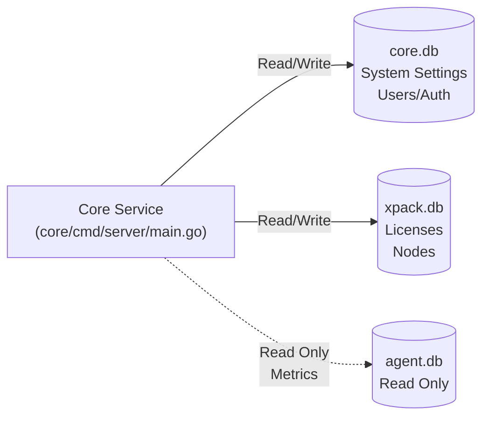
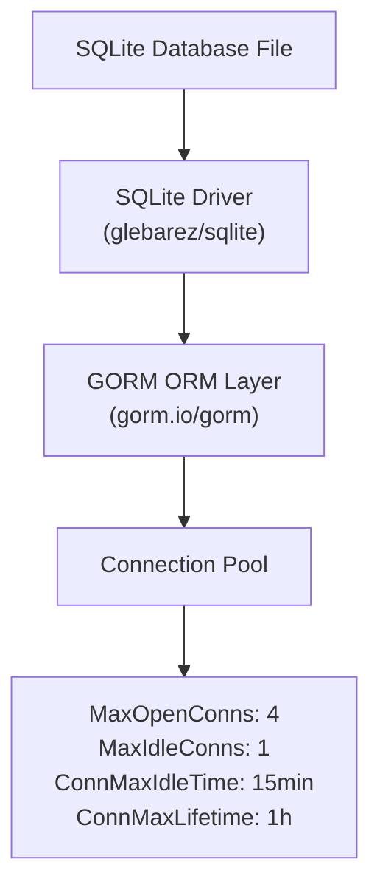
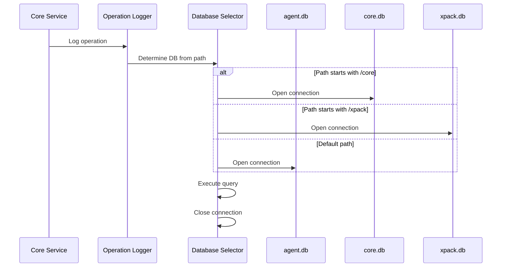
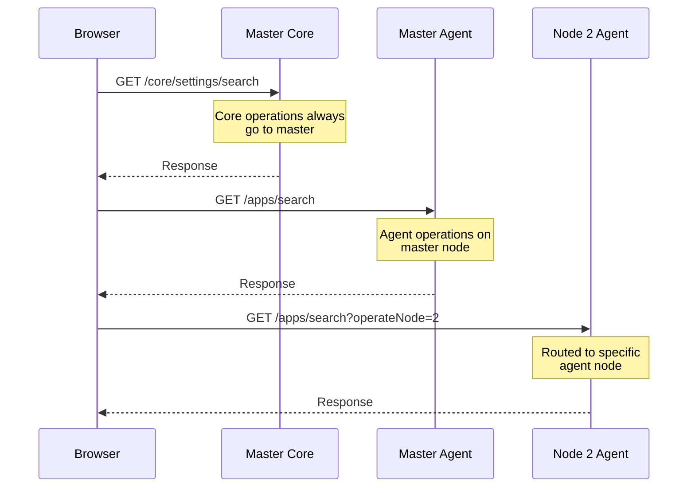
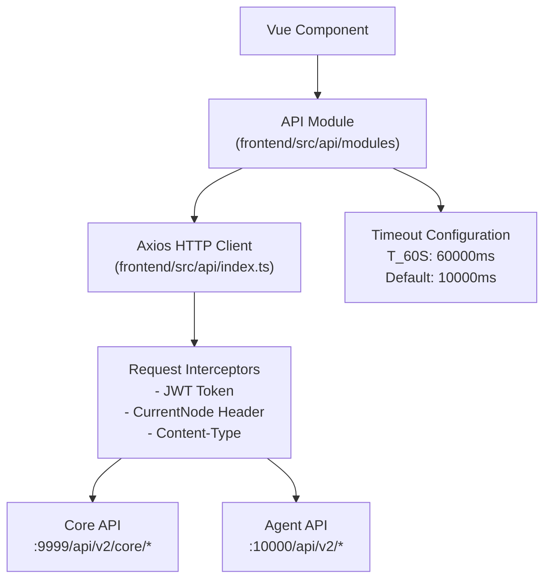
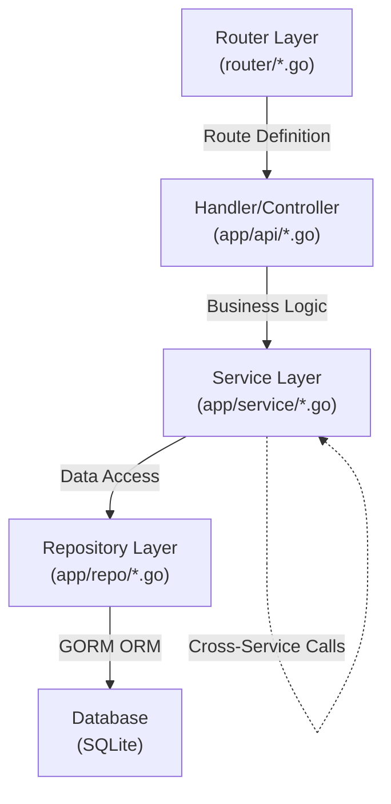
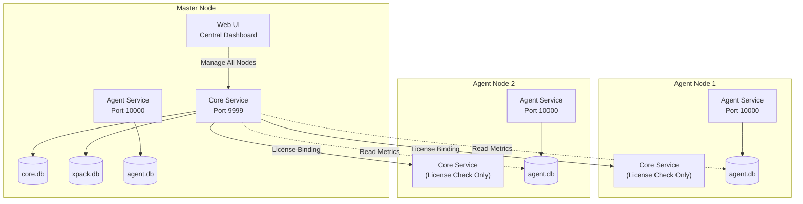
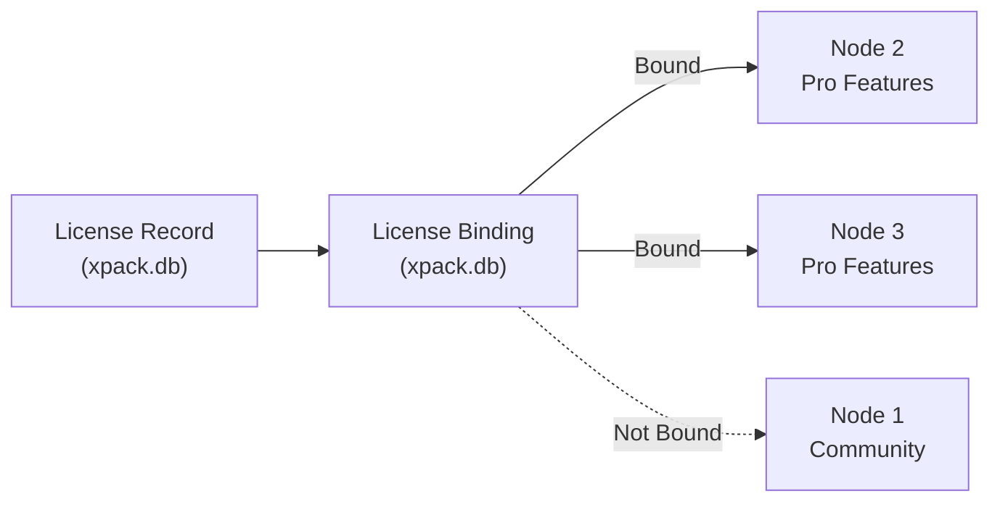
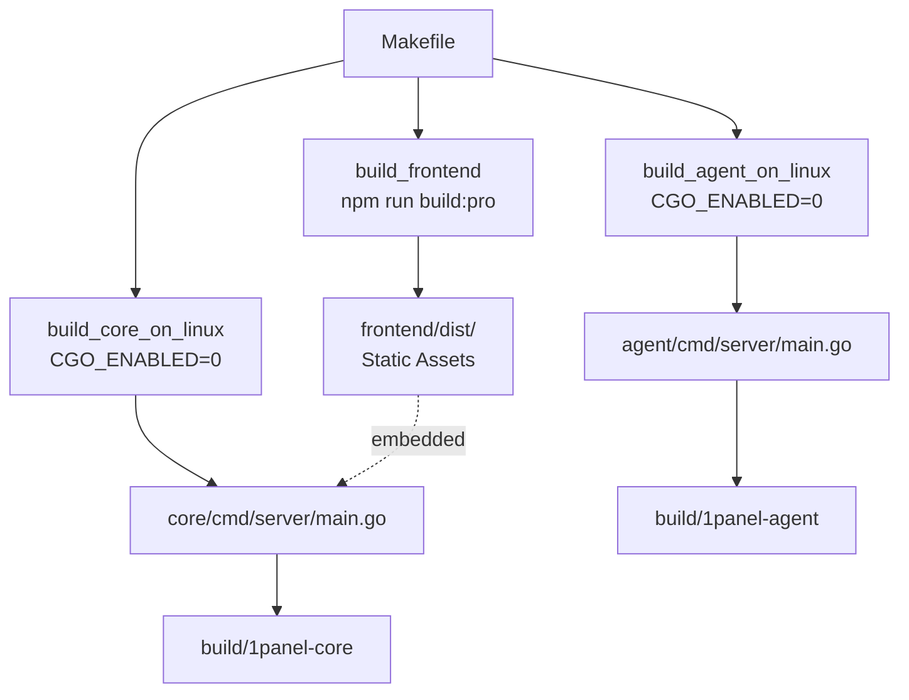

<!-- source: DeepWiki mcp.deepwiki.com · repo 1Panel-dev/1Panel · page 2 Architecture and Core Systems · fetched 2026-10-29 -->

# Architecture and Core Systems

<details>
<summary>Relevant source files</summary>

The following files were used as context for generating this wiki page:

- [Makefile](Makefile)
- [agent/utils/common/sqlite.go](agent/utils/common/sqlite.go)
- [core/middleware/operation.go](core/middleware/operation.go)
- [core/utils/common/sqlite.go](core/utils/common/sqlite.go)
- [frontend/src/api/interface/setting.ts](frontend/src/api/interface/setting.ts)
- [frontend/src/api/modules/setting.ts](frontend/src/api/modules/setting.ts)

</details>


## Purpose and Scope

This document explains 1Panel's overall system architecture, focusing on the fundamental separation between Core and Agent services, the multi-node topology, database design, and how components interact. For specific security mechanisms, see [Authentication and Security](#3). For detailed build and deployment processes, see [Build System and Development](#2.6). For frontend-specific architecture, see [Frontend Architecture](#2.4).

## Three-Tier Architecture

1Panel implements a three-tier architecture that separates concerns between presentation, system management, and infrastructure operations.

```mermaid
graph TB
    subgraph "Frontend Layer"
        VueApp["Vue 3 Application<br/>(frontend/src)"]
        APIClient["API Client Layer<br/>(frontend/src/api)"]
        Store["Pinia Global Store<br/>(frontend/src/store)"]
    end
    
    subgraph "Core Backend - Port 9999"
        CoreMain["core/cmd/server/main.go"]
        CoreAPI["Core API Router<br/>(core/router)"]
        CoreServices["Core Services<br/>(core/app/service)"]
        CoreRepo["Core Repository<br/>(core/app/repo)"]
        CoreDB[("core.db<br/>SQLite")]
        XpackDB[("xpack.db<br/>SQLite")]
    end
    
    subgraph "Agent Backend - Port 10000"
        AgentMain["agent/cmd/server/main.go"]
        AgentAPI["Agent API Router<br/>(agent/router)"]
        AgentServices["Agent Services<br/>(agent/app/service)"]
        AgentRepo["Agent Repository<br/>(agent/app/repo)"]
        AgentDB[("agent.db<br/>SQLite")]
    end
    
    subgraph "External Systems"
        Docker["Docker Engine<br/>via SDK"]
        Nginx["Nginx/OpenResty<br/>Config Files"]
        GPU["GPU Drivers<br/>nvidia-smi/xpu-smi"]
    end
    
    VueApp --> APIClient
    APIClient --> Store
    APIClient -->|"/core/*"| CoreAPI
    APIClient -->|"/*" or "?operateNode=X"| AgentAPI
    
    CoreAPI --> CoreServices
    CoreServices --> CoreRepo
    CoreRepo --> CoreDB
    CoreRepo --> XpackDB
    CoreRepo -.reads.-> AgentDB
    
    AgentAPI --> AgentServices
    AgentServices --> AgentRepo
    AgentRepo --> AgentDB
    
    AgentServices --> Docker
    AgentServices --> Nginx
    AgentServices --> GPU
```

**Sources:** [Makefile:1-50](), [frontend/src/api/modules/setting.ts:1-223]()

## The Core/Agent Split

The system is fundamentally divided into two independent Go applications that serve distinct purposes:

### Core Service (Port 9999)

The Core service handles system-wide configuration, authentication, licensing, and node management. It acts as the central control plane.

**Responsibilities:**
- User authentication (password, MFA, passkey)
- License management and node binding
- System settings (ports, SSL, security)
- Multi-node orchestration
- Operation logging
- Session management

**Database Access Pattern:**
The Core service maintains its own databases (`core.db` and `xpack.db`) and can **read** from agent databases for monitoring purposes, but never writes to them directly.



### Agent Service (Port 10000)

The Agent service handles all infrastructure operations and resource management. It is the operational plane that interacts with Docker, Nginx, databases, and the file system.

**Responsibilities:**
- Container lifecycle management
- Website/Nginx configuration
- Database management (MySQL, PostgreSQL, Redis)
- File system operations
- Application installation from app store
- Cronjob scheduling
- AI/ML infrastructure (GPU monitoring, model management)
- Backup/snapshot operations

**Database Access Pattern:**
Each agent maintains its own `agent.db` exclusively. In multi-node deployments, each node has its own independent agent database.

**Sources:** [Makefile:12-18](), [Makefile:16-18](), [core/middleware/operation.go:218-241]()

## Database Architecture

1Panel uses SQLite for data persistence across three separate database files, each with distinct purposes:

| Database | Path | Owner | Purpose | Table Examples |
|----------|------|-------|---------|----------------|
| `core.db` | `{InstallDir}/1panel/db/core.db` | Core Service | System configuration, users, settings | `settings`, `users`, `operation_logs` |
| `xpack.db` | `{InstallDir}/1panel/db/xpack.db` | Core Service | Licensed features, nodes, SMS quota | `licenses`, `nodes`, `license_bindings` |
| `agent.db` | `{InstallDir}/1panel/db/agent.db` | Agent Service | Infrastructure resources, apps, websites | `apps`, `websites`, `containers`, `databases` |

### Database Connection Configuration

Both Core and Agent use identical SQLite connection pooling settings:



Connection pool parameters are consistently configured across both services:
- `MaxOpenConns`: 4 concurrent connections
- `MaxIdleConns`: 1 idle connection
- `ConnMaxIdleTime`: 15 minutes
- `ConnMaxLifetime`: 1 hour

**Sources:** [agent/utils/common/sqlite.go:62-79](), [core/utils/common/sqlite.go:42-56]()

### Cross-Database Access Pattern

The Core service accesses agent databases for monitoring and aggregation purposes through a temporary connection mechanism:



The operation logger creates temporary database connections based on the request path prefix to enrich log entries with contextual data (e.g., resolving IDs to names).

**Sources:** [core/middleware/operation.go:218-241](), [core/middleware/operation.go:82-102]()

## Request Routing and Multi-Node Support

The frontend determines which backend service handles a request using two mechanisms:

### Path-Based Routing

Requests are routed based on URL path prefixes:

| Path Prefix | Target Service | Port | Example |
|-------------|---------------|------|---------|
| `/api/v2/core/*` | Core Service | 9999 | `/api/v2/core/settings/search` |
| `/api/v2/*` (other) | Agent Service | 10000 | `/api/v2/apps/search` |

### Multi-Node Query Parameter

For multi-node deployments, the frontend can target specific nodes using the `operateNode` query parameter or `CurrentNode` header:



The `operateNode` parameter allows the frontend to direct agent API calls to specific nodes in a multi-node topology, while Core API calls always route to the master node.

**Sources:** [frontend/src/api/modules/setting.ts:157-159](), [core/middleware/operation.go:38-39]()

## Component Communication Patterns

### API Client Layer

The frontend uses a centralized API client that abstracts HTTP communication:



**Extended Timeout Example:**
Certain operations like license binding require extended timeouts due to their complexity:

```typescript
// frontend/src/api/modules/setting.ts:32
export const bindLicense = (params: Setting.LicenseBind) => {
    return http.post(`/core/licenses/bind`, params, TimeoutEnum.T_60S);
};
```

**Sources:** [frontend/src/api/modules/setting.ts:1-7](), [frontend/src/api/modules/setting.ts:31-33]()

### Service Layer Pattern

Both Core and Agent follow a consistent three-layer architecture:



This layered approach separates concerns:
- **Router**: HTTP route definitions and middleware
- **Handler**: Request validation and response formatting
- **Service**: Business logic and orchestration
- **Repository**: Data access and query construction

## Multi-Node Topology

In enterprise deployments, 1Panel supports distributed architectures where one master node manages multiple agent nodes:



### Node Management API

The Core service provides APIs for node registration and management:

```typescript
// List all nodes in the cluster
export const listAllNodes = () => {
    return http.get<Array<Setting.NodeItem>>(`/core/nodes/all`);
};

// List simplified node info for dashboard
export const listAllSimpleNodes = () => {
    return http.get<Array<Setting.SimpleNodeItem>>(`/core/nodes/simple/all`);
};
```

Each `NodeItem` contains:
- `id`: Node identifier
- `addr`: Node address
- `status`: Current status
- `version`: 1Panel version
- `isXpack`: Whether licensed features are enabled
- `isBound`: Whether a license is bound
- `name`: Node display name

**Sources:** [frontend/src/api/modules/setting.ts:47-52](), [frontend/src/api/interface/setting.ts:260-268]()

### License Binding Architecture

Licenses are bound at the node level, enabling feature gating per node:



**Binding Operations:**
- `bindLicense`: Bind a license to a node
- `unbindLicense`: Remove license binding
- `changeBind`: Move license between nodes

**Sources:** [frontend/src/api/modules/setting.ts:31-39](), [frontend/src/api/interface/setting.ts:290-300]()

## Build System Architecture

The build process compiles Core and Agent as separate binaries with optional frontend bundling:



### Build Targets

| Target | Command | Output | Description |
|--------|---------|--------|-------------|
| `build_frontend` | `npm run build:pro` | `frontend/dist/` | Vue application bundle |
| `build_core_on_linux` | `go build core/cmd/server/main.go` | `build/1panel-core` | Core service binary |
| `build_agent_on_linux` | `go build agent/cmd/server/main.go` | `build/1panel-agent` | Agent service binary |
| `build_all` | All above | Both binaries + frontend | Complete build |

### Cross-Compilation Support

The Makefile supports building Linux binaries from macOS for development:

```makefile
build_core_on_darwin:
    cd $(CORE_PATH) \
    && CGO_ENABLED=0 GOOS=linux GOARCH=amd64 $(GOBUILD) -trimpath -ldflags '-s -w' \
       -o $(BUILD_PATH)/$(CORE_NAME) $(CORE_MAIN)
```

The `CGO_ENABLED=0` flag ensures binaries are statically linked and portable across Linux distributions.

**Sources:** [Makefile:1-50](), [Makefile:28-29](), [Makefile:31-46]()

## Key Architectural Decisions

### SQLite Over Distributed Database

The use of SQLite provides:
- **Zero-configuration**: No separate database server required
- **Simplicity**: Single-file databases easy to backup and restore
- **Performance**: Sufficient for panel workloads (4 max connections per DB)
- **Portability**: Database files can be moved between systems

Trade-off: Limited to scenarios where connection limits (4 concurrent) are acceptable.

### Core/Agent Separation

The split between Core and Agent enables:
- **Security Isolation**: Authentication/authorization separate from operations
- **Scalability**: Master node can manage hundreds of agent nodes
- **Independent Updates**: Core and Agent can be updated separately
- **Failure Isolation**: Agent crashes don't affect Core authentication

### Frontend-Driven Routing

Rather than a reverse proxy, the frontend directly routes requests to Core or Agent based on:
- Path prefix (`/core/*` vs others)
- Query parameter (`?operateNode=X`)

This approach:
- **Simplifies deployment**: No additional proxy layer
- **Enables multi-node**: Frontend can target any node
- **Reduces latency**: One less network hop
- **Clarifies responsibility**: Routing logic visible in frontend code

**Sources:** [frontend/src/api/modules/setting.ts:157-163](), [core/middleware/operation.go:36-46]()

---

