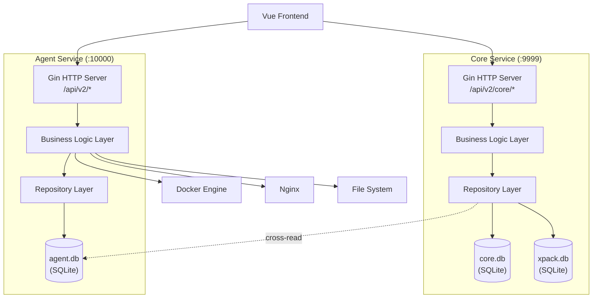
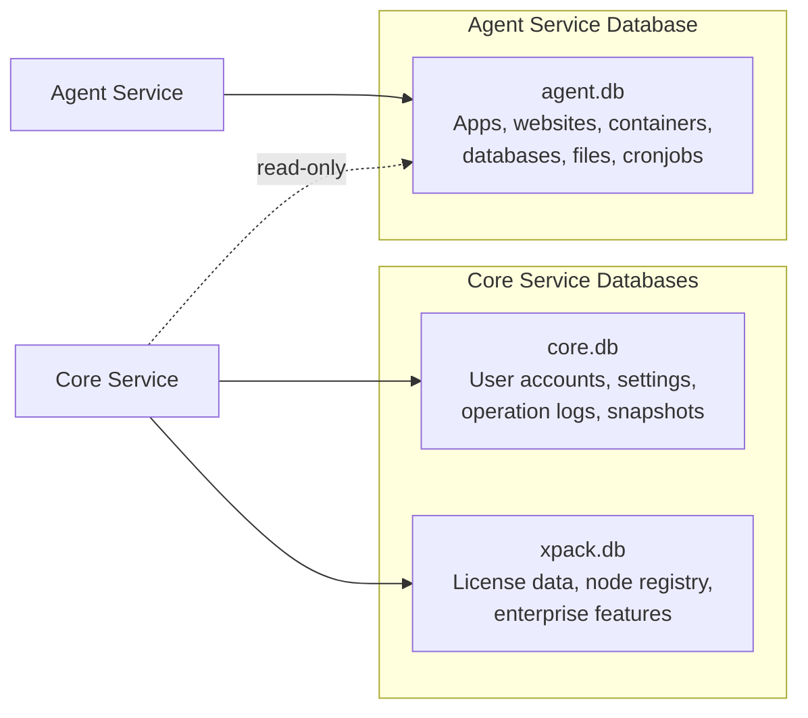
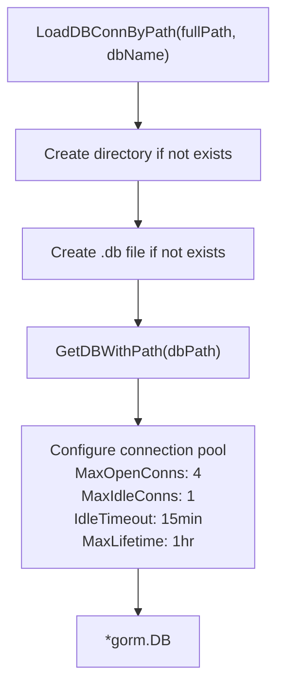
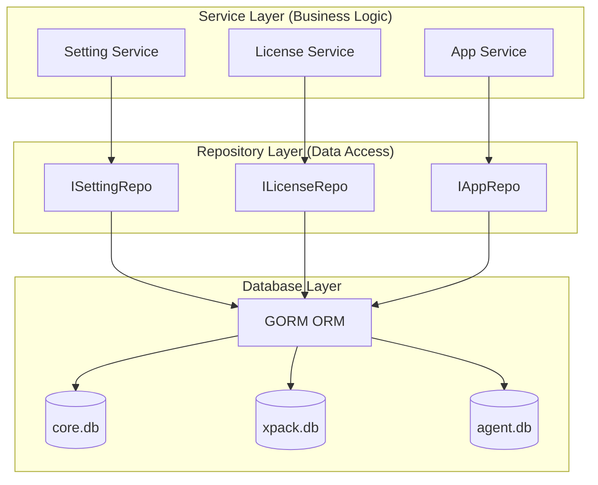
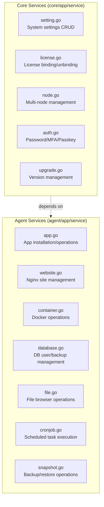
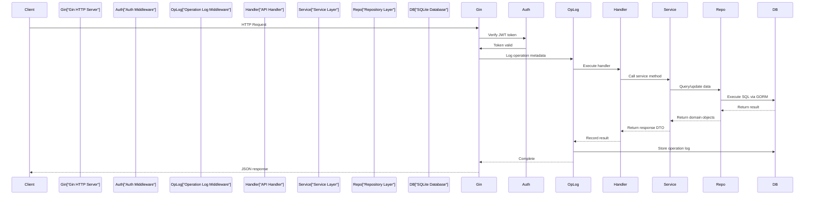
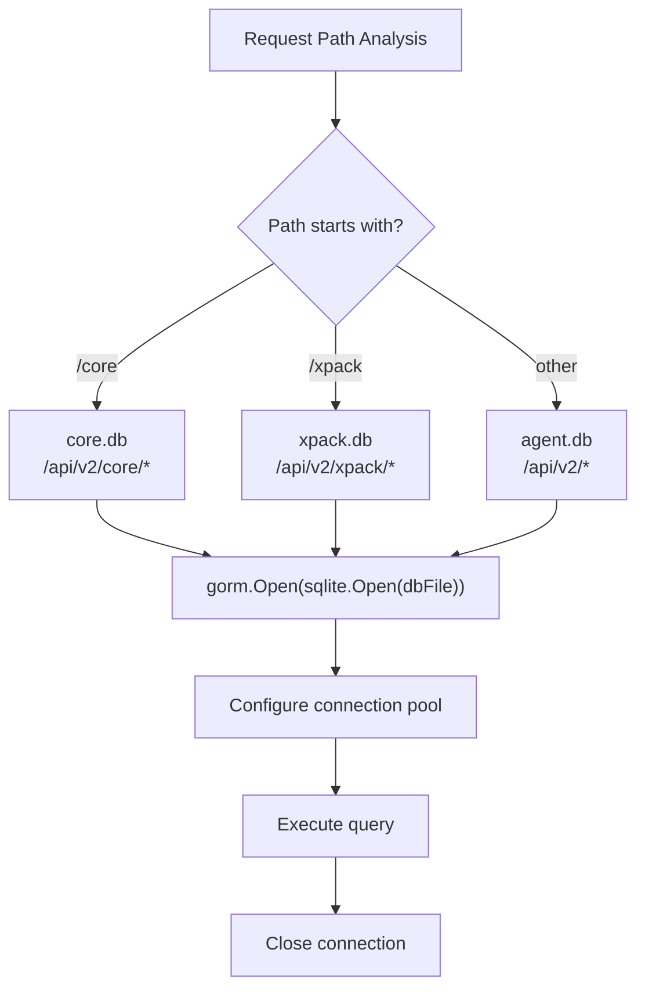

<!-- source: DeepWiki mcp.deepwiki.com · repo 1Panel-dev/1Panel · page 2.3 Backend Service Layer · fetched 2026-10-29 -->

# Backend Service Layer

<details>
<summary>Relevant source files</summary>

The following files were used as context for generating this wiki page:

- [Makefile](Makefile)
- [agent/utils/common/sqlite.go](agent/utils/common/sqlite.go)
- [core/middleware/operation.go](core/middleware/operation.go)
- [core/utils/common/sqlite.go](core/utils/common/sqlite.go)
- [frontend/src/api/interface/setting.ts](frontend/src/api/interface/setting.ts)
- [frontend/src/api/modules/setting.ts](frontend/src/api/modules/setting.ts)

</details>


## Purpose and Scope

This document describes the Go-based backend service architecture for 1Panel, covering the repository pattern implementation, database design with GORM and SQLite, and the service interface layer that powers both the Core and Agent API servers. For information about multi-node deployment topology and license binding, see [Multi-Node Architecture](#2.2). For authentication mechanisms and security middleware, see [Authentication and Security](#3).

## Service Architecture Overview

1Panel's backend consists of two independent Go services built with the Gin web framework:

| Service | Binary | Port | Database | Primary Responsibilities |
|---------|--------|------|----------|-------------------------|
| **Core** | `1panel-core` | 9999 | `core.db`, `xpack.db` | Authentication, license management, system settings, user management |
| **Agent** | `1panel-agent` | 10000 | `agent.db` | Infrastructure operations: containers, websites, databases, files, apps |

Both services are compiled as separate binaries through the Makefile build system:

```
Core:  core/cmd/server/main.go    → build/1panel-core
Agent: agent/cmd/server/main.go   → build/1panel-agent
```

The Core service can read data from the Agent database for unified monitoring dashboards, while maintaining strict separation of operational concerns.

**Sources:** [Makefile:1-50](), Diagram 1 from high-level architecture

### Core vs Agent Separation



**Sources:** [Makefile:12-18](), [core/middleware/operation.go:218-241]()

## Database Architecture

### SQLite Database Design

1Panel uses SQLite for all persistence layers, with three separate database files:



The databases are stored at:
- Core: `{InstallDir}/1panel/db/core.db`
- Xpack: `{InstallDir}/1panel/db/xpack.db`
- Agent: `{InstallDir}/1panel/db/agent.db`

**Sources:** [core/middleware/operation.go:218-227]()

### Database Connection Management

Both Core and Agent services use identical GORM-based connection utilities that provide connection pooling and lifecycle management:



Key connection pool parameters:
- **Max Open Connections:** 4 (SQLite performs poorly with high concurrency)
- **Max Idle Connections:** 1 (minimize resource usage)
- **Idle Timeout:** 15 minutes
- **Connection Lifetime:** 1 hour

**Sources:** [core/utils/common/sqlite.go:15-56](), [agent/utils/common/sqlite.go:16-79]()

### GORM Configuration

The database layer uses GORM with the following configuration:

| Setting | Value | Rationale |
|---------|-------|-----------|
| `DisableForeignKeyConstraintWhenMigrating` | `true` | SQLite foreign key handling |
| `Logger` | `Silent` mode | Reduce log noise in production |
| `IgnoreRecordNotFoundError` | `true` | Treat not-found as normal flow |
| `SlowThreshold` | 1 second | Log queries taking >1s |

**Sources:** [core/utils/common/sqlite.go:42-67](), [agent/utils/common/sqlite.go:62-79]()

## Repository Pattern Implementation

1Panel implements a repository pattern to abstract database operations from business logic:



### Repository Interface Pattern

Each domain entity has a corresponding repository interface defining CRUD operations:

```
ISettingRepo:
  - Get(key string) (*model.Setting, error)
  - GetList(keys []string) ([]*model.Setting, error)
  - Update(key, value string) error
  
ILicenseRepo:
  - Create(license *model.License) error
  - GetFirst() (*model.License, error)
  - Update(license *model.License) error
  - Delete(id uint) error
  - Page(page, size int) ([]model.License, int64, error)
```

Repositories are instantiated through factory functions:
- `repo.NewISettingRepo()` → Returns implementation of `ISettingRepo`
- `repo.NewILicenseRepo()` → Returns implementation of `ILicenseRepo`
- `repo.NewILogRepo()` → Returns implementation of `ILogRepo`

**Sources:** [core/middleware/operation.go:137](), [frontend/src/api/modules/setting.ts:16-45]()

## Service Layer Structure

### Service Organization

Services contain business logic and orchestrate operations across multiple repositories:



**Sources:** Diagram 2 from high-level architecture

### Service Method Patterns

Services expose methods that map to API endpoints. Common patterns include:

| Pattern | Example Method | Description |
|---------|---------------|-------------|
| **Search/List** | `SearchSettings()` | Return paginated lists with filters |
| **CRUD** | `Create()`, `Update()`, `Delete()` | Standard create/update/delete operations |
| **Complex Operations** | `BindLicense()`, `InstallApp()` | Multi-step operations with transactions |
| **Validation** | `ValidatePassword()`, `CheckComplexity()` | Business rule validation |

**Sources:** [frontend/src/api/modules/setting.ts:69-223]()

## API Layer with Gin Framework

### Request Flow Through Middleware



**Sources:** [core/middleware/operation.go:28-171]()

### Operation Logging Middleware

The operation logging middleware automatically captures and persists API calls with detailed metadata:

**Captured Information:**
- Source: First path segment (e.g., "settings", "licenses", "apps")
- Node: Current node name from `CurrentNode` header
- IP: Client IP address
- Method: HTTP method (get/post/put/delete)
- Path: API path without prefix
- User Agent: Browser/client identifier
- Status: Success/failed based on response code
- Latency: Request duration
- Details: Localized operation description (Chinese and English)

**Dynamic Detail Generation:**

The middleware parses `docs.XLogJson` (embedded Swagger annotations) to extract body parameters and generate human-readable operation descriptions:

```
Example: /api/v2/core/licenses/bind
Body: { "nodeID": 5, "licenseID": 3 }
Generated: "Bind license [ProductName] to node [NodeName]"
```

It performs database lookups via `beforeFunctions` to resolve IDs to names (e.g., `nodeID` → node name).

**Sources:** [core/middleware/operation.go:28-171](), [core/middleware/operation.go:173-189]()

### Cross-Database Access Pattern

The operation logging middleware demonstrates how the Core service dynamically connects to the appropriate database based on the request path:



This pattern enables the Core service to query Agent data for unified dashboards without requiring persistent cross-database connections.

**Sources:** [core/middleware/operation.go:218-249]()

## API Interface Structure

### Core API Endpoints

Core API endpoints are organized by domain and exposed through the frontend API client:

| Domain | Example Endpoints | Service Responsibility |
|--------|------------------|----------------------|
| **Licenses** | `/core/licenses/upload`<br>`/core/licenses/bind`<br>`/core/licenses/status` | Upload license files, bind to nodes, check status |
| **Nodes** | `/core/nodes/list`<br>`/core/nodes/all`<br>`/core/nodes/simple/all` | List agent nodes, get node details |
| **Settings** | `/core/settings/search`<br>`/core/settings/update`<br>`/core/settings/ssl/update` | System configuration CRUD |
| **Authentication** | `/core/settings/password/update`<br>`/core/settings/mfa/bind`<br>`/core/settings/passkey/*` | Password, MFA, passkey management |
| **Upgrade** | `/core/settings/upgrade`<br>`/core/settings/upgrade/releases` | Version checking and upgrades |

**Sources:** [frontend/src/api/modules/setting.ts:10-223]()

### Agent API Endpoints

Agent API endpoints manage infrastructure resources:

| Domain | Example Endpoints | Service Responsibility |
|--------|------------------|----------------------|
| **Settings** | `/settings/search`<br>`/settings/update`<br>`/settings/basedir` | Agent-specific configuration |
| **Snapshots** | `/settings/snapshot`<br>`/settings/snapshot/recover`<br>`/settings/snapshot/rollback` | Backup creation and restoration |
| **Apps** | `/apps/search`<br>`/apps/install`<br>`/apps/installed/*` | App store and lifecycle management |
| **Websites** | `/websites`<br>`/websites/ssl`<br>`/websites/domains` | Nginx website configuration |
| **Containers** | `/containers`<br>`/containers/logs`<br>`/containers/compose` | Docker operations |
| **Databases** | `/databases/mysql`<br>`/databases/postgresql`<br>`/databases/redis` | Database management |

**Sources:** [frontend/src/api/modules/setting.ts:63-192]()

### Request/Response Type System

The frontend defines TypeScript interfaces that mirror backend DTOs:

```typescript
// Setting update request
interface SettingUpdate {
  key: string;
  value: string;
}

// License binding request
interface LicenseBind {
  nodeID: number;
  licenseID: number;
  syncList: string;
  withDockerRestart: boolean;
}

// Snapshot creation request
interface SnapshotCreate {
  id: number;
  sourceAccountIDs: string;
  downloadAccountID: string;
  description: string;
  secret: string;
  timeout: number;
  appData: Array<DataTree>;
  panelData: Array<DataTree>;
  backupData: Array<DataTree>;
  withMonitorData: boolean;
  withLoginLog: boolean;
  withOperationLog: boolean;
}
```

**Sources:** [frontend/src/api/interface/setting.ts:1-312]()

## Service Layer Patterns

### Timeout Configuration

Critical operations use extended timeouts via the `TimeoutEnum`:

| Operation Type | Timeout | Enum |
|---------------|---------|------|
| License sync/bind | 60s | `TimeoutEnum.T_60S` |
| Snapshot operations | 60s | `TimeoutEnum.T_60S` |
| Standard operations | 30s | Default |
| App node updates | 60s | `TimeoutEnum.T_60S` |

**Sources:** [frontend/src/api/modules/setting.ts:32-59]()

### Secret Handling

Sensitive data (passwords, secrets) is Base64-encoded before transmission:

```typescript
// Proxy password encoding
let request = deepCopy(params) as Setting.ProxyUpdate;
if (request.proxyPasswd) {
  request.proxyPasswd = Base64.encode(request.proxyPasswd);
}
```

**Sources:** [frontend/src/api/modules/setting.ts:108-111]()

### Multi-Node Routing

API calls can target specific nodes using:
- **Header:** `CurrentNode` header with node name
- **Query parameter:** `?operateNode={nodeID}`

Example:
```typescript
export const getAppStoreConfig = (node?: string) => {
  const params = node ? `?operateNode=${node}` : '';
  return http.get<App.AppStoreConfig>(`/core/settings/apps/store/config${params}`);
};
```

**Sources:** [frontend/src/api/modules/setting.ts:157-159](), [core/middleware/operation.go:38-39]()

## Database Migration and Schema Management

GORM's `AutoMigrate` feature handles schema evolution automatically when models are updated. Both Core and Agent services initialize their schemas on startup by passing model structs to `db.AutoMigrate()`.

Key migration features:
- **Non-destructive:** Adds new columns/tables without dropping existing data
- **Foreign key handling:** Disabled during migration for SQLite compatibility
- **Zero-downtime:** Migrations run during service startup before accepting requests

**Sources:** [core/utils/common/sqlite.go:43-45](), [agent/utils/common/sqlite.go:63-65]()

---

