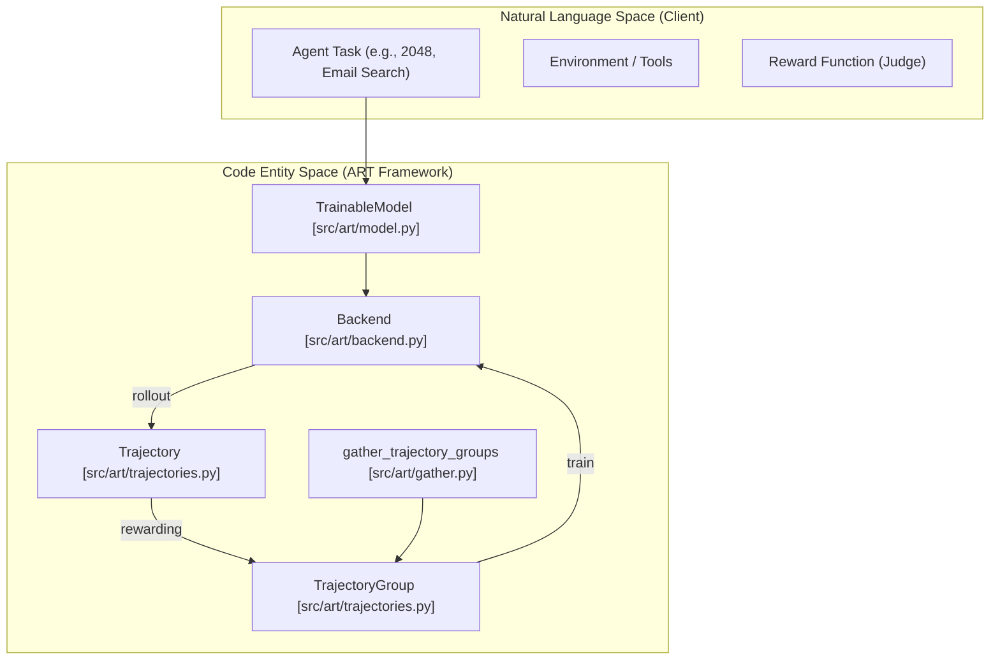
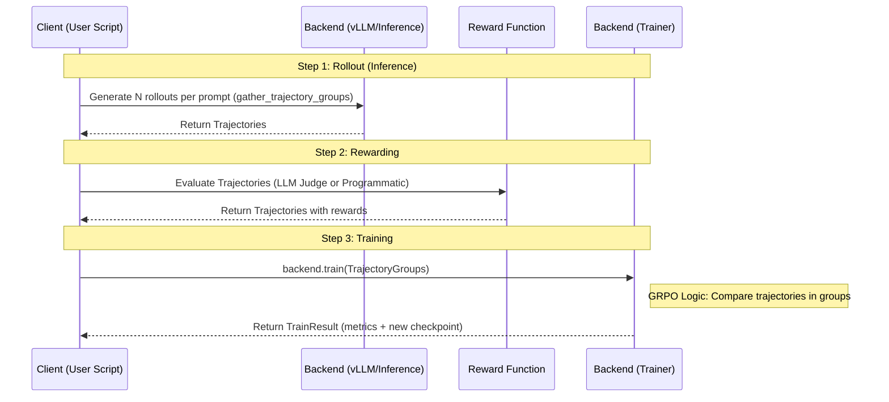
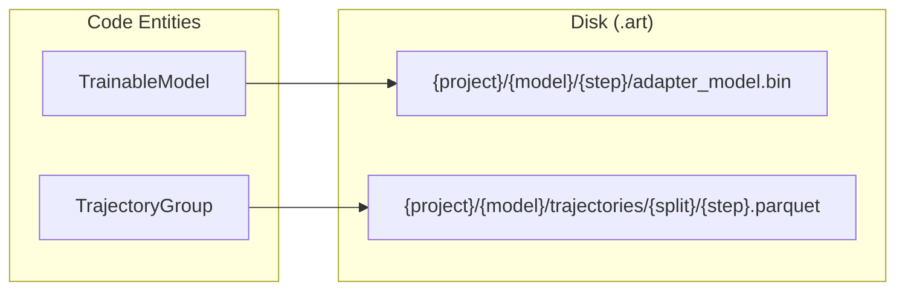

<!-- source: DeepWiki mcp.deepwiki.com · repo OpenPipe/ART · page 1.2 Core Concepts · fetched 2026-10-29 -->

# Core Concepts

Relevant source files

The following files were used as context for generating this wiki page:

- [README.md](README.md)
- [docs/fundamentals/art-backend.mdx](docs/fundamentals/art-backend.mdx)
- [docs/getting-started/installation-setup.mdx](docs/getting-started/installation-setup.mdx)
- [docs/integrations/langgraph-integration.mdx](docs/integrations/langgraph-integration.mdx)
- [docs/tutorials/summarizer.mdx](docs/tutorials/summarizer.mdx)
- [examples/prisoners-dilemma.ipynb](examples/prisoners-dilemma.ipynb)
- [src/art/__init__.py](src/art/__init__.py)
- [src/art/auto_trajectory.py](src/art/auto_trajectory.py)
- [src/art/openai.py](src/art/openai.py)
- [src/art/trajectories.py](src/art/trajectories.py)
- [src/art/transformers/patches.py](src/art/transformers/patches.py)
- [src/art/types.py](src/art/types.py)
- [src/art/utils/benchmarking/load_trajectories.py](src/art/utils/benchmarking/load_trajectories.py)
- [src/art/utils/benchmarking/pull_model_trajectories.py](src/art/utils/benchmarking/pull_model_trajectories.py)
- [src/art/utils/old_benchmarking/load_benchmarked_models.py](src/art/utils/old_benchmarking/load_benchmarked_models.py)
- [src/art/utils/trajectory_logging.py](src/art/utils/trajectory_logging.py)
- [src/art/utils/trajectory_migration.py](src/art/utils/trajectory_migration.py)
- [tests/unit/test_trajectory_parquet.py](tests/unit/test_trajectory_parquet.py)

ART (Agent Reinforcement Trainer) is designed to bridge the gap between multi-step agentic workflows and Reinforcement Learning (RL). It provides an ergonomic framework for training LLMs using the Group Relative Policy Optimization (GRPO) algorithm, specifically optimized for agents that interact with tools and environments.

## High-Level Architecture

The system is built on a clear separation between the **Client** (the environment where your agent lives) and the **Backend** (the infrastructure that handles inference and training).

Sources: [src/art/model.py:71-71](), [src/art/backend.py:1-20](), [src/art/trajectories.py:38-130](), [src/art/gather.py:1-20]()

---

## Fundamental Entities

### TrainableModel
The `TrainableModel` is the central coordinator. It tracks the project name, the base model (e.g., "Qwen/Qwen2.5-7B"), and its current training state. It provides methods to `register` with a backend and `log` metrics to persistent storage.
* **Definition**: [src/art/model.py:71-71]()
* **Key Methods**: `register(backend)`, `train(trajectory_groups)`, `log(trajectory_groups, metrics, step)`.

### Backend
A `Backend` represents the compute resource. It manages the lifecycle of the model: switching between inference mode (serving tokens via vLLM) and training mode (updating weights via Unsloth or Torchtune).
* **LocalBackend**: Runs on your local GPU [src/art/local/backend.py]().
* **ServerlessBackend**: Offloads to a managed W&B Training cluster [src/art/serverless/backend.py]().
* **Interface**: [src/art/backend.py:1-20]()

### Trajectory & TrajectoryGroup
A **Trajectory** is a single "run" of an agent. It contains the sequence of messages, tool calls, and the final scalar reward.
* **Trajectory**: [src/art/trajectories.py:38-38]()
* **TrajectoryGroup**: [src/art/trajectories.py:130-130]() - A collection of trajectories generated from the same starting prompt. This is a requirement for GRPO, which computes advantages by comparing rewards within a group.

---

## The Training Loop

The ART training loop follows a strictly sequential **Inference -> Reward -> Train** pattern.

Sources: [src/art/gather.py:1-50](), [src/art/types.py:69-80](), [src/art/trajectories.py:130-145]()

### 1. Rollout
A "rollout" is the process of letting the model interact with the environment. ART provides `capture_auto_trajectory` to automatically record all OpenAI-compatible API calls made within a block of code, turning them into a `Trajectory` object.
* **Source**: [src/art/auto_trajectory.py:66-69]()

### 2. Reward
After rollouts are complete, you assign a `reward` (float) to each `Trajectory`. ART supports:
* **Programmatic Rewards**: e.g., "Did the agent win the game of 2048?"
* **LLM Judges**: Using a stronger model to grade the agent's reasoning.
* **RULER**: A general-purpose reward utility provided by ART for multi-step tasks.

### 3. GRPO Training
Unlike standard PPO which requires a separate Value Model, **GRPO (Group Relative Policy Optimization)** uses the mean reward of the `TrajectoryGroup` to normalize advantages.
* **Logic**: If a trajectory's reward is higher than the group average, the model is encouraged to repeat those actions.
* **Implementation**: Handled internally by the backend during `backend.train()`.

---

## Data Flow & Storage

ART uses efficient formats to handle the large volume of data generated during RL.

| Entity | Storage Format | Description |
| :--- | :--- | :--- |
| **Trajectories** | Parquet | Serialized with ZSTD compression for ~25x reduction vs JSONL. [src/art/utils/trajectory_logging.py:59-62]() |
| **Weights** | LoRA Adapters | Only the PEFT adapters are saved/transferred, keeping checkpoints small. [src/art/dev.py:65-65]() |
| **Metrics** | W&B / Local | Logged to Weights & Biases or local `.art` directories. [src/art/utils/output_dirs.py:7-42]() |

### Code-to-Disk Mapping

Sources: [src/art/utils/output_dirs.py:12-42](), [src/art/utils/trajectory_logging.py:59-72]()

---

