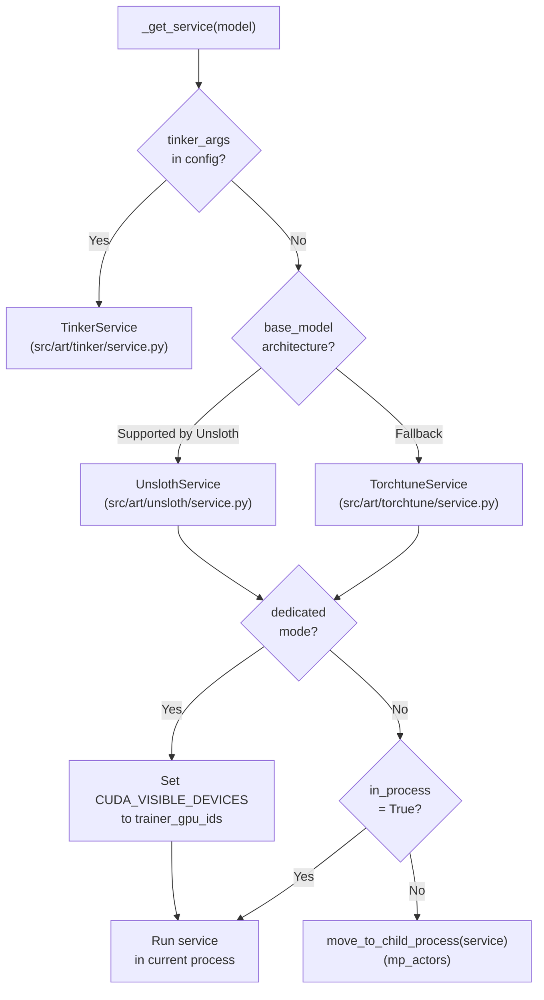
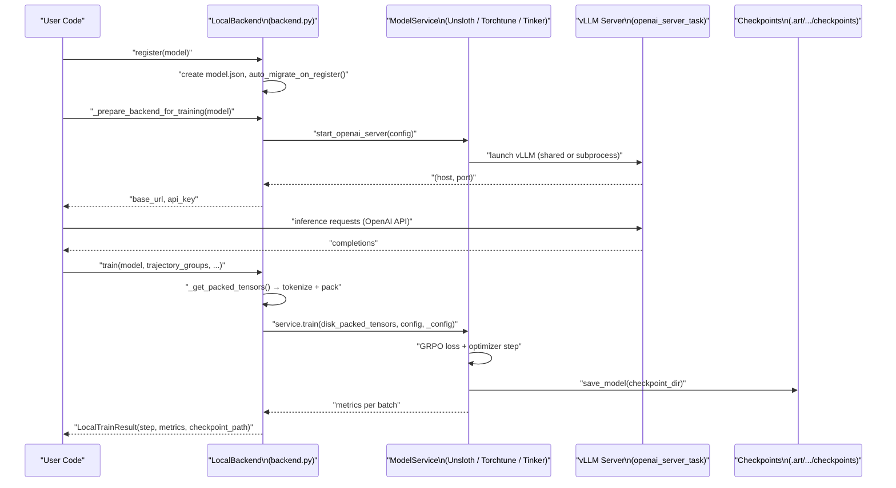

<!-- source: DeepWiki mcp.deepwiki.com · repo OpenPipe/ART · page 4.1 LocalBackend · fetched 2026-10-29 -->

# LocalBackend

<details>
<summary>Relevant source files</summary>

The following files were used as context for generating this wiki page:

- [src/art/local/backend.py](src/art/local/backend.py)
- [src/art/local/checkpoints.py](src/art/local/checkpoints.py)
- [src/art/local/service.py](src/art/local/service.py)
- [src/art/model.py](src/art/model.py)
- [src/art/utils/get_model_step.py](src/art/utils/get_model_step.py)

</details>


`LocalBackend` is the standard backend for running ART training on a single machine with one or more local GPUs. It implements the `Backend` protocol and manages all aspects of local training: service lifecycle, checkpoint storage, tokenization, tensor packing, and vLLM server management. This page covers the `LocalBackend` class in full.

For the abstract `Backend` protocol all backends must satisfy, see [Backend Infrastructure](#2.3). For cloud-based training that provisions a remote machine and delegates to a `LocalBackend` over HTTP, see [SkyPilotBackend](#4.2). For the training algorithm itself (GRPO, loss computation), see [Training Loop & GRPO Algorithm](#3.1).

---

## Instantiation

`LocalBackend` is defined in [src/art/local/backend.py:192-213]() and accepts several configuration arguments:

| Parameter | Type | Default | Description |
|---|---|---|---|
| `in_process` | `bool` | `False` | Run the model service in the same process. When `False` (default), the service runs in a child process via `mp_actors`. |
| `path` | `str \| None` | `None` | Root directory for all ART artifacts. Defaults to `{repo_root}/.art` via `get_default_art_path()`. |
| `gpu_cost_per_hour_usd` | `float \| None` | `None` | Override for per-GPU hourly pricing. If unset, ART auto-detects supported types (e.g., H200). |
| `enable_expert_replay` | `bool` | `True` | For MoE training, capture vLLM routed experts and replay them in the trainer. |

**Typical usage:**

```python
from art.local import LocalBackend
backend = LocalBackend()
```

**As a context manager** (ensures subprocess cleanup on exit):

```python
with LocalBackend() as backend:
    await model.register(backend)
    ...
```

The `__aexit__` method calls `_close()`, which terminates any running service subprocesses and closes proxy objects [src/art/local/backend.py:236-258]().

Sources: [src/art/local/backend.py:192-258]()

---

## Checkpoint Directory Layout

When a model is registered, `LocalBackend` creates and manages a directory tree rooted at `self._path`:

```
.art/                              ← self._path (default: {repo_root}/.art)
└── {project}/
    └── models/
        └── {model_name}/
            ├── model.json             ← serialized Model config
            ├── logs/
            │   └── vllm.log          ← vLLM stdout (shared mode)
            │   └── vllm-dedicated.log ← vLLM stdout (dedicated mode)
            └── checkpoints/
                ├── 0000/            ← initial LoRA adapter (base weights)
                ├── 0001/
                ├── 0002/
                └── ...
```

Checkpoint directories are created by the underlying `ModelService` (e.g., `UnslothService`) using `get_step_checkpoint_dir(output_dir, next_step)` [src/art/local/backend.py:38-39](). The current step is computed from the highest-numbered directory in the `checkpoints` folder [src/art/utils/get_model_step.py:10-23]().

Sources: [src/art/local/backend.py:34-40](), [src/art/local/checkpoints.py:7-32](), [src/art/utils/get_model_step.py:10-23]()

---

## Service Selection

The `LocalBackend` delegates model loading, training, and inference to a `ModelService`. The `ModelService` protocol is defined in [src/art/local/service.py:8-50]() and requires `start_openai_server`, `vllm_engine_is_sleeping`, `train`, and `train_sft`.

The concrete implementation is selected in `_get_service()` [src/art/local/backend.py:321-381]():

**Service selection diagram:**



Sources: [src/art/local/backend.py:321-381](), [src/art/local/service.py:8-50]()

---

## GPU Modes

`LocalBackend` supports two GPU allocation strategies, determined by the model's `_internal_config`:

### Shared Mode (default)

A single set of GPUs handles both inference and training. During training:
1. The training model is offloaded to CPU pinned memory (e.g., via `UnslothService`).
2. vLLM runs inference.
3. The training model reloads from pinned memory to the GPU.

The service runs as a **child process** via `move_to_child_process` (from `mp_actors`) to isolate GPU memory. Before starting, any existing `model-service` processes are killed with `pkill -9 model-service` [src/art/local/backend.py:375-380]().

### Dedicated Mode

Separate GPU sets handle inference and training simultaneously. Configured via `InternalModelConfig` with `inference_gpu_ids` and `trainer_gpu_ids`. In this mode, the service launches vLLM as a **subprocess** that keeps running through the training step. After training, the new LoRA adapter is hot-reloaded via an HTTP call to `/v1/load_lora_adapter` [src/art/local/backend.py:345-353]().

| Aspect | Shared Mode | Dedicated Mode |
|---|---|---|
| GPU allocation | Single pool | Split: `inference_gpu_ids` + `trainer_gpu_ids` |
| vLLM process | In child process (shared with trainer) | Separate subprocess |
| Inference during training | Not possible | Possible |
| Memory requirement | Lower | Higher |

Sources: [src/art/local/backend.py:321-381](), [src/art/local/service.py:19-31]()

---

## Lifecycle and Data Flow

The diagram below maps the training lifecycle to concrete code entities in `LocalBackend`:



Sources: [src/art/local/backend.py:260-319](), [src/art/local/backend.py:596-777](), [src/art/local/backend.py:779-1073]()

---

## `register()` Method

[src/art/local/backend.py:260-305]()

When called with an `art.Model`:
1. Sets `model.base_path = self._path`.
2. Creates the model output directory using `get_model_dir`.
3. Writes `model.json` with the serialized model config.
4. Calls `auto_migrate_on_register(output_dir)` to upgrade any legacy JSONL trajectory files to Parquet.
5. If the model is trainable and `WANDB_API_KEY` is set, initializes the W&B run early.

Sources: [src/art/local/backend.py:260-305](), [src/art/utils/output_dirs.py:36-36]()

---

## `train()` Method

[src/art/local/backend.py:596-777]()

The primary training entry point. This method handles the high-level orchestration of a training step, including data preparation and metric aggregation.

### Key Parameters

| Parameter | Default | Description |
|---|---|---|
| `learning_rate` | `5e-6` | AdamW learning rate |
| `beta` | `0.0` | KL penalty coefficient added directly to the loss |
| `kl_penalty_coef` | `0.0` | Per-token KL penalty applied to advantages |
| `ppo` | `False` | Enable PPO clipping |
| `scale_rewards` | `True` | Normalize rewards by std dev across the group |
| `save_checkpoint` | `True` | Save LoRA adapter after training |
| `plot_tensors` | `False` | Save a visualization of packed tensors for debugging |

### Return Value

Returns a `LocalTrainResult` (defined in `src/art/types.py`) with:

| Field | Type | Description |
|---|---|---|
| `step` | `int` | The step number after training |
| `metrics` | `dict[str, float]` | Averaged metrics across gradient steps |
| `checkpoint_path` | `str \| None` | Filesystem path to saved LoRA checkpoint |

Sources: [src/art/local/backend.py:596-777](), [src/art/types.py:108-112]()

---

## Tensor Preparation: `_get_packed_tensors()`

[src/art/local/backend.py:383-452]()

Before calling the service's `train()` method, `LocalBackend` tokenizes and packs trajectory groups:

1. Loads `AutoTokenizer` and (optionally) `BaseImageProcessor` for the model's `base_model`.
2. Calls `tokenize_trajectory_groups()` to produce token sequences with logprobs, rewards, and attention masks.
3. Rounds the maximum sequence length up to the nearest multiple of 2048, capped by `max_seq_length_from_model_config`.
4. Calls `packed_tensors_from_tokenized_results()` to pack sequences into fixed-length batches.
5. If `plot_tensors=True`, saves a diagnostic plot of the tensor layout.

Sources: [src/art/local/backend.py:383-452](), [src/art/preprocessing/pack.py:65-70]()

---

## Internal Training Flow: `_train_model()`

[src/art/local/backend.py:779-1073]()

This async generator orchestrates the full training step:

1. **Service Retrieval**: Calls `_get_service(model)` to get the training service proxy.
2. **Data Packing**: Calls `_get_packed_tensors()` and writes results to a temporary directory using `packed_tensors_to_dir()`.
3. **Execution**: Calls `service.train()` and iterates over metrics yielded for each batch.
4. **Checkpointing**: If `save_checkpoint` is enabled, calculates the next step number and instructs the service to save the model.
5. **Hot Reload**: If in dedicated mode, notifies the running vLLM server to load the new LoRA adapter via `_reload_adapter()`.

Sources: [src/art/local/backend.py:779-1073](), [src/art/preprocessing/pack.py:68-68]()

---

## Server Monitoring

After `_prepare_backend_for_training()` starts the vLLM server, `LocalBackend` spawns an `asyncio.Task` that runs `_monitor_openai_server()` [src/art/local/backend.py:509-575](). Every 30 seconds it:

1. Checks whether the vLLM engine is sleeping (during a training step). If so, skips the check.
2. Polls the Prometheus `/metrics` endpoint for `vllm:num_requests_running` and `vllm:num_requests_waiting`.
3. If both are zero, sends a one-token health check completion.
4. Allows up to 3 consecutive failures before re-raising.

Sources: [src/art/local/backend.py:509-575]()

---

## Checkpoint Management

`LocalBackend` uses utility functions to manage the lifecycle of checkpoints on disk:

- `delete_checkpoints(output_dir, excluding)`: Removes checkpoint directories that are not in the exclusion list [src/art/local/checkpoints.py:7-20]().
- `get_last_checkpoint_dir(output_dir)`: Locates the directory for the most recent step [src/art/local/checkpoints.py:23-30]().
- `migrate_checkpoints_to_new_structure(output_dir)`: Moves legacy checkpoints from the model root to the `checkpoints/` subdirectory [src/art/local/checkpoints.py:33-65]().

Sources: [src/art/local/checkpoints.py:7-65]()

---

