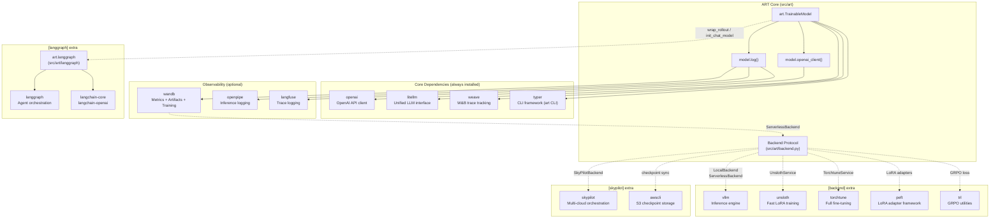
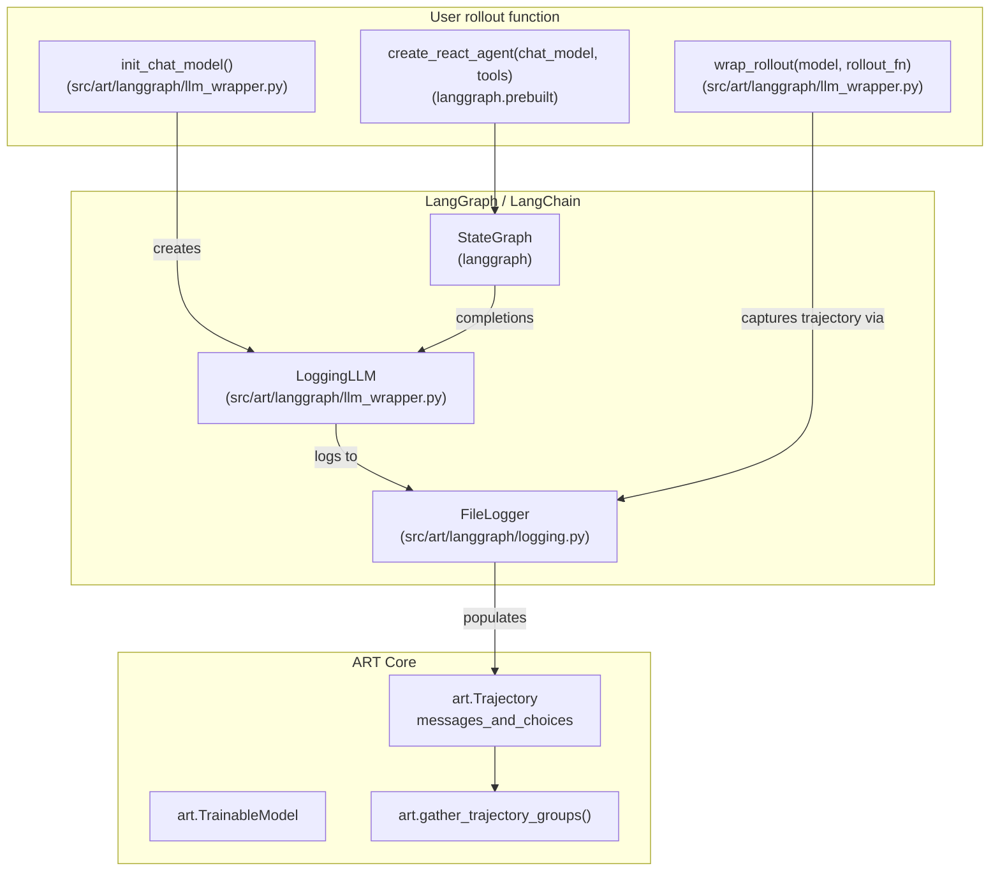

<!-- source: DeepWiki mcp.deepwiki.com · repo OpenPipe/ART · page 5 Integrations · fetched 2026-10-29 -->

# Integrations

<details>
<summary>Relevant source files</summary>

The following files were used as context for generating this wiki page:

- [README.md](README.md)
- [docs/fundamentals/art-backend.mdx](docs/fundamentals/art-backend.mdx)
- [docs/fundamentals/ruler.mdx](docs/fundamentals/ruler.mdx)
- [docs/getting-started/installation-setup.mdx](docs/getting-started/installation-setup.mdx)
- [docs/integrations/langgraph-integration.mdx](docs/integrations/langgraph-integration.mdx)
- [docs/tutorials/summarizer.mdx](docs/tutorials/summarizer.mdx)
- [src/art/langgraph/__init__.py](src/art/langgraph/__init__.py)
- [src/art/langgraph/llm_wrapper.py](src/art/langgraph/llm_wrapper.py)
- [src/art/langgraph/logging.py](src/art/langgraph/logging.py)
- [src/art/langgraph/message_utils.py](src/art/langgraph/message_utils.py)
- [src/art/rewards/ruler.py](src/art/rewards/ruler.py)
- [tests/unit/test_langgraph_llm_wrapper.py](tests/unit/test_langgraph_llm_wrapper.py)
- [tests/unit/test_langgraph_logging.py](tests/unit/test_langgraph_logging.py)

</details>


This document covers ART's integration points with external services, frameworks, and infrastructure providers. ART is designed with a modular architecture that allows you to choose which integrations to enable based on your requirements.

For LangGraph agent framework integration, see [LangGraph Integration](#5.1). For W&B, Langfuse, and OpenPipe experiment tracking details, see [Experiment Tracking](#5.2). For the ART CLI, see [CLI and Scripting](#5.3).

## Overview

ART integrates with external systems in four categories:

| Category | Purpose | Required | Key Components |
|----------|---------|----------|----------------|
| **Core Dependencies** | API clients and experiment tracking | Yes | `openai` client, `litellm`, `weave`, `typer` |
| **Backend Stack** | Training and inference infrastructure | Optional (`[backend]`) | `vllm`, `unsloth`, `torchtune`, `peft`, `trl` |
| **Cloud Providers** | Remote GPU provisioning | Optional (`[skypilot]`) | `skypilot`, AWS S3 |
| **Observability** | Metrics, logging, and monitoring | Optional | `wandb`, OpenPipe, Langfuse |
| **Frameworks** | Agent frameworks | Optional (`[langgraph]`) | `langgraph`, `langchain-core` |

Sources: [README.md:91-96](), [docs/getting-started/installation-setup.mdx:12-21](), [docs/integrations/langgraph-integration.mdx:12-18]()

## Integration Architecture

The diagram below maps ART's public surface to the external dependencies it relies on, organized by install extra.

**ART integration dependency map**



Sources: [README.md:24-57](), [docs/fundamentals/art-backend.mdx:34-96](), [docs/integrations/langgraph-integration.mdx:12-35](), [src/art/langgraph/llm_wrapper.py:115-173]()

## Core Integrations

ART's core integrations are always installed and provide the foundation for client functionality.

### OpenAI Client

`art.TrainableModel` exposes an OpenAI-compatible client. This returns a standard `openai.AsyncOpenAI` client configured to communicate with whichever backend is registered (local, SkyPilot, or serverless).

**Key points:**
- Implements the standard OpenAI Chat Completions API.
- Supports tool calling and structured outputs.
- Automatically routes to the correct backend URL.

### LiteLLM

`litellm` provides a unified interface for calling various LLM providers. ART uses it internally for judge models and `ruler` reward scoring. The `ruler` function uses `litellm.acompletion` to pass trajectories to an LLM judge for relative scoring [src/art/rewards/ruler.py:86-140]().

### Weave

`weave` (W&B's trace-tracking library) captures LLM call traces. Decorate rollout functions with `@weave.op` to automatically log inputs, outputs, token usage, and latency to a W&B Weave project [docs/integrations/langgraph-integration.mdx:89-116]().

```python
weave.init(model.project, settings={"print_call_link": False})

@weave.op
async def rollout(model, scenario): ...
```

### Typer (CLI)

`typer` backs the `art` CLI. The CLI provides commands for interactive training wizards (SFT and RL), server management, and trajectory migration. See page 5.3 for details.

Sources: [src/art/rewards/ruler.py:15-140](), [docs/integrations/langgraph-integration.mdx:51-54](), [docs/integrations/langgraph-integration.mdx:89-116]()

## Backend Integrations

Backend integrations are optional and enabled via the `[backend]` install extra:

```bash
pip install openpipe-art[backend]
```

These dependencies enable on-GPU training and inference. ART divides logic between the client (interface with environment) and the **backend** (token generation, weight updates, and GPU memory management) [docs/fundamentals/art-backend.mdx:7-11]().

| Component | Role |
|-----------|------|
| `vllm` | OpenAI-compatible inference server [docs/fundamentals/art-backend.mdx:60-61]() |
| `unsloth` | Fast LoRA training via `UnslothService` |
| `peft` | LoRA adapter management |
| `trl` | GRPO algorithm utilities |
| `torchtune` | Fine-tuning via `TorchtuneService` [docs/fundamentals/art-backend.mdx:60-61]() |

Sources: [docs/fundamentals/art-backend.mdx:7-11](), [docs/fundamentals/art-backend.mdx:58-96](), [docs/getting-started/installation-setup.mdx:17-21]()

## Cloud Infrastructure Integrations

### SkyPilot Multi-Cloud

`SkyPilotBackend` uses `skypilot` to provision GPU clusters across multiple cloud providers and proxies the `Backend` protocol to a remote `LocalBackend` over HTTP.

### AWS S3 Storage

`awscli` / `boto3` is used for checkpoint sync and artifact backup across backends. Credentials are configured via standard AWS environment variables (`AWS_ACCESS_KEY_ID`, `AWS_SECRET_ACCESS_KEY`, `AWS_REGION`) [docs/tutorials/summarizer.mdx:52-57]().

Sources: [docs/fundamentals/art-backend.mdx:40-96](), [docs/tutorials/summarizer.mdx:52-57]()

## Observability Integrations

ART integrates with several observability platforms for metrics, traces, and inference logging.

| Platform | ART Integration Point | Purpose |
|----------|----------------------|---------|
| **W&B Training** | `ServerlessBackend` | Autoscaling GPU infrastructure for training and inference [README.md:24-34]() |
| **W&B Models** | `model.log()` | Step reward, loss, and custom metric charts [docs/tutorials/summarizer.mdx:48-48]() |
| **W&B Weave** | `@weave.op` | Per-call LLM trace logging [docs/integrations/langgraph-integration.mdx:89-116]() |
| **OpenPipe** | `OPENPIPE_API_KEY` | Inference logging and dataset collection [docs/tutorials/summarizer.mdx:49-49]() |

Sources: [README.md:24-34](), [docs/integrations/langgraph-integration.mdx:89-116](), [docs/tutorials/summarizer.mdx:48-49]()

## Framework Integrations

### LangGraph

The `[langgraph]` install extra adds `langgraph`, `langchain-core`, and `langchain-openai` [docs/integrations/langgraph-integration.mdx:12-18](). ART provides a bridge module with two key entry points:

**LangGraph bridge code flow**



| Function | Module | Purpose |
|----------|--------|---------|
| `init_chat_model()` | `art.langgraph` | Creates a `LoggingLLM` that wraps a LangChain chat model to capture logs for ART [src/art/langgraph/llm_wrapper.py:115-173](). |
| `wrap_rollout()` | `art.langgraph` | Wraps a rollout function to manage a `thread_id` and convert `FileLogger` logs into an ART `Trajectory` [src/art/langgraph/llm_wrapper.py:100-112](). |

Full API and examples are in [LangGraph Integration](#5.1).

Sources: [src/art/langgraph/llm_wrapper.py:100-173](), [src/art/langgraph/logging.py:4-19](), [docs/integrations/langgraph-integration.mdx:12-18]()

## Installation Matrix

| Use Case | Installation Command |
|----------|---------------------|
| **Client Only** | `pip install openpipe-art` |
| **Local Training** | `pip install openpipe-art[backend]` |
| **LangGraph Agents** | `pip install openpipe-art[backend,langgraph]` |

Sources: [docs/getting-started/installation-setup.mdx:12-21](), [docs/integrations/langgraph-integration.mdx:15-15]()

---

