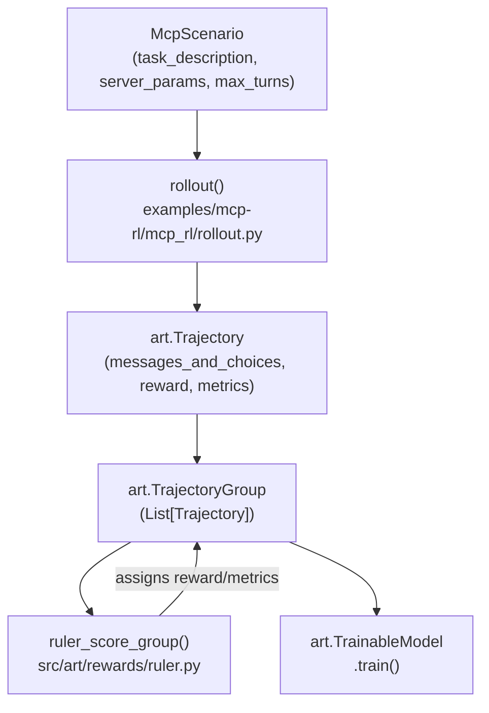
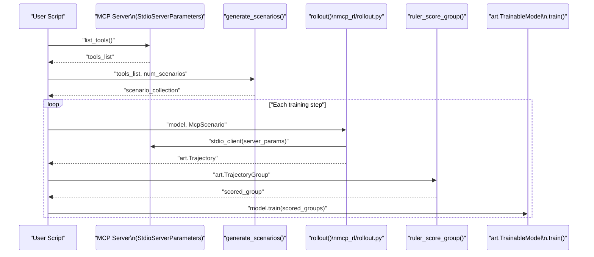
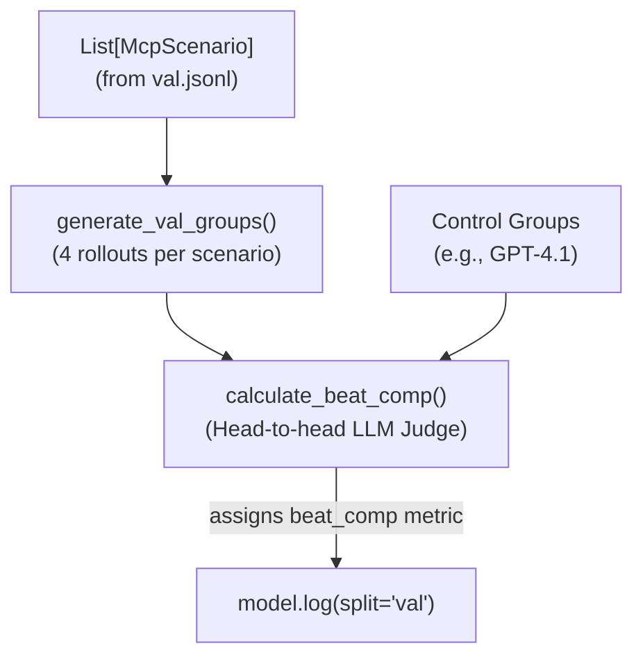

<!-- source: DeepWiki mcp.deepwiki.com · repo OpenPipe/ART · page 6.2 Tool Calling & Tau-Bench · fetched 2026-10-29 -->

# Tool Calling & Tau-Bench

Relevant source files

The following files were used as context for generating this wiki page:

- [docs/experimental/gspo.mdx](docs/experimental/gspo.mdx)
- [docs/features/checkpoint-deletion.mdx](docs/features/checkpoint-deletion.mdx)
- [docs/features/mcp-rl.mdx](docs/features/mcp-rl.mdx)
- [docs/features/tracking-metrics.mdx](docs/features/tracking-metrics.mdx)
- [docs/fundamentals/sft-training.mdx](docs/fundamentals/sft-training.mdx)
- [docs/integrations/openenv-integration.mdx](docs/integrations/openenv-integration.mdx)
- [examples/mcp-rl/all_experiments.py](examples/mcp-rl/all_experiments.py)
- [examples/mcp-rl/mcp_rl/benchmarks/generate_benchmarks.py](examples/mcp-rl/mcp_rl/benchmarks/generate_benchmarks.py)
- [examples/mcp-rl/mcp_rl/checks.py](examples/mcp-rl/mcp_rl/checks.py)
- [examples/mcp-rl/mcp_rl/mcp_server.py](examples/mcp-rl/mcp_rl/mcp_server.py)
- [examples/mcp-rl/mcp_rl/rollout.py](examples/mcp-rl/mcp_rl/rollout.py)
- [examples/mcp-rl/mcp_rl/scenario_generator.py](examples/mcp-rl/mcp_rl/scenario_generator.py)
- [examples/mcp-rl/servers/python/mcp_alphavantage/server.py](examples/mcp-rl/servers/python/mcp_alphavantage/server.py)
- [src/art/tau_bench/__init__.py](src/art/tau_bench/__init__.py)
- [src/art/tau_bench/client.py](src/art/tau_bench/client.py)
- [src/art/tau_bench/rollout.py](src/art/tau_bench/rollout.py)
- [src/art/test/test_step_skipping.py](src/art/test/test_step_skipping.py)
- [tests/unit/test_tau_bench_client.py](tests/unit/test_tau_bench_client.py)

This page covers two concrete ART applications for training tool-using agents: the **MCP•RL** pipeline, which trains agents on arbitrary [Model Context Protocol (MCP)](https://modelcontextprotocol.io) servers, and the **Tau-Bench** retail environment, a structured benchmark for evaluating multi-turn tool-calling accuracy. Both examples demonstrate how ART handles non-trivial reward signals derived from tool interaction outcomes rather than static ground truth labels.

For a general explanation of reward functions and trajectory data structures, see [Trajectory System](#2.2) and [Custom Reward Functions](#7.4). For the RULER reward utility used extensively in MCP•RL, see [Custom Reward Functions](#7.4).

---

## MCP•RL: Training Agents on MCP Servers

**MCP•RL** is a specialized application of ART that teaches language models to effectively use MCP servers [docs/features/mcp-rl.mdx:1-7](). It requires no manually labeled training data; instead, it automatically generates task scenarios and scores completions using RULER (an LLM-as-judge reward mechanism) [docs/features/mcp-rl.mdx:16-17]().

### Key Code Entities

| Entity | File | Role |
|---|---|---|
| `McpScenario` | `examples/mcp-rl/mcp_rl/rollout.py` | Represents a training task with a `task_description`, `server_params`, and `max_turns` [examples/mcp-rl/mcp_rl/rollout.py:34-39]() |
| `rollout` | `examples/mcp-rl/mcp_rl/rollout.py` | Connects to an MCP server via `stdio_client`, fetches tool schemas, and executes the interaction loop [examples/mcp-rl/mcp_rl/rollout.py:43-185]() |
| `generate_scenarios` | `docs/features/mcp-rl.mdx` | Async utility to generate diverse training tasks from tool descriptions [docs/features/mcp-rl.mdx:33-42]() |
| `complete_task` | `examples/mcp-rl/mcp_rl/rollout.py` | A terminal tool injected into the agent's schema to signal task completion with a summary [examples/mcp-rl/mcp_rl/rollout.py:107-121]() |
| `ruler_score_group` | `src/art/rewards/ruler.py` | Scores a `TrajectoryGroup` using an LLM judge (e.g., `o4-mini`) [docs/features/mcp-rl.mdx:53-59]() |

Sources: [examples/mcp-rl/mcp_rl/rollout.py:1-185](), [docs/features/mcp-rl.mdx:1-82]()

---

### Data Type Hierarchy

**Diagram: MCP•RL data types and their relationships**

Sources: [examples/mcp-rl/mcp_rl/rollout.py:34-67](), [docs/features/mcp-rl.mdx:65-82](), [examples/mcp-rl/mcp_rl/benchmarks/generate_benchmarks.py:31-43]()

---

### Training Pipeline

The MCP•RL training process follows four key steps: Server Discovery, Scenario Generation, RULER Evaluation, and Reinforcement Learning [docs/features/mcp-rl.mdx:19-82]().

**Diagram: MCP•RL training pipeline (code entities)**

Sources: [docs/features/mcp-rl.mdx:19-82](), [examples/mcp-rl/mcp_rl/rollout.py:74-80]()

---

### The `rollout` implementation

The `rollout` function in `examples/mcp-rl/mcp_rl/rollout.py` handles the live connection to MCP servers. It uses `stdio_client` to communicate with the server process and `ClientSession` to manage tool discovery [examples/mcp-rl/mcp_rl/rollout.py:74-80]().

**Key logic:**
- **Tool Mapping**: It iterates over `session.list_tools()` and converts them into OpenAI-compatible function schemas [examples/mcp-rl/mcp_rl/rollout.py:80-95]().
- **System Prompt**: It enforces a specific behavior: "Only use tool calls, do not write any content" [examples/mcp-rl/mcp_rl/rollout.py:70]().
- **Task Completion**: It appends a `complete_task` tool [examples/mcp-rl/mcp_rl/rollout.py:103-121](). When the agent calls this, `traj.metrics["task_completed"]` is set to `True`, and a success check is performed [examples/mcp-rl/mcp_rl/rollout.py:173-181]().

Sources: [examples/mcp-rl/mcp_rl/rollout.py:69-185]()

---

## Tau-Bench: Retail Environment Benchmark

**Tau-Bench** is a structured benchmark for evaluating multi-turn tool-calling accuracy in domains like retail [src/art/tau_bench/client.py:109-233](). ART provides a dedicated `TauBenchClient` and `rollout` function to interact with this environment.

### Tool Call Trajectory Capture

The `rollout` function in `src/art/tau_bench/rollout.py` manages the multi-turn interaction with the Tau-Bench environment [src/art/tau_bench/rollout.py:59-173]().

1. **Environment Initialization**: It creates an environment instance via `client.environment(...)` [src/art/tau_bench/rollout.py:78-89]().
2. **System Prompt**: The environment provides a specific `policy` in its `info` dictionary, which is used as the system prompt [src/art/tau_bench/rollout.py:99]().
3. **Loop**: 
    - The model generates a completion.
    - If it contains `tool_calls`, the client calls `step_environment` with the action [src/art/tau_bench/rollout.py:137-141]().
    - The observation from the tool is added back to the trajectory with `role: "tool"` [src/art/tau_bench/rollout.py:142-148]().
    - Reward is accumulated from `step.reward` [src/art/tau_bench/rollout.py:149]().
4. **Cost Tracking**: It records "tinker" costs (prefill/sample) and "user" costs using `_record_tinker_costs` [src/art/tau_bench/rollout.py:129-134]().

Sources: [src/art/tau_bench/rollout.py:59-173](), [src/art/tau_bench/client.py:109-233]()

---

### Accuracy Benchmarks & Comparison

In `examples/mcp-rl/mcp_rl/benchmarks/generate_benchmarks.py`, ART provides utilities to compare model performance against baselines (like GPT-4o or Sonnet) [examples/mcp-rl/mcp_rl/benchmarks/generate_benchmarks.py:139-181]().

**Diagram: Benchmark Generation Flow**

The `calculate_beat_comp` function uses `ruler_score_group` to compare two trajectories (one from the benchmark model, one from a control model) and sets a `beat_comp` metric to `1` (win), `0` (loss), or `0.5` (tie) based on reward difference [examples/mcp-rl/mcp_rl/benchmarks/generate_benchmarks.py:46-99]().

Sources: [examples/mcp-rl/mcp_rl/benchmarks/generate_benchmarks.py:1-121]()

---

## Metrics & Tracking

Tool-calling rollouts automatically track several critical metrics:
- **`task_completed`**: Boolean indicating if the agent called the completion tool [examples/mcp-rl/mcp_rl/rollout.py:174]().
- **`success`**: Boolean indicating if the task was successfully performed [examples/mcp-rl/mcp_rl/rollout.py:180]().
- **`num_turns`**: The number of interaction turns before termination [src/art/tau_bench/rollout.py:172]().
- **`cost/user`**: Cost of simulated user messages in the Tau-Bench environment [src/art/tau_bench/rollout.py:157]().

Sources: [docs/features/tracking-metrics.mdx:43-77](), [src/art/tau_bench/rollout.py:172-173]()

---

