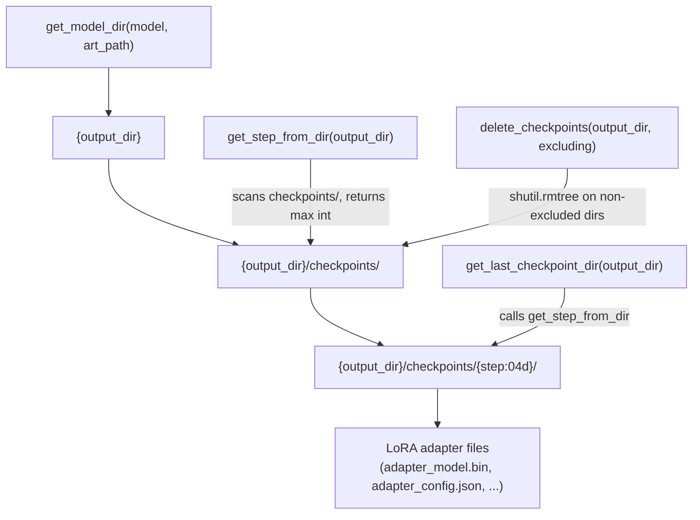
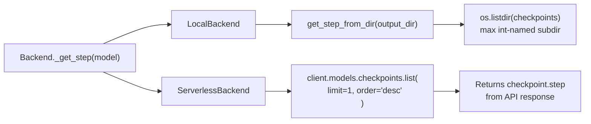
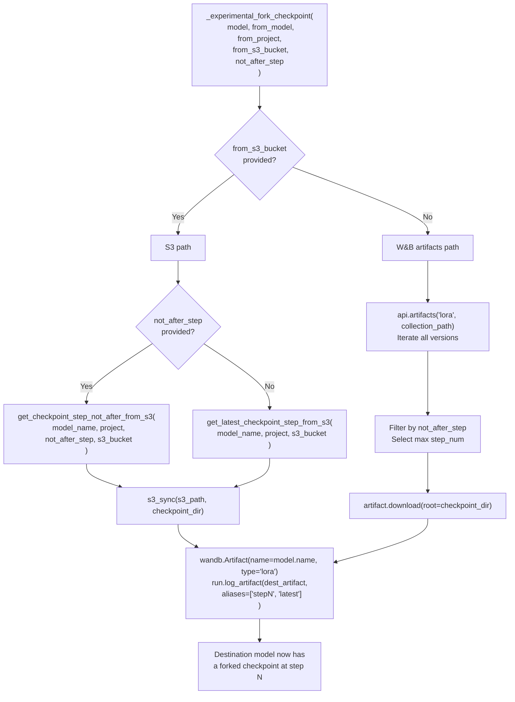

<!-- source: DeepWiki mcp.deepwiki.com · repo OpenPipe/ART · page 7.3 Checkpoint Management · fetched 2026-10-29 -->

# Checkpoint Management

<details>
<summary>Relevant source files</summary>

The following files were used as context for generating this wiki page:

- [.skyignore](.skyignore)
- [CLAUDE.md](CLAUDE.md)
- [scripts/migrate-s3-checkpoints.py](scripts/migrate-s3-checkpoints.py)
- [src/art/local/backend.py](src/art/local/backend.py)
- [src/art/local/checkpoints.py](src/art/local/checkpoints.py)
- [src/art/model.py](src/art/model.py)
- [src/art/utils/get_model_step.py](src/art/utils/get_model_step.py)
- [src/art/utils/s3_checkpoint_utils.py](src/art/utils/s3_checkpoint_utils.py)

</details>


This page covers how ART stores, tracks, deletes, and forks training checkpoints across the local filesystem, W&B artifact storage, and S3. It also covers step-counting utilities and migration scripts for both local and cloud storage.

For information about backend-specific training orchestration that *produces* these checkpoints, see [Model Services](#3.2) and [LocalBackend](#4.1). For deployment of trained checkpoints (e.g., serving a LoRA adapter via W&B Inference), see [Model Deployment & S3 Storage](#4.4).

---

## Checkpoint Storage Layout

### Local (Disk) Layout

Under the local backend, checkpoints are stored inside a `checkpoints/` subdirectory within the model's output directory. Each training step produces a numerically-named subdirectory zero-padded to four digits [src/art/utils/output_dirs.py:46-48]().

```
.art/
└── {project}/
    └── models/
        └── {model_name}/
            └── checkpoints/
                ├── 0001/       ← LoRA adapter files for step 1
                ├── 0002/
                └── 0010/       ← LoRA adapter files for step 10
```

**Diagram: Local Filesystem Entities**



Sources: [src/art/local/checkpoints.py:1-31](), [src/art/utils/get_model_step.py:1-27](), [src/art/utils/output_dirs.py:46-48]()

---

### S3 Storage Layout

S3 storage follows a similar hierarchical structure to the local layout, allowing for centralized backup and cross-cluster checkpoint forking.

```
s3://{bucket}/{prefix}/{project}/models/{model_name}/checkpoints/
├── 0001/
├── 0002/
└── 0010/
```

The `art.utils.s3_checkpoint_utils` module provides functions to query this structure without downloading full model weights:
- `get_latest_checkpoint_step_from_s3`: Scans the `checkpoints/` prefix and returns the maximum integer directory name [src/art/utils/s3_checkpoint_utils.py:7-51]().
- `get_checkpoint_step_not_after_from_s3`: Returns the highest step number $\le$ a specified `not_after_step` [src/art/utils/s3_checkpoint_utils.py:54-104]().

Sources: [src/art/utils/s3_checkpoint_utils.py:7-104]()

---

## Step Tracking

Both backends implement `_get_step(model) -> int` as part of the `Backend` protocol [src/art/backend.py:107-115]().

**Diagram: _get_step implementations by backend**



The local implementation scans the local filesystem using `get_step_from_dir` [src/art/utils/get_model_step.py:10-23](). The serverless implementation issues a paginated API call against the OpenPipe/W&B training backend [src/art/serverless/backend.py:107-115]().

Sources: [src/art/utils/get_model_step.py:10-23](), [src/art/serverless/backend.py:107-115]()

---

## Deleting Checkpoints

### Backend Protocol

All backends implement `_delete_checkpoint_files(model, steps_to_keep)`. The higher-level `model.delete_checkpoints()` on `TrainableModel` calls this method after determining which steps should be retained (based on `best_checkpoint_metric` configuration) [src/art/model.py:650-680]().

### Local Deletion

`delete_checkpoints(output_dir, excluding)` iterates over all numeric-named subdirectories inside `checkpoints/` and calls `shutil.rmtree` on any that are not in the `excluding` list [src/art/local/checkpoints.py:7-20]().

[src/art/local/checkpoints.py:7-20]()

### Serverless Deletion

`ServerlessBackend._delete_checkpoint_files` lists all checkpoint steps for the model via the API, computes the set difference against `steps_to_keep`, then issues a bulk DELETE request to the serverless infrastructure [src/art/serverless/backend.py:117-133]().

---

## Checkpoint Forking

`_experimental_fork_checkpoint` creates a new model that begins training from an existing model's checkpoint. This is useful for recovering from training instability or branching experiments [src/art/serverless/backend.py:662-675]().

**Diagram: _experimental_fork_checkpoint control flow**



Sources: [src/art/serverless/backend.py:662-836](), [src/art/utils/s3_checkpoint_utils.py:7-104]()

---

## Checkpoint Format Migration

### Local Migration
Older versions of ART stored checkpoints directly under the model directory. `migrate_checkpoints_to_new_structure(output_dir)` moves these into the `checkpoints/` subfolder [src/art/local/checkpoints.py:33-64]().

### S3 Migration
Similar to the local migration, `migrate_s3_checkpoints_to_new_structure` moves S3 directories from `s3://.../{model_name}/{step}/` to `s3://.../{model_name}/checkpoints/{step}/` using `aws s3 sync` and `aws s3 rm` [src/art/utils/s3_checkpoint_utils.py:107-251](). This can be invoked via the `scripts/migrate-s3-checkpoints.py` script [scripts/migrate-s3-checkpoints.py:25-61]().

### Trajectory Migration
ART provides a CLI command `art migrate` to convert legacy JSONL trajectory files to the modern Parquet format used for efficient training data loading [src/art/trajectories.py:450-480]().

---

## Summary: Checkpoint Management by Backend

| Operation | LocalBackend | ServerlessBackend |
|---|---|---|
| Storage location | `.art/{project}/models/{model}/checkpoints/{step:04d}/` | W&B artifact `{entity}/{project}/{model}:step{N}` |
| Step discovery | `get_step_from_dir` (filesystem scan) | `client.models.checkpoints.list(limit=1, order="desc")` |
| Deletion | `shutil.rmtree` on numeric subdirs | Bulk DELETE API call |
| Forking source | Local filesystem copy | W&B artifact download or S3 sync |
| S3 backup | Manual via S3 sync utilities | `_experimental_push_to_s3` |

Sources: [src/art/local/checkpoints.py:1-64](), [src/art/utils/get_model_step.py:1-27](), [src/art/serverless/backend.py:107-133](), [src/art/utils/s3_checkpoint_utils.py:107-251]()

---

