# Page: Introduction to AutoAgent

# Introduction to AutoAgent

<details>
<summary>Relevant source files</summary>

The following files were used as context for generating this wiki page:

- [README.md](README.md)
- [assets/AutoAgent_Arxiv_2025.pdf](assets/AutoAgent_Arxiv_2025.pdf)
- [assets/autoagent-intro-final.pdf](assets/autoagent-intro-final.pdf)
- [assets/autoagent-intro.pdf](assets/autoagent-intro.pdf)
- [assets/autoagent-intro.png](assets/autoagent-intro.png)
- [assets/autoagent-intro.svg](assets/autoagent-intro.svg)
- [assets/autoagent.png](assets/autoagent.png)
- [assets/video_v1_compressed.mp4](assets/video_v1_compressed.mp4)

</details>


## Purpose and Scope

This document provides a comprehensive introduction to AutoAgent, a fully-automated, zero-code LLM agent framework that enables users to create and deploy sophisticated AI agents through natural language alone. This page covers the system's core purpose, key capabilities, and high-level architecture.

For detailed installation and setup instructions, see [Installation and Setup](#2). For information about using the command-line interface, see [Command Line Interface](#3). For in-depth technical details about core components, see [Core Components](#4).

## What is AutoAgent

AutoAgent is a self-developing framework that eliminates the need for traditional programming when creating LLM-powered agents. Users can create tools, agents, and workflows using natural language descriptions, while the system handles the underlying complexity of agent orchestration, execution environments, and LLM integration [README.md:30-48]().

The framework delivers performance comparable to industry-leading solutions like OpenAI's Deep Research while providing greater flexibility in model selection and cost-effectiveness through its open-source nature [README.md:96-105]().

## Key Features and Capabilities

| Feature | Description |
|---------|-------------|
| **Zero-Code Agent Creation** | Create agents and workflows using natural language descriptions only [README.md:37-39]() |
| **Universal LLM Support** | Compatible with OpenAI, Anthropic, DeepSeek, Gemini, Grok, and other providers [README.md:101-102]() |
| **Natural Language Orchestration** | Dynamically creates and optimizes workflows based on high-level task descriptions [README.md:40-42]() |
| **Self-Play Customization** | Enables iterative self-improvement of tools and agents through controlled code generation [README.md:46-48]() |
| **Multiple Environments** | Docker containerization, browser automation, and local execution [README.md:65-66]() |
| **GAIA Benchmark Performance** | Top-tier performance on industry-standard benchmarks [README.md:22-23]() |

## System Architecture Overview

AutoAgent operates through a layered architecture centered around the MetaChain orchestrator, which coordinates between user interfaces, execution environments, and external services.

### Core System Components

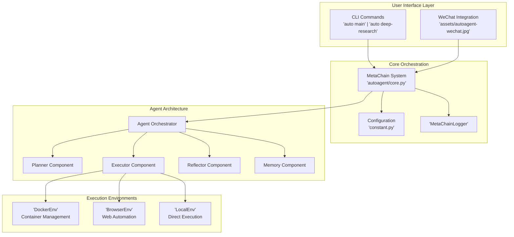

**Sources:** [README.md:1-50](), [README.md:65-66](), [assets/autoagent-intro.svg:1-4]()

### MetaChain Orchestration Flow

The MetaChain system manages the lifecycle of a task, from initial parsing to final execution and reflection.

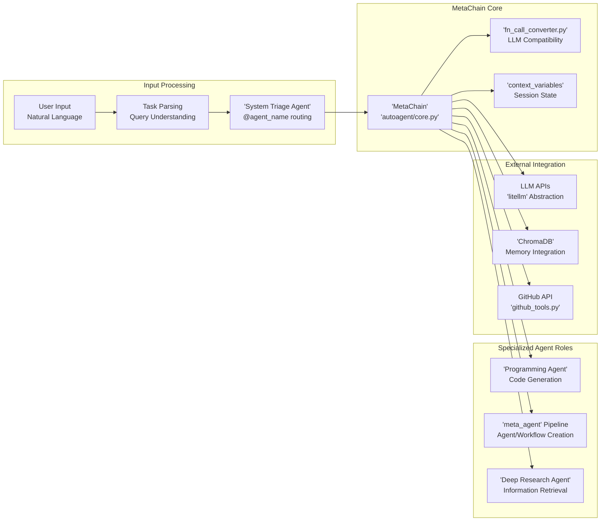

**Sources:** [README.md:92-120](), [README.md:150-201]()

## Operational Modes

AutoAgent provides three primary operational modes accessible through the command-line interface:

### User Mode (Deep Research)
Activated via the `auto deep-research` command, this mode provides an out-of-the-box multi-agent system designed for comprehensive information retrieval and analytical report generation [README.md:96-105]().

### Agent Editor Mode
Accessed through `auto main` and selecting the agent editor, this mode allows users to create individual agents (profiling, tool creation, and assembly) through natural language descriptions [README.md:117-135]().

### Workflow Editor Mode  
Also accessed through `auto main`, this mode enables the creation of multi-agent workflows where agents collaborate according to user-defined processes, implemented via `WorkflowForm` XML schemas [README.md:137-148]().

## Environment System

AutoAgent's execution environments provide isolated, secure contexts for different types of agent tasks, particularly for code execution and web browsing [README.md:65-66]().

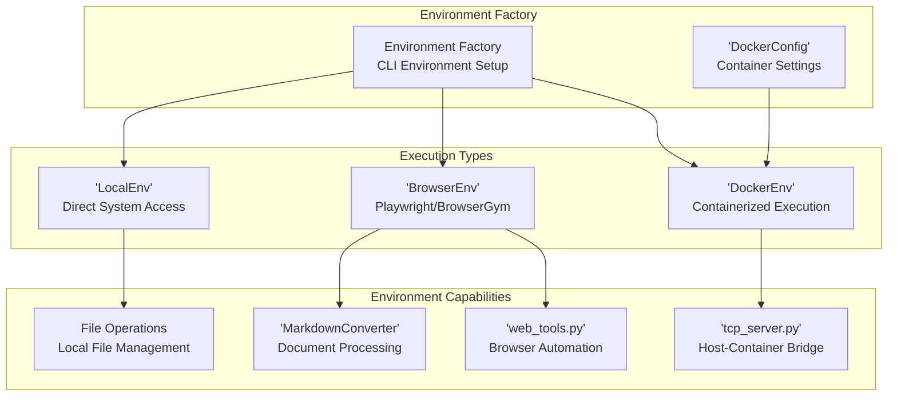

**Sources:** [README.md:208-225](), [README.md:65-66]()

## Getting Started

To begin using AutoAgent, users install the framework and configure API keys for their preferred LLM providers. The system supports multiple providers through a unified interface [README.md:208-242]().

Basic usage follows this pattern:
1. Install AutoAgent via `pip install -e .` [README.md:208-210]()
2. Configure environment variables for LLM API keys in `.env` [README.md:218-221]()
3. Run `auto main` for full functionality or `auto deep-research` for research tasks [README.md:244-250]()
4. Interact with the system through natural language commands.

For detailed setup instructions and configuration options, see [Installation and Setup](#2).

**Sources:** [README.md:208-396]()

---

# Page: Core Concepts

# Core Concepts

<details>
<summary>Relevant source files</summary>

The following files were used as context for generating this wiki page:

- [README.md](README.md)
- [assets/AutoAgent_Arxiv_2025.pdf](assets/AutoAgent_Arxiv_2025.pdf)
- [assets/autoagent-intro-final.pdf](assets/autoagent-intro-final.pdf)
- [assets/autoagent-intro.pdf](assets/autoagent-intro.pdf)
- [assets/autoagent-intro.png](assets/autoagent-intro.png)
- [assets/autoagent-intro.svg](assets/autoagent-intro.svg)
- [assets/autoagent.png](assets/autoagent.png)
- [assets/paper/metachain_arxiv.pdf](assets/paper/metachain_arxiv.pdf)
- [assets/video_v1_compressed.mp4](assets/video_v1_compressed.mp4)

</details>


This document introduces the fundamental concepts that underpin AutoAgent's architecture and functionality. It covers the core abstractions, system components, and design principles that enable AutoAgent to function as a fully-automated, zero-code LLM agent framework.

For system architecture details, see [System Architecture](#1.2). For implementation specifics of the MetaChain orchestration system, see [MetaChain System](#4.1). For execution environment details, see [Environment System](#4.3).

## Overview

AutoAgent is a **Fully-Automated** and highly **Self-Developing** framework that enables users to create and deploy LLM agents through **Natural Language Alone**. It eliminates the need for manual coding by automating the construction and orchestration of collaborative agent systems.

Sources: [README.md:30-35](), [README.md:37-48]()

## Operating Agent System Metaphor

AutoAgent is designed as an "Operating Agent System," drawing parallels between traditional operating systems and agentic workflows. This architecture is divided into three primary layers:

| Layer | OS Equivalent | Code Space / Responsibility |
| :--- | :--- | :--- |
| **User Mode** | User Space / Apps | High-level research tasks, multi-agent research assistants, and final task execution. |
| **Developer Mode** | Development Tools | Natural language editors for creating new Agents (`agent editor`) and Workflows (`workflow editor`). |
| **OS Kernel** | Kernel / Runtime | The `MetaChain` engine, environment management (`DockerEnv`, `BrowserEnv`), and tool execution. |

Sources: [README.md:92-200](), [README.md:218-221]()

## Core Architectural Concepts

### Agent-Based Computing Model

AutoAgent implements a multi-agent architecture where individual agents are autonomous computational units. The system maps natural language requirements to specific code entities that reason, plan, execute actions, and reflect on outcomes.

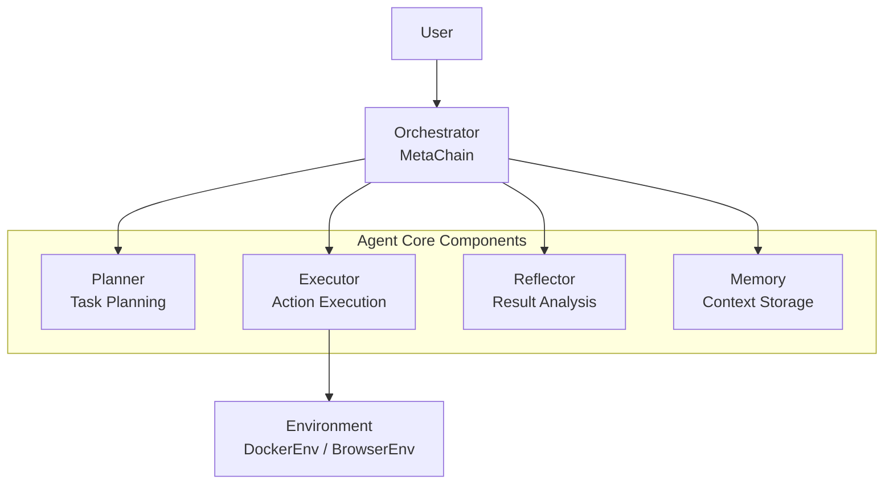

Sources: [assets/autoagent-intro.svg:1-4](), [README.md:34-48]()

### MetaChain Orchestration System

The `MetaChain` (formerly known as the project name) serves as the central orchestration engine. It manages the message flow between agents, handles tool calling, and provides the runtime environment for agent interactions.

Sources: [README.md:65-66](), [README.md:414-421]()

## Agent System Concepts

### Agent Lifecycle

Agents in AutoAgent are defined through natural language descriptions and automatically converted into executable code entities.

1.  **Requirement Gathering**: User provides a natural language description of the desired agent.
2.  **Agent Profiling**: The system uses a "Meta-Agent" to generate an `AgentForm` (XML-based schema).
3.  **Tool Development**: The system automatically writes the necessary Python tools for the agent.
4.  **Assembly**: The agent is registered in the system and becomes available for tasks.

Sources: [README.md:115-145](), [README.md:164-200]()

### Tool Integration

Tools are external capabilities that agents invoke. AutoAgent supports a wide range of tools, from web browsing to isolated code execution.

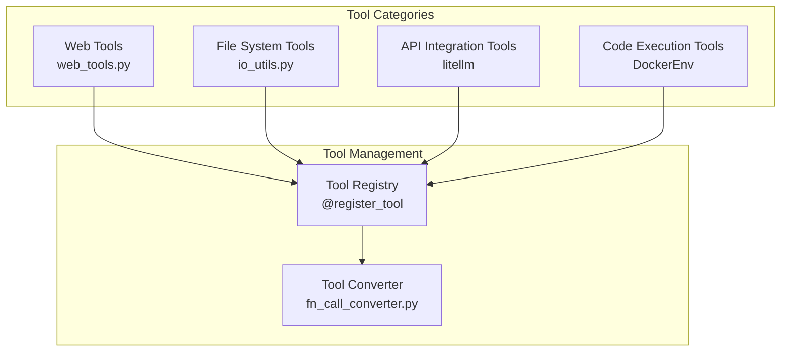

Sources: [README.md:414-421](), [README.md:65-68]()

## Zero-Code Philosophy

The **Zero-Code** framework democratizes AI development by allowing anyone to create agents, tools, and workflows using natural language alone. This is achieved through:

*   **Self-Managing Workflow Generation**: Dynamically creates and optimizes workflows based on high-level descriptions.
*   **Intelligent Resource Orchestration**: Controlled code generation for creating new components through iterative self-improvement.
*   **Natural Language-Driven Building**: Eliminates manual technical configuration.

Sources: [README.md:37-48]()

## Agentic RAG

### Intelligent Retrieval System

**Agentic RAG** represents an advanced approach to Retrieval-Augmented Generation where agents make intelligent decisions about when and how to retrieve information, rather than following fixed retrieval patterns.

*   **Dynamic Retrieval Decisions**: Agents determine optimal retrieval strategies based on the complexity of the query.
*   **Context-Aware Processing**: Retrieval is adapted to the current task context rather than a simple similarity search.

Sources: [README.md:34-35](), [README.md:457-470]()

## Execution Environments

AutoAgent provides robust isolation for agent actions through specialized environments.

| Environment | Code Entity | Purpose |
| :--- | :--- | :--- |
| **Docker** | `DockerEnv` | Isolated code execution, preventing agents from damaging the host system. |
| **Browser** | `BrowserEnv` | Web automation, site interaction, and data scraping using tools like Playwright. |
| **Local** | `LocalEnv` | Direct system access for non-destructive file operations. |

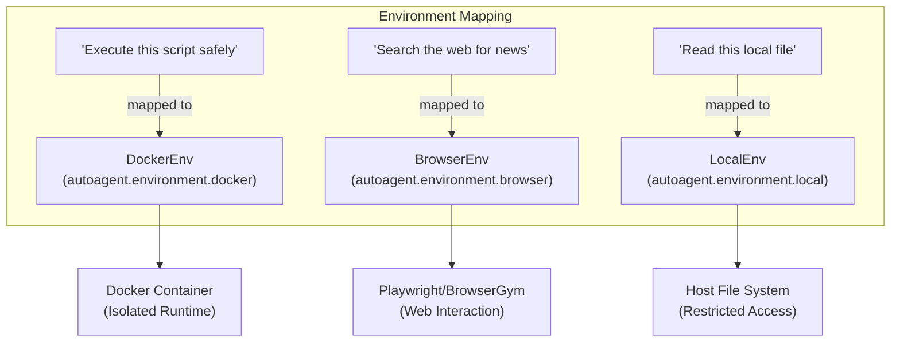

Sources: [README.md:218-221](), [README.md:423-455]()

## Key Abstractions

### LLM Integration Layer

AutoAgent provides universal LLM support through a standardized interface that abstracts provider-specific differences (e.g., OpenAI, Anthropic, DeepSeek, Gemini).

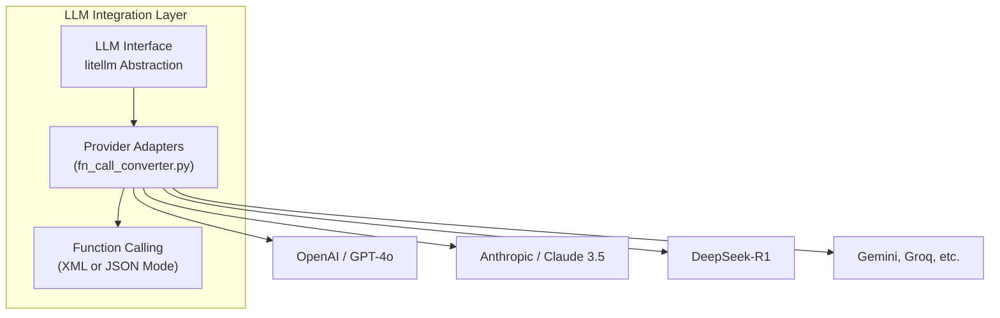

Sources: [README.md:40-41](), [README.md:65-68](), [README.md:269-396]()

---

# Page: System Architecture

# System Architecture

<details>
<summary>Relevant source files</summary>

The following files were used as context for generating this wiki page:

- [assets/AutoAgent_Arxiv_2025.pdf](assets/AutoAgent_Arxiv_2025.pdf)
- [assets/autoagent-intro-final.pdf](assets/autoagent-intro-final.pdf)
- [assets/autoagent-intro.pdf](assets/autoagent-intro.pdf)
- [assets/autoagent-intro.svg](assets/autoagent-intro.svg)
- [autoagent/cli.py](autoagent/cli.py)
- [autoagent/core.py](autoagent/core.py)
- [autoagent/fn_call_converter.py](autoagent/fn_call_converter.py)

</details>


This document provides a comprehensive technical overview of AutoAgent's system architecture, focusing on the core orchestration mechanisms, agent execution flows, and key component interactions. The architecture is designed around a centralized orchestration system that coordinates multiple execution environments and manages LLM interactions through a sophisticated function calling framework.

## Core Architecture Overview

AutoAgent implements a multi-layered architecture centered around the `MetaChain` orchestration system, which coordinates between user inputs, agent execution, and various execution environments.

### High-Level System Components

```mermaid
graph TB
    subgraph "User Interface Layer"
        CLI["`CLI Interface`<br/>`autoagent/cli.py`"]
        WeChat["`WeChat Integration`<br/>`QR Code Entry`"]
    end
    
    subgraph "Core Orchestration"
        MetaChain["`MetaChain`<br/>`autoagent/core.py`"]
        FnConverter["`FunctionCallConverter`<br/>`autoagent/fn_call_converter.py`"]
        Logger["`MetaChainLogger`<br/>`autoagent/logger.py`"]
    end
    
    subgraph "Agent Execution"
        Agent["`Agent`<br/>`autoagent/types.py`"]
        AgentFunctions["`AgentFunction`<br/>`function_to_json()`"]
        Response["`Response`<br/>`Result`"]
    end
    
    subgraph "Execution Environments"
        Docker["`DockerEnv`<br/>`autoagent/environment/docker_env.py`"]
        Browser["`BrowserEnv`<br/>`autoagent/environment/browser_env.py`"]
        Local["`LocalEnv`<br/>`autoagent/environment/local_env.py`"]
    end
    
    subgraph "External Services"
        LLM["`LLM Providers`<br/>`litellm.completion()`"]
        APIs["`External APIs`<br/>`OpenAI, Anthropic, Gemini`"]
    end
    
    CLI --> MetaChain
    WeChat --> MetaChain
    MetaChain --> FnConverter
    MetaChain --> Logger
    MetaChain --> Agent
    Agent --> AgentFunctions
    AgentFunctions --> Response
    MetaChain --> Docker
    MetaChain --> Browser
    MetaChain --> Local
    MetaChain --> LLM
    LLM --> APIs
```

**Sources:** [autoagent/core.py:96-106](), [autoagent/cli.py:46-49](), [autoagent/environment/docker_env.py:25-25](), [autoagent/environment/browser_env.py:27-27](), [autoagent/environment/local_env.py:26-26]()

## MetaChain Orchestration System

The `MetaChain` class serves as the central orchestrator, managing the complete agent execution lifecycle from message processing to tool calling and response generation.

### MetaChain Core Components

```mermaid
graph LR
    subgraph "MetaChain Core"
        MC["`MetaChain`<br/>`autoagent/core.py`"]
        GCC["`get_chat_completion()`<br/>`line 115-210`"]
        HTC["`handle_tool_calls()`<br/>`line 230-302`"]
        RUN["`run()`<br/>`line 396-493`"]
    end
    
    subgraph "Message Processing"
        Messages["`List[Message]`<br/>`history`"]
        Instructions["`agent.instructions`<br/>`callable or str`"]
        Tools["`function_to_json(f)`<br/>`autoagent/util.py`"]
    end
    
    subgraph "LLM Integration"
        Completion["`litellm.completion()`<br/>`line 173, 201`"]
        Models["`model_override`<br/>`agent.model`"]
        Gemini["`adapt_tools_for_gemini()`<br/>`line 58-94`"]
    end
    
    subgraph "Tool Execution"
        FunctionMap["`function_map`<br/>`line 238`"]
        ToolCalls["`ChatCompletionMessageToolCall`<br/>`line 242`"]
        Results["`Result`<br/>`handle_function_result()`"]
    end
    
    MC --> GCC
    MC --> HTC
    MC --> RUN
    GCC --> Messages
    GCC --> Instructions
    GCC --> Tools
    GCC --> Completion
    Completion --> Models
    Completion --> Gemini
    HTC --> FunctionMap
    HTC --> ToolCalls
    HTC --> Results
```

**Sources:** [autoagent/core.py:96-106](), [autoagent/core.py:115-210](), [autoagent/core.py:230-302](), [autoagent/core.py:396-493](), [autoagent/core.py:58-94]()

### Agent Execution Flow

The execution flow follows a structured pattern where the `MetaChain` processes messages, handles tool calls, and manages context variables throughout the conversation.

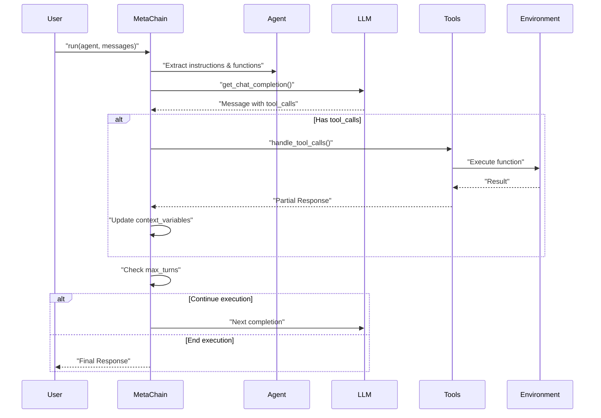

**Sources:** [autoagent/core.py:396-493](), [autoagent/core.py:115-210](), [autoagent/core.py:230-302]()

## Function Calling System

AutoAgent implements a sophisticated function calling system that supports both native function calling LLMs and models that require prompt-based function calling through the `FunctionCallConverter`.

### Function Call Conversion Architecture

```mermaid
graph TB
    subgraph "Function Call Modes"
        FnCall["`FN_CALL=True`<br/>`Native Support`"]
        NonFnCall["`FN_CALL=False`<br/>`Prompt-based`"]
    end
    
    subgraph "Conversion Layer"
        Converter["`FunctionCallConverter`<br/>`fn_call_converter.py`"]
        ToDesc["`convert_tools_to_description()`<br/>`line 281-317`"]
        ToFnCall["`convert_non_fncall_messages_to_fncall_messages()`<br/>`line 575-700`"]
        FromFnCall["`convert_fn_messages_to_non_fn_messages()`<br/>`line 320-486`"]
    end
    
    subgraph "Message Processing"
        SystemPrompt["`SYSTEM_PROMPT_SUFFIX_TEMPLATE`<br/>`line 35-58`"]
        FnRegex["`FN_REGEX_PATTERN`<br/>`line 243`"]
        ParamRegex["`FN_PARAM_REGEX_PATTERN`<br/>`line 244`"]
    end
    
    subgraph "Tool Execution"
        ToolCall["`convert_tool_call_to_string()`<br/>`line 250-278`"]
        Validation["`_extract_and_validate_params()`<br/>`line 489-562`"]
        StopWords["`STOP_WORDS`<br/>`line 60`"]
    end
    
    FnCall --> Converter
    NonFnCall --> Converter
    Converter --> ToDesc
    Converter --> ToFnCall
    Converter --> FromFnCall
    ToDesc --> SystemPrompt
    ToFnCall --> FnRegex
    ToFnCall --> ParamRegex
    FromFnCall --> ToolCall
    ToolCall --> Validation
    Validation --> StopWords
```

**Sources:** [autoagent/fn_call_converter.py:35-58](), [autoagent/fn_call_converter.py:281-317](), [autoagent/fn_call_converter.py:320-486](), [autoagent/fn_call_converter.py:575-700](), [autoagent/core.py:148-151]()

### Tool Definition and Validation

The system uses a comprehensive tool definition format that supports parameter validation, type checking, and enum constraints.

| Component | Code Entity | Purpose |
| :--- | :--- | :--- |
| **Tool Definition** | `ChatCompletionToolParam` | Defines the schema for functions exposed to the LLM. |
| **Parameter Parsing** | `_extract_and_validate_params` | Uses regex to parse XML-style parameters from non-native LLM outputs. |
| **Type Mapping** | `param_name_to_type` | Maps parameter names to Python types for runtime conversion. |
| **Gemini Adapter** | `adapt_tools_for_gemini` | Ensures Gemini compatibility by adding dummy properties to empty objects. |

**Sources:** [autoagent/fn_call_converter.py:489-562](), [autoagent/core.py:58-94](), [autoagent/core.py:238-302]()

## Environment Integration

AutoAgent supports multiple execution environments, each providing isolated execution contexts for code execution and web interaction.

### Environment Mapping

| Environment | Class | Key File | Description |
| :--- | :--- | :--- | :--- |
| **Docker** | `DockerEnv` | `autoagent/environment/docker_env.py` | Isolated container for running code safely. |
| **Browser** | `BrowserEnv` | `autoagent/environment/browser_env.py` | Web automation using Playwright/BrowserGym. |
| **Local** | `LocalEnv` | `autoagent/environment/local_env.py` | Direct execution on the host system. |
| **Markdown** | `RequestsMarkdownBrowser` | `autoagent/environment/markdown_browser.py` | Simplified text-based web/file browsing. |

**Sources:** [autoagent/cli.py:149-153](), [autoagent/cli.py:163-167]()

## Key System Interactions

The complete system operates through a series of coordinated interactions between the core components, maintaining state through `context_variables` and managing execution flow through the `MetaChain` orchestrator.

### Data Flow: User Query to Tool Execution

```mermaid
graph TB
    subgraph "Input Layer"
        UserInput["`User Input`<br/>`autoagent/cli.py`"]
        FileUpload["`File Upload`<br/>`select_and_copy_files`"]
    end
    
    subgraph "Processing Layer"
        MetaChain["`MetaChain.run()`<br/>`autoagent/core.py`"]
        Agent["`Agent Configuration`<br/>`types.Agent`"]
        Messages["`Message History`<br/>`List[Message]`"]
    end
    
    subgraph "Execution Layer"
        LLMCall["`get_chat_completion()`<br/>`litellm.completion()`"]
        ToolExecution["`handle_tool_calls()`<br/>`function_map[name](**args)`"]
        ContextUpdate["`context_variables.update()`<br/>`Result.context_variables`"]
    end
    
    subgraph "Output Layer"
        Response["`Response`<br/>`types.Response`"]
        AgentSwitch["`Agent Handoff`<br/>`Result.agent`"]
        ResultValue["`Result.value`<br/>`Tool Output`"]
    end
    
    UserInput --> MetaChain
    FileUpload --> MetaChain
    MetaChain --> Agent
    Agent --> Messages
    Messages --> LLMCall
    LLMCall --> ToolExecution
    ToolExecution --> ContextUpdate
    ContextUpdate --> Response
    Response --> AgentSwitch
    Response --> ResultValue
```

**Sources:** [autoagent/core.py:396-493](), [autoagent/core.py:115-210](), [autoagent/core.py:230-302](), [autoagent/core.py:212-228](), [autoagent/cli.py:78-84]()

---

# Page: Installation and Setup

# Installation and Setup

<details>
<summary>Relevant source files</summary>

The following files were used as context for generating this wiki page:

- [README.md](README.md)
- [assets/autoagent-intro.png](assets/autoagent-intro.png)
- [assets/autoagent.png](assets/autoagent.png)
- [assets/video_v1_compressed.mp4](assets/video_v1_compressed.mp4)
- [docs/docs/Get-Started/get-started-installation.md](docs/docs/Get-Started/get-started-installation.md)
- [docs/docs/Get-Started/get-started-quickstart.md](docs/docs/Get-Started/get-started-quickstart.md)
- [setup.cfg](setup.cfg)

</details>


This page provides comprehensive instructions for installing AutoAgent and configuring the basic environment. It covers system requirements, installation procedures, and initial configuration steps needed to get AutoAgent running.

For detailed API key configuration and environment variables, see [API Keys and Configuration](#2.1). For WeChat integration setup, see [WeChat Integration Setup](#2.2).

## System Requirements

AutoAgent requires specific system components and dependencies to function properly. The framework operates across multiple environments and integrates with various external services.

### Core Requirements

| Component | Requirement | Purpose |
|-----------|-------------|---------|
| Python | 3.10+ | Runtime environment [setup.cfg:71]() |
| Docker | Latest stable | Isolated code execution environments |
| Git | Latest stable | Repository management |
| Git LFS | Enabled | Large file handling for video/image assets |

### Hardware Requirements

- **Memory**: Minimum 8GB RAM recommended.
- **Storage**: 10GB+ available space for containers and assets.
- **Network**: Stable internet connection for LLM APIs and container image pulls.

**Installation Architecture**

```mermaid
graph TB
    subgraph "Installation Process"
        [GitClone] --> [LocalRepo]
        [LocalRepo] --> [PipInstall]
        [PipInstall] --> [PackageInstall]
    end
    
    subgraph "Configuration Files"
        [setup.cfg] --> [Dependencies]
        [EnvTemplate] --> [EnvFile]
        [EnvFile] --> [APIKeys]
    end
    
    subgraph "Runtime Dependencies"
        [Dependencies] --> [PythonDeps]
        [Dependencies] --> [DockerImages]
        [Dependencies] --> [CLIEntry]
    end
    
    subgraph "External Services"
        [DockerHub] --> [DockerImages]
        [LLMProviders] --> [APIKeys]
        [GitLFS] --> [Assets]
    end
    
    [PackageInstall] --> [CLIEntry]
    [CLIEntry] --> [AutoCLI]
    
    [GitClone] ["git clone"]
    [LocalRepo] ["Local Repository"]
    [PipInstall] ["pip install -e ."]
    [PackageInstall] ["Package Installation"]
    [EnvTemplate] [".env.template"]
    [EnvFile] [".env"]
    [APIKeys] ["API Keys Configuration"]
    [PythonDeps] ["Python Packages"]
    [DockerImages] ["Docker Images"]
    [CLIEntry] ["CLI Entry Points"]
    [AutoCLI] ["'auto' command"]
    [Assets] ["Static Assets (.mp4, .svg)"]
```

Sources: [README.md:212-216](), [setup.cfg:1-81](), [setup.cfg:71]()

## Installation Process

### Step 1: Repository Setup

Clone the AutoAgent repository and navigate to the project directory:

```bash
git clone https://github.com/HKUDS/AutoAgent.git
cd AutoAgent
```

The repository includes Git LFS configuration for managing large assets in the `assets/` directory, such as `video_v1_compressed.mp4` [assets/video_v1_compressed.mp4:1-38]().

### Step 2: Package Installation

Install AutoAgent in development mode to enable local modifications:

```bash
pip install -e .
```

This command processes the configuration in `setup.cfg` [setup.cfg:1-81]() and installs all required dependencies, including `litellm`, `browsergym`, and `openai` [setup.cfg:16-66]().

### Step 3: Docker Setup

Install Docker for containerized execution environments. AutoAgent uses Docker to provide isolated environments for agents to run code safely. The framework automatically pulls the appropriate pre-built Docker images based on your system architecture when needed [README.md:65]().

**Package Dependencies and Entry Points**

```mermaid
graph LR
    subgraph "setup.cfg Configuration"
        [MetaData] --> [PackageInfo]
        [Options] --> [PackageDir]
        [Options] --> [InstallReqs]
        [EntryPoints] --> [ConsoleScripts]
    end
    
    subgraph "Core Dependencies"
        [InstallReqs] --> [LLMDeps]
        [InstallReqs] --> [WebDeps]
        [InstallReqs] --> [DataDeps]
        [InstallReqs] --> [UtilDeps]
    end
    
    subgraph "CLI Integration"
        [ConsoleScripts] --> [AutoCLI]
        [AutoCLI] --> [CLIModule]
        [CLIModule] --> [MainCommands]
    end
    
    [MetaData] ["metadata"]
    [PackageInfo] ["name: autoagent<br/>version: 0.1.0"]
    [Options] ["options"]
    [PackageDir] ["package_dir: ."]
    [InstallReqs] ["install_requires"]
    [EntryPoints] ["entry_points"]
    [ConsoleScripts] ["console_scripts"]
    [LLMDeps] ["openai>=1.52.0<br/>litellm==1.55.0"]
    [WebDeps] ["browsergym==0.13.0<br/>playwright==1.39.0"]
    [DataDeps] ["chromadb<br/>datasets<br/>pandas"]
    [UtilDeps] ["click<br/>inquirer<br/>loguru"]
    [AutoCLI] ["auto = autoagent.cli:cli"]
    [CLIModule] ["autoagent.cli"]
    [MainCommands] ["auto main<br/>auto deep-research"]
```

Sources: [setup.cfg:10-81](), [setup.cfg:73-75]()

## Basic Configuration

### Environment Variables

Create a `.env` file based on the provided template to configure API keys and system settings:

```bash
cp .env.template .env
```

Edit the `.env` file with your API keys. The GitHub token is required for many operations, while LLM provider keys are optional based on your preferred model provider.

```bash
# Required
GITHUB_AI_TOKEN=your_github_token

# Optional - Configure as needed
OPENAI_API_KEY=your_openai_key
ANTHROPIC_API_KEY=your_anthropic_key
DEEPSEEK_API_KEY=your_deepseek_key
```

For a full list of supported environment variables and model compatibility flags, see [API Keys and Configuration](#2.1).

### CLI Command Structure

The installation creates the `auto` command with multiple subcommands as defined in the entry points [setup.cfg:73-75]():

| Command | Purpose |
|---------|---------|
| `auto main` | Launches the main AutoAgent interface for selecting modes. |
| `auto deep-research` | Direct entry to the Deep Research (User Mode) assistant. |

### Container Configuration

AutoAgent supports customizable container settings for execution environments, typically configured via command-line arguments:

- `--container_name`: Docker container identifier.
- `--port`: Container port mapping for the TCP bridge.
- `--git_clone`: Repository mirroring for self-modification.

Sources: [README.md:224-241](), [README.md:248-260](), [setup.cfg:73-75]()

## Verification

### Installation Verification

Test the installation by running the help command:

```bash
auto --help
```

This should display available commands and options from the CLI entry point [setup.cfg:74-75]().

### Environment Verification

Verify Docker installation and connectivity to ensure the agent can launch execution environments:

```bash
docker --version
docker info
```

### Configuration Verification

Test basic configuration by attempting to start AutoAgent:

```bash
auto main
```

The system will validate API keys and Docker availability before launching the interface.

## Common Installation Issues

### Python Version Compatibility
AutoAgent requires Python 3.10 or higher [setup.cfg:71](). Verify your version with `python --version`.

### Docker Permission Issues
On Linux systems, ensure your user has Docker permissions to avoid `sudo` requirements for every agent action:
```bash
sudo usermod -aG docker $USER
```

### Git LFS Issues
If assets like the intro video or logo are missing, ensure Git LFS is installed and assets are pulled [README.md:4]():
```bash
git lfs install
git lfs pull
```

Sources: [README.md:208-221](), [setup.cfg:16-66](), [setup.cfg:71]()

---

# Page: API Keys and Configuration

# API Keys and Configuration

<details>
<summary>Relevant source files</summary>

The following files were used as context for generating this wiki page:

- [.env.template](.env.template)
- [.gitignore](.gitignore)
- [assets/cookies/export.png](assets/cookies/export.png)
- [assets/cookies/extension.png](assets/cookies/extension.png)
- [constant.py](constant.py)
- [docs/docs/Get-Started/get-started-installation.md](docs/docs/Get-Started/get-started-installation.md)

</details>


This page explains how to set up and configure the AutoAgent framework with various Language Model (LLM) provider API keys and system settings. The configuration process involves setting environment variables that control which LLMs are used, their endpoints, and how they operate within the system.

## API Keys Overview

AutoAgent supports multiple LLM providers through a unified interface. You'll need to configure API keys for the LLM providers you wish to use. The system uses `dotenv` to load these variables from a `.env` file into the environment.

### Environment Loading Flow
The diagram below shows how configuration values move from static files to the runtime system.

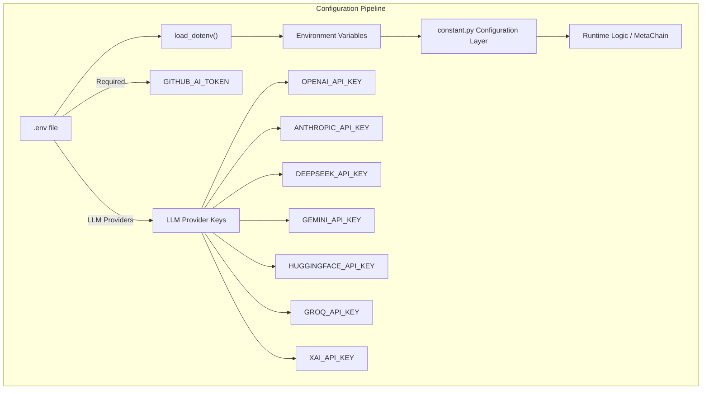
Sources: [constant.py:1-5](), [.env.template:1-11]()

## Setting Up Your API Keys

To configure AutoAgent, create a `.env` file in the root directory. Use `.env.template` as a reference.

| Variable | Importance | Purpose |
| :--- | :--- | :--- |
| `GITHUB_AI_TOKEN` | **Required** | Used for core functionality and repository interactions. |
| `ANTHROPIC_API_KEY` | Optional | Used for the default `claude-3-5-sonnet-20241022` model. |
| `OPENAI_API_KEY` | Optional | Required for GPT-4o or embedding models. |
| `DEEPSEEK_API_KEY` | Optional | Required for DeepSeek-V3 or DeepSeek-R1 models. |

Sources: [.env.template:1-11](), [constant.py:26-26](), [constant.py:48-49]()

## System Constants and Model Logic

The `constant.py` file acts as the central configuration layer. It not only reads environment variables but also contains logic to handle model-specific quirks, such as whether a model supports function calling or requires a specific message structure.

### Key Configuration Constants

| Variable | Code Entity | Default / Logic |
| :--- | :--- | :--- |
| **Model** | `COMPLETION_MODEL` | `claude-3-5-sonnet-20241022` |
| **Embeddings** | `EMBEDDING_MODEL` | `text-embedding-3-small` |
| **Workspace** | `DOCKER_WORKPLACE_NAME` | `workplace` |
| **Debug Mode** | `DEBUG` | `False` (Parsed via `str_to_bool`) |
| **Function Call** | `FN_CALL` | Boolean; auto-toggled based on `NOT_USE_FN_CALL` list. |
| **Architecture** | `BASE_IMAGES` | Auto-detected (AMD64 vs ARM) via `get_architecture()`. |

Sources: [constant.py:25-57](), [constant.py:6-22]()

### Model Compatibility Logic
AutoAgent handles model limitations by maintaining blacklists and requirement lists.

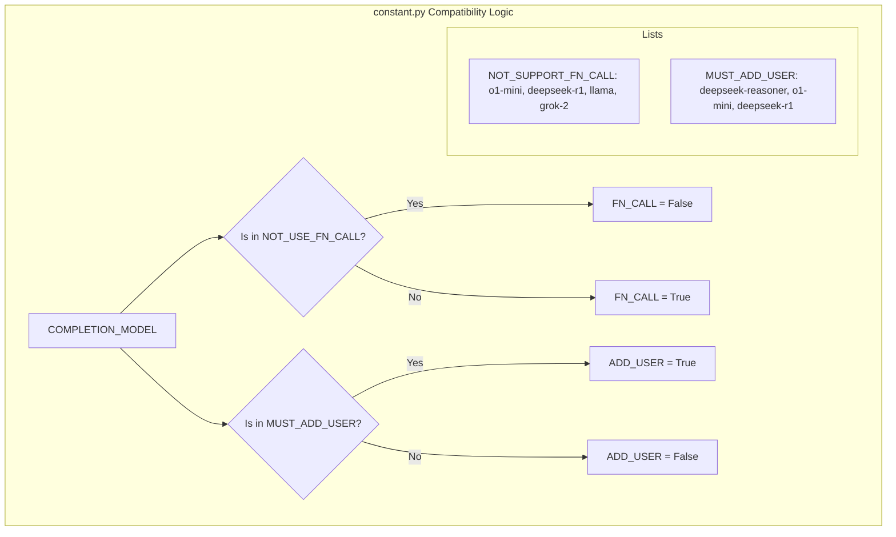
Sources: [constant.py:61-85]()

## Model Compatibility Tables

The following tables define how AutoAgent treats specific LLM providers.

### Function Calling Support
The `FN_CALL` flag determines if the agent uses native LLM tool-use features or falls back to XML/text-based parsing.

| Category | Code Constant | Models |
| :--- | :--- | :--- |
| **No Native Support** | `NOT_SUPPORT_FN_CALL` | `o1-mini`, `deepseek-reasoner`, `deepseek-r1`, `llama`, `grok-2` |
| **Force Disable** | `NOT_USE_FN_CALL` | `deepseek-chat` + all models in `NOT_SUPPORT_FN_CALL` |

Sources: [constant.py:64-65]()

### Message Formatting
Some models have strict requirements for message roles or sender fields.

| Category | Code Constant | Models |
| :--- | :--- | :--- |
| **Role Restriction** | `MUST_ADD_USER` | `deepseek-reasoner`, `o1-mini`, `deepseek-r1` |
| **Sender Restriction**| `NOT_SUPPORT_SENDER` | `mistral`, `groq` |

Sources: [constant.py:61-62]()

## Environment Persistence

AutoAgent generates temporary files and logs during execution. These are typically excluded from version control to prevent sensitive data leakage.

| Path Pattern | Purpose |
| :--- | :--- |
| `workplace_*/` | Temporary Docker/Local execution environments. |
| `*.log` | System and MetaChain logs. |
| `code_db/*` | RAG vector database files. |
| `.env` | Local secret storage (ignored by git). |

Sources: [.gitignore:1-25]()

## Docker Architecture Selection

The system automatically selects the correct Docker image based on the host machine's architecture using the `get_architecture()` function.

*   **x86/amd64**: Uses `tjbtech1/metachain:amd64_latest`
*   **ARM (e.g., Apple Silicon)**: Uses `tjbtech1/metachain:latest`

Sources: [constant.py:37-46]()

---

# Page: WeChat Integration Setup

# WeChat Integration Setup

<details>
<summary>Relevant source files</summary>

The following files were used as context for generating this wiki page:

- [Communication.md](Communication.md)
- [assets/QR.png](assets/QR.png)
- [assets/autoagent-wechat.jpg](assets/autoagent-wechat.jpg)

</details>


This document covers the setup and configuration of WeChat integration within the AutoAgent framework. WeChat integration provides an alternative user interface for interacting with AutoAgent's core functionality, primarily serving user onboarding and community interaction.

For general installation and setup information, see [Installation and Setup](#2). For API key configuration, see [API Keys and Configuration](#2.1).

## Overview

WeChat integration in AutoAgent serves as a gateway for users to join the ecosystem and eventually interact with the MetaChain orchestration system. It provides a community-focused interface that bridges the gap between the GitHub repository and active user discussion.

### System Entry Points

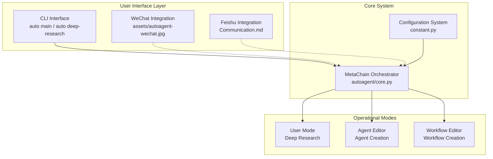

**WeChat Integration Architecture**

Sources: [README.md:11-21](), [Communication.md:1-5]()

## Community Access and Onboarding

The primary mechanism for WeChat integration is through the community onboarding assets. These allow users to connect with the HKUDS (University of Hong Kong Data Science) team and other AutoAgent developers.

### Integration Assets

AutoAgent maintains specific assets to facilitate WeChat connectivity:

| Asset | Path | Purpose |
|-------|------|---------|
| WeChat QR Image | `assets/autoagent-wechat.jpg` | Direct scan to join the WeChat community. |
| General QR Image | `assets/QR.png` | Unified QR code for HKUDS group access. |
| Communication Guide | `Communication.md` | Centralized document for Feishu and WeChat access. |

### GitHub Badge Integration

The integration is exposed on the project's main landing page via a dynamic badge. This badge links the natural language space of the README to the technical asset space:

```markdown
<a href="https://github.com/HKUDS/AutoAgent/blob/main/assets/autoagent-wechat.jpg">
  
</a>
```

Sources: [README.md:15](), [Communication.md:1-6](), [assets/autoagent-wechat.jpg:1-10]()

## Technical Flow: From Social to Code

When a user interacts with the WeChat community, the feedback loop eventually flows back into the development of the MetaChain system. The following diagram maps the conceptual "Natural Language Space" of community interaction to the "Code Entity Space" where agents are defined and executed.

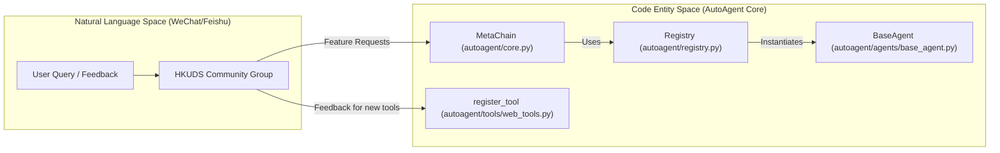

**Social-to-Code Interaction Mapping**

Sources: [README.md:27-49](), [Communication.md:1-5]()

## Integration with MetaChain System

While the current implementation focuses on community onboarding, the architecture is designed to eventually route WeChat messages into the `MetaChain` orchestrator.

### Planned Message Pipeline

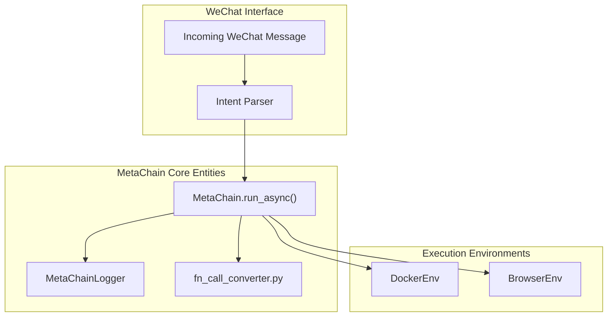

**Conceptual WeChat Message Processing**

Sources: [README.md:92-104](), [README.md:226-240]()

## Development Status

The WeChat integration is currently in the **Community Onboarding Phase**.

1.  **Phase 1: Community (Current)**: Focus on `assets/autoagent-wechat.jpg` and `Communication.md` to build the user base.
2.  **Phase 2: Notification (Planned)**: Integrating MetaChain logs (`MetaChainLogger`) to send execution status updates to WeChat groups.
3.  **Phase 3: Interactive (Future)**: Full deployment of a WeChat bot that calls `MetaChain.run()` directly from mobile inputs.

Sources: [README.md:422](), [Communication.md:1-5]()

---

# Page: Command Line Interface

# Command Line Interface

<details>
<summary>Relevant source files</summary>

The following files were used as context for generating this wiki page:

- [autoagent/cli.py](autoagent/cli.py)
- [autoagent/cli_utils/metachain_meta_agent.py](autoagent/cli_utils/metachain_meta_agent.py)
- [autoagent/cli_utils/metachain_meta_workflow.py](autoagent/cli_utils/metachain_meta_workflow.py)
- [autoagent/logger.py](autoagent/logger.py)
- [loop_utils/font_page.py](loop_utils/font_page.py)

</details>


This document covers AutoAgent's command line interface (CLI), which serves as the primary entry point for interacting with the framework. The CLI provides commands for running deep research tasks, creating agents and workflows, and managing the underlying execution environments.

For information about the underlying system architecture, see [System Architecture](#1.2). For detailed guides on using specific operational modes, see [User Mode (Deep Research)](#3.1), [Agent Editor](#3.2), and [Workflow Editor](#3.3).

## Overview

The AutoAgent CLI is implemented using the `click` framework [autoagent/cli.py:46-49]() and provides a unified interface for accessing all framework capabilities. It handles environment setup, model configuration, and orchestrates the interaction between users and the underlying `MetaChain` system [autoagent/cli.py:78-82]().

### CLI Entry and Mode Mapping
The following diagram bridges the CLI command space to the underlying code entities that handle specific execution modes.

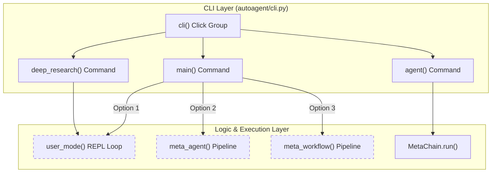
Sources: [autoagent/cli.py:46-49](), [autoagent/cli.py:185-236](), [autoagent/cli.py:321-426](), [autoagent/cli.py:51-84]()

## Command Structure

The CLI follows a modular command structure where each major functionality is accessible through specific commands:

| Command | Function | Description |
|---------|----------|-------------|
| `auto main` | `main()` [autoagent/cli.py:185]() | Full AutoAgent interface with all modes |
| `auto deep-research` | `deep_research()` [autoagent/cli.py:321]() | Lightweight user mode for deep research |
| `auto agent` | `agent()` [autoagent/cli.py:56]() | Direct agent execution for debugging |
| `auto workflow` | `workflow()` [autoagent/cli.py:89]() | Direct workflow execution via async wrapper |

Sources: [autoagent/cli.py:51-103](), [autoagent/cli.py:179-236](), [autoagent/cli.py:317-426]()

## Main Modes

### User Mode (Deep Research)
Accessed via `auto main` (Option 1) or `auto deep-research`. This mode initializes a `PromptSession` with a `UserCompleter` to facilitate agent selection via `@` mentions [autoagent/cli.py:254-263](). It typically employs the `System_Triage_Agent` to route user queries to specialized agents like the `Programming_Agent` or `Web_Agent` [autoagent/cli.py:246-252]().

For details, see [User Mode (Deep Research)](#3.1).

### Agent Editor
Accessed via `auto main` (Option 2). This mode invokes `meta_agent()` [autoagent/cli_utils/metachain_meta_agent.py:116](), which manages a three-stage pipeline:
1. **Agent Profiling**: Uses `agent_former` to generate an XML agent specification [autoagent/cli_utils/metachain_meta_agent.py:24-47]().
2. **Tool Editing**: Uses `tool_editor` to create required Python tools [autoagent/cli_utils/metachain_meta_agent.py:49-108]().
3. **Agent Assembly**: Uses `agent_creator` to implement the final agent class [autoagent/cli_utils/metachain_meta_agent.py:110-155]().

For details, see [Agent Editor](#3.2).

### Workflow Editor
Accessed via `auto main` (Option 3). This mode invokes `meta_workflow()` [autoagent/cli_utils/metachain_meta_workflow.py:116](). It follows a similar pipeline to the Agent Editor but focuses on multi-agent orchestration, utilizing `workflow_former` and `workflow_creator` agents [autoagent/cli_utils/metachain_meta_workflow.py:119-120]().

For details, see [Workflow Editor](#3.3).

## Environment and Execution Setup

Before launching any mode, the CLI performs environment initialization to provide agents with necessary capabilities (code execution, browsing, file access).

### Environment Initialization Flow
This diagram maps the CLI configuration process to the environment classes defined in the codebase.

```mermaid
graph TD
    subgraph "CLI Config (autoagent/cli.py)"
        GetCfg["get_config()"]
        CreateEnv["create_environment()"]
    end

    subgraph "Environment Classes"
        DEnv["DockerEnv<br/>(autoagent/environment/docker_env.py)"]
        BEnv["BrowserEnv<br/>(autoagent/environment/browser_env.py)"]
        MEnv["RequestsMarkdownBrowser<br/>(autoagent/environment/markdown_browser.py)"]
        LEnv["LocalEnv<br/>(autoagent/environment/local_env.py)"]
    end

    GetCfg --> CreateEnv
    CreateEnv -- "If not --local_env" --> DEnv
    CreateEnv -- "If --local_env" --> LEnv
    CreateEnv --> BEnv
    CreateEnv --> MEnv

    DEnv --> InitCont["init_container()"]
```
Sources: [autoagent/cli.py:109-142](), [autoagent/cli.py:143-168](), [autoagent/environment/docker_env.py:11-14](), [autoagent/environment/local_env.py:5-7]()

### Key Environment Components
- **Code Environment**: `DockerEnv` or `LocalEnv` for isolated code execution [autoagent/cli.py:149,163]().
- **Web Environment**: `BrowserEnv` for web automation and searching [autoagent/cli.py:152]().
- **File Environment**: `RequestsMarkdownBrowser` for document parsing and viewing [autoagent/cli.py:153]().

## Direct Execution Commands

### auto agent
Allows direct execution of a single agent function from `autoagent.agents`.
- **Usage**: `mc agent --model=gpt-4o --agent_func=get_weather_agent --query="Weather in London"` [autoagent/cli.py:65]().
- **Context**: Accepts `context_variables` in `key=value` format [autoagent/cli.py:68-71]().

### auto workflow
Allows direct execution of a workflow from `autoagent.workflows`.
- **Usage**: `mc workflow --workflow_name=research_workflow --system_input="Analyze AI trends"` [autoagent/cli.py:87-89]().
- **Implementation**: Wraps the asynchronous workflow function using `asyncio.run()` [autoagent/cli.py:91]().

Sources: [autoagent/cli.py:51-103]()

## UI and Logging
The CLI utilizes `rich` for UI elements and a custom `MetaChainLogger` for execution tracking.
- **Visuals**: Displays `MC_LOGO` and a `version_table` on startup [autoagent/cli.py:186-187]().
- **Logging**: `LoggerManager` provides a singleton `MetaChainLogger` that handles `pretty_print_messages` for assistant responses, tool calls, and tool results [autoagent/logger.py:114-137]().

Sources: [autoagent/cli.py:186-187](), [autoagent/logger.py:9-137](), [loop_utils/font_page.py:11-28]()

---

# Page: User Mode (Deep Research)

# User Mode (Deep Research)

<details>
<summary>Relevant source files</summary>

The following files were used as context for generating this wiki page:

- [LICENSE](LICENSE)
- [assets/user_mode/4-upload.png](assets/user_mode/4-upload.png)
- [assets/user_mode/5-select.png](assets/user_mode/5-select.png)
- [assets/user_mode/6-success.png](assets/user_mode/6-success.png)
- [assets/user_mode/input.png](assets/user_mode/input.png)
- [assets/user_mode/output.png](assets/user_mode/output.png)
- [assets/user_mode/select_agent.png](assets/user_mode/select_agent.png)
- [autoagent/cli.py](autoagent/cli.py)
- [autoagent/cli_utils/file_select.py](autoagent/cli_utils/file_select.py)
- [autoagent/util.py](autoagent/util.py)
- [docs/docs/Starter-Projects/starter-projects-auto-deep-research.md](docs/docs/Starter-Projects/starter-projects-auto-deep-research.md)

</details>


User Mode in AutoAgent provides an interactive, multi-agent deep research system. It allows users to engage with specialized agents through a conversational interface to perform complex research, code execution, and web-based tasks.

## Overview

The User Mode implements a REPL (Read-Eval-Print Loop) powered by `prompt_toolkit`. It coordinates specialized agent teams via a central triage mechanism, supporting file uploads and persistent conversation context across multiple execution environments.

Key features include:
- **Multi-Agent Triage**: Automatic routing of tasks to specialized agents.
- **Interactive REPL**: Rich text input with agent auto-completion.
- **File Integration**: Direct file upload into the agent's workspace.
- **Isolated Execution**: Integration with Docker, Browser, and Markdown Surfer environments.

Sources: [autoagent/cli.py:238-316](), [README.md:96-104]()

## Architecture and Data Flow

The following diagram bridges the natural language interaction space to the underlying code entities that manage the session.

### User Mode Logic to Code Entity Mapping

```mermaid
graph TD
    subgraph "Interaction Layer"
        User["User Input"]
        PS["PromptSession (prompt_toolkit)"]
        UC["UserCompleter (autoagent.util)"]
    end

    subgraph "Control Layer"
        CLI["@cli.command main / deep-research"]
        UM["user_mode function (autoagent/cli.py)"]
        STA["get_system_triage_agent (autoagent/agents)"]
    end

    subgraph "Execution Layer"
        MC["MetaChain (autoagent/metachain.py)"]
        DE["DockerEnv (autoagent/environment/docker_env.py)"]
        BE["BrowserEnv (autoagent/environment/browser_env.py)"]
        MB["RequestsMarkdownBrowser (autoagent/environment/markdown_browser.py)"]
    end

    User --> PS
    PS --> UC
    UC -.-> UM
    CLI --> UM
    UM --> STA
    UM --> MC
    MC --> DE
    MC --> BE
    MC --> MB
```
Sources: [autoagent/cli.py:238-316](), [autoagent/util.py:14-17](), [autoagent/cli.py:32-33]()

## Command Entry Points

User Mode is primarily accessed through the `main` and `deep-research` commands defined in the Click CLI.

| Command | Function | Default Container | Purpose |
| :--- | :--- | :--- | :--- |
| `auto main` | `main` | `auto_agent` | Full interface including Agent/Workflow editors. |
| `auto deep-research` | `deep_research` | `deepresearch` | Dedicated standalone research interface. |

### Configuration Workflow
Both entry points utilize `get_config` [autoagent/cli.py:109-142]() to prepare the `DockerConfig` object, which handles:
1. **Port Allocation**: Checks availability via `check_port_available` and `check_container_ports` [autoagent/cli.py:112-127]().
2. **Workspace Setup**: Creates a local root directory under `workspace_meta_showcase/showcase_{container_name}` [autoagent/cli.py:131-132]().
3. **Environment Selection**: Initializes `DockerEnv`, `BrowserEnv`, and `RequestsMarkdownBrowser` [autoagent/cli.py:143-155]().

Sources: [autoagent/cli.py:109-155](), [autoagent/cli.py:179-236](), [autoagent/cli.py:317-336]()

## The Interactive REPL Loop

The `user_mode` function runs a `while True` loop that manages the user interaction session.

### UserCompleter and @-Mentions
The system uses a custom `UserCompleter` [autoagent/util.py:15-17]() to provide auto-completion for agent names. When a user types `@`, the completer suggests agents registered in the `agents` dictionary [autoagent/cli.py:252-258]().

### Agent Triage Logic
1. **Input Parsing**: The system checks if the input starts with an `@agent_name` [autoagent/cli.py:275-277]().
2. **Agent Selection**: If a mention is found, that specific agent is used; otherwise, it defaults to the `System_Triage_Agent` [autoagent/cli.py:278-282]().
3. **MetaChain Execution**: The selected agent is executed via `client.run` with the current `messages` history and `context_variables` [autoagent/cli.py:284-304]().

Sources: [autoagent/cli.py:249-304](), [autoagent/util.py:14-17]()

## File Upload Workflow

AutoAgent supports uploading local files into the agent's execution environment via a GUI-based file picker.

### Implementation Detail
When the user selects the `Upload_files` option (aliased to the string `"select"`), the system invokes `select_and_copy_files` [autoagent/cli_utils/file_select.py:7-54]().

```mermaid
graph LR
    subgraph "Local Host"
        TK["Tkinter File Dialog"]
        LocalFile["User Selected File"]
    end

    subgraph "Workspace Mapping"
        LocalRoot["local_root/workplace/files"]
        DockerRoot["/workspace/files"]
    end

    TK --> LocalFile
    LocalFile -- "shutil.copy2" --> LocalRoot
    LocalRoot -- "Volume Mount" --> DockerRoot
```

1. **GUI Selection**: Uses `tkinter.filedialog.askopenfilenames` to allow multi-file selection [autoagent/cli_utils/file_select.py:13-24]().
2. **Physical Copy**: Files are copied to the `local_root` workplace directory [autoagent/cli_utils/file_select.py:43-46]().
3. **Context Injection**: The names and paths of uploaded files are appended to the user's next query so the agent is aware of the new data [autoagent/cli.py:305-313]().

Sources: [autoagent/cli_utils/file_select.py:7-54](), [autoagent/cli.py:305-313]()

## Environment Context

During the `client.run` call in `user_mode`, the following `context_variables` are provided to the agents to allow them to interact with the system:

| Variable | Source Entity | Description |
| :--- | :--- | :--- |
| `working_dir` | `docker_config.workplace_name` | The root directory for agent operations. |
| `code_env` | `DockerEnv` | Provides `execute_command` and `read_file` capabilities. |
| `web_env` | `BrowserEnv` | Provides `visit_url`, `click`, and `type` actions. |
| `file_env` | `RequestsMarkdownBrowser` | Specialized for surfing and converting documents to markdown. |

Sources: [autoagent/cli.py:215-216](), [autoagent/cli.py:143-155]()

---

# Page: Agent Editor

# Agent Editor

<details>
<summary>Relevant source files</summary>

The following files were used as context for generating this wiki page:

- [assets/agent_editor/1-requirement.png](assets/agent_editor/1-requirement.png)
- [assets/agent_editor/2-profiling.png](assets/agent_editor/2-profiling.png)
- [autoagent/agents/meta_agent/agent_creator.py](autoagent/agents/meta_agent/agent_creator.py)
- [autoagent/agents/meta_agent/agent_editor.py](autoagent/agents/meta_agent/agent_editor.py)
- [autoagent/agents/meta_agent/agent_former.py](autoagent/agents/meta_agent/agent_former.py)
- [autoagent/cli_utils/metachain_meta_agent.py](autoagent/cli_utils/metachain_meta_agent.py)
- [autoagent/cli_utils/metachain_meta_workflow.py](autoagent/cli_utils/metachain_meta_workflow.py)
- [autoagent/logger.py](autoagent/logger.py)
- [docs/docs/Starter-Projects/starter-projects-nl-to-agent.md](docs/docs/Starter-Projects/starter-projects-nl-to-agent.md)
- [loop_utils/font_page.py](loop_utils/font_page.py)

</details>


The Agent Editor is a core component of the AutoAgent framework that enables users to create custom AI agents using only natural language instructions. Unlike the [User Mode (Deep Research)](#3.1) which provides pre-built agents, or the [Workflow Editor](#3.3) which creates multi-agent orchestrations, the Agent Editor allows users to create standalone agents with specialized capabilities without writing any code.

## Agent Editor Process Overview

The Agent Editor follows a conversational, step-by-step pipeline to transform natural language requirements into fully functional AI agents. This pipeline is orchestrated by the `meta_agent` function [autoagent/cli_utils/metachain_meta_agent.py:163-163]().

```mermaid
flowchart TD
    UserReq["User Requirements"] --> AgentProfiling["Agent Profiling (agent_profiling)"]
    AgentProfiling --> AgentForm["Agent Form (XML)"]
    AgentForm --> ToolNeeded{"New Tools Needed?"}
    ToolNeeded -->|"Yes"| ToolCreation["Tool Creation (tool_editing)"]
    ToolNeeded -->|"No"| AgentCreation["Agent Creation (agent_editing)"]
    ToolCreation --> AgentCreation
    AgentCreation --> AgentTesting["Agent Testing (run_agent)"]
    AgentTesting --> FinalAgent["Functional Agent (register_agent)"]
```

Sources: [autoagent/cli_utils/metachain_meta_agent.py:24-178]()

## Architecture Components

The Agent Editor integrates several specialized agents and utility functions to transform user requirements into functional code entities.

```mermaid
classDiagram
    class meta_agent {
        <<Function>>
        +model: str
        +context_variables: dict
        +meta_agent_loop()
    }
    
    class AgentFormerAgent {
        <<Agent>>
        +instructions: XML_Form_Rules
        +functions: list_tools, list_agents
    }
    
    class ToolEditorAgent {
        <<Agent>>
        +functions: create_tool, run_tool, case_resolved
    }
    
    class AgentCreatorAgent {
        <<Agent>>
        +functions: create_agent, run_agent, create_orchestrator_agent
    }
    
    class MetaChain {
        <<System>>
        +run(agent, messages)
    }
    
    meta_agent ..> AgentFormerAgent : invokes via agent_profiling()
    meta_agent ..> ToolEditorAgent : invokes via tool_editing()
    meta_agent ..> AgentCreatorAgent : invokes via agent_editing()
    AgentFormerAgent ..> MetaChain : executes
    ToolEditorAgent ..> MetaChain : executes
    AgentCreatorAgent ..> MetaChain : executes
```

Sources: [autoagent/cli_utils/metachain_meta_agent.py:163-256](), [autoagent/agents/meta_agent/agent_former.py:11-15](), [autoagent/agents/meta_agent/tool_editor.py:10-10](), [autoagent/agents/meta_agent/agent_creator.py:9-13]()

## Detailed Process Stages

### 1. Requirements Specification
The process begins with the user describing the agent they want to create in natural language. The `meta_agent` loop uses a `PromptSession` [autoagent/cli_utils/metachain_meta_agent.py:176-180]() to gather these requirements.

### 2. Agent Profiling (Agent Former)
The `agent_profiling` function [autoagent/cli_utils/metachain_meta_agent.py:24-47]() uses the `Agent Former Agent` to analyze requirements and generate a structured XML profile.

*   **Key Function**: `agent_profiling(agent_former, client, messages, context_variables, requirements, debug)`
*   **XML Extraction**: Uses `extract_agents_content` [autoagent/cli_utils/metachain_meta_agent.py:16-22]() with regex `r'(<agents>.*?</agents>)'`.
*   **Parsing**: The XML is converted into an `AgentForm` object via `parse_agent_form` [autoagent/cli_utils/metachain_meta_agent.py:13-13]().
*   **Retry Logic**: Implements a 3-attempt retry loop [autoagent/cli_utils/metachain_meta_agent.py:35-46]() if the XML is malformed.

### 3. Tool Creation (Tool Editor)
If the generated `AgentForm` specifies new tools, the `tool_editing` function [autoagent/cli_utils/metachain_meta_agent.py:49-108]() is invoked. It uses the `Tool Editor Agent` to write and test Python tool code.

*   **Testing Requirement**: The system enforces that "ALL tools MUST be tested successfully by running the tools using `run_tool` before you stop" [autoagent/cli_utils/metachain_meta_agent.py:91-91]().
*   **Feedback Mechanism**: Uses `case_resolved` [autoagent/cli_utils/metachain_meta_agent.py:50-57]() and `case_not_resolved` [autoagent/cli_utils/metachain_meta_agent.py:58-65]() to signal task completion to the orchestrator.

### 4. Agent Creation and Assembly (Agent Creator)
The `agent_editing` function [autoagent/cli_utils/metachain_meta_agent.py:110-178]() uses the `Agent Creator Agent` to implement the agent's logic.

*   **Agent Management**: Uses `create_agent` to generate Python files and `read_agent` to verify definitions [autoagent/agents/meta_agent/agent_creator.py:26-27]().
*   **Multi-Agent Support**: If multiple agents are defined, it uses `create_orchestrator_agent` [autoagent/agents/meta_agent/agent_creator.py:30-30]() to manage handoffs.
*   **Validation**: The agent is tested against a real task using the `run_agent` tool [autoagent/cli_utils/metachain_meta_agent.py:118-118]().

## XML Agent Form Schema
The `Agent Former Agent` is instructed to produce a specific XML structure [autoagent/agents/meta_agent/agent_former.py:22-68]():

| Element | Description |
| :--- | :--- |
| `<agents>` | Root element for the system definition. |
| `<system_input>` | Global input description for the agent system. |
| `<system_output>` | Unified response format (Key-Description pair). |
| `<agent>` | Individual agent definition (name, description, instructions). |
| `<tools>` | Categorized as `existing` or `new`. |
| `<global_variables>` | Shared constants accessible via `{key}` syntax in instructions. |

Sources: [autoagent/agents/meta_agent/agent_former.py:22-68]()

## Feedback and Resolution Mechanism
Both tool and agent creation utilize a standardized feedback loop to ensure quality.

| Tool | Implementation | Purpose |
| :--- | :--- | :--- |
| `case_resolved` | [autoagent/cli_utils/metachain_meta_agent.py:114-118]() | Terminates the loop successfully when tests pass. |
| `case_not_resolved` | [autoagent/cli_utils/metachain_meta_agent.py:119-123]() | Terminates with error details after exhausted retries. |
| `MAX_RETRY` | [autoagent/cli_utils/metachain_meta_agent.py:111-111]() | Set to 3 attempts for complex implementation tasks. |

## CLI Integration
The Agent Editor is accessed via the main CLI entry point. When a user selects `agent editor` from the `NOTES` menu [loop_utils/font_page.py:29-34](), the system starts the `meta_agent` loop.

```mermaid
flowchart LR
    CLI["CLI (auto main)"] --> Select["Mode: agent editor"]
    Select --> Loop["meta_agent() Loop"]
    Loop --> Session["PromptSession"]
    Session --> Mention{"@ Mention?"}
    Mention -->|"@Agent_Former_Agent"| Profiling["agent_profiling()"]
    Mention -->|"@Tool_Editor_Agent"| Tooling["tool_editing()"]
    Mention -->|"@Agent_Creator_Agent"| Creating["agent_editing()"]
```

Sources: [autoagent/cli_utils/metachain_meta_agent.py:163-256](), [loop_utils/font_page.py:29-34]()

---

# Page: Workflow Editor

# Workflow Editor

<details>
<summary>Relevant source files</summary>

The following files were used as context for generating this wiki page:

- [assets/workflow_editor/1-requirement.png](assets/workflow_editor/1-requirement.png)
- [assets/workflow_editor/2-profiling.png](assets/workflow_editor/2-profiling.png)
- [autoagent/agents/meta_agent/workflow_creator.py](autoagent/agents/meta_agent/workflow_creator.py)
- [autoagent/agents/meta_agent/workflow_former.py](autoagent/agents/meta_agent/workflow_former.py)
- [autoagent/cli_utils/metachain_meta_agent.py](autoagent/cli_utils/metachain_meta_agent.py)
- [autoagent/cli_utils/metachain_meta_workflow.py](autoagent/cli_utils/metachain_meta_workflow.py)
- [autoagent/logger.py](autoagent/logger.py)
- [docs/docs/User-Guideline/user-guide-how-to-create-agent.md](docs/docs/User-Guideline/user-guide-how-to-create-agent.md)
- [loop_utils/font_page.py](loop_utils/font_page.py)

</details>


The Workflow Editor is a natural language-driven system for creating and managing multi-agent workflows in AutoAgent. It enables users to describe complex multi-agent orchestrations using natural language, which are then automatically transformed into executable event-driven pipelines. This system handles the entire lifecycle from workflow specification through implementation and testing.

For information about creating individual agents without workflows, see [Agent Editor](#3.2). For details about the underlying orchestration system, see [MetaChain System](#4.1).

## System Overview

The Workflow Editor operates as a conversational interface that guides users through workflow creation using specialized meta-agents. The system transforms natural language descriptions into structured **WorkflowForm** XML schemas, then generates the corresponding agent implementations and orchestration logic.

### Workflow Editor Architecture

```mermaid
graph TB
    subgraph "Natural Language Space"
        UserQuery["User Natural Language Query"]
        Requirements["Workflow Requirements"]
    end

    subgraph "Workflow Profiling (Developer Mode)"
        WF_Agent["get_workflow_former_agent()"]
        XML_Form["WorkflowForm XML Schema"]
        Parser["parse_workflow_form()"]
    end

    subgraph "Workflow Implementation (OS Kernel)"
        WC_Agent["get_workflow_creator_agent()"]
        MC_System["MetaChain.run()"]
        Tool_RW["run_workflow"]
        Tool_CW["create_workflow"]
    end

    subgraph "Code Entity Space"
        MW_Func["meta_workflow()"]
        WF_Class["WorkflowForm class"]
        Event_Engine["EventEngine (MetaChain)"]
    end

    UserQuery --> MW_Func
    MW_Func --> WF_Agent
    WF_Agent --> XML_Form
    XML_Form --> Parser
    Parser --> WF_Class
    WF_Class --> WC_Agent
    WC_Agent --> Tool_CW
    WC_Agent --> Tool_RW
    Tool_RW --> Event_Engine
    MC_System -.-> WC_Agent
```

*Sources: [autoagent/cli_utils/metachain_meta_workflow.py:1-194](), [autoagent/agents/meta_agent/workflow_former.py:13-24](), [autoagent/agents/meta_agent/workflow_creator.py:9-16]()*

## Workflow Creation Pipeline

The workflow creation process follows a structured two-phase approach: **Profiling** (designing the architecture) and **Implementation** (creating agents and testing).

### Process Flow Diagram

```mermaid
sequenceDiagram
    participant User
    participant MW as "meta_workflow()"
    participant Former as "Workflow Former Agent"
    participant Creator as "Workflow Creator Agent"
    participant MC as "MetaChain"
    
    User->>MW: Natural Language Description
    MW->>Former: workflow_profiling()
    Former->>Former: Generate <workflow> XML
    Former->>MW: Parsed WorkflowForm
    
    User->>MW: Task to test workflow
    MW->>Creator: workflow_editing()
    Note over Creator: Creates new agents if needed
    Creator->>MC: run_workflow()
    MC->>Creator: Execution Result
    alt Success
        Creator->>MW: case_resolved()
    else Failure
        Creator->>MW: case_not_resolved() (Retry loop)
    end
```

*Sources: [autoagent/cli_utils/metachain_meta_workflow.py:14-35](), [autoagent/cli_utils/metachain_meta_workflow.py:37-111]()*

### Phase 1: Workflow Profiling (Workflow Former)

The `workflow_profiling` function utilizes the `Workflow Former Agent` to translate requirements into a structured XML format.

*   **Implementation**: `get_workflow_former_agent(model)` creates an agent specialized in analyzing user requests to generate `WorkflowForm` schemas [autoagent/agents/meta_agent/workflow_former.py:13-24]().
*   **Validation**: The output is parsed using `parse_workflow_form(output_xml_form)`. If parsing fails, the system retries up to 3 times, passing the error back to the LLM for correction [autoagent/cli_utils/metachain_meta_workflow.py:22-35]().

### Phase 2: Workflow Implementation (Workflow Creator)

The `workflow_editing` function uses the `Workflow Creator Agent` to materialize the profiled design.

*   **Agent Creation**: If the form specifies `category="new"` for any agent, the creator uses `create_agent` to build them first [autoagent/cli_utils/metachain_meta_workflow.py:42-53](), [autoagent/agents/meta_agent/workflow_creator.py:46-51]().
*   **Workflow Assembly**: The agent calls `create_workflow` to register the multi-agent orchestration [autoagent/agents/meta_agent/workflow_creator.py:52-56]().
*   **Verification**: The creator MUST run the workflow using the `run_workflow` tool to ensure it completes the user's task successfully before finishing [autoagent/cli_utils/metachain_meta_workflow.py:72-80]().

## WorkflowForm XML Schema

The `Workflow Former Agent` is instructed to produce a specific XML structure that defines the multi-agent logic [autoagent/agents/meta_agent/workflow_former.py:23-127]().

| Element | Description |
| :--- | :--- |
| `<name>` | Unique identifier for the workflow. |
| `<system_input>` | Defines the keys and descriptions for data entering the workflow. |
| `<agents>` | List of agents involved, specifying if they are `existing` or `new`. |
| `<global_variables>` | (Optional) Shared constants accessible by all agents in the flow. |
| `<events>` | The core execution logic, defining how agents pass data. |

### Event Actions
Within the `<events>` block, each `<output>` must specify an `<action>` type [autoagent/agents/meta_agent/workflow_former.py:74-77]():
*   **RESULT**: Success; the workflow continues to the next listener.
*   **ABORT**: Failure; the workflow stops.
*   **GOTO**: Conditional loop; jumps to a specific event name.

*Sources: [autoagent/agents/meta_agent/workflow_former.py:23-156]()*

## Implementation Details

### Case Resolution System
The implementation phase uses a feedback loop governed by two specialized tools injected into the `Workflow Creator Agent` [autoagent/cli_utils/metachain_meta_workflow.py:55-65]():
*   `case_resolved(task_response, context_variables)`: Used only after the workflow is created and successfully tested.
*   `case_not_resolved(task_response, context_variables)`: Used if the agent encounters irresistible errors after multiple attempts.

### Multi-Agent Orchestration Creation
The `Workflow Creator Agent` has access to a suite of meta-tools to manipulate the system [autoagent/agents/meta_agent/workflow_creator.py:71-79]():
*   `create_agent`, `read_agent`, `list_agents`
*   `create_workflow`, `run_workflow`, `list_workflows`
*   `execute_command` (for system dependencies)

### Error Handling and Retry Logic
Both profiling and implementation phases implement a `MAX_RETRY = 3` loop. In the implementation phase, if the LLM output does not start with "Case resolved", the system appends the failure content as `FEEDBACK` and triggers another iteration [autoagent/cli_utils/metachain_meta_workflow.py:85-111]().

*Sources: [autoagent/cli_utils/metachain_meta_workflow.py:1-111](), [autoagent/agents/meta_agent/workflow_creator.py:1-80]()*

## Integration with MetaChain

The Workflow Editor is built on top of the `MetaChain` class, which handles the message orchestration and logging [autoagent/cli_utils/metachain_meta_workflow.py:134-136]().

```mermaid
graph LR
    subgraph "Orchestration Logic"
        MC["MetaChain Class"]
        Logger["MetaChainLogger"]
        Engine["EventEngine"]
    end

    subgraph "Workflow Editor Entities"
        MW_Func["meta_workflow()"]
        WF_Agent["Workflow Former Agent"]
        WC_Agent["Workflow Creator Agent"]
    end

    MW_Func --> MC
    MC --> Logger
    MW_Func --> WF_Agent
    MW_Func --> WC_Agent
    WC_Agent --> Engine
```

*Sources: [autoagent/cli_utils/metachain_meta_workflow.py:116-136](), [autoagent/logger.py:9-138]()*

---

# Page: Core Components

# Core Components

<details>
<summary>Relevant source files</summary>

The following files were used as context for generating this wiki page:

- [autoagent/__init__.py](autoagent/__init__.py)
- [autoagent/core.py](autoagent/core.py)
- [autoagent/fn_call_converter.py](autoagent/fn_call_converter.py)

</details>


This page provides a technical overview of the core components that power the AutoAgent framework. These components form the backbone of the system, enabling LLM-powered agents to operate across different environments without requiring users to write code.

For information about using the framework's interfaces, see [Command Line Interface](#3). For details about extending the system, see [Extending AutoAgent](#6.3).

## System Architecture

The AutoAgent system is built around several interconnected components that work together to enable agent execution:

```mermaid
graph TD
    User([User]) --> MainCLI["main() - autoagent/cli.py"]
    MainCLI --> MetaChainClass["MetaChain class - autoagent/core.py"]
    MetaChainClass --> FnCallConverter["fn_call_converter.py"]
    MetaChainClass --> LiteLLMAPI["litellm.completion()"]
    MetaChainClass --> HandleToolCalls["handle_tool_calls()"]
    
    HandleToolCalls --> DockerEnv["DockerEnv - environment/docker_env.py"]
    HandleToolCalls --> LocalEnv["LocalEnv - environment/local_env.py"]
    HandleToolCalls --> BrowserEnv["BrowserEnv - environment/browser_env.py"]
    
    MetaChainClass --> MetaChainLogger["MetaChainLogger - autoagent/logger.py"]
    MetaChainClass --> AgentTypes["Agent types - autoagent/types.py"]
    
    FnCallConverter --> ConstantFnCall["FN_CALL - constant.py"]
    FnCallConverter --> ConvertTools["convert_tools_to_description()"]
```

Sources: [autoagent/core.py:96-106](), [autoagent/fn_call_converter.py:34-58](), [autoagent/logger.py:21-56]()

## MetaChain Orchestration System

The `MetaChain` class [autoagent/core.py:96-673]() is the central orchestration component that manages agent execution flow. It handles interactions between language models, function calls, and tool execution.

### Architecture and Execution Flow

```mermaid
sequenceDiagram
    participant User
    participant MetaChain
    participant LiteLLM as "litellm.completion()"
    participant HandleToolCalls as "handle_tool_calls()"
    participant AgentFunction as "agent.functions"
    
    User->>MetaChain: run(agent, messages, context_variables)
    activate MetaChain
    
    MetaChain->>MetaChain: logger.info("Receiving the task")
    
    loop Until max_turns or case_resolved
        MetaChain->>LiteLLM: get_chat_completion(agent, history, context_variables)
        activate LiteLLM
        LiteLLM-->>MetaChain: completion_response.choices[0].message
        deactivate LiteLLM
        
        MetaChain->>MetaChain: logger.pretty_print_messages(message)
        
        MetaChain->>HandleToolCalls: handle_tool_calls(message.tool_calls, agent.functions)
        activate HandleToolCalls
        
        HandleToolCalls->>AgentFunction: function_map[name](**args)
        activate AgentFunction
        AgentFunction-->>HandleToolCalls: raw_result
        deactivate AgentFunction
        
        HandleToolCalls->>HandleToolCalls: handle_function_result(raw_result)
        HandleToolCalls-->>MetaChain: partial_response
        deactivate HandleToolCalls
        
        MetaChain->>MetaChain: Update history and context_variables
    end
    
    MetaChain-->>User: Response(messages, agent, context_variables)
    deactivate MetaChain
```

For details, see [MetaChain System](#4.1).

Sources: [autoagent/core.py:396-493](), [autoagent/core.py:230-302]()

### Key Methods

The `MetaChain` class [autoagent/core.py:96-673]() implements several critical methods:

- **`get_chat_completion`** [autoagent/core.py:115-210](): Gets completions from language models with function call support.
- **`handle_tool_calls`** [autoagent/core.py:230-302](): Executes tool calls and processes results.
- **`handle_function_result`** [autoagent/core.py:212-228](): Processes raw function results into `Result` objects.
- **`run`** [autoagent/core.py:396-493](): Main synchronous execution method.
- **`run_async`** [autoagent/core.py:589-673](): Asynchronous execution method.

## Function Call System

The Function Call System enables AutoAgent to work with various language models through a conversion mechanism that normalizes function calling capabilities. It allows models that do not natively support function calling (e.g., Llama 3) to be used by injecting specialized XML-based instructions into the system prompt.

### Architecture

```mermaid
graph TD
    MetaChain --> FN_CALL{"FN_CALL?<br>(constant.py)"}
    
    FN_CALL -->|"True (GPT, Claude)"| NativeFnCall["Native Function Calling"]
    FN_CALL -->|"False (Llama, Others)"| FnCallConverter["fn_call_converter.py"]
    
    NativeFnCall --> LLM1["LLM with Function Calling API"]
    FnCallConverter --> LLM2["LLM without Function Calling"]
    
    LLM2 --> TextParser["Regex Parsing - FN_REGEX_PATTERN"]
    TextParser --> Converter["Convert to Tool Calls Format"]
    
    NativeFnCall --> ToolExecution["Tool Execution"]
    Converter --> ToolExecution
```

For details, see [Function Call System](#4.2).

Sources: [autoagent/core.py:148-208](), [autoagent/fn_call_converter.py:35-58](), [autoagent/fn_call_converter.py:575-585]()

### Function Call Converter

The converter [autoagent/fn_call_converter.py]() handles:

1. **Tool Description Generation** [autoagent/fn_call_converter.py:281-317](): Converts tool JSON schemas to text descriptions.
2. **Message Format Conversion** [autoagent/fn_call_converter.py:320-486](): Adds tool descriptions and `SYSTEM_PROMPT_SUFFIX_TEMPLATE` to prompts.
3. **Response Parsing** [autoagent/fn_call_converter.py:575-765](): Extracts function calls from text responses using regex patterns like `FN_REGEX_PATTERN` and `FN_PARAM_REGEX_PATTERN`.

## Environment System

The Environment System provides interfaces for executing code and interacting with external systems, enabling agents to operate in different contexts.

### Environment Hierarchy

```mermaid
classDiagram
    class EnvironmentInterface {
        +run_command(command, stream_callback)
        +local_workplace: str
        +docker_workplace: str
    }
    
    class DockerEnv {
        +container_name: str
        +workplace_name: str
        +communication_port: int
        +init_container()
        +run_command(command, stream_callback)
    }
    
    class LocalEnv {
        +conda_sh: str
        +run_command(command, stream_callback)
    }
    
    class BrowserEnv {
        +step(action_str, timeout)
        +init_browser()
    }
    
    EnvironmentInterface <|-- DockerEnv
    EnvironmentInterface <|-- LocalEnv
    EnvironmentInterface <|-- BrowserEnv
```

For details, see [Environment System](#4.3).

Sources: [autoagent/environment/docker_env.py:15-26](), [autoagent/environment/local_env.py:10-20](), [autoagent/environment/browser_env.py:387-419]()

## Tool System

The Tool System defines the capabilities available to agents, allowing them to perform actions in their environments. Tools are registered using a decorator pattern and passed to agents via the `functions` list in the `Agent` definition [autoagent/types.py:41]().

### Tool Result Handling

The `handle_function_result` method [autoagent/core.py:212-228]() processes raw results from tools:

- Passes through results that are already `Result` objects [autoagent/types.py:41]().
- Handles agent switching if the result is an `Agent`.
- Converts other results to strings.

For details, see [Tool System](#4.4).

Sources: [autoagent/core.py:212-228](), [autoagent/types.py:41]()

## Configuration and Utilities

The framework includes a centralized configuration layer and a suite of utility functions for logging, UI rendering, and message formatting.

- **Logging**: `MetaChainLogger` [autoagent/logger.py:21-56]() provides centralized logging via `LoggerManager`.
- **Formatting**: `pretty_print_messages` [autoagent/util.py:214-260]() handles the terminal display of agent/user interactions.
- **Tool Conversion**: `function_to_json` [autoagent/util.py:146-193]() converts Python functions into OpenAI-compatible tool schemas.

For details, see [Configuration and Utilities](#4.5).

Sources: [autoagent/logger.py:21-56](), [autoagent/util.py:146-193](), [autoagent/util.py:214-260]()

---

# Page: MetaChain System

# MetaChain System

<details>
<summary>Relevant source files</summary>

The following files were used as context for generating this wiki page:

- [autoagent/core.py](autoagent/core.py)
- [autoagent/flow/broker.py](autoagent/flow/broker.py)
- [autoagent/flow/core.py](autoagent/flow/core.py)
- [autoagent/flow/dynamic.py](autoagent/flow/dynamic.py)
- [autoagent/flow/types.py](autoagent/flow/types.py)
- [autoagent/fn_call_converter.py](autoagent/fn_call_converter.py)

</details>


MetaChain is the central orchestration layer in the AutoAgent framework that manages interactions between agents and language models (LLMs). It handles function calls, maintains conversation state, and provides a unified interface for agent execution regardless of the underlying LLM's capabilities. This page documents the MetaChain system's architecture, components, and execution flow.

For information about the Function Call System that works closely with MetaChain, see [Function Call System](#4.2).

## Overview

The MetaChain system serves as the execution engine for all agents in AutoAgent. It processes user queries, sends them to LLMs, handles tool calls, and manages the conversation loop until the agent completes its task or reaches a maximum number of turns.

Key responsibilities include:
- Orchestrating the conversation between users and agents.
- Managing function/tool calls and their results via `handle_tool_calls` [autoagent/core.py:230-302]().
- Supporting different LLM providers with varying capabilities via `litellm` [autoagent/core.py:19]().
- Handling streaming responses through `run_and_stream` [autoagent/core.py:304-394]().
- Managing `context_variables` throughout agent execution [autoagent/core.py:124-129]().
- Supporting both synchronous and asynchronous execution modes [autoagent/core.py:396-673]().

```mermaid
graph TD
    User([User]) --> CLI["CLI Interface"]
    CLI --> MetaChain["MetaChain System"]
    
    subgraph "MetaChain Components"
        MetaChain --> CompletionHandler["get_chat_completion()"]
        MetaChain --> ToolHandler["handle_tool_calls()"]
        MetaChain --> ExecutionLoop["run()/run_async()"]
        MetaChain --> FunctionHandler["handle_function_result()"]
        
        CompletionHandler --> FnCallConverter["Function Call Converter"]
    end
    
    CompletionHandler --> LLM["Language Model API"]
    ToolHandler --> Tools["Agent Tools"]
    
    FnCallConverter --> NativeFnCall["Native Function Call Mode"]
    FnCallConverter --> NonNativeFnCall["Text-Based Function Call Mode"]
    
    ExecutionLoop --> ResponseGeneration["Response Generation"]
    
    LLM --> CompletionHandler
    Tools --> ToolHandler
    
    classDef core fill:#f9f9f9,stroke:#333,stroke-width:1px;
    class MetaChain,CompletionHandler,ToolHandler,ExecutionLoop core;
```

Sources: [autoagent/core.py:96-107](), [autoagent/core.py:396-493]()

## Architecture

The `MetaChain` class is the main component of the system. It works closely with the `fn_call_converter.py` logic to support models with and without native function calling capabilities.

```mermaid
classDiagram
    class MetaChain {
        +logger: MetaChainLogger
        +__init__(log_path)
        +get_chat_completion(agent, history, context_variables, model_override, stream, debug)
        +handle_function_result(result, debug)
        +handle_tool_calls(tool_calls, functions, context_variables, debug, handle_mm_func)
        +run(agent, messages, context_variables, model_override, stream, debug, max_turns, execute_tools)
        +run_async(agent, messages, context_variables, model_override, stream, debug, max_turns, execute_tools)
    }
    
    class Agent {
        +name: str
        +model: str
        +instructions: Union[str, Callable]
        +functions: List[AgentFunction]
        +tool_choice: str
    }
    
    class Response {
        +messages: list
        +agent: Agent
        +context_variables: dict
    }
    
    class Result {
        +value: str
        +context_variables: dict
        +agent: Agent
    }
    
    MetaChain --> Agent: executes
    MetaChain --> Response: produces
    MetaChain ..> Result: processes
```

Sources: [autoagent/core.py:96-673](), [autoagent/types.py:41]()

## Core Components

### MetaChain Class

The `MetaChain` class is the primary interface for agent execution.

Key methods:
- **`run()`**: Main method to execute an agent synchronously [autoagent/core.py:396-493]().
- **`run_async()`**: Asynchronous version of `run()` [autoagent/core.py:589-673]().
- **`get_chat_completion()`**: Gets completion from LLM with appropriate formatting [autoagent/core.py:115-210]().
- **`handle_tool_calls()`**: Processes tool calls returned by the LLM, handling agent handoffs if a tool returns an `Agent` object [autoagent/core.py:230-302]().
- **`handle_function_result()`**: Handles the result of a function execution, specifically checking for `Result` objects or `Agent` handoffs [autoagent/core.py:212-228]().

Sources: [autoagent/core.py:96-673]()

### Function Call Handling

MetaChain supports two modes of function calling:
1. **Native Function Call Mode (`FN_CALL=True`)**: Uses `litellm.supports_function_calling` to verify compatibility [autoagent/core.py:148-150]().
2. **Non-Native Function Call Mode (`FN_CALL=False`)**: Injects tool descriptions into the system prompt and parses XML-like tags from the response [autoagent/core.py:174-208]().

```mermaid
flowchart TD
    Start([Start]) --> ModelCheck{"Model Supports\nFunction Calling?"}
    
    ModelCheck -->|"Yes"| NativeMode["Native Function Call Mode\n(FN_CALL = True)"]
    ModelCheck -->|"No"| NonNativeMode["Text-Based Function Call Mode\n(FN_CALL = False)"]
    
    NativeMode --> SendTools["Send Native Function Definitions"]
    NonNativeMode --> AddDescription["Add Tool Descriptions via convert_tools_to_description()"]
    
    AddDescription --> AddPrompt["Append SYSTEM_PROMPT_SUFFIX_TEMPLATE"]
    
    SendTools --> GetResponse["Get Response from LLM"]
    AddPrompt --> GetResponse
    
    GetResponse --> CheckToolCalls{"Response Contains\nTool Calls?"}
    
    CheckToolCalls -->|"Yes"| ProcessTools["Process via handle_tool_calls()"]
    CheckToolCalls -->|"No"| ReturnResponse["Return Text Response"]
```

Sources: [autoagent/core.py:148-208](), [autoagent/fn_call_converter.py:35-58](), [autoagent/fn_call_converter.py:281-317]()

### Execution Loop and Agent Handoffs

The execution loop continues until `max_turns` is reached or the agent has no further tool calls. A unique feature is the **Agent Handoff**: if a tool returns an `Agent` object, MetaChain switches the active agent for the subsequent turns [autoagent/core.py:261-266]().

```mermaid
sequenceDiagram
    participant MC as MetaChain
    participant A1 as Agent Alpha
    participant T as Tool/Function
    participant A2 as Agent Beta
    
    MC->>A1: get_chat_completion()
    A1-->>MC: tool_call(transfer_to_beta)
    MC->>T: execute transfer_to_beta()
    T-->>MC: returns Agent(Beta)
    MC->>MC: Active Agent = Beta
    MC->>A2: get_chat_completion()
```

Sources: [autoagent/core.py:212-228](), [autoagent/core.py:444-471]()

## EventEngine Flow System

Beyond the linear MetaChain loop, AutoAgent includes an `EventEngine` for complex, event-driven workflows. This system uses a broker to manage event tasks and transitions.

- **`EventEngineCls`**: Manages the registry of events and their execution [autoagent/flow/core.py:17-152]().
- **`BaseEvent`**: Represents a single node in a workflow, wrapping a coroutine [autoagent/flow/types.py:84-113]().
- **`listen_group`**: A decorator used to define dependencies between events [autoagent/flow/core.py:41-78]().
- **`goto_events`**: Allows dynamic branching in the flow [autoagent/flow/dynamic.py:9-14]().

```mermaid
graph LR
    subgraph "EventEngine (Code Entity Space)"
        EE["EventEngineCls"]
        EV["BaseEvent"]
        BR["BaseBroker"]
    end
    
    subgraph "Natural Language Workflow"
        Step1["Step 1: Research"]
        Step2["Step 2: Write"]
        Step1 --> Step2
    end
    
    Step1 -.->|"mapped to"| EV1["BaseEvent(research_func)"]
    Step2 -.->|"mapped to"| EV2["BaseEvent(write_func)"]
    EV1 -- "trigger" --> EV2
    EE -- "manages" --> EV1
    EE -- "manages" --> EV2
```

Sources: [autoagent/flow/core.py:17-152](), [autoagent/flow/types.py:84-113](), [autoagent/flow/broker.py:6-11]()

## Error Handling and Retry Logic

MetaChain utilizes the `tenacity` library for robust error recovery.

- **`should_retry_error`**: A predicate function that identifies retriable exceptions such as `APIError`, `RemoteProtocolError`, and timeouts [autoagent/core.py:38-54]().
- **Retry Strategy**: Implements exponential backoff with a multiplier of 1, ranging from 4 to 60 seconds [autoagent/core.py:25-28]().

Sources: [autoagent/core.py:24-54]()

## Context Variables and Results

- **`context_variables`**: A dictionary passed to both instructions and functions, allowing agents to maintain state [autoagent/core.py:124-129]().
- **`Result`**: A specialized return type for functions that allows updating `context_variables` or providing multi-modal output (images) alongside the return value [autoagent/types.py:41]().

Sources: [autoagent/core.py:212-228](), [autoagent/types.py:41]()

---

# Page: Function Call System

# Function Call System

<details>
<summary>Relevant source files</summary>

The following files were used as context for generating this wiki page:

- [autoagent/cli_utils/file_select.py](autoagent/cli_utils/file_select.py)
- [autoagent/core.py](autoagent/core.py)
- [autoagent/fn_call_converter.py](autoagent/fn_call_converter.py)
- [autoagent/util.py](autoagent/util.py)
- [constant.py](constant.py)

</details>


The Function Call System enables agents to execute tools and functions through structured interactions with Language Models (LLMs). This system provides a unified interface for both function calling-capable models and models that require text-based function invocation, automatically handling conversion between these formats based on model capabilities.

For information about the broader agent execution framework, see [MetaChain System](#4.1). For details on specific execution environments, see [Environment System](#4.3).

## System Architecture

The Function Call System operates through several key components that work together to provide seamless tool execution across different LLM providers and capabilities.

```mermaid
graph TD
    subgraph "Agent Definition Space (Code Entities)"
        Agent[Agent Class] --> Functions["Agent.functions (List[AgentFunction])"]
        Agent --> ToolChoice["Agent.tool_choice"]
        Agent --> Model["Agent.model"]
    end
    
    subgraph "Function Call System (Logic Flow)"
        MetaChain["MetaChain Class"] --> GetCompletion["get_chat_completion()"]
        GetCompletion --> FnCallCheck{"FN_CALL flag?"}
        FnCallCheck -->|Yes| StructuredCall["Structured Function Calling"]
        FnCallCheck -->|No| TextCall["Text-based Function Calling"]
        
        StructuredCall --> HandleToolCalls["handle_tool_calls()"]
        TextCall --> FnCallConverter["fn_call_converter.py"]
        FnCallConverter --> HandleToolCalls
        
        HandleToolCalls --> FunctionExecution["Function Invocation"]
        FunctionExecution --> HandleResult["handle_function_result()"]
        HandleResult --> ResultObj["Result / Agent Object"]
    end
    
    subgraph "Tool Conversion (Utility Space)"
        FunctionToJson["function_to_json()"] --> ToolSchema["JSON Schema"]
        ToolSchema --> AdaptGemini["adapt_tools_for_gemini()"]
        ToolSchema --> ToolsDescription["convert_tools_to_description()"]
    end
    
    Functions --> FunctionToJson
    Model --> FnCallCheck
    ToolSchema --> StructuredCall
    ToolsDescription --> TextCall
```

**Function Call Architecture**

Sources: [autoagent/core.py:96-211](), [autoagent/core.py:230-302](), [autoagent/util.py:281-370]()

## Function Calling Modes

The system supports two distinct modes of function calling, automatically selected based on model capabilities and configuration defined in `constant.py`.

### Structured Function Calling Mode

When `FN_CALL=True` and the model supports function calling (verified via `litellm.supports_function_calling`), the system uses structured tool calls with JSON schemas.

```mermaid
graph LR
    subgraph "Structured Mode Flow"
        Tools["Agent Functions"] --> JsonSchema["function_to_json()"]
        JsonSchema --> LLMCall["litellm.completion(tools=...)"]
        LLMCall --> ToolCalls["message.tool_calls"]
        ToolCalls --> Execution["handle_tool_calls()"]
        Execution --> ToolResult["Tool Result Message"]
    end
    
    subgraph "Schema Generation (util.py)"
        FunctionToJson["function_to_json()"] --> TypeInfo["get_type_info()"]
        TypeInfo --> JsonOutput["JSON Tool Schema"]
        JsonOutput --> GeminiAdapter["adapt_tools_for_gemini()"]
    end
    
    Tools --> FunctionToJson
    JsonOutput --> JsonSchema
```

**Structured Function Calling Flow**

Sources: [autoagent/core.py:148-173](), [autoagent/util.py:281-370](), [autoagent/core.py:58-94]()

### Text-based Function Calling Mode (XML-based)

When `FN_CALL=False` or for models in `NOT_SUPPORT_FN_CALL`, the system uses an XML-like syntax for function invocation. This is managed by `fn_call_converter.py`.

*   **Syntax**: Functions are wrapped in `<function=name>` tags, and parameters use `<parameter=name>value</parameter>` tags.
*   **Prompting**: The `SYSTEM_PROMPT_SUFFIX_TEMPLATE` is appended to the system instructions to teach the model this syntax.
*   **Parsing**: Uses regex patterns like `FN_REGEX_PATTERN` and `FN_PARAM_REGEX_PATTERN` to extract calls from raw text.

Sources: [autoagent/core.py:174-209](), [autoagent/fn_call_converter.py:35-58](), [autoagent/fn_call_converter.py:575-765]()

## Tool Definition and Conversion

The system converts Python functions into standardized tool definitions that can be used by both function calling modes.

### Function to JSON Schema Generation

The `function_to_json` utility in `autoagent/util.py` inspects Python functions to generate OpenAI-compatible schemas. It uses `get_type_info` to recursively map Python types to JSON types.

| Python Type | JSON Schema Type | Source Logic |
|-------------|------------------|--------------|
| `str` | `"string"` | [autoagent/util.py:178-179]() |
| `int` | `"integer"` | [autoagent/util.py:178-179]() |
| `List[T]` | `"array"` | [autoagent/util.py:187-192]() |
| `Dict[str, T]` | `"object"` | [autoagent/util.py:194-209]() |
| `BaseModel` (Pydantic) | `"object"` | [autoagent/util.py:221-229]() |
| `dataclass` | `"object"` | [autoagent/util.py:231-240]() |

Sources: [autoagent/util.py:176-278](), [autoagent/util.py:281-370]()

### Model-Specific Adaptations

Different LLM providers have varying requirements for tool definitions:
*   **Gemini**: `adapt_tools_for_gemini` adds "dummy" properties to empty object parameters to satisfy Gemini's schema requirements [autoagent/core.py:58-94]().
*   **OpenAI**: Supports `parallel_tool_calls` which is enabled if the model name starts with "gpt" [autoagent/core.py:171-172]().
*   **Sender Field**: Models in `NOT_SUPPORT_SENDER` (e.g., Mistral, Groq) have the `sender` field stripped from messages [autoagent/core.py:159-169]().

Sources: [autoagent/core.py:58-94](), [autoagent/core.py:158-172](), [constant.py:61-65]()

## Function Execution and Result Handling

The system executes functions through a standardized pipeline that supports context variables and agent switching.

### Tool Call Execution Pipeline

The `handle_tool_calls` method in `MetaChain` orchestrates the execution of one or more tool calls returned by the LLM.

```mermaid
graph TD
    subgraph "MetaChain.handle_tool_calls()"
        ToolCalls["List[ChatCompletionMessageToolCall]"] --> ToolLoop["For each tool_call"]
        ToolLoop --> GetFunc["Find function in Agent.functions"]
        GetFunc --> ParseArgs["json.loads(tool_call.function.arguments)"]
        ParseArgs --> ContextCheck{"Function accepts context?"}
        ContextCheck -->|Yes| InjectContext["Add context_variables to args"]
        ContextCheck -->|No| SkipContext["Use raw args"]
        InjectContext --> CallFunc["Execute function(**args)"]
        SkipContext --> CallFunc
        CallFunc --> HandleRes["handle_function_result()"]
        HandleRes --> UpdateHistory["Append Result to messages"]
    end
```

Sources: [autoagent/core.py:230-302](), [autoagent/core.py:212-228]()

### Context Variables and Agent Switching

Functions can access and modify `context_variables` and trigger agent switches by returning a `Result` object.
*   **Context Injection**: If a function signature includes `context_variables`, `MetaChain` automatically injects the current context [autoagent/core.py:264-265]().
*   **Result Processing**: `handle_function_result` extracts the `value`, updated `context_variables`, and any new `agent` for handoff [autoagent/core.py:212-228]().

Sources: [autoagent/core.py:212-228](), [autoagent/core.py:264-265]()

## LLM Compatibility and Conversion

The `fn_call_converter.py` provides the logic to bridge "Natural Language Space" (where LLMs operate) and "Code Entity Space" (where functions are defined).

### In-Context Learning (ICL)
For non-function calling models, the system injects `IN_CONTEXT_LEARNING_EXAMPLE_PREFIX`. This provides a multi-turn example of a `USER` requesting a task and an `ASSISTANT` using `<function>` and `<parameter>` tags to solve it, including error handling and bash execution examples.

Sources: [autoagent/fn_call_converter.py:63-240]()

### Format Conversion Functions
*   **`convert_tools_to_description`**: Generates a text-based documentation string of all available tools for the system prompt [autoagent/fn_call_converter.py:242-317]().
*   **`convert_non_fncall_messages_to_fncall_messages`**: Uses regex to transform LLM text output containing XML tags into structured `ChatCompletionMessageToolCall` objects [autoagent/fn_call_converter.py:575-765]().
*   **`interleave_user_into_messages`**: For models like `o1-mini` that require a user message between assistant turns, this function injects placeholder user messages [autoagent/fn_call_converter.py:530-572]().

Sources: [autoagent/fn_call_converter.py:242-317](), [autoagent/fn_call_converter.py:575-765](), [autoagent/fn_call_converter.py:530-572]()

## Configuration and Model Support

The system behavior is governed by flags in `constant.py` which are derived from the `COMPLETION_MODEL` environment variable.

| Model Category | `FN_CALL` | `NON_FN_CALL` | `ADD_USER` | Source |
| :--- | :--- | :--- | :--- | :--- |
| **Standard (GPT-4, Claude 3.5)** | `True` | `False` | `False` | [constant.py:74-85]() |
| **DeepSeek Chat** | `False` | `False` | `False` | [constant.py:65, 74-79]() |
| **Reasoning (o1-mini, DeepSeek R1)** | `False` | `True` | `True` | [constant.py:62-64, 81-85]() |

Sources: [constant.py:61-91]()

---

# Page: Environment System

# Environment System

<details>
<summary>Relevant source files</summary>

The following files were used as context for generating this wiki page:

- [assets/AutoAgent_logo.svg](assets/AutoAgent_logo.svg)
- [assets/cover.png](assets/cover.png)
- [autoagent/environment/__init__.py](autoagent/environment/__init__.py)
- [autoagent/environment/docker_env.py](autoagent/environment/docker_env.py)
- [autoagent/environment/shutdown_listener.py](autoagent/environment/shutdown_listener.py)
- [autoagent/environment/tcp_server.py](autoagent/environment/tcp_server.py)
- [autoagent/environment/tenacity_stop.py](autoagent/environment/tenacity_stop.py)
- [autoagent/environment/utils.py](autoagent/environment/utils.py)

</details>


The Environment System in AutoAgent provides the execution contexts where agents operate. It enables agents to interact with different computing environments such as Docker containers, local machines, and web browsers. This system is a foundational component that allows agents to execute code, browse the web, and interact with files in a controlled and isolated manner.

## Overview

The Environment System defines interfaces for three main types of environments:

1.  **Docker Environment** - Provides isolated containerized execution for running code securely.
2.  **Local Environment** - Enables execution directly on the local machine for simpler setup.
3.  **Browser Environment** - Facilitates web browsing and interaction with web pages via `browsergym`.

These environments provide a consistent interface for agents to interact with their execution context, regardless of the underlying implementation.

### System Mapping: Natural Language to Code Entities

The following diagram maps the conceptual environment components to their respective code implementations and communication protocols.

```mermaid
graph TD
    subgraph "Natural Language Space"
        Task["'Run Python code in isolation'"]
        Search["'Search the web and click buttons'"]
        Local["'Execute commands on host'"]
    end

    subgraph "Code Entity Space"
        Task --> DockerEnv["DockerEnv [autoagent/environment/docker_env.py]"]
        Search --> BrowserEnv["BrowserEnv [autoagent/environment/browser_env.py]"]
        Local --> LocalEnv["LocalEnv [autoagent/environment/local_env.py]"]
        
        DockerEnv --> TCPServer["tcp_server.py [autoagent/environment/tcp_server.py]"]
        BrowserEnv --> BrowserGym["gym.make('browsergym/openended')"]
        
        DockerEnv -.-> DockerConfig["DockerConfig (Dataclass)"]
        BrowserEnv -.-> RequestsMarkdown["RequestsMarkdownBrowser"]
    end

    subgraph "Communication Layer"
        TCPServer -- "JSON Line Protocol" --> DockerEnv
        BrowserGym -- "Multiprocessing Pipe" --> BrowserEnv
    end
```

**Sources:** [autoagent/environment/docker_env.py:28-42](), [autoagent/environment/browser_env.py:337-345](), [autoagent/environment/tcp_server.py:16-20](), [autoagent/environment/markdown_browser.py:4-4]()

## Environment Interface

While the environment classes don't share a formal base class, they implement a common interface through duck typing. This enables agents to work with any environment type interchangeably.

| Method | DockerEnv | LocalEnv | BrowserEnv |
| :--- | :--- | :--- | :--- |
| **Command execution** | `run_command()` | `run_command()` | `step()` |
| **Initialization** | `init_container()` | `__init__()` | `init_browser()` |
| **Cleanup** | `stop_container()` | N/A | `close()` |
| **Path translation** | `_convert_local_to_docker()` | `_convert_local_to_docker()` | `_local_to_docker()` |
| **Health check** | `wait_for_container_ready()` | N/A | `check_alive()` |

**Sources:** [autoagent/environment/docker_env.py:144-150](), [autoagent/environment/local_env.py:74-80](), [autoagent/environment/browser_env.py:545-550]()

## Docker Environment

The Docker Environment provides an isolated and reproducible execution context. It uses a `DockerConfig` object to manage container settings like `communication_port`, `conda_path`, and `workplace_name`. 

A unique feature is the `tcp_server.py`, which is copied into the container to act as a bridge, receiving commands via sockets and returning JSON-formatted output.

For details, see [Docker Environment](#4.3.1).

**Sources:** [autoagent/environment/docker_env.py:16-26](), [autoagent/environment/docker_env.py:48-50](), [autoagent/environment/tcp_server.py:41-55]()

## Browser Environment

The Browser Environment enables agents to interact with web browsers using the `browsergym` library. It employs a multi-process architecture where the browser runs in a separate process to maintain stability. It includes specialized tools for handling Cloudflare challenges (`_checkMeetChallenge`) and converting web pages to readable formats using a markdown browser.

For details, see [Browser Environment](#4.3.2).

**Sources:** [autoagent/environment/browser_env.py:392-410](), [autoagent/environment/browser_env.py:266-270](), [autoagent/environment/__init__.py:3-4]()

## Local Environment

The Local Environment (`LocalEnv`) provides a simpler execution context that runs commands directly on the host machine. It is primarily used when Docker isolation is not required or available. It handles `conda` environment activation by locating `conda.sh` and prepending activation commands to the agent's requests.

```mermaid
sequenceDiagram
    participant Agent as "Agent/Tool"
    participant LE as "LocalEnv"
    participant Sub as "Subprocess (Bash)"

    Agent->>LE: run_command("pip install requests")
    LE->>LE: _find_conda_sh()
    LE->>Sub: /bin/bash -c "source conda.sh && conda activate auto && pip install requests"
    Sub-->>LE: stdout/stderr
    LE-->>Agent: {"status": 0, "result": "..."}
```

**Sources:** [autoagent/environment/local_env.py:8-20](), [autoagent/environment/local_env.py:74-91]()

## Environment Utilities

The system includes shared utilities to manage lifecycle and setup:
*   **`setup_metachain`**: A utility to ensure the `autoagent` package is installed within a `DockerEnv` by running `pip install -e .` inside the container.
*   **`shutdown_listener`**: Monitors for system exit signals (e.g., SIGINT) to ensure environments are cleaned up gracefully.
*   **`with_env`**: A decorator used to inject the active environment instance into tool functions at runtime.

**Sources:** [autoagent/environment/utils.py:4-16](), [autoagent/environment/shutdown_listener.py:16-28](), [autoagent/environment/docker_env.py:201-210]()

---

# Page: Docker Environment

# Docker Environment

<details>
<summary>Relevant source files</summary>

The following files were used as context for generating this wiki page:

- [assets/AutoAgent_logo.svg](assets/AutoAgent_logo.svg)
- [assets/cover.png](assets/cover.png)
- [autoagent/environment/docker_env.py](autoagent/environment/docker_env.py)
- [autoagent/environment/tcp_server.py](autoagent/environment/tcp_server.py)

</details>


The Docker Environment provides containerized execution capabilities for AutoAgent, enabling isolated code execution in controlled environments. This system manages Docker containers, facilitates communication between the host and container via a custom TCP bridge, and provides a consistent runtime environment for agent tasks.

## Architecture Overview

The Docker Environment system consists of host-side controllers and container-side servers that work together to provide isolated execution.

```mermaid
graph TB
    subgraph "Host System (Code Entity Space)"
        DockerConfig["DockerConfig<br/>(autoagent/environment/docker_env.py)"]
        DockerEnv["DockerEnv<br/>(autoagent/environment/docker_env.py)"]
        LocalWorkplace["Local Workspace Path<br/>(local_workplace)"]
    end
    
    subgraph "Docker Container (Code Entity Space)"
        TCPServer["tcp_server.py<br/>(autoagent/environment/tcp_server.py)"]
        CondaEnv["Conda Env: autogpt"]
        DockerWorkplace["Docker Workspace Path<br/>(docker_workplace)"]
    end
    
    subgraph "External Resources"
        GitRepo["GitHub: HKUDS/AutoAgent"]
        BaseImage["BASE_IMAGES<br/>(constant.py)"]
    end
    
    DockerConfig --> DockerEnv
    DockerEnv -- "Subprocess: docker run" --> TCPServer
    DockerEnv -- "Volume Mount" --> LocalWorkplace
    LocalWorkplace -- "Mounts to" --> DockerWorkplace
    TCPServer -- "Conda Activate" --> CondaEnv
    GitRepo -- "git clone" --> DockerWorkplace
    BaseImage -- "Image Selection" --> DockerEnv
    
    DockerEnv -.-> "TCP JSON Stream<br/>Port 12345" -.-> TCPServer
```

**Sources:** [autoagent/environment/docker_env.py:28-42](), [autoagent/environment/tcp_server.py:12-20]()

## Configuration and Image Selection

The Docker Environment is configured through the `DockerConfig` dataclass [autoagent/environment/docker_env.py:15-26](). A key feature is the architecture-based image selection; the system uses the `BASE_IMAGES` constant defined in `constant.py` to ensure the container matches the host environment [autoagent/environment/docker_env.py:4]().

### DockerConfig Fields
| Field | Type | Description |
|-------|------|-------------|
| `container_name` | `str` | Unique identifier for the Docker container [autoagent/environment/docker_env.py:17](). |
| `workplace_name` | `str` | Directory name for the agent's workspace [autoagent/environment/docker_env.py:18](). |
| `communication_port`| `int` | TCP port for the bridge (default 12345) [autoagent/environment/docker_env.py:19](). |
| `conda_path` | `str` | Path to Conda inside the container (e.g., `/root/miniconda3`) [autoagent/environment/docker_env.py:20](). |
| `git_clone` | `bool` | Whether to clone the AutoAgent repo into the container [autoagent/environment/docker_env.py:23](). |

**Sources:** [autoagent/environment/docker_env.py:15-26](), [constant.py:1-10]()

## Container Lifecycle & Git Strategy

The `init_container()` method handles the idempotent setup of the execution environment [autoagent/environment/docker_env.py:43-110]().

1.  **Existence Check**: Checks if a container with `container_name` already exists using `docker ps -a` [autoagent/environment/docker_env.py:44-45]().
2.  **Workspace Mapping**: Maps `local_workplace` (host) to `docker_workplace` (container) using Docker volumes [autoagent/environment/docker_env.py:99-100]().
3.  **TCP Bridge Setup**: Copies `tcp_server.py` to the workspace and starts it as the container entrypoint [autoagent/environment/docker_env.py:48-50](), [autoagent/environment/docker_env.py:102-103]().
4.  **Git Branching**: If `git_clone` is enabled, it clones the repository and creates a task-specific branch using the strategy `{test_pull_name}_{task_name}` to isolate changes [autoagent/environment/docker_env.py:54-80]().

**Sources:** [autoagent/environment/docker_env.py:43-110]()

## TCP Bridge Protocol (tcp_server.py)

Communication between the host `DockerEnv` and the containerized shell occurs via a JSON line-delimited protocol over TCP.

```mermaid
sequenceDiagram
    participant DE as DockerEnv (Host)
    participant TS as tcp_server.py (Container)
    participant SH as Bash Shell
    
    DE->>TS: Send Command String
    Note over TS: source conda.sh && conda activate autogpt
    TS->>SH: Popen(command)
    loop Stdout Reading
        SH->>TS: Raw Line
        TS->>DE: {"type": "chunk", "data": "line\n"}
    end
    SH->>TS: Process Exit
    TS->>DE: {"type": "final", "status": 0, "result": "full_output"}
```

### Communication Details
- **Server Binding**: The server listens on `0.0.0.0` at the configured `communication_port` [autoagent/environment/tcp_server.py:16-18]().
- **Command Execution**: Commands are wrapped in a bash login shell that activates the `autogpt` conda environment before execution [autoagent/environment/tcp_server.py:42-43]().
- **Data Flow**: `DockerEnv.run_command` sends the command and processes the returned JSON stream, supporting optional `stream_callback` for real-time logging [autoagent/environment/docker_env.py:144-199]().

**Sources:** [autoagent/environment/tcp_server.py:12-80](), [autoagent/environment/docker_env.py:144-199]()

## Environment Decorator

The system utilizes a `with_env` decorator pattern to inject environment context into tool functions dynamically.

```python
def with_env(func):
    """
    Decorator to inject DockerEnv into functions.
    Extracts 'env' from func signature and provides the instance.
    """
    # implementation in autoagent/environment/docker_env.py:201-227
```

This allows agents to call tools without manually managing the container state, as the decorator ensures the environment is ready before function execution [autoagent/environment/docker_env.py:201-227]().

**Sources:** [autoagent/environment/docker_env.py:201-227]()

## Utility Functions

`DockerEnv` provides several helper methods for container introspection:
- `check_container_ports(container_name)`: Parses `docker port` output to find host-to-container mappings [autoagent/environment/docker_env.py:229-251]().
- `check_container_running(container_name)`: Verifies the `State.Running` attribute via `docker inspect` [autoagent/environment/docker_env.py:268-276]().
- `wait_for_container_ready(timeout)`: Polls the container until the `tcp_server.py` is detectable in the process list (`ps aux`) [autoagent/environment/docker_env.py:111-137]().

**Sources:** [autoagent/environment/docker_env.py:229-276](), [autoagent/environment/docker_env.py:111-137]()

---

# Page: Browser Environment

# Browser Environment

<details>
<summary>Relevant source files</summary>

The following files were used as context for generating this wiki page:

- [autoagent/agents/system_agent/programming_agent.py](autoagent/agents/system_agent/programming_agent.py)
- [autoagent/environment/browser_cookies.py](autoagent/environment/browser_cookies.py)
- [autoagent/environment/browser_env.py](autoagent/environment/browser_env.py)
- [autoagent/environment/cookie_json/README.md](autoagent/environment/cookie_json/README.md)
- [autoagent/environment/cookies_data.py](autoagent/environment/cookies_data.py)
- [autoagent/environment/local_env.py](autoagent/environment/local_env.py)

</details>


The Browser Environment provides AutoAgent with web automation and browser interaction capabilities. It leverages a multiprocessing architecture to isolate browser operations and uses **BrowserGym** (a wrapper around Playwright) to provide standardized element targeting and observation processing.

## 1. Architecture and Multiprocessing

The Browser Environment uses a client-server architecture via `multiprocessing.Pipe` to separate the heavy browser process from the agent's logic. This ensures that browser crashes or resource leaks do not impact the main agent execution.

```mermaid
flowchart TD
    subgraph "Agent Process"
        Agent["Agent (e.g., Coding Agent)"] --> |"Calls Tool"| WebTools["web_tools.py (visit_url, click, etc.)"]
        WebTools --> |"Action String"| BrowserEnv["BrowserEnv Class"]
        BrowserEnv --> |"agent_side.send()"| Pipe["multiprocessing.Pipe"]
    end

    subgraph "Browser Worker Process"
        Pipe --> |"browser_side.recv()"| WorkerLoop["browser_process() Loop"]
        WorkerLoop --> |"gym.make()"| BrowserGym["browsergym/openended"]
        BrowserGym --> |"Playwright"| Chromium["Chromium Browser"]
        Chromium --> |"Observation"| BrowserGym
        BrowserGym --> |"flatten_dom_to_str()"| WorkerLoop
        WorkerLoop --> |"browser_side.send()"| Pipe
    end

    Pipe --> |"agent_side.recv()"| BrowserEnv
    BrowserEnv --> |"Result(value, image)"| Agent
```
Sources: [autoagent/environment/browser_env.py:337-370](), [autoagent/environment/browser_env.py:403-543](), [autoagent/tools/web_tools.py:183-200]()

## 2. Element Targeting and Interaction

AutoAgent uses **BID (Browser ID)** based targeting. BrowserGym injects unique IDs into the DOM, allowing the agent to refer to elements by simple strings (e.g., "12") rather than complex XPath or CSS selectors.

### 2.1 Core Interaction Functions
- **`_visit_page(url)`**: Navigates to a URL. It includes a custom retry mechanism and specific logic for handling `net::ERR_ABORTED` by falling back to a `requests`-based download if the browser attempts to download a file [autoagent/environment/browser_env.py:59-136]().
- **`_click_id(bid, button)`**: Uses `get_elem_by_bid` to find the coordinates of an element and performs a mouse click at the center of its bounding box [autoagent/environment/browser_env.py:161-265]().
- **`_checkMeetChallenge()`**: A specialized function to detect and bypass Cloudflare "Verify you are human" challenges by identifying the challenge frame and clicking the checkbox [autoagent/environment/browser_env.py:266-336]().

### 2.2 Cookie Management
To maintain sessions across authenticated websites, AutoAgent can load pre-exported cookies.
- **`convert_cookies_to_python()`**: Scans the `cookie_json` directory and aggregates JSON cookies into a Python list in `cookies_data.py` [autoagent/environment/browser_cookies.py:12-39]().
- **`COOKIES_LIST`**: The browser process adds these cookies to the context before navigation to simulate logged-in states [autoagent/environment/browser_env.py:76-82]().

Sources: [autoagent/environment/browser_env.py:161-265](), [autoagent/environment/browser_cookies.py:12-39](), [autoagent/environment/cookies_data.py:1-2]()

## 3. Environment Integration

AutoAgent supports multiple execution environments. The `Programming Agent` and others interact with these environments via `context_variables`.

### 3.1 Local vs. Docker Environments
While `BrowserEnv` handles web interaction, code execution happens in either `DockerEnv` or `LocalEnv`.
- **LocalEnv**: Used when Docker is not available. It finds the system's `conda.sh` to activate the `auto` environment before running commands [autoagent/environment/local_env.py:19-73]().
- **Path Mapping**: The `_local_to_docker` utility converts absolute local paths to the workspace paths used inside the container or agent sandbox [autoagent/environment/browser_env.py:46-58]().

### 3.2 Programming Agent Toolset
The `Coding Agent` is configured to use both code execution tools and browser tools to fulfill tasks.

| Tool Category | Functions |
| :--- | :--- |
| **Code Execution** | `run_python`, `execute_command` |
| **File System** | `create_file`, `write_file`, `read_file`, `list_files`, `gen_code_tree_structure` |
| **Terminal Navigation** | `terminal_page_up`, `terminal_page_down`, `terminal_page_to` |

```mermaid
flowchart LR
    Agent["Programming Agent"] --> |"uses"| LocalEnv["LocalEnv"]
    Agent --> |"uses"| BrowserEnv["BrowserEnv"]
    
    subgraph "LocalEnv Execution"
        LocalEnv --> |"finds"| Conda["conda.sh"]
        Conda --> |"executes"| Bash["/bin/bash -c 'conda activate auto && ...'"]
    end
    
    subgraph "BrowserEnv Execution"
        BrowserEnv --> |"Action"| Visit["_visit_page"]
        Visit --> |"Bypass"| CF["_checkMeetChallenge"]
    end
```
Sources: [autoagent/agents/system_agent/programming_agent.py:59-97](), [autoagent/environment/local_env.py:74-91](), [autoagent/environment/browser_env.py:266-275]()

## 4. Data Flow: Observation to Markdown

When an agent visits a page, the raw HTML is often too noisy. AutoAgent uses `MarkdownConverter` to clean the content.

1. **Browser Observation**: The `browser_process` captures the DOM and AXTree [autoagent/environment/browser_env.py:510-530]().
2. **Markdown Conversion**: The tool `get_page_markdown` calls `_get_page_markdown()`, which utilizes a complex pipeline to handle various document types (PDFs, YouTube transcripts, HTML) [autoagent/environment/mdconvert.py:810-850]().
3. **Result Wrapper**: The `Result` object encapsulates the markdown text and a base64-encoded screenshot for the agent's multimodal capabilities [autoagent/tools/web_tools.py:330-340]().

Sources: [autoagent/environment/mdconvert.py:4-20](), [autoagent/tools/web_tools.py:402-431](), [autoagent/environment/browser_env.py:30-32]()

---

# Page: Tool System

# Tool System

<details>
<summary>Relevant source files</summary>

The following files were used as context for generating this wiki page:

- [autoagent/agents/system_agent/filesurfer_agent.py](autoagent/agents/system_agent/filesurfer_agent.py)
- [autoagent/agents/system_agent/websurfer_agent.py](autoagent/agents/system_agent/websurfer_agent.py)
- [autoagent/environment/markdown_browser/markdown_search.py](autoagent/environment/markdown_browser/markdown_search.py)
- [autoagent/environment/markdown_browser/requests_markdown_browser.py](autoagent/environment/markdown_browser/requests_markdown_browser.py)
- [autoagent/environment/mdconvert.py](autoagent/environment/mdconvert.py)
- [autoagent/tools/md_obs.py](autoagent/tools/md_obs.py)
- [autoagent/tools/web_tools.py](autoagent/tools/web_tools.py)

</details>


The Tool System provides a comprehensive framework for integrating external capabilities into AutoAgent's execution environments. It encompasses web automation tools, document conversion utilities, and the infrastructure for registering and deploying tools across different execution contexts.

For information about the execution environments that host these tools, see [Environment System](#4.3). For details on function calling and tool invocation mechanisms, see [Function Call System](#4.2).

## Architecture Overview

The Tool System operates as a modular framework where tools are registered through decorators and deployed into execution environments with appropriate context injection.

### Tool System Component Architecture

```mermaid
graph TD
    subgraph "Tool Registration"
        register_tool["@register_tool"]
        register_agent["@register_agent"]
    end
    
    subgraph "Web Tools (web_tools.py)"
        click["click()"]
        visit_url["visit_url()"]
        web_search["web_search()"]
        get_page_markdown["get_page_markdown()"]
        page_down["page_down()"]
        page_up["page_up()"]
    end
    
    subgraph "Document Conversion (mdconvert.py)"
        MarkdownConverter["MarkdownConverter"]
        DocumentConverter["DocumentConverter"]
        PlainTextConverter["PlainTextConverter"]
        HtmlConverter["HtmlConverter"]
        PdfConverter["PdfConverter"]
        YouTubeConverter["YouTubeConverter"]
    end
    
    subgraph "Environment Integration"
        with_env["with_env()"]
        with_two_envs["with_two_envs()"]
        BrowserEnv["BrowserEnv"]
        DockerEnv["DockerEnv"]
        RequestsMarkdownBrowser["RequestsMarkdownBrowser"]
    end
    
    subgraph "Tool Execution"
        context_variables["context_variables"]
        WebObservation["WebObservation"]
        flatten_md_axtree_to_str["flatten_md_axtree_to_str()"]
    end
    
    register_tool --> web_tools
    web_tools --> with_env
    with_env --> BrowserEnv
    MarkdownConverter --> DocumentConverter
    DocumentConverter --> PlainTextConverter
    DocumentConverter --> HtmlConverter
    DocumentConverter --> PdfConverter
    web_tools --> context_variables
    context_variables --> WebObservation
    WebObservation --> flatten_md_axtree_to_str
```

Sources: [autoagent/tools/web_tools.py:1-42](), [autoagent/environment/mdconvert.py:58-146](), [autoagent/tools/md_obs.py:3-22]()

### Tool Lifecycle and Context Flow

```mermaid
graph LR
    subgraph "Natural Language Space"
        User_Goal["'Search for the latest AI papers'"]
        Agent_Instruction["'Use web_search to find info'"]
    end

    subgraph "Code Entity Space"
        Agent_Obj["Agent(functions=[web_search])"]
        MetaChain["MetaChain.run()"]
        Tool_Registry["registry.py"]
        Web_Tools_Mod["web_tools.py:web_search"]
        Browser_Env_Obj["BrowserEnv"]
    end
    
    User_Goal --> Agent_Instruction
    Agent_Instruction --> Agent_Obj
    Agent_Obj --> MetaChain
    MetaChain -- "look up" --> Tool_Registry
    Tool_Registry -- "execute" --> Web_Tools_Mod
    Web_Tools_Mod -- "env.step()" --> Browser_Env_Obj
```

Sources: [autoagent/tools/web_tools.py:29-57](), [autoagent/agents/system_agent/websurfer_agent.py:24-33](), [autoagent/registry.py]()

## Web Tools

Web tools provide browser automation capabilities through the `BrowserEnv` environment, enabling navigation, interaction, and content extraction from web pages.

### Core Web Tool Functions

The web tools are implemented in [autoagent/tools/web_tools.py]() and follow a consistent pattern of environment injection and result wrapping:

| Tool | Function | Purpose |
|------|----------|---------|
| `click` | `click(env, bid, button, ...)` | Click on elements by browser ID [autoagent/tools/web_tools.py:157-170]() |
| `visit_url` | `visit_url(env, url)` | Navigate to URLs [autoagent/tools/web_tools.py:239-254]() |
| `web_search` | `web_search(env, query)` | Perform Bing searches [autoagent/tools/web_tools.py:382-398]() |
| `input_text` | `input_text(env, bid, text, ...)` | Input text into form fields [autoagent/tools/web_tools.py:211-230]() |
| `page_down` | `page_down(env)` | Scroll viewport down [autoagent/tools/web_tools.py:256-271]() |
| `get_page_markdown` | `get_page_markdown(env)` | Convert current page to markdown [autoagent/tools/web_tools.py:423-437]() |

Sources: [autoagent/tools/web_tools.py:156-462]()

### Web Observation and AXTree Flattening

Web tools follow a standardized execution pattern implemented through the `WebObservation` dataclass. A key component is `flatten_md_axtree_to_str`, which converts the browser's accessibility tree into a compact string representation for LLM consumption.

- **`WebObservation`**: Captures URL, content, screenshot (optional), and accessibility tree [autoagent/tools/web_tools.py:58-72]().
- **`flatten_md_axtree_to_str`**: Recursively traverses the AXTree, filtering out redundant roles (e.g., "generic") and properties to save tokens while retaining clickable `browsergym_id` (bid) markers [autoagent/tools/md_obs.py:3-150]().

Sources: [autoagent/tools/web_tools.py:73-95](), [autoagent/tools/md_obs.py:29-147]()

## Document Conversion Tools

The document conversion system provides comprehensive capabilities for converting various document formats to markdown, enabling LLM-friendly content processing.

### MarkdownConverter Architecture

The `MarkdownConverter` class in [autoagent/environment/mdconvert.py:810-1039]() serves as the primary pipeline. It uses a registry of `DocumentConverter` subclasses to handle different file types.

| Converter | Implementation Detail |
|-----------|-----------------------|
| `PlainTextConverter` | Reads raw text files with UTF-8 encoding [autoagent/environment/mdconvert.py:148-167](). |
| `HtmlConverter` | Uses `BeautifulSoup` to strip scripts/styles and `markdownify` for conversion [autoagent/environment/mdconvert.py:170-207](). |
| `PdfConverter` | Leverages `pdfminer.high_level.extract_text` [autoagent/environment/mdconvert.py:443-457](). |
| `YouTubeConverter` | Uses `YouTubeTranscriptApi` to fetch subtitles [autoagent/environment/mdconvert.py:343-405](). |
| `DocxConverter` | Converts Word documents using `mammoth` [autoagent/environment/mdconvert.py:460-482](). |

Sources: [autoagent/environment/mdconvert.py:141-550]()

### Markdown Pipeline to Natural Language

```mermaid
graph TD
    subgraph "Document Source (File/URL)"
        PDF[".pdf"]
        DOCX[".docx"]
        YT["YouTube URL"]
    end

    subgraph "Conversion Logic (mdconvert.py)"
        PDF_Conv["PdfConverter.convert()"]
        DOCX_Conv["DocxConverter.convert()"]
        YT_Conv["YouTubeConverter.convert()"]
    end

    subgraph "Output Space"
        MD_Text["Markdown String"]
        LLM_Input["LLM Context Window"]
    end

    PDF --> PDF_Conv
    DOCX --> DOCX_Conv
    YT --> YT_Conv
    PDF_Conv --> MD_Text
    DOCX_Conv --> MD_Text
    YT_Conv --> MD_Text
    MD_Text --> LLM_Input
```

Sources: [autoagent/environment/mdconvert.py:810-1039](), [autoagent/environment/mdconvert.py:133-139]()

## Specialized Toolsets

### File Surfer Tools
The `File Surfer Agent` uses a specialized set of tools for local file interaction, including `open_local_file`, `page_up_markdown`, and `visual_question_answering` [autoagent/agents/system_agent/filesurfer_agent.py:33-42](). These tools are bound to a `RequestsMarkdownBrowser` which provides a lightweight, non-JS browser for local HTML and document previewing [autoagent/environment/markdown_browser/requests_markdown_browser.py:25-91]().

### Web Search Integration
The `BingMarkdownSearch` class provides the backend for `web_search`. It attempts to use a `BING_API_KEY` if available, otherwise it falls back to scraping the Bing results page directly [autoagent/environment/markdown_browser/markdown_search.py:31-70]().

## Tool Registration and Integration

### Registration Decorators
Tools are registered using the `@register_tool` decorator, which adds them to a central registry for the Orchestrator to discover [autoagent/tools/web_tools.py:183]().

### Environment Binding Decorators
To simplify tool implementation, decorators are used to inject environment instances (`BrowserEnv`, `DockerEnv`) into functions:
- **`with_env(env)`**: Wraps a function to automatically provide the `env` parameter [autoagent/tools/web_tools.py:29-42]().
- **`with_two_envs(env, code_env)`**: Injects both a browser and a code execution environment [autoagent/tools/web_tools.py:44-57]().

Sources: [autoagent/tools/web_tools.py:29-57]()

---

# Page: Configuration and Utilities

# Configuration and Utilities

<details>
<summary>Relevant source files</summary>

The following files were used as context for generating this wiki page:

- [autoagent/cli_utils/file_select.py](autoagent/cli_utils/file_select.py)
- [autoagent/cli_utils/metachain_meta_agent.py](autoagent/cli_utils/metachain_meta_agent.py)
- [autoagent/cli_utils/metachain_meta_workflow.py](autoagent/cli_utils/metachain_meta_workflow.py)
- [autoagent/io_utils.py](autoagent/io_utils.py)
- [autoagent/logger.py](autoagent/logger.py)
- [autoagent/util.py](autoagent/util.py)
- [constant.py](constant.py)
- [loop_utils/font_page.py](loop_utils/font_page.py)

</details>


This page covers the configuration management system, logging infrastructure, and utility functions that support AutoAgent's core functionality. These components provide essential services for system configuration, debugging, user interaction, and operational support across all AutoAgent modules.

## Configuration Management

The configuration system centralizes all environment variables, model settings, and system constants through a single configuration layer that manages runtime behavior.

### Environment Configuration

The primary configuration is handled in [`constant.py`](constant.py:1-91)(), which loads environment variables via `dotenv` and provides system-wide constants:

```python
# Key configuration variables
DOCKER_WORKPLACE_NAME = os.getenv('DOCKER_WORKPLACE_NAME', 'workplace') # [constant.py:25]()
COMPLETION_MODEL = os.getenv('COMPLETION_MODEL', "claude-3-5-sonnet-20241022") # [constant.py:48]()
EMBEDDING_MODEL = os.getenv('EMBEDDING_MODEL', "text-embedding-3-small") # [constant.py:49]()
DEBUG = str_to_bool(os.getenv('DEBUG', False)) # [constant.py:30]()
DEFAULT_LOG = str_to_bool(os.getenv('DEFAULT_LOG', False)) # [constant.py:32]()
```

### Model Compatibility Logic

The system includes automated logic to configure model interaction styles based on the `COMPLETION_MODEL` string. This determines if the system uses native function calling or XML-based prompting:

*   **Function Call Matrix**: Logic in [`constant.py`](constant.py:74-80)() sets the `FN_CALL` flag to `False` if the model is found in `NOT_USE_FN_CALL` (e.g., `deepseek-chat`, `o1-mini`).
*   **User Message Requirement**: Certain models (e.g., `o1-mini`, `deepseek-r1`) require the first message to be from a "user" role. The `ADD_USER` flag is automatically toggled in [`constant.py`](constant.py:67-72)().
*   **Architecture Detection**: The [`get_architecture()`](constant.py:37-44)() function detects `x86` vs `arm` to select the correct Docker image tag (`amd64_latest` vs `latest`).

**Sources:** [constant.py:1-91]()

## Logging System

The logging system provides structured debug output, message formatting, and persistent log management.

### MetaChainLogger Architecture

The [`MetaChainLogger`](autoagent/logger.py:9-137)() class handles all logging operations, utilizing the `rich` library for terminal formatting and standard file I/O for persistence.

| Component | Responsibility | Source |
| :--- | :--- | :--- |
| `LoggerManager` | Singleton manager for providing the global logger instance. | [autoagent/logger.py:138-151]() |
| `pretty_print_messages` | Formats and prints `assistant` and `tool` role messages. | [autoagent/logger.py:114-137]() |
| `_print_tool_execution` | Displays tool results within color-coded blocks. | [autoagent/logger.py:63-72]() |
| `_print_tool_call` | Parses and displays tool arguments using `_warp_args`. | [autoagent/logger.py:93-104]() |

### Logic and Output Flow

```mermaid
graph TD
    subgraph "Logging Logic"
        MC["MetaChain System"]
        LM["LoggerManager.get_logger()"]
        ML["MetaChainLogger"]
    end

    subgraph "Processing [autoagent/logger.py]"
        PP["pretty_print_messages()"]
        WA["_warp_args()"]
        SL["_write_log()"]
    end

    subgraph "Visual Output"
        RC["Rich Console (Terminal)"]
        LF["Log File (.log)"]
    end

    MC -->|Message Dict| PP
    LM --> ML
    PP -->|If role=='tool'| WA
    PP -->|If role=='assistant'| WA
    PP --> RC
    PP --> SL
    SL --> LF
```
**Sources:** [autoagent/logger.py:9-173]()

## Utility Functions

The utility system provides essential functions for data transformation, user interaction, and streaming.

### Function to JSON Schema

A critical utility for the [Function Call System](4.2) is [`function_to_json()`](autoagent/util.py:281-370)(), which uses `inspect` to generate OpenAI-compatible schemas. It relies on [`get_type_info()`](autoagent/util.py:176-278)() to map Python types (including `Pydantic` models and `List`/`Dict` generics) to JSON types.

### Streaming and Merging

For LLM streaming responses, AutoAgent uses chunk merging utilities:
*   [`merge_chunk()`](autoagent/util.py:108-116)(): Entry point for updating a final response dictionary with new delta chunks.
*   [`merge_fields()`](autoagent/util.py:100-106)(): Recursively merges strings and dictionaries within the message structure.

### IO and File Utilities

*   **File Selection**: [`select_and_copy_files()`](autoagent/cli_utils/file_select.py:7-54)() uses `tkinter` to provide a GUI for users to upload files into the agent's workspace.
*   **IO Utils**: [`autoagent/io_utils.py`](autoagent/io_utils.py:1-51)() provides wrappers for reading YAML, JSON, and calculating MD5 hashes for file integrity checks.

**Sources:** [autoagent/util.py:100-370](), [autoagent/cli_utils/file_select.py:7-54](), [autoagent/io_utils.py:1-51]()

## UI and Registry Assets

AutoAgent uses specific assets to define its visual identity and command-line interface.

### UI Assets (`loop_utils/font_page.py`)
This file contains the visual building blocks for the CLI:
*   `MC_LOGO`: The ASCII art logo displayed at startup [loop_utils/font_page.py:11-19]().
*   `version_table`: A `rich.table.Table` showing the current version (0.2.0) and author info [loop_utils/font_page.py:21-28]().
*   `GOODBYE_LOGO`: ASCII art displayed when the user exits the program [loop_utils/font_page.py:37-45]().

### Registry Pattern
The system uses a registry pattern for agents and tools to allow dynamic discovery:
*   **UserCompleter**: The [`UserCompleter`](autoagent/util.py:484-500)() class enables `@` mentions in the CLI by filtering available agent names.
*   **Agent Initialization**: Functions like `get_workflow_former_agent` [autoagent/cli_utils/metachain_meta_workflow.py:9]() and `get_tool_editor_agent` [autoagent/cli_utils/metachain_meta_agent.py:10]() are used to retrieve specialized agents from the registry for meta-programming tasks.

### CLI to Entity Mapping

```mermaid
graph TD
    subgraph "Natural Language Space (CLI)"
        Input["User Input '@AgentName'"]
        Logo["Display MC_LOGO"]
    end

    subgraph "Code Entity Space"
        UC["class UserCompleter [autoagent/util.py]"]
        FP["font_page.py"]
        MA["metachain_meta_agent.py"]
        MW["metachain_meta_workflow.py"]
    end

    Input --> UC
    UC -->|Finds| MA
    UC -->|Finds| MW
    Logo -->|Reads| FP
```

**Sources:** [loop_utils/font_page.py:1-47](), [autoagent/util.py:484-500](), [autoagent/cli_utils/metachain_meta_agent.py:1-13](), [autoagent/cli_utils/metachain_meta_workflow.py:1-13]()

---

# Page: Advanced Topics

# Advanced Topics

<details>
<summary>Relevant source files</summary>

The following files were used as context for generating this wiki page:

- [docs/docs/Starter-Projects/starter-projects-agentic-rag.md](docs/docs/Starter-Projects/starter-projects-agentic-rag.md)
- [evaluation/multihoprag/result.json](evaluation/multihoprag/result.json)
- [evaluation/multihoprag/run_rag.py](evaluation/multihoprag/run_rag.py)

</details>


This document covers advanced features and specialized integrations within the AutoAgent system. It focuses on three key areas: Agentic RAG implementation for intelligent retrieval, evaluation frameworks for measuring agent performance, and LLM provider integration strategies.

## Agentic RAG

Agentic RAG (Retrieval-Augmented Generation) is an intelligent retrieval system that dynamically decides whether and how to retrieve information from knowledge bases. Unlike traditional RAG methods that use fixed retrieval patterns, Agentic RAG adds decision-making intelligence to the retrieval process through agent-based reasoning. For a deep dive into implementation details, see [Agentic RAG](#5.1).

### System Architecture

```mermaid
graph TD
    subgraph "RAG Agent Implementation"
        get_rag_agent["get_rag_agent()"] --> RAGAgent["RAG Agent"]
        RAGAgent --> MetaChain["MetaChain.run_async()"]
        MetaChain --> context_variables["context_variables"]
        context_variables --> working_dir["working_dir"]
        context_variables --> user_query["user_query"]
    end

    subgraph "Execution Environment"
        DockerConfig["DockerConfig"] --> container_name["container_name"]
        DockerConfig --> workplace_name["DOCKER_WORKPLACE_NAME"]
        DockerConfig --> communication_port["communication_port: 12345"]
        DockerConfig --> conda_path["conda_path: /home/user/micromamba"]
        DockerConfig --> DockerEnv["DockerEnv"]
    end

    subgraph "Query Processing Flow"
        UserQuery["User Query"] --> QueryAnalysis["Query Analysis"]
        QueryAnalysis --> NeedRetrieval{"Need Retrieval?"}
        NeedRetrieval -->|Yes| RetrievalProcess["Knowledge Retrieval"]
        NeedRetrieval -->|No| DirectResponse["Direct Response"]
        RetrievalProcess --> VectorStore[("Vector Database")]
        RetrievalProcess --> ResultIntegration["Result Integration"]
        DirectResponse --> ResponseGeneration["Response Generation"]
        ResultIntegration --> ResponseGeneration
        ResponseGeneration --> FinalResponse["Final Response"]
    end

    RAGAgent --> QueryAnalysis
    DockerEnv --> VectorStore
```

Sources: [evaluation/multihoprag/run_rag.py:24-28](), [evaluation/multihoprag/run_rag.py:73-78](), [docs/docs/Starter-Projects/starter-projects-agentic-rag.md:31-43]()

### Implementation Components

The system utilizes `get_rag_agent` [evaluation/multihoprag/run_rag.py:73]() to initialize a `codeact_agent` capable of complex retrieval tasks. The environment is containerized using `DockerEnv` [evaluation/multihoprag/run_rag.py:27](), ensuring consistent execution of retrieval tools.

| Component | Code Entity | Purpose |
|-----------|-------------|---------|
| Agent Factory | `get_rag_agent` | Instantiates RAG-capable agents |
| Orchestrator | `MetaChain` | Manages the `run_async` loop |
| Environment | `DockerEnv` | Provides isolated runtime |
| Configuration | `DockerConfig` | Defines container parameters |

Sources: [evaluation/multihoprag/run_rag.py:24-28](), [evaluation/multihoprag/run_rag.py:73-74](), [docs/docs/Starter-Projects/starter-projects-agentic-rag.md:31-43]()

## Evaluation Framework

AutoAgent provides a comprehensive evaluation framework for measuring agent performance, particularly focused on RAG (Retrieval-Augmented Generation) capabilities and benchmark testing. For details on specific benchmarks and result persistence, see [Evaluation Framework](#5.2).

### Evaluation Architecture

```mermaid
graph TD
    subgraph "Evaluation Pipeline"
        CSVInput["MultiHopRAG.csv"] --> QuestionLoader["Question Loader"]
        QuestionLoader --> question_list["question_list"]
        QuestionLoader --> GA_LIST["GA_LIST (Gold Answers)"]
        
        question_list --> RAGAgent["RAG Agent"]
        RAGAgent --> MetaChain["MetaChain.run_async()"]
        MetaChain --> AgentResponse["Agent Response"]
        
        GA_LIST --> ResultComparison["Result Comparison"]
        AgentResponse --> ResultComparison
        ResultComparison --> JSONOutput["result.json"]
    end

    subgraph "Benchmark Support"
        GAIABenchmark["GAIA Benchmark"] --> GAIAScripts["evaluation/gaia/scripts/"]
        GAIAScripts --> run_infer["run_infer.sh"]
        GAIAScripts --> get_score["get_score.py"]
        
        MultiHopRAG["MultiHopRAG Dataset"] --> MultiHopScripts["evaluation/multihoprag/scripts/"]
        MultiHopScripts --> run_rag["run_rag.sh"]
        MultiHopScripts --> run_rag_py["run_rag.py"]
    end

    subgraph "Environment Configuration"
        DOCKER_WORKPLACE_NAME["DOCKER_WORKPLACE_NAME"] --> workplace_rag["workplace_rag"]
        EVAL_MODE["EVAL_MODE=True"] --> EvalConfig["Evaluation Configuration"]
        BASE_IMAGES["BASE_IMAGES=tjbtech1/gaia-bookworm:v2"] --> DockerImage["Docker Image"]
        COMPLETION_MODEL["COMPLETION_MODEL"] --> ModelConfig["Model Configuration"]
    end
```

Sources: [evaluation/multihoprag/run_rag.py:45-88](), [docs/docs/Starter-Projects/starter-projects-agentic-rag.md:99-112]()

### Multi-Hop RAG Evaluation

The evaluation framework supports multi-hop reasoning evaluation through the MultiHopRAG dataset. The `main` function in `run_rag.py` [evaluation/multihoprag/run_rag.py:45-88]() iterates through queries, executes the agent, and persists results to `result.json` using `append_to_json` [evaluation/multihoprag/run_rag.py:31-41]().

### Evaluation Configuration

The evaluation system uses environment variables for configuration, such as `EVAL_MODE` and `DOCKER_WORKPLACE_NAME` [docs/docs/Starter-Projects/starter-projects-agentic-rag.md:105-106]().

## LLM Provider Integration

AutoAgent supports multiple LLM providers through a unified interface, enabling flexible model selection and provider-specific optimizations. For details on model-specific compatibility flags and retry logic, see [LLM Provider Integration](#5.3).

### Provider Integration Architecture

```mermaid
graph TD
    subgraph "LLM Provider Support"
        LiteLLM["LiteLLM Compatibility Layer"] --> ProviderAPIs["Provider APIs"]
        
        ProviderAPIs --> OpenAI["OpenAI API"]
        ProviderAPIs --> Anthropic["Anthropic API"]
        ProviderAPIs --> DeepSeek["DeepSeek API"]
        ProviderAPIs --> Gemini["Gemini API"]
        ProviderAPIs --> Groq["Groq API"]
        ProviderAPIs --> HuggingFace["HuggingFace API"]
        ProviderAPIs --> XAI["XAI API"]
        ProviderAPIs --> OpenRouter["OpenRouter API"]
    end

    subgraph "Configuration Management"
        EnvVars["Environment Variables"] --> APIKeys["API Keys"]
        APIKeys --> OPENAI_API_KEY["OPENAI_API_KEY"]
        APIKeys --> ANTHROPIC_API_KEY["ANTHROPIC_API_KEY"]
        APIKeys --> DEEPSEEK_API_KEY["DEEPSEEK_API_KEY"]
        APIKeys --> GEMINI_API_KEY["GEMINI_API_KEY"]
        APIKeys --> GROQ_API_KEY["GROQ_API_KEY"]
        APIKeys --> HUGGINGFACE_API_KEY["HUGGINGFACE_API_KEY"]
        APIKeys --> XAI_API_KEY["XAI_API_KEY"]
        APIKeys --> OPENROUTER_API_KEY["OPENROUTER_API_KEY"]
    end

    subgraph "Model Selection"
        COMPLETION_MODEL["COMPLETION_MODEL"] --> ModelName["Model Name"]
        ModelName --> ClaudeModel["claude-3-5-sonnet-20241022"]
        ModelName --> GPTModel["gpt-4o"]
        ModelName --> DeepSeekModel["deepseek/deepseek-chat"]
        ModelName --> GeminiModel["gemini/gemini-2.0-flash"]
        ModelName --> GroqModel["groq/deepseek-r1-distill-llama-70b"]
        ModelName --> HFModel["huggingface/meta-llama/Llama-3.3-70B-Instruct"]
    end
```

Sources: [docs/docs/Starter-Projects/starter-projects-agentic-rag.md:109-111](), [evaluation/multihoprag/run_rag.py:17-21]()

### Model Configuration

The framework allows switching models via the `--model` CLI argument or the `COMPLETION_MODEL` environment variable [evaluation/multihoprag/run_rag.py:17](). It abstracts differences between providers like OpenAI, Anthropic, and DeepSeek, providing a consistent `messages` and `response` format for the `MetaChain` [evaluation/multihoprag/run_rag.py:74-78]().

Sources: [evaluation/multihoprag/run_rag.py:17-21](), [evaluation/multihoprag/run_rag.py:74-78]()

---

# Page: Agentic RAG

# Agentic RAG

<details>
<summary>Relevant source files</summary>

The following files were used as context for generating this wiki page:

- [autoagent/memory/__init__.py](autoagent/memory/__init__.py)
- [autoagent/memory/code_memory.py](autoagent/memory/code_memory.py)
- [autoagent/memory/codetree_memory.py](autoagent/memory/codetree_memory.py)
- [autoagent/memory/paper_memory.py](autoagent/memory/paper_memory.py)
- [docs/docs/Starter-Projects/starter-projects-agentic-rag.md](docs/docs/Starter-Projects/starter-projects-agentic-rag.md)
- [evaluation/multihoprag/result.json](evaluation/multihoprag/result.json)
- [evaluation/multihoprag/run_rag.py](evaluation/multihoprag/run_rag.py)
- [evaluation/multihoprag/scripts/run_rag.sh](evaluation/multihoprag/scripts/run_rag.sh)

</details>


## Purpose and Scope

Agentic RAG (Retrieval-Augmented Generation) in AutoAgent implements an intelligent retrieval system that makes autonomous decisions about whether and how to retrieve information from knowledge bases. Unlike traditional RAG methods that rely on predefined workflows, Agentic RAG uses LLM-driven agents to determine if they have acquired sufficient knowledge to answer questions [docs/docs/Starter-Projects/starter-projects-agentic-rag.md:8-8](). 

This system employs a multi-tiered memory architecture including `CodeMemory`, `CodeTreeMemory`, and `TextMemory`, integrated with a native self-managing vector database (ChromaDB) and specialized Rerankers to ensure high-precision information retrieval.

Sources: [README.md:34-35](), [docs/docs/Starter-Projects/starter-projects-agentic-rag.md:6-8](), [autoagent/memory/rag_memory.py:1-10]()

## RAG Memory System Architecture

The memory system is built on a base `Memory` class and specialized implementations for different data types.

### Memory Class Hierarchy

```mermaid
classDiagram
    class Memory {
        <<Abstract>>
        +project_path: str
        +client: PersistentClient
        +add_query(queries, collection, idx)
        +query(query_texts, collection, n_results)
    }
    class CodeMemory {
        +collection_name: 'code_memory'
        +add_code_files(directory)
        +query_code(query_text)
    }
    class CodeTreeMemory {
        +collection_name: 'code_tree_memory'
        +parser: CodeParser
        +add_code_files(directory)
    }
    class TextMemory {
        +collection_name: 'text_memory'
        +add_text_content(paper_content)
    }
    
    Memory <|-- CodeMemory
    Memory <|-- CodeTreeMemory
    Memory <|-- TextMemory
    
    class Reranker {
        <<Abstract>>
        +model: str
        +rerank(query_text, query_results)
    }
    class CodeReranker {
        +wrap_query_results()
        +rerank()
    }
    
    CodeMemory ..> CodeReranker : uses
```

Sources: [autoagent/memory/code_memory.py:7-9](), [autoagent/memory/codetree_memory.py:11-14](), [autoagent/memory/paper_memory.py:10-26]()

### Specialized Memory Implementations

#### 1. CodeMemory & CodeReranker
Designed for raw source code indexing. It crawls directories, filters by file extension (e.g., `.py`, `.js`, `.cpp`), and stores file paths alongside content [autoagent/memory/code_memory.py:12-34](). The `CodeReranker` uses an LLM to select the top 5 most relevant files from initial retrieval results based on a specialized system prompt [autoagent/memory/code_memory.py:90-154]().

#### 2. CodeTreeMemory
Uses `tree-sitter` to parse code into abstract syntax trees (AST). It specifically extracts `class_definition` and `function_definition` nodes, allowing the agent to retrieve specific code entities rather than whole files [autoagent/memory/codetree_memory.py:33-41](). It utilizes `text-embedding-3-small` for high-dimensional vector representation [autoagent/memory/codetree_memory.py:43-43]().

#### 3. TextMemory (PaperMemory)
Handles unstructured text (e.g., research papers). It implements `chunking_by_token_size` to split content into manageable 4096-token chunks before ingestion into ChromaDB [autoagent/memory/paper_memory.py:28-31]().

Sources: [autoagent/memory/code_memory.py:12-34](), [autoagent/memory/codetree_memory.py:33-43](), [autoagent/memory/paper_memory.py:28-31]()

## Agentic Retrieval Flow

The `CodeAct` agent dynamically decides when to invoke retrieval tools. The following diagram bridges the **Natural Language Space** (User Queries) to the **Code Entity Space** (Memory Classes and MetaChain).

```mermaid
sequenceDiagram
    participant User as "User Query"
    participant MC as "MetaChain (mc.run_async)"
    participant Agent as "get_rag_agent (CodeAct)"
    participant Mem as "CodeMemory / TextMemory"
    participant DB as "ChromaDB (PersistentClient)"

    User->>MC: "How does BaseAgent handle errors?"
    MC->>Agent: "Process user_query"
    Note over Agent: Agent decides retrieval is needed
    Agent->>Mem: "query_code('BaseAgent error handling')"
    Mem->>DB: "collection.query(embeddings)"
    DB-->>Mem: "Return Top-N Documents"
    Mem->>Agent: "Reranked Code Snippets"
    Note over Agent: Agent synthesizes answer
    Agent-->>MC: "Final Result Message"
    MC-->>User: "BaseAgent uses tenacity retry..."
```

Sources: [evaluation/multihoprag/run_rag.py:73-78](), [autoagent/memory/code_memory.py:36-47](), [autoagent/memory/codetree_memory.py:80-88]()

## Evaluation Framework

### MultiHopRAG Pipeline
The Agentic RAG system is evaluated using the `MultiHopRAG` dataset to measure its ability to reason across multiple retrieved segments. The pipeline is driven by `evaluation/multihoprag/run_rag.py`.

**Key Evaluation Components:**
*   **Data Ingestion**: Reads `MultiHopRAG.csv` containing queries and gold-standard answers [evaluation/multihoprag/run_rag.py:55-59]().
*   **Resumable Execution**: Checks `result.json` to skip already processed queries, enabling long-running evaluations [evaluation/multihoprag/run_rag.py:63-68]().
*   **Environment Isolation**: Optionally uses `DockerEnv` to ensure retrieval and execution happen in a clean, reproducible workspace [evaluation/multihoprag/run_rag.py:24-28]().

### Running the Evaluation
The evaluation can be triggered via a shell script that sets environment variables for the target model and workspace:

```bash
export DOCKER_WORKPLACE_NAME=workplace_rag
export COMPLETION_MODEL=claude-3-5-sonnet-20241022
python run_rag.py --model gpt-4o-mini-2024-07-18 --container_name gaia_test
```

Sources: [evaluation/multihoprag/run_rag.py:14-22](), [evaluation/multihoprag/scripts/run_rag.sh:5-9](), [docs/docs/Starter-Projects/starter-projects-agentic-rag.md:100-112]()

## Implementation Details

### Query Processing
Queries are processed through the `MetaChain` system with specific context variables:

```python
context_variables = {
    "working_dir": DOCKER_WORKPLACE_NAME, 
    "user_query": task_instructions
}
response = await mc.run_async(
    agent=codeact_agent, 
    messages=messages,
    max_turns=10, 
    context_variables=context_variables
)
```

The agent is limited to 10 turns (`max_turns=10`) to prevent infinite retrieval loops while allowing for multi-step reasoning [evaluation/multihoprag/run_rag.py:78]().

### Results Persistence
Results are appended to a JSON file using a thread-safe pattern to prevent data loss during crashes:

```python
def append_to_json(file_path, entry):
    if os.path.exists(file_path):
        with open(file_path, 'r', encoding='utf-8') as json_file:
            data = json.load(json_file)
    else:
        data = []
    data.append(entry)
    with open(file_path, 'w', encoding='utf-8') as json_file:
        json.dump(data, json_file, ensure_ascii=False, indent=4)
```

Sources: [evaluation/multihoprag/run_rag.py:31-41](), [evaluation/multihoprag/run_rag.py:76-78]()

---

# Page: Evaluation Framework

# Evaluation Framework

<details>
<summary>Relevant source files</summary>

The following files were used as context for generating this wiki page:

- [docs/docs/Starter-Projects/starter-projects-agentic-rag.md](docs/docs/Starter-Projects/starter-projects-agentic-rag.md)
- [evaluation/multihoprag/result.json](evaluation/multihoprag/result.json)
- [evaluation/multihoprag/run_rag.py](evaluation/multihoprag/run_rag.py)
- [evaluation/multihoprag/scripts/run_rag.sh](evaluation/multihoprag/scripts/run_rag.sh)

</details>


The evaluation framework provides systematic testing and performance measurement capabilities for AutoAgent's RAG (Retrieval-Augmented Generation) implementation. This framework enables automated evaluation of agent responses against gold standard answers, with support for batch processing, resumable execution, and comprehensive result tracking.

While the framework is adaptable, the current implementation focuses on the **MultiHopRAG** benchmark, which requires agents to perform complex, multi-step reasoning across retrieved documents.

## Core Components

The evaluation framework consists of several key components that work together to provide comprehensive testing capabilities:

### Evaluation Engine

The main evaluation engine is implemented in `run_rag.py` and provides the core functionality for executing evaluation runs:

| Component | File Location | Purpose |
|-----------|---------------|---------|
| `main()` | [evaluation/multihoprag/run_rag.py:45-88]() | Primary evaluation orchestrator and loop manager. |
| `get_env()` | [evaluation/multihoprag/run_rag.py:24-28]() | Docker environment configuration and `DockerEnv` instantiation. |
| `append_to_json()` | [evaluation/multihoprag/run_rag.py:31-41]() | Incremental result storage management to prevent data loss. |
| `get_args()` | [evaluation/multihoprag/run_rag.py:14-22]() | Command-line argument parsing for model and container settings. |

### Agent and Environment Integration

The framework bridges the high-level evaluation logic with the AutoAgent core execution system.

**System Entity Mapping**
The following diagram associates natural language evaluation concepts with specific code entities:

```mermaid
graph TD
    subgraph "Evaluation Logic (run_rag.py)"
        main["main() function"]
        json_store["append_to_json()"]
        args["get_args()"]
    end
    
    subgraph "AutoAgent Core (autoagent)"
        get_rag_agent["agents.get_rag_agent()"]
        MetaChain["core.MetaChain (Orchestrator)"]
        DockerEnv["environment.docker_env.DockerEnv"]
        DockerConfig["environment.docker_env.DockerConfig"]
    end
    
    subgraph "Data Sources"
        csv_reader["csv.DictReader (MultiHopRAG.csv)"]
        result_json["result.json"]
    end
    
    main --> get_rag_agent
    main --> MetaChain
    main --> csv_reader
    get_env["get_env()"] --> DockerEnv
    get_env --> DockerConfig
    main --> json_store
    json_store --> result_json
    args --> main
```

Sources: [evaluation/multihoprag/run_rag.py:1-9]()

## Configuration System

The evaluation framework supports extensive configuration through command-line arguments and environment variables, specifically the `EVAL_MODE` flag which triggers evaluation-specific logic within the agents.

### Configuration Flow

```mermaid
graph LR
    subgraph "External Input"
        args["CLI Arguments (argparse)"]
        shell_env["Shell Environment (export)"]
    end
    
    subgraph "System Constants"
        DOCKER_WORKPLACE["DOCKER_WORKPLACE_NAME"]
        EVAL_MODE["EVAL_MODE=True"]
    end
    
    subgraph "Runtime Objects"
        context_vars["context_variables dict"]
        mc_run["MetaChain.run_async()"]
    end
    
    args --> mc_run
    shell_env --> DOCKER_WORKPLACE
    shell_env --> EVAL_MODE
    DOCKER_WORKPLACE --> context_vars
    EVAL_MODE --> mc_run
    context_vars --> mc_run
```

Sources: [evaluation/multihoprag/run_rag.py:14-22](), [evaluation/multihoprag/scripts/run_rag.sh:5-9]()

## Evaluation Workflow

The evaluation process follows a structured workflow that processes test cases and collects results.

### Data Loading and Resumption Logic

The framework loads test data from `MultiHopRAG.csv` and checks `result.json` to determine the starting point, allowing for resumable runs if a process is interrupted.

1.  **Input Processing**: Loads `query` and `answer` columns from the CSV into `question_list` and `GA_LIST` [evaluation/multihoprag/run_rag.py:53-59]().
2.  **Checkpointing**: Reads existing `result.json` to set `row_count`, which determines the starting index for the `trange` loop [evaluation/multihoprag/run_rag.py:63-68]().
3.  **Execution**: For each question, it initializes a `get_rag_agent` and executes via `MetaChain.run_async` [evaluation/multihoprag/run_rag.py:73-78]().
4.  **Persistence**: The `append_to_json` function opens, loads, appends, and saves the result for every iteration [evaluation/multihoprag/run_rag.py:31-41]().

### Execution Parameters

Each evaluation case is processed through the AutoAgent system with the following specific configuration:

| Parameter | Value | Source |
|-----------|-------|---------|
| `working_dir` | `DOCKER_WORKPLACE_NAME` | [evaluation/multihoprag/run_rag.py:76]() |
| `user_query` | `task_instructions` | [evaluation/multihoprag/run_rag.py:76]() |
| `max_turns` | `10` | [evaluation/multihoprag/run_rag.py:78]() |
| `messages` | `[{"role": "user", "content": task_instructions}]` | [evaluation/multihoprag/run_rag.py:77]() |

### Result Persistence Pattern

The framework collects comprehensive results for each evaluation case into a structured JSON entry:

```python
data_new = {
    "query": task_instructions,
    "gold_answer": GA_LIST[QUESTIONid],
    "answer": response.messages[-1]['content']
}
```

Sources: [evaluation/multihoprag/run_rag.py:81-85]()

## Benchmark Implementations

### MultiHopRAG Evaluation

MultiHopRAG focuses on the agent's ability to use retrieval tools across multiple steps. The framework sets `EVAL_MODE=True` to ensure the agent operates in a deterministic evaluation state [evaluation/multihoprag/scripts/run_rag.sh:6]().

**Docker Environment Setup**
The framework uses Docker containers for isolated execution to ensure reproducibility:
*   **Base Image**: `tjbtech1/gaia-bookworm:v2` [evaluation/multihoprag/scripts/run_rag.sh:8]()
*   **Port**: `12345` for communication bridge [evaluation/multihoprag/run_rag.py:26]()
*   **Workspace**: Custom path defined by `DOCKER_WORKPLACE_NAME` [evaluation/multihoprag/run_rag.py:25]()

### GAIA and Math500
While the provided files focus on MultiHopRAG, the framework's structure (using `run_infer.py`, `scorer.py`, and `get_score.py` patterns mentioned in the purpose) is designed to handle benchmarks like GAIA (General AI Assistants) and Math500 by swapping the input CSV and the scoring logic.

## Usage Guide

### Command-Line Interface

The framework provides a CLI for managing evaluation parameters:

| Argument | Type | Default | Purpose |
|----------|------|---------|---------|
| `--container_name` | `str` | `'gaia_test'` | Identifier for the Docker container instance. |
| `--model` | `str` | `'gpt-4o-mini-2024-07-18'` | The LLM to be evaluated. |
| `--git_clone` | `bool` | `False` | Whether to clone a fresh repo inside the container. |
| `--setup_package` | `str` | `'lite_pkgs'` | Package set to install in the environment. |
| `--debug` | `bool` | `False` | Enables verbose logging and `MetaChain` debug output. |

Sources: [evaluation/multihoprag/run_rag.py:14-22]()

### Running an Evaluation

To start an evaluation run, use the provided shell script or execute the python script directly:

```bash
# Using the script
bash evaluation/multihoprag/scripts/run_rag.sh

# Direct execution
python evaluation/multihoprag/run_rag.py --model gpt-4o-mini-2024-07-18 --container_name gaia_test
```

Sources: [evaluation/multihoprag/scripts/run_rag.sh:24](), [evaluation/multihoprag/run_rag.py:90-92]()

---

# Page: LLM Provider Integration

# LLM Provider Integration

<details>
<summary>Relevant source files</summary>

The following files were used as context for generating this wiki page:

- [autoagent/core.py](autoagent/core.py)
- [autoagent/fn_call_converter.py](autoagent/fn_call_converter.py)
- [constant.py](constant.py)

</details>


This document covers AutoAgent's integration with multiple Large Language Model (LLM) providers and the configuration system that enables seamless switching between different models. It details the use of `litellm` for abstraction, provider-specific adapters, and the compatibility flags that manage model-specific constraints.

## LLM Abstraction Layer

AutoAgent utilizes `litellm` to provide a unified interface for various LLM providers. This allows the framework to interact with OpenAI, Anthropic, Google Gemini, and others using a standardized completion call [autoagent/core.py:19-31]().

### Async Retry and Error Handling
The system implements a robust retry mechanism using `tenacity` to handle transient API failures and network issues.

*   **Retry Strategy**: Uses exponential backoff with a multiplier of 1, minimum wait of 4 seconds, and maximum of 60 seconds [autoagent/core.py:24-29]().
*   **Error Detection**: The `should_retry_error` function filters for specific exceptions including `APIError`, `RemoteProtocolError`, and `ConnectError`, as well as string-based matches for "timeout", "connection error", and "event loop is closed" [autoagent/core.py:38-54]().

## Configuration and Compatibility Flags

The system behavior is governed by environment variables and model-specific flags defined in `constant.py`.

### Core Configuration Variables
*   **`COMPLETION_MODEL`**: The primary model used for reasoning and tool use. Defaults to `claude-3-5-sonnet-20241022` [constant.py:48]().
*   **`EMBEDDING_MODEL`**: The model used for vector embeddings in RAG. Defaults to `text-embedding-3-small` [constant.py:49]().
*   **`API_BASE_URL`**: Allows overriding the default API endpoint for custom proxies or local LLM servers [constant.py:56]().

### Model Compatibility Mapping
The framework maintains several lists to handle the idiosyncratic requirements of different LLM providers:

| Flag | Description | Affected Models |
| :--- | :--- | :--- |
| `NOT_SUPPORT_SENDER` | Models that crash if a `sender` field is present in the message dict [constant.py:61](). | `mistral`, `groq` |
| `MUST_ADD_USER` | Reasoning models that require a user message to follow a system message or start the conversation [constant.py:62](). | `deepseek-reasoner`, `o1-mini`, `deepseek-r1` |
| `NOT_SUPPORT_FN_CALL` | Models that do not support native tool-calling schemas [constant.py:64](). | `o1-mini`, `deepseek-reasoner`, `deepseek-r1`, `llama`, `grok-2` |

Sources: [constant.py:48-86]()

## Data Flow: LLM Request Processing

The `MetaChain.get_chat_completion` method acts as the central gateway for all LLM interactions, applying necessary adaptations before sending the payload.

### Request Transformation Logic
1.  **Instruction Prep**: Merges agent instructions and examples into the message history [autoagent/core.py:125-134]().
2.  **Tool Adaptation**: Converts Python functions to JSON schemas and removes the internal `context_variables` parameter so the model does not attempt to pass it [autoagent/core.py:137-143]().
3.  **Gemini Adapter**: Specifically for Google Gemini, the `adapt_tools_for_gemini` function injects a "dummy" property into empty object parameters to satisfy Gemini's schema validation requirements [autoagent/core.py:58-94]().
4.  **Sender Removal**: If the model is in `NOT_SUPPORT_SENDER`, the `sender` key is stripped from all messages [autoagent/core.py:159-169]().
5.  **User Message Injection**: If `ADD_USER` is enabled, the `interleave_user_into_messages` utility ensures the message sequence complies with provider requirements [autoagent/core.py:186-187]().

### Code Entity Interaction Diagram

Title: "LLM Request Transformation Flow"
```mermaid
graph TD
    subgraph "Natural Language Space"
        UserQuery["User Input Prompt"]
        AgentInstr["Agent Instructions"]
    end

    subgraph "Code Entity Space (autoagent/core.py)"
        MetaChain["MetaChain.get_chat_completion"]
        AdaptGemini["adapt_tools_for_gemini"]
        LitellmCall["litellm.completion / acompletion"]
    end

    subgraph "Configuration Space (constant.py)"
        ModelFlags["NOT_SUPPORT_SENDER<br/>MUST_ADD_USER<br/>FN_CALL"]
    end

    UserQuery --> MetaChain
    AgentInstr --> MetaChain
    ModelFlags --> MetaChain
    
    MetaChain --> AdaptGemini
    AdaptGemini --> MetaChain
    
    MetaChain -- "Transformed Messages & Tools" --> LitellmCall
    LitellmCall -- "API Request" --> ExternalProvider["LLM Provider (OpenAI/Anthropic/etc)"]
```
Sources: [autoagent/core.py:115-190](), [constant.py:61-86]()

## Function Calling vs. Prompt-Based Tools

AutoAgent supports both native LLM function calling and a fallback XML-based prompting mechanism for models that lack native support.

*   **Native Mode (`FN_CALL=True`)**: Uses the provider's native tool-calling API. It checks `litellm.supports_function_calling(model)` to ensure compatibility [autoagent/core.py:148-157]().
*   **Fallback Mode (`FN_CALL=False`)**: Uses `SYSTEM_PROMPT_SUFFIX_TEMPLATE` from `fn_call_converter.py` to inject tool descriptions and few-shot examples into the system prompt [autoagent/fn_call_converter.py:35-58](). The model is then expected to output XML tags like `<function=...> <parameter=...>`.

### Non-Function Calling Bridge

Title: "Prompt-Based Tool Execution Bridge"
```mermaid
graph LR
    subgraph "System Logic"
        Agent["Agent.functions"]
        Converter["fn_call_converter.py"]
    end

    subgraph "LLM Interaction"
        Prompt["System Prompt +<br/>SYSTEM_PROMPT_SUFFIX_TEMPLATE"]
        Output["LLM XML Output"]
    end

    subgraph "Parsing"
        Regex["re.findall('<function=(.*?)>')"]
        Result["Parsed Tool Call"]
    end

    Agent --> Converter
    Converter --> Prompt
    Prompt --> Output
    Output --> Regex
    Regex --> Result
```
Sources: [autoagent/fn_call_converter.py:35-60](), [autoagent/core.py:174-188]()

## Provider Setup Examples

The system relies on standard environment variables for API authentication.

| Provider | Key Variable | Model Prefix Example |
| :--- | :--- | :--- |
| **OpenAI** | `OPENAI_API_KEY` | `gpt-4o` |
| **Anthropic** | `ANTHROPIC_API_KEY` | `claude-3-5-sonnet-20241022` |
| **DeepSeek** | `DEEPSEEK_API_KEY` | `deepseek/deepseek-chat` |
| **Gemini** | `GEMINI_API_KEY` | `gemini/gemini-1.5-pro` |
| **OpenRouter** | `OPENROUTER_API_KEY` | `openrouter/anthropic/claude-3.5-sonnet` |

Sources: [constant.py:48-56](), [autoagent/core.py:146-152]()

---

# Page: Development and Contributing

# Development and Contributing

<details>
<summary>Relevant source files</summary>

The following files were used as context for generating this wiki page:

- [.env.template](.env.template)
- [.gitignore](.gitignore)
- [assets/cookies/export.png](assets/cookies/export.png)
- [assets/cookies/extension.png](assets/cookies/extension.png)
- [docs/docs/Dev-Guideline/dev-guide-build-your-project.md](docs/docs/Dev-Guideline/dev-guide-build-your-project.md)
- [setup.cfg](setup.cfg)

</details>


This document provides guidance for developers who want to contribute to the AutoAgent project, set up a development environment, and understand the codebase structure. It covers development setup, package dependencies, asset management, and contribution workflows.

For information about extending AutoAgent with custom functionality, see [Extending AutoAgent](#6.3). For understanding the overall project structure, see [Project Structure](#6.1). For details on asset management and Git LFS configuration, see [Asset Management](#6.2).

## Development Environment Setup

### Prerequisites and Dependencies

AutoAgent requires Python 3.10 or higher and includes a comprehensive set of dependencies for AI, web automation, and document processing capabilities. The project uses a standard Python package structure with `setup.cfg` for configuration.

#### Development Setup Workflow

```mermaid
graph TB
    subgraph "Environment Setup"
        [PythonInstall] -- "Python 3.10+ Installation"
        [VenvCreate] -- "Virtual Environment Creation"
        [CloneRepo] -- "Repository Clone"
    end
    
    subgraph "Package Installation"
        [InstallDeps] -- "pip install -e ."
        [SetupCfg] -- "setup.cfg Processing"
        [EntryPoint] -- "Console Script Registration: auto = autoagent.cli:cli"
    end
    
    subgraph "Development Tools"
        [PreCommit] -- "pre-commit Hooks"
        [Pytest] -- "pytest Testing Framework"
        [Autopep8] -- "Code Formatting: max_line_length = 120"
    end
    
    subgraph "Verification"
        [CLITest] -- "CLI Command Test: auto --help"
        [ImportTest] -- "Package Import Test: import autoagent"
        [UnitTests] -- "Unit Test Execution: pytest"
    end
    
    [PythonInstall] --> [VenvCreate]
    [VenvCreate] --> [CloneRepo]
    [CloneRepo] --> [InstallDeps]
    [InstallDeps] --> [SetupCfg]
    [SetupCfg] --> [EntryPoint]
    [EntryPoint] --> [PreCommit]
    [PreCommit] --> [Pytest]
    [Pytest] --> [Autopep8]
    [Autopep8] --> [CLITest]
    [CLITest] --> [ImportTest]
    [ImportTest] --> [UnitTests]
```

Sources: [setup.cfg:1-81](), [setup.cfg:71-71]()

### Core Dependencies Architecture

The project includes multiple categories of dependencies that support different aspects of the AutoAgent framework:

#### Dependency Categories and Code Integration

```mermaid
graph LR
    subgraph "AI and LLM Dependencies"
        ["openai>=1.52.0"]
        ["litellm==1.55.0"]
        ["instructor"]
        ["huggingface_hub"]
        ["sentence_transformers"]
        ["tiktoken"]
    end
    
    subgraph "Web Automation Dependencies"
        ["playwright==1.39.0"]
        ["browsergym==0.13.0"]
        ["beautifulsoup4"]
        ["requests"]
        ["httpx"]
    end
    
    subgraph "Document Processing Dependencies"
        ["docling"]
        ["html2text"]
        ["mammoth"]
        ["pdfminer.six"]
        ["python_pptx"]
        ["markdownify"]
    end
    
    subgraph "Data and Storage Dependencies"
        ["chromadb"]
        ["pandas"]
        ["numpy"]
        ["datasets"]
        ["networkx"]
    end
    
    subgraph "CLI and UI Dependencies"
        ["click"]
        ["inquirer"]
        ["rich"]
        ["prompt_toolkit"]
        ["Flask"]
        ["loguru"]
    end
    
    subgraph "Core AutoAgent Modules"
        ["autoagent.cli:cli"]
        ["autoagent.agents"]
        ["autoagent.environments"]
        ["autoagent.tools"]
    end
    
    ["openai>=1.52.0"] --> ["autoagent.agents"]
    ["litellm==1.55.0"] --> ["autoagent.agents"]
    ["playwright==1.39.0"] --> ["autoagent.environments"]
    ["browsergym==0.13.0"] --> ["autoagent.environments"]
    ["chromadb"] --> ["autoagent.agents"]
    ["click"] --> ["autoagent.cli:cli"]
    ["docling"] --> ["autoagent.tools"]
    ["html2text"] --> ["autoagent.tools"]
```

Sources: [setup.cfg:16-65](), [setup.cfg:69-69]()

## Package Configuration and Build System

### Setup Configuration Structure

The `setup.cfg` file defines the package metadata, dependencies, and build configuration:

| Configuration Section | Purpose | Key Settings |
|----------------------|---------|--------------|
| `[metadata]` | Package information | `name = autoagent`, `version = 0.1.0`, `author = jiabintang` |
| `[options]` | Package structure | `packages = find_namespace`, `python_requires = >=3.10` |
| `[options.entry_points]` | CLI registration | `console_scripts = auto = autoagent.cli:cli` |
| `[options.packages.find]` | Package discovery | `where = .`, `include = autoagent*` |
| `[tool.autopep8]` | Code formatting | `max_line_length = 120`, `aggressive = 3` |

### Package Structure and Entry Points

The project uses a namespace package structure with the main entry point registered as a console script:

```mermaid
graph TB
    subgraph "Package Structure"
        [RootDir] -- "."
        [AutoAgentPkg] -- "autoagent Package"
        [SubPackages] -- "autoagent.* Subpackages"
    end
    
    subgraph "Entry Point Registration"
        [ConsoleScript] -- "console_scripts Section"
        [AutoCommand] -- "auto Command"
        [CLIModule] -- "autoagent.cli:cli Function"
    end
    
    subgraph "Build System"
        [SetupCfg] -- "setup.cfg Configuration"
        [FindNamespace] -- "find_namespace Package Discovery"
        [ZipSafe] -- "zip_safe = True"
        [IncludePackageData] -- "include_package_data = True"
    end
    
    [RootDir] --> [AutoAgentPkg]
    [AutoAgentPkg] --> [SubPackages]
    [ConsoleScript] --> [AutoCommand]
    [AutoCommand] --> [CLIModule]
    [SetupCfg] --> [FindNamespace]
    [FindNamespace] --> [ZipSafe]
    [ZipSafe] --> [IncludePackageData]
```

Sources: [setup.cfg:10-15](), [setup.cfg:67-75]()

## Asset Management and Git Configuration

### Git LFS Configuration

The project includes Git LFS (Large File Storage) configuration for managing large binary files. The `.gitattributes` file handles specific file types like MP4 to prevent repository bloat.

Sources: [.gitattributes:1]()

### Ignored Development Artifacts

The `.gitignore` file specifies directories and files that should not be tracked, including temporary workplaces, logs, and sensitive environment variables.

| Category | Patterns |
|----------|----------|
| Workspaces | `workplace_*/`, `workspace_*/`, `terminal_tmp/*` |
| Logs/DB | `*.log`, `code_db/*`, `logs/*`, `__pycache__/` |
| Results | `results/*`, `evaluation_results/*`, `casestudy_results/*` |
| Secrets | `.env` |

Sources: [.gitignore:1-31]()

## Development Workflow and Standards

### Code Quality and Formatting

The project includes `autopep8` configuration for consistent code formatting:

| Setting | Value | Purpose |
|---------|-------|---------|
| `max_line_length` | 120 | Maximum line length for code |
| `ignore` | E501,W6 | Ignored PEP8 warnings |
| `in-place` | true | Modify files in place |
| `recursive` | true | Process directories recursively |
| `aggressive` | 3 | Aggressiveness level for formatting |

Sources: [setup.cfg:76-81]()

### Testing Framework

The project uses `pytest` for testing. Development is supported by `pre-commit` hooks to ensure standards are met before code is pushed.

Sources: [setup.cfg:19-22]()

## Contributing Guidelines

### Development Setup Commands

1. **Clone Repository**:
   ```bash
   git clone <repository-url>
   cd AutoAgent
   ```

2. **Configure Environment**:
   Copy `.env.template` to `.env` and fill in the required tokens, specifically `GITHUB_AI_TOKEN`.
   Sources: [.env.template:1-11]()

3. **Install Development Dependencies**:
   ```bash
   pip install -e .
   ```

4. **Install Pre-commit Hooks**:
   ```bash
   pre-commit install
   ```

5. **Verify Installation**:
   ```bash
   auto --help
   pytest
   ```

### Package Extension Points

The project structure supports extension through:
- **Custom Agents**: Adding new logic to `autoagent.agents`.
- **Environment Extensions**: Creating new execution environments in `autoagent.environments`.
- **Tool Integrations**: Adding new tool capabilities in `autoagent.tools`.

For details, see [Extending AutoAgent](#6.3).

Sources: [setup.cfg:67-70]()

---

# Page: Project Structure

# Project Structure

<details>
<summary>Relevant source files</summary>

The following files were used as context for generating this wiki page:

- [autoagent/__init__.py](autoagent/__init__.py)
- [autoagent/agents/__init__.py](autoagent/agents/__init__.py)
- [docs/docs/Dev-Guideline/dev-guide-build-your-project.md](docs/docs/Dev-Guideline/dev-guide-build-your-project.md)
- [docs/docs/Dev-Guideline/dev-guide-create-agent.md](docs/docs/Dev-Guideline/dev-guide-create-agent.md)
- [docs/docs/Dev-Guideline/dev-guide-create-tools.md](docs/docs/Dev-Guideline/dev-guide-create-tools.md)
- [setup.cfg](setup.cfg)

</details>


This document explains the organization of the AutoAgent codebase, including package structure, dependencies, and entry points. It provides a technical overview of how the code is organized and configured for development and deployment, focusing on the registry pattern and recursive module loading.

## Package Configuration

AutoAgent is configured as a Python package through the `setup.cfg` file, which defines the package metadata, dependencies, and entry points.

### Package Metadata

The package is defined with the following core attributes:

| Attribute | Value |
|-----------|-------|
| Package Name | `autoagent` |
| Version | `0.1.0` |
| License | MIT |
| Python Requirement | `>=3.10` |
| Package Discovery | `find_namespace:` |

The package uses namespace discovery to automatically find all modules under the `autoagent` prefix [setup.cfg:67-70]().

### CLI Entry Point

The main entry point for the AutoAgent system is configured as a console script:

```ini
[options.entry_points]
console_scripts =
    auto = autoagent.cli:cli
```

This maps the `auto` command to the `cli` function in the `autoagent.cli` module [setup.cfg:74-75]().

**Package Entry Point Mapping**
```mermaid
graph LR
    TerminalCommand["auto"] --> CLIModule["autoagent.cli:cli"]
    CLIModule --> MainFunction["cli()"]
    MainFunction --> UserModes["User Mode<br/>Agent Editor<br/>Workflow Editor"]
    
    style TerminalCommand fill:#f9f9f9
    style CLIModule fill:#e8f5e8
    style MainFunction fill:#fff3e0
```

Sources: [setup.cfg:74-75]()

## Dependency Architecture

The project dependencies are organized into functional categories that support different aspects of the AutoAgent system.

### Core LLM and Logic Dependencies

| Library | Version | Purpose |
|---------|---------|---------|
| `openai` | `>=1.52.0` | Primary OpenAI API integration [setup.cfg:18]() |
| `litellm` | `==1.55.0` | Multi-provider LLM interface abstraction [setup.cfg:24]() |
| `instructor` | Latest | Structured LLM outputs and validation [setup.cfg:23]() |
| `tenacity` | Latest | Retry logic for API calls [setup.cfg:57]() |
| `pydantic` | Latest | Data validation and settings management [setup.cfg:51]() |

### Web and Browser Automation

| Library | Version | Purpose |
|---------|---------|---------|
| `playwright` | `==1.39.0` | Low-level browser automation [setup.cfg:47]() |
| `browsergym` | `==0.13.0` | Agent-centric web environment framework [setup.cfg:26]() |
| `beautifulsoup4`| Latest | HTML parsing and cleaning [setup.cfg:25]() |

### Data and Document Processing

| Library | Purpose |
|---------|---------|
| `docling` | Advanced document conversion pipeline [setup.cfg:30]() |
| `chromadb` | Vector database for agentic RAG [setup.cfg:27]() |
| `sentence_transformers` | Text embeddings generation [setup.cfg:65]() |
| `pdfminer.six` | PDF text extraction [setup.cfg:45]() |
| `python_pptx` | PowerPoint file manipulation [setup.cfg:53]() |

**Dependency Layer Architecture**
```mermaid
graph TB
    subgraph "Application Layer"
        CLI["autoagent.cli"]
        Core["autoagent.core"]
    end
    
    subgraph "LLM Integration Layer"
        OpenAI["openai>=1.52.0"]
        LiteLLM["litellm==1.55.0"]
        Instructor["instructor"]
    end
    
    subgraph "Environment Layer"
        Playwright["playwright==1.39.0"]
        BrowserGym["browsergym==0.13.0"]
        Docker["Docker Bridge"]
    end
    
    subgraph "ML/Vector Layer"
        ChromaDB["chromadb"]
        SentenceTransformers["sentence_transformers"]
    end
    
    CLI --> Core
    Core --> LiteLLM
    Core --> Playwright
    Core --> ChromaDB
    
    style CLI fill:#e1f5fe
    style Core fill:#f3e5f5
    style OpenAI fill:#e8f5e8
    style Playwright fill:#fff3e0
```

Sources: [setup.cfg:16-65]()

## Package Layout and Module Discovery

AutoAgent uses a structured layout where core components are initialized in the top-level `__init__.py` and sub-packages utilize a registry pattern for dynamic discovery.

### Top-Level Initialization
The root `autoagent/__init__.py` exposes the primary interfaces of the framework, including the `MetaChain` orchestrator and the `default_drive` flow engine [autoagent/__init__.py:1-9]().

### The Registry Pattern
The framework relies on a `registry` object to manage available agents and tools. To ensure all agents are available, the `autoagent.agents` package performs a recursive import of all `.py` files within its directory tree [autoagent/agents/__init__.py:29-58]().

1. **`import_agents_recursively`**: Walks the `autoagent/agents` directory and imports every module [autoagent/agents/__init__.py:29-55]().
2. **Registry Update**: Once imported, the agents (which use decorators to register themselves) are added to the global namespace of the `agents` package [autoagent/agents/__init__.py:61-64]().

**Module Discovery Flow**
```mermaid
graph TD
    Start["Init autoagent.agents"] --> Walker["os.walk(agents_dir)"]
    Walker --> Filter["Filter .py files (exclude __init__)"]
    Filter --> Importer["importlib.import_module()"]
    Importer --> Decorator["@register_agent decorator runs"]
    Decorator --> Registry["autoagent.registry.registry"]
    Registry --> Globals["Update globals() with registry.agents"]
    
    subgraph "Registry Space"
        Registry
    end
    
    subgraph "Code Entity Space"
        Importer
        Decorator
    end
```

Sources: [autoagent/agents/__init__.py:25-64](), [autoagent/__init__.py:1-9]()

## Package Structure

The package structure follows this organization:

| Directory/Module | Responsibility |
|------------------|----------------|
| `autoagent/core` | Contains `MetaChain`, the core orchestration logic [autoagent/__init__.py:1]() |
| `autoagent/agents` | Definitions of specialized agents (e.g., Programming, Triage) [autoagent/agents/__init__.py:58]() |
| `autoagent/tools` | Tool implementations and registration [autoagent/__init__.py:7]() |
| `autoagent/flow` | Execution flow and driving logic (`default_drive`) [autoagent/__init__.py:4]() |
| `autoagent/environments` | Execution contexts (Docker, Browser, Local) |
| `autoagent/cli` | Command-line interface definitions [setup.cfg:75]() |

## Development Configuration

### Code Formatting
The project uses `autopep8` for code formatting with a maximum line length of 120 characters and aggressive formatting enabled [setup.cfg:76-81]().

### Asset Management
The project uses Git Large File Storage (LFS) for managing large binary files, specifically `.mp4` files used in documentation and demonstrations.

### Testing Framework
The package includes `pytest` as a dependency for unit testing and test automation [setup.cfg:19]().

Sources: [setup.cfg:76-81](), [setup.cfg:19]()

---

# Page: Asset Management

# Asset Management

<details>
<summary>Relevant source files</summary>

The following files were used as context for generating this wiki page:

- [.gitattributes](.gitattributes)
- [assets/arrow.png](assets/arrow.png)
- [docs/docusaurus.config.ts](docs/docusaurus.config.ts)
- [docs/sidebars.ts](docs/sidebars.ts)
- [docs/src/components/HomepageHeader/HomepageHeader.tsx](docs/src/components/HomepageHeader/HomepageHeader.tsx)

</details>


This document covers AutoAgent's asset management system, including Git LFS configuration for large files, static asset organization, and the documentation site configuration. For information about project structure and package dependencies, see [Project Structure](#6.1).

## Purpose and Scope

AutoAgent's asset management handles:
- Git LFS configuration for large binary files (e.g., demo videos).
- Static assets like documentation images, UI screenshots, and logos.
- The Docusaurus-based documentation site infrastructure.
- File ignore patterns for development artifacts and execution environments.

## Git LFS Configuration

AutoAgent uses Git LFS (Large File Storage) to manage large binary files that would otherwise bloat the repository history.

### LFS Setup

The Git LFS configuration is managed through `.gitattributes` [ .gitattributes:1-2 ]().

```mermaid
graph TB
    subgraph "Git LFS Workflow"
        [".gitattributes"] -- "Defines Patterns" --> ["LFS Filter"]
        ["Large Files (*.mp4)"] -- "Intercepted by" --> ["LFS Filter"]
        ["LFS Filter"] -- "Uploads to" --> ["Remote LFS Storage"]
        ["LFS Filter"] -- "Replaces with" --> ["Pointer Files in Git"]
    end
```

**Git LFS Configuration Flow**

Currently, the `.gitattributes` file contains a configuration for MP4 files:

```
# *.mp4 filter=lfs diff=lfs merge=lfs -text
```

This configuration ensures that video files used for demonstrations are handled as binary blobs outside the main Git object tree [ .gitattributes:1 ]().

Sources: [.gitattributes:1]()

## Static Assets Organization

AutoAgent organizes static assets in a dedicated `assets/` directory. These assets are used across the README, documentation site, and UI components.

### Asset Directory Structure

The directory contains visual aids for the different "Operating System" modes of AutoAgent:

```mermaid
graph TD
    subgraph "assets/ Directory"
        ["arrow.png"]
        ["metachain_logo.svg"]
        ["User Mode Assets"] --> ["user_mode_*.png"]
        ["Agent Editor Assets"] --> ["agent_editor_*.png"]
        ["Workflow Editor Assets"] --> ["workflow_editor_*.png"]
    end
```

**Static Assets Directory Structure**

### Key Assets and Usage

| Asset | Purpose | Source |
|-------|---------|--------|
| `metachain_logo.svg` | Primary logo for the framework and docs | [docs/docusaurus.config.ts:8]() |
| `arrow.png` | UI element for flow diagrams | [assets/arrow.png:1-3]() |
| `docusaurus.png` | Meta image for social sharing | [docs/docusaurus.config.ts:50]() |

Sources: [assets/arrow.png:1-5](), [docs/docusaurus.config.ts:8,50,55]()

## Documentation Site Management

AutoAgent maintains a comprehensive documentation site built with Docusaurus, located in the `docs/` directory.

### Configuration (`docusaurus.config.ts`)

The site configuration defines the visual identity and deployment parameters for the project [ docs/docusaurus.config.ts:5-18 ]().

- **Deployment**: Configured for GitHub Pages under the `autoagent-ai` organization [ docs/docusaurus.config.ts:15-16 ]().
- **Mermaid Support**: The site explicitly enables Mermaid diagrams for technical visualizations [ docs/docusaurus.config.ts:24-26 ]().
- **Navbar**: Provides links to the documentation sidebar and the main GitHub repository [ docs/docusaurus.config.ts:51-70 ]().

### Sidebar Structure (`sidebars.ts`)

The documentation is organized into logical tracks for different user personas [ docs/sidebars.ts:4-45 ]():

| Category | Contents |
|----------|----------|
| **Get Started** | Installation and Quickstart guides |
| **Starter Projects** | Deep Research, NL-to-Agent, and Agentic RAG tutorials |
| **User Guideline** | Daily tasks and agent creation for non-technical users |
| **Developer Guideline** | Tool creation, memory editing, and project building |

### Homepage Components

The documentation homepage (`HomepageHeader.tsx`) serves as a central hub, linking to:
- **Codebase**: The GitHub repository [ docs/src/components/HomepageHeader/HomepageHeader.tsx:22 ]().
- **Community**: Slack and Discord channels [ docs/src/components/HomepageHeader/HomepageHeader.tsx:27-36 ]().
- **Research**: The official ArXiv paper and GAIA benchmark leaderboard [ docs/src/components/HomepageHeader/HomepageHeader.tsx:43-50 ]().

Sources: [docs/docusaurus.config.ts:1-78](), [docs/sidebars.ts:1-48](), [docs/src/components/HomepageHeader/HomepageHeader.tsx:1-58]()

## Asset Data Flow

The following diagram bridges the physical assets to their functional roles within the AutoAgent ecosystem.

```mermaid
graph LR
    subgraph "Asset Storage"
        [".gitattributes"]
        ["assets/*.png"]
        ["docs/src/"]
    end

    subgraph "System Entities"
        ["Git LFS System"]
        ["Docusaurus Site"]
        ["HomepageHeader.tsx"]
        ["sidebars.ts"]
    end

    [".gitattributes"] -.-> ["Git LFS System"]
    ["assets/*.png"] --> ["HomepageHeader.tsx"]
    ["docs/src/"] --> ["Docusaurus Site"]
    ["sidebars.ts"] -- "Organizes" --> ["Docusaurus Site"]
    
    ["Docusaurus Site"] -- "Renders" --> ["Technical Wiki"]
    ["Git LFS System"] -- "Optimizes" --> ["Repo Size"]
```

Sources: [.gitattributes:1](), [docs/docusaurus.config.ts:27-47](), [docs/sidebars.ts:4-45](), [docs/src/components/HomepageHeader/HomepageHeader.tsx:9-58]()

---

# Page: Extending AutoAgent

# Extending AutoAgent

<details>
<summary>Relevant source files</summary>

The following files were used as context for generating this wiki page:

- [autoagent/agents/meta_agent/form_complie.py](autoagent/agents/meta_agent/form_complie.py)
- [autoagent/agents/meta_agent/tool_editor.py](autoagent/agents/meta_agent/tool_editor.py)
- [docs/docs/Dev-Guideline/dev-guide-create-agent.md](docs/docs/Dev-Guideline/dev-guide-create-agent.md)
- [docs/docs/Dev-Guideline/dev-guide-create-tools.md](docs/docs/Dev-Guideline/dev-guide-create-tools.md)
- [docs/docs/Dev-Guideline/dev-guide-edit-mem.md](docs/docs/Dev-Guideline/dev-guide-edit-mem.md)

</details>


## Purpose and Scope

This document provides technical guidelines for extending the AutoAgent framework. It covers the registration of custom agents and tools, the implementation of the `meta_agent` pipeline for automated agent creation, and methods for manual memory editing. AutoAgent is designed as a zero-code-first framework, allowing extensions via both natural language (Meta-Agents) and traditional Python development.

## Extension Architecture

AutoAgent is designed with extensibility in mind. The system allows for several extension points:

```mermaid
flowchart TD
    subgraph "Extension Points"
        Tools["Custom Tools"]
        Agents["Custom Agents"]
        Environments["Custom Environments"]
    end
    
    subgraph "Core Systems"
        MetaChain["MetaChain Orchestrator"]
        FnCall["Function Call System"]
        Registry["Registry System"]
    end
    
    Tools --> FnCall
    Agents --> MetaChain
    Environments --> Tools
    
    FnCall --> MetaChain
    Registry --> Agents
    Registry --> Tools
    
    subgraph "LLM Integration"
        FnConverter["FunctionCallConverter"]
        MetaChain --> LLMs["Language Models"]
        FnConverter --> LLMs
    end
```

Sources: [autoagent/core.py:96-673](), [autoagent/fn_call_converter.py:1-848](), [autoagent/registry.py:1-50]()

## Automated Agent Extension (Meta-Agent Pipeline)

The `Meta Agent` is a specialized agent designed to extend the system's capabilities by creating new agents and tools based on user requirements. This process involves requirement gathering, profiling, and code generation.

### The Agent Editor Flow

The pipeline uses XML-based forms to define agent structures before code generation.

```mermaid
sequenceDiagram
    participant User
    participant MA as "Meta Agent"
    participant AE as "Agent Editor Agent"
    participant TE as "Tool Editor Agent"
    participant Registry as "Registry"

    User->>MA: "I need an agent for X"
    MA->>AE: Requirement Gathering
    AE->>AE: Generate AgentForm XML
    AE->>TE: Request missing tools
    TE->>TE: create_tool()
    TE->>Registry: @register_plugin_tool
    TE-->>AE: Tools ready
    AE->>Registry: @register_agent
```

Sources: [autoagent/agents/meta_agent/tool_editor.py:16-107](), [autoagent/agents/meta_agent/form_complie.py:22-35]()

### AgentForm XML Schema
The `AgentForm` (defined in `form_complie.py`) acts as the intermediate representation for new agents. It includes system inputs, global variables, and specific agent instructions.

| Component | Code Entity | Description |
|-----------|-------------|-------------|
| `AgentForm` | `AgentForm` class | The root container for the new agent system [autoagent/agents/meta_agent/form_complie.py:30-35]() |
| `ToolSet` | `ToolSet` class | Distinguishes between `existing` and `new` tools [autoagent/agents/meta_agent/form_complie.py:13-15]() |
| `GlobalVariable` | `GlobalVariable` class | Context variables shared across the agent lifecycle [autoagent/agents/meta_agent/form_complie.py:17-20]() |

Sources: [autoagent/agents/meta_agent/form_complie.py:5-35]()

## Adding New Tools Manually

Tools are Python functions exposed to agents via the `register_tool` or `register_plugin_tool` decorators.

### Tool Creation via Tool Editor
The `Tool Editor Agent` uses a specific set of management tools to extend the system:
*   `list_tools()`: Checks existing tools to avoid duplication [autoagent/agents/meta_agent/tool_editor.py:21]().
*   `create_tool(tool_name, tool_code)`: Persists new Python tool files [autoagent/agents/meta_agent/tool_editor.py:74]().
*   `run_tool(tool_name, run_code)`: Executes a tool in a sandbox for testing before final registration [autoagent/agents/meta_agent/tool_editor.py:75]().

### Manual Tool Implementation
To manually add a tool, create a new `.py` file in `autoagent/tools/` and use the registry:

```python
from autoagent.registry import register_plugin_tool

@register_plugin_tool
def my_custom_tool(param: str) -> str:
    """
    Detailed docstring for the LLM.
    Args:
        param: Description of the parameter.
    """
    return f"Processed {param}"
```

Sources: [autoagent/agents/meta_agent/tool_editor.py:45-54](), [autoagent/registry.py:1-50]()

## Registering Custom Agents

Agents are registered using the `@register_agent` decorator. This allows the `Triage Agent` (system router) to discover and hand off tasks to them.

```python
from autoagent.registry import register_agent
from autoagent.types import Agent

@register_agent(name="Custom Researcher", func_name="get_researcher")
def get_researcher(model: str) -> Agent:
    return Agent(
        name="Custom Researcher",
        model=model,
        instructions="You research specialized topics...",
        functions=[search_tool, analyze_tool]
    )
```

Sources: [autoagent/agents/meta_agent/tool_editor.py:9-10](), [autoagent/registry.py:1-50]()

## Memory Editing and Management

AutoAgent allows for manual and automated memory editing. This is critical for updating an agent's "knowledge" or "long-term instructions" without changing the code.

### Dev Guidelines for Memory
*   **Location**: Memory is typically stored in the `memory/` directory or managed via the `RAG` system.
*   **Editing**: Developers can modify `dev-guide-edit-mem.md` to define how the agent should prioritize different memory fragments (ToolMemory, CodeMemory, PaperMemory).
*   **Workflow**: 
    1.  Identify the target memory type (e.g., `PaperMemory`).
    2.  Use the `Agentic RAG` tools to query or update the vector store.
    3.  For static instructions, update the `Agent` object's `instructions` field.

Sources: [docs/docs/Dev-Guideline/dev-guide-edit-mem.md:1-4](), [autoagent/agents/meta_agent/tool_editor.py:80-82]()

## System Triage and Routing

When a new agent is registered, it must be integrated into the system's routing logic. The `MetaChain` orchestrator uses the `Triage Agent` to determine which specialist agent should handle a user request.

```mermaid
graph TD
    UserRequest["User Request"] --> Triage["Triage Agent"]
    Triage -->|Check Registry| Registry["Agent Registry"]
    Registry -->|Match| Specialist["Specialist Agent (e.g. Tool Editor)"]
    Specialist -->|Result| Triage
    Triage -->|Final Response| UserRequest
```

Sources: [autoagent/core.py:212-302](), [autoagent/registry.py:1-50]()

## Best Practices for Extensions

1.  **Tool Priority**: Always check `list_tools()` before creating a new one [autoagent/agents/meta_agent/tool_editor.py:86]().
2.  **API Safety**: Never expose API keys as parameters; embed them in the function body using `get_api_plugin_tools_doc` [autoagent/agents/meta_agent/tool_editor.py:91-94]().
3.  **Modularity**: Design tools to be abstract and reusable (e.g., `download_media` instead of `download_youtube`) [autoagent/agents/meta_agent/tool_editor.py:97-98]().
4.  **Verification**: Use `run_tool` to test new implementations before marking a case as resolved [autoagent/agents/meta_agent/tool_editor.py:105-106]().

---

# Page: Glossary

# Glossary

<details>
<summary>Relevant source files</summary>

The following files were used as context for generating this wiki page:

- [README.md](README.md)
- [assets/AutoAgent_logo.svg](assets/AutoAgent_logo.svg)
- [assets/autoagent-intro.png](assets/autoagent-intro.png)
- [assets/autoagent.png](assets/autoagent.png)
- [assets/cover.png](assets/cover.png)
- [assets/video_v1_compressed.mp4](assets/video_v1_compressed.mp4)
- [autoagent/agents/system_agent/programming_agent.py](autoagent/agents/system_agent/programming_agent.py)
- [autoagent/cli.py](autoagent/cli.py)
- [autoagent/core.py](autoagent/core.py)
- [autoagent/environment/browser_env.py](autoagent/environment/browser_env.py)
- [autoagent/environment/docker_env.py](autoagent/environment/docker_env.py)
- [autoagent/environment/local_env.py](autoagent/environment/local_env.py)
- [autoagent/fn_call_converter.py](autoagent/fn_call_converter.py)
- [constant.py](constant.py)
- [docs/docs/Starter-Projects/starter-projects-agentic-rag.md](docs/docs/Starter-Projects/starter-projects-agentic-rag.md)
- [evaluation/multihoprag/result.json](evaluation/multihoprag/result.json)
- [evaluation/multihoprag/run_rag.py](evaluation/multihoprag/run_rag.py)

</details>


This page provides definitions for codebase-specific terms, jargon, and architectural metaphors used within the AutoAgent framework. It is intended to help onboarding engineers navigate the relationships between natural language descriptions and their underlying code implementations.

## 1. MetaChain
The core orchestration engine of the AutoAgent framework. It manages the execution loop, handles tool calls, and maintains state between agent interactions.

*   **Implementation**: Defined in `MetaChain` class [autoagent/core.py:96-97]().
*   **Key Functions**:
    *   `run()`: The synchronous entry point for starting a conversation with an agent [autoagent/core.py:270-271]().
    *   `run_async()`: The asynchronous version used for concurrent operations and streaming [autoagent/core.py:228-229]().
    *   `handle_tool_calls()`: Internal logic that executes functions requested by the LLM and returns results to the context [autoagent/core.py:348-349]().

### Data Flow: MetaChain Execution Loop
The following diagram illustrates how the `MetaChain` orchestrates the flow between the LLM and the execution environment.

```mermaid
graph TD
    subgraph "Natural Language Space"
        UserQuery["User Query / Task"]
    end

    subgraph "Code Entity Space: MetaChain System"
        MC["MetaChain Class (autoagent/core.py)"]
        GCT["get_chat_completion()"]
        HTC["handle_tool_calls()"]
        Converter["fn_call_converter.py"]
    end

    subgraph "Environment Space"
        Env["DockerEnv / BrowserEnv"]
    end

    UserQuery --> MC
    MC --> GCT
    GCT -- "Non-native models" --> Converter
    GCT --> LLM["LLM Provider (litellm)"]
    LLM -- "Tool Call Request" --> HTC
    HTC --> Env
    Env -- "Result/Output" --> MC
    MC -- "Loop until Finish" --> GCT
```
**Sources**: [autoagent/core.py:96-360](), [autoagent/fn_call_converter.py:1-60]().

---

## 2. Operating Agent System (OAS) Metaphor
AutoAgent uses an Operating System metaphor to categorize different interaction layers.

| Metaphor | Code Equivalent | Description |
| :--- | :--- | :--- |
| **User Mode** | `cli.py` (Deep Research) | High-level interface for end-users to perform complex tasks like research [autoagent/cli.py:96-104](). |
| **Developer Mode** | `meta_agent.py` / `meta_workflow.py` | The "Self-Developing" layer where agents create other agents or tools [autoagent/cli.py:41-42](). |
| **OS Kernel** | `autoagent/environment/` | The low-level execution environments (Docker, Browser, Local) that provide "hardware" access [autoagent/cli.py:143-155](). |

**Sources**: [README.md:30-48](), [autoagent/cli.py:41-43]().

---

## 3. Meta Agent & Meta Workflow
Specialized agents designed to build other agents or multi-agent systems using natural language.

*   **Agent Editor**: The pipeline that takes a natural language requirement and generates an `Agent` object, including its instructions and necessary tools [autoagent/cli.py:20-20]().
*   **Workflow Editor**: The pipeline that orchestrates multiple agents into a structured sequence to solve complex problems [autoagent/cli.py:42-42]().
*   **Profiling**: The process where `Agent Former` or `Workflow Former` defines the personality and capabilities of the new entity.

**Sources**: [README.md:117-122](), [autoagent/cli.py:20-42]().

---

## 4. Environment System (Kernel)
The execution layer where code is run and web pages are browsed.

*   **DockerEnv**: Provides isolated execution. It uses a `DockerConfig` to manage container lifecycles [autoagent/environment/docker_env.py]().
*   **BrowserEnv**: A web automation environment based on `playwright` and `browsergym`. It allows agents to interact with websites using "BID" (Boundary ID) targeting [autoagent/environment/browser_env.py:161-168]().
*   **LocalEnv**: A fallback environment that runs commands directly on the host machine, typically within a specific Conda environment [autoagent/environment/local_env.py:8-19]().

### Bridging Space: Environment Execution
```mermaid
graph LR
    subgraph "Natural Language Space"
        Goal["'Search for HKU AI research'"]
    end

    subgraph "Code Entity Space"
        PA["Programming Agent (programming_agent.py)"]
        BE["BrowserEnv (browser_env.py)"]
        VP["_visit_page()"]
        CI["_click_id()"]
    end

    subgraph "Action Space"
        Playwright["Playwright Sync API"]
        Web["Internet / Target Site"]
    end

    Goal --> PA
    PA -- "calls" --> VP
    PA -- "calls" --> CI
    VP --> BE
    CI --> BE
    BE --> Playwright
    Playwright --> Web
```
**Sources**: [autoagent/environment/browser_env.py:59-161](), [autoagent/agents/system_agent/programming_agent.py:59-98]().

---

## 5. Context Variables
A dictionary passed through the `MetaChain` that acts as the "shared memory" or "state" for agents and tools.

*   **Usage**: It often contains keys like `working_dir`, `code_env`, or `user_query` [autoagent/agents/system_agent/programming_agent.py:12-16]().
*   **Implementation**: Defined as `context_variables` in `MetaChain.run` and passed to agent instructions if they are callable [autoagent/core.py:119-129]().
*   **Reserved Name**: `__CTX_VARS_NAME__ = "context_variables"` is filtered out from the LLM's tool definition to prevent the model from trying to manipulate the state object directly [autoagent/core.py:55-55](), [autoagent/core.py:141-143]().

**Sources**: [autoagent/core.py:55-143](), [autoagent/agents/system_agent/programming_agent.py:62-64]().

---

## 6. Function Call Converter
A compatibility layer that enables models not supporting native function calling (e.g., DeepSeek-R1, O1-mini) to use AutoAgent tools.

*   **Non-Function Calling Mode**: Triggered when `FN_CALL` is `False` in `constant.py` [constant.py:74-79]().
*   **XML Tagging**: The system uses `<function=...>` and `<parameter=...>` tags to wrap tool calls in plain text [autoagent/fn_call_converter.py:35-58]().
*   **Logic**: `convert_tools_to_description` transforms JSON schemas into readable prompts, and regex is used to parse the LLM's text responses back into structured `ToolCall` objects [autoagent/fn_call_converter.py:34-60]().

**Sources**: [autoagent/fn_call_converter.py:1-60](), [constant.py:61-85]().

---

## 7. Agentic RAG
A specialized implementation of Retrieval-Augmented Generation where the agent dynamically decides when to query the knowledge base.

*   **RAG Agent**: Created via `get_rag_agent(model)` [evaluation/multihoprag/run_rag.py:4-5]().
*   **Tooling**: Unlike standard RAG, the agent has tools to search and retrieve, allowing it to perform multi-hop reasoning before providing a final answer [docs/docs/Starter-Projects/starter-projects-agentic-rag.md:6-10]().

**Sources**: [evaluation/multihoprag/run_rag.py:1-92](), [docs/docs/Starter-Projects/starter-projects-agentic-rag.md:1-135]().