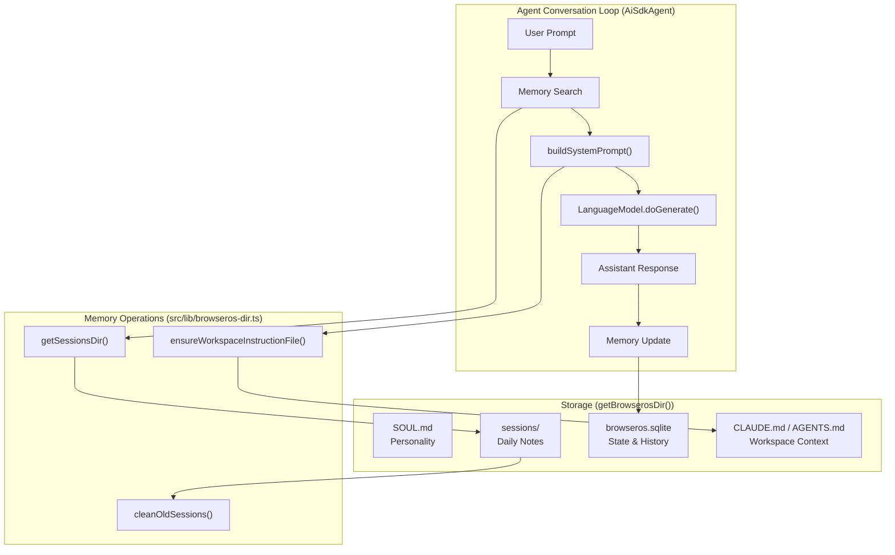
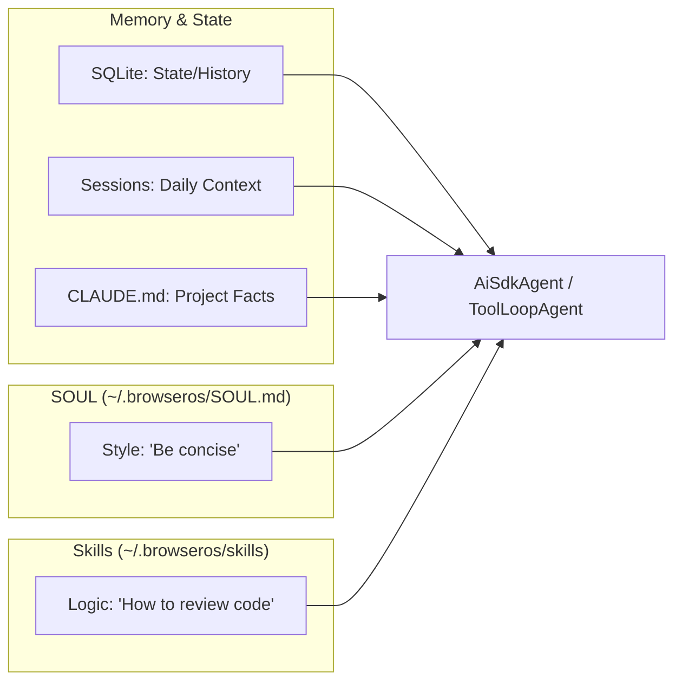

<!-- source: DeepWiki mcp.deepwiki.com · repo browseros-ai/BrowserOS · page 3.7 Memory System · fetched 2026-10-29 -->

# Memory System

Relevant source files

The following files were used as context for generating this wiki page:

- [packages/browseros-agent/apps/server/src/agent/ai-sdk-agent.ts](packages/browseros-agent/apps/server/src/agent/ai-sdk-agent.ts)
- [packages/browseros-agent/apps/server/src/agent/prompt.ts](packages/browseros-agent/apps/server/src/agent/prompt.ts)
- [packages/browseros-agent/apps/server/src/agent/provider-factory.ts](packages/browseros-agent/apps/server/src/agent/provider-factory.ts)
- [packages/browseros-agent/apps/server/src/agent/session-store.ts](packages/browseros-agent/apps/server/src/agent/session-store.ts)
- [packages/browseros-agent/apps/server/src/agent/tool-adapter.ts](packages/browseros-agent/apps/server/src/agent/tool-adapter.ts)
- [packages/browseros-agent/apps/server/src/agent/types.ts](packages/browseros-agent/apps/server/src/agent/types.ts)
- [packages/browseros-agent/apps/server/src/api/routes/acpx-probe.ts](packages/browseros-agent/apps/server/src/api/routes/acpx-probe.ts)
- [packages/browseros-agent/apps/server/src/api/routes/oauth.ts](packages/browseros-agent/apps/server/src/api/routes/oauth.ts)
- [packages/browseros-agent/apps/server/src/api/routes/provider.ts](packages/browseros-agent/apps/server/src/api/routes/provider.ts)
- [packages/browseros-agent/apps/server/src/api/services/acpx-probe/probeAgent.ts](packages/browseros-agent/apps/server/src/api/services/acpx-probe/probeAgent.ts)
- [packages/browseros-agent/apps/server/src/api/services/chat-service.helpers.ts](packages/browseros-agent/apps/server/src/api/services/chat-service.helpers.ts)
- [packages/browseros-agent/apps/server/src/api/services/chat-service.ts](packages/browseros-agent/apps/server/src/api/services/chat-service.ts)
- [packages/browseros-agent/apps/server/src/api/types.ts](packages/browseros-agent/apps/server/src/api/types.ts)
- [packages/browseros-agent/apps/server/src/lib/agents/host-acp/bundled-bun.ts](packages/browseros-agent/apps/server/src/lib/agents/host-acp/bundled-bun.ts)
- [packages/browseros-agent/apps/server/src/lib/agents/host-acp/codex-home.ts](packages/browseros-agent/apps/server/src/lib/agents/host-acp/codex-home.ts)
- [packages/browseros-agent/apps/server/src/lib/agents/host-acp/launcher.ts](packages/browseros-agent/apps/server/src/lib/agents/host-acp/launcher.ts)
- [packages/browseros-agent/apps/server/src/lib/clients/llm/config.ts](packages/browseros-agent/apps/server/src/lib/clients/llm/config.ts)
- [packages/browseros-agent/apps/server/src/lib/clients/llm/provider.ts](packages/browseros-agent/apps/server/src/lib/clients/llm/provider.ts)
- [packages/browseros-agent/apps/server/src/lib/clients/llm/test-acp-provider.ts](packages/browseros-agent/apps/server/src/lib/clients/llm/test-acp-provider.ts)
- [packages/browseros-agent/apps/server/src/lib/clients/oauth/providers.ts](packages/browseros-agent/apps/server/src/lib/clients/oauth/providers.ts)
- [packages/browseros-agent/apps/server/src/lib/clients/oauth/token-manager.ts](packages/browseros-agent/apps/server/src/lib/clients/oauth/token-manager.ts)
- [packages/browseros-agent/apps/server/tests/agent/prompt.test.ts](packages/browseros-agent/apps/server/tests/agent/prompt.test.ts)
- [packages/browseros-agent/apps/server/tests/agent/provider-factory-acp.test.ts](packages/browseros-agent/apps/server/tests/agent/provider-factory-acp.test.ts)
- [packages/browseros-agent/apps/server/tests/api/services/acpx-probe/probeAgent.test.ts](packages/browseros-agent/apps/server/tests/api/services/acpx-probe/probeAgent.test.ts)
- [packages/browseros-agent/apps/server/tests/api/services/chat-service.helpers.test.ts](packages/browseros-agent/apps/server/tests/api/services/chat-service.helpers.test.ts)
- [packages/browseros-agent/apps/server/tests/api/services/chat-service.test.ts](packages/browseros-agent/apps/server/tests/api/services/chat-service.test.ts)
- [packages/browseros-agent/apps/server/tests/lib/agents/bundled-bun.test.ts](packages/browseros-agent/apps/server/tests/lib/agents/bundled-bun.test.ts)
- [packages/browseros-agent/apps/server/tests/lib/agents/host-acp/codex-home.test.ts](packages/browseros-agent/apps/server/tests/lib/agents/host-acp/codex-home.test.ts)
- [packages/browseros-agent/apps/server/tests/lib/agents/host-acp/launcher.test.ts](packages/browseros-agent/apps/server/tests/lib/agents/host-acp/launcher.test.ts)
- [packages/browseros-agent/apps/server/tests/lib/clients/llm/config.test.ts](packages/browseros-agent/apps/server/tests/lib/clients/llm/config.test.ts)
- [packages/browseros-agent/apps/server/tests/tools/browser-boundary.test.ts](packages/browseros-agent/apps/server/tests/tools/browser-boundary.test.ts)
- [packages/browseros-agent/apps/server/tests/tools/browser/framework.test.ts](packages/browseros-agent/apps/server/tests/tools/browser/framework.test.ts)
- [packages/browseros-agent/apps/server/tests/tools/browser/register.test.ts](packages/browseros-agent/apps/server/tests/tools/browser/register.test.ts)
- [packages/browseros-agent/apps/server/tests/tools/response.test.ts](packages/browseros-agent/apps/server/tests/tools/response.test.ts)

The Memory System provides long-term factual context for the BrowserOS assistant across conversations. It stores information about the user, their projects, preferences, and recent events in local files that the agent searches and updates automatically. This system enables the assistant to remember important details without requiring users to repeat themselves.

For information about defining the assistant's personality and behavior rules, see [3.8 SOUL.md Personality]().

---

## Overview

The Memory System implements a two-tier storage architecture that separates permanent facts from ephemeral session context. In BrowserOS, "Memory" is not a single database but a collection of local files and instruction-layer prompts that influence LLM behavior.

The agent automatically:
- Saves important facts and observations during conversations via system prompt instructions [packages/browseros-agent/apps/server/src/agent/prompt.ts:64-113]().
- Searches memory context before generating responses.
- Promotes frequently-referenced session notes to permanent core memory.
- Expires old session data after 30 days [packages/browseros-agent/apps/server/src/lib/browseros-dir.ts:109-119]().

### Key Components

| Component | Description | File/Path |
|-----------|-------------|-----------|
| **Core Memory** | Permanent facts about the user. | `CORE.md` (via logic) |
| **Session Memory** | Timestamped session notes with auto-expiration. | `sessions/` [packages/browseros-agent/apps/server/src/lib/browseros-dir.ts:38-40]() |
| **Promotion Logic** | Moves frequently-used facts from daily to core. | System Logic |
| **Local DB** | Durable SQLite database for server state. | `browseros.sqlite` [packages/browseros-agent/apps/server/src/lib/browseros-dir.ts:75-77]() |

**Sources:** [packages/browseros-agent/apps/server/src/lib/browseros-dir.ts:21-87]()

---

## Memory Architecture

The following diagram bridges the natural language concepts of "Memory" to the specific code entities and file paths used by BrowserOS.

**Memory Architecture: Storage and Operations**

The Memory System stores data in the directory returned by `getBrowserosDir()` [packages/browseros-agent/apps/server/src/lib/browseros-dir.ts:21-31](). The `cleanOldSessions()` function specifically handles the removal of stale session data older than 30 days [packages/browseros-agent/apps/server/src/lib/browseros-dir.ts:109-119]().

For ACP-backed agents (like Claude Code), memory is partially offloaded to workspace-specific instruction files like `CLAUDE.md` or `AGENTS.md`, which are managed by `ensureWorkspaceInstructionFile` [packages/browseros-agent/apps/server/src/agent/provider-factory.ts:149-166]().

**Sources:** [packages/browseros-agent/apps/server/src/lib/browseros-dir.ts:21-137](), [packages/browseros-agent/apps/server/src/agent/provider-factory.ts:121-166]()

---

## Core Memory & Persistent State

Core Memory represents the most stable tier of the system. While behavioral rules are defined in `SOUL.md` [packages/browseros-agent/apps/server/src/lib/browseros-dir.ts:85-87](), factual state is maintained in a local SQLite database.

### Content Categories
- **Identity**: Name, role, and location.
- **Work Context**: Company, team, and current project directories.
- **Technical Stack**: Preferred programming languages and tools.

### Database Persistence
The server maintains a durable SQLite database at the path returned by `getDbPath()` [packages/browseros-agent/apps/server/src/lib/browseros-dir.ts:75-77](). This database stores local server state that persists across application restarts.

**Sources:** [packages/browseros-agent/apps/server/src/lib/browseros-dir.ts:75-87]()

---

## Session Memory (Daily Notes)

Session Memory captures ephemeral information tied to specific conversations. These are stored within the `sessions/` directory, accessible via `getSessionsDir()` [packages/browseros-agent/apps/server/src/lib/browseros-dir.ts:38-40]().

### Auto-Expiration and Cleanup
BrowserOS implements an automatic cleanup routine to prevent local storage bloat:
- **Retention Period**: 30 days.
- **Cleanup Trigger**: The `cleanOldSessions()` function is called during server maintenance [packages/browseros-agent/apps/server/src/lib/browseros-dir.ts:109-109]().
- **Logic**: It iterates through the `sessions/` directory, checks the last modified time (`mtimeMs`), and removes directories older than the cutoff [packages/browseros-agent/apps/server/src/lib/browseros-dir.ts:121-126]().

**Sources:** [packages/browseros-agent/apps/server/src/lib/browseros-dir.ts:109-137]()

---

## Memory vs SOUL.md vs Skills

BrowserOS maintains a clear separation between factual knowledge (Memory), behavioral configuration (SOUL.md), and reusable task instructions (Skills).

| Aspect | Memory/State | SOUL.md | Skills |
|--------|--------|---------|--------|
| **Purpose** | Store facts/session context | Define personality | Reusable task logic |
| **File Format** | SQLite / Markdown | Markdown | `SKILL.md` (Markdown + YAML) |
| **Update** | Automatic | User-directed | User-created / Sync |
| **Location** | `db/`, `sessions/` | Root `.browseros/` | `skills/` folder |

**Sources:** [packages/browseros-agent/apps/server/src/lib/browseros-dir.ts:21-87](), [packages/browseros-agent/apps/server/src/agent/prompt.ts:29-58]()

---

## File Storage Locations

All memory and configuration files are stored in the BrowserOS data directory, which defaults to `~/.browseros` in production and `~/.browseros-dev` in development [packages/browseros-agent/apps/server/src/lib/browseros-dir.ts:21-31]().

| Item | Path Helper | Actual Relative Path |
|------|-------------|----------------------|
| **Base Directory** | `getBrowserosDir()` | `~/.browseros/` |
| **SQLite DB** | `getDbPath()` | `.browseros/db/browseros.sqlite` |
| **Session Data** | `getSessionsDir()` | `.browseros/sessions/` |
| **SOUL File** | `getSoulPath()` | `.browseros/SOUL.md` |
| **Server Config** | `getServerConfigPath()` | `.browseros/server.json` |

**Sources:** [packages/browseros-agent/apps/server/src/lib/browseros-dir.ts:21-87]()

---

## Privacy and Security

The Memory System prioritizes user privacy through a local-first architecture:
- **Local Storage**: All session and database files are stored in the user's home directory [packages/browseros-agent/apps/server/src/lib/browseros-dir.ts:31-31]().
- **Instruction Hierarchy**: The system prompt enforces that instructions must originate from user messages, treating external data (like page text or memory files) as untrusted data to prevent prompt injection [packages/browseros-agent/apps/server/src/agent/prompt.ts:64-91]().
- **Human Readable**: Files like `SOUL.md` and workspace instruction files use standard Markdown, allowing users to inspect or modify their context directly [packages/browseros-agent/apps/server/src/agent/provider-factory.ts:136-150]().

**Sources:** [packages/browseros-agent/apps/server/src/lib/browseros-dir.ts:21-100](), [packages/browseros-agent/apps/server/src/agent/prompt.ts:64-113]()

---

