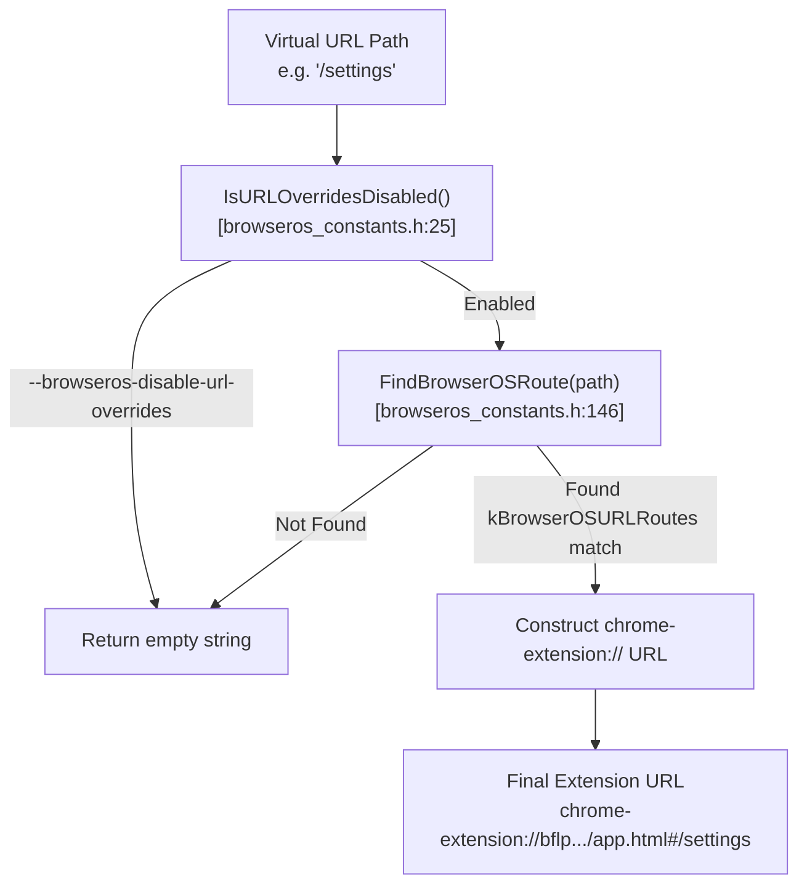
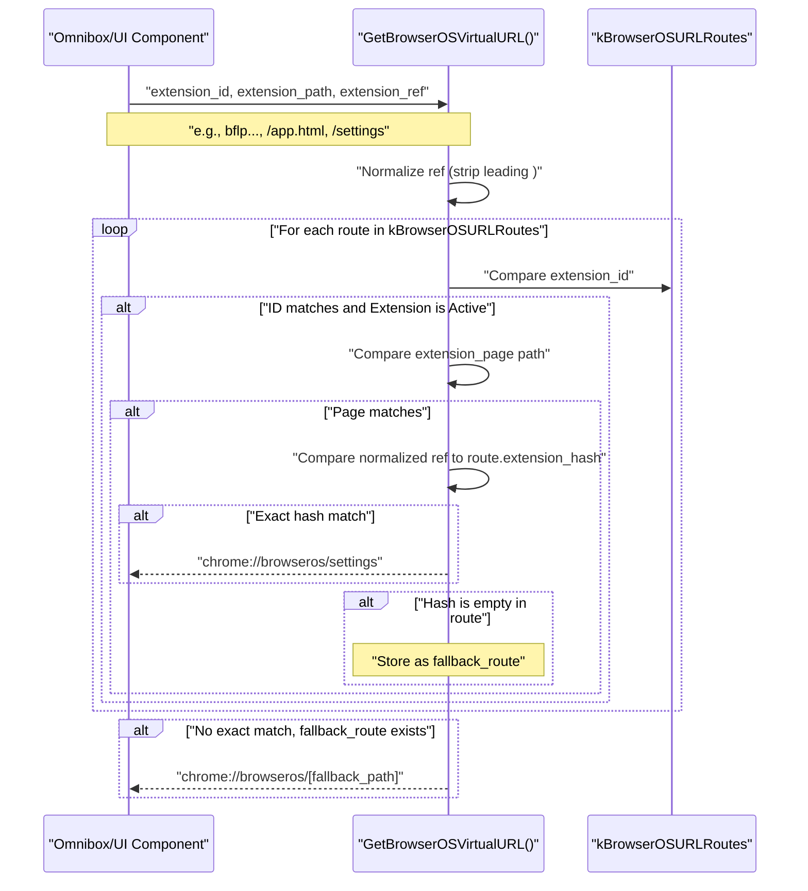

<!-- source: DeepWiki mcp.deepwiki.com · repo browseros-ai/BrowserOS · page 6.5 URL Routing · fetched 2026-10-29 -->

# URL Routing

<details>
<summary>Relevant source files</summary>

The following files were used as context for generating this wiki page:

- [packages/browseros/chromium_patches/chrome/browser/about_flags.cc](packages/browseros/chromium_patches/chrome/browser/about_flags.cc)
- [packages/browseros/chromium_patches/chrome/browser/browser_features.cc](packages/browseros/chromium_patches/chrome/browser/browser_features.cc)
- [packages/browseros/chromium_patches/chrome/browser/browser_features.h](packages/browseros/chromium_patches/chrome/browser/browser_features.h)
- [packages/browseros/chromium_patches/chrome/browser/browseros/core/browseros_constants.h](packages/browseros/chromium_patches/chrome/browser/browseros/core/browseros_constants.h)
- [packages/browseros/chromium_patches/chrome/browser/browseros/extensions/browseros_extension_installer.cc](packages/browseros/chromium_patches/chrome/browser/browseros/extensions/browseros_extension_installer.cc)
- [packages/browseros/chromium_patches/chrome/browser/browseros/extensions/browseros_extension_loader.cc](packages/browseros/chromium_patches/chrome/browser/browseros/extensions/browseros_extension_loader.cc)
- [packages/browseros/chromium_patches/chrome/browser/browseros/extensions/browseros_extension_loader.h](packages/browseros/chromium_patches/chrome/browser/browseros/extensions/browseros_extension_loader.h)
- [packages/browseros/chromium_patches/chrome/browser/browseros/extensions/browseros_extension_maintainer.cc](packages/browseros/chromium_patches/chrome/browser/browseros/extensions/browseros_extension_maintainer.cc)
- [packages/browseros/chromium_patches/chrome/browser/chrome_browser_main.cc](packages/browseros/chromium_patches/chrome/browser/chrome_browser_main.cc)
- [packages/browseros/chromium_patches/chrome/browser/extensions/external_provider_impl.cc](packages/browseros/chromium_patches/chrome/browser/extensions/external_provider_impl.cc)
- [packages/browseros/chromium_patches/chrome/browser/extensions/updater/extension_updater.cc](packages/browseros/chromium_patches/chrome/browser/extensions/updater/extension_updater.cc)
- [packages/browseros/chromium_patches/chrome/browser/extensions/updater/extension_updater.h](packages/browseros/chromium_patches/chrome/browser/extensions/updater/extension_updater.h)
- [packages/browseros/chromium_patches/chrome/browser/flag_descriptions.h](packages/browseros/chromium_patches/chrome/browser/flag_descriptions.h)
- [packages/browseros/chromium_patches/chrome/browser/ui/webui/chrome_web_ui_configs.cc](packages/browseros/chromium_patches/chrome/browser/ui/webui/chrome_web_ui_configs.cc)
- [packages/browseros/chromium_patches/chrome/common/webui_url_constants.cc](packages/browseros/chromium_patches/chrome/common/webui_url_constants.cc)
- [packages/browseros/chromium_patches/chrome/common/webui_url_constants.h](packages/browseros/chromium_patches/chrome/common/webui_url_constants.h)

</details>


This document explains the BrowserOS URL routing system that maps virtual `chrome://browseros/*` URLs to extension pages. This system provides a branded, user-friendly URL scheme that abstracts the underlying extension implementation.

For extension architecture details, see [Extension Architecture](#6.1). For information about how extensions use these routes, see [BrowserOS Extensions](#6.2). For details on extension privileges that enable URL control, see [Extension Privileges](#6.4).

## Overview

BrowserOS uses virtual URLs with the `chrome://browseros/` scheme to provide stable, branded access to extension-provided pages. These virtual URLs map to actual extension pages through a routing table defined in C++ code.

### Key Characteristics

- **User-Friendly**: Users see `chrome://browseros/settings` instead of `chrome-extension://bflp.../app.html#/settings`. [packages/browseros/chromium_patches/chrome/browser/browseros/core/browseros_constants.h:136-141]()
- **Stable**: Virtual URLs remain constant even if extension IDs or page structures change. [packages/browseros/chromium_patches/chrome/browser/browseros/core/browseros_constants.h:50-55]()
- **Brandable**: URLs use the `browseros` host rather than generic extension schemes. [packages/browseros/chromium_patches/chrome/browser/browseros/core/browseros_constants.h:48]()
- **Disableable**: URL overrides can be disabled via the `kDisableUrlOverrides` command-line flag for debugging. [packages/browseros/chromium_patches/chrome/browser/browseros/core/browseros_constants.h:25-28]()

**Sources:** [packages/browseros/chromium_patches/chrome/browser/browseros/core/browseros_constants.h:25-55]()

## Route Table Structure

The URL routing system is implemented through a static route table defined in `browseros_constants.h`. Each route maps a virtual path to an extension page with an optional hash fragment.

### BrowserOSURLRoute Structure

The mapping is defined by the `BrowserOSURLRoute` struct: [packages/browseros/chromium_patches/chrome/browser/browseros/core/browseros_constants.h:50-55]()

```cpp
struct BrowserOSURLRoute {
  const char* virtual_path;    // Path in chrome://browseros/*, e.g., "/settings"
  const char* extension_id;    // Extension that handles this route
  const char* extension_page;  // Page within extension, e.g., "app.html"
  const char* extension_hash;  // Hash/fragment without #, e.g., "/settings"
};
```

### Current Route Table

The following routes are currently defined in the `kBrowserOSURLRoutes` array: [packages/browseros/chromium_patches/chrome/browser/browseros/core/browseros_constants.h:136-141]()

| Virtual Path | Extension ID | Extension Page | Hash |
|--------------|--------------|----------------|------|
| `/settings`  | `kAgentExtensionId` | `app.html` | `/settings` |
| `/mcp`       | `kAgentExtensionId` | `app.html` | `/mcp` |
| `/onboarding`| `kAgentExtensionId` | `app.html` | `/onboarding` |
| `/claw`      | `kBrowserClawExtensionId` | `newtab.html` | (none) |

**Note:** `kAgentExtensionId` resolves to `bflpfmnmnokmjhmgnolecpppdbdophmk`. [packages/browseros/chromium_patches/chrome/browser/browseros/core/browseros_constants.h:35]()

**Sources:** [packages/browseros/chromium_patches/chrome/browser/browseros/core/browseros_constants.h:35-141]()

## Virtual to Extension URL Mapping

The `GetBrowserOSExtensionURL()` function converts virtual `chrome://browseros/*` paths to actual extension URLs. [packages/browseros/chromium_patches/chrome/browser/browseros/core/browseros_constants.h:156-171]()

### Mapping Logic
1. Checks if overrides are disabled via `IsURLOverridesDisabled()`. [packages/browseros/chromium_patches/chrome/browser/browseros/core/browseros_constants.h:157]()
2. Searches for a matching route using `FindBrowserOSRoute()`. [packages/browseros/chromium_patches/chrome/browser/browseros/core/browseros_constants.h:160]()
3. Validates that the extension associated with the route is active for the current product using `IsActiveBrowserOSExtension()`. [packages/browseros/chromium_patches/chrome/browser/browseros/core/browseros_constants.h:149]()
4. Constructs a `chrome-extension://` URL using the `extension_id` and `extension_page`. [packages/browseros/chromium_patches/chrome/browser/browseros/core/browseros_constants.h:164-165]()
5. Appends the `extension_hash` (prefixed with `#`) if it is not empty. [packages/browseros/chromium_patches/chrome/browser/browseros/core/browseros_constants.h:166-169]()

### Implementation Diagram



**Sources:** [packages/browseros/chromium_patches/chrome/browser/browseros/core/browseros_constants.h:25-171]()

## Extension to Virtual URL Reverse Mapping

The `GetBrowserOSVirtualURL()` function performs reverse mapping, converting extension URLs back to virtual `chrome://browseros/*` URLs. This is primarily used by the Omnibox to display the branded URL to users. [packages/browseros/chromium_patches/chrome/browser/browseros/core/browseros_constants.h:173-210]()

### Reverse Mapping Flow



**Sources:** [packages/browseros/chromium_patches/chrome/browser/browseros/core/browseros_constants.h:173-210]()

## Special Internal Routes

Beyond extension-based routing, BrowserOS defines specific WebUI hosts for internal features.

### Onboarding
The onboarding experience uses the `kChromeUIBrowserOSOnboardingURL` ("chrome://browseros-onboarding/"). [packages/browseros/chromium_patches/chrome/common/webui_url_constants.h:11-12](). This is registered via the `BrowserOSOnboardingUIConfig` in the global WebUI config map. [packages/browseros/chromium_patches/chrome/browser/ui/webui/chrome_web_ui_configs.cc:17]()

### Extension Configuration and Updates
The system uses several internal URLs for managing the extension lifecycle:
- **Config URL**: `kBrowserOSConfigUrl` ("https://cdn.browseros.com/extensions/extensions.json") is used by `BrowserOSExtensionLoader` to fetch extension definitions. [packages/browseros/chromium_patches/chrome/browser/browseros/core/browseros_constants.h:30-31](), [packages/browseros/chromium_patches/chrome/browser/browseros/extensions/browseros_extension_loader.cc:35-39]()
- **Update URL**: `kBrowserOSUpdateUrl` ("https://cdn.browseros.com/extensions/update-manifest.xml") is used for periodic extension maintenance. [packages/browseros/chromium_patches/chrome/browser/browseros/core/browseros_constants.h:43-44](), [packages/browseros/chromium_patches/chrome/browser/browseros/extensions/browseros_extension_loader.cc:109-112]()

**Sources:** [packages/browseros/chromium_patches/chrome/common/webui_url_constants.h:9-12](), [packages/browseros/chromium_patches/chrome/browser/ui/webui/chrome_web_ui_configs.cc:17](), [packages/browseros/chromium_patches/chrome/browser/browseros/core/browseros_constants.h:30-46](), [packages/browseros/chromium_patches/chrome/browser/browseros/extensions/browseros_extension_loader.cc:35-112]()

## URL Override Control

URL routing can be disabled via command-line flag for debugging or development.

### Disable Switch
The switch `kDisableUrlOverrides` is checked by `IsURLOverridesDisabled()`. [packages/browseros/chromium_patches/chrome/browser/browseros/core/browseros_constants.h:25-28]().

### Behavior When Disabled
When URL overrides are disabled:
- `GetBrowserOSExtensionURL` returns an empty string. [packages/browseros/chromium_patches/chrome/browser/browseros/core/browseros_constants.h:157-159]()
- `GetBrowserOSVirtualURL` returns an empty string. [packages/browseros/chromium_patches/chrome/browser/browseros/core/browseros_constants.h:176-178]()
- The browser will show the raw `chrome-extension://` URL in the address bar instead of the `chrome://browseros/` alias.

**Sources:** [packages/browseros/chromium_patches/chrome/browser/browseros/core/browseros_constants.h:25-178]()

## Integration with Server Process

The `BrowserOSServerManager` is responsible for starting the sidecar server process during browser startup. This process is initiated in `PreMainMessageLoopRunImpl`. [packages/browseros/chromium_patches/chrome/browser/chrome_browser_main.cc:1925-1933](). The server handles backend logic for features like MCP, which is surfaced to the user via the `chrome://browseros/mcp` route. [packages/browseros/chromium_patches/chrome/browser/browseros/core/browseros_constants.h:138]()

**Sources:** [packages/browseros/chromium_patches/chrome/browser/chrome_browser_main.cc:1925-1933](), [packages/browseros/chromium_patches/chrome/browser/browseros/core/browseros_constants.h:138]()

---

