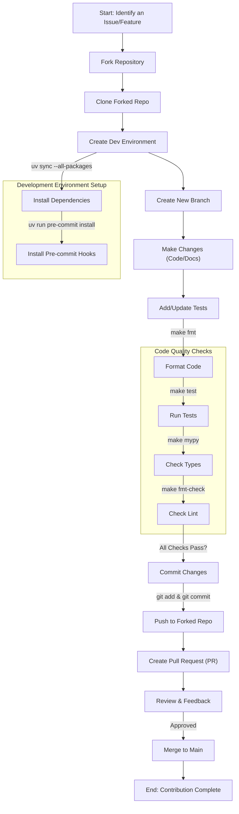
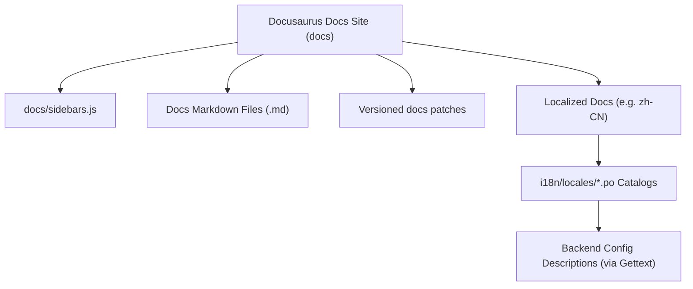
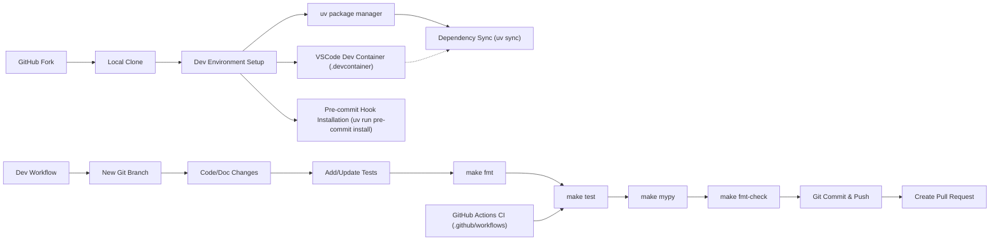

<!-- source: DeepWiki mcp.deepwiki.com · repo eosphoros-ai/DB-GPT · page 16 Documentation, i18n & Contributing · fetched 2026-11-09 -->

# Documentation, i18n & Contributing

Relevant source files

The following files were used as context for generating this wiki page:

- [.devcontainer.json](.devcontainer.json)
- [.devcontainer/Dockerfile.dev](.devcontainer/Dockerfile.dev)
- [.devcontainer/README.md](.devcontainer/README.md)
- [.devcontainer/init_env.sh](.devcontainer/init_env.sh)
- [.devcontainer/post-create.sh](.devcontainer/post-create.sh)
- [.github/workflows/test-python.yml](.github/workflows/test-python.yml)
- [CONTRIBUTING.md](CONTRIBUTING.md)
- [docs/docs/application/advanced_tutorial/api.md](docs/docs/application/advanced_tutorial/api.md)
- [docs/docs/application/advanced_tutorial/cli.md](docs/docs/application/advanced_tutorial/cli.md)
- [docs/docs/application/fine_tuning_manual/text_to_sql.md](docs/docs/application/fine_tuning_manual/text_to_sql.md)
- [docs/docs/installation/sourcecode.md](docs/docs/installation/sourcecode.md)
- [docs/docs/quickstart.md](docs/docs/quickstart.md)
- [docs/sidebars.js](docs/sidebars.js)
- [packages/dbgpt-ext/src/dbgpt_ext/rag/knowledge/__init__.py](packages/dbgpt-ext/src/dbgpt_ext/rag/knowledge/__init__.py)
- [requirements/dev-requirements.txt](requirements/dev-requirements.txt)

This page provides a high-level overview of the DB-GPT project's documentation site, internationalization (i18n) efforts, and contributor workflow. For comprehensive and detailed information on these topics, please refer to the child pages: [Docs Site & Localization](#16.1) and [Contributing, Testing & Tooling](#16.2).

---

## Documentation Site Overview

DB-GPT’s documentation is maintained as a structured site powered by Docusaurus. It serves as the authoritative resource for users and developers, covering essential topics such as installation, getting started guides, advanced architecture concepts, detailed API references, and troubleshooting. The documentation layout is organized into logical categories including:

- Getting Started
- Model Providers
- Tools & Plugins
- Troubleshooting
- Web UI Overview
- Core Concepts and Architecture
- Deployment

The site uses a sidebar-driven navigation defined in [`docs/sidebars.js`](docs/sidebars.js:5-172)() to organize documents effectively. It supports versioned releases and incremental updates to maintain clarity over evolving functionality.

For comprehensive technical details on the Docusaurus site structure, sidebar configuration, versioning strategy, and supported localization (including Chinese), see [Docs Site & Localization](#16.1).

Sources: [`docs/sidebars.js`](docs/sidebars.js:5-172)()

---

## Internationalization (i18n)

DB-GPT supports a multilingual user and developer experience through internationalization of both documentation content and backend system messages.

- **Documentation i18n**: The project uses Docusaurus’s built-in i18n system to provide localized documentation pages such as for `zh-CN` (Simplified Chinese). This enables non-English speakers to access comprehensive guidance tailored to their language preference.

- **Backend Configuration & Messages**: The backend uses Gettext translation catalogs for configuration descriptions and user-facing messages. Current translation catalogs cover several languages: French, Japanese, Korean, Russian, and Chinese (`zh_CN`), enhancing the accessibility of system configuration and status information globally.

For full insights into how i18n is implemented for both docs and backend configurations, including catalog management and tooling, refer to [Docs Site & Localization](#16.1).

Sources: [`docs/sidebars.js`](docs/sidebars.js:5-172)()

---

## Contributing to DB-GPT

DB-GPT welcomes contributions from the community, with a clear and robust developer workflow to maintain code quality and project consistency.

### Contributor Workflow Overview

The typical contribution lifecycle involves:

1. **Forking** the repository and cloning the fork locally.
2. **Setting up the development environment**, primarily using the `uv` package manager to synchronize dependencies and virtual environments.
3. **Implementing changes** in a new Git branch — code, documentation, or tests.
4. **Running validation steps** including:
   - Code formatting: `make fmt`
   - Unit and integration testing: `make test`
   - Static type checking: `make mypy`
   - Lint checks: `make fmt-check`
5. **Committing and pushing changes** to the forked repository.
6. **Creating a pull request** for review and integration.

All Git hooks and pre-commit checks help ensure that contributions meet project standards before submission.

Title: "Contributor Workflow and Quality Checks"

Sources: [`CONTRIBUTING.md`](CONTRIBUTING.md:8-164)(), [`docs/docs/quickstart.md`](docs/docs/quickstart.md:76-95)(), [`docs/docs/installation/sourcecode.md`](docs/docs/installation/sourcecode.md:30-59)()

---

### Development Environment & Tooling

- **Dependency Management**: The project primarily uses `uv` for package and environment sync (`uv sync --all-packages`), which streamlines dependency installation combining core, proxy, RAG, storage, and dbgpts packages.
- **Dev Containers**: For isolated and consistent development setups, a VS Code Dev Container configuration is provided ([`.devcontainer.json`](.devcontainer.json:1-79)(), [`.devcontainer/Dockerfile.dev`](.devcontainer.json:1-56)()). This container is pre-installed with dependencies, LLM and GPU support, and localization settings.
- **Quality Assurance Tools**:
  - **Testing**: `pytest` and `pytest-asyncio` cover unit and integration tests.
  - **Linting & Formatting**: `ruff` enforces code style while also integrated with formatting and lint checks.
  - **Type Checking**: `mypy` ensures static type correctness.
  - **GitHub Actions**: A CI pipeline automatically runs the test suite across Python versions 3.10 and 3.11 on Linux and macOS environments ([.github/workflows/test-python.yml](.github/workflows/test-python.yml:1-36)()).

Developers are advised to always run tests and checks locally using the provided Makefile commands before pushing changes for review.

Sources: [`.devcontainer.json`](.devcontainer.json:1-79)(), [`.devcontainer/Dockerfile.dev`](.devcontainer/Dockerfile.dev:1-56)(), [`requirements/dev-requirements.txt`](requirements/dev-requirements.txt:1-18)(), [`.github/workflows/test-python.yml`](.github/workflows/test-python.yml:1-36)()

---

## Bridging Docs and Code Entities: System Overview Diagrams

The following diagrams illustrate the relationship between the natural language conceptual space of documentation, internationalization, and contribution, and the codebase entities involved.

### Diagram 1: Documentation Structure to Code & Config Artifacts

Title: "Documentation Structure and Localization Mapping"

- The documentation site relies on the sidebar config [`docs/sidebars.js`](docs/sidebars.js:5-172)() to organize markdown content.
- Internationalization includes docs translations and translation catalogs for backend configuration descriptions in multiple languages.
- Gettext catalogs enable runtime translation of config params and UI strings in the backend.

Sources: [`docs/sidebars.js`](docs/sidebars.js:5-172)()

---

### Diagram 2: Contributor Workflow Tools & Code Entities

Title: "Contributor Tools and CI Pipeline Integration"

- Developers fork, clone, and set up their environment primarily using `uv`.
- Optional VS Code Dev Container ensures consistent, isolated dev environment.
- Make commands manage formatting, testing, type checking, and linting.
- CI workflow runs tests on PRs to catch regressions before merging.

Sources: [`CONTRIBUTING.md`](CONTRIBUTING.md:8-164)(), [`.devcontainer.json`](.devcontainer.json:1-79)(), [`.github/workflows/test-python.yml`](.github/workflows/test-python.yml:1-36)()

---

For detailed information on the documentation site structure, localization pipelines, and i18n catalogs, see the child page:  
- [Docs Site & Localization](#16.1)

For an in-depth guide to contributing, testing strategy, tooling, dev container, and continuous integration:  
- [Contributing, Testing & Tooling](#16.2)

Sources:  
- [`docs/sidebars.js`](docs/sidebars.js:5-172)()  
- [`CONTRIBUTING.md`](CONTRIBUTING.md:8-164)()  
- [`docs/docs/quickstart.md`](docs/docs/quickstart.md:76-95)()  
- [`docs/docs/installation/sourcecode.md`](docs/docs/installation/sourcecode.md:30-59)()  
- [`.devcontainer.json`](.devcontainer.json:1-79)()  
- [`.devcontainer/Dockerfile.dev`](.devcontainer/Dockerfile.dev:1-56)()  
- [`requirements/dev-requirements.txt`](requirements/dev-requirements.txt:1-18)()  
- [`.github/workflows/test-python.yml`](.github/workflows/test-python.yml:1-36)()

---

