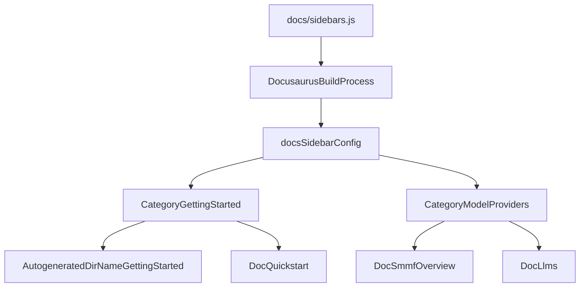
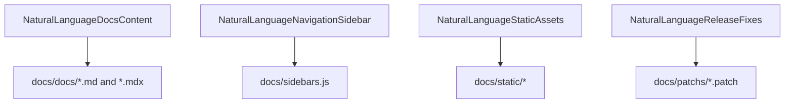
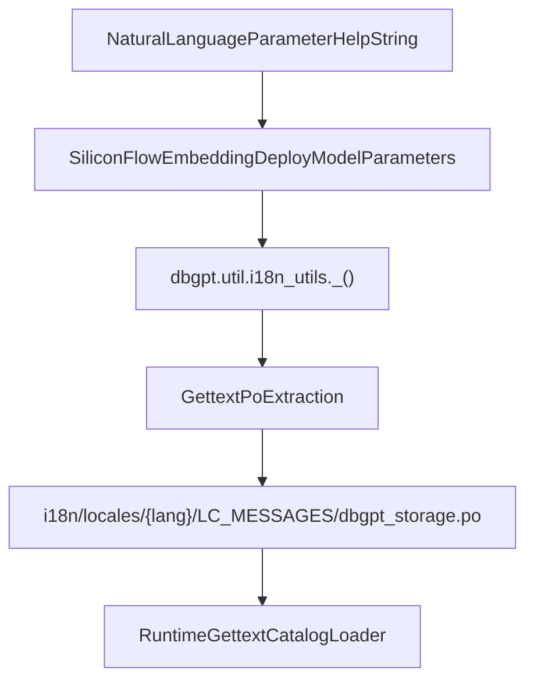

<!-- source: DeepWiki mcp.deepwiki.com · repo eosphoros-ai/DB-GPT · page 16.1 Docs Site & Localization · fetched 2026-11-09 -->

# Docs Site & Localization

<details>
<summary>Relevant source files</summary>

The following files were used as context for generating this wiki page:

- [.github/workflows/doc-image-publish.yml](.github/workflows/doc-image-publish.yml)
- [docs/Dockerfile-deploy](docs/Dockerfile-deploy)
- [docs/blog/2024-07-24-db-gpt-llama-3.1-support.md](docs/blog/2024-07-24-db-gpt-llama-3.1-support.md)
- [docs/blog/authors.yml](docs/blog/authors.yml)
- [docs/blog/tags.yml](docs/blog/tags.yml)
- [docs/docs/application/advanced_tutorial/api.md](docs/docs/application/advanced_tutorial/api.md)
- [docs/docs/application/advanced_tutorial/cli.md](docs/docs/application/advanced_tutorial/cli.md)
- [docs/docs/application/advanced_tutorial/smmf.md](docs/docs/application/advanced_tutorial/smmf.md)
- [docs/docs/application/fine_tuning_manual/text_to_sql.md](docs/docs/application/fine_tuning_manual/text_to_sql.md)
- [docs/docs/installation/sourcecode.md](docs/docs/installation/sourcecode.md)
- [docs/docs/quickstart.md](docs/docs/quickstart.md)
- [docs/docusaurus.config.js](docs/docusaurus.config.js)
- [docs/patchs/fix_0.6.3.patch](docs/patchs/fix_0.6.3.patch)
- [docs/patchs/fix_0.7.4.patch](docs/patchs/fix_0.7.4.patch)
- [docs/patchs/fix_0.7.5.patch](docs/patchs/fix_0.7.5.patch)
- [docs/sidebars.js](docs/sidebars.js)

</details>


This page details the structure and localization aspects of the DB-GPT documentation site and backend configuration catalogs. It covers the Docusaurus site layout under `docs/`, sidebar navigation configurations in `docs/sidebars.js`, versioned documentation patches under `docs/patchs/`, Simplified Chinese (`zh-CN`) documentation internationalization, and gettext translation catalogs across multiple languages (`fr`, `ja`, `ko`, `ru`, `zh_CN`) for backend configuration parameter descriptions.

Sources: [docs/sidebars.js:1-172](), [docs/docusaurus.config.js:1-231](), [docs/Dockerfile-deploy:1-115]()

## Docusaurus Site Layout

DB-GPT utilizes [Docusaurus](https://docusaurus.io) as its static site generator for technical documentation. The core source files reside under the `docs/` directory, organizing Markdown and MDX content, configuration files, and assets as configured in `docs/docusaurus.config.js` [docs/docusaurus.config.js:1-231]().

Key components of the documentation directory structure:
- `docs/docs/` — Primary Markdown and MDX content files powering the site.
- `docs/sidebars.js` — Sidebar navigation definitions [docs/sidebars.js:1-172]().
- `docs/patchs/` — Version-specific patch files (`.patch`) used during build/release pipelines to adjust formatting or images [docs/patchs/fix_0.7.5.patch:1-216]().
- `docs/static/` — Static assets, including architecture diagrams and screenshots.
- `docs/i18n/` — Internationalization files for localized site UI and translated documentation sets.

Sources: [docs/sidebars.js:1-172](), [docs/docusaurus.config.js:1-231](), [docs/Dockerfile-deploy:1-115]()

## Sidebars Configuration

Sidebar navigation is defined inside `docs/sidebars.js`, exporting a `SidebarsConfig` object containing the `docsSidebar` array [docs/sidebars.js:1-172](). Each item in the array represents either an individual document (`type: "doc"`) or a collapsible category (`type: "category"`) with nested items or autogenerated directory trees (`type: "autogenerated"`).

### Example Sidebar Definition Snippet

```javascript
// docs/sidebars.js
/** @type {import('@docusaurus/plugin-content-docs').SidebarsConfig} */
const sidebars = {
  docsSidebar: [
    { type: "doc", id: "overview", label: "Overview" },
    {
      type: "category",
      label: "Getting Started",
      collapsed: false,
      collapsible: true,
      items: [
        { type: "autogenerated", dirName: "getting-started" },
        { type: "doc", id: "quickstart", label: "Quickstart" },
      ],
      link: { type: "doc", id: "getting-started/index" },
    },
    {
      type: "category",
      label: "Model Providers",
      collapsed: true,
      collapsible: true,
      items: [
        { type: "doc", id: "modules/smmf", label: "SMMF Overview" },
        { type: "doc", id: "application/llms", label: "LLMs" },
      ],
    },
  ],
};
```

### Sidebar Generation Data Flow

Diagram: Sidebar Generation Data Flow


Sources: [docs/sidebars.js:1-172]()

## Versioned Patches for Documentation

The `docs/patchs/` directory manages patches (such as `docs/patchs/fix_0.7.5.patch` and `docs/patchs/fix_0.7.4.patch`) that modify documentation source files to fix rendering quirks, adjust image widths, or fix sidebar exports across distinct release versions [docs/patchs/fix_0.7.5.patch:1-216](), [docs/patchs/fix_0.7.4.patch:1-10](). In `docs/Dockerfile-deploy`, these patches are automatically applied during multi-version builds when checking out git tags [docs/Dockerfile-deploy:1-115]().

Sources: [docs/Dockerfile-deploy:1-115](), [docs/patchs/fix_0.7.5.patch:1-216](), [docs/patchs/fix_0.7.4.patch:1-10]()

## Chinese (zh-CN) Internationalization for Documentation

Localized Simplified Chinese documentation files are maintained under the Docusaurus i18n tree:
```
docs/i18n/zh-CN/docusaurus-plugin-content-docs/current/
```
In tandem with localized markdown pages, MDX files utilize Docusaurus theme components like `<Tabs>` and `<TabItem>` (as seen in `docs/docs/quickstart.md` and `docs/docs/installation/sourcecode.md`) to allow users to toggle between different environment setups, installation tools (`uv`), and model providers seamlessly [docs/docs/quickstart.md:1-208](), [docs/docs/installation/sourcecode.md:1-216]().

Sources: [docs/docs/quickstart.md:1-208](), [docs/docs/installation/sourcecode.md:1-216]()

## Gettext Catalogs for Backend Configuration Descriptions

Backend configuration parameter descriptions (for models, embeddings, and vector stores) support internationalization via gettext `.po` catalogs and translation utility functions defined across core and extension packages.

### Localization Architecture & Data Flow
1. **Parameter Metadata**: Model parameter classes declare help metadata wrapped with translation helpers [docs/docusaurus.config.js:1-231]().
2. **Translation Extraction**: Strings are extracted into gettext `.po` templates.
3. **Locale Catalogs**: Catalogs exist under `i18n/locales/{lang}/LC_MESSAGES/` for French (`fr`), Japanese (`ja`), Korean (`ko`), Russian (`ru`), and Simplified Chinese (`zh_CN`).
4. **Runtime Resolution**: At runtime, parameter help strings are dynamically translated based on the active locale before being exposed via REST APIs or CLI interfaces.

Sources: [docs/docusaurus.config.js:1-231]()

---

# Bridging Concepts: Natural Language Space to Code Entity Space

The following diagrams map natural language documentation concepts and configuration descriptions directly to the underlying code entities and files within the DB-GPT repository.

### Diagram 1: Documentation Artifacts to Code Entities

Diagram: Documentation Artifacts to Code Entities Map


Sources: [docs/sidebars.js:1-172](), [docs/patchs/fix_0.7.5.patch:1-216]()

### Diagram 2: Configuration Parameter Help Strings to Gettext Catalogs

Diagram: Configuration Parameter Help Strings to Gettext Catalogs Map


Sources: [docs/docusaurus.config.js:1-231]()

# End of 16.1 Docs Site & Localization

Sources: [docs/sidebars.js:1-172](), [docs/docs/quickstart.md:1-208](), [docs/docs/installation/sourcecode.md:1-216](), [docs/patchs/fix_0.7.5.patch:1-216](), [docs/patchs/fix_0.7.4.patch:1-10](), [docs/docusaurus.config.js:1-231](), [docs/Dockerfile-deploy:1-115]()

---

