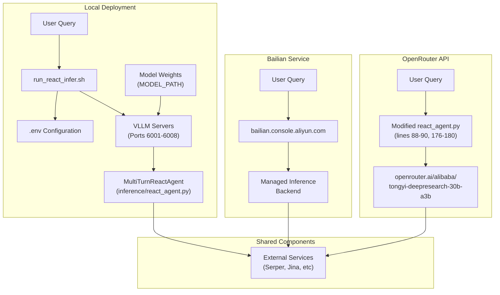
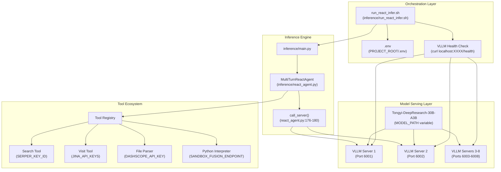
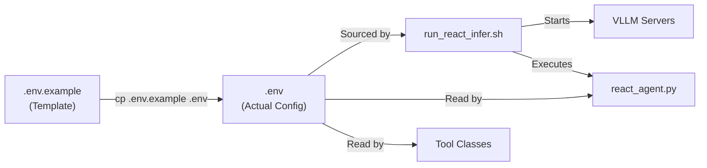
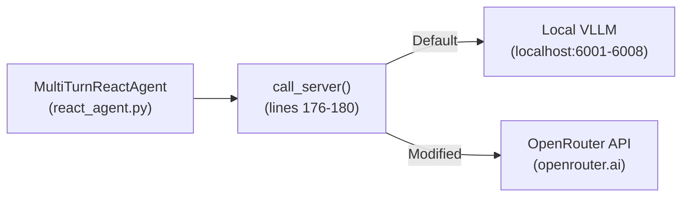
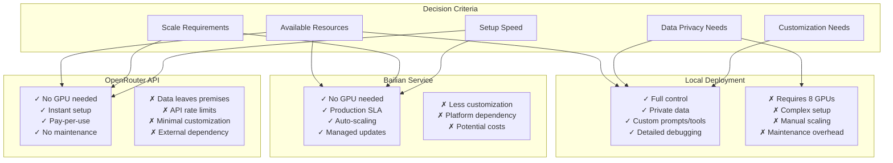

<!-- source: DeepWiki mcp.deepwiki.com · repo Alibaba-NLP/DeepResearch · page 1.2 Deployment Options · fetched 2026-10-29 -->

# Deployment Options

<details>
<summary>Relevant source files</summary>

The following files were used as context for generating this wiki page:

- [FAQ.md](FAQ.md)
- [README.md](README.md)
- [assets/family.png](assets/family.png)
- [assets/family17.png](assets/family17.png)

</details>


This page describes the three available deployment methods for Tongyi DeepResearch: local deployment with GPU servers, production service via the bailian platform, and cloud API access through OpenRouter. Each option provides different trade-offs between control, resource requirements, and ease of use.

For information about the model architecture and inference modes, see [System Architecture and Components](#1.1). For details on tool configuration and external services, see [Configuration and API Keys](#6.2).

Sources: [README.md:25-28](), [README.md:68-170](), [FAQ.md:3-6]()

---

## Overview

Tongyi DeepResearch supports three deployment paradigms, each suited to different use cases:

| Deployment Type | GPU Required | Control Level | Use Case | Entry Point |
|-----------------|--------------|---------------|----------|-------------|
| **Local Deployment** | Yes (8 GPUs recommended) | Full control over model, tools, and configuration | Development, testing, customization | `run_react_infer.sh` script |
| **Bailian Service** | No | Managed service | Production workloads, scalable applications | [bailian.console.aliyun.com](https://bailian.console.aliyun.com/?spm=a2ty02.31808181.d_app-market.1.6c4974a1tFmoFc&tab=app#/app/app-market/deep-search) |
| **OpenRouter API** | No | API-level access | Quick prototyping, no infrastructure | API endpoint at `openrouter.ai` |

Sources: [README.md:25-28](), [README.md:59](), [README.md:172-174]()

---

## Deployment Architecture Comparison



**Deployment Options Architecture**

This diagram shows how the three deployment methods differ in their infrastructure while sharing common external service dependencies.

Sources: [README.md:68-170](), [README.md:172-181](), Diagram 2 and Diagram 6 from high-level architecture

---

## Local Deployment

Local deployment provides full control over the inference stack, enabling customization of prompts, tools, and model parameters. This option requires GPU infrastructure but allows for private data processing and fine-grained debugging.

### Architecture Components



**Local Deployment Component Architecture**

This diagram maps the shell script orchestration to Python classes and external service endpoints used in local deployment.

Sources: [README.md:155-167](), [README.md:102-109]()

### Prerequisites

- **Hardware**: 8 GPUs recommended for distributed inference across VLLM servers (ports 6001-6008)
- **Python**: Version 3.10.0 (other versions may cause dependency issues)
- **Model Weights**: Download from [HuggingFace](https://huggingface.co/Alibaba-NLP/Tongyi-DeepResearch-30B-A3B) or [ModelScope](https://modelscope.cn/models/iic/Tongyi-DeepResearch-30B-A3B)
- **Dependencies**: Install via `requirements.txt`

Sources: [README.md:72-87](), [README.md:50-55]()

### Configuration

Local deployment requires a `.env` file containing API credentials and path configurations:

| Variable | Purpose | Service Provider | Required |
|----------|---------|------------------|----------|
| `MODEL_PATH` | Path to model weights directory | Local filesystem | Yes |
| `DATASET` | Path to evaluation data (JSON/JSONL) | Local filesystem | Yes |
| `OUTPUT_PATH` | Directory for inference results | Local filesystem | Yes |
| `SERPER_KEY_ID` | Web search and Google Scholar access | [serper.dev](https://serper.dev) | Yes |
| `JINA_API_KEYS` | Web page content extraction | [jina.ai](https://jina.ai) | Yes |
| `API_KEY` / `API_BASE` | Page summarization (OpenAI-compatible) | [platform.openai.com](https://platform.openai.com) | Yes |
| `DASHSCOPE_API_KEY` | PDF/Office document parsing | [dashscope.aliyun.com](https://dashscope.aliyun.com) | Yes |
| `SANDBOX_FUSION_ENDPOINT` | Python code execution sandbox | [SandboxFusion](https://github.com/bytedance/SandboxFusion) | Yes |

Configuration flow:



**Configuration Flow in Local Deployment**

Sources: [README.md:89-111](), [README.md:155-161]()

### Running Inference

The `run_react_infer.sh` script orchestrates the complete inference pipeline:

1. **VLLM Server Initialization**: Starts 8 VLLM servers on ports 6001-6008, each serving the model
2. **Health Checks**: Polls each server's `/health` endpoint until ready
3. **Agent Execution**: Invokes `inference/main.py` which instantiates `MultiTurnReactAgent`
4. **Result Output**: Saves predictions to `OUTPUT_PATH`

Execution command:
```bash
bash run_react_infer.sh
```

Key execution parameters controlled by the script:
- `MAX_LLM_CALL_PER_RUN`: Maximum LLM calls per query (default: 100)
- `MAX_CONTEXT`: Context window limit (110K tokens)
- Timeout: 150 minutes per query

Sources: [README.md:163-167](), inference mode descriptions from Diagram 6

### Data Format

Input data must be in JSON or JSONL format with `question` and `answer` fields:

**JSONL Format (recommended):**
```json
{"question": "What is the capital of France?", "answer": "Paris"}
{"question": "Explain quantum computing", "answer": ""}
```

**JSON Format:**
```json
[
  {"question": "What is the capital of France?", "answer": "Paris"},
  {"question": "Explain quantum computing", "answer": ""}
]
```

The `answer` field contains the ground truth reference used for evaluation scoring. The system generates its own response and compares it against this reference during benchmark evaluation.

For file-based queries, prepend the filename to the question and place files in `eval_data/file_corpus/`:
```json
{"question": "(Uploaded 1 file: ['report.pdf'])\n\nWhat are the key findings?", "answer": "..."}
```

Sources: [README.md:113-153]()

---

## Production Service (Bailian)

The bailian platform provides a managed, production-ready deployment of Tongyi DeepResearch without requiring local GPU infrastructure.

### Characteristics

- **Managed Infrastructure**: No need to provision or maintain VLLM servers
- **Scalability**: Automatic scaling based on request load
- **High Availability**: Production SLA guarantees
- **Guided Setup**: Web console for configuration and monitoring
- **Stable Performance**: Dedicated resources avoid the latency variability of demo environments

### Access

Navigate to the [bailian console](https://bailian.console.aliyun.com/?spm=a2ty02.31808181.d_app-market.1.6c4974a1tFmoFc&tab=app#/app/app-market/deep-search) and follow the platform's guided setup to:

1. Configure API access credentials
2. Set up tool integrations (search, file parsing, etc.)
3. Deploy the deep research agent
4. Monitor usage and performance metrics

The bailian service abstracts the complexity of VLLM server management while maintaining the same tool ecosystem and inference capabilities as local deployment.

Sources: [README.md:25-28](), [FAQ.md:5-6]()

---

## OpenRouter API

OpenRouter provides cloud-based API access to Tongyi DeepResearch, eliminating GPU requirements entirely. This option is ideal for prototyping and applications that don't require local data processing.

### Setup

OpenRouter hosts the model at: `alibaba/tongyi-deepresearch-30b-a3b`

To use OpenRouter instead of local VLLM servers, modify `inference/react_agent.py`:

**Required Code Modifications:**

1. **Update the `call_server` function** (around lines 176-180):
   - Set `api_key` to your OpenRouter API key
   - Set `base_url` to OpenRouter's endpoint

2. **Change the model name** to `"alibaba/tongyi-deepresearch-30b-a3b"`

3. **Adjust content concatenation** (lines 88-90):
   - Follow the comments in the code for proper message formatting with OpenRouter

### Limitations

- **No Local Data Processing**: All data is sent to OpenRouter's servers
- **API Rate Limits**: Subject to OpenRouter's rate limiting policies
- **External Dependency**: Requires internet connectivity and OpenRouter service availability

### Code Reference

The primary modification point is the `call_server` method in `MultiTurnReactAgent`:



**API Endpoint Modification for OpenRouter**

Sources: [README.md:172-181](), [README.md:59]()

---

## Comparison and Trade-offs



**Deployment Decision Factors**

| Factor | Local Deployment | Bailian Service | OpenRouter API |
|--------|-----------------|-----------------|----------------|
| **Initial Setup Time** | Hours (model download + server config) | Minutes (web console) | Seconds (API key) |
| **Ongoing Maintenance** | High (server management, updates) | None (managed) | None (cloud service) |
| **Cost Model** | Hardware + electricity | Platform subscription | Pay-per-API-call |
| **Data Privacy** | Complete (local processing) | Platform-dependent | Data sent to cloud |
| **Customization** | Full (code-level changes) | Limited (platform configs) | Minimal (API parameters) |
| **Performance Control** | Full (hardware, parallelism) | Platform-managed | Service-managed |
| **Inference Modes** | All (ReAct, IterResearch, ReSum) | Platform-dependent | API-dependent |
| **Tool Configuration** | Complete control | Guided setup | API-level only |

Sources: [README.md:25-28](), [FAQ.md:3-6](), Diagram 6 from high-level architecture

---

## Choosing a Deployment Method

**Use Local Deployment when:**
- Processing sensitive or proprietary data that cannot leave your infrastructure
- Requiring full customization of prompts, tools, or inference logic
- Developing new features or debugging agent behavior
- Needing to evaluate on custom benchmarks
- Having access to GPU infrastructure (8 GPUs recommended)

**Use Bailian Service when:**
- Deploying production applications requiring high availability
- Needing automatic scaling for variable workloads
- Preferring managed infrastructure over self-hosting
- Requiring enterprise support and SLAs
- Working with non-sensitive data

**Use OpenRouter API when:**
- Prototyping applications without infrastructure investment
- Building demos or proof-of-concepts
- Requiring immediate access without setup delays
- Working with public or non-sensitive data
- Prioritizing simplicity over customization

Sources: [README.md:25-28](), [FAQ.md:3-6]()

---

