# Page: Overview

# Overview

<details>
<summary>Relevant source files</summary>

The following files were used as context for generating this wiki page:

- [CONTRIBUTING.md](CONTRIBUTING.md)
- [README.md](README.md)
- [package.json](package.json)
- [packages/cli/CHANGELOG.md](packages/cli/CHANGELOG.md)
- [packages/cli/README.md](packages/cli/README.md)
- [packages/cli/package.json](packages/cli/package.json)
- [packages/code-interpreter-python/uv.lock](packages/code-interpreter-python/uv.lock)
- [packages/desktop-python/uv.lock](packages/desktop-python/uv.lock)
- [packages/js-sdk/CHANGELOG.md](packages/js-sdk/CHANGELOG.md)
- [packages/js-sdk/README.md](packages/js-sdk/README.md)
- [packages/js-sdk/package.json](packages/js-sdk/package.json)
- [packages/python-sdk/CHANGELOG.md](packages/python-sdk/CHANGELOG.md)
- [packages/python-sdk/README.md](packages/python-sdk/README.md)
- [packages/python-sdk/package.json](packages/python-sdk/package.json)
- [packages/python-sdk/pyproject.toml](packages/python-sdk/pyproject.toml)
- [packages/python-sdk/uv.lock](packages/python-sdk/uv.lock)
- [pnpm-lock.yaml](pnpm-lock.yaml)

</details>


## Introduction and Purpose

E2B is an open-source infrastructure that allows you to run AI-generated code in secure isolated sandboxes in the cloud [README.md:19-20](). The repository contains core client SDKs, command-line tooling, code execution interpreters, and desktop automation modules designed for AI agents [README.md:20,66,83]().

Sources: [README.md:19-20](), [packages/js-sdk/README.md:19-20](), [packages/python-sdk/README.md:16-17]()

## Monorepo Structure and Packages

The codebase is organized as a monorepo managed via `pnpm` and `uv`, bundling multiple independent packages that are published to package registries [package.json:5-19](), [packages/python-sdk/package.json:6-9]().

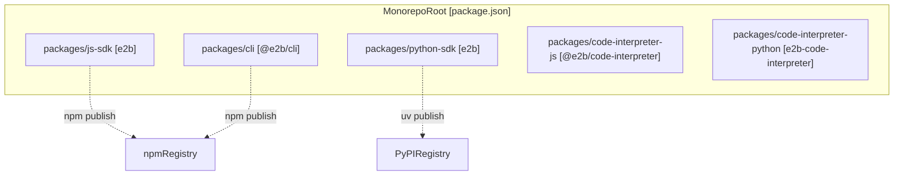
Sources: [package.json:5-19](), [packages/js-sdk/package.json:2-3](), [packages/python-sdk/pyproject.toml:2-3](), [packages/cli/package.json:2-3]()

Sources: [package.json:5-19](), [packages/js-sdk/package.json:2-3](), [packages/python-sdk/pyproject.toml:2-3](), [packages/cli/package.json:2-3]()

## Core Resources

The E2B platform exposes four primary resource types through its SDK client interfaces (`Sandbox`, `Template`, `Volume`, and `Secret`), which can be configured either via environment variables or explicitly through the `E2B` client class [packages/js-sdk/README.md:50-61](), [packages/python-sdk/README.md:47-57]().

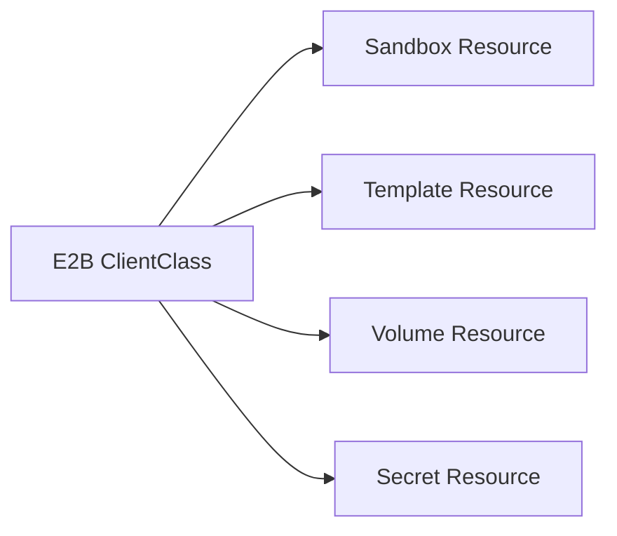
Sources: [packages/js-sdk/README.md:50-61](), [packages/python-sdk/README.md:47-57]()

Sources: [packages/js-sdk/README.md:50-61](), [packages/python-sdk/README.md:47-57]()

## Subsystem Navigation and Child Pages

As a parent overview page, this document summarizes the high-level architecture and structure. For detailed technical specifications, implementation details, and getting started guides, refer to the following child pages:

- **System Architecture**: For details on the client/control-plane/envd model, dual protocol communication (REST and ConnectRPC/HTTP2), and connection pool sharding, see [System Architecture](#1.1).
- **Package Structure**: For details on the monorepo workspace configuration, specifications, and publishing workflows, see [Package Structure](#1.2).
- **Getting Started**: For installation instructions, environment configuration (`E2B_API_KEY`, `E2B_DOMAIN`), and basic sandbox initialization examples in JavaScript and Python, see [Getting Started](#1.3).

Sources: [packages/js-sdk/README.md:50-67](), [packages/python-sdk/README.md:47-67]()

---

# Page: System Architecture

# System Architecture

<details>
<summary>Relevant source files</summary>

The following files were used as context for generating this wiki page:

- [packages/js-sdk/src/api/http2.ts](packages/js-sdk/src/api/http2.ts)
- [packages/js-sdk/src/api/index.ts](packages/js-sdk/src/api/index.ts)
- [packages/js-sdk/src/connectionConfig.ts](packages/js-sdk/src/connectionConfig.ts)
- [packages/js-sdk/src/envd/http2.ts](packages/js-sdk/src/envd/http2.ts)
- [packages/js-sdk/src/sandbox/index.ts](packages/js-sdk/src/sandbox/index.ts)
- [packages/js-sdk/src/undici.ts](packages/js-sdk/src/undici.ts)
- [packages/js-sdk/src/utils.ts](packages/js-sdk/src/utils.ts)
- [packages/js-sdk/tests/api/http2.test.ts](packages/js-sdk/tests/api/http2.test.ts)
- [packages/js-sdk/tests/connectionConfig.test.ts](packages/js-sdk/tests/connectionConfig.test.ts)
- [packages/js-sdk/tests/envd/http2.test.ts](packages/js-sdk/tests/envd/http2.test.ts)
- [packages/js-sdk/tests/undici.test.ts](packages/js-sdk/tests/undici.test.ts)
- [packages/js-sdk/tests/utils.test.ts](packages/js-sdk/tests/utils.test.ts)
- [packages/js-sdk/vitest.config.mts](packages/js-sdk/vitest.config.mts)
- [packages/python-sdk/e2b/api/__init__.py](packages/python-sdk/e2b/api/__init__.py)
- [packages/python-sdk/e2b/connection_config.py](packages/python-sdk/e2b/connection_config.py)
- [packages/python-sdk/e2b/sandbox/main.py](packages/python-sdk/e2b/sandbox/main.py)
- [packages/python-sdk/tests/test_connection_config.py](packages/python-sdk/tests/test_connection_config.py)

</details>


## Purpose and Scope

This document explains the high-level architecture of the E2B platform, focusing on the interaction between client SDKs, the E2B REST API (control plane), and the `envd` service (data plane) running within isolated sandboxes. It details the dual-protocol communication pattern (REST and ConnectRPC/HTTP2), connection pool sharding, and the authentication mechanisms that secure sandbox operations.

## Core Components

The E2B architecture follows a client-server model where SDKs act as clients to both a centralized management API and distributed runtime services.

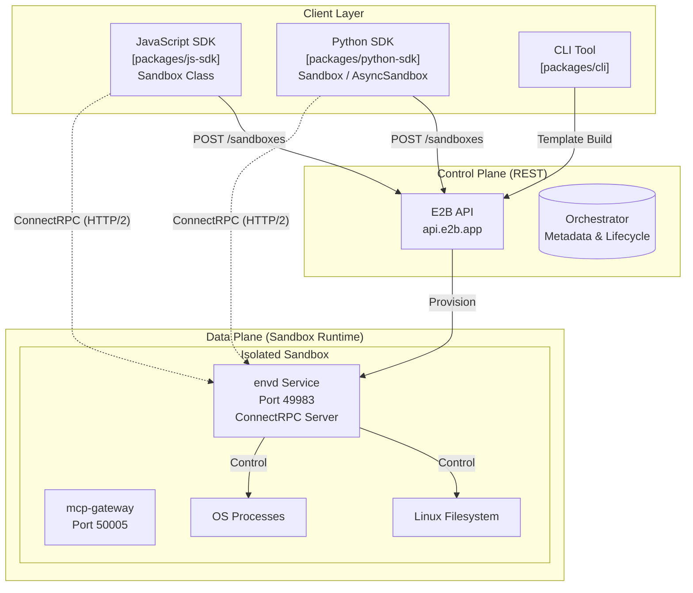

**Component Responsibilities:**

| Component | Role | Code Entity |
|-----------|------|-------------|
| **JavaScript SDK** | Node/Browser client | `class Sandbox` [packages/js-sdk/src/sandbox/index.ts:75]() |
| **Python SDK** | Sync/Async client | `class SandboxBase` [packages/python-sdk/e2b/sandbox/main.py:27]() |
| **E2B API** | Lifecycle management | `ApiClient` [packages/js-sdk/src/api/index.ts:90]() |
| **envd Service** | Runtime operations | `EnvdApiClient` [packages/js-sdk/src/sandbox/index.ts:121]() |
| **Connection Config** | Auth & URL resolution | `class ConnectionConfig` [packages/python-sdk/e2b/connection_config.py:154]() |

**Sources:** [packages/js-sdk/src/sandbox/index.ts:75](), [packages/python-sdk/e2b/sandbox/main.py:27](), [packages/js-sdk/src/api/index.ts:90](), [packages/python-sdk/e2b/connection_config.py:154]()

## Dual-Protocol Communication

E2B employs two distinct protocols to balance management overhead with runtime performance.

### 1. REST API (Control Plane)
The REST API handles sandbox lifecycle events. These operations are typically infrequent and require centralized coordination (e.g., checking team quotas, billing, and global metadata).

*   **Creation:** `POST /sandboxes` initializes the environment.
*   **Termination:** `DELETE /sandboxes/{id}` kills the instance.
*   **Maintenance:** Sandbox TTL updates and metadata lookups.

In the JS SDK, these are abstracted via OpenAPI-generated fetch clients [packages/js-sdk/src/api/index.ts:107]().

### 2. ConnectRPC / HTTP2 (Data Plane)
High-performance operations like filesystem I/O, shell command execution, and PTY interactions use **ConnectRPC** (a gRPC-compatible protocol) over HTTP/2. This communication happens directly between the SDK and the `envd` service running at `envdPort` (`49983`) [packages/js-sdk/src/sandbox/index.ts:114](). In Python, custom connection pool sharding (`envd_pool_shard`) distributes heavy streams across bounded connection pools to prevent HTTP/2 concurrency bottlenecks [packages/python-sdk/e2b/api/__init__.py:109-125]().

**Sources:** [packages/js-sdk/src/sandbox/index.ts:114](), [packages/js-sdk/src/api/index.ts:107](), [packages/python-sdk/e2b/api/__init__.py:109-125]()

## Connection Pool Sharding and Transports

To maintain optimal throughput over HTTP/2, both SDKs employ custom connection pool tuning and request multiplexing.

*   **JavaScript SDK (Undici Dispatchers):** The JS SDK uses custom `undici` agent configurations (`createEnvdFetch` and `createEnvdRpcFetch`) with HTTP/2 enabled (`allowH2: true`) and configurable limits for concurrent connections and inflight requests (`E2B_ENVD_RPC_CONNECTIONS`, `E2B_ENVD_INFLIGHT_REQUESTS`) [packages/js-sdk/src/envd/http2.ts:20-74]().
*   **Python SDK (Pool Sharding):** The Python SDK uses `pyqwest` transports where `envd_pool_shard` hashes the `E2b-Sandbox-Id` via CRC32 modulo `E2B_ENVD_POOL_SHARDS` to isolate long-running streams across a bounded set of underlying connections [packages/python-sdk/e2b/api/__init__.py:106-125]().

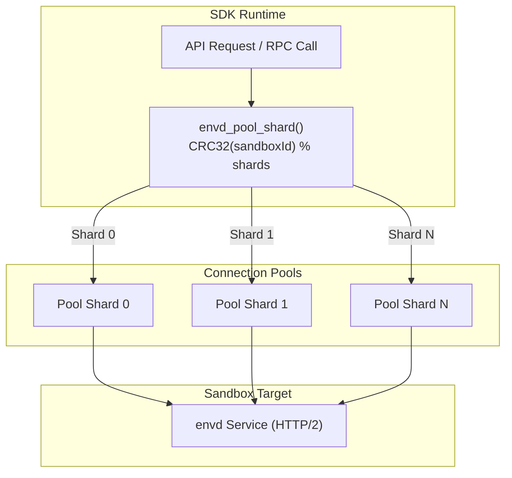

**Sources:** [packages/js-sdk/src/envd/http2.ts:20-74](), [packages/python-sdk/e2b/api/__init__.py:106-125]()

## Client Initialization and Data Flow

When a `Sandbox` instance is created, it initializes multiple sub-modules, each responsible for a specific domain of the sandbox runtime.

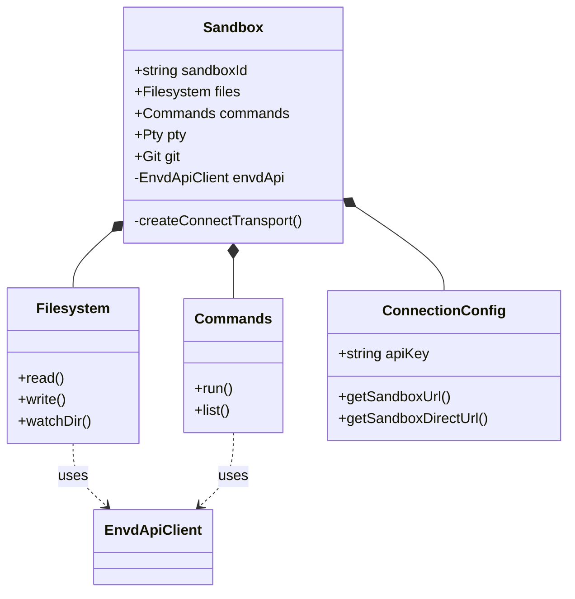

### Initialization Sequence
1.  **Config Resolution:** `ConnectionConfig` resolves the API key, domain, proxy settings, and environment variables [packages/python-sdk/e2b/connection_config.py:154]().
2.  **Transport Setup:** The JS SDK creates an `rpcTransport` using `createConnectTransport` with customized `fetch` redirects and header injection [packages/js-sdk/src/sandbox/index.ts:169-201]().
3.  **Header Injection:** All gRPC/ConnectRPC requests are patched to include `X-Access-Token` (when secured) and routing headers such as `E2b-Sandbox-Id` and `E2b-Sandbox-Port` [packages/js-sdk/src/sandbox/index.ts:162-191]().
4.  **Module Initialization:** The `Filesystem`, `Commands`, and `Pty` modules are instantiated with the configured transport and client stubs [packages/js-sdk/src/sandbox/index.ts:218-225]().

**Sources:** [packages/js-sdk/src/sandbox/index.ts:162-225](), [packages/python-sdk/e2b/connection_config.py:154]()

## Authentication and Security

E2B uses a multi-layered authentication approach to ensure that only authorized clients can manage or interact with sandboxes.

### 1. API Management Auth
Used for REST API calls (Control Plane).
*   **API Key:** Passed via `X-API-KEY` header [packages/js-sdk/src/api/index.ts:118]().
*   **Access Token:** Managed through configuration options for integration attribution and workload access.

### 2. Sandbox Runtime Auth
Used for ConnectRPC/envd calls (Data Plane).
*   **envdAccessToken:** A short-lived token generated per-sandbox session, passed via the `X-Access-Token` header [packages/js-sdk/src/sandbox/index.ts:190]().
*   **Traffic Token (`trafficAccessToken`):** Used to access restricted ports exposed by the sandbox [packages/js-sdk/src/sandbox/index.ts:112]().

### 3. File Signing
For secure file uploads and downloads, the SDK generates signed URLs via `getSignature` (JS) and `get_signature` (Python), combining operation types (`read`/`write`), usernames, and expiration timestamps [packages/python-sdk/e2b/sandbox/main.py:15]().

**Sources:** [packages/js-sdk/src/sandbox/index.ts:112](), [packages/js-sdk/src/sandbox/index.ts:190](), [packages/js-sdk/src/api/index.ts:118](), [packages/python-sdk/e2b/sandbox/main.py:15]()

## URL Resolution and Routing

The system uses a specific subdomain pattern to route traffic to the correct sandbox and port.

| URL Type | Pattern | Purpose |
|----------|---------|---------|
| **API URL** | `https://api.e2b.app` | REST Control Plane [packages/js-sdk/src/connectionConfig.ts:42]() |
| **Sandbox URL** | `https://sandbox.e2b.app` | Default gRPC routing [packages/js-sdk/src/connectionConfig.ts:48]() |
| **Direct URL** | `https://{port}-{sandboxId}.e2b.app` | Direct port access [packages/python-sdk/e2b/sandbox/main.py:53]() |
| **Local Debug** | `http://localhost:{envdPort}` | Local development [packages/js-sdk/src/connectionConfig.ts:163]() |

**Sources:** [packages/js-sdk/src/connectionConfig.ts:42-163](), [packages/python-sdk/e2b/sandbox/main.py:53]()

---

# Page: Package Structure

# Package Structure

<details>
<summary>Relevant source files</summary>

The following files were used as context for generating this wiki page:

- [.changeset/connectrpc-minor-bump.md](.changeset/connectrpc-minor-bump.md)
- [.changeset/undici-security-patch.md](.changeset/undici-security-patch.md)
- [codegen.Dockerfile](codegen.Dockerfile)
- [package.json](package.json)
- [packages/cli/CHANGELOG.md](packages/cli/CHANGELOG.md)
- [packages/cli/package.json](packages/cli/package.json)
- [packages/code-interpreter-python/CHANGELOG.md](packages/code-interpreter-python/CHANGELOG.md)
- [packages/code-interpreter-python/package.json](packages/code-interpreter-python/package.json)
- [packages/code-interpreter-python/pyproject.toml](packages/code-interpreter-python/pyproject.toml)
- [packages/code-interpreter-python/uv.lock](packages/code-interpreter-python/uv.lock)
- [packages/desktop-js/CHANGELOG.md](packages/desktop-js/CHANGELOG.md)
- [packages/desktop-js/package.json](packages/desktop-js/package.json)
- [packages/desktop-python/CHANGELOG.md](packages/desktop-python/CHANGELOG.md)
- [packages/desktop-python/package.json](packages/desktop-python/package.json)
- [packages/desktop-python/pyproject.toml](packages/desktop-python/pyproject.toml)
- [packages/desktop-python/uv.lock](packages/desktop-python/uv.lock)
- [packages/js-sdk/CHANGELOG.md](packages/js-sdk/CHANGELOG.md)
- [packages/js-sdk/package.json](packages/js-sdk/package.json)
- [packages/python-sdk/CHANGELOG.md](packages/python-sdk/CHANGELOG.md)
- [packages/python-sdk/package.json](packages/python-sdk/package.json)
- [packages/python-sdk/pyproject.toml](packages/python-sdk/pyproject.toml)
- [packages/python-sdk/uv.lock](packages/python-sdk/uv.lock)
- [pnpm-lock.yaml](pnpm-lock.yaml)
- [pnpm-workspace.yaml](pnpm-workspace.yaml)

</details>


This document describes the physical organization of the E2B monorepo, including all packages, their dependencies, and how they are managed and published. For information about the high-level system architecture and how these packages interact at runtime, see [System Architecture](#1.1). For details on development workflows and CI/CD processes, see [Monorepo Build System and Tooling](#7.1) and [CI/CD and Release Process](#7.2).

## Monorepo Overview

E2B uses a monorepo structure managed by **pnpm workspaces** at the root level `pnpm-workspace.yaml` [pnpm-workspace.yaml:1-3](). Individual package managers (pnpm for JavaScript/TypeScript, `uv` for Python) handle language-specific dependencies. The repository contains core SDKs, specialized application SDKs, command-line tools, shared specifications, and prebuilt templates.

**Diagram: Monorepo Layout and Workspace Mapping**

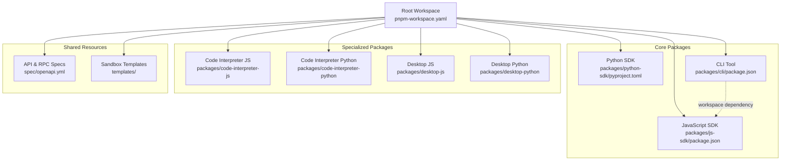

Sources: [package.json:1-18](), [pnpm-workspace.yaml:1-3](), [packages/js-sdk/package.json:1-17](), [packages/cli/package.json:83]()

## Core Packages

### JavaScript SDK (`packages/js-sdk`)

The JavaScript SDK is published as `e2b` on npm and provides the primary programmatic interface for creating and managing sandboxes [packages/js-sdk/package.json:2-4]().

| Property | Value |
|----------|-------|
| Package Name | `e2b` |
| Current Version | `2.49.1` |
| Main Entry | `dist/index.js` |
| Module Entry | `dist/index.mjs` |
| TypeScript Types | `dist/index.d.ts` |
| Build Tool | `tsdown` |
| Test Framework | `vitest` |
| Node Version | `>=20.18.1 <21 \|\| >=22` |

**Key Dependencies:**
- `@connectrpc/connect`: gRPC communication with Envd [packages/js-sdk/package.json:90]()
- `openapi-fetch`: REST API client generation [packages/js-sdk/package.json:96]()
- `dockerfile-ast`: Dockerfile parsing for template building [packages/js-sdk/package.json:94]()
- `tar`: File archiving for template uploads [packages/js-sdk/package.json:98]()

**Code Generation:**
Scripts in `packages/js-sdk/package.json` define the generation of API schema types from OpenAPI specifications (`openapi-typescript`) and Protocol Buffer definitions (`buf generate`) [packages/js-sdk/package.json:30-36]().

Sources: [packages/js-sdk/package.json:1-110]()

### Python SDK (`packages/python-sdk`)

The Python SDK is published as `e2b` on PyPI and provides both synchronous and asynchronous APIs for sandbox management. It uses `uv` as the primary build and dependency manager [packages/python-sdk/pyproject.toml:57-58]().

| Property | Value |
|----------|-------|
| Package Name | `e2b` |
| Current Version | `2.49.1` |
| Build Backend | `uv_build` |
| Python Version | `>=3.10` |

**Key Dependencies:**
- `httpx`: HTTP client for API communication [packages/python-sdk/pyproject.toml:13]()
- `connectrpc`: Connect-RPC support for gRPC runtime operations [packages/python-sdk/pyproject.toml:22]()
- `dockerfile-parse`: Dockerfile parsing for templates [packages/python-sdk/pyproject.toml:20]()
- `protobuf-py`: Protocol Buffer support [packages/python-sdk/pyproject.toml:12]()

Sources: [packages/python-sdk/pyproject.toml:1-63](), [packages/python-sdk/package.json:1-14]()

### CLI (`packages/cli`)

The CLI tool is published as `@e2b/cli` on npm and provides command-line interfaces for template and sandbox management [packages/cli/package.json:2-4]().

| Property | Value |
|----------|-------|
| Package Name | `@e2b/cli` |
| Current Version | `2.19.0` |
| Binary Name | `e2b` |
| Build Tool | `tsdown` |
| Node Version | `>=20.18.1 <21 \|\| >=22.9.0` |

**Architecture:**
The CLI is built as a wrapper around the JavaScript SDK (`e2b`), importing it as a workspace dependency [packages/cli/package.json:83]().

Sources: [packages/cli/package.json:1-94]()

## Specialized Packages (`code-interpreter` and `desktop`)

In addition to core SDKs, the repository contains packages tailored for specific domain workflows across both JavaScript and Python ecosystems:
- **Code Interpreter SDKs (`packages/code-interpreter-js` and `packages/code-interpreter-python`)**: Provide Jupyter-style code execution environments.
- **Desktop SDKs (`packages/desktop-js` and `packages/desktop-python`)**: Support launching GUI applications, remote desktop streaming, and mouse/keyboard automation within sandboxes.

Sources: [pnpm-lock.yaml:186-218]()

## Specifications and Templates (`spec/` and `templates/`)

- `spec/`: Contains shared API definitions (`openapi.yml`), protocol buffer schemas (`envd/*.proto`), and configuration files (`envd.yaml`, `mcp-server.json`) used by the code generation pipeline.
- `templates/`: Contains prebuilt sandbox templates (such as base images and custom runtimes) and GitHub workflows used to build and publish them.

Sources: [packages/js-sdk/package.json:31-35]()

## Package Management and Publishing

### Workspace Definition and Version Synchronization
The root `package.json` configures pnpm workspaces and utilizes `changesets` for cross-package versioning and release coordination [package.json:1-18]().

**Publishing Pipeline:**
- **npm Packages (`e2b`, `@e2b/cli`)**: Published via `changeset publish` [package.json:6](). Build scripts compile TypeScript packages using `tsdown` prior to publishing [packages/js-sdk/package.json:26-27](), [packages/cli/package.json:38-39]().
- **PyPI Package (`e2b`)**: Published using `uv` via custom publishing workflows and helper scripts [packages/python-sdk/package.json:9](), [package.json:7]().

**Diagram: Code Entity Space to Package Publishing Flow**

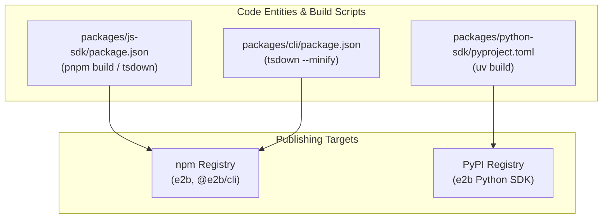

Sources: [package.json:5-7](), [packages/js-sdk/package.json:25-27](), [packages/cli/package.json:37-39](), [packages/python-sdk/package.json:5-9]()

---

# Page: Getting Started

# Getting Started

<details>
<summary>Relevant source files</summary>

The following files were used as context for generating this wiki page:

- [CONTRIBUTING.md](CONTRIBUTING.md)
- [README.md](README.md)
- [packages/cli/README.md](packages/cli/README.md)
- [packages/js-sdk/README.md](packages/js-sdk/README.md)
- [packages/js-sdk/src/api/index.ts](packages/js-sdk/src/api/index.ts)
- [packages/js-sdk/src/connectionConfig.ts](packages/js-sdk/src/connectionConfig.ts)
- [packages/js-sdk/tests/connectionConfig.test.ts](packages/js-sdk/tests/connectionConfig.test.ts)
- [packages/python-sdk/README.md](packages/python-sdk/README.md)
- [packages/python-sdk/e2b/api/__init__.py](packages/python-sdk/e2b/api/__init__.py)
- [packages/python-sdk/e2b/connection_config.py](packages/python-sdk/e2b/connection_config.py)
- [packages/python-sdk/tests/test_connection_config.py](packages/python-sdk/tests/test_connection_config.py)

</details>


## Purpose and Scope
This page details the initialization, installation, environment setup, and configuration mechanisms required to bootstrap the E2B SDK in JavaScript/TypeScript and Python environments. It covers the resolution hierarchy governed by `ConnectionConfig`, authentication via environment variables (`E2B_API_KEY`, `E2B_DOMAIN`), explicit client configuration using the `E2B` client class and `ClientFactory`, and first-run sandbox execution patterns.

Sources: [README.md:20-63](), [packages/js-sdk/src/connectionConfig.ts:19-103](), [packages/python-sdk/e2b/connection_config.py:43-91]()

---

## 1. Installation

E2B provides official packages for JavaScript/TypeScript (`e2b`) on npm and Python (`e2b`) on PyPI. 

To install the core SDKs:

* **JavaScript / TypeScript**:
  ```bash
  npm i e2b
  ```
* **Python**:
  ```bash
  pip install e2b
  ```

Sources: [README.md:24-34](), [packages/js-sdk/README.md:24-28](), [packages/python-sdk/README.md:21-25]()

---

## 2. API Keys and Environment Variables

Authentication and connection routing rely on standard environment variables parsed during client construction and `ConnectionConfig` initialization.

### Core Environment Variables
* `E2B_API_KEY`: The primary API key required to authenticate requests against the control plane. Obtained from the E2B dashboard.
* `E2B_DOMAIN`: The base domain for E2B services (defaults to `e2b.app` or `e2b.dev`).
* `E2B_API_URL`: Override URL for the control-plane API (defaults to `https://api.<domain>`).
* `E2B_SANDBOX_URL`: Override template/sandbox routing URL.
* `E2B_DEBUG`: When set to `true`, forces local loopback connections (e.g., `http://localhost:49983`) for envd interaction.
* `E2B_ENVD_POOL_SHARDS`: Configures the number of HTTP/2 connection pool shards for high-concurrency stream traffic (Python SDK).

```
+-----------------------------------------------------------------+
|                       Environment Space                         |
|  E2B_API_KEY, E2B_DOMAIN, E2B_API_URL, E2B_DEBUG, E2B_SANDBOX   |
+-----------------------------------------------------------------+
                                 |
                                 v
+-----------------------------------------------------------------+
|                  Code Entity Space (Resolution)                 |
|  ConnectionConfig (packages/js-sdk/src/connectionConfig.ts)     |
|  ConnectionConfig (packages/python-sdk/e2b/connection_config.py)|
+-----------------------------------------------------------------+
```

Sources: [README.md:36-43](), [packages/js-sdk/src/connectionConfig.ts:19-103](), [packages/python-sdk/e2b/connection_config.py:43-91](), [packages/python-sdk/README.md:73-77]()

---

## 3. Explicit Configuration via the E2B Client Class

By default, top-level resource classes (`Sandbox`, `Volume`, `Template`, `Secret`) read their configuration directly from environment variables. When a process requires isolated configurations—such as handling multiple API keys or distinct domains concurrently—you instantiate the `E2B` client class.

The `E2B` client wraps `ClientFactory` and binds specific `ConnectionOpts` (JS) or `ApiParams` (Python) to all resource subclasses it exposes. Per-call options take precedence over client-bound options, which in turn override environment variables.

### JavaScript Client Example
```ts
import { E2B } from 'e2b'

const client = new E2B({ apiKey: 'e2b_***', domain: 'e2b.dev' })

const sandbox = await client.Sandbox.create()
const volume = await client.Volume.create('my-volume')
```

### Python Client Example
```py
from e2b import E2B

client = E2B(api_key="e2b_***", domain="e2b.dev")

sandbox = client.Sandbox.create()
volume = client.Volume.create("my-volume")
```

```
Title: "Client Configuration and Resource Binding Architecture"
graph TD
    A["EnvironmentVariables"] -->|Fallback| C["ConnectionConfig"]
    B["ExplicitConnectionOpts / ApiParams"] -->|Override| C
    D["E2BClientClass"] -->|Binds| E["ClientFactory"]
    E -->|Exposes| F["SandboxResource"]
    E -->|Exposes| G["VolumeResource"]
    C -->|Instantiates| H["ApiClient"]
    F -->|Uses| H
    G -->|Uses| H
```

Sources: [packages/js-sdk/README.md:48-68](), [packages/python-sdk/README.md:45-67](), [packages/python-sdk/e2b/connection_config.py:104-153](), [packages/js-sdk/src/api/index.ts:90-138]()

---

## 4. First Sandbox Examples

Once authenticated and configured, spawning a sandbox and executing commands follows a consistent pattern across runtimes.

### JavaScript / TypeScript Example
```ts
import Sandbox from 'e2b'

const sandbox = await Sandbox.create()
const result = await sandbox.commands.run('echo "Hello from E2B!"')
console.log(result.stdout) // Hello from E2B!
```

### Python Example
```py
from e2b import Sandbox

with Sandbox.create() as sandbox:
    result = sandbox.commands.run('echo "Hello from E2B!"')
    print(result.stdout)  # Hello from E2B!
```

```
Title: "Sandbox Lifecycle Initialization Flow"
sequenceDiagram
    participant UserCode as "User Script"
    participant SDKClass as "Sandbox.create()"
    participant ApiClient as "ApiClient"
    participant ControlPlane as "E2B Control Plane"
    
    UserCode->>SDKClass: Invoke create()
    SDKClass->>ApiClient: POST /sandboxes
    ApiClient->>ControlPlane: HTTP Request (with X-API-KEY)
    ControlPlane-->>ApiClient: Sandbox ID & Metadata Response
    ApiClient-->>SDKClass: Return Sandbox Instance
    SDKClass-->>UserCode: Connected Sandbox Handle
```

Sources: [README.md:46-63](), [packages/js-sdk/src/api/index.ts:90-138](), [packages/python-sdk/e2b/api/__init__.py:14-24]()

---

# Page: JavaScript SDK

# JavaScript SDK

<details>
<summary>Relevant source files</summary>

The following files were used as context for generating this wiki page:

- [packages/js-sdk/src/api/http2.ts](packages/js-sdk/src/api/http2.ts)
- [packages/js-sdk/src/envd/http2.ts](packages/js-sdk/src/envd/http2.ts)
- [packages/js-sdk/src/sandbox/index.ts](packages/js-sdk/src/sandbox/index.ts)
- [packages/js-sdk/src/undici.ts](packages/js-sdk/src/undici.ts)
- [packages/js-sdk/src/utils.ts](packages/js-sdk/src/utils.ts)
- [packages/js-sdk/tests/api/http2.test.ts](packages/js-sdk/tests/api/http2.test.ts)
- [packages/js-sdk/tests/envd/http2.test.ts](packages/js-sdk/tests/envd/http2.test.ts)
- [packages/js-sdk/tests/undici.test.ts](packages/js-sdk/tests/undici.test.ts)
- [packages/js-sdk/tests/utils.test.ts](packages/js-sdk/tests/utils.test.ts)
- [packages/js-sdk/vitest.config.mts](packages/js-sdk/vitest.config.mts)
- [packages/python-sdk/e2b/sandbox/main.py](packages/python-sdk/e2b/sandbox/main.py)

</details>


The JavaScript SDK (`e2b`) provides a TypeScript and JavaScript client library for creating and managing isolated cloud sandboxes, executing shell commands, operating on remote filesystems, and integrating with AI workflows. This parent page provides a high-level overview of the SDK's resource classes, module exports, multi-runtime support, and architecture. For deep technical details, refer to the child sections linked below.

Sources: [packages/js-sdk/src/sandbox/index.ts:38-78]()

## Module Exports and Resource Classes

The core entry point for the SDK is the `Sandbox` class, which extends `SandboxApi` [packages/js-sdk/src/sandbox/index.ts:75-76](). It aggregates specialized resource modules such as `Filesystem`, `Commands`, `Pty`, and `Git` [packages/js-sdk/src/sandbox/index.ts:83-97](). Communication with sandboxes leverages a dual-protocol architecture: REST APIs handle lifecycle management via `EnvdApiClient` [packages/js-sdk/src/sandbox/index.ts:10-121](), while ConnectRPC/HTTP2 transports manage runtime streams and RPCs via `createConnectTransport` [packages/js-sdk/src/sandbox/index.ts:1-169]().

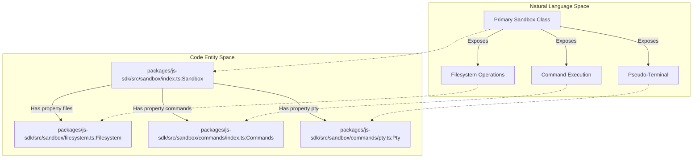
Sources: [packages/js-sdk/src/sandbox/index.ts:75-97]()

## Runtime Support

The SDK is designed to run across multiple JavaScript runtimes including Node.js, Bun, Deno, Cloudflare Workers (`workerd`), Vercel Edge, and browsers. The runtime detection utility identifies the active execution environment and configures appropriate transport layers, HTTP/2 dispatchers (such as `undici` in Node.js environments), and WebCrypto APIs [packages/js-sdk/src/utils.ts:16-61]().

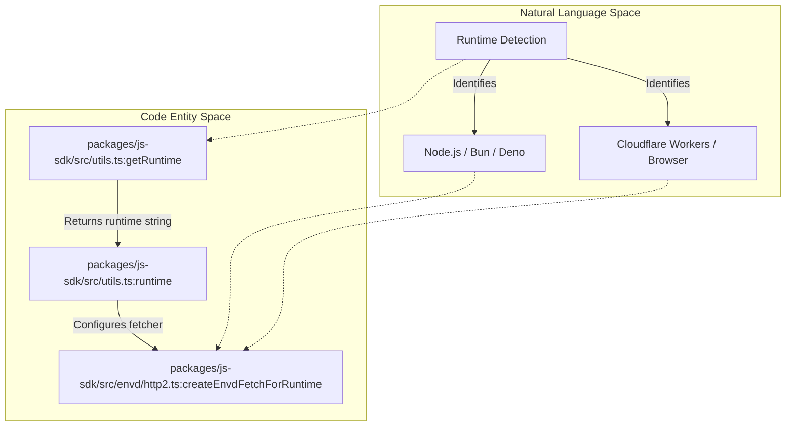
Sources: [packages/js-sdk/src/utils.ts:16-52](), [packages/js-sdk/src/envd/http2.ts:25-37]()

## Child Pages Overview

- **Sandbox Management**: See [Sandbox Management](#2.1) for details on the `Sandbox` class and `SandboxApi` lifecycle methods (create, connect, fork, pause/resume, kill, snapshots, timeouts, network options, and MCP integration).
- **Filesystem Operations**: See [Filesystem Operations](#2.2) for details on the `Filesystem` module covering file reading/writing, streams, blobs, multipart uploads, gzip compression, and watch handles.
- **Command Execution and PTY**: See [Command Execution and PTY](#2.3) for details on running shell commands, `CommandHandle`, streaming stdout/stderr, stdin piping, and `Pty` terminal management.
- **Error Handling and Types**: See [Error Handling and Types](#2.4) for the error hierarchy (`SandboxError`, `TimeoutError`, `AuthenticationError`, `RateLimitError`, `ServiceBusyError`) and exception mapping.
- **Connection Configuration and the E2B Client**: See [Connection Configuration and the E2B Client](#2.5) for `ConnectionConfig`, `ClientFactory`, API parameters precedence, timeouts, proxies, and retry mechanisms.
- **Git Integration**: See [Git Integration](#2.6) for repository operations inside sandboxes using the `Git` module.

Sources: [packages/js-sdk/src/sandbox/index.ts:75-98]()

---

# Page: Sandbox Management

# Sandbox Management

<details>
<summary>Relevant source files</summary>

The following files were used as context for generating this wiki page:

- [packages/js-sdk/src/index.ts](packages/js-sdk/src/index.ts)
- [packages/js-sdk/src/sandbox/index.ts](packages/js-sdk/src/sandbox/index.ts)
- [packages/js-sdk/src/sandbox/sandboxApi.ts](packages/js-sdk/src/sandbox/sandboxApi.ts)
- [packages/python-sdk/e2b/__init__.py](packages/python-sdk/e2b/__init__.py)
- [packages/python-sdk/e2b/sandbox/main.py](packages/python-sdk/e2b/sandbox/main.py)
- [packages/python-sdk/e2b/sandbox/sandbox_api.py](packages/python-sdk/e2b/sandbox/sandbox_api.py)
- [packages/python-sdk/e2b/sandbox_async/main.py](packages/python-sdk/e2b/sandbox_async/main.py)
- [packages/python-sdk/e2b/sandbox_async/paginator.py](packages/python-sdk/e2b/sandbox_async/paginator.py)
- [packages/python-sdk/e2b/sandbox_async/sandbox_api.py](packages/python-sdk/e2b/sandbox_async/sandbox_api.py)
- [packages/python-sdk/e2b/sandbox_sync/main.py](packages/python-sdk/e2b/sandbox_sync/main.py)
- [packages/python-sdk/e2b/sandbox_sync/paginator.py](packages/python-sdk/e2b/sandbox_sync/paginator.py)
- [packages/python-sdk/e2b/sandbox_sync/sandbox_api.py](packages/python-sdk/e2b/sandbox_sync/sandbox_api.py)

</details>


This document covers the `Sandbox` class and `SandboxApi` layer across the JavaScript/TypeScript and Python SDKs. These modules provide the primary programming interface for creating, connecting to, forking, monitoring, and managing secure cloud environments (`Sandbox` in JS [packages/js-sdk/src/sandbox/index.ts:75-78](), `Sandbox` / `AsyncSandbox` in Python [packages/python-sdk/e2b/sandbox_sync/main.py:49-52](), [packages/python-sdk/e2b/sandbox_async/main.py:50-53]()). The management system coordinates instance-level runtime operations with `envd` via ConnectRPC/HTTP2 and global lifecycle workflows through control-plane REST endpoints via `SandboxApi` [packages/js-sdk/src/sandbox/sandboxApi.ts:1-21](), [packages/python-sdk/e2b/sandbox_async/sandbox_api.py:70-73]().

## Core Architecture and Class Hierarchy

The sandbox management system separates high-level instance operations (`Sandbox`, `AsyncSandbox`) from low-level API orchestration (`SandboxApi`). 

### Class Hierarchy and Communication Flow

The following diagram bridges natural language descriptions to code entities, showing how the `Sandbox` class utilizes `SandboxApi`, `ApiClient`, and `EnvdApiClient` to communicate over REST and ConnectRPC channels.

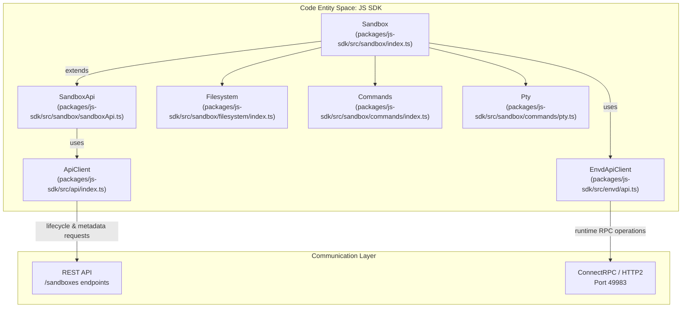

**Sources:** [packages/js-sdk/src/sandbox/index.ts:75-122](), [packages/js-sdk/src/sandbox/sandboxApi.ts:1-21]()

### Key Properties Table

| Property Name | JS Type | Python Type | Description & Code Pointer |
| :--- | :--- | :--- | :--- |
| `sandboxId` | `string` | `str` | Unique sandbox identifier [packages/js-sdk/src/sandbox/index.ts:102](), [packages/python-sdk/e2b/sandbox/main.py:96-100]() |
| `sandboxDomain` | `string` | `str` | Host domain for sandbox connections [packages/js-sdk/src/sandbox/index.ts:107](), [packages/python-sdk/e2b/sandbox/main.py:84-86]() |
| `files` | `Filesystem` | `Filesystem` | Filesystem operations module [packages/js-sdk/src/sandbox/index.ts:83](), [packages/python-sdk/e2b/sandbox_sync/main.py:73-77]() |
| `commands` | `Commands` | `Commands` | Process execution module [packages/js-sdk/src/sandbox/index.ts:87](), [packages/python-sdk/e2b/sandbox_sync/main.py:80-84]() |
| `pty` | `Pty` | `Pty` | Pseudo-terminal control module [packages/js-sdk/src/sandbox/index.ts:91](), [packages/python-sdk/e2b/sandbox_sync/main.py:87-91]() |
| `envdAccessToken` | `string?` | `str?` | Secure `envd` authentication token [packages/js-sdk/src/sandbox/index.ts:118](), [packages/python-sdk/e2b/sandbox/main.py:59-62]() |
| `trafficAccessToken` | `string?` | `str?` | Restricted traffic access token [packages/js-sdk/src/sandbox/index.ts:112](), [packages/python-sdk/e2b/sandbox/main.py:80-82]() |

**Sources:** [packages/js-sdk/src/sandbox/index.ts:100-120](), [packages/python-sdk/e2b/sandbox/main.py:58-100]()

---

## Sandbox Creation and Initialization

Creating a sandbox involves validating template references, allocating infrastructure via the control-plane REST API, setting up authentication tokens, and instantiating runtime communication stubs.

### Creation Sequence

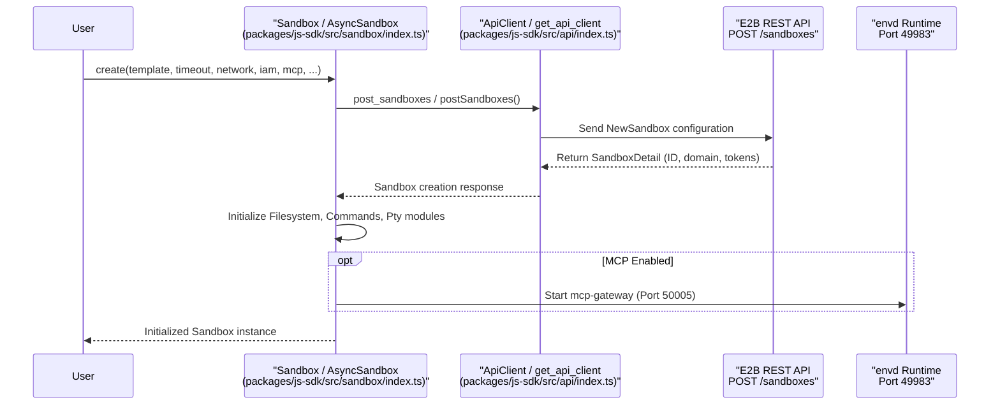

**Sources:** [packages/python-sdk/e2b/sandbox_sync/sandbox_api.py:209-230](), [packages/python-sdk/e2b/sandbox_async/sandbox_api.py:210-231]()

### Configuration Options (`SandboxOpts`)

When invoking `Sandbox.create()` (JS) or `Sandbox.create()` / `AsyncSandbox.create()` (Python), several options control execution parameters:
- **`template`**: Template name or ID (defaults to `'base'` or `'mcp-gateway'` if MCP servers are configured) [packages/js-sdk/src/sandbox/index.ts:76-77](), [packages/python-sdk/e2b/sandbox/main.py:32-33]().
- **`timeout`** / **`timeoutMs`**: Sandbox lifetime in seconds or milliseconds (default: `300` seconds / `300000` ms) [packages/js-sdk/src/sandbox/index.ts:78](), [packages/python-sdk/e2b/sandbox/main.py:30]().
- **`metadata`**: Custom string key-value pairs assigned to the sandbox for filtering [packages/python-sdk/e2b/sandbox_sync/main.py:171-172]().
- **`envs`**: Custom environment variables injected into the sandbox environment [packages/python-sdk/e2b/sandbox_sync/main.py:173-174]().
- **`secure`**: Boolean indicating whether `envd` requires access tokens (`true` by default) [packages/python-sdk/e2b/sandbox_sync/main.py:175-176]().
- **`allowInternetAccess`**: Boolean toggle for internet access (equivalent to configuring `denyOut` with `['0.0.0.0/0']` when `false`) [packages/python-sdk/e2b/sandbox_sync/main.py:177-178]().

**Sources:** [packages/js-sdk/src/sandbox/sandboxApi.ts:1-50](), [packages/python-sdk/e2b/sandbox_sync/main.py:167-183]()

---

## Lifecycle Management and Operations

Sandboxes move through distinct lifecycle states: `running`, `paused`, and `killed`.

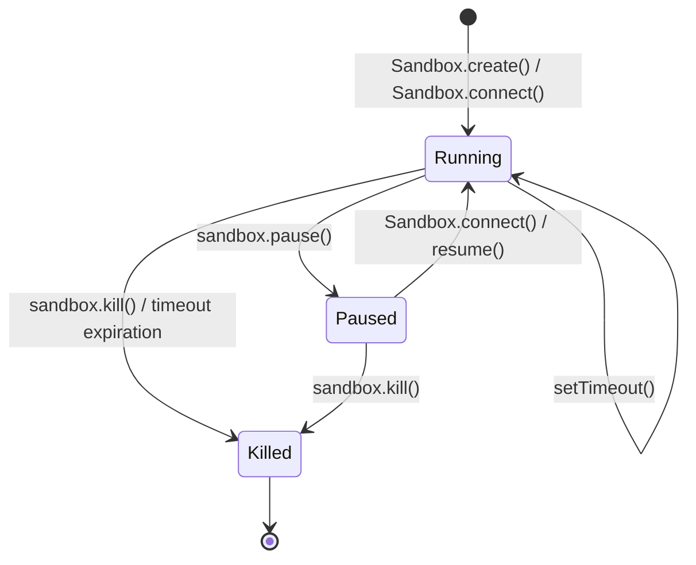

**Sources:** [packages/python-sdk/e2b/sandbox/sandbox_api.py:20-23](), [packages/python-sdk/e2b/sandbox_sync/sandbox_api.py:135-159]()

### Lifecycle Methods

- **`connect()` / `Sandbox.connect(sandboxId)`**: Attaches to an existing running or paused sandbox instance. Resumes paused sandboxes automatically [packages/python-sdk/e2b/sandbox_sync/sandbox_api.py:19-21]().
- **`pause()`**: Suspends execution of the sandbox, saving its filesystem and optionally memory state [packages/python-sdk/e2b/sandbox_sync/sandbox_api.py:21-22]().
- **`kill()`**: Terminating method that destroys the sandbox instance and releases all underlying container and network resources (`DELETE /sandboxes/{sandbox_id}`) [packages/python-sdk/e2b/sandbox_sync/sandbox_api.py:135-159]().
- **`setTimeout(timeout)`**: Extends or updates the active timeout duration of the sandbox (`POST /sandboxes/{sandbox_id}/timeout`) [packages/python-sdk/e2b/sandbox_sync/sandbox_api.py:161-185]().
- **`fork()`**: Clones an existing sandbox state into a new isolated sandbox instance (`POST /sandboxes/{sandbox_id}/fork`) [packages/python-sdk/e2b/sandbox_sync/sandbox_api.py:20-21]().
- **`snapshot()`**: Creates a reusable template snapshot from the sandbox filesystem state (`POST /sandboxes/{sandbox_id}/snapshots`) [packages/python-sdk/e2b/sandbox_sync/sandbox_api.py:21-22]().

**Sources:** [packages/python-sdk/e2b/sandbox_sync/sandbox_api.py:14-25](), [packages/python-sdk/e2b/sandbox_async/sandbox_api.py:14-25]()

---

## Network Egress Control and IAM Options

E2B supports sophisticated network egress filtering and workload identity management.

### Network Configuration (`SandboxNetworkOpts`)

Outbound traffic can be restricted using `SandboxNetworkOpts`:
- **`allowOut` / `denyOut`**: Static CIDR lists or dynamic callables receiving `SandboxNetworkSelectorContext` (`all_traffic`, `rules`) [packages/js-sdk/src/sandbox/sandboxApi.ts:134-149](), [packages/python-sdk/e2b/sandbox/sandbox_api.py:197-219]().
- **`rules`**: Per-domain request transforms (`SandboxNetworkRules`). Rules support header injection and placeholder evaluation via `SandboxNetworkTransformContext` [packages/js-sdk/src/sandbox/sandboxApi.ts:47-121](), [packages/python-sdk/e2b/sandbox/sandbox_api.py:104-184]().
- **`egressProxy`**: Configuration for tunneling sandbox TCP connections through an external SOCKS5 proxy (`SandboxEgressProxyOpts`) [packages/js-sdk/src/sandbox/sandboxApi.ts:176-200](), [packages/python-sdk/e2b/sandbox/sandbox_api.py:221-250]().

### Workload Identity (`SandboxIamOpts`)

IAM options allow registering workload identity tokens (e.g., AWS IAM tokens) that are securely minted and injected by the egress proxy upon request matching [packages/js-sdk/src/sandbox/sandboxApi.ts:63-80](), [packages/python-sdk/e2b/sandbox/sandbox_api.py:117-144]().

**Sources:** [packages/js-sdk/src/sandbox/sandboxApi.ts:47-202](), [packages/python-sdk/e2b/sandbox/sandbox_api.py:104-250]()

---

## Model Context Protocol (MCP) Integration

The SDK supports configuring Model Context Protocol servers natively during sandbox creation.

- **`McpServer`**: Combines base MCP server definitions with dynamic GitHub-based MCP servers (`GitHubMcpServer`) [packages/js-sdk/src/sandbox/sandboxApi.ts:23-44](), [packages/python-sdk/e2b/sandbox/sandbox_api.py:76-101]().
- **Gateway Template**: When MCP servers are requested, the sandbox defaults to the `mcp-gateway` template [packages/js-sdk/src/sandbox/index.ts:77](), [packages/python-sdk/e2b/sandbox/main.py:33]().
- **Token Management**: A gateway access token (`GATEWAY_ACCESS_TOKEN`) is automatically provisioned and managed inside the sandbox at `/etc/mcp-gateway/.token`.

**Sources:** [packages/js-sdk/src/sandbox/sandboxApi.ts:23-44](), [packages/python-sdk/e2b/sandbox/sandbox_api.py:76-101]()

---

## Paginated Listing and Metrics APIs

### Paginated Listing (`SandboxPaginator` / `AsyncSandboxPaginator`)

Sandboxes can be queried and listed using paginator classes supporting filtering by state, metadata, and creation timestamp (`get_v2_sandboxes`) [packages/python-sdk/e2b/sandbox_sync/paginator.py:23-103](), [packages/python-sdk/e2b/sandbox_async/paginator.py:23-103]().

```python
paginator = Sandbox.list(query=SandboxQuery(state=[SandboxState.RUNNING]))
while paginator.has_next:
    sandboxes = paginator.next_items()
```

### Metrics (`getMetrics()`)

Sandbox resource usage metrics are retrieved via `getMetrics()` (`GET /sandboxes/{sandbox_id}/metrics`), returning CPU percentage, memory consumption in bytes, and disk usage [packages/python-sdk/e2b/sandbox_async/sandbox_api.py:17-18]().

**Sources:** [packages/python-sdk/e2b/sandbox_sync/paginator.py:23-103](), [packages/python-sdk/e2b/sandbox_async/paginator.py:23-103]()

---

# Page: Filesystem Operations

# Filesystem Operations

<details>
<summary>Relevant source files</summary>

The following files were used as context for generating this wiki page:

- [packages/js-sdk/src/envd/filesystem/filesystem_pb.ts](packages/js-sdk/src/envd/filesystem/filesystem_pb.ts)
- [packages/js-sdk/src/envd/schema.gen.ts](packages/js-sdk/src/envd/schema.gen.ts)
- [packages/js-sdk/src/sandbox/filesystem/index.ts](packages/js-sdk/src/sandbox/filesystem/index.ts)
- [packages/js-sdk/src/sandbox/filesystem/watchHandle.ts](packages/js-sdk/src/sandbox/filesystem/watchHandle.ts)
- [packages/js-sdk/tests/sandbox/commands/envVars.test.ts](packages/js-sdk/tests/sandbox/commands/envVars.test.ts)
- [packages/js-sdk/tests/sandbox/files/signing.test.ts](packages/js-sdk/tests/sandbox/files/signing.test.ts)
- [packages/js-sdk/tests/sandbox/files/write.test.ts](packages/js-sdk/tests/sandbox/files/write.test.ts)
- [packages/js-sdk/tests/sandbox/internetAccess.test.ts](packages/js-sdk/tests/sandbox/internetAccess.test.ts)
- [packages/js-sdk/tests/sandbox/secure.test.ts](packages/js-sdk/tests/sandbox/secure.test.ts)
- [packages/python-sdk/e2b/sandbox/filesystem/filesystem.py](packages/python-sdk/e2b/sandbox/filesystem/filesystem.py)
- [packages/python-sdk/e2b/sandbox/filesystem/watch_handle.py](packages/python-sdk/e2b/sandbox/filesystem/watch_handle.py)
- [packages/python-sdk/e2b/sandbox_async/filesystem/filesystem.py](packages/python-sdk/e2b/sandbox_async/filesystem/filesystem.py)
- [packages/python-sdk/e2b/sandbox_sync/filesystem/filesystem.py](packages/python-sdk/e2b/sandbox_sync/filesystem/filesystem.py)
- [packages/python-sdk/tests/async/sandbox_async/commands/test_env_vars.py](packages/python-sdk/tests/async/sandbox_async/commands/test_env_vars.py)
- [packages/python-sdk/tests/async/sandbox_async/files/test_write.py](packages/python-sdk/tests/async/sandbox_async/files/test_write.py)
- [packages/python-sdk/tests/sync/sandbox_sync/commands/test_env_vars.py](packages/python-sdk/tests/sync/sandbox_sync/commands/test_env_vars.py)
- [packages/python-sdk/tests/sync/sandbox_sync/files/test_write.py](packages/python-sdk/tests/sync/sandbox_sync/files/test_write.py)
- [spec/envd/envd.yaml](spec/envd/envd.yaml)
- [spec/envd/filesystem/filesystem.proto](spec/envd/filesystem/filesystem.proto)

</details>


The Filesystem module provides comprehensive capabilities for reading, writing, watching, and managing files and directories within E2B sandboxes. It implements a dual-protocol communication model: REST endpoints handle high-throughput file content transfers (`/files`), while ConnectRPC services handle structured metadata operations, directory management, and real-time event streaming (`filesystem.Filesystem`).

## Architecture and Communication Protocols

The Filesystem module delegates operations between REST and gRPC/ConnectRPC depending on whether the payload is content data or metadata.

**Diagram: Filesystem Protocol Routing**

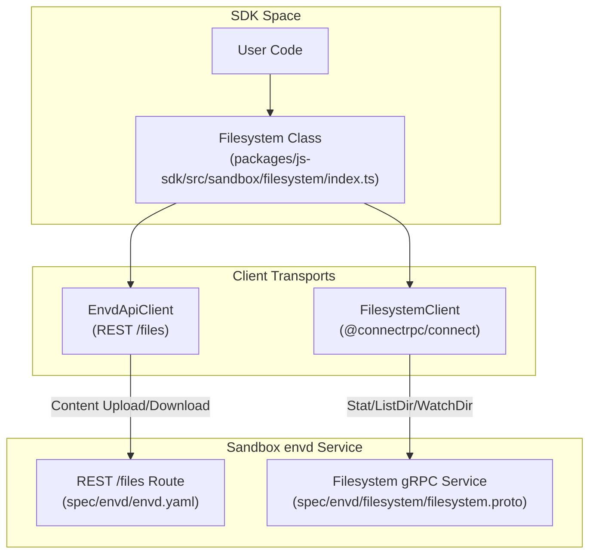

**Protocol Operation Routing Table**

| Operation | Protocol | Code Entity / Route | Purpose |
|-----------|----------|---------------------|---------|
| Read File | REST (GET) | `GET /files` | Streaming file contents |
| Write File | REST (POST) | `POST /files` | Multipart/octet-stream uploads with parent directory auto-creation |
| Stat / Exists | gRPC | `Filesystem.Stat` | Low-latency file/directory metadata query |
| List Directory | gRPC | `Filesystem.ListDir` | Recursive or flat directory listing |
| Make Directory | gRPC | `Filesystem.MakeDir` | Create directory structure |
| Remove / Move | gRPC | `Filesystem.Remove`, `Filesystem.Move` | File manipulation |
| Watch Directory | gRPC Stream | `Filesystem.WatchDir` | Real-time filesystem events |

Sources: `[packages/js-sdk/src/sandbox/filesystem/index.ts:1-37]`, `[spec/envd/filesystem/filesystem.proto:7-20]`, `[spec/envd/envd.yaml:43-125]`

---

## File Content Operations

File contents are transferred via REST to leverage standard HTTP chunked streaming, compression, and multipart form encoding.

### Reading Files

The `read()` method supports multiple return formats (`text`, `bytes`, and `stream`) and options for gzip compression and idle timeouts.

**Diagram: Read Request Flow**

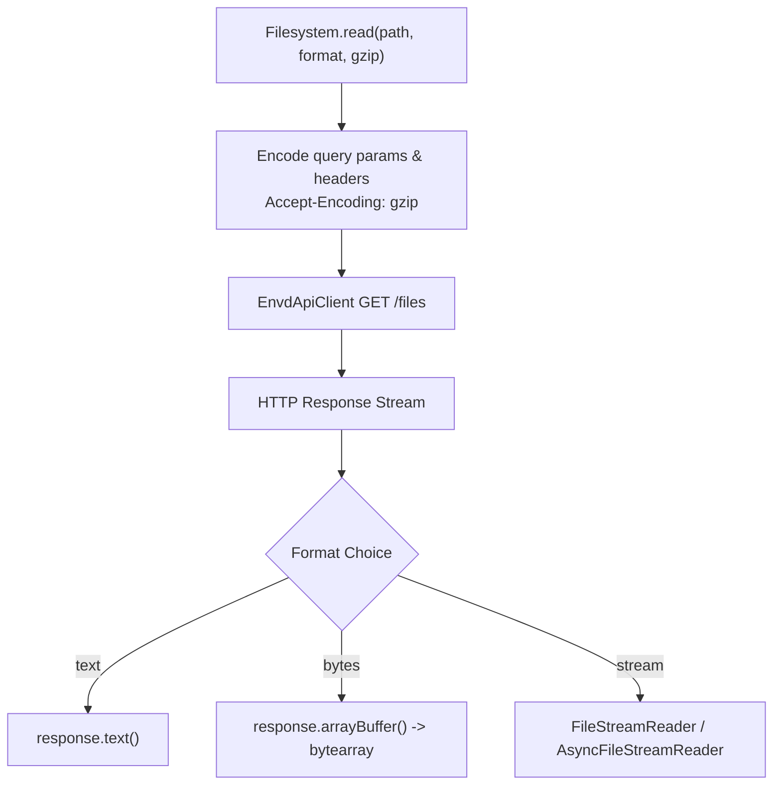

- **Formats**: 
  - `text`: Returns a UTF-8 string `[packages/python-sdk/e2b/sandbox_sync/filesystem/filesystem.py:105-115]()`.
  - `bytes`: Returns raw byte arrays `[packages/python-sdk/e2b/sandbox_sync/filesystem/filesystem.py:135-146]()`.
  - `stream`: Returns a managed iterator (`FileStreamReader` or `AsyncFileStreamReader`) that cleans up connection pools upon completion or error `[packages/python-sdk/e2b/sandbox/filesystem/filesystem.py:158-224]()`.
- **Gzip**: Passing `gzip: true` sets the `Accept-Encoding: gzip` header `[packages/python-sdk/e2b/sandbox_sync/filesystem/filesystem.py:201-203]()`.

Sources: `[packages/js-sdk/src/sandbox/filesystem/index.ts:197-288]`, `[packages/python-sdk/e2b/sandbox_sync/filesystem/filesystem.py:105-230]`, `[packages/python-sdk/e2b/sandbox/filesystem/filesystem.py:158-224]`

### Writing Files and Uploads

The SDK supports single file writes, multi-file batch uploads (`write_files`), and streaming uploads.

- **Data normalization**: Inputs like `string`, `ArrayBuffer`, `Blob`, `ReadableStream`, `io.BytesIO`, and `io.StringIO` are automatically handled `[packages/python-sdk/e2b/sandbox/filesystem/filesystem.py:44-55]()`, `[packages/js-sdk/src/utils.ts]`.
- **Multipart and Octet-Stream**: Uploads can use standard multipart form-data or direct binary uploads (`use_octet_stream: true`) `[packages/python-sdk/tests/sync/sandbox_sync/files/test_write.py:179-184]()`.
- **Gzip Uploads**: Payload compression can be enabled via `gzip: true` in write options `[packages/python-sdk/tests/sync/sandbox_sync/files/test_write.py:207-213]()`.

Sources: `[packages/python-sdk/tests/sync/sandbox_sync/files/test_write.py:1-219]`, `[packages/js-sdk/tests/sandbox/files/write.test.ts:1-128]`, `[packages/js-sdk/src/envd/schema.gen.ts:78-125]`

---

## Metadata and Directory Operations

Structured operations are carried out via gRPC stubs defined in `filesystem.proto`.

### Entry Information and Extended Attributes (xattrs)

Files and directories carry detailed metadata, including POSIX permission bits, owners, modification timestamps, and extended attributes stored under the `user.e2b.*` namespace.

- **Metadata Validation**: Keys and values are validated against RFC 7230 token rules and printable US-ASCII requirements (`METADATA_KEY_REGEX`, `METADATA_VALUE_REGEX`) `[packages/js-sdk/src/sandbox/filesystem/index.ts:203-224]()`.
- **Metadata Headers**: Upload requests transmit metadata via `X-Metadata-<key>` HTTP headers `[packages/js-sdk/src/sandbox/filesystem/index.ts:226-235]()`.
- **Mapping**: Protobuf `EntryInfo` responses are mapped into SDK-native objects via `mapEntryInfo` / `map_entry_info` `[packages/js-sdk/src/sandbox/filesystem/index.ts:240-254]`, `[packages/python-sdk/e2b/sandbox/filesystem/filesystem.py:129-146]()`.

Sources: `[spec/envd/filesystem/filesystem.proto:53-69]`, `[packages/js-sdk/src/sandbox/filesystem/index.ts:111-164]`, `[packages/python-sdk/e2b/sandbox/filesystem/filesystem.py:56-146]`

---

## Filesystem Watching

Real-time monitoring of file and directory changes is supported through server-side gRPC streams (`WatchDir`).

**Diagram: Watch Handle Event Lifecycle**

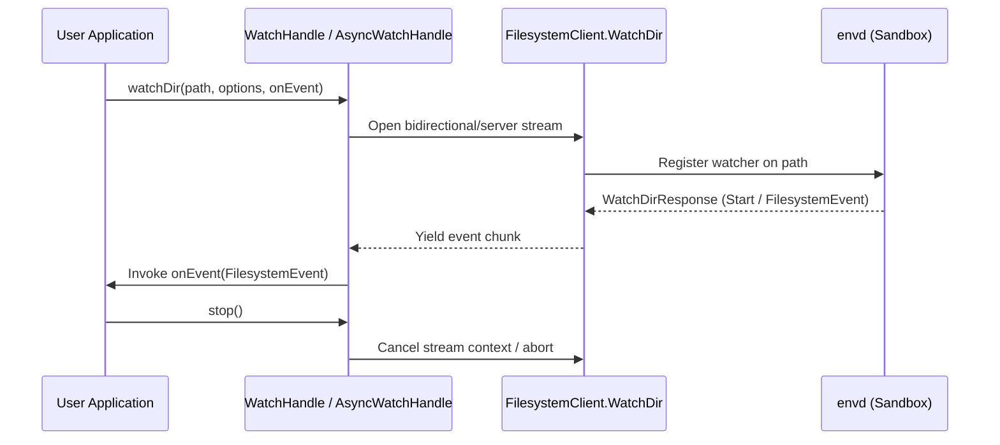

- **Event Types (`FilesystemEventType`)**: `CHMOD`, `CREATE`, `REMOVE`, `RENAME`, `WRITE` `[packages/js-sdk/src/sandbox/filesystem/watchHandle.ts:14-35]()`.
- **Options**: Supports recursive watching (`recursive`), entry info inclusion (`include_entry`), and network mount allowance (`allow_network_mounts`) `[spec/envd/filesystem/filesystem.proto:87-95]()`.

Sources: `[spec/envd/filesystem/filesystem.proto:87-153]`, `[packages/js-sdk/src/sandbox/filesystem/watchHandle.ts:1-152]`

---

## Signed Upload/Download URLs and Security

For secure delegation or out-of-band access, file operations accept cryptographic signatures and expiration timestamps.

- **Parameters**: `signature` and `signature_expiration` can be passed as query parameters to `/files` requests `[packages/js-sdk/src/envd/schema.gen.ts:50-62]()`.
- **Secure Access Token**: When `secure: true` is configured, `envd` access tokens are injected into requests to authenticate communication within hardened sandbox enclaves `[packages/python-sdk/tests/sync/sandbox_sync/files/test_write.py:127-143]()`.

Sources: `[packages/js-sdk/src/envd/schema.gen.ts:50-76]`, `[packages/python-sdk/tests/sync/sandbox_sync/files/test_write.py:127-143]`

---

# Page: Command Execution and PTY

# Command Execution and PTY

<details>
<summary>Relevant source files</summary>

The following files were used as context for generating this wiki page:

- [packages/js-sdk/src/sandbox/commands/commandHandle.ts](packages/js-sdk/src/sandbox/commands/commandHandle.ts)
- [packages/js-sdk/src/sandbox/commands/index.ts](packages/js-sdk/src/sandbox/commands/index.ts)
- [packages/js-sdk/src/sandbox/commands/pty.ts](packages/js-sdk/src/sandbox/commands/pty.ts)
- [packages/js-sdk/tests/sandbox/commands/commandHandle.test.ts](packages/js-sdk/tests/sandbox/commands/commandHandle.test.ts)
- [packages/js-sdk/tests/sandbox/commands/kill.test.ts](packages/js-sdk/tests/sandbox/commands/kill.test.ts)
- [packages/js-sdk/tests/sandbox/pty/ptyCreate.test.ts](packages/js-sdk/tests/sandbox/pty/ptyCreate.test.ts)
- [packages/js-sdk/tests/sandbox/pty/resize.test.ts](packages/js-sdk/tests/sandbox/pty/resize.test.ts)
- [packages/js-sdk/tests/sandbox/pty/sendInput.test.ts](packages/js-sdk/tests/sandbox/pty/sendInput.test.ts)
- [packages/python-sdk/e2b/sandbox_async/commands/command.py](packages/python-sdk/e2b/sandbox_async/commands/command.py)
- [packages/python-sdk/e2b/sandbox_async/commands/command_handle.py](packages/python-sdk/e2b/sandbox_async/commands/command_handle.py)
- [packages/python-sdk/e2b/sandbox_async/commands/pty.py](packages/python-sdk/e2b/sandbox_async/commands/pty.py)
- [packages/python-sdk/e2b/sandbox_sync/commands/command.py](packages/python-sdk/e2b/sandbox_sync/commands/command.py)
- [packages/python-sdk/e2b/sandbox_sync/commands/command_handle.py](packages/python-sdk/e2b/sandbox_sync/commands/command_handle.py)
- [packages/python-sdk/e2b/sandbox_sync/commands/pty.py](packages/python-sdk/e2b/sandbox_sync/commands/pty.py)
- [packages/python-sdk/tests/async/sandbox_async/pty/test_pty_create.py](packages/python-sdk/tests/async/sandbox_async/pty/test_pty_create.py)
- [packages/python-sdk/tests/async/sandbox_async/pty/test_resize.py](packages/python-sdk/tests/async/sandbox_async/pty/test_resize.py)
- [packages/python-sdk/tests/sync/sandbox_sync/pty/test_pty.py](packages/python-sdk/tests/sync/sandbox_sync/pty/test_pty.py)
- [packages/python-sdk/tests/sync/sandbox_sync/pty/test_resize.py](packages/python-sdk/tests/sync/sandbox_sync/pty/test_resize.py)
- [packages/python-sdk/tests/sync/sandbox_sync/test_sync_client_lifecycle.py](packages/python-sdk/tests/sync/sandbox_sync/test_sync_client_lifecycle.py)
- [packages/python-sdk/tests/test_command_handle.py](packages/python-sdk/tests/test_command_handle.py)

</details>


This document covers the command execution and pseudoterminal (PTY) capabilities in the E2B SDKs. These modules enable process management, command execution with stdout/stderr/stdin handling, background task execution, and interactive terminal sessions within sandboxes.

## Overview and Architecture

The command execution system is split into two primary modules:
- **`Commands`**: Executes shell commands, lists running processes, and manages non-interactive or background subprocesses.
- **`Pty`**: Creates and manages pseudoterminal (PTY) sessions for interactive shell access.

Both modules rely on Connect-RPC streaming clients communicating with the `envd` service running inside the sandbox. Commands execute through `/bin/bash` by default to ensure profile and environment loading.

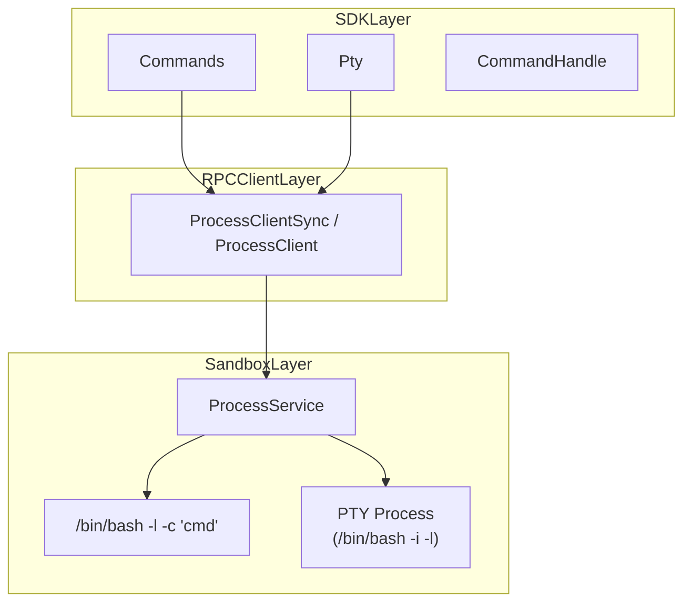

Sources: [packages/js-sdk/src/sandbox/commands/index.ts:135-151](), [packages/python-sdk/e2b/sandbox_sync/commands/command.py:31-50]()

## Commands Module

The `Commands` class provides high-level methods for executing shell commands and inspecting active processes.

### Execution Flow and Options

When a command is initiated (via `run()` in Python or `start()` in JS), the SDK establishes a bidirectional streaming connection with `envd`:
1. **Start Request**: A `StartRequest` payload is sent containing the executable command, arguments, environment overrides (`envs`), working directory (`cwd`), and user context (`user`) [packages/python-sdk/e2b/sandbox_sync/commands/pty.py:137-148]().
2. **PID Extraction**: The first stream response yields the process ID (`pid`) via `handleProcessStartEvent` [packages/js-sdk/src/sandbox/commands/index.ts:21-22](), [packages/python-sdk/e2b/sandbox_sync/commands/command.py:20-21]().
3. **Output & Data Streaming**: Subsequent chunks stream `stdout`, `stderr`, or `pty` data.
4. **Termination**: An `end` event supplies the final `exitCode` and execution error details.

### Process Information (`ProcessInfo`)

Active commands and PTY sessions can be inspected using `list()`, returning objects conforming to `ProcessInfo`:

| Field | Type | Description |
| :--- | :--- | :--- |
| `pid` | `number` | Unique process ID within the sandbox. |
| `tag` | `string?` | Optional tag identifying special processes (e.g., template startup commands). |
| `cmd` | `string` | The command string executed. |
| `args` | `string[]` | Arguments supplied to the process. |
| `envs` | `Record<string, string>` | Environment variables active for the process. |
| `cwd` | `string?` | Working directory path. |

Sources: [packages/js-sdk/src/sandbox/commands/index.ts:105-131](), [packages/python-sdk/e2b/sandbox_sync/commands/command.py:55-88]()

## Command Handles

A `CommandHandle` (or `AsyncCommandHandle`) acts as a proxy for managing a running or completed process.

### Data Flow and UTF-8 Decoding

Raw byte chunks from the gRPC stream are decoded into UTF-8 strings using incremental decoders (`TextDecoder` in JavaScript, `codecs.getincrementaldecoder` in Python) to safely process multi-byte characters split across network chunks.

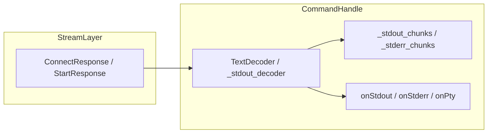

Sources: [packages/js-sdk/src/sandbox/commands/commandHandle.ts:91-125](), [packages/python-sdk/e2b/sandbox_sync/commands/command_handle.py:53-120]()

### Key Methods and Properties

- **`wait()`**: Awaits process completion and returns a `CommandResult`. Throws `CommandExitError` (JS) or `CommandExitException` (Python) if `exitCode !== 0`.
- **`kill()`**: Sends a `SIGKILL` signal to the process.
- **`disconnect()`**: Drops the event stream locally without terminating the remote process.
- **`sendStdin(data)`**: Sends text or binary input to the process standard input (requires `stdin: true` during start).
- **`closeStdin()`**: Sends an EOF signal to the process standard input (requires `envd` support).

Sources: [packages/js-sdk/src/sandbox/commands/commandHandle.ts:166-247](), [packages/python-sdk/e2b/sandbox_sync/commands/command_handle.py:151-224]()

## PTY (Pseudoterminal)

The `Pty` module manages interactive pseudo-terminal sessions.

### Configuration and Environment

When creating a PTY with `create()`, dimensions (`cols`, `rows`) must be specified alongside optional environment overrides and working directory. The SDK automatically sets default terminal environment variables:
- `TERM`: `xterm-256color`
- `LANG`: `C.UTF-8`
- `LC_ALL`: `C.UTF-8`

Sources: [packages/js-sdk/src/sandbox/commands/pty.ts:108-115](), [packages/python-sdk/e2b/sandbox_sync/commands/pty.py:132-136]()

### Resizing and Input

The terminal size can be updated dynamically via `resize()`, which propagates window dimension changes to `envd`. Input is sent using `sendInput()`.

Sources: [packages/js-sdk/tests/sandbox/pty/resize.test.ts:33-41](), [packages/python-sdk/e2b/sandbox_sync/commands/pty.py:83-110]()

## Implementation Details

### Stdin Closing and Version Gating

Closing standard input requires checking the sandbox `envd` version against `ENVD_ENVD_CLOSE` to ensure protocol compatibility.

Sources: [packages/js-sdk/src/sandbox/commands/index.ts:157-159](), [packages/python-sdk/e2b/sandbox_sync/commands/command.py:164-168]()

### Keep-Alive and Health Checks

Long-running command streams inject keep-alive headers (`KEEPALIVE_PING_HEADER` at `KEEPALIVE_PING_INTERVAL_SEC` intervals) to prevent timeouts by network intermediaries. RPC failures invoke `checkSandboxHealth` to differentiate network disconnects from process errors.

Sources: [packages/js-sdk/src/connectionConfig.ts:13-17](), [packages/js-sdk/src/envd/rpc.ts:29-31]()

---

# Page: Error Handling and Types

# Error Handling and Types

<details>
<summary>Relevant source files</summary>

The following files were used as context for generating this wiki page:

- [packages/js-sdk/src/envd/api.ts](packages/js-sdk/src/envd/api.ts)
- [packages/js-sdk/src/envd/rpc.ts](packages/js-sdk/src/envd/rpc.ts)
- [packages/js-sdk/src/errors.ts](packages/js-sdk/src/errors.ts)
- [packages/js-sdk/tests/api/handleApiError.test.ts](packages/js-sdk/tests/api/handleApiError.test.ts)
- [packages/js-sdk/tests/envd/handleEnvdApiError.test.ts](packages/js-sdk/tests/envd/handleEnvdApiError.test.ts)
- [packages/js-sdk/tests/envd/handleRpcError.test.ts](packages/js-sdk/tests/envd/handleRpcError.test.ts)
- [packages/js-sdk/tests/runtime.test.ts](packages/js-sdk/tests/runtime.test.ts)
- [packages/python-sdk/e2b/exceptions.py](packages/python-sdk/e2b/exceptions.py)
- [packages/python-sdk/tests/test_api_exception.py](packages/python-sdk/tests/test_api_exception.py)

</details>


This wiki page documents the error handling system and type hierarchy in the E2B SDKs. It covers exception classes, protocol-level error mapping from REST and gRPC (`envd`) responses to SDK exceptions, connection termination handling, and cross-runtime diagnostics.

Sources: `[packages/js-sdk/src/errors.ts:1-256]()`, `[packages/python-sdk/e2b/exceptions.py:1-197]()`

---

## 1. Error Class Hierarchy

The E2B SDKs implement a structured inheritance tree for errors. In TypeScript/JavaScript, `SandboxError` extends the built-in `Error` [packages/js-sdk/src/errors.ts:13-23](). In Python, `SandboxException` extends `Exception` [packages/python-sdk/e2b/exceptions.py:16-32](). Certain system-level errors—such as `AuthenticationError` and `ServiceBusyError`—inherit directly from base error types because they apply globally across any operation.

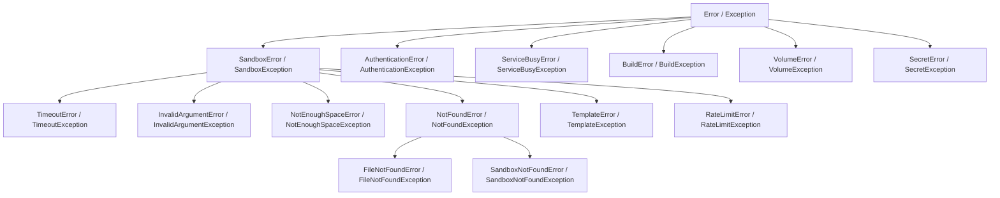

Sources: `[packages/js-sdk/src/errors.ts:9-250]()`, `[packages/python-sdk/e2b/exceptions.py:16-197]()`

---

## 2. Protocol Mapping Logic (REST and gRPC)

Both the JavaScript and Python SDKs communicate with the sandbox control plane and the runtime agent (`envd`) using HTTP/REST for lifecycle/file transfers and ConnectRPC/gRPC over HTTP/2 for runtime commands and filesystem operations. The translation layers map status codes and gRPC codes into typed SDK exceptions.

### Protocol Translation Mapping Architecture

```mermaid
graph LR
    subgraph "Protocol_Responses"
        H_CODE["ResponseHttpStatus<br/>(e.g. 400, 401, 404, 429, 502, 503, 507)"]
        G_CODE["ConnectRpcCode<br/>(e.g. Code.InvalidArgument, Code.NotFound, Code.Unavailable)"]
    end

    subgraph "Translation_Functions"
        JS_API["handleEnvdApiError<br/>packages/js-sdk/src/envd/api.ts"]
        JS_RPC["handleRpcError<br/>packages/js-sdk/src/envd/rpc.ts"]
        PY_API["handle_api_exception<br/>packages/python-sdk/e2b/api/__init__.py"]
        PY_RPC["handle_rpc_exception<br/>packages/python-sdk/e2b/envd/rpc.py"]
    end

    subgraph "SDK_Error_Classes"
        EX_ARG["InvalidArgumentError"]
        EX_AUTH["AuthenticationError"]
        EX_NF["NotFoundError / FileNotFoundError"]
        EX_RL["RateLimitError"]
        EX_TO["TimeoutError"]
        EX_BSY["ServiceBusyError"]
    end

    H_CODE --> JS_API
    H_CODE --> PY_API
    G_CODE --> JS_RPC
    G_CODE --> PY_RPC

    JS_API --> EX_ARG
    JS_API --> EX_AUTH
    JS_API --> EX_NF
    JS_API --> EX_RL
    JS_API --> EX_TO
    JS_API --> EX_BSY

    JS_RPC --> EX_ARG
    JS_RPC --> EX_AUTH
    JS_RPC --> EX_NF
    JS_RPC --> EX_RL
    JS_RPC --> EX_TO
```

Sources: `[packages/js-sdk/src/envd/api.ts:24-141]()`, `[packages/js-sdk/src/envd/rpc.ts:71-117]()`, `[packages/python-sdk/e2b/exceptions.py:1-153]()`

### Default Status Code and gRPC Code Mappings

| HTTP Status / gRPC Code | Error Factory / SDK Exception Class | Description |
| :--- | :--- | :--- |
| `400` / `InvalidArgument` | `InvalidArgumentError` / `InvalidArgumentException` | Invalid request parameter or argument format [packages/js-sdk/src/envd/api.ts:25](), [packages/js-sdk/src/envd/rpc.ts:72]() |
| `401` / `Unauthenticated` | `AuthenticationError` / `AuthenticationException` | Invalid or missing API key or token [packages/js-sdk/src/envd/api.ts:26](), [packages/js-sdk/src/envd/rpc.ts:73]() |
| `404` / `NotFound` | `NotFoundError` / `NotFoundException` | Target file, directory, or sandbox missing [packages/js-sdk/src/envd/api.ts:27](), [packages/js-sdk/src/envd/rpc.ts:74]() |
| `429` / `ResourceExhausted` | `RateLimitError` / `RateLimitException` | API rate limit exceeded [packages/js-sdk/src/envd/api.ts:28](), [packages/js-sdk/src/envd/rpc.ts:75-78]() |
| `502` / `Unavailable` | `TimeoutError` / `TimeoutException` | Sandbox EOL, timeout, or bad gateway via `formatSandboxTimeoutError` [packages/js-sdk/src/envd/api.ts:30](), [packages/js-sdk/src/envd/rpc.ts:79]() |
| `503` | `ServiceBusyError` / `ServiceBusyException` | Service temporarily busy or node lacks capacity [packages/js-sdk/tests/api/handleApiError.test.ts:72-77]() |
| `507` | `NotEnoughSpaceError` / `NotEnoughSpaceException` | Disk storage quota exceeded inside sandbox [packages/js-sdk/src/envd/api.ts:31]() |
| N/A / `Canceled` | `TimeoutError` / `TimeoutException` | Request timeout exceeded (`requestTimeoutMs`) [packages/js-sdk/src/envd/rpc.ts:80-83]() |
| N/A / `DeadlineExhausted` | `TimeoutError` / `TimeoutException` | Long-running operation timeout exceeded (`timeoutMs`) [packages/js-sdk/src/envd/rpc.ts:84-87]() |

Sources: `[packages/js-sdk/src/envd/api.ts:24-32]`, `[packages/js-sdk/src/envd/rpc.ts:71-88]`, `[packages/python-sdk/e2b/exceptions.py:34-152]`

---

## 3. Connection Termination and Health Probes

When an HTTP/2 stream or fetch request drops mid-body, various JavaScript runtimes throw runtime-specific transport errors. The SDK uses `isConnectionTerminatedMessage` to identify these network drops and executes `checkSandboxHealth` to determine if the sandbox was terminated [packages/js-sdk/src/envd/api.ts:42-91](), [packages/js-sdk/src/envd/rpc.ts:34-56]().

### Connection Termination Handling Flow

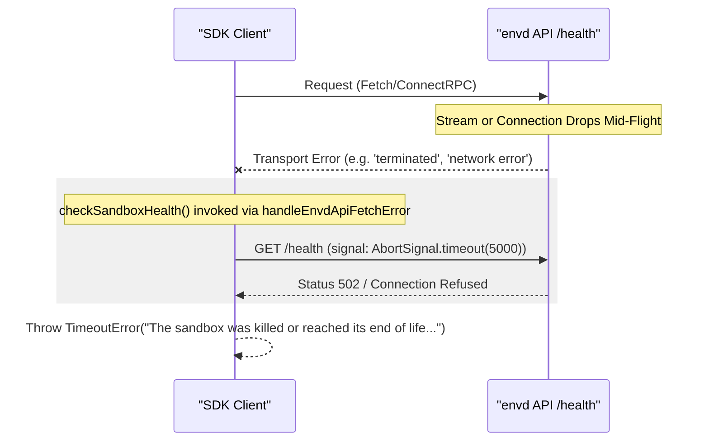

### Runtime-Specific Terminated Message Strings

The JavaScript SDK matches socket and fetch termination errors across diverse execution environments:
* **Node.js (undici)**: `terminated` [packages/js-sdk/src/envd/rpc.ts:28]()
* **Bun**: `The socket connection was closed unexpectedly` [packages/js-sdk/src/envd/rpc.ts:29]()
* **Deno**: `error reading a body from connection` [packages/js-sdk/src/envd/rpc.ts:30]()
* **Cloudflare Workers**: `Network connection lost` [packages/js-sdk/src/envd/rpc.ts:31]()
* **Browser**: `network error` [packages/js-sdk/src/envd/rpc.ts:32]()

Sources: `[packages/js-sdk/src/envd/api.ts:42-91]`, `[packages/js-sdk/src/envd/rpc.ts:33-147]`

---

## 4. ServiceBusyError Behavior

The `ServiceBusyError` (JavaScript) and `ServiceBusyException` (Python) represent HTTP status code `503` [packages/js-sdk/src/errors.ts:169-179](), [packages/python-sdk/e2b/exceptions.py:134-152](). 

Key characteristics:
* Raised when the API refuses an operation because the control plane or sandbox node is temporarily busy (e.g., persisting state during a pause or lacking placement capacity).
* Unlike other API errors, `ServiceBusyError` is **not** a subclass of `SandboxError` / `SandboxException`; it inherits directly from `Error` / `Exception` [packages/js-sdk/src/errors.ts:169](), [packages/python-sdk/e2b/exceptions.py:134]().
* Operations that receive a `503` guarantee that nothing was changed by the refused call (e.g., a refused pause leaves the sandbox running with its state intact), making it safe to retry after a short delay.

Sources: `[packages/js-sdk/src/errors.ts:169-179]`, `[packages/python-sdk/e2b/exceptions.py:134-152]`, `[packages/js-sdk/tests/api/handleApiError.test.ts:72-89]()`

---

# Page: Connection Configuration and the E2B Client

# Connection Configuration and the E2B Client

<details>
<summary>Relevant source files</summary>

The following files were used as context for generating this wiki page:

- [packages/js-sdk/src/api/index.ts](packages/js-sdk/src/api/index.ts)
- [packages/js-sdk/src/api/inflight.ts](packages/js-sdk/src/api/inflight.ts)
- [packages/js-sdk/src/connectionConfig.ts](packages/js-sdk/src/connectionConfig.ts)
- [packages/js-sdk/src/is.ts](packages/js-sdk/src/is.ts)
- [packages/js-sdk/tests/api/inflight.test.ts](packages/js-sdk/tests/api/inflight.test.ts)
- [packages/js-sdk/tests/connectionConfig.test.ts](packages/js-sdk/tests/connectionConfig.test.ts)
- [packages/js-sdk/tests/foreignPlatformObjects.ts](packages/js-sdk/tests/foreignPlatformObjects.ts)
- [packages/js-sdk/tests/is.test.ts](packages/js-sdk/tests/is.test.ts)
- [packages/js-sdk/tests/sandbox/configPropagation.test.ts](packages/js-sdk/tests/sandbox/configPropagation.test.ts)
- [packages/js-sdk/tests/sandbox/rpcHeaders.test.ts](packages/js-sdk/tests/sandbox/rpcHeaders.test.ts)
- [packages/python-sdk/e2b/api/__init__.py](packages/python-sdk/e2b/api/__init__.py)
- [packages/python-sdk/e2b/connection_config.py](packages/python-sdk/e2b/connection_config.py)
- [packages/python-sdk/tests/async/sandbox_async/test_config_propagation.py](packages/python-sdk/tests/async/sandbox_async/test_config_propagation.py)
- [packages/python-sdk/tests/sync/sandbox_sync/test_config_propagation.py](packages/python-sdk/tests/sync/sandbox_sync/test_config_propagation.py)
- [packages/python-sdk/tests/test_connection_config.py](packages/python-sdk/tests/test_connection_config.py)

</details>


This page documents connection configuration mechanics, options precedence, the E2B client class and `ClientFactory` binding, integration tagging, timeouts, proxies, retries, and stream cleanup across the JavaScript and Python SDKs.

For related error handling mechanics, see [Error Handling and Types](#2.4). For underlying network communication protocols, see [REST API and OpenAPI Spec](#6.1) and [envd Protocol and RPC Layer](#6.2).

**Sources:** [packages/js-sdk/src/connectionConfig.ts:1-103](), [packages/python-sdk/e2b/connection_config.py:1-152]()

---

## 1. Overview of `ConnectionConfig` and Options Precedence

Both SDKs provide a centralized configuration structure (`ConnectionOpts` in TypeScript [packages/js-sdk/src/connectionConfig.ts:19-103](), `ApiParams` in Python [packages/python-sdk/e2b/connection_config.py:43-91]()) that governs how requests are authenticated, timed out, routed, proxied, and retried. 

Configuration resolution follows a strict precedence hierarchy:
1. **Per-Call Parameters / Constructor Options**: Explicitly passed arguments when instantiating or calling a resource method.
2. **Bound Parameters (`ClientFactory`)**: Parameters inherited from an instantiated `E2B` client wrapper.
3. **Environment Variables**: Process-level settings (e.g., `E2B_API_KEY`, `E2B_DOMAIN`, `E2B_DEBUG`).
4. **Hardcoded Defaults**: Built-in fallbacks (e.g., `e2b.app` domain, 60-second request timeout, 3 retries).

### Configuration Precedence Flow

```mermaid
classDiagram
    class ConnectionConfig {
        +string apiKey
        +string domain
        +string apiUrl
        +string sandboxUrl
        +boolean debug
        +number requestTimeoutMs
        +number retries
        +Logger logger
        +ProxyConfig proxy
        +Record~string,string~ apiHeaders
    }

    class ClientFactory {
        +ApiParams _bound_api_params
        +_resolve_api_params(**opts) ApiParams
    }

    class E2BClient {
        +Sandbox Sandbox
        +Volume Volume
        +Template Template
        +Secret Secret
    }

    E2BClient --> ClientFactory : "binds api params to subclasses"
    ClientFactory --> ConnectionConfig : "instantiates with resolved params"
```

**Sources:** [packages/js-sdk/src/connectionConfig.ts:17-103](), [packages/python-sdk/e2b/connection_config.py:104-152]()

---

## 2. The E2B Client and `ClientFactory` Binding

In the Python SDK (and conceptually across SDK patterns), resource classes inherit from `ClientFactory` [packages/python-sdk/e2b/connection_config.py:125-152](). When an application instantiates an `E2B` client with specific credentials or domain parameters, `ClientFactory` binds these options to all underlying resource subclasses (`Sandbox`, `Volume`, `Template`, `Secret`) [packages/python-sdk/e2b/connection_config.py:125-134]().

When per-call methods (such as `Sandbox.create()` or `Sandbox.pause()`) are invoked, `merge_api_params` combines the bound parameters with per-call overrides [packages/python-sdk/e2b/connection_config.py:104-123](). Per-call options explicitly set to `None` are ignored so they correctly fall back to bound client values instead of clearing them [packages/python-sdk/e2b/connection_config.py:110-113]().

### Configuration Propagation Sequence

```mermaid
sequenceDiagram
    participant User as User Application
    participant Client as E2B Client / ClientFactory
    participant Method as Sandbox.pause()
    participant Config as ConnectionConfig
    participant API as ApiClient / REST API

    User->>Client: new E2B(apiKey="e2b_...", domain="base.e2b.dev")
    Note over Client: Binds _bound_api_params
    User->>Method: sandbox.pause(requestTimeout=20)
    Method->>Client: _resolve_api_params(requestTimeout=20)
    Note over Client: Merges bound + per-call params
    Client->>Config: new ConnectionConfig(resolved_params)
    Config->>API: Initialize with API Key & Timeout
    API->>API: Execute HTTP Request
```

**Sources:** [packages/python-sdk/e2b/connection_config.py:104-152](), [packages/python-sdk/tests/sync/sandbox_sync/test_config_propagation.py:42-78]()

---

## 3. User-Agent and Integration Tagging

To identify traffic originating from wrappers or higher-level integrations (such as `@e2b/code-interpreter`), the SDK supports process-wide integration attribution via `ConnectionConfig.setIntegration` [packages/python-sdk/e2b/connection_config.py:164-178](), [packages/js-sdk/src/connectionConfig.ts]().

### User-Agent Assembly Rules
* **Base SDK Identification**: Starts with `e2b-js-sdk/<version>` or `e2b-python-sdk/<version>`.
* **Integration Tag**: If registered via `setIntegration`, the integration string (e.g. `"e2b-code-interpreter/0.1.0"`) is appended.
* **Traffic Source (`E2B_USER_AGENT_SOURCE`)**: Environment variable `E2B_USER_AGENT_SOURCE` can append a source tag (such as `source/ci`), provided the value contains no unsafe control characters or newlines [packages/js-sdk/tests/connectionConfig.test.ts:189-203](), [packages/python-sdk/tests/test_connection_config.py:131-145]().
* **Custom Headers**: If `api_headers` / `apiHeaders` explicitly sets a `User-Agent`, it takes precedence over automated tags [packages/python-sdk/tests/test_connection_config.py:147-159]().

```mermaid
graph TD
    Base["SDK Version Identifier"] --> Combine["User-Agent Header Builder"]
    Integration["ConnectionConfig.setIntegration()"] --> Combine
    Source["E2B_USER_AGENT_SOURCE env var"] --> Combine
    Combine --> Final["Final HTTP User-Agent Header"]
```

**Sources:** [packages/js-sdk/tests/connectionConfig.test.ts:181-224](), [packages/python-sdk/tests/test_connection_config.py:117-159]()

---

## 4. Timeouts, Proxies, and Retries

### Request Timeouts
* **JavaScript**: Controlled by `requestTimeoutMs` (default `60_000` ms) [packages/js-sdk/src/connectionConfig.ts:9-62]().
* **Python**: Controlled by `request_timeout` (default `60.0` seconds) [packages/python-sdk/e2b/connection_config.py:24-51]().

### Retries
Control-plane HTTP requests automatically retry on `429 Too Many Requests` responses when accompanied by a valid, non-negative integer `Retry-After` header delta-seconds value [packages/js-sdk/src/connectionConfig.ts:64-71](), [packages/python-sdk/e2b/connection_config.py:53-61]().
* **Default Retries**: `3` attempts [packages/js-sdk/src/connectionConfig.ts:10](), [packages/python-sdk/e2b/connection_config.py:25]().
* **Environment Configuration**: In Python, default retries can be overridden via `E2B_CONNECTION_RETRIES` [packages/python-sdk/e2b/api/__init__.py:96]().
* **Retry Constraint**: Retries are skipped if the estimated wait time would exceed the configured request timeout.

### Proxy Configuration
The `proxy` option accepts URL strings, `httpx.URL`, or `httpx.Proxy` objects in Python [packages/python-sdk/e2b/connection_config.py:14-22](), and proxy URL strings in JavaScript [packages/js-sdk/src/connectionConfig.ts:85-90](). In Python, proxies are normalized via `proxy_to_config` into hashable `ProxyConfig` tuples that key `pyqwest` transport caches efficiently [packages/python-sdk/e2b/api/__init__.py:128-166]().

**Sources:** [packages/js-sdk/src/connectionConfig.ts:9-90](), [packages/python-sdk/e2b/connection_config.py:24-87](), [packages/python-sdk/e2b/api/__init__.py:96-166]()

---

## 5. Stream Cleanup and Request Controller Management

For long-running streams, file uploads/downloads, and interactive commands, the JavaScript SDK implements `setupRequestController` to manage startup timeouts (handshakes) separately from ongoing idle stream durations [packages/js-sdk/src/connectionConfig.ts:154-204]().

### Request Controller Lifecycle

```mermaid
sequenceDiagram
    participant Caller as SDK Method
    participant Ctrl as setupRequestController
    participant Timer as Handshake Timeout
    participant Fetch as Underlying Fetch / Stream

    Caller->>Ctrl: setupRequestController(requestTimeoutMs, userSignal)
    Ctrl->>Fetch: Bind AbortController & signal
    Note over Fetch: Handshake Phase
    alt Handshake succeeds within timeout
        Caller->>Ctrl: clearStartTimeout()
        Note over Ctrl: Handshake timer cleared, user signal active
    else Handshake times out
        Timer->>Ctrl: Trigger TimeoutError Abort
        Ctrl->>Fetch: Abort request
    end
    Caller->>Ctrl: cleanup() (on stream completion/error)
    Note over Ctrl: Removes listeners & aborts controller
```

**Sources:** [packages/js-sdk/src/connectionConfig.ts:154-204]()

---

# Page: Git Integration

# Git Integration

<details>
<summary>Relevant source files</summary>

The following files were used as context for generating this wiki page:

- [packages/js-sdk/src/sandbox/git/index.ts](packages/js-sdk/src/sandbox/git/index.ts)
- [packages/js-sdk/src/sandbox/git/utils.ts](packages/js-sdk/src/sandbox/git/utils.ts)
- [packages/js-sdk/tests/sandbox/git/add.test.ts](packages/js-sdk/tests/sandbox/git/add.test.ts)
- [packages/js-sdk/tests/sandbox/git/branches.test.ts](packages/js-sdk/tests/sandbox/git/branches.test.ts)
- [packages/js-sdk/tests/sandbox/git/clone.test.ts](packages/js-sdk/tests/sandbox/git/clone.test.ts)
- [packages/js-sdk/tests/sandbox/git/commit.test.ts](packages/js-sdk/tests/sandbox/git/commit.test.ts)
- [packages/js-sdk/tests/sandbox/git/config.test.ts](packages/js-sdk/tests/sandbox/git/config.test.ts)
- [packages/js-sdk/tests/sandbox/git/dangerouslyAuthenticate.test.ts](packages/js-sdk/tests/sandbox/git/dangerouslyAuthenticate.test.ts)
- [packages/js-sdk/tests/sandbox/git/helpers.test.ts](packages/js-sdk/tests/sandbox/git/helpers.test.ts)
- [packages/js-sdk/tests/sandbox/git/init.test.ts](packages/js-sdk/tests/sandbox/git/init.test.ts)
- [packages/js-sdk/tests/sandbox/git/remote.test.ts](packages/js-sdk/tests/sandbox/git/remote.test.ts)
- [packages/js-sdk/tests/sandbox/git/reset.test.ts](packages/js-sdk/tests/sandbox/git/reset.test.ts)
- [packages/js-sdk/tests/sandbox/git/restore.test.ts](packages/js-sdk/tests/sandbox/git/restore.test.ts)
- [packages/js-sdk/tests/sandbox/git/status.test.ts](packages/js-sdk/tests/sandbox/git/status.test.ts)
- [packages/python-sdk/e2b/sandbox/_git/types.py](packages/python-sdk/e2b/sandbox/_git/types.py)
- [packages/python-sdk/e2b/sandbox_async/git.py](packages/python-sdk/e2b/sandbox_async/git.py)
- [packages/python-sdk/e2b/sandbox_sync/git.py](packages/python-sdk/e2b/sandbox_sync/git.py)
- [packages/python-sdk/tests/shared/git/conftest.py](packages/python-sdk/tests/shared/git/conftest.py)

</details>


## Purpose and Scope
The Git module provides a high-level wrapper around the `git` binary installed within E2B sandboxes. It translates SDK method calls into structured shell commands executed via the sandbox command runner (`Commands`), offering programmatic control over repository lifecycle operations including clone, init, staging (`add`), commits, branch management, remotes, status inspection, reset/restore, and secure credential handling. 

*(Note: The specialized high-level `git` helper module is deprecated in favor of running raw git commands via `sandbox.commands.run()`, but it remains fully implemented in both the JavaScript and Python SDKs) [packages/js-sdk/src/sandbox/git/index.ts:33-37](), [packages/python-sdk/e2b/sandbox_sync/git.py:49-54]()*

Sources: [packages/js-sdk/src/sandbox/git/index.ts:1-43](), [packages/python-sdk/e2b/sandbox_sync/git.py:49-55]()

---

## 1. Architecture and Command Execution Flow

The `Git` module does not implement Git networking or object databases natively. Instead, it acts as a translator, converting method parameters into shell-safe command strings using utilities like `build_git_command` and executing them through the sandbox's `Commands` subsystem [packages/js-sdk/src/sandbox/git/utils.ts:247-255](), [packages/python-sdk/e2b/sandbox_sync/git.py:64-96]().

Every git execution automatically injects default environment variables—most notably setting `GIT_TERMINAL_PROMPT: '0'`—to ensure that commands fail immediately rather than hanging indefinitely on interactive password prompts inside non-interactive sandboxes [packages/js-sdk/src/sandbox/git/index.ts:29-31](), [packages/python-sdk/e2b/sandbox_sync/git.py:46-46]().

### Natural Language to Code Entity Space: Git Command Execution
This diagram maps high-level Git operations to the specific internal argument builders and command execution functions within the codebase.

```mermaid
graph TD
    subgraph "Natural Language Space"
        A["Clone Repository"]
        B["Create Commit"]
        C["Check Repository Status"]
    end

    subgraph "Code Entity Space"
        A -->|[build_clone_plan]| D[build_git_command]
        B -->|[build_commit_args]| D
        C -->|[build_status_args]| D
        D -->|[Commands_run]| E[Sandbox_Binary]
    end
```
Sources: [packages/js-sdk/src/sandbox/git/index.ts:1-32](), [packages/python-sdk/e2b/sandbox_sync/git.py:64-96]()

---

## 2. Core Repository Operations

The Git module covers the complete local and remote repository lifecycle:

* **Initialization & Cloning**: Repositories can be initialized via `init` (supporting bare options and initial branch names) or cloned via `clone` (supporting destination paths, branches, depth, and credentials) [packages/js-sdk/src/sandbox/git/index.ts:46-93]()
* **Staging & Commits**: Files are staged using `add` (supporting individual paths or `--all`), and snapshots are recorded via `commit` (supporting custom authors, emails, and allow-empty flags) [packages/js-sdk/src/sandbox/git/index.ts:112-145]()
* **Status & Parsing**: The `status` method parses `git status --porcelain` raw outputs into structured `GitStatus` and `GitFileStatus` objects, categorizing file states into added, modified, deleted, renamed, untracked, or conflicted [packages/js-sdk/src/sandbox/git/utils.ts:10-130](), [packages/python-sdk/e2b/sandbox/_git/types.py:14-127]()
* **Reset & Restore**: `reset` supports modes (`soft`, `mixed`, `hard`, `merge`, `keep`) to manipulate `HEAD` and staging areas [packages/js-sdk/src/sandbox/git/index.ts:152-172](), while `restore` handles working tree and index rolling back [packages/js-sdk/src/sandbox/git/index.ts:179-196]()
* **Branches & Remotes**: Branch operations list, create, and delete branches, while remote helpers manage upstream configurations, fetch URLs, and remote additions [packages/js-sdk/tests/sandbox/git/remote.test.ts:26-43]()

Sources: [packages/js-sdk/src/sandbox/git/index.ts:33-260](), [packages/js-sdk/tests/sandbox/git/status.test.ts:12-99]()

---

## 3. Authentication and Credential Management

When interacting with private repositories via HTTP(S), the module provides helpers to safely inject credentials into remote URLs without leaking them permanently to disk unless explicitly requested via `dangerouslyStoreCredentials` [packages/js-sdk/src/sandbox/git/index.ts:72-76]().

### Credential Injection Data Flow
This diagram illustrates how remote URL authentication credentials are temporarily injected for an operation and cleaned up afterward.

```mermaid
graph TD
    subgraph "Natural Language Space"
        A["Authenticate Private Push/Pull"]
    end

    subgraph "Code Entity Space"
        A -->|[with_credentials]| B["_with_remote_credentials"]
        B -->|[set-url]| C[Git_Remote_URL]
        C -->|[execute_operation]| D[Commands_run]
        D -->|[restore_url]| E[Sanitized_Remote_URL]
    end
```
Sources: [packages/js-sdk/src/sandbox/git/utils.ts:156-215](), [packages/python-sdk/e2b/sandbox_async/git.py:180-225]()

* **`withCredentials` / `stripCredentials`**: Safely injects or strips username/password tokens from `http://` or `https://` URLs [packages/js-sdk/src/sandbox/git/utils.ts:156-215]().
* **`_with_remote_credentials`**: Temporarily updates the remote URL to include authentication parameters, executes the requested push/pull operation, and guarantees restoration of the original clean remote URL in a `finally` block [packages/python-sdk/e2b/sandbox_async/git.py:180-225]().

Sources: [packages/js-sdk/src/sandbox/git/utils.ts:156-215](), [packages/python-sdk/e2b/sandbox_async/git.py:180-225]()

---

## 4. Error Handling and Exceptions

The Git module intercepts standard command failures and inspects stderr or exit codes to raise specific, actionable domain exceptions rather than generic command errors:

* `GitAuthError` / `GitAuthException`: Raised when authentication fails (detected via `isAuthFailure`) [packages/python-sdk/e2b/sandbox_sync/git.py:29-38]()
* `GitUpstreamError` / `GitUpstreamException`: Raised when push/pull commands fail due to missing upstream tracking branches (detected via `isMissingUpstream`) [packages/python-sdk/e2b/sandbox_sync/git.py:30-39]()
* `InvalidArgumentError` / `InvalidArgumentException`: Raised when malformed options or missing remote names are supplied [packages/python-sdk/e2b/sandbox_sync/git.py:40-41]()

Sources: [packages/js-sdk/src/sandbox/git/index.ts:1-6](), [packages/python-sdk/e2b/sandbox_sync/git.py:37-42]()

---

# Page: Python SDK

# Python SDK

<details>
<summary>Relevant source files</summary>

The following files were used as context for generating this wiki page:

- [.github/assets/envd-pool-sharding-benchmark.svg](.github/assets/envd-pool-sharding-benchmark.svg)
- [packages/js-sdk/src/index.ts](packages/js-sdk/src/index.ts)
- [packages/js-sdk/src/sandbox/sandboxApi.ts](packages/js-sdk/src/sandbox/sandboxApi.ts)
- [packages/python-sdk/e2b/__init__.py](packages/python-sdk/e2b/__init__.py)
- [packages/python-sdk/e2b/api/client_async/__init__.py](packages/python-sdk/e2b/api/client_async/__init__.py)
- [packages/python-sdk/e2b/api/client_sync/__init__.py](packages/python-sdk/e2b/api/client_sync/__init__.py)
- [packages/python-sdk/e2b/envd/client_async/__init__.py](packages/python-sdk/e2b/envd/client_async/__init__.py)
- [packages/python-sdk/e2b/envd/client_sync/__init__.py](packages/python-sdk/e2b/envd/client_sync/__init__.py)
- [packages/python-sdk/e2b/sandbox/sandbox_api.py](packages/python-sdk/e2b/sandbox/sandbox_api.py)
- [packages/python-sdk/e2b/sandbox_async/main.py](packages/python-sdk/e2b/sandbox_async/main.py)
- [packages/python-sdk/e2b/sandbox_async/sandbox_api.py](packages/python-sdk/e2b/sandbox_async/sandbox_api.py)
- [packages/python-sdk/e2b/sandbox_sync/main.py](packages/python-sdk/e2b/sandbox_sync/main.py)
- [packages/python-sdk/e2b/sandbox_sync/sandbox_api.py](packages/python-sdk/e2b/sandbox_sync/sandbox_api.py)
- [packages/python-sdk/tests/envd_frame_server.py](packages/python-sdk/tests/envd_frame_server.py)
- [packages/python-sdk/tests/test_api_client_transport.py](packages/python-sdk/tests/test_api_client_transport.py)
- [packages/python-sdk/tests/test_env_var_parsing.py](packages/python-sdk/tests/test_env_var_parsing.py)

</details>


The Python SDK (`e2b` package) provides a programmatic interface for creating, managing, and interacting with E2B sandboxes from Python applications. It supports both synchronous (`Sandbox`) and asynchronous (`AsyncSandbox`) programming patterns and offers functionality for sandbox lifecycle management, filesystem operations, process execution, and HTTP transport.

For details on package structure, installation, and general usage patterns, see the overview below. For specific implementation details, refer to the child pages covering [Sandbox Management (Sync and Async)](#3.1), [Filesystem, Commands and PTY](#3.2), [HTTP Transport and Generated API Client](#3.3), and [Dependencies and Environment](#3.4).

## Architecture and Interface Mapping

The Python SDK exposes dual interfaces to accommodate both synchronous and asynchronous application designs while leveraging shared underlying transport and client machinery.

### System-to-Code Mapping: Communication and Client Classes

```mermaid
graph TB
    subgraph "Natural Language Space"
        SyncInterface["Sync Interface"]
        AsyncInterface["Async Interface"]
        RestControl["REST Control Plane"]
        EnvdData["envd Data Plane"]
    end
    
    subgraph "Code Entity Space"
        SandboxClass["Sandbox (e2b.sandbox_sync.main)"]
        AsyncSandboxClass["AsyncSandbox (e2b.sandbox_async.main)"]
        ApiClientSync["get_api_client (e2b.api.client_sync)"]
        EnvdClientSync["create_rpc_client (e2b.envd.client_sync)"]
    end
    
    SyncInterface --> SandboxClass
    AsyncInterface --> AsyncSandboxClass
    RestControl --> ApiClientSync
    EnvdData --> EnvdClientSync
```

Sources: [packages/python-sdk/e2b/sandbox_sync/main.py:49-110](), [packages/python-sdk/e2b/sandbox_async/main.py:50-112](), [packages/python-sdk/e2b/api/client_sync/__init__.py:24-29](), [packages/python-sdk/e2b/envd/client_sync/__init__.py:56-91]()

## Package Layout under `e2b/`

The codebase under `e2b/` is organized into distinct functional submodules supporting core sandbox behaviors, API communication, and template management:

| Module Path | Purpose | Key Classes/Entities |
|-------------|---------|----------------------|
| `e2b/sandbox_sync/` | Synchronous sandbox implementation | `Sandbox`, `Commands`, `Pty`, `Filesystem`, `Git` |
| `e2b/sandbox_async/` | Asynchronous sandbox implementation | `AsyncSandbox`, `AsyncCommands`, `AsyncPty`, `AsyncFilesystem` |
| `e2b/api/` | Generated REST API client and transports | `ApiClient`, `AsyncApiClient`, `get_api_client` |
| `e2b/envd/` | gRPC/ConnectRPC client stubs and transport wrappers | `PlainHTTPErrorTransport`, `create_rpc_client` |
| `e2b/volume/` | Persistent storage management | `Volume`, `AsyncVolume` |

Sources: [packages/python-sdk/e2b/__init__.py:28-162](), [packages/python-sdk/e2b/sandbox_sync/main.py:35-42]()

### System-to-Code Mapping: Modules and Runtime Operations

```mermaid
graph TB
    subgraph "Natural Language Space"
        FsModule["Filesystem Operations"]
        CmdModule["Command and PTY Execution"]
        TransportMod["Transport and Sharding"]
    end
    
    subgraph "Code Entity Space"
        FilesystemSync["Filesystem (e2b.sandbox_sync.filesystem)"]
        CommandsSync["Commands (e2b.sandbox_sync.commands)"]
        PtySync["Pty (e2b.sandbox_sync.commands.pty)"]
        PyqwestTrans["get_pyqwest_transport (e2b.api.client_sync)"]
    end
    
    FsModule --> FilesystemSync
    CmdModule --> CommandsSync
    CmdModule --> PtySync
    TransportMod --> PyqwestTrans
```

Sources: [packages/python-sdk/e2b/sandbox_sync/main.py:73-92](), [packages/python-sdk/e2b/api/client_sync/__init__.py:77-129]()

## Core Sub-Topics

### 3.1. Sandbox Management (Sync and Async)
The `Sandbox` and `AsyncSandbox` classes (inheriting from `SandboxBase`) manage the complete sandbox lifecycle including creation, connection, pausing, resuming, killing, and snapshotting. For details, see [Sandbox Management (Sync and Async)](#3.1).

Sources: [packages/python-sdk/e2b/sandbox_sync/main.py:49-183](), [packages/python-sdk/e2b/sandbox_async/main.py:50-187]()

### 3.2. Filesystem, Commands and PTY
Sandbox interactions rely on specialized modules for file I/O (`Filesystem`), process execution (`Commands`), and interactive terminal streaming (`Pty`), backed by `envd` ConnectRPC stubs. For details, see [Filesystem, Commands and PTY](#3.2).

Sources: [packages/python-sdk/e2b/sandbox_sync/main.py:73-92](), [packages/python-sdk/e2b/sandbox_async/main.py:73-94]()

### 3.3. HTTP Transport and Generated API Client
Communication with control and data planes utilizes `pyqwest`-backed transports (`get_pyqwest_transport`) and generated OpenAPI endpoints under `e2b/api/client`. For details, see [HTTP Transport and Generated API Client](#3.3).

Sources: [packages/python-sdk/e2b/api/client_sync/__init__.py:77-129](), [packages/python-sdk/e2b/api/client_async/__init__.py:78-130]()

### 3.4. Dependencies and Environment
Build tooling, configuration files (`pyproject.toml`, `uv.lock`), Makefile automation, and test fixtures govern the Python SDK environment. For details, see [Dependencies and Environment](#3.4).

Sources: [packages/python-sdk/tests/test_api_client_transport.py:1-40]()

---

# Page: Sandbox Management (Sync and Async)

# Sandbox Management (Sync and Async)

<details>
<summary>Relevant source files</summary>

The following files were used as context for generating this wiki page:

- [packages/js-sdk/src/index.ts](packages/js-sdk/src/index.ts)
- [packages/js-sdk/src/sandbox/index.ts](packages/js-sdk/src/sandbox/index.ts)
- [packages/js-sdk/src/sandbox/sandboxApi.ts](packages/js-sdk/src/sandbox/sandboxApi.ts)
- [packages/js-sdk/tests/sandbox/connect.test.ts](packages/js-sdk/tests/sandbox/connect.test.ts)
- [packages/js-sdk/tests/sandbox/create.test.ts](packages/js-sdk/tests/sandbox/create.test.ts)
- [packages/python-sdk/e2b/__init__.py](packages/python-sdk/e2b/__init__.py)
- [packages/python-sdk/e2b/sandbox/main.py](packages/python-sdk/e2b/sandbox/main.py)
- [packages/python-sdk/e2b/sandbox/sandbox_api.py](packages/python-sdk/e2b/sandbox/sandbox_api.py)
- [packages/python-sdk/e2b/sandbox_async/main.py](packages/python-sdk/e2b/sandbox_async/main.py)
- [packages/python-sdk/e2b/sandbox_async/sandbox_api.py](packages/python-sdk/e2b/sandbox_async/sandbox_api.py)
- [packages/python-sdk/e2b/sandbox_sync/main.py](packages/python-sdk/e2b/sandbox_sync/main.py)
- [packages/python-sdk/e2b/sandbox_sync/sandbox_api.py](packages/python-sdk/e2b/sandbox_sync/sandbox_api.py)
- [packages/python-sdk/tests/async/sandbox_async/test_connect.py](packages/python-sdk/tests/async/sandbox_async/test_connect.py)
- [packages/python-sdk/tests/async/sandbox_async/test_create.py](packages/python-sdk/tests/async/sandbox_async/test_create.py)
- [packages/python-sdk/tests/sync/sandbox_sync/test_connect.py](packages/python-sdk/tests/sync/sandbox_sync/test_connect.py)
- [packages/python-sdk/tests/sync/sandbox_sync/test_create.py](packages/python-sdk/tests/sync/sandbox_sync/test_create.py)

</details>


## Purpose and Scope
This page covers the implementation of sandbox management in the E2B Python SDK, detailing both synchronous (`Sandbox`) and asynchronous (`AsyncSandbox`) interfaces, their shared base class (`SandboxBase`), and the API interaction layer (`SandboxApi`). It explains core lifecycle methods, URL and signature generation for file transfers, host and port mapping for sandbox services, and the architectural differences between sync and async execution models.

Sources: [packages/python-sdk/e2b/sandbox/main.py:27-51](), [packages/python-sdk/e2b/sandbox_sync/main.py:49-110](), [packages/python-sdk/e2b/sandbox_async/main.py:50-112]()

---

## Core Class Hierarchy and Architecture
The Python SDK implements sandbox control using a shared base architecture where platform-agnostic configuration and utility methods reside in `SandboxBase`, while runtime operations diverge into synchronous (`Sandbox`) and asynchronous (`AsyncSandbox`) models.

```mermaid
graph TB
    subgraph "Base Layer"
        SandboxBase["SandboxBase<br/>(packages/python-sdk/e2b/sandbox/main.py)"]
    end

    subgraph "API Lifecycle Layer"
        SyncSandboxApi["SandboxApi<br/>(packages/python-sdk/e2b/sandbox_sync/sandbox_api.py)"]
        AsyncSandboxApi["SandboxApi<br/>(packages/python-sdk/e2b/sandbox_async/sandbox_api.py)"]
    end

    subgraph "Runtime Implementations"
        Sandbox["Sandbox (Sync)<br/>(packages/python-sdk/e2b/sandbox_sync/main.py)"]
        AsyncSandbox["AsyncSandbox (Async)<br/>(packages/python-sdk/e2b/sandbox_async/main.py)"]
    end

    SandboxBase -- "inherits" --> SyncSandboxApi
    SandboxBase -- "inherits" --> AsyncSandboxApi
    SyncSandboxApi -- "base for" --> Sandbox
    AsyncSandboxApi -- "base for" --> AsyncSandbox

    subgraph "Modules"
        SyncFiles["Filesystem<br/>(packages/python-sdk/e2b/sandbox_sync/filesystem/filesystem.py)"]
        AsyncFiles["AsyncFilesystem<br/>(packages/python-sdk/e2b/sandbox_async/filesystem/filesystem.py)"]
        SyncCmds["Commands / Pty<br/>(packages/python-sdk/e2b/sandbox_sync/commands)"]
        AsyncCmds["AsyncCommands / Pty<br/>(packages/python-sdk/e2b/sandbox_async/commands)"]
    end

    Sandbox --> SyncFiles
    Sandbox --> SyncCmds
    AsyncSandbox --> AsyncFiles
    AsyncSandbox --> AsyncCmds
```
Title: "Python Sandbox Class Hierarchy"

Sources: [packages/python-sdk/e2b/sandbox/main.py:27-57](), [packages/python-sdk/e2b/sandbox_sync/main.py:49-130](), [packages/python-sdk/e2b/sandbox_async/main.py:50-134]()

### Shared Properties and State
`SandboxBase` encapsulates connection configurations, environment tokens, URLs, and port bindings:

| Property | Type | Description |
| :--- | :--- | :--- |
| `sandbox_id` | `str` | Unique sandbox instance identifier |
| `sandbox_domain` | `str` | Host domain where sandbox services run |
| `envd_api_url` | `str` | Base URL for `envd` API communication |
| `envd_direct_url` | `str` | Direct host URL for accessing mapped sandbox ports |
| `traffic_access_token` | `Optional[str]` | Token for accessing restricted public traffic |
| `_envd_access_token` | `Optional[str]` | Internal token for securing `envd` RPC endpoints |

Sources: [packages/python-sdk/e2b/sandbox/main.py:35-101]()

---

## Lifecycle Methods
Both `Sandbox` and `AsyncSandbox` provide class methods to provision, connect to, pause, resume, and terminate environments through the control plane REST API (`SandboxApi`).

```mermaid
sequenceDiagram
    participant User
    participant AsyncSandbox as "AsyncSandbox"
    participant SandboxApi as "SandboxApi"
    participant REST as "E2B REST API<br/>POST /sandboxes"

    User->>AsyncSandbox: create(template, timeout, ...)
    AsyncSandbox->>SandboxApi: _create_sandbox(...)
    SandboxApi->>REST: Send NewSandbox payload
    REST-->>SandboxApi: SandboxCreateResponse (ID, tokens, domain)
    SandboxApi-->>AsyncSandbox: Return SandboxOpts
    AsyncSandbox->>AsyncSandbox: Initialize async modules (Filesystem, Commands)
    AsyncSandbox-->>User: AsyncSandbox instance
```
Title: "Async Sandbox Creation Sequence"

Sources: [packages/python-sdk/e2b/sandbox_async/sandbox_api.py:210-250](), [packages/python-sdk/e2b/sandbox_async/main.py:171-190]()

### Lifecycle Operations Table
| Operation | Sync Method (`Sandbox`) | Async Method (`AsyncSandbox`) | Description |
| :--- | :--- | :--- | :--- |
| **Create** | `Sandbox.create(...)` | `await AsyncSandbox.create(...)` | Provisions a new sandbox instance. |
| **Connect** | `Sandbox.connect(sandbox_id)` | `await AsyncSandbox.connect(sandbox_id)` | Attaches to an existing sandbox. |
| **Kill** | `sandbox.kill()` | `await sandbox.kill()` | Terminates the sandbox and frees resources. |
| **Pause** | `sandbox.pause(...)` | `await sandbox.pause(...)` | Suspends execution and saves disk/memory state. |
| **Set Timeout** | `sandbox.set_timeout(timeout)` | `await sandbox.set_timeout(timeout)` | Updates the sandbox idle/maximum lifetime timeout. |
| **Get Info** | `sandbox.get_info()` | `await sandbox.get_info()` | Retrieves runtime metadata and current state. |

Sources: [packages/python-sdk/e2b/sandbox_sync/main.py:168-230](), [packages/python-sdk/e2b/sandbox_async/main.py:171-220]()

---

## URL and Signature Generation
`SandboxBase` manages signed URL construction for file upload and download operations. When a sandbox is created in secure mode (`secure=True`), file endpoints require HMAC signatures generated via `get_signature()`.

```python
# Internal file URL builder in SandboxBase
def _file_url(
    self,
    path: str,
    user: Optional[str] = None,
    signature: Optional[str] = None,
    signature_expiration: Optional[int] = None,
) -> str:
    ...
```

*   **`download_url(...)`**: Constructs a secure or public URL to download files from the sandbox [packages/python-sdk/e2b/sandbox/main.py:131-170]().
*   **`upload_url(...)`**: Constructs a secure or public URL to upload files via `multipart/form-data` [packages/python-sdk/e2b/sandbox/main.py:171-212]().

Sources: [packages/python-sdk/e2b/sandbox/main.py:102-212]()

---

## Host and Port Mapping
Sandboxes expose internal services (like web servers or databases) via dynamic host-port mapping.

```python
def get_host(self, port: int) -> str:
    """Get the public host address to connect to a sandbox port."""
    ...

def get_port(self, port: int) -> int:
    """Get the public port mapped to an internal sandbox port."""
    ...
```

*   **`get_host(port)`**: Returns the external hostname mapped for the given internal port [packages/python-sdk/e2b/sandbox/main.py:213-220]().
*   **`get_port(port)`**: Resolves the externally accessible port mapping [packages/python-sdk/e2b/sandbox/main.py:221-232]().
*   **Default Ports**: `envd` operates on port `49983`, and MCP gateway services operate on port `50005` [packages/python-sdk/e2b/sandbox/main.py:28]().

Sources: [packages/python-sdk/e2b/sandbox/main.py:213-232]()

---

## Sync vs Async Implementation Differences
While both `Sandbox` and `AsyncSandbox` share identical API contracts and method names, their internal transport mechanisms and execution models differ:

1.  **HTTP Client**: `Sandbox` utilizes synchronous `httpx.Client`, whereas `AsyncSandbox` utilizes `httpx.AsyncClient` through `get_envd_api` and `get_api_client`.
2.  **Concurrency Model**: Synchronous methods block the calling thread during RPC execution and file transfers. Asynchronous methods use `async`/`await` primitives, returning coroutines that integrate cleanly into `asyncio` event loops.
3.  **Exception Handling**: Sync methods raise synchronous exceptions handled via `handle_envd_api_exception` [packages/python-sdk/e2b/sandbox_sync/main.py:157](), while async methods invoke `ahandle_envd_api_exception` [packages/python-sdk/e2b/sandbox_async/main.py:161]() within asynchronous contexts.

Sources: [packages/python-sdk/e2b/sandbox_sync/main.py:110-165](), [packages/python-sdk/e2b/sandbox_async/main.py:114-169]()

---

# Page: Filesystem, Commands and PTY

# Filesystem, Commands and PTY

<details>
<summary>Relevant source files</summary>

The following files were used as context for generating this wiki page:

- [packages/js-sdk/src/envd/filesystem/filesystem_connect.ts](packages/js-sdk/src/envd/filesystem/filesystem_connect.ts)
- [packages/js-sdk/src/envd/process/process_connect.ts](packages/js-sdk/src/envd/process/process_connect.ts)
- [packages/js-sdk/src/envd/process/process_pb.ts](packages/js-sdk/src/envd/process/process_pb.ts)
- [packages/js-sdk/src/envd/versions.ts](packages/js-sdk/src/envd/versions.ts)
- [packages/js-sdk/src/sandbox/filesystem/index.ts](packages/js-sdk/src/sandbox/filesystem/index.ts)
- [packages/js-sdk/tests/sandbox/files/watch.test.ts](packages/js-sdk/tests/sandbox/files/watch.test.ts)
- [packages/js-sdk/tests/sandbox/files/write.test.ts](packages/js-sdk/tests/sandbox/files/write.test.ts)
- [packages/python-sdk/e2b/envd/filesystem/filesystem_connect.py](packages/python-sdk/e2b/envd/filesystem/filesystem_connect.py)
- [packages/python-sdk/e2b/envd/process/process_connect.py](packages/python-sdk/e2b/envd/process/process_connect.py)
- [packages/python-sdk/e2b/envd/versions.py](packages/python-sdk/e2b/envd/versions.py)
- [packages/python-sdk/e2b/sandbox/filesystem/filesystem.py](packages/python-sdk/e2b/sandbox/filesystem/filesystem.py)
- [packages/python-sdk/e2b/sandbox/filesystem/watch_handle.py](packages/python-sdk/e2b/sandbox/filesystem/watch_handle.py)
- [packages/python-sdk/e2b/sandbox_async/filesystem/filesystem.py](packages/python-sdk/e2b/sandbox_async/filesystem/filesystem.py)
- [packages/python-sdk/e2b/sandbox_async/filesystem/watch_handle.py](packages/python-sdk/e2b/sandbox_async/filesystem/watch_handle.py)
- [packages/python-sdk/e2b/sandbox_sync/filesystem/filesystem.py](packages/python-sdk/e2b/sandbox_sync/filesystem/filesystem.py)
- [packages/python-sdk/e2b/sandbox_sync/filesystem/watch_handle.py](packages/python-sdk/e2b/sandbox_sync/filesystem/watch_handle.py)
- [packages/python-sdk/tests/async/sandbox_async/files/test_watch.py](packages/python-sdk/tests/async/sandbox_async/files/test_watch.py)
- [packages/python-sdk/tests/async/sandbox_async/files/test_write.py](packages/python-sdk/tests/async/sandbox_async/files/test_write.py)
- [packages/python-sdk/tests/sync/sandbox_sync/files/test_watch.py](packages/python-sdk/tests/sync/sandbox_sync/files/test_watch.py)
- [packages/python-sdk/tests/sync/sandbox_sync/files/test_write.py](packages/python-sdk/tests/sync/sandbox_sync/files/test_write.py)
- [spec/envd/process/process.proto](spec/envd/process/process.proto)

</details>


This page documents the implementation of the Filesystem module (sync and async Python classes, `FileStreamReader`, watch handles), command execution, and PTY implementations in the E2B SDKs, along with their underlying `envd` ConnectRPC and REST stubs.

## 1. Architecture and Communication Overview

The E2B runtime handles file transfers, command execution, and pseudo-terminal (PTY) interactions via a dual-protocol model: HTTP/REST (via `EnvdApiClient` / `httpx`) for bulk data and file streaming, and ConnectRPC over HTTP/2 for structured control messages, process streaming, and watch events.

**Diagram: Protocol and Component Architecture bridging Natural Language to Code Entities**

```mermaid
graph TB
    subgraph "NaturalLanguageSpace"
        UserCode["User Code Execution"]
        FileTransfers["File Upload/Download"]
        ProcExec["Command & PTY Control"]
    end

    subgraph "CodeEntitySpace"
        SyncFS["Filesystem (packages/python-sdk/e2b/sandbox_sync/filesystem/filesystem.py)"]
        AsyncFS["Filesystem (packages/python-sdk/e2b/sandbox_async/filesystem/filesystem.py)"]
        StreamReader["FileStreamReader / AsyncFileStreamReader (packages/python-sdk/e2b/sandbox/filesystem/filesystem.py)"]
        WatchH["WatchHandle / AsyncWatchHandle (packages/python-sdk/e2b/sandbox_sync/filesystem/watch_handle.py)"]
        ProcImpl["Process & PTY Handlers"]
        RpcClient["create_rpc_client (packages/python-sdk/e2b/envd/client_sync.py)"]
        RestClient["get_envd_api (packages/python-sdk/e2b/api/client_sync.py)"]
    end

    UserCode --> SyncFS
    UserCode --> AsyncFS
    FileTransfers --> StreamReader
    ProcExec --> ProcImpl
    SyncFS --> RestClient
    SyncFS --> RpcClient
    AsyncFS --> RestClient
    AsyncFS --> RpcClient
```

Sources: [packages/python-sdk/e2b/sandbox_sync/filesystem/filesystem.py:76-104](), [packages/python-sdk/e2b/sandbox_async/filesystem/filesystem.py:82-108](), [packages/python-sdk/e2b/sandbox/filesystem/filesystem.py:158-224]()

## 2. Python Filesystem Classes and Stream Readers

The `Filesystem` class provides methods for interacting with the sandbox file tree. It features synchronous (`packages/python-sdk/e2b/sandbox_sync/filesystem/filesystem.py`) and asynchronous (`packages/python-sdk/e2b/sandbox_async/filesystem/filesystem.py`) implementations.

- `read()` supports `text`, `bytes`, and `stream` formats.
- When `format="stream"` is selected, it returns a `FileStreamReader` (sync) or `AsyncFileStreamReader` (async) which wraps an `httpx.Response` iterator (`packages/python-sdk/e2b/sandbox/filesystem/filesystem.py`).
- `WriteEntry` and `WriteInfo` handle multi-file and metadata payloads.

**Diagram: File Stream Consumption Data Flow**

```mermaid
sequenceDiagram
    participant User as User Code
    participant FS as Filesystem.read(format="stream")
    participant FSR as FileStreamReader
    participant Resp as httpx.Response

    User->>FS: Request streamed read
    FS->>Resp: GET /files?path=...
    Resp-->>FSR: Return HTTP response stream
    FSR-->>User: Return FileStreamReader instance
    loop Stream Iteration
        User->>FSR: __next__() / iter_bytes()
        FSR->>Resp: Fetch next chunk
        Resp-->>FSR: Raw bytes chunk
        FSR-->>User: bytes
    end
    User->>FSR: close() / Context Manager Exit
    FSR->>Resp: close connection & release pool
```

Sources: [packages/python-sdk/e2b/sandbox_sync/filesystem/filesystem.py:105-182](), [packages/python-sdk/e2b/sandbox/filesystem/filesystem.py:158-224]()

## 3. Filesystem Watch Handles

Real-time directory watching is managed via `WatchHandle` (sync) and `AsyncWatchHandle` (async), leveraging ConnectRPC `FilesystemClient` stubs (`packages/python-sdk/e2b/sandbox_sync/filesystem/watch_handle.py`).

- `watch_dir()` registers a watcher with `envd`.
- `get_new_events()` polls accumulated `FilesystemEvent` items (such as `CREATE`, `WRITE`, `REMOVE`, `RENAME`, `CHMOD`).
- `stop()` unregisters the watcher via `remove_watcher`.

Sources: [packages/python-sdk/e2b/sandbox_sync/filesystem/watch_handle.py:18-103](), [packages/python-sdk/e2b/sandbox/filesystem/watch_handle.py:9-70]()

## 4. Command Execution and PTY Implementations

Commands and pseudo-terminal (PTY) sessions run processes inside the sandbox via `envd` Process ConnectRPC stubs (`packages/python-sdk/e2b/envd/process/process_connect.py`).

- `CommandHandle` manages process execution, stdout/stderr streaming, and stdin writing.
- `Pty` manages interactive terminal sessions, handling terminal resize (`resize_pty`) and signal/kill operations.

**Diagram: Process Execution and PTY Control Flow**

```mermaid
graph TD
    CmdStart["Sandbox.commands.run()"] --> RpcCall["ProcessClient.start()"]
    RpcCall --> EnvdProc["envd Process Execution"]
    EnvdProc --> StdoutStream["Stdout / Stderr Stream"]
    StdoutStream --> OutputHandler["Output Handler / Callbacks"]
    PtyControl["Pty.resize() / Pty.send_stdin()"] --> PtyRpc["ProcessClient.resize_pty() / stdin"]
    PtyRpc --> EnvdPty["envd PTY Session"]
```

Sources: [packages/python-sdk/e2b/envd/process/process_connect.py:1-50]()

## 5. envd ConnectRPC Stubs and Error Handling

Both filesystem and process subsystems rely on ConnectRPC code-generated stubs (`filesystem_connect.py`, `process_connect.py`) and error translation utilities (`handle_rpc_exception_with_health`).

- RPC errors (like `Code.NOT_FOUND`) are mapped to SDK exceptions (`FileNotFoundException`, `InvalidArgumentException`).
- Health checks are triggered automatically if an RPC fails, ensuring stale connections or terminated sandboxes raise appropriate errors.

Sources: [packages/python-sdk/e2b/sandbox_sync/filesystem/filesystem.py:57-74](), [packages/python-sdk/e2b/envd/rpc.py:1-50]()

---

# Page: HTTP Transport and Generated API Client

# HTTP Transport and Generated API Client

<details>
<summary>Relevant source files</summary>

The following files were used as context for generating this wiki page:

- [.github/assets/envd-pool-sharding-benchmark.svg](.github/assets/envd-pool-sharding-benchmark.svg)
- [packages/python-sdk/e2b/api/client/api/sandboxes/delete_sandboxes_sandbox_id.py](packages/python-sdk/e2b/api/client/api/sandboxes/delete_sandboxes_sandbox_id.py)
- [packages/python-sdk/e2b/api/client/api/sandboxes/get_sandboxes.py](packages/python-sdk/e2b/api/client/api/sandboxes/get_sandboxes.py)
- [packages/python-sdk/e2b/api/client/api/sandboxes/get_sandboxes_metrics.py](packages/python-sdk/e2b/api/client/api/sandboxes/get_sandboxes_metrics.py)
- [packages/python-sdk/e2b/api/client/api/sandboxes/get_sandboxes_sandbox_id.py](packages/python-sdk/e2b/api/client/api/sandboxes/get_sandboxes_sandbox_id.py)
- [packages/python-sdk/e2b/api/client/api/sandboxes/get_sandboxes_sandbox_id_logs.py](packages/python-sdk/e2b/api/client/api/sandboxes/get_sandboxes_sandbox_id_logs.py)
- [packages/python-sdk/e2b/api/client/api/sandboxes/get_sandboxes_sandbox_id_metrics.py](packages/python-sdk/e2b/api/client/api/sandboxes/get_sandboxes_sandbox_id_metrics.py)
- [packages/python-sdk/e2b/api/client/api/sandboxes/post_sandboxes.py](packages/python-sdk/e2b/api/client/api/sandboxes/post_sandboxes.py)
- [packages/python-sdk/e2b/api/client/api/sandboxes/post_sandboxes_sandbox_id_pause.py](packages/python-sdk/e2b/api/client/api/sandboxes/post_sandboxes_sandbox_id_pause.py)
- [packages/python-sdk/e2b/api/client/api/sandboxes/post_sandboxes_sandbox_id_refreshes.py](packages/python-sdk/e2b/api/client/api/sandboxes/post_sandboxes_sandbox_id_refreshes.py)
- [packages/python-sdk/e2b/api/client/api/sandboxes/post_sandboxes_sandbox_id_resume.py](packages/python-sdk/e2b/api/client/api/sandboxes/post_sandboxes_sandbox_id_resume.py)
- [packages/python-sdk/e2b/api/client/api/sandboxes/post_sandboxes_sandbox_id_timeout.py](packages/python-sdk/e2b/api/client/api/sandboxes/post_sandboxes_sandbox_id_timeout.py)
- [packages/python-sdk/e2b/api/client/models/listed_sandbox.py](packages/python-sdk/e2b/api/client/models/listed_sandbox.py)
- [packages/python-sdk/e2b/api/client/models/sandbox_detail.py](packages/python-sdk/e2b/api/client/models/sandbox_detail.py)
- [packages/python-sdk/e2b/api/client/models/sandbox_log_entry.py](packages/python-sdk/e2b/api/client/models/sandbox_log_entry.py)
- [packages/python-sdk/e2b/api/client/models/sandbox_log_entry_fields.py](packages/python-sdk/e2b/api/client/models/sandbox_log_entry_fields.py)
- [packages/python-sdk/e2b/api/client/models/sandbox_logs.py](packages/python-sdk/e2b/api/client/models/sandbox_logs.py)
- [packages/python-sdk/e2b/api/client/models/template.py](packages/python-sdk/e2b/api/client/models/template.py)
- [packages/python-sdk/e2b/api/client/models/template_build_file_upload.py](packages/python-sdk/e2b/api/client/models/template_build_file_upload.py)
- [packages/python-sdk/e2b/api/client/models/template_build_start_v2.py](packages/python-sdk/e2b/api/client/models/template_build_start_v2.py)
- [packages/python-sdk/e2b/api/client_async/__init__.py](packages/python-sdk/e2b/api/client_async/__init__.py)
- [packages/python-sdk/e2b/api/client_sync/__init__.py](packages/python-sdk/e2b/api/client_sync/__init__.py)
- [packages/python-sdk/e2b/envd/client_async/__init__.py](packages/python-sdk/e2b/envd/client_async/__init__.py)
- [packages/python-sdk/e2b/envd/client_sync/__init__.py](packages/python-sdk/e2b/envd/client_sync/__init__.py)
- [packages/python-sdk/tests/envd_frame_server.py](packages/python-sdk/tests/envd_frame_server.py)
- [packages/python-sdk/tests/test_api_client_transport.py](packages/python-sdk/tests/test_api_client_transport.py)
- [packages/python-sdk/tests/test_env_var_parsing.py](packages/python-sdk/tests/test_env_var_parsing.py)

</details>


This page documents the HTTP transport infrastructure, connection pool sharding, `envd` RPC client integration, and the OpenAPI-generated API client modules and models located under `packages/python-sdk/e2b/api/` and `packages/python-sdk/e2b/envd/`.

---

## 1. Transport Architecture and `pyqwest` / `httpx` Integration

The Python SDK delegates low-level HTTP networking to `pyqwest`—a Python binding over Rust's `reqwest` HTTP client library—while exposing standard `httpx` interfaces for the generated control-plane client and `connectrpc` interfaces for the runtime `envd` client.

Client transport factories are defined in `packages/python-sdk/e2b/api/client_sync/__init__.py` and `packages/python-sdk/e2b/api/client_async/__init__.py`. 

### Connection Retry Transport
`ConnectionRetryTransport` (inheriting from `RetryTransport`) ensures that retries are strictly restricted to connection-establishment failures (`ConnectionError`) before any request bytes are written to the socket [packages/python-sdk/e2b/api/client_async/__init__.py:32-55](). This prevents unsafe replays of non-idempotent REST mutations or unary RPCs. Streamed request bodies remain unbuffered.

### Process-Global Transport Caching
Transports and connection pools are cached process-global rather than per-event-loop or per-thread, keyed by `_TransportKey` tuples consisting of proxy configuration, idle read timeout bounds, HTTP version constraints, and connection-pool shards [packages/python-sdk/e2b/api/client_async/__init__.py:57-75]().

```mermaid
graph TD
    UserCode["User Code / SDK Client"] --> GetApiClient["get_api_client(config)"]
    GetApiClient --> HttpxClient["httpx.Client / AsyncClient"]
    HttpxClient --> HttpxAdapter["AsyncPyqwestTransport / PyqwestTransport"]
    HttpxAdapter --> RetryLayer["ConnectionRetryTransport"]
    RetryLayer --> PyqwestPool["HTTPTransport (pyqwest / Rust reqwest pool)"]
    
    subgraph "Cache Key (_TransportKey)"
        Proxy["ProxyConfig"]
        ReadTimeout["Read Timeout"]
        HttpVersion["HTTP Version"]
        PoolShard["Pool Shard ID"]
    end
    
    PyqwestPool -.-> CacheStore["_transports cache dict"]
```
*Sources: [packages/python-sdk/e2b/api/client_async/__init__.py:24-129](), [packages/python-sdk/e2b/api/client_sync/__init__.py:24-128]()*

---

## 2. Connection Pool Sharding

To prevent HTTP/2 concurrency bottlenecks when communicating intensively with a stable `envd` runtime host inside a sandbox, the SDK implements connection-pool sharding via `envd_pool_shard` [packages/python-sdk/e2b/api/client_async/__init__.py:15]().

Sandboxes are hashed or assigned across a configurable number of connection pool shards (`E2B_ENVD_POOL_SHARDS`, defaulting to `4`) [packages/python-sdk/tests/test_env_var_parsing.py:29]()]. Each shard maintains an isolated `pyqwest` connection pool, enabling bounded parallel HTTP/2 streams to the same target without saturating single-connection settings.

```mermaid
graph LR
    SandboxA["Sandbox A (sbx-1)"] --> Shard1["Pool Shard 0"]
    SandboxB["Sandbox B (sbx-2)"] --> Shard2["Pool Shard 1"]
    SandboxC["Sandbox C (sbx-3)"] --> Shard3["Pool Shard 2"]
    SandboxD["Sandbox D (sbx-4)"] --> Shard4["Pool Shard 3"]
    
    subgraph "pyqwest Process-Global Transports"
        Shard1
        Shard2
        Shard3
        Shard4
    end
```
*Sources: [packages/python-sdk/e2b/api/client_async/__init__.py:78-106](), [packages/python-sdk/tests/test_api_client_transport.py:56-68]() *

---

## 3. `envd` RPC Client Integration

Runtime interaction with sandbox `envd` processes utilizes `connectrpc` over HTTP/2. Client factories and transport wrappers are implemented in `packages/python-sdk/e2b/envd/client_sync/__init__.py` and `packages/python-sdk/e2b/envd/client_async/__init__.py`.

### Plain HTTP Error Normalization
Edge proxies or load balancers sitting in front of `envd` may occasionally return non-Connect-encoded HTTP error responses (e.g., HTML gateway error pages). `PlainHTTPErrorTransport` inspects responses with HTTP status codes `>= 400`, passes them through `plain_http_error`, and normalizes them into structured `ConnectError` exceptions [packages/python-sdk/e2b/envd/client_async/__init__.py:33-61]()].

### Client Construction
`create_rpc_client` binds generated ConnectRPC client stubs (such as `ProcessClient` or `ProcessClientSync`) with the shared `pyqwest` transport, `ENVD_JSON_CODEC`, and default authentication/logging interceptors [packages/python-sdk/e2b/envd/client_async/__init__.py:63-96]()].

```mermaid
graph TD
    RPC["ProcessClient / ProcessClientSync"] --> Codec["ENVD_JSON_CODEC"]
    RPC --> Interceptors["build_interceptors()"]
    RPC --> HTTPClient["Client / SyncClient"]
    HTTPClient --> ErrorTransport["PlainHTTPErrorTransport"]
    ErrorTransport --> PyqwestTransport["get_pyqwest_transport(pool_shard)"]
    PyqwestTransport --> EnvdServer["envd HTTP/2 Server"]
```
*Sources: [packages/python-sdk/e2b/envd/client_async/__init__.py:63-96](), [packages/python-sdk/e2b/envd/client_sync/__init__.py:56-91]()*

---

## 4. Generated API Client, Endpoints, and Models (`e2b/api/client`)

The control plane REST API client is generated from the OpenAPI specification into `packages/python-sdk/e2b/api/client/`.

### Per-Endpoint Modules
Each API endpoint is represented by an individual module under `e2b/api/client/api/`. For example, sandbox pausing (`POST /sandboxes/{id}/pause`) is implemented in `packages/python-sdk/e2b/api/client/api/sandboxes/post_sandboxes_sandbox_id_pause.py` [packages/python-sdk/e2b/api/client/api/sandboxes/post_sandboxes_sandbox_id_pause.py:1-203]().

Every endpoint module exports four standard functions:
1. `_get_kwargs`: Constructs HTTP method, URL path, headers, and serialized JSON payloads.
2. `_parse_response`: Maps HTTP status codes to SDK models or `errors.UnexpectedStatus`.
3. `sync` / `asyncio`: Convenience functions returning parsed response models or unions.
4. `sync_detailed` / `asyncio_detailed`: Low-level functions returning full `Response` wrapper objects containing status codes, raw content, and headers.

### Data Models
Data transfer objects and response types (such as `Template` and `TemplateBuildStartV2`) are defined under `e2b/api/client/models/` using `attrs` [packages/python-sdk/e2b/api/client/models/template.py:18-56](), [packages/python-sdk/e2b/api/client/models/template_build_start_v2.py:19-43]()]. They provide bidirectional serialization via `to_dict()` and deserialization via `from_dict()`.

```mermaid
graph TD
    API["Generated Endpoint Module (post_sandboxes_sandbox_id_pause.py)"] --> GetKwargs["_get_kwargs()"]
    API --> ParseResp["_parse_response()"]
    ParseResp --> Model["Model Classes (Template, Error, etc.)"]
    API --> SyncFn["sync() / asyncio()"]
    API --> DetailedFn["sync_detailed() / asyncio_detailed()"]
    DetailedFn --> HttpxClient["AuthenticatedClient / Client"]
```
*Sources: [packages/python-sdk/e2b/api/client/api/sandboxes/post_sandboxes_sandbox_id_pause.py:13-112](), [packages/python-sdk/e2b/api/client/models/template.py:18-124]()*

---

# Page: Dependencies and Environment

# Dependencies and Environment

<details>
<summary>Relevant source files</summary>

The following files were used as context for generating this wiki page:

- [.tool-versions](.tool-versions)
- [package.json](package.json)
- [packages/cli/CHANGELOG.md](packages/cli/CHANGELOG.md)
- [packages/cli/package.json](packages/cli/package.json)
- [packages/code-interpreter-python/uv.lock](packages/code-interpreter-python/uv.lock)
- [packages/desktop-python/uv.lock](packages/desktop-python/uv.lock)
- [packages/js-sdk/CHANGELOG.md](packages/js-sdk/CHANGELOG.md)
- [packages/js-sdk/package.json](packages/js-sdk/package.json)
- [packages/js-sdk/src/volume/schema.gen.ts](packages/js-sdk/src/volume/schema.gen.ts)
- [packages/python-sdk/CHANGELOG.md](packages/python-sdk/CHANGELOG.md)
- [packages/python-sdk/Makefile](packages/python-sdk/Makefile)
- [packages/python-sdk/package.json](packages/python-sdk/package.json)
- [packages/python-sdk/pyproject.toml](packages/python-sdk/pyproject.toml)
- [packages/python-sdk/pytest.ini](packages/python-sdk/pytest.ini)
- [packages/python-sdk/tests/async/sandbox_async/test_internet_access.py](packages/python-sdk/tests/async/sandbox_async/test_internet_access.py)
- [packages/python-sdk/tests/sync/sandbox_sync/test_internet_access.py](packages/python-sdk/tests/sync/sandbox_sync/test_internet_access.py)
- [packages/python-sdk/uv.lock](packages/python-sdk/uv.lock)
- [pnpm-lock.yaml](pnpm-lock.yaml)
- [redocly.yaml](redocly.yaml)

</details>


This document covers the Python SDK's dependency management, runtime requirements, development tools, and code generation pipeline. The Python SDK utilizes **uv** for dependency management, relying on `uv.lock` for deterministic builds and `pyproject.toml` for configuration.

For information about Python SDK installation and usage, see [Python SDK](#3). For details about the build system and CI/CD pipeline, see [CI/CD and Release Process](#7.2).

## Dependency Management with uv

The Python SDK uses `uv` as its primary dependency manager and build backend, configured via [packages/python-sdk/pyproject.toml](). The transition to `uv` provides high-speed dependency resolution and lockfile management.

**Key Configuration Files:**

| File | Purpose |
|------|---------|
| `pyproject.toml` | Defines package metadata, dependencies, and build configuration using the `[project]` and `[tool.uv]` tables. |
| `uv.lock` | Lock file containing exact version pins for all runtime, development, and codegen dependencies. |
| `package.json` | NPM/pnpm integration scripts wrapping `uv` commands in the workspace [packages/python-sdk/package.json:5-13](). |

**Dependency Flow Diagram:**

```mermaid
graph TB
    subgraph "uv Configuration Space"
        PYPROJECT["pyproject.toml<br/>[project.dependencies]<br/>[dependency-groups]"]
        LOCK["uv.lock<br/>Locked versions"]
        PKG["package.json<br/>NPM workspace wrapper"]
    end
    
    subgraph "Dependency Groups"
        RUNTIME["Runtime Dependencies<br/>httpx, connectrpc, pyqwest, etc."]
        DEV["Development Groups<br/>dev, codegen"]
    end
    
    subgraph "Build System"
        UV_BUILD["uv_build >= 0.10.0<br/>Build backend"]
    end
    
    PYPROJECT -->|defines| RUNTIME
    PYPROJECT -->|defines| DEV
    PYPROJECT -->|build-backend| UV_BUILD
    LOCK -->|locks versions for| RUNTIME
    LOCK -->|locks versions for| DEV
    PKG -->|wraps| PYPROJECT
```

Sources: [packages/python-sdk/pyproject.toml:1-58](), [packages/python-sdk/uv.lock:1-10](), [packages/python-sdk/package.json:5-13]()

## Python Version Requirements

The Python SDK requires **Python 3.10** or higher, as specified in [packages/python-sdk/pyproject.toml:8]():

```toml
requires-python = ">=3.10"
```

This version requirement ensures compatibility with modern type hints (such as PEP 728 `closed` TypedDicts used in MCP integration) and `asyncio` constructs [packages/python-sdk/pyproject.toml:17-19]().

Sources: [packages/python-sdk/pyproject.toml:8,17-19](), [.tool-versions:4]()

## Runtime Dependencies

Runtime dependencies are packages required when executing the Python SDK in production environments, defined in the `[project.dependencies]` block of `pyproject.toml` [packages/python-sdk/pyproject.toml:9-24]().

### Communication Stack (HTTP & RPC)

The SDK uses `httpx` for REST API communication and `connectrpc` for gRPC-compatible runtime operations with `envd` inside sandboxes.

```mermaid
graph LR
    subgraph "Communication Stack"
        HTTPX["httpx >= 0.27.0<br/>Async HTTP client"]
        CONNECT["connectrpc >= 0.11.1<br/>Connect/gRPC protocol"]
        H2["h2 >= 4.4.1<br/>HTTP/2 support"]
        PYQWEST["pyqwest >= 0.10.0<br/>Request signing/auth"]
    end
    
    subgraph "SDK Core Entities"
        SANDBOX["e2b.Sandbox<br/>Lifecycle management"]
        FS["e2b.Filesystem<br/>Runtime ops"]
    end
    
    SANDBOX -->|REST API| HTTPX
    FS -->|Connect Protocol| CONNECT
    CONNECT -->|Transport| H2
    HTTPX -->|Auth| PYQWEST
```

**Key Networking Dependencies:**
- `httpx`: Used for REST lifecycle calls (`>=0.27.0, <1.0.0`) [packages/python-sdk/pyproject.toml:13]().
- `connectrpc`: Implementation of the Connect protocol for `envd` communication (`>=0.11.1, <0.12`) [packages/python-sdk/pyproject.toml:22]().
- `h2`: Required for HTTP/2 support mandatory for gRPC/Connect streams (`>=4.4.1, <5`) [packages/python-sdk/pyproject.toml:14]().
- `pyqwest`: Handles request signing and authentication (`>=0.10.0, <0.11`) [packages/python-sdk/pyproject.toml:23]().

Sources: [packages/python-sdk/pyproject.toml:13-14,22-23]()

### Core Utilities

| Package | Version Constraint | Purpose |
|---------|--------------------|---------|
| `protobuf-py` | `>=0.1.1,<0.2` | Protocol Buffer serialization for `envd` [packages/python-sdk/pyproject.toml:12]() |
| `wcmatch` | `>=10.1,<12` | Advanced wildcard matching for filesystem operations [packages/python-sdk/pyproject.toml:11]() |
| `attrs` | `>=23.2.0` | Class definition boilerplate reduction [packages/python-sdk/pyproject.toml:15]() |
| `rich` | `>=14.0.0` | Terminal formatting for logs and output [packages/python-sdk/pyproject.toml:21]() |
| `dockerfile-parse` | `>=2.0.1,<3` | Parsing Dockerfiles for template building [packages/python-sdk/pyproject.toml:20]() |
| `typing-extensions` | `>=4.10.0` | Extended type hinting support (PEP 728) [packages/python-sdk/pyproject.toml:19]() |

Sources: [packages/python-sdk/pyproject.toml:10-24]()

## Development and Tooling

Development dependencies are organized into groups using `uv` dependency groups (`dev` and `codegen`) [packages/python-sdk/pyproject.toml:31-54]().

### Testing Environment

The SDK uses `pytest` with plugins for parallelization, async support, and timeouts [packages/python-sdk/pyproject.toml:32-41]().

```mermaid
graph TB
    subgraph "Test Execution Space"
        PYTEST["pytest >= 9.0.3"]
        XDIST["pytest-xdist<br/>Parallelization"]
        ASYNCIO["pytest-asyncio<br/>Async test fixtures"]
        TIMEOUT["pytest-timeout<br/>Kill hanging tests"]
    end
    
    subgraph "Fixture Integration"
        CONFT["tests/conftest.py<br/>sandbox_factory, template"]
    end
    
    PYTEST --> XDIST
    PYTEST --> ASYNCIO
    PYTEST --> CONFT
```

Tests are executed using `uv run pytest` with parallel workers [packages/python-sdk/package.json:6]().

Sources: [packages/python-sdk/pyproject.toml:32-41](), [packages/python-sdk/package.json:6]()

### Code Generation Pipeline

The SDK relies on automated generation for API clients, protobufs, and MCP models, isolated in the `codegen` group [packages/python-sdk/pyproject.toml:43-54]().

**Codegen Tools:**
- `e2b-openapi-python-client == 0.26.2`: Generates REST API client [packages/python-sdk/pyproject.toml:50]().
- `datamodel-code-generator == 0.64.0`: Generates Python models from JSON schemas (e.g., MCP) [packages/python-sdk/pyproject.toml:51]().
- `protoc-gen-connectrpc == 0.11.1`: Plugin for generating Connect-compatible Python code [packages/python-sdk/pyproject.toml:52]().

Sources: [packages/python-sdk/pyproject.toml:48-54]()

### Code Quality (Ruff)

The project uses `ruff` (pinned via the `dev` group) for linting and formatting [packages/python-sdk/pyproject.toml:38]().

Sources: [packages/python-sdk/pyproject.toml:38]()

## Build System Integration

The SDK uses `uv_build` as its PEP 517 build backend [packages/python-sdk/pyproject.toml:56-58]().

```toml
[build-system]
requires = ["uv_build>=0.10.0,<0.11.0"]
build-backend = "uv_build"

[tool.uv.build-backend]
module-name = ["e2b"]
```

Integration with monorepo release scripts is managed through `package.json` [packages/python-sdk/package.json:5-13]().

Sources: [packages/python-sdk/pyproject.toml:56-62](), [packages/python-sdk/package.json:5-13]()

---

# Page: Template System

# Template System

<details>
<summary>Relevant source files</summary>

The following files were used as context for generating this wiki page:

- [packages/js-sdk/src/template/index.ts](packages/js-sdk/src/template/index.ts)
- [packages/js-sdk/src/template/types.ts](packages/js-sdk/src/template/types.ts)
- [packages/js-sdk/tests/template/stacktrace.test.ts](packages/js-sdk/tests/template/stacktrace.test.ts)
- [packages/python-sdk/e2b/template/main.py](packages/python-sdk/e2b/template/main.py)
- [packages/python-sdk/e2b/template/types.py](packages/python-sdk/e2b/template/types.py)
- [packages/python-sdk/tests/async/template_async/test_stacktrace.py](packages/python-sdk/tests/async/template_async/test_stacktrace.py)
- [packages/python-sdk/tests/sync/template_sync/test_stacktrace.py](packages/python-sdk/tests/sync/template_sync/test_stacktrace.py)

</details>


The Template System provides a programmatic API for defining custom sandbox environments in E2B. It allows developers to specify base images, install packages, copy files, set environment variables, and configure startup commands that will be pre-built into reusable sandbox templates.

This is a parent page providing a high-level overview of the template system. For detailed information, see the following child pages:
- [Template Builder API](#4.1) — Fluent builder: base-image selectors, instruction types (`COPY`, `RUN`, `ENV`, `WORKDIR`, `USER`), package installers, `addMcpServer`, `gitClone`, `skipCache`, `setStartCmd`/`setReadyCmd`, and the builder state machine.
- [Build Process, Upload and Caching](#4.2) — `buildApi`/`build_api`: file hashing and context upload, tar spooling, layer cache invalidation, build status polling, build logs, and stack-trace mapping to user code.
- [Registries, Dockerfiles and Tags](#4.3) — `RegistryConfig` variants (generic, AWS ECR, GCP GAR/GCR), Dockerfile parsing and conversion to instructions, template tag assignment and lookup.
- [Prebuilt Templates and Template CI](#4.4) — The `templates/` directory (`base`, `httpbin` `e2b.Dockerfile`s) and the GitHub workflow that builds and publishes them.

Sources: [packages/js-sdk/src/template/index.ts:55-106](), [packages/python-sdk/e2b/template/main.py:31-105]()

## Purpose and Design Goals

The template system addresses the need to create reproducible, customized sandbox environments without rebuilding them on every sandbox creation. Templates are built once and can be instantiated many times as sandboxes, significantly improving startup performance and ensuring consistency across sandbox instances.

Key design principles:
- **Builder Pattern**: Fluent API for chaining operations [packages/js-sdk/src/template/types.ts:231-333]().
- **Hash-Based Caching**: Efficient incremental builds using content-addressable file storage [packages/js-sdk/src/template/index.ts:47-47]().
- **Cross-Language Parity**: Identical functionality in JavaScript and Python SDKs.
- **Registry Flexibility**: Support for Docker Hub, AWS ECR, GCP GCR, and private registries [packages/js-sdk/src/template/types.ts:135-168]().

Sources: [packages/js-sdk/src/template/index.ts:55-106](), [packages/python-sdk/e2b/template/main.py:31-105]()

## Architecture Overview

The template system sits between the SDK client code and the E2B build infrastructure, transforming high-level template definitions into executable build instructions through the builder state machine and the build API.

```mermaid
graph TB
    subgraph "SDK Layer"
        UserCode["User Code"]
        TemplateFactory["TemplateBase Class"]
        TemplateBuilderCls["TemplateBuilder Class"]
    end
    
    subgraph "Build API Layer"
        RequestBuild["requestBuild()"]
        GetFileUploadLink["getFileUploadLink()"]
        UploadFile["uploadFile()"]
        TriggerBuild["triggerBuild()"]
        WaitForBuildFinish["waitForBuildFinish()"]
    end
    
    subgraph "E2B Backend"
        APIGateway["API Gateway"]
        BuildService["Build Service"]
        ContainerRegistry["Container Registry"]
    end
    
    subgraph "Sandbox Creation"
        SandboxCreate["Sandbox.create()"]
    end
    
    UserCode -->|"Template()"| TemplateFactory
    TemplateFactory -->|"fromImage()"| TemplateBuilderCls
    TemplateBuilderCls -->|"copy(), runCmd()"| TemplateBuilderCls
    TemplateBuilderCls -->|"Template.build()"| RequestBuild
    
    RequestBuild --> GetFileUploadLink
    GetFileUploadLink --> UploadFile
    UploadFile --> TriggerBuild
    TriggerBuild --> WaitForBuildFinish
    
    RequestBuild --> APIGateway
    GetFileUploadLink --> APIGateway
    TriggerBuild --> APIGateway
    WaitForBuildFinish --> APIGateway
    
    APIGateway --> BuildService
    BuildService --> ContainerRegistry
    ContainerRegistry --> SandboxCreate
```

**Template System Architecture**: The diagram maps natural language workflows to specific code entities such as `TemplateBase`, `TemplateBuilder`, `requestBuild()`, and `uploadFile()`. For details on the builder API, see [Template Builder API](#4.1).

Sources: [packages/js-sdk/src/template/index.ts:55-199](), [packages/python-sdk/e2b/template/main.py:32-106]()

## Template Builder Pattern

The template system enforces a type-safe building process through distinct states (`TemplateFromImage`, `TemplateBuilder`, and `TemplateFinal`), preventing invalid operation sequences.

```mermaid
stateDiagram-v2
    [*] --> TemplateFromImage: "Template()"
    
    state TemplateFromImage {
        [*] --> BaseSelection
        BaseSelection --> TemplateBuilder: "fromDebianImage()"
        BaseSelection --> TemplateBuilder: "fromUbuntuImage()"
        BaseSelection --> TemplateBuilder: "fromDockerFile()"
    }
    
    state TemplateBuilder {
        [*] --> Instructions
        Instructions --> Instructions: "copy()"
        Instructions --> Instructions: "runCmd()"
        Instructions --> Instructions: "setWorkdir()"
        Instructions --> TemplateFinal: "setStartCmd()"
    }
    
    state TemplateFinal {
        [*] --> Ready
    }
    
    TemplateFinal --> [*]: "Template.build()"
```

**Template State Transitions**: State transitions in `TemplateBase` and `TemplateBuilder` enforce workflow ordering. For detailed method signatures and usage, see [Template Builder API](#4.1).

Sources: [packages/js-sdk/src/template/types.ts:231-320](), [packages/python-sdk/e2b/template/main.py:32-106]()

## Build Process, Upload and Caching

The template system implements content-addressable file caching to avoid redundant uploads via `calculateFilesHash` and `getFileUploadLink`. For a comprehensive breakdown of tar spooling, layer cache invalidation, build status polling, and stack-trace mapping to user code, see [Build Process, Upload and Caching](#4.2).

```mermaid
sequenceDiagram
    participant TB as "TemplateBase"
    participant API as "buildApi / build_api"
    participant S3 as "Storage"
    
    TB->>TB: "calculateFilesHash()"
    TB->>API: "getFileUploadLink()"
    
    alt "Not in Cache"
        API-->>TB: "Return uploadURL"
        TB->>S3: "uploadFile()"
    else "Cached"
        API-->>TB: "Return present: true"
    end
    
    TB->>API: "triggerBuild()"
```

**File Caching Workflow**: Hashing and upload check interactions between `TemplateBase` and `buildApi`. For details, see [Build Process, Upload and Caching](#4.2).

Sources: [packages/js-sdk/src/template/index.ts:47-55](), [packages/python-sdk/e2b/template/utils.py:18-28]()

## Registries, Dockerfiles and Tags

Templates support initializing from custom container registries (`RegistryConfig` variants for generic registries, AWS ECR, and GCP GAR/GCR) and parsing Dockerfiles directly into build instructions via `parseDockerfile`. For details on registry authentication, Dockerfile conversion, and template tag assignment/lookup, see [Registries, Dockerfiles and Tags](#4.3).

Sources: [packages/js-sdk/src/template/index.ts:25-25](), [packages/python-sdk/e2b/template/types.py:135-168]()

## Prebuilt Templates and Template CI

The repository maintains standard prebuilt templates (such as `base` and `httpbin` `e2b.Dockerfile`s) under the root `templates/` directory, built and published automatically via GitHub Actions workflows. For details, see [Prebuilt Templates and Template CI](#4.4).

Sources: [packages/js-sdk/src/template/index.ts:66-66]()

---

# Page: Template Builder API

# Template Builder API

<details>
<summary>Relevant source files</summary>

The following files were used as context for generating this wiki page:

- [packages/js-sdk/src/template/consts.ts](packages/js-sdk/src/template/consts.ts)
- [packages/js-sdk/src/template/index.ts](packages/js-sdk/src/template/index.ts)
- [packages/js-sdk/src/template/types.ts](packages/js-sdk/src/template/types.ts)
- [packages/js-sdk/src/template/utils.ts](packages/js-sdk/src/template/utils.ts)
- [packages/js-sdk/tests/stripAnsi.test.ts](packages/js-sdk/tests/stripAnsi.test.ts)
- [packages/js-sdk/tests/template/stacktrace.test.ts](packages/js-sdk/tests/template/stacktrace.test.ts)
- [packages/python-sdk/e2b/template/consts.py](packages/python-sdk/e2b/template/consts.py)
- [packages/python-sdk/e2b/template/main.py](packages/python-sdk/e2b/template/main.py)
- [packages/python-sdk/e2b/template/types.py](packages/python-sdk/e2b/template/types.py)
- [packages/python-sdk/e2b/template/utils.py](packages/python-sdk/e2b/template/utils.py)
- [packages/python-sdk/tests/async/template_async/test_stacktrace.py](packages/python-sdk/tests/async/template_async/test_stacktrace.py)
- [packages/python-sdk/tests/shared/template/utils/test_strip_ansi_escape_codes.py](packages/python-sdk/tests/shared/template/utils/test_strip_ansi_escape_codes.py)
- [packages/python-sdk/tests/sync/template_sync/test_stacktrace.py](packages/python-sdk/tests/sync/template_sync/test_stacktrace.py)

</details>


The Template Builder API provides a **fluent interface** for defining E2B sandbox templates. It implements a type-safe builder pattern that guides developers through template construction using distinct states: selecting a base image, customizing the environment, and finalizing the template with startup commands.

This page documents the builder pattern interface, instruction types, state transitions, and the fluent API methods available for template construction. For information about the build execution process and caching, see [Build Process, Upload and Caching](#4.2). For Dockerfile conversion, see [Prebuilt Templates and Template CI](#4.4).

---

## Builder Pattern State Machine

The Template Builder API enforces a type-safe construction flow using three interface states that prevent invalid template configurations at compile time:

```mermaid
stateDiagram-v2
    direction LR
    [*] --> TemplateFromImage: "Template()"
    
    TemplateFromImage --> TemplateBuilder: "fromImage()<br/>fromTemplate()<br/>fromDockerfile()<br/>fromDebianImage()"
    
    TemplateBuilder --> TemplateBuilder: "copy()<br/>runCmd()<br/>pipInstall()<br/>npmInstall()<br/>gitClone()<br/>addMcpServer()"
    
    TemplateBuilder --> TemplateFinal: "setStartCmd()<br/>setReadyCmd()"
    
    TemplateFinal --> [*]: "Template.build()"
    
    note right of TemplateFromImage
        Initial state - must select
        a base image or template
    end note
    
    note right of TemplateBuilder
        Customization state - add
        instructions and configuration
    end note
    
    note right of TemplateFinal
        Final state - ready to build
    end note
```

Sources: [packages/js-sdk/src/template/types.ts:231-388](), [packages/python-sdk/e2b/template/main.py:32-37]()

---

## Template Construction Classes and Interfaces

The builder pattern is implemented using `TemplateBase` in TypeScript, which implements all state interfaces concurrently while preserving type-safety via compile-time interface casting. In Python, `TemplateBuilder` manages method chaining and instruction collection atop `TemplateBase`.

```mermaid
classDiagram
    class TemplateBase {
        -defaultBaseImage: string
        -baseImage: string
        -baseTemplate: string
        -registryConfig: RegistryConfig
        -startCmd: string
        -readyCmd: string
        -force: boolean
        -instructions: Instruction[]
        -fileContextPath: PathLike
        -fileIgnorePatterns: string[]
        +toJSON(template, computeHashes)
        +toDockerfile(template)
        +build(template, name, options)
    }
    
    class TemplateFromImage {
        <<interface>>
        +fromDebianImage(variant)
        +fromUbuntuImage(variant)
        +fromFedoraImage(variant)
        +fromAlpineImage(variant)
        +fromArchImage()
        +fromPythonImage(version)
        +fromNodeImage(version)
        +fromImage(baseImage, credentials)
        +fromTemplate(template)
        +fromDockerfile(content)
    }
    
    class TemplateBuilder {
        <<interface>>
        +copy(src, dest, options)
        +copyItems(items)
        +runCmd(command, options)
        +pipInstall(packages, options)
        +npmInstall(packages, options)
        +bunInstall(packages, options)
        +aptInstall(packages, options)
        +gitClone(url, path, options)
        +addMcpServer(name, server)
        +skipCache(skip)
    }
    
    class TemplateFinal {
        <<interface>>
        +setStartCmd(cmd, readyCmd)
        +setReadyCmd(readyCmd)
    }
    
    TemplateBase ..|> TemplateFromImage
    TemplateBase ..|> TemplateBuilder
    TemplateBase ..|> TemplateFinal
```

**JavaScript Implementation:**
- Base class: [packages/js-sdk/src/template/index.ts:62-89]()
- State interfaces: [packages/js-sdk/src/template/types.ts:231-500]()

**Python Implementation:**
- Builder wrapper: [packages/python-sdk/e2b/template/main.py:32-40]()

Sources: [packages/js-sdk/src/template/index.ts:62-89](), [packages/python-sdk/e2b/template/main.py:32-40]()

---

## Instruction Types

Templates are built from core instruction types defined in `InstructionType` that map to container build operations:

| Instruction Type | Purpose | Generated By |
|-----------------|---------|--------------|
| `COPY` | Copy files from local filesystem into template | `copy()`, `copyItems()` |
| `RUN` | Execute shell commands during build | `runCmd()`, `pipInstall()`, `npmInstall()`, `aptInstall()`, `gitClone()`, etc. |
| `ENV` | Set environment variables | `setEnvs()` |
| `WORKDIR` | Change working directory | `setWorkdir()` |
| `USER` | Change user context | `setUser()` |

```mermaid
graph LR
    subgraph "Builder Methods"
        COPY_METHOD["copy()<br/>copyItems()"]
        RUN_METHOD["runCmd()<br/>pipInstall()<br/>gitClone()"]
        ENV_METHOD["setEnvs()"]
        WORKDIR_METHOD["setWorkdir()"]
        USER_METHOD["setUser()"]
    end
    
    subgraph "Instruction Entity"
        COPY_INST["Instruction<br/>type: COPY<br/>args: [src, dest, user, mode]"]
        RUN_INST["Instruction<br/>type: RUN<br/>args: [command, user]"]
        ENV_INST["Instruction<br/>type: ENV<br/>args: [key, val]"]
    end
    
    COPY_METHOD --> COPY_INST
    RUN_METHOD --> RUN_INST
    ENV_METHOD --> ENV_INST
```

Each `Instruction` object encapsulates its type, argument list, and cache-control flags (`force`, `filesHash`, `resolveSymlinks`, `gzip`).

Sources: [packages/js-sdk/src/template/types.ts:188-207](), [packages/python-sdk/e2b/template/types.py:95-133]()

---

## Base Image Selection Methods

The `TemplateFromImage` interface provides methods for selecting the foundation of your template.

### Convenience Methods

| Method | Default Image | Example |
|--------|---------------|---------|
| `fromDebianImage(variant?)` | `debian:stable` | `fromDebianImage('bookworm')` |
| `fromUbuntuImage(variant?)` | `ubuntu:latest` | `fromUbuntuImage('24.04')` |
| `fromFedoraImage(variant?)` | `fedora:44` | `fromFedoraImage('44')` |
| `fromAlpineImage(variant?)` | `alpine:3.24` | `fromAlpineImage('3.24')` |
| `fromPythonImage(version?)` | `python:3` | `fromPythonImage('3.11')` |
| `fromNodeImage(version?)` | `node:lts` | `fromNodeImage('20')` |
| `fromBaseImage()` | `e2bdev/base` | E2B's default environment |

Sources: [packages/js-sdk/src/template/types.ts:231-318](), [packages/python-sdk/e2b/template/types.py:171-184]()

### Registry and Custom Images

For images in private registries or existing E2B templates:

- `fromTemplate(template: string)`: Inherits from an existing E2B template ID or name.
- `fromDockerfile(dockerfile: string)`: Parses and converts a Dockerfile string into template instructions using `parseDockerfile` [packages/js-sdk/src/template/index.ts:25]().
- `fromAWSRegistry(image: string, credentials: AWSRegistry)`: Authenticates against AWS ECR.
- `fromGCPRegistry(image: string, credentials: GCPRegistry)`: Authenticates against GCP GCR/Artifact Registry.

Sources: [packages/js-sdk/src/template/types.ts:320-388](), [packages/python-sdk/e2b/template/types.py:135-168]()

---

## Template Customization Methods

The `TemplateBuilder` interface provides methods to customize your template. All methods return the builder instance to enable method chaining.

### File Operations and Path Validation

| Method | Purpose | Arguments |
|--------|---------|-----------|
| `copy(src, dest, options?)` | Copy files into template | `src`: local path(s), `dest`: template path |
| `copyItems(items)` | Copy multiple files | List of `CopyItem` objects |
| `remove(path, options?)` | Remove files/dirs | `path`: path(s) to remove |
| `rename(src, dest, options?)` | Move/Rename | `src`, `dest` paths |

**Path Validation:** The `copy()` and `copyItems()` methods validate source paths via `validateRelativePath()` [packages/js-sdk/src/template/utils.ts:31-34](), [packages/python-sdk/e2b/template/utils.py:34-37]() to ensure they stay within the context directory (`fileContextPath`) and prevent path traversal attacks.

Sources: [packages/js-sdk/src/template/utils.ts:31-65](), [packages/python-sdk/e2b/template/utils.py:34-84](), [packages/python-sdk/e2b/template/main.py:42-208]()

### Command Execution, Package Installers, and Advanced Helpers

| Method | Purpose | Example |
|--------|---------|---------|
| `runCmd(command, options?)` | Execute shell command | `runCmd('apt-get update')` |
| `pipInstall(packages?, options?)` | Install Python packages | `pipInstall(['numpy', 'pandas'])` |
| `npmInstall(packages?, options?)` | Install Node.js packages | `npmInstall('express', { g: true })` |
| `bunInstall(packages?, options?)` | Install Bun packages | `bunInstall('typescript')` |
| `aptInstall(packages, options?)` | Install system packages | `aptInstall('curl')` |
| `gitClone(url, path?, options?)` | Clone Git repository | `gitClone('https://github.com/e2b-dev/E2B')` |
| `addMcpServer(name, server)` | Register an MCP server | `addMcpServer('github', ...)` |
| `skipCache(skip?)` | Force layer rebuild | `skipCache(true)` |

Sources: [packages/js-sdk/src/template/index.ts:668-851](), [packages/python-sdk/e2b/template/main.py:269-556]()

---

## Template Finalization

Templates must be finalized with a start command and readiness check before building.

### Start and Ready Commands

```typescript
setStartCmd(startCommand: string, readyCommand?: string | ReadyCmd): TemplateFinal
setReadyCmd(readyCommand: string | ReadyCmd): TemplateFinal
```

The `ReadyCmd` helper provides structured checks to determine when a sandbox is ready:
- `waitForPort(port)`: Wait for a TCP port to open.
- `waitForURL(url)`: Wait for an HTTP 200 response.
- `waitForFile(path)`: Wait for a specific file to exist.

Sources: [packages/js-sdk/src/template/readycmd.ts:1-48](), [packages/python-sdk/e2b/template/readycmd.py:12-61](), [packages/python-sdk/e2b/template/main.py:677-747]()

---

## Static Build Methods

The `Template` class provides static methods to normalize build arguments via `normalizeBuildArguments()` [packages/js-sdk/src/template/utils.ts:76-82](), [packages/python-sdk/e2b/template/utils.py:85-103]() and trigger the build process on E2B infrastructure.

```typescript
// Build and wait for completion
static async build(
    template: TemplateClass,
    name: string,
    options?: Omit<BuildOptions, 'alias'>
): Promise<BuildInfo>

// Build in background without waiting
static async buildInBackground(
    template: TemplateClass,
    name: string,
    options?: Omit<BuildOptions, 'alias'>
): Promise<BuildInfo>
```

The build pipeline execution flow:
1. `normalizeBuildArguments()` processes the target template name and tags [packages/js-sdk/src/template/utils.ts:76-101](), [packages/python-sdk/e2b/template/utils.py:85-103]().
2. `requestBuild` requests a build ID and template ID from the control plane [packages/python-sdk/tests/sync/template_sync/test_stacktrace.py:53-61]().
3. `calculateFilesHash()` computes local file hashes for context cache invalidation [packages/js-sdk/src/template/utils.ts:190-194](), [packages/python-sdk/e2b/template/utils.py:186-199]().
4. `getFileUploadLink` checks whether the build context archive needs uploading [packages/js-sdk/src/template/index.ts:17-17](), [packages/python-sdk/tests/sync/template_sync/test_stacktrace.py:66-69]().
5. `triggerBuild` initiates the container build process [packages/js-sdk/src/template/index.ts:19-19]().
6. `waitForBuildFinish` polls build status and streams logs [packages/js-sdk/src/template/index.ts:22-22]().

Sources: [packages/js-sdk/src/template/index.ts:135-216](), [packages/js-sdk/src/template/utils.ts:76-101](), [packages/python-sdk/e2b/template/utils.py:85-103]()

---

## Error Handling and Stack Traces

The Template Builder API preserves caller stack traces from the point of instruction definition. If a build fails at a specific step (e.g., a `RUN` or `COPY` command fails), the SDK reports the exact line in user code where that instruction was added.

```mermaid
sequenceDiagram
    participant UserCode as "User Script"
    participant Template as "TemplateBase"
    participant BuildAPI as "buildApi"
    
    UserCode->>Template: ".runCmd('invalid command')"
    Template->>Template: "_collect_stack_trace()"
    UserCode->>Template: "Template.build()"
    Template->>BuildAPI: "triggerBuild(instructions)"
    BuildAPI-->>Template: "Error at step index"
    Template-->>UserCode: "Throw TemplateError / BuildError with captured stack trace"
```

**Implementation Details:**
- Stack collection captures caller frames via `get_caller_frame()` [packages/python-sdk/e2b/template/main.py:74-75]() and `make_traceback()` [packages/python-sdk/e2b/template/utils.py:17-31]().
- `stackTraces` internal array in `TemplateBase` maps instruction indices to their respective code call sites [packages/js-sdk/src/template/index.ts:80-80]().

Sources: [packages/js-sdk/src/template/index.ts:80-80](), [packages/python-sdk/e2b/template/main.py:74-75](), [packages/python-sdk/e2b/template/utils.py:17-31](), [packages/python-sdk/tests/sync/template_sync/test_stacktrace.py:51-113](), [packages/js-sdk/tests/template/stacktrace.test.ts:87-141]()

---

# Page: Build Process, Upload and Caching

# Build Process, Upload and Caching

<details>
<summary>Relevant source files</summary>

The following files were used as context for generating this wiki page:

- [.changeset/azure-template-upload-headers.md](.changeset/azure-template-upload-headers.md)
- [packages/cli/tests/commands/template/migrate.test.ts](packages/cli/tests/commands/template/migrate.test.ts)
- [packages/js-sdk/src/template/buildApi.ts](packages/js-sdk/src/template/buildApi.ts)
- [packages/js-sdk/tests/template/build.test.ts](packages/js-sdk/tests/template/build.test.ts)
- [packages/js-sdk/tests/template/uploadFile.test.ts](packages/js-sdk/tests/template/uploadFile.test.ts)
- [packages/js-sdk/tests/template/utils/getAllFilesInPath.test.ts](packages/js-sdk/tests/template/utils/getAllFilesInPath.test.ts)
- [packages/js-sdk/tests/template/utils/getCallerDirectory.test.ts](packages/js-sdk/tests/template/utils/getCallerDirectory.test.ts)
- [packages/js-sdk/tests/template/utils/spoolTarArchive.test.ts](packages/js-sdk/tests/template/utils/spoolTarArchive.test.ts)
- [packages/python-sdk/e2b/template_async/build_api.py](packages/python-sdk/e2b/template_async/build_api.py)
- [packages/python-sdk/e2b/template_async/main.py](packages/python-sdk/e2b/template_async/main.py)
- [packages/python-sdk/e2b/template_sync/build_api.py](packages/python-sdk/e2b/template_sync/build_api.py)
- [packages/python-sdk/e2b/template_sync/main.py](packages/python-sdk/e2b/template_sync/main.py)
- [packages/python-sdk/tests/async/template_async/test_build.py](packages/python-sdk/tests/async/template_async/test_build.py)
- [packages/python-sdk/tests/async/template_async/test_upload_file.py](packages/python-sdk/tests/async/template_async/test_upload_file.py)
- [packages/python-sdk/tests/sync/template_sync/test_build.py](packages/python-sdk/tests/sync/template_sync/test_build.py)
- [packages/python-sdk/tests/sync/template_sync/test_upload_file.py](packages/python-sdk/tests/sync/template_sync/test_upload_file.py)

</details>


This page documents the template build pipeline implemented in `buildApi` (JavaScript SDK) and `build_api` (Python SDK). It covers file hashing, tar spooling, context uploads with exact content-length handling for S3 compatibility, layer cache invalidation, build status polling, and stack-trace mapping to user code. For information about the Template Builder API itself, see [Template Builder API](#4.1). For registry authentication and image pulling, see [Registries, Dockerfiles and Tags](#4.3).

## Overview and Build Pipeline Architecture

The E2B template build system implements a layer-based caching strategy similar to Docker. Each instruction creates an immutable layer that can be cached and reused across builds. The system uses SHA-256 file hashing to detect changes and optimize uploads, only transferring files that have been modified or are not already present on the server cache.

```mermaid
flowchart TB
    subgraph "Client SDK"
        Template["TemplateInstance<br/>(_instructions_with_hashes)"]
        RequestBuild["requestBuild()<br/>POST /v3/templates"]
        CheckCache["getFileUploadLink()<br/>GET /templates/:id/files/:hash"]
        UploadFiles["uploadFile()<br/>PUT S3 Presigned URL"]
        TriggerBuild["triggerBuild()<br/>POST /v2/templates/:id/builds/:id"]
        PollStatus["getBuildStatus()<br/>Polling Loop"]
    end
    
    subgraph "E2B API Server"
        CreateTemplate["Create Template Record<br/>Returns templateID, buildID"]
        CacheCheck["Check File Cache<br/>By SHA-256 hash"]
        UploadLink["Generate Presigned URL<br/>For missing files"]
        BuildQueue["Build Queue<br/>Process instructions"]
    end
    
    Template --> RequestBuild
    RequestBuild --> CreateTemplate
    CreateTemplate --> CheckCache
    CacheCheck --> CacheCheckNode["Cache Check Result"]
    CacheCheckNode -->|present: false| UploadLink
    UploadLink --> UploadFiles
    UploadFiles --> TriggerBuild
    CacheCheckNode -->|present: true| TriggerBuild
    TriggerBuild --> BuildQueue
    BuildQueue --> PollStatus
```

**Sources:** [packages/js-sdk/src/template/buildApi.ts:52-230](), [packages/python-sdk/e2b/template_async/main.py:35-189](), [packages/python-sdk/e2b/template_sync/main.py:35-189]()

---

## File Hashing, Context Uploads, and Tar Spooling

### Hashing and Context Filtering
The SDKs analyze local file contexts for `COPY` instructions by building file lists, applying `.dockerignore` patterns, and calculating SHA-256 `filesHash` values. Symlinks are handled according to the `resolveSymlinks` parameter (either following them or preserving them as link entries).

**Sources:** [packages/python-sdk/e2b/template_async/main.py:97-116](), [packages/python-sdk/e2b/template_sync/main.py:97-116](), [packages/js-sdk/tests/template/utils/getAllFilesInPath.test.ts:1-82]()

### S3 Compatibility and Transfer-Encoding Fix
S3 presigned `PUT` URLs reject `Transfer-Encoding: chunked` requests with a `501 NotImplemented` error (`e2b-dev/e2b#1243`). To ensure compatibility:
1. The SDKs spool the build context archive to a temporary file on disk using `spoolTarArchive` (JavaScript) or `tar_file_stream` (Python).
2. The exact file size (`Content-Length`) is determined via file stats (`os.fstat` or Node stream lengths).
3. In JavaScript, `loadUndici()` or global `fetch` streams the file from disk with an explicit `Content-Length` header and `duplex: 'half'` mode. In Python, `httpx` with `pyqwest` streams chunks from the spooled temp file.

```mermaid
flowchart TD
    subgraph "Tar Spooling & Upload"
        Spool["spoolTarArchive / tar_file_stream<br/>Write tarball to temp file"]
        GetSize["Get File Size<br/>fs.createReadStream / os.fstat"]
        InjectHeaders["Inject Content-Length<br/>Exclude chunked encoding"]
        PutRequest["PUT Request to S3<br/>Presigned URL"]
        Cleanup["Cleanup Temp File<br/>in finally block"]
    end
    
    Spool --> GetSize
    GetSize --> InjectHeaders
    InjectHeaders --> PutRequest
    PutRequest --> Cleanup
```

**Sources:** [packages/js-sdk/src/template/buildApi.ts:138-211](), [packages/python-sdk/e2b/template_async/build_api.py:130-178](), [packages/python-sdk/e2b/template_sync/build_api.py:128-176](), [packages/js-sdk/tests/template/uploadFile.test.ts:9-80]()

---

## Cache Invalidation and Layer Cache Control

Templates support fine-grained cache control at both the global build level and instruction level:
- **`skipCache` / `skip_cache`**: When enabled on a build call, it sets `_force = True` on the template instance, forcing the build worker to ignore all cached layers and rebuild from scratch.
- **`forceUpload`**: Bypasses the server-side cache check for individual `COPY` instructions, forcing re-upload of archive files.
- **`filesHash`**: Used by the E2B control plane to verify whether file layers already exist on the storage backend (`present: true`).

**Sources:** [packages/python-sdk/e2b/template_async/main.py:58-63](), [packages/python-sdk/e2b/template_sync/main.py:58-63](), [packages/js-sdk/src/template/buildApi.ts:80-128]()

---

## Build Status Polling and Logs

Once files are uploaded and the build is triggered via `triggerBuild` (`POST /v2/templates/{templateID}/builds/{buildID}`), the SDK polls build status through `getBuildStatus` / `wait_for_build_finish`.

| Build Status | Description |
|--------------|-------------|
| `building` | Build is actively executing instructions on a worker node. |
| `ready` | Build finished successfully; template image is pushed and ready. |
| `error` | Build encountered an error; contains step information and failure reason. |

**Sources:** [packages/js-sdk/src/template/buildApi.ts:213-236](), [packages/python-sdk/e2b/template_async/main.py:185-210](), [packages/python-sdk/e2b/template_sync/main.py:185-210]()

---

## Stack-Trace Mapping to User Code

To provide actionable debugging information when a build fails on the remote builder, E2B captures local call stack frames when template instructions are defined.

```mermaid
flowchart TD
    subgraph "Instruction Definition"
        UserCode["User Script<br/>template.copy(...)"]
        GetCaller["getCallerFrame() / getCallerDirectory()<br/>Capture local stack trace"]
    end
    
    subgraph "Error Propagation"
        BuildError["Build Fails on Server<br/>Returns step index and error reason"]
        MapTrace["Map Step Index to Stored Stack Trace<br/>Attach local frame to BuildError / FileUploadError"]
        UserException["Raised Exception with User File Location<br/>Points directly to offending instruction line"]
    end
    
    UserCode --> GetCaller
    GetCaller --> BuildError
    BuildError --> MapTrace
    MapTrace --> UserException
```

- **JavaScript SDK**: Passes `stackTrace` parameters through `getFileUploadLink` and `uploadFile` to associate API errors with user code frames.
- **Python SDK**: Uses `.with_traceback(stack_trace)` when raising `FileUploadException` or `BuildException` to preserve the originating user code line.

**Sources:** [packages/js-sdk/src/template/buildApi.ts:80-109](), [packages/python-sdk/e2b/template_async/main.py:118-125](), [packages/python-sdk/e2b/template_sync/main.py:118-125](), [packages/js-sdk/tests/template/utils/getCallerDirectory.test.ts:1-37]()

---

# Page: Registries, Dockerfiles and Tags

# Registries, Dockerfiles and Tags

<details>
<summary>Relevant source files</summary>

The following files were used as context for generating this wiki page:

- [packages/cli/tests/commands/sandbox/exec_close_stdin.test.ts](packages/cli/tests/commands/sandbox/exec_close_stdin.test.ts)
- [packages/cli/tests/commands/sandbox/exec_stdin_flag.test.ts](packages/cli/tests/commands/sandbox/exec_stdin_flag.test.ts)
- [packages/js-sdk/src/template/dockerfileParser.ts](packages/js-sdk/src/template/dockerfileParser.ts)
- [packages/js-sdk/tests/template/boundOpts.test.ts](packages/js-sdk/tests/template/boundOpts.test.ts)
- [packages/js-sdk/tests/template/methods/fromDockerfile.test.ts](packages/js-sdk/tests/template/methods/fromDockerfile.test.ts)
- [packages/js-sdk/tests/template/tags.test.ts](packages/js-sdk/tests/template/tags.test.ts)
- [packages/python-sdk/e2b/template/dockerfile_parser.py](packages/python-sdk/e2b/template/dockerfile_parser.py)
- [packages/python-sdk/tests/async/template_async/methods/test_from_dockerfile.py](packages/python-sdk/tests/async/template_async/methods/test_from_dockerfile.py)
- [packages/python-sdk/tests/async/template_async/test_bound_api_params.py](packages/python-sdk/tests/async/template_async/test_bound_api_params.py)
- [packages/python-sdk/tests/async/template_async/test_tags.py](packages/python-sdk/tests/async/template_async/test_tags.py)
- [packages/python-sdk/tests/sync/template_sync/methods/test_from_dockerfile.py](packages/python-sdk/tests/sync/template_sync/methods/test_from_dockerfile.py)
- [packages/python-sdk/tests/sync/template_sync/test_bound_api_params.py](packages/python-sdk/tests/sync/template_sync/test_bound_api_params.py)
- [packages/python-sdk/tests/sync/template_sync/test_tags.py](packages/python-sdk/tests/sync/template_sync/test_tags.py)

</details>


## Purpose and Scope

This page details the integration of container registries, Dockerfile parsing, and template tagging within the E2B infrastructure. It covers the `RegistryConfig` variants (generic Docker registries, AWS ECR, and GCP GAR/GCR), the implementation of Dockerfile parsing and instruction conversion across both the TypeScript and Python SDKs (`parseDockerfile`), and template tag assignment, removal, and lookup utilities (`Template.assignTags`, `Template.getTags`, `Template.removeTags`).

Sources: [packages/js-sdk/src/template/dockerfileParser.ts:1-166](), [packages/python-sdk/e2b/template/dockerfile_parser.py:55-144](), [packages/js-sdk/src/template/types.ts:678-716]()

---

## 1. Registry Configuration Variants (`RegistryConfig`)

E2B templates support pulling base images from private or public container registries by supplying a registry configuration object (`RegistryConfig`). The control plane and build service recognize three primary authentication variants:

| Registry Type | Internal Type Identifier | Required Configuration Fields | Use Case |
|--------------|--------------------------|-------------------------------|----------|
| Generic Docker | `registry` | `username`, `password` | DockerHub, self-hosted registries, private mirrors with basic auth |
| AWS ECR | `aws` | `awsAccessKeyId`, `awsSecretAccessKey`, `awsRegion` | AWS Elastic Container Registry (ECR) |
| GCP GAR/GCR | `gcp` | `serviceAccountJson` | Google Cloud Artifact Registry (GAR) or Container Registry (GCR) |

These configurations are serialized into the template build payload when invoking image-based template instantiation.

Sources: [packages/js-sdk/src/template/types.ts:678-716](), [packages/python-sdk/e2b/template/types.py:1-93]()

---

## 2. Dockerfile Parsing and Conversion

Both the JavaScript SDK and Python SDK provide robust Dockerfile ingestion via `parseDockerfile`. This function parses raw Dockerfile content or file paths into native E2B template builder instructions (`RUN`, `COPY`, `WORKDIR`, `USER`, `ENV`, `CMD`).

### Implementation Details

1. **Input Resolution**: The parser checks whether the input string is a valid file path using `fs.existsSync` / `os.path.isfile`; if so, it reads the file contents; otherwise, it treats the input string directly as Dockerfile syntax [packages/js-sdk/src/template/dockerfileParser.ts:48-68](), [packages/python-sdk/e2b/template/dockerfile_parser.py:68-75]().
2. **AST Parsing**: It utilizes `dockerfile-ast` in TypeScript and `dockerfile_parse` in Python to construct a structural representation of instructions [packages/js-sdk/src/template/dockerfileParser.ts:70-71](), [packages/python-sdk/e2b/template/dockerfile_parser.py:84]().
3. **Multi-Stage Validation**: Multi-stage builds (containing more than one `FROM` instruction) are explicitly unsupported and raise an error [packages/js-sdk/src/template/dockerfileParser.ts:74-80](), [packages/python-sdk/e2b/template/dockerfile_parser.py:86-94]().
4. **Instruction Mapping**:
   - `FROM`: Extracts the base image, stripping any `AS` alias clauses [packages/js-sdk/src/template/dockerfileParser.ts:86-94](), [packages/python-sdk/e2b/template/dockerfile_parser.py:100-104]().
   - `RUN`: Normalizes line continuations and appends a `runCmd` instruction [packages/js-sdk/src/template/dockerfileParser.ts:168-179](), [packages/python-sdk/e2b/template/dockerfile_parser.py:147-155]().
   - `COPY` / `ADD`: Parses source and destination paths, extracts `--chown` flags, and expands multi-source copies into individual instruction entries [packages/js-sdk/src/template/dockerfileParser.ts:181-203](), [packages/python-sdk/e2b/template/dockerfile_parser.py:158-198]().
   - `WORKDIR` / `USER`: Tracks explicit modifications and applies defaults (`root` user and `/` workdir initially, followed by E2B runtime defaults `user` and `/home/user` if not overridden) [packages/js-sdk/src/template/dockerfileParser.ts:96-161](), [packages/python-sdk/e2b/template/dockerfile_parser.py:108-143]().

```mermaid
graph TD
    Input["dockerfileContentOrPath"] --> Parse["parseDockerfile"]
    Parse --> Check["checkSingleStageFrom"]
    Check --> MapInstructions["mapInstructionLoop"]
    MapInstructions --> Run["handleRunInstruction"]
    MapInstructions --> Copy["handleCopyInstruction"]
    MapInstructions --> Workdir["handleWorkdirInstruction"]
    MapInstructions --> User["handleUserInstruction"]
    MapInstructions --> Cmd["handleCmdEntrypointInstruction"]
    Run --> Builder["TemplateBuilderInterface"]
    Copy --> Builder
    Workdir --> Builder
    User --> Builder
    Cmd --> Builder
```
**Diagram: `parseDockerfile` Code Entity Flow**

Sources: [packages/js-sdk/src/template/dockerfileParser.ts:1-228](), [packages/python-sdk/e2b/template/dockerfile_parser.py:55-198]()

---

## 3. Template Tag Assignment and Lookup

E2B templates support semantic versioning and tagging via static methods on the `Template` class (and `TemplateBase` / `AsyncTemplate`). Tags link human-readable specifiers (e.g., `production`, `v1.0`) to immutable `buildID` records.

### Core Operations

- **`assignTags` / `assign_tags`**: Binds one or more tags to a template build target (expressed as `alias:tag` or template identifier). Validates tag string formats and posts updates to the control plane API [packages/js-sdk/tests/template/tags.test.ts:67-83](), [packages/python-sdk/tests/sync/template_sync/test_tags.py:15-60]().
- **`removeTags` / `remove_tags`**: Disassociates specified tags from a template name [packages/js-sdk/tests/template/tags.test.ts:85-105](), [packages/python-sdk/tests/sync/template_sync/test_tags.py:62-108]().
- **`getTags` / `get_template_tags`**: Fetches all active tags, associated build IDs, and creation timestamps for a given template ID [packages/js-sdk/tests/template/tags.test.ts:107-122](), [packages/python-sdk/tests/sync/template_sync/test_tags.py:110-161]().

```mermaid
graph TD
    Client["User Code"] --> T["Template Class"]
    T --> AT["assignTags / assign_tags"]
    T --> RT["removeTags / remove_tags"]
    T --> GT["getTags / get_template_tags"]
    AT --> PostAPI["POST /templates/tags"]
    RT --> DeleteAPI["DELETE /templates/tags"]
    GT --> GetAPI["GET /templates/{templateID}/tags"]
```
**Diagram: Template Tag Management API Flow**

Sources: [packages/js-sdk/tests/template/tags.test.ts:1-123](), [packages/python-sdk/tests/sync/template_sync/test_tags.py:1-161]()

---

# Page: Prebuilt Templates and Template CI

# Prebuilt Templates and Template CI

<details>
<summary>Relevant source files</summary>

The following files were used as context for generating this wiki page:

- [.github/actions/build-cli/action.yml](.github/actions/build-cli/action.yml)
- [.github/workflows/pkg_artifacts.yml](.github/workflows/pkg_artifacts.yml)
- [.github/workflows/templates.yml](.github/workflows/templates.yml)
- [packages/js-sdk/tests/template.ts](packages/js-sdk/tests/template.ts)
- [templates/base/e2b.Dockerfile](templates/base/e2b.Dockerfile)
- [templates/httpbin/e2b.Dockerfile](templates/httpbin/e2b.Dockerfile)

</details>


This page details the prebuilt sandbox templates located in the `templates/` directory (`base` and `httpbin`) and the automated GitHub Actions workflow responsible for building, testing, and publishing them [.github/workflows/templates.yml:1-80](). These prebuilt templates serve as the foundational execution environments for E2B sandboxes and support internal SDK integration tests [packages/js-sdk/tests/template.ts:3-7]().

---

## 1. Prebuilt Template Specifications

E2B maintains core templates that ship with pre-configured developer tooling, runtimes, and utility binaries. 

### Base Template (`templates/base`)
The `base` template acts as the primary default environment for Python and Node.js execution. It is defined in `templates/base/e2b.Dockerfile` [templates/base/e2b.Dockerfile:1-58]() and incorporates:
- **Base Image:** `python:3.11.6` [templates/base/e2b.Dockerfile:1-1]()
- **System Utilities:** `build-essential`, `curl`, `git`, `util-linux`, `libbluetooth-dev`, `tk-dev`, `uuid-dev`, and the GitHub CLI (`gh`) [templates/base/e2b.Dockerfile:4-8]().
- **Node.js Environment:** Installs Node.js version `20.9.0` (validated across architectures using GnuPG release key verification) and symlinks `node` to `nodejs` [templates/base/e2b.Dockerfile:12-56]().
- **Package Managers:** Installs `yarn` (`1.22.19`) globally [templates/base/e2b.Dockerfile:57-58]().

### Httpbin Template (`templates/httpbin`)
The `httpbin` template is a specialized sidecar environment used by SDK network egress and firewall transformation tests [templates/httpbin/e2b.Dockerfile:1-10](), [packages/js-sdk/tests/template.ts:3-7](). It provides a publicly reachable echo server without relying on external services [templates/httpbin/e2b.Dockerfile:5-7]().
- **Base Image:** `debian:bookworm-slim` [templates/httpbin/e2b.Dockerfile:11-11]()
- **Binary:** Downloads and verifies the static `go-httpbin` binary (`v2.25.0`) for `amd64` and `arm64` architectures using SHA-256 checksum validation [templates/httpbin/e2b.Dockerfile:13-29]().

```mermaid
graph TD
    sub5["templates/base/e2b.Dockerfile"] -->|"Extends"| py["Python 3.11.6 Runtime"]
    sub5 -->|"Installs"| node["Node.js 20.9.0 & Yarn"]
    sub5 -->|"Installs"| sys["Git, Build Essentials, gh CLI"]
    
    sub6["templates/httpbin/e2b.Dockerfile"] -->|"Extends"| deb["Debian Bookworm Slim"]
    sub6 -->|"Downloads"| go["go-httpbin v2.25.0 Binary"]
    
    style sub5 stroke-width:2px
    style sub6 stroke-width:2px
```

*Sources: [templates/base/e2b.Dockerfile:1-58](), [templates/httpbin/e2b.Dockerfile:1-32](), [packages/js-sdk/tests/template.ts:1-7]()*

---

## 2. Template Build and Publish CI Pipeline

The CI workflow [.github/workflows/templates.yml:1-80]() automates the compilation, testing, and registration of templates via `workflow_dispatch` [github/workflows/templates.yml:4-15]().

### Workflow Trigger and Inputs
The workflow can be triggered manually for all templates or a specific subset (`base`, `httpbin`) [.github/workflows/templates.yml:3-15]().

### Jobs Breakdown

1. **`buildAndPushImage`**:
   - Targets only the `base` template to push a multi-architecture (`linux/amd64`, `linux/arm64`) Docker image to DockerHub via Docker Buildx [.github/workflows/templates.yml:20-49]().

2. **`buildTemplate`**:
   - Sets up the E2B CLI from source using the composite action `.github/actions/build-cli/action.yml` [.github/workflows/templates.yml:50-58](), [.github/actions/build-cli/action.yml:1-44]().
   - **Base Template Registration**: Executes `e2b template create base --memory-mb 512` using `E2B_API_KEY` [.github/workflows/templates.yml:60-65]().
   - **Httpbin Template Registration**: Executes `e2b template create httpbin` with a custom start command (`--cmd`) and ready verification command (`--ready-cmd`) which asserts that `go-httpbin` successfully responds on port `8080` before the build completes [.github/workflows/templates.yml:72-80]().

```mermaid
graph TD
    wf["GitHub Workflow .github/workflows/templates.yml"] --> job1["Job: buildAndPushImage"]
    wf --> job2["Job: buildTemplate"]
    
    job1 -->|Docker Buildx| dh["DockerHub Registry"]
    
    job2 --> setupCLI["Composite Action .github/actions/build-cli"]
    setupCLI -->|pnpm install & build| link["Global CLI pnpm link"]
    
    link --> createBase["e2b template create base"]
    link --> createHttpbin["e2b template create httpbin"]
    
    createBase --> e2bApi["E2B Control Plane API"]
    createHttpbin --> e2bApi
    
    style wf stroke-width:2px
    style job1 stroke-width:2px
    style job2 stroke-width:2px
    style setupCLI stroke-width:2px
```

*Sources: [.github/workflows/templates.yml:1-80](), [.github/actions/build-cli/action.yml:1-44]()*

---

# Page: CLI Tool

# CLI Tool

<details>
<summary>Relevant source files</summary>

The following files were used as context for generating this wiki page:

- [CONTRIBUTING.md](CONTRIBUTING.md)
- [README.md](README.md)
- [packages/cli/README.md](packages/cli/README.md)
- [packages/cli/src/commands/index.ts](packages/cli/src/commands/index.ts)
- [packages/cli/src/commands/sandbox/exec.ts](packages/cli/src/commands/sandbox/exec.ts)
- [packages/cli/src/commands/sandbox/exec_helpers.ts](packages/cli/src/commands/sandbox/exec_helpers.ts)
- [packages/cli/src/commands/sandbox/index.ts](packages/cli/src/commands/sandbox/index.ts)
- [packages/cli/src/commands/sandbox/logs.ts](packages/cli/src/commands/sandbox/logs.ts)
- [packages/cli/src/commands/sandbox/utils.ts](packages/cli/src/commands/sandbox/utils.ts)
- [packages/cli/src/index.ts](packages/cli/src/index.ts)
- [packages/cli/tests/commands/sandbox/exec_helpers.test.ts](packages/cli/tests/commands/sandbox/exec_helpers.test.ts)
- [packages/cli/tests/commands/sandbox/exec_passthrough.test.ts](packages/cli/tests/commands/sandbox/exec_passthrough.test.ts)
- [packages/js-sdk/README.md](packages/js-sdk/README.md)
- [packages/python-sdk/README.md](packages/python-sdk/README.md)

</details>


The E2B CLI (`@e2b/cli`) is the command-line interface for managing sandbox templates, running sandboxes, and authenticating with the E2B platform [packages/cli/README.md:9-11](). Implemented as a TypeScript package in [packages/cli/](), the CLI uses `commander.js` [packages/cli/src/index.ts:4]() and relies on the underlying JavaScript SDK (`e2b`) to perform operations such as template creation, sandbox execution, and terminal connection [packages/cli/src/commands/sandbox/exec.ts:5]().

For a high-level view of the SDK architecture, see [JavaScript SDK](#2). For details on the template build pipeline, see [Template System](#4).

## Overview and Package Structure

The CLI package entry point initializes the CLI program, checks for package updates via `simple-update-notifier`, and parses arguments through `commander` [packages/cli/src/index.ts:1-44](). The root command configures sub-commands for authentication (`auth`), templates (`template`), and sandboxes (`sandbox`) [packages/cli/src/commands/index.ts:8-25]().

**Diagram: CLI Package to Code Entities**

```mermaid
graph TB
    CLI_ROOT["CLI Tool Entrypoint<br/>packages/cli/src/index.ts"] --> CMD_INDEX["Command Router<br/>packages/cli/src/commands/index.ts"]
    
    CMD_INDEX --> AUTH_CMD["Auth Command Group<br/>packages/cli/src/commands/auth/"]
    CMD_INDEX --> TPL_CMD["Template Command Group<br/>packages/cli/src/commands/template/"]
    CMD_INDEX --> SBX_CMD["Sandbox Command Group<br/>packages/cli/src/commands/sandbox/index.ts"]
    
    SBX_CMD --> EXEC_CMD["Exec Command<br/>packages/cli/src/commands/sandbox/exec.ts"]
    SBX_CMD --> LOGS_CMD["Logs Command<br/>packages/cli/src/commands/logs.ts"]
```

**Sources:** [packages/cli/src/index.ts:1-44](), [packages/cli/src/commands/index.ts:1-25](), [packages/cli/src/commands/sandbox/index.ts:1-30]()

## Command Tree and Child Pages

The E2B CLI command tree is divided into three primary resource domains: authentication, templates, and sandboxes [packages/cli/src/commands/index.ts:23-25](). 

**Diagram: Command Tree Structure**

```mermaid
graph TB
    ROOT["e2b (root command)<br/>packages/cli/src/commands/index.ts"]
    
    AUTH["auth<br/>packages/cli/src/commands/auth/"]
    TEMPLATE["template<br/>packages/cli/src/commands/template/"]
    SANDBOX["sandbox<br/>packages/cli/src/commands/sandbox/index.ts"]
    
    AUTH_LOGIN["login / logout / info<br/>packages/cli/src/commands/auth/"]
    TEMPLATE_COMMANDS["create / init / list / publish<br/>packages/cli/src/commands/template/"]
    SANDBOX_COMMANDS["create / connect / exec / logs<br/>packages/cli/src/commands/sandbox/"]
    
    ROOT --> AUTH
    ROOT --> TEMPLATE
    ROOT --> SANDBOX
    
    AUTH --> AUTH_LOGIN
    TEMPLATE --> TEMPLATE_COMMANDS
    SANDBOX --> SANDBOX_COMMANDS
```

**Sources:** [packages/cli/src/commands/index.ts:1-25](), [packages/cli/src/commands/sandbox/index.ts:1-30]()

### 1. CLI Configuration and Authentication
The CLI handles user credentials through interactive login flows or non-interactive environment variables (`E2B_API_KEY`, `E2B_ACCESS_TOKEN`), storing persistent configuration securely [packages/cli/README.md:27-38](). 

For full details on authentication commands, credential storage, and environment hierarchies, see [CLI Configuration and Authentication](#5.1).

**Sources:** [packages/cli/README.md:27-38]()

### 2. Template Commands
Template commands manage sandbox build definitions, initialization from Dockerfiles, publishing, and migration [packages/cli/src/commands/index.ts:14-16](). 

For details on building templates via `template create`, scaffolding, and prompts, see [Template Commands](#5.2).

**Sources:** [packages/cli/src/commands/index.ts:14-16]()

### 3. Sandbox Commands
Sandbox commands provide runtime inspection and interaction, including listing active instances, attaching PTY terminals via `sandbox connect`, streaming filtered logs [packages/cli/src/commands/sandbox/logs.ts:48-62](), metrics inspection, and executing commands with stdin piping (`sandbox exec`) [packages/cli/src/commands/sandbox/exec.ts:21-41]().

For detailed documentation on sandbox lifecycle actions, see [Sandbox Commands](#5.3).

**Sources:** [packages/cli/src/commands/sandbox/logs.ts:48-62](), [packages/cli/src/commands/sandbox/exec.ts:21-41]()

### 4. CLI Testing
The CLI codebase includes comprehensive unit and integration tests under the `tests/` directory, verifying helper functions and command execution paths.

For details on the test suites, Vitest setup, and testground fixtures, see [CLI Testing](#5.4).

**Sources:** [packages/cli/src/index.ts:1-44]()

---

# Page: CLI Configuration and Authentication

# CLI Configuration and Authentication

<details>
<summary>Relevant source files</summary>

The following files were used as context for generating this wiki page:

- [packages/cli/src/api.ts](packages/cli/src/api.ts)
- [packages/cli/src/commands/auth/configure.ts](packages/cli/src/commands/auth/configure.ts)
- [packages/cli/src/commands/auth/index.ts](packages/cli/src/commands/auth/index.ts)
- [packages/cli/src/commands/auth/info.ts](packages/cli/src/commands/auth/info.ts)
- [packages/cli/src/commands/auth/login.ts](packages/cli/src/commands/auth/login.ts)
- [packages/cli/src/commands/auth/logout.ts](packages/cli/src/commands/auth/logout.ts)
- [packages/cli/src/commands/template/delete.ts](packages/cli/src/commands/template/delete.ts)
- [packages/cli/src/commands/template/publish.ts](packages/cli/src/commands/template/publish.ts)
- [packages/cli/src/config/index.ts](packages/cli/src/config/index.ts)
- [packages/cli/src/options.ts](packages/cli/src/options.ts)
- [packages/cli/src/user.ts](packages/cli/src/user.ts)
- [packages/cli/src/utils/errors.ts](packages/cli/src/utils/errors.ts)
- [packages/cli/src/utils/format.ts](packages/cli/src/utils/format.ts)
- [packages/cli/tests/attribution.test.ts](packages/cli/tests/attribution.test.ts)
- [packages/cli/tests/commands/template/create.test.ts](packages/cli/tests/commands/template/create.test.ts)
- [packages/cli/tests/user_config_permissions.test.ts](packages/cli/tests/user_config_permissions.test.ts)
- [packages/cli/tests/utils/errors.test.ts](packages/cli/tests/utils/errors.test.ts)

</details>


This document covers the E2B command-line interface (`@e2b/cli`) configuration management, authentication workflows (`auth login`, `auth logout`, `auth info`, `auth configure`), user configuration storage with secure file permissions, configuration hierarchy (`e2b.toml`, environment variables, and CLI flags), and the underlying API client wiring and formatting utilities.

Sources: [packages/cli/src/api.ts:1-88](), [packages/cli/src/user.ts:1-154](), [packages/cli/src/config/index.ts:1-64]()

---

## User Configuration Storage and File Permissions

The CLI stores user identity, OAuth tokens, and active project credentials in a persistent JSON configuration file located at `~/.e2b/config.json` (`USER_CONFIG_PATH`) [packages/cli/src/user.ts:37]().

The configuration is structured around the `UserConfig` interface [packages/cli/src/user.ts:23-33]():
* `version`: Config schema version (currently `2`) [packages/cli/src/user.ts:24]().
* `identity`: User email info (`UserIdentity`) [packages/cli/src/user.ts:8-10]().
* `oauth`: OAuth endpoints and client ID (`UserOAuth`) [packages/cli/src/user.ts:12-16]().
* `tokens`: Access and refresh tokens (`UserTokens`) [packages/cli/src/user.ts:18-21]().
* `projectName`, `projectId`, `projectApiKey`: Active project context [packages/cli/src/user.ts:29-31]().

Because this file contains sensitive credentials and API keys, `writeUserConfig()` enforces restrictive Unix file permissions [packages/cli/src/user.ts:148-154]():
1. The parent directory `~/.e2b` is created with mode `0o700` (`fs.mkdirSync` and `fs.chmodSync`) [packages/cli/src/user.ts:150-151]().
2. The config file `config.json` is written with mode `0o600` (owner-readable and writable only) [packages/cli/src/user.ts:152-153]().

Additionally, `getUserConfig()` handles backward compatibility by migrating legacy version 1 configurations (which used `teamId` naming) to version 2 (`projectId`) in-memory [packages/cli/src/user.ts:117-137]().

Sources: [packages/cli/src/user.ts:1-154]()

---

## Authentication Commands (`auth login`, `logout`, `info`, `configure`)

The CLI provides authentication commands under `e2b auth`:

* **`e2b auth login`**: Initiates an interactive browser-based OAuth login flow [packages/cli/src/commands/auth/login.ts:20-96](). It spawns a local HTTP server on a random port using `async-listen` [packages/cli/src/commands/auth/login.ts:108-109](), opens the user's browser to the docs authentication endpoint with a `next` callback parameter [packages/cli/src/commands/auth/login.ts:110-112](), captures the returned tokens (`SignInWithBrowserResponse`) [packages/cli/src/commands/auth/login.ts:98-149](), fetches the user's projects via `ApiClient` [packages/cli/src/commands/auth/login.ts:48-57](), selects the default project, and persists the result using `writeUserConfig()` [packages/cli/src/commands/auth/login.ts:59-87]().
* **`e2b auth configure`**: Allows users to switch their active project interactively [packages/cli/src/commands/auth/configure.ts:16-70](). It validates the current access token via `ensureValidAccessToken()` [packages/cli/src/commands/auth/configure.ts:33](), fetches available teams/projects from the API [packages/cli/src/commands/auth/configure.ts:41](), prompts the user via `inquirer` [packages/cli/src/commands/auth/configure.ts:48-60](), and updates `UserConfig` on disk [packages/cli/src/commands/auth/configure.ts:63-67]().
* **`e2b auth info`**: Displays the currently logged-in user and active project formatted via `asFormattedConfig()` [packages/cli/src/utils/format.ts:11-18]().
* **`e2b auth logout`**: Clears or unlinks local user configuration credentials.

```mermaid
sequenceDiagram
    participant [User] as User
    participant [LoginCmd] as login.ts<br/>(signInWithBrowser)
    participant [HTTPServer] as Local HTTP Server<br/>(async-listen)
    participant [Browser] as Browser
    participant [E2BApi] as E2B API<br/>(/teams)
    participant [UserCfg] as ~/.e2b/config.json<br/>(writeUserConfig)

    [User]->>[LoginCmd]: e2b auth login
    [LoginCmd]->>[HTTPServer]: Listen on random port (127.0.0.1)
    [LoginCmd]->>[Browser]: Open URL (/api/cli?next=localhost:port)
    [Browser]->>[User]: Prompt OAuth Sign-in
    [User]->>[Browser]: Complete Authentication
    [Browser]->>[HTTPServer]: Redirect with tokens & email
    [HTTPServer]->>[LoginCmd]: Resolve SignInWithBrowserResponse
    [LoginCmd]->>[E2BApi]: GET /teams (with bearer token)
    [E2BApi]-->>[LoginCmd]: Return team/project list
    [LoginCmd]->>[UserCfg]: Write UserConfig (mode 0o600)
    [LoginCmd]->>[User]: Display login success message
```

Sources: [packages/cli/src/commands/auth/login.ts:20-169](), [packages/cli/src/commands/auth/configure.ts:16-70](), [packages/cli/src/user.ts:148-154]()

---

## Configuration Hierarchy (`e2b.toml`, Environment Variables, and CLI Flags)

The CLI resolves projects, API keys, and configuration parameters through a structured precedence order:

1. **CLI Flags** (highest priority) — e.g., `--project <project-id>` [packages/cli/src/api.ts:68-69]() or `--path` [packages/cli/src/options.ts:42-47]().
2. **Environment Variables** — `E2B_API_KEY`, `E2B_PROJECT_ID` (or deprecated `E2B_TEAM_ID`) [packages/cli/src/api.ts:15-16]().
3. **User Configuration (`~/.e2b/config.json`)** — Loaded via `getUserConfig()` [packages/cli/src/user.ts:56-78]().

### Project ID Resolution

The function `resolveProjectId()` implements this exact precedence hierarchy [packages/cli/src/api.ts:68-76]():
```typescript
export function resolveProjectId(cliProjectId?: string): string | undefined {
  if (cliProjectId) return cliProjectId
  if (projectId) return projectId
  if (!process.env.E2B_API_KEY) {
    const config = getUserConfig()
    return config?.projectId
  }
  return undefined
}
```
If `E2B_API_KEY` is present in the environment, fallback to the config file project ID is bypassed to prevent credential-project mismatches [packages/cli/src/api.ts:71-74]().

### Local Template Configuration (`e2b.toml`)

For commands operating on local templates (such as `template migrate`), the CLI loads configuration files named `e2b.toml` using `loadConfig()` [packages/cli/src/config/index.ts:52-58](). 
* The schema is validated using `yup` (`configSchema`) [packages/cli/src/config/index.ts:8-16]():
  * `template_id` (string, required) [packages/cli/src/config/index.ts:9]()
  * `template_name` (string, optional) [packages/cli/src/config/index.ts:10]()
  * `dockerfile` (string, required) [packages/cli/src/config/index.ts:11]()
  * `start_cmd` / `ready_cmd` (string, optional) [packages/cli/src/config/index.ts:12-13]()
  * `cpu_count` / `memory_mb` (integer limits) [packages/cli/src/config/index.ts:14-15]()
* Automatic field migrations (`applyMigrations()`) convert legacy keys (such as `id` -> `template_id`, `name` -> `template_name`) during parsing [packages/cli/src/config/index.ts:27-50]().
* Most modern template commands ignore local `e2b.toml` files in favor of arguments and flags (`warnIgnoredConfigOption()`) [packages/cli/src/options.ts:68-78]().

```mermaid
graph TD
    [Start] "Configuration Request"
    [CLI_Flag] "CLI Flag Provided?<br/>(e.g., --project)"
    [Env_Var] "Environment Variable Set?<br/>(E2B_PROJECT_ID / E2B_API_KEY)"
    [User_Config] "User Config Exists?<br/>(~/.e2b/config.json)"
    [TOML_Config] "Local e2b.toml?<br/>(loadConfig / configSchema)"

    [Use_CLI] "Use CLI Flag Value"
    [Use_Env] "Use Environment Variable"
    [Use_User] "Use UserConfig Object"
    [Use_Toml] "Use Validated E2BConfig"

    [Start] --> [CLI_Flag]
    [CLI_Flag] -->|Yes| [Use_CLI]
    [CLI_Flag] -->|No| [Env_Var]

    [Env_Var] -->|Yes| [Use_Env]
    [Env_Var] -->|No| [User_Config]

    [User_Config] -->|Yes| [Use_User]
    [User_Config] -->|No| [TOML_Config]

    [TOML_Config] -->|Found| [Use_Toml]
    [TOML_Config] -->|Missing| [Error]
```

Sources: [packages/cli/src/api.ts:68-76](), [packages/cli/src/options.ts:42-111](), [packages/cli/src/config/index.ts:1-64]()

---

## API Client and Formatting Utilities

### API Client Wiring

The CLI instantiates a shared connection and API client in `packages/cli/src/api.ts` [packages/cli/src/api.ts:80-88]():
* **`connectionConfig`**: An instance of `e2b.ConnectionConfig` initialized with `process.env.E2B_API_KEY` or `userConfig.projectApiKey` [packages/cli/src/api.ts:80-82](). It also automatically registers the CLI version integration string (`e2b-cli/${version}`) prior to client construction [packages/cli/src/api.ts:10]().
* **`client`**: An instance of `e2b.ApiClient` constructed with `requireApiKey: false` [packages/cli/src/api.ts:86-88](), allowing unauthenticated or token-authenticated discovery commands (like `e2b auth login` and listing teams) to execute successfully without throwing pre-flight validation errors.
* **`ensureAPIKey()`**: Validates that an API key is present (either from environment variables or `UserConfig`), otherwise rendering `authErrorBox()` and exiting with status `1` [packages/cli/src/api.ts:37-50]().

### Formatting and Error Utilities

* **`packages/cli/src/utils/format.ts`**: Provides display helpers using `chalk`, `boxen`, and `cli-highlight` [packages/cli/src/utils/format.ts:1-140](). Key formatting functions include `asFormattedConfig()` [packages/cli/src/utils/format.ts:11-18](), `asFormattedTeam()` [packages/cli/src/utils/format.ts:20-29](), `asFormattedSandboxTemplate()` [packages/cli/src/utils/format.ts:38-45](), and syntax highlighters (`asTypescript()`, `asPython()`) [packages/cli/src/utils/format.ts:87-96]().
* **`packages/cli/src/utils/errors.ts`**: Defines `E2BRequestError` and `handleE2BRequestError()`, which inspects OpenAPI response errors and maps HTTP status codes (400, 401, 403, 404, 500) into descriptive error outputs [packages/cli/src/utils/errors.ts:6-54]().

```mermaid
graph TB
    subgraph "Initialization & Attribution"
        [PackageJSON] "package.json<br/>version string"
        [SetIntegration] "e2b.ConnectionConfig.setIntegration()<br/>api.ts:10"
        [ConnConfig] "connectionConfig<br/>e2b.ConnectionConfig<br/>api.ts:80"
        [ApiClient] "client<br/>e2b.ApiClient<br/>api.ts:86"
    end

    subgraph "Execution & Validation"
        [EnsureKey] "ensureAPIKey()<br/>api.ts:37"
        [EnsureUser] "ensureUserConfig()<br/>api.ts:52"
        [ResolveProj] "resolveProjectId()<br/>api.ts:68"
        [HandleErr] "handleE2BRequestError()<br/>errors.ts:56"
    end

    subgraph "Formatting Utilities"
        [FmtConfig] "asFormattedConfig()<br/>format.ts:11"
        [FmtTeam] "asFormattedTeam()<br/>format.ts:20"
        [FmtError] "asFormattedError()<br/>format.ts:51"
    end

    [PackageJSON] -->|[version]| [SetIntegration]
    [SetIntegration] --> [ConnConfig]
    [ConnConfig] --> [ApiClient]
    [EnsureKey] --> [ConnConfig]
    [EnsureUser] --> [UserConfig]
    [ResolveProj] --> [UserConfig]
    [HandleErr] --> [E2BRequestError]
```

Sources: [packages/cli/src/api.ts:1-88](), [packages/cli/src/utils/format.ts:1-140](), [packages/cli/src/utils/errors.ts:1-72]()

---

# Page: Template Commands

# Template Commands

<details>
<summary>Relevant source files</summary>

The following files were used as context for generating this wiki page:

- [packages/cli/.prettierignore](packages/cli/.prettierignore)
- [packages/cli/src/commands/sandbox/pause.ts](packages/cli/src/commands/sandbox/pause.ts)
- [packages/cli/src/commands/sandbox/resume.ts](packages/cli/src/commands/sandbox/resume.ts)
- [packages/cli/src/commands/template/create.ts](packages/cli/src/commands/template/create.ts)
- [packages/cli/src/commands/template/generators/handlebars.ts](packages/cli/src/commands/template/generators/handlebars.ts)
- [packages/cli/src/commands/template/generators/template-generator.ts](packages/cli/src/commands/template/generators/template-generator.ts)
- [packages/cli/src/commands/template/index.ts](packages/cli/src/commands/template/index.ts)
- [packages/cli/src/commands/template/init.ts](packages/cli/src/commands/template/init.ts)
- [packages/cli/src/commands/template/migrate.ts](packages/cli/src/commands/template/migrate.ts)
- [packages/cli/src/templates/python-build-async.hbs](packages/cli/src/templates/python-build-async.hbs)
- [packages/cli/src/templates/python-build-sync.hbs](packages/cli/src/templates/python-build-sync.hbs)
- [packages/cli/src/templates/readme.hbs](packages/cli/src/templates/readme.hbs)
- [packages/cli/src/templates/typescript-build.hbs](packages/cli/src/templates/typescript-build.hbs)
- [packages/cli/src/utils/confirm.ts](packages/cli/src/utils/confirm.ts)
- [packages/cli/src/utils/templatePrompt.ts](packages/cli/src/utils/templatePrompt.ts)
- [packages/cli/src/utils/templateSort.ts](packages/cli/src/utils/templateSort.ts)

</details>


## Purpose and Scope

This page documents the template management commands in the E2B CLI (`@e2b/cli`), focusing on the implementation, data flows, and code structures under `packages/cli/src/commands/template/`. It covers template creation (v2 build pipeline), project initialization (`init`), legacy migration (`migrate`), listing, deletion, publishing/unpublishing, Handlebars-based code generators, and prompt/validation utilities.

Sources: [packages/cli/src/commands/template/index.ts:1-19]()

---

## 1. Command Namespace and Index

All template-related commands are grouped under the `template` command namespace (aliased as `tpl`) defined in [packages/cli/src/commands/template/index.ts:10-19](). 

| Subcommand | Alias | Implementation File | Purpose |
|------------|-------|---------------------|---------|
| `create` | `ct` | `packages/cli/src/commands/template/create.ts` | Build a Dockerfile as a sandbox template via the v2 SDK build pipeline. |
| `init` | `it` | `packages/cli/src/commands/template/init.ts` | Initialize a new template project using Handlebars code generators. |
| `migrate` | N/A | `packages/cli/src/commands/template/migrate.ts` | Migrate legacy `e2b.Dockerfile` and `e2b.toml` setups to the SDK format. |
| `list` | `ls` | `packages/cli/src/commands/template/list.ts` | List all accessible sandbox templates. |
| `delete` | `dl` | `packages/cli/src/commands/template/delete.ts` | Delete remote templates and local configurations. |
| `publish` | `pb` | `packages/cli/src/commands/template/publish.ts` | Make templates publicly accessible. |
| `unpublish` | `upb` | `packages/cli/src/commands/template/publish.ts` | Make templates private. |

Sources: [packages/cli/src/commands/template/index.ts:1-19]()

---

## 2. Template Creation (`createCommand`)

The `create` command (`packages/cli/src/commands/template/create.ts`) reads a local Dockerfile, sets up template parameters, and invokes the SDK's `Template.build()` function to execute a remote build [packages/cli/src/commands/template/create.ts:23-154]().

### Parameters and Validation
* **`template-name`**: Must be lowercase and contain only letters, numbers, dashes, and underscores, validated via `validateTemplateName` [packages/cli/src/commands/template/create.ts:27-30](), [packages/cli/src/commands/template/create.ts:78]().
* **Memory (`--memory-mb`)**: Must be an even number; otherwise, the process exits with status `1` [packages/cli/src/commands/template/create.ts:52-55](), [packages/cli/src/commands/template/create.ts:89-96]().
* **Dockerfiles**: Discovered via `getDockerfile()` looking for default or fallback names [packages/cli/src/commands/template/create.ts:109-112]().

```mermaid
graph TB
    subgraph "NaturalLanguageSpace"
        CLI_USER["UserCLIInput"] --> CREATE_CMD["createCommand"]
    end

    subgraph "CodeEntitySpace"
        CREATE_CMD -->|calls| VAL_NAME["validateTemplateName()"]
        CREATE_CMD -->|calls| GET_ROOT["getRoot()"]
        CREATE_CMD -->|calls| GET_DOCKER["getDockerfile()"]
        GET_DOCKER -->|returns| DOCKER_CONTENT["dockerfileContent"]
        CREATE_CMD -->|instantiates| SDK_TEMPLATE["Template()"]
        SDK_TEMPLATE -->|calls| FROM_DOCKER["fromDockerfile()"]
        CREATE_CMD -->|invokes| TPL_BUILD["Template.build()"]
    end

    TPL_BUILD -->|streams logs| DEFAULT_LOGGER["defaultBuildLogger()"]

    style CREATE_CMD fill:#f9f,stroke:#333,stroke-width:2px
    style TPL_BUILD fill:#f9f,stroke:#333,stroke-width:2px
```
Sources: [packages/cli/src/commands/template/create.ts:23-153]()

---

## 3. Project Initialization (`initCommand`)

The `init` command (`packages/cli/src/commands/template/init.ts`) bootstraps a local directory with SDK template files, build scripts, and README documentation [packages/cli/src/commands/template/init.ts:141-218]().

### Initialization Flow
1. **Name & Language Prompts**: Uses `@inquirer/prompts` (`input` and `select`) if options are omitted [packages/cli/src/commands/template/init.ts:178-218]().
2. **File Generation**: Calls `generateAndWriteTemplateFiles()` to output template code based on the target language (`Language.TypeScript`, `Language.PythonSync`, or `Language.PythonAsync`) [packages/cli/src/commands/template/init.ts:24-40]().
3. **Build Script Injection**: Automatically appends `e2b:build:dev` and `e2b:build:prod` scripts into `package.json` (via `@npmcli/package-json`) or a `Makefile` [packages/cli/src/commands/template/init.ts:46-139]().

Sources: [packages/cli/src/commands/template/init.ts:1-139]()

---

## 4. Template Migration (`migrateCommand`)

The `migrate` command (`packages/cli/src/commands/template/migrate.ts`) upgrades deprecated v1 `e2b.Dockerfile` and `e2b.toml` setups into the modern SDK-based format [packages/cli/src/commands/template/migrate.ts:87-155]().

### Migration Logic
* Loads existing configuration via `loadConfig()` [packages/cli/src/commands/template/migrate.ts:182]().
* Parses `dockerfileContent` using `template.fromDockerfile()` [packages/cli/src/commands/template/migrate.ts:37](). If parsing fails, it outputs a warning and falls back to a custom image placeholder [packages/cli/src/commands/template/migrate.ts:39-58]().
* Applies `start_cmd` and `ready_cmd` configurations to the template instance [packages/cli/src/commands/template/migrate.ts:60-69]().
* Writes out updated files for the specified target language using `generateAndWriteTemplateFiles()` [packages/cli/src/commands/template/migrate.ts:77-84]().

Sources: [packages/cli/src/commands/template/migrate.ts:22-85]()

---

## 5. Generators and Handlebars Scaffolds

The template generation layer (`packages/cli/src/commands/template/generators/handlebars.ts`) uses Handlebars to compile template structures and build scripts [packages/cli/src/commands/template/generators/handlebars.ts:12-39]().

### Key Functions
* `transformTemplateData(template)`: Converts a `TemplateClass` instance into JSON with normalized steps (such as collapsing `ENV` pairs and formatting `COPY` destinations) [packages/cli/src/commands/template/generators/handlebars.ts:52-104]().
* `generateTypeScriptCode(...)`: Compiles `typescript-template.hbs` and `typescript-build.hbs` [packages/cli/src/commands/template/generators/handlebars.ts:109-150]().
* `generatePythonCode(...)`: Compiles `python-template.hbs` alongside sync or async build scripts [packages/cli/src/commands/template/generators/handlebars.ts:155-196]().
* `generateReadmeContent(...)`: Renders `packages/cli/src/templates/readme.hbs` with language-specific instructions and code blocks [packages/cli/src/templates/readme.hbs:1-99](), [packages/cli/src/commands/template/generators/handlebars.ts:199-233]().

```mermaid
graph TB
    subgraph "NaturalLanguageSpace"
        INIT_CMD["initCommand / migrateCommand"] --> GEN_FILES["generateAndWriteTemplateFiles()"]
    end

    subgraph "CodeEntitySpace"
        GEN_FILES --> TRANSFORM["transformTemplateData()"]
        TRANSFORM -->|parses steps| HB_CLASS["Handlebars class"]
        HB_CLASS -->|compiles| TS_HB["typescript-template.hbs"]
        HB_CLASS -->|compiles| PY_HB["python-template.hbs"]
        HB_CLASS -->|compiles| README_HB["readme.hbs"]
        GEN_FILES --> WRITE_FS["fs.promises.writeFile()"]
    end

    style GEN_FILES fill:#f9f,stroke:#333,stroke-width:2px
    style HB_CLASS fill:#f9f,stroke:#333,stroke-width:2px
```
Sources: [packages/cli/src/commands/template/generators/handlebars.ts:12-233](), [packages/cli/src/templates/readme.hbs:1-99]()

---

## 6. Prompt, Confirmation, and Name Utilities

CLI interactions rely on helper utilities for validation and prompts:
* **`validateTemplateName`**: Enforces naming rules (lowercase, alphanumeric, dashes, underscores) [packages/cli/src/commands/template/create.ts:27-30]().
* **`getPromptTemplates`**: Prompts the user with a checkbox list of templates using `inquirer` [packages/cli/src/utils/templatePrompt.ts:6-27]().
* **`confirm`**: Renders confirmation dialogs for destructive actions like template deletion [packages/cli/src/utils/confirm.ts:1-13]().

Sources: [packages/cli/src/utils/templatePrompt.ts:6-27](), [packages/cli/src/utils/confirm.ts:1-13]()

---

# Page: Sandbox Commands

# Sandbox Commands

<details>
<summary>Relevant source files</summary>

The following files were used as context for generating this wiki page:

- [packages/cli/src/commands/index.ts](packages/cli/src/commands/index.ts)
- [packages/cli/src/commands/sandbox/connect.ts](packages/cli/src/commands/sandbox/connect.ts)
- [packages/cli/src/commands/sandbox/create.ts](packages/cli/src/commands/sandbox/create.ts)
- [packages/cli/src/commands/sandbox/exec.ts](packages/cli/src/commands/sandbox/exec.ts)
- [packages/cli/src/commands/sandbox/exec_helpers.ts](packages/cli/src/commands/sandbox/exec_helpers.ts)
- [packages/cli/src/commands/sandbox/index.ts](packages/cli/src/commands/sandbox/index.ts)
- [packages/cli/src/commands/sandbox/kill.ts](packages/cli/src/commands/sandbox/kill.ts)
- [packages/cli/src/commands/sandbox/list.ts](packages/cli/src/commands/sandbox/list.ts)
- [packages/cli/src/commands/sandbox/logs.ts](packages/cli/src/commands/sandbox/logs.ts)
- [packages/cli/src/commands/sandbox/snapshot.ts](packages/cli/src/commands/sandbox/snapshot.ts)
- [packages/cli/src/commands/sandbox/utils.ts](packages/cli/src/commands/sandbox/utils.ts)
- [packages/cli/src/commands/template/list.ts](packages/cli/src/commands/template/list.ts)
- [packages/cli/src/index.ts](packages/cli/src/index.ts)
- [packages/cli/src/terminal.ts](packages/cli/src/terminal.ts)
- [packages/cli/src/utils/env.ts](packages/cli/src/utils/env.ts)
- [packages/cli/src/utils/table.ts](packages/cli/src/utils/table.ts)
- [packages/cli/tests/commands/sandbox/create_lifecycle.test.ts](packages/cli/tests/commands/sandbox/create_lifecycle.test.ts)
- [packages/cli/tests/commands/sandbox/exec_helpers.test.ts](packages/cli/tests/commands/sandbox/exec_helpers.test.ts)
- [packages/cli/tests/commands/sandbox/exec_passthrough.test.ts](packages/cli/tests/commands/sandbox/exec_passthrough.test.ts)
- [packages/cli/tests/commands/sandbox/list.test.ts](packages/cli/tests/commands/sandbox/list.test.ts)
- [packages/cli/tests/utils/env.test.ts](packages/cli/tests/utils/env.test.ts)
- [packages/cli/tests/utils/table.test.ts](packages/cli/tests/utils/table.test.ts)

</details>


This page documents the CLI commands for managing and interacting with running E2B sandboxes. These commands operate on sandbox instances and provide functionality for creation, listing, connecting, monitoring, terminating, pausing, resuming, snapshotting, and executing commands with stdin piping. For information about template-related commands, see [Template Commands](#5.2). For general CLI setup and authentication, see [CLI Configuration and Authentication](#5.1).

## Overview

The CLI provides a suite of sandbox operation commands located in [packages/cli/src/commands/sandbox/](). The `sandbox` command (alias `sbx`) serves as the entry point for these subcommands [packages/cli/src/commands/sandbox/index.ts:15-30]().

| Command | Alias | Purpose |
|---------|-------|---------|
| `create` (`spawn`) | `cr` (`sp`) | Create a new sandbox from a template and connect to it [packages/cli/src/commands/sandbox/index.ts:25-26]() |
| `list` | `ls` | List sandboxes with filtering and pagination [packages/cli/src/commands/sandbox/list.ts:11-13]() |
| `connect` | `cn` | Open an interactive PTY session to a running sandbox [packages/cli/src/commands/sandbox/connect.ts:10-21]() |
| `kill` | `kl` | Terminate one or more sandboxes [packages/cli/src/commands/sandbox/kill.ts:18-24]() |
| `logs` | `lg` | Stream or display logs from a sandbox [packages/cli/src/commands/sandbox/logs.ts:48-54]() |
| `exec` | `ex` | Execute a non-interactive command in a sandbox [packages/cli/src/commands/sandbox/exec.ts:1-30]() |
| `info` | `in` | Show detailed information for a specific sandbox [packages/cli/src/commands/sandbox/info.ts:1-40]() |
| `pause` | - | Pause a running sandbox [packages/cli/src/commands/sandbox/pause.ts:1-20]() |
| `resume` | - | Resume a paused sandbox [packages/cli/src/commands/sandbox/resume.ts:1-20]() |
| `snapshot` | - | Create a snapshot from a running sandbox [packages/cli/src/commands/sandbox/snapshot.ts:1-25]() |
| `metrics` | - | Show real-time CPU and memory metrics [packages/cli/src/commands/sandbox/metrics.ts:1-25]() |

**Sources:** [packages/cli/src/commands/sandbox/index.ts:1-30](), [packages/cli/src/commands/sandbox/create.ts:27-54](), [packages/cli/src/commands/sandbox/list.ts:11-18](), [packages/cli/src/commands/sandbox/connect.ts:10-21]()

## Command Architecture

```mermaid
graph TB
    subgraph "CLI Entry [packages/cli/src/index.ts]"
        PROG["commander.program"]
    end

    subgraph "Sandbox Subcommands [packages/cli/src/commands/sandbox/]"
        CREATE["createCommand"]
        EXEC["execCommand"]
        CONNECT["connectCommand"]
        LIST["listCommand"]
        KILL["killCommand"]
        LOGS["logsCommand"]
        INFO["infoCommand"]
        PAUSE["pauseCommand"]
        RESUME["resumeCommand"]
        SNAPSHOT["snapshotCommand"]
        METRICS["metricsCommand"]
    end
    
    subgraph "E2B JavaScript SDK [packages/js-sdk]"
        SDK_CREATE["Sandbox.create()"]
        SDK_CONNECT["Sandbox.connect()"]
        SDK_LIST["Sandbox.list()"]
        SDK_KILL["Sandbox.kill()"]
        SDK_INFO["Sandbox.getInfo()"]
        SDK_CMD["sandbox.commands"]
        SDK_PTY["sandbox.pty"]
    end
    
    subgraph "CLI Runtime Helpers"
        TERM["spawnConnectedTerminal()<br/>terminal.ts"]
        BATCH["BatchedQueue<br/>terminal.ts"]
        STDIN["streamStdinChunks()<br/>exec_helpers.ts"]
    end
    
    PROG --> CREATE
    PROG --> EXEC
    PROG --> CONNECT
    PROG --> LIST
    PROG --> KILL
    PROG --> LOGS
    PROG --> INFO
    PROG --> PAUSE
    PROG --> RESUME
    PROG --> SNAPSHOT
    PROG --> METRICS
    
    CREATE --> SDK_CREATE
    CREATE --> TERM
    
    EXEC --> SDK_CONNECT
    EXEC --> SDK_CMD
    EXEC --> STDIN
    
    CONNECT --> SDK_CONNECT
    CONNECT --> TERM
    
    TERM --> SDK_PTY
    TERM --> BATCH
    
    LIST --> SDK_LIST
    KILL --> SDK_KILL
    INFO --> SDK_INFO
```

**Sources:** [packages/cli/src/index.ts:20-40](), [packages/cli/src/commands/sandbox/index.ts:14-30](), [packages/cli/src/terminal.ts:18-75](), [packages/cli/src/commands/sandbox/exec.ts:36-93]()

## Natural Language to Code Entity Space: PTY and Connection Flow

The following diagram bridges user-facing connection and terminal interaction intent with the underlying codebase modules and function symbols.

```mermaid
graph TD
    subgraph "NaturalLanguageSpace"
        USER_REQ["User runs 'e2b sandbox connect <ID>'"]
        TERM_INPUT["User types keys in local terminal"]
        TERM_RESIZE["User resizes terminal window"]
    end

    subgraph "CodeEntitySpace"
        CMD_FILE["packages/cli/src/commands/sandbox/connect.ts"]
        CONNECT_FN["connectToSandbox()"]
        SDK_CONN["e2b.Sandbox.connect()"]
        TERM_FILE["packages/cli/src/terminal.ts"]
        SPAWN_TERM["spawnConnectedTerminal()"]
        PTY_CREATE["sandbox.pty.create()"]
        BATCH_Q["BatchedQueue"]
        PTY_SEND["sandbox.pty.sendInput()"]
        PTY_RESIZE["sandbox.pty.resize()"]
    end

    USER_REQ --> CMD_FILE
    CMD_FILE --> CONNECT_FN
    CONNECT_FN --> SDK_CONN
    SDK_CONN --> SPAWN_TERM
    SPAWN_TERM --> PTY_CREATE
    
    TERM_INPUT --> BATCH_Q
    BATCH_Q --> PTY_SEND
    
    TERM_RESIZE --> PTY_RESIZE
```

**Sources:** [packages/cli/src/commands/sandbox/connect.ts:10-77](), [packages/cli/src/terminal.ts:18-75]()

## Create Command

The `create` command instantiates a new sandbox from a template. By default, it automatically connects an interactive terminal session to the new instance [packages/cli/src/commands/sandbox/create.ts:25-35]().

### Command Signature
```bash
e2b sandbox create [template] [options]
```

### Key Options
- `--detach (-d)`: Create the sandbox without connecting a terminal [packages/cli/src/commands/sandbox/create.ts:32]().
- `--lifecycle.ontimeout <action>`: Action when timeout is reached (`pause` or `kill`) [packages/cli/src/commands/sandbox/create.ts:34-37]().
- `--lifecycle.autoresume`: Enable auto-resume (requires `ontimeout pause`) [packages/cli/src/commands/sandbox/create.ts:38-41]().
- `--timeout <seconds>`: Set sandbox timeout (minimum 30s) [packages/cli/src/commands/sandbox/create.ts:42]().
- `--user`, `--cwd`, `--env`: Configure the initial terminal session [packages/cli/src/commands/sandbox/create.ts:43-50]().

### Lifecycle Management
The command handles the `SandboxLifecycle` configuration, mapping CLI flags to the SDK's lifecycle object [packages/cli/src/commands/sandbox/create.ts:80-88](). If a terminal is attached, the CLI maintains a keep-alive loop by calling `sandbox.setTimeout()` every 5 seconds to prevent the sandbox from timing out while the user is active [packages/cli/src/commands/sandbox/create.ts:178-183]().

**Sources:** [packages/cli/src/commands/sandbox/create.ts:11-165](), [packages/cli/src/commands/sandbox/create.ts:178-202](), [packages/cli/tests/commands/sandbox/create_lifecycle.test.ts:1-77]()

## Exec Command and Stdin Piping

The `exec` command runs a non-interactive command inside an existing sandbox. It supports foreground execution, background execution, and streaming stdin data [packages/cli/src/commands/sandbox/exec.ts:21-34]().

### Implementation Details
1. **Connection**: Connects to the sandbox using `Sandbox.connect(sandboxID)` [packages/cli/src/commands/sandbox/exec.ts:42]().
2. **Stdin Piping**: If stdin is piped into the CLI command (e.g., `echo 'hello' | e2b sandbox exec <ID> cat`), the helper `streamStdinChunks` processes incoming binary or text buffers and pipes them directly to the remote process via `sandbox.commands.sendStdin()` [packages/cli/src/commands/sandbox/exec.ts:155-180]().
3. **Signal Propagation**: Uses signal handlers to ensure that sending a `SIGINT` (Ctrl+C) to the CLI propagates a termination signal to the remote process in the sandbox [packages/cli/src/commands/sandbox/exec.ts:126-129]().
4. **Background Mode**: When `--background` is specified, the CLI returns the remote PID and exits immediately after detaching [packages/cli/src/commands/sandbox/exec.ts:55-83]().

**Sources:** [packages/cli/src/commands/sandbox/exec.ts:21-180]()

## List Command

The `list` command displays sandboxes with support for filtering, pagination, and multiple output formats.

### Options
| Option | Type | Default | Description |
|--------|------|---------|-------------|
| `-s, --state <state>` | string[] | `['running']` | Comma-separated states: `running`, `paused` [packages/cli/src/commands/sandbox/list.ts:14-18]() |
| `-m, --metadata <metadata>` | string | - | Filter by metadata key-value pair (e.g., `key1=value1`) [packages/cli/src/commands/sandbox/list.ts:19]() |
| `-t, --template <template>` | string | - | Filter by template ID or alias [packages/cli/src/commands/sandbox/list.ts:20-23]() |
| `-l, --limit <limit>` | number | `1000` | Maximum sandboxes to return (0 for no limit) [packages/cli/src/commands/sandbox/list.ts:50-53]() |
| `-f, --format <format>` | string | `pretty` | Output format: `pretty` or `json` [packages/cli/src/commands/sandbox/list.ts:54]() |

**Sources:** [packages/cli/src/commands/sandbox/list.ts:11-89]()

## Connect Command and PTY Operations

The `connect` command opens an interactive terminal session to a running sandbox using PTY (pseudo-terminal).

### Terminal Implementation
The terminal connection is implemented in [packages/cli/src/terminal.ts:18-75]():
1. **Raw Mode**: Sets `process.stdin.setRawMode(true)` to capture all keystrokes [packages/cli/src/terminal.ts:25]().
2. **PTY Session**: Creates a PTY using `sandbox.pty.create()` and wires up `onData` to `process.stdout` [packages/cli/src/terminal.ts:28-37]().
3. **Input Batching**: Uses `BatchedQueue<Buffer>` to buffer stdin input and flush it every 10ms to reduce RPC overhead [packages/cli/src/terminal.ts:39-42]().
4. **Resize Handling**: Listens to local terminal resize events and updates the remote PTY size [packages/cli/src/terminal.ts:44-46]().

**Sources:** [packages/cli/src/commands/sandbox/connect.ts:10-77](), [packages/cli/src/terminal.ts:18-120]()

## Logs Command

The `logs` command retrieves logs from a sandbox with real-time streaming capabilities [packages/cli/src/commands/sandbox/logs.ts:48-67]().

### Log Level Hierarchy
The CLI filters logs based on a hierarchy implemented in `isLevelIncluded()` [packages/cli/src/commands/sandbox/logs.ts:19-38]():
- `DEBUG` includes everything.
- `INFO` includes INFO, WARN, ERROR.
- `WARN` includes WARN, ERROR.
- `ERROR` includes only ERROR.

### Streaming Logic
If `--follow` is enabled, the CLI enters a loop [packages/cli/src/commands/sandbox/logs.ts:106-158]():
1. Calls `listSandboxLogs()` with the current `start` timestamp [packages/cli/src/commands/sandbox/logs.ts:107]().
2. Prints new logs and updates the `start` timestamp to the latest log time + 1ms [packages/cli/src/commands/sandbox/logs.ts:150-154]().
3. Waits 400ms before the next poll [packages/cli/src/commands/sandbox/logs.ts:156]().
4. Checks if the sandbox is still running using `isRunning(sandboxID)` [packages/cli/src/commands/sandbox/logs.ts:126]().

**Sources:** [packages/cli/src/commands/sandbox/logs.ts:19-240]()

## Kill Command

The `kill` command terminates sandboxes. It supports single ID termination or bulk termination using the `--all` flag combined with filters [packages/cli/src/commands/sandbox/kill.ts:18-35]().

### Operation Modes
- **Explicit IDs**: Iterates over `sandboxIDs` and calls `e2b.Sandbox.kill()` for each [packages/cli/src/commands/sandbox/kill.ts:98-101]().
- **Bulk Mode**: Uses `Sandbox.list()` with filters to find target sandboxes, then kills them in batches using `Promise.all()` [packages/cli/src/commands/sandbox/kill.ts:71-88]().

**Sources:** [packages/cli/src/commands/sandbox/kill.ts:9-107]()

## Info Command

The `info` command retrieves detailed metadata about a sandbox instance using `Sandbox.getInfo()` [packages/cli/src/commands/sandbox/info.ts:1-72]().

### Displayed Fields
The command formats and displays fields including:
- `sandboxId`, `templateId`, `state` [packages/cli/src/commands/sandbox/info.ts:25-28]().
- `cpuCount` (vCPUs), `memoryMB` (RAM) [packages/cli/src/commands/sandbox/info.ts:31-32]().
- `envdVersion`, `sandboxDomain`, and `metadata` [packages/cli/src/commands/sandbox/info.ts:33-38]().

**Sources:** [packages/cli/src/commands/sandbox/info.ts:1-72]()

## Pause and Resume Commands

The `pause` and `resume` commands control the active state of sandboxes without destroying their root filesystem and memory state.
- **Pause (`pause.ts`)**: Calls the SDK method to transition a running sandbox into a suspended/paused state, saving resources.
- **Resume (`resume.ts`)**: Restores a paused sandbox back to a running state so that connections and execution can continue.

**Sources:** [packages/cli/src/commands/sandbox/pause.ts:1-25](), [packages/cli/src/commands/sandbox/resume.ts:1-25]()

## Snapshot Command

The `snapshot` command generates a template snapshot from a running sandbox instance. This allows users to persist changes made inside a sandbox (such as installed packages or modified files) into a reusable template via [packages/cli/src/commands/sandbox/snapshot.ts]().

**Sources:** [packages/cli/src/commands/sandbox/snapshot.ts:1-30]()

## Metrics Command

The `metrics` command streams or queries real-time resource utilization metrics (CPU usage, memory consumption, and disk statistics) for a specified sandbox instance via [packages/cli/src/commands/sandbox/metrics.ts]().

**Sources:** [packages/cli/src/commands/sandbox/metrics.ts:1-30]()

## Utility: Environment Variable Parsing

CLI commands that accept environment variables (`create`, `connect`, `exec`) use the `parseEnv` utility [packages/cli/src/utils/env.ts:7-16]().

```mermaid
graph LR
    subgraph "parseEnv(value, previous)"
        INPUT["'KEY=VALUE=EXTRA'"]
        SPLIT["split('=')"]
        KEY["key: 'KEY'"]
        VAL["rest: ['VALUE', 'EXTRA']"]
        JOIN["join('=') -> 'VALUE=EXTRA'"]
        RESULT["previous['KEY'] = 'VALUE=EXTRA'"]
    end
    INPUT --> SPLIT
    SPLIT --> KEY
    SPLIT --> VAL
    VAL --> JOIN
    JOIN --> RESULT
```

**Sources:** [packages/cli/src/utils/env.ts:7-16](), [packages/cli/tests/utils/env.test.ts:1-30]()

---

# Page: CLI Testing

# CLI Testing

<details>
<summary>Relevant source files</summary>

The following files were used as context for generating this wiki page:

- [packages/cli/src/commands/sandbox/info.ts](packages/cli/src/commands/sandbox/info.ts)
- [packages/cli/src/utils/commands2md.ts](packages/cli/src/utils/commands2md.ts)
- [packages/cli/tests/commands/sandbox/backend_integration.test.ts](packages/cli/tests/commands/sandbox/backend_integration.test.ts)
- [packages/cli/tests/commands/sandbox/exec_pipe.test.ts](packages/cli/tests/commands/sandbox/exec_pipe.test.ts)
- [packages/cli/tests/setup.ts](packages/cli/tests/setup.ts)
- [packages/cli/tests/user_config_migration.test.ts](packages/cli/tests/user_config_migration.test.ts)
- [packages/cli/vitest.config.ts](packages/cli/vitest.config.ts)

</details>


This page documents the testing architecture, Vitest configuration, unit tests for configuration helpers, and live backend integration test suites for the `@e2b/cli` package.

## Vitest Configuration and Test Setup

The CLI package uses [Vitest](https://vitest.dev) as its test runner, configured via `packages/cli/vitest.config.ts`. The environment is set to `node`, with a default test timeout of 30 seconds [packages/cli/vitest.config.ts:1-12](). 

The configuration explicitly excludes the `testground/` sandbox playground directory and maps the `e2b` package import alias directly to the local TypeScript source (`../js-sdk/src`) to avoid requiring a pre-built SDK package during test runs [packages/cli/vitest.config.ts:10-19]().

```typescript
// packages/cli/vitest.config.ts:4-21
export default defineConfig({
  test: {
    globals: false,
    environment: 'node',
    testTimeout: 30_000,
    include: ['tests/**/*.test.ts'],
    exclude: ['node_modules', 'dist', 'testground'],
    globalSetup: ['tests/setup.ts'],
  },
  resolve: {
    alias: {
      src: path.resolve(__dirname, './src'),
      e2b: path.resolve(__dirname, '../js-sdk/src'),
    },
  },
})
```

The test framework provides execution helpers in `packages/cli/tests/setup.ts` to spawn the bundled CLI binary (`dist/index.js`) synchronously using `runCli` or asynchronously with piped standard input using `runCliWithPipedStdin` [packages/cli/tests/setup.ts:22-85]().

Sources: [packages/cli/vitest.config.ts:1-22](), [packages/cli/tests/setup.ts:1-102]()

---

## Unit Tests and Configuration Helpers

Unit tests validate local utility modules, such as user configuration loading and legacy schema migration. For instance, `packages/cli/tests/user_config_migration.test.ts` mocks `os.homedir()` using `vi.mock` to intercept file path lookups and tests whether legacy v1 team configuration files are cleanly migrated to the v2 project format in memory [packages/cli/tests/user_config_migration.test.ts:1-72]().

```mermaid
graph TD
    A["UserConfigTest"] -->|MocksHomedir| B["vi.mock('os')"]
    B -->|WritesConfig| C["writeConfigFile()"]
    C -->|InvokesLoader| D["getUserConfig()"]
    D -->|ValidatesMigration| E["ExpectedV2Config"]

    sub5["packages/cli/tests/user_config_migration.test.ts"]
```
*Figure 1: Unit Test Flow for Configuration Migration*

Sources: [packages/cli/tests/user_config_migration.test.ts:1-105]()

---

## Backend Integration Tests

Live backend integration tests verify that CLI commands successfully communicate with the E2B control plane and active sandboxes. These tests are conditionally skipped if `E2B_API_KEY` is missing or `E2B_DEBUG` is active [packages/cli/tests/commands/sandbox/backend_integration.test.ts:23-25]().

### Sandbox Lifecycle and Operations

`packages/cli/tests/commands/sandbox/backend_integration.test.ts` provisions a live sandbox in `beforeAll` using `Sandbox.create()`, executes various CLI commands against it (`sandbox list`, `sandbox info`, `sandbox exec`, `sandbox metrics`), and guarantees teardown via `sandbox.kill()` in `afterAll` [packages/cli/tests/commands/sandbox/backend_integration.test.ts:49-166]().

```mermaid
graph TD
    subgraph TestLifecycle ["backend_integration.test.ts"]
        B["beforeAll"] -->|CallsSandboxCreate| C["Sandbox.create()"]
        C -->|ProvisionsSandbox| D["SandboxInstance"]
        
        D -->|Runs| E["runCliInSandbox(['sandbox', 'list'])"]
        D -->|Runs| F["runCliInSandbox(['sandbox', 'info'])"]
        D -->|Runs| G["runCliInSandbox(['sandbox', 'exec'])"]
        D -->|Runs| H["runCliInSandbox(['sandbox', 'metrics'])"]
        
        E --> I["afterAll"]
        F --> I
        G --> I
        H --> I
        
        I -->|CallsSandboxKill| J["sandbox.kill()"]
    end

    sources["packages/cli/tests/commands/sandbox/backend_integration.test.ts:49-166"]
```
*Figure 2: Sandbox Integration Test Lifecycle*

### Stdin Piping Tests

Stdin piping is tested rigorously in `packages/cli/tests/commands/sandbox/exec_pipe.test.ts`. This suite verifies that buffers of various sizes (empty, newline-terminated, multi-byte UTF-8, binary NUL bytes, and 64KB chunks) are correctly streamed into remote processes via `runCliWithPipedStdin` [packages/cli/tests/commands/sandbox/exec_pipe.test.ts:56-100]() and [packages/cli/tests/setup.ts:40-85]().

Sources: [packages/cli/tests/commands/sandbox/backend_integration.test.ts:1-207](), [packages/cli/tests/commands/sandbox/exec_pipe.test.ts:1-188](), [packages/cli/tests/setup.ts:1-102]()

---

# Page: API and Communication

# API and Communication

<details>
<summary>Relevant source files</summary>

The following files were used as context for generating this wiki page:

- [packages/js-sdk/src/api/schema.gen.ts](packages/js-sdk/src/api/schema.gen.ts)
- [packages/python-sdk/e2b/api/client/models/__init__.py](packages/python-sdk/e2b/api/client/models/__init__.py)
- [spec/openapi.yml](spec/openapi.yml)

</details>


This page provides a high-level overview of the communication layers and security protocols connecting E2B SDKs to the control plane and runtime sandboxes. E2B uses a dual-protocol architecture: a control-plane REST API for sandbox lifecycle management, and a data-plane ConnectRPC protocol for low-latency sandbox operations.

For deep technical details, refer to the following child pages:
- [REST API and OpenAPI Spec](#6.1)
- [envd Protocol and RPC Layer](#6.2)
- [Authentication, Signing and Security](#6.3)

---

## Architecture Overview

E2B's communication layer splits operations between managing cloud resources via HTTP/REST and executing runtime tasks via HTTP/2 and ConnectRPC inside sandboxes.

### Dual-Protocol Communication Flow

```mermaid
graph TB
    subgraph ClientSDK["Client Application Layer"]
        SDK["SDK (JS/Python)"]
    end
    
    subgraph ControlPlane["Control Plane Layer"]
        APIService["E2B API Service<br/>api.e2b.app"]
        Auth["Authentication Layer<br/>X-API-KEY validation"]
    end
    
    subgraph SandboxRuntime["Sandbox Runtime Layer"]
        Envd["Envd Daemon<br/>Port 49983"]
        FileService["Filesystem Service"]
        CmdService["Command Service"]
        PTYService["PTY Service"]
    end
    
    SDK -->|"1. REST: POST /sandboxes<br/>X-API-KEY header"| APIService
    APIService --> Auth
    Auth -->|"2. Provision VM"| Envd
    
    SDK -->|"3. ConnectRPC: Filesystem.ListDir<br/>X-Access-Token header"| Envd
    SDK -->|"4. ConnectRPC: Command.Start"| Envd
    SDK -->|"5. ConnectRPC: PTY.Start"| Envd
    
    Envd --> FileService
    Envd --> CmdService
    Envd --> PTYService
    
    SDK -->|"6. REST: DELETE /sandboxes/:id"| APIService
```

Sources: [packages/js-sdk/src/api/index.ts:90-136](), [packages/python-sdk/e2b/api/__init__.py:154-206](), [packages/js-sdk/src/envd/api.ts:193-225]()

---

## Control-Plane REST API

The control-plane REST API manages resources that outlive individual sandboxes or orchestrate their high-level lifecycles, such as creating sandboxes, managing templates, volumes, and secrets.

### Control Plane Code Entity Mapping

Title: Control Plane Component Mapping

```mermaid
graph LR
    spec["OpenAPI Spec<br/>spec/openapi.yml"] -->|codegen| schema["Generated Types<br/>schema.gen.ts"]
    schema --> client["API Client<br/>ApiClient"]
    client --> sdk["SDK Resource<br/>SandboxApi"]
```

Sources: [spec/openapi.yml:1-30](), [packages/js-sdk/src/api/schema.gen.ts:1-50]()

For complete details on endpoints, schema generation, and OpenAPI specifications, see [REST API and OpenAPI Spec](#6.1).

---

## Data-Plane ConnectRPC and envd

Once a sandbox is provisioned, the SDK communicates directly with the `envd` daemon running inside the sandbox over HTTP/2 using ConnectRPC stubs and Protocol Buffers.

### Data Plane Code Entity Mapping

Title: Data Plane Component Mapping

```mermaid
graph LR
    proto["Protobuf Definitions<br/>spec/envd"] -->|connect-codegen| rpc["RPC Stubs<br/>envd/rpc.ts"]
    rpc --> envdClient["Envd API Client<br/>EnvdApiClient"]
    envdClient --> sandbox["Runtime Operations<br/>Filesystem & PTY"]
```

Sources: [packages/js-sdk/src/envd/api.ts:1-50](), [packages/python-sdk/e2b/envd/__init__.py:1]()

For complete details on protobuf definitions, connection pooling, and error handling over gRPC/Connect, see [envd Protocol and RPC Layer](#6.2).

---

## Authentication, Signing and Security

E2B secures communication channels across different trust boundaries using API keys, bearer access tokens, and cryptographic signatures.

- **Developer API Keys (`X-API-KEY`)**: Authenticate SDK clients against the control plane [packages/js-sdk/src/api/index.ts:118]().
- **Sandbox Access Tokens (`X-Access-Token`)**: Authenticate SDKs directly against individual `envd` instances [packages/js-sdk/src/envd/api.ts:215-217]().
- **Traffic and IAM Tokens**: Secure ingress/egress proxying and workload identity propagation [packages/python-sdk/e2b/api/__init__.py:80]().

For detailed security mechanics, token issuance, and file URL signatures, see [Authentication, Signing and Security](#6.3).

Sources: [packages/js-sdk/src/api/index.ts:110-125](), [packages/js-sdk/src/envd/api.ts:200-220]()

---

## Error Handling and Transport

The communication layers map protocol-specific HTTP and gRPC status codes into unified SDK exceptions for cross-language consistency.

### SDK Error Mapping

| Protocol Code | SDK Error Class | Description |
| :--- | :--- | :--- |
| HTTP 401 / gRPC `Unauthenticated` | `AuthenticationError` | Invalid credentials or expired token |
| HTTP 404 / gRPC `NotFound` | `NotFoundError` | Resource (file/sandbox) not found |
| HTTP 429 / gRPC `ResourceExhausted` | `RateLimitError` | Request limit exceeded |
| HTTP 502 / gRPC `Unavailable` | `TimeoutError` | Sandbox is gone or unreachable |
| HTTP 507 | `NotEnoughSpaceError` | Disk space exhausted in sandbox |

Sources: [packages/js-sdk/src/api/index.ts:40-53](), [packages/js-sdk/src/envd/api.ts:24-32](), [packages/js-sdk/src/envd/rpc.ts:69-86](), [packages/python-sdk/e2b/envd/api.py:21-30]()

---

# Page: REST API and OpenAPI Spec

# REST API and OpenAPI Spec

<details>
<summary>Relevant source files</summary>

The following files were used as context for generating this wiki page:

- [packages/js-sdk/src/api/schema.gen.ts](packages/js-sdk/src/api/schema.gen.ts)
- [packages/python-sdk/e2b/api/client/api/templates/delete_templates_template_id.py](packages/python-sdk/e2b/api/client/api/templates/delete_templates_template_id.py)
- [packages/python-sdk/e2b/api/client/api/templates/get_templates.py](packages/python-sdk/e2b/api/client/api/templates/get_templates.py)
- [packages/python-sdk/e2b/api/client/api/templates/get_templates_template_id_builds_build_id_status.py](packages/python-sdk/e2b/api/client/api/templates/get_templates_template_id_builds_build_id_status.py)
- [packages/python-sdk/e2b/api/client/models/__init__.py](packages/python-sdk/e2b/api/client/models/__init__.py)
- [packages/python-sdk/e2b/api/client/models/new_sandbox.py](packages/python-sdk/e2b/api/client/models/new_sandbox.py)
- [spec/openapi.yml](spec/openapi.yml)

</details>


This page documents the E2B REST API, its OpenAPI specification (`spec/openapi.yml`), code generation workflows, bundling via Redocly, and how control-plane operations are implemented across JavaScript and Python SDKs. The REST API manages sandbox and template lifecycles, team resources, volumes, secrets, snapshots, nodes, and administrative functions, while data-plane communication uses ConnectRPC/gRPC over HTTP/2 [packages/python-sdk/e2b/sandbox_sync/main.py:103-118]().

## Overview

The E2B REST API acts as the control plane for the E2B infrastructure. Located at `https://api.e2b.app`, it handles:
- **Sandbox Lifecycle**: Creating, connecting, pausing, resuming, forking, and killing sandboxes (`/sandboxes` endpoints) [packages/js-sdk/src/api/schema.gen.ts:7-203]().
- **Template Management**: Building, listing, inspecting, and deleting custom sandbox templates (`/templates` endpoints) [packages/python-sdk/e2b/api/client/api/templates/get_templates.py:1-184]().
- **Volumes and Secrets**: Managing persistent storage volumes and encrypted secret configurations (`/volumes`, `/secrets`).
- **Snapshots and Checkpoints**: Managing memory and disk snapshots of sandboxes (`/snapshots`).
- **Nodes and Rigs**: Managing orchestrator node pools and cloud scaling groups (`/nodes`, `/rigs`).
- **Admin and Teams**: Administrative tooling and multi-tenant authentication contexts.

The specification is defined using OpenAPI 3.0 in `spec/openapi.yml` [spec/openapi.yml:1-8](). Automatic code generation produces type-safe clients and models:
- **JavaScript/TypeScript**: `openapi-typescript` generates type definitions in `packages/js-sdk/src/api/schema.gen.ts` [packages/js-sdk/src/api/schema.gen.ts:1-5]().
- **Python**: `datamodel-code-generator` generates Pydantic-compatible models and functional API clients in `packages/python-sdk/e2b/api/client/models/` and `packages/python-sdk/e2b/api/client/api/` [packages/python-sdk/e2b/api/client/models/__init__.py:1-159]().

Sources: [spec/openapi.yml:1-8](), [packages/js-sdk/src/api/schema.gen.ts:1-6](), [packages/python-sdk/e2b/sandbox_sync/sandbox_api.py:13-37]()

---

## OpenAPI Specification Structure

### Security Schemes and Authentication

The OpenAPI specification defines multiple security schemes to support team API keys, user access tokens, and administrative tokens [spec/openapi.yml:10-39]().

```mermaid
graph TB
    subgraph "spec/openapi.yml"
        OpenAPI["OpenAPI 3.0 Definition"]
    end
    
    subgraph "SecuritySchemes"
        ApiKeyAuth["ApiKeyAuth<br/>header: X-API-Key"]
        AuthProviderBearerAuth["AuthProviderBearerAuth<br/>bearer: access_token"]
        AuthProviderTeamAuth["AuthProviderTeamAuth<br/>header: X-Team-ID"]
        AdminApiKeyAuth["AdminApiKeyAuth<br/>header: X-Admin-Token"]
        AdminJWTAuth["AdminJWTAuth<br/>bearer: JWT"]
        AdminTeamAuth["AdminTeamAuth<br/>header: X-Team-ID"]
    end
    
    subgraph "Code Entity Space"
        JSClient["packages/js-sdk/src/api/index.ts"]
        PythonClient["packages/python-sdk/e2b/api/__init__.py"]
    end
    
    OpenAPI --> ApiKeyAuth
    OpenAPI --> AuthProviderBearerAuth
    OpenAPI --> AuthProviderTeamAuth
    OpenAPI --> AdminApiKeyAuth
    OpenAPI --> AdminJWTAuth
    OpenAPI --> AdminTeamAuth
    
    ApiKeyAuth --> JSClient
    AuthProviderBearerAuth --> PythonClient
    AuthProviderTeamAuth --> PythonClient
```

The naming convention ensures that bearer authentication schemes are evaluated before team headers [spec/openapi.yml:15-38]().

| Security Scheme | Header / Location | Purpose |
|-----------------|-------------------|---------|
| `ApiKeyAuth` | `X-API-Key` (header) | Team-level API key authentication [spec/openapi.yml:11-14]() |
| `AuthProviderBearerAuth` | `Authorization: Bearer` | User access token authentication [spec/openapi.yml:17-20]() |
| `AuthProviderTeamAuth` | `X-Team-ID` (header) | Team context scope for multi-tenant requests [spec/openapi.yml:21-24]() |
| `AdminApiKeyAuth` | `X-Admin-Token` (header) | Platform administrator token [spec/openapi.yml:27-30]() |
| `AdminJWTAuth` | `Authorization: Bearer` | Administrator JWT authentication [spec/openapi.yml:31-34]() |
| `AdminTeamAuth` | `X-Team-ID` (header) | Administrative team context [spec/openapi.yml:35-38]() |

Sources: [spec/openapi.yml:10-39]()

### Core Endpoints Overview

The OpenAPI spec organizes routes into logical resource domains:

```mermaid
graph LR
    subgraph "OpenAPI Endpoints"
        Sandboxes["/sandboxes<br/>Lifecycle, connect, metrics, network"]
        Templates["/templates<br/>Builds, tags, status, logs"]
        Volumes["/volumes<br/>Persistent storage mounts"]
        Secrets["/secrets<br/>Encrypted workload variables"]
        Snapshots["/snapshots<br/>Memory/disk state persistence"]
        NodesRigs["/nodes & /rigs<br/>Infrastructure scaling groups"]
        Admin["/admin<br/>Platform management"]
    end
```

- **Sandboxes**: `/sandboxes`, `/sandboxes/{sandboxID}`, `/sandboxes/{sandboxID}/connect`, `/sandboxes/{sandboxID}/pause`, `/sandboxes/{sandboxID}/timeout`, `/sandboxes/{sandboxID}/network` [packages/js-sdk/src/api/schema.gen.ts:7-203]()
- **Templates**: `/templates`, `/templates/{templateID}`, `/templates/{templateID}/builds`, `/templates/{templateID}/builds/{buildID}/status` [packages/python-sdk/e2b/api/client/api/templates/get_templates.py:1-184](), [packages/python-sdk/e2b/api/client/api/templates/get_templates_template_id_builds_build_id_status.py:1-228]()
- **Volumes & Secrets**: Manage team-scoped persistent volumes (`/volumes`) and secure secrets (`/secrets`).
- **Snapshots**: Manage sandbox fork and state snapshots (`/snapshots`).
- **Nodes & Rigs**: Orchestration control for cloud provider scaling groups (`/rigs`, `/nodes`) [spec/openapi.yml:230-257]().

Sources: [spec/openapi.yml:230-257](), [packages/js-sdk/src/api/schema.gen.ts:7-203](), [packages/python-sdk/e2b/api/client/api/templates/get_templates.py:1-184]()

---

## Code Generation Workflow

### TypeScript Code Generation

The JavaScript/TypeScript SDK relies on `openapi-typescript` to convert `spec/openapi.yml` into a strongly-typed TypeScript declaration file (`schema.gen.ts`) [packages/js-sdk/src/api/schema.gen.ts:1-5]().

```mermaid
graph LR
    subgraph "Specification Source"
        OpenAPIYaml["spec/openapi.yml"]
    end
    
    subgraph "Codegen Tooling"
        OpenapiTS["openapi-typescript"]
    end
    
    subgraph "Code Entity Space"
        SchemaGen["packages/js-sdk/src/api/schema.gen.ts"]
        ApiClient["packages/js-sdk/src/api/index.ts"]
    end
    
    OpenAPIYaml --> OpenapiTS
    OpenapiTS --> SchemaGen
    SchemaGen --> ApiClient
```

The generated `paths` and `components` interfaces allow `openapi-fetch` wrappers in `packages/js-sdk/src/api/index.ts` to enforce strict request/response payloads [packages/js-sdk/src/api/schema.gen.ts:6-40]().

Sources: [packages/js-sdk/src/api/schema.gen.ts:1-40](), [packages/js-sdk/src/api/index.ts:1-136]()

### Python Code Generation

The Python SDK utilizes `datamodel-code-generator` to ingest the OpenAPI spec and generate Pydantic v2 models and functional API call modules [packages/python-sdk/e2b/api/client/models/__init__.py:1-159]().

```mermaid
graph LR
    subgraph "Specification Source"
        OpenAPIYamlPy["spec/openapi.yml"]
    end
    
    subgraph "Codegen Tooling"
        DatamodelGen["datamodel-code-generator"]
    end
    
    subgraph "Code Entity Space"
        ModelsInit["packages/python-sdk/e2b/api/client/models/__init__.py"]
        NewSandboxModel["packages/python-sdk/e2b/api/client/models/new_sandbox.py"]
        GetTemplatesApi["packages/python-sdk/e2b/api/client/api/templates/get_templates.py"]
        SandboxApiSync["packages/python-sdk/e2b/sandbox_sync/sandbox_api.py"]
    end
    
    OpenAPIYamlPy --> DatamodelGen
    DatamodelGen --> ModelsInit
    ModelsInit --> NewSandboxModel
    DatamodelGen --> GetTemplatesApi
    GetTemplatesApi --> SandboxApiSync
```

The generated modules provide both synchronous (`sync`, `sync_detailed`) and asynchronous (`asyncio`, `asyncio_detailed`) functions for every endpoint [packages/python-sdk/e2b/api/client/api/templates/get_templates.py:73-184]().

Sources: [packages/python-sdk/e2b/api/client/models/__init__.py:1-159](), [packages/python-sdk/e2b/api/client/api/templates/get_templates.py:73-184]()

---

## Redocly Bundling and Spec Management

The repository uses Redocly tooling to bundle, lint, and validate OpenAPI specifications before code generation. 
- **Bundling**: Split specification files are compiled into a unified `openapi.yml` document.
- **Validation**: CI workflows execute spec validation to ensure breaking changes are caught.
- **Syncing**: Scripts like `fetch-spec.sh` and Copybara sync specifications across internal and public repositories [spec/openapi.yml:1-8]().

Sources: [spec/openapi.yml:1-8]()

---

## API Client Implementation & Abstraction

Both SDKs wrap generated HTTP clients in an abstraction layer (`SandboxApi`) to handle authentication headers, retries, and error mapping.

### Error Translation and Handling

API error responses (conforming to the `Error` schema in `spec/openapi.yml`) are caught and translated into SDK-specific exception hierarchies [spec/openapi.yml:153-228]().

- **JavaScript**: Maps 401 errors to `AuthenticationError`, 429 to `RateLimitError`, and general failures to `SandboxError` [packages/js-sdk/src/api/index.ts:31-53]().
- **Python**: Maps 401 to `AuthenticationException`, 429 to `RateLimitException`, and others to `SandboxException` [packages/python-sdk/e2b/api/__init__.py:83-107]().

Sources: [spec/openapi.yml:153-228](), [packages/js-sdk/src/api/index.ts:31-53](), [packages/python-sdk/e2b/api/__init__.py:83-107]()

---

# Page: envd Protocol and RPC Layer

# envd Protocol and RPC Layer

<details>
<summary>Relevant source files</summary>

The following files were used as context for generating this wiki page:

- [packages/js-sdk/src/envd/api.ts](packages/js-sdk/src/envd/api.ts)
- [packages/js-sdk/src/envd/filesystem/filesystem_connect.ts](packages/js-sdk/src/envd/filesystem/filesystem_connect.ts)
- [packages/js-sdk/src/envd/filesystem/filesystem_pb.ts](packages/js-sdk/src/envd/filesystem/filesystem_pb.ts)
- [packages/js-sdk/src/envd/process/process_connect.ts](packages/js-sdk/src/envd/process/process_connect.ts)
- [packages/js-sdk/src/envd/process/process_pb.ts](packages/js-sdk/src/envd/process/process_pb.ts)
- [packages/js-sdk/src/envd/rpc.ts](packages/js-sdk/src/envd/rpc.ts)
- [packages/js-sdk/src/envd/schema.gen.ts](packages/js-sdk/src/envd/schema.gen.ts)
- [packages/js-sdk/src/sandbox/filesystem/watchHandle.ts](packages/js-sdk/src/sandbox/filesystem/watchHandle.ts)
- [packages/js-sdk/tests/cmdHelper.ts](packages/js-sdk/tests/cmdHelper.ts)
- [packages/js-sdk/tests/envd/handleEnvdApiError.test.ts](packages/js-sdk/tests/envd/handleEnvdApiError.test.ts)
- [packages/js-sdk/tests/envd/handleRpcError.test.ts](packages/js-sdk/tests/envd/handleRpcError.test.ts)
- [packages/js-sdk/tests/runtime.test.ts](packages/js-sdk/tests/runtime.test.ts)
- [packages/js-sdk/tests/sandbox/commands/run.test.ts](packages/js-sdk/tests/sandbox/commands/run.test.ts)
- [packages/python-sdk/e2b/envd/api.py](packages/python-sdk/e2b/envd/api.py)
- [packages/python-sdk/e2b/envd/filesystem/filesystem_connect.py](packages/python-sdk/e2b/envd/filesystem/filesystem_connect.py)
- [packages/python-sdk/e2b/envd/process/process_connect.py](packages/python-sdk/e2b/envd/process/process_connect.py)
- [packages/python-sdk/e2b/envd/rpc.py](packages/python-sdk/e2b/envd/rpc.py)
- [packages/python-sdk/tests/test_envd_rpc_exception.py](packages/python-sdk/tests/test_envd_rpc_exception.py)
- [spec/envd/envd.yaml](spec/envd/envd.yaml)
- [spec/envd/filesystem/filesystem.proto](spec/envd/filesystem/filesystem.proto)
- [spec/envd/process/process.proto](spec/envd/process/process.proto)

</details>


## Purpose and Scope

This document details the `envd` protocol, Protocol Buffers (`spec/envd/`), OpenAPI specification (`spec/envd/envd.yaml`), generated filesystem/process ConnectRPC clients, error handling layers, HTTP/2 transports, and version gating mechanism. The `envd` service runs inside each sandbox container and exposes both gRPC/ConnectRPC and HTTP/2 endpoints for high-performance filesystem operations, process execution, and terminal management.

For REST API specifications covering sandbox lifecycle management, see [REST API and OpenAPI Spec](#6.1). For authentication details including `envdAccessToken`, see [Authentication, Signing and Security](#6.3).

Sources: [spec/envd/envd.yaml:1-166](), [spec/envd/filesystem/filesystem.proto:1-153]()

---

## Envd Service Architecture & HTTP/2 Transports

The `envd` service is a daemon running inside each sandbox container. It operates as the core execution layer, communicating over HTTP/2 using ConnectRPC for gRPC-style services and OpenAPI-generated fetch clients for REST endpoints.

```mermaid
graph TB
    subgraph "SDK Runtime Space"
        JS["js-sdk / python-sdk"]
        RPC["handleRpcError / handleRpcErrorWithHealthCheck"]
        API["handleEnvdApiError / handleEnvdApiFetchError"]
    end

    subgraph "Sandbox Instance (envd Service)"
        ENVD["envd daemon"]
        FS_RPC["FilesystemService<br/>(filesystem.proto)"]
        PROC_RPC["ProcessService<br/>(process.proto)"]
        HTTP_API["REST Endpoints<br/>(/health, /init, /freeze, /files)"]
        
        ENVD --> FS_RPC
        ENVD --> PROC_RPC
        ENVD --> HTTP_API
    end

    JS -->|"ConnectRPC / HTTP/2"| FS_RPC
    JS -->|"ConnectRPC / HTTP/2"| PROC_RPC
    JS -->|"HTTP/2 Fetch / OpenAPI"| HTTP_API
    RPC -->|"Wraps ConnectError"| FS_RPC
    API -->|"Wraps fetch Response"| HTTP_API
```

**Diagram: Envd Service Architecture and Code Entities**

The service exposes:
- **ConnectRPC Services**: Defined via `.proto` files for streaming and unary RPCs (`Filesystem`, `Process`).
- **HTTP REST Endpoints**: Defined in `spec/envd/envd.yaml` for services like `/health` [spec/envd/envd.yaml:17-23](), `/metrics` [spec/envd/envd.yaml:24-37](), `/init` [spec/envd/envd.yaml:38-84](), and `/freeze` [spec/envd/envd.yaml:85-166]().

Sources: [spec/envd/envd.yaml:1-166](), [packages/js-sdk/src/envd/rpc.ts:1-182](), [packages/python-sdk/e2b/envd/rpc.py:1-148]()

---

## Protocol Buffer Definitions and Generated Clients

The `envd` protocol is defined using Protocol Buffers in `spec/envd/`. These files generate type-safe client code for JavaScript (`packages/js-sdk/src/envd/`) and Python (`packages/python-sdk/e2b/envd/`).

### Service Definitions

| Service | Proto File | Key Methods / Capabilities |
|---------|-----------|----------------------------|
| `Filesystem` | `spec/envd/filesystem/filesystem.proto` | `Stat`, `MakeDir`, `Move`, `ListDir`, `Remove`, `WatchDir` (streaming), `CreateWatcher` [spec/envd/filesystem/filesystem.proto:7-20]() |
| `Process` | `spec/envd/process/process.proto` | Process execution, stdin/stdout/stderr streaming, terminal management |

### Filesystem Protocol Buffers and Watch Handles

The `Filesystem` service supports structured directory watching via `WatchDir` and non-polling watcher APIs (`CreateWatcher`, `GetWatcherEvents`, `RemoveWatcher`) [spec/envd/filesystem/filesystem.proto:14-19](). 
- `EntryInfo`: Carries comprehensive file metadata including `name`, `type`, `path`, `size`, `mode`, `permissions`, `owner`, `group`, `modified_time`, `symlink_target`, and extended attributes (`metadata`) [spec/envd/filesystem/filesystem.proto:53-69]().
- `WatchDirRequest`: Configures recursive monitoring, `include_entry`, and `allow_network_mounts` for NFS/CIFS/FUSE volumes [spec/envd/filesystem/filesystem.proto:87-95]().
- `WatchHandle`: Consumes `WatchDirResponse` streams in the JS SDK, mapping `EventType` values (`CHMOD`, `CREATE`, `REMOVE`, `RENAME`, `WRITE`) and handling clean exit or stream errors [packages/js-sdk/src/sandbox/filesystem/watchHandle.ts:14-152]().

Sources: [spec/envd/filesystem/filesystem.proto:1-153](), [packages/js-sdk/src/sandbox/filesystem/watchHandle.ts:1-152](), [packages/python-sdk/e2b/envd/filesystem/filesystem_connect.py:28-55]()

---

## OpenAPI Spec (`envd.yaml`) and Control Plane Endpoints

The internal orchestrator communicates directly with `envd` over the host network using REST endpoints declared in `spec/envd/envd.yaml`. Operations marked with `x-internal: true` are restricted to the orchestrator control plane and blocked by the sandbox proxy for external traffic [spec/envd/envd.yaml:10-16]().

```mermaid
graph LR
    Orchestrator["Host Orchestrator"] -->|"POST /init (x-internal)"| INIT["envd /init"]
    Orchestrator -->|"POST /freeze (x-internal)"| FREEZE["envd /freeze"]
    Client["External Client"] -->|"GET /health"| HEALTH["envd /health"]
    Client -->|"GET /metrics"| METRICS["envd /metrics"]

    classDef internal fill:#eee,stroke:#333,stroke-width:2px;
    class INIT,FREEZE internal;
```

**Diagram: Control Plane vs Public Endpoints in envd.yaml**

Key endpoints defined in `spec/envd/envd.yaml`:
- `GET /health`: Probes service health, returning `204` when healthy [spec/envd/envd.yaml:17-23]().
- `GET /metrics`: Returns resource usage metrics [spec/envd/envd.yaml:24-37]().
- `POST /init`: Internal endpoint (`x-internal: true`) for setting initial environment variables, volume mounts (`VolumeMount`), hyperloop IP, lifecycle ID, access tokens (`SecureToken`), default user, working directory, and CA certificate bundles [spec/envd/envd.yaml:38-84]().
- `POST /freeze`: Internal endpoint (`x-internal: true`) that freezes user/PTY cgroups before pausing sandboxes, supporting `hierarchy` or `legacy` modes and configurable `maxWaitMs` [spec/envd/envd.yaml:85-166]().

Sources: [spec/envd/envd.yaml:1-166]()

---

## Error Handling and Mapping (`envd` API & RPC)

Errors returned by `envd` over HTTP REST or ConnectRPC are intercepted and mapped into robust SDK exceptions.

### ConnectRPC Error Mapping (`handleRpcError`)
The SDK translates gRPC status codes (`Code`) into domain-specific exceptions via `handleRpcError` in JS [packages/js-sdk/src/envd/rpc.ts:97-117]() and Python [packages/python-sdk/e2b/envd/rpc.py:76-116]():

| gRPC Code | JavaScript Exception | Python Exception | Source |
|-----------|----------------------|------------------|--------|
| `InvalidArgument` | `InvalidArgumentError` | `InvalidArgumentException` | [packages/js-sdk/src/envd/rpc.ts:72](), [packages/python-sdk/e2b/envd/rpc.py:19]() |
| `Unauthenticated` | `AuthenticationError` | `AuthenticationException` | [packages/js-sdk/src/envd/rpc.ts:73](), [packages/python-sdk/e2b/envd/rpc.py:20]() |
| `NotFound` | `NotFoundError` | `NotFoundException` | [packages/js-sdk/src/envd/rpc.ts:74](), [packages/python-sdk/e2b/envd/rpc.py:21]() |
| `ResourceExhausted` | `RateLimitError` | `RateLimitException` | [packages/js-sdk/src/envd/rpc.ts:75](), [packages/python-sdk/e2b/envd/rpc.py:23-25]() |
| `Unavailable` | `TimeoutError` | `TimeoutException` | [packages/js-sdk/src/envd/rpc.ts:79](), [packages/python-sdk/e2b/envd/rpc.py:22]() |
| `DeadlineExceeded` | `TimeoutError` | `TimeoutException` | [packages/js-sdk/src/envd/rpc.ts:84](), [packages/python-sdk/e2b/envd/rpc.py:29-31]() |
| `Canceled` | `TimeoutError` | `asyncio.CancelledError` (restored) | [packages/js-sdk/src/envd/rpc.ts:80](), [packages/python-sdk/e2b/envd/rpc.py:93-94]() |

### HTTP API Error Mapping (`handleEnvdApiError`)
For REST endpoints (e.g., file downloads/uploads via OpenAPI-fetch), HTTP status codes are mapped through `handleEnvdApiError`:
- `400`: `InvalidArgumentError` [packages/js-sdk/src/envd/api.ts:25]()
- `401`: `AuthenticationError` [packages/js-sdk/src/envd/api.ts:27]()
- `404`: `NotFoundError` [packages/js-sdk/src/envd/api.ts:27]()
- `429`: `RateLimitError` [packages/js-sdk/src/envd/api.ts:28-29]()
- `502`: `TimeoutError` via `formatSandboxTimeoutError` [packages/js-sdk/src/envd/api.ts:30]()
- `507`: `NotEnoughSpaceError` [packages/js-sdk/src/envd/api.ts:31]()

### Connection Disambiguation and Health Probing
When HTTP/2 streams or TCP connections drop mid-request across various runtimes (Node `terminated`, Bun socket close, Deno read error, browser network error), the SDKs invoke `handleEnvdApiFetchError` [packages/js-sdk/src/envd/api.ts:72-91]() or `handleRpcErrorWithHealthCheck` [packages/js-sdk/src/envd/rpc.ts:131-147](), [packages/python-sdk/e2b/envd/rpc.py:118-134](). They query `GET /health` (`checkSandboxHealth`) to distinguish whether the sandbox was killed or terminated versus a transient network failure. If the health check returns `false`, a `TimeoutError` / `TimeoutException` is raised [packages/js-sdk/src/envd/api.ts:83-87](), [packages/python-sdk/e2b/envd/rpc.py:69-72]().

Sources: [packages/js-sdk/src/envd/rpc.ts:1-182](), [packages/js-sdk/src/envd/api.ts:24-91](), [packages/python-sdk/e2b/envd/rpc.py:1-148](), [packages/js-sdk/tests/envd/handleEnvdApiError.test.ts:1-154](), [packages/python-sdk/tests/test_envd_rpc_exception.py:1-197]()

---

## Version-Aware Protocol Features and Authentication Headers

The `envd` protocol gates advanced features by server version and adjusts request parameters accordingly.

### Version Milestones
- Recursive Watch: Supported on `0.1.4+` [packages/js-sdk/src/envd/versions.ts:1]()
- Stdin Support: Supported on `0.3.0+` [packages/js-sdk/src/envd/versions.ts:3]()
- Default User Change: Supported on `0.4.0+` [packages/js-sdk/src/envd/versions.ts:4]()
- File Metadata (xattrs): Supported on `0.6.2+` [packages/js-sdk/src/envd/versions.ts:9]()
- Filesystem Event Entry Info: Supported on `0.6.3+` [packages/js-sdk/src/envd/versions.ts:8]()
- Network Mount Support: Supported on `0.6.4+` [packages/js-sdk/src/envd/versions.ts:9]()

### Authentication Header Construction
The SDK builds authentication headers dynamically via `authenticationHeader` [packages/js-sdk/src/envd/rpc.ts:162-182](). For `envd` versions older than `ENVD_DEFAULT_USER` (`0.4.0`), it falls back to a default username and encodes a Basic Auth header (`Authorization: Basic <base64>`) if a user is specified [packages/js-sdk/src/envd/rpc.ts:166-181]().

Sources: [packages/js-sdk/src/envd/rpc.ts:162-182](), [packages/js-sdk/src/envd/api.ts:193-211]()

---

# Page: Authentication, Signing and Security

# Authentication, Signing and Security

<details>
<summary>Relevant source files</summary>

The following files were used as context for generating this wiki page:

- [packages/js-sdk/src/api/metadata.ts](packages/js-sdk/src/api/metadata.ts)
- [packages/js-sdk/src/sandbox/iam.ts](packages/js-sdk/src/sandbox/iam.ts)
- [packages/js-sdk/src/sandbox/signature.ts](packages/js-sdk/src/sandbox/signature.ts)
- [packages/js-sdk/src/secret.ts](packages/js-sdk/src/secret.ts)
- [packages/js-sdk/src/volume/client.ts](packages/js-sdk/src/volume/client.ts)
- [packages/js-sdk/tests/api/apiKey.test.ts](packages/js-sdk/tests/api/apiKey.test.ts)
- [packages/js-sdk/tests/sandbox/iam.test.ts](packages/js-sdk/tests/sandbox/iam.test.ts)
- [packages/js-sdk/tests/sandbox/networkTransform.test.ts](packages/js-sdk/tests/sandbox/networkTransform.test.ts)
- [packages/python-sdk/e2b/sandbox/iam.py](packages/python-sdk/e2b/sandbox/iam.py)
- [packages/python-sdk/e2b/sandbox/signature.py](packages/python-sdk/e2b/sandbox/signature.py)
- [packages/python-sdk/tests/async/sandbox_async/files/test_secured.py](packages/python-sdk/tests/async/sandbox_async/files/test_secured.py)
- [packages/python-sdk/tests/async/sandbox_async/test_secure.py](packages/python-sdk/tests/async/sandbox_async/test_secure.py)
- [packages/python-sdk/tests/sync/sandbox_sync/files/test_secured.py](packages/python-sdk/tests/sync/sandbox_sync/files/test_secured.py)
- [packages/python-sdk/tests/sync/sandbox_sync/test_secure.py](packages/python-sdk/tests/sync/sandbox_sync/test_secure.py)
- [packages/python-sdk/tests/test_api_key.py](packages/python-sdk/tests/test_api_key.py)
- [packages/python-sdk/tests/test_sandbox_urls.py](packages/python-sdk/tests/test_sandbox_urls.py)

</details>


This page covers the authentication, signing, and security mechanisms in E2B, including API keys, access tokens, traffic tokens, file URL signatures, secure sandbox mode, and IAM workload identity tokens. The architecture uses a multi-tier security model that separates control plane operations (E2B API), data plane communications (`envd`), volume storage APIs, and egress proxy IAM injection.

---

## 1. Control Plane Authentication (E2B API)

Control plane operations—such as managing sandboxes, templates, and secrets—rely on API key authentication against the E2B API service (defaulting to `api.e2b.app`).

### Configuration and Precedence
API keys are configured via the `ConnectionConfig` class and can be supplied either through explicit constructor parameters or the `E2B_API_KEY` environment variable. 

```mermaid
graph TD
    Opt["Explicit Constructor Options (e.g. apiKey)"] --> Resolve["ConnectionConfig Resolution"]
    Env["Environment Variable (E2B_API_KEY)"] --> Resolve
    Resolve --> Check{"Key Present?"}
    Check -- "No" --> Err["Throw AuthenticationError / AuthenticationException"]
    Check -- "Yes" --> Valid["Proceed with ApiClient Initialization"]
```

The SDKs enforce that an API key is provided unless explicitly bypassed (e.g., when `requireApiKey` is set to `false`). If missing, an `AuthenticationError` (JavaScript) or `AuthenticationException` (Python) is thrown immediately upon client instantiation.

Sources: [packages/js-sdk/src/connectionConfig.ts:17-40](), [packages/python-sdk/e2b/connection_config.py:34-42](), [packages/js-sdk/tests/api/apiKey.test.ts:1-26](), [packages/python-sdk/tests/test_api_key.py:1-12]()

---

## 2. Data Plane Authentication: Access Tokens and Traffic Tokens

Data plane operations communicate directly with the `envd` daemon running inside each sandbox or with dedicated management microservices like the Volume API.

### `envdAccessToken` and `X-Access-Token`
When a sandbox is created in secure mode, the control plane generates an `envdAccessToken`. This token must be passed in the `X-Access-Token` header for all gRPC or HTTP requests targeting the sandbox's `envd` API. Control-plane headers (like the API key's `Authorization`) are intentionally omitted from data-plane payloads to prevent credential leakage into guest environments.

### Volume API Authentication
The Volume API client (`VolumeApiClient`) utilizes project-scoped tokens via the `VolumeConnectionConfig` class, injecting an `Authorization: Bearer <token>` header alongside standard telemetry metadata headers.

```typescript
// packages/js-sdk/src/volume/client.ts
class VolumeApiClient {
  readonly api: ReturnType<typeof createClient<paths>>

  constructor(config: VolumeConnectionConfig) {
    this.api = createClient<paths>({
      baseUrl: config.apiUrl,
      fetch: createApiFetch(config.proxy),
      headers: {
        ...defaultHeaders,
        ...(config.token && { Authorization: `Bearer ${config.token}` }),
        ...config.headers,
      },
    })
    // ...
  }
}
```

Sources: [packages/js-sdk/src/volume/client.ts:68-135](), [packages/js-sdk/tests/sandbox/rpcHeaders.test.ts:20-49]()

---

## 3. File URL Signatures and Secure Mode

When sandboxes run in secure mode, direct file upload and download endpoints require cryptographic signatures embedded in query parameters to authorize file transfer operations without exposing raw access tokens.

### Signature Generation Mechanics
The `getSignature` utility computes an HMAC-SHA256 hash (formatted with a `v1_` prefix) over a canonical string representation combining the target file path, operation type (`read` or `write`), user identity, `envdAccessToken`, and an optional expiration timestamp.

```mermaid
sequenceDiagram
    participant SDK as "SDK Client"
    participant Sig as "getSignature()"
    participant URL as "Signed File URL"
    
    SDK->>Sig: pass path, operation, user, envdAccessToken, expiration
    Sig->>Sig: construct canonical string: `${path}:${operation}:${user}:${envdAccessToken}:${expiration}`
    Sig->>Sig: compute sha256 hash -> base64 -> strip padding
    Sig-->>SDK: return { signature: "v1_...", expiration }
    SDK->>URL: append ?path=...&signature=v1_...&signature_expiration=...
```

**Canonical String Formats:**
- Without Expiration: `${path}:${operation}:${user}:${envdAccessToken}`
- With Expiration: `${path}:${operation}:${user}:${envdAccessToken}:${signatureExpiration}`

If an expiration is specified and has passed, the egress proxy or `envd` daemon rejects the request with a `401 Unauthorized` response.

Sources: [packages/js-sdk/src/sandbox/signature.ts:1-61](), [packages/python-sdk/e2b/sandbox/signature.py:1-47](), [packages/python-sdk/tests/sync/sandbox_sync/files/test_secured.py:1-59]()

---

## 4. IAM Workload Identity Tokens and Network Transforms

E2B sandboxes support injecting IAM workload identity tokens into egress requests via network transforms. The SDK provides helper utilities under `Secret.iamToken` and `iamTokenPlaceholders` to map dynamic credentials safely.

### Placeholder Interpolation
Workload tokens are referenced inside network transform callback functions using a structured placeholder grammar interpreted by the sandbox's egress proxy:
`${e2b.identity.tokens.<name>}`

```typescript
// packages/js-sdk/src/sandbox/iam.ts
export function iamTokenPlaceholders(
  tokenNames: string[],
  { validate }: { validate: boolean }
): Record<string, string> {
  const tokens: Record<string, string> = {}
  for (const name of tokenNames) {
    tokens[name] = iamTokenPlaceholder(name)
  }
  // ... Proxy wrapper protecting against unregistered keys and runtime probes ...
}
```

### Proxy Safeguards and Validation
The SDK wraps token name lookups in a JavaScript `Proxy` object (and equivalent Python mappings) to enforce strict security boundaries:
1. **Name Validation:** Token names cannot be empty or contain control characters or braces (`{`, `}`) which would break the egress proxy's placeholder parsing grammar (`INVALID_IAM_TOKEN_NAME_CHARS`).
2. **Unregistered Access:** Accessing a token name that was not registered during `Sandbox.create` throws an `InvalidArgumentError` rather than silently injecting an invalid placeholder.
3. **Runtime Probes:** Properties probed automatically by runtimes and JSON serialization engines (`toJSON`, `then`, `toString`, `valueOf`) are guarded to prevent malformed serialization or security exceptions.

Sources: [packages/js-sdk/src/sandbox/iam.ts:1-149](), [packages/js-sdk/tests/sandbox/networkTransform.test.ts:38-219](), [packages/js-sdk/tests/sandbox/iam.test.ts:1-184]()

---

## 5. User Context and Secrets Management

### Execution User Context
Commands and file operations can be executed on behalf of specific Linux users (e.g., `user` or `root`). This identity is transmitted securely within request headers or gRPC metadata context.

### Secrets Storage
Team-scoped `Secret` resources store write-only configuration values managed via the control plane API. Secret values are accepted upon creation or update but are never returned via read APIs, safeguarding sensitive API credentials and keys from exposure in logs or client memory dumps.

Sources: [packages/js-sdk/src/secret.ts:156-251]()

---

# Page: Development Infrastructure

# Development Infrastructure

<details>
<summary>Relevant source files</summary>

The following files were used as context for generating this wiki page:

- [CLAUDE.md](CLAUDE.md)
- [Makefile](Makefile)
- [copy.bara.sky](copy.bara.sky)
- [packages/cli/src/utils/templateName.ts](packages/cli/src/utils/templateName.ts)
- [packages/cli/tests/commands/template/init.test.ts](packages/cli/tests/commands/template/init.test.ts)
- [scripts/fetch-spec.sh](scripts/fetch-spec.sh)

</details>


This page provides a high-level overview of the build tooling, CI/CD pipelines, code generation workflows, and repository conventions that power the E2B monorepo. It summarizes how packages are built, tested, and synchronized across languages, and links to detailed child pages for each sub-topic.

```mermaid
graph TB
    subgraph "Upstream Repositories"
        RUNTIME["e2b-dev/runtime"]
        BELT["e2b-dev/belt"]
    end
    
    subgraph "Spec Synchronization"
        COPYBARA["Copybara<br/>(copy.bara.sky)"]
        FETCH["scripts/fetch-spec.sh"]
    end
    
    subgraph "Root Build Infrastructure"
        MAKE["Makefile<br/>(codegen target)"]
        DOCKER["codegen.Dockerfile"]
    end
    
    subgraph "Packages & Tooling"
        JS["packages/js-sdk<br/>(tsdown)"]
        PY["packages/python-sdk<br/>(uv)"]
        CLI["packages/cli"]
    end
    
    RUNTIME -->|pinned refs| FETCH
    BELT -->|pinned refs| FETCH
    FETCH --> COPYBARA
    COPYBARA -->|openapi.yml / protos| MAKE
    MAKE --> DOCKER
    DOCKER -->|generates clients| JS
    DOCKER -->|generates clients| PY
    JS -.-> CLI
```
Sources: [Makefile:1-35](), [copy.bara.sky:1-79](), [scripts/fetch-spec.sh:1-61]()

---

## 7.1. Monorepo Build System and Tooling

The E2B repository is organized as a **pnpm workspace monorepo** for JavaScript/TypeScript packages (`packages/js-sdk`, `packages/cli`, etc.) alongside `uv`-managed Python packages (`packages/python-sdk`). Tooling configurations are maintained at the root level via `package.json`, `.tool-versions`, `.npmrc`, and the root `Makefile` [Makefile:1-35]().

Workspace conventions and contributor guidelines are established in `CLAUDE.md`, which defines mandatory workflow rules such as using `pnpm` and `uv`, executing formatting (`pnpm run format`), linting, and typechecking prior to commits [CLAUDE.md:1-2](). Repository governance is supported via `.vscode` settings, `CODEOWNERS`, and standardized build tools like `tsdown` and `uv` [packages/js-sdk/package.json:27](), [packages/python-sdk/pyproject.toml:57-58]().

For details on workspace layout, tsdown/tsconfig setups, editor configurations, and repo conventions, see [Monorepo Build System and Tooling](#7.1).

Sources: [CLAUDE.md:1-11](), [Makefile:1-35](), [package.json:1-18]()

---

## 7.2. CI/CD and Release Process

Automated validation, testing, and publishing are orchestrated via GitHub Actions workflows. The pipeline executes multi-runtime test suites (`sdk_tests`, `js/python/cli tests`), static analysis (`lint`, `typecheck`), and validation checks (`generated_files`) to guarantee complete consistency between source code and generated specifications.

Releases and package publishing are coordinated using **changesets** (`pnpm changeset`) [CLAUDE.md:7]() and automated release workflows that upload built artifacts to npm and PyPI, accompanied by Slack notifications.

For complete workflow definitions, publishing scripts, changesets versioning rules, and CI diagnostics, see [CI/CD and Release Process](#7.2).

Sources: [CLAUDE.md:7](), [package.json:5-6]()

---

## 7.3. Code Generation and Spec Sync

E2B relies on an automated **code generation pipeline** to maintain type safety and protocol compatibility across the control plane REST API, `envd` runtime daemons, and volume content services. Specifications are fetched from source-of-truth repositories (`e2b-dev/runtime` and `e2b-dev/belt`) via **Copybara** (`copy.bara.sky`) and `scripts/fetch-spec.sh` using commit hashes pinned in `spec/runtime-ref` and `spec/belt-ref` [CLAUDE.md:5](), [copy.bara.sky:14-15](), [scripts/fetch-spec.sh:8-12]().

Developers trigger code generation through the root `Makefile`, which builds a containerized environment via `codegen.Dockerfile` or executes code generation tools like `openapi-typescript`, `buf`, and `datamodel-code-generator` [Makefile:16-23]().

For detailed documentation on the codegen pipeline, Copybara sync rules, redocly configuration, and spec fetching scripts, see [Code Generation and Spec Sync](#7.3).

Sources: [CLAUDE.md:5](), [Makefile:1-35](), [copy.bara.sky:1-79](), [scripts/fetch-spec.sh:1-61]()

---

## 7.4. Testing Strategy

The repository utilizes robust testing frameworks tailored to each language runtime:
- **Vitest** for JavaScript/TypeScript packages, supporting multi-runtime test suites across Node.js, Bun, Deno, Cloudflare Workers (`workerd`), and browsers [packages/js-sdk/package.json:30-42]().
- **Pytest** with parallel execution (`uv run pytest -n 4`) for the Python SDK and associated fixtures (`conftest.py`) [packages/python-sdk/package.json:7]().
- Specialized test fixtures and mock `envd` frame servers to simulate sandbox network and process interactions.

For comprehensive details on test configurations, shared fixtures, multi-runtime execution matrices, and testground suites, see [Testing Strategy](#7.4).

Sources: [packages/js-sdk/package.json:30-42](), [packages/python-sdk/package.json:7]()

---

## Child Pages
- [Monorepo Build System and Tooling](#7.1)
- [CI/CD and Release Process](#7.2)
- [Code Generation and Spec Sync](#7.3)
- [Testing Strategy](#7.4)

---

# Page: Monorepo Build System and Tooling

# Monorepo Build System and Tooling

<details>
<summary>Relevant source files</summary>

The following files were used as context for generating this wiki page:

- [.changeset/connectrpc-minor-bump.md](.changeset/connectrpc-minor-bump.md)
- [.changeset/undici-security-patch.md](.changeset/undici-security-patch.md)
- [.gitattributes](.gitattributes)
- [.gitignore](.gitignore)
- [.npmrc](.npmrc)
- [.vscode/settings.json](.vscode/settings.json)
- [CLAUDE.md](CLAUDE.md)
- [CODEOWNERS](CODEOWNERS)
- [Makefile](Makefile)
- [codegen.Dockerfile](codegen.Dockerfile)
- [copy.bara.sky](copy.bara.sky)
- [packages/cli/src/utils/templateName.ts](packages/cli/src/utils/templateName.ts)
- [packages/cli/tests/commands/template/init.test.ts](packages/cli/tests/commands/template/init.test.ts)
- [packages/js-sdk/tsconfig.json](packages/js-sdk/tsconfig.json)
- [packages/js-sdk/tsdown.config.ts](packages/js-sdk/tsdown.config.ts)
- [pnpm-workspace.yaml](pnpm-workspace.yaml)
- [scripts/fetch-spec.sh](scripts/fetch-spec.sh)

</details>


This document details the E2B monorepo's workspace structure, build tooling, compilation pipelines, code generation orchestrations, editor settings, and repository governance conventions. The repository relies on **pnpm workspaces** for Node.js packages, **uv** for Python packages, **tsdown** for TypeScript bundling, and a containerized code generation pipeline orchestrated via a root `Makefile`.

---

## 1. Workspace Configuration and pnpm Tooling

The root workspace is governed by `pnpm-workspace.yaml` and `.npmrc`, defining package scopes, dependency catalogs, and strict runtime engine requirements across packages such as `packages/js-sdk`, `packages/python-sdk`, and `packages/cli`.

### Workspace Layout and Catalogs

The `pnpm-workspace.yaml` file defines the workspace packages glob and centrally manages dependency versions using catalogs and build rules:
- **Packages**: `packages/*` [pnpm-workspace.yaml:1-2]()
- **Ignored Build Dependencies**: Built-in native packages like `bufferutil`, `msw`, and `utf-8-validate` [pnpm-workspace.yaml:8-11]()
- **Catalog**: Centralizes shared dev dependencies such as `@types/node` (`^20.19.19`), `tsdown` (`^0.22.14`), `typescript`, and `vitest` (`^4.1.11`) [pnpm-workspace.yaml:41-49]()
- **Security Policy**: Sets `minimumReleaseAge: 4320` (3 days) to protect against supply-chain compromises in freshly published dependencies [pnpm-workspace.yaml:51-53]().

The package installation and linkage behavior are tightly controlled via `.npmrc`:
- `enable-pre-post-scripts=true` [\.npmrc:1]()
- `auto-install-peers=true` [\.npmrc:2]()
- `engine-strict=true` [\.npmrc:6]() to enforce Node/pnpm engine constraints.

```mermaid
graph TB
    subgraph "Root Workspace Files"
        PNPM_WS["pnpm-workspace.yaml<br/>packages: packages/*"]
        NPMRC[".npmrc<br/>engine-strict=true<br/>auto-install-peers=true"]
        ROOT_PKG["package.json<br/>Workspace Scripts & Metadata"]
    end
    
    subgraph "Workspace Packages"
        JSSDK["packages/js-sdk"]
        PYSDK["packages/python-sdk"]
        CLI["packages/cli"]
    end
    
    PNPM_WS -.manages.-> JSSDK
    PNPM_WS -.manages.-> PYSDK
    PNPM_WS -.manages.-> CLI
    NPMRC -.configures.-> PNPM_WS
    ROOT_PKG -.orchestrates.-> JSSDK
    ROOT_PKG -.orchestrates.-> CLI
```

Sources: [pnpm-workspace.yaml:1-53](), [.npmrc:1-6]()

---

## 2. TypeScript Build System: tsdown and tsconfig

TypeScript packages (`packages/js-sdk`, `packages/cli`) share a common compiler configuration base and leverage **tsdown** for zero-config bundling.

### Compilation Hierarchy

Packages extend root TypeScript configurations (e.g., `packages/js-sdk/tsconfig.json` extends `../../tsconfig.sdk.json`) to enforce strict type checking and output management:
- **Output Directory**: `dist/` [packages/js-sdk/tsconfig.json:4]()
- **Bundling Configuration**: Defined in `packages/js-sdk/tsdown.config.ts`, which wraps `createSdkTsdownConfig` [packages/js-sdk/tsdown.config.ts:3-6]()
- **External Dependencies**: Inlines specific ESM-only dependencies like `error-stack-parser-es` via `noExternal` to guarantee CommonJS interoperability [packages/js-sdk/tsdown.config.ts:8-10]().

```mermaid
graph LR
    subgraph "TypeScript Source"
        SRC["packages/js-sdk/src/**/*.ts"]
    end
    
    subgraph "Build Toolchain"
        TSC["tsc --noEmit<br/>Type Checking"]
        TSDOWN["tsdown<br/>Bundler (tsdown.config.ts)"]
    end
    
    subgraph "Artifact Outputs"
        DIST["packages/js-sdk/dist/<br/>index.js, index.mjs, index.d.ts"]
    end
    
    SRC --> TSC
    SRC --> TSDOWN
    TSC --> TSDOWN
    TSDOWN --> DIST
```

Sources: [packages/js-sdk/tsconfig.json:1-8](), [packages/js-sdk/tsdown.config.ts:1-11]()

---

## 3. Makefile and Code Generation Pipeline

Because API specifications (`spec/openapi_generated.yml`) and gRPC definitions (`spec/envd/*.proto`) originate from separate repositories (`e2b-dev/runtime` and `e2b-dev/belt`), the monorepo uses a containerized code generation pipeline managed by the root `Makefile` and `codegen.Dockerfile`.

### Pipeline Execution Flow

When updating definitions or generating SDK stubs:
1. `make fetch-specs` invokes `./scripts/fetch-spec.sh` to pull specs from pinned repository commits [Makefile:6-11]().
2. `make codegen` builds or utilizes a cached Docker image (`codegen-env`) defined in `codegen.Dockerfile` [Makefile:15-22]() running Go, Python, Node, `buf`, and `openapi-python-client`.
3. `make generate` triggers package-specific generation targets (`generate-js`, `generate-python`) [Makefile:24-30]().

```mermaid
graph TB
    subgraph "Spec Sources"
        RUNTIME["e2b-dev/runtime<br/>spec/runtime-ref"]
        BELT["e2b-dev/belt<br/>spec/belt-ref"]
    end
    
    subgraph "Makefile Orchestration"
        FETCH["make fetch-specs<br/>scripts/fetch-spec.sh"]
        DOCKER["docker build<br/>codegen.Dockerfile"]
        GEN["make generate"]
    end
    
    subgraph "Code Generators"
        BUF["buf generate<br/>(_pb.ts, ConnectRPC)"]
        OPENAPI["openapi-typescript /<br/>openapi-python-client"]
    end
    
    RUNTIME --> FETCH
    BELT --> FETCH
    FETCH --> DOCKER
    DOCKER --> GEN
    GEN --> BUF
    GEN --> OPENAPI
```

Sources: [Makefile:1-31](), [codegen.Dockerfile:1-47]()

---

## 4. Repository Conventions and Governance

Monorepo governance, editor integrations, and contribution workflows are defined through specific configuration and documentation files.

### Editor Settings and Governance Files

- **VS Code Configuration**: `.vscode/settings.json` enforces formatting rules, excludes build artifacts (`lib/**`, `.venv/**`, `dist/**`), sets the default TypeScript SDK path (`node_modules/typescript/lib`), configures Black as the Python formatter, and sets Pylance paths pointing to the Python SDK virtual environment [\.vscode/settings.json:1-88]().
- **Repository Guidelines (`CLAUDE.md`)**: Documents operational rules such as using `pnpm` and `uv`, running `format`, `lint`, and `typecheck` pre-commit, updating parity across JS and Python implementations, and generating changesets via `pnpm changeset` for public-facing modifications [CLAUDE.md:1-11]().
- **Code Owners (`CODEOWNERS`)**: Maps default repository ownership to `@mishushakov` [CODEOWNERS:1-3]().
- **Generated File Attributes (`.gitattributes`)**: Marks generated client stubs (`linguist-generated=true`) to exclude them from GitHub pull request diff noise [\.gitattributes:1-5]().

Sources: [\.vscode/settings.json:1-88](), [CLAUDE.md:1-11](), [CODEOWNERS:1-3](), [\.gitattributes:1-5]()

---

# Page: CI/CD and Release Process

# CI/CD and Release Process

<details>
<summary>Relevant source files</summary>

The following files were used as context for generating this wiki page:

- [.changeset/README.md](.changeset/README.md)
- [.changeset/config.json](.changeset/config.json)
- [.github/scripts/publish_command.cjs](.github/scripts/publish_command.cjs)
- [.github/scripts/publish_python_sdk.sh](.github/scripts/publish_python_sdk.sh)
- [.github/workflows/cli_tests.yml](.github/workflows/cli_tests.yml)
- [.github/workflows/codegen_image_cache.yml](.github/workflows/codegen_image_cache.yml)
- [.github/workflows/generated_files.yml](.github/workflows/generated_files.yml)
- [.github/workflows/js_sdk_tests.yml](.github/workflows/js_sdk_tests.yml)
- [.github/workflows/lint.yml](.github/workflows/lint.yml)
- [.github/workflows/publish_packages.yml](.github/workflows/publish_packages.yml)
- [.github/workflows/python_sdk_tests.yml](.github/workflows/python_sdk_tests.yml)
- [.github/workflows/release.yml](.github/workflows/release.yml)
- [.github/workflows/sdk_tests.yml](.github/workflows/sdk_tests.yml)
- [.github/workflows/typecheck.yml](.github/workflows/typecheck.yml)

</details>


## Purpose and Scope

This document describes the Continuous Integration and Continuous Deployment (CI/CD) infrastructure for the E2B monorepo. The pipeline orchestrates automated testing, code quality checks, version management, and package publishing across JavaScript SDK, Python SDK, and CLI packages using GitHub Actions. The system is designed to handle multi-runtime environments (Node.js, Bun, Deno, Cloudflare Workers) and multi-platform validation (Ubuntu, Windows).

Sources: [.github/workflows/release.yml:1-159](), [.github/workflows/sdk_tests.yml:1-136]()

## Pipeline Architecture

The CI/CD system consists of several primary workflow categories executed via GitHub Actions:
1. **Pull Request Quality Gates**: Automated linting, typechecking, and generated file verification (`lint.yml`, `typecheck.yml`, `generated_files.yml`).
2. **SDK & CLI Testing**: Comprehensive test suites across production and staging environments (`sdk_tests.yml`, `js_sdk_tests.yml`, `python_sdk_tests.yml`, `cli_tests.yml`).
3. **Release Orchestration**: A coordinated workflow for detecting version changes and publishing packages (`release.yml`, `publish_packages.yml`).
4. **Build Caching**: Optimized container build caches for code generation and copybara syncing (`codegen_image_cache.yml`).

### Natural Language to Code Entity Mapping: Release Flow

The following diagram maps the high-level release concepts to specific workflow files and job identifiers within the repository.

```mermaid
flowchart TD
    subgraph "Trigger & Detection"
        Start["workflow_dispatch"] --> ReleaseFile[".github/workflows/release.yml"]
        ReleaseFile --> Preflight["job: preflight"]
        Preflight --> IsRelScript[".github/scripts/is_release.sh"]
        Preflight --> RelItinerary["node .github/scripts/build_release_itinerary.cjs"]
    end
    
    subgraph "Validation Gates"
        Preflight --> JSTestJob["job: js-tests"]
        Preflight --> PyTestJob["job: python-tests"]
        Preflight --> CLITestJob["job: cli-tests"]
        
        JSTestJob --> JSTestFile[".github/workflows/js_sdk_tests.yml"]
        PyTestJob --> PyTestFile[".github/workflows/python_sdk_tests.yml"]
        CLITestJob --> CLITestFile[".github/workflows/cli_tests.yml"]
    end
    
    subgraph "Publishing & Notification"
        JSTestJob & PyTestJob & CLITestJob --> PublishJob["job: publish"]
        PublishJob --> PublishFile[".github/workflows/publish_packages.yml"]
        PublishFile --> ChangesetVersion["pnpm run version"]
        PublishFile --> ChangesetPub["changesets/action"]
    end
```

Sources: [.github/workflows/release.yml:1-196](), [.github/workflows/publish_packages.yml:1-126]()

## Tool Version Management

All workflows use centralized tool version definitions from `.tool-versions`. The `wistia/parse-tool-versions` action is used consistently across workflows to parse and export these as environment variables.

| Tool | Usage | Workflow Variable |
| :--- | :--- | :--- |
| `pnpm` | Node.js monorepo management | `TOOL_VERSION_PNPM` |
| `nodejs` | Runtime for SDK and CLI | `TOOL_VERSION_NODEJS` |
| `uv` | Python dependency and build management | `TOOL_VERSION_UV` |
| `python` | Python SDK runtime | `TOOL_VERSION_PYTHON` |
| `deno` | Deno runtime testing for JS SDK | `TOOL_VERSION_DENO` |
| `bun` | Bun runtime testing for JS SDK | `TOOL_VERSION_BUN` |

Sources: [.github/workflows/release.yml:41-47](), [.github/workflows/publish_packages.yml:35-46](), [.github/workflows/js_sdk_tests.yml:67-73]()

## Pull Request Quality Gates

Every pull request triggers a suite of checks to ensure code health via path filtering.

### Linting and Formatting (`lint.yml`)
Detects changes in code paths using `dorny/paths-filter` and executes `pnpm run lint` and `pnpm run format` [.github/workflows/lint.yml:18-36](). It verifies that no uncommitted changes remain after formatting [.github/workflows/lint.yml:92-101]().

### Typechecking (`typecheck.yml`)
Runs `pnpm run typecheck` across the monorepo packages [.github/workflows/typecheck.yml:80-82](). For the Python SDK, it executes `uv sync --locked` prior to typechecking [.github/workflows/typecheck.yml:75-79]().

### Generated Files Verification (`generated_files.yml`)
Ensures that files generated from specs (OpenAPI, Protobuf) are up to date. It builds two container images using Docker Buildx with GitHub Actions cache integration:
* `codegen.Dockerfile`: Used for general code generation [.github/workflows/generated_files.yml:81-91]().
* `copybara.Dockerfile`: Used for syncing specs across repositories [.github/workflows/generated_files.yml:93-103]().
The workflow runs `make codegen` and fails if `git status` or `git diff` detects modifications [.github/workflows/generated_files.yml:123-140]().

Sources: [.github/workflows/lint.yml:1-101](), [.github/workflows/typecheck.yml:1-82](), [.github/workflows/generated_files.yml:1-140]()

## SDK and CLI Testing Strategy

The repository employs a matrix-based testing strategy across production and staging environments.

### JavaScript SDK Matrix
The `js_sdk_tests.yml` workflow tests the SDK against multiple runtimes and operating systems:
* **Runtimes & OS**: `node` (`ubuntu-22.04`, `windows-latest`), `bun` (`ubuntu-22.04`), `deno` (`ubuntu-22.04`), `cloudflare` (workerd), `cloudflare-deploy`, and `browser` (Chromium via Playwright) [.github/workflows/js_sdk_tests.yml:31-50]().
* **Staging Validation**: The `sdk_tests.yml` workflow triggers test legs against a staging environment (`E2B_DOMAIN_STAGING`) using a `node-only` flag to validate backend compatibility [.github/workflows/sdk_tests.yml:143-155]().

### Python SDK Matrix
The `python_sdk_tests.yml` workflow uses `uv` for environment management and `pytest` for execution:
* **Parallelization**: Tests run with `pytest --verbose --numprocesses=4` [.github/workflows/python_sdk_tests.yml:56-57]().
* **Build Validation**: Explicitly executes `uv build` before running tests [.github/workflows/python_sdk_tests.yml:53-54]().

### CLI Validation
The CLI test suite (`cli_tests.yml`) builds the core JS SDK as a prerequisite before building and testing the CLI package [.github/workflows/cli_tests.yml:62-72]().

Sources: [.github/workflows/sdk_tests.yml:1-250](), [.github/workflows/js_sdk_tests.yml:1-178](), [.github/workflows/python_sdk_tests.yml:1-60](), [.github/workflows/cli_tests.yml:1-75]()

## Release and Publishing Workflow

E2B uses a Changesets-based workflow to manage versioning and publishing across packages.

### Release Preflight and Itinerary
The `release.yml` workflow validates that releases run exclusively on the `main` branch [.github/workflows/release.yml:27-36](). It checks package version statuses via `is_release.sh` and builds a release itinerary using `.cs-status.json` and `build_release_itinerary.cjs` [.github/workflows/release.yml:70-140]().

### The Publishing Process (`publish_packages.yml`)
The publish workflow performs the following steps:
1. **GitHub App Token Minting**: Generates an authenticated token using `actions/create-github-app-token` [.github/workflows/publish_packages.yml:24-29]().
2. **Version Bump**: Runs `pnpm run version` to execute `changeset version`, updating `package.json` and `CHANGELOG.md` files [.github/workflows/publish_packages.yml:80-84]().
3. **Commit Version Changes**: Commits updated files using `github-actions[bot]` credentials before publishing so release tags reference the version bump commit [.github/workflows/publish_packages.yml:85-101]().
4. **Registry Upload**: Uses `changesets/action` with a dynamic publish command determined by `publish_command.cjs` to publish to npm and PyPI while creating GitHub releases [.github/workflows/publish_packages.yml:103-111]().
5. **Branch Push and Merge**: Pushes tags and commits, handling mid-release upstream merges if necessary [.github/workflows/publish_packages.yml:112-126]().

### Natural Language to Code Entity Mapping: Publishing Pipeline

```mermaid
flowchart LR
    subgraph "Publishing Workflow"
        PublisherScript["packages/js-sdk & python-sdk"] --> ChangesetVersion["pnpm run version"]
        ChangesetVersion --> GitCommit["git commit -m '[skip ci] Release new versions'"]
        GitCommit --> ChangesetsAction["changesets/action@v1.9.0"]
        ChangesetsAction --> PublishCommand["node .github/scripts/publish_command.cjs"]
    end
    
    subgraph "Registries"
        PublishCommand --> NPM["npm Registry"]
        PublishCommand --> PyPI["PyPI Registry"]
    end
```

Sources: [.github/workflows/release.yml:1-196](), [.github/workflows/publish_packages.yml:1-126](), [.changeset/config.json:1-15]()

## Build Caching and Codegen Infrastructure

To accelerate pull request checks for generated files, the repository maintains dedicated Docker build caches.

### Codegen Image Cache (`codegen_image_cache.yml`)
The cache workflow seeds BuildKit caches for `codegen.Dockerfile` and `copybara.Dockerfile` whenever changes are pushed to `main` or triggered via `workflow_dispatch` [.github/workflows/codegen_image_cache.yml:1-44](). Pull request workflows (`generated_files.yml`) consume these caches read-only using `cache-from: type=gha`, avoiding redundant container image builds [.github/workflows/generated_files.yml:81-103]().

Sources: [.github/workflows/codegen_image_cache.yml:1-44](), [.github/workflows/generated_files.yml:1-140]()

---

# Page: Code Generation and Spec Sync

# Code Generation and Spec Sync

<details>
<summary>Relevant source files</summary>

The following files were used as context for generating this wiki page:

- [.changeset/connectrpc-minor-bump.md](.changeset/connectrpc-minor-bump.md)
- [.changeset/undici-security-patch.md](.changeset/undici-security-patch.md)
- [.tool-versions](.tool-versions)
- [CLAUDE.md](CLAUDE.md)
- [Makefile](Makefile)
- [codegen.Dockerfile](codegen.Dockerfile)
- [copy.bara.sky](copy.bara.sky)
- [packages/cli/src/utils/templateName.ts](packages/cli/src/utils/templateName.ts)
- [packages/cli/tests/commands/template/init.test.ts](packages/cli/tests/commands/template/init.test.ts)
- [packages/js-sdk/src/volume/schema.gen.ts](packages/js-sdk/src/volume/schema.gen.ts)
- [packages/python-sdk/Makefile](packages/python-sdk/Makefile)
- [pnpm-workspace.yaml](pnpm-workspace.yaml)
- [redocly.yaml](redocly.yaml)
- [scripts/fetch-spec.sh](scripts/fetch-spec.sh)

</details>


This document covers the specification synchronization pipeline (using Copybara and Redocly) and the automated code generation architecture used across the E2B monorepo to maintain type-safe clients for the JavaScript and Python SDKs.

## Specification Synchronization Architecture

E2B uses a specification-driven design where upstream repository specs (`e2b-dev/runtime` and `e2b-dev/belt`) serve as the source of truth for REST APIs, envd protocols, and volume content APIs [CLAUDE.md:5](), [copy.bara.sky:14-15](). 

The synchronization process relies on **Copybara** workflows defined in `copy.bara.sky` [copy.bara.sky:1-79](), executed via `scripts/fetch-spec.sh` [scripts/fetch-spec.sh:1-61](), and driven by the root `Makefile` [Makefile:6-11]().

**Spec Synchronization and Bundling Pipeline**

```mermaid
graph TB
    subgraph "Upstream Repositories"
        RUNTIME["e2b-dev/runtime<br/>(openapi.yml, envd spec)"]
        BELT["e2b-dev/belt<br/>(volume-content/openapi.yml)"]
    end
    
    subgraph "Sync Mechanism"
        REF_FILES["spec/runtime-ref<br/>spec/belt-ref"]
        FETCH["scripts/fetch-spec.sh"]
        COPYBARA["copy.bara.sky<br/>(Copybara Workflows)"]
    end
    
    subgraph "Tracked Specs in Monorepo"
        SPEC_API["spec/openapi.yml"]
        SPEC_ENVD["spec/envd/envd.yaml"]
        SPEC_VOL["spec/openapi-volumecontent.yml"]
    end
    
    subgraph "Redocly Bundling & Filtering"
        REDOCLY["redocly.yaml"]
        GEN_API["spec/openapi_generated.python-sdk.yml<br/>spec/openapi_generated.volume.yml"]
    end
    
    RUNTIME -->|Pinned Ref| FETCH
    BELT -->|Pinned Ref| FETCH
    REF_FILES --> FETCH
    FETCH -->|Docker container| COPYBARA
    COPYBARA --> SPEC_API
    COPYBARA --> SPEC_ENVD
    COPYBARA --> SPEC_VOL
    
    SPEC_API --> REDOCLY
    SPEC_VOL --> REDOCLY
    REDOCLY --> GEN_API
```

**Sources:** [copy.bara.sky:1-79](), [scripts/fetch-spec.sh:1-61](), [redocly.yaml:1-60](), [Makefile:6-11]()

### Copybara Workflows

The `copy.bara.sky` configuration defines three primary core workflows [copy.bara.sky:1-79]():
- `api-spec`: Pulls `spec/openapi.yml` from `e2b-dev/runtime` [copy.bara.sky:20-33]().
- `envd-spec`: Pulls `packages/envd/spec/envd.yaml` and related protobuf files from `e2b-dev/runtime` into `spec/envd/` [copy.bara.sky:36-61]().
- `volume-api-spec`: Pulls `packages/volume-content/openapi.yml` from the private `e2b-dev/belt` repository into `spec/openapi-volumecontent.yml` [copy.bara.sky:63-79]().

The script `scripts/fetch-spec.sh` resolves commit pins from `spec/runtime-ref` and `spec/belt-ref`, injects GitHub authentication tokens (`GITHUB_TOKEN` or `gh auth token`), and runs the Copybara migration container [scripts/fetch-spec.sh:23-60]().

**Sources:** [copy.bara.sky:1-79](), [scripts/fetch-spec.sh:1-61]()

## Redocly Bundling and Filtering

Before client generators consume the synced OpenAPI specifications, `redocly.yaml` filters and bundles the specs to strip out internal endpoints, administrative routes, and un-implemented features [redocly.yaml:1-60]().

Key decoration strategies configured in `redocly.yaml`:
- **`filter-in`**: Restricts exposed operations to specific tags per SDK (e.g., `sandboxes`, `snapshots`, `templates`, `tags`, `auth`, `volumes`, `secrets`) [redocly.yaml:23-42]().
- **`filter-out`**: Drops nodes marked with `x-not-implemented: true` or `x-internal: true` (which belong to the orchestrator control plane rather than client SDKs) [redocly.yaml:32-34](), [redocly.yaml:50-52]().
- **`remove-unused-components`**: Automatically discards component schemas that are no longer referenced by the filtered operations [redocly.yaml:31](), [redocly.yaml:53]().

**Sources:** [redocly.yaml:1-60](), [packages/python-sdk/Makefile:3-17]()

## Code Generation Pipeline and Toolchain

The code generation pipeline transforms the filtered specifications and protobuf definitions into strongly-typed SDK code. This execution runs within a containerized environment defined by `codegen.Dockerfile` [codegen.Dockerfile:1-47]().

### Code Generation Architecture

The following diagram bridges the Specification Space to the Code Entity Space across the JavaScript and Python SDK targets.

**Code Generation Architecture**

```mermaid
graph TB
    subgraph "Specification Space"
        GEN_OPENAPI["spec/openapi_generated.*.yml"]
        ENVD_PROTO["spec/envd/*.proto"]
        MCP_SCHEMA["spec/mcp-server.json"]
    end
    
    subgraph "Code Generation Tools"
        OPENAPI_PY["openapi-python-client generate"]
        BUF_GEN["buf generate --template buf-python.gen.yaml"]
        DATAMODEL_GEN["datamodel-codegen"]
    end
    
    subgraph "Code Entity Space (Python SDK)"
        PY_CLIENT["packages/python-sdk/e2b/api/client"]
        PY_ENVD["packages/python-sdk/e2b/envd"]
        PY_MCP["packages/python-sdk/e2b/sandbox/mcp.py"]
    end
    
    GEN_OPENAPI --> OPENAPI_PY
    ENVD_PROTO --> BUF_GEN
    MCP_SCHEMA --> DATAMODEL_GEN
    
    OPENAPI_PY --> PY_CLIENT
    BUF_GEN --> PY_ENVD
    DATAMODEL_GEN --> PY_MCP
```

**Sources:** [codegen.Dockerfile:1-47](), [packages/python-sdk/Makefile:3-55](), [Makefile:13-31]()

### Toolchain Specification (`codegen.Dockerfile`)

The container pins exact versions for all generators to guarantee reproducible builds [codegen.Dockerfile:1-47]():
- **Protocol Buffers / Connect**: `buf` (`1.50.1`), `protoc-gen-go` (`1.28.1`), `protoc-gen-connect-go` (`1.18.1`), `protoc-gen-connect-es` (`1.6.1`), `@bufbuild/protoc-gen-es` (`2.6.2`) [codegen.Dockerfile:4-6](), [codegen.Dockerfile:43-44]().
- **Python Generators**: `openapi-python-client` (`0.26.2`), `datamodel-code-generator` (`0.64.0`), `protoc-gen-connectrpc` (`0.11.1`), `protoc-gen-py` (`0.1.1`) [codegen.Dockerfile:24]().
- **Node & CLI Utilities**: Node.js (`22.18.0`), `pnpm` (`10.34.5`), `@redocly/cli` (`251.2`) [codegen.Dockerfile:27](), [codegen.Dockerfile:40-45]().

**Sources:** [codegen.Dockerfile:1-47]()

### Execution Commands and Makefile Integration

Code generation is invoked from the repository root via `make codegen`, which fetches specs and runs the containerized generation step [Makefile:16-23](). 

In the Python SDK package (`packages/python-sdk/Makefile`), sub-targets execute specific generation tasks [packages/python-sdk/Makefile:1-55]():
- `generate-api`: Bundles the main OpenAPI spec and runs `openapi-python-client generate` [packages/python-sdk/Makefile:3-9]().
- `generate-volume-api`: Bundles the volume OpenAPI spec and generates client bindings under `e2b/volume/client` [packages/python-sdk/Makefile:11-17]().
- `generate-envd`: Invokes `buf generate` using `buf-python.gen.yaml` for ConnectRPC stubs [packages/python-sdk/Makefile:21-25]().
- `generate-mcp`: Runs `datamodel-codegen` against `spec/mcp-server.json` to produce typed definitions in `e2b/sandbox/mcp.py` [packages/python-sdk/Makefile:44-55]().

**Sources:** [Makefile:1-31](), [packages/python-sdk/Makefile:1-55]()

---

# Page: Testing Strategy

# Testing Strategy

<details>
<summary>Relevant source files</summary>

The following files were used as context for generating this wiki page:

- [packages/code-interpreter-js/tsconfig.json](packages/code-interpreter-js/tsconfig.json)
- [packages/code-interpreter-js/tsdown.config.ts](packages/code-interpreter-js/tsdown.config.ts)
- [packages/code-interpreter-js/vitest.config.mts](packages/code-interpreter-js/vitest.config.mts)
- [packages/desktop-js/tsconfig.json](packages/desktop-js/tsconfig.json)
- [packages/desktop-js/tsdown.config.ts](packages/desktop-js/tsdown.config.ts)
- [packages/desktop-js/vitest.config.ts](packages/desktop-js/vitest.config.ts)
- [packages/js-sdk/.gitignore](packages/js-sdk/.gitignore)
- [packages/js-sdk/tests/runtimes/cloudflare-deploy/run.test.ts](packages/js-sdk/tests/runtimes/cloudflare-deploy/run.test.ts)
- [packages/js-sdk/tests/runtimes/cloudflare-deploy/setup.mts](packages/js-sdk/tests/runtimes/cloudflare-deploy/setup.mts)
- [packages/js-sdk/tests/runtimes/cloudflare-deploy/vitest.config.mts](packages/js-sdk/tests/runtimes/cloudflare-deploy/vitest.config.mts)
- [packages/js-sdk/tests/runtimes/cloudflare-deploy/worker.mjs](packages/js-sdk/tests/runtimes/cloudflare-deploy/worker.mjs)
- [packages/js-sdk/tests/runtimes/cloudflare-deploy/wrangler.jsonc](packages/js-sdk/tests/runtimes/cloudflare-deploy/wrangler.jsonc)
- [packages/js-sdk/tests/sandbox/host.test.ts](packages/js-sdk/tests/sandbox/host.test.ts)
- [packages/js-sdk/tests/sandbox/lifecyclePayload.test.ts](packages/js-sdk/tests/sandbox/lifecyclePayload.test.ts)
- [packages/js-sdk/tests/sandbox/network.test.ts](packages/js-sdk/tests/sandbox/network.test.ts)
- [packages/js-sdk/tests/sandbox/snapshot.test.ts](packages/js-sdk/tests/sandbox/snapshot.test.ts)
- [packages/js-sdk/tests/setup.ts](packages/js-sdk/tests/setup.ts)
- [packages/python-sdk/pytest.ini](packages/python-sdk/pytest.ini)
- [packages/python-sdk/tests/async/sandbox_async/test_internet_access.py](packages/python-sdk/tests/async/sandbox_async/test_internet_access.py)
- [packages/python-sdk/tests/async/sandbox_async/test_network.py](packages/python-sdk/tests/async/sandbox_async/test_network.py)
- [packages/python-sdk/tests/conftest.py](packages/python-sdk/tests/conftest.py)
- [packages/python-sdk/tests/sync/sandbox_sync/test_internet_access.py](packages/python-sdk/tests/sync/sandbox_sync/test_internet_access.py)
- [packages/python-sdk/tests/sync/sandbox_sync/test_network.py](packages/python-sdk/tests/sync/sandbox_sync/test_network.py)
- [vitest.sdk.config.mts](vitest.sdk.config.mts)

</details>


## Purpose and Scope
This page documents the testing strategy across the E2B monorepo, covering testing frameworks (Vitest for JavaScript/TypeScript and Pytest for Python), shared fixture architectures (`packages/js-sdk/tests/setup.ts` and `packages/python-sdk/tests/conftest.py`), multi-runtime verification (Node, Bun, Deno, Cloudflare Workers, and browser environments), and network/lifecycle simulation patterns.

---

## 1. Vitest and Pytest Setup Architectures

The E2B test suite is split between TypeScript packages (using Vitest) and Python packages (using Pytest). 

In the JavaScript SDK, Vitest projects are configured to support multiple execution environments, utilizing extension patterns in `packages/js-sdk/tests/setup.ts` to spin up live or mocked sandboxes. In the Python SDK, Pytest uses `packages/python-sdk/pytest.ini` with `asyncio_mode=auto` and an importlib import mode to execute both synchronous and asynchronous test cases seamlessly.

```mermaid
graph TD
    A["TestRunners"] -->|JS/TS| B["Vitest"]
    A -->|Python| C["Pytest"]
    B --> D["packages/js-sdk/tests/setup.ts"]
    C --> E["packages/python-sdk/tests/conftest.py"]
    D --> F["sandboxTest"]
    E --> G["sandbox_factory"]
    F --> H["Sandbox.create"]
    G --> I["Sandbox.create"]

    classDef default stroke:#000,fill:#fff;
```
*Figure 1: Test runner architecture bridging configuration files to SDK instantiation methods.*

Sources: `packages/js-sdk/tests/setup.ts:1-106` [packages/js-sdk/tests/setup.ts:1-106](), `packages/python-sdk/tests/conftest.py:1-87` [packages/python-sdk/tests/conftest.py:1-87](), `packages/python-sdk/pytest.ini:1-16` [packages/python-sdk/pytest.ini:1-15]()

---

## 2. Shared Test Fixtures and Lifecycle Management

Both SDKs employ robust fixture systems to automate resource provisioning and guarantee teardown even when tests fail.

### JavaScript Fixtures (`sandboxTest`, `buildTemplateTest`, `volumeTest`)
Vitest fixtures extend base test contexts in `packages/js-sdk/tests/setup.ts`. The `sandboxTest` fixture automatically generates a unique `sandboxTestId`, instantiates a `Sandbox`, registers an error listener via `onTestFailed`, and guarantees cleanup by calling `sandbox.kill()` inside a `finally` block [packages/js-sdk/tests/setup.ts:70-106](). Similarly, `volumeTest` manages temporary `Volume` lifecycles [packages/js-sdk/tests/setup.ts:118-144]().

### Python Fixtures (`sandbox_factory`, `async_sandbox_factory`)
Pytest fixtures in `packages/python-sdk/tests/conftest.py` define sync and async factory functions (`sandbox_factory` and `async_sandbox_factory`) that inject test metadata, track failures using `pytest_runtest_makereport`, and execute teardown actions [packages/python-sdk/tests/conftest.py:43-124]().

```mermaid
graph TD
    A["TestExecution"] -->|Initialize| B["sandboxTest / sandbox_factory"]
    B -->|Create Resource| C["Sandbox.create"]
    C --> D["Run Test Assertions"]
    D -->|Failure Detected| E["onTestFailed / pytest_runtest_makereport"]
    E --> F["Log Sandbox ID & Error"]
    D -->|Success or Failure| G["Teardown Block"]
    G --> H["sandbox.kill()"]

    classDef default stroke:#000,fill:#fff;
```
*Figure 2: Fixture lifecycle management and error reporting sequence.*

Sources: `packages/js-sdk/tests/setup.ts:70-144` [packages/js-sdk/tests/setup.ts:70-144](), `packages/python-sdk/tests/conftest.py:43-124` [packages/python-sdk/tests/conftest.py:43-124]()

---

## 3. Multi-Runtime Test Suites

The JavaScript SDK is validated across multiple runtimes (Node.js, Bun, Deno, Cloudflare Workers, and browsers). Cloudflare Workers support is explicitly tested by packaging and deploying temporary preview workers using Wrangler (`packages/js-sdk/tests/runtimes/cloudflare-deploy/setup.mts`).

The setup script `setup()` invokes `wrangler deploy --temporary`, extracts the target worker URL, polls `waitUntilLive()` until the edge propagation succeeds, and injects the URL into the test context [packages/js-sdk/tests/runtimes/cloudflare-deploy/setup.mts:13-131](). The corresponding test suite (`packages/js-sdk/tests/runtimes/cloudflare-deploy/run.test.ts`) verifies sandbox creation and command execution from within the `workerd` runtime [packages/js-sdk/tests/runtimes/cloudflare-deploy/run.test.ts:5-59]().

```mermaid
graph TD
    A["setup.mts"] -->|wrangler deploy --temporary| B["CloudflareWorkersPreview"]
    B -->|waitUntilLive| C["WorkerURL Ready"]
    C --> D["run.test.ts"]
    D -->|fetch POST| E["Worker Endpoint"]
    E --> F["Sandbox Lifecycle in workerd"]

    classDef default stroke:#000,fill:#fff;
```
*Figure 3: Cloudflare Workers deployment and validation data flow.*

Sources: `packages/js-sdk/tests/runtimes/cloudflare-deploy/setup.mts:13-131` [packages/js-sdk/tests/runtimes/cloudflare-deploy/setup.mts:13-131](), `packages/js-sdk/tests/runtimes/cloudflare-deploy/run.test.ts:5-59` [packages/js-sdk/tests/runtimes/cloudflare-deploy/run.test.ts:5-59]()

---

## 4. Network, Firewall, and Lifecycle Simulation

Testing advanced sandbox capabilities—such as network egress restrictions, firewall header injection, and auto-pause/auto-resume behavior—requires helper utilities defined in the test setup files.

Key helper functions include:
* `corsHttpServerCmd(port)`: Generates a Python HTTP server command with CORS headers enabled to allow browser and cross-origin fetch testing [packages/js-sdk/tests/setup.ts:172-188]().
* `waitForHttpStatus(url, expectedStatus)`: Polls sandbox endpoints with timeout and abort controller handling until the guest server responds [packages/js-sdk/tests/setup.ts:205-217]().

Network isolation tests (`packages/js-sdk/tests/sandbox/network.test.ts`, `packages/python-sdk/tests/sync/sandbox_sync/test_network.py`) apply `SandboxNetworkOpts` to verify `denyOut`, `allowOut`, and `allowPublicTraffic` rules [packages/js-sdk/tests/sandbox/network.test.ts:13-196](), [packages/python-sdk/tests/sync/sandbox_sync/test_network.py:50-194](). Lifecycle tests (`packages/js-sdk/tests/sandbox/lifecyclePayload.test.ts`) validate pause/resume state transitions and argument validation [packages/js-sdk/tests/sandbox/lifecyclePayload.test.ts:32-176]().

Sources: `packages/js-sdk/tests/setup.ts:172-217` [packages/js-sdk/tests/setup.ts:172-217](), `packages/js-sdk/tests/sandbox/network.test.ts:13-196` [packages/js-sdk/tests/sandbox/network.test.ts:13-196](), `packages/js-sdk/tests/sandbox/lifecyclePayload.test.ts:32-176` [packages/js-sdk/tests/sandbox/lifecyclePayload.test.ts:32-176](), `packages/python-sdk/tests/sync/sandbox_sync/test_network.py:50-194` [packages/python-sdk/tests/sync/sandbox_sync/test_network.py:50-194]()

---

# Page: Storage and Secrets

# Storage and Secrets

<details>
<summary>Relevant source files</summary>

The following files were used as context for generating this wiki page:

- [packages/js-sdk/src/volume/index.ts](packages/js-sdk/src/volume/index.ts)
- [packages/js-sdk/tests/volume/volume.test.ts](packages/js-sdk/tests/volume/volume.test.ts)
- [packages/python-sdk/e2b/volume/volume_async.py](packages/python-sdk/e2b/volume/volume_async.py)
- [packages/python-sdk/e2b/volume/volume_sync.py](packages/python-sdk/e2b/volume/volume_sync.py)
- [packages/python-sdk/tests/async/volume_async/test_volume.py](packages/python-sdk/tests/async/volume_async/test_volume.py)
- [packages/python-sdk/tests/sync/volume_sync/test_volume.py](packages/python-sdk/tests/sync/volume_sync/test_volume.py)

</details>


This page provides an overview of team-scoped resources in E2B that outlive ephemeral sandboxes. Unlike sandboxes, which are designed to be temporary and disposable, resources such as **Volumes** for persistent storage and **Secrets** for configuration management persist across multiple sandbox sessions and are scoped to the user or team.

Sources: `packages/js-sdk/src/volume/index.ts:49-54`, `packages/python-sdk/e2b/volume/volume_sync.py:69-71`

```mermaid
graph TD
    UserSpace["User Application"] -->|Manages| StorageAndSecrets["Storage & Secrets"]
    StorageAndSecrets -->|Persistent Data| VolumeClass["Volume / AsyncVolume"]
    StorageAndSecrets -->|Secure Config| SecretResource["Secret Resource"]
    VolumeClass -->|Mounted into| SandboxEnv["Sandbox Execution Environment"]
    SecretResource -->|Injected via| SandboxIam["SandboxIamOpts / Workload Identity"]

    sub-topic-volumes["For details, see Volumes"] -.-> VolumeClass
    sub-topic-secrets["For details, see Secrets and Workload Identity"] -.-> SecretResource
```
Sources: `packages/js-sdk/src/volume/index.ts:54-153`, `packages/python-sdk/e2b/volume/volume_sync.py:69-153`

---

## 8.1. Volumes

Volumes provide persistent block or file storage that can be attached to sandboxes across different sessions. In both the JavaScript and Python SDKs, volumes are represented by classes extending `ClientFactory` (`Volume` and `AsyncVolume`) [packages/js-sdk/src/volume/index.ts:54](), [packages/python-sdk/e2b/volume/volume_sync.py:69](). 

The volume management layer handles volume lifecycle operations—including creation via `Volume.create()` [packages/js-sdk/src/volume/index.ts:120](), connecting via `Volume.connect()` [packages/js-sdk/src/volume/index.ts:163](), querying info, listing, and destruction—alongside dedicated content APIs for reading, writing, and traversing files within the volume. Cross-cluster routing is supported via domain propagation (`domain`), ensuring that multi-region or BYOC (Bring Your Own Cloud) deployments correctly target regional volume endpoints.

For details, see [Volumes](#8.1).

```mermaid
graph LR
    Client["SDK Client"] -->|POST /volumes| ApiClient["ApiClient"]
    ApiClient -->|Creates| VolumeInstance["Volume / AsyncVolume"]
    VolumeInstance -->|Token & Domain| VolumeClient["VolumeApiClient"]
    VolumeClient -->|File Ops / Content API| VolumeBackend["Volume Storage Service"]
```
Sources: `packages/js-sdk/src/volume/index.ts:120-180`, `packages/python-sdk/e2b/volume/volume_sync.py:115-175`

---

## 8.2. Secrets and Workload Identity

Secrets manage write-only configuration parameters and sensitive environment variables that need to be securely injected into sandboxes without exposing plaintext credentials in client code or template definitions. 

Workload identity bindings (`SandboxIamOpts`) work alongside secrets to assign fine-grained IAM tokens to sandboxes, enabling secure egress, authenticated network transforms, and controlled access to external cloud resources.

For details, see [Secrets and Workload Identity](#8.2).

```mermaid
graph TD
    SecretConfig["Secret Resource"] -->|Write-Only Config| ControlPlane["Control Plane API"]
    ControlPlane -->|Resolution at Egress| SandboxRuntime["Sandbox Runtime"]
    SandboxIamOpts["SandboxIamOpts"] -->|Workload Identity Token| SandboxRuntime
```
Sources: `packages/js-sdk/src/volume/index.ts:1-25`

---

# Page: Volumes

# Volumes

<details>
<summary>Relevant source files</summary>

The following files were used as context for generating this wiki page:

- [packages/js-sdk/src/retry.ts](packages/js-sdk/src/retry.ts)
- [packages/js-sdk/src/volume/index.ts](packages/js-sdk/src/volume/index.ts)
- [packages/js-sdk/src/volume/types.ts](packages/js-sdk/src/volume/types.ts)
- [packages/js-sdk/tests/client.test.ts](packages/js-sdk/tests/client.test.ts)
- [packages/js-sdk/tests/retry.test.ts](packages/js-sdk/tests/retry.test.ts)
- [packages/js-sdk/tests/volume/file.test.ts](packages/js-sdk/tests/volume/file.test.ts)
- [packages/js-sdk/tests/volume/volume.test.ts](packages/js-sdk/tests/volume/volume.test.ts)
- [packages/python-sdk/e2b/api/client/models/volume_and_token.py](packages/python-sdk/e2b/api/client/models/volume_and_token.py)
- [packages/python-sdk/e2b/volume/client_async/__init__.py](packages/python-sdk/e2b/volume/client_async/__init__.py)
- [packages/python-sdk/e2b/volume/client_sync/__init__.py](packages/python-sdk/e2b/volume/client_sync/__init__.py)
- [packages/python-sdk/e2b/volume/connection_config.py](packages/python-sdk/e2b/volume/connection_config.py)
- [packages/python-sdk/e2b/volume/types.py](packages/python-sdk/e2b/volume/types.py)
- [packages/python-sdk/e2b/volume/volume_async.py](packages/python-sdk/e2b/volume/volume_async.py)
- [packages/python-sdk/e2b/volume/volume_sync.py](packages/python-sdk/e2b/volume/volume_sync.py)
- [packages/python-sdk/tests/async/volume_async/test_volume.py](packages/python-sdk/tests/async/volume_async/test_volume.py)
- [packages/python-sdk/tests/async/volume_async/test_volume_content.py](packages/python-sdk/tests/async/volume_async/test_volume_content.py)
- [packages/python-sdk/tests/sync/volume_sync/test_volume.py](packages/python-sdk/tests/sync/volume_sync/test_volume.py)
- [packages/python-sdk/tests/sync/volume_sync/test_volume_content.py](packages/python-sdk/tests/sync/volume_sync/test_volume_content.py)
- [packages/python-sdk/tests/test_volume_client.py](packages/python-sdk/tests/test_volume_client.py)

</details>


## Purpose and Scope
This page details the implementation of E2B Volumes, which provide team-scoped, persistent storage resources that outlive individual sandboxes. It covers the `Volume` [packages/js-sdk/src/volume/index.ts:54]() and `AsyncVolume` [packages/python-sdk/e2b/volume/volume_async.py:70]() classes, the volume content API clients and transport layers, volume connection configurations, timeouts, and cross-cluster routing for Bring-Your-Own-Cloud (BYOC) deployments.

---

## Volume and AsyncVolume Classes
Volumes are managed through static factory methods and instance properties in both the JavaScript/TypeScript and Python SDKs. Each volume instance encapsulates a `volumeId`, `name`, access `token`, and optional `domain` and `proxy` configurations.

### JavaScript SDK Implementation
The `Volume` class extends `ClientFactory` [packages/js-sdk/src/volume/index.ts:54]() to manage control-plane lifecycle operations via the OpenAPI client (`ApiClient`).
- `Volume.create()`: Issues a `POST /volumes` request to provision a new volume and returns a configured `Volume` instance [packages/js-sdk/src/volume/index.ts:120-153]().
- `Volume.connect()`: Resolves volume metadata via `Volume.getInfo()` and instantiates a local reference without re-provisioning [packages/js-sdk/src/volume/index.ts:163-179]().
- `Volume.getInfo()`: Queries `GET /volumes/{volumeID}`, handling `404` errors by throwing `VolumeNotFoundError` [packages/js-sdk/src/volume/index.ts:189-221]().
- `Volume.list()`: Queries `GET /volumes` to retrieve all team volumes [packages/js-sdk/src/volume/index.ts:230-248]().
- `Volume.destroy()`: Issues a `DELETE /volumes/{volumeID}` request [packages/js-sdk/src/volume/index.ts:256-266]().

Title: Volume Lifecycle Data Flow
```mermaid
graph TD
    A["ClientCode"] --> B["Volume.create"]
    B --> C["ApiClient"]
    C -->|POST /volumes| D["ControlPlaneAPI"]
    D -->|VolumeAndToken| B
    B --> E["VolumeInstance"]
    
    F["Volume.connect"] --> G["Volume.getInfo"]
    G --> H["ApiClient"]
    H -->|GET /volumes/{volumeID}| D
    D --> G
    G --> E
```
Sources: [packages/js-sdk/src/volume/index.ts:54-266]()

### Python SDK Implementation
The Python SDK mirrors this design with synchronous (`Volume`) [packages/python-sdk/e2b/volume/volume_sync.py:69]() and asynchronous (`AsyncVolume`) [packages/python-sdk/e2b/volume/volume_async.py:70]() classes.
- `AsyncVolume.create()`: Calls `post_volumes.asyncio_detailed()` via the core API client [packages/python-sdk/e2b/volume/volume_async.py:116-154]().
- `AsyncVolume.connect()`: Resolves volume info and initializes the connection configuration [packages/python-sdk/e2b/volume/volume_async.py:157-175]().
- `AsyncVolume._class_get_info()`: Queries `get_volumes_volume_id.asyncio_detailed()`, translating `404` responses into `VolumeNotFoundException` [packages/python-sdk/e2b/volume/volume_async.py:177-217]().

Sources: [packages/python-sdk/e2b/volume/volume_async.py:70-217](), [packages/python-sdk/e2b/volume/volume_sync.py:69-217]()

---

## Volume Content API and Client
Volume file operations (reading, writing, directory management, and file stats) are routed through dedicated volume content clients separate from the control-plane REST API.

### Python Transport Layer and Clients
The Python volume client module (`e2b.volume.client_async` and `e2b.volume.client_sync`) configures `httpx` clients backed by `pyqwest` transports [packages/python-sdk/e2b/volume/client_async/__init__.py:15-90]().
- `get_api_client()`: Returns an `AsyncVolumeApiClient` configured with bearer token authentication (`Authorization: Bearer <token>`) [packages/python-sdk/e2b/volume/client_async/__init__.py:15-61]().
- `get_transport()`: Returns the shared `pyqwest`-backed transport for unary requests and uploads without an idle read timeout [packages/python-sdk/e2b/volume/client_async/__init__.py:64-77]().
- `get_streaming_transport()`: Returns a transport bound by `READ_TIMEOUT` (60 seconds) specifically for streamed downloads [packages/python-sdk/e2b/volume/client_async/__init__.py:79-90]().

Title: Volume Content Client Architecture
```mermaid
graph TD
    A["AsyncVolume"] --> B["get_api_client"]
    B --> C["AsyncVolumeApiClient"]
    C --> D["get_transport"]
    C --> E["get_streaming_transport"]
    D -->|NoIdleBound| F["ReqwestClientPool"]
    E -->|ReadTimeout60s| F
```
Sources: [packages/python-sdk/e2b/volume/client_async/__init__.py:15-90](), [packages/python-sdk/e2b/volume/client_sync/__init__.py:15-88]()

---

## Volume Connection Configuration and Types
Connection parameters for volume content operations are centralized in `VolumeConnectionConfig` [packages/python-sdk/e2b/volume/connection_config.py:60]().

### Timeout Definitions
The module defines distinct timeout boundaries for volume interactions:
- `REQUEST_TIMEOUT`: Default request deadline (60.0 seconds) [packages/python-sdk/e2b/volume/connection_config.py:11]().
- `FILE_TIMEOUT`: Extended timeout for large file streaming operations (3600.0 seconds) [packages/python-sdk/e2b/volume/connection_config.py:16]().
- `READ_TIMEOUT`: Idle read bound for streaming transports (60.0 seconds) [packages/python-sdk/e2b/volume/connection_config.py:27]().

### VolumeApiParams Structure
`VolumeApiParams` defines typed parameters accepted across volume creation and connection helpers [packages/python-sdk/e2b/volume/connection_config.py:30-58]():
- `domain`: Target base domain (defaults to `E2B_DOMAIN` or `e2b.app`) [packages/python-sdk/e2b/volume/connection_config.py:35]().
- `debug`: Enables local debug mode (`http://localhost:8080`) [packages/python-sdk/e2b/volume/connection_config.py:38]().
- `request_timeout`: Custom request duration in seconds [packages/python-sdk/e2b/volume/connection_config.py:41]().
- `headers`: Additional request headers [packages/python-sdk/e2b/volume/connection_config.py:44]().
- `token`: Volume-specific bearer token [packages/python-sdk/e2b/volume/connection_config.py:47]().
- `api_url`: Explicit volume API URL [packages/python-sdk/e2b/volume/connection_config.py:50]().
- `proxy`: Proxy configuration [packages/python-sdk/e2b/volume/connection_config.py:53]().

Sources: [packages/python-sdk/e2b/volume/connection_config.py:1-156]()

---

## Mounting and Cross-Cluster Routing
Volumes support multi-cluster and Bring-Your-Own-Cloud (BYOC) routing via the `domain` attribute returned during volume provisioning [packages/js-sdk/src/volume/index.ts:149]().

When a volume is created or connected, if the backend response includes a custom `domain` (e.g., `cluster.example.com`), the SDK dynamically constructs the volume content API URL as `https://api.<domain>`, overriding the default global endpoint [packages/python-sdk/tests/sync/volume_sync/test_volume.py:157-184]().

Title: Cross-Cluster Volume Routing
```mermaid
graph TD
    A["Volume.create"] -->|POST /volumes| B["ControlPlaneREST"]
    B -->|ResponseData{domain:cluster.example.com}| C["VolumeInstance"]
    C -->|ConstructsAPIUrl| D["https://api.cluster.example.com"]
    D --> E["VolumeContentAPI"]
```
Sources: [packages/js-sdk/src/volume/index.ts:120-153](), [packages/python-sdk/tests/sync/volume_sync/test_volume.py:157-184]()

---

# Page: Secrets and Workload Identity

# Secrets and Workload Identity

<details>
<summary>Relevant source files</summary>

The following files were used as context for generating this wiki page:

- [packages/js-sdk/src/api/metadata.ts](packages/js-sdk/src/api/metadata.ts)
- [packages/js-sdk/src/api/schema.gen.ts](packages/js-sdk/src/api/schema.gen.ts)
- [packages/js-sdk/src/sandbox/iam.ts](packages/js-sdk/src/sandbox/iam.ts)
- [packages/js-sdk/src/secret.ts](packages/js-sdk/src/secret.ts)
- [packages/js-sdk/src/volume/client.ts](packages/js-sdk/src/volume/client.ts)
- [packages/js-sdk/tests/sandbox/iam.test.ts](packages/js-sdk/tests/sandbox/iam.test.ts)
- [packages/js-sdk/tests/sandbox/networkTransform.test.ts](packages/js-sdk/tests/sandbox/networkTransform.test.ts)
- [packages/python-sdk/e2b/api/client/models/__init__.py](packages/python-sdk/e2b/api/client/models/__init__.py)
- [packages/python-sdk/e2b/sandbox/iam.py](packages/python-sdk/e2b/sandbox/iam.py)
- [spec/openapi.yml](spec/openapi.yml)

</details>


This page covers the architecture, implementation, and usage of team-scoped **Secrets** and **Workload Identity** (`SandboxIamOpts`) within the E2B codebase. Secrets provide write-only persistent configuration across sandboxes, while workload identity tokens enable secure, dynamic credential injection into network egress requests via network transform callbacks.

---

## 1. The Secret Resource (Write-Only Configuration)

The `Secret` class (`packages/js-sdk/src/secret.ts:156-417` [packages/js-sdk/src/secret.ts]()) manages team-scoped credentials and environmental configuration that outlive individual sandboxes. Secret values are **write-only**: they are accepted when creating or updating a secret via the control plane REST API, but they are never returned by any read surface or metadata endpoint.

### Secret Lifecycle & Operations
Secrets are uniquely identified by either their `secretID` (prefixed with `sec_`) or their canonical lower-case name (`spec/openapi.yml:130-139` [spec/openapi.yml]()). 

- **Creation**: `Secret.create(name, value, opts)` (`packages/js-sdk/src/secret.ts:167-195` [packages/js-sdk/src/secret.ts]()) stores a new secret value under version `1` with optional customer metadata (`SecretCreateOpts`).
- **Updates**: `Secret.update(secret, value, opts)` (`packages/js-sdk/src/secret.ts:207-243` [packages/js-sdk/src/secret.ts]()) stores a new secret version, incrementing the version counter.
- **Metadata Inspection**: Read methods return `SecretInfo` (`packages/js-sdk/src/secret.ts:28-53` [packages/js-sdk/src/secret.ts]()), which includes metadata, version numbers, creation timestamps, and update timestamps, omitting the plaintext secret value entirely.

### Validation Rules
Secret names undergo strict validation before transmission to prevent template injection vulnerabilities within placeholders. Names cannot be empty or contain control characters or brace symbols (`{` or `}`) (`packages/js-sdk/src/secret.ts:15-23` [packages/js-sdk/src/secret.ts]()):

```ts
const INVALID_SECRET_NAME_CHARS = /[{}\p{Cc}]/u

function validateSecretName(name: string): void {
  if (name.length === 0 || INVALID_SECRET_NAME_CHARS.test(name)) {
    throw new InvalidArgumentError(
      `secret name ${JSON.stringify(name)} is not usable...`
    )
  }
}
```

```mermaid
graph TD
  UserCode["User Code"] -->|Calls Secret.create| SecretClass["Secret.create packages/js-sdk/src/secret.ts"]
  SecretClass -->|Validates Name| NameValidator["validateSecretName packages/js-sdk/src/secret.ts"]
  NameValidator -->|Sends POST /secrets| RestApi["Control Plane REST API spec/openapi.yml"]
  RestApi -->|Returns SecretInfo| SecretInfoObj["SecretInfo Object packages/js-sdk/src/secret.ts"]

  sub5["Sources: packages/js-sdk/src/secret.ts, spec/openapi.yml"]
  style sub5 fill:none,stroke:none
```

Sources: `packages/js-sdk/src/secret.ts`, `spec/openapi.yml`

---

## 2. Workload Identity and `SandboxIamOpts`

Workload identity configurations (`SandboxIam`) permit sandboxes to assume distinct cloud identities when making egress calls. When instantiating a sandbox via `Sandbox.create`, users can declare tokens mapped to specific audiences and token types (`packages/python-sdk/e2b/api/client/models/__init__.py:32-34` [packages/python-sdk/e2b/api/client/models/__init__.py]()).

### Token Structure
A workload token definition specifies:
- `audience`: The target service audience (e.g., `'sts.amazonaws.com'`).
- `tokenType`: The expected token format (e.g., `'JWT-SVID'`).

These tokens are submitted to the backend as part of the `NewSandbox` payload (`packages/js-sdk/tests/sandbox/iam.test.ts:33-48` [packages/js-sdk/tests/sandbox/iam.test.ts]()).

```mermaid
graph TD
  CreateSandbox["Sandbox.create packages/js-sdk/src/sandbox/iam.ts"] -->|Passes iam tokens| Payload["NewSandbox Payload spec/openapi.yml"]
  Payload -->|Registers tokens| Envd["enVD Runtime daemon"]

  sub6["Sources: packages/js-sdk/src/sandbox/iam.ts, packages/js-sdk/tests/sandbox/iam.test.ts"]
  style sub6 fill:none,stroke:none
```

Sources: `packages/js-sdk/src/sandbox/iam.ts`, `packages/js-sdk/tests/sandbox/iam.test.ts`, `spec/openapi.yml`

---

## 3. Network Transforms and Token Resolution at Egress

To inject short-lived workload identity tokens into outgoing network requests without exposing them statically, E2B supports per-domain network transforms (`SandboxNetworkOpts`). 

### Placeholder Interpolation Grammar
Within network rule transform callbacks, users reference registered tokens using the placeholder syntax `${e2b.identity.tokens.<name>}` (`packages/js-sdk/src/sandbox/iam.ts:75-79` [packages/js-sdk/src/sandbox/iam.ts]()):

```ts
function iamTokenPlaceholder(name: string): string {
  validateIamTokenName(name)
  return `\${e2b.identity.tokens.${name}}`
}
```

The E2B egress proxy reads this exact placeholder format and substitutes a freshly minted credential per request.

### The `iamTokenPlaceholders` Proxy Pattern
Both the JavaScript/TypeScript SDK (`packages/js-sdk/src/sandbox/iam.ts:93-149` [packages/js-sdk/src/sandbox/iam.ts]()) and the Python SDK (`packages/python-sdk/e2b/sandbox/iam.py:47-94` [packages/python-sdk/e2b/sandbox/iam.py]()) implement proxy mapping structures (`IamTokenPlaceholders`) to guard token lookups inside transform callbacks:

1. **Unregistered Token Rejection**: Any attempt to access an unregistered token name throws an `InvalidArgumentError` containing the list of valid registered tokens (`packages/js-sdk/src/sandbox/iam.ts:103-116` [packages/js-sdk/src/sandbox/iam.ts]()).
2. **Runtime Property Guarding**: JavaScript/Python runtimes frequently probe objects for special properties during serialization or coercion (e.g., `toJSON`, `then`, `toString`, `valueOf`). The proxy intercepts these runtime probes (`RUNTIME_PROBED_PROPS`) to ensure safe serialization without triggering false-positive unknown-token errors (`packages/js-sdk/src/sandbox/iam.ts:23-52` [packages/js-sdk/src/sandbox/iam.ts]()).

```mermaid
graph TD
  TransformCallback["Transform Callback ({ iam })"] -->|Accesses iam.tokens.aws| ProxyObject["IamTokenPlaceholders Proxy packages/js-sdk/src/sandbox/iam.ts"]
  ProxyObject -->|Validates token registration| CheckToken{"Is Token Registered?"}
  CheckToken -->|Yes| ReturnPlaceholder["Returns '${e2b.identity.tokens.aws}'"]
  CheckToken -->|No| ThrowError["Throws InvalidArgumentError"]
  ReturnPlaceholder -->|Sent to Egress Proxy| EgressProxy["E2B Egress Proxy (Resolves per-request token)"]
  EgressProxy -->|Forwards request with token| ExternalService["External Destination (e.g. AWS STS)"]

  sub7["Sources: packages/js-sdk/src/sandbox/iam.ts, packages/python-sdk/e2b/sandbox/iam.py"]
  style sub7 fill:none,stroke:none
```

Sources: `packages/js-sdk/src/sandbox/iam.ts`, `packages/python-sdk/e2b/sandbox/iam.py`, `packages/js-sdk/tests/sandbox/networkTransform.test.ts`

---

# Page: Higher-Level SDKs

# Higher-Level SDKs

<details>
<summary>Relevant source files</summary>

The following files were used as context for generating this wiki page:

- [packages/code-interpreter-js/README.md](packages/code-interpreter-js/README.md)
- [packages/code-interpreter-js/src/client.ts](packages/code-interpreter-js/src/client.ts)
- [packages/code-interpreter-js/src/index.ts](packages/code-interpreter-js/src/index.ts)
- [packages/code-interpreter-python/README.md](packages/code-interpreter-python/README.md)
- [packages/code-interpreter-python/e2b_code_interpreter/__init__.py](packages/code-interpreter-python/e2b_code_interpreter/__init__.py)
- [packages/code-interpreter-python/e2b_code_interpreter/client.py](packages/code-interpreter-python/e2b_code_interpreter/client.py)
- [packages/desktop-js/README.md](packages/desktop-js/README.md)
- [packages/desktop-js/src/client.ts](packages/desktop-js/src/client.ts)

</details>


This page provides a high-level overview of the higher-level SDK packages built on top of the core E2B infrastructure SDKs. These packages—specifically the **Code Interpreter SDK** and the **Desktop SDK**—extend the base `Sandbox` capabilities to support specialized domains like interactive code execution and graphical computer use agents. 

For deep technical details, implementation specifics, and API references, refer to the child pages:
- [Code Interpreter SDK](#9.1)
- [Desktop SDK](#9.2)

---

## 9.1 Code Interpreter SDK

The Code Interpreter SDK packages (`@e2b/code-interpreter` for JavaScript/TypeScript and `e2b-code-interpreter` for Python) extend the core sandbox classes to provide Jupyter-style code execution environments. They enable AI agents to execute code (such as Python or JavaScript), capture stdout/stderr streams, handle rich execution results (including errors, text, and graphical charts), and manage execution contexts.

Both languages expose explicit client wiring through the `E2B` client class (`packages/code-interpreter-js/src/client.ts:37-93`, `packages/code-interpreter-python/e2b_code_interpreter/client.py:23-93`), allowing developers to scope API keys and custom domains independently from environment variables while sharing core resource bindings like volumes and secrets.

```mermaid
graph TD
    A["Natural Language Code Request"] -->|"client.Sandbox.create()"| B["E2BClient\npackages/code-interpreter-js/src/client.ts"]
    B -->|"sbx.runCode(code)"| C["Sandbox\npackages/code-interpreter-js/src/sandbox.ts"]
    C -->|"Returns structured object"| D["Execution / Result / Logs\npackages/code-interpreter-js/src/index.ts"]
```

For detailed execution messaging, result formats, client configuration patterns, and test layouts, see [Code Interpreter SDK](#9.1).

Sources:
- `packages/code-interpreter-js/README.md:42-74`
- `packages/code-interpreter-python/README.md:43-74`
- `packages/code-interpreter-js/src/client.ts:37-93`
- `packages/code-interpreter-python/e2b_code_interpreter/client.py:23-93`

---

## 9.2 Desktop SDK

The Desktop SDK (`@e2b/desktop`) provides virtual desktop environments designed for AI-driven "Computer Use" agents (`packages/desktop-js/README.md:1-5`). It extends the core sandbox infrastructure to support launching GUI applications (such as browsers or text editors), interacting via precise mouse and keyboard controls, capturing screenshots, and streaming the virtual desktop session over secure WebRTC or VNC-backed endpoints (`packages/desktop-js/README.md:31-232`).

Like the Code Interpreter, the Desktop package provides an explicit `E2B` client class (`packages/desktop-js/src/client.ts:37-93`) to isolate connection options and manage underlying volumes and templates.

```mermaid
graph TD
    A["Agent Computer Use Prompt"] -->|"client.Sandbox.create()"| B["DesktopClient\npackages/desktop-js/src/client.ts"]
    B -->|"desktop.launch(appName)"| C["Virtual GUI Sandbox\npackages/desktop-js/README.md"]
    C -->|"desktop.stream.start()"| D["Stream URL & Auth Key"]
    C -->|"desktop.moveMouse / write / screenshot"| E["DOM / OS Automation"]
```

For full details on application launching, coordinate-based mouse interactions, keyboard typing speed tuning, screenshot handling, and streaming security, see [Desktop SDK](#9.2).

Sources:
- `packages/desktop-js/README.md:1-232`
- `packages/desktop-js/src/client.ts:37-93`

---

# Page: Code Interpreter SDK

# Code Interpreter SDK

<details>
<summary>Relevant source files</summary>

The following files were used as context for generating this wiki page:

- [.github/workflows/code_interpreter_js_tests.yml](.github/workflows/code_interpreter_js_tests.yml)
- [.github/workflows/code_interpreter_python_tests.yml](.github/workflows/code_interpreter_python_tests.yml)
- [.github/workflows/desktop_js_tests.yml](.github/workflows/desktop_js_tests.yml)
- [.github/workflows/desktop_python_tests.yml](.github/workflows/desktop_python_tests.yml)
- [packages/code-interpreter-js/README.md](packages/code-interpreter-js/README.md)
- [packages/code-interpreter-js/package.json](packages/code-interpreter-js/package.json)
- [packages/code-interpreter-js/src/client.ts](packages/code-interpreter-js/src/client.ts)
- [packages/code-interpreter-js/src/index.ts](packages/code-interpreter-js/src/index.ts)
- [packages/code-interpreter-js/src/messaging.ts](packages/code-interpreter-js/src/messaging.ts)
- [packages/code-interpreter-js/src/sandbox.ts](packages/code-interpreter-js/src/sandbox.ts)
- [packages/code-interpreter-js/src/utils.ts](packages/code-interpreter-js/src/utils.ts)
- [packages/code-interpreter-js/tests/runtimes/cloudflare/vitest.config.mts](packages/code-interpreter-js/tests/runtimes/cloudflare/vitest.config.mts)
- [packages/code-interpreter-python/README.md](packages/code-interpreter-python/README.md)
- [packages/code-interpreter-python/e2b_code_interpreter/__init__.py](packages/code-interpreter-python/e2b_code_interpreter/__init__.py)
- [packages/code-interpreter-python/e2b_code_interpreter/client.py](packages/code-interpreter-python/e2b_code_interpreter/client.py)
- [packages/desktop-js/README.md](packages/desktop-js/README.md)
- [packages/desktop-js/src/client.ts](packages/desktop-js/src/client.ts)
- [packages/desktop-js/src/sandbox.ts](packages/desktop-js/src/sandbox.ts)
- [packages/desktop-js/tests/runtimes/cloudflare/vitest.config.mts](packages/desktop-js/tests/runtimes/cloudflare/vitest.config.mts)
- [packages/js-sdk/tests/runtimes/cloudflare/vitest.config.mts](packages/js-sdk/tests/runtimes/cloudflare/vitest.config.mts)
- [vitest.cloudflare.config.mts](vitest.cloudflare.config.mts)

</details>


The Code Interpreter SDK (`@e2b/code-interpreter` for JavaScript/TypeScript and `e2b-code-interpreter` for Python) provides stateful, secure, isolated code execution inside E2B sandboxes [packages/code-interpreter-js/package.json:2-5] [packages/code-interpreter-python/README.md:20](). Built on top of the core E2B SDKs (`e2b`), it targets the pre-built `code-interpreter-v1` sandbox template [packages/code-interpreter-js/src/sandbox.ts:131-132]() and exposes Jupyter-style execution messaging, multi-language support (`python`, `javascript`, `typescript`, `r`, `java`, `bash`) [packages/code-interpreter-js/src/sandbox.ts:41-42](), streaming output handlers (`onStdout`, `onStderr`, `onResult`, `onError`) [packages/code-interpreter-js/src/sandbox.ts:48-64](), and explicit client binding.

---

## 1. Core Sandbox Class and Execution API

The entry point for code execution is the `Sandbox` class, which extends the base `e2b` `Sandbox` class [packages/code-interpreter-js/src/sandbox.ts:130](). It overrides `defaultTemplate` to point to `code-interpreter-v1` [packages/code-interpreter-js/src/sandbox.ts:131-132]() and exposes the `runCode` method (`run_code` in Python) [packages/code-interpreter-js/src/sandbox.ts:168]().

### Execution Options and Contexts

The `runCode` method accepts a code string and an optional configuration object (`RunCodeOpts`) [packages/code-interpreter-js/src/sandbox.ts:48-83,168-177](). Code can be executed within a specific language runtime or maintained across execution turns using a `Context` object [packages/code-interpreter-js/src/sandbox.ts:22-35,180-205]().

```mermaid
graph TD
    subgraph "Natural Language Space"
        A["User requests code execution"] --> B["Select target language or execution context"]
        B --> C["Stream stdout, stderr, and results back to caller"]
    end

    subgraph "Code Entity Space"
        D["Sandbox.runCode(code, opts)"] --> E["fetch(jupyterUrl + '/execute')"]
        E --> F["extractError(res, includeDiagnostics)"]
        F --> G["parseOutput(stream)"]
    end

    A -.-> D
    B -.-> E
    C -.-> G
```
*Diagram 1: Natural Language to Code Entity mapping for `runCode` execution flow.*

Sources: [`packages/code-interpreter-js/src/sandbox.ts:22-83`]() [`packages/code-interpreter-js/src/sandbox.ts:130-206`]()

---

## 2. Jupyter-Style Messaging and Result Formats

The SDK communicates with the internal Jupyter server running inside the sandbox on `JUPYTER_PORT` via HTTP POST requests to `/execute` [packages/code-interpreter-js/src/sandbox.ts:134-139,238](). Responses are streamed back and parsed into structured execution objects (`Execution`, `Result`, `OutputMessage`, and `ExecutionError`) [packages/code-interpreter-js/src/sandbox.ts:3-10]().

### Request Headers and Authentication

When `runCode` invokes the execution endpoint, it constructs headers containing sandbox identification and access tokens [packages/code-interpreter-js/src/sandbox.ts:224-235]():
- `Content-Type`: `application/json`
- `E2b-Sandbox-Id`: Binds the request to `this.sandboxId`
- `E2b-Sandbox-Port`: Targeted at `JUPYTER_PORT`
- `E2B-Traffic-Access-Token` / `X-Access-Token`: Injected when `trafficAccessToken` or `envdAccessToken` are active.

### Timeout Handling

Timeouts are split into execution-level timeouts (`timeoutMs`, defaulting to 60 seconds) and request-level connection timeouts (`requestTimeoutMs`, defaulting to 30 seconds) [packages/code-interpreter-js/src/sandbox.ts:72-82,213-222](). Abort controllers translate `AbortError` instances into SDK `TimeoutError` exceptions using utility helpers [packages/code-interpreter-js/src/utils.ts:1-21]().

Sources: [`packages/code-interpreter-js/src/sandbox.ts:213-252`]() [`packages/code-interpreter-js/src/utils.ts:1-64`]()

---

## 3. Client Wiring and Namespace Binding

The SDK allows both environment-variable-driven initialization via the top-level `Sandbox` export and explicit configuration via the `E2B` client class [packages/code-interpreter-README.md:52-72](). Creating an explicit `E2B` client instance isolates configuration parameters (such as `apiKey` and `domain`) from other processes or concurrent clients.

```mermaid
graph TD
    subgraph "Natural Language Space"
        H["Initialize explicit client with custom API key and domain"] --> I["Instantiate resources from client bindings"]
    end

    subgraph "Code Entity Space"
        J["new E2B({apiKey, domain})"] --> K["client.Sandbox.create()"]
        J --> L["client.Volume.create()"]
        J --> M["client.Template.exists()"]
        J --> N["client.Secret.create()"]
    end

    H -.-> J
    I -.-> K
    I -.-> L
    I -.-> M
    I -.-> N
```
*Diagram 2: Natural Language to Code Entity mapping for `E2B` client wiring.*

Sources: [`packages/code-interpreter-js/README.md:52-74`]() [`packages/code-interpreter-python/README.md:51-75`]()

---

## 4. Test Layout and Multi-Runtime Support

Code Interpreter SDK packages are tested across multiple JavaScript and Python runtimes to ensure strict compatibility with Node.js, Bun, Deno, and Cloudflare Workers (`workerd`) [packages/code-interpreter-js/package.json:30-34]() [.github/workflows/code_interpreter_js_tests.yml:35-49]().

### Test Suites and Runtimes
- **Node.js**: Standard execution environment running Vitest (`pnpm test`) [packages/code-interpreter-js/package.json:30]().
- **Bun**: Native execution using `bunx --bun vitest run` [packages/code-interpreter-js/package.json:32]().
- **Deno**: Execution wrapping Deno permissions (`deno run -A ./node_modules/vitest/vitest.mjs run`) [packages/code-interpreter-js/package.json:33]().
- **Cloudflare Workers**: Validates compatibility inside `workerd` using `@cloudflare/vitest-pool-workers` configuration [packages/code-interpreter-js/tests/runtimes/cloudflare/vitest.config.mts:1-7]() [vitest.cloudflare.config.mts:35-40]().

Sources: [`packages/code-interpreter-js/package.json:26-38`]() [.github/workflows/code_interpreter_js_tests.yml:30-120]() [`vitest.cloudflare.config.mts:1-94`]()

---

# Page: Desktop SDK

# Desktop SDK

<details>
<summary>Relevant source files</summary>

The following files were used as context for generating this wiki page:

- [packages/code-interpreter-js/tsconfig.json](packages/code-interpreter-js/tsconfig.json)
- [packages/code-interpreter-js/tsdown.config.ts](packages/code-interpreter-js/tsdown.config.ts)
- [packages/code-interpreter-js/vitest.config.mts](packages/code-interpreter-js/vitest.config.mts)
- [packages/code-interpreter-python/CHANGELOG.md](packages/code-interpreter-python/CHANGELOG.md)
- [packages/code-interpreter-python/package.json](packages/code-interpreter-python/package.json)
- [packages/code-interpreter-python/pyproject.toml](packages/code-interpreter-python/pyproject.toml)
- [packages/desktop-js/CHANGELOG.md](packages/desktop-js/CHANGELOG.md)
- [packages/desktop-js/package.json](packages/desktop-js/package.json)
- [packages/desktop-js/tsconfig.json](packages/desktop-js/tsconfig.json)
- [packages/desktop-js/tsdown.config.ts](packages/desktop-js/tsdown.config.ts)
- [packages/desktop-js/vitest.config.ts](packages/desktop-js/vitest.config.ts)
- [packages/desktop-python/CHANGELOG.md](packages/desktop-python/CHANGELOG.md)
- [packages/desktop-python/package.json](packages/desktop-python/package.json)
- [packages/desktop-python/pyproject.toml](packages/desktop-python/pyproject.toml)
- [vitest.sdk.config.mts](vitest.sdk.config.mts)

</details>


The purpose and scope of this document is to detail the technical architecture, package layout, client configuration, lifecycle management, and testing infrastructure of the `@e2b/desktop` (JavaScript/TypeScript) and `e2b-desktop` (Python) SDK packages. These packages build upon the core E2B SDKs to supply isolated cloud desktop environments equipped with XFCE sessions, GUI application hosting, mouse and keyboard control primitives, and streaming capabilities tailored for AI "Computer Use" agents.

---

## 1. Package Structure and Monorepo Layout

The Desktop SDKs are housed within the E2B monorepo as separate language-specific packages under the `packages/` directory:
- JavaScript/TypeScript: `packages/desktop-js/`
- Python: `packages/desktop-python/`

Both packages depend on their respective core E2B SDK workspaces (`e2b` in JavaScript and `e2b` via UV workspace configuration in Python) and are bundled and published independently to npm and PyPI.

```mermaid
graph TD
  Root["E2B Monorepo Root"] --> DesktopJS["packages/desktop-js"]
  Root --> DesktopPy["packages/desktop-python"]
  DesktopJS --> PkgJsonJS["package.json"]
  DesktopJS --> TsConfigJS["tsconfig.json"]
  DesktopPy --> PkgPyProj["pyproject.toml"]
  DesktopPy --> PkgJsonPy["package.json"]

  classDef default font-family:monospace;
```
*Figure 1: Natural Language Space to Code Entity Space mapping for Desktop SDK package layout.*

Sources: `packages/desktop-js/package.json:1-72`[], `packages/desktop-python/pyproject.toml:1-49`[], `packages/desktop-python/package.json:1-14`[]

---

## 2. Client Initialization and Explicit Configuration

Recent updates introduce an explicit `E2B` client binding mechanism to the Desktop SDKs. This allows consumers to instantiate a client with explicit connection parameters (such as `apiKey` and `domain`) rather than relying entirely on environment variables (`E2B_API_KEY`, `E2B_DOMAIN`).

```mermaid
graph LR
  UserCode["User Code"] -->|Instantiates| E2BClient["E2B Client Class"]
  E2BClient -->|Configures| Config["ConnectionConfig (apiKey, domain)"]
  Config -->|Binds| DesktopSandbox["Desktop Sandbox.create()"]
  
  classDef default font-family:monospace;
```
*Figure 2: Client configuration data flow for isolated sandbox instantiation.*

### Configuration Behavior
- Multiple client instances are isolated from each other and from the default environment-configured top-level exports.
- Per-call options continue to take precedence over client-level defaults.
- The client exposes the package's specialized desktop `Sandbox` alongside core resources (`Volume`, `Template`, and `Secret`).

Sources: `packages/desktop-js/CHANGELOG.md:3-16`[], `packages/desktop-python/CHANGELOG.md:3-8`[]

---

## 3. Sandbox Lifecycle and GUI Application Launch

Desktop sandboxes initialize an isolated Linux environment complete with an XFCE graphical desktop session. The SDK lifecycle guarantees that desktop services are fully operational before returning control to the caller.

### Key Lifecycle Considerations
- **XFCE Session Readiness**: Initialization routines wait explicitly for the XFCE session to be fully active and ready before returning the newly created Desktop sandbox instance to user code.
- **Error Cleanup**: If desktop startup or session initialization fails during sandbox creation, the initialization workflow automatically executes cleanup procedures to terminate and release the sandbox.

Sources: `packages/desktop-js/CHANGELOG.md:17-22`[], `packages/desktop-python/CHANGELOG.md:9-14`[]

---

## 4. Desktop Interaction Capabilities

The `@e2b/desktop` and `e2b-desktop` packages expose high-level abstractions designed for autonomous AI agents performing computer-use tasks:
- **GUI Application Launching**: Spawning desktop applications within the XFCE display server.
- **Mouse & Keyboard Control**: Sending input events (clicks, moves, keystrokes) mapped to the virtual display.
- **Screenshots & Streaming**: Capturing frame buffers and streaming desktop visuals (leveraging dependencies like `pillow` in Python).

| Capability | JS/TS Package (`@e2b/desktop`) | Python Package (`e2b-desktop`) |
| :--- | :--- | :--- |
| Base Dependency | `e2b` (workspace) | `e2b>=2.44.0,<3.0.0` [packages/desktop-python/pyproject.toml:10]() |
| Image Processing | Built-in canvas/native tooling | `pillow>=12.0.0,<13` [packages/desktop-python/pyproject.toml:12]() |
| HTTP & Requests | Native fetch / Axios-compatible | `requests>=2.32.3,<3` [packages/desktop-python/pyproject.toml:11]() |

Sources: `packages/desktop-js/package.json:69-71`[], `packages/desktop-python/pyproject.toml:9-13`[]

---

## 5. Testing Infrastructure and CI

Testing desktop sandboxes requires extended timeout allowances and specialized test runners due to the overhead of spinning up virtual machines and graphical environments.

### Test Configurations
- **JavaScript Test Runner**: Uses Vitest configured via `packages/desktop-js/vitest.config.ts` [packages/desktop-js/vitest.config.ts:1-16]() combined with `vitest.sdk.config.mts` [vitest.sdk.config.mts:1-29](), enforcing a test timeout of `90,000ms`.
- **Python Test Runner**: Uses `pytest` orchestrated via `uv` with parallel execution (`pytest-xdist`), defined in `packages/desktop-python/package.json` [packages/desktop-python/package.json:5-13]().

```mermaid
graph TD
  VitestRunner["Vitest Runner"] -->|Loads| VitestConfig["packages/desktop-js/vitest.config.ts"]
  VitestConfig -->|Extends| SdkVitest["vitest.sdk.config.mts"]
  SdkVitest -->|Sets Timeout| ExtendedTimeout["testTimeout: 90,000ms"]
  
  PyTestRunner["Pytest Runner"] -->|Runs via uv| PyProject["packages/desktop-python/pyproject.toml"]
  PyProject -->|Executes| XDist["uv run pytest -n 4 --verbose -x"]

  classDef default font-family:monospace;
```
*Figure 3: Test runner architecture and configuration flow for Desktop SDKs.*

Sources: `packages/desktop-js/vitest.config.ts:1-16`[], `vitest.sdk.config.mts:1-29`[], `packages/desktop-python/package.json:5-13`[]

---

# Page: Advanced Topics

# Advanced Topics

<details>
<summary>Relevant source files</summary>

The following files were used as context for generating this wiki page:

- [packages/js-sdk/src/index.ts](packages/js-sdk/src/index.ts)
- [packages/js-sdk/src/sandbox/sandboxApi.ts](packages/js-sdk/src/sandbox/sandboxApi.ts)
- [packages/python-sdk/e2b/__init__.py](packages/python-sdk/e2b/__init__.py)
- [packages/python-sdk/e2b/sandbox/sandbox_api.py](packages/python-sdk/e2b/sandbox/sandbox_api.py)
- [packages/python-sdk/e2b/sandbox_async/main.py](packages/python-sdk/e2b/sandbox_async/main.py)
- [packages/python-sdk/e2b/sandbox_async/sandbox_api.py](packages/python-sdk/e2b/sandbox_async/sandbox_api.py)
- [packages/python-sdk/e2b/sandbox_sync/main.py](packages/python-sdk/e2b/sandbox_sync/main.py)
- [packages/python-sdk/e2b/sandbox_sync/sandbox_api.py](packages/python-sdk/e2b/sandbox_sync/sandbox_api.py)

</details>


This page serves as a high-level overview of advanced E2B sandbox features and operational patterns, including lifecycle management, persistent snapshots, granular network egress controls, resource observability, and Model Context Protocol (MCP) integrations. As a parent page, it introduces core concepts and points to dedicated child pages for deep technical details.

## 10.1. Lifecycle, Persistence and Snapshots

E2B sandboxes operate on a state machine model encompassing **Running**, **Paused**, and **Killed** states [packages/js-sdk/src/sandbox/sandboxApi.ts:88-95](). Users can configure timeout behaviors via `SandboxLifecycle` options, specifying whether a timeout triggers a pause or termination, whether memory state should be preserved (`keepMemory`), and whether the sandbox should automatically resume upon receiving new SDK operations (`autoResume`) [packages/js-sdk/src/sandbox/sandboxApi.ts:64-95](). Snapshots allow capturing sandbox states for branching or cloning via fork operations.

```mermaid
graph TD
    subgraph "Natural Language Space"
        NL_Run["Active Running Sandbox"] --> NL_Pause["Timeout or Manual Pause"]
        NL_Pause --> NL_Snap["Snapshot Creation & Memory Retention"]
    end

    subgraph "Code Entity Space"
        CE_Api["SandboxApi"] --> CE_Life["SandboxLifecycle"]
        CE_Life --> CE_Snap["SnapshotInfo"]
    end

    NL_Run --- CE_Api
    NL_Pause --- CE_Life
    NL_Snap --- CE_Snap
```
*Diagram: Sandbox Lifecycle to Code Entity Mapping*

Sources: [packages/js-sdk/src/sandbox/sandboxApi.ts:64-95](), [packages/python-sdk/e2b/sandbox/sandbox_api.py:20-66]()

For details, see [Lifecycle, Persistence and Snapshots](#10.1).

---

## 10.2. Network Egress Control

Security and traffic governance are managed through `SandboxNetworkOpts`, which enables allowlists (`allowOut`) and denylists (`denyOut`) using CIDR blocks or hostnames, alongside the `ALL_TRAFFIC` sentinel [packages/js-sdk/src/sandbox/sandboxApi.ts:135-149](). Furthermore, the platform supports per-domain header transforms with workload identity token injection (`SandboxNetworkRule`) and custom SOCKS5 egress proxies (`SandboxEgressProxyOpts`) [packages/js-sdk/src/sandbox/sandboxApi.ts:49-188]().

```mermaid
graph LR
    subgraph "Natural Language Space"
        N_Net["Network Outbound Filtering"] --> N_Proxy["SOCKS5 Egress Tunnel"]
        N_Proxy --> N_Trans["Per-Domain Header Transform"]
    end

    subgraph "Code Entity Space"
        C_Opts["SandboxNetworkOpts"] --> C_Proxy["SandboxEgressProxyOpts"]
        C_Proxy --> C_Rule["SandboxNetworkRule"]
    end

    N_Net --- C_Opts
    N_Proxy --- C_Proxy
    N_Trans --- C_Rule
```
*Diagram: Network Egress Control Mapping*

Sources: [packages/js-sdk/src/sandbox/sandboxApi.ts:49-197](), [packages/python-sdk/e2b/sandbox/sandbox_api.py:104-222]()

For details, see [Network Egress Control](#10.2).

---

## 10.3. Metadata, Listing and Filtering

Sandboxes support flexible tagging and categorization through metadata dictionaries and custom environment variables supplied during creation [packages/python-sdk/e2b/sandbox_sync/main.py:171-178](). The `SandboxApi.list()` method provides paginated iteration (`Paginator`) and query filters (`SandboxQuery`) to sort and filter active or paused sandboxes by state, template ID, or metadata key-value pairs [packages/python-sdk/e2b/sandbox_sync/sandbox_api.py:71-99]().

Sources: [packages/js-sdk/src/sandbox/sandboxApi.ts:60-95](), [packages/python-sdk/e2b/sandbox_sync/sandbox_api.py:71-99]()

For details, see [Metadata, Listing and Filtering](#10.3).

---

## 10.4. Metrics, Logs and Observability

To monitor execution health, sandboxes expose real-time resource utilization metrics (`SandboxMetrics`) covering CPU usage, memory consumption, and disk allocation [packages/js-sdk/src/sandbox/sandboxApi.ts:60-66](). Additionally, streaming logs allow inspecting runtime stdout/stderr streams and debugging interactions through configured `Logger` interfaces [packages/js-sdk/src/index.ts:32]().

Sources: [packages/js-sdk/src/index.ts:32](), [packages/js-sdk/src/sandbox/sandboxApi.ts:60-66]()

For details, see [Metrics, Logs and Observability](#10.4).

---

## 10.5. MCP Integration

E2B integrates with the **Model Context Protocol (MCP)** to allow AI models to connect with standardized tool servers [packages/js-sdk/src/sandbox/sandboxApi.ts:21-27](). Configurations accept standard `McpServer` definitions as well as dynamic `GitHubMcpServer` entries (`GitHubMcpServer`), which automatically execute installation (`installCmd`) and runtime (`runCmd`) sequences directly from remote GitHub repositories [packages/js-sdk/src/sandbox/sandboxApi.ts:27-44]().

Sources: [packages/js-sdk/src/sandbox/sandboxApi.ts:21-44](), [packages/python-sdk/e2b/sandbox/sandbox_api.py:76-101]()

For details, see [MCP Integration](#10.5).

---

# Page: Lifecycle, Persistence and Snapshots

# Lifecycle, Persistence and Snapshots

<details>
<summary>Relevant source files</summary>

The following files were used as context for generating this wiki page:

- [packages/js-sdk/tests/api/kill.test.ts](packages/js-sdk/tests/api/kill.test.ts)
- [packages/js-sdk/tests/sandbox/kill.test.ts](packages/js-sdk/tests/sandbox/kill.test.ts)
- [packages/js-sdk/tests/sandbox/lifecycleRequest.test.ts](packages/js-sdk/tests/sandbox/lifecycleRequest.test.ts)
- [packages/js-sdk/tests/sandbox/onResumeRequest.test.ts](packages/js-sdk/tests/sandbox/onResumeRequest.test.ts)
- [packages/js-sdk/tests/sandbox/snapshot-api.test.ts](packages/js-sdk/tests/sandbox/snapshot-api.test.ts)
- [packages/js-sdk/tests/sandbox/timeout.test.ts](packages/js-sdk/tests/sandbox/timeout.test.ts)
- [packages/python-sdk/e2b/api/client/api/snapshots/get_snapshots.py](packages/python-sdk/e2b/api/client/api/snapshots/get_snapshots.py)
- [packages/python-sdk/tests/async/api_async/test_sbx_kill.py](packages/python-sdk/tests/async/api_async/test_sbx_kill.py)
- [packages/python-sdk/tests/async/sandbox_async/commands/test_cmd_kill.py](packages/python-sdk/tests/async/sandbox_async/commands/test_cmd_kill.py)
- [packages/python-sdk/tests/async/sandbox_async/commands/test_cmd_list.py](packages/python-sdk/tests/async/sandbox_async/commands/test_cmd_list.py)
- [packages/python-sdk/tests/async/sandbox_async/files/test_exists.py](packages/python-sdk/tests/async/sandbox_async/files/test_exists.py)
- [packages/python-sdk/tests/async/sandbox_async/test_kill.py](packages/python-sdk/tests/async/sandbox_async/test_kill.py)
- [packages/python-sdk/tests/async/sandbox_async/test_snapshot_api.py](packages/python-sdk/tests/async/sandbox_async/test_snapshot_api.py)
- [packages/python-sdk/tests/async/sandbox_async/test_timeout.py](packages/python-sdk/tests/async/sandbox_async/test_timeout.py)
- [packages/python-sdk/tests/shared/sandbox/test_lifecycle_request.py](packages/python-sdk/tests/shared/sandbox/test_lifecycle_request.py)
- [packages/python-sdk/tests/shared/sandbox/test_on_resume_request.py](packages/python-sdk/tests/shared/sandbox/test_on_resume_request.py)
- [packages/python-sdk/tests/sync/api_sync/test_sbx_kill.py](packages/python-sdk/tests/sync/api_sync/test_sbx_kill.py)
- [packages/python-sdk/tests/sync/sandbox_sync/commands/test_cmd_kill.py](packages/python-sdk/tests/sync/sandbox_sync/commands/test_cmd_kill.py)
- [packages/python-sdk/tests/sync/sandbox_sync/test_snapshot_api.py](packages/python-sdk/tests/sync/sandbox_sync/test_snapshot_api.py)
- [packages/python-sdk/tests/sync/sandbox_sync/test_timeout.py](packages/python-sdk/tests/sync/sandbox_sync/test_timeout.py)

</details>


This page details the technical implementation of E2B sandbox lifecycle management, state transitions, persistence options, timeout behaviors, snapshot APIs, and wire payload formatting across both the JavaScript and Python SDKs.

## Sandbox State Machine

E2B sandboxes transition through explicit states managed by the control plane and communicated via the REST API and envd runtimes. The logical lifecycle states are mapped to code entities and API handlers below.

```mermaid
stateDiagram-v2
    direction TB
    classDef codeClass font-family:monospace,font-size:11px;
    
    state "running" as running:::codeClass
    state "paused" as paused:::codeClass
    state "killed" as killed:::codeClass

    [*] --> running: "Sandbox.create() / fork()"
    running --> paused: "sandbox.pause() / timeout(action='pause')"
    paused --> running: "Sandbox.connect() / resume()"
    running --> killed: "sandbox.kill() / timeout(action='kill')"
    paused --> killed: "sandbox.kill() / TTL expired"
    killed --> [*]

    note right of running
        Active execution
        Full CPU and memory
        Envd gRPC active
    end note
    
    note right of paused
        State suspended
        No CPU
        Memory preserved via keepMemory
    end note
    
    note right of killed
        Resources reclaimed
        Data released
    end note
```

Sources: [packages/js-sdk/tests/sandbox/kill.test.ts:6-16](), [packages/python-sdk/tests/sync/sandbox_sync/test_snapshot_api.py:18-34]()

## Lifecycle Configuration & Request Payloads

The sandbox lifecycle is configured via the `lifecycle` option during sandbox creation (`Sandbox.create` / `AsyncSandbox.create`), defining timeout actions (`onTimeout`), memory preservation during pause (`keepMemory`), and automatic resumption (`autoResume`).

### Payload Mapping for Creation

When callers configure lifecycle options, the SDKs serialize them into specific REST request fields (`autoPause`, `autoPauseMemory`, `autoResume`) sent to the control plane.

```mermaid
graph TD
    classDef entity font-family:monospace,font-size:11px;
    
    subgraph SDK Space
        A["Sandbox.create(lifecycle)"]:::entity --> B["SandboxLifecycle / SandboxOnTimeout"]:::entity
    end
    
    subgraph Serialization Logic
        B --> C{"onTimeout"}:::entity
        C -->|"'pause'"| D["autoPause: true"]:::entity
        C -->|"'kill'"| E["autoPause: false"]:::entity
        B -->|"`keepMemory: boolean`"| F["autoPauseMemory: boolean"]:::entity
        B -->|"`autoResume: boolean`"| G["autoResume: { enabled: boolean }"]:::entity
    end
    
    subgraph REST API Payload
        D --> H["post_sandboxes Request Body"]:::entity
        E --> H
        F --> H
        G --> H
    end
```

### Resume Request Payload Mapping

When connecting to an existing sandbox using `Sandbox.connect` or `AsyncSandbox.connect`, the `onResume` option (`'restore'` vs `'reboot'`) controls whether memory state is restored or discarded.

```typescript
// JavaScript: onResume mapping
await Sandbox.connect('test-sandbox-id', { onResume: 'reboot' }); 
// Translates to payload property: { memory: false }
```

```python
# Python: onResume mapping
await AsyncSandbox.connect("sbx-test", on_resume="reboot")
# Translates to payload property: { memory: False }
```

Sources: [packages/js-sdk/tests/sandbox/lifecycleRequest.test.ts:30-190](), [packages/python-sdk/tests/shared/sandbox/test_lifecycle_request.py:25-201](), [packages/js-sdk/tests/sandbox/onResumeRequest.test.ts:30-106](), [packages/python-sdk/tests/shared/sandbox/test_on_resume_request.py:30-162]()

## Timeout Management and Expiration

Every sandbox has an expiration time (`endAt`) tracked by the control plane. 

### Timeout Control Operations
- **`setTimeout(timeoutMs)` / `set_timeout(seconds)`**: Dynamically alters the sandbox TTL [packages/python-sdk/tests/async/sandbox_async/test_timeout.py:10-30](), [packages/js-sdk/tests/sandbox/timeout.test.ts:5-31]().
- **Timeout Actions**: When the TTL expires, the backend automatically performs the configured action:
  - `onTimeout: 'kill'`: Terminates the sandbox and frees all resources.
  - `onTimeout: 'pause'`: Suspends the sandbox. If `keepMemory: true`, memory is preserved in snapshot storage; if `keepMemory: false`, only filesystem state is saved.

Sources: [packages/python-sdk/tests/async/sandbox_async/test_timeout.py:10-30](), [packages/js-sdk/tests/sandbox/timeout.test.ts:5-31]()

## Snapshots and Persistence API

Snapshots capture the entire filesystem (and optionally memory state) of a sandbox, persisting beyond the sandbox's individual lifespan into reusable templates or independent child sandboxes.

### Snapshot Operations Flow

```mermaid
sequenceDiagram
    participant User as SDK Client
    participant API as REST API (/snapshots)
    participant Sbx as Sandbox Instance

    User->>Sbx: createSnapshot(name?)
    Sbx->>API: POST /sandboxes/{id}/snapshots
    API-->>User: 201 Created (SnapshotInfo)

    User->>API: GET /snapshots?sandboxID={id}&name={name}
    API-->>User: 200 OK (List[SnapshotInfo])

    User->>API: POST /sandboxes (snapshotID)
    API-->>User: 201 Created (New Forked Sandbox)

    User->>API: DELETE /snapshots/{snapshotID}
    API-->>User: 204 No Content
```

### Key Snapshot Methods
- **`createSnapshot()` / `create_snapshot()`**: Captures the current sandbox state. Returns a `SnapshotInfo` object containing the `snapshotId` and associated names [packages/python-sdk/tests/sync/sandbox_sync/test_snapshot_api.py:8-16](), [packages/js-sdk/tests/sandbox/snapshot-api.test.ts:8-23]().
- **`listSnapshots()` / `list_snapshots()`**: Paginated listing supporting filters for source `sandbox_id` and `name` [packages/python-sdk/e2b/api/client/api/snapshots/get_snapshots.py:13-119](), [packages/python-sdk/tests/sync/sandbox_sync/test_snapshot_api.py:69-118]().
- **Creating from Snapshot**: Passing a `snapshotId` directly into `Sandbox.create(snapshotId)` provisions a new sandbox initialized with the snapshot's filesystem and data state [packages/python-sdk/tests/sync/sandbox_sync/test_snapshot_api.py:18-34](), [packages/js-sdk/tests/sandbox/snapshot-api.test.ts:25-55]().

Sources: [packages/python-sdk/e2b/api/client/api/snapshots/get_snapshots.py:13-119](), [packages/python-sdk/tests/sync/sandbox_sync/test_snapshot_api.py:8-193](), [packages/js-sdk/tests/sandbox/snapshot-api.test.ts:8-210]()

---

# Page: Network Egress Control

# Network Egress Control

<details>
<summary>Relevant source files</summary>

The following files were used as context for generating this wiki page:

- [packages/js-sdk/tests/sandbox/egressProxy.test.ts](packages/js-sdk/tests/sandbox/egressProxy.test.ts)
- [packages/js-sdk/tests/sandbox/host.test.ts](packages/js-sdk/tests/sandbox/host.test.ts)
- [packages/js-sdk/tests/sandbox/lifecyclePayload.test.ts](packages/js-sdk/tests/sandbox/lifecyclePayload.test.ts)
- [packages/js-sdk/tests/sandbox/network.test.ts](packages/js-sdk/tests/sandbox/network.test.ts)
- [packages/js-sdk/tests/sandbox/snapshot.test.ts](packages/js-sdk/tests/sandbox/snapshot.test.ts)
- [packages/js-sdk/tests/setup.ts](packages/js-sdk/tests/setup.ts)
- [packages/python-sdk/e2b/api/client/models/sandbox_network_config.py](packages/python-sdk/e2b/api/client/models/sandbox_network_config.py)
- [packages/python-sdk/e2b/api/client/models/sandbox_network_update_config.py](packages/python-sdk/e2b/api/client/models/sandbox_network_update_config.py)
- [packages/python-sdk/tests/async/sandbox_async/test_network.py](packages/python-sdk/tests/async/sandbox_async/test_network.py)
- [packages/python-sdk/tests/conftest.py](packages/python-sdk/tests/conftest.py)
- [packages/python-sdk/tests/shared/sandbox/test_egress_proxy.py](packages/python-sdk/tests/shared/sandbox/test_egress_proxy.py)
- [packages/python-sdk/tests/sync/sandbox_sync/test_network.py](packages/python-sdk/tests/sync/sandbox_sync/test_network.py)

</details>


This page details the `SandboxNetworkOpts` system, which provides granular control over outbound network traffic from E2B sandboxes. This includes defining rules for allowing or denying traffic to specific CIDR blocks or hostnames, injecting custom headers into HTTP/HTTPS requests for particular domains, routing outbound TCP through a SOCKS5 egress proxy, configuring HTTPS ports, and performing atomic network updates.

## Purpose and Scope

The `SandboxNetworkOpts` system allows users to configure network egress policies for sandboxes. This is crucial for security, compliance, and controlling resource access. It enables scenarios such as:
* Whitelisting specific external services or IP ranges a sandbox can communicate with.
* Blacklisting malicious or unwanted destinations via CIDR blocks.
* Routing all outbound TCP traffic through a SOCKS5 egress proxy with optional authentication.
* Injecting authentication tokens or other metadata into requests to external APIs using per-domain header transforms.
* Designating specific ports inside the sandbox as serving HTTPS rather than plaintext HTTP.
* Restricting or permitting public access to sandbox-hosted services.

## Core Concepts

Network egress control is managed through the `SandboxNetworkOpts` configuration object, which is passed during sandbox creation or modified via network update methods.

### `SandboxNetworkOpts` Structure

The `SandboxNetworkOpts` type defines the following properties:
* `allowOut`: Specifies allowed outbound traffic (CIDR blocks, IP addresses, or domain names). Allowed entries take precedence over denied entries [packages/python-sdk/e2b/api/client/models/sandbox_network_config.py:25-27]().
* `denyOut`: Specifies denied outbound traffic (CIDR blocks or IP addresses). Domain names are not supported for deny rules [packages/python-sdk/e2b/api/client/models/sandbox_network_config.py:28-29]().
* `egressProxy`: Configures a SOCKS5 proxy for sandbox egress. Outbound TCP is tunneled through the proxy after allow/deny filtering; domain-matched flows use remote DNS (`ATYP=domain`) [packages/python-sdk/e2b/api/client/models/sandbox_network_config.py:30-32]().
* `https_ports`: Designates sandbox ports that serve HTTPS rather than plaintext HTTP, affecting how the proxy reaches the guest service [packages/python-sdk/e2b/api/client/models/sandbox_network_config.py:34-36]().
* `rules`: Defines per-domain transform rules applied to matching outbound HTTPS requests [packages/python-sdk/e2b/api/client/models/sandbox_network_config.py:37-43]().
* `allowPublicTraffic`: Controls public accessibility of sandbox URLs [packages/python-sdk/e2b/api/client/models/sandbox_network_config.py:23-24]().
* `maskRequestHost`: Specifies a custom host mask for sandbox requests [packages/python-sdk/e2b/api/client/models/sandbox_network_config.py:33-33]().

### `SandboxNetworkSelector` and `ALL_TRAFFIC`

Both `allowOut` and `denyOut` accept either a static array of strings or a callback function receiving a context object. The context provides the `allTraffic` sentinel value, which maps to `'0.0.0.0/0'` [packages/js-sdk/src/sandbox/network.ts:1-1](), [packages/python-sdk/e2b/sandbox/network.py:1-1]().

Sources:
* [packages/js-sdk/src/sandbox/sandboxApi.ts:104-169]()
* [packages/python-sdk/e2b/sandbox/sandbox_api.py:147-205]()
* [packages/python-sdk/e2b/api/client/models/sandbox_network_config.py:23-44]()

## Implementation Details

Network configuration objects pass through client-side builders before being dispatched to the E2B control plane REST API.

### Data Flow and Code Entity Mapping

The following diagram bridges the natural language concepts of network egress configuration to the concrete code entities across the SDK and API client layers.

Title: "Network Egress Configuration Code Entity Flow"

```mermaid
graph TD
    UserCode["User Code (JS/Python)"] -->|Passes SandboxNetworkOpts| SDKCreate["Sandbox.create() / SandboxNetworkOpts"]
    SDKCreate -->|Invokes build_network_config| BuildConfig["sandbox_api.py / sandboxApi.ts"]
    BuildConfig -->|Constructs Payload| APIModel["SandboxNetworkConfig / SandboxNetworkUpdateConfig"]
    APIModel -->|REST POST /PUT| Backend["E2B Control Plane API"]
    Backend -->|Configures Namespace| Firewall["Sandbox Network Stack / Firewall"]
    Backend -->|Configures Tunnel| EgressProxy["SOCKS5 Egress Proxy"]

    subgraph "SDK Layer"
        SDKCreate
        BuildConfig
    end

    subgraph "API Client Models"
        APIModel
    end

    subgraph "Backend Runtime"
        Backend
        Firewall
        EgressProxy
    end
```
Sources:
* [packages/python-sdk/e2b/api/client/models/sandbox_network_config.py:20-53]()
* [packages/python-sdk/e2b/api/client/models/sandbox_network_update_config.py:22-51]()
* [packages/python-sdk/e2b/sandbox/sandbox_api.py:30-43]()

### Network Update API

For running sandboxes, network rules can be updated dynamically via `sandbox.updateNetwork()` or `Sandbox.updateNetwork()`. This issues a `PUT` request to `/sandboxes/{sandboxID}/network` using a `SandboxNetworkUpdateConfig` payload [packages/python-sdk/e2b/api/client/models/sandbox_network_update_config.py:22-44](). Note that network updates replace the current egress rules atomically; omitted fields are cleared.

Title: "Network Update Sequence"

```mermaid
graph TD
    Client["SDK Client"] -->|PUT /sandboxes/{sandboxID}/network| RestAPI["Rest API Endpoint"]
    RestAPI -->|SandboxNetworkUpdateConfig| UpdateHandler["Network Manager"]
    UpdateHandler -->|Replace Rules| Namespace["Sandbox Firewall / Proxy State"]
```
Sources:
* [packages/python-sdk/e2b/api/client/models/sandbox_network_update_config.py:22-44]()
* [packages/js-sdk/tests/sandbox/egressProxy.test.ts:23-26]()

## Usage Examples

### Allowing Specific IPs and Denying All Other Traffic

```typescript
// packages/js-sdk/tests/sandbox/network.test.ts:13-21
sandboxTest.override({
  sandboxOpts: {
    network: {
      denyOut: ({ allTraffic }) => [allTraffic],
      allowOut: ['1.1.1.1'],
    },
  },
})
```
Sources:
* [packages/js-sdk/tests/sandbox/network.test.ts:13-21]()

### Configuring a SOCKS5 Egress Proxy

```python
# packages/python-sdk/tests/shared/sandbox/test_egress_proxy.py:19-26
network: SandboxNetworkOpts = {
    "egress_proxy": {
        "address": "proxy.example.com:1080",
        "username": "proxy-user",
        "password": "proxy-password",
    },
}
```
Sources:
* [packages/python-sdk/tests/shared/sandbox/test_egress_proxy.py:19-26]()

### Injecting Headers for Specific Domains

```typescript
// packages/js-sdk/tests/sandbox/network.test.ts:222-233
sandbox = await Sandbox.create(template, {
  metadata: { sandboxTestId },
  network: {
    rules: {
      [httpbinHost]: [
        {
          transform: {
            headers: {
              [injectedHeader]: injectedValue,
            },
          },
        },
      ],
    },
    allowOut: ({ rules }) => [...rules.keys()],
  },
})
```
Sources:
* [packages/js-sdk/tests/sandbox/network.test.ts:222-233]()

### Controlling Public Traffic Access

```typescript
// packages/js-sdk/tests/sandbox/network.test.ts:130-137
sandboxTest.override({
  sandboxOpts: {
    network: {
      allowPublicTraffic: false,
    },
  },
})
```
Sources:
* [packages/js-sdk/tests/sandbox/network.test.ts:130-137]()

---

# Page: Metadata, Listing and Filtering

# Metadata, Listing and Filtering

<details>
<summary>Relevant source files</summary>

The following files were used as context for generating this wiki page:

- [packages/js-sdk/tests/api/info.test.ts](packages/js-sdk/tests/api/info.test.ts)
- [packages/js-sdk/tests/api/list.test.ts](packages/js-sdk/tests/api/list.test.ts)
- [packages/python-sdk/e2b/sandbox_async/paginator.py](packages/python-sdk/e2b/sandbox_async/paginator.py)
- [packages/python-sdk/e2b/sandbox_sync/paginator.py](packages/python-sdk/e2b/sandbox_sync/paginator.py)
- [packages/python-sdk/tests/async/api_async/test_sbx_info.py](packages/python-sdk/tests/async/api_async/test_sbx_info.py)
- [packages/python-sdk/tests/async/api_async/test_sbx_list.py](packages/python-sdk/tests/async/api_async/test_sbx_list.py)
- [packages/python-sdk/tests/sync/api_sync/test_sbx_info.py](packages/python-sdk/tests/sync/api_sync/test_sbx_info.py)
- [packages/python-sdk/tests/sync/api_sync/test_sbx_list.py](packages/python-sdk/tests/sync/api_sync/test_sbx_list.py)

</details>


This page documents the metadata, env vars, paginated listing, info APIs, and filtering/sorting capabilities for E2B sandboxes and templates. Metadata allows developers to attach custom key-value pairs to sandboxes for organization, identification, and configuration. Filtering and pagination enable robust querying of active and paused sandboxes.

For information about sandbox lifecycle and state transitions, see [Lifecycle, Persistence and Snapshots](10.1). For information about network configurations, see [Network Egress Control](10.2).

---

## Overview

Sandbox metadata and filtering provide organizational capabilities for managing multiple sandboxes. The system supports:

- **Metadata Assignment**: Attach arbitrary string key-value pairs to sandboxes during creation.
- **Metadata Retrieval**: Access metadata through `Sandbox.getInfo()` or `AsyncSandbox.get_info()`.
- **Filtering by Metadata & State**: Query sandboxes matching specific metadata criteria or states (`running`, `paused`).
- **Pagination**: Navigate large result sets using cursors (`next_token` / `nextToken`).
- **Sorting**: Order results in ascending or descending direction.

---

## Metadata Structure

### Data Model

Sandbox metadata is represented as a dictionary/record of string key-value pairs:

- **JavaScript SDK**: `Record<string, string>` [packages/js-sdk/src/sandbox/sandboxApi.ts:102]()
- **Python SDK**: `Dict[str, str]` [packages/python-sdk/e2b/sandbox/sandbox_api.py:116]()

### Metadata Properties

| Property | Type | Description |
|----------|------|-------------|
| Keys | `string` | Arbitrary string keys identifying metadata attributes |
| Values | `string` | String values associated with each key |
| Storage | Persistent | Metadata persists for the sandbox lifetime |
| Mutability | Immutable | Cannot be modified after sandbox creation |

Sources: [packages/js-sdk/src/sandbox/sandboxApi.ts:96-102](), [packages/python-sdk/e2b/sandbox/sandbox_api.py:110-120]()

---

## Setting Metadata on Creation

### JavaScript SDK

Metadata is specified via the `metadata` option in `SandboxOpts` [packages/js-sdk/src/sandbox/sandboxApi.ts:102]().

```typescript
const sandbox = await Sandbox.create({
  metadata: {
    userId: 'user-123',
    environment: 'production'
  }
})
```

Sources: [packages/js-sdk/src/sandbox/sandboxApi.ts:96-102](), [packages/js-sdk/src/sandbox/sandboxApi.ts:707-761]()

### Python SDK

Metadata is specified via the `metadata` parameter in `Sandbox.create()` or `AsyncSandbox.create()`.

```python
sandbox = Sandbox.create(
    metadata={
        "user_id": "user-123",
        "environment": "production"
    }
)
```

Sources: [packages/python-sdk/e2b/sandbox_sync/main.py:163-175](), [packages/python-sdk/e2b/sandbox_async/main.py:164-177]()

---

## Metadata and Listing Flow

Title: Sandbox Metadata Tagging and Listing Architecture

```mermaid
graph TB
    subgraph "NaturalLanguageSpace"
        NL["User tags sandbox and lists with filter"]
    end

    subgraph "CodeEntitySpace"
        A["Sandbox.create({ metadata })"]
        B["Sandbox.list({ query: { metadata, state } })"]
        C["SandboxPaginator.nextItems()"]
        D["get_v2_sandboxes.sync_detailed()"]
    end

    subgraph "BackendAPI"
        E["GET /v2/sandboxes"]
    end

    NL --> A
    NL --> B
    B --> C
    C --> D
    D --> E
```

Sources: [packages/js-sdk/tests/api/list.test.ts:9-18](), [packages/python-sdk/e2b/sandbox_sync/paginator.py:37-88]()

---

## Filtering, Sorting and Paginated Listing APIs

### Filter Options

Sandboxes can be filtered when listing by:
- **Metadata**: Key-value pairs that must match.
- **State**: Sandbox state (`running`, `paused`).
- **Started After**: Filter by creation timestamp (`started_after`).

### JavaScript SDK Listing & Filtering

The `Sandbox.list` method returns a paginator supporting limits, states, ordering, and metadata queries [packages/js-sdk/tests/api/list.test.ts:44-59]().

```typescript
const paginator = Sandbox.list({
  limit: 10,
  order: 'asc',
  query: {
    metadata: { sandboxTestId: 'test-123' },
    state: ['running', 'paused']
  }
})

while (paginator.hasNext) {
  const sandboxes = await paginator.nextItems()
}
```

Sources: [packages/js-sdk/tests/api/list.test.ts:44-122](), [packages/js-sdk/tests/api/list.test.ts:184-201]()

### Python SDK Listing & Filtering

Both synchronous (`Sandbox.list`) and asynchronous (`AsyncSandbox.list`) methods utilize `SandboxQuery` and return paginators [packages/python-sdk/e2b/sandbox_sync/paginator.py:23-88](), [packages/python-sdk/e2b/sandbox_async/paginator.py:23-88]().

```python
paginator = Sandbox.list(
    limit=10,
    order="asc",
    query=SandboxQuery(
        metadata={"sandbox_test_id": "test-123"},
        state=[SandboxState.RUNNING, SandboxState.PAUSED]
    )
)

while paginator.has_next:
    sandboxes = paginator.next_items()
```

Sources: [packages/python-sdk/e2b/sandbox_sync/paginator.py:23-102](), [packages/python-sdk/tests/sync/api_sync/test_sbx_list.py:31-64]()

---

## Pagination Implementation

Title: Paginator Cursor Iteration Sequence

```mermaid
graph LR
    subgraph "SDKClient"
        P["Sandbox.list()"]
        NI["next_items()"]
        H["has_next"]
    end

    subgraph "RESTAPI"
        API["GET /v2/sandboxes"]
        HDR["x-next-token header"]
    end

    P --> NI
    NI --> API
    API --> HDR
    HDR --> H
    H -->|True| NI
```

Sources: [packages/python-sdk/e2b/sandbox_sync/paginator.py:37-94](), [packages/python-sdk/e2b/sandbox_async/paginator.py:37-94]()

---

## Sandbox Info API

To fetch detailed runtime metadata and state for a specific sandbox instance by its ID, the SDKs provide `Sandbox.getInfo()` and `AsyncSandbox.get_info()` [packages/js-sdk/tests/api/info.test.ts:6-10](), [packages/python-sdk/tests/sync/api_sync/test_sbx_info.py:7-9]().

**JavaScript SDK**:
```typescript
const info = await Sandbox.getInfo(sandboxId)
```

**Python SDK**:
```python
info = Sandbox.get_info(sandbox_id)
```

Sources: [packages/js-sdk/tests/api/info.test.ts:6-10](), [packages/python-sdk/tests/sync/api_sync/test_sbx_info.py:7-9](), [packages/python-sdk/tests/async/api_async/test_sbx_info.py:7-9]()

---

# Page: Metrics, Logs and Observability

# Metrics, Logs and Observability

<details>
<summary>Relevant source files</summary>

The following files were used as context for generating this wiki page:

- [packages/js-sdk/src/logs.ts](packages/js-sdk/src/logs.ts)
- [packages/js-sdk/tests/logs.test.ts](packages/js-sdk/tests/logs.test.ts)
- [packages/js-sdk/tests/sandbox/metrics.test.ts](packages/js-sdk/tests/sandbox/metrics.test.ts)
- [packages/python-sdk/e2b/api/client/api/sandboxes/get_v_2_sandboxes_sandbox_id_logs.py](packages/python-sdk/e2b/api/client/api/sandboxes/get_v_2_sandboxes_sandbox_id_logs.py)
- [packages/python-sdk/e2b/api/client/api/sandboxes/post_sandboxes_sandbox_id_snapshots.py](packages/python-sdk/e2b/api/client/api/sandboxes/post_sandboxes_sandbox_id_snapshots.py)
- [packages/python-sdk/e2b/api/client/api/tags/get_templates_template_id_tags.py](packages/python-sdk/e2b/api/client/api/tags/get_templates_template_id_tags.py)
- [packages/python-sdk/e2b/api/client/api/volumes/delete_volumes_volume_id.py](packages/python-sdk/e2b/api/client/api/volumes/delete_volumes_volume_id.py)
- [packages/python-sdk/e2b/api/client/api/volumes/get_volumes.py](packages/python-sdk/e2b/api/client/api/volumes/get_volumes.py)
- [packages/python-sdk/e2b/api/client/api/volumes/get_volumes_volume_id.py](packages/python-sdk/e2b/api/client/api/volumes/get_volumes_volume_id.py)
- [packages/python-sdk/e2b/api/client/api/volumes/post_volumes.py](packages/python-sdk/e2b/api/client/api/volumes/post_volumes.py)
- [packages/python-sdk/tests/async/sandbox_async/test_metrics.py](packages/python-sdk/tests/async/sandbox_async/test_metrics.py)
- [packages/python-sdk/tests/sync/sandbox_sync/test_metrics.py](packages/python-sdk/tests/sync/sandbox_sync/test_metrics.py)

</details>


## Purpose and Scope

This page documents the observability, logging, and metrics capabilities of E2B sandboxes. It details how resource metrics (CPU, memory, disk) are collected and queried via the SDKs, how internal SDK and Connect-RPC logging is implemented, and how sandbox logs are retrieved via the control plane REST API and CLI.

Sources: [packages/js-sdk/src/logs.ts:1-85](), [packages/python-sdk/tests/sync/sandbox_sync/test_metrics.py:1-62]()

---

## 1. Resource Metrics Collection

Sandboxes collect hardware utilization data, which is exposed through the `getMetrics()` method in JavaScript [packages/js-sdk/tests/sandbox/metrics.test.ts:13]() and `get_metrics()` in Python [packages/python-sdk/tests/sync/sandbox_sync/test_metrics.py:15]().

Each metric entry includes:
- **CPU**: `cpuCount` (total cores) and `cpuUsedPct` (utilization percentage).
- **Memory**: `memTotal` and `memUsed` (in bytes).
- **Disk**: `diskTotal` and `diskUsed` (in bytes).
- **Timestamp**: Measurement timestamp aligned to collection buckets.

### Metric Collection Mapping
The following diagram associates natural language concepts of metric retrieval with the exact test and SDK code entities in the monorepo:

```mermaid
graph TD
    MetricQuery["Sandbox Resource Metrics API"] --> JSGetMetrics["Sandbox.getMetrics packages/js-sdk"]
    MetricQuery --> PYGetMetrics["Sandbox.get_metrics packages/python-sdk"]
    JSGetMetrics --> JSTest["metrics.test.ts packages/js-sdk/tests/sandbox/metrics.test.ts"]
    PYGetMetrics --> PYSyncTest["test_sbx_metrics packages/python-sdk/tests/sync/sandbox_sync/test_metrics.py"]
    PYGetMetrics --> PYAsyncTest["test_sbx_metrics packages/python-sdk/tests/async/sandbox_async/test_metrics.py"]
```
Sources: [packages/js-sdk/tests/sandbox/metrics.test.ts:1-29](), [packages/python-sdk/tests/sync/sandbox_sync/test_metrics.py:9-30](), [packages/python-sdk/tests/async/sandbox_async/test_metrics.py:9-29]()

### Time-Range Filtering
Metrics can be queried over specific time windows using `start` and `end` parameters [packages/js-sdk/tests/sandbox/metrics.test.ts:42](), [packages/python-sdk/tests/sync/sandbox_sync/test_metrics.py:42](). Timestamps are aligned to collection buckets (currently 5 seconds), and queries incorporate a ~10-second slack window [packages/js-sdk/tests/sandbox/metrics.test.ts:52-54](), [packages/python-sdk/tests/sync/sandbox_sync/test_metrics.py:50-52]().

Sources: [packages/js-sdk/tests/sandbox/metrics.test.ts:31-69](), [packages/python-sdk/tests/sync/sandbox_sync/test_metrics.py:31-62]()

---

## 2. SDK and Connect-RPC Logging

The JavaScript SDK provides structured logging mechanisms via the `Logger` interface [packages/js-sdk/src/logs.ts:7-24](). It includes interceptors for gRPC/Connect-RPC (`createRpcLogger`) and middleware for OpenAPI fetches (`createApiLogger`) [packages/js-sdk/src/logs.ts:36-85]().

### RPC Interceptor and BigInt Serialization
The `createRpcLogger` interceptor logs requests and response streams [packages/js-sdk/src/logs.ts:36-59](). To support Protobuf `int64` fields represented as `bigint` in JavaScript without causing serialization exceptions, `formatLog` converts `bigint` values to strings using `JSON.stringify` with a custom replacer [packages/js-sdk/src/logs.ts:26-34]().

### SDK Logging Code Mapping
```mermaid
graph TD
    LogInterceptor["SDK Communication Loggers"] --> RpcLogger["createRpcLogger packages/js-sdk/src/logs.ts"]
    LogInterceptor --> ApiLogger["createApiLogger packages/js-sdk/src/logs.ts"]
    RpcLogger --> FormatLog["formatLog packages/js-sdk/src/logs.ts"]
    ApiLogger --> TraceId["X-E2B-Trace-ID packages/js-sdk/src/logs.ts"]
```
Sources: [packages/js-sdk/src/logs.ts:7-85](), [packages/js-sdk/tests/logs.test.ts:1-105]()

---

## 3. Sandbox Logs REST API

Sandbox-internal logs are accessible via the control plane REST API endpoint `/v2/sandboxes/{sandbox_id}/logs` [packages/python-sdk/e2b/api/client/api/sandboxes/get_v_2_sandboxes_sandbox_id_logs.py:48](). 

The `_get_kwargs` function constructs query parameters for log pagination and filtering [packages/python-sdk/e2b/api/client/api/sandboxes/get_v_2_sandboxes_sandbox_id_logs.py:15-23]():
- `cursor`: Pagination cursor [packages/python-sdk/e2b/api/client/api/sandboxes/get_v_2_sandboxes_sandbox_id_logs.py:18]()
- `limit`: Maximum number of log entries (default `1000`) [packages/python-sdk/e2b/api/client/api/sandboxes/get_v_2_sandboxes_sandbox_id_logs.py:19]()
- `direction`: `LogsDirection` enumeration specifying log order [packages/python-sdk/e2b/api/client/api/sandboxes/get_v_2_sandboxes_sandbox_id_logs.py:20]()
- `level`: `LogLevel` severity filter [packages/python-sdk/e2b/api/client/api/sandboxes/get_v_2_sandboxes_sandbox_id_logs.py:21]()
- `search`: Substring search query [packages/python-sdk/e2b/api/client/api/sandboxes/get_v_2_sandboxes_sandbox_id_logs.py:22]()

Sources: [packages/python-sdk/e2b/api/client/api/sandboxes/get_v_2_sandboxes_sandbox_id_logs.py:1-52]()

---

# Page: MCP Integration

# MCP Integration

<details>
<summary>Relevant source files</summary>

The following files were used as context for generating this wiki page:

- [packages/js-sdk/src/sandbox/index.ts](packages/js-sdk/src/sandbox/index.ts)
- [packages/js-sdk/src/sandbox/mcp.d.ts](packages/js-sdk/src/sandbox/mcp.d.ts)
- [packages/python-sdk/e2b/sandbox/main.py](packages/python-sdk/e2b/sandbox/main.py)
- [packages/python-sdk/e2b/sandbox/mcp.py](packages/python-sdk/e2b/sandbox/mcp.py)
- [spec/mcp-server.json](spec/mcp-server.json)

</details>


This page details the Model Context Protocol (MCP) support within E2B sandboxes. It covers the `mcp-gateway` sandbox template, JSON schema specifications in `spec/mcp-server.json`, generated type definitions (`McpServer` and `GitHubMcpServer`), and methods for URL and token retrieval (`getMcpUrl` / `get_mcp_url`).

## Overview of MCP Support in E2B

The Model Context Protocol (MCP) enables LLM-powered agents inside sandboxes to securely interact with external services, databases, and APIs through standardized tool interfaces. E2B provides native support via the `mcp-gateway` template, which runs an MCP gateway proxying traffic to specialized containers or internal tool modules.

The core client classes define default properties for MCP templates and communication ports:
- JavaScript SDK defines `defaultMcpTemplate` as `'mcp-gateway'` and `mcpPort` as `50005` [packages/js-sdk/src/sandbox/index.ts:77](), [packages/js-sdk/src/sandbox/index.ts:115]().
- Python SDK defines `default_mcp_template` as `"mcp-gateway"` and `mcp_port` as `50005` [packages/python-sdk/e2b/sandbox/main.py:28](), [packages/python-sdk/e2b/sandbox/main.py:33]().

Sources:
- [packages/js-sdk/src/sandbox/index.ts:77]()
- [packages/js-sdk/src/sandbox/index.ts:115]()
- [packages/python-sdk/e2b/sandbox/main.py:28]()
- [packages/python-sdk/e2b/sandbox/main.py:33]()

---

## Template and Schema Architecture

MCP server definitions and configurations are generated from a central JSON schema specification located at `spec/mcp-server.json`. This specification determines the valid configuration payloads for third-party tools such as Airtable, Kubernetes (AKS), and GitHub (`GitHubMcpServer`).

### Natural Language Space to Code Entity Space: MCP Configuration

```mermaid
classDiagram
    direction LR
    class SchemaFile {
        "spec/mcp-server.json"
    }
    class TypeScriptDefinitions {
        "packages/js-sdk/src/sandbox/mcp.d.ts"
        +McpServer
    }
    class PythonDefinitions {
        "packages/python-sdk/e2b/sandbox/mcp.py"
        +Airtable
        +Aks
    }
    class SandboxRuntime {
        "Sandbox"
        +defaultMcpTemplate
        +getMcpUrl()
    }

    SchemaFile --> TypeScriptDefinitions : "json-schema-to-typescript"
    SchemaFile --> PythonDefinitions : "datamodel-codegen"
    TypeScriptDefinitions --> SandboxRuntime : "types"
    PythonDefinitions --> SandboxRuntime : "types"
```

Sources:
- [spec/mcp-server.json]()
- [packages/js-sdk/src/sandbox/mcp.d.ts:8]()
- [packages/python-sdk/e2b/sandbox/mcp.py:11]()
- [packages/js-sdk/src/sandbox/index.ts:77]()

---

## Gateway URL and Token Retrieval

When creating an MCP-enabled sandbox using the `mcp-gateway` template, clients must retrieve the correct routing endpoint and authentication tokens to communicate with the internal MCP server running on port `50005`.

The Python base class manages internal MCP tokens using private properties (`_mcp_token`), while the SDK exposes methods to obtain the gateway URL (`getMcpUrl()` in JS / `get_mcp_url()` in Python).

### MCP Connection Sequence

```mermaid
sequenceDiagram
    participant Agent as "AI Agent / Client"
    participant Sbx as "Sandbox"
    participant Gateway as "mcp-gateway (:50005)"

    Agent->>Sbx: Sandbox.create({ template: "mcp-gateway" })
    Sbx-->>Agent: Sandbox instance initialized
    Agent->>Sbx: sandbox.getMcpUrl()
    Sbx-->>Agent: Returns https://<sandbox-id>-50005.<domain>
    Agent->>Gateway: Connect via MCP protocol using mcpToken
    Gateway-->>Agent: Tool execution streams / responses
```

Sources:
- [packages/js-sdk/src/sandbox/index.ts:115]()
- [packages/python-sdk/e2b/sandbox/main.py:28]()
- [packages/python-sdk/e2b/sandbox/main.py:56]()

---

# Page: Glossary

# Glossary

<details>
<summary>Relevant source files</summary>

The following files were used as context for generating this wiki page:

- [CONTRIBUTING.md](CONTRIBUTING.md)
- [README.md](README.md)
- [packages/cli/README.md](packages/cli/README.md)
- [packages/js-sdk/README.md](packages/js-sdk/README.md)
- [packages/js-sdk/src/api/schema.gen.ts](packages/js-sdk/src/api/schema.gen.ts)
- [packages/js-sdk/src/index.ts](packages/js-sdk/src/index.ts)
- [packages/js-sdk/src/sandbox/sandboxApi.ts](packages/js-sdk/src/sandbox/sandboxApi.ts)
- [packages/python-sdk/README.md](packages/python-sdk/README.md)
- [packages/python-sdk/e2b/__init__.py](packages/python-sdk/e2b/__init__.py)
- [packages/python-sdk/e2b/api/client/models/__init__.py](packages/python-sdk/e2b/api/client/models/__init__.py)
- [packages/python-sdk/e2b/sandbox/sandbox_api.py](packages/python-sdk/e2b/sandbox/sandbox_api.py)
- [packages/python-sdk/e2b/sandbox_async/main.py](packages/python-sdk/e2b/sandbox_async/main.py)
- [packages/python-sdk/e2b/sandbox_async/sandbox_api.py](packages/python-sdk/e2b/sandbox_async/sandbox_api.py)
- [packages/python-sdk/e2b/sandbox_sync/main.py](packages/python-sdk/e2b/sandbox_sync/main.py)
- [packages/python-sdk/e2b/sandbox_sync/sandbox_api.py](packages/python-sdk/e2b/sandbox_sync/sandbox_api.py)
- [spec/openapi.yml](spec/openapi.yml)

</details>


## Purpose and Scope
This page defines codebase-specific terms, jargon, abbreviations, and domain-specific concepts used within the E2B repository (`https://github.com/e2b-dev/E2B`). It provides direct code pointers for terms covering sandboxes, templates, internal runtime components (`envd`), communication layers, client factories, storage, and build/infrastructure tooling.

---

## Core Concepts

### Sandbox
A Sandbox is a secure, isolated cloud environment where AI agents can execute code, interact with a Linux OS, manage files, and perform network operations. It serves as the fundamental unit of computation in E2B. Sandboxes are ephemeral by default but support pausing, resuming, and forking.
Sources: [packages/js-sdk/src/sandbox/sandboxApi.ts:23-44](), [packages/python-sdk/e2b/sandbox_sync/main.py:49-70](), [packages/python-sdk/e2b/sandbox_async/main.py:50-71]()

### Template
A Template defines the initial state and configuration of a Sandbox, specifying the base image, environment variables, and setup instructions. Templates are built via a fluent builder pattern and can be published or instantiated into Sandboxes.
Sources: [packages/js-sdk/src/index.ts:166-166]()

### envd
`envd` is the internal service running inside each Sandbox that handles low-level runtime operations like filesystem access, command execution, and PTY interaction. Communication with `envd` is performed using ConnectRPC over HTTP/2.
Sources: [packages/js-sdk/src/index.ts:1-1](), [packages/python-sdk/e2b/sandbox_sync/main.py:110-129]()

### ConnectRPC
ConnectRPC is a protocol utilized for communication between the E2B client SDKs and the `envd` service inside Sandboxes. It operates over HTTP/2 and leverages Protocol Buffers for structured message serialization.
Sources: [packages/js-sdk/src/index.ts:1-1]()

### E2B client
The `E2B` client class provides explicit configuration binding (such as API keys and base domains) for multi-tenant or customized runtime environments, isolating state from environment-variable defaults.
Sources: [packages/js-sdk/src/client.ts:1-1](), [packages/python-sdk/e2b/client.py:1-1]()

### ClientFactory
A factory mechanism responsible for binding configuration profiles to resource classes (`Sandbox`, `Volume`, `Template`, `Secret`) when instantiating through an `E2B` client instance.
Sources: [packages/js-sdk/src/client.ts:1-1]()

### Volume
A Volume represents persistent storage that can be attached to or detached from Sandboxes, allowing data to outlive individual sandbox lifecycles.
Sources: [packages/js-sdk/src/volume/index.ts:1-1](), [packages/python-sdk/e2b/volume/volume_sync.py:1-1]()

### Secret
The Secret resource provides team-scoped, write-only configuration storage that is resolved securely at egress or runtime without leaking plain-text values.
Sources: [packages/js-sdk/src/secret.ts:1-1](), [packages/python-sdk/e2b/secret.py:1-1]()

### Snapshot
A Snapshot captures the saved state of a Sandbox (including filesystem and memory configuration) to enable rapid restoration or spawning of new child sandboxes.
Sources: [packages/js-sdk/src/sandbox/sandboxApi.ts:91-95]()

### Fork
Forking creates a new Sandbox instance directly from an existing running or paused sandbox's state, preserving filesystem and memory layers for experimental branching.
Sources: [packages/js-sdk/src/sandbox/sandboxApi.ts:65]()

### PTY (Pseudo-Terminal)
PTY provides an interactive terminal session interface inside the Sandbox, supporting real-time shell execution, input streaming, and dynamic terminal resizing.
Sources: [packages/js-sdk/src/sandbox/commands/commandHandle.ts:55-57](), [packages/python-sdk/e2b/__init__.py:61-68]()

### WatchHandle
A `WatchHandle` manages the active lifecycle of asynchronous filesystem event observation (e.g., file creation, modification, deletion) within a Sandbox.
Sources: [packages/js-sdk/src/sandbox/filesystem/watchHandle.ts:44-48]()

---

## API and SDK Components

### SandboxApi
`SandboxApi` is the core base class implementing high-level sandbox control-plane operations such as creation, listing, termination, pausing, and resuming.
Sources: [packages/js-sdk/src/sandbox/sandboxApi.ts:1-1](), [packages/python-sdk/e2b/sandbox_sync/sandbox_api.py:69-70]()

### ConnectionConfig
`ConnectionConfig` encapsulates all connection parameters, including API keys, custom domains, proxy setups, debug flags, and request timeouts utilized across API clients and `envd` channels.
Sources: [packages/js-sdk/src/connectionConfig.ts:1-1](), [packages/python-sdk/e2b/connection_config.py:1-1]()

### ApiClient
`ApiClient` handles communication with the E2B control-plane REST API for lifecycle management, template operations, and metadata queries.
Sources: [packages/js-sdk/src/api/index.ts:1-1](), [packages/python-sdk/e2b/api/__init__.py:1-1]()

---

## Infrastructure and Advanced Configuration

### pool shards
Pool shards refer to distributed backend orchestrator partitions that manage sandbox instance allocation across cloud provider regions and scaling groups.
Sources: [spec/openapi.yml:41-48]()

### ALL_TRAFFIC
`ALL_TRAFFIC` is a sentinel value (`'0.0.0.0/0'`) used in network egress rules to target all external network destinations.
Sources: [packages/js-sdk/src/sandbox/network.ts:1-1](), [packages/python-sdk/e2b/sandbox/network.ts:1-1]()

### envdAccessToken
An authentication token passed to `envd` to authorize runtime API requests and secure intra-sandbox communication channels.
Sources: [packages/js-sdk/src/sandbox/index.ts:116](), [packages/python-sdk/e2b/sandbox/main.py:34]()

### ReadyCmd
A set of conditions or commands (such as waiting for ports, URLs, processes, or files) required before a Sandbox build or startup is deemed ready for use.
Sources: [packages/js-sdk/src/template/readycmd.ts:1-1](), [packages/python-sdk/e2b/template/readycmd.py:1-1]()

### SandboxLifecycle
`SandboxLifecycle` defines configuration for state transitions and timeout handling, including actions on timeout (`pause` vs `kill`) and auto-resume behaviors.
Sources: [packages/js-sdk/src/sandbox/sandboxApi.ts:88-90](), [packages/python-sdk/e2b/sandbox/sandbox_api.py:53]()

### autoPause/autoResume
Settings governing automatic pausing of idle sandboxes upon timeout and subsequent transparent restoration when new connection requests arrive.
Sources: [packages/js-sdk/src/sandbox/sandboxApi.ts:67](), [packages/python-sdk/e2b/sandbox/sandbox_api.py:26-30]()

### keepMemory
A lifecycle option controlling whether memory state is preserved during a pause operation to enable fast warm-resumption vs cold booting.
Sources: [packages/js-sdk/src/sandbox/sandboxApi.ts:220]()

### IAM token
Workload identity tokens injected securely into network request transforms via the egress proxy to authenticate against external cloud services.
Sources: [packages/js-sdk/src/sandbox/sandboxApi.ts:63-79](), [packages/python-sdk/e2b/sandbox/sandbox_api.py:50-57]()

### Signature
Cryptographic parameters used to verify signed file upload and download URLs originating from sandbox volumes or filesystems.
Sources: [packages/js-sdk/src/sandbox/signature.ts:1-1](), [packages/python-sdk/e2b/sandbox/signature.py:1-1]()

### Rig
An orchestrator node pool backend mapped to a cloud auto-scaling group (e.g., AWS ASG or GCP MIG).
Sources: [spec/openapi.yml:230-235]()

### Node
An individual compute worker instance within a Rig that hosts active sandboxes.
Sources: [spec/openapi.yml:80-85]()

### Changeset
A monorepo versioning mechanism used to track package updates, manage changelogs, and automate release cycles.
Sources: [package.json:16]()

### Copybara
A tool utilized for mirroring code changes and synchronizing definitions across internal and external repositories.
Sources: [packages/js-sdk/package.json:31]()

### testground
An integration and backend testing harness used to validate CLI behavior, concurrency, and multi-service workflows.
Sources: [packages/cli/README.md:1-1]()

---

## System Architecture

```mermaid
graph TD
    subgraph "Control Plane"
        A["ApiClient (spec/openapi.yml)"] --> B["SandboxApi (sandboxApi.ts)"]
    end

    subgraph "Runtime Plane"
        C["ConnectionConfig (connectionConfig.ts)"] --> D["envd Service"]
        D --> E["Filesystem (filesystem)"]
        D --> F["Commands & PTY (commands)"]
    end

    subgraph "Resources"
        G["Template (template)"] --> B
        H["Volume (volume)"] --> B
        I["Secret (secret)"] --> B
    end

    style A fill:#fff,stroke:#333,stroke-width:2px
    style B fill:#fff,stroke:#333,stroke-width:2px
    style C fill:#fff,stroke:#333,stroke-width:2px
    style D fill:#fff,stroke:#333,stroke-width:2px
    style E fill:#fff,stroke:#333,stroke-width:2px
    style F fill:#fff,stroke:#333,stroke-width:2px
    style G fill:#fff,stroke:#333,stroke-width:2px
    style H fill:#fff,stroke:#333,stroke-width:2px
    style I fill:#fff,stroke:#333,stroke-width:2px
```
Sources: [packages/js-sdk/src/api/schema.gen.ts:1-50](), [packages/js-sdk/src/sandbox/sandboxApi.ts:1-100](), [packages/js-sdk/src/connectionConfig.ts:1-50]()

---

## Code Entity to Concept Mapping

```mermaid
graph TD
    subgraph "Concept Space"
        CS_Sandbox["Sandbox"]
        CS_Template["Template"]
        CS_Envd["envd"]
        CS_Volume["Volume"]
    end

    subgraph "Code Entity Space"
        CE_Sandbox["Sandbox (packages/js-sdk/src/sandbox/index.ts)"]
        CE_Template["TemplateBase (packages/js-sdk/src/template/main.ts)"]
        CE_Envd["EnvdApiClient (packages/js-sdk/src/envd/api.ts)"]
        CE_Volume["Volume (packages/js-sdk/src/volume/index.ts)"]
    end

    CS_Sandbox --> CE_Sandbox
    CS_Template --> CE_Template
    CS_Envd --> CE_Envd
    CS_Volume --> CE_Volume

    style CS_Sandbox fill:#fff,stroke:#333,stroke-width:2px
    style CS_Template fill:#fff,stroke:#333,stroke-width:2px
    style CS_Envd fill:#fff,stroke:#333,stroke-width:2px
    style CS_Volume fill:#fff,stroke:#333,stroke-width:2px
    style CE_Sandbox fill:#fff,stroke:#333,stroke-width:2px
    style CE_Template fill:#fff,stroke:#333,stroke-width:2px
    style CE_Envd fill:#fff,stroke:#333,stroke-width:2px
    style CE_Volume fill:#fff,stroke:#333,stroke-width:2px
```
Sources: [packages/js-sdk/src/index.ts:1-170](), [packages/js-sdk/src/client.ts:1-60]()