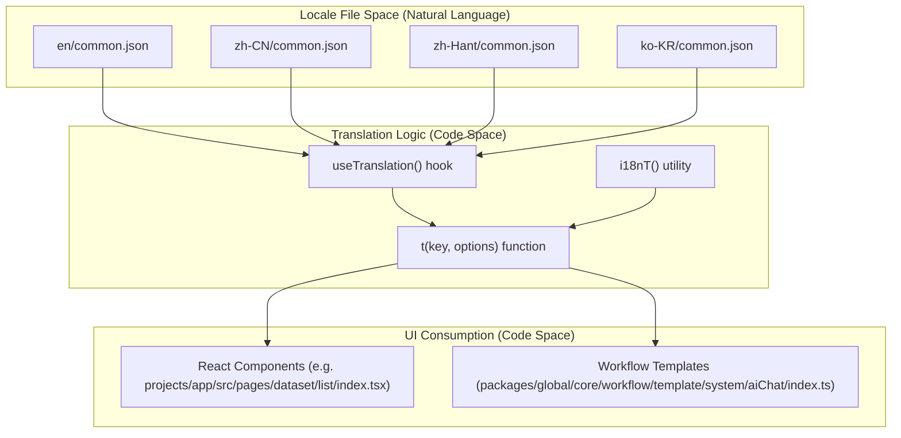
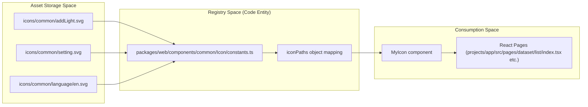

<!-- source: DeepWiki mcp.deepwiki.com · repo labring/FastGPT · page 11 User Interface and Internationalization · fetched 2026-10-29 -->

# User Interface and Internationalization

Relevant source files

The following files were used as context for generating this wiki page:

- [packages/global/openapi/core/app/folder/api.ts](packages/global/openapi/core/app/folder/api.ts)
- [packages/global/openapi/core/app/folder/index.ts](packages/global/openapi/core/app/folder/index.ts)
- [packages/web/components/common/Icon/constants.ts](packages/web/components/common/Icon/constants.ts)
- [packages/web/components/common/MyModal/EditFolderModal.tsx](packages/web/components/common/MyModal/EditFolderModal.tsx)
- [packages/web/components/common/MySlider/InputSlider.tsx](packages/web/components/common/MySlider/InputSlider.tsx)
- [packages/web/i18n/en/app.json](packages/web/i18n/en/app.json)
- [packages/web/i18n/en/common.json](packages/web/i18n/en/common.json)
- [packages/web/i18n/ko-KR/common.json](packages/web/i18n/ko-KR/common.json)
- [packages/web/i18n/zh-CN/app.json](packages/web/i18n/zh-CN/app.json)
- [packages/web/i18n/zh-CN/common.json](packages/web/i18n/zh-CN/common.json)
- [packages/web/i18n/zh-Hant/app.json](packages/web/i18n/zh-Hant/app.json)
- [packages/web/i18n/zh-Hant/common.json](packages/web/i18n/zh-Hant/common.json)
- [projects/app/src/components/core/ai/AISettingModal/index.tsx](projects/app/src/components/core/ai/AISettingModal/index.tsx)
- [projects/app/src/pages/api/core/app/folder/create.ts](projects/app/src/pages/api/core/app/folder/create.ts)
- [projects/app/src/pages/dashboard/agent/index.tsx](projects/app/src/pages/dashboard/agent/index.tsx)
- [projects/app/src/pages/dashboard/tool/index.tsx](projects/app/src/pages/dashboard/tool/index.tsx)

This document provides a high-level overview of FastGPT's user interface architecture, shared component library, and comprehensive internationalization (i18n) system. It outlines how the frontend application is structured within the monorepo, how multi-language support is implemented across namespaces, and how visual workflow editors and configuration flags govern runtime behavior.

For deep dives into specific topics, consult the child pages:
- [Internationalization System](#11.1)
- [Workflow Editor UI](#11.2)
- [Feature Flags and Configuration](#11.3)
- [Shared Web Component Library](#11.4)
- [Documentation Site (document)](#11.5)

---

## UI Architecture Overview

FastGPT's frontend is constructed as a modular Next.js application housed primarily in the `projects/app` directory. It leverages shared UI primitives and design tokens from the `packages/web` package to ensure consistency and reusability. The frontend implements responsive design principles and integrates dynamic routing and conditional rendering based on backend-provided feature flags.

Core UI architectural pillars include:

- **Visual Workflow Orchestration**: The system utilizes the React Flow library to enable node-based visual workflow creation and editing. Complex node templates and input/output bindings allow users to define AI workflows interactively. For implementation details, see [Workflow Editor UI](#11.2).

- **Dynamic Feature Flags & Configuration**: UI elements adapt based on enterprise license tiers (`isPlus`), configuration flags (`feConfigs`), and user permissions. This runtime adaptability governs feature availability, modal dialogs, and user flows, enabling tiered functionality. For specifics, see [Feature Flags and Configuration](#11.3).

- **Reusable Web Component Library**: Common UI elements such as dropdown selects (`MySelect`), modal dialogs (`MyModal`), menu components (`MyMenu`), tables, pagination hooks, and icon sets are packed into the shared component library under `packages/web/components`. This library underpins most frontend pages and features consistent styling and behavior. For full component breakdown, see [Shared Web Component Library](#11.4).

The frontend application controls layout and interaction patterns for key user experiences including AI chat interfaces, dataset management, app/folder browsing, and tool configuration.

Sources: [projects/app/src/pages/dataset/list/index.tsx:1-40](), [projects/app/src/pages/dashboard/agent/index.tsx:1-176]()

---

## Internationalization System

FastGPT employs `next-i18next` as the primary i18n framework for seamless multi-language support in the React/Next.js frontend. It supports main locales: English (`en`), Simplified Chinese (`zh-CN`), Traditional Chinese (`zh-Hant`), and Korean (`ko-KR`).

The internationalization system organizes localized strings into modular JSON namespace files stored under `packages/web/i18n/`. Core namespaces include:

- **common.json**: Contains the majority of general UI labels, action text ("Add", "Cancel", "Save"), error messages, validation prompts, and FAQs on billing and AI points. These are loaded globally across the UI. Example keys include `"not_set"`, `"Action"`, `"Cancel"`, and `"FAQ.ai_point_q"`.
  
- **app.json**: Contains application and plugin-specific UI text such as tool creation labels, permission descriptions, AI setting descriptions, and workflow parameter terms.

- **workflow.json**: Defines UI strings related to workflow node types, node input/output descriptions, editor tooltips, and execution logs.

Locale JSON files include translations for all supported languages to ensure full coverage for global users. Examples for English and Traditional Chinese common namespace files are found respectively at `packages/web/i18n/en/common.json` and `packages/web/i18n/zh-Hant/common.json`.

FastGPT provides an `i18nT` utility and React hooks such as `useTranslation()` to enable components and templates to retrieve localized strings by key.

### Diagram: Natural Language to Code Entity Mapping (i18n)

This diagram illustrates the connection from localized JSON translation files to React UI components and workflow node templates where text is rendered dynamically.

For an architectural deep dive, namespace structure, and translation tooling (including `i18n-ally` integration and translate skills), see [Internationalization System](#11.1).

Sources: [packages/web/i18n/en/common.json:1-150](), [packages/web/i18n/en/app.json:1-50](), [packages/global/core/workflow/template/system/aiChat/index.ts:1-60]()

---

## Icon Registry and Shared Component Architecture

FastGPT centralizes its vector assets for icons in `packages/web/components/common/Icon/constants.ts`. The icon registry defines an `iconPaths` object which lazily imports SVG icons on demand, optimizing bundle sizes and rendering.

The icon registry includes dozens of icons, such as `"common/addLight"`, `"common/closeLight"`, and `"common/language/en"`. Components throughout the UI consume these icons via the `MyIcon` component, passing the icon name to render the correct SVG.

### Diagram: Icon Registry Mapping to Code Space

Apart from icons, the shared component library includes:

- **Form Controls and Select Components**: E.g., `MySelect`, `MultipleSelect`.
- **Modal Dialogs**: Reusable modals like `MyModal` and specific dialogs such as `EditFolderModal`.
- **Menus and Toolbars**: Including dropdown menus (`MyMenu`) and header/navigation components.
- **Tables and Pagination**: Standardized tables with pagination hooks for list views (dataset, apps, workflows).
- **File Upload and Selection**: Components to select or upload files interactively with validation and previews.

The library enforces consistency in layout, styling, and accessibility. Full details on these shared components can be found in [Shared Web Component Library](#11.4).

Sources: [packages/web/components/common/Icon/constants.ts:1-108](), [projects/app/src/components/common/MyModal/EditFolderModal.tsx:1-155](), [projects/app/src/pages/dashboard/agent/index.tsx:1-176]()

---

## Feature Flags and Configuration

FastGPT frontend runtime behavior and feature availability are controlled by a comprehensive set of feature flags and configuration parameters defined in `FastGPTFeConfigsType`. These configs originate from backend initialization APIs and govern aspects like UI visibility, enterprise features, usage limits, and experimental toggles.

Key points include:

- **Enterprise Features (`isPlus`) Flag**: Controls exposure of premium functionality such as advanced dataset management UI modals or AI model controls. The UI applies conditional rendering based on this flag to support different subscription tiers without code duplication.

- **Folder and Depth Limitations**: Configuration parameters like `maxFolderDepth` enforce hierarchical constraints on app and dataset folder nesting within user teams, affecting folder creation dialogs and validations.

- **Conditional Modals and UI Workflows**: Based on config flags, the frontend can enable or disable certain modals, debug panels, and configuration wizards dynamically.

This flexible approach enables FastGPT to provide tailored user experiences across free, paid, and enterprise customers with smooth upgrade paths.

For in-depth discussion on config-driven UI adaptation and feature gating, refer to [Feature Flags and Configuration](#11.3).

Sources: [projects/app/src/pages/dataset/list/index.tsx:70-90](), [projects/app/src/pages/dashboard/agent/index.tsx:1-176]()

---

## Documentation Site (`document/`)

FastGPT hosts its user documentation portal within the `document/` directory, built using Fumadocs on top of Next.js. This portal supports internationalized static and dynamic content, with advanced routing and middleware for permissions and search indexing.

Features include:

- **Multi-language Support**: Documentation pages utilize the same i18n framework as the main app for consistent multilingual content.

- **Search Functionality**: Integrates client and server-side search indexing and query handling for fast lookup of docs.

- **Deployment Ready**: Configured for static export and cloud hosting with incremental builds.

For a comprehensive overview, see [Documentation Site (document)](#11.5).

---

## Child Pages

- [Internationalization System](#11.1) — i18n architecture, `i18nT` utility, namespace JSON files (`zh-CN`, `zh-Hant`, `en`, `ko-KR`), i18n-ally and translation workflows.
- [Workflow Editor UI](#11.2) — React Flow integration, `NodeCard` components, template panels, input/output binders, and debug preview panels.
- [Feature Flags and Configuration](#11.3) — `FastGPTFeConfigsType`, `isPlus` feature gates, and conditional frontend rendering rules.
- [Shared Web Component Library](#11.4) — `packages/web` components including `MySelect`, `MyModal`, `MyMenu`, tables, icon registry, and file selection components.
- [Documentation Site (document)](#11.5) — Fumadocs-based Next.js portal architecture, routing, middleware, and search deployment.

---

This overview unifies the critical user interface architecture components with the internationalization framework and shared infrastructure, showing how they form the foundation of FastGPT's user-facing frontend.

Sources:  
[projects/app/src/pages/dataset/list/index.tsx:1-40]()  
[packages/web/i18n/en/common.json:1-150]()  
[packages/web/i18n/en/app.json:1-50]()  
[packages/web/components/common/Icon/constants.ts:1-108]()  
[projects/app/src/pages/dashboard/agent/index.tsx:1-176]()  
[projects/app/src/components/common/MyModal/EditFolderModal.tsx:1-155]()

---

