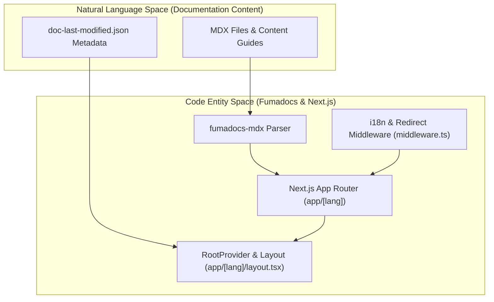
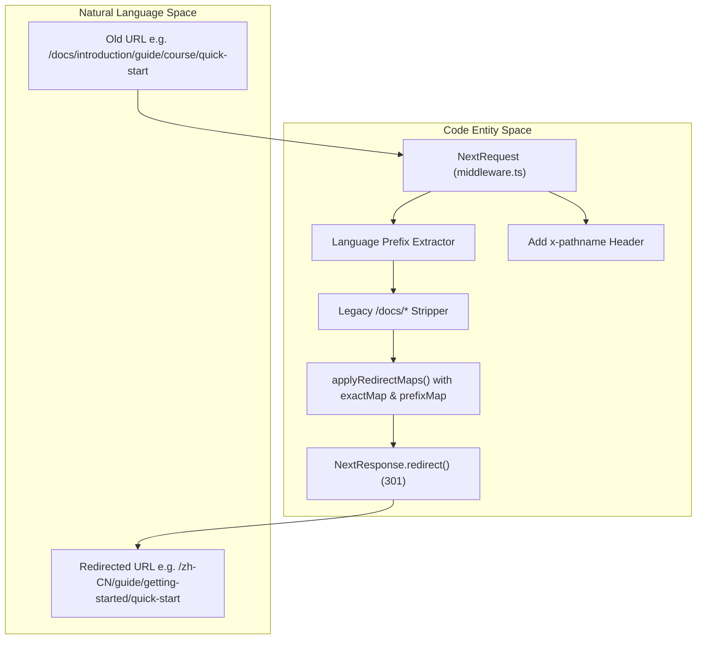
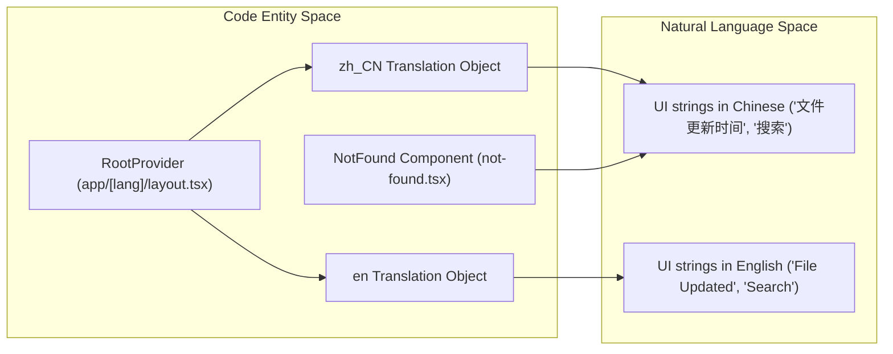
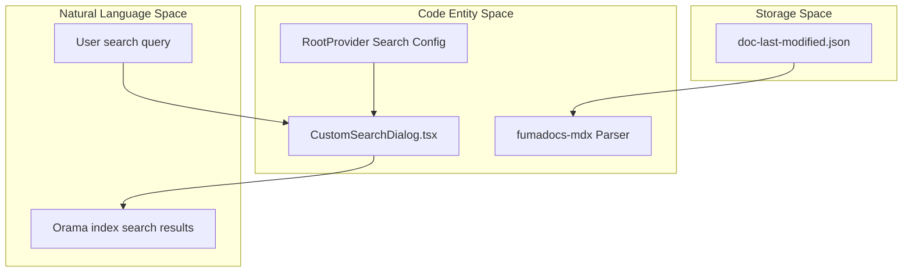
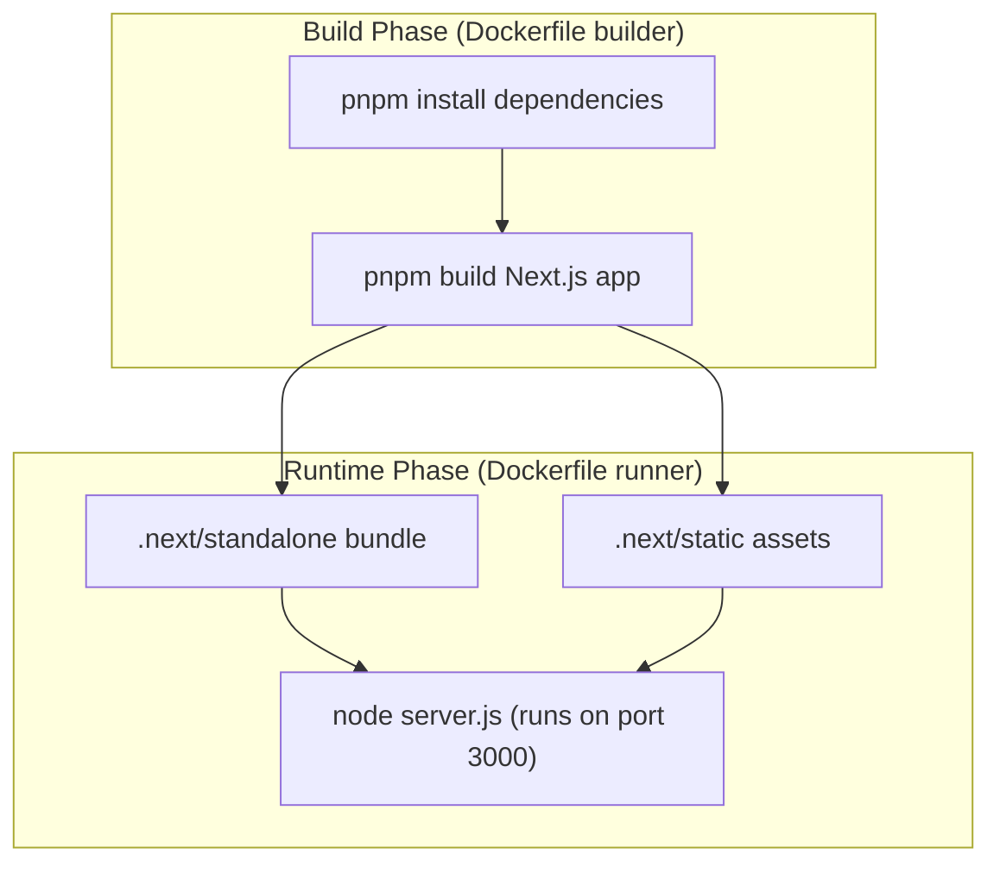

<!-- source: DeepWiki mcp.deepwiki.com · repo labring/FastGPT · page 11.5 Documentation Site (document) · fetched 2026-10-29 -->

# Documentation Site (document)

Relevant source files

The following files were used as context for generating this wiki page:

- [document/.dockerignore](document/.dockerignore)
- [document/.env.template](document/.env.template)
- [document/Dockerfile](document/Dockerfile)
- [document/app/[lang]/layout.tsx](document/app/[lang]/layout.tsx)
- [document/app/not-found.tsx](document/app/not-found.tsx)
- [document/components/CustomSearchDialog.tsx](document/components/CustomSearchDialog.tsx)
- [document/components/docs/not-found.tsx](document/components/docs/not-found.tsx)
- [document/content/faq/chat.en.mdx](document/content/faq/chat.en.mdx)
- [document/content/faq/chat.mdx](document/content/faq/chat.mdx)
- [document/content/self-host/troubleshooting/faq.en.mdx](document/content/self-host/troubleshooting/faq.en.mdx)
- [document/content/self-host/troubleshooting/faq.mdx](document/content/self-host/troubleshooting/faq.mdx)
- [document/content/self-host/upgrading/4-15/41504.en.mdx](document/content/self-host/upgrading/4-15/41504.en.mdx)
- [document/content/self-host/upgrading/4-15/41504.mdx](document/content/self-host/upgrading/4-15/41504.mdx)
- [document/middleware.ts](document/middleware.ts)
- [document/next.config.ts](document/next.config.ts)
- [packages/global/core/ai/model/provider.ts](packages/global/core/ai/model/provider.ts)
- [packages/global/openapi/core/ai/model/api.ts](packages/global/openapi/core/ai/model/api.ts)
- [packages/global/openapi/core/ai/model/index.ts](packages/global/openapi/core/ai/model/index.ts)
- [packages/global/openapi/provider/systemopenapi.ts](packages/global/openapi/provider/systemopenapi.ts)
- [packages/global/test/core/ai/provider.test.ts](packages/global/test/core/ai/provider.test.ts)
- [projects/app/src/pageComponents/model/AddModel.tsx](projects/app/src/pageComponents/model/AddModel.tsx)
- [projects/app/src/pageComponents/model/ModelLinkedChannels.tsx](projects/app/src/pageComponents/model/ModelLinkedChannels.tsx)

## Purpose and Scope

This page documents the architecture, routing, internationalization (i18n), search, metadata tracking, middleware, and the build/deployment pipeline of the FastGPT documentation portal located in the `document/` directory. This portal is a standalone Next.js application built using **Fumadocs**, serving comprehensive, multilingual guides, API references, self-hosting tutorials, release notes, and more for the FastGPT ecosystem [document/package.json:1-4](), [document/package.json:23-27]().

---

## Documentation Site Architecture & Tech Stack

The documentation site is a modern Next.js app leveraging Fumadocs for rich, MDX-based dynamic documentation content [document/package.json:1-4]().

### Core Technology Stack

- **Framework & Rendering**: Next.js with App Router (`app/[lang]/` directory) for file-based localized routing [document/app/[lang]/layout.tsx:1-180]().
- **Documentation Rendering**: Fumadocs libraries (`fumadocs-core`, `fumadocs-ui`, `fumadocs-mdx`) provide MDX content parsing, UI components, and internationalization support [document/package.json:25-27]() ([document/app/[lang]/layout.tsx:10]()).
- **Search Integration**: Orama search client integrated with a custom search dialog UI component [`@orama/orama`] [document/components/CustomSearchDialog.tsx:1-38]()([document/app/[lang]/layout.tsx:158-170]()).
- **Styling**: Tailwind CSS with PostCSS plugins and class-variance-authority enhance UI consistency and reusability [document/package.json:22,45,50]().
- **Content Format**: Documentation content written in MDX format, allowing JSX components within Markdown [document/package.json:26]().

### Data Flow Diagram: Documentation Content to Rendered Pages

Sources: [document/package.json:1-58](), [document/app/[lang]/layout.tsx:1-171](), [document/middleware.ts:1-194]()

---

## Routing, Middleware, and Redirects

The documentation site uses Next.js App Router for route handling with localized language prefixes (e.g., `/en`, `/zh-CN`). Special legacy paths like `/docs/*` and moved documentation sections are gracefully redirected using custom middleware logic in `document/middleware.ts` [document/middleware.ts:1-194]().

### Middleware Responsibilities

- **Language Extraction**: Extracts language prefix from incoming request URLs to support multi-language routing, defaulting to a base language if none is found [document/middleware.ts:122-132]().
- **Legacy `/docs/*` Path Stripping and Redirects**: Converts old URLs starting with `/docs` into new canonical paths by removing `/docs` and applying exact and prefix-based redirect mappings [document/middleware.ts:134-141]().
- **Redirect Maps**:
  - `exactMap`: Maps specific paths (e.g., `/upgrading/intro`) to new locations (e.g., `/self-host/upgrading/upgrade-instruction`)
  - `prefixMap`: Maps entire path prefixes for groups of documentation that were reorganized (e.g., `/FAQ` → `/faq`) [document/middleware.ts:7-92,101-109]().
- **Request Header Enhancement**: Injects an `x-pathname` header with the original pathname to allow server components such as layout or page components to react based on the requested route [document/middleware.ts:151-155]().

### Middleware Flowchart

Sources: [document/middleware.ts:1-159]()

---

## Internationalization (i18n)

The documentation supports multilingual content and UI translation via Fumadocs's i18n system integrated into the Next.js app layout and middleware [document/app/[lang]/layout.tsx:1-180]().

### Supported Locales

- English (`en`)
- Simplified Chinese (`zh-CN`)

### Translation and Locale Configuration

- The `RootProvider` from Fumadocs UI injects locale settings and translation objects into the React component tree for localized rendering [document/app/[lang]/layout.tsx:157-176]().
- Translations cover common UI terms such as "search," "next page," "last update," and navigation-related strings [document/app/[lang]/layout.tsx:12-33]().

### Fallback Handling for Missing Pages

- The client-side `NotFound` component redirects users back to the default getting-started page in the current language, preventing 404s [document/components/docs/not-found.tsx:1-19]().

### i18n Data Flow Diagram

Sources: [document/app/[lang]/layout.tsx:1-180](), [document/components/docs/not-found.tsx:1-19]()

---

## Search and Metadata Tracking

### Search Implementation

- The search UI is a custom React component `CustomSearchDialog` wrapping Fumadocs's search hook linked to an Orama search backend [document/components/CustomSearchDialog.tsx:1-38]().
- Configured in `RootProvider` with the locale and API endpoint `/api/search` [document/app/[lang]/layout.tsx:158-170]().

### Document Metadata Tracking

- A JSON file `doc-last-modified.json` centrally tracks last modification timestamps of all MDX files, enabling "File Updated" indicators on pages [document/app/[lang]/layout.tsx:16-17]().
- Repository scripts (`initDocTime`, `initDocToc`, `checkDocRefs`) maintain the metadata and link integrity for the documentation content [document/package.json:10-16]().

### Search and Metadata Data Flow Diagram

Sources: [document/package.json:10-16](), [document/app/[lang]/layout.tsx:158-170](), [document/components/CustomSearchDialog.tsx:1-38]()

---

## Build and Deployment Pipeline

The documentation site uses a multi-stage Docker build producing a standalone Next.js deployment container optimized for production [document/Dockerfile:1-54]().

### Docker Build Stages

| Stage    | Description                                                  |
|----------|--------------------------------------------------------------|
| **builder** | Installs dependencies (`pnpm install`), builds project (`pnpm build`), and injects runtime environment variables such as `FASTGPT_HOME_DOMAIN` and DocTrack analytics config [document/Dockerfile:1-34]() |
| **runner**  | Copies build output including `.next/standalone`, public assets, sets up non-root user (`nextjs`), installs `curl`, and runs `node server.js` exposed on port 3000 [document/Dockerfile:37-54]() |

### Next.js Configuration

- Custom next.config.ts configures output to `'standalone'` mode for optimized deployment.
- Adds important includes for Node.js ESM helper tracing due to Node 24 compatibility [document/next.config.ts:6-58]().
- Sets response headers explicitly for `/deploy/:path*` routes.
- Enables remote images from known domains and allows SVGs (dangerouslyAllowSVG) ensuring documentation site flexibility in content [document/next.config.ts:18-55]().

### Build and Deployment Flow Diagram

Sources: [document/Dockerfile:1-54](), [document/next.config.ts:1-58]()

---

# Summary

The documentation site in `document/` is a sophisticated Next.js/Fumadocs-based portal providing multilingual, searchable, and well-organized documentation for FastGPT. Its routing middleware preserves backward compatibility of URLs, while i18n features and search integration provide user-friendly access. The portal is built with a modern, container-friendly pipeline optimized for standalone, production-grade deployments.

This architecture tightly couples the natural language space of documentation content authored in MDX with the code entity space of Next.js routes, Fumadocs rendering components, search APIs, and middleware for internationalization and redirects, ensuring a smooth and scalable documentation experience for developers and users.

---

# References to Code Entities Cited

- `document/middleware.ts` — routing middleware implementing language extraction and redirects.
- `document/app/[lang]/layout.tsx` — layout React component setting up Fumadocs providers, translations, and metadata.
- `document/components/CustomSearchDialog.tsx` — custom search UI integrating Orama search.
- `document/components/docs/not-found.tsx` — client-side 404 fallback redirect.
- `document/Dockerfile` — multi-stage Docker build for the documentation site.
- `document/next.config.ts` — Next.js build and runtime configuration.
- `document/package.json` — shows dependency libraries including Fumadocs and Orama.

These files collectively implement the documentation portal routing, internationalization, search, metadata, build, and deployment aspects documented above.

---

