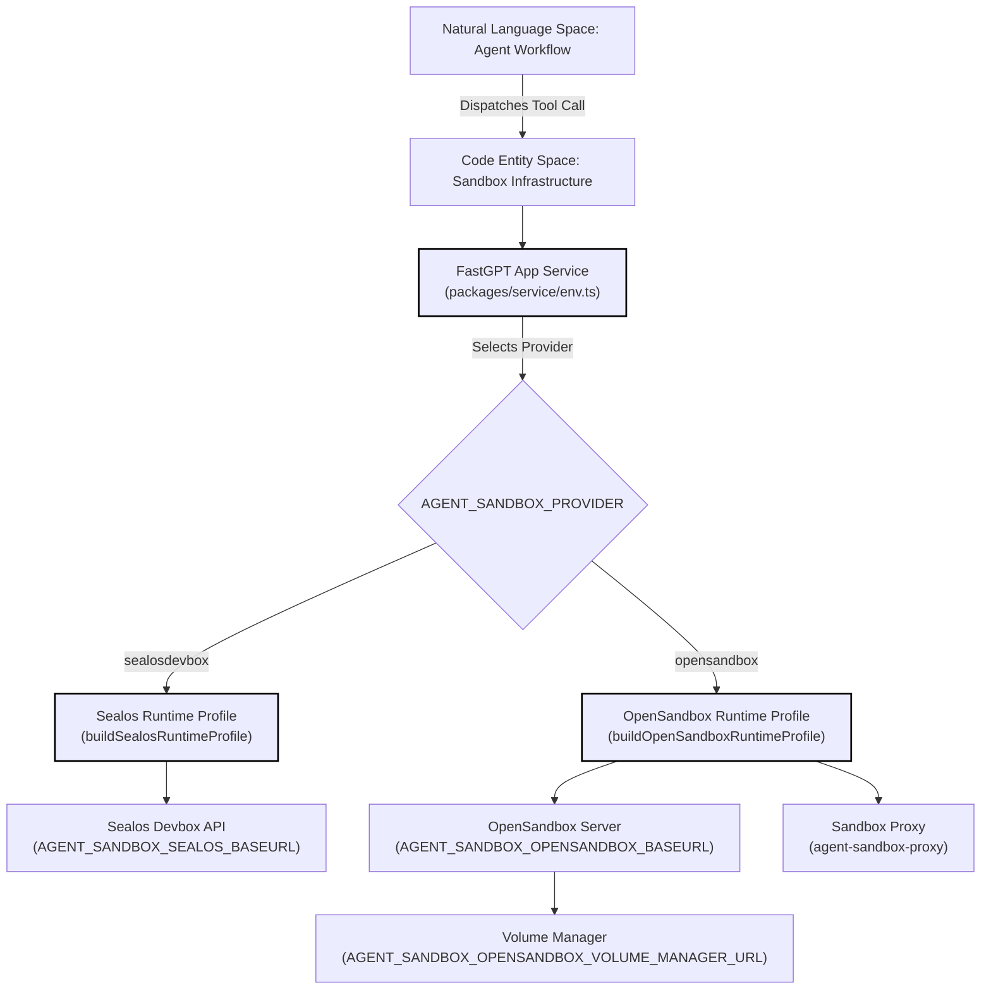
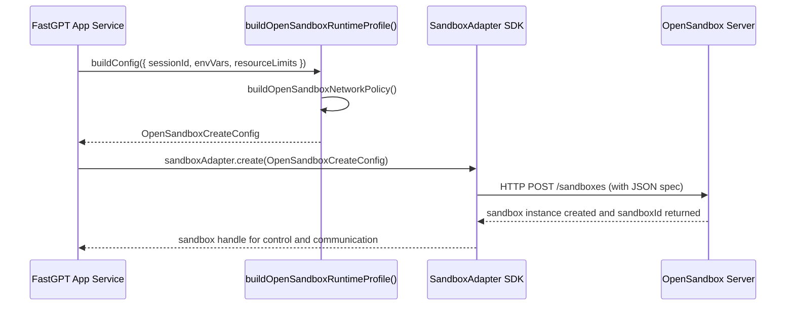

<!-- source: DeepWiki mcp.deepwiki.com · repo labring/FastGPT · page 13.3 Agent Sandbox and OpenSandbox · fetched 2026-10-29 -->

# Agent Sandbox and OpenSandbox

<details>
<summary>Relevant source files</summary>

The following files were used as context for generating this wiki page:

- [.forgejo/workflows/build-agent-sandbox.yml](.forgejo/workflows/build-agent-sandbox.yml)
- [.forgejo/workflows/build-code-sandbox.yml](.forgejo/workflows/build-code-sandbox.yml)
- [.forgejo/workflows/build-fastgpt-ide-agent.yml](.forgejo/workflows/build-fastgpt-ide-agent.yml)
- [.forgejo/workflows/build-fastgpt.yml](.forgejo/workflows/build-fastgpt.yml)
- [.forgejo/workflows/build-marketplace.yml](.forgejo/workflows/build-marketplace.yml)
- [.forgejo/workflows/build-mcp-server.yml](.forgejo/workflows/build-mcp-server.yml)
- [.github/workflows/build-browser-sandbox.yml](.github/workflows/build-browser-sandbox.yml)
- [document/content/self-host/config/env.en.mdx](document/content/self-host/config/env.en.mdx)
- [document/content/self-host/config/env.mdx](document/content/self-host/config/env.mdx)
- [packages/global/common/system/types/index.ts](packages/global/common/system/types/index.ts)
- [packages/global/openapi/common/system/api.ts](packages/global/openapi/common/system/api.ts)
- [packages/service/env.ts](packages/service/env.ts)
- [packages/service/support/permission/memberGroup/teamDefaultGroup.ts](packages/service/support/permission/memberGroup/teamDefaultGroup.ts)
- [packages/service/test/env.test.ts](packages/service/test/env.test.ts)
- [packages/service/test/support/permission/memberGroup/teamDefaultGroup.test.ts](packages/service/test/support/permission/memberGroup/teamDefaultGroup.test.ts)
- [packages/service/test/support/user/team/controller.test.ts](packages/service/test/support/user/team/controller.test.ts)
- [projects/app/.env.template](projects/app/.env.template)
- [projects/app/src/env.ts](projects/app/src/env.ts)
- [projects/app/src/pageComponents/admin/config/ImportPluginModal.tsx](projects/app/src/pageComponents/admin/config/ImportPluginModal.tsx)
- [projects/app/src/pageComponents/admin/config/ToolProvider.tsx](projects/app/src/pageComponents/admin/config/ToolProvider.tsx)
- [projects/app/src/pages/config/tool/marketplace.tsx](projects/app/src/pages/config/tool/marketplace.tsx)
- [projects/app/src/pages/dashboard/systemTool/index.tsx](projects/app/src/pages/dashboard/systemTool/index.tsx)
- [projects/app/src/service/common/system/index.ts](projects/app/src/service/common/system/index.ts)

</details>


## Purpose and Scope

This page documents the agent sandbox execution subsystem in FastGPT (Section 13.3). It covers the architectural design and implementation details of agent sandbox providers (`sealosdevbox` and `opensandbox`), runtime profiles, the proxy sidecar (`agent-sandbox-proxy`), volume management, and the `sandbox-adapter` SDK. FastGPT employs these components to securely execute untrusted code, run agent loops, and mount persistent workspaces within isolated runtime environments.

---

## 1. Sandbox Providers and System Architecture

FastGPT abstracts containerized execution environments through a provider pattern configured via the environment variable `AGENT_SANDBOX_PROVIDER`. This environment variable accepts values `sealosdevbox` or `opensandbox`. When unset, the agent sandbox is disabled.

- `sealosdevbox`: Uses Sealos Devbox API as the backend to run sandboxes.
- `opensandbox`: Uses OpenSandbox server with Docker or Kubernetes runtimes.

The FastGPT App Service selects the provider based on configuration, then orchestrates agent sandbox lifecycle management via the corresponding runtime profile and API endpoints.

### Architecture Diagram: Agent Sandbox Provider Selection



*Sources: [projects/app/.env.template:48](), [packages/service/env.ts:88-90](), [packages/service/core/ai/sandbox/infrastructure/provider/runtimeProfile/sealosdevbox.ts:17-40](), [packages/service/core/ai/sandbox/infrastructure/provider/runtimeProfile/opensandbox.ts:65-130]()*


---

## 2. Runtime Profiles and Configuration

Runtime profiles are responsible for translating FastGPT's high-level sandboxing requirements into provider-specific configurations and API calls. They encapsulate resource constraints, environment variables, network policies, and container lifecycle directives.

### Environment Configuration Parameters

Key environment variables controlling agent sandbox behavior are validated by Zod schemas in `packages/service/env.ts`. Important parameters include:

| Environment Variable                           | Default       | Description                                                                                   |
|-----------------------------------------------|---------------|-----------------------------------------------------------------------------------------------|
| `AGENT_SANDBOX_PROVIDER`                       | _none_        | Selected sandbox provider; `sealosdevbox` or `opensandbox`. When empty, sandbox is disabled. |
| `AGENT_SANDBOX_CPU_COUNT`                      | `1`           | Max CPU cores assigned per sandbox instance.                                                 |
| `AGENT_SANDBOX_MEMORY_MIB`                     | `2048`        | Max memory (MiB) assigned per sandbox instance.                                              |
| `AGENT_SANDBOX_STORAGE_SIZE_GI`                | `1`           | Persistent storage size in Gi for sandbox volumes.                                           |
| `AGENT_SANDBOX_OPENSANDBOX_BASEURL`            | _none_        | Base URL of OpenSandbox server (required if `opensandbox` used).                             |
| `AGENT_SANDBOX_OPENSANDBOX_API_KEY`            | _none_        | API key for authenticating requests to OpenSandbox server.                                  |
| `AGENT_SANDBOX_OPENSANDBOX_RUNTIME`            | `docker`      | Runtime engine for OpenSandbox: `docker` or `kubernetes`.                                   |
| `AGENT_SANDBOX_OPENSANDBOX_IMAGE`              | _none_        | Agent sandbox Docker image to use for OpenSandbox provider.                                 |
| `AGENT_SANDBOX_PROXY_SECRET`                    | _none_        | Shared HMAC secret between FastGPT and sandbox proxy for secure connection validation.      |
| `AGENT_SANDBOX_PROXY_URL`                        | _none_        | WebSocket URL for browser clients to connect to sandbox proxy.                              |
| `AGENT_SANDBOX_PREVIEW_PROXY_URL`                | _none_        | HTTP URL for file preview proxy of sandbox contents.                                        |
| `AGENT_SANDBOX_OPENSANDBOX_VOLUME_MANAGER_URL`  | _none_        | URL for OpenSandbox persistent volume manager service.                                      |
| `AGENT_SANDBOX_OPENSANDBOX_VOLUME_MANAGER_TOKEN`| _none_        | Token to authenticate with the volume manager.                                              |
| `AGENT_SANDBOX_OPENSANDBOX_VOLUME_NAME_PREFIX`  | `fastgpt-session` | PVC or volume naming prefix to identify persistent volumes.                                |

These environment variables configure resource limits, image selection, network isolation, volume management, and security credentials for the agent sandboxes [packages/service/env.ts:87-162](), [projects/app/.env.template:52-101]().

---

### OpenSandbox Runtime Profile

The `buildOpenSandboxRuntimeProfile` function defines the specifics of OpenSandbox instances, including:

- Fixed root workspace path: `/workspace` (exported constant `OPEN_SANDBOX_DEFAULT_ROOT_PATH`).
- Entrypoint command, environment variables, and mount settings.
- Network egress deny rules blocking internal/private IP ranges and localhost.
- Conditional runtime support for Docker or Kubernetes.
- Integration with a volume manager for persistent workspace volumes.
- WebSocket and HTTP preview proxy configuration.

This is implemented in TypeScript under `packages/service/core/ai/sandbox/infrastructure/provider/runtimeProfile/opensandbox.ts`. It constructs an `OpenSandboxCreateConfig` that the sandbox-adapter SDK consumes to create sandbox instances [packages/service/core/ai/sandbox/infrastructure/provider/runtimeProfile/opensandbox.ts:65-130]().

---

#### OpenSandbox Runtime Profile: API Interaction Sequence



*Sources: [packages/service/core/ai/sandbox/infrastructure/provider/runtimeProfile/opensandbox.ts:65-130](), [.agents/issue/sandbox/opensandbox-docker-security-review.md:100-145]()*


---

## 3. Sandbox-Adapter SDK and Create Specifications

FastGPT uses the `sandbox-adapter` package providing a unified TypeScript interface to communicate with different sandbox infrastructures. This SDK abstracts the lifecycle management operations like creating, executing commands, streaming logs, and background execution inside sandboxes.

### Core SDK Entities and Usage

- **`SandboxCreateSpec`** defines fields such as:
  - `image`: Docker image to run.
  - `metadata`: An object with session identifiers and labels.
  - `env`: Environment variables for the sandbox container.
  - `workingDir`: Root working directory inside the container (`/workspace` for OpenSandbox).
  - `cpuCount`, `memoryMiB`, `storageSize`: Resource quotas.
  - `networkPolicy`: Defines allow/deny rules for egress IPs (OpenSandbox supports complex policies).
- **Execution Methods**:
  - `execute(command, options)`: Execute shell commands synchronously with a timeout.
  - `executeStream(command)`: Run commands streaming output back in real-time.
  - `executeBackground(command)`: Launch async persistent processes inside sandbox.
  
- **Constants**:
  - `OPEN_SANDBOX_DEFAULT_ROOT_PATH = '/workspace'`: canonical root path inside all OpenSandbox containers.

The SDK uses HTTP/REST APIs to talk to the respective provider endpoints and standardizes behavior across providers [sandbox-adapter SDK files and docs](), [.agents/issue/sandbox/opensandbox-docker-security-review.md:94-105, 190-195]().

---

## 4. Volume Manager and Proxy Sidecar Integration

### Persistent Volume Manager

To support permanent storage for agent sandboxes (e.g., caching dependencies, saving workspace files), OpenSandbox leverages a dedicated volume manager.

- Configured via `AGENT_SANDBOX_OPENSANDBOX_VOLUME_MANAGER_URL` and `AGENT_SANDBOX_OPENSANDBOX_VOLUME_MANAGER_TOKEN`.
- Stores Persistent Volume Claims (PVC) or volumes using a prefix, defaulting to `fastgpt-session`.
- Allows sandbox instances to mount these volumes across runs to keep state.

Start points include environment guidance in `.env.template` and related schema validation in `packages/service/env.ts` [projects/app/.env.template:65-72](), [packages/service/env.ts:120-130]().

---

### Agent Sandbox Proxy (agent-sandbox-proxy)

FastGPT includes a Rust-based sidecar proxy service (`agent-sandbox-proxy`) that acts as a secure intermediary for:

- Browser WebSocket connections to running sandboxes (e.g., for terminal interaction, shell streaming, file editing).
- HTTP preview proxy for sandboxed workspace files and apps.

The proxy is configured by these environment variables:

| Env Variable                  | Purpose                                                              |
|------------------------------|----------------------------------------------------------------------|
| `AGENT_SANDBOX_PROXY_SECRET` | HMAC secret for authenticating client and server WebSocket messages. |
| `AGENT_SANDBOX_PROXY_URL`    | Public WebSocket endpoint URL for sandbox connections.                |
| `AGENT_SANDBOX_PREVIEW_PROXY_URL` | Public HTTP/HTTPS URL for serving sandbox file previews.           |

The proxy sidecar enforces authentication and isolates sandbox network traffic securely. The shared `AGENT_SANDBOX_PROXY_SECRET` must be a long, random string (minimum 32 characters) to ensure the physical and network security boundary [projects/app/.env.template:89-99](), [packages/service/env.ts:71-86]().

---

## 5. Security and Network Isolation

Security design assumes execution of untrusted or model-generated code inside sandboxes.

### Security Boundaries

- **User Isolation**: OpenSandbox images run as a dedicated non-root user (`sandbox` with UID 10001). The `/workspace` directory is owned and writable exclusively by this user, preventing privilege escalation or data leakage [opensandbox-docker-security-review.md:160-175]().

- **Network Egress Policies**:
  - **Docker Runtime**: Injected explicit `deny` CIDR blocks for:
    - Loopback interfaces (`127.0.0.0/8`, `localhost`).
    - Link-local addresses (`169.254.0.0/16`).
    - RFC1918 private IP ranges (`10.0.0.0/8`, `172.16.0.0/12`, `192.168.0.0/16`).
    - Docker host gateway aliases (`host.docker.internal`, `host.orb.internal`).
    This restricts sandbox containers from reaching internal cluster or server resources while permitting public internet access [opensandbox-docker-security-review.md:112-125]().

  - **Kubernetes Runtime**: Security handled with `CiliumNetworkPolicy` resources restricting cross-namespace and cluster internal communication based on pod labels (`k8s:opensandbox.io/id`). This approach avoids granting additional privileges to sandbox sidecars and keeps isolation declarative [opensandbox-docker-security-review.md:37-48]().

- **API Key Validation**: The OpenSandbox provider requires a non-empty `AGENT_SANDBOX_OPENSANDBOX_API_KEY`. FastGPT refuses to initialize the environment without this to avoid open proxy risks [opensandbox-docker-security-review.md:15]().

---

## 6. Summary Diagram: Natural Language to Code Entities

```mermaid
graph TD
    NL["Natural Language Space:\nAgent Sandbox Execution"]
    CE["Code Entity Space:\nRelevant Code & Configs"]

    NL -->|Sandbox Provider Configuration| EnvVars[/"AGENT_SANDBOX_PROVIDER\nAGENT_SANDBOX_*\n(.env and env.ts)"/]
    EnvVars -->|Validated by| ServiceEnv["`serviceEnv` (packages/service/env.ts)"]

    ServiceEnv -->|Defines runtime profiles| RuntimeProfiles["`buildSealosRuntimeProfile` & `buildOpenSandboxRuntimeProfile`\n(packages/service/core/ai/sandbox/infrastructure/provider/runtimeProfile)"]

    RuntimeProfiles -->|Produce| SandboxCreateConfigs["SandboxCreateSpec\n(sandbox-adapter SDK)"]

    SandboxCreateConfigs -->|Control| ProvidersAPI["Sealos Devbox API\nOpenSandbox API Server"]

    ProvidersAPI -->|Manage sandbox lifecycle| Containers["Container runtimes\nDocker / Kubernetes"]

    RuntimeProfiles -->|Configure| ProxySidecar["agent-sandbox-proxy (Rust Proxy)"]
    RuntimeProfiles -->|Mount volumes from| VolumeManager["Volume Manager Service"]

    NL -.->|Agent workflow calls| SandboxCreateConfigs
```

*Sources: [packages/service/env.ts:20-160](), [packages/service/core/ai/sandbox/infrastructure/provider/runtimeProfile/sealosdevbox.ts:10-45](), [packages/service/core/ai/sandbox/infrastructure/provider/runtimeProfile/opensandbox.ts:10-130](), [projects/app/.env.template:50-100](), [.agents/issue/sandbox/opensandbox-docker-security-review.md:5-70]()*

---

# References

- **Environment Configuration and Defaults**

  - `projects/app/.env.template`: Full list of env vars including agent sandbox [lines 52-99]()
  - `packages/service/env.ts`: Zod schema validation for env vars [lines 80-162]()

- **Runtime Profiles**

  - Sealos Devbox runtime profile implementation [buildSealosRuntimeProfile](`packages/service/core/ai/sandbox/infrastructure/provider/runtimeProfile/sealosdevbox.ts:10-45`)  
  - OpenSandbox runtime profile implementation [buildOpenSandboxRuntimeProfile](`packages/service/core/ai/sandbox/infrastructure/provider/runtimeProfile/opensandbox.ts:65-130`)

- **Sandbox Adapter SDK**

  - Specification and SDK methods [sandbox-adapter docs and .agents/issue/sandbox/opensandbox-docker-security-review.md:94-105, 189-195]()

- **Security and Network Isolation**

  - OpenSandbox Docker security review [opensandbox-docker-security-review.md:5-70, 100-145]()

- **Proxy and Volume Manager**

  - Proxy environment and integration [projects/app/.env.template:89-99](), [packages/service/env.ts:69-86]()


---

This detailed page presents the foundational components and configuration required for running isolated agent sandbox environments in FastGPT with a focus on the OpenSandbox option while noting the legacy Sealos provider. The sandboxing facilities enable safe and resource-managed execution of dynamically generated code within the FastGPT ecosystem.

---

