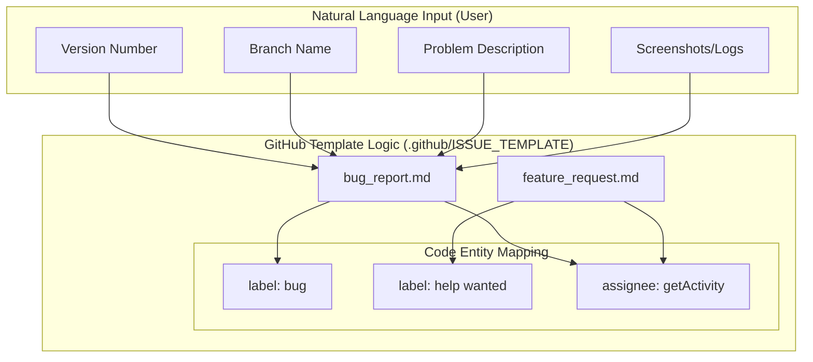
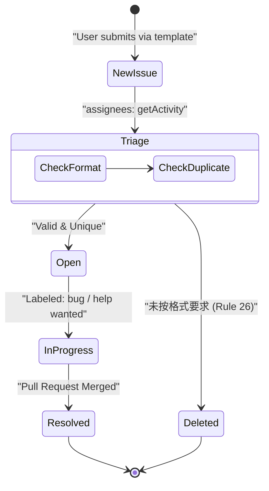

<!-- source: DeepWiki mcp.deepwiki.com · repo jeecgboot/JeecgBoot · page 10.2 Issue Reporting & Bug Submission · fetched 2026-10-29 -->

# Issue Reporting & Bug Submission

Relevant source files

The following files were used as context for generating this wiki page:

- [.github/ISSUE_TEMPLATE/bug_report.md](.github/ISSUE_TEMPLATE/bug_report.md)
- [.github/ISSUE_TEMPLATE/feature_request.md](.github/ISSUE_TEMPLATE/feature_request.md)

## Overview

JeecgBoot utilizes GitHub's issue template system to standardize the collection of bug reports and feature requests. These templates ensure that developers receive necessary technical context—such as version numbers, branch names, and visual evidence—to diagnose issues effectively.

**Template locations:**
- Bug reports: [.github/ISSUE_TEMPLATE/bug_report.md:1-29]()
- Feature requests: [.github/ISSUE_TEMPLATE/feature_request.md:1-28]()

**Sources:** [.github/ISSUE_TEMPLATE/bug_report.md:1-29](), [.github/ISSUE_TEMPLATE/feature_request.md:1-28]()

---

## Issue Template System

### Template Configuration & Data Flow

The issue submission process maps natural language reports into structured GitHub entities (labels and assignees) and provides specific fields for technical data.

**Sources:** [.github/ISSUE_TEMPLATE/bug_report.md:1-5](), [.github/ISSUE_TEMPLATE/feature_request.md:1-5]()

---

## Bug Report Specification

The bug report template [.github/ISSUE_TEMPLATE/bug_report.md:1-29]() is designed to capture regression data and environment specifics.

### Metadata Configuration
- **Name**: `提交 Bug` (Submit Bug) [.github/ISSUE_TEMPLATE/bug_report.md:2]()
- **Labels**: `bug` [.github/ISSUE_TEMPLATE/bug_report.md:4]()
- **Default Assignee**: `getActivity` [.github/ISSUE_TEMPLATE/bug_report.md:5]()

### Mandatory Data Fields
Users are required to fill the following sections in the markdown body:

| Field (Markdown Header) | Description | Source |
|:---|:---|:---|
| `##### 版本号：` | The specific release version (e.g., 3.7.0) | [.github/ISSUE_TEMPLATE/bug_report.md:10]() |
| `##### 分支：` | The Git branch where the bug occurs (e.g., `master`, `boot3`) | [.github/ISSUE_TEMPLATE/bug_report.md:13]() |
| `##### 问题描述：` | Steps to reproduce and expected vs actual behavior | [.github/ISSUE_TEMPLATE/bug_report.md:16]() |
| `##### 错误截图：` | Visual evidence, console logs, or stack traces | [.github/ISSUE_TEMPLATE/bug_report.md:20]() |

**Sources:** [.github/ISSUE_TEMPLATE/bug_report.md:10-20]()

---

## Feature Request Specification

The feature request template [.github/ISSUE_TEMPLATE/feature_request.md:1-28]() focuses on architectural improvements and new capabilities.

### Metadata Configuration
- **Name**: `提交建议` (Submit Suggestion) [.github/ISSUE_TEMPLATE/feature_request.md:2]()
- **Labels**: `help wanted` [.github/ISSUE_TEMPLATE/feature_request.md:4]()
- **Default Assignee**: `getActivity` [.github/ISSUE_TEMPLATE/feature_request.md:5]()

### Data Fields
| Field (Markdown Header) | Purpose | Source |
|:---|:---|:---|
| `##### 版本号：` | Current version lacking the feature | [.github/ISSUE_TEMPLATE/feature_request.md:9]() |
| `##### 分支：` | Target branch for the enhancement | [.github/ISSUE_TEMPLATE/feature_request.md:12]() |
| `##### 问题描述：` | Use case and functional requirements | [.github/ISSUE_TEMPLATE/feature_request.md:15]() |
| `##### 错误截图：` | UI mockups or architectural diagrams | [.github/ISSUE_TEMPLATE/feature_request.md:19]() |

**Sources:** [.github/ISSUE_TEMPLATE/feature_request.md:9-19]()

---

## Submission Quality Requirements

JeecgBoot enforces strict quality controls on issue submissions to maintain project velocity. Issues that fail these criteria are subject to immediate deletion.

### Enforcement Rules

| Rule | Description | Source |
|:---|:---|:---|
| **Format Adherence** | Issues not following the template structure will be deleted. | [.github/ISSUE_TEMPLATE/bug_report.md:26]() |
| **Detail Depth** | Vague or overly simple descriptions are rejected. | [.github/ISSUE_TEMPLATE/bug_report.md:26]() |
| **Visual Context** | Reports should be "图文并茂" (rich with text and images). | [.github/ISSUE_TEMPLATE/bug_report.md:27]() |
| **Branch Specification** | If not using `master`, the specific branch must be stated. | [.github/ISSUE_TEMPLATE/bug_report.md:28]() |

**Sources:** [.github/ISSUE_TEMPLATE/bug_report.md:25-29](), [.github/ISSUE_TEMPLATE/feature_request.md:24-28]()

---

## Issue Lifecycle Management

The following diagram illustrates how an issue progresses from submission to resolution within the repository workflow.

**Sources:** [.github/ISSUE_TEMPLATE/bug_report.md:4-5](), [.github/ISSUE_TEMPLATE/bug_report.md:25-28]()

---

## Technical Guidelines for Reporting

### Capturing Logs and Stack Traces
When filling the `问题描述` (Problem Description) or `错误截图` (Screenshots) sections, developers should include:

1.  **Backend Logs**: Output from `jeecg-boot-system` or specific microservices.
2.  **Browser Console**: JavaScript errors or network failures (403, 500 errors).
3.  **Database State**: For data-related bugs, include the relevant table rows (e.g., from `sys_user` or `airag_model`).

### Versioning Context
Since JeecgBoot supports multiple architectures, users must specify if they are using:
- **Monolithic**: `jeecg-boot`
- **Microservices**: `jeecg-boot-cloud`
- **Frontend**: `jeecgboot-vue3`

**Sources:** [.github/ISSUE_TEMPLATE/bug_report.md:10-13](), [.github/ISSUE_TEMPLATE/feature_request.md:9-12]()

---

