# Page: JeecgBoot Overview

# JeecgBoot Overview

<details>
<summary>Relevant source files</summary>

The following files were used as context for generating this wiki page:

- [README-AI.md](README-AI.md)
- [README.en-US.md](README.en-US.md)
- [README.ja-JP.md](README.ja-JP.md)
- [README.md](README.md)
- [jeecg-boot/CLAUDE.md](jeecg-boot/CLAUDE.md)
- [jeecg-boot/README.md](jeecg-boot/README.md)
- [jeecg-boot/jeecg-boot-base-core/pom.xml](jeecg-boot/jeecg-boot-base-core/pom.xml)
- [jeecg-boot/jeecg-boot-base-core/src/main/java/org/jeecg/common/util/encryption/AesEncryptUtil.java](jeecg-boot/jeecg-boot-base-core/src/main/java/org/jeecg/common/util/encryption/AesEncryptUtil.java)
- [jeecg-boot/jeecg-boot-base-core/src/main/java/org/jeecg/config/shiro/ShiroConfig.java](jeecg-boot/jeecg-boot-base-core/src/main/java/org/jeecg/config/shiro/ShiroConfig.java)
- [jeecg-boot/jeecg-boot-module/jeecg-boot-module-airag/pom.xml](jeecg-boot/jeecg-boot-module/jeecg-boot-module-airag/pom.xml)
- [jeecg-boot/pom.xml](jeecg-boot/pom.xml)
- [jeecgboot-vue3/README.md](jeecgboot-vue3/README.md)

</details>


## Purpose and Scope

This document introduces JeecgBoot as an enterprise-level AI low-code development platform, explaining its core value proposition and position in the enterprise software ecosystem. It provides the conceptual foundation for understanding how JeecgBoot combines code generation, visual development, and AI capabilities into a unified platform.

For detailed technical information:
- Complete feature list: see [Key Features & Capabilities](#1.1)
- Technology stack details: see [Technology Stack](#1.2)
- System requirements: see [System Requirements & Environment Setup](#1.3)
- Quick start instructions: see [Quick Start Guide](#1.4)
- Architecture details: see [Architecture](#2)
- AI platform capabilities: see [AI Platform (AIGC)](#3)
- Low-code features: see [Low-Code Development Platform](#5)

## What is JeecgBoot?

JeecgBoot is an enterprise-grade AI-enhanced low-code development platform built on Spring Boot 4.1.0, Vue 3, and Spring Cloud Alibaba 2025.1.0.0. The platform provides three development approaches:

1. **Code Generation** - Maven-based code generator producing Vue3 + Spring Boot code [jeecg-boot/pom.xml:79]().
2. **OnlineCoding** - Zero-code visual configuration for forms, reports, and charts [README.md:143-145]().
3. **AI Platform** - LLM integration via `jeecg-boot-module-airag` module with RAG and workflow orchestration [jeecg-boot/jeecg-boot-module/jeecg-boot-module-airag/pom.xml:12]().

The architecture supports two deployment modes:
- **Monolithic**: `jeecg-system-start` (single JAR, port 8080) [CLAUDE.md:20-22]().
- **Microservices**: `jeecg-cloud-gateway` (port 9999) → `jeecg-system-cloud-start` (port 7001) [CLAUDE.md:67-68]().

**Current Version**: 3.9.3 (Released: July 7, 2026) [README.md:8-9]()
**License**: Apache License 2.0 [README.md:11]()
**Vendor**: Beijing Guoju Software (北京国炬软件) [README.md:12]()

Sources: [README.md:1-45](), [jeecg-boot/README.md:1-33](), [jeecg-boot/pom.xml:1-86](), [CLAUDE.md:1-65]()

## Core Value Proposition

JeecgBoot addresses the automation vs. flexibility trade-off through a four-tier development paradigm: "AI Generate → Online Configuration → Code Generation → Manual Merge" [README.md:27]().

**Four-Tier Development Flow**

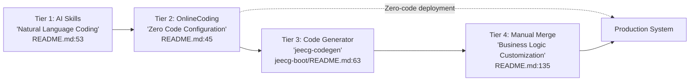

**Development Approach by Complexity:**

| Feature Type | Code Path | Key Capability | Exit Point |
|-------------|-----------|----------------|------------|
| **Simple CRUD** | AI → OnlineCoding | `jeecg-onlform` Skill | Tier 2 (zero-code) |
| **Standard Business** | Code Generator | `jeecg-codegen` Skill | Tier 3 (generated code) |
| **Complex Logic** | Generator + Custom | `Manual MERGE` | Tier 4 (full control) |

**Implementation Details:**

- **Generated Code Format**: Standard Vue3 SFC + Spring Boot Java code (not proprietary DSL) [jeecg-boot/README.md:63]().
- **Merge Strategy**: AI and generators solve 80% of repetitive work, allowing developers to focus on custom business logic [README.md:27]().
- **AI Integration**: Supports one-sentence system generation, flow drawing, and form design [README.md:6]().
- **Security**: Granular permission control including button-level and data-level permissions [README.md:32]().

Sources: [README.md:6-48](), [jeecg-boot/README.md:35-68](), [README.en-US.md:10-31]()

## Platform Architecture Modes

JeecgBoot supports two deployment architectures using shared business logic modules:

**Architecture Mode Diagram**

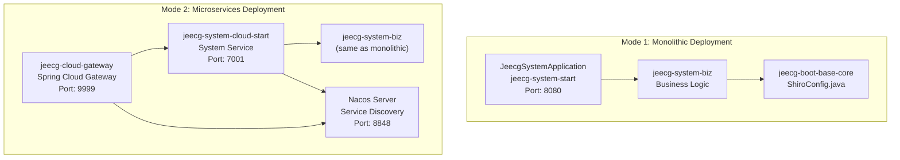

**Module Comparison:**

| Component | Monolithic | Microservices | Shared |
|-----------|-----------|---------------|--------|
| **Entry Point** | `JeecgSystemApplication` | `JeecgCloudGatewayApplication` | N/A |
| **Business Logic** | `jeecg-system-biz` | `jeecg-system-biz` | ✓ Identical [CLAUDE.md:47-48]() |
| **Core Utilities** | `jeecg-boot-base-core` | `jeecg-boot-base-core` | ✓ Identical [CLAUDE.md:41-42]() |
| **Security** | `ShiroConfig` + `JwtFilter` | `ShiroConfig` + `JwtFilter` | ✓ Identical [jeecg-boot/jeecg-boot-base-core/src/main/java/org/jeecg/config/shiro/ShiroConfig.java:47]() |

**Switching Mechanism:**
The platform provides a simple mechanism to switch between monolithic and microservices modes [README.md:139](). This is achieved through the `jeecg-system-api` module which provides `local-api` for direct calls and `cloud-api` for Feign-based microservice calls [CLAUDE.md:44-46]().

Sources: [README.md:132-141](), [CLAUDE.md:37-70](), [jeecg-boot/jeecg-boot-base-core/src/main/java/org/jeecg/config/shiro/ShiroConfig.java:1-47]()

## Repository Organization

The platform consists of two primary repositories: `jeecg-boot` (backend) and `jeecgboot-vue3` (frontend).

**Backend Repository Structure** (`jeecg-boot/`)

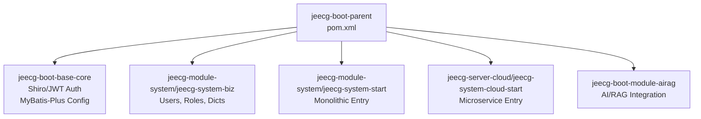

**Key Directory Paths:**

| Module | Path | Purpose |
|--------|------|---------|
| **Parent POM** | `jeecg-boot/pom.xml` | Dependency management [jeecg-boot/pom.xml:1]() |
| **Core Framework** | `jeecg-boot/jeecg-boot-base-core/` | Common utilities, security, core config [CLAUDE.md:41]() |
| **System Biz** | `jeecg-boot/jeecg-module-system/jeecg-system-biz/` | Core business logic and entities [CLAUDE.md:47]() |
| **AI Module** | `jeecg-boot/jeecg-boot-module-airag/` | AI chat, RAG, and LiteFlow orchestration [jeecg-boot/jeecg-boot-module/jeecg-boot-module-airag/pom.xml:12]() |
| **Frontend Root** | `jeecgboot-vue3/` | Vue3 + Vite + TS project root [jeecgboot-vue3/README.md:1]() |

Sources: [jeecg-boot/pom.xml:1-92](), [CLAUDE.md:37-65](), [jeecgboot-vue3/README.md:1-18]()

## Technology Foundation

JeecgBoot is built on modern, production-grade technology stacks.

**Backend Core Technologies:**

| Component | Technology | Version | Purpose |
|-----------|---------|---------|---------|
| **Framework** | Spring Boot | 4.1.0 | Application core [jeecg-boot/pom.xml:26]() |
| **Microservices** | Spring Cloud Alibaba | 2025.1.0.0 | Cloud infrastructure [jeecg-boot/pom.xml:39]() |
| **ORM** | MyBatis-Plus | 3.5.16 | Data access [jeecg-boot/pom.xml:65]() |
| **Security** | Apache Shiro | 3.0.0 | Auth framework [jeecg-boot/pom.xml:76]() |
| **AI Flow** | LiteFlow | 2.15.0 | AI workflow orchestration [jeecg-boot/jeecg-boot-module/jeecg-boot-module-airag/pom.xml:35]() |
| **AI RAG** | LangChain4j | 1.17.2 | LLM & RAG integration [jeecg-boot/jeecg-boot-module/jeecg-boot-module-airag/pom.xml:37]() |

**Frontend Core Technologies:**

| Component | Technology | Version | Purpose |
|-----------|---------|---------|---------|
| **Framework** | Vue | 3.0 | Component framework [jeecgboot-vue3/README.md:14]() |
| **Build Tool** | Vite | 6.0 | Build system [jeecgboot-vue3/README.md:14]() |
| **UI Library** | Ant Design Vue | 4.0 | UI components [jeecgboot-vue3/README.md:14]() |
| **Language** | TypeScript | Latest | Type safety [jeecgboot-vue3/README.md:14]() |

**Infrastructure Support:**

| Category | Technology | Notes |
|----------|-----------|-------|
| **Databases** | MySQL, PostgreSQL, Oracle, SQL Server | Multi-DB support [jeecg-boot/pom.xml:49-52]() |
| **Domestic DB** | DM8 (达梦), Kingbase8 (人大金仓) | Chinese localization [jeecg-boot/pom.xml:55-56]() |
| **AI Models** | DeepSeek, ChatGPT, Ollama, Zhipu | Multi-LLM support [README.md:43]() |
| **Vector DB** | pgvector | Required for RAG knowledge base [README-AI.md:60]() |

Sources: [jeecg-boot/pom.xml:23-86](), [jeecgboot-vue3/README.md:13-18](), [README-AI.md:101-115]()

## Position in Enterprise Software Ecosystem

JeecgBoot bridges the gap between traditional enterprise development and AI-native applications.

**Competitive Positioning:**

| Platform Type | Example | JeecgBoot Advantage |
|---------------|---------|---------------------|
| **Pure AI Platforms** | Dify | Better business integration and low-code capabilities [README-AI.md:48-51]() |
| **Traditional Low-Code** | Commercial Platforms | No vendor lock-in; supports "Manual Merge" for complex logic [README.md:135]() |
| **Hand-coded Frameworks** | Standard Spring Boot | Reduces 70-80% of repetitive CRUD work [README.md:27]() |

**Target Use Cases:**
- **Enterprise Systems**: ERP, CRM, OA, and MIS [README.md:69]().
- **AI Applications**: Intelligent chat assistants, RAG knowledge bases [README-AI.md:6]().
- **SaaS Platforms**: Multi-tenant support and flexible deployment [README.md:69]().
- **Localization (信创)**: Full support for domestic OS, DB, and middleware [README.md:72-75]().

Sources: [README.md:67-75](), [README-AI.md:30-54](), [README.en-US.md:33-48]()

## Getting Started

### Prerequisites

| Component | Requirement |
|-----------|-------------|
| **JDK** | 17+ (Supports 21, 24, 25) [jeecg-boot/pom.xml:34]() |
| **Node.js** | 20+ [jeecgboot-vue3/README.md:37]() |
| **Package Manager** | pnpm 9+ [jeecgboot-vue3/README.md:36]() |
| **Database** | MySQL 5.7+ (Core), PostgreSQL (AI features) [README-AI.md:60]() |

### Quick Links

- **Online Demo**: [https://boot3.jeecg.com](https://boot3.jeecg.com) (admin/123456) [README.md:110]()
- **Documentation**: [https://help.jeecg.com](https://help.jeecg.com) [README.md:112]()
- **AI Manual**: [https://help.jeecg.com/aigc](https://help.jeecg.com/aigc) [README.md:112]()

For detailed setup instructions, see:
- [System Requirements & Environment Setup](#1.3)
- [Quick Start Guide](#1.4)
- [Architecture](#2) for system structure details
- [Deployment](#9) for production strategies

Sources: [README.md:95-115](), [jeecgboot-vue3/README.md:34-41]()

---

# Page: Key Features & Capabilities

# Key Features & Capabilities

<details>
<summary>Relevant source files</summary>

The following files were used as context for generating this wiki page:

- [README-AI.md](README-AI.md)
- [README.en-US.md](README.en-US.md)
- [README.ja-JP.md](README.ja-JP.md)
- [README.md](README.md)
- [jeecg-boot/CLAUDE.md](jeecg-boot/CLAUDE.md)
- [jeecg-boot/README.md](jeecg-boot/README.md)
- [jeecg-boot/UPGRADE-3.9.3.md](jeecg-boot/UPGRADE-3.9.3.md)
- [jeecg-boot/db/Dockerfile](jeecg-boot/db/Dockerfile)
- [jeecg-boot/db/jeecgboot-mysql-5.7.sql](jeecg-boot/db/jeecgboot-mysql-5.7.sql)
- [jeecg-boot/db/tables_xxl_job.sql](jeecg-boot/db/tables_xxl_job.sql)
- [jeecg-boot/jeecg-module-system/jeecg-system-start/src/main/resources/flyway/sql/mysql/V3.9.0_0__all_upgrade.sql](jeecg-boot/jeecg-module-system/jeecg-system-start/src/main/resources/flyway/sql/mysql/V3.9.0_0__all_upgrade.sql)
- [jeecg-boot/jeecg-module-system/jeecg-system-start/src/main/resources/flyway/sql/mysql/V3.9.1_0__all_upgrade.sql](jeecg-boot/jeecg-module-system/jeecg-system-start/src/main/resources/flyway/sql/mysql/V3.9.1_0__all_upgrade.sql)
- [jeecg-boot/jeecg-server-cloud/jeecg-visual/jeecg-cloud-xxljob/doc/db/tables_xxl_job.sql](jeecg-boot/jeecg-server-cloud/jeecg-visual/jeecg-cloud-xxljob/doc/db/tables_xxl_job.sql)
- [jeecgboot-vue3/README.md](jeecgboot-vue3/README.md)

</details>


This document provides a comprehensive overview of JeecgBoot's core features and capabilities. It covers the platform's low-code development tools, AI integration, code generation, security mechanisms, and technical architecture features. For detailed information about specific subsystems:
- For technology stack details, see [Technology Stack](#1.2)
- For architecture patterns, see [System Architecture Overview](#2.1)
- For AI platform specifics, see [AI Platform (AIGC)](#3)
- For low-code tools, see [Low-Code Development Platform](#5)

---

## Feature Categories Overview

JeecgBoot provides five major categories of capabilities:

| Category | Core Capabilities | Primary Use Case |
|----------|------------------|------------------|
| **Low-Code Development** | Code generators, online form designers, visual configuration | Rapid CRUD application development without manual coding |
| **AI Integration** | LLM model management, RAG knowledge base, workflow orchestration | Building intelligent applications with conversational AI |
| **Enterprise Security** | RBAC, JWT/Shiro, data permissions, OAuth | Fine-grained access control and authentication |
| **Microservices Infrastructure** | Nacos, Gateway, Sentinel, distributed transactions | Scalable cloud-native deployment |
| **Multi-Platform Frontend** | Vue3, PWA, Electron, Uniapp | Cross-platform application deployment |

**Sources:** [README.md:19-51](), [jeecg-boot/README.md:15-34]()

---

## Low-Code Development Features

### Code Generator System

The code generator (`Online表单` and `代码生成器`) provides four template styles and supports multiple data models:

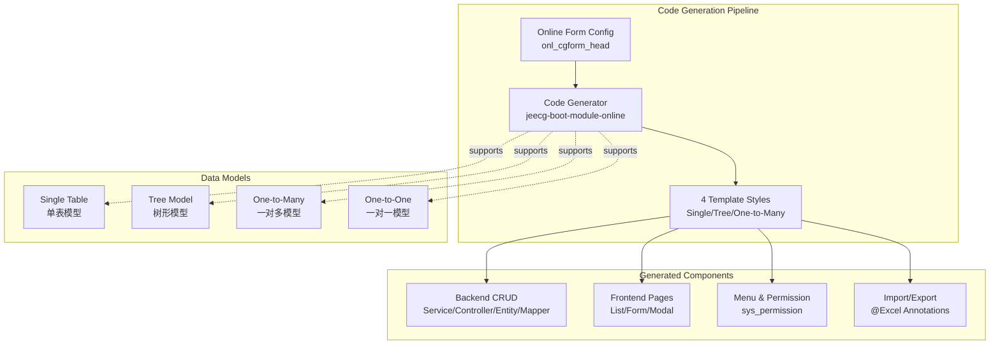

**Key Features:**
- **One-Click Generation**: Complete frontend and backend code generation with zero manual coding [README.md:140-141]().
- **Query Filter Auto-Generation**: `QueryGenerator` utility automatically builds SQL queries from page configurations [CLAUDE.md:99-100]().
- **Excel Integration**: Generated code includes `@Excel` annotations for import/export functionality via `AutoPoi` [CLAUDE.md:79]().
- **Custom Templates**: Template mechanism supports user-defined code generation patterns [README.md:141-142]().
- **23 Control Types**: Support for text, number, date, select, radio, checkbox, upload, popup, list, and more [README.md:143-144]().

**Sources:** [README.md:135-145](), [jeecg-boot/README.md:135-141](), [CLAUDE.md:85-102]()

### Online Form Designer (零代码开发)

The online form system enables zero-code CRUD development through visual configuration:

| Feature | Implementation | Configuration Path |
|---------|----------------|-------------------|
| Form Controls | 23 built-in types | `onl_cgform_field` table |
| Validation Rules | Auto-generated client/server-side | `ValidationRuleHandler` |
| Data Models | Single/Tree/One-to-Many/One-to-One | Online Form UI |
| Field Permissions | Hide/Disable by role | `sys_permission_data_rule` |
| Custom Enhancement | Inline code editor | Java/SQL/JS support |

**Key Classes:**
- Form configuration storage: `OnlCgformHead` entity [CLAUDE.md:140-141]().
- Field configuration: `OnlCgformField` entity [CLAUDE.md:140-141]().
- Enhanced development: Online code editor with syntax highlighting [README.md:145]().

**Sources:** [README.md:143-145](), [CLAUDE.md:138-143]()

---

## AI Platform Capabilities

### AI Application Architecture

JeecgBoot provides a complete AIGC platform comparable to Dify, with deeper business system integration [README-AI.md:30-40]():

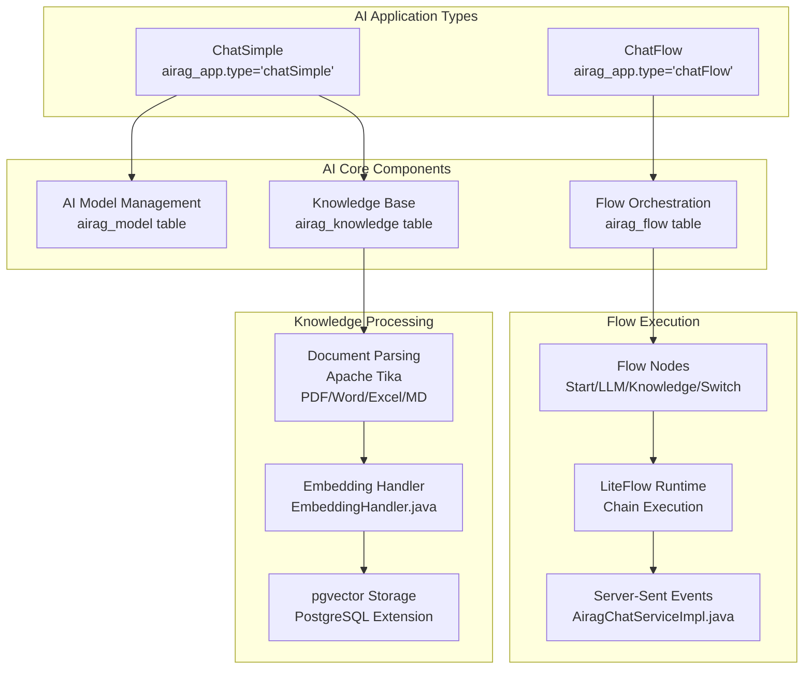

**AI vs Low-Code Integration:**
- **AI Skills**: One-sentence system generation via `jeecg-codegen` skill [jeecg-boot/README.md:56-68]().
- **AI Flow as Business Engine**: AI workflows can orchestrate business logic using `JavaNode` and `HTTPNode` [README-AI.md:155-157]().
- **Unified Platform**: Low-code forms and AI capabilities share the same security and permission model [README-AI.md:41-54]().

**Sources:** [README-AI.md:1-115](), [jeecg-boot/README.md:35-68](), [UPGRADE-3.9.3.md:200-231]()

### Supported AI Models and Features

| Model Provider | Configuration | Features Supported |
|---------------|---------------|-------------------|
| DeepSeek | Default | Chat, streaming, high speed [README.md:146-147]() |
| ChatGPT | Supported | Chat, streaming, function calling [README.md:146-147]() |
| Ollama | Supported | Local deployment, custom models [README-AI.md:101-115]() |
| Qwen (千问) | Supported | Chat, streaming [README-AI.md:112]() |
| Zhipu AI (智普) | Supported | Chat, embeddings [README-AI.md:108]() |
| Claude | Supported | Chat, streaming [README-AI.md:109]() |

**Configuration Storage**: `airag_model` table holds provider details and API parameters [README-AI.md:133-141]().

**Sources:** [README.md:146-147](), [README-AI.md:101-115](), [UPGRADE-3.9.3.md:196-198]()

---

## Enterprise Security Features

### Multi-Layer Permission Architecture

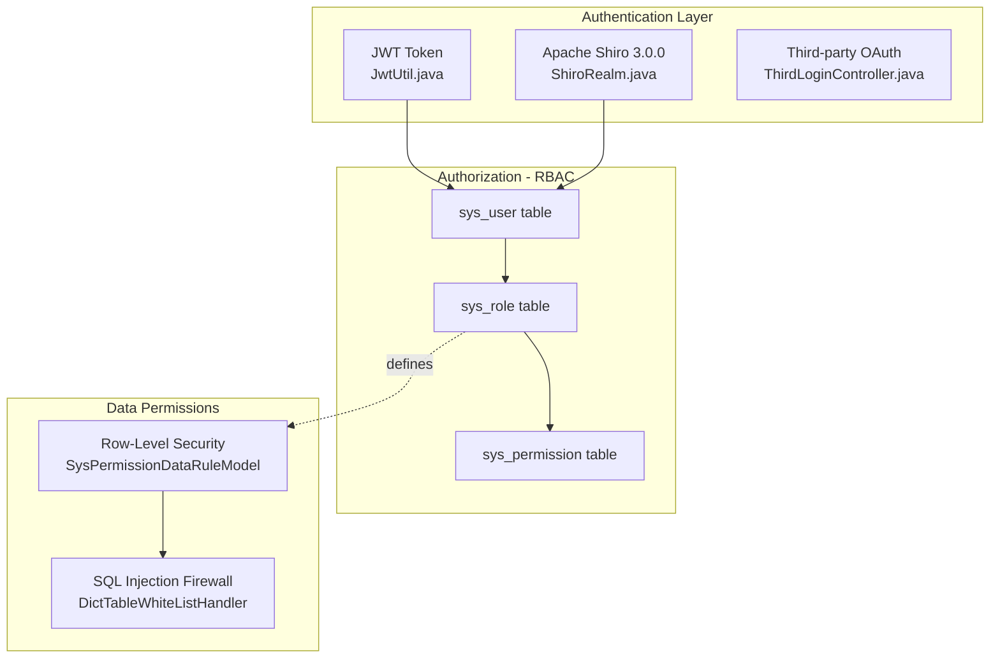

**Permission Control Features:**

1. **RBAC (Role-Based Access Control)**: User-Role-Menu hierarchy with button-level control [README.md:141-142]().
2. **Data Permissions**: `SysPermissionDataRuleModel` dynamically injects SQL filters based on user/role context [README.md:141-142]().
3. **API Security**: JWT validation via `JwtUtil` and Shiro filters; SQL injection prevention via `DictTableWhiteListHandler` [CLAUDE.md:75](), [CLAUDE.md:132]().

**Sources:** [README.md:141-142](), [CLAUDE.md:75](), [CLAUDE.md:132]()

---

## Database & Data Layer Features

### Multi-Database Compatibility Matrix

JeecgBoot supports 8 major database systems with a single codebase [README.md:192-208]():

| Database | Support | Key Implementation |
|----------|---------|--------------------|
| MySQL | Native | Default schema in `jeecgboot-mysql-5.7.sql` |
| PostgreSQL | Native | Required for `pgvector` AI features |
| Oracle | Native | Database-specific profiles |
| SQL Server | Native | Database-specific profiles |
| Dameng (达梦) | Native | Xinchuang (信创) compatibility |
| Kingbase (人大金仓) | Native | Xinchuang (信创) compatibility |
| TiDB | Native | Distributed database support |

**Sources:** [README.md:72-75](), [jeecg-boot/README.md:177-189](), [CLAUDE.md:118-124]()

---

## Microservices Infrastructure

JeecgBoot supports a Spring Cloud Alibaba microservices architecture (activated via `-P SpringCloud`) [CLAUDE.md:31]():

- **Nacos 3.2.2**: Service registry and dynamic configuration center [UPGRADE-3.9.3.md:128-147]().
- **Gateway**: Spring Cloud Gateway for dynamic routing and rate limiting [CLAUDE.md:68]().
- **Sentinel 1.8.10**: Traffic control and circuit breaking [UPGRADE-3.9.3.md:191]().
- **XXL-JOB 3.4.2**: Distributed task scheduling [UPGRADE-3.9.3.md:75-126]().
- **Seata**: Distributed transactions for microservice coordination [CLAUDE.md:83]().

**Sources:** [UPGRADE-3.9.3.md:7-21](), [UPGRADE-3.9.3.md:75-181](), [CLAUDE.md:67-83]()

---

## Frontend & UI Features

JeecgBoot-Vue3 uses a modern stack for enterprise UI [jeecgboot-vue3/README.md:14-18]():

- **Vue 3.5 + Vite 6**: Fast build system and reactive UI components [jeecgboot-vue3/README.md:14]().
- **Ant Design Vue 4**: Enterprise-grade component library [jeecgboot-vue3/README.md:87]().
- **TypeScript 5.7**: Full type safety across the frontend [jeecgboot-vue3/README.md:88]().
- **JVXETable**: High-performance row-editable table for complex ERP layouts [README.md:147]().
- **PWA Support**: Service worker integration for offline capabilities [README.md:88]().

**Sources:** [README.md:133-147](), [jeecgboot-vue3/README.md:14-95]()

---

## Report & Visualization Tools

- **JimuReport**: Open-source enterprise Web report tool for complex reports via drag-and-drop [README.md:39-40]().
- **JimuBI**: Dashboard and large screen design tool focusing on digital twins and data visualization [README.md:41-42]().
- **ECharts**: Integrated for responsive data charts and maps [README.md:142]().

**Sources:** [README.md:39-42](), [README.md:142]()

---

# Page: Technology Stack

# Technology Stack

<details>
<summary>Relevant source files</summary>

The following files were used as context for generating this wiki page:

- [README-AI.md](README-AI.md)
- [README.en-US.md](README.en-US.md)
- [README.ja-JP.md](README.ja-JP.md)
- [README.md](README.md)
- [jeecg-boot/CLAUDE.md](jeecg-boot/CLAUDE.md)
- [jeecg-boot/README.md](jeecg-boot/README.md)
- [jeecg-boot/jeecg-boot-base-core/pom.xml](jeecg-boot/jeecg-boot-base-core/pom.xml)
- [jeecg-boot/jeecg-boot-base-core/src/main/java/org/jeecg/common/util/encryption/AesEncryptUtil.java](jeecg-boot/jeecg-boot-base-core/src/main/java/org/jeecg/common/util/encryption/AesEncryptUtil.java)
- [jeecg-boot/jeecg-boot-base-core/src/main/java/org/jeecg/config/shiro/ShiroConfig.java](jeecg-boot/jeecg-boot-base-core/src/main/java/org/jeecg/config/shiro/ShiroConfig.java)
- [jeecg-boot/jeecg-boot-module/jeecg-boot-module-airag/pom.xml](jeecg-boot/jeecg-boot-module/jeecg-boot-module-airag/pom.xml)
- [jeecg-boot/pom.xml](jeecg-boot/pom.xml)
- [jeecgboot-vue3/README.md](jeecgboot-vue3/README.md)
- [jeecgboot-vue3/VITE8-UPGRADE-LOG.md](jeecgboot-vue3/VITE8-UPGRADE-LOG.md)
- [jeecgboot-vue3/package.json](jeecgboot-vue3/package.json)
- [jeecgboot-vue3/pnpm-lock.yaml](jeecgboot-vue3/pnpm-lock.yaml)
- [jeecgboot-vue3/src/router/guard/paramMenuGuard.ts](jeecgboot-vue3/src/router/guard/paramMenuGuard.ts)
- [jeecgboot-vue3/src/router/guard/permissionGuard.ts](jeecgboot-vue3/src/router/guard/permissionGuard.ts)
- [jeecgboot-vue3/src/router/index.ts](jeecgboot-vue3/src/router/index.ts)
- [jeecgboot-vue3/src/store/modules/app.ts](jeecgboot-vue3/src/store/modules/app.ts)
- [jeecgboot-vue3/src/store/modules/defIndex.ts](jeecgboot-vue3/src/store/modules/defIndex.ts)
- [jeecgboot-vue3/src/store/modules/errorLog.ts](jeecgboot-vue3/src/store/modules/errorLog.ts)
- [jeecgboot-vue3/src/store/modules/locale.ts](jeecgboot-vue3/src/store/modules/locale.ts)
- [jeecgboot-vue3/src/store/modules/lock.ts](jeecgboot-vue3/src/store/modules/lock.ts)
- [jeecgboot-vue3/src/store/modules/multipleTab.ts](jeecgboot-vue3/src/store/modules/multipleTab.ts)

</details>


This page provides a comprehensive overview of the technologies, frameworks, and libraries used in JeecgBoot. It covers frontend, backend, infrastructure, and tooling components with their specific versions and integration points.

---

## Frontend Technology Stack

JeecgBoot's frontend is built with Vue 3 and modern JavaScript tooling, emphasizing type safety and developer experience.

### Core Framework

**Vue 3.5.39** serves as the foundation with Composition API support. The application uses **TypeScript 5.9.3** for static type checking across the entire frontend codebase.

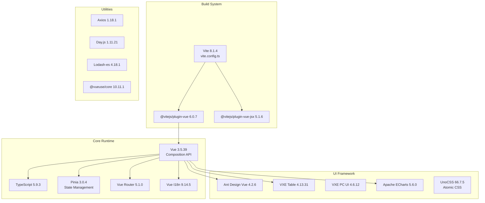

**Sources:** [jeecgboot-vue3/package.json:25-180](), [jeecgboot-vue3/README.md:13-106]()

### Build & Development Tools

| Tool | Version | Purpose |
|------|---------|---------|
| **Vite** | 8.1.4 | Build tool and dev server |
| **pnpm** | 9+ (required) | Package manager |
| **Node.js** | 20+ (required) | JavaScript runtime ([jeecgboot-vue3/package.json:191]()) |
| **ESLint** | 8.57.1 | Code linting |
| **Prettier** | 3.9.5 | Code formatting |
| **TypeScript Compiler** | 5.9.3 | Type checking |

The build configuration is managed in `vite.config.ts`, which includes:
- **Code splitting** via manual chunks.
- **PWA support** via `vite-plugin-pwa` 1.3.0 ([jeecgboot-vue3/package.json:170]()).
- **Icon optimization** via `unplugin-icons` and `vite-plugin-svg-icons`.
- **Docker mode** build scripts ([jeecgboot-vue3/package.json:14-15]()).

**Sources:** [jeecgboot-vue3/package.json:9-180](), [jeecgboot-vue3/README.md:34-40]()

### UI Component Library

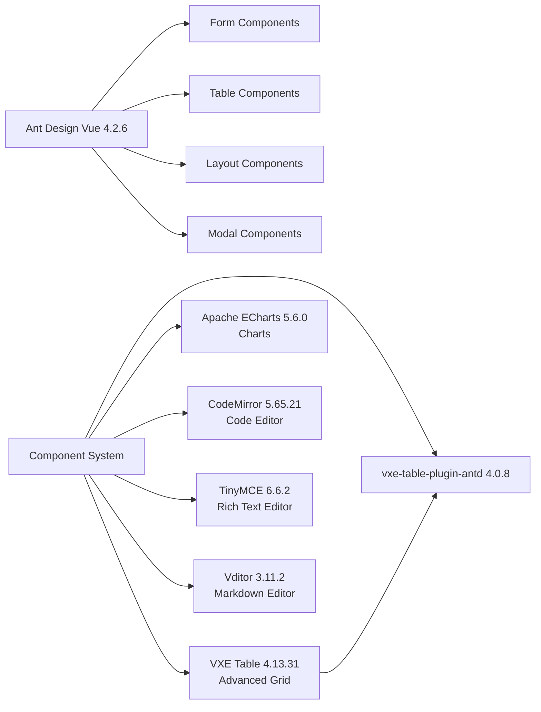

**Key Libraries:**
- **Ant Design Vue 4.2.6**: Primary component library.
- **VXE Table 4.13.31**: High-performance data grid for complex ERP layouts ([jeecgboot-vue3/package.json:82]()).
- **Apache ECharts 5.6.0**: Data visualization and charting ([jeecgboot-vue3/package.json:47]()).
- **UnoCSS 66.7.5**: Atomic CSS engine for utility-first styling ([jeecgboot-vue3/package.json:174]()).

**Sources:** [jeecgboot-vue3/package.json:25-91](), [README.md:132-147]()

### Module Integration

JeecgBoot uses dynamic package registration for modular features:

- **@jeecg/aiflow 3.9.2-beta**: AI Workflow orchestration module ([jeecgboot-vue3/package.json:26]()).
- **LogicFlow**: Core engine for visual flow design ([jeecgboot-vue3/package.json:27-29]()).

**Sources:** [jeecgboot-vue3/package.json:26-31]()

---

## Backend Technology Stack

JeecgBoot's backend is built on Spring Boot 4 (parent) with Spring Cloud Alibaba for microservices capabilities.

### Core Framework Versions

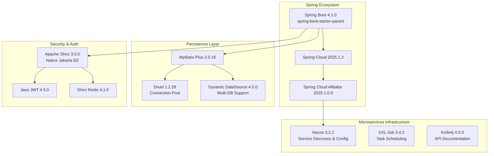

**Key Version Requirements:**
- **JDK**: 17 (Default), 21, 24, 25 ([jeecg-boot/pom.xml:33-34]())
- **Spring Boot**: 4.1.0 ([jeecg-boot/pom.xml:26]())
- **Maven**: Dependency management

**Sources:** [jeecg-boot/pom.xml:23-86](), [README.md:81-85]()

### Persistence & Data Access

| Component | Version | Purpose |
|-----------|---------|---------|
| **MyBatis-Plus** | 3.5.16 | ORM with code generation ([jeecg-boot/pom.xml:65]()) |
| **Druid** | 1.2.28 | Connection pooling ([jeecg-boot/pom.xml:67]()) |
| **Dynamic DataSource** | 4.5.0 | Multi-database support ([jeecg-boot/jeecg-boot-base-core/pom.xml:135]()) |
| **MiniDao** | 1.10.22 | Lightweight SQL execution ([jeecg-boot/pom.xml:61]()) |

**Database Drivers Included:**
- MySQL Connector: 8.0.27
- PostgreSQL: 42.2.25
- Oracle OJDBC6: 11.2.0.3
- SQL Server: 12.6.1.jre8
- Kingbase8: 9.0.0
- DM8: 8.1.3.140

**Sources:** [jeecg-boot/pom.xml:48-56](), [jeecg-boot/jeecg-boot-base-core/pom.xml:145-191]()

### Security Framework Configuration

The security layer uses Apache Shiro 3.0.0 with native Jakarta EE support:

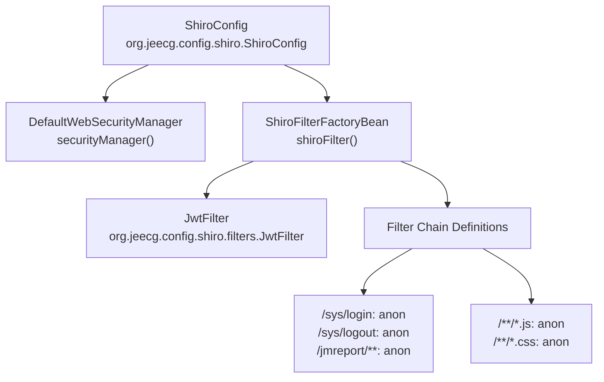

**Key Configuration:**
- **Shiro Version**: 3.0.0 ([jeecg-boot/pom.xml:76]())
- **JWT Library**: com.auth0:java-jwt 4.5.0 ([jeecg-boot/pom.xml:78]())
- **Session Storage**: Redis via `shiro-redis` 4.1.0 ([jeecg-boot/pom.xml:77]())
- **Excluded Paths**: [jeecg-boot/jeecg-boot-base-core/src/main/java/org/jeecg/config/shiro/ShiroConfig.java:86-150]()

**Sources:** [jeecg-boot/jeecg-boot-base-core/src/main/java/org/jeecg/config/shiro/ShiroConfig.java:1-150](), [jeecg-boot/pom.xml:75-78]()

### AI & Machine Learning Stack

JeecgBoot integrates with LLM providers through the `jeecg-boot-module-airag` module.

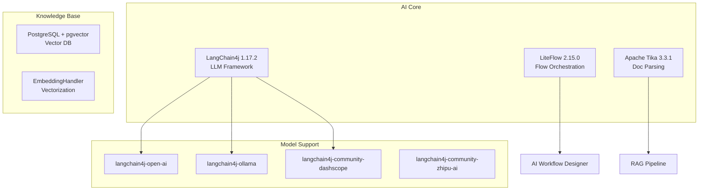

**AI Components:**
- **LangChain4j 1.17.2**: Core AI orchestration ([jeecg-boot/jeecg-boot-module/jeecg-boot-module-airag/pom.xml:45]()).
- **LiteFlow 2.15.0**: Engine for AI workflow nodes ([jeecg-boot/jeecg-boot-module/jeecg-boot-module-airag/pom.xml:35]()).
- **Apache Tika 3.3.1**: Used for document parsing in RAG knowledge bases ([jeecg-boot/jeecg-boot-module/jeecg-boot-module-airag/pom.xml:36]()).
- **Models**: Supports DeepSeek (default), ChatGPT, Ollama, Zhipu, etc. ([README.md:146]()).

**Sources:** [jeecg-boot/jeecg-boot-module/jeecg-boot-module-airag/pom.xml:33-190](), [README-AI.md:101-115]()

---

## Infrastructure & Middleware

### Microservices Versions
- **Spring Cloud**: 2025.1.2 ([jeecg-boot/pom.xml:38]())
- **Spring Cloud Alibaba**: 2025.1.0.0 ([jeecg-boot/pom.xml:39]())
- **Nacos**: 3.2.2 ([jeecg-boot/pom.xml:40]())
- **XXL-Job**: 3.4.2 ([jeecg-boot/pom.xml:42]())

### Third-Party Service Integration
- **MinIO**: 9.0.3 ([jeecg-boot/pom.xml:80]())
- **Aliyun OSS**: 3.17.3 ([jeecg-boot/pom.xml:73]())
- **FastJSON**: 2.0.58 ([jeecg-boot/pom.xml:43]())
- **Hutool**: 5.8.25 ([jeecg-boot/pom.xml:53]())

**Sources:** [jeecg-boot/pom.xml:30-86](), [jeecg-boot/jeecg-boot-base-core/pom.xml:42-249]()

---

## Technology Integration Diagram

This diagram maps the high-level technology stack to specific code entities and configuration files.

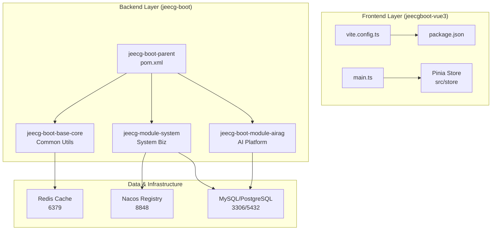

**Sources:** [jeecg-boot/pom.xml:88-92](), [jeecgboot-vue3/package.json:1-25](), [README.md:87-90]()

---

# Page: System Requirements & Environment Setup

# System Requirements & Environment Setup

<details>
<summary>Relevant source files</summary>

The following files were used as context for generating this wiki page:

- [README-AI.md](README-AI.md)
- [README.en-US.md](README.en-US.md)
- [README.ja-JP.md](README.ja-JP.md)
- [README.md](README.md)
- [check_jeecgenv.py](check_jeecgenv.py)
- [jeecg-boot/CLAUDE.md](jeecg-boot/CLAUDE.md)
- [jeecg-boot/README.md](jeecg-boot/README.md)
- [jeecg-boot/jeecg-boot-base-core/src/main/java/org/jeecg/common/system/query/QueryGenerator.java](jeecg-boot/jeecg-boot-base-core/src/main/java/org/jeecg/common/system/query/QueryGenerator.java)
- [jeecg-boot/jeecg-boot-base-core/src/main/java/org/jeecg/common/system/util/SqlConcatUtil.java](jeecg-boot/jeecg-boot-base-core/src/main/java/org/jeecg/common/system/util/SqlConcatUtil.java)
- [jeecgboot-vue3/README.md](jeecgboot-vue3/README.md)

</details>


## Purpose and Scope

This document describes the system requirements and initial environment setup needed to run JeecgBoot (version 3.9.3) in both development and production environments. It covers the prerequisites for backend services, frontend applications, database systems, and optional AI platform components.

For detailed instructions on starting the application after setup, see Quick Start Guide [#1.4](). For database schema and configuration details, see Database & Data Layer [#4](). For AI-specific configuration including model management and vector databases, see AI Platform (AIGC) [#3]().

---

## System Requirements Overview

JeecgBoot version 3.9.3 supports two deployment modes: **monolithic** (single `jeecg-system-start` process) and **microservices** (distributed `jeecg-cloud-*` services). Base requirements are identical; microservices mode adds Nacos, Sentinel, and Gateway dependencies.

### Minimum Requirements Summary

| Component | Version | Required For | Configuration Location |
|-----------|---------|-------------|------------------------|
| JDK | 17 (default), 21, 24 | `jeecg-boot-parent` build | `pom.xml` `<java.version>17</java.version>` |
| Maven | 3.6+ | Backend build | Manages `jeecg-boot-parent` modules |
| Node.js | 20+ | `jeecgboot-vue3` build | Required by Vite 6 (`vite.config.ts`) |
| pnpm | 9+ | Frontend dependencies | `jeecgboot-vue3/package.json` |
| MySQL | 8.0+ (default) | `spring.datasource.dynamic` | `application-dev.yml` master datasource |
| Redis | Any stable | `spring.redis` | `application-dev.yml` cache/session |
| PostgreSQL + pgvector | 12+ (optional) | `jeecg.ai-rag.embed-store` | `application-dev.yml` AI embeddings |

**Sources:** [README.md:8-14](), [README.md:132-133](), [jeecgboot-vue3/README.md:36-40](), [jeecg-boot/CLAUDE.md:9](), [jeecg-boot/CLAUDE.md:119]()

---

## Environment Dependency Architecture

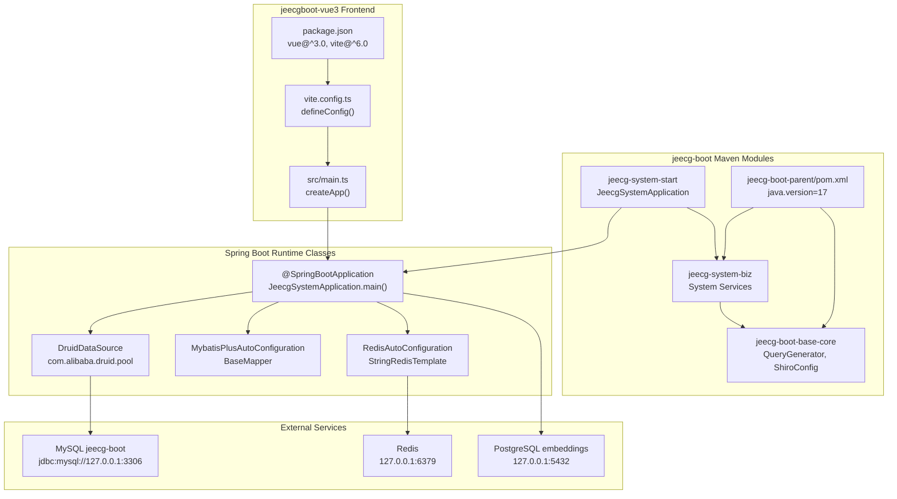

**Purpose:** Maps JDK, Maven, Node.js, and pnpm requirements to specific code entry points. Backend starts at `JeecgSystemApplication.main()` [jeecg-boot/jeecg-module-system/jeecg-system-start/src/main/java/org/jeecg/JeecgSystemApplication.java](). Frontend builds via `vite.config.ts` [jeecgboot-vue3/vite.config.ts](). Database connections configured through `DruidDataSource` pool [jeecg-boot/CLAUDE.md:76]().

**Sources:** [jeecg-boot/README.md:88-90](), [jeecgboot-vue3/README.md:14](), [jeecg-boot/CLAUDE.md:40-65]()

---

## Backend Requirements

### Java Development Kit (JDK)

**Required Version:** JDK 17 (default), JDK 21 or JDK 24 supported.

**Verification:**
```bash
java -version
# Expected: openjdk version "17.x.x" or "21.x.x" or "24.x.x"
```

**Maven Compiler Configuration:** The platform uses the `jakarta` namespace (not `javax`) throughout [jeecg-boot/CLAUDE.md:9](). The root POM [jeecg-boot/pom.xml]() specifies the Java version requirement.

**Sources:** [jeecg-boot/CLAUDE.md:9](), [check_jeecgenv.py:17-37]()

### Maven

**Required Version:** 3.6+ (3.8+ recommended).

**Verification:**
```bash
mvn -v
# Expected: Apache Maven 3.x.x, Java version: 17.x.x
```

**Module Hierarchy:** Maven manages dependencies through `jeecg-boot-parent` [jeecg-boot/CLAUDE.md:40]():

| Module Path | Artifact ID | Purpose |
|-------------|-------------|---------|
| `jeecg-boot-parent` | `jeecg-boot-parent` | Root POM, dependency versions |
| `jeecg-boot-base-core` | `jeecg-boot-base-core` | Core framework: Shiro/JWT auth, MyBatis-Plus config |
| `jeecg-module-system/jeecg-system-biz` | `jeecg-system-biz` | Business logic, entities, services |
| `jeecg-module-system/jeecg-system-start` | `jeecg-system-start` | Main entry point (port 8080) |
| `jeecg-server-cloud/jeecg-cloud-gateway` | `jeecg-cloud-gateway` | Microservices gateway (port 9999) |

**Sources:** [jeecg-boot/CLAUDE.md:40-68](), [check_jeecgenv.py:39-48]()

### Database Support Matrix

JeecgBoot supports 8 database types through its unified data access layer [README.md:138]().

| Database | Support Status | JDBC Driver | Notes |
|----------|---------------|-------------|-------|
| MySQL | ✅ Primary | `com.mysql.cj.jdbc.Driver` | Default (8.0+), scripts provided |
| Oracle 11g+ | ✅ Full | Oracle JDBC | Supported via profiles |
| SQL Server 2017+| ✅ Full | SQL Server JDBC | Supported via profiles |
| PostgreSQL | ✅ Full | PostgreSQL JDBC | Required for AI vector features |
| MariaDB | ✅ Full | MariaDB JDBC | MySQL-compatible |
| 达梦 (DM8) | ✅ Full | DM JDBC | 信创兼容 |
| 人大金仓 | ✅ Full | Kingbase JDBC | 信创兼容 |
| TiDB | ✅ Full | MySQL JDBC | Distributed database |

**Sources:** [README.md:72-75](), [jeecg-boot/CLAUDE.md:119]()

---

## Frontend Requirements

### Node.js

**Required Version:** Node.js 20+

This is a strict requirement due to Vite 6, which no longer supports EOL (End of Life) Node.js versions below 20 [jeecgboot-vue3/README.md:39]().

**Verification:**
```bash
node -v
# Expected output: v20.x.x or higher
```

**Sources:** [jeecgboot-vue3/README.md:37-39](), [check_jeecgenv.py:51-70]()

### pnpm Package Manager

**Required Version:** pnpm 9+

pnpm is the required package manager for the `jeecgboot-vue3` project [jeecgboot-vue3/README.md:36]().

**Installation:**
```bash
npm install -g pnpm
```

**Dependency Installation:**
```bash
cd jeecgboot-vue3
pnpm install
```

**Sources:** [jeecgboot-vue3/README.md:54](), [check_jeecgenv.py:72-93]()

---

## Configuration File Structure

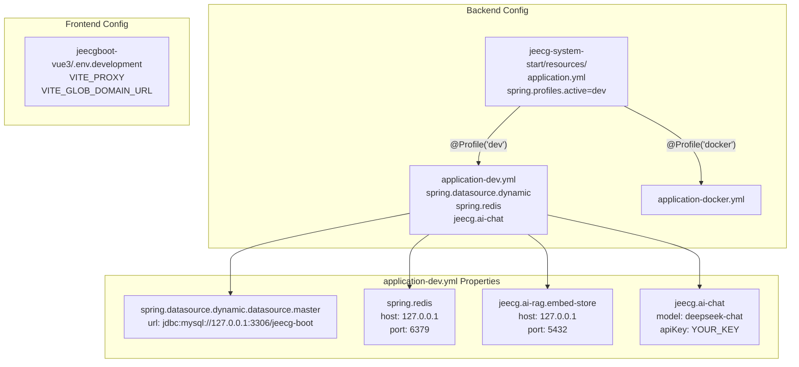

**Sources:** [jeecgboot-vue3/README.md:57-62](), [jeecg-boot/CLAUDE.md:127-132](), [check_jeecgenv.py:100-159]()

---

## Required Services Configuration

### Redis Configuration

Redis is used for Shiro session management, token caching, and distributed locks [jeecg-boot/CLAUDE.md:75]().

**Property Structure:**
```yaml
spring:
  redis:
    database: 0
    host: 127.0.0.1
    port: 6379
    password: ''
```

**Sources:** [check_jeecgenv.py:165-171]()

### MySQL Configuration

MySQL stores the primary system schema. Initial scripts are located in `db/jeecgboot-mysql-5.7.sql` [jeecg-boot/CLAUDE.md:121]().

**Property Structure:**
```yaml
spring:
  datasource:
    dynamic:
      datasource:
        master:
          url: jdbc:mysql://127.0.0.1:3306/jeecg-boot?characterEncoding=UTF-8&useUnicode=true&useSSL=false&tinyInt1isBit=false&allowPublicKeyRetrieval=true&serverTimezone=Asia/Shanghai
          username: root
          password: root
          driver-class-name: com.mysql.cj.jdbc.Driver
```

**Sources:** [check_jeecgenv.py:115-120](), [jeecg-boot/CLAUDE.md:121]()

---

## Optional AI Platform Configuration

### AI Model API (DeepSeek/OpenAI)

JeecgBoot supports AI models like DeepSeek, ChatGPT, and Ollama [README.md:32]().

**File:** `application-dev.yml`
```yaml
jeecg:
  ai-chat:
    enabled: true
    model: deepseek-chat
    apiKey: YOUR_API_KEY
    apiHost: https://api.deepseek.com/v1
```

**Sources:** [README-AI.md:68-71](), [check_jeecgenv.py:151-157]()

### PostgreSQL + pgvector for RAG

Required for the Knowledge Base and RAG (Retrieval-Augmented Generation) features [README-AI.md:6]().

**File:** `application-dev.yml`
```yaml
jeecg:
  ai-rag:
    embed-store:
      host: 127.0.0.1
      port: 5432
      database: postgres
      user: postgres
      password: postgres
      table: embeddings
```

**Sources:** [README-AI.md:60](), [check_jeecgenv.py:130-138]()

---

## Environment Verification

### Automated Verification Script

A Python utility `check_jeecgenv.py` is provided to validate the local environment.

**Verification Tasks:**
1. **Java:** `check_java()` parses `java -version` for version 17+ [check_jeecgenv.py:17-37]().
2. **Maven:** `check_maven()` verifies `mvn -v` [check_jeecgenv.py:39-48]().
3. **Node.js:** `check_node()` validates Node.js 20+ [check_jeecgenv.py:51-70]().
4. **pnpm:** `check_pnpm()` validates pnpm 9+ [check_jeecgenv.py:72-93]().

**Sources:** [check_jeecgenv.py:1-216]()

---

## Next Steps

After completing environment setup:

1. **Quick Start:** Follow the Quick Start Guide [#1.4]() to run the platform.
2. **AI Configuration:** If using AI features, see Knowledge Base & RAG System [#3.3]().
3. **Microservices:** For Spring Cloud mode, refer to Nacos Configuration [#2.4.1]().

**Sources:** [README.md:100-104]()

---

# Page: Quick Start Guide

# Quick Start Guide

<details>
<summary>Relevant source files</summary>

The following files were used as context for generating this wiki page:

- [README-AI.md](README-AI.md)
- [README.en-US.md](README.en-US.md)
- [README.ja-JP.md](README.ja-JP.md)
- [README.md](README.md)
- [docker-compose-cloud.yml](docker-compose-cloud.yml)
- [docker-compose.yml](docker-compose.yml)
- [jeecg-boot/CLAUDE.md](jeecg-boot/CLAUDE.md)
- [jeecg-boot/README.md](jeecg-boot/README.md)
- [jeecg-boot/docker-compose.yml](jeecg-boot/docker-compose.yml)
- [jeecgboot-vue3/.env.docker](jeecgboot-vue3/.env.docker)
- [jeecgboot-vue3/.env.dockercloud](jeecgboot-vue3/.env.dockercloud)
- [jeecgboot-vue3/Dockerfile.cloud](jeecgboot-vue3/Dockerfile.cloud)
- [jeecgboot-vue3/README.md](jeecgboot-vue3/README.md)
- [start-docker-compose-cloud.bat](start-docker-compose-cloud.bat)
- [start-docker-compose-cloud.sh](start-docker-compose-cloud.sh)
- [start-docker-compose.bat](start-docker-compose.bat)
- [start-docker-compose.sh](start-docker-compose.sh)

</details>


## Purpose and Scope

This guide provides step-by-step instructions for quickly deploying JeecgBoot using Docker Compose and setting up a local development environment. It covers both **Single Instance (Monolithic)** and **Microservices** deployment modes, enabling developers to have a running system within minutes.

JeecgBoot supports a "half-intelligent" development mode where simple functions are handled via `OnlineCoding` (zero-code) and complex logic is handled via the code generator with manual merging [README.md:45-48]().

**Sources:** [README.md:95-105](), [jeecg-boot/README.md:93-102](), [docker-compose.yml:1-77](), [docker-compose-cloud.yml:1-155]()

---

## Development Environment Prerequisites

Before starting, ensure your host system has the following tools installed as per the technical requirements [README.md:100-104]():

| Tool | Version | Purpose |
|------------|----------------|---------|
| **JDK** | 17+ (Supports 21, 24) | Backend runtime [jeecg-boot/CLAUDE.md:9-9]() |
| **Node.js** | 20+ | Frontend build system [jeecgboot-vue3/README.md:37-39]() |
| **pnpm** | 9+ | Frontend package manager [jeecgboot-vue3/README.md:36-36]() |
| **Maven** | 3.8+ | Backend build tool [jeecg-boot/CLAUDE.md:13-35]() |
| **MySQL** | 8.0+ | Primary relational database [jeecg-boot/CLAUDE.md:119-119]() |
| **Redis** | 5.0+ | Caching and session management [jeecg-boot/CLAUDE.md:130-130]() |
| **Docker** | 20.10+ | Container orchestration [docker-compose.yml:1-1]() |

**Sources:** [jeecgboot-vue3/README.md:34-40](), [jeecg-boot/CLAUDE.md:7-12](), [README.md:132-151]()

---

## Deployment Mode Selection

JeecgBoot supports two primary architectural patterns that can be switched via Maven profiles and dependency management [jeecg-boot/CLAUDE.md:101-101]().

### Mode Comparison

| Aspect | Monolithic (Single) | Microservices (Cloud) |
|--------|----------------|---------------|
| **Primary Module** | `jeecg-system-start` [jeecg-boot/CLAUDE.md:48-48]() | `jeecg-system-cloud-start` [jeecg-boot/CLAUDE.md:68-68]() |
| **Gateway** | Direct access (Port 8080) | `jeecg-cloud-gateway` (Port 9999) [docker-compose-cloud.yml:91-91]() |
| **Registry** | None (Local API) | `jeecg-cloud-nacos` (Port 8848) [docker-compose-cloud.yml:50-50]() |
| **Maven Profile** | Default | `-P SpringCloud` [jeecg-boot/CLAUDE.md:31-31]() |
| **Implementation** | `jeecg-system-local-api` | `jeecg-system-cloud-api` (Feign) [jeecg-boot/CLAUDE.md:44-46]() |

### Data Flow Architecture (Code Entities)

The following diagram bridges the logical deployment to specific code modules and service entry points.

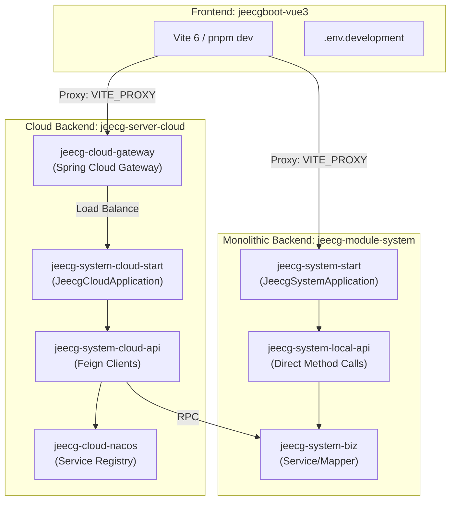

**Sources:** [jeecg-boot/CLAUDE.md:37-69](), [jeecgboot-vue3/README.md:57-64](), [docker-compose-cloud.yml:86-111]()

---

## Docker Quick Start (One-Click)

JeecgBoot provides scripts for automated compilation and container startup.

### Step 1: Automated Build & Start
On Windows, use the provided batch script to compile both frontend and backend and launch containers [start-docker-compose.bat:1-94]():

```bash
# This script checks tools, sets hosts, builds Java (mvn), builds Vue (pnpm), and runs docker-compose
./start-docker-compose.bat
```

### Step 2: Manual Launch (Single Mode)
If you have already built the JAR and Dist files:
```bash
docker-compose up -d
```
This starts `jeecg-boot-mysql`, `jeecg-boot-redis`, `jeecg-boot-pgvector` (for AI), `jeecg-boot-system`, and `jeecg-vue` [docker-compose.yml:2-59]().

### Step 3: Manual Launch (Microservices)
```bash
docker-compose -f docker-compose-cloud.yml up -d
```
This configuration includes a health check for the gateway, waiting for `jeecg-system` to register in Nacos before starting [docker-compose-cloud.yml:97-109]():
```bash
# Wait loop in Gateway container
until curl -s 'http://jeecg-boot-nacos:8848/nacos/v3/admin/ns/instance/list?serviceName=jeecg-system' | grep -q '"healthy":true'; do
  sleep 5;
done;
```

**Sources:** [start-docker-compose.bat:58-85](), [docker-compose.yml:1-77](), [docker-compose-cloud.yml:97-109]()

---

## Local Development Startup (Monolithic)

For active development, it is recommended to run the backend in your IDE and the frontend via Vite.

### 1. Backend Setup
1. **Initialize Database**: Import `db/jeecgboot-mysql-5.7.sql` [jeecg-boot/CLAUDE.md:121-121]().
2. **Configure application-dev.yml**: Located in `jeecg-module-system/jeecg-system-start/src/main/resources/` [jeecg-boot/CLAUDE.md:127-129]().
3. **Run Application**: Execute `org.jeecg.JeecgSystemApplication` in the `jeecg-system-start` module [jeecg-boot/CLAUDE.md:48-48]().

### 2. Frontend Setup
1. **Install Dependencies**:
   ```bash
   cd jeecgboot-vue3
   pnpm install
   ```
2. **Configure Proxy**: Edit `.env.development` to point to your backend [jeecgboot-vue3/README.md:57-62]():
   ```bash
   VITE_PROXY = [["/jeecgboot","http://localhost:8080/jeecg-boot"]]
   VITE_GLOB_DOMAIN_URL=http://localhost:8080/jeecg-boot
   ```
3. **Start Development Server**:
   ```bash
   pnpm dev
   ```

**Sources:** [jeecgboot-vue3/README.md:43-71](), [jeecg-boot/CLAUDE.md:20-22](), [jeecg-boot/CLAUDE.md:127-130]()

---

## AI Platform Integration (Quick Start)

JeecgBoot includes a built-in AI application platform (AIGC). To enable this during quick start:

1. **Vector Database**: Ensure the `jeecg-boot-pgvector` container is running [docker-compose.yml:61-72]().
2. **AI Config**: Configure your LLM provider (DeepSeek, OpenAI, Ollama) in the system settings [README-AI.md:68-71]().
3. **Access**: Navigate to the "AI Application Platform" menu to manage models, knowledge bases, and flows [README-AI.md:89-97]().

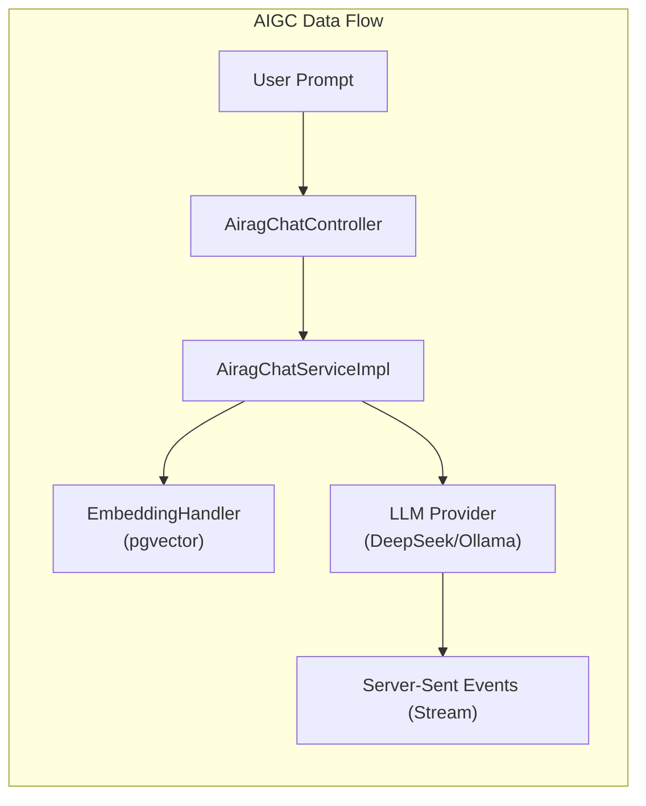

**Sources:** [README-AI.md:1-115](), [docker-compose.yml:61-72](), [README.md:117-131]()

---

## Access & Verification

### Default Credentials
- **Account**: `admin`
- **Password**: `123456`
- **Sources**: [README.md:98](), [jeecg-boot/README.md:96]()

### Service Endpoints

| Service | Monolithic URL | Microservices URL |
|---------|----------------|-------------------|
| **Frontend UI** | http://localhost:3100 | http://localhost:80 (Docker) |
| **Backend API** | http://localhost:8080/jeecg-boot | http://localhost:9999 (Gateway) |
| **API Docs** | http://localhost:8080/jeecg-boot/doc.html | http://localhost:9999/doc.html |
| **Nacos** | N/A | http://localhost:8848/nacos |

**Sources:** [jeecgboot-vue3/README.md:60-71](), [docker-compose-cloud.yml:50-153](), [jeecg-boot/CLAUDE.md:20-22]()

---

# Page: Architecture

# Architecture

<details>
<summary>Relevant source files</summary>

The following files were used as context for generating this wiki page:

- [README-AI.md](README-AI.md)
- [README.en-US.md](README.en-US.md)
- [README.ja-JP.md](README.ja-JP.md)
- [README.md](README.md)
- [jeecg-boot/CLAUDE.md](jeecg-boot/CLAUDE.md)
- [jeecg-boot/README.md](jeecg-boot/README.md)
- [jeecg-boot/jeecg-boot-base-core/pom.xml](jeecg-boot/jeecg-boot-base-core/pom.xml)
- [jeecg-boot/jeecg-boot-base-core/src/main/java/org/jeecg/common/util/encryption/AesEncryptUtil.java](jeecg-boot/jeecg-boot-base-core/src/main/java/org/jeecg/common/util/encryption/AesEncryptUtil.java)
- [jeecg-boot/jeecg-boot-base-core/src/main/java/org/jeecg/config/shiro/ShiroConfig.java](jeecg-boot/jeecg-boot-base-core/src/main/java/org/jeecg/config/shiro/ShiroConfig.java)
- [jeecg-boot/jeecg-boot-module/jeecg-boot-module-airag/pom.xml](jeecg-boot/jeecg-boot-module/jeecg-boot-module-airag/pom.xml)
- [jeecg-boot/pom.xml](jeecg-boot/pom.xml)
- [jeecgboot-vue3/README.md](jeecgboot-vue3/README.md)

</details>


This document provides an overview of JeecgBoot's system architecture, explaining the platform's dual deployment modes (monolithic and microservices), layered component organization, and inter-component communication patterns. For detailed information on specific architectural aspects, see:
- Backend module organization and Maven structure: [Backend Module Structure](#2.2)
- Frontend project structure and build system: [Frontend Architecture](#2.3)
- Microservices components and coordination: [Microservices Architecture](#2.4)
- AI Application Platform and RAG: [AI Platform (AIGC)](#3)
- Desktop integration: [Electron Desktop Application](#2.5)

## Deployment Modes

JeecgBoot supports two distinct deployment architectures that share the same codebase but differ in their runtime configuration and infrastructure requirements. The choice is often determined by the Maven profile (e.g., `SpringCloud`) and the startup module used [CLAUDE.md:31-67]().

### Monolithic Mode

In monolithic mode, the entire backend application runs as a single Spring Boot process (`jeecg-system-start`) listening on port 8080. This mode is suitable for development, small-scale deployments, and rapid prototyping [CLAUDE.md:20-22]().

**Monolithic Deployment Architecture**

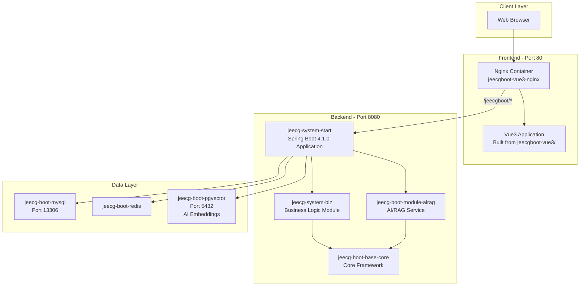

**Sources:** [CLAUDE.md:20-55](), [jeecg-boot/pom.xml:88-92](), [jeecg-boot/jeecg-boot-module/jeecg-boot-module-airag/pom.xml:60-64]()

The monolithic backend packages all business modules together. Configuration typically uses local profiles like `application-dev.yml` [CLAUDE.md:127-130]().

### Microservices Mode

In microservices mode, the backend is decomposed into multiple independently deployable services coordinated by Spring Cloud Alibaba components. This mode is activated via the `-P SpringCloud` Maven profile [CLAUDE.md:30-32]().

**Microservices Deployment Architecture**

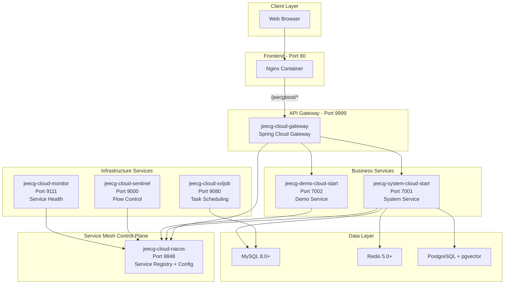

**Sources:** [CLAUDE.md:67-69](), [jeecg-boot/README.md:134-139](), [jeecg-boot/pom.xml:37-40]()

### Deployment Mode Comparison

| Aspect | Monolithic Mode | Microservices Mode |
|--------|----------------|-------------------|
| **Entry Point** | Direct to backend (port 8080) | Through Gateway (port 9999) |
| **Service Discovery** | Not required | Nacos (port 8848) |
| **Configuration** | Local `application.yml` | Centralized in Nacos |
| **Backend Start Module** | `jeecg-system-start` | `jeecg-system-cloud-start` |
| **API Implementation** | `jeecg-system-local-api` | `jeecg-system-cloud-api` |
| **Tech Stack** | Spring Boot 4.1.0 | Spring Cloud 2025.1.0.0 |

**Sources:** [CLAUDE.md:9-69](), [jeecg-boot/pom.xml:37-40](), [jeecg-boot/README.md:134-139]()

## Technology Stack Summary

JeecgBoot v3.9.3 utilizes a modern stack centered on Spring Boot 4 and Vue 3 [README.md:8-14]().

### Backend Technology Stack

| Component | Technology | Version | Purpose |
|-----------|-----------|---------|---------|
| **Java SDK** | JDK | 17, 21, 24, 25 | Runtime environment [jeecg-boot/pom.xml:34]() |
| **Framework** | Spring Boot | 4.1.0 | Core container [jeecg-boot/pom.xml:26]() |
| **Microservices** | Spring Cloud Alibaba | 2025.1.0.0 | Service coordination [jeecg-boot/pom.xml:39]() |
| **ORM** | MyBatis-Plus | 3.5.16 | Persistence [jeecg-boot/pom.xml:65]() |
| **Security** | Apache Shiro | 3.0.0 | Auth [jeecg-boot/pom.xml:76]() |
| **Token** | JWT | 4.5.0 | Stateless sessions [jeecg-boot/pom.xml:78]() |
| **Database Pool** | Druid | 1.2.28 | Connection pooling [jeecg-boot/pom.xml:67]() |
| **AI/LLM** | LangChain4j | 1.17.2 | AI Integration [jeecg-boot/jeecg-boot-module/jeecg-boot-module-airag/pom.xml:45]() |

### Frontend Technology Stack

| Component | Technology | Version | Purpose |
|-----------|-----------|---------|---------|
| **Framework** | Vue | 3.0 | UI framework [jeecgboot-vue3/README.md:14]() |
| **Build Tool** | Vite | 6.x | Build & HMR [jeecgboot-vue3/README.md:14]() |
| **UI Library** | Ant Design Vue | 4.x | Components [jeecgboot-vue3/README.md:14]() |
| **Language** | TypeScript | Latest | Static typing [jeecgboot-vue3/README.md:14]() |
| **State** | Pinia | Latest | State management [jeecgboot-vue3/README.md:92]() |

## Layered Architecture

JeecgBoot follows a modular architecture that separates the core framework from business logic and AI capabilities.

**System Layer Interaction**

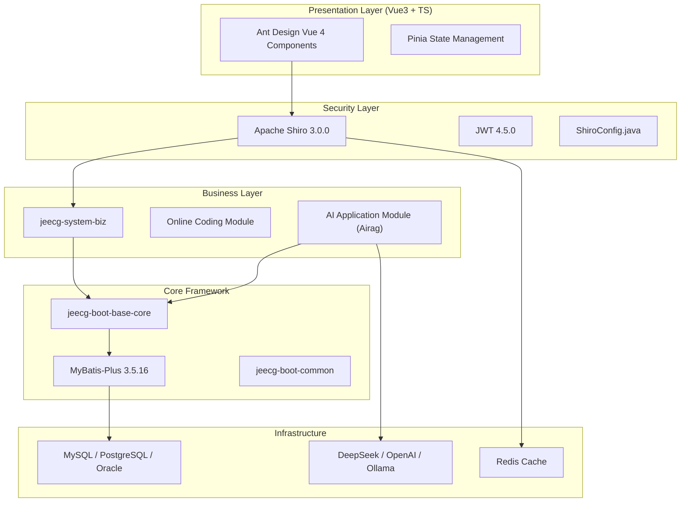

**Sources:** [jeecg-boot/pom.xml:88-92](), [jeecg-boot/jeecg-boot-base-core/src/main/java/org/jeecg/config/shiro/ShiroConfig.java:47-68](), [README-AI.md:6-27]()

### Core Components

1.  **jeecg-boot-base-core**: Contains the core framework logic, including Shiro security configuration [jeecg-boot/jeecg-boot-base-core/src/main/java/org/jeecg/config/shiro/ShiroConfig.java:47](), MyBatis-Plus settings, and common utilities.
2.  **jeecg-module-system**: The primary business module for user, role, and permission management [CLAUDE.md:43-48]().
3.  **jeecg-boot-module-airag**: The AI/RAG integration module, leveraging LangChain4j to connect with various LLMs [jeecg-boot/jeecg-boot-module/jeecg-boot-module-airag/pom.xml:150-163]().
4.  **Online Coding**: A metadata-driven low-code engine that allows runtime CRUD generation without redeployment [CLAUDE.md:138-143]().

## Security Architecture

The security system is a hybrid of Apache Shiro for authorization and JWT for stateless authentication [CLAUDE.md:75]().

-   **Authentication**: Managed via `ShiroConfig` which defines anonymous and protected paths [jeecg-boot/jeecg-boot-base-core/src/main/java/org/jeecg/config/shiro/ShiroConfig.java:67-150]().
-   **Encryption**: `AesEncryptUtil` provides AES/CBC/PKCS5Padding decryption for sensitive data like passwords, maintaining compatibility with legacy NoPadding implementations [jeecg-boot/jeecg-common/src/main/java/org/jeecg/common/util/encryption/AesEncryptUtil.java:15-64]().
-   **Token Storage**: JWT tokens are validated against a Redis-backed session store to allow for token revocation and session management [jeecg-boot/jeecg-boot-base-core/src/main/java/org/jeecg/config/shiro/ShiroConfig.java:49-57]().

For details, see [System Architecture Overview](#2.1).

## AI Platform Architecture (AIGC)

JeecgBoot integrates a full-stack AI development platform similar to Dify, built directly into the low-code ecosystem [README-AI.md:6-8]().

-   **Model Management**: Supports DeepSeek, OpenAI, Ollama, and domestic models like Zhipu and Qianfan [README-AI.md:101-115]().
-   **RAG (Retrieval-Augmented Generation)**: Uses PostgreSQL with `pgvector` for embedding storage and similarity search [README-AI.md:60-61]().
-   **Workflow Orchestration**: Uses `LiteFlow` for AI flow design, allowing developers to chain LLM nodes, knowledge nodes, and script nodes [jeecg-boot/jeecg-boot-module/jeecg-boot-module-airag/pom.xml:35, 75-94]().

For details, see [AI Platform (AIGC)](#3).

## Module Organization

The project is structured to facilitate the transition between monolithic and microservice architectures through the use of `api` modules [CLAUDE.md:101-102]().

| Module | Type | Description |
|--------|------|-------------|
| `jeecg-system-local-api` | Monolithic | Direct method calls between modules. |
| `jeecg-system-cloud-api` | Microservices | OpenFeign clients for remote service calls. |
| `jeecg-system-biz` | Shared | Core business logic used by both deployment modes. |

**Sources:** [CLAUDE.md:39-65](), [jeecg-boot/pom.xml:195-210]()

For details on the Maven structure, see [Backend Module Structure](#2.2).

---

# Page: System Architecture Overview

# System Architecture Overview

<details>
<summary>Relevant source files</summary>

The following files were used as context for generating this wiki page:

- [README-AI.md](README-AI.md)
- [README.en-US.md](README.en-US.md)
- [README.ja-JP.md](README.ja-JP.md)
- [README.md](README.md)
- [docker-compose-cloud.yml](docker-compose-cloud.yml)
- [docker-compose.yml](docker-compose.yml)
- [jeecg-boot/CLAUDE.md](jeecg-boot/CLAUDE.md)
- [jeecg-boot/README.md](jeecg-boot/README.md)
- [jeecg-boot/docker-compose.yml](jeecg-boot/docker-compose.yml)
- [jeecg-boot/jeecg-boot-base-core/pom.xml](jeecg-boot/jeecg-boot-base-core/pom.xml)
- [jeecg-boot/jeecg-boot-base-core/src/main/java/org/jeecg/common/util/encryption/AesEncryptUtil.java](jeecg-boot/jeecg-boot-base-core/src/main/java/org/jeecg/common/util/encryption/AesEncryptUtil.java)
- [jeecg-boot/jeecg-boot-base-core/src/main/java/org/jeecg/config/shiro/ShiroConfig.java](jeecg-boot/jeecg-boot-base-core/src/main/java/org/jeecg/config/shiro/ShiroConfig.java)
- [jeecg-boot/jeecg-boot-module/jeecg-boot-module-airag/pom.xml](jeecg-boot/jeecg-boot-module/jeecg-boot-module-airag/pom.xml)
- [jeecg-boot/pom.xml](jeecg-boot/pom.xml)
- [jeecgboot-vue3/.env.docker](jeecgboot-vue3/.env.docker)
- [jeecgboot-vue3/.env.dockercloud](jeecgboot-vue3/.env.dockercloud)
- [jeecgboot-vue3/Dockerfile.cloud](jeecgboot-vue3/Dockerfile.cloud)
- [jeecgboot-vue3/README.md](jeecgboot-vue3/README.md)

</details>


## Purpose and Scope

This document provides a comprehensive overview of the JeecgBoot platform's system architecture, including deployment topologies, layered design patterns, and module organization. It covers both monolithic and microservices deployment modes, the frontend and backend architectural patterns, and how the major components interact at a system level.

For details on specific backend modules and their internal organization, see [Backend Module Structure](#2.2). For frontend-specific architectural patterns, see [Frontend Architecture](#2.3). For microservices-specific components like Nacos and Gateway, see [Microservices Architecture](#2.4).

---

## Deployment Topologies

JeecgBoot supports two distinct deployment architectures that can be switched without code changes, providing flexibility based on project scale and complexity requirements.

### Monolithic Deployment Mode

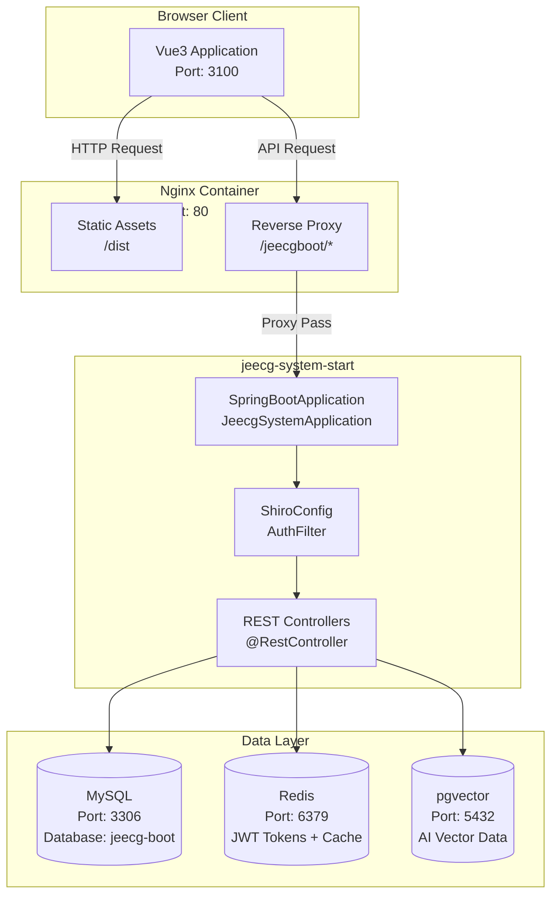

**Monolithic Architecture Characteristics:**

The monolithic mode runs as a single Spring Boot application started by the `JeecgSystemApplication` class in the `jeecg-system-start` module. All business logic, including system management, online coding, code generation, and AI features, are packaged into one executable JAR file.

**Key Components:**
- **Entry Point**: `JeecgSystemApplication.java` - Spring Boot main class.
- **Web Configuration**: Configures CORS, interceptors, and resource handlers.
- **Security Filter**: `ShiroConfig.java` at [jeecg-boot/jeecg-boot-base-core/src/main/java/org/jeecg/config/shiro/ShiroConfig.java:47-68]() configures the `JwtFilter` for authentication.
- **AI Support**: Integrated via `jeecg-boot-pgvector` for RAG capabilities [docker-compose.yml:61-72]().

**Sources:** [README.md:87-91](), [jeecg-boot/README.md:86-90](), [docker-compose.yml:1-72]()

---

### Microservices Deployment Mode

```mermaid
graph TB
    subgraph "BrowserClient" [Browser Client]
        VUE3["Vue3 Application<br/>Port: 80"]
    end
    
    subgraph "EdgeLayer" [Edge Layer]
        GATEWAY["jeecg-cloud-gateway<br/>Port: 9999<br/>GatewayApplication"]
    end
    
    subgraph "RegistryLayer" [Service Registry & Config]
        NACOS["Nacos Server<br/>Port: 8848<br/>com.alibaba.nacos"]
    end
    
    subgraph "BusinessServices" [Business Services]
        SYSTEM_CLOUD["jeecg-system-cloud-start<br/>Port: 7001"]
        DEMO_CLOUD["jeecg-demo-cloud-start<br/>Port: 7002"]
        AIRAG_CLOUD["jeecg-boot-module-airag<br/>AI Services"]
    end
    
    subgraph "MonitoringLayer" [Monitoring & Management]
        XXLJOB["jeecg-boot-xxljob<br/>Port: 9080<br/>Distributed Scheduling"]
    end
    
    subgraph "DataLayer" [Data Layer]
        MYSQL_CLOUD[("MySQL<br/>Port: 13306")]
        REDIS_CLOUD[("Redis<br/>Port: 6379")]
        PGVECTOR_CLOUD[("pgvector<br/>Port: 5432")]
    end
    
    VUE3 -->|API Request| GATEWAY
    GATEWAY -->|Service Discovery| NACOS
    GATEWAY -->|Route| SYSTEM_CLOUD
    GATEWAY -->|Route| DEMO_CLOUD
    GATEWAY -->|Route| AIRAG_CLOUD
    
    SYSTEM_CLOUD -->|Register| NACOS
    DEMO_CLOUD -->|Register| NACOS
    AIRAG_CLOUD -->|Register| NACOS
    
    SYSTEM_CLOUD --> MYSQL_CLOUD
    AIRAG_CLOUD --> PGVECTOR_CLOUD
    SYSTEM_CLOUD --> REDIS_CLOUD
```

**Microservices Architecture Characteristics:**

In microservices mode, the application is decomposed into independently deployable services coordinated by Spring Cloud Alibaba components.

**Key Components:**
- **Gateway**: `jeecg-boot-gateway` handles entry routing at port 9999 [docker-compose-cloud.yml:86-111]().
- **Service Registry**: Nacos at port 8848 for service discovery and configuration management [docker-compose-cloud.yml:45-57]().
- **AI Integration**: The `jeecg-boot-module-airag` module provides LLM and RAG capabilities using `pgvector` [jeecg-boot/jeecg-boot-module/jeecg-boot-module-airag/pom.xml:150-167]().
- **Task Scheduling**: XXL-Job Admin at port 9080 for distributed tasks [docker-compose-cloud.yml:35-43]().

**Sources:** [README.md:139-140](), [jeecg-boot/README.md:134-135](), [docker-compose-cloud.yml:1-171]()

---

## Layered Architecture

JeecgBoot follows a classic layered architecture pattern with clear separation of concerns across distinct layers, now enhanced with an AI/ML layer for AIGC capabilities.

```mermaid
graph TB
    subgraph "PresentationLayer" [Presentation Layer]
        VUE3_COMP["Vue3 Components<br/>Ant Design Vue4"]
        VUE3_ROUTER["Vue Router<br/>Vite6 Build"]
    end
    
    subgraph "ApplicationLayer" [Application Layer]
        SPRING_BOOT["SpringBoot 4.1.0"]
        SHIRO_CONFIG["ShiroConfig<br/>JwtFilter"]
    end
    
    subgraph "BusinessLayer" [Business Layer]
        SYSTEM_BIZ["jeecg-system-biz<br/>Core Logic"]
        AI_BIZ["jeecg-boot-module-airag<br/>AIGC & RAG Logic"]
    end
    
    subgraph "DataAccessLayer" [Data Access Layer]
        MYBATIS_PLUS["MyBatis-Plus 3.5.16"]
        DRUID_POOL["Druid 1.2.28"]
        DYNAMIC_DS["Dynamic Datasource 4.5.0"]
    end
    
    subgraph "AIMLLayer" [AI/ML Layer]
        LANGCHAIN["LangChain4j 1.17.2"]
        LITEFLOW["LiteFlow 2.15.0<br/>AI Flow Orchestration"]
        TIKA["Apache Tika 3.3.1<br/>Doc Parsing"]
    end
    
    VUE3_COMP --> SPRING_BOOT
    SPRING_BOOT --> SHIRO_CONFIG
    SHIRO_CONFIG --> SYSTEM_BIZ
    SHIRO_CONFIG --> AI_BIZ
    
    SYSTEM_BIZ --> MYBATIS_PLUS
    AI_BIZ --> MYBATIS_PLUS
    AI_BIZ --> LANGCHAIN
    LANGCHAIN --> LITEFLOW
    LANGCHAIN --> TIKA
    
    MYBATIS_PLUS --> DRUID_POOL
    MYBATIS_PLUS --> DYNAMIC_DS
```

### Layer Responsibilities

| Layer | Primary Technologies | Responsibilities |
|-------|-------------------------|------------------|
| **Presentation** | Vue3, TS, Vite6, Antd4 | UI rendering, state management, client-side routing. |
| **Application** | Spring Boot 4.1.0, Shiro | Auth, global exception handling, API security. |
| **Business** | MyBatis-Plus, Spring Services | Domain logic, OnlineCoding, code generation, AI app management. |
| **AI/ML** | LangChain4j, LiteFlow, Tika | LLM model management, RAG pipelines, AI workflow orchestration. |
| **Data Access** | Druid, Dynamic-Datasource | Multi-DB support (MySQL, PG, etc.), connection pooling. |

**Sources:** [jeecg-boot/pom.xml:23-86](), [jeecg-boot/jeecg-boot-module/jeecg-boot-module-airag/pom.xml:33-38](), [jeecgboot-vue3/package.json:1-50]()

---

## Backend Module Structure

The backend employs a Maven multi-module architecture. The same business logic in `-biz` modules can be deployed as a monolith or as microservices.

```mermaid
graph TB
    subgraph "ParentPOM" [jeecg-boot-parent]
        PARENT_POM["pom.xml<br/>Spring Boot 4.1.0"]
    end
    
    subgraph "CoreModule" [jeecg-boot-base-core]
        CORE_CONFIG["ShiroConfig.java<br/>MybatisPlusConfig.java"]
        CORE_UTIL["AesEncryptUtil.java<br/>Common Utils"]
    end
    
    subgraph "SystemModule" [jeecg-module-system]
        SYSTEM_BIZ["jeecg-system-biz<br/>Core Business"]
        SYSTEM_START["jeecg-system-start<br/>Monolith Entry"]
        SYSTEM_API["jeecg-system-local-api<br/>jeecg-system-cloud-api"]
    end
    
    subgraph "AIModule" [jeecg-boot-module-airag]
        AIRAG_BIZ["AI Application Logic<br/>Knowledge Base<br/>AI Flows"]
    end
    
    PARENT_POM --> CORE_MODULE
    PARENT_POM --> SYSTEM_MODULE
    SYSTEM_MODULE --> CORE_MODULE
    SYSTEM_START --> SYSTEM_BIZ
    AIRAG_BIZ --> SYSTEM_API
```

### Key Module Definitions

- **`jeecg-boot-parent`**: Manages versions for the entire project, including Spring Cloud Alibaba and Spring Boot [jeecg-boot/pom.xml:1-86]().
- **`jeecg-boot-base-core`**: Contains foundational configurations like `ShiroConfig` [jeecg-boot/jeecg-boot-base-core/src/main/java/org/jeecg/config/shiro/ShiroConfig.java:47-50]() and encryption utilities like `AesEncryptUtil` [jeecg-boot/jeecg-boot-base-core/src/main/java/org/jeecg/common/util/encryption/AesEncryptUtil.java:1-20]().
- **`jeecg-boot-module-airag`**: The AI application module, integrating `LangChain4j` and `LiteFlow` for natural language programming and RAG [jeecg-boot/jeecg-boot-module/jeecg-boot-module-airag/pom.xml:1-190]().
- **`jeecg-system-start`**: The entry point for the monolithic deployment [docker-compose.yml:35-48]().

**Sources:** [jeecg-boot/pom.xml:88-92](), [jeecg-boot/jeecg-boot-module/jeecg-boot-module-airag/pom.xml:1-13]()

---

## AI Platform Architecture (AIGC)

The AI architecture bridges low-code capabilities with Large Language Models (LLMs) and Retrieval-Augmented Generation (RAG).

```mermaid
graph LR
    subgraph "NaturalLanguageSpace" [Natural Language Space]
        PROMPT["User Prompt<br/>'Generate a CRM system'"]
    end
    
    subgraph "CodeEntitySpace" [Code Entity Space]
        AIRAG_CHAT["AiragChatServiceImpl<br/>SSE Streaming"]
        LITE_FLOW["LiteFlow Engine<br/>Chain Execution"]
        KNOWLEDGE_BASE["EmbeddingHandler<br/>pgvector Storage"]
        CODE_GEN["jeecg-codegen<br/>CRUD Generator"]
    end
    
    PROMPT --> AIRAG_CHAT
    AIRAG_CHAT --> LITE_FLOW
    LITE_FLOW --> KNOWLEDGE_BASE
    LITE_FLOW --> CODE_GEN
```

**Architectural Highlights:**
- **Natural Language Programming**: Uses `AI Skills` to convert natural language into system entities (forms, flows, reports) [README.md:6-10]().
- **Model Compatibility**: Supports OpenAI, DeepSeek, Ollama, and others through the `ChatLanguageModel` interface [README-AI.md:101-115]().
- **RAG Pipeline**: Implemented using `pgvector` for vector storage [docker-compose.yml:61-72]() and `Apache Tika` for document parsing [jeecg-boot/jeecg-boot-module/jeecg-boot-module-airag/pom.xml:36-36]().

**Sources:** [README.md:24-28](), [README-AI.md:6-8](), [jeecg-boot/jeecg-boot-module/jeecg-boot-module-airag/pom.xml:150-188]()

---

# Page: Backend Module Structure

# Backend Module Structure

<details>
<summary>Relevant source files</summary>

The following files were used as context for generating this wiki page:

- [jeecg-boot/jeecg-boot-base-core/pom.xml](jeecg-boot/jeecg-boot-base-core/pom.xml)
- [jeecg-boot/jeecg-boot-base-core/src/main/java/org/jeecg/common/util/encryption/AesEncryptUtil.java](jeecg-boot/jeecg-boot-base-core/src/main/java/org/jeecg/common/util/encryption/AesEncryptUtil.java)
- [jeecg-boot/jeecg-boot-base-core/src/main/java/org/jeecg/config/shiro/ShiroConfig.java](jeecg-boot/jeecg-boot-base-core/src/main/java/org/jeecg/config/shiro/ShiroConfig.java)
- [jeecg-boot/jeecg-boot-module/jeecg-boot-module-airag/pom.xml](jeecg-boot/jeecg-boot-module/jeecg-boot-module-airag/pom.xml)
- [jeecg-boot/jeecg-module-system/jeecg-system-api/jeecg-system-cloud-api/pom.xml](jeecg-boot/jeecg-module-system/jeecg-system-api/jeecg-system-cloud-api/pom.xml)
- [jeecg-boot/jeecg-module-system/jeecg-system-api/pom.xml](jeecg-boot/jeecg-module-system/jeecg-system-api/pom.xml)
- [jeecg-boot/jeecg-module-system/jeecg-system-biz/pom.xml](jeecg-boot/jeecg-module-system/jeecg-system-biz/pom.xml)
- [jeecg-boot/jeecg-module-system/jeecg-system-biz/src/main/java/org/jeecg/config/jimureport/JimuDragExternalServiceImpl.java](jeecg-boot/jeecg-module-system/jeecg-system-biz/src/main/java/org/jeecg/config/jimureport/JimuDragExternalServiceImpl.java)
- [jeecg-boot/jeecg-module-system/jeecg-system-biz/src/main/java/org/jeecg/config/jimureport/JimuReportTokenService.java](jeecg-boot/jeecg-module-system/jeecg-system-biz/src/main/java/org/jeecg/config/jimureport/JimuReportTokenService.java)
- [jeecg-boot/jeecg-module-system/jeecg-system-start/pom.xml](jeecg-boot/jeecg-module-system/jeecg-system-start/pom.xml)
- [jeecg-boot/jeecg-module-system/jeecg-system-start/src/test/java/org/jeecg/modules/system/test/SysUserApiTest.java](jeecg-boot/jeecg-module-system/jeecg-system-start/src/test/java/org/jeecg/modules/system/test/SysUserApiTest.java)
- [jeecg-boot/jeecg-module-system/pom.xml](jeecg-boot/jeecg-module-system/pom.xml)
- [jeecg-boot/jeecg-server-cloud/jeecg-cloud-gateway/pom.xml](jeecg-boot/jeecg-server-cloud/jeecg-cloud-gateway/pom.xml)
- [jeecg-boot/jeecg-server-cloud/jeecg-demo-cloud-start/pom.xml](jeecg-boot/jeecg-server-cloud/jeecg-demo-cloud-start/pom.xml)
- [jeecg-boot/jeecg-server-cloud/jeecg-system-cloud-start/pom.xml](jeecg-boot/jeecg-server-cloud/jeecg-system-cloud-start/pom.xml)
- [jeecg-boot/jeecg-server-cloud/jeecg-visual/jeecg-cloud-test/jeecg-cloud-test-more/pom.xml](jeecg-boot/jeecg-server-cloud/jeecg-visual/jeecg-cloud-test/jeecg-cloud-test-more/pom.xml)
- [jeecg-boot/jeecg-server-cloud/jeecg-visual/jeecg-cloud-test/jeecg-cloud-test-rabbitmq/pom.xml](jeecg-boot/jeecg-server-cloud/jeecg-visual/jeecg-cloud-test/jeecg-cloud-test-rabbitmq/pom.xml)
- [jeecg-boot/jeecg-server-cloud/jeecg-visual/jeecg-cloud-test/jeecg-cloud-test-rocketmq/pom.xml](jeecg-boot/jeecg-server-cloud/jeecg-visual/jeecg-cloud-test/jeecg-cloud-test-rocketmq/pom.xml)
- [jeecg-boot/jeecg-server-cloud/jeecg-visual/jeecg-cloud-test/jeecg-cloud-test-seata/jeecg-cloud-test-seata-account/pom.xml](jeecg-boot/jeecg-server-cloud/jeecg-visual/jeecg-cloud-test/jeecg-cloud-test-seata/jeecg-cloud-test-seata-account/pom.xml)
- [jeecg-boot/pom.xml](jeecg-boot/pom.xml)

</details>


## Purpose and Scope

This page documents the Maven multi-module structure of the JeecgBoot backend, detailing how the codebase is organized into reusable components that support both monolithic and microservices deployment modes. It covers module hierarchy, dependency relationships, and the purpose of each major module.

For information about deployment architecture patterns, see [System Architecture Overview](#2.1) and [Microservices Architecture](#2.4). For specific core components and utilities, see [Core Framework & Base Components](#2.2.1). For frontend module organization, see [Frontend Architecture](#2.3).

---

## Maven Multi-Module Organization

JeecgBoot uses a Maven multi-module project structure with a parent POM managing dependencies and build configurations. The project supports two deployment modes through selective module composition:

- **Monolithic Mode**: Single executable JAR using `jeecg-system-start`.
- **Microservices Mode**: Distributed services using `jeecg-server-cloud` modules.

### Overall Module Hierarchy

```mermaid
graph TB
    Parent["jeecg-boot-parent<br/>Parent POM<br/>Version 3.9.3"]
    
    Parent --> BaseCore["jeecg-boot-base-core<br/>Core Framework"]
    Parent --> ModuleSystem["jeecg-module-system<br/>System Module Aggregator"]
    Parent --> BootModule["jeecg-boot-module<br/>Business Module Aggregator"]
    Parent --> ServerCloud["jeecg-server-cloud<br/>Microservices<br/>(SpringCloud Profile)"]
    
    ModuleSystem --> SystemAPI["jeecg-system-api<br/>API Abstraction Layer"]
    ModuleSystem --> SystemBiz["jeecg-system-biz<br/>Business Logic"]
    ModuleSystem --> SystemStart["jeecg-system-start<br/>Monolithic Startup"]
    
    SystemAPI --> LocalAPI["jeecg-system-local-api<br/>Direct Invocation"]
    SystemAPI --> CloudAPI["jeecg-system-cloud-api<br/>Feign Clients"]
    
    BootModule --> Demo["jeecg-module-demo"]
    BootModule --> AIRag["jeecg-boot-module-airag<br/>AI Platform Module"]
    
    ServerCloud --> Gateway["jeecg-cloud-gateway<br/>Port 9999"]
    ServerCloud --> SystemCloud["jeecg-system-cloud-start<br/>Port 7001"]
    ServerCloud --> DemoCloud["jeecg-demo-cloud-start<br/>Port 7002"]
    ServerCloud --> Visual["jeecg-visual<br/>Infrastructure"]
```

Sources: [jeecg-boot/pom.xml:4-6](), [jeecg-boot/pom.xml:88-92](), [jeecg-boot/jeecg-boot-module/jeecg-boot-module-airag/pom.xml:12]()

---

## Parent Module: jeecg-boot-parent

The root `jeecg-boot-parent` serves as the parent POM for all modules, managing dependency versions, build configuration, and Maven profiles.

### Key Responsibilities

| Responsibility | Description | Location |
|---------------|-------------|----------|
| Spring Boot Parent | Inherits from `spring-boot-starter-parent` 4.1.0 | [jeecg-boot/pom.xml:23-28]() |
| Dependency Management | Centralized version control for 80+ dependencies | [jeecg-boot/pom.xml:176-230]() |
| Spring Cloud Versions | Spring Cloud 2025.1.2, Alibaba 2025.1.0.0 | [jeecg-boot/pom.xml:38-39]() |
| Build Configuration | Compiler and plugin management | [jeecg-boot/pom.xml:566-632]() |

### Core Technology Versions

```properties
jeecgboot.version=3.9.3
java.version=17
spring-cloud.version=2025.1.2
spring-cloud-alibaba.version=2025.1.0.0
mybatis-plus.version=3.5.16
druid.version=1.2.28
shiro.version=3.0.0
knife4j.version=4.5.0
```

Sources: [jeecg-boot/pom.xml:30-86]()

---

## Core Framework Module: jeecg-boot-base-core

The `jeecg-boot-base-core` module provides foundational infrastructure used by all business modules. It aggregates common utilities, security, data access, and integration components.

### Core Framework Dependencies

```mermaid
graph LR
    BaseCore["jeecg-boot-base-core"]
    
    BaseCore --> Common["jeecg-boot-common<br/>Utilities & DTOs"]
    BaseCore --> SpringCore["Spring Boot Starters<br/>web, websocket, mail"]
    
    BaseCore --> Persistence["Data Access Layer"]
    BaseCore --> Security["Security Layer"]
    
    Persistence --> MyBatisPlus["mybatis-plus 3.5.16"]
    Persistence --> Druid["druid 1.2.28"]
    Persistence --> DynamicDS["dynamic-datasource 4.5.0"]
    
    Security --> Shiro["shiro 3.0.0 jakarta"]
    Security --> JWT["java-jwt 4.5.0"]
```

Sources: [jeecg-boot/jeecg-boot-base-core/pom.xml:42-232]()

### Data Access & Security

The module includes comprehensive database support and security configuration:
- **Multi-Database Support**: Includes drivers for MySQL, PostgreSQL, Oracle, SQL Server, Kingbase8, and Dameng [jeecg-boot/jeecg-boot-base-core/pom.xml:145-191]().
- **Shiro Security**: Uses Shiro 3.0.0 with Jakarta EE support [jeecg-boot/jeecg-boot-base-core/pom.xml:205-232]().
- **JWT Authentication**: Defined in `ShiroConfig` using `JwtFilter` for stateless token validation [jeecg-boot/jeecg-boot-base-core/src/main/java/org/jeecg/config/shiro/ShiroConfig.java:20-70]().

---

## System Module Organization: jeecg-module-system

The `jeecg-module-system` aggregates system-level functionality into API, business logic, and startup layers.

### System Module Structure

```mermaid
graph TB
    ModuleSystem["jeecg-module-system<br/>Aggregator"]
    
    ModuleSystem --> API["jeecg-system-api<br/>API Layer"]
    ModuleSystem --> Biz["jeecg-system-biz<br/>Business Logic"]
    ModuleSystem --> Start["jeecg-system-start<br/>Monolithic Startup"]
    
    Biz --> LocalAPI["jeecg-system-local-api"]
    Biz --> AIRag["jeecg-boot-module-airag<br/>AI RAG Platform"]
    Biz --> JimuReport["jimureport-spring-boot4-starter"]
    
    Start --> Biz
    Start --> Flyway["flyway-core 7.15.0"]
```

Sources: [jeecg-boot/jeecg-module-system/jeecg-system-biz/pom.xml:13-58](), [jeecg-boot/jeecg-module-system/jeecg-system-start/pom.xml:14-33]()

### Business Logic Layer: jeecg-system-biz

This module contains the core business services. Notably, it integrates the AI platform via `jeecg-boot-module-airag` [jeecg-boot/jeecg-module-system/jeecg-system-biz/pom.xml:54-58]().

- **AI Platform Integration**: The `jeecg-boot-module-airag` module provides RAG (Retrieval-Augmented Generation) capabilities, utilizing `langchain4j` and `liteflow` [jeecg-boot/jeecg-boot-module/jeecg-boot-module-airag/pom.xml:34-57]().
- **Reporting**: Integrates `JimuReport` and `JimuBI` for dashboard and report design [jeecg-boot/jeecg-module-system/jeecg-system-biz/pom.xml:33-52]().

### Startup Module: jeecg-system-start

The executable entry point for monolithic deployment. It includes `flyway-core` for automated database migrations [jeecg-boot/jeecg-module-system/jeecg-system-start/pom.xml:28-33](). The main class is `org.jeecg.JeecgSystemApplication` [jeecg-boot/jeecg-module-system/jeecg-system-start/pom.xml:65]().

---

## AI Platform Module: jeecg-boot-module-airag

A specialized business module for AI and RAG features.

| Component | Technology | Purpose |
|-----------|------------|---------|
| LLM Framework | `langchain4j` | Integration with OpenAI, Ollama, Gemini, ZhipuAI |
| Workflow Engine | `liteflow` | AI flow orchestration and chain execution |
| Document Parsing | `apache-tika` | Content extraction from various file types |
| Scripting | `Groovy`, `Python`, `Kotlin` | Dynamic node execution within AI flows |

Sources: [jeecg-boot/jeecg-boot-module/jeecg-boot-module-airag/pom.xml:34-190]()

---

## Security and Encryption Utilities

### Password Encryption
The `AesEncryptUtil` provides dual-mode decryption to support both new `PKCS5Padding` (compatible with modern frontend libraries) and legacy `NoPadding` modes [jeecg-boot/jeecg-boot-base-core/src/main/java/org/jeecg/common/util/encryption/AesEncryptUtil.java:42-64]().

### Shiro Configuration
`ShiroConfig` defines the security filter chain, including public endpoints (`anon`) for login, static resources, and third-party integrations like `jmreport` [jeecg-boot/jeecg-boot-base-core/src/main/java/org/jeecg/config/shiro/ShiroConfig.java:85-150]().

---

## Summary of Deployment Modules

| Module | Deployment Mode | Port | Role |
|--------|-----------------|------|------|
| `jeecg-system-start` | Monolithic | 8080 | Single JAR containing all system and business logic. |
| `jeecg-cloud-gateway` | Microservices | 9999 | Spring Cloud Gateway with Sentinel and Redis rate limiting. |
| `jeecg-system-cloud-start` | Microservices | 7001 | System business service in a distributed environment. |

Sources: [jeecg-boot/jeecg-server-cloud/jeecg-cloud-gateway/pom.xml:11-34](), [jeecg-boot/jeecg-server-cloud/jeecg-system-cloud-start/pom.xml:11-43]()

---

# Page: Core Framework & Base Components

# Core Framework & Base Components

<details>
<summary>Relevant source files</summary>

The following files were used as context for generating this wiki page:

- [jeecg-boot/jeecg-boot-base-core/pom.xml](jeecg-boot/jeecg-boot-base-core/pom.xml)
- [jeecg-boot/jeecg-boot-base-core/src/main/java/org/jeecg/common/system/util/JwtUtil.java](jeecg-boot/jeecg-boot-base-core/src/main/java/org/jeecg/common/system/util/JwtUtil.java)
- [jeecg-boot/jeecg-boot-base-core/src/main/java/org/jeecg/common/util/encryption/AesEncryptUtil.java](jeecg-boot/jeecg-boot-base-core/src/main/java/org/jeecg/common/util/encryption/AesEncryptUtil.java)
- [jeecg-boot/jeecg-boot-base-core/src/main/java/org/jeecg/common/util/oConvertUtils.java](jeecg-boot/jeecg-boot-base-core/src/main/java/org/jeecg/common/util/oConvertUtils.java)
- [jeecg-boot/jeecg-boot-base-core/src/main/java/org/jeecg/config/JeecgBaseConfig.java](jeecg-boot/jeecg-boot-base-core/src/main/java/org/jeecg/config/JeecgBaseConfig.java)
- [jeecg-boot/jeecg-boot-base-core/src/main/java/org/jeecg/config/WebMvcConfiguration.java](jeecg-boot/jeecg-boot-base-core/src/main/java/org/jeecg/config/WebMvcConfiguration.java)
- [jeecg-boot/jeecg-boot-base-core/src/main/java/org/jeecg/config/mybatis/MybatisPlusSaasConfig.java](jeecg-boot/jeecg-boot-base-core/src/main/java/org/jeecg/config/mybatis/MybatisPlusSaasConfig.java)
- [jeecg-boot/jeecg-boot-base-core/src/main/java/org/jeecg/config/oss/MinioConfig.java](jeecg-boot/jeecg-boot-base-core/src/main/java/org/jeecg/config/oss/MinioConfig.java)
- [jeecg-boot/jeecg-boot-base-core/src/main/java/org/jeecg/config/oss/OssConfiguration.java](jeecg-boot/jeecg-boot-base-core/src/main/java/org/jeecg/config/oss/OssConfiguration.java)
- [jeecg-boot/jeecg-boot-base-core/src/main/java/org/jeecg/config/shiro/ShiroConfig.java](jeecg-boot/jeecg-boot-base-core/src/main/java/org/jeecg/config/shiro/ShiroConfig.java)
- [jeecg-boot/jeecg-boot-base-core/src/main/java/org/jeecg/config/shiro/ShiroRealm.java](jeecg-boot/jeecg-boot-base-core/src/main/java/org/jeecg/config/shiro/ShiroRealm.java)
- [jeecg-boot/jeecg-boot-module/jeecg-boot-module-airag/pom.xml](jeecg-boot/jeecg-boot-module/jeecg-boot-module-airag/pom.xml)
- [jeecg-boot/jeecg-module-system/jeecg-system-biz/src/main/java/org/jeecg/config/init/CodeTemplateInitListener.java](jeecg-boot/jeecg-module-system/jeecg-system-biz/src/main/java/org/jeecg/config/init/CodeTemplateInitListener.java)
- [jeecg-boot/jeecg-module-system/jeecg-system-biz/src/main/java/org/jeecg/modules/system/controller/LoginController.java](jeecg-boot/jeecg-module-system/jeecg-system-biz/src/main/java/org/jeecg/modules/system/controller/LoginController.java)
- [jeecg-boot/jeecg-module-system/jeecg-system-biz/src/main/java/org/jeecg/modules/system/controller/SysRoleIndexController.java](jeecg-boot/jeecg-module-system/jeecg-system-biz/src/main/java/org/jeecg/modules/system/controller/SysRoleIndexController.java)
- [jeecg-boot/jeecg-module-system/jeecg-system-biz/src/main/java/org/jeecg/modules/system/entity/SysRoleIndex.java](jeecg-boot/jeecg-module-system/jeecg-system-biz/src/main/java/org/jeecg/modules/system/entity/SysRoleIndex.java)
- [jeecg-boot/jeecg-module-system/jeecg-system-start/src/test/java/org/jeecg/modules/system/test/MockControllerTest.java](jeecg-boot/jeecg-module-system/jeecg-system-start/src/test/java/org/jeecg/modules/system/test/MockControllerTest.java)
- [jeecg-boot/pom.xml](jeecg-boot/pom.xml)

</details>


## Purpose and Scope

The `jeecg-boot-base-core` module serves as the foundational layer of the JeecgBoot backend architecture, providing core infrastructure components, security frameworks, data access capabilities, and common utilities shared across all business modules. This module encapsulates reusable technical components that enable rapid application development while maintaining enterprise-grade security and reliability.

For information about business module organization and system-level services, see [System Module Organization](#2.2.2). For parent-level Maven configuration and dependency management, see [Backend Module Structure](#2.2).

---

## Module Architecture Overview

The `jeecg-boot-base-core` module is structured into several key functional areas that provide comprehensive technical capabilities:

```mermaid
graph TB
    subgraph "jeecg-boot-base-core Module"
        SecurityPkg["org.jeecg.config.shiro<br/>Security Configuration"]
        UtilPkg["org.jeecg.common.util<br/>Common Utilities"]
        ExceptionPkg["org.jeecg.common.exception<br/>Exception Handling"]
        ConfigPkg["org.jeecg.config<br/>Framework Configuration"]
        ApiPkg["org.jeecg.common.api<br/>API Response Models"]
    end
    
    subgraph "Core Dependencies"
        SpringBoot["Spring Boot 4.1.0<br/>Web/AOP/Actuator"]
        Shiro["Apache Shiro 3.0.0<br/>Security Framework"]
        MyBatisPlus["MyBatis-Plus 3.5.16<br/>ORM Framework"]
        Druid["Druid 1.2.28<br/>Connection Pool"]
        JWT["java-jwt 4.5.0<br/>Token Management"]
    end
    
    subgraph "Dependent Modules"
        JeecgCommon["jeecg-boot-common<br/>Base Utilities"]
    end
    
    subgraph "Business Modules"
        SystemBiz["jeecg-system-biz<br/>System Services"]
        CustomModules["Custom Business<br/>Modules"]
    end
    
    JeecgCommon --> SecurityPkg
    JeecgCommon --> UtilPkg
    
    SpringBoot --> ConfigPkg
    Shiro --> SecurityPkg
    MyBatisPlus --> ConfigPkg
    Druid --> ConfigPkg
    JWT --> SecurityPkg
    
    SecurityPkg --> SystemBiz
    UtilPkg --> SystemBiz
    ExceptionPkg --> SystemBiz
    ConfigPkg --> SystemBiz
    
    SecurityPkg --> CustomModules
    UtilPkg --> CustomModules
    ExceptionPkg --> CustomModules
```

**Sources:** [jeecg-boot/jeecg-boot-base-core/pom.xml:1-240](), [jeecg-boot/pom.xml:23-86]()

---

## Core Dependencies and Technologies

The `jeecg-boot-base-core` module integrates a comprehensive set of enterprise-grade technologies:

| Category | Technology | Version | Purpose |
|----------|-----------|---------|---------|
| **Web Framework** | spring-boot-starter-web | 4.1.0 | REST API and MVC support |
| **Security** | Apache Shiro (jakarta) | 3.0.0 | Authentication & Authorization |
| **Token Management** | java-jwt | 4.5.0 | JWT token generation/validation |
| **ORM** | MyBatis-Plus | 3.5.16 | Database persistence layer |
| **Connection Pool** | Druid | 1.2.28 | High-performance connection pooling |
| **Multi-DataSource** | dynamic-datasource | 4.5.0 | Dynamic datasource switching |
| **Report Engine** | MiniDao | 1.10.22 | Lightweight SQL executor |
| **Task Scheduling** | spring-boot-starter-quartz | 4.1.0 | Scheduled job management |
| **API Documentation** | Knife4j | 4.5.0 | Enhanced Swagger UI |
| **Excel Processing** | AutoPoi | 2.0.5 | Excel import/export |
| **File Storage** | MinIO | 9.0.3 | Object storage integration |
| **Third-party Auth** | JustAuth | 1.4.0 | OAuth/SSO integration |
| **Utilities** | Hutool | 5.8.25 | Java utility toolkit |

**Database Driver Support:**
- MySQL 8.0.27 [jeecg-boot/pom.xml:52]()
- PostgreSQL 42.2.25 [jeecg-boot/pom.xml:49]()
- Oracle 11.2.0.3 [jeecg-boot/pom.xml:50]()
- SQL Server 12.6.1 [jeecg-boot/pom.xml:51]()
- Kingbase8 9.0.0 (国产) [jeecg-boot/pom.xml:55]()
- Dameng8 8.1.3.140 (国产) [jeecg-boot/pom.xml:56]()

**Sources:** [jeecg-boot/pom.xml:23-86](), [jeecg-boot/jeecg-boot-base-core/pom.xml:42-240]()

---

## Security Framework Architecture

### Shiro and JWT Integration

The security layer combines Apache Shiro 3.0.0 (supporting Jakarta EE) for authorization with JWT for stateless authentication.

```mermaid
graph TB
    Request["HTTP Request"]
    
    subgraph "ShiroConfig"
        ShiroFilterFactoryBean["ShiroFilterFactoryBean<br/>Filter Chain Definition"]
        SecurityManager["DefaultWebSecurityManager<br/>Security Management"]
        ShiroRealm["ShiroRealm<br/>Authentication Logic"]
        RedisCacheManager["RedisCacheManager<br/>Permission Cache"]
    end
    
    subgraph "Filter Chain"
        JwtFilter["JwtFilter<br/>JWT Token Validation"]
        AnonFilter["anon<br/>Anonymous Access"]
    end
    
    subgraph "Redis Layer"
        LettuceFactory["LettuceConnectionFactory<br/>Spring Data Redis"]
        ShiroRedis["shiro-redis 4.1.0<br/>Cache Plugin"]
    end
    
    subgraph "Session Management"
        DisabledSession["DefaultSessionStorageEvaluator<br/>sessionStorageEnabled=false"]
    end
    
    Request --> ShiroFilterFactoryBean
    ShiroFilterFactoryBean --> JwtFilter
    ShiroFilterFactoryBean --> AnonFilter
    
    JwtFilter --> SecurityManager
    SecurityManager --> ShiroRealm
    SecurityManager --> RedisCacheManager
    SecurityManager --> DisabledSession
    
    RedisCacheManager --> ShiroRedis
    ShiroRedis --> LettuceFactory
```

**Sources:** [jeecg-boot/jeecg-boot-base-core/src/main/java/org/jeecg/config/shiro/ShiroConfig.java:67-70](), [jeecg-boot/jeecg-boot-base-core/src/main/java/org/jeecg/config/shiro/ShiroRealm.java:41-117](), [jeecg-boot/jeecg-boot-base-core/pom.xml:206-235]()

### Filter Chain Configuration

The `ShiroConfig` class defines comprehensive filter chains for different access patterns. It supports dynamic exclusions via `jeecg.shiro.excludeUrls` in `application.yml`.

**Anonymous Access Patterns** (configured in `shiroFilter` method):
- `/sys/login`, `/sys/logout` - Authentication endpoints [jeecg-boot/jeecg-boot-base-core/src/main/java/org/jeecg/config/shiro/ShiroConfig.java:90-92]()
- `/sys/randomImage/**`, `/sys/checkCaptcha` - CAPTCHA services [jeecg-boot/jeecg-boot-base-core/src/main/java/org/jeecg/config/shiro/ShiroConfig.java:87-88]()
- `/sys/thirdLogin/**` - Third-party OAuth login [jeecg-boot/jeecg-boot-base-core/src/main/java/org/jeecg/config/shiro/ShiroConfig.java:93]()
- `/jmreport/**`, `/drag/view` - JimuReport and dashboard access [jeecg-boot/jeecg-boot-base-core/src/main/java/org/jeecg/config/shiro/ShiroConfig.java:142-147]()
- Static resources (`.js`, `.css`, `.html`, `.png`, etc.) [jeecg-boot/jeecg-boot-base-core/src/main/java/org/jeecg/config/shiro/ShiroConfig.java:117-128]()
- Swagger/Knife4j documentation paths (`/doc.html`, `/v3/**`) [jeecg-boot/jeecg-boot-base-core/src/main/java/org/jeecg/config/shiro/ShiroConfig.java:116-137]()

**JWT Protected Paths:**
All other paths require JWT authentication via the `jwt` filter.

**Sources:** [jeecg-boot/jeecg-boot-base-core/src/main/java/org/jeecg/config/shiro/ShiroConfig.java:67-150]()

---

## Encryption and Data Protection

### AES Encryption Utility

The `AesEncryptUtil` class provides dual-mode AES encryption for backward compatibility with legacy systems.

```mermaid
graph TB
    Input["Encrypted Password Input"]
    
    subgraph "AesEncryptUtil.resolvePassword"
        TryPKCS5["Attempt PKCS5Padding<br/>decryptPkcs5"]
        TryNoPadding["Fallback NoPadding<br/>decryptLegacyNoPadding"]
        CleanOutput["clean()<br/>Remove control characters"]
        PlainText["Return plaintext or original"]
    end
    
    subgraph "New Mode - PKCS5Padding"
        NewCipher["Cipher: AES/CBC/PKCS5Padding<br/>Compatible with CryptoJS Pkcs7"]
    end
    
    subgraph "Legacy Mode - NoPadding"
        LegacyCipher["Cipher: AES/CBC/NoPadding<br/>Manual zero-padding"]
        RemoveZeros["Replace \\u0000 characters"]
    end
    
    Input --> TryPKCS5
    TryPKCS5 -->|Success| CleanOutput
    TryPKCS5 -->|Exception| TryNoPadding
    TryNoPadding -->|Success| CleanOutput
    TryNoPadding -->|Exception| PlainText
    CleanOutput --> PlainText
    
    TryPKCS5 --> NewCipher
    TryNoPadding --> LegacyCipher
    LegacyCipher --> RemoveZeros
```

**Key Features:**
- **Dual-mode Support:** Attempts `PKCS5Padding` first (compatible with CryptoJS), falls back to `NoPadding` (legacy) [jeecg-boot/jeecg-boot-base-core/src/main/java/org/jeecg/common/util/encryption/AesEncryptUtil.java:42-64]().
- **Control Character Cleanup:** Removes trailing control characters and whitespace using regex `[\\p{Cntrl}]+` [jeecg-boot/jeecg-boot-base-core/src/main/java/org/jeecg/common/util/encryption/AesEncryptUtil.java:67-71]().
- **Plaintext Fallback:** If decryption fails on both modes, treats input as plaintext [jeecg-boot/jeecg-boot-base-core/src/main/java/org/jeecg/common/util/encryption/AesEncryptUtil.java:63]().

**Sources:** [jeecg-boot/jeecg-boot-base-core/src/main/java/org/jeecg/common/util/encryption/AesEncryptUtil.java:1-107]()

---

## Data Access Layer

### MyBatis-Plus SaaS Configuration

The `MybatisPlusSaasConfig` manages multi-tenancy and dynamic table names.

**Multi-Tenancy Implementation:**
- **Tenant ID Injection:** Uses `TenantLineInnerInterceptor` to automatically append `tenant_id` to SQL queries [jeecg-boot/jeecg-boot-base-core/src/main/java/org/jeecg/config/mybatis/MybatisPlusSaasConfig.java:96-112]().
- **Configurable Tables:** Tables like `airag_app`, `sys_depart`, and `jimu_report` are explicitly marked for tenant isolation [jeecg-boot/jeecg-boot-base-core/src/main/java/org/jeecg/config/mybatis/MybatisPlusSaasConfig.java:67-83]().
- **Dynamic Table Names:** Adapts table names for Vue3 compatibility (e.g., `sys_role_index_v3`) via `DynamicTableNameInnerInterceptor` [jeecg-boot/jeecg-boot-base-core/src/main/java/org/jeecg/config/mybatis/MybatisPlusSaasConfig.java:159-174]().

**Sources:** [jeecg-boot/jeecg-boot-base-core/src/main/java/org/jeecg/config/mybatis/MybatisPlusSaasConfig.java:40-174]()

### Multi-Database Support

JeecgBoot supports 8 database types with runtime driver selection. All drivers are configured with `<scope>runtime</scope>` in the parent POM.

| Database | Driver | Version |
|----------|--------|---------|
| MySQL | `mysql-connector-java` | 8.0.27 |
| PostgreSQL | `postgresql` | 42.2.25 |
| Oracle | `ojdbc6` | 11.2.0.3 |
| SQL Server | `mssql-jdbc` | 12.6.1.jre8 |
| Kingbase8 | `kingbase8` | 9.0.0 |
| Dameng | `DmJdbcDriver18` | 8.1.3.140 |

**Sources:** [jeecg-boot/pom.xml:49-56](), [jeecg-boot/jeecg-boot-base-core/pom.xml:145-181]()

---

## Web Configuration

### WebMvcConfiguration

Centralized Spring MVC configuration for static resources, CORS, and JSON serialization.

- **Static Resources:** Maps file paths from `jeecg.path.upload` and `jeecg.path.webapp` to the web context with a 30-day cache control [jeecg-boot/jeecg-boot-base-core/src/main/java/org/jeecg/config/WebMvcConfiguration.java:71-82]().
- **CORS Filter:** Permissive CORS configuration allowing all origins, headers, and methods when `CorsFilterCondition` is met [jeecg-boot/jeecg-boot-base-core/src/main/java/org/jeecg/config/WebMvcConfiguration.java:93-108]().
- **ObjectMapper Customization:** Configures standard date formats (`yyyy-MM-dd HH:mm:ss`) and `JavaTimeModule` for `LocalDateTime` serialization [jeecg-boot/jeecg-boot-base-core/src/main/java/org/jeecg/config/WebMvcConfiguration.java:121-144]().

**Sources:** [jeecg-boot/jeecg-boot-base-core/src/main/java/org/jeecg/config/WebMvcConfiguration.java:49-144]()

---

## Core Framework Configuration

### JeecgBaseConfig

A central configuration bean that maps properties prefixed with `jeecg` from `application.yml`.

- **Security:** `signatureSecret`, `signUrls`, and `firewall` settings [jeecg-boot/jeecg-boot-base-core/src/main/java/org/jeecg/config/JeecgBaseConfig.java:25-43]().
- **Storage:** `uploadType` (local, minio, alioss) and specific configurations for `minio` and `oss` [jeecg-boot/jeecg-boot-base-core/src/main/java/org/jeecg/config/JeecgBaseConfig.java:38-93]().
- **External APIs:** Settings for `baiduApi` and `weiXinPay` [jeecg-boot/jeecg-boot-base-core/src/main/java/org/jeecg/config/JeecgBaseConfig.java:74-79]().

**Sources:** [jeecg-boot/jeecg-boot-base-core/src/main/java/org/jeecg/config/JeecgBaseConfig.java:17-205]()

---

## Common Utilities

The `jeecg-boot-base-core` module provides essential utilities:

- **JwtUtil:** Handles token generation with client-type specific expiration (7 days for PC, 30 days for APP) and verification [jeecg-boot/jeecg-common/system/util/JwtUtil.java:42-169]().
- **oConvertUtils:** Robust type conversion and null-checking (e.g., `isEmpty`, `getInt`, `getString`) [jeecg-boot/jeecg-boot-base-core/src/main/java/org/jeecg/common/util/oConvertUtils.java:39-258]().
- **TokenUtils:** Higher-level utility for retrieving `LoginUser` objects from Redis or database based on the request token [jeecg-boot/jeecg-boot-base-core/src/main/java/org/jeecg/config/shiro/ShiroRealm.java:133]().

**Sources:** [jeecg-boot/jeecg-boot-base-core/src/main/java/org/jeecg/common/system/util/JwtUtil.java:1-239](), [jeecg-boot/jeecg-boot-base-core/src/main/java/org/jeecg/common/util/oConvertUtils.java:1-300]()

---

# Page: System Module Organization

# System Module Organization

<details>
<summary>Relevant source files</summary>

The following files were used as context for generating this wiki page:

- [jeecg-boot/jeecg-boot-base-core/src/main/java/org/jeecg/common/constant/enums/DepartCategoryEnum.java](jeecg-boot/jeecg-boot-base-core/src/main/java/org/jeecg/common/constant/enums/DepartCategoryEnum.java)
- [jeecg-boot/jeecg-boot-base-core/src/main/java/org/jeecg/common/constant/enums/PositionLevelEnum.java](jeecg-boot/jeecg-boot-base-core/src/main/java/org/jeecg/common/constant/enums/PositionLevelEnum.java)
- [jeecg-boot/jeecg-boot-base-core/src/main/java/org/jeecg/common/system/vo/LoginUser.java](jeecg-boot/jeecg-boot-base-core/src/main/java/org/jeecg/common/system/vo/LoginUser.java)
- [jeecg-boot/jeecg-module-system/jeecg-system-api/jeecg-system-cloud-api/src/main/java/org/jeecg/common/online/api/IOnlineBaseExtApi.java](jeecg-boot/jeecg-module-system/jeecg-system-api/jeecg-system-cloud-api/src/main/java/org/jeecg/common/online/api/IOnlineBaseExtApi.java)
- [jeecg-boot/jeecg-module-system/jeecg-system-api/jeecg-system-cloud-api/src/main/java/org/jeecg/common/online/api/factory/OnlineBaseExtApiFallbackFactory.java](jeecg-boot/jeecg-module-system/jeecg-system-api/jeecg-system-cloud-api/src/main/java/org/jeecg/common/online/api/factory/OnlineBaseExtApiFallbackFactory.java)
- [jeecg-boot/jeecg-module-system/jeecg-system-api/jeecg-system-cloud-api/src/main/java/org/jeecg/common/online/api/fallback/OnlineBaseExtApiFallback.java](jeecg-boot/jeecg-module-system/jeecg-system-api/jeecg-system-cloud-api/src/main/java/org/jeecg/common/online/api/fallback/OnlineBaseExtApiFallback.java)
- [jeecg-boot/jeecg-module-system/jeecg-system-api/jeecg-system-cloud-api/src/main/java/org/jeecg/common/system/api/ISysBaseAPI.java](jeecg-boot/jeecg-module-system/jeecg-system-api/jeecg-system-cloud-api/src/main/java/org/jeecg/common/system/api/ISysBaseAPI.java)
- [jeecg-boot/jeecg-module-system/jeecg-system-api/jeecg-system-cloud-api/src/main/java/org/jeecg/common/system/api/fallback/SysBaseAPIFallback.java](jeecg-boot/jeecg-module-system/jeecg-system-api/jeecg-system-cloud-api/src/main/java/org/jeecg/common/system/api/fallback/SysBaseAPIFallback.java)
- [jeecg-boot/jeecg-module-system/jeecg-system-api/jeecg-system-local-api/src/main/java/org/jeecg/common/online/api/IOnlineBaseExtApi.java](jeecg-boot/jeecg-module-system/jeecg-system-api/jeecg-system-local-api/src/main/java/org/jeecg/common/online/api/IOnlineBaseExtApi.java)
- [jeecg-boot/jeecg-module-system/jeecg-system-api/jeecg-system-local-api/src/main/java/org/jeecg/common/system/api/ISysBaseAPI.java](jeecg-boot/jeecg-module-system/jeecg-system-api/jeecg-system-local-api/src/main/java/org/jeecg/common/system/api/ISysBaseAPI.java)
- [jeecg-boot/jeecg-module-system/jeecg-system-biz/pom.xml](jeecg-boot/jeecg-module-system/jeecg-system-biz/pom.xml)
- [jeecg-boot/jeecg-module-system/jeecg-system-biz/src/main/java/org/jeecg/config/jimureport/JimuDragExternalServiceImpl.java](jeecg-boot/jeecg-module-system/jeecg-system-biz/src/main/java/org/jeecg/config/jimureport/JimuDragExternalServiceImpl.java)
- [jeecg-boot/jeecg-module-system/jeecg-system-biz/src/main/java/org/jeecg/config/jimureport/JimuReportTokenService.java](jeecg-boot/jeecg-module-system/jeecg-system-biz/src/main/java/org/jeecg/config/jimureport/JimuReportTokenService.java)
- [jeecg-boot/jeecg-module-system/jeecg-system-biz/src/main/java/org/jeecg/modules/api/controller/SystemApiController.java](jeecg-boot/jeecg-module-system/jeecg-system-biz/src/main/java/org/jeecg/modules/api/controller/SystemApiController.java)
- [jeecg-boot/jeecg-module-system/jeecg-system-biz/src/main/java/org/jeecg/modules/system/controller/SysDepartRoleController.java](jeecg-boot/jeecg-module-system/jeecg-system-biz/src/main/java/org/jeecg/modules/system/controller/SysDepartRoleController.java)
- [jeecg-boot/jeecg-module-system/jeecg-system-biz/src/main/java/org/jeecg/modules/system/controller/SysUserController.java](jeecg-boot/jeecg-module-system/jeecg-system-biz/src/main/java/org/jeecg/modules/system/controller/SysUserController.java)
- [jeecg-boot/jeecg-module-system/jeecg-system-biz/src/main/java/org/jeecg/modules/system/service/ISysAnnouncementService.java](jeecg-boot/jeecg-module-system/jeecg-system-biz/src/main/java/org/jeecg/modules/system/service/ISysAnnouncementService.java)
- [jeecg-boot/jeecg-module-system/jeecg-system-biz/src/main/java/org/jeecg/modules/system/service/impl/SysUserServiceImpl.java](jeecg-boot/jeecg-module-system/jeecg-system-biz/src/main/java/org/jeecg/modules/system/service/impl/SysUserServiceImpl.java)
- [jeecg-boot/jeecg-module-system/jeecg-system-start/pom.xml](jeecg-boot/jeecg-module-system/jeecg-system-start/pom.xml)
- [jeecg-boot/jeecg-module-system/jeecg-system-start/src/test/java/org/jeecg/modules/system/test/SysUserApiTest.java](jeecg-boot/jeecg-module-system/jeecg-system-start/src/test/java/org/jeecg/modules/system/test/SysUserApiTest.java)
- [jeecg-boot/jeecg-server-cloud/jeecg-visual/jeecg-cloud-test/jeecg-cloud-test-more/pom.xml](jeecg-boot/jeecg-server-cloud/jeecg-visual/jeecg-cloud-test/jeecg-cloud-test-more/pom.xml)

</details>


## Purpose and Scope

This document describes the internal structure of the `jeecg-module-system` module, which provides core system management functionality including user management, role-based access control (RBAC), menu management, organization structures, data dictionaries, and system configuration. The module is architected to support **dual deployment modes** (monolithic and microservices) through a carefully designed module hierarchy and API abstraction layer.

For information about the base-core utilities that system modules depend on, see [Core Framework & Base Components](#2.2.1). For microservices-specific infrastructure, see [Microservices Architecture](#2.4).

---

## Module Hierarchy

The `jeecg-module-system` follows a layered architecture with sub-modules that enable seamless switching between monolithic and microservices deployment.

**Maven Module Structure Diagram**

```mermaid
graph TB
    subgraph "jeecg-module-system"
        direction TB
        SYSTEM_API["jeecg-system-api<br/>(pom packaging)"]
        SYSTEM_BIZ["jeecg-system-biz<br/>(jar)"]
        SYSTEM_START["jeecg-system-start<br/>(jar executable)"]
        
        subgraph "API Layer"
            SYSTEM_LOCAL["jeecg-system-local-api<br/>(jar)"]
            SYSTEM_CLOUD["jeecg-system-cloud-api<br/>(jar with feign)"]
        end
    end
    
    subgraph "Cloud Server Module"
        CLOUD_START["jeecg-system-cloud-start<br/>(jar executable)"]
    end
    
    SYSTEM_API --> SYSTEM_LOCAL
    SYSTEM_API --> SYSTEM_CLOUD
    
    SYSTEM_BIZ --> SYSTEM_LOCAL
    SYSTEM_START --> SYSTEM_BIZ
    CLOUD_START --> SYSTEM_BIZ
    
    CLOUD_START -.->|"uses"| SYSTEM_CLOUD
```

**Module Location in POM:**
- Parent modules defined in [jeecg-boot/jeecg-module-system/pom.xml:1-20]()
- Business logic artifact: `jeecg-system-biz` [jeecg-boot/jeecg-module-system/jeecg-system-biz/pom.xml:11]()
- Executable artifact: `jeecg-system-start` [jeecg-boot/jeecg-module-system/jeecg-system-start/pom.xml:12]()

**Sources:** [jeecg-boot/jeecg-module-system/pom.xml:1-20](), [jeecg-boot/jeecg-module-system/jeecg-system-biz/pom.xml:1-12](), [jeecg-boot/jeecg-module-system/jeecg-system-start/pom.xml:1-12]()

---

## Core Business Module: jeecg-system-biz

The `jeecg-system-biz` module contains all business logic for system management. It is deployment-mode agnostic and used by both monolithic and microservice startup modules.

### Module Responsibilities

| Responsibility | Implementation |
|----------------|----------------|
| **User Management** | User CRUD, authentication, and multi-tenant isolation [jeecg-boot/jeecg-module-system/jeecg-system-biz/src/main/java/org/jeecg/modules/system/controller/SysUserController.java:74-143]() |
| **RBAC Authorization** | Role management and permission assignment [jeecg-boot/jeecg-module-system/jeecg-system-biz/src/main/java/org/jeecg/modules/system/controller/SysDepartRoleController.java:44-215]() |
| **Organization Structure** | Department hierarchy and department-specific roles [jeecg-boot/jeecg-module-system/jeecg-system-biz/src/main/java/org/jeecg/modules/system/controller/SysDepartRoleController.java:183-190]() |
| **AI Integration** | AI model management and RAG capabilities via `jeecg-boot-module-airag` [jeecg-boot/jeecg-module-system/jeecg-system-biz/pom.xml:53-58]() |
| **Low-Code Integration** | Online form engine and code generation support [jeecg-boot/jeecg-module-system/jeecg-system-biz/pom.xml:23-25]() |
| **Report Integration** | JimuReport and JimuBI integration [jeecg-boot/jeecg-module-system/jeecg-system-biz/pom.xml:33-52]() |

### Key Dependencies

**jeecg-system-biz Dependency Diagram**

```mermaid
graph LR
    SYSTEM_BIZ["jeecg-system-biz"]
    
    SYSTEM_LOCAL_API["jeecg-system-local-api"]
    AIRAG["jeecg-boot-module-airag"]
    ONLINE["jeecg-online"]
    JIMUREPORT["jimureport-spring-boot4-starter"]
    JIMUBI["jimubi-spring-boot4-starter"]
    WEIXIN4J["weixin4j"]
    HIBERNATE["hibernate-core"]
    
    SYSTEM_BIZ --> SYSTEM_LOCAL_API
    SYSTEM_BIZ --> AIRAG
    SYSTEM_BIZ --> ONLINE
    SYSTEM_BIZ --> JIMUREPORT
    SYSTEM_BIZ --> JIMUBI
    SYSTEM_BIZ --> WEIXIN4J
    SYSTEM_BIZ --> HIBERNATE
```

**Dependency Declarations:**
- `jeecg-system-local-api`: [jeecg-boot/jeecg-module-system/jeecg-system-biz/pom.xml:14-17]()
- `jeecg-online`: [jeecg-boot/jeecg-module-system/jeecg-system-biz/pom.xml:23-25]()
- `jimureport-spring-boot4-starter`: [jeecg-boot/jeecg-module-system/jeecg-system-biz/pom.xml:33-37]()
- `jeecg-boot-module-airag`: [jeecg-boot/jeecg-module-system/jeecg-system-biz/pom.xml:53-58]()

**Sources:** [jeecg-boot/jeecg-module-system/jeecg-system-biz/pom.xml:13-59]()

---

## API Layer Organization

The system module employs an abstraction layer to decouple the business logic from the communication protocol (Local vs. Feign).

### Dual API Interface Strategy

JeecgBoot uses the `IOnlineBaseExtApi` and `ISysBaseAPI` interfaces to provide system services to other modules.

**API Implementation Diagram**

```mermaid
graph TB
    subgraph "Interface Definition"
        I_ONLINE["IOnlineBaseExtApi"]
        I_SYS["ISysBaseAPI"]
    end
    
    subgraph "Local Implementation (Monolithic)"
        LOCAL_API["jeecg-system-local-api"]
        LOCAL_IMPL["Direct Service Calls"]
    end
    
    subgraph "Cloud Implementation (Microservices)"
        CLOUD_API["jeecg-system-cloud-api"]
        FEIGN_CLIENT["@FeignClient<br/>(SystemServiceClient)"]
        FALLBACK["FallbackFactory"]
    end
    
    I_ONLINE -.->|"implements"| LOCAL_IMPL
    I_ONLINE -.->|"implements"| FEIGN_CLIENT
    FEIGN_CLIENT -.->|"uses"| FALLBACK
```

**Key API Entities:**
- **Local API Interface:** [jeecg-boot/jeecg-module-system/jeecg-system-api/jeecg-system-local-api/src/main/java/org/jeecg/common/online/api/IOnlineBaseExtApi.java:14]()
- **Cloud Feign Interface:** [jeecg-boot/jeecg-module-system/jeecg-system-api/jeecg-system-cloud-api/src/main/java/org/jeecg/common/online/api/IOnlineBaseExtApi.java:25]()
- **Feign Fallback:** [jeecg-boot/jeecg-module-system/jeecg-system-api/jeecg-system-cloud-api/src/main/java/org/jeecg/common/online/api/fallback/OnlineBaseExtApiFallback.java:17]()
- **Fallback Factory:** [jeecg-boot/jeecg-module-system/jeecg-system-api/jeecg-system-cloud-api/src/main/java/org/jeecg/common/online/api/factory/OnlineBaseExtApiFallbackFactory.java:13]()

**Sources:** [jeecg-boot/jeecg-module-system/jeecg-system-api/jeecg-system-local-api/src/main/java/org/jeecg/common/online/api/IOnlineBaseExtApi.java:1-72](), [jeecg-boot/jeecg-module-system/jeecg-system-api/jeecg-system-cloud-api/src/main/java/org/jeecg/common/online/api/IOnlineBaseExtApi.java:1-89]()

---

## Startup Module: jeecg-system-start

The `jeecg-system-start` module is the entry point for the monolithic deployment.

### Module Configuration
- **Main Class:** `org.jeecg.JeecgSystemApplication` [jeecg-boot/jeecg-module-system/jeecg-system-start/pom.xml:65]()
- **Primary Dependency:** `jeecg-system-biz` [jeecg-boot/jeecg-module-system/jeecg-system-start/pom.xml:16-20]()
- **Database Migration:** Includes `flyway-core` for automated schema management [jeecg-boot/jeecg-module-system/jeecg-system-start/pom.xml:29-33]()

### Integration Testing
The startup module contains comprehensive integration tests for core system controllers like `SysUserController` using `MockMvc`.

**Key Test Class:** `SysUserApiTest` [jeecg-boot/jeecg-module-system/jeecg-system-start/src/test/java/org/jeecg/modules/system/test/SysUserApiTest.java:34]()
- **Test Methods:** `testQuery` [86-105](), `testAdd` [111-128](), `testEdit` [135-158](), `testDelete` [165-173]()

**Sources:** [jeecg-boot/jeecg-module-system/jeecg-system-start/pom.xml:1-71](), [jeecg-boot/jeecg-module-system/jeecg-system-start/src/test/java/org/jeecg/modules/system/test/SysUserApiTest.java:1-174]()

---

## External System Integration

The system module provides bridge services to integrate with third-party components like JimuReport.

### JimuReport Integration
- **Token Service:** `JimuReportTokenService` implements `JmReportTokenServiceI` to provide JWT-based authentication to the report engine [jeecg-boot/jeecg-module-system/jeecg-system-biz/src/main/java/org/jeecg/config/jimureport/JimuReportTokenService.java:32]().
- **Dictionary & Logging Bridge:** `JimuDragExternalServiceImpl` implements `IOnlDragExternalService` to allow the dashboard designer to access system dictionaries and logs [jeecg-boot/jeecg-module-system/jeecg-system-biz/src/main/java/org/jeecg/config/jimureport/JimuDragExternalServiceImpl.java:32]().

**Sources:** [jeecg-boot/jeecg-module-system/jeecg-system-biz/src/main/java/org/jeecg/config/jimureport/JimuReportTokenService.java:1-130](), [jeecg-boot/jeecg-module-system/jeecg-system-biz/src/main/java/org/jeecg/config/jimureport/JimuDragExternalServiceImpl.java:1-124]()

---

# Page: Frontend Architecture

# Frontend Architecture

<details>
<summary>Relevant source files</summary>

The following files were used as context for generating this wiki page:

- [jeecgboot-vue3/VITE8-UPGRADE-LOG.md](jeecgboot-vue3/VITE8-UPGRADE-LOG.md)
- [jeecgboot-vue3/build/config/themeConfig.ts](jeecgboot-vue3/build/config/themeConfig.ts)
- [jeecgboot-vue3/build/vite/plugin/index.ts](jeecgboot-vue3/build/vite/plugin/index.ts)
- [jeecgboot-vue3/package.json](jeecgboot-vue3/package.json)
- [jeecgboot-vue3/pnpm-lock.yaml](jeecgboot-vue3/pnpm-lock.yaml)
- [jeecgboot-vue3/src/components/Form/index.ts](jeecgboot-vue3/src/components/Form/index.ts)
- [jeecgboot-vue3/src/components/Form/src/componentMap.ts](jeecgboot-vue3/src/components/Form/src/componentMap.ts)
- [jeecgboot-vue3/src/components/Form/src/hooks/useForm.ts](jeecgboot-vue3/src/components/Form/src/hooks/useForm.ts)
- [jeecgboot-vue3/src/components/Icon/src/Icon.vue](jeecgboot-vue3/src/components/Icon/src/Icon.vue)
- [jeecgboot-vue3/src/components/jeecg/JVxeTable/index.ts](jeecgboot-vue3/src/components/jeecg/JVxeTable/index.ts)
- [jeecgboot-vue3/src/components/jeecg/JVxeTable/useVxeTableRegister.ts](jeecgboot-vue3/src/components/jeecg/JVxeTable/useVxeTableRegister.ts)
- [jeecgboot-vue3/src/components/registerGlobComp.ts](jeecgboot-vue3/src/components/registerGlobComp.ts)
- [jeecgboot-vue3/src/router/guard/paramMenuGuard.ts](jeecgboot-vue3/src/router/guard/paramMenuGuard.ts)
- [jeecgboot-vue3/src/router/guard/permissionGuard.ts](jeecgboot-vue3/src/router/guard/permissionGuard.ts)
- [jeecgboot-vue3/src/router/helper/routeHelper.ts](jeecgboot-vue3/src/router/helper/routeHelper.ts)
- [jeecgboot-vue3/src/router/index.ts](jeecgboot-vue3/src/router/index.ts)
- [jeecgboot-vue3/src/settings/projectSetting.ts](jeecgboot-vue3/src/settings/projectSetting.ts)
- [jeecgboot-vue3/src/store/modules/app.ts](jeecgboot-vue3/src/store/modules/app.ts)
- [jeecgboot-vue3/src/store/modules/defIndex.ts](jeecgboot-vue3/src/store/modules/defIndex.ts)
- [jeecgboot-vue3/src/store/modules/errorLog.ts](jeecgboot-vue3/src/store/modules/errorLog.ts)
- [jeecgboot-vue3/src/store/modules/locale.ts](jeecgboot-vue3/src/store/modules/locale.ts)
- [jeecgboot-vue3/src/store/modules/lock.ts](jeecgboot-vue3/src/store/modules/lock.ts)
- [jeecgboot-vue3/src/store/modules/multipleTab.ts](jeecgboot-vue3/src/store/modules/multipleTab.ts)
- [jeecgboot-vue3/src/utils/dynamicPages.ts](jeecgboot-vue3/src/utils/dynamicPages.ts)
- [jeecgboot-vue3/src/utils/getConfigByMenuType.ts](jeecgboot-vue3/src/utils/getConfigByMenuType.ts)
- [jeecgboot-vue3/src/utils/monorepo/registerPackages.ts](jeecgboot-vue3/src/utils/monorepo/registerPackages.ts)
- [jeecgboot-vue3/src/views/super/online/cgform/auto/comp/superquery/SuperQuery.vue](jeecgboot-vue3/src/views/super/online/cgform/auto/comp/superquery/SuperQuery.vue)
- [jeecgboot-vue3/types/config.d.ts](jeecgboot-vue3/types/config.d.ts)
- [jeecgboot-vue3/vite.config.ts](jeecgboot-vue3/vite.config.ts)

</details>


## Purpose and Scope

This document describes the frontend architecture of JeecgBoot, covering the Vue3-based single-page application structure, build system configuration, module organization, and state management. For specific build configuration and PWA setup, see [Build System & PWA Configuration](#2.3.1). For component library details, see [Component Library & UI Framework](#2.3.2). For monorepo module integration, see [Module Integration & Monorepo](#2.3.3).

The JeecgBoot frontend is a modern enterprise framework built with **Vue 3.5**, **TypeScript 5.9**, and **Vite 6** (recently upgraded to **Vite 8** in specific branches), utilizing **Ant Design Vue 4** for UI and **Pinia 3** for state management.

---

## Technology Stack

The frontend utilizes a high-performance JavaScript ecosystem:

| Technology | Version | Purpose |
|------------|---------|---------|
| **Vue** | 3.5.39 | Core framework with Composition API [jeecgboot-vue3/package.json:73]() |
| **TypeScript** | 5.9.3 | Type-safe development [jeecgboot-vue3/package.json:159]() |
| **Vite** | 8.1.4 | Build tool and dev server [jeecgboot-vue3/package.json:161]() |
| **Ant Design Vue** | 4.2.6 | UI component library [jeecgboot-vue3/package.json:37]() |
| **Vue Router** | 5.1.0 | Routing with navigation guards [jeecgboot-vue3/package.json:79]() |
| **Pinia** | 3.0.4 | State management [jeecgboot-vue3/package.json:62]() |
| **VXE Table** | 4.13.31 | Advanced data grid [jeecgboot-vue3/package.json:82]() |

**Key Architectural Changes (Vite 8 Upgrade):**
The project has transitioned to the **Rolldown** bundler and **Oxc** minifier provided by Vite 8 [jeecgboot-vue3/VITE8-UPGRADE-LOG.md:42-46](). This includes a move to **Lightning CSS** for stricter CSS validation [jeecgboot-vue3/VITE8-UPGRADE-LOG.md:47]().

---

## Architecture Diagram

The following diagram bridges the natural language architecture to specific code entities within the `jeecgboot-vue3` directory.

### Frontend System Overview
```mermaid
graph TB
    subgraph "Presentation Layer"
        VIEWS["Views<br/>src/views/**"]
        LAYOUTS["Layouts<br/>src/layouts/**"]
        COMP_MAP["Component Registry<br/>componentMap.ts"]
    end
    
    subgraph "Application Layer"
        ROUTER["Vue Router 5<br/>src/router/index.ts"]
        GUARDS["Guards<br/>permissionGuard.ts"]
        STORES["Pinia Stores<br/>src/store/modules/**"]
    end
    
    subgraph "Core Infrastructure"
        HTTP["Axios Client<br/>src/utils/http/**"]
        MONO["Module Registry<br/>registerPackages.ts"]
        VITE_CFG["Build Config<br/>vite.config.ts"]
    end

    subgraph "External Modules"
        ONLINE["@jeecg/online"]
        AIFLOW["@jeecg/aiflow"]
    end

    VIEWS --> STORES
    VIEWS --> COMP_MAP
    VIEWS --> LAYOUTS
    ROUTER --> GUARDS
    GUARDS --> STORES
    STORES --> HTTP
    MONO --> VIEWS
    MONO --> ONLINE
    MONO --> AIFLOW
    VITE_CFG --> MONO
```
**Sources:** [jeecgboot-vue3/src/router/index.ts:1-10](), [jeecgboot-vue3/src/store/modules/app.ts:31-39](), [jeecgboot-vue3/src/utils/monorepo/registerPackages.ts:17-28]()

---

## Project Structure

The frontend follows a strictly typed, modular structure designed for enterprise scale:

```
jeecgboot-vue3/
├── build/                      # Vite & Build scripts
│   ├── config/                # Theme and environment config
│   └── vite/                  # Vite plugins (PWA, Mock, etc.)
├── src/
│   ├── api/                   # API request definitions
│   ├── components/            # UI Components
│   │   └── Form/              # BasicForm & componentMap.ts
│   ├── hooks/                 # Composition API hooks
│   ├── layouts/               # Page layouts (Sidebar, Header)
│   ├── router/                # Vue Router 5 configuration
│   │   ├── guard/             # permissionGuard.ts
│   │   └── helper/            # routeHelper.ts
│   ├── settings/              # projectSetting.ts (Default Theme)
│   ├── store/                 # Pinia 3 modules (user, app, tab)
│   ├── utils/                 # Core utilities
│   │   └── monorepo/          # registerPackages.ts
│   └── views/                 # Page components
├── types/                     # TypeScript d.ts files
└── vite.config.ts            # Vite 8 / Rolldown configuration
```

**Sources:** [jeecgboot-vue3/vite.config.ts:50-88](), [jeecgboot-vue3/src/router/helper/routeHelper.ts:1-20]()

---

## Build System (Vite 8)

The build system leverages **Vite 8** for high-speed development and optimized production bundles.

### Build Configuration & Optimization
The configuration in `vite.config.ts` manages the transition from esbuild to **Rolldown** and **Oxc** [jeecgboot-vue3/vite.config.ts:110-112](). 

- **Manual Chunking**: Optimized via a function-based `manualChunks` to handle vendor splitting for `vue`, `vue-router`, and `emoji-mart-vue-fast` [jeecgboot-vue3/vite.config.ts:122-135]().
- **Dependency Optimization**: `optimizeDeps` now uses `rolldownOptions` to target `es2020` [jeecgboot-vue3/vite.config.ts:165-172]().
- **Path Aliases**: Uses `/@/` for `src` and `/#/` for `types` [jeecgboot-vue3/vite.config.ts:71-78]().

For details on PWA and specific plugin configurations, see [Build System & PWA Configuration](#2.3.1).

**Sources:** [jeecgboot-vue3/vite.config.ts:109-141](), [jeecgboot-vue3/VITE8-UPGRADE-LOG.md:42-53]()

---

## State Management & Routing

### Pinia 3 Store
The application uses Pinia 3 with the new `defineStore('id', { ... })` syntax [jeecgboot-vue3/VITE8-UPGRADE-LOG.md:81]().

- **`useAppStore`**: Manages global settings like `darkMode`, `projectConfig`, and `pageLoading` [jeecgboot-vue3/src/store/modules/app.ts:31-39]().
- **`useUserStore`**: Handles authentication tokens and user profile [jeecgboot-vue3/src/router/guard/permissionGuard.ts:33]().
- **`useMultipleTabStore`**: Manages the multi-tab navigation state and cache [jeecgboot-vue3/src/store/modules/multipleTab.ts:90-100]().

### Vue Router 5 & Navigation Guards
The routing system utilizes **Vue Router 5**, moving from `next()` callbacks to **Return Value** style navigation guards [jeecgboot-vue3/VITE8-UPGRADE-LOG.md:95-104]().

- **`permissionGuard.ts`**: Handles token validation, OAuth2 redirection, and dynamic route building via `permissionStore.buildRoutesAction()` [jeecgboot-vue3/src/router/guard/permissionGuard.ts:39-192]().
- **`routeHelper.ts`**: Transforms backend menu data into frontend route objects and handles dynamic component loading [jeecgboot-vue3/src/router/helper/routeHelper.ts:139-162]().

**Sources:** [jeecgboot-vue3/src/store/modules/app.ts:31-60](), [jeecgboot-vue3/src/router/guard/permissionGuard.ts:170-185](), [jeecgboot-vue3/VITE8-UPGRADE-LOG.md:75-76]()

---

## Component & Module Integration

### Dynamic Component Mapping
The `componentMap.ts` acts as a registry for all form components, using `createAsyncComponent` for lazy loading to reduce initial bundle size [jeecgboot-vue3/src/components/Form/src/componentMap.ts:11-86]().

### Monorepo & Package Registration
JeecgBoot supports a dynamic package system for integrating modules like `@jeecg/online` and `@jeecg/aiflow`.

- **`registerPackages.ts`**: Provides the `baseImport` mechanism to allow external packages to import core utilities and hooks from the main app [jeecgboot-vue3/src/utils/monorepo/registerPackages.ts:126-140]().
- **`loadPackageComponent`**: Facilitates on-demand loading of components from external packages when local routes are not found [jeecgboot-vue3/src/utils/monorepo/registerPackages.ts:101-113]().

For details on monorepo structure, see [Module Integration & Monorepo](#2.3.3).

**Sources:** [jeecgboot-vue3/src/components/Form/src/componentMap.ts:6-11](), [jeecgboot-vue3/src/utils/monorepo/registerPackages.ts:1-28]()

---

## Summary of Frontend Child Pages

- [Build System & PWA Configuration](#2.3.1) — Vite build configuration, plugin system, code splitting, and PWA implementation with service workers.
- [Component Library & UI Framework](#2.3.2) — Ant Design Vue4 components, VXE Table, Echarts integration, and custom component development.
- [Module Integration & Monorepo](#2.3.3) — Dynamic package registration system for @jeecg/online and @jeecg/aiflow modules with baseImport mechanism.

---

# Page: Build System & PWA Configuration

# Build System & PWA Configuration

<details>
<summary>Relevant source files</summary>

The following files were used as context for generating this wiki page:

- [jeecgboot-vue3/build/config/themeConfig.ts](jeecgboot-vue3/build/config/themeConfig.ts)
- [jeecgboot-vue3/build/vite/plugin/theme-plugin/antdDarkThemePlugin.ts](jeecgboot-vue3/build/vite/plugin/theme-plugin/antdDarkThemePlugin.ts)
- [jeecgboot-vue3/build/vite/plugin/theme-plugin/client/client.ts](jeecgboot-vue3/build/vite/plugin/theme-plugin/client/client.ts)
- [jeecgboot-vue3/build/vite/plugin/theme-plugin/client/colorUtils.ts](jeecgboot-vue3/build/vite/plugin/theme-plugin/client/colorUtils.ts)
- [jeecgboot-vue3/build/vite/plugin/theme-plugin/constants.ts](jeecgboot-vue3/build/vite/plugin/theme-plugin/constants.ts)
- [jeecgboot-vue3/build/vite/plugin/theme-plugin/index.ts](jeecgboot-vue3/build/vite/plugin/theme-plugin/index.ts)
- [jeecgboot-vue3/build/vite/plugin/theme-plugin/injectClientPlugin.ts](jeecgboot-vue3/build/vite/plugin/theme-plugin/injectClientPlugin.ts)
- [jeecgboot-vue3/build/vite/plugin/theme-plugin/preprocessor/less/index.ts](jeecgboot-vue3/build/vite/plugin/theme-plugin/preprocessor/less/index.ts)
- [jeecgboot-vue3/build/vite/plugin/theme-plugin/utils.ts](jeecgboot-vue3/build/vite/plugin/theme-plugin/utils.ts)
- [jeecgboot-vue3/build/vite/plugin/theme.ts](jeecgboot-vue3/build/vite/plugin/theme.ts)
- [jeecgboot-vue3/src/settings/projectSetting.ts](jeecgboot-vue3/src/settings/projectSetting.ts)
- [jeecgboot-vue3/src/utils/getConfigByMenuType.ts](jeecgboot-vue3/src/utils/getConfigByMenuType.ts)
- [jeecgboot-vue3/src/views/super/online/cgform/auto/comp/superquery/SuperQuery.vue](jeecgboot-vue3/src/views/super/online/cgform/auto/comp/superquery/SuperQuery.vue)
- [jeecgboot-vue3/types/config.d.ts](jeecgboot-vue3/types/config.d.ts)
- [jeecgboot-vue3/vite.config.ts](jeecgboot-vue3/vite.config.ts)

</details>


This document describes the Vite-based build system and Progressive Web App (PWA) implementation for the JeecgBoot Vue3 frontend. It covers build configuration, plugin architecture, code splitting strategies, and dynamic theme extraction.

---

## Build System Overview

JeecgBoot uses **Vite 6.x** as its build tool, leveraging the **Rolldown** bundler (via Vite 8 compatibility layers) and **Oxc** minifier for optimized production builds. The system is designed to support standard web deployments, Electron desktop wrappers, and Qiankun micro-frontend architectures.

### Configuration Entry Point

The main configuration is defined in [jeecgboot-vue3/vite.config.ts:22-192](). It uses a functional configuration pattern to handle environment-specific variables and build commands.

```mermaid
graph TB
    subgraph "Natural Language Space"
        DevCmd["'pnpm dev'"]
        BuildCmd["'pnpm build'"]
        EnvVars["Environment Variables"]
    end

    subgraph "Code Entity Space"
        ViteConfig["vite.config.ts"]
        LoadEnv["loadEnv()"]
        WrapperEnv["wrapperEnv()"]
        CreatePlugins["createVitePlugins()"]
        Rolldown["Rolldown Bundler"]
        Oxc["Oxc Minifier"]
    end

    DevCmd --> ViteConfig
    BuildCmd --> ViteConfig
    EnvVars --> LoadEnv
    LoadEnv --> WrapperEnv
    WrapperEnv --> ViteConfig
    ViteConfig --> CreatePlugins
    ViteConfig -- "Production Build" --> Rolldown
    Rolldown --> Oxc
```

Sources: [jeecgboot-vue3/vite.config.ts:22-32](), [jeecgboot-vue3/vite.config.ts:165-172]()

---

## Build Configuration Details

### Code Splitting Strategy
JeecgBoot implements a functional `manualChunks` strategy to optimize vendor caching. This ensures that large libraries like Vue and Vue Router are bundled separately from application logic.

| Chunk Name | Included Packages | Source |
| :--- | :--- | :--- |
| `vue-vendor` | `vue`, `vue-router` | [jeecgboot-vue3/vite.config.ts:130-131]() |
| `emoji-mart-vue-fast` | `emoji-mart-vue-fast` | [jeecgboot-vue3/vite.config.ts:132]() |

### Path Aliases
The system uses standardized aliases to simplify imports and maintain directory independence.

| Alias | Target Directory | File Mapping |
| :--- | :--- | :--- |
| `/@/` | `src/` | [jeecgboot-vue3/vite.config.ts:71-72]() |
| `@/` | `src/` | [jeecgboot-vue3/vite.config.ts:80-81]() |
| `/#/` | `types/` | [jeecgboot-vue3/vite.config.ts:76-77]() |
| `#/` | `types/` | [jeecgboot-vue3/vite.config.ts:85-86]() |

### Optimization & Pre-bundling
Vite is configured to warm up critical files and explicitly include certain dependencies to prevent runtime "missing export" errors, especially when integrating with `@jeecg/aiflow`.

- **Warmup Files**: Includes `src/main.ts`, `src/App.vue`, and layout components to speed up initial dev server access [jeecgboot-vue3/vite.config.ts:99-106]().
- **Dependency Include**: Forces pre-bundling of `clipboard`, `@iconify/iconify`, and various `dayjs` plugins [jeecgboot-vue3/vite.config.ts:174-192]().

Sources: [jeecgboot-vue3/vite.config.ts:47-108](), [jeecgboot-vue3/vite.config.ts:165-192]()

---

## Dynamic Theme System

The build system includes a custom theme plugin architecture [jeecgboot-vue3/build/vite/plugin/theme.ts]() that extracts color variables and generates dynamic stylesheets for runtime theme switching.

### Theme Data Flow

```mermaid
graph LR
    subgraph "Project Settings"
        ProjSet["projectSetting.ts"]
        ThemeConfig["themeConfig.ts"]
    end

    subgraph "Build Process"
        ViteTheme["viteThemePlugin"]
        AntdDark["antdDarkThemePlugin"]
        Extract["extractVariable()"]
    end

    subgraph "Client Runtime"
        ThemeClient["theme-plugin/client.ts"]
        StyleTag["__VITE_PLUGIN_THEME__"]
    end

    ProjSet -- "themeColor" --> ThemeConfig
    ThemeConfig -- "colorVariables" --> ViteTheme
    ViteTheme -- "transform CSS" --> Extract
    Extract -- "Generate CSS File" --> ThemeClient
    ThemeClient -- "Inject to DOM" --> StyleTag
```

### Key Components
1. **Theme Configuration**: Reads defaults from `projectSetting.ts` and generates color palettes using `@ant-design/colors` [jeecgboot-vue3/build/config/themeConfig.ts:1-24]().
2. **Variable Extraction**: The `extractVariable` function parses CSS blocks to find color matches and isolates them for dynamic replacement [jeecgboot-vue3/build/vite/plugin/theme-plugin/utils.ts:74-129]().
3. **Dark Mode Support**: `antdDarkThemePlugin` handles the transformation of Less variables into a dark-themed CSS bundle, typically targeting `[data-theme="dark"]` [jeecgboot-vue3/build/vite/plugin/theme-plugin/antdDarkThemePlugin.ts:45-47]().
4. **Client-side Replacement**: `replaceStyleVariables` fetches the extracted CSS and performs regex-based color replacement in the browser [jeecgboot-vue3/build/vite/plugin/theme-plugin/client/client.ts:58-83]().

Sources: [jeecgboot-vue3/build/vite/plugin/theme.ts:12-45](), [jeecgboot-vue3/build/vite/plugin/theme-plugin/index.ts:28-70](), [jeecgboot-vue3/build/vite/plugin/theme-plugin/client/client.ts:7-32]()

---

## PWA Implementation

The PWA configuration is managed via `vite-plugin-pwa` (referenced as `configPwaPlugin` in the build pipeline).

### Service Worker Strategy
JeecgBoot utilizes a Service Worker to provide offline capabilities and asset caching. The implementation focuses on:
- **Pre-caching**: Critical assets (HTML, JS, CSS) required for the initial shell.
- **Runtime Caching**: Dynamic resources and API responses.
- **Service Worker Registration**: Managed through `virtual:pwa-register/vue` types [jeecgboot-vue3/types/module.d.ts:18-34]().

### Client-side Interaction
The frontend interacts with the PWA lifecycle using the `useRegisterSW` hook, allowing the application to prompt users for updates or notify them when the app is ready for offline use [jeecgboot-vue3/types/module.d.ts:28-33]().

Sources: [jeecgboot-vue3/vite.config.ts:163](), [jeecgboot-vue3/types/module.d.ts:18-34]()

---

## Build Constants & Environment

The build system exposes metadata to the application via `__APP_INFO__`, which includes dependency versions and the timestamp of the last build [jeecgboot-vue3/vite.config.ts:17-20]().

| Variable | Description | Source |
| :--- | :--- | :--- |
| `__APP_INFO__` | JSON string containing `pkg` info and `lastBuildTime` | [jeecgboot-vue3/vite.config.ts:151]() |
| `OUTPUT_DIR` | The directory where build artifacts are placed | [jeecgboot-vue3/vite.config.ts:115]() |
| `VITE_PROXY` | Proxy configuration for the dev server | [jeecgboot-vue3/vite.config.ts:96]() |

Sources: [jeecgboot-vue3/vite.config.ts:1-20](), [jeecgboot-vue3/vite.config.ts:147-152]()

---

# Page: Component Library & UI Framework

# Component Library & UI Framework

<details>
<summary>Relevant source files</summary>

The following files were used as context for generating this wiki page:

- [jeecgboot-vue3/src/components/Form/src/components/ApiSelect.vue](jeecgboot-vue3/src/components/Form/src/components/ApiSelect.vue)
- [jeecgboot-vue3/src/components/Form/src/components/FormItem.vue](jeecgboot-vue3/src/components/Form/src/components/FormItem.vue)
- [jeecgboot-vue3/src/components/Form/src/jeecg/components/modal/UserSelectModal.vue](jeecgboot-vue3/src/components/Form/src/jeecg/components/modal/UserSelectModal.vue)
- [jeecgboot-vue3/src/components/Table/src/BasicTable.vue](jeecgboot-vue3/src/components/Table/src/BasicTable.vue)
- [jeecgboot-vue3/src/components/Table/src/hooks/useCustomSelection.tsx](jeecgboot-vue3/src/components/Table/src/hooks/useCustomSelection.tsx)
- [jeecgboot-vue3/src/components/Table/src/hooks/useDataSource.ts](jeecgboot-vue3/src/components/Table/src/hooks/useDataSource.ts)
- [jeecgboot-vue3/src/components/Table/src/hooks/useTableScroll.ts](jeecgboot-vue3/src/components/Table/src/hooks/useTableScroll.ts)
- [jeecgboot-vue3/src/components/Table/src/types/table.ts](jeecgboot-vue3/src/components/Table/src/types/table.ts)
- [jeecgboot-vue3/src/components/jeecg/JVxeTable/src/JVxeTable.ts](jeecgboot-vue3/src/components/jeecg/JVxeTable/src/JVxeTable.ts)
- [jeecgboot-vue3/src/components/jeecg/JVxeTable/src/hooks/useColumns.ts](jeecgboot-vue3/src/components/jeecg/JVxeTable/src/hooks/useColumns.ts)
- [jeecgboot-vue3/src/components/jeecg/JVxeTable/src/hooks/useData.ts](jeecgboot-vue3/src/components/jeecg/JVxeTable/src/hooks/useData.ts)
- [jeecgboot-vue3/src/components/jeecg/JVxeTable/src/hooks/useDataSource.ts](jeecgboot-vue3/src/components/jeecg/JVxeTable/src/hooks/useDataSource.ts)
- [jeecgboot-vue3/src/components/jeecg/JVxeTable/src/hooks/useDragSort.ts](jeecgboot-vue3/src/components/jeecg/JVxeTable/src/hooks/useDragSort.ts)
- [jeecgboot-vue3/src/components/jeecg/JVxeTable/src/hooks/useFinallyProps.ts](jeecgboot-vue3/src/components/jeecg/JVxeTable/src/hooks/useFinallyProps.ts)
- [jeecgboot-vue3/src/components/jeecg/JVxeTable/src/hooks/useMethods.ts](jeecgboot-vue3/src/components/jeecg/JVxeTable/src/hooks/useMethods.ts)
- [jeecgboot-vue3/src/components/jeecg/JVxeTable/src/install.ts](jeecgboot-vue3/src/components/jeecg/JVxeTable/src/install.ts)
- [jeecgboot-vue3/src/layouts/default/header/components/user-dropdown/DropMenuItem.vue](jeecgboot-vue3/src/layouts/default/header/components/user-dropdown/DropMenuItem.vue)
- [jeecgboot-vue3/src/layouts/default/header/components/user-dropdown/index.vue](jeecgboot-vue3/src/layouts/default/header/components/user-dropdown/index.vue)
- [jeecgboot-vue3/src/views/monitor/mynews/DetailModal.vue](jeecgboot-vue3/src/views/monitor/mynews/DetailModal.vue)
- [jeecgboot-vue3/src/views/system/appconfig/ThirdApp.api.ts](jeecgboot-vue3/src/views/system/appconfig/ThirdApp.api.ts)
- [jeecgboot-vue3/src/views/system/examples/demo/index.vue](jeecgboot-vue3/src/views/system/examples/demo/index.vue)
- [jeecgboot-vue3/src/views/system/notice/DetailModal.vue](jeecgboot-vue3/src/views/system/notice/DetailModal.vue)
- [jeecgboot-vue3/src/views/system/notice/NoticeModal.vue](jeecgboot-vue3/src/views/system/notice/NoticeModal.vue)
- [jeecgboot-vue3/src/views/system/notice/index.vue](jeecgboot-vue3/src/views/system/notice/index.vue)

</details>


This document describes the frontend component library and UI framework architecture in JeecgBoot. It covers the primary UI framework (Ant Design Vue 4), specialized table systems (BasicTable and VXE Table), and custom component development patterns.

---

## Overview

JeecgBoot's frontend uses a layered component architecture built on Vue 3, TypeScript, and Vite. It extends the base Ant Design Vue 4 library with high-level business components designed for rapid enterprise development.

**Key Layers**:
1.  **Base UI Framework**: Ant Design Vue 4 provides the fundamental building blocks (Buttons, Modals, Forms) [jeecgboot-vue3/package.json:32-38]().
2.  **Specialized Data Grids**: 
    *   `BasicTable`: A wrapper around Ant Design Table with integrated search forms and pagination [jeecgboot-vue3/src/components/Table/src/BasicTable.vue:1-56]().
    *   `JVxeTable`: Based on VXE Table for high-performance editable grids and virtual scrolling [jeecgboot-vue3/src/components/jeecg/JVxeTable/src/hooks/useData.ts:44-52]().
3.  **Form System**: `BasicForm` provides schema-driven form generation and `ApiSelect` for remote data binding [jeecgboot-vue3/src/components/Form/src/components/ApiSelect.vue:1-25]().
4.  **Monorepo Packages**: Domain-specific modules like `@jeecg/online` (Online coding) and `@jeecg/aiflow` (AI workflows) [jeecgboot-vue3/src/utils/monorepo/registerPackages.ts:1-50]().

---

## Core Component: BasicTable

The `BasicTable` is the primary data display component in JeecgBoot. It encapsulates complex logic for data fetching, pagination, and row selection.

### Architecture & Data Flow

```mermaid
graph TD
    subgraph "BasicTable.vue"
        BF["BasicForm (Search Area)"]
        ANT_TABLE["a-table (Ant Design)"]
        PAG["Pagination Component"]
    end

    subgraph "Hooks Space"
        UD["useDataSource: API & Data"]
        UP["usePagination: Paging Logic"]
        UC["useColumns: Column Config"]
        US["useTableScroll: Height Calc"]
        USEL["useCustomSelection: Selection Logic"]
    end

    UD -->|DataSource| ANT_TABLE
    UP -->|PaginationProps| PAG
    UC -->|Columns| ANT_TABLE
    US -->|ScrollY| ANT_TABLE
    USEL -->|RowSelection| ANT_TABLE
    BF -->|Submit| UD
```

**Key Implementation Details**:
*   **Auto-Height Calculation**: The `useTableScroll` hook dynamically calculates the table body height based on the viewport offset, subtracting headers, footers, and pagination height to ensure the table fits the screen [jeecgboot-vue3/src/components/Table/src/hooks/useTableScroll.ts:60-153]().
*   **Search Integration**: `BasicTable` optionally renders a `BasicForm` as a search area. Submitting this form triggers the `handleSearchInfoChange` function, which reloads the table data [jeecgboot-vue3/src/components/Table/src/BasicTable.vue:3-17]().
*   **Custom Selection**: To solve performance issues with large datasets, JeecgBoot implements `useCustomSelection`, which manages row keys and provides a custom header checkbox for "Select All" functionality [jeecgboot-vue3/src/components/Table/src/hooks/useCustomSelection.tsx:119-130]().

**Sources**: [jeecgboot-vue3/src/components/Table/src/BasicTable.vue:58-85](), [jeecgboot-vue3/src/components/Table/src/hooks/useTableScroll.ts:136-153](), [jeecgboot-vue3/src/components/Table/src/hooks/useCustomSelection.tsx:49-65]().

---

## Specialized Grid: JVxeTable

`JVxeTable` is used for scenarios requiring complex cell editing, massive data rendering (virtual scrolling), and keyboard navigation.

### System Entity Mapping

```mermaid
classDiagram
    class JVxeTable {
        +dataSource: Array
        +columns: JVxeColumn[]
        +editConfig: Object
    }
    class useData {
        +vxeDataSource: Ref
        +defaultVxeProps: Reactive
    }
    class useMethods {
        +getXTable()
        +validateTable()
        +handleVxeScroll()
    }
    class useFinallyProps {
        +vxeProps: Computed
        +vxeEvents: Computed
    }

    JVxeTable *-- useData : "State Management"
    JVxeTable *-- useMethods : "Table Actions"
    JVxeTable *-- useFinallyProps : "Prop Merging"
    useFinallyProps --> useMethods : "Binds Events"
```

### Technical Features
*   **Virtual Scrolling**: Configured via `scrollY.gt` (default 30 rows), allowing the table to render thousands of rows smoothly [jeecgboot-vue3/src/components/jeecg/JVxeTable/src/hooks/useData.ts:44-47]().
*   **Prop Merging**: `useFinallyProps` merges user-provided props with default Jeecg settings (like `editConfig` and `keyboardConfig`) and event handlers [jeecgboot-vue3/src/components/jeecg/JVxeTable/src/hooks/useFinallyProps.ts:44-112]().
*   **Keyboard Support**: Supports `Esc` to close editing, `Tab` for navigation, and `Enter` to confirm changes [jeecgboot-vue3/src/components/jeecg/JVxeTable/src/hooks/useData.ts:69-84]().
*   **Validation**: Implements `validateTable` and `fullValidateTable` to check cell data against `editRules` [jeecgboot-vue3/src/components/jeecg/JVxeTable/src/hooks/useMethods.ts:48-49]().

**Sources**: [jeecgboot-vue3/src/components/jeecg/JVxeTable/src/hooks/useData.ts:16-85](), [jeecgboot-vue3/src/components/jeecg/JVxeTable/src/hooks/useFinallyProps.ts:8-41](), [jeecgboot-vue3/src/components/jeecg/JVxeTable/src/hooks/useMethods.ts:28-55]().

---

## Form Components & Remote Data

### ApiSelect Component
The `ApiSelect` component is a high-level wrapper around the Ant Design `Select`. It fetches its options directly from a backend API.

*   **Remote Fetching**: Accepts an `api` function (typically from a `.api.ts` file) and `params` [jeecgboot-vue3/src/components/Form/src/components/ApiSelect.vue:50-58]().
*   **Pagination Support**: Can handle paged dropdown data via `pageConfig`, allowing it to load more data as the user scrolls the popup [jeecgboot-vue3/src/components/Form/src/components/ApiSelect.vue:165-180]().
*   **Reactive Loading**: Uses `watchEffect` to trigger a fetch whenever the bound `value` or `params` change [jeecgboot-vue3/src/components/Form/src/components/ApiSelect.vue:135-153]().

**Sources**: [jeecgboot-vue3/src/components/Form/src/components/ApiSelect.vue:26-69](), [jeecgboot-vue3/src/components/Form/src/components/ApiSelect.vue:78-86]().

---

## Custom Component Development

### Global Registration Helper
JeecgBoot utilizes the `withInstall` utility to standardize component registration as Vue plugins.

```typescript
// src/utils/index.ts
export const withInstall = <T>(component: T, alias?: string) => {
  const comp = component as any;
  comp.install = (app: App) => {
    app.component(comp.name || comp.displayName, component);
    if (alias) {
      app.config.globalProperties[alias] = component;
    }
  };
  return component as T & Plugin;
};
```
**Sources**: [jeecgboot-vue3/src/utils/index.ts:186-198]().

### Development Workflow Example
A typical view (e.g., `system/examples/demo/index.vue`) demonstrates the integration of these components:

1.  **Table Registration**: Uses the `useTable` hook to configure `BasicTable` with an API, columns, and search form schemas [jeecgboot-vue3/src/views/system/examples/demo/index.vue:112-153]().
2.  **Modal Management**: Uses the `useModal` hook to register and control visibility of detail/edit modals [jeecgboot-vue3/src/views/system/examples/demo/index.vue:105-106]().
3.  **Action Columns**: Implements `TableAction` within the table's `#action` slot to provide row-level buttons (Edit, Delete) [jeecgboot-vue3/src/views/system/examples/demo/index.vue:80-82]().

**Sources**: [jeecgboot-vue3/src/views/system/examples/demo/index.vue:88-153]().

---

## Build Optimization

The UI framework is optimized via Vite's `manualChunks` to prevent monolithic bundles:
*   **Ant Design**: Grouped into `antd-vue-vendor` [jeecgboot-vue3/vite.config.ts:105]().
*   **VXE Table**: Grouped into `vxe-table-vendor` [jeecgboot-vue3/vite.config.ts:106]().
*   **Large Data**: `china-area-data` is isolated to its own chunk to avoid slowing down the main application load [jeecgboot-vue3/vite.config.ts:108]().

**Sources**: [jeecgboot-vue3/vite.config.ts:90-116]().

---

# Page: Module Integration & Monorepo

# Module Integration & Monorepo

<details>
<summary>Relevant source files</summary>

The following files were used as context for generating this wiki page:

- [jeecgboot-vue3/build/vite/plugin/index.ts](jeecgboot-vue3/build/vite/plugin/index.ts)
- [jeecgboot-vue3/src/components/Form/index.ts](jeecgboot-vue3/src/components/Form/index.ts)
- [jeecgboot-vue3/src/components/Form/src/componentMap.ts](jeecgboot-vue3/src/components/Form/src/componentMap.ts)
- [jeecgboot-vue3/src/components/Form/src/hooks/useForm.ts](jeecgboot-vue3/src/components/Form/src/hooks/useForm.ts)
- [jeecgboot-vue3/src/components/Form/src/hooks/useFormEvents.ts](jeecgboot-vue3/src/components/Form/src/hooks/useFormEvents.ts)
- [jeecgboot-vue3/src/components/Icon/src/Icon.vue](jeecgboot-vue3/src/components/Icon/src/Icon.vue)
- [jeecgboot-vue3/src/components/jeecg/JVxeTable/index.ts](jeecgboot-vue3/src/components/jeecg/JVxeTable/index.ts)
- [jeecgboot-vue3/src/components/jeecg/JVxeTable/useVxeTableRegister.ts](jeecgboot-vue3/src/components/jeecg/JVxeTable/useVxeTableRegister.ts)
- [jeecgboot-vue3/src/components/registerGlobComp.ts](jeecgboot-vue3/src/components/registerGlobComp.ts)
- [jeecgboot-vue3/src/router/helper/routeHelper.ts](jeecgboot-vue3/src/router/helper/routeHelper.ts)
- [jeecgboot-vue3/src/utils/dynamicPages.ts](jeecgboot-vue3/src/utils/dynamicPages.ts)
- [jeecgboot-vue3/src/utils/index.ts](jeecgboot-vue3/src/utils/index.ts)
- [jeecgboot-vue3/src/utils/monorepo/registerPackages.ts](jeecgboot-vue3/src/utils/monorepo/registerPackages.ts)

</details>


## Purpose and Scope

This document describes JeecgBoot's frontend module integration system, which enables external npm packages (specifically `@jeecg/online` and `@jeecg/aiflow`) to be dynamically registered with the main Vue3 application. The system provides a plugin-style architecture where external modules can access core utilities via the `baseImport` mechanism, register routes on-demand, and extend functionality without modifying the base codebase.

For information about the overall frontend architecture, see [Frontend Architecture](#2.3).

---

## Architecture Overview

JeecgBoot's frontend uses a **hybrid monorepo-style architecture** where feature-rich modules are distributed as separate npm packages but integrated seamlessly at runtime. This approach provides modularity while maintaining a single deployable application.

### Package Architecture Diagram

```mermaid
graph TB
    MainApp["jeecgboot-vue3<br/>Main Application"]
    OnlinePkg["@jeecg/online<br/>Online Form Designer"]
    AiFlowPkg["@jeecg/aiflow<br/>AI Workflow Designer"]
    
    RegisterPkgs["registerPackages(app)<br/>src/utils/monorepo/registerPackages.ts"]
    BaseImport["baseImport(path)<br/>Utility Injection"]
    DynamicRouter["registerDynamicRouter(getViews)<br/>Route Registration"]
    
    Utils["Core Utilities<br/>src/utils/**"]
    Hooks["Core Hooks<br/>src/hooks/**"]
    
    MainApp --> RegisterPkgs
    RegisterPkgs -.->|"Dynamic Registration"| OnlinePkg
    RegisterPkgs -.->|"Dynamic Registration"| AiFlowPkg
    
    OnlinePkg --> BaseImport
    AiFlowPkg --> BaseImport
    
    BaseImport --> Utils
    BaseImport --> Hooks
    
    OnlinePkg --> DynamicRouter
    AiFlowPkg --> DynamicRouter
    
    DynamicRouter --> MainApp
```

**Sources:** [jeecgboot-vue3/src/utils/monorepo/registerPackages.ts:1-28](), [jeecgboot-vue3/src/utils/monorepo/registerPackages.ts:115-140]()

---

## Package Registration System

### Registration and Lazy Loading Flow

The package registration system uses a Vue plugin pattern. Unlike standard plugins that load immediately, JeecgBoot implements a lazy-loading mechanism that initializes modules only when relevant routes are accessed.

```mermaid
sequenceDiagram
    participant App as "Vue App Instance"
    participant Reg as "registerPackages.ts"
    participant Router as "routeHelper.ts"
    participant Loader as "loadPackageComponent()"
    participant Pkg as "External Package<br/>(@jeecg/aiflow)"
    
    App->>Reg: registerPackages(app)
    Note over Reg: Saves appInstance<br/>Does not load modules yet
    
    Router->>Loader: loadPackageComponent(path)
    Note over Loader: Triggered when route<br/>matches '/super/airag/aiflow'
    
    Loader->>Pkg: importer() (Dynamic Import)
    Pkg-->>Loader: Module Exports
    
    Loader->>App: app.use(mod, installOptions)
    Note over App: Injects baseImport into module
    
    Loader->>Reg: registerDynamicRouter(mod.getViews)
    Loader-->>Router: Returns Component Factory
```

**Sources:** [jeecgboot-vue3/src/utils/monorepo/registerPackages.ts:17-28](), [jeecgboot-vue3/src/utils/monorepo/registerPackages.ts:38-57](), [jeecgboot-vue3/src/router/helper/routeHelper.ts:130-136]()

### Package Configuration

The system maintains a list of `lazyPackages` which maps package names to their dynamic import functions.

| Package Name | Importer | Purpose |
|--------------|----------|---------|
| `@jeecg/aiflow` | `() => import('@jeecg/aiflow')` | AI workflow orchestration visual designer |
| `@jeecg/online` | (Commented in source) | Zero-code online form designer |

**Sources:** [jeecgboot-vue3/src/utils/monorepo/registerPackages.ts:6-8]()

### Runtime Component Resolution

When the application encounters a route component path that is not found in the local `views` directory, it attempts to resolve it from the external packages via `loadPackageComponent`.

1. **Precise Matching**: `getMatchedPackage` extracts keywords from the package name (e.g., `aiflow`) and checks if the component path contains it [jeecgboot-vue3/src/utils/monorepo/registerPackages.ts:62-72]().
2. **Package Loading**: `ensurePackageLoaded` checks a `loadedPackages` cache. If missing, it executes the importer and registers the package as a Vue plugin using `appInstance.use(mod, installOptions)` [jeecgboot-vue3/src/utils/monorepo/registerPackages.ts:38-57]().
3. **View Extraction**: `findComponentInPackage` calls `mod.getViews()` to retrieve the component map and searches for the requested path [jeecgboot-vue3/src/utils/monorepo/registerPackages.ts:77-95]().

**Sources:** [jeecgboot-vue3/src/utils/monorepo/registerPackages.ts:38-113]()

---

## BaseImport Mechanism

### Utility Injection Architecture

The `baseImport` mechanism allows external packages to dynamically import utilities and hooks from the main application without creating hard build-time dependencies.

```mermaid
graph LR
    ExtPkg["External Package<br/>@jeecg/aiflow"]
    BaseImport["baseImport(path)"]
    ImportGlobs["importGlobs[]<br/>Vite Glob Maps"]
    
    Result["Imported Module<br/>e.g. useMessage"]
    
    ExtPkg -->|"baseImport('/@/hooks/web/useMessage')"| BaseImport
    BaseImport -->|"Replace /@/ with ../../"| Path["../../hooks/web/useMessage"]
    BaseImport --> ImportGlobs
    ImportGlobs -->|"Search keys"| Match["Match found in glob"]
    Match -->|"Execute factory"| Result
    Result -->|"Return Promise"| ExtPkg
```

**Sources:** [jeecgboot-vue3/src/utils/monorepo/registerPackages.ts:115-140]()

### Import Path Resolution

The `baseImport` function performs path resolution and module lookup using Vite's `import.meta.glob`:

*   **Path Transformation**: It replaces the alias `/@/` with relative path `../../` to align with the directory structure of the `registerPackages.ts` file [jeecgboot-vue3/src/utils/monorepo/registerPackages.ts:129-129]().
*   **Extension Handling**: It attempts to match the path exactly, or with `.ts` / `.tsx` suffixes [jeecgboot-vue3/src/utils/monorepo/registerPackages.ts:132-132]().
*   **Scope**: Currently supports importing from `src/utils/**` and `src/hooks/**` [jeecgboot-vue3/src/utils/monorepo/registerPackages.ts:116-116]().

**Sources:** [jeecgboot-vue3/src/utils/monorepo/registerPackages.ts:116-140]()

---

## Dynamic Router Integration

### Route Merging

The system merges views from external packages into the main application's route module registry.

1.  **View Registry**: The `dynamicViewsModules` in `routeHelper.ts` is populated by merging `dynamicPages` (local views) with `packageViews` (views from external packages) [jeecgboot-vue3/src/router/helper/routeHelper.ts:31-37]().
2.  **Route Transformation**: During `asyncImportRoute`, the system uses `dynamicImport` to match component strings to these modules [jeecgboot-vue3/src/router/helper/routeHelper.ts:108-136]().
3.  **Fallback Loader**: If a component path starts with `/super/airag/aiflow` and isn't found locally, it triggers `loadPackageComponent` to fetch it from the external module on-demand [jeecgboot-vue3/src/router/helper/routeHelper.ts:131-135]().

**Sources:** [jeecgboot-vue3/src/router/helper/routeHelper.ts:31-37](), [jeecgboot-vue3/src/router/helper/routeHelper.ts:108-136]()

---

## Form Component Integration

External modules often contribute to the `BasicForm` ecosystem. While core components are registered in `componentMap.ts`, the system supports dynamic registration of specialized components.

### Global Component Registration
The `registerGlobComp` function ensures that shared UI elements like `Icon`, `AIcon`, and `JUploadButton` are available to all modules, including those dynamically registered [jeecgboot-vue3/src/components/registerGlobComp.ts:17-39]().

### VxeTable Registration
For advanced data grids, `useVxeTableRegister` checks the global `JAppRootInstance` to see if `VxeTable` is already registered. If not, it dynamically imports and registers `JVxeTable` and `JVxeCustom` components [jeecgboot-vue3/src/components/jeecg/JVxeTable/useVxeTableRegister.ts:2-12]().

**Sources:** [jeecgboot-vue3/src/components/registerGlobComp.ts:11-39](), [jeecgboot-vue3/src/components/jeecg/JVxeTable/useVxeTableRegister.ts:2-12]()

---

## Technical Integration Summary

| Mechanism | Code Entity | File Path |
|-----------|-------------|-----------|
| **Lazy Package Definition** | `lazyPackages` | [src/utils/monorepo/registerPackages.ts:6-8]() |
| **Plugin Options Injection** | `installOptions` | [src/utils/monorepo/registerPackages.ts:13-15]() |
| **Dynamic Component Loader** | `loadPackageComponent` | [src/utils/monorepo/registerPackages.ts:101-113]() |
| **Base Import Logic** | `baseImport` | [src/utils/monorepo/registerPackages.ts:126-140]() |
| **Route Integration** | `asyncImportRoute` | [src/router/helper/routeHelper.ts:30-106]() |
| **Component Mapping** | `componentMap` | [src/components/Form/src/componentMap.ts:11-100]() |

**Sources:** [jeecgboot-vue3/src/utils/monorepo/registerPackages.ts:1-140](), [jeecgboot-vue3/src/router/helper/routeHelper.ts:30-136]()

---

# Page: Microservices Architecture

# Microservices Architecture

<details>
<summary>Relevant source files</summary>

The following files were used as context for generating this wiki page:

- [jeecg-boot/db/tables_nacos.sql](jeecg-boot/db/tables_nacos.sql)
- [jeecg-boot/jeecg-module-system/jeecg-system-api/jeecg-system-cloud-api/pom.xml](jeecg-boot/jeecg-module-system/jeecg-system-api/jeecg-system-cloud-api/pom.xml)
- [jeecg-boot/jeecg-module-system/jeecg-system-api/pom.xml](jeecg-boot/jeecg-module-system/jeecg-system-api/pom.xml)
- [jeecg-boot/jeecg-module-system/jeecg-system-start/Dockerfile](jeecg-boot/jeecg-module-system/jeecg-system-start/Dockerfile)
- [jeecg-boot/jeecg-module-system/pom.xml](jeecg-boot/jeecg-module-system/pom.xml)
- [jeecg-boot/jeecg-server-cloud/docker-compose.yml](jeecg-boot/jeecg-server-cloud/docker-compose.yml)
- [jeecg-boot/jeecg-server-cloud/jeecg-cloud-gateway/Dockerfile](jeecg-boot/jeecg-server-cloud/jeecg-cloud-gateway/Dockerfile)
- [jeecg-boot/jeecg-server-cloud/jeecg-cloud-gateway/pom.xml](jeecg-boot/jeecg-server-cloud/jeecg-cloud-gateway/pom.xml)
- [jeecg-boot/jeecg-server-cloud/jeecg-cloud-gateway/src/main/resources/application.yml](jeecg-boot/jeecg-server-cloud/jeecg-cloud-gateway/src/main/resources/application.yml)
- [jeecg-boot/jeecg-server-cloud/jeecg-cloud-nacos/Dockerfile](jeecg-boot/jeecg-server-cloud/jeecg-cloud-nacos/Dockerfile)
- [jeecg-boot/jeecg-server-cloud/jeecg-cloud-nacos/docs/DEFAULT_GROUP/jeecg-dev-satoken.yaml](jeecg-boot/jeecg-server-cloud/jeecg-cloud-nacos/docs/DEFAULT_GROUP/jeecg-dev-satoken.yaml)
- [jeecg-boot/jeecg-server-cloud/jeecg-cloud-nacos/docs/DEFAULT_GROUP/jeecg-dev.yaml](jeecg-boot/jeecg-server-cloud/jeecg-cloud-nacos/docs/DEFAULT_GROUP/jeecg-dev.yaml)
- [jeecg-boot/jeecg-server-cloud/jeecg-cloud-nacos/docs/DEFAULT_GROUP/jeecg-gateway-router.json](jeecg-boot/jeecg-server-cloud/jeecg-cloud-nacos/docs/DEFAULT_GROUP/jeecg-gateway-router.json)
- [jeecg-boot/jeecg-server-cloud/jeecg-cloud-nacos/docs/DEFAULT_GROUP/jeecg-gateway.yaml](jeecg-boot/jeecg-server-cloud/jeecg-cloud-nacos/docs/DEFAULT_GROUP/jeecg-gateway.yaml)
- [jeecg-boot/jeecg-server-cloud/jeecg-cloud-nacos/docs/DEFAULT_GROUP/jeecg.yaml](jeecg-boot/jeecg-server-cloud/jeecg-cloud-nacos/docs/DEFAULT_GROUP/jeecg.yaml)
- [jeecg-boot/jeecg-server-cloud/jeecg-cloud-nacos/docs/DEFAULT_GROUP/sharding.yaml](jeecg-boot/jeecg-server-cloud/jeecg-cloud-nacos/docs/DEFAULT_GROUP/sharding.yaml)
- [jeecg-boot/jeecg-server-cloud/jeecg-cloud-nacos/pom.xml](jeecg-boot/jeecg-server-cloud/jeecg-cloud-nacos/pom.xml)
- [jeecg-boot/jeecg-server-cloud/jeecg-cloud-nacos/src/main/java/com/alibaba/nacos/JeecgNacosApplication.java](jeecg-boot/jeecg-server-cloud/jeecg-cloud-nacos/src/main/java/com/alibaba/nacos/JeecgNacosApplication.java)
- [jeecg-boot/jeecg-server-cloud/jeecg-demo-cloud-start/Dockerfile](jeecg-boot/jeecg-server-cloud/jeecg-demo-cloud-start/Dockerfile)
- [jeecg-boot/jeecg-server-cloud/jeecg-demo-cloud-start/pom.xml](jeecg-boot/jeecg-server-cloud/jeecg-demo-cloud-start/pom.xml)
- [jeecg-boot/jeecg-server-cloud/jeecg-system-cloud-start/Dockerfile](jeecg-boot/jeecg-server-cloud/jeecg-system-cloud-start/Dockerfile)
- [jeecg-boot/jeecg-server-cloud/jeecg-system-cloud-start/pom.xml](jeecg-boot/jeecg-server-cloud/jeecg-system-cloud-start/pom.xml)
- [jeecg-boot/jeecg-server-cloud/jeecg-visual/jeecg-cloud-sentinel/Dockerfile](jeecg-boot/jeecg-server-cloud/jeecg-visual/jeecg-cloud-sentinel/Dockerfile)
- [jeecg-boot/jeecg-server-cloud/jeecg-visual/jeecg-cloud-sentinel/pom.xml](jeecg-boot/jeecg-server-cloud/jeecg-visual/jeecg-cloud-sentinel/pom.xml)
- [jeecg-boot/jeecg-server-cloud/jeecg-visual/jeecg-cloud-test/jeecg-cloud-test-rabbitmq/pom.xml](jeecg-boot/jeecg-server-cloud/jeecg-visual/jeecg-cloud-test/jeecg-cloud-test-rabbitmq/pom.xml)
- [jeecg-boot/jeecg-server-cloud/jeecg-visual/jeecg-cloud-test/jeecg-cloud-test-rocketmq/pom.xml](jeecg-boot/jeecg-server-cloud/jeecg-visual/jeecg-cloud-test/jeecg-cloud-test-rocketmq/pom.xml)
- [jeecg-boot/jeecg-server-cloud/jeecg-visual/jeecg-cloud-test/jeecg-cloud-test-seata/jeecg-cloud-test-seata-account/pom.xml](jeecg-boot/jeecg-server-cloud/jeecg-visual/jeecg-cloud-test/jeecg-cloud-test-seata/jeecg-cloud-test-seata-account/pom.xml)
- [jeecg-boot/jeecg-server-cloud/jeecg-visual/jeecg-cloud-xxljob/Dockerfile](jeecg-boot/jeecg-server-cloud/jeecg-visual/jeecg-cloud-xxljob/Dockerfile)

</details>


## Purpose and Scope

This document describes JeecgBoot's microservices architecture based on Spring Cloud Alibaba. It covers the distributed deployment mode where the application is split into multiple independent services that communicate via REST APIs and are orchestrated by infrastructure components including Nacos (service registry and configuration center), Spring Cloud Gateway (API gateway), Sentinel (flow control), and Spring Boot Admin (monitoring).

JeecgBoot provides flexible deployment options: the same codebase supports both monolithic deployment (single JAR) and microservices deployment (distributed services). This page focuses specifically on the microservices architecture. For details on specific components, see:
- [Service Discovery & Configuration (Nacos)](#2.4.1)
- [API Gateway & Routing](#2.4.2)
- [Monitoring & Resilience Services](#2.4.3)

Sources: [jeecg-boot/jeecg-server-cloud/docker-compose.yml:1-150](), [jeecg-boot/jeecg-server-cloud/jeecg-cloud-gateway/src/main/resources/application.yml:1-117]()

---

## Microservices Technology Stack

JeecgBoot's microservices implementation is built on the Spring Cloud Alibaba ecosystem. The technology stack includes:

| Component | Technology | Version | Purpose |
|-----------|-----------|---------|---------|
| Service Registry | Alibaba Nacos | 3.2.2 | Service discovery and configuration management [jeecg-boot/jeecg-server-cloud/jeecg-cloud-nacos/pom.xml:18-18]() |
| API Gateway | Spring Cloud Gateway | - | Routing, rate limiting, circuit breaking [jeecg-boot/jeecg-server-cloud/jeecg-cloud-gateway/pom.xml:26-29]() |
| Flow Control | Alibaba Sentinel | 1.8.10 | Rate limiting, circuit breaking [jeecg-boot/jeecg-server-cloud/jeecg-visual/jeecg-cloud-sentinel/pom.xml:21-26]() |
| Distributed Scheduling | XXL-Job | 3.9.3 | Distributed task scheduling [jeecg-boot/jeecg-server-cloud/jeecg-visual/jeecg-cloud-xxljob/Dockerfile:23-23]() |
| Configuration | Nacos Config | - | Dynamic configuration from Nacos [jeecg-boot/jeecg-server-cloud/jeecg-cloud-gateway/src/main/resources/application.yml:13-23]() |

Sources: [jeecg-boot/jeecg-server-cloud/jeecg-cloud-nacos/pom.xml:1-100](), [jeecg-boot/jeecg-server-cloud/jeecg-cloud-gateway/pom.xml:1-80](), [jeecg-boot/jeecg-server-cloud/jeecg-visual/jeecg-cloud-sentinel/pom.xml:1-66]()

---

## Microservices Module Structure

The codebase is organized into specialized modules for microservices deployment, separating business logic from infrastructure.

```mermaid
graph TB
    subgraph "Infrastructure_Services"
        Nacos["jeecg-cloud-nacos<br/>(Port: 8848)"]
        Gateway["jeecg-cloud-gateway<br/>(Port: 9999)"]
        Sentinel["jeecg-cloud-sentinel<br/>(Port: 9000)"]
        XXLJob["jeecg-cloud-xxljob<br/>(Port: 9080)"]
    end
    
    subgraph "Business_Services"
        SystemCloud["jeecg-system-cloud-start<br/>(Port: 7001)"]
        DemoCloud["jeecg-demo-cloud-start<br/>(Port: 7002)"]
    end

    Gateway -- "Route Requests" --> SystemCloud
    Gateway -- "Route Requests" --> DemoCloud
    SystemCloud -- "Register/Config" --> Nacos
    DemoCloud -- "Register/Config" --> Nacos
    Gateway -- "Dynamic Routing" --> Nacos
    Sentinel -- "Flow Rules" --> Nacos
```

**Microservices Module Organization Diagram**

- **`jeecg-cloud-nacos`**: A customized Nacos server for service registration and configuration management [jeecg-boot/jeecg-server-cloud/jeecg-cloud-nacos/pom.xml:5-7]().
- **`jeecg-cloud-gateway`**: The unified entry point using Spring Cloud Gateway [jeecg-boot/jeecg-server-cloud/jeecg-cloud-gateway/pom.xml:11-11]().
- **`jeecg-system-cloud-start`**: The core system service containing user, role, and permission logic [jeecg-boot/jeecg-server-cloud/jeecg-system-cloud-start/Dockerfile:21-21]().
- **`jeecg-demo-cloud-start`**: A sample business service demonstrating microservice patterns [jeecg-boot/jeecg-server-cloud/jeecg-demo-cloud-start/Dockerfile:21-21]().
- **`jeecg-cloud-xxljob`**: Distributed task executor based on XXL-Job [jeecg-boot/jeecg-server-cloud/jeecg-visual/jeecg-cloud-xxljob/Dockerfile:17-21]().

Sources: [jeecg-boot/jeecg-server-cloud/docker-compose.yml:60-150](), [jeecg-boot/jeecg-server-cloud/jeecg-cloud-gateway/src/main/resources/application.yml:1-10]()

---

## Service Discovery and Configuration

JeecgBoot uses Nacos for both service discovery and configuration. Services register their instances with Nacos, and the Gateway dynamically discovers these instances to route traffic.

**Configuration Management**:
Nacos stores application configurations in YAML/JSON format. The system supports dynamic refresh, meaning changes in Nacos are propagated to services without restarts.
- **Config Table**: `config_info` stores the main configuration content [jeecg-boot/db/tables_nacos.sql:88-108]().
- **Default Group**: Services typically look for configurations in `DEFAULT_GROUP` [jeecg-boot/jeecg-server-cloud/jeecg-cloud-gateway/src/main/resources/application.yml:20-20]().

For details, see [Service Discovery & Configuration (Nacos)](#2.4.1).

Sources: [jeecg-boot/db/tables_nacos.sql:85-113](), [jeecg-boot/jeecg-server-cloud/jeecg-cloud-gateway/src/main/resources/application.yml:16-29]()

---

## API Gateway and Routing

The `jeecg-cloud-gateway` acts as the traffic controller. It provides:
- **Dynamic Routing**: Automatically routes to services based on Nacos registration [jeecg-boot/jeecg-server-cloud/jeecg-cloud-gateway/src/main/resources/application.yml:33-35]().
- **Security**: Integration with Sentinel for gateway-level flow control [jeecg-boot/jeecg-server-cloud/jeecg-cloud-gateway/pom.xml:37-40]().
- **CORS Support**: Global CORS configuration for cross-origin frontend requests [jeecg-boot/jeecg-server-cloud/jeecg-cloud-gateway/src/main/resources/application.yml:36-45]().

For details, see [API Gateway & Routing](#2.4.2).

Sources: [jeecg-boot/jeecg-server-cloud/jeecg-cloud-gateway/pom.xml:25-55](), [jeecg-boot/jeecg-server-cloud/jeecg-cloud-gateway/src/main/resources/application.yml:30-45]()

---

## Resilience and Monitoring

To ensure enterprise-grade stability, JeecgBoot integrates several resilience patterns:
- **Sentinel**: Provides flow control, circuit breaking, and system adaptive protection. Rules are persisted in Nacos [jeecg-boot/jeecg-server-cloud/jeecg-cloud-gateway/src/main/resources/application.yml:56-117]().
- **Distributed Scheduling**: XXL-Job handles complex background tasks across the cluster [jeecg-boot/jeecg-server-cloud/jeecg-visual/jeecg-cloud-xxljob/Dockerfile:1-25]().
- **Health Checks**: Actuator endpoints are exposed for monitoring service status [jeecg-boot/jeecg-server-cloud/jeecg-cloud-gateway/pom.xml:64-67]().

For details, see [Monitoring & Resilience Services](#2.4.3).

Sources: [jeecg-boot/jeecg-server-cloud/jeecg-cloud-gateway/src/main/resources/application.yml:47-117](), [jeecg-boot/jeecg-server-cloud/jeecg-visual/jeecg-cloud-sentinel/pom.xml:1-30]()

---

## Deployment Architecture

JeecgBoot provides a comprehensive `docker-compose.yml` for deploying the entire microservices stack.

```mermaid
graph LR
    subgraph "Docker_Network"
        GatewayApp["jeecg-boot-gateway<br/>(9999)"]
        SystemApp["jeecg-system-start<br/>(7001)"]
        DemoApp["jeecg-demo-start<br/>(7002)"]
        NacosApp["jeecg-boot-nacos<br/>(8848)"]
        RedisApp["jeecg-boot-redis"]
        MySQLApp["jeecg-boot-mysql"]
    end

    GatewayApp -- "Depends On" --> NacosApp
    GatewayApp -- "Wait for Healthy" --> SystemApp
    SystemApp -- "Depends On" --> NacosApp
    DemoApp -- "Depends On" --> NacosApp
```

**Docker Deployment Topology Diagram**

Key deployment features:
- **Service Dependency**: Gateway waits for `jeecg-system` to be registered as healthy in Nacos before starting to prevent empty routing tables [jeecg-boot/jeecg-server-cloud/docker-compose.yml:109-121]().
- **Environment Consistency**: Standardized Java 17/21 Anolis-based images are used across all services [jeecg-boot/jeecg-server-cloud/jeecg-cloud-gateway/Dockerfile:1-1](), [jeecg-boot/jeecg-server-cloud/jeecg-cloud-nacos/Dockerfile:1-1]().

Sources: [jeecg-boot/jeecg-server-cloud/docker-compose.yml:1-128](), [jeecg-boot/jeecg-server-cloud/jeecg-cloud-gateway/Dockerfile:1-25]()

---

# Page: Service Discovery & Configuration (Nacos)

# Service Discovery & Configuration (Nacos)

<details>
<summary>Relevant source files</summary>

The following files were used as context for generating this wiki page:

- [jeecg-boot/db/tables_nacos.sql](jeecg-boot/db/tables_nacos.sql)
- [jeecg-boot/jeecg-server-cloud/jeecg-cloud-gateway/src/main/resources/application.yml](jeecg-boot/jeecg-server-cloud/jeecg-cloud-gateway/src/main/resources/application.yml)
- [jeecg-boot/jeecg-server-cloud/jeecg-cloud-nacos/docs/DEFAULT_GROUP/jeecg-dev-satoken.yaml](jeecg-boot/jeecg-server-cloud/jeecg-cloud-nacos/docs/DEFAULT_GROUP/jeecg-dev-satoken.yaml)
- [jeecg-boot/jeecg-server-cloud/jeecg-cloud-nacos/docs/DEFAULT_GROUP/jeecg-dev.yaml](jeecg-boot/jeecg-server-cloud/jeecg-cloud-nacos/docs/DEFAULT_GROUP/jeecg-dev.yaml)
- [jeecg-boot/jeecg-server-cloud/jeecg-cloud-nacos/docs/DEFAULT_GROUP/jeecg-gateway-router.json](jeecg-boot/jeecg-server-cloud/jeecg-cloud-nacos/docs/DEFAULT_GROUP/jeecg-gateway-router.json)
- [jeecg-boot/jeecg-server-cloud/jeecg-cloud-nacos/docs/DEFAULT_GROUP/jeecg-gateway.yaml](jeecg-boot/jeecg-server-cloud/jeecg-cloud-nacos/docs/DEFAULT_GROUP/jeecg-gateway.yaml)
- [jeecg-boot/jeecg-server-cloud/jeecg-cloud-nacos/docs/DEFAULT_GROUP/jeecg.yaml](jeecg-boot/jeecg-server-cloud/jeecg-cloud-nacos/docs/DEFAULT_GROUP/jeecg.yaml)
- [jeecg-boot/jeecg-server-cloud/jeecg-cloud-nacos/docs/DEFAULT_GROUP/sharding.yaml](jeecg-boot/jeecg-server-cloud/jeecg-cloud-nacos/docs/DEFAULT_GROUP/sharding.yaml)
- [jeecg-boot/jeecg-server-cloud/jeecg-cloud-nacos/pom.xml](jeecg-boot/jeecg-server-cloud/jeecg-cloud-nacos/pom.xml)
- [jeecg-boot/jeecg-server-cloud/jeecg-cloud-nacos/src/main/java/com/alibaba/nacos/JeecgNacosApplication.java](jeecg-boot/jeecg-server-cloud/jeecg-cloud-nacos/src/main/java/com/alibaba/nacos/JeecgNacosApplication.java)
- [jeecg-boot/jeecg-server-cloud/jeecg-cloud-nacos/src/main/resources/application.properties](jeecg-boot/jeecg-server-cloud/jeecg-cloud-nacos/src/main/resources/application.properties)

</details>


## Purpose and Scope

This document describes how JeecgBoot uses Nacos (Dynamic Naming and Configuration Service) as both a service registry for microservices discovery and a centralized configuration management system. Nacos serves as the central nervous system for the distributed architecture, enabling services to find each other dynamically and manage configuration across environments without code changes.

JeecgBoot utilizes Nacos 3.x for enhanced performance and compatibility with Spring Boot 3 and Java 17 [jeecg-boot/jeecg-server-cloud/jeecg-cloud-nacos/pom.xml:1-18]().

---

## Nacos Overview

Nacos is Alibaba's open-source platform for dynamic service discovery, configuration management, and service management. In JeecgBoot's microservices deployment, Nacos provides two critical capabilities:

| Capability | Purpose | Port |
|------------|---------|------|
| **Service Registry** | Services register themselves and discover other services | 8848 |
| **Configuration Center** | Centralized storage and dynamic management of configuration files | 8848 |
| **Console Interface** | Web-based management UI | 18080 |

JeecgBoot provides a custom Nacos startup module `jeecg-cloud-nacos` which integrates Nacos 3.2.2 with a three-phase startup sequence [jeecg-boot/jeecg-server-cloud/jeecg-cloud-nacos/src/main/java/com/alibaba/nacos/JeecgNacosApplication.java:23-57]().

---

## Nacos Deployment Architecture

The following diagram shows how Nacos integrates with JeecgBoot microservices. In the JeecgBoot implementation, Nacos runs in a "merged" deployment mode where core, console, and server contexts are started within a single JVM but initialized in separate phases [jeecg-boot/jeecg-server-cloud/jeecg-cloud-nacos/src/main/java/com/alibaba/nacos/JeecgNacosApplication.java:31-48]().

```mermaid
graph TB
    subgraph "jeecg-cloud-nacos (Port 8848/18080)"
        JeecgNacosApplication["JeecgNacosApplication<br/>(Main Entry)"]
        NacosConsole["NacosConsole<br/>(Port 18080)"]
        NacosServerWebApplication["NacosServerWebApplication<br/>(Port 8848)"]
        NacosDB[("Nacos MySQL Database<br/>schema: nacos")]
    end
    
    subgraph "Microservices"
        Gateway["jeecg-cloud-gateway<br/>Port 9999"]
        SystemService["jeecg-system-cloud-start"]
        DemoService["jeecg-demo-cloud-start"]
    end
    
    Gateway -->|"Register & Discover"| NacosServerWebApplication
    SystemService -->|"Register & Discover"| NacosServerWebApplication
    DemoService -->|"Register & Discover"| NacosServerWebApplication
    
    Gateway -->|"Load YAML/JSON Config"| NacosServerWebApplication
    SystemService -->|"Load YAML/JSON Config"| NacosServerWebApplication
    
    NacosServerWebApplication --> NacosDB
    NacosConsole --> NacosDB
    
    JeecgNacosApplication -->|"Phase 1: CORE"| NacosServerBasicApplication
    JeecgNacosApplication -->|"Phase 2: CONSOLE"| NacosConsole
    JeecgNacosApplication -->|"Phase 3: WEB"| NacosServerWebApplication
```

**Diagram: Nacos Integration in JeecgBoot Microservices Architecture**

**Sources:** [jeecg-boot/jeecg-server-cloud/jeecg-cloud-nacos/src/main/java/com/alibaba/nacos/JeecgNacosApplication.java:21-57](), [jeecg-boot/jeecg-server-cloud/jeecg-cloud-nacos/src/main/resources/application.properties:1-10]()

---

## Configuration Management

### Configuration Storage Structure

Nacos organizes configuration using a hierarchy of Namespace, Group, and Data ID. JeecgBoot leverages this for environment isolation and service-specific settings.

| Level | Code Entity / Property | Example |
|-------|-------------|---------|
| **Namespace** | `spring.cloud.nacos.config.namespace` | `springboot3`, `0937...` |
| **Group** | `spring.cloud.nacos.config.group` | `DEFAULT_GROUP`, `SENTINEL_GROUP` |
| **Data ID** | `${spring.application.name}.yaml` | `jeecg-gateway.yaml`, `jeecg-dev.yaml` |

### Configuration Loading Flow

Microservices like the Gateway use `spring.config.import` to pull configurations from Nacos during the bootstrap phase [jeecg-boot/jeecg-server-cloud/jeecg-cloud-gateway/src/main/resources/application.yml:13-29]().

```mermaid
sequenceDiagram
    participant App as "jeecg-cloud-gateway"
    participant Nacos as "JeecgNacosApplication (8848)"
    participant DB as "config_info table"
    
    App->>Nacos: Request Config (DataId: jeecg-gateway.yaml)
    Nacos->>DB: SELECT content FROM config_info WHERE data_id=...
    DB-->>Nacos: YAML Content
    Nacos-->>App: HTTP 200 (Config Payload)
    
    Note over App: Config is merged into Spring Environment
    
    loop Dynamic Refresh
        App->>Nacos: Long Polling (Check MD5)
        Note over Nacos: Wait for change or timeout
        alt Config Changed in Console
            Nacos-->>App: MD5 Mismatch Notification
            App->>Nacos: GET updated config
            App->>App: Refresh @RefreshScope Beans
        end
    end
```

**Diagram: Configuration Loading and Dynamic Refresh**

**Sources:** [jeecg-boot/jeecg-server-cloud/jeecg-cloud-gateway/src/main/resources/application.yml:13-29](), [jeecg-boot/db/tables_nacos.sql:85-108]()

---

## Nacos Database Schema

Nacos persists all configuration and service metadata in a MySQL database. The schema includes standard Nacos tables and custom AI resource tables for Jeecg's extended features.

### Key Tables

| Table Name | Purpose | Data Entity |
|------------|---------|-------------|
| `config_info` | Primary configuration storage | [jeecg-boot/db/tables_nacos.sql:87-108]() |
| `his_config_info` | Version history for rollbacks | [jeecg-boot/db/tables_nacos.sql:194-216]() |
| `ai_resource` | Metadata for AI-related assets | [jeecg-boot/db/tables_nacos.sql:26-49]() |
| `ai_resource_version` | Versioning for AI resources | [jeecg-boot/db/tables_nacos.sql:58-78]() |

### Schema Relationships

```mermaid
erDiagram
    config_info ||--o{ his_config_info : "tracks history"
    config_info {
        bigint id PK
        varchar data_id "Config name"
        varchar group_id "Logical group"
        longtext content "YAML/JSON data"
        varchar tenant_id "Namespace ID"
    }
    ai_resource ||--o{ ai_resource_version : "contains versions"
    ai_resource {
        bigint id PK
        varchar name "Resource Name"
        varchar type "Resource Type"
        varchar namespace_id "Nacos Namespace"
    }
```

**Sources:** [jeecg-boot/db/tables_nacos.sql:26-216]()

---

## Key Configuration Files in Nacos

JeecgBoot pre-configures several critical files in Nacos (stored in `jeecg-boot/jeecg-server-cloud/jeecg-cloud-nacos/docs/DEFAULT_GROUP/` for initialization).

### 1. Global Application Config (`jeecg.yaml`)
Contains common settings for all services, such as Tomcat limits, Jackson formatting, and MyBatis-Plus configurations [jeecg-boot/jeecg-server-cloud/jeecg-cloud-nacos/docs/DEFAULT_GROUP/jeecg.yaml:1-98]().

### 2. Development Profile (`jeecg-dev.yaml`)
Defines infrastructure connections:
* **MySQL**: `spring.datasource.dynamic.datasource.master` [jeecg-boot/jeecg-server-cloud/jeecg-cloud-nacos/docs/DEFAULT_GROUP/jeecg-dev.yaml:32-36]()
* **Redis**: `spring.data.redis.host` [jeecg-boot/jeecg-server-cloud/jeecg-cloud-nacos/docs/DEFAULT_GROUP/jeecg-dev.yaml:41-45]()
* **RabbitMQ**: `spring.rabbitmq.host` [jeecg-boot/jeecg-server-cloud/jeecg-cloud-nacos/docs/DEFAULT_GROUP/jeecg-dev.yaml:46-50]()

### 3. Gateway Routing (`jeecg-gateway-router.json`)
Defines dynamic routes for the `jeecg-cloud-gateway`. It maps paths like `/sys/**` to the `lb://jeecg-system` service using Nacos discovery [jeecg-boot/jeecg-server-cloud/jeecg-cloud-nacos/docs/DEFAULT_GROUP/jeecg-gateway-router.json:1-17]().

---

## Service Registration Mechanism

When a service starts, it registers with Nacos using the `spring-cloud-starter-alibaba-nacos-discovery` dependency.

### Gateway Discovery Configuration
The gateway is configured to automatically locate services via Nacos [jeecg-boot/jeecg-server-cloud/jeecg-cloud-gateway/src/main/resources/application.yml:30-35]():
```yaml
spring:
  cloud:
    gateway:
      discovery:
        locator:
          enabled: true # Enables discovery-based routing
```

### Sentinel Rules via Nacos
Sentinel flow control and degradation rules are also managed through Nacos Data IDs, allowing real-time traffic management without restarting services [jeecg-boot/jeecg-server-cloud/jeecg-cloud-gateway/src/main/resources/application.yml:56-117]().

| Rule Type | Nacos Data ID | Group |
|-----------|---------------|-------|
| Flow Rules | `${spring.application.name}-flow-rules` | `SENTINEL_GROUP` |
| Degrade Rules | `${spring.application.name}-degrade-rules` | `SENTINEL_GROUP` |

---

## Nacos Startup and Setup

### Three-Phase Startup Implementation
The `JeecgNacosApplication` class implements a specific startup order to ensure the console is available for management while the server handles API requests [jeecg-boot/jeecg-server-cloud/jeecg-cloud-nacos/src/main/java/com/alibaba/nacos/JeecgNacosApplication.java:31-48]():

1.  **Core Phase**: Initializes basic environment and `NacosServerBasicApplication`.
2.  **Console Phase**: Starts `NacosConsole` on port `18080`.
3.  **Web Phase**: Starts `NacosServerWebApplication` on port `8848`.

### Database Initialization
The `application.properties` file directs Nacos to use the MySQL platform and the `nacos` database [jeecg-boot/jeecg-server-cloud/jeecg-cloud-nacos/src/main/resources/application.properties:6-10]():
```properties
spring.sql.init.platform=mysql
db.url.0=jdbc:mysql://jeecg-boot-mysql:3306/nacos?...
db.user=root
db.password=root
```

**Sources:** [jeecg-boot/jeecg-server-cloud/jeecg-cloud-nacos/src/main/java/com/alibaba/nacos/JeecgNacosApplication.java:1-60](), [jeecg-boot/jeecg-server-cloud/jeecg-cloud-nacos/src/main/resources/application.properties:1-59]()

---

# Page: API Gateway & Routing

# API Gateway & Routing

<details>
<summary>Relevant source files</summary>

The following files were used as context for generating this wiki page:

- [jeecg-boot/db/tables_nacos.sql](jeecg-boot/db/tables_nacos.sql)
- [jeecg-boot/jeecg-module-system/jeecg-system-biz/src/main/resources/jeecg/code-template-online/common/blob.ftl](jeecg-boot/jeecg-module-system/jeecg-system-biz/src/main/resources/jeecg/code-template-online/common/blob.ftl)
- [jeecg-boot/jeecg-module-system/jeecg-system-biz/src/main/resources/jeecg/code-template-online/inner-table/onetomany/java/${bussiPackage}/${entityPackage}/vo/${entityName}Page.javai](jeecg-boot/jeecg-module-system/jeecg-system-biz/src/main/resources/jeecg/code-template-online/inner-table/onetomany/java/${bussiPackage}/${entityPackage}/vo/${entityName}Page.javai)
- [jeecg-boot/jeecg-server-cloud/jeecg-cloud-gateway/src/main/java/org/jeecg/JeecgGatewayApplication.java](jeecg-boot/jeecg-server-cloud/jeecg-cloud-gateway/src/main/java/org/jeecg/JeecgGatewayApplication.java)
- [jeecg-boot/jeecg-server-cloud/jeecg-cloud-gateway/src/main/java/org/jeecg/loader/DynamicRouteLoader.java](jeecg-boot/jeecg-server-cloud/jeecg-cloud-gateway/src/main/java/org/jeecg/loader/DynamicRouteLoader.java)
- [jeecg-boot/jeecg-server-cloud/jeecg-cloud-gateway/src/main/resources/application.yml](jeecg-boot/jeecg-server-cloud/jeecg-cloud-gateway/src/main/resources/application.yml)
- [jeecg-boot/jeecg-server-cloud/jeecg-cloud-nacos/docs/DEFAULT_GROUP/jeecg-dev-satoken.yaml](jeecg-boot/jeecg-server-cloud/jeecg-cloud-nacos/docs/DEFAULT_GROUP/jeecg-dev-satoken.yaml)
- [jeecg-boot/jeecg-server-cloud/jeecg-cloud-nacos/docs/DEFAULT_GROUP/jeecg-dev.yaml](jeecg-boot/jeecg-server-cloud/jeecg-cloud-nacos/docs/DEFAULT_GROUP/jeecg-dev.yaml)
- [jeecg-boot/jeecg-server-cloud/jeecg-cloud-nacos/docs/DEFAULT_GROUP/jeecg-gateway-router.json](jeecg-boot/jeecg-server-cloud/jeecg-cloud-nacos/docs/DEFAULT_GROUP/jeecg-gateway-router.json)
- [jeecg-boot/jeecg-server-cloud/jeecg-cloud-nacos/docs/DEFAULT_GROUP/jeecg-gateway.yaml](jeecg-boot/jeecg-server-cloud/jeecg-cloud-nacos/docs/DEFAULT_GROUP/jeecg-gateway.yaml)
- [jeecg-boot/jeecg-server-cloud/jeecg-cloud-nacos/docs/DEFAULT_GROUP/jeecg.yaml](jeecg-boot/jeecg-server-cloud/jeecg-cloud-nacos/docs/DEFAULT_GROUP/jeecg.yaml)
- [jeecg-boot/jeecg-server-cloud/jeecg-cloud-nacos/docs/DEFAULT_GROUP/sharding.yaml](jeecg-boot/jeecg-server-cloud/jeecg-cloud-nacos/docs/DEFAULT_GROUP/sharding.yaml)
- [jeecg-boot/jeecg-server-cloud/jeecg-cloud-nacos/pom.xml](jeecg-boot/jeecg-server-cloud/jeecg-cloud-nacos/pom.xml)
- [jeecg-boot/jeecg-server-cloud/jeecg-cloud-nacos/src/main/java/com/alibaba/nacos/JeecgNacosApplication.java](jeecg-boot/jeecg-server-cloud/jeecg-cloud-nacos/src/main/java/com/alibaba/nacos/JeecgNacosApplication.java)
- [jeecg-boot/jeecg-server-cloud/jeecg-visual/jeecg-cloud-test/jeecg-cloud-test-rocketmq/src/main/java/org/jeecg/modules/test/rocketmq/controller/JeecgMqTestController.java](jeecg-boot/jeecg-server-cloud/jeecg-visual/jeecg-cloud-test/jeecg-cloud-test-rocketmq/src/main/java/org/jeecg/modules/test/rocketmq/controller/JeecgMqTestController.java)

</details>


This document covers the Spring Cloud Gateway implementation in JeecgBoot's microservices architecture, including dynamic routing configuration, rate limiting with Redis, and Sentinel integration. The gateway serves as the unified entry point for all client requests, routing them to appropriate backend microservices.

## Overview

The API Gateway is implemented using Spring Cloud Gateway running on port 9999 [jeecg-boot/jeecg-server-cloud/jeecg-cloud-gateway/src/main/resources/application.yml:2](). It provides:

- **Dynamic Routing**: Route configuration stored in Nacos or Redis, supporting hot-reload without restart [jeecg-boot/jeecg-server-cloud/jeecg-cloud-gateway/src/main/java/org/jeecg/loader/DynamicRouteLoader.java:82-91]().
- **Load Balancing**: Client-side load balancing via Nacos service discovery to registered instances.
- **Rate Limiting**: Redis-based rate limiting to protect backend services [jeecg-boot/jeecg-server-cloud/jeecg-cloud-nacos/docs/DEFAULT_GROUP/jeecg-gateway.yaml:8-13]().
- **Circuit Breaking**: Sentinel integration for flow control and fault tolerance [jeecg-boot/jeecg-server-cloud/jeecg-cloud-gateway/src/main/resources/application.yml:46-117]().
- **API Documentation**: Aggregated Swagger documentation via Knife4j [jeecg-boot/jeecg-server-cloud/jeecg-cloud-gateway/src/main/resources/application.yml:4-6]().

**Sources:** [jeecg-boot/jeecg-server-cloud/jeecg-cloud-gateway/src/main/resources/application.yml:1-117](), [jeecg-boot/jeecg-server-cloud/jeecg-cloud-gateway/src/main/java/org/jeecg/loader/DynamicRouteLoader.java:49-52]()

## Gateway Architecture & Code Mapping

The following diagram maps high-level gateway functions to specific implementation classes and configuration entities within the codebase.

```mermaid
graph TB
    subgraph "Request Entry"
        App["JeecgGatewayApplication"]
    end
    
    subgraph "Routing Logic"
        Loader["DynamicRouteLoader"]
        Repo["MyInMemoryRouteDefinitionRepository"]
        Service["DynamicRouteService"]
    end
    
    subgraph "Configuration Entities"
        Config["GatewayRoutersConfig"]
        VO["MyRouteDefinition"]
    end
    
    subgraph "External Providers"
        Nacos["Nacos (ConfigService)"]
        Redis["Redis (RedisUtil)"]
    end

    App -- "init/refresh" --> Loader
    Loader -- "reads" --> Config
    Loader -- "fetches from" --> Nacos
    Loader -- "fetches from" --> Redis
    Loader -- "populates" --> VO
    Loader -- "manages" --> Service
    Service -- "updates" --> Repo
```

**Sources:** [jeecg-boot/jeecg-server-cloud/jeecg-cloud-gateway/src/main/java/org/jeecg/JeecgGatewayApplication.java:28-30](), [jeecg-boot/jeecg-server-cloud/jeecg-cloud-gateway/src/main/java/org/jeecg/loader/DynamicRouteLoader.java:52-61](), [jeecg-boot/jeecg-server-cloud/jeecg-cloud-gateway/src/main/java/org/jeecg/loader/repository/DynamicRouteService.java:1-30]()

## Dynamic Routing Implementation

JeecgBoot supports dynamic routing where routes can be modified at runtime without restarting the gateway. This is managed by the `DynamicRouteLoader` [jeecg-boot/jeecg-server-cloud/jeecg-cloud-gateway/src/main/java/org/jeecg/loader/DynamicRouteLoader.java:52]().

### Routing Data Sources
The source of routing data is defined by the `jeecg.route.config.data-type` property [jeecg-boot/jeecg-server-cloud/jeecg-cloud-nacos/docs/DEFAULT_GROUP/jeecg-gateway.yaml:5]():

| Data Type | Implementation Function | Description |
|-----------|-------------------------|-------------|
| `nacos` | `loadRoutesByNacos()` | Reads JSON route definitions from Nacos config [jeecg-boot/jeecg-server-cloud/jeecg-cloud-gateway/src/main/java/org/jeecg/loader/DynamicRouteLoader.java:111-137](). |
| `database` | `loadRoutesByRedis()` | Reads route definitions cached in Redis (usually synchronized from DB by the system module) [jeecg-boot/jeecg-server-cloud/jeecg-cloud-gateway/src/main/java/org/jeecg/loader/DynamicRouteLoader.java:145-180](). |
| `yml` | N/A | Standard static configuration in `application.yml`. |

### Route Initialization Flow
The gateway initializes routes upon startup via the `CommandLineRunner` implementation in `JeecgGatewayApplication` [jeecg-boot/jeecg-server-cloud/jeecg-cloud-gateway/src/main/java/org/jeecg/JeecgGatewayApplication.java:28-45]().

```mermaid
sequenceDiagram
    participant App as JeecgGatewayApplication
    participant Loader as DynamicRouteLoader
    participant Redis as RedisUtil
    participant Nacos as ConfigService
    participant Event as ApplicationEventPublisher

    App->>Loader: refresh(null)
    Loader->>Loader: init(null)
    alt dataType == database
        Loader->>Redis: get(CacheConstant.GATEWAY_ROUTES)
    else dataType == nacos
        Loader->>Nacos: getConfig(dataId, group)
    end
    Loader->>Event: publishEvent(new RefreshRoutesEvent)
```

**Sources:** [jeecg-boot/jeecg-server-cloud/jeecg-cloud-gateway/src/main/java/org/jeecg/JeecgGatewayApplication.java:42-45](), [jeecg-boot/jeecg-server-cloud/jeecg-cloud-gateway/src/main/java/org/jeecg/loader/DynamicRouteLoader.java:82-91]()

## Sentinel Integration

The gateway integrates with Alibaba Sentinel for flow control, circuit breaking, and system protection. Configuration is centralized in Nacos and synchronized to the gateway [jeecg-boot/jeecg-server-cloud/jeecg-cloud-gateway/src/main/resources/application.yml:47-117]().

### Sentinel Rule Sources
Rules are loaded from Nacos using specific `dataId` patterns under the `SENTINEL_GROUP` [jeecg-boot/jeecg-server-cloud/jeecg-cloud-gateway/src/main/resources/application.yml:65]():

| Rule Type | Nacos Data ID | Rule Class |
|-----------|---------------|------------|
| Flow Control | `jeecg-gateway-flow-rules` | `flow` [jeecg-boot/jeecg-server-cloud/jeecg-cloud-gateway/src/main/resources/application.yml:63-67]() |
| Degrade | `jeecg-gateway-degrade-rules` | `degrade` [jeecg-boot/jeecg-server-cloud/jeecg-cloud-gateway/src/main/resources/application.yml:74-76]() |
| System | `jeecg-gateway-system-rules` | `system` [jeecg-boot/jeecg-server-cloud/jeecg-cloud-gateway/src/main/resources/application.yml:82-84]() |
| Gateway Flow | `jeecg-gateway-flow-rules` | `gw-flow` [jeecg-boot/jeecg-server-cloud/jeecg-cloud-gateway/src/main/resources/application.yml:106-108]() |
| API Group | `jeecg-gateway-api-rules` | `gw-api-group` [jeecg-boot/jeecg-server-cloud/jeecg-cloud-gateway/src/main/resources/application.yml:114-116]() |

**Sources:** [jeecg-boot/jeecg-server-cloud/jeecg-cloud-gateway/src/main/resources/application.yml:56-117]()

## Rate Limiting with Redis

JeecgBoot uses Redis to maintain counters for request rate limiting. This is configured in the gateway's Nacos profile [jeecg-boot/jeecg-server-cloud/jeecg-cloud-nacos/docs/DEFAULT_GROUP/jeecg-gateway.yaml:8-13]().

### Key Resolver
The system typically uses an IP-based or User-based `KeyResolver` to identify the bucket for rate limiting.
- **Redis Connection**: Configured via `spring.data.redis` in the gateway profile [jeecg-boot/jeecg-server-cloud/jeecg-cloud-nacos/docs/DEFAULT_GROUP/jeecg-gateway.yaml:8-13]().
- **Route Filter**: Routes in `jeecg-gateway-router.json` can include the `RequestRateLimiter` filter.

**Sources:** [jeecg-boot/jeecg-server-cloud/jeecg-cloud-nacos/docs/DEFAULT_GROUP/jeecg-gateway.yaml:8-13](), [jeecg-boot/jeecg-server-cloud/jeecg-cloud-gateway/src/main/java/org/jeecg/loader/DynamicRouteLoader.java:69-74]()

## Nacos Configuration & Three-Phase Startup

The `jeecg-cloud-nacos` module utilizes a specialized startup sequence to ensure the management console and API server are correctly initialized [jeecg-boot/jeecg-server-cloud/jeecg-cloud-nacos/src/main/java/com/alibaba/nacos/JeecgNacosApplication.java:21-57]().

### Startup Phases
1. **Core Phase**: Initializes basic Nacos environment [jeecg-boot/jeecg-server-cloud/jeecg-cloud-nacos/src/main/java/com/alibaba/nacos/JeecgNacosApplication.java:32]().
2. **Console Phase**: Starts the Nacos management UI on port 18080 [jeecg-boot/jeecg-server-cloud/jeecg-cloud-nacos/src/main/java/com/alibaba/nacos/JeecgNacosApplication.java:39-42]().
3. **Web Phase**: Starts the Nacos API server on port 8848 [jeecg-boot/jeecg-server-cloud/jeecg-cloud-nacos/src/main/java/com/alibaba/nacos/JeecgNacosApplication.java:45-48]().

### Nacos Database Schema
The configuration data (including gateway routes) is stored in the `config_info` table [jeecg-boot/db/tables_nacos.sql:85-108]().

| Column | Description |
|--------|-------------|
| `data_id` | Unique ID for the config (e.g., `jeecg-gateway.yaml`) [jeecg-boot/db/tables_nacos.sql:90]() |
| `group_id` | Grouping for the config (e.g., `DEFAULT_GROUP`) [jeecg-boot/db/tables_nacos.sql:91]() |
| `content` | The actual YAML or JSON configuration [jeecg-boot/db/tables_nacos.sql:92]() |
| `tenant_id` | Namespace/Tenant isolation [jeecg-boot/db/tables_nacos.sql:99]() |

**Sources:** [jeecg-boot/jeecg-server-cloud/jeecg-cloud-nacos/src/main/java/com/alibaba/nacos/JeecgNacosApplication.java:21-57](), [jeecg-boot/db/tables_nacos.sql:85-108]()

---

# Page: Monitoring & Resilience Services

# Monitoring & Resilience Services

<details>
<summary>Relevant source files</summary>

The following files were used as context for generating this wiki page:

- [jeecg-boot/jeecg-module-system/jeecg-system-start/Dockerfile](jeecg-boot/jeecg-module-system/jeecg-system-start/Dockerfile)
- [jeecg-boot/jeecg-server-cloud/docker-compose.yml](jeecg-boot/jeecg-server-cloud/docker-compose.yml)
- [jeecg-boot/jeecg-server-cloud/jeecg-cloud-gateway/Dockerfile](jeecg-boot/jeecg-server-cloud/jeecg-cloud-gateway/Dockerfile)
- [jeecg-boot/jeecg-server-cloud/jeecg-cloud-nacos/Dockerfile](jeecg-boot/jeecg-server-cloud/jeecg-cloud-nacos/Dockerfile)
- [jeecg-boot/jeecg-server-cloud/jeecg-demo-cloud-start/Dockerfile](jeecg-boot/jeecg-server-cloud/jeecg-demo-cloud-start/Dockerfile)
- [jeecg-boot/jeecg-server-cloud/jeecg-system-cloud-start/Dockerfile](jeecg-boot/jeecg-server-cloud/jeecg-system-cloud-start/Dockerfile)
- [jeecg-boot/jeecg-server-cloud/jeecg-visual/jeecg-cloud-monitor/pom.xml](jeecg-boot/jeecg-server-cloud/jeecg-visual/jeecg-cloud-monitor/pom.xml)
- [jeecg-boot/jeecg-server-cloud/jeecg-visual/jeecg-cloud-monitor/src/main/java/org/jeecg/monitor/JeecgMonitorApplication.java](jeecg-boot/jeecg-server-cloud/jeecg-visual/jeecg-cloud-monitor/src/main/java/org/jeecg/monitor/JeecgMonitorApplication.java)
- [jeecg-boot/jeecg-server-cloud/jeecg-visual/jeecg-cloud-monitor/src/main/java/org/jeecg/monitor/config/SecuritySecureConfig.java](jeecg-boot/jeecg-server-cloud/jeecg-visual/jeecg-cloud-monitor/src/main/java/org/jeecg/monitor/config/SecuritySecureConfig.java)
- [jeecg-boot/jeecg-server-cloud/jeecg-visual/jeecg-cloud-sentinel/Dockerfile](jeecg-boot/jeecg-server-cloud/jeecg-visual/jeecg-cloud-sentinel/Dockerfile)
- [jeecg-boot/jeecg-server-cloud/jeecg-visual/jeecg-cloud-sentinel/pom.xml](jeecg-boot/jeecg-server-cloud/jeecg-visual/jeecg-cloud-sentinel/pom.xml)
- [jeecg-boot/jeecg-server-cloud/jeecg-visual/jeecg-cloud-xxljob/Dockerfile](jeecg-boot/jeecg-server-cloud/jeecg-visual/jeecg-cloud-xxljob/Dockerfile)
- [jeecg-boot/jeecg-server-cloud/jeecg-visual/jeecg-cloud-xxljob/pom.xml](jeecg-boot/jeecg-server-cloud/jeecg-visual/jeecg-cloud-xxljob/pom.xml)

</details>


## Purpose and Scope

This document covers the monitoring, metrics collection, and resilience services available in JeecgBoot's microservices architecture. These services provide visibility into system health, performance metrics, distributed tracing, task scheduling, and flow control capabilities. 

The monitoring stack is primarily active in **microservices mode** (deployed via `docker-compose.yml` in the cloud server module). In monolithic mode, basic Spring Boot Actuator endpoints are used for health checks and internal metrics visualization.

---

## Monitoring Architecture Overview

JeecgBoot's microservices deployment includes a comprehensive monitoring and resilience stack consisting of:

1.  **Spring Boot Admin** - Centralized management and monitoring of Spring Boot applications.
2.  **Sentinel Dashboard** - Real-time flow control, circuit breaking, and system protection.
3.  **XXL-Job Admin** - Distributed task scheduling and job management.
4.  **Spring Boot Actuator** - JVM, server, and application metrics provider.

### System Monitoring Flow

```mermaid
graph TB
    subgraph "Client Applications"
        SYS["jeecg-system-cloud-start<br/>:7001"]
        DEMO["jeecg-demo-cloud-start<br/>:7002"]
        GW["jeecg-cloud-gateway<br/>:9999"]
    end
    
    subgraph "Monitoring Services"
        SBA["Spring Boot Admin<br/>:9101<br/>(jeecg-cloud-monitor)"]
        SENTINEL["Sentinel Dashboard<br/>:9000<br/>(jeecg-cloud-sentinel)"]
        XXLJOB["XXL-Job Admin<br/>:9080<br/>(jeecg-cloud-xxljob)"]
    end
    
    subgraph "Infrastructure"
        NACOS["Nacos Discovery<br/>:8848"]
        MYSQL["MySQL DB<br/>:13306"]
    end
    
    SYS & DEMO & GW -.->|"Register"| NACOS
    SBA -.->|"Discover Instances"| NACOS
    SBA -->|"Scrape /actuator"| SYS & DEMO & GW
    
    SYS & DEMO & GW -->|"Heartbeat & Stats"| SENTINEL
    SENTINEL -.->|"Push Rules"| NACOS
    
    XXLJOB -->|"Job Metadata"| MYSQL
    XXLJOB -->|"Trigger RPC"| SYS & DEMO
    
    style SBA fill:#f9f9f9
    style SENTINEL fill:#f9f9f9
    style XXLJOB fill:#f9f9f9
```

**Sources**: [jeecg-boot/jeecg-server-cloud/docker-compose.yml:60-150](), [jeecg-boot/jeecg-server-cloud/jeecg-visual/jeecg-cloud-monitor/pom.xml:13-27]()

---

## Spring Boot Admin (jeecg-cloud-monitor)

The `jeecg-cloud-monitor` module implements the **Spring Boot Admin Server**. It provides a web interface to manage and monitor Spring Boot applications by aggregating data from Actuator endpoints.

### Implementation Details
- **Main Class**: `org.jeecg.monitor.JeecgMonitorApplication` [jeecg-boot/jeecg-server-cloud/jeecg-visual/jeecg-cloud-monitor/pom.xml:63-63]()
- **Service Discovery**: It uses `spring-cloud-starter-alibaba-nacos-discovery` to automatically detect registered microservices [jeecg-boot/jeecg-server-cloud/jeecg-visual/jeecg-cloud-monitor/pom.xml:25-28]().
- **Security**: Secured via `SecuritySecureConfig` which defines access rules for the dashboard, login pages, and actuator health endpoints [jeecg-boot/jeecg-server-cloud/jeecg-visual/jeecg-cloud-monitor/src/main/java/org/jeecg/monitor/config/SecuritySecureConfig.java:29-48]().

### Security Configuration
The admin server is protected by Spring Security. It permits public access to static assets and login pages while requiring authentication for all other exchanges [jeecg-boot/jeecg-server-cloud/jeecg-visual/jeecg-cloud-monitor/src/main/java/org/jeecg/monitor/config/SecuritySecureConfig.java:31-36](). CSRF protection is disabled to facilitate communication with client actuators [jeecg-boot/jeecg-server-cloud/jeecg-visual/jeecg-cloud-monitor/src/main/java/org/jeecg/monitor/config/SecuritySecureConfig.java:46-46]().

**Sources**: [jeecg-boot/jeecg-server-cloud/jeecg-visual/jeecg-cloud-monitor/pom.xml:1-74](), [jeecg-boot/jeecg-server-cloud/jeecg-visual/jeecg-cloud-monitor/src/main/java/org/jeecg/monitor/config/SecuritySecureConfig.java:1-61]()

---

## Sentinel - Flow Control & Circuit Breaking

Sentinel is the core resilience component, providing flow control, concurrency limiting, and circuit breaking.

### Sentinel Dashboard Deployment
The `jeecg-cloud-sentinel` module acts as the dashboard. It is a customized version of Sentinel Dashboard (v1.8.10) [jeecg-boot/jeecg-server-cloud/jeecg-visual/jeecg-cloud-sentinel/pom.xml:22-26]().

### Rule Persistence with Nacos
To prevent rule loss on restart, JeecgBoot integrates Sentinel with Nacos as the data source [jeecg-boot/jeecg-server-cloud/jeecg-visual/jeecg-cloud-sentinel/pom.xml:28-32]().
- **Data Flow**: Sentinel Dashboard -> Nacos (Config Store) -> Microservices (Pull rules).
- **Profiles**: Supports `dev`, `test`, `docker`, and `prod` profiles to point to the correct Nacos server address [jeecg-boot/jeecg-server-cloud/jeecg-visual/jeecg-cloud-sentinel/pom.xml:77-125]().

### Deployment Configuration
In the Docker environment, the Sentinel container starts after a short delay to ensure Nacos availability [jeecg-boot/jeecg-server-cloud/jeecg-visual/jeecg-cloud-sentinel/Dockerfile:25-25]().

**Sources**: [jeecg-boot/jeecg-server-cloud/jeecg-visual/jeecg-cloud-sentinel/pom.xml:1-127](), [jeecg-boot/jeecg-server-cloud/jeecg-visual/jeecg-cloud-sentinel/Dockerfile:1-26]()

---

## XXL-Job Distributed Scheduling

`jeecg-cloud-xxljob` provides the administrative console for distributed task scheduling.

### Key Components
- **Admin Server**: Based on `XxlJobAdminApplication` [jeecg-boot/jeecg-server-cloud/jeecg-visual/jeecg-cloud-xxljob/pom.xml:91-91]().
- **Database**: Uses MySQL for job persistence, execution logs, and registry information [jeecg-boot/jeecg-server-cloud/jeecg-visual/jeecg-cloud-xxljob/pom.xml:54-58]().
- **Core Engine**: Integrates `xxl-job-core` v2.5.0 [jeecg-boot/jeecg-server-cloud/jeecg-visual/jeecg-cloud-xxljob/pom.xml:60-65]().

### Deployment
The XXL-Job admin runs on port **9080** [jeecg-boot/jeecg-server-cloud/jeecg-visual/jeecg-cloud-xxljob/Dockerfile:21-21](). It is packaged as an executable JAR using the `spring-boot-maven-plugin` [jeecg-boot/jeecg-server-cloud/jeecg-visual/jeecg-cloud-xxljob/pom.xml:79-93]().

**Sources**: [jeecg-boot/jeecg-server-cloud/jeecg-visual/jeecg-cloud-xxljob/pom.xml:1-111](), [jeecg-boot/jeecg-server-cloud/jeecg-visual/jeecg-cloud-xxljob/Dockerfile:1-27]()

---

## Microservices Resilience Stack

The following diagram maps the infrastructure services to their corresponding code modules and Docker configurations.

```mermaid
graph LR
    subgraph "Code Entity Space"
        SBA_MODULE["jeecg-cloud-monitor<br/>(Maven Module)"]
        SENTINEL_MODULE["jeecg-cloud-sentinel<br/>(Maven Module)"]
        XXL_MODULE["jeecg-cloud-xxljob<br/>(Maven Module)"]
        
        SBA_APP["JeecgMonitorApplication.java"]
        SENTINEL_POM["sentinel-dashboard dependency"]
        XXL_APP["XxlJobAdminApplication.java"]
    end

    subgraph "Docker Deployment Space"
        DOCKER_COMPOSE["docker-compose.yml"]
        
        SERVICE_MONITOR["jeecg-boot-monitor"]
        SERVICE_SENTINEL["jeecg-boot-sentinel"]
        SERVICE_XXL["jeecg-boot-xxljob"]
    end

    SBA_MODULE --> SBA_APP
    SENTINEL_MODULE --> SENTINEL_POM
    XXL_MODULE --> XXL_APP

    SBA_APP -.-> SERVICE_MONITOR
    SENTINEL_POM -.-> SERVICE_SENTINEL
    XXL_APP -.-> SERVICE_XXL

    DOCKER_COMPOSE --> SERVICE_MONITOR
    DOCKER_COMPOSE --> SERVICE_SENTINEL
    DOCKER_COMPOSE --> SERVICE_XXL
```

**Sources**: [jeecg-boot/jeecg-server-cloud/docker-compose.yml:129-150](), [jeecg-boot/jeecg-server-cloud/jeecg-visual/jeecg-cloud-monitor/pom.xml:63-63](), [jeecg-boot/jeecg-server-cloud/jeecg-visual/jeecg-cloud-xxljob/pom.xml:91-91]()

---

## Service Startup & Health Sequence

In a containerized environment, JeecgBoot uses specific wait sequences to ensure monitoring services connect to a ready infrastructure.

| Service | Dependency | Startup Mechanism |
| :--- | :--- | :--- |
| **Nacos** | MySQL | Sleeps 30s before execution [jeecg-boot/jeecg-server-cloud/jeecg-cloud-nacos/Dockerfile:25-25]() |
| **System** | Nacos | Sleeps 60s before execution [jeecg-boot/jeecg-server-cloud/jeecg-system-cloud-start/Dockerfile:24-24]() |
| **Gateway** | System | Actively polls Nacos V3 API until `jeecg-system` is "healthy" [jeecg-boot/jeecg-server-cloud/docker-compose.yml:116-120]() |
| **Sentinel** | Nacos | Sleeps 5s before execution [jeecg-boot/jeecg-server-cloud/jeecg-visual/jeecg-cloud-sentinel/Dockerfile:25-25]() |

**Sources**: [jeecg-boot/jeecg-server-cloud/docker-compose.yml:112-121](), [jeecg-boot/jeecg-server-cloud/jeecg-cloud-nacos/Dockerfile:25-25](), [jeecg-boot/jeecg-server-cloud/jeecg-system-cloud-start/Dockerfile:24-24]()

---

# Page: Electron Desktop Application

# Electron Desktop Application

<details>
<summary>Relevant source files</summary>

The following files were used as context for generating this wiki page:

- [jeecgboot-vue3/VITE8-UPGRADE-LOG.md](jeecgboot-vue3/VITE8-UPGRADE-LOG.md)
- [jeecgboot-vue3/build/config/themeConfig.ts](jeecgboot-vue3/build/config/themeConfig.ts)
- [jeecgboot-vue3/package.json](jeecgboot-vue3/package.json)
- [jeecgboot-vue3/pnpm-lock.yaml](jeecgboot-vue3/pnpm-lock.yaml)
- [jeecgboot-vue3/src/router/guard/paramMenuGuard.ts](jeecgboot-vue3/src/router/guard/paramMenuGuard.ts)
- [jeecgboot-vue3/src/router/guard/permissionGuard.ts](jeecgboot-vue3/src/router/guard/permissionGuard.ts)
- [jeecgboot-vue3/src/router/index.ts](jeecgboot-vue3/src/router/index.ts)
- [jeecgboot-vue3/src/settings/projectSetting.ts](jeecgboot-vue3/src/settings/projectSetting.ts)
- [jeecgboot-vue3/src/store/modules/app.ts](jeecgboot-vue3/src/store/modules/app.ts)
- [jeecgboot-vue3/src/store/modules/defIndex.ts](jeecgboot-vue3/src/store/modules/defIndex.ts)
- [jeecgboot-vue3/src/store/modules/errorLog.ts](jeecgboot-vue3/src/store/modules/errorLog.ts)
- [jeecgboot-vue3/src/store/modules/locale.ts](jeecgboot-vue3/src/store/modules/locale.ts)
- [jeecgboot-vue3/src/store/modules/lock.ts](jeecgboot-vue3/src/store/modules/lock.ts)
- [jeecgboot-vue3/src/store/modules/multipleTab.ts](jeecgboot-vue3/src/store/modules/multipleTab.ts)
- [jeecgboot-vue3/src/utils/getConfigByMenuType.ts](jeecgboot-vue3/src/utils/getConfigByMenuType.ts)
- [jeecgboot-vue3/src/views/super/online/cgform/auto/comp/superquery/SuperQuery.vue](jeecgboot-vue3/src/views/super/online/cgform/auto/comp/superquery/SuperQuery.vue)
- [jeecgboot-vue3/types/config.d.ts](jeecgboot-vue3/types/config.d.ts)
- [jeecgboot-vue3/vite.config.ts](jeecgboot-vue3/vite.config.ts)

</details>


## Purpose and Scope

The JeecgBoot Electron desktop application serves as a native wrapper for the Vue3 frontend, enabling JeecgBoot to run as a cross-platform desktop application (Windows, macOS, and Linux). It leverages Electron to bridge the gap between web technologies and native operating system capabilities, providing advanced window management, system tray persistence, and native desktop notifications.

The application utilizes a secure multi-process architecture where the main process handles system-level operations and the renderer process executes the JeecgBoot Vue3 application logic.

---

## Architecture and Code Entity Mapping

The following diagram maps the logical desktop application components to their specific implementation files and classes within the codebase.

```mermaid
graph TB
    subgraph "Main Process (Node.js)"
        Main["main.ts<br/>App Lifecycle"]
        WinMgr["utils/window.ts<br/>BrowserWindow Factory"]
        TrayMgr["utils/tray.ts<br/>Tray & Menu"]
        IPCMain["ipc/index.ts<br/>Native Handlers"]
    end
    
    subgraph "Bridge Layer"
        Preload["preload/index.ts<br/>contextBridge"]
    end
    
    subgraph "Renderer Process (Vue3)"
        VueApp["jeecgboot-vue3<br/>UI Components"]
        API["window.electronAPI<br/>Exposed Methods"]
    end
    
    Main -->|"manages"| WinMgr
    Main -->|"initializes"| TrayMgr
    Main -->|"registers"| IPCMain
    
    WinMgr -->|"injects"| Preload
    Preload -->|"exposes"| API
    API -->|"invoked by"| VueApp
    
    IPCMain -.->|"listens to"| Preload
```

**Sources:** [jeecgboot-vue3/electron/main.ts:1-63](), [jeecgboot-vue3/electron/preload/index.ts:1-21](), [jeecgboot-vue3/electron/utils/window.ts:1-101]()

---

## Application Lifecycle & Window Management

The application lifecycle is managed in `electron/main.ts`, while window creation logic is encapsulated in `electron/utils/window.ts`.

### Main Process Entry
The `main()` function initializes the application. In production environments, it enforces a single-instance lock to prevent multiple copies of the application from running simultaneously [jeecgboot-vue3/electron/main.ts:24-38]().

### Window Creation Functions
The system provides specialized factory functions for different window types:

| Function | Purpose | Implementation Detail |
| :--- | :--- | :--- |
| `getBrowserWindowOptions()` | Configuration | Sets `nodeIntegration: false` and `contextIsolation: true` for security [jeecgboot-vue3/electron/utils/window.ts:9-22](). |
| `createMainWindow()` | Primary UI | Attaches the system tray and configures the window to hide instead of close [jeecgboot-vue3/electron/utils/window.ts:60-75](). |
| `createIndexWindow()` | Content UI | Loads the actual application URL or local file path [jeecgboot-vue3/electron/utils/window.ts:80-101](). |

### Security Configuration
To protect the system from malicious web content, the application explicitly disables Node.js integration in the renderer process and uses a preload script to expose only necessary APIs [jeecgboot-vue3/electron/utils/window.ts:13-17]().

**Sources:** [jeecgboot-vue3/electron/main.ts:1-63](), [jeecgboot-vue3/electron/utils/window.ts:9-101]()

---

## IPC Communication System

Inter-Process Communication (IPC) is the mechanism used by the Vue3 frontend to request native OS actions.

### API Exposure (Preload)
The `electron/preload/index.ts` file uses `contextBridge` to expose a safe API object named `electronAPI` to the global `window` object of the renderer [jeecgboot-vue3/electron/preload/index.ts:4-20]().

### Native Event Handlers
The main process handles these requests in `electron/ipc/index.ts`. Key handlers include:

*   **`open-in-browser`**: Uses the native shell to open links in the user's default web browser rather than inside the Electron window [jeecgboot-vue3/electron/ipc/index.ts:4-6]().
*   **`notify-flash`**: Triggers platform-specific attention-grabbing actions, such as taskbar flashing on Windows or dock bouncing on macOS [jeecgboot-vue3/electron/ipc/index.ts:8-27]().
*   **`notify-with-path`**: Displays a native desktop notification that, when clicked, restores the application window and focuses it [jeecgboot-vue3/electron/ipc/index.ts:29-43]().

```mermaid
sequenceDiagram
    participant Vue as Vue Component
    participant Bridge as Context Bridge (Preload)
    participant Main as IPC Main Handler
    participant OS as Operating System
    
    Vue->>Bridge: window.electronAPI.trayFlash()
    Bridge->>Main: ipcRenderer.send('tray-flash')
    Main->>OS: Start Tray Icon Blinking
    Note over Main, OS: Windows Only logic
```

**Sources:** [jeecgboot-vue3/electron/preload/index.ts:1-21](), [jeecgboot-vue3/electron/ipc/index.ts:1-44]()

---

## System Tray & Native Integration

The `electron/utils/tray.ts` file manages the persistent system tray icon and its associated context menu.

### Tray Menu Capabilities
The tray menu provides several utility functions, especially during development [jeecgboot-vue3/electron/utils/tray.ts:136-200]():
*   **Show/Hide Window**: Toggles the visibility of the main application window.
*   **DevTools Toggle**: Opens the Chromium developer tools for debugging.
*   **Blink Simulation**: Tests the notification "blink" effect.
*   **Exit**: Properly terminates the application process.

### Visual Alerts (Blinking)
For Windows users, the tray icon can "blink" by alternating between the application logo and an empty icon every 500ms [jeecgboot-vue3/electron/utils/tray.ts:46-68](). This is typically used to signal unread messages or background tasks requiring attention.

**Sources:** [jeecgboot-vue3/electron/utils/tray.ts:1-201](), [jeecgboot-vue3/electron/ipc/index.ts:8-27]()

---

## Build and Environment Integration

The Electron application is integrated into the Vite-based build pipeline.

### Build Scripts
The `package.json` includes specific scripts for Electron development and packaging:
*   `electron:dev`: Starts the Vite dev server with Electron environment variables enabled.
*   `electron:build-app`: Uses `electron-builder` to package the application into installers (EXE, DMG, AppImage).

### Environment Detection
The application uses the `VITE_GLOB_RUN_PLATFORM` environment variable. When set to `electron`, the frontend can adjust its behavior, such as using `127.0.0.1` instead of `localhost` to ensure compatibility with certain local services like WPS [jeecgboot-vue3/electron/utils/window.ts:88-97]().

### Dependencies
The project relies on specific versions of the Electron ecosystem to maintain stability:
*   `electron`: 35.1.4 [jeecgboot-vue3/electron.md:12]()
*   `vite-plugin-electron`: ^0.29.0 [jeecgboot-vue3/electron.md:14]()
*   `electron-builder`: ^26.0.12 [jeecgboot-vue3/electron.md:15]()

**Sources:** [jeecgboot-vue3/package.json:1-193](), [jeecgboot-vue3/electron.md:1-37](), [jeecgboot-vue3/electron/utils/window.ts:87-100]()

---

# Page: AI Platform (AIGC)

# AI Platform (AIGC)

<details>
<summary>Relevant source files</summary>

The following files were used as context for generating this wiki page:

- [jeecg-boot/UPGRADE-3.9.3.md](jeecg-boot/UPGRADE-3.9.3.md)
- [jeecg-boot/db/Dockerfile](jeecg-boot/db/Dockerfile)
- [jeecg-boot/db/jeecgboot-mysql-5.7.sql](jeecg-boot/db/jeecgboot-mysql-5.7.sql)
- [jeecg-boot/db/tables_xxl_job.sql](jeecg-boot/db/tables_xxl_job.sql)
- [jeecg-boot/jeecg-boot-base-core/pom.xml](jeecg-boot/jeecg-boot-base-core/pom.xml)
- [jeecg-boot/jeecg-boot-base-core/src/main/java/org/jeecg/common/util/encryption/AesEncryptUtil.java](jeecg-boot/jeecg-boot-base-core/src/main/java/org/jeecg/common/util/encryption/AesEncryptUtil.java)
- [jeecg-boot/jeecg-boot-base-core/src/main/java/org/jeecg/config/shiro/ShiroConfig.java](jeecg-boot/jeecg-boot-base-core/src/main/java/org/jeecg/config/shiro/ShiroConfig.java)
- [jeecg-boot/jeecg-boot-module/jeecg-boot-module-airag/pom.xml](jeecg-boot/jeecg-boot-module/jeecg-boot-module-airag/pom.xml)
- [jeecg-boot/jeecg-module-system/jeecg-system-start/src/main/resources/flyway/sql/mysql/V3.9.0_0__all_upgrade.sql](jeecg-boot/jeecg-module-system/jeecg-system-start/src/main/resources/flyway/sql/mysql/V3.9.0_0__all_upgrade.sql)
- [jeecg-boot/jeecg-module-system/jeecg-system-start/src/main/resources/flyway/sql/mysql/V3.9.1_0__all_upgrade.sql](jeecg-boot/jeecg-module-system/jeecg-system-start/src/main/resources/flyway/sql/mysql/V3.9.1_0__all_upgrade.sql)
- [jeecg-boot/jeecg-server-cloud/jeecg-visual/jeecg-cloud-xxljob/doc/db/tables_xxl_job.sql](jeecg-boot/jeecg-server-cloud/jeecg-visual/jeecg-cloud-xxljob/doc/db/tables_xxl_job.sql)
- [jeecg-boot/pom.xml](jeecg-boot/pom.xml)

</details>


## Purpose and Scope

The AI Platform (AIGC) is JeecgBoot's complete artificial intelligence application development system, providing enterprise-level capabilities for building AI-powered applications. This module implements a full-stack AI platform comparable to Dify, combining LLM integration, knowledge base management, workflow orchestration, and conversational AI services.

This page documents the technical architecture, core components, and integration patterns of the AI platform within the JeecgBoot ecosystem.

**Core Capabilities:**
- Multi-provider LLM integration (ChatGPT, DeepSeek, Ollama, Qwen, Zhipu, Claude, etc.)
- RAG (Retrieval-Augmented Generation) pipeline with pgvector extension
- Visual AI workflow orchestration using LiteFlow engine
- Knowledge base management with document parsing (Apache Tika, MinerU)
- MCP (Model Context Protocol) and plugin system
- Real-time SSE streaming chat interface
- Multimedia AI features including TTS, video generation, and AI poster/painting

Sources: [jeecg-boot/jeecg-boot-module/jeecg-boot-module-airag/pom.xml:33-56](), [jeecg-boot/UPGRADE-3.9.3.md:200-231]()

---

## System Architecture Overview

The AI Platform is organized within the `jeecg-boot-module-airag` module, leveraging **LangChain4j** for LLM abstraction and **LiteFlow** for workflow orchestration.

### System Components Diagram

```mermaid
graph TB
    subgraph Client_Layer["Client Layer (Vue3)"]
        UI["AI Chat Interface<br/>Flow Designer<br/>Knowledge Manager"]
    end
    
    subgraph Controller_Layer["Controller Layer"]
        CHAT_CTL["AiragChatController<br/>/airag/chat/*"]
        APP_CTL["AiragAppController<br/>/airag/app/*"]
        MODEL_CTL["AiragModelController<br/>/airag/model/*"]
        KNOW_CTL["AiragKnowledgeController<br/>/airag/knowledge/*"]
        FLOW_CTL["AiragFlowController<br/>/airag/flow/*"]
    end
    
    subgraph Service_Layer["Service Layer"]
        CHAT_SVC["AiragChatServiceImpl<br/>SSE streaming<br/>Conversation management"]
        APP_SVC["AiragAppServiceImpl"]
        KNOW_SVC["AiragKnowledgeServiceImpl"]
        FLOW_SVC["AiragFlowServiceImpl"]
    end
    
    subgraph Integration_Layer["Integration Layer"]
        LC4J["LangChain4j v1.17.2<br/>Model Abstraction"]
        LF["LiteFlow v2.15.0<br/>Workflow Engine"]
        TIKA["Apache Tika v3.3.1<br/>Document Parsing"]
    end
    
    subgraph Data_Layer["Data Layer"]
        MYSQL[("MySQL<br/>airag_app<br/>airag_model<br/>airag_flow")]
        PGV[("PostgreSQL + pgvector<br/>embeddings table")]
        REDIS[("Redis<br/>Conversation cache")]
    end
    
    UI --> CHAT_CTL
    CHAT_CTL --> CHAT_SVC
    CHAT_SVC --> LC4J
    CHAT_SVC --> LF
    KNOW_SVC --> TIKA
    LC4J --> PGV
    CHAT_SVC --> REDIS
    CHAT_SVC --> MYSQL
```

Sources: [jeecg-boot/jeecg-boot-module/jeecg-boot-module-airag/pom.xml:33-56](), [jeecg-boot/UPGRADE-3.9.3.md:182-198]()

---

## AI Application Types & Architecture

JeecgBoot supports two primary application types defined in the `airag_app` table:
1. **ChatSimple**: Direct chat with an LLM, supporting system prompts, knowledge base integration, and simple tools.
2. **ChatFlow**: Workflow-based applications where the conversation logic is defined by a LiteFlow chain.

The `airag_app` table stores configuration including `prologue`, `prompt`, `model_id`, and `flow_id`. For details, see [AI Application Types & Architecture](#3.1).

Sources: [jeecg-boot/db/jeecgboot-mysql-5.7.sql:41-43]()

---

## AI Model Management

The platform provides a unified interface for multiple AI providers through the `airag_model` configuration. It supports:
- **LLM Providers**: OpenAI, DeepSeek, Ollama, ZhipuAI, Dashscope (Qwen), etc.
- **Embedding Models**: Used for RAG to transform text into vectors.

Models are managed with parameters like `base_url`, `api_key`, and specific model names (e.g., `gpt-4.1`, `qwen3.5:0.8b`). For details, see [AI Model Management](#3.2).

Sources: [jeecg-boot/jeecg-boot-module/jeecg-boot-module-airag/pom.xml:150-190](), [jeecg-boot/db/tables_xxl_job.sql:81-83]()

---

## Knowledge Base & RAG System

The RAG (Retrieval-Augmented Generation) system allows applications to "consult" private documents.
- **Ingestion**: Documents are parsed via **Apache Tika** or **MinerU**.
- **Vectorization**: Text is split and converted to embeddings via LangChain4j.
- **Storage**: Vectors are stored in **PostgreSQL** using the `pgvector` extension, which supports high-dimensional similarity searches.

For details, see [Knowledge Base & RAG System](#3.3).

Sources: [jeecg-boot/jeecg-boot-module/jeecg-boot-module-airag/pom.xml:36-37](), [jeecg-boot/UPGRADE-3.9.3.md:200-231]()

---

## AI Flow Orchestration

Workflow orchestration is powered by **LiteFlow**, allowing users to design AI logic visually.
- **Node Types**: Includes LLM nodes, Knowledge nodes, Switch nodes, and Code nodes (supporting Groovy, Python, and JavaScript).
- **Chain Syntax**: Workflows are stored as LiteFlow EL (Expression Language) in the `airag_flow` table.

For details, see [AI Flow Orchestration](#3.4).

Sources: [jeecg-boot/jeecg-boot-module/jeecg-boot-module-airag/pom.xml:35-35](), [jeecg-boot/db/jeecgboot-mysql-5.7.sql:44-44]()

---

## AI Chat Service & Conversation Management

The `AiragChatServiceImpl` handles the core chat logic, supporting:
- **SSE (Server-Sent Events)**: Real-time streaming of AI responses to the frontend.
- **Conversation Persistence**: Storing message history and session metadata in Redis and MySQL.
- **Context Management**: Automatically managing message windows and token limits.

For details, see [AI Chat Service & Conversation Management](#3.5).

Sources: [jeecg-boot/jeecg-boot-base-core/pom.xml:59-63](), [jeecg-boot/jeecg-module-system/jeecg-system-start/src/main/resources/flyway/sql/mysql/V3.9.1_0__all_upgrade.sql:43-43]()

---

## Plugin & MCP System

The **Model Context Protocol (MCP)** and plugin system allow LLMs to interact with external tools and data.
- **airag_mcp Table**: Configures plugin types (SSE vs. STDIO) and tool definitions.
- **Tool Integration**: Allows the AI to call system APIs, query databases, or execute custom logic.

For details, see [Plugin & MCP System](#3.6).

Sources: [jeecg-boot/jeecg-module-system/jeecg-system-start/src/main/resources/flyway/sql/mysql/V3.9.0_0__all_upgrade.sql:27-47]()

---

## Multimedia AI Features

JeecgBoot extends beyond text with advanced multimedia capabilities:
- **AI Writer & Word Templates**: Generating structured documents based on templates.
- **Visual AI**: AI painting, poster generation, and "AI Cloth Change" features.
- **OCR & TTS**: Optical Character Recognition and Text-to-Speech synthesis.

For details, see [Multimedia AI Features](#3.7).

Sources: [jeecg-boot/db/jeecgboot-mysql-5.7.sql:27-48](), [jeecg-boot/jeecg-module-system/jeecg-system-start/src/main/resources/flyway/sql/mysql/V3.9.1_0__all_upgrade.sql:42-42]()

---

# Page: AI Application Types & Architecture

# AI Application Types & Architecture

<details>
<summary>Relevant source files</summary>

The following files were used as context for generating this wiki page:

- [jeecg-boot/UPGRADE-3.9.3.md](jeecg-boot/UPGRADE-3.9.3.md)
- [jeecg-boot/db/Dockerfile](jeecg-boot/db/Dockerfile)
- [jeecg-boot/db/jeecgboot-mysql-5.7.sql](jeecg-boot/db/jeecgboot-mysql-5.7.sql)
- [jeecg-boot/db/tables_xxl_job.sql](jeecg-boot/db/tables_xxl_job.sql)
- [jeecg-boot/jeecg-boot-module/jeecg-boot-module-airag/src/main/java/org/jeecg/modules/airag/app/consts/AiAppConsts.java](jeecg-boot/jeecg-boot-module/jeecg-boot-module-airag/src/main/java/org/jeecg/modules/airag/app/consts/AiAppConsts.java)
- [jeecg-boot/jeecg-boot-module/jeecg-boot-module-airag/src/main/java/org/jeecg/modules/airag/app/consts/Prompts.java](jeecg-boot/jeecg-boot-module/jeecg-boot-module-airag/src/main/java/org/jeecg/modules/airag/app/consts/Prompts.java)
- [jeecg-boot/jeecg-boot-module/jeecg-boot-module-airag/src/main/java/org/jeecg/modules/airag/app/controller/AiragAppController.java](jeecg-boot/jeecg-boot-module/jeecg-boot-module-airag/src/main/java/org/jeecg/modules/airag/app/controller/AiragAppController.java)
- [jeecg-boot/jeecg-boot-module/jeecg-boot-module-airag/src/main/java/org/jeecg/modules/airag/app/service/IAiragAppService.java](jeecg-boot/jeecg-boot-module/jeecg-boot-module-airag/src/main/java/org/jeecg/modules/airag/app/service/IAiragAppService.java)
- [jeecg-boot/jeecg-boot-module/jeecg-boot-module-airag/src/main/java/org/jeecg/modules/airag/app/service/impl/AiragAppServiceImpl.java](jeecg-boot/jeecg-boot-module/jeecg-boot-module-airag/src/main/java/org/jeecg/modules/airag/app/service/impl/AiragAppServiceImpl.java)
- [jeecg-boot/jeecg-boot-module/jeecg-boot-module-airag/src/main/java/org/jeecg/modules/airag/app/vo/AiArticleWriteVersionVo.java](jeecg-boot/jeecg-boot-module/jeecg-boot-module-airag/src/main/java/org/jeecg/modules/airag/app/vo/AiArticleWriteVersionVo.java)
- [jeecg-boot/jeecg-module-system/jeecg-system-start/src/main/resources/flyway/sql/mysql/V3.9.0_0__all_upgrade.sql](jeecg-boot/jeecg-module-system/jeecg-system-start/src/main/resources/flyway/sql/mysql/V3.9.0_0__all_upgrade.sql)
- [jeecg-boot/jeecg-module-system/jeecg-system-start/src/main/resources/flyway/sql/mysql/V3.9.1_0__all_upgrade.sql](jeecg-boot/jeecg-module-system/jeecg-system-start/src/main/resources/flyway/sql/mysql/V3.9.1_0__all_upgrade.sql)
- [jeecg-boot/jeecg-module-system/jeecg-system-start/src/main/resources/flyway/sql/mysql/V3.9.1_1__add_aiapp_img_gen.sql](jeecg-boot/jeecg-module-system/jeecg-system-start/src/main/resources/flyway/sql/mysql/V3.9.1_1__add_aiapp_img_gen.sql)
- [jeecg-boot/jeecg-server-cloud/jeecg-visual/jeecg-cloud-xxljob/doc/db/tables_xxl_job.sql](jeecg-boot/jeecg-server-cloud/jeecg-visual/jeecg-cloud-xxljob/doc/db/tables_xxl_job.sql)

</details>


## Purpose and Scope

This document explains the two primary types of AI applications supported by the JeecgBoot AI platform: **Simple AI Applications** (`chatSimple`) and **Advanced Flow-Based Applications** (`chatFlow`). It details the `airag_app` table structure, architectural differences, prompt engineering capabilities, and the metadata-driven configuration model.

For information about AI model configuration and management, see [AI Model Management](#3.2). For detailed flow orchestration design, see [AI Flow Orchestration](#3.4).

Sources: [jeecg-boot/jeecg-boot-module/jeecg-boot-module-airag/src/main/java/org/jeecg/modules/airag/app/consts/AiAppConsts.java:31-40](), [jeecg-boot/jeecg-module-system/jeecg-system-start/src/main/resources/flyway/sql/mysql/V3.9.1_0__all_upgrade.sql:41-43]()

## AI Application Table Structure

All AI applications are defined in the `airag_app` table. This table acts as the central registry for both Simple and Flow-based applications, storing their configuration, behavior instructions (prompts), and associated resources.

### Core Schema: airag_app

| Column | Type | Description |
|--------|------|-------------|
| `id` | `varchar(36)` | Primary Key |
| `name` | `varchar(100)` | Application display name |
| `type` | `varchar(20)` | `chatSimple` or `chatFLow` [AiAppConsts.java:34-39]() |
| `model_id` | `varchar(36)` | Default LLM model reference |
| `knowledge_ids` | `text` | Comma-separated list of knowledge base IDs |
| `flow_id` | `varchar(36)` | Reference to `airag_flow` (required for `chatFLow`) |
| `prompt` | `text` | System instructions or role definition |
| `prologue` | `text` | Welcome message or initial prompt |
| `metadata` | `text` | JSON configuration for model parameters (temperature, etc.) |
| `plugins` | `text` | Configured tools or MCP plugins [V3.9.0_0__all_upgrade.sql:49-50]() |
| `status` | `varchar(20)` | `enable`, `disable`, or `release` [AiAppConsts.java:11-22]() |

Sources: [jeecg-boot/jeecg-module-system/jeecg-system-start/src/main/resources/flyway/sql/mysql/V3.9.1_0__all_upgrade.sql:41-43](), [jeecg-boot/jeecg-boot-module/jeecg-boot-module-airag/src/main/java/org/jeecg/modules/airag/app/consts/AiAppConsts.java:9-50]()

## ChatSimple: Simple AI Applications

### Architecture

Simple AI Applications provide a direct interaction path between the user and an LLM. The system constructs a context containing the system `prompt`, conversation history, and retrieved segments from the `knowledge_ids` (RAG).

```mermaid
graph LR
    User["User Input"]
    Controller["AiragAppController.chat"]
    Service["AiragAppServiceImpl"]
    Handler["IAIChatHandler"]
    LLM["LLM Model (OpenAI/DeepSeek)"]
    
    User --> Controller
    Controller --> Service
    Service --> Handler
    Handler --> LLM
    LLM -- "SSE Stream" --> User
```

**Architecture: ChatSimple Request Flow**

### Implementation Details
- **Prompt Generation**: The system includes a utility to generate high-quality structured prompts based on user requirements using the `GENERATE_LLM_PROMPT` role [Prompts.java:13-106]().
- **Variable Injection**: Supports dynamic variables (e.g., `{{name}}`) that are injected into the prompt at runtime [AiragAppServiceImpl.java:114-115]().
- **Memory Management**: Can automatically generate "memory usage guides" to instruct the LLM on when to call `add_memory` or `query_memory` tools [Prompts.java:141-159]().

Sources: [jeecg-boot/jeecg-boot-module/jeecg-boot-module-airag/src/main/java/org/jeecg/modules/airag/app/service/impl/AiragAppServiceImpl.java:71-91](), [jeecg-boot/jeecg-boot-module/jeecg-boot-module-airag/src/main/java/org/jeecg/modules/airag/app/consts/Prompts.java:13-159]()

## ChatFlow: Advanced Flow-Based Applications

### Architecture

`chatFLow` applications utilize a workflow engine (LiteFlow) to execute a sequence of nodes. Instead of a single LLM call, the `flow_id` points to a complex chain defined in the `airag_flow` table.

```mermaid
graph TD
    subgraph "Natural Language Space"
        Input["'Generate a travel article'"]
        Output["Markdown Article"]
    end

    subgraph "Code Entity Space"
        FlowExec["AiragChatServiceImpl.chat"]
        Chain["airag_flow.chain (LiteFlow)"]
        Node1["llm.tag('intent_analysis')"]
        Node2["knowledge.tag('travel_kb')"]
        Node3["llm.tag('article_gen')"]
    end

    Input --> FlowExec
    FlowExec --> Chain
    Chain --> Node1
    Node1 --> Node2
    Node2 --> Node3
    Node3 --> Output
```

**Bridge: Natural Language to Code Entity Space (Flow Execution)**

### Key Characteristics
- **Visual Orchestration**: Built using a designer that generates a `chain` syntax (e.g., `THEN(start, llm, end)`) [V3.9.1_0__all_upgrade.sql:44]().
- **Multi-Model Support**: Different nodes in the same flow can use different LLM models.
- **Metadata Configuration**: The `metadata` field in `airag_app` stores flow-specific inputs (`flowInputs`), allowing the UI to render dynamic forms based on the workflow's requirements [AiAppConsts.java:42-45]().

Sources: [jeecg-boot/jeecg-module-system/jeecg-system-start/src/main/resources/flyway/sql/mysql/V3.9.1_0__all_upgrade.sql:44](), [jeecg-boot/jeecg-boot-module/jeecg-boot-module-airag/src/main/java/org/jeecg/modules/airag/app/consts/AiAppConsts.java:37-45]()

## Application Configuration & Metadata

### Metadata Schema
The `metadata` field in `airag_app` is a JSON string containing model parameters and UI hints.

```json
{
  "temperature": 0.7,
  "topP": 0.9,
  "presencePenalty": 0.1,
  "frequencyPenalty": 0.1,
  "maxTokens": 2000,
  "modelInfo": {
    "provider": "OPENAI",
    "modelName": "gpt-4"
  }
}
```

### Prompt Engineering Utilities
JeecgBoot provides a `Prompts` constant class to manage system-level instructions:
- **`GENERATE_LLM_PROMPT`**: A meta-prompt used to turn simple descriptions into structured role-playing prompts [Prompts.java:13-106]().
- **`GENERATE_VAR_PART`**: Instructions for the AI to handle user variables and call the `update_variable` tool [Prompts.java:124-136]().
- **`AI_WRITER_PROMPT`**: Standardized templates for specific AI features like article writing [Prompts.java:162-164]().

Sources: [jeecg-boot/jeecg-boot-module/jeecg-boot-module-airag/src/main/java/org/jeecg/modules/airag/app/consts/Prompts.java:13-164](), [jeecg-boot/jeecg-module-system/jeecg-system-start/src/main/resources/flyway/sql/mysql/V3.9.1_0__all_upgrade.sql:43]()

## Controller & Service Architecture

The management of AI applications is handled by `AiragAppController`, which extends the standard `JeecgController`.

```mermaid
classDiagram
    class AiragAppController {
        +edit(AiragApp)
        +release(String, Boolean)
        +queryById(String)
        +chat(AppDebugParams)
    }
    class AiragAppServiceImpl {
        +generatePrompt(String, boolean)
        +generateMemoryByAppId(String, String, boolean)
        +saveArticleWrite(AiArticleWriteVersionVo)
    }
    class IAiragChatService {
        +chat(AIChatParams)
    }
    
    AiragAppController --> AiragAppServiceImpl : manages config
    AiragAppController --> IAiragChatService : executes chat
```

**Code Entity Space: Application Management Classes**

### Key Functions
- **`edit`**: Handles application creation and updates with SaaS tenant isolation [AiragAppController.java:92-115]().
- **`release`**: Transitions an application to the `release` status, making it available for end-users [AiragAppController.java:122-137]().
- **`generatePrompt`**: Uses an LLM to automatically expand a short description into a full system prompt [AiragAppServiceImpl.java:71-91]().

Sources: [jeecg-boot/jeecg-boot-module/jeecg-boot-module-airag/src/main/java/org/jeecg/modules/airag/app/controller/AiragAppController.java:40-137](), [jeecg-boot/jeecg-boot-module/jeecg-boot-module-airag/src/main/java/org/jeecg/modules/airag/app/service/impl/AiragAppServiceImpl.java:58-91]()

---

# Page: AI Model Management

# AI Model Management

<details>
<summary>Relevant source files</summary>

The following files were used as context for generating this wiki page:

- [jeecg-boot/jeecg-boot-base-core/src/main/resources/config/default-spring-doc.properties](jeecg-boot/jeecg-boot-base-core/src/main/resources/config/default-spring-doc.properties)
- [jeecg-boot/jeecg-boot-module/jeecg-boot-module-airag/src/main/java/org/jeecg/modules/airag/app/controller/AiragChatController.java](jeecg-boot/jeecg-boot-module/jeecg-boot-module-airag/src/main/java/org/jeecg/modules/airag/app/controller/AiragChatController.java)
- [jeecg-boot/jeecg-boot-module/jeecg-boot-module-airag/src/main/java/org/jeecg/modules/airag/app/service/IAiragChatService.java](jeecg-boot/jeecg-boot-module/jeecg-boot-module-airag/src/main/java/org/jeecg/modules/airag/app/service/IAiragChatService.java)
- [jeecg-boot/jeecg-boot-module/jeecg-boot-module-airag/src/main/java/org/jeecg/modules/airag/llm/consts/LLMConsts.java](jeecg-boot/jeecg-boot-module/jeecg-boot-module-airag/src/main/java/org/jeecg/modules/airag/llm/consts/LLMConsts.java)
- [jeecg-boot/jeecg-boot-module/jeecg-boot-module-airag/src/main/java/org/jeecg/modules/airag/llm/controller/AiragModelController.java](jeecg-boot/jeecg-boot-module/jeecg-boot-module-airag/src/main/java/org/jeecg/modules/airag/llm/controller/AiragModelController.java)
- [jeecg-boot/jeecg-boot-module/jeecg-boot-module-airag/src/main/java/org/jeecg/modules/airag/llm/entity/AiragModel.java](jeecg-boot/jeecg-boot-module/jeecg-boot-module-airag/src/main/java/org/jeecg/modules/airag/llm/entity/AiragModel.java)
- [jeecg-boot/jeecg-boot-module/jeecg-boot-module-airag/src/main/java/org/jeecg/modules/airag/llm/handler/AIChatHandler.java](jeecg-boot/jeecg-boot-module/jeecg-boot-module-airag/src/main/java/org/jeecg/modules/airag/llm/handler/AIChatHandler.java)
- [jeecg-boot/jeecg-boot-module/jeecg-boot-module-airag/src/main/java/org/jeecg/modules/airag/llm/handler/JeecgToolsProvider.java](jeecg-boot/jeecg-boot-module/jeecg-boot-module-airag/src/main/java/org/jeecg/modules/airag/llm/handler/JeecgToolsProvider.java)
- [jeecg-boot/jeecg-module-system/jeecg-system-start/src/main/resources/application-dev.yml](jeecg-boot/jeecg-module-system/jeecg-system-start/src/main/resources/application-dev.yml)
- [jeecg-boot/jeecg-module-system/jeecg-system-start/src/main/resources/application-dm8.yml](jeecg-boot/jeecg-module-system/jeecg-system-start/src/main/resources/application-dm8.yml)
- [jeecg-boot/jeecg-module-system/jeecg-system-start/src/main/resources/application-docker.yml](jeecg-boot/jeecg-module-system/jeecg-system-start/src/main/resources/application-docker.yml)
- [jeecg-boot/jeecg-module-system/jeecg-system-start/src/main/resources/application-kingbase8.yml](jeecg-boot/jeecg-module-system/jeecg-system-start/src/main/resources/application-kingbase8.yml)
- [jeecg-boot/jeecg-module-system/jeecg-system-start/src/main/resources/application-oracle.yml](jeecg-boot/jeecg-module-system/jeecg-system-start/src/main/resources/application-oracle.yml)
- [jeecg-boot/jeecg-module-system/jeecg-system-start/src/main/resources/application-postgresql.yml](jeecg-boot/jeecg-module-system/jeecg-system-start/src/main/resources/application-postgresql.yml)
- [jeecg-boot/jeecg-module-system/jeecg-system-start/src/main/resources/application-prod.yml](jeecg-boot/jeecg-module-system/jeecg-system-start/src/main/resources/application-prod.yml)
- [jeecg-boot/jeecg-module-system/jeecg-system-start/src/main/resources/application-sqlserver.yml](jeecg-boot/jeecg-module-system/jeecg-system-start/src/main/resources/application-sqlserver.yml)
- [jeecg-boot/jeecg-module-system/jeecg-system-start/src/main/resources/application-test.yml](jeecg-boot/jeecg-module-system/jeecg-system-start/src/main/resources/application-test.yml)
- [jeecg-boot/jeecg-module-system/jeecg-system-start/src/main/resources/logback-spring.xml](jeecg-boot/jeecg-module-system/jeecg-system-start/src/main/resources/logback-spring.xml)
- [jeecgboot-vue3/src/views/super/airag/aimodel/components/model.json](jeecgboot-vue3/src/views/super/airag/aimodel/components/model.json)

</details>


## Purpose and Scope

This document describes the AI Model Management system in JeecgBoot, which provides centralized configuration and management of Large Language Models (LLMs), Embedding Models, and multimedia AI services (Image, Voice, Video). The system abstracts multiple AI provider APIs through a unified interface, enabling the platform to work with various providers such as OpenAI, DeepSeek, Ollama, and Alibaba Dashscope (QWEN) seamlessly.

For information about using models in chat applications, see **3.5 AI Chat Service & Conversation Management**. For knowledge base vector operations using embedding models, see **3.3 Knowledge Base & RAG System**.

## AI Model Entity Structure

The `AiragModel` entity represents a configured AI model in the system. Each model record stores connection parameters, credentials, and runtime configuration required to interact with a specific AI service.

### Database Schema

```mermaid
erDiagram
    "airag_model" {
        string id PK "Primary Key"
        string name "Display name"
        string provider "Provider type (openai, ollama, etc.)"
        string model_type "Category (llm, embed, image, voice, video)"
        string model_name "Base model identifier (gpt-4o, etc.)"
        string base_url "API endpoint URL"
        string credential "JSON credentials (apiKey, secretKey)"
        string model_params "JSON parameters (temperature, topP)"
        int activate_flag "0=inactive 1=active"
        string tenant_id "Multi-tenancy isolation"
        datetime create_time "Creation timestamp"
    }
```

**Sources:** [jeecg-boot/jeecg-boot-module/jeecg-boot-module-airag/src/main/java/org/jeecg/modules/airag/llm/entity/AiragModel.java:1-132]()

### Key Fields

| Field | Type | Description |
|-------|------|-------------|
| `provider` | String | Provider identifier (openai, deepseek, ollama, zhipuai, qianfan, dashscope) |
| `modelType` | String | Model category: `llm`, `embed`, `image`, `voice`, or `video` |
| `modelName` | String | Specific model identifier (e.g., `deepseek-v3`, `text-embedding-v1`) |
| `baseUrl` | String | Custom API endpoint URL |
| `credential` | JSON String | API keys and secrets: `{"apiKey": "...", "secretKey": "..."}` |
| `modelParams` | JSON String | Runtime parameters: temperature, topP, maxTokens, etc. |
| `activateFlag` | Integer | Model activation status (0=not tested, 1=tested and working) |

**Sources:** [jeecg-boot/jeecg-boot-module/jeecg-boot-module-airag/src/main/java/org/jeecg/modules/airag/llm/entity/AiragModel.java:81-130]()

## Supported AI Providers and Configuration

The platform supports multiple providers through `AiModelFactory` and LangChain4j integration. Default configurations are managed via Spring Boot profiles.

### Provider Architecture

```mermaid
graph TB
    subgraph "Model Configuration Layer"
        "AiragModelEntity"["AiragModel Entity<br/>airag_model table"]
        "AppYmlConfig"["application.yml<br/>jeecg.ai-chat config"]
    end
    
    subgraph "Factory Layer"
        "AiModelFactory"["AiModelFactory<br/>createChatLanguageModel<br/>createEmbeddingModel"]
        "AiModelOptions"["AiModelOptions Builder<br/>provider modelName baseUrl<br/>apiKey secretKey"]
    end
    
    subgraph "Providers"
        "OPENAI"["langchain4j-open-ai<br/>OpenAI / DeepSeek"]
        "OLLAMA"["langchain4j-ollama<br/>Local Models"]
        "ZHIPU"["langchain4j-community-zhipu-ai<br/>Zhipu AI / GLM"]
        "DASHSCOPE"["langchain4j-community-dashscope<br/>Alibaba QWEN"]
    end
    
    "AiragModelEntity" --> "AiModelOptions"
    "AppYmlConfig" --> "AiModelOptions"
    "AiModelOptions" --> "AiModelFactory"
    
    "AiModelFactory" --> "OPENAI"
    "AiModelFactory" --> "OLLAMA"
    "AiModelFactory" --> "ZHIPU"
    "AiModelFactory" --> "DASHSCOPE"
```

**Sources:** [jeecg-boot/jeecg-boot-module/jeecg-boot-module-airag/src/main/java/org/jeecg/modules/airag/llm/controller/AiragModelController.java:11-12](), [jeecg-boot/jeecg-module-system/jeecg-system-start/src/main/resources/application-dev.yml:187-239]()

### Default System Configuration

JeecgBoot provides default model settings in `application-dev.yml` under the `jeecg.ai-chat` prefix.

| Configuration Key | Default Provider | Default Model |
|-------------------|------------------|---------------|
| `jeecg.ai-chat.model` | DeepSeek | `deepseek-v4-pro` |
| `jeecg.ai-chat.ai-model-draw` | QWEN | `wan2.2-t2i-flash` |
| `jeecg.ai-chat.ai-model-voice` | ZHIPU | `glm-tts` |
| `jeecg.ai-chat.ai-model-embed` | QWEN | `text-embedding-v1` |

**Sources:** [jeecg-module-system/jeecg-system-start/src/main/resources/application-dev.yml:188-239]()

## Model Lifecycle and Management

### Activation and Testing Flow

Before a model can be used, it must be activated via a connectivity test.

```mermaid
sequenceDiagram
    participant Admin as Administrator
    participant Controller as AiragModelController
    participant ChatHandler as AIChatHandler
    participant Factory as AiModelFactory
    participant Provider as External AI API
    
    Admin->>Controller: POST /airag/airagModel/test
    Controller->>Controller: Validate Model Fields
    
    alt modelType == "llm"
        Controller->>ChatHandler: completions(airagModel, testMsg, null)
        ChatHandler->>Factory: createChatLanguageModel(options)
        Factory->>Provider: Send "success" test prompt
    else modelType == "embed"
        Controller->>Factory: createEmbeddingModel(options)
        Factory->>Provider: Send "test text" embedding
    end
    
    Provider-->>Controller: Success Response
    Controller->>Controller: Set activateFlag = 1
    Controller-->>Admin: Result.OK("Success")
```

**Sources:** [jeecg-boot/jeecg-boot-module/jeecg-boot-module-airag/src/main/java/org/jeecg/modules/airag/llm/controller/AiragModelController.java:168-188]()

### Model Parameters Handling

The `AIChatHandler` merges database configuration with runtime parameters.

```java
public String completions(AiragModel airagModel, List<ChatMessage> messages, AIChatParams params) {
    params = mergeParams(airagModel, params);
    // ... inject thinking placeholders for DeepSeek models
    messages = injectThinkingPlaceholderIfNeeded(messages, airagModel.getModelName());
    return llmHandler.completions(messages, params);
}
```

**Key Parameters merged in `mergeParams`:**
- `temperature`: Controls randomness.
- `topP`: Nucleus sampling threshold.
- `maxTokens`: Maximum response length.
- `timeout`: Request timeout (default 60s).

**Sources:** [jeecg-boot/jeecg-boot-module/jeecg-boot-module-airag/src/main/java/org/jeecg/modules/airag/llm/handler/AIChatHandler.java:120-143](), [jeecg-boot/jeecg-module-system/jeecg-system-start/src/main/resources/application-dev.yml:193]()

## Multi-Provider Support Details

### Provider-Specific logic

1.  **DeepSeek Integration**: Special handling for "Thinking" tags (`<think>`). If `noThinking` is enabled, the handler strips thinking content from the response [AIChatHandler.java:137-141]().
2.  **Ollama**: Used for local model hosting. Configuration requires a `baseUrl` pointing to the Ollama server [application-dev.yml:245]().
3.  **Dashscope (QWEN)**: Primary provider for embedding (`text-embedding-v1`) and image generation (`wan2.2-t2i-flash`) [application-dev.yml:199,236]().
4.  **Zhipu AI**: Primary provider for Voice/TTS (`glm-tts`) and Video generation [application-dev.yml:215,226]().

## Security and Multi-Tenancy

Model management includes several security layers:

-   **SaaS Isolation**: In SaaS mode (`MybatisPlusSaasConfig.OPEN_SYSTEM_TENANT_CONTROL`), model deletion is restricted to the owner tenant [AiragModelController.java:117-124]().
-   **Permissions**: Operations like `add`, `edit`, and `delete` require specific Shiro permissions (e.g., `airag:model:add`) [AiragModelController.java:79,100,113]().
-   **SSRF Protection**: `AIChatHandler` utilizes `SsrfFileTypeFilter` when handling file-related AI tasks [AIChatHandler.java:16]().

**Sources:** [jeecg-boot/jeecg-boot-module/jeecg-boot-module-airag/src/main/java/org/jeecg/modules/airag/llm/controller/AiragModelController.java:79-124](), [jeecg-boot/jeecg-boot-module/jeecg-boot-module-airag/src/main/java/org/jeecg/modules/airag/llm/handler/AIChatHandler.java:16]()

## Implementation Classes

| Class | Role |
|-------|------|
| `AiragModelController` | REST API for model CRUD and testing. |
| `IAiragModelService` | Service interface for model database operations. |
| `AIChatHandler` | Core logic for LLM communication, parameter merging, and model selection. |
| `AiModelFactory` | External factory for creating LangChain4j model instances. |
| `EmbeddingHandler` | Manages embedding models and vector store connections. |

**Sources:** [jeecg-boot/jeecg-boot-module/jeecg-boot-module-airag/src/main/java/org/jeecg/modules/airag/llm/controller/AiragModelController.java:48-54](), [jeecg-boot/jeecg-boot-module/jeecg-boot-module-airag/src/main/java/org/jeecg/modules/airag/llm/handler/AIChatHandler.java:50-71]()

---

# Page: Knowledge Base & RAG System

# Knowledge Base & RAG System

<details>
<summary>Relevant source files</summary>

The following files were used as context for generating this wiki page:

- [jeecg-boot/UPGRADE-3.9.3.md](jeecg-boot/UPGRADE-3.9.3.md)
- [jeecg-boot/db/Dockerfile](jeecg-boot/db/Dockerfile)
- [jeecg-boot/db/jeecgboot-mysql-5.7.sql](jeecg-boot/db/jeecgboot-mysql-5.7.sql)
- [jeecg-boot/db/tables_xxl_job.sql](jeecg-boot/db/tables_xxl_job.sql)
- [jeecg-boot/jeecg-boot-module/jeecg-boot-module-airag/src/main/java/org/jeecg/modules/airag/llm/handler/EmbeddingHandler.java](jeecg-boot/jeecg-boot-module/jeecg-boot-module-airag/src/main/java/org/jeecg/modules/airag/llm/handler/EmbeddingHandler.java)
- [jeecg-boot/jeecg-boot-module/jeecg-boot-module-airag/src/main/java/org/jeecg/modules/airag/llm/service/impl/AiragKnowledgeDocServiceImpl.java](jeecg-boot/jeecg-boot-module/jeecg-boot-module-airag/src/main/java/org/jeecg/modules/airag/llm/service/impl/AiragKnowledgeDocServiceImpl.java)
- [jeecg-boot/jeecg-module-system/jeecg-system-start/src/main/resources/flyway/sql/mysql/V3.9.0_0__all_upgrade.sql](jeecg-boot/jeecg-module-system/jeecg-system-start/src/main/resources/flyway/sql/mysql/V3.9.0_0__all_upgrade.sql)
- [jeecg-boot/jeecg-module-system/jeecg-system-start/src/main/resources/flyway/sql/mysql/V3.9.1_0__all_upgrade.sql](jeecg-boot/jeecg-module-system/jeecg-system-start/src/main/resources/flyway/sql/mysql/V3.9.1_0__all_upgrade.sql)
- [jeecg-boot/jeecg-server-cloud/jeecg-visual/jeecg-cloud-xxljob/doc/db/tables_xxl_job.sql](jeecg-boot/jeecg-server-cloud/jeecg-visual/jeecg-cloud-xxljob/doc/db/tables_xxl_job.sql)

</details>


## Purpose and Scope

This document describes JeecgBoot's Knowledge Base and Retrieval Augmented Generation (RAG) system, which enables AI applications to answer questions based on uploaded documents and custom knowledge bases. The system ingests various document formats (PDF, Word, Excel, Markdown, etc.), converts them to vector embeddings, stores them in a PostgreSQL pgvector database, and retrieves relevant context for LLM queries.

For information about AI application types and configuration, see [AI Application Types & Architecture](#3.1). For AI model configuration including embedding models, see [AI Model Management](#3.2). For AI workflow orchestration that uses knowledge bases, see [AI Flow Orchestration](#3.4).

## System Architecture

The RAG system consists of four major components: document ingestion, embedding generation, vector storage, and retrieval. Following the upgrade to **LangChain4j 1.17.2**, the system now supports advanced indexing like HNSW for improved search performance [jeecg-boot/UPGRADE-3.9.3.md:227-230]().

```mermaid
graph TB
    subgraph "Document Sources"
        FileUpload["File Upload<br/>(PDF, DOCX, MD, etc.)"]
        TextInput["Text Input<br/>(Manual Entry)"]
        WebCrawl["Web Content<br/>(WebPageParser)"]
    end
    
    subgraph "Ingestion Pipeline"
        TikaParser["Apache Tika Parser<br/>TikaDocumentParser"]
        MinerU["MinerU Parser<br/>(Optional)"]
        TextSplitter["Document Splitter<br/>CustomDocumentSplitter"]
    end
    
    subgraph "Embedding Layer"
        EmbeddingHandler["EmbeddingHandler"]
        EmbeddingModel["Embedding Model<br/>AiModelFactory.createEmbeddingModel()"]
        ModelConfig["AiragModel<br/>(provider, modelName, credentials)"]
    end
    
    subgraph "Vector Storage"
        PgVector["PostgreSQL + pgvector<br/>PgVectorEmbeddingStore"]
        MetadataStore["Metadata<br/>(knowledgeId, docId, docName)"]
    end
    
    subgraph "Retrieval & Query"
        QueryRouter["QueryRouter<br/>DefaultQueryRouter"]
        ContentRetriever["EmbeddingStoreContentRetriever<br/>(similarity search)"]
        ContextBuilder["Context Assembly<br/>KnowledgeSearchResult"]
    end
    
    subgraph "Database Tables"
        KnowledgeTable["airag_knowledge<br/>(id, name, embed_id)"]
        DocTable["airag_knowledge_doc<br/>(id, knowledge_id, title, content, status)"]
    end
    
    FileUpload --> TikaParser
    FileUpload --> MinerU
    TextInput --> TextSplitter
    TikaParser --> TextSplitter
    MinerU --> TextSplitter
    WebCrawl --> TextSplitter
    
    TextSplitter --> EmbeddingHandler
    EmbeddingHandler --> EmbeddingModel
    ModelConfig --> EmbeddingModel
    
    EmbeddingModel --> PgVector
    PgVector --> MetadataStore
    
    DocTable --> EmbeddingHandler
    KnowledgeTable --> EmbeddingHandler
    
    QueryRouter --> ContentRetriever
    ContentRetriever --> PgVector
    ContentRetriever --> ContextBuilder
    
    ContextBuilder -.provides context.-> AIChatHandler["AIChatHandler<br/>(LLM completion)"]
```

**Sources:**
- [jeecg-boot/jeecg-boot-module/jeecg-boot-module-airag/src/main/java/org/jeecg/modules/airag/llm/handler/EmbeddingHandler.java:1-558]()
- [jeecg-boot/jeecg-boot-module/jeecg-boot-module-airag/src/main/java/org/jeecg/modules/airag/llm/service/impl/AiragKnowledgeDocServiceImpl.java:1-350]()
- [jeecg-boot/UPGRADE-3.9.3.md:200-230]()

## Database Schema

The knowledge base system uses two primary tables to manage knowledge bases and their documents:

| Table | Purpose | Key Columns |
|-------|---------|-------------|
| `airag_knowledge` | Stores knowledge base definitions | `id`, `name`, `descr`, `embed_id` (embedding model reference), `status` [jeecg-boot/jeecg-module-system/jeecg-system-start/src/main/resources/flyway/sql/mysql/V3.9.1_0__all_upgrade.sql:38]() |
| `airag_knowledge_doc` | Stores documents within knowledge bases | `id`, `knowledge_id`, `title`, `content`, `type` (text/file/web), `status` [jeecg-boot/jeecg-boot-module/jeecg-boot-module-airag/src/main/java/org/jeecg/modules/airag/llm/service/impl/AiragKnowledgeDocServiceImpl.java:94-112]() |

The `embed_id` field in `airag_knowledge` references the `airag_model` table to specify which embedding model to use for vectorization.

Document status lifecycle [jeecg-boot/jeecg-boot-module/jeecg-boot-module-airag/src/main/java/org/jeecg/modules/airag/llm/service/impl/AiragKnowledgeDocServiceImpl.java:134-155]():
- **draft** (`KNOWLEDGE_DOC_STATUS_DRAFT`) - Initial state after upload/creation.
- **building** (`KNOWLEDGE_DOC_STATUS_BUILDING`) - Currently being vectorized.
- **complete** (`KNOWLEDGE_DOC_STATUS_COMPLETE`) - Successfully vectorized and queryable.
- **failed** (`KNOWLEDGE_DOC_STATUS_FAILED`) - Vectorization failed.

**Sources:**
- [jeecg-boot/jeecg-boot-module/jeecg-boot-module-airag/src/main/java/org/jeecg/modules/airag/llm/service/impl/AiragKnowledgeDocServiceImpl.java:94-217]()
- [jeecg-boot/jeecg-module-system/jeecg-system-start/src/main/resources/flyway/sql/mysql/V3.9.1_0__all_upgrade.sql:38]()

## Document Ingestion Pipeline

The document ingestion process converts various file formats into text segments suitable for embedding. It handles specialized cases like HTML tables to prevent truncation during splitting [jeecg-boot/jeecg-boot-module/jeecg-boot-module-airag/src/main/java/org/jeecg/modules/airag/llm/handler/EmbeddingHandler.java:152-157]().

```mermaid
sequenceDiagram
    participant User
    participant DocService as AiragKnowledgeDocServiceImpl
    participant EmbedHandler as EmbeddingHandler
    participant TikaParser as TikaDocumentParser
    participant WebParser as WebPageParser
    participant Splitter as CustomDocumentSplitter
    participant EmbedModel as EmbeddingModel
    participant PgVector as PgVectorEmbeddingStore
    
    User->>DocService: editDocument(AiragKnowledgeDoc)
    DocService->>DocService: saveOrUpdate()
    DocService->>DocService: set status=building
    
    DocService->>EmbedHandler: embeddingDocument(knowId, doc)
    
    alt File Document
        EmbedHandler->>EmbedHandler: parseFile(doc)
        EmbedHandler->>TikaParser: parse(inputStream)
    else Web Document
        EmbedHandler->>WebParser: parseWebPage(doc)
    else Text Document
        Note over EmbedHandler: Use doc.content directly
    end
    
    EmbedHandler->>EmbedHandler: prepend doc.title to content
    EmbedHandler->>Splitter: split(document)
    Note over Splitter: Handles HTML tables<br/>preservation
    Splitter-->>EmbedHandler: List<TextSegment>
    
    EmbedHandler->>EmbedModel: embed(TextSegment)
    EmbedModel-->>EmbedHandler: Embedding vectors
    
    EmbedHandler->>PgVector: store(embedding, metadata)
    Note over PgVector: metadata: knowledgeId,<br/>docId, docName, username
    
    EmbedHandler-->>DocService: Success
    DocService->>DocService: set status=complete
```

**Sources:**
- [jeecg-boot/jeecg-boot-module/jeecg-boot-module-airag/src/main/java/org/jeecg/modules/airag/llm/handler/EmbeddingHandler.java:168-191]()
- [jeecg-boot/jeecg-boot-module/jeecg-boot-module-airag/src/main/java/org/jeecg/modules/airag/llm/service/impl/AiragKnowledgeDocServiceImpl.java:95-112]()

### Supported File Types

The system supports a wide range of formats via Apache Tika 3.3.1 [jeecg-boot/UPGRADE-3.9.3.md:198]():

| Format | Extensions | Constant/Source |
|--------|-----------|---------------|
| Documents | `.pdf`, `.docx`, `.doc`, `.pptx`, `.ppt` | `SUPPORT_DOC_TYPE` [jeecg-boot/jeecg-boot-module/jeecg-boot-module-airag/src/main/java/org/jeecg/modules/airag/llm/service/impl/AiragKnowledgeDocServiceImpl.java:74]() |
| Data | `.xlsx`, `.xls` | `SUPPORT_DOC_TYPE` [jeecg-boot/jeecg-boot-module/jeecg-boot-module-airag/src/main/java/org/jeecg/modules/airag/llm/service/impl/AiragKnowledgeDocServiceImpl.java:74]() |
| Text | `.txt`, `.md` | `SUPPORT_DOC_TYPE` [jeecg-boot/jeecg-boot-module/jeecg-boot-module-airag/src/main/java/org/jeecg/modules/airag/llm/service/impl/AiragKnowledgeDocServiceImpl.java:74]() |

### Text Splitting Strategy

The `EmbeddingHandler` defines standard constraints for text chunking:

| Parameter | Default Value | Purpose |
|-----------|--------------|---------|
| `DEFAULT_SEGMENT_SIZE` | 1000 | Maximum characters per chunk [jeecg-boot/jeecg-boot-module/jeecg-boot-module-airag/src/main/java/org/jeecg/modules/airag/llm/handler/EmbeddingHandler.java:103]() |
| `DEFAULT_OVERLAP_SIZE` | 50 | Overlap between chunks [jeecg-boot/jeecg-boot-module/jeecg-boot-module-airag/src/main/java/org/jeecg/modules/airag/llm/handler/EmbeddingHandler.java:108]() |

A specialized regex `PATTERN_HTML_TABLE` (`(?is)<table\b.*?</table>`) is used to ensure HTML tables are not split mid-content, preserving data integrity [jeecg-boot/jeecg-boot-module/jeecg-boot-module-airag/src/main/java/org/jeecg/modules/airag/llm/handler/EmbeddingHandler.java:156]().

## Embedding & Vector Storage

### pgvector Integration

With the upgrade to **LangChain4j 1.17.2**, the system utilizes the official `langchain4j-pgvector` implementation [jeecg-boot/UPGRADE-3.9.3.md:202-214]().

**Key Improvements:**
- Support for **HNSW** (Hierarchical Navigable Small World) indices for higher retrieval precision [jeecg-boot/UPGRADE-3.9.3.md:227]().
- Native support for vector dimensions exceeding 1000 (up to 2000) [jeecg-boot/UPGRADE-3.9.3.md:229]().
- Custom schema support via `schemaName()` [jeecg-boot/UPGRADE-3.9.3.md:228]().

### Metadata Storage

Metadata is stored alongside vectors to enable multi-tenant and multi-knowledge base filtering:

| Metadata Key | Variable Name | Source |
|--------------|---------------|--------|
| `knowledgeId` | `EMBED_STORE_METADATA_KNOWLEDGEID` | [jeecg-boot/jeecg-boot-module/jeecg-boot-module-airag/src/main/java/org/jeecg/modules/airag/llm/handler/EmbeddingHandler.java:118]() |
| `username` | `EMBED_STORE_METADATA_USER_NAME` | [jeecg-boot/jeecg-boot-module/jeecg-boot-module-airag/src/main/java/org/jeecg/modules/airag/llm/handler/EmbeddingHandler.java:123]() |
| `docId` | `EMBED_STORE_METADATA_DOCID` | [jeecg-boot/jeecg-boot-module/jeecg-boot-module-airag/src/main/java/org/jeecg/modules/airag/llm/handler/EmbeddingHandler.java:128]() |

## Retrieval Process

Retrieval uses the `EmbeddingStoreContentRetriever` to perform similarity searches.

1.  **Search Request**: Constructs an `EmbeddingSearchRequest` containing the query embedding and a metadata `Filter` [jeecg-boot/jeecg-boot-module/jeecg-boot-module-airag/src/main/java/org/jeecg/modules/airag/llm/handler/EmbeddingHandler.java:17-20]().
2.  **Filtering**: Filters are applied to ensure results only come from the specified `knowledgeId` [jeecg-boot/jeecg-boot-module/jeecg-boot-module-airag/src/main/java/org/jeecg/modules/airag/llm/handler/EmbeddingHandler.java:64]().
3.  **Result Mapping**: Matches are converted into `KnowledgeSearchResult` objects containing context strings and source metadata [jeecg-boot/jeecg-boot-module/jeecg-boot-module-airag/src/main/java/org/jeecg/modules/airag/common/vo/knowledge/KnowledgeSearchResult.java]().

For details, see [Knowledge Retrieval & Query](#3.3.2).

## Document Management

### Async Rebuild
Document vectorization is handled asynchronously via `buildDocExecutorService`, a fixed thread pool of size 10 [jeecg-boot/jeecg-boot-module/jeecg-boot-module-airag/src/main/java/org/jeecg/modules/airag/llm/service/impl/AiragKnowledgeDocServiceImpl.java:79-84]().

### Status Recovery
The system includes a recovery mechanism: if a document has been in the `building` state for more than 5 minutes, it is considered stalled and eligible for a rebuild [jeecg-boot/jeecg-boot-module/jeecg-boot-module-airag/src/main/java/org/jeecg/modules/airag/llm/service/impl/AiragKnowledgeDocServiceImpl.java:137-146]().

**Sources:**
- [jeecg-boot/jeecg-boot-module/jeecg-boot-module-airag/src/main/java/org/jeecg/modules/airag/llm/service/impl/AiragKnowledgeDocServiceImpl.java:126-175]()
- [jeecg-boot/jeecg-boot-module/jeecg-boot-module-airag/src/main/java/org/jeecg/modules/airag/llm/handler/EmbeddingHandler.java:76-143]()

---

# Page: Document Processing & Embeddings

# Document Processing & Embeddings

<details>
<summary>Relevant source files</summary>

The following files were used as context for generating this wiki page:

- [jeecg-boot/jeecg-boot-module/jeecg-boot-module-airag/src/main/java/org/jeecg/modules/airag/llm/document/TikaDocumentParser.java](jeecg-boot/jeecg-boot-module/jeecg-boot-module-airag/src/main/java/org/jeecg/modules/airag/llm/document/TikaDocumentParser.java)
- [jeecg-boot/jeecg-boot-module/jeecg-boot-module-airag/src/main/java/org/jeecg/modules/airag/llm/handler/EmbeddingHandler.java](jeecg-boot/jeecg-boot-module/jeecg-boot-module-airag/src/main/java/org/jeecg/modules/airag/llm/handler/EmbeddingHandler.java)
- [jeecg-boot/jeecg-boot-module/jeecg-boot-module-airag/src/main/java/org/jeecg/modules/airag/llm/service/impl/AiragKnowledgeDocServiceImpl.java](jeecg-boot/jeecg-boot-module/jeecg-boot-module-airag/src/main/java/org/jeecg/modules/airag/llm/service/impl/AiragKnowledgeDocServiceImpl.java)

</details>


## Purpose and Scope

This document describes the document processing and embedding generation system within JeecgBoot's AI platform. It covers the end-to-end pipeline for transforming documents (PDF, DOCX, TXT, MD, etc.) into vector embeddings stored in pgvector for semantic search and retrieval-augmented generation (RAG).

The system leverages `langchain4j` for orchestration, Apache Tika for universal parsing, and optional high-performance parsers like MinerU for complex PDF layouts.

---

## Document Processing Architecture

The document processing system converts various document formats into searchable vector embeddings through a multi-stage pipeline: upload → parsing → splitting → embedding → storage.

### Overall Processing Flow

```mermaid
graph TB
    subgraph "Document Input"
        FileUpload["File Upload<br/>(PDF/DOCX/MD/TXT)"]
        WebContent["Web Content<br/>(URL)"]
        TextContent["Direct Text Input"]
    end
    
    subgraph "Document Parsing"
        TikaParser["Apache Tika Parser<br/>TikaDocumentParser"]
        MinerUParser["MinerU Parser<br/>(Optional/PDF优化)"]
        ContentExtract["Content Extraction<br/>parseFile()"]
    end
    
    subgraph "Text Processing"
        TitleMerge["Title Merge<br/>doc.getTitle() + content"]
        TextSplitter["CustomDocumentSplitter<br/>recursive(1000, 50)"]
        Segments["TextSegment[]<br/>with Metadata"]
    end
    
    subgraph "Embedding Generation"
        EmbedModel["EmbeddingModel<br/>from AiragModel"]
        EmbedGen["EmbeddingStoreIngestor<br/>ingest()"]
        Metadata["Metadata<br/>docId/knowledgeId/docName"]
    end
    
    subgraph "Vector Storage"
        PgVector["PgVectorEmbeddingStore<br/>PostgreSQL + pgvector"]
        Table["embeddings_dim table<br/>dimension-specific"]
        Index["IVFFlat Index<br/>indexListSize=100"]
    end
    
    FileUpload --> ContentExtract
    WebContent --> ContentExtract
    TextContent --> TitleMerge
    
    ContentExtract --> TikaParser
    ContentExtract --> MinerUParser
    TikaParser --> TitleMerge
    MinerUParser --> TitleMerge
    
    TitleMerge --> TextSplitter
    TextSplitter --> Segments
    
    Segments --> EmbedModel
    EmbedModel --> EmbedGen
    Metadata --> EmbedGen
    
    EmbedGen --> PgVector
    PgVector --> Table
    Table --> Index
```

**Sources:** [jeecg-boot/jeecg-boot-module/jeecg-boot-module-airag/src/main/java/org/jeecg/modules/airag/llm/handler/EmbeddingHandler.java:168-191](), [jeecg-boot/jeecg-boot-module/jeecg-boot-module-airag/src/main/java/org/jeecg/modules/airag/llm/service/impl/AiragKnowledgeDocServiceImpl.java:127-182]()

---

## Core Components

### EmbeddingHandler Class

The `EmbeddingHandler` class ([EmbeddingHandler.java:76]()) is the central component responsible for all embedding operations. It implements `IEmbeddingHandler` and manages the lifecycle of `EmbeddingStore` instances.

**Key Responsibilities:**
- Document content extraction and parsing using `TikaDocumentParser`.
- Text segmentation using `CustomDocumentSplitter`.
- Integration with `AiModelFactory` to obtain `EmbeddingModel` instances.
- Vector storage management in `PgVectorEmbeddingStore`.

**Key Constants:**

| Constant | Value | Description |
|----------|-------|-------------|
| `DEFAULT_SEGMENT_SIZE` | 1000 | Default characters per text chunk [EmbeddingHandler.java:103]() |
| `DEFAULT_OVERLAP_SIZE` | 50 | Overlap between consecutive chunks [EmbeddingHandler.java:108]() |
| `EMBED_STORE_METADATA_KNOWLEDGEID` | "knowledgeId" | Knowledge base ID in metadata [EmbeddingHandler.java:118]() |
| `EMBED_STORE_METADATA_DOCID` | "docId" | Document ID in metadata [EmbeddingHandler.java:128]() |

**Sources:** [jeecg-boot/jeecg-boot-module/jeecg-boot-module-airag/src/main/java/org/jeecg/modules/airag/llm/handler/EmbeddingHandler.java:76-143]()

### Document Parsing

#### TikaDocumentParser Implementation

JeecgBoot provides a custom `TikaDocumentParser` ([TikaDocumentParser.java:46]()) because the standard `langchain4j` implementation requires POI 5.x, while JeecgBoot maintains compatibility with older POI versions.

**Parsing Logic:**
- **Text/MD/PDF**: Uses `extractByTika` with `AutoDetectParser` [TikaDocumentParser.java:78-86]().
- **Office (Doc/Excel/PPT)**: Uses `ApachePoiDocumentParser` to handle legacy binary and XML formats [TikaDocumentParser.java:88-90]().

**Sources:** [jeecg-boot/jeecg-boot-module/jeecg-boot-module-airag/src/main/java/org/jeecg/modules/airag/llm/document/TikaDocumentParser.java:46-115]()

#### MinerU Enhanced Parser (Optional)

For high-quality PDF extraction, JeecgBoot optionally integrates MinerU. If `knowConfigBean.isEnableMinerU()` is true, the system attempts to parse files using the `magic-pdf` command-line tool [EmbeddingHandler.java:180-182]().

---

## Text Splitting and Chunking

### CustomDocumentSplitter

JeecgBoot utilizes a `CustomDocumentSplitter` which extends the standard recursive splitting logic. It specifically handles edge cases like HTML tables and Markdown images to prevent them from being truncated across segments.

**Regex Protections:**
- `PATTERN_HTML_TABLE`: Matches complete `<table>` blocks to prevent truncation [EmbeddingHandler.java:156]().
- `PATTERN_MD_IMAGE`: Matches Markdown image syntax `` [EmbeddingHandler.java:150]().

### Title Integration

Document titles are prepended to the content before chunking [EmbeddingHandler.java:193-196](). This ensures that the semantic context of the title is present in the vector representation of the first few chunks.

**Sources:** [jeecg-boot/jeecg-boot-module/jeecg-boot-module-airag/src/main/java/org/jeecg/modules/airag/llm/handler/EmbeddingHandler.java:147-196]()

---

## Vector Storage (pgvector)

### PgVectorEmbeddingStore Configuration

The `getEmbedStore` method ([EmbeddingHandler.java:373]()) dynamically configures the vector store based on the embedding model's dimensions.

**Table Naming Convention:**
Tables are suffixed with the dimension to prevent vector size mismatches:
`#{base_table_name}_#{dimension}` (e.g., `embeddings_1536`) [EmbeddingHandler.java:393]().

**Index Configuration:**
JeecgBoot configures an `IVFFlat` index by default with an `indexListSize` of 100 for optimized retrieval speed [EmbeddingHandler.java:409-419]().

**Sources:** [jeecg-boot/jeecg-boot-module/jeecg-boot-module-airag/src/main/java/org/jeecg/modules/airag/llm/handler/EmbeddingHandler.java:373-422]()

---

## Document Embedding Workflow

### Embedding Execution Flow

The following diagram maps the logical processing of a document to the specific Java entities involved in the `AiragKnowledgeDocServiceImpl` and `EmbeddingHandler`.

```mermaid
sequenceDiagram
    participant Svc as AiragKnowledgeDocServiceImpl
    participant Hdl as EmbeddingHandler
    participant Parser as TikaDocumentParser
    participant Split as CustomDocumentSplitter
    participant Ingest as EmbeddingStoreIngestor
    participant DB as PgVectorEmbeddingStore

    Svc->>Svc: rebuildDocument(docIds)
    Note over Svc: Sets status to BUILDING
    Svc->>Hdl: embeddingDocument(knowId, doc)
    
    Hdl->>Parser: parse(file)
    Parser-->>Hdl: Document content
    
    Hdl->>Hdl: Prepend Title to Content
    
    Hdl->>Split: split(document)
    Split-->>Hdl: List<TextSegment>
    
    Hdl->>Ingest: builder().embeddingStore(store).embeddingModel(model)
    Ingest->>DB: store(embeddings, segments)
    Note over DB: Persists to PostgreSQL via pgvector
    
    Hdl-->>Svc: Metadata Map
    Svc->>Svc: Update status to COMPLETE
```

**Sources:** [jeecg-boot/jeecg-boot-module/jeecg-boot-module-airag/src/main/java/org/jeecg/modules/airag/llm/service/impl/AiragKnowledgeDocServiceImpl.java:167-185](), [jeecg-boot/jeecg-boot-module/jeecg-boot-module-airag/src/main/java/org/jeecg/modules/airag/llm/handler/EmbeddingHandler.java:168-278]()

---

## Knowledge Retrieval Integration

### Content Retriever Construction

The `EmbeddingHandler` provides the `getQueryRouter` method ([EmbeddingHandler.java:282]()) to facilitate retrieval. It constructs an `EmbeddingStoreContentRetriever` for each knowledge base.

**Retrieval Parameters:**
- `maxResults`: Determined by `topNumber` in model configuration [EmbeddingHandler.java:302]().
- `minScore`: Determined by `similarity` threshold [EmbeddingHandler.java:303]().
- `Filter`: Metadata filters are applied to ensure segments only belong to the requested `knowledgeId` [EmbeddingHandler.java:304]().

**Sources:** [jeecg-boot/jeecg-boot-module/jeecg-boot-module-airag/src/main/java/org/jeecg/modules/airag/llm/handler/EmbeddingHandler.java:282-313]()

---

## Performance and Concurrency

### Thread Pool Management
The `AiragKnowledgeDocServiceImpl` utilizes a fixed thread pool for background embedding tasks to prevent resource exhaustion during bulk imports [AiragKnowledgeDocServiceImpl.java:84]().

- **Pool Size**: 10 threads.
- **Async Execution**: `CompletableFuture.runAsync()` is used to process documents without blocking the main thread [AiragKnowledgeDocServiceImpl.java:168]().

### Connection Caching
`EmbeddingStore` instances are cached in a `ConcurrentHashMap` named `EMBED_STORE_CACHE` [EmbeddingHandler.java:143](). This avoids the overhead of re-establishing database connections and re-verifying table schemas for every document.

**Sources:** [jeecg-boot/jeecg-boot-module/jeecg-boot-module-airag/src/main/java/org/jeecg/modules/airag/llm/service/impl/AiragKnowledgeDocServiceImpl.java:79-84](), [jeecg-boot/jeecg-boot-module/jeecg-boot-module-airag/src/main/java/org/jeecg/modules/airag/llm/handler/EmbeddingHandler.java:143, 376-381]()

---

# Page: Knowledge Retrieval & Query

# Knowledge Retrieval & Query

<details>
<summary>Relevant source files</summary>

The following files were used as context for generating this wiki page:

- [jeecg-boot/jeecg-boot-base-core/src/main/resources/config/default-spring-doc.properties](jeecg-boot/jeecg-boot-base-core/src/main/resources/config/default-spring-doc.properties)
- [jeecg-boot/jeecg-boot-module/jeecg-boot-module-airag/src/main/java/org/jeecg/modules/airag/llm/handler/EmbeddingHandler.java](jeecg-boot/jeecg-boot-module/jeecg-boot-module-airag/src/main/java/org/jeecg/modules/airag/llm/handler/EmbeddingHandler.java)
- [jeecg-boot/jeecg-boot-module/jeecg-boot-module-airag/src/main/java/org/jeecg/modules/airag/llm/service/impl/AiragKnowledgeDocServiceImpl.java](jeecg-boot/jeecg-boot-module/jeecg-boot-module-airag/src/main/java/org/jeecg/modules/airag/llm/service/impl/AiragKnowledgeDocServiceImpl.java)
- [jeecg-boot/jeecg-module-system/jeecg-system-start/src/main/resources/application-dev.yml](jeecg-boot/jeecg-module-system/jeecg-system-start/src/main/resources/application-dev.yml)
- [jeecg-boot/jeecg-module-system/jeecg-system-start/src/main/resources/application-dm8.yml](jeecg-boot/jeecg-module-system/jeecg-system-start/src/main/resources/application-dm8.yml)
- [jeecg-boot/jeecg-module-system/jeecg-system-start/src/main/resources/application-docker.yml](jeecg-boot/jeecg-module-system/jeecg-system-start/src/main/resources/application-docker.yml)
- [jeecg-boot/jeecg-module-system/jeecg-system-start/src/main/resources/application-kingbase8.yml](jeecg-boot/jeecg-module-system/jeecg-system-start/src/main/resources/application-kingbase8.yml)
- [jeecg-boot/jeecg-module-system/jeecg-system-start/src/main/resources/application-oracle.yml](jeecg-boot/jeecg-module-system/jeecg-system-start/src/main/resources/application-oracle.yml)
- [jeecg-boot/jeecg-module-system/jeecg-system-start/src/main/resources/application-postgresql.yml](jeecg-boot/jeecg-module-system/jeecg-system-start/src/main/resources/application-postgresql.yml)
- [jeecg-boot/jeecg-module-system/jeecg-system-start/src/main/resources/application-prod.yml](jeecg-boot/jeecg-module-system/jeecg-system-start/src/main/resources/application-prod.yml)
- [jeecg-boot/jeecg-module-system/jeecg-system-start/src/main/resources/application-sqlserver.yml](jeecg-boot/jeecg-module-system/jeecg-system-start/src/main/resources/application-sqlserver.yml)
- [jeecg-boot/jeecg-module-system/jeecg-system-start/src/main/resources/application-test.yml](jeecg-boot/jeecg-module-system/jeecg-system-start/src/main/resources/application-test.yml)
- [jeecg-boot/jeecg-module-system/jeecg-system-start/src/main/resources/logback-spring.xml](jeecg-boot/jeecg-module-system/jeecg-system-start/src/main/resources/logback-spring.xml)

</details>


## Purpose and Scope

This document describes the knowledge retrieval and query mechanisms in JeecgBoot's AI RAG system. It covers how user queries are converted to vector embeddings, how semantic search is performed against the pgvector database, and how results are ranked and filtered.

**Retrieval vs Ingestion:**
- **Ingestion** (covered in 3.3.1): Documents → Text Chunks → Embeddings → Storage
- **Retrieval** (this page): User Query → Query Embedding → Vector Search → Ranked Results

This document focuses on the retrieval phase of the RAG pipeline. The same embedding model used during document ingestion must be used for query embedding to ensure vector compatibility.

---

## Retrieval Architecture Overview

The knowledge retrieval system uses vector similarity search to find relevant document segments from one or more knowledge bases. The architecture leverages LangChain4j's embedding abstractions and PostgreSQL's pgvector extension.

### System Components

```mermaid
graph TB
    subgraph "Query Input"
        USER_QUERY["User Query Text"]
        KNOW_IDS["Knowledge Base IDs"]
        PARAMS["Search Parameters<br/>topNumber, similarity"]
    end
    
    subgraph "Embedding Layer"
        EMBED_MODEL["EmbeddingModel<br/>(LangChain4j)"]
        QUERY_EMBED["Query Embedding<br/>Vector"]
    end
    
    subgraph "Search Execution - EmbeddingHandler"
        SEARCH_METHOD["embeddingSearch()<br/>Multi-KB Entry Point"]
        SINGLE_SEARCH["searchEmbedding()<br/>Single KB Search"]
        QUERY_ROUTER["getQueryRouter()<br/>LangChain4j Integration"]
    end
    
    subgraph "Vector Store - PgVectorEmbeddingStore"
        SEARCH_REQUEST["EmbeddingSearchRequest<br/>maxResults<br/>minScore<br/>filter"]
        PGVECTOR_STORE["PgVectorEmbeddingStore"]
        FILTER["MetadataFilter<br/>knowledgeId, docId"]
    end
    
    subgraph "Database - PostgreSQL"
        EMBEDDINGS_TABLE["embeddings table<br/>id, embedding, metadata"]
        PGVECTOR_INDEX["IVFFlat Index<br/>Vector Similarity"]
    end
    
    subgraph "Result Processing"
        MATCHES["List&lt;EmbeddingMatch&gt;<br/>score, embedded, metadata"]
        SORT_RANK["Score-based Ranking<br/>Descending Order"]
        TOP_N["Top N Results<br/>Limited by topNumber"]
        KNOWLEDGE_RESULT["KnowledgeSearchResult<br/>data: String<br/>documents: List"]
    end
    
    USER_QUERY --> EMBED_MODEL
    KNOW_IDS --> SEARCH_METHOD
    PARAMS --> SEARCH_METHOD
    
    EMBED_MODEL --> QUERY_EMBED
    QUERY_EMBED --> SINGLE_SEARCH
    
    SEARCH_METHOD --> SINGLE_SEARCH
    SINGLE_SEARCH --> SEARCH_REQUEST
    SEARCH_REQUEST --> FILTER
    SEARCH_REQUEST --> PGVECTOR_STORE
    FILTER --> PGVECTOR_STORE
    
    PGVECTOR_STORE --> EMBEDDINGS_TABLE
    EMBEDDINGS_TABLE --> PGVECTOR_INDEX
    PGVECTOR_INDEX --> MATCHES
    
    MATCHES --> SORT_RANK
    SORT_RANK --> TOP_N
    TOP_N --> KNOWLEDGE_RESULT
```

**Sources:** [jeecg-boot/jeecg-boot-module/jeecg-boot-module-airag/src/main/java/org/jeecg/modules/airag/llm/handler/EmbeddingHandler.java:196-313]()

---

## Search Parameters

The retrieval system accepts three primary parameters that control search behavior:

| Parameter | Type | Default | Description | Code Reference |
|-----------|------|---------|-------------|----------------|
| `topNumber` | Integer | 5 | Maximum number of results to return per knowledge base | [jeecg-boot/jeecg-boot-module/jeecg-boot-module-airag/src/main/java/org/jeecg/modules/airag/llm/handler/EmbeddingHandler.java:200]() |
| `similarity` | Double | 0.75 | Minimum similarity score threshold (0.0-1.0) | [jeecg-boot/jeecg-boot-module/jeecg-boot-module-airag/src/main/java/org/jeecg/modules/airag/llm/handler/EmbeddingHandler.java:246]() |
| `knowIds` | List&lt;String&gt; | Required | List of knowledge base IDs to search | [jeecg-boot/jeecg-boot-module/jeecg-boot-module-airag/src/main/java/org/jeecg/modules/airag/llm/handler/EmbeddingHandler.java:197]() |

### Parameter Resolution

```mermaid
graph LR
    INPUT_PARAMS["Input Parameters<br/>topNumber, similarity"]
    MODEL_DEFAULTS["AiModelOptions<br/>topNumber: 5<br/>similarity: 0.75"]
    RESOLVED["Resolved Parameters<br/>oConvertUtils.getInteger/getDou"]
    
    INPUT_PARAMS -->|"if null"| MODEL_DEFAULTS
    MODEL_DEFAULTS --> RESOLVED
    INPUT_PARAMS -->|"if provided"| RESOLVED
```

**Default Value Logic:**
- `topNumber`: Falls back to `modelOptions.getTopNumber()` (default 5). [jeecg-boot/jeecg-boot-module/jeecg-boot-module-airag/src/main/java/org/jeecg/modules/airag/llm/handler/EmbeddingHandler.java:245]()
- `similarity`: Falls back to `modelOptions.getSimilarity()` (default 0.75). [jeecg-boot/jeecg-boot-module/jeecg-boot-module-airag/src/main/java/org/jeecg/modules/airag/llm/handler/EmbeddingHandler.java:246]()

**Sources:** [jeecg-boot/jeecg-boot-module/jeecg-boot-module-airag/src/main/java/org/jeecg/modules/airag/llm/handler/EmbeddingHandler.java:245-246]()

---

## Query Execution Flow

### Single Knowledge Base Retrieval

The `searchEmbedding` method executes retrieval against a single knowledge base:

```mermaid
sequenceDiagram
    participant Caller
    participant EmbeddingHandler
    participant AiModelFactory
    participant EmbeddingModel
    participant PgVectorStore
    participant PostgreSQL
    
    Caller->>EmbeddingHandler: searchEmbedding(knowId, queryText, topNumber, similarity)
    EmbeddingHandler->>EmbeddingHandler: Load AiragKnowledge by knowId
    EmbeddingHandler->>EmbeddingHandler: Get AiragModel (embed model)
    EmbeddingHandler->>EmbeddingHandler: buildModelOptions(model)
    EmbeddingHandler->>AiModelFactory: createEmbeddingModel(options)
    AiModelFactory-->>EmbeddingHandler: EmbeddingModel instance
    
    EmbeddingHandler->>EmbeddingModel: embed(queryText)
    EmbeddingModel-->>EmbeddingHandler: Embedding queryEmbedding
    
    EmbeddingHandler->>EmbeddingHandler: Build EmbeddingSearchRequest<br/>queryEmbedding<br/>maxResults=topNumber<br/>minScore=similarity<br/>filter=knowledgeId
    
    EmbeddingHandler->>EmbeddingHandler: getEmbedStore(model)
    EmbeddingHandler->>PgVectorStore: search(embeddingSearchRequest)
    PgVectorStore->>PostgreSQL: SELECT with vector similarity<br/><-> operator<br/>WHERE metadata->>'knowledgeId' = ?<br/>AND similarity >= minScore<br/>LIMIT maxResults
    PostgreSQL-->>PgVectorStore: Matching rows
    PgVectorStore-->>EmbeddingHandler: List<EmbeddingMatch<TextSegment>>
    
    EmbeddingHandler->>EmbeddingHandler: Map to result format<br/>{score, content, chunk, docName}
    EmbeddingHandler-->>Caller: List<Map<String, Object>>
```

**Key Methods:**
- `EmbeddingHandler.searchEmbedding()` [jeecg-boot/jeecg-boot-module/jeecg-boot-module-airag/src/main/java/org/jeecg/modules/airag/llm/handler/EmbeddingHandler.java:234-269]()
- `EmbeddingHandler.getEmbedStore()` [jeecg-boot/jeecg-boot-module/jeecg-boot-module-airag/src/main/java/org/jeecg/modules/airag/llm/handler/EmbeddingHandler.java:373-422]()
- `EmbeddingHandler.buildModelOptions()` [jeecg-boot/jeecg-boot-module/jeecg-boot-module-airag/src/main/java/org/jeecg/modules/airag/llm/handler/EmbeddingHandler.java:432-445]()

**Sources:** [jeecg-boot/jeecg-boot-module/jeecg-boot-module-airag/src/main/java/org/jeecg/modules/airag/llm/handler/EmbeddingHandler.java:234-269](), [jeecg-boot/jeecg-boot-module/jeecg-boot-module-airag/src/main/java/org/jeecg/modules/airag/llm/handler/EmbeddingHandler.java:373-422]()

---

## Multi-Knowledge Base Retrieval

When searching across multiple knowledge bases, the system aggregates results and re-ranks them globally:

### Aggregation and Ranking Algorithm

```mermaid
graph TB
    START["embeddingSearch(knowIds, query, topN, similarity)"]
    INIT["documents = new ArrayList()"]
    LOOP_START{"For each knowId"}
    SINGLE_SEARCH["searchResp = searchEmbedding(knowId, ...)"]
    CHECK_RESULTS{"searchResp<br/>not empty?"}
    ADD_RESULTS["documents.addAll(searchResp)"]
    
    SORT["Sort documents by score<br/>Descending order"]
    LIMIT["Take top topNumber results"]
    BUILD_DATA["Concatenate content:<br/>data.append(doc.content)"]
    RETURN["Return KnowledgeSearchResult<br/>(data, sortedDocuments)"]
    
    START --> INIT
    INIT --> LOOP_START
    LOOP_START -->|"Yes"| SINGLE_SEARCH
    SINGLE_SEARCH --> CHECK_RESULTS
    CHECK_RESULTS -->|"Yes"| ADD_RESULTS
    CHECK_RESULTS -->|"No"| LOOP_START
    ADD_RESULTS --> LOOP_START
    LOOP_START -->|"No more"| SORT
    SORT --> LIMIT
    LIMIT --> BUILD_DATA
    BUILD_DATA --> RETURN
```

**Implementation Details:**

The `embeddingSearch` method [jeecg-boot/jeecg-boot-module/jeecg-boot-module-airag/src/main/java/org/jeecg/modules/airag/llm/handler/EmbeddingHandler.java:196-221]() performs the following:

1. **Collection Phase**: Iterate through each knowledge base ID and collect all results.
2. **Re-ranking Phase**: Sort all collected results by score (descending) and take top N.
3. **Result Assembly**: Concatenate all content into a single string while preserving individual document metadata.

**Sources:** [jeecg-boot/jeecg-boot-module/jeecg-boot-module-airag/src/main/java/org/jeecg/modules/airag/llm/handler/EmbeddingHandler.java:196-221]()

---

## Metadata-Based Filtering

Vector searches use metadata filters to scope results to specific knowledge bases and documents:

### Filter Predicates

```mermaid
graph TB
    subgraph "Metadata Constants"
        KNOWLEDGE_ID["EMBED_STORE_METADATA_KNOWLEDGEID<br/>'knowledgeId'"]
        DOC_ID["EMBED_STORE_METADATA_DOCID<br/>'docId'"]
        DOC_NAME["EMBED_STORE_METADATA_DOCNAME<br/>'docName'"]
    end
    
    subgraph "Filter Construction"
        KB_FILTER["metadataKey('knowledgeId')<br/>.isEqualTo(knowId)"]
        DOC_FILTER["metadataKey('docId')<br/>.isIn(docIds)"]
    end
    
    subgraph "Use Cases"
        SEARCH["Search in KB<br/>Filter by knowledgeId"]
        DELETE_DOC["Delete Documents<br/>Filter by docId"]
        DELETE_KB["Delete KB<br/>Filter by knowledgeId"]
    end
    
    KNOWLEDGE_ID --> KB_FILTER
    DOC_ID --> DOC_FILTER
    
    KB_FILTER --> SEARCH
    DOC_FILTER --> DELETE_DOC
    KB_FILTER --> DELETE_KB
```

**Metadata Fields Stored:**
- `knowledgeId`: Links vector to source knowledge base. [jeecg-boot/jeecg-boot-module/jeecg-boot-module-airag/src/main/java/org/jeecg/modules/airag/llm/handler/EmbeddingHandler.java:118]()
- `docId`: Links vector to source document. [jeecg-boot/jeecg-boot-module/jeecg-boot-module-airag/src/main/java/org/jeecg/modules/airag/llm/handler/EmbeddingHandler.java:128]()
- `docName`: Human-readable document name. [jeecg-boot/jeecg-boot-module/jeecg-boot-module-airag/src/main/java/org/jeecg/modules/airag/llm/handler/EmbeddingHandler.java:133]()

**Sources:** [jeecg-boot/jeecg-boot-module/jeecg-boot-module-airag/src/main/java/org/jeecg/modules/airag/llm/handler/EmbeddingHandler.java:118-133](), [jeecg-boot/jeecg-boot-module/jeecg-boot-module-airag/src/main/java/org/jeecg/modules/airag/llm/handler/EmbeddingHandler.java:247-252]()

---

## Result Format and Structure

### KnowledgeSearchResult Class

The retrieval system returns results wrapped in a `KnowledgeSearchResult` object [jeecg-boot/jeecg-boot-module/jeecg-boot-module-airag/src/main/java/org/jeecg/modules/airag/common/vo/knowledge/KnowledgeSearchResult.java]():

| Field | Type | Description | Source |
|-------|------|-------------|--------|
| `data` | String | Concatenated content from all matching documents | [jeecg-boot/jeecg-boot-module/jeecg-boot-module-airag/src/main/java/org/jeecg/modules/airag/llm/handler/EmbeddingHandler.java:218]() |
| `documents` | List&lt;Map&gt; | Individual document metadata and content | [jeecg-boot/jeecg-boot-module/jeecg-boot-module-airag/src/main/java/org/jeecg/modules/airag/llm/handler/EmbeddingHandler.java:214]() |

**Sources:** [jeecg-boot/jeecg-boot-module/jeecg-boot-module-airag/src/main/java/org/jeecg/modules/airag/llm/handler/EmbeddingHandler.java:211-220]()

---

## Integration with LangChain4j QueryRouter

For advanced RAG pipelines, the system provides a `QueryRouter` that integrates with LangChain4j's retrieval abstractions:

### QueryRouter Construction

The `getQueryRouter` method [jeecg-boot/jeecg-boot-module/jeecg-boot-module-airag/src/main/java/org/jeecg/modules/airag/llm/handler/EmbeddingHandler.java:282-313]() builds a `DefaultQueryRouter` containing `EmbeddingStoreContentRetriever` instances for each specified knowledge base.

**Sources:** [jeecg-boot/jeecg-boot-module/jeecg-boot-module-airag/src/main/java/org/jeecg/modules/airag/llm/handler/EmbeddingHandler.java:282-313]()

---

## PgVectorEmbeddingStore Configuration

The vector store is initialized with specific PostgreSQL pgvector settings and cached for reuse.

### Database Connection Configuration

The system retrieves vector store credentials from `EmbedStoreConfigBean` [jeecg-boot/jeecg-boot-module/jeecg-boot-module-airag/src/main/java/org/jeecg/modules/airag/llm/config/EmbedStoreConfigBean.java]().

Default configuration in `application-dev.yml`:
- **Host**: 127.0.0.1
- **Port**: 5432
- **Database**: vector_db
- **Table**: embeddings

**Sources:** [jeecg-boot/jeecg-module-system/jeecg-system-start/src/main/resources/application-dev.yml:245-248](), [jeecg-boot/jeecg-boot-module/jeecg-boot-module-airag/src/main/java/org/jeecg/modules/airag/llm/handler/EmbeddingHandler.java:373-422]()

### Dimension-Specific Tables

To prevent conflicts between embedding models with different dimensions, the system appends the dimension to the table name if it differs from the default 1536. [jeecg-boot/jeecg-boot-module/jeecg-boot-module-airag/src/main/java/org/jeecg/modules/airag/llm/handler/EmbeddingHandler.java:388-395]()

**Sources:** [jeecg-boot/jeecg-boot-module/jeecg-boot-module-airag/src/main/java/org/jeecg/modules/airag/llm/handler/EmbeddingHandler.java:388-395]()

---

## Error Handling and Edge Cases

### Missing Knowledge Base
If a knowledge base ID is invalid, the system throws a `JeecgBootException` with the message "知识库不存在". [jeecg-boot/jeecg-boot-module/jeecg-boot-module-airag/src/main/java/org/jeecg/modules/airag/llm/handler/EmbeddingHandler.java:170]()

### Empty Result Handling
If no matches are found, the `searchEmbedding` method returns an empty list rather than null. [jeecg-boot/jeecg-boot-module/jeecg-boot-module-airag/src/main/java/org/jeecg/modules/airag/llm/handler/EmbeddingHandler.java:256-269]()

**Sources:** [jeecg-boot/jeecg-boot-module/jeecg-boot-module-airag/src/main/java/org/jeecg/modules/airag/llm/handler/EmbeddingHandler.java:170](), [jeecg-boot/jeecg-boot-module/jeecg-boot-module-airag/src/main/java/org/jeecg/modules/airag/llm/handler/EmbeddingHandler.java:256-269]()

---

# Page: AI Flow Orchestration

# AI Flow Orchestration

<details>
<summary>Relevant source files</summary>

The following files were used as context for generating this wiki page:

- [jeecg-boot/UPGRADE-3.9.3.md](jeecg-boot/UPGRADE-3.9.3.md)
- [jeecg-boot/db/Dockerfile](jeecg-boot/db/Dockerfile)
- [jeecg-boot/db/jeecgboot-mysql-5.7.sql](jeecg-boot/db/jeecgboot-mysql-5.7.sql)
- [jeecg-boot/db/tables_xxl_job.sql](jeecg-boot/db/tables_xxl_job.sql)
- [jeecg-boot/jeecg-boot-base-core/pom.xml](jeecg-boot/jeecg-boot-base-core/pom.xml)
- [jeecg-boot/jeecg-boot-base-core/src/main/java/org/jeecg/common/util/encryption/AesEncryptUtil.java](jeecg-boot/jeecg-boot-base-core/src/main/java/org/jeecg/common/util/encryption/AesEncryptUtil.java)
- [jeecg-boot/jeecg-boot-base-core/src/main/java/org/jeecg/config/shiro/ShiroConfig.java](jeecg-boot/jeecg-boot-base-core/src/main/java/org/jeecg/config/shiro/ShiroConfig.java)
- [jeecg-boot/jeecg-boot-module/jeecg-boot-module-airag/pom.xml](jeecg-boot/jeecg-boot-module/jeecg-boot-module-airag/pom.xml)
- [jeecg-boot/jeecg-module-system/jeecg-system-start/src/main/resources/flyway/sql/mysql/V3.9.0_0__all_upgrade.sql](jeecg-boot/jeecg-module-system/jeecg-system-start/src/main/resources/flyway/sql/mysql/V3.9.0_0__all_upgrade.sql)
- [jeecg-boot/jeecg-module-system/jeecg-system-start/src/main/resources/flyway/sql/mysql/V3.9.1_0__all_upgrade.sql](jeecg-boot/jeecg-module-system/jeecg-system-start/src/main/resources/flyway/sql/mysql/V3.9.1_0__all_upgrade.sql)
- [jeecg-boot/jeecg-server-cloud/jeecg-visual/jeecg-cloud-xxljob/doc/db/tables_xxl_job.sql](jeecg-boot/jeecg-server-cloud/jeecg-visual/jeecg-cloud-xxljob/doc/db/tables_xxl_job.sql)
- [jeecg-boot/pom.xml](jeecg-boot/pom.xml)

</details>


## Purpose and Scope

AI Flow Orchestration provides a visual, no-code workflow system for building complex AI applications by chaining together multiple processing nodes. It uses the **LiteFlow 2.15.0** engine to orchestrate sequential, conditional, and parallel logic flows. Flows enable developers to create sophisticated AI applications without writing code by connecting nodes such as LLM calls, knowledge base queries, conditional branches, code execution, and HTTP requests.

For information about individual node types and their configurations, see [Workflow Node Types](#3.4.1). For flow execution and event streaming details, see [Flow Execution & Event System](#3.4.2). For basic AI application types, see [AI Application Types & Architecture](#3.1).

**Sources:** [jeecg-boot/jeecg-boot-module/jeecg-boot-module-airag/pom.xml:35-35](), [jeecg-boot/db/jeecgboot-mysql-5.7.sql:63-95]()

---

## Flow Data Model

### airag_flow Table Structure

The `airag_flow` table stores flow definitions and metadata:

| Column | Type | Description |
|--------|------|-------------|
| `id` | varchar(36) | Primary key |
| `application_name` | varchar(50) | Application namespace (e.g., "jeecg") |
| `name` | varchar(50) | Flow name |
| `descr` | varchar(200) | Flow description |
| `chain` | text | **LiteFlow execution chain** (DSL syntax) |
| `design` | text | **Visual designer data** (JSON with nodes/edges) |
| `status` | varchar(20) | Flow status: `enable`, `disable`, `release` |
| `metadata` | text | **Input/output definitions** (JSON) |

**Sources:** [jeecg-boot/db/jeecgboot-mysql-5.7.sql:65-83]()

### Relationship with Applications

Flows are referenced by AI applications through the `airag_app.flow_id` field. Applications with `type='chatFlow'` use flows for conversation handling, while `type='chatSimple'` applications use direct LLM calls.

**Sources:** [jeecg-boot/db/jeecgboot-mysql-5.7.sql:24-51](), [jeecg-boot/jeecg-module-system/jeecg-system-start/src/main/resources/flyway/sql/mysql/V3.9.1_0__all_upgrade.sql:41-43]()

---

## LiteFlow Integration and Chain Syntax

### LiteFlow Dependency

JeecgBoot integrates **LiteFlow 2.15.0** via the `jeecg-aiflow-boot4` dependency. This module provides the core execution framework for the AI orchestration.

**Sources:** [jeecg-boot/jeecg-boot-module/jeecg-boot-module-airag/pom.xml:35-79]()

### Chain DSL Syntax

The `chain` field in `airag_flow` stores the flow execution logic using LiteFlow's EL (Expression Language) syntax.

```
THEN(node1, node2, node3)           // Sequential execution
SWITCH(condNode).to(n1, n2, n3)     // Conditional branching  
WHEN(node1, node2, node3)           // Parallel execution
```

#### Chain Execution Flow Diagram

```mermaid
graph LR
    START["start.tag('start-node')"] --> SWITCH["SWITCH(switch.tag('node_id'))"]
    SWITCH -->|condition 1| BRANCH1["THEN(knowledge, llm, end)"]
    SWITCH -->|condition 2| BRANCH2["end"]
    SWITCH -->|else| BRANCH3["THEN(knowledge, llm, end)"]
```

**Sources:** [jeecg-boot/jeecg-module-system/jeecg-system-start/src/main/resources/flyway/sql/mysql/V3.9.1_0__all_upgrade.sql:44-44]()

---

## Flow Definition Structure

### System Architecture Mapping

This diagram bridges the visual designer concepts to the code entities and database fields.

```mermaid
graph TB
    subgraph "Visual Designer (Frontend)"
        UI["Visual Designer UI"]
        UI_NODES["Node: LLM, KB, Code"]
    end

    subgraph "Data Persistence (Database)"
        TABLE["Table: airag_flow"]
        FIELD_CHAIN["Field: chain (LiteFlow DSL)"]
        FIELD_DESIGN["Field: design (JSON)"]
        FIELD_META["Field: metadata (JSON)"]
    end

    subgraph "Execution Engine (Backend)"
        LF_ENGINE["LiteFlow Engine 2.15.0"]
        AIRAG_SVC["AiragChatServiceImpl"]
        NODE_IMPL["Node Components (Java/Script)"]
    end

    UI -->|"Generates"| FIELD_DESIGN
    FIELD_DESIGN -->|"Parsed to"| FIELD_CHAIN
    FIELD_CHAIN -->|"Executed by"| LF_ENGINE
    LF_ENGINE -->|"Invokes"| NODE_IMPL
    AIRAG_SVC -->|"Triggers"| LF_ENGINE
```

**Sources:** [jeecg-boot/jeecg-boot-module/jeecg-boot-module-airag/pom.xml:35-79](), [jeecg-boot/db/jeecgboot-mysql-5.7.sql:65-83]()

### 1. Chain Field - Execution Logic

The `chain` field contains the executable LiteFlow EL expression.

**Example from DB Migration:**
```
THEN(
    start.tag('start-node'),
    llm.tag('node_id_1'),
    llm.tag('node_id_2'),
    end.tag('node_id_3')
).tag("start-node")
```

**Sources:** [jeecg-boot/jeecg-module-system/jeecg-system-start/src/main/resources/flyway/sql/mysql/V3.9.1_0__all_upgrade.sql:44-44]()

### 2. Design Field - Visual Representation

The `design` field stores the visual layout data as JSON, including node coordinates and properties.

```json
{
  "nodes": [
    {
      "id": "start-node",
      "type": "start",
      "x": 300,
      "y": 443,
      "properties": {
        "inputParams": [
          {"field": "content", "name": "用户问题", "type": "string"}
        ]
      }
    }
  ]
}
```

**Sources:** [jeecg-boot/jeecg-module-system/jeecg-system-start/src/main/resources/flyway/sql/mysql/V3.9.1_0__all_upgrade.sql:44-44]()

---

## Flow Execution Architecture

### Code Entity Execution Flow

This diagram shows how natural language requests move through code entities.

```mermaid
sequenceDiagram
    participant User
    participant Controller as AiragChatController
    participant Service as AiragChatServiceImpl
    participant LF as LiteFlowExecutor
    participant DB as airag_flow Table

    User->>Controller: POST /airag/chat/send (ChatSendParams)
    Controller->>Service: send(params)
    Service->>DB: Query flow_id from airag_app
    DB-->>Service: Return AiragFlow entity
    Service->>LF: execute2Resp(flow.getChain(), context)
    loop Flow Execution
        LF->>LF: Execute Node (LLM/KB/Code)
        LF-->>Service: Stream Tokens (SSE)
    end
    Service-->>User: Final Response
```

**Sources:** [jeecg-boot/jeecg-boot-module/jeecg-boot-module-airag/pom.xml:75-93](), [jeecg-boot/jeecg-module-system/jeecg-system-start/src/main/resources/flyway/sql/mysql/V3.9.1_0__all_upgrade.sql:41-44]()

---

## Script Engine Support

Flow orchestration supports multiple script languages for the `code` node type through LiteFlow script plugins. Note that several engines are marked as `provided` to manage deployment size.

| Language | Dependency | Version | Scope |
|----------|-----------|---------|-------|
| **Groovy** | `liteflow-script-groovy` | 2.15.0 | runtime |
| **Python** | `liteflow-script-python` | 2.15.0 | runtime |
| **Aviator** | `liteflow-script-aviator` | 2.15.0 | runtime |
| **GraalJS** | `liteflow-script-graaljs` | 2.15.0 | provided |
| **Kotlin** | `liteflow-script-kotlin` | 2.15.0 | runtime |

**Sources:** [jeecg-boot/jeecg-boot-module/jeecg-boot-module-airag/pom.xml:97-147]()

---

## Integration with AI Chat Service

### Chat-to-Flow Binding

AI applications with `type='chatFlow'` bind to flows through the `airag_app.flow_id` foreign key.

```mermaid
graph LR
    USER["User Message"] --> APP_LOAD["Load airag_app"]
    APP_LOAD --> FLOW_CHECK{"app.type = 'chatFlow'?"}
    
    FLOW_CHECK -->|Yes| FLOW_LOAD["Load airag_flow by flow_id"]
    FLOW_CHECK -->|No| LLM_DIRECT["Direct LLM Call (ChatSimple)"]
    
    FLOW_LOAD --> FLOW_EXEC["Execute LiteFlow Chain"]
```

**Sources:** [jeecg-boot/jeecg-module-system/jeecg-system-start/src/main/resources/flyway/sql/mysql/V3.9.1_0__all_upgrade.sql:41-44]()

---

## Summary

AI Flow Orchestration in JeecgBoot provides a comprehensive visual workflow system that:

1.  **Abstracts Complexity**: Hides LiteFlow DSL complexity behind visual node-and-edge diagrams.
2.  **Enables Reusability**: Supports subflows and modular node composition.
3.  **Scales Vertically**: Single flows handle simple to complex AI application logic.
4.  **Supports Multiple Languages**: Code nodes execute JavaScript, Groovy, Python, Kotlin, and Aviator.
5.  **Integrates RAG**: Native knowledge base retrieval through dedicated nodes using **LangChain4j 1.17.2**.

For node-specific implementation details, see [Workflow Node Types](#3.4.1). For event streaming and callback patterns, see [Flow Execution & Event System](#3.4.2).

**Sources:** [jeecg-boot/jeecg-boot-module/jeecg-boot-module-airag/pom.xml:37-37](), [jeecg-boot/UPGRADE-3.9.3.md:200-214]()

---

# Page: Workflow Node Types

# Workflow Node Types

<details>
<summary>Relevant source files</summary>

The following files were used as context for generating this wiki page:

- [jeecg-boot/UPGRADE-3.9.3.md](jeecg-boot/UPGRADE-3.9.3.md)
- [jeecg-boot/db/Dockerfile](jeecg-boot/db/Dockerfile)
- [jeecg-boot/db/jeecgboot-mysql-5.7.sql](jeecg-boot/db/jeecgboot-mysql-5.7.sql)
- [jeecg-boot/db/tables_xxl_job.sql](jeecg-boot/db/tables_xxl_job.sql)
- [jeecg-boot/jeecg-boot-module/jeecg-boot-module-airag/src/main/java/org/jeecg/modules/airag/app/controller/AiragChatController.java](jeecg-boot/jeecg-boot-module/jeecg-boot-module-airag/src/main/java/org/jeecg/modules/airag/app/controller/AiragChatController.java)
- [jeecg-boot/jeecg-boot-module/jeecg-boot-module-airag/src/main/java/org/jeecg/modules/airag/app/service/IAiragChatService.java](jeecg-boot/jeecg-boot-module/jeecg-boot-module-airag/src/main/java/org/jeecg/modules/airag/app/service/IAiragChatService.java)
- [jeecg-boot/jeecg-boot-module/jeecg-boot-module-airag/src/main/java/org/jeecg/modules/airag/llm/consts/LLMConsts.java](jeecg-boot/jeecg-boot-module/jeecg-boot-module-airag/src/main/java/org/jeecg/modules/airag/llm/consts/LLMConsts.java)
- [jeecg-boot/jeecg-boot-module/jeecg-boot-module-airag/src/main/java/org/jeecg/modules/airag/llm/controller/AiragModelController.java](jeecg-boot/jeecg-boot-module/jeecg-boot-module-airag/src/main/java/org/jeecg/modules/airag/llm/controller/AiragModelController.java)
- [jeecg-boot/jeecg-boot-module/jeecg-boot-module-airag/src/main/java/org/jeecg/modules/airag/llm/entity/AiragModel.java](jeecg-boot/jeecg-boot-module/jeecg-boot-module-airag/src/main/java/org/jeecg/modules/airag/llm/entity/AiragModel.java)
- [jeecg-boot/jeecg-boot-module/jeecg-boot-module-airag/src/main/java/org/jeecg/modules/airag/llm/handler/AIChatHandler.java](jeecg-boot/jeecg-boot-module/jeecg-boot-module-airag/src/main/java/org/jeecg/modules/airag/llm/handler/AIChatHandler.java)
- [jeecg-boot/jeecg-boot-module/jeecg-boot-module-airag/src/main/java/org/jeecg/modules/airag/llm/handler/JeecgToolsProvider.java](jeecg-boot/jeecg-boot-module/jeecg-boot-module-airag/src/main/java/org/jeecg/modules/airag/llm/handler/JeecgToolsProvider.java)
- [jeecg-boot/jeecg-module-system/jeecg-system-start/src/main/resources/flyway/sql/mysql/V3.9.0_0__all_upgrade.sql](jeecg-boot/jeecg-module-system/jeecg-system-start/src/main/resources/flyway/sql/mysql/V3.9.0_0__all_upgrade.sql)
- [jeecg-boot/jeecg-module-system/jeecg-system-start/src/main/resources/flyway/sql/mysql/V3.9.1_0__all_upgrade.sql](jeecg-boot/jeecg-module-system/jeecg-system-start/src/main/resources/flyway/sql/mysql/V3.9.1_0__all_upgrade.sql)
- [jeecg-boot/jeecg-server-cloud/jeecg-visual/jeecg-cloud-xxljob/doc/db/tables_xxl_job.sql](jeecg-boot/jeecg-server-cloud/jeecg-visual/jeecg-cloud-xxljob/doc/db/tables_xxl_job.sql)
- [jeecgboot-vue3/src/views/super/airag/aimodel/components/model.json](jeecgboot-vue3/src/views/super/airag/aimodel/components/model.json)

</details>


This document provides a comprehensive reference for all node types available in the JeecgBoot AI Flow orchestration system. Each node type serves a specific function in building AI-powered workflows that process user queries, interact with language models, retrieve knowledge, execute business logic, and integrate with external systems.

For information about the flow execution engine and event system, see [Flow Execution & Event System](#3.4.2). For the overall AI Flow architecture, see [AI Flow Orchestration](#3.4).

---

## Node Type Overview

The AI Flow system provides 11 distinct node types that can be combined to create sophisticated AI applications. Nodes are connected in a directed graph structure using LiteFlow's chain syntax, with each node performing a specific task and passing data to subsequent nodes.

### Natural Language to Code Entity Mapping

The following diagram bridges the gap between the visual flow designer concepts and the underlying Java classes and database structures.

```mermaid
graph LR
    subgraph "Visual Designer (Natural Language Space)"
        V_Start["Start Node"]
        V_LLM["LLM Node"]
        V_HTTP["HTTP Node"]
        V_Code["Code Node"]
    end

    subgraph "Code Entity Space (System Symbols)"
        E_Flow["airag_flow Table"]
        E_Handler["AIChatHandler.java"]
        E_LLM["LLMHandler.java"]
        E_LiteFlow["LiteFlow EL (chain)"]
        E_Consts["LLMConsts.java"]
    end

    V_Start -.->|Defines metadata| E_Flow
    V_LLM -.->|Calls completions| E_Handler
    E_Handler -->|Uses| E_LLM
    V_Code -.->|Language Constants| E_Consts
    V_HTTP -.->|Execution Order| E_LiteFlow
```
**Sources:** [jeecg-boot/jeecg-boot-module/jeecg-boot-module-airag/src/main/java/org/jeecg/modules/airag/llm/handler/AIChatHandler.java:50-65](), [jeecg-boot/db/jeecgboot-mysql-5.7.sql:66-96]()

---

## Core Flow Control Nodes

### Start Node
The Start Node is the mandatory entry point for every workflow. It defines the input parameters that the flow accepts and initializes the execution context.

**Node Type:** `start-node` (reserved identifier)

**Configuration Structure:**
| Property | Type | Description |
|----------|------|-------------|
| `inputParams` | Array | List of input parameter definitions |
| `inputParams[].field` | String | Parameter field name |
| `inputParams[].name` | String | Display name |
| `inputParams[].type` | String | Data type: `string`, `string[]`, `picture`, etc. |
| `inputParams[].required` | Boolean | Whether parameter is mandatory |

**Sources:** [jeecg-boot/db/jeecgboot-mysql-5.7.sql:88-96]()

### End Node
The End Node terminates workflow execution and defines the output returned to the caller. Multiple end nodes can exist in a single flow to handle different execution paths.

**Node Type:** `end`

**Sources:** [jeecg-boot/db/jeecgboot-mysql-5.7.sql:89-96]()

### Switch Node
The Switch Node implements conditional branching logic, routing execution to different paths based on field comparisons and logical operators.

**Node Type:** `switch`

**Sources:** [jeecg-boot/db/jeecgboot-mysql-5.7.sql:88-96]()

---

## AI & LLM Nodes

### LLM Node
The LLM Node executes language model inference using configured messages and model parameters. It supports multiple LLM providers and streaming responses.

**Node Type:** `llm`

**Configuration Structure:**
| Property | Type | Description |
|----------|------|-------------|
| `model.modeId` | String | Model ID from `airag_model` table |
| `model.params.model` | String | Model name/provider |
| `model.params.temperature` | Number | Sampling temperature (0-1) |
| `history` | Integer | Number of conversation history messages |
| `messages` | Array | Message template array |

**DeepSeek Specific Logic:**
For DeepSeek models (e.g., `deepseek-reasoner`, `deepseek-v4-flash`), the system handles reasoning content via `injectThinkingPlaceholderIfNeeded` to ensure `reasoning_content` is passed back in multi-turn tool calls [jeecg-boot/jeecg-boot-module/jeecg-boot-module-airag/src/main/java/org/jeecg/modules/airag/llm/handler/AIChatHandler.java:122-124]().

**Sources:** [jeecg-boot/jeecg-boot-module/jeecg-boot-module-airag/src/main/java/org/jeecg/modules/airag/llm/handler/AIChatHandler.java:120-143](), [jeecg-boot/jeecg-boot-module/jeecg-boot-module-airag/src/main/java/org/jeecg/modules/airag/llm/consts/LLMConsts.java:108-112]()

### Knowledge Node
The Knowledge Node performs RAG (Retrieval Augmented Generation) by querying knowledge bases and returning relevant document chunks.

**Node Type:** `knowledge`

**Implementation Detail:**
Uses `EmbeddingHandler` to generate vectors for the query and searches the configured knowledge bases [jeecg-boot/jeecg-boot-module/jeecg-boot-module-airag/src/main/java/org/jeecg/modules/airag/llm/handler/AIChatHandler.java:59-62]().

**Sources:** [jeecg-boot/jeecg-boot-module/jeecg-boot-module-airag/src/main/java/org/jeecg/modules/airag/llm/consts/LLMConsts.java:138-145](), [jeecg-boot/db/jeecgboot-mysql-5.7.sql:91]()

### Classifier Node
The Classifier Node uses AI to categorize user input into predefined categories, routing execution based on classification results.

**Node Type:** `classifier`

**Sources:** [jeecg-boot/db/jeecgboot-mysql-5.7.sql:90]()

---

## Integration & Execution Nodes

### HTTP Node
The HTTP Node makes HTTP/HTTPS requests to external services, supporting all standard HTTP methods and authentication schemes.

**Node Type:** `http`

**Sources:** [jeecg-boot/db/jeecgboot-mysql-5.7.sql:97]()

### Code Node
The Code Node executes custom scripts in multiple programming languages within the workflow.

**Supported Languages (LLMConsts):**
The system supports `javascript`, `groovy`, `python`, `aviator`, and `kotlin` [jeecg-boot/db/jeecgboot-mysql-5.7.sql:92, 95]().

**Sources:** [jeecg-boot/db/jeecgboot-mysql-5.7.sql:92]()

### Java Enhancement Node
The Java Enhancement Node invokes Spring-managed service beans, enabling direct integration with the application's business logic layer.

**Node Type:** `enhanceJava`

**Sources:** [jeecg-boot/db/jeecgboot-mysql-5.7.sql:93]()

### Subflow Node
The Subflow Node executes another complete workflow as a nested component, enabling modular and reusable flow design.

**Node Type:** `subflow`

**Sources:** [jeecg-boot/db/jeecgboot-mysql-5.7.sql:94]()

---

## Communication Nodes

### Reply Node
The Reply Node sends an immediate response to the user without terminating the workflow, enabling progressive responses and long-running processes.

**Node Type:** `reply`

**Sources:** [jeecg-boot/db/jeecgboot-mysql-5.7.sql:96]()

---

## Data Model & Model Configuration

The workflow nodes rely on the model configurations defined in the `airag_model` table and the available providers.

### Model Entity Mapping

```mermaid
classDiagram
    class AiragModel {
        +String id
        +String name
        +String provider
        +String modelType
        +String modelName
        +String baseUrl
        +String credential
        +Integer activateFlag
    }
    class AIChatHandler {
        +completions(modelId, messages)
        +chat(modelId, messages)
    }
    class LLMConsts {
        +String MODEL_TYPE_LLM
        +String MODEL_TYPE_EMBED
        +Set DEEPSEEK_THINKING_MODELS
    }
    AiragModel --o AIChatHandler : Configures
    AIChatHandler ..> LLMConsts : References Constants
```
**Sources:** [jeecg-boot/jeecg-boot-module/jeecg-boot-module-airag/src/main/java/org/jeecg/modules/airag/llm/entity/AiragModel.java:35-131](), [jeecg-boot/jeecg-boot-module/jeecg-boot-module-airag/src/main/java/org/jeecg/modules/airag/llm/handler/AIChatHandler.java:50-65](), [jeecg-boot/jeecg-boot-module/jeecg-boot-module-airag/src/main/java/org/jeecg/modules/airag/llm/consts/LLMConsts.java:34-44]()

### Supported Providers & Models
Configuration for LLM and Embedding models is maintained in `model.json`. Key providers include:
- **Anthropic:** `claude-3-5-sonnet`, `claude-3-opus` [jeecgboot-vue3/src/views/super/airag/aimodel/components/model.json:4-15]()
- **DeepSeek:** `deepseek-v4-pro`, `deepseek-v4-flash` [jeecgboot-vue3/src/views/super/airag/aimodel/components/model.json:21-31]()
- **OpenAI:** `gpt-4o`, `gpt-4-turbo`, `text-embedding-3-large` [jeecgboot-vue3/src/views/super/airag/aimodel/components/model.json:72-93]()
- **Ollama:** Local models like `llama3`, `qwen2.5`, `nomic-embed-text` [jeecgboot-vue3/src/views/super/airag/aimodel/components/model.json:34-65]()

**Sources:** [jeecgboot-vue3/src/views/super/airag/aimodel/components/model.json:1-100]()

---

## Node Configuration Patterns

### Variable Interpolation
All text-based configuration fields support variable interpolation using `{{variableName}}` syntax. These variables reference input parameters from the `start-node` or output fields from previous nodes.

### LiteFlow Chain Syntax
Workflows are orchestrated using LiteFlow EL stored in `airag_flow.chain`.
- **Sequential:** `THEN(node1, node2)`
- **Conditional:** `SWITCH(classifier).to(nodeA, nodeB)`
- **Tagging:** Each node is identified by a tag, e.g., `llm.tag('node-id')`

**Sources:** [jeecg-boot/db/jeecgboot-mysql-5.7.sql:78]()

---

# Page: Flow Execution & Event System

# Flow Execution & Event System

<details>
<summary>Relevant source files</summary>

The following files were used as context for generating this wiki page:

- [jeecg-boot/UPGRADE-3.9.3.md](jeecg-boot/UPGRADE-3.9.3.md)
- [jeecg-boot/db/Dockerfile](jeecg-boot/db/Dockerfile)
- [jeecg-boot/db/jeecgboot-mysql-5.7.sql](jeecg-boot/db/jeecgboot-mysql-5.7.sql)
- [jeecg-boot/db/tables_xxl_job.sql](jeecg-boot/db/tables_xxl_job.sql)
- [jeecg-boot/jeecg-boot-module/jeecg-boot-module-airag/src/main/java/org/jeecg/modules/airag/app/service/impl/AiragChatServiceImpl.java](jeecg-boot/jeecg-boot-module/jeecg-boot-module-airag/src/main/java/org/jeecg/modules/airag/app/service/impl/AiragChatServiceImpl.java)
- [jeecg-boot/jeecg-module-system/jeecg-system-start/src/main/resources/flyway/sql/mysql/V3.9.0_0__all_upgrade.sql](jeecg-boot/jeecg-module-system/jeecg-system-start/src/main/resources/flyway/sql/mysql/V3.9.0_0__all_upgrade.sql)
- [jeecg-boot/jeecg-module-system/jeecg-system-start/src/main/resources/flyway/sql/mysql/V3.9.1_0__all_upgrade.sql](jeecg-boot/jeecg-module-system/jeecg-system-start/src/main/resources/flyway/sql/mysql/V3.9.1_0__all_upgrade.sql)
- [jeecg-boot/jeecg-server-cloud/jeecg-visual/jeecg-cloud-xxljob/doc/db/tables_xxl_job.sql](jeecg-boot/jeecg-server-cloud/jeecg-visual/jeecg-cloud-xxljob/doc/db/tables_xxl_job.sql)
- [jeecgboot-vue3/src/views/super/airag/aiapp/chat/AiChat.vue](jeecgboot-vue3/src/views/super/airag/aiapp/chat/AiChat.vue)
- [jeecgboot-vue3/src/views/super/airag/aiapp/chat/chat.vue](jeecgboot-vue3/src/views/super/airag/aiapp/chat/chat.vue)
- [jeecgboot-vue3/src/views/super/airag/aiapp/chat/portal/LeftPortalSession.vue](jeecgboot-vue3/src/views/super/airag/aiapp/chat/portal/LeftPortalSession.vue)
- [jeecgboot-vue3/src/views/super/airag/aiknowledge/AiKnowledgeBase.data.ts](jeecgboot-vue3/src/views/super/airag/aiknowledge/AiKnowledgeBase.data.ts)
- [jeecgboot-vue3/src/views/super/airag/aiknowledge/AiKnowledgeBaseList.vue](jeecgboot-vue3/src/views/super/airag/aiknowledge/AiKnowledgeBaseList.vue)
- [jeecgboot-vue3/src/views/super/airag/aimodel/AiModelList.vue](jeecgboot-vue3/src/views/super/airag/aimodel/AiModelList.vue)
- [jeecgboot-vue3/src/views/super/airag/aimodel/components/AiModelModal.vue](jeecgboot-vue3/src/views/super/airag/aimodel/components/AiModelModal.vue)

</details>


## Purpose and Scope

This document describes the runtime execution model for AI workflows in JeecgBoot's AIGC platform, focusing on how flows execute, how events are emitted and consumed, and how results are streamed to clients using Server-Sent Events (SSE). This page covers the orchestration layer that bridges workflow definitions (see [Workflow Node Types](#3.4.1)) with the chat service and frontend through `AiragChatServiceImpl` [jeecg-boot/jeecg-boot-module/jeecg-boot-module-airag/src/main/java/org/jeecg/modules/airag/app/service/impl/AiragChatServiceImpl.java:92-92]().

---

## Flow Execution Architecture

### Execution Entry Points

Flow execution is triggered when a user sends a message to a `ChatFlow`-type AI application. The main entry point is the `doChat` method in `AiragChatServiceImpl` [jeecg-boot/jeecg-boot-module/jeecg-boot-module-airag/src/main/java/org/jeecg/modules/airag/app/service/impl/AiragChatServiceImpl.java:237-237](), which delegates to `sendWithFlow` for workflow-based applications [jeecg-boot/jeecg-boot-module/jeecg-boot-module-airag/src/main/java/org/jeecg/modules/airag/app/service/impl/AiragChatServiceImpl.java:254-254]().

**Execution Flow Diagram**

```mermaid
graph TB
    UserMessage["User sends message via /airag/chat/send"]
    ChatService["AiragChatServiceImpl.doChat()"]
    CheckAppType{"App Type?"}
    FlowExecution["sendWithFlow()"]
    BuildParams["Build FlowRunParams"]
    SetCallback["Register event callback"]
    InvokeFlow["airagFlowService.runFlowByApi()"]
    SSEStream["Stream events via SSE"]
    
    UserMessage --> ChatService
    ChatService --> CheckAppType
    CheckAppType -->|"ChatFlow"| FlowExecution
    FlowExecution --> BuildParams
    BuildParams --> SetCallback
    SetCallback --> InvokeFlow
    InvokeFlow --> SSEStream
    
    CheckAppType -->|"ChatSimple"| SendWithAppChat["sendWithAppChat()"]
```
Sources: [jeecg-boot/jeecg-boot-module/jeecg-boot-module-airag/src/main/java/org/jeecg/modules/airag/app/service/impl/AiragChatServiceImpl.java:237-254](), [jeecg-boot/jeecg-boot-module/jeecg-boot-module-airag/src/main/java/org/jeecg/modules/airag/app/service/impl/AiragChatServiceImpl.java:819-849]()

**FlowRunParams Configuration**

The `FlowRunParams` object encapsulates all parameters needed for flow execution [jeecg-boot/jeecg-boot-module/jeecg-boot-module-airag/src/main/java/org/jeecg/modules/airag/app/service/impl/AiragChatServiceImpl.java:819-849]():

| Parameter | Type | Description |
|-----------|------|-------------|
| `requestId` | String | Unique identifier for this execution request |
| `flowId` | String | ID of the workflow to execute |
| `conversationId` | String | Chat conversation context |
| `topicId` | String | Topic within the conversation |
| `responseMode` | String | `FLOW_RESPONSE_MODE_STREAMING` for SSE |
| `inputParams` | Map | Flow input variables including history, question, images |
| `eventCallback` | Consumer | Callback to handle flow events |
| `httpRequest` | HttpServletRequest | Current HTTP request context |

Sources: [jeecg-boot/jeecg-boot-module/jeecg-boot-module-airag/src/main/java/org/jeecg/modules/airag/app/service/impl/AiragChatServiceImpl.java:819-849]()

---

## Event System

### Event Types and Data Structures

The system uses a hierarchical event model with `EventData` as the base event container [jeecg-boot/jeecg-boot-module/jeecg-boot-module-airag/src/main/java/org/jeecg/modules/airag/app/service/impl/AiragChatServiceImpl.java:852-880]().

**Event Type Hierarchy**

```mermaid
graph LR
    EventData["EventData<br/>(base event container)"]
    
    EventData --> MessageEvents["Message Events"]
    EventData --> FlowEvents["Flow Events"]
    EventData --> ControlEvents["Control Events"]
    
    MessageEvents --> EVENT_MESSAGE["EVENT_MESSAGE<br/>Partial response chunk"]
    MessageEvents --> EVENT_MESSAGE_END["EVENT_MESSAGE_END<br/>Message complete"]
    
    FlowEvents --> EVENT_FLOW_FINISHED["EVENT_FLOW_FINISHED<br/>Flow execution done"]
    FlowEvents --> EVENT_FLOW_ERROR["EVENT_FLOW_ERROR<br/>Flow error occurred"]
    
    ControlEvents --> EVENT_INIT_REQUEST_ID["EVENT_INIT_REQUEST_ID<br/>SSE connection ready"]
```

**Event Data Payloads**

| Payload Class | Event Types | Description |
|---------------|-------------|-------------|
| `EventMessageData` | `EVENT_MESSAGE` | Contains partial text chunks for streaming |
| `EventFlowData` | `EVENT_FLOW_FINISHED` | Contains final output and execution status |

Sources: [jeecg-boot/jeecg-boot-module/jeecg-boot-module-airag/src/main/java/org/jeecg/modules/airag/app/service/impl/AiragChatServiceImpl.java:795-805](), [jeecg-boot/jeecg-boot-module/jeecg-boot-module-airag/src/main/java/org/jeecg/modules/airag/app/service/impl/AiragChatServiceImpl.java:852-880]()

### Event Callback Mechanism

Flow executions register a callback function that receives events as the flow progresses. The callback is invoked by the workflow engine as nodes execute [jeecg-boot/jeecg-boot-module/jeecg-boot-module-airag/src/main/java/org/jeecg/modules/airag/app/service/impl/AiragChatServiceImpl.java:852-880]().

The callback registered in `sendWithFlow` handles:
1. **`EVENT_FLOW_FINISHED`**: Logs duration, saves AI response to conversation history, and marks conversation complete [jeecg-boot/jeecg-boot-module/jeecg-boot-module-airag/src/main/java/org/jeecg/modules/airag/app/service/impl/AiragChatServiceImpl.java:857-874]().
2. **Streaming**: Forwards all events to `SseEmitter` for client consumption [jeecg-boot/jeecg-boot-module/jeecg-boot-module-airag/src/main/java/org/jeecg/modules/airag/app/service/impl/AiragChatServiceImpl.java:875-875]().
3. **Error Handling**: Captures `EVENT_FLOW_ERROR` to close the SSE connection with error details [jeecg-boot/jeecg-boot-module/jeecg-boot-module-airag/src/main/java/org/jeecg/modules/airag/app/service/impl/AiragChatServiceImpl.java:798-803]().

Sources: [jeecg-boot/jeecg-boot-module/jeecg-boot-module-airag/src/main/java/org/jeecg/modules/airag/app/service/impl/AiragChatServiceImpl.java:852-880]()

---

## SSE (Server-Sent Events) Streaming

### SSE Architecture

The system uses Spring's `SseEmitter` to stream flow execution events to clients in real-time [jeecg-boot/jeecg-boot-module/jeecg-boot-module-airag/src/main/java/org/jeecg/modules/airag/app/service/impl/AiragChatServiceImpl.java:752-771]().

**SSE Lifecycle Management**

```mermaid
stateDiagram-v2
    [*] --> Creating: createSSE(requestId)
    Creating --> Caching: AiragLocalCache.put()
    Caching --> Ready: Send EVENT_INIT_REQUEST_ID
    Ready --> Streaming: Flow starts executing
    
    Streaming --> Streaming: Send EVENT_MESSAGE events
    Streaming --> Completing: Flow finishes
    Streaming --> ErrorState: Exception occurs
    
    Completing --> Closed: closeSSE(emitter, EVENT_FLOW_FINISHED)
    ErrorState --> Closed: closeSSE(emitter, EVENT_FLOW_ERROR)
    
    Closed --> [*]
```
Sources: [jeecg-boot/jeecg-boot-module/jeecg-boot-module-airag/src/main/java/org/jeecg/modules/airag/app/service/impl/AiragChatServiceImpl.java:752-771](), [jeecg-boot/jeecg-boot-module/jeecg-boot-module-airag/src/main/java/org/jeecg/modules/airag/app/service/impl/AiragChatServiceImpl.java:170-195]()

### SSE Reconnection Mechanism

The `receiveByRequestId` method enables clients to reconnect to an ongoing SSE stream if their connection drops [jeecg-boot/jeecg-boot-module/jeecg-boot-module-airag/src/main/java/org/jeecg/modules/airag/app/service/impl/AiragChatServiceImpl.java:356-423](). It uses a dedicated `SSE_THREAD_POOL` [jeecg-boot/jeecg-boot-module/jeecg-boot-module-airag/src/main/java/org/jeecg/modules/airag/app/service/impl/AiragChatServiceImpl.java:138-138]() to replay buffered messages from `CACHE_TYPE_SSE_HISTORY_MSG` [jeecg-boot/jeecg-boot-module/jeecg-boot-module-airag/src/main/java/org/jeecg/modules/airag/app/service/impl/AiragChatServiceImpl.java:374-374]().

Sources: [jeecg-boot/jeecg-boot-module/jeecg-boot-module-airag/src/main/java/org/jeecg/modules/airag/app/service/impl/AiragChatServiceImpl.java:356-423]()

---

## Flow Execution Lifecycle

### Input Parameter Mapping

When executing a flow, specific input parameters are mapped into the context [jeecg-boot/jeecg-boot-module/jeecg-boot-module-airag/src/main/java/org/jeecg/modules/airag/app/service/impl/AiragChatServiceImpl.java:828-844]():

| Parameter Name | Source | Description |
|----------------|--------|-------------|
| `history` | `chatConversation.getMessages()` | Previous messages in topic (excluding current) |
| `content` | `sendParams.getContent()` | Current user question text |
| `images` | `sendParams.getImages()` | Attached image URLs |
| `flowInputs` | `chatConversation.getFlowInputs()` | User-defined flow variables |

Sources: [jeecg-boot/jeecg-boot-module/jeecg-boot-module-airag/src/main/java/org/jeecg/modules/airag/app/service/impl/AiragChatServiceImpl.java:828-844]()

### Message History Management

After flow completion, the AI's response is appended to the conversation history and persisted to Redis [jeecg-boot/jeecg-boot-module/jeecg-boot-module-airag/src/main/java/org/jeecg/modules/airag/app/service/impl/AiragChatServiceImpl.java:867-871](). The `appendMessage` function handles the creation of `MessageHistory` objects [jeecg-boot/jeecg-boot-module/jeecg-boot-module-airag/src/main/java/org/jeecg/modules/airag/app/service/impl/AiragChatServiceImpl.java:682-739]().

**History Append Process**

```mermaid
graph TB
    FlowFinished["EVENT_FLOW_FINISHED received"]
    ExtractOutput["Extract output from EventFlowData"]
    BuildAiMessage["Create AiMessage from output"]
    AppendHistory["appendMessage(aiMessage)"]
    CreateHistory["Build MessageHistory object"]
    AddToList["Add to conversation.messages"]
    SaveRedis["saveChatConversation(conversation)"]
    
    FlowFinished --> ExtractOutput
    ExtractOutput --> BuildAiMessage
    BuildAiMessage --> AppendHistory
    AppendHistory --> CreateHistory
    CreateHistory --> AddToList
    AddToList --> SaveRedis
```
Sources: [jeecg-boot/jeecg-boot-module/jeecg-boot-module-airag/src/main/java/org/jeecg/modules/airag/app/service/impl/AiragChatServiceImpl.java:867-871](), [jeecg-boot/jeecg-boot-module/jeecg-boot-module-airag/src/main/java/org/jeecg/modules/airag/app/service/impl/AiragChatServiceImpl.java:682-739]()

---

## Stop/Cancel Mechanism

Clients can stop an ongoing flow execution via the `/airag/chat/stop/{requestId}` endpoint [jeecg-boot/jeecg-boot-module/jeecg-boot-module-airag/src/main/java/org/jeecg/modules/airag/app/service/impl/AiragChatServiceImpl.java:148-159](). This removes the `SseEmitter` from `AiragLocalCache` and sends a final `EVENT_MESSAGE_END` to the client [jeecg-boot/jeecg-boot-module/jeecg-boot-module-airag/src/main/java/org/jeecg/modules/airag/app/service/impl/AiragChatServiceImpl.java:154-156]().

Sources: [jeecg-boot/jeecg-boot-module/jeecg-boot-module-airag/src/main/java/org/jeecg/modules/airag/app/service/impl/AiragChatServiceImpl.java:148-159]()

---

# Page: AI Chat Service & Conversation Management

# AI Chat Service & Conversation Management

<details>
<summary>Relevant source files</summary>

The following files were used as context for generating this wiki page:

- [jeecg-boot/jeecg-boot-module/jeecg-boot-module-airag/src/main/java/org/jeecg/modules/airag/app/service/impl/AiragChatServiceImpl.java](jeecg-boot/jeecg-boot-module/jeecg-boot-module-airag/src/main/java/org/jeecg/modules/airag/app/service/impl/AiragChatServiceImpl.java)
- [jeecgboot-vue3/src/assets/images/ai/aiflow.png](jeecgboot-vue3/src/assets/images/ai/aiflow.png)
- [jeecgboot-vue3/src/views/super/airag/aiapp/AiApp.api.ts](jeecgboot-vue3/src/views/super/airag/aiapp/AiApp.api.ts)
- [jeecgboot-vue3/src/views/super/airag/aiapp/AiApp.data.ts](jeecgboot-vue3/src/views/super/airag/aiapp/AiApp.data.ts)
- [jeecgboot-vue3/src/views/super/airag/aiapp/AiAppList.vue](jeecgboot-vue3/src/views/super/airag/aiapp/AiAppList.vue)
- [jeecgboot-vue3/src/views/super/airag/aiapp/chat/AiChat.vue](jeecgboot-vue3/src/views/super/airag/aiapp/chat/AiChat.vue)
- [jeecgboot-vue3/src/views/super/airag/aiapp/chat/AiChatIcon.vue](jeecgboot-vue3/src/views/super/airag/aiapp/chat/AiChatIcon.vue)
- [jeecgboot-vue3/src/views/super/airag/aiapp/chat/chat.vue](jeecgboot-vue3/src/views/super/airag/aiapp/chat/chat.vue)
- [jeecgboot-vue3/src/views/super/airag/aiapp/chat/chatMessage.vue](jeecgboot-vue3/src/views/super/airag/aiapp/chat/chatMessage.vue)
- [jeecgboot-vue3/src/views/super/airag/aiapp/chat/chatText.vue](jeecgboot-vue3/src/views/super/airag/aiapp/chat/chatText.vue)
- [jeecgboot-vue3/src/views/super/airag/aiapp/chat/hooks/useChat.ts](jeecgboot-vue3/src/views/super/airag/aiapp/chat/hooks/useChat.ts)
- [jeecgboot-vue3/src/views/super/airag/aiapp/chat/hooks/useScroll.ts](jeecgboot-vue3/src/views/super/airag/aiapp/chat/hooks/useScroll.ts)
- [jeecgboot-vue3/src/views/super/airag/aiapp/chat/portal/LeftPortalSession.vue](jeecgboot-vue3/src/views/super/airag/aiapp/chat/portal/LeftPortalSession.vue)
- [jeecgboot-vue3/src/views/super/airag/aiknowledge/AiKnowledgeBase.data.ts](jeecgboot-vue3/src/views/super/airag/aiknowledge/AiKnowledgeBase.data.ts)
- [jeecgboot-vue3/src/views/super/airag/aiknowledge/AiKnowledgeBaseList.vue](jeecgboot-vue3/src/views/super/airag/aiknowledge/AiKnowledgeBaseList.vue)
- [jeecgboot-vue3/src/views/super/airag/aimodel/AiModelList.vue](jeecgboot-vue3/src/views/super/airag/aimodel/AiModelList.vue)
- [jeecgboot-vue3/src/views/super/airag/aimodel/components/AiModelModal.vue](jeecgboot-vue3/src/views/super/airag/aimodel/components/AiModelModal.vue)

</details>


## Purpose and Scope

This document describes the AI chat service and conversation management system within the JeecgBoot AI Platform. It covers the architecture of `AiragChatServiceImpl`, SSE streaming implementation, conversation caching strategies using Redis, and the management of message history for multi-turn interactions.

For information about AI model configuration, see [AI Model Management](#3.2). For details on knowledge base integration, see [Knowledge Base & RAG System](#3.3). For AI workflow orchestration, see [AI Flow Orchestration](#3.4).

---

## System Architecture

The AI chat service is centered around `AiragChatServiceImpl`, which implements `IAiragChatService`. It serves as the orchestration layer between frontend chat requests and backend AI execution engines (LLMs or Workflows).

### Chat Service Components

```mermaid
graph TB
    subgraph "Frontend Layer"
        ChatVue["chat.vue"]
        AiChatVue["AiChat.vue"]
    end
    
    subgraph "Controller Layer"
        AiragChatController["AiragChatController<br/>/airag/chat/*"]
    end
    
    subgraph "Service Layer"
        IAiragChatService["IAiragChatService<br/>(interface)"]
        AiragChatServiceImpl["AiragChatServiceImpl<br/>(implementation)"]
    end
    
    subgraph "Execution Engines"
        AIChatHandler["AIChatHandler<br/>(Direct LLM/RAG)"]
        IAiragFlowService["IAiragFlowService<br/>(Workflow Execution)"]
    end
    
    subgraph "Data & State"
        RedisTemplate["RedisTemplate<br/>(Conversation Cache)"]
        AiragAppMapper["AiragAppMapper<br/>(App Config)"]
    end
    
    ChatVue --> AiragChatController
    AiChatVue --> AiragChatController
    AiragChatController --> IAiragChatService
    IAiragChatService --> AiragChatServiceImpl
    
    AiragChatServiceImpl --> AIChatHandler
    AiragChatServiceImpl --> IAiragFlowService
    AiragChatServiceImpl --> RedisTemplate
    AiragChatServiceImpl --> AiragAppMapper
```

**Diagram: AI Chat Service Component Architecture**

Sources: [jeecg-boot/jeecg-boot-module/jeecg-boot-module-airag/src/main/java/org/jeecg/modules/airag/app/service/impl/AiragChatServiceImpl.java:90-134](), [jeecgboot-vue3/src/views/super/airag/aiapp/chat/chat.vue:1-55]()

---

## Conversation Management & Redis Caching

JeecgBoot uses Redis to maintain conversation state, allowing for multi-turn dialogue context and session persistence across page reloads.

### ChatConversation Data Model

The system uses `ChatConversation` as the primary container for a session's state.

| Field | Description |
|-------|-------------|
| `id` | Unique conversation identifier (UUID) |
| `title` | Display title, often derived from the first user message |
| `app` | The `AiragApp` entity defining the AI's behavior |
| `messages` | List of `MessageHistory` objects (user/AI/tool messages) |
| `flowInputs` | Custom parameters passed to workflows |

Sources: [jeecg-boot/jeecg-boot-module/jeecg-boot-module-airag/src/main/java/org/jeecg/modules/airag/app/service/impl/AiragChatServiceImpl.java:141-175](), [jeecg-boot/jeecg-boot-module/jeecg-boot-module-airag/src/main/java/org/jeecg/modules/airag/app/service/impl/AiragChatServiceImpl.java:530-545]()

### Redis Cache Strategy

Conversations are stored in Redis using keys structured by user and conversation ID.

1.  **Retrieval**: `getOrCreateChatConversation` attempts to fetch the conversation from Redis. If missing, it creates a new one based on the `AiragApp` configuration [jeecg-boot/jeecg-boot-module/jeecg-boot-module-airag/src/main/java/org/jeecg/modules/airag/app/service/impl/AiragChatServiceImpl.java:530-565]().
2.  **Persistence**: `saveChatConversation` serializes the object to Redis. Normal conversations persist, while "debug" conversations have a 3-hour TTL [jeecg-boot/jeecg-boot-module/jeecg-boot-module-airag/src/main/java/org/jeecg/modules/airag/app/service/impl/AiragChatServiceImpl.java:572-597]().
3.  **Title Auto-generation**: If a conversation has no title, the service takes a substring of the first user message [jeecg-boot/jeecg-boot-module/jeecg-boot-module-airag/src/main/java/org/jeecg/modules/airag/app/service/impl/AiragChatServiceImpl.java:158-161]().

Sources: [jeecg-boot/jeecg-boot-module/jeecg-boot-module-airag/src/main/java/org/jeecg/modules/airag/app/service/impl/AiragChatServiceImpl.java:530-597]()

---

## SSE Streaming Implementation

JeecgBoot utilizes Server-Sent Events (SSE) to provide real-time, low-latency streaming of AI responses.

### Server-Side: AiragChatServiceImpl

The backend uses `SseEmitter` to push events to the client.

```mermaid
sequenceDiagram
    participant Client
    participant Service as AiragChatServiceImpl
    participant LLM as LLM / Flow Engine
    
    Client->>Service: send(ChatSendParams)
    Service->>Service: createSSE()
    Service->>LLM: Execute (Stream)
    
    loop Streaming Tokens
        LLM-->>Service: onPartialResponse(token)
        Service-->>Client: emitter.send(EVENT_MESSAGE)
    end
    
    LLM-->>Service: onCompleteResponse()
    Service-->>Client: emitter.send(EVENT_MESSAGE_END)
    Service->>Service: closeSSE()
```

**Diagram: SSE Streaming Flow**

- **Creation**: `createSSE` initializes the `SseEmitter` and registers it in `AiragLocalCache` to support reconnection and multi-tab synchronization [jeecg-boot/jeecg-boot-module/jeecg-boot-module-airag/src/main/java/org/jeecg/modules/airag/app/service/impl/AiragChatServiceImpl.java:432-443]().
- **Event Handling**: Events like `EVENT_MESSAGE` (streaming text), `EVENT_MESSAGE_END` (completion), and `EVENT_FLOW_ERROR` are pushed to the client [jeecg-boot/jeecg-boot-module/jeecg-boot-module-airag/src/main/java/org/jeecg/modules/airag/app/service/impl/AiragChatServiceImpl.java:445-484]().
- **Reconnection**: The `receiveByRequestId` method allows clients to resume a stream if the connection is interrupted, by replaying cached messages from `AiragLocalCache` [jeecg-boot/jeecg-boot-module/jeecg-boot-module-airag/src/main/java/org/jeecg/modules/airag/app/service/impl/AiragChatServiceImpl.java:356-423]().

Sources: [jeecg-boot/jeecg-boot-module/jeecg-boot-module-airag/src/main/java/org/jeecg/modules/airag/app/service/impl/AiragChatServiceImpl.java:356-484]()

---

## Frontend Chat Interface

The frontend is implemented using Vue 3 and provides a rich conversational UI with support for Markdown, images, and tool execution displays.

### UI Components

- **`chat.vue`**: The main chat window container, managing the message list (`chatData`), scroll behavior, and user input [jeecgboot-vue3/src/views/super/airag/aiapp/chat/chat.vue:27-55]().
- **`chatMessage.vue`**: Renders individual message bubbles, distinguishing between user and AI roles [jeecgboot-vue3/src/views/super/airag/aiapp/chat/chat.vue:31-51]().
- **`chatText.vue`**: Handles Markdown rendering using `markdown-it` and provides specialized rendering for "JeecgTags" (custom UI components embedded in AI responses) [jeecgboot-vue3/src/views/super/airag/aiapp/chat/chatText.vue:84-119]().
- **`LeftPortalSession.vue`**: Manages the conversation sidebar, allowing users to switch between apps and view historical dialogues [jeecgboot-vue3/src/views/super/airag/aiapp/chat/portal/LeftPortalSession.vue:16-75]().

### Workflow Input Management

For `chatFLow` applications, the UI dynamically renders configuration modals if the workflow requires custom metadata inputs. The `AiChat.vue` component checks for `flowInputs` in the app metadata and provides a `ConversationSettingsModal` for user configuration [jeecgboot-vue3/src/views/super/airag/aiapp/chat/AiChat.vue:130-168]().

Sources: [jeecgboot-vue3/src/views/super/airag/aiapp/chat/chat.vue:1-60](), [jeecgboot-vue3/src/views/super/airag/aiapp/chat/chatText.vue:1-40](), [jeecgboot-vue3/src/views/super/airag/aiapp/chat/AiChat.vue:130-168]()

---

## Message History & Context Collation

To enable multi-turn memory, the service must collate historical messages before sending them to the LLM.

### Context Building Logic

The `collateMessage` method is responsible for transforming `MessageHistory` into LangChain4j `ChatMessage` objects [jeecg-boot/jeecg-boot-module/jeecg-boot-module-airag/src/main/java/org/jeecg/modules/airag/app/service/impl/AiragChatServiceImpl.java:608-668]():

1.  **Filtering**: Messages are filtered by `topicId` to ensure the AI only sees context relevant to the current sub-thread [jeecg-boot/jeecg-boot-module/jeecg-boot-module-airag/src/main/java/org/jeecg/modules/airag/app/service/impl/AiragChatServiceImpl.java:613-617]().
2.  **Role Mapping**:
    - `USER`: Converted to `UserMessage`. Includes text and `ImageContent` if images were uploaded [jeecg-boot/jeecg-boot-module/jeecg-boot-module-airag/src/main/java/org/jeecg/modules/airag/app/service/impl/AiragChatServiceImpl.java:620-634]().
    - `AI`: Converted to `AiMessage`. Includes any historical `ToolExecutionRequest` objects to maintain tool-calling state [jeecg-boot/jeecg-boot-module/jeecg-boot-module-airag/src/main/java/org/jeecg/modules/airag/app/service/impl/AiragChatServiceImpl.java:636-653]().
    - `TOOL`: Converted to `ToolExecutionResultMessage` containing the output of external tool calls [jeecg-boot/jeecg-boot-module/jeecg-boot-module-airag/src/main/java/org/jeecg/modules/airag/app/service/impl/AiragChatServiceImpl.java:655-659]().
3.  **Multimodal Support**: If the `ChatSendParams` contains image URLs, they are downloaded or processed as base64 to be included in the `UserMessage` [jeecg-boot/jeecg-boot-module/jeecg-boot-module-airag/src/main/java/org/jeecg/modules/airag/app/service/impl/AiragChatServiceImpl.java:943-987]().

Sources: [jeecg-boot/jeecg-boot-module/jeecg-boot-module-airag/src/main/java/org/jeecg/modules/airag/app/service/impl/AiragChatServiceImpl.java:608-668](), [jeecg-boot/jeecg-boot-module/jeecg-boot-module-airag/src/main/java/org/jeecg/modules/airag/app/service/impl/AiragChatServiceImpl.java:943-987]()

---

# Page: Plugin & MCP System

# Plugin & MCP System

<details>
<summary>Relevant source files</summary>

The following files were used as context for generating this wiki page:

- [jeecg-boot/UPGRADE-3.9.3.md](jeecg-boot/UPGRADE-3.9.3.md)
- [jeecg-boot/db/Dockerfile](jeecg-boot/db/Dockerfile)
- [jeecg-boot/db/jeecgboot-mysql-5.7.sql](jeecg-boot/db/jeecgboot-mysql-5.7.sql)
- [jeecg-boot/db/tables_xxl_job.sql](jeecg-boot/db/tables_xxl_job.sql)
- [jeecg-boot/jeecg-module-system/jeecg-system-biz/src/main/java/org/jeecg/modules/airag/JeecgBizToolsProvider.java](jeecg-boot/jeecg-module-system/jeecg-system-biz/src/main/java/org/jeecg/modules/airag/JeecgBizToolsProvider.java)
- [jeecg-boot/jeecg-module-system/jeecg-system-start/src/main/resources/flyway/sql/mysql/V3.9.0_0__all_upgrade.sql](jeecg-boot/jeecg-module-system/jeecg-system-start/src/main/resources/flyway/sql/mysql/V3.9.0_0__all_upgrade.sql)
- [jeecg-boot/jeecg-module-system/jeecg-system-start/src/main/resources/flyway/sql/mysql/V3.9.0_1__mcp_demo.sql](jeecg-boot/jeecg-module-system/jeecg-system-start/src/main/resources/flyway/sql/mysql/V3.9.0_1__mcp_demo.sql)
- [jeecg-boot/jeecg-module-system/jeecg-system-start/src/main/resources/flyway/sql/mysql/V3.9.1_0__all_upgrade.sql](jeecg-boot/jeecg-module-system/jeecg-system-start/src/main/resources/flyway/sql/mysql/V3.9.1_0__all_upgrade.sql)
- [jeecg-boot/jeecg-server-cloud/jeecg-visual/jeecg-cloud-xxljob/doc/db/tables_xxl_job.sql](jeecg-boot/jeecg-server-cloud/jeecg-visual/jeecg-cloud-xxljob/doc/db/tables_xxl_job.sql)

</details>


## Purpose and Scope

The Plugin & MCP System provides extensible tool capabilities for AI applications in JeecgBoot. It enables AI models to interact with external systems, execute custom functions, and access real-time data through two distinct mechanisms:

- **Plugins**: Custom tool implementations that execute within the application context, often calling local Spring services.
- **MCP (Model Context Protocol)**: External tool services that communicate via standardized SSE (Server-Sent Events) or STDIO protocols, allowing integration with the broader AI ecosystem.

This system allows AI applications to augment their capabilities beyond pure language model responses. For information about the AI workflow orchestration system, see [AI Flow Orchestration](#3.4).

Sources: [jeecg-boot/jeecg-module-system/jeecg-system-biz/src/main/java/org/jeecg/modules/airag/JeecgBizToolsProvider.java:30-37](), [jeecg-boot/jeecg-module-system/jeecg-system-start/src/main/resources/flyway/sql/mysql/V3.9.0_0__all_upgrade.sql:27-47]()

## System Architecture

The Plugin & MCP system bridges the gap between the LLM's natural language space and the system's code entity space by mapping tool specifications to executable logic.

### Natural Language to Code Entity Mapping

```mermaid
graph TB
    subgraph "Natural Language Space (LLM)"
        Intent["User Intent: 'Create a new user'"]
        ToolCall["LLM Tool Call: 'add_user(username=...)'"]
    end
    
    subgraph "Bridge Layer (Tool Specification)"
        Spec["ToolSpecification (LangChain4j)"]
        Name["Name: 'add_user'"]
        Desc["Description: '添加用户...'"]
    end
    
    subgraph "Code Entity Space (Implementation)"
        Provider["JeecgBizToolsProvider"]
        Executor["ToolExecutor (Lambda)"]
        Service["ISysUserService.saveUser()"]
        Mapper["SysUserMapper.insert()"]
    end
    
    Intent --> ToolCall
    ToolCall -.-> Spec
    Spec --> Name
    Spec --> Desc
    Name --> Executor
    Executor --> Service
    Service --> Mapper
```

Sources: [jeecg-boot/jeecg-module-system/jeecg-system-biz/src/main/java/org/jeecg/modules/airag/JeecgBizToolsProvider.java:54-99](), [jeecg-boot/jeecg-module-system/jeecg-system-biz/src/main/java/org/jeecg/modules/airag/JeecgBizToolsProvider.java:149-170]()

### System Components Diagram

```mermaid
graph TD
    subgraph "Data Layer"
        McpTable["airag_mcp Table"]
        AppTable["airag_app.plugins Field"]
    end
    
    subgraph "Business Logic"
        ChatHandler["AIChatHandler"]
        ToolsProvider["JeecgBizToolsProvider"]
        McpBuilder["McpToolProvider Builder"]
    end
    
    subgraph "Communication Protocols"
        SSE["SSE (Server-Sent Events)"]
        STDIO["STDIO (Local Process)"]
        Internal["Internal Method Call"]
    end
    
    AppTable --> ChatHandler
    McpTable --> ChatHandler
    ChatHandler --> ToolsProvider
    ChatHandler --> McpBuilder
    
    ToolsProvider --> Internal
    McpBuilder --> SSE
    McpBuilder --> STDIO
```

Sources: [jeecg-boot/jeecg-module-system/jeecg-system-start/src/main/resources/flyway/sql/mysql/V3.9.0_0__all_upgrade.sql:27-50](), [jeecg-boot/jeecg-module-system/jeecg-system-biz/src/main/java/org/jeecg/modules/airag/JeecgBizToolsProvider.java:54-65]()

## Database Schema

The `airag_mcp` table stores all tool configurations. It uses the `category` field to differentiate between local plugins and remote MCP servers.

### Table Structure: airag_mcp

| Field | Type | Description |
|-------|------|-------------|
| `id` | varchar(36) | Primary key |
| `name` | varchar(50) | Tool set name (e.g., "Amap MCP", "Shop Plugin") |
| `category` | varchar(20) | `plugin` (Internal) or `mcp` (External) |
| `type` | varchar(255) | `sse` or `stdio` (only for MCP) |
| `endpoint` | text | URL for SSE or shell command for STDIO |
| `headers` | text | HTTP headers (SSE) or Env variables (STDIO) |
| `tools` | text | JSON definition of tool names and parameters |
| `status` | varchar(20) | `enable` or `disable` |

Sources: [jeecg-boot/jeecg-module-system/jeecg-system-start/src/main/resources/flyway/sql/mysql/V3.9.0_0__all_upgrade.sql:28-47](), [jeecg-boot/jeecg-module-system/jeecg-system-start/src/main/resources/flyway/sql/mysql/V3.9.0_0__all_upgrade.sql:59-60]()

## Plugin System (Internal Tools)

Plugins are Java-based tools that run within the JeecgBoot JVM. They are typically used to expose existing business services to the AI.

### JeecgBizToolsProvider Implementation
The `JeecgBizToolsProvider` class serves as a central registry for business tools. It implements `JeecgToolsProvider` and uses `ToolSpecification` to define interfaces for the LLM.

Key tools implemented include:
- `query_user_by_name`: Searches for system users.
- `add_user`: Creates a new system user with validation. [jeecg-boot/jeecg-module-system/jeecg-system-biz/src/main/java/org/jeecg/modules/airag/JeecgBizToolsProvider.java:149-169]()
- `query_all_roles`: Retrieves available system roles. [jeecg-boot/jeecg-module-system/jeecg-system-biz/src/main/java/org/jeecg/modules/airag/JeecgBizToolsProvider.java:82-85]()
- `grant_user_roles`: Assigns roles to users. [jeecg-boot/jeecg-module-system/jeecg-system-biz/src/main/java/org/jeecg/modules/airag/JeecgBizToolsProvider.java:90-93]()

### Security & Context
Because AI chat endpoints often bypass standard Shiro filters via `@IgnoreAuth`, the system manually extracts the JWT from the request header to perform permission checks before registering tools. [jeecg-boot/jeecg-module-system/jeecg-system-biz/src/main/java/org/jeecg/modules/airag/JeecgBizToolsProvider.java:108-141]()

Sources: [jeecg-boot/jeecg-module-system/jeecg-system-biz/src/main/java/org/jeecg/modules/airag/JeecgBizToolsProvider.java:54-99]()

## MCP System (Model Context Protocol)

MCP is an open standard that allows JeecgBoot to connect to third-party tool servers.

### Communication Types
1. **SSE (Server-Sent Events)**:
   - Used for remote web-based tool servers.
   - Example: Amap (高德) MCP for maps, traffic, and weather. [jeecg-boot/jeecg-module-system/jeecg-system-start/src/main/resources/flyway/sql/mysql/V3.9.0_1__mcp_demo.sql:3]()
   - Configuration requires an `endpoint` URL and optional `headers`.

2. **STDIO**:
   - Used for local command-line tools.
   - The system spawns a child process and communicates via standard input/output.
   - `endpoint` contains the execution command (e.g., `npx`, `python`).

### Tool Integration Flow

```mermaid
sequenceDiagram
    participant LLM as LLM Engine
    participant Handler as AIChatHandler
    participant MCP as McpToolProvider
    participant Ext as External MCP Server
    
    Handler->>MCP: buildMcpToolProvider(endpoint, type)
    MCP->>Ext: Connect (SSE/STDIO)
    Ext-->>MCP: Tool Manifest (JSON)
    MCP-->>Handler: List of ToolSpecifications
    Handler->>LLM: Provide tools in Chat Request
    
    LLM->>Handler: Tool Call Request
    Handler->>MCP: Execute(toolName, args)
    MCP->>Ext: Invoke Tool
    Ext-->>MCP: JSON Result
    MCP-->>Handler: String Result
    Handler->>LLM: Return result to context
```

Sources: [jeecg-boot/jeecg-module-system/jeecg-system-start/src/main/resources/flyway/sql/mysql/V3.9.0_0__all_upgrade.sql:33-36](), [jeecg-boot/jeecg-module-system/jeecg-system-start/src/main/resources/flyway/sql/mysql/V3.9.0_1__mcp_demo.sql:3]()

## Integration with AI Applications

AI applications (defined in `airag_app`) link to these tools through the `plugins` column, which stores a list of `airag_mcp` IDs. [jeecg-boot/jeecg-module-system/jeecg-system-start/src/main/resources/flyway/sql/mysql/V3.9.0_0__all_upgrade.sql:49-50]()

### Example Tool: Amap (高德) MCP
Integrated via SSE, providing capabilities such as:
- `maps_weather`: Query weather by city.
- `maps_direction_driving`: Driving route planning.
- `maps_ip_location`: IP-based positioning.

Sources: [jeecg-boot/jeecg-module-system/jeecg-system-start/src/main/resources/flyway/sql/mysql/V3.9.0_1__mcp_demo.sql:3]()

### Example Tool: Shop Plugin (API Demo)
Integrated as a local `plugin` category, providing:
- `list_products`: Query product list from `/demo/shop/products`.
- `create_order`: Create purchase orders via `/demo/shop/purchase`.

Sources: [jeecg-boot/jeecg-module-system/jeecg-system-start/src/main/resources/flyway/sql/mysql/V3.9.0_1__mcp_demo.sql:4]()

## Implementation Details

### Key Classes
- `JeecgBizToolsProvider`: Core logic for defining internal system tools. [jeecg-boot/jeecg-module-system/jeecg-system-biz/src/main/java/org/jeecg/modules/airag/JeecgBizToolsProvider.java:37]()
- `AIChatHandler`: Orchestrates the loading of both Plugins and MCP providers during a chat session.
- `McpToolProvider`: (LangChain4j component) Handles the protocol-level communication with MCP servers.

### Data Flow for Tool Invocation
1. **Discovery**: When a chat starts, `AIChatHandler` reads the `plugins` field from `airag_app`.
2. **Binding**: For each ID, it fetches the `airag_mcp` record.
3. **Execution**:
    - If `category=plugin`, it uses `JeecgBizToolsProvider` to get the `ToolExecutor`.
    - If `category=mcp`, it initializes an `McpToolProvider` for the specified `endpoint`.
4. **Context**: `ToolExecutor` instances are provided with the current `HttpServletRequest` to maintain user session and tenant context. [jeecg-boot/jeecg-module-system/jeecg-system-biz/src/main/java/org/jeecg/modules/airag/JeecgBizToolsProvider.java:110-115]()

Sources: [jeecg-boot/jeecg-module-system/jeecg-system-biz/src/main/java/org/jeecg/modules/airag/JeecgBizToolsProvider.java:54-99](), [jeecg-boot/jeecg-module-system/jeecg-system-start/src/main/resources/flyway/sql/mysql/V3.9.0_0__all_upgrade.sql:59-63]()

---

# Page: Multimedia AI Features

# Multimedia AI Features

<details>
<summary>Relevant source files</summary>

The following files were used as context for generating this wiki page:

- [jeecg-boot/jeecg-boot-base-core/src/main/resources/config/default-spring-doc.properties](jeecg-boot/jeecg-boot-base-core/src/main/resources/config/default-spring-doc.properties)
- [jeecg-boot/jeecg-module-system/jeecg-system-start/src/main/resources/application-dev.yml](jeecg-boot/jeecg-module-system/jeecg-system-start/src/main/resources/application-dev.yml)
- [jeecg-boot/jeecg-module-system/jeecg-system-start/src/main/resources/application-dm8.yml](jeecg-boot/jeecg-module-system/jeecg-system-start/src/main/resources/application-dm8.yml)
- [jeecg-boot/jeecg-module-system/jeecg-system-start/src/main/resources/application-docker.yml](jeecg-boot/jeecg-module-system/jeecg-system-start/src/main/resources/application-docker.yml)
- [jeecg-boot/jeecg-module-system/jeecg-system-start/src/main/resources/application-kingbase8.yml](jeecg-boot/jeecg-module-system/jeecg-system-start/src/main/resources/application-kingbase8.yml)
- [jeecg-boot/jeecg-module-system/jeecg-system-start/src/main/resources/application-oracle.yml](jeecg-boot/jeecg-module-system/jeecg-system-start/src/main/resources/application-oracle.yml)
- [jeecg-boot/jeecg-module-system/jeecg-system-start/src/main/resources/application-postgresql.yml](jeecg-boot/jeecg-module-system/jeecg-system-start/src/main/resources/application-postgresql.yml)
- [jeecg-boot/jeecg-module-system/jeecg-system-start/src/main/resources/application-prod.yml](jeecg-boot/jeecg-module-system/jeecg-system-start/src/main/resources/application-prod.yml)
- [jeecg-boot/jeecg-module-system/jeecg-system-start/src/main/resources/application-sqlserver.yml](jeecg-boot/jeecg-module-system/jeecg-system-start/src/main/resources/application-sqlserver.yml)
- [jeecg-boot/jeecg-module-system/jeecg-system-start/src/main/resources/application-test.yml](jeecg-boot/jeecg-module-system/jeecg-system-start/src/main/resources/application-test.yml)
- [jeecg-boot/jeecg-module-system/jeecg-system-start/src/main/resources/logback-spring.xml](jeecg-boot/jeecg-module-system/jeecg-system-start/src/main/resources/logback-spring.xml)
- [jeecgboot-vue3/src/views/super/airag/aiapp/components/AiAppGeneratedPromptModal.vue](jeecgboot-vue3/src/views/super/airag/aiapp/components/AiAppGeneratedPromptModal.vue)
- [jeecgboot-vue3/src/views/super/airag/aiapp/components/AiAppSettingModal.vue](jeecgboot-vue3/src/views/super/airag/aiapp/components/AiAppSettingModal.vue)

</details>


The Multimedia AI Features in JeecgBoot provide a comprehensive suite of generative and analytical capabilities for non-text assets. These features leverage specialized AI models for voice synthesis, image generation, video creation, and visual data extraction (OCR), integrated directly into the low-code ecosystem.

## Multimedia AI Architecture

JeecgBoot utilizes a provider-based architecture to integrate various AI multimedia services. Configuration is managed via Spring Boot profiles, allowing developers to switch between providers like OpenAI, ZhipuAI (BigModel), and Alibaba DashScope (Qwen) for different multimedia tasks.

### Multimedia Flow to Code Entity Mapping

The following diagram bridges the functional multimedia requirements to the underlying configuration and execution entities within the JeecgBoot codebase.

**Multimedia Entity Mapping**
```mermaid
graph TD
    subgraph "Multimedia Capabilities"
        TTS["Voice Synthesis (TTS)"]
        T2I["Image Generation (Text-to-Image)"]
        I2I["Image Editing (Cloth Change/Painting)"]
        VID["Video Generation"]
    end

    subgraph "Code Entity Space (Backend Configuration)"
        Config["application.yml"]
        VoiceModel["jeecg.ai-chat.ai-model-voice"]
        DrawModel["jeecg.ai-chat.ai-model-draw"]
        PicDrawModel["jeecg.ai-chat.ai-model-pic-draw"]
        VideoModel["jeecg.ai-chat.ai-model-video"]
    end

    subgraph "Provider Implementation Space"
        ZHIPU["ZHIPU (GLM-TTS)"]
        QWEN["QWEN (Wan2.2/Wan2.5)"]
        OPENAI["OPENAI (DALL-E)"]
    end

    TTS --> VoiceModel
    T2I --> DrawModel
    I2I --> PicDrawModel
    VID --> VideoModel

    VoiceModel --> ZHIPU
    DrawModel --> QWEN
    DrawModel --> OPENAI
    PicDrawModel --> QWEN
    VideoModel --> ZHIPU
```
Sources: `[jeecg-boot/jeecg-module-system/jeecg-system-start/src/main/resources/application-dev.yml:187-233]()`

---

## Core Multimedia Capabilities

### 1. Voice Synthesis (TTS)
The platform supports Text-to-Speech (TTS) capabilities primarily through ZhipuAI's `glm-tts` model. 

*   **Key Parameters**:
    *   `voice`: Supports multiple personas such as `tongtong`, `chuichui`, `xiaochen`, `jam`, `kazi`, `douji`, and `luodo` `[jeecg-boot/jeecg-module-system/jeecg-system-start/src/main/resources/application-dev.yml:220-221]()`.
    *   `speed`: Adjustable playback speed (default `1.0`) `[jeecg-boot/jeecg-module-system/jeecg-system-start/src/main/resources/application-dev.yml:222]()`.
    *   `volume`: Adjustable output volume `[jeecg-boot/jeecg-module-system/jeecg-system-start/src/main/resources/application-dev.yml:223]()`.
*   **External Dependencies**: Can integrate with `edge-tts` via local paths defined in configuration `[jeecg-boot/jeecg-module-system/jeecg-system-start/src/main/resources/application-dev.yml:232]()`.

### 2. AI Image Generation & Painting
JeecgBoot distinguishes between "Text-to-Image" (AI Painting/Poster) and "Image-to-Image" (AI Cloth Change/Editing).

| Feature | Provider | Models | Configuration Key |
| :--- | :--- | :--- | :--- |
| **AI Painting** | QWEN / OPENAI | `wan2.2-t2i-flash` | `jeecg.ai-chat.ai-model-draw` |
| **AI Cloth Change** | QWEN | `wan2.5-i2i-preview`, `wanx2.1-imageedit` | `jeecg.ai-chat.ai-model-pic-draw` |

Sources: `[jeecg-boot/jeecg-module-system/jeecg-system-start/src/main/resources/application-dev.yml:197-212]()`

### 3. Video Generation
Video generation is configured to use ZhipuAI by default. The system requires `ffmpeg` for post-processing and media handling.
*   **Path Configuration**: `jeecg.ai-chat.ai-model-video.ffmpeg-path` `[jeecg-boot/jeecg-module-system/jeecg-system-start/src/main/resources/application-dev.yml:231]()`.

---

## AI Writer and Prompt Engineering
The AI Writer feature is integrated into the frontend application settings, allowing users to generate content or refine prompts using the `AiAppGeneratedPromptModal.vue` `[jeecgboot-vue3/src/views/super/airag/aiapp/components/AiAppSettingModal.vue:88-92]()`.

**Prompt Generation Data Flow**
```mermaid
sequenceDiagram
    participant User as "Frontend UI (AiAppSettingModal)"
    participant AIWriter as "AI Writer Service"
    participant LLM as "Large Language Model (DeepSeek/QWEN)"
    
    User->>AIWriter: Click "Generate Prompt" (generatedPrompt)
    AIWriter->>LLM: Send Context/Instruction
    LLM-->>AIWriter: Return Optimized Prompt
    AIWriter-->>User: Populate a-textarea (formState.prompt)
```
Sources: `[jeecgboot-vue3/src/views/super/airag/aiapp/components/AiAppSettingModal.vue:75-99]()`

---

## Technical Configuration Details

Multimedia features are activated and configured through the `jeecg.ai-chat` namespace in the application properties.

### Provider Configuration Table
The following table illustrates the required properties for multimedia enablement across different environments (Dev, Prod, Docker).

| Property | Default Value (Dev) | Purpose |
| :--- | :--- | :--- |
| `ai-model-draw.provider` | `QWEN` | Provider for text-to-image `[application-dev.yml:199]()` |
| `ai-model-pic-draw.model`| `wan2.5-i2i-preview` | Model for image-to-image `[application-dev.yml:209]()` |
| `ai-model-voice.voice` | `tongtong` | Default TTS voice persona `[application-dev.yml:221]()` |
| `ai-model-video.apiHost` | `https://api.deepseek.com/v1` | Endpoint for video generation `[application-dev.yml:229]()` |

### Infrastructure Requirements
*   **FFmpeg**: Required for video processing and format conversion `[jeecg-boot/jeecg-module-system/jeecg-system-start/src/main/resources/application-dev.yml:231]()`.
*   **Edge-TTS**: Optional python-based TTS engine for offline or edge synthesis `[jeecg-boot/jeecg-module-system/jeecg-system-start/src/main/resources/application-dev.yml:232]()`.
*   **File Storage**: Generated multimedia assets are stored according to `jeecg.path.upload`, which defaults to `/opt/upFiles` in Linux environments `[jeecg-boot/jeecg-module-system/jeecg-system-start/src/main/resources/application-dm8.yml:246]()`.

Sources: `[jeecg-boot/jeecg-module-system/jeecg-system-start/src/main/resources/application-dev.yml:187-240]()`, `[jeecg-boot/jeecg-module-system/jeecg-system-start/src/main/resources/application-dm8.yml:244-246]()`

---

# Page: Database & Data Layer

# Database & Data Layer

<details>
<summary>Relevant source files</summary>

The following files were used as context for generating this wiki page:

- [jeecg-boot/UPGRADE-3.9.3.md](jeecg-boot/UPGRADE-3.9.3.md)
- [jeecg-boot/db/Dockerfile](jeecg-boot/db/Dockerfile)
- [jeecg-boot/db/jeecgboot-mysql-5.7.sql](jeecg-boot/db/jeecgboot-mysql-5.7.sql)
- [jeecg-boot/db/tables_xxl_job.sql](jeecg-boot/db/tables_xxl_job.sql)
- [jeecg-boot/jeecg-boot-base-core/src/main/resources/config/default-spring-doc.properties](jeecg-boot/jeecg-boot-base-core/src/main/resources/config/default-spring-doc.properties)
- [jeecg-boot/jeecg-module-system/jeecg-system-start/src/main/resources/application-dev.yml](jeecg-boot/jeecg-module-system/jeecg-system-start/src/main/resources/application-dev.yml)
- [jeecg-boot/jeecg-module-system/jeecg-system-start/src/main/resources/application-dm8.yml](jeecg-boot/jeecg-module-system/jeecg-system-start/src/main/resources/application-dm8.yml)
- [jeecg-boot/jeecg-module-system/jeecg-system-start/src/main/resources/application-docker.yml](jeecg-boot/jeecg-module-system/jeecg-system-start/src/main/resources/application-docker.yml)
- [jeecg-boot/jeecg-module-system/jeecg-system-start/src/main/resources/application-kingbase8.yml](jeecg-boot/jeecg-module-system/jeecg-system-start/src/main/resources/application-kingbase8.yml)
- [jeecg-boot/jeecg-module-system/jeecg-system-start/src/main/resources/application-oracle.yml](jeecg-boot/jeecg-module-system/jeecg-system-start/src/main/resources/application-oracle.yml)
- [jeecg-boot/jeecg-module-system/jeecg-system-start/src/main/resources/application-postgresql.yml](jeecg-boot/jeecg-module-system/jeecg-system-start/src/main/resources/application-postgresql.yml)
- [jeecg-boot/jeecg-module-system/jeecg-system-start/src/main/resources/application-prod.yml](jeecg-boot/jeecg-module-system/jeecg-system-start/src/main/resources/application-prod.yml)
- [jeecg-boot/jeecg-module-system/jeecg-system-start/src/main/resources/application-sqlserver.yml](jeecg-boot/jeecg-module-system/jeecg-system-start/src/main/resources/application-sqlserver.yml)
- [jeecg-boot/jeecg-module-system/jeecg-system-start/src/main/resources/application-test.yml](jeecg-boot/jeecg-module-system/jeecg-system-start/src/main/resources/application-test.yml)
- [jeecg-boot/jeecg-module-system/jeecg-system-start/src/main/resources/flyway/sql/mysql/V3.9.0_0__all_upgrade.sql](jeecg-boot/jeecg-module-system/jeecg-system-start/src/main/resources/flyway/sql/mysql/V3.9.0_0__all_upgrade.sql)
- [jeecg-boot/jeecg-module-system/jeecg-system-start/src/main/resources/flyway/sql/mysql/V3.9.1_0__all_upgrade.sql](jeecg-boot/jeecg-module-system/jeecg-system-start/src/main/resources/flyway/sql/mysql/V3.9.1_0__all_upgrade.sql)
- [jeecg-boot/jeecg-module-system/jeecg-system-start/src/main/resources/logback-spring.xml](jeecg-boot/jeecg-module-system/jeecg-system-start/src/main/resources/logback-spring.xml)
- [jeecg-boot/jeecg-server-cloud/jeecg-visual/jeecg-cloud-xxljob/doc/db/tables_xxl_job.sql](jeecg-boot/jeecg-server-cloud/jeecg-visual/jeecg-cloud-xxljob/doc/db/tables_xxl_job.sql)

</details>


This document describes JeecgBoot's database architecture, data access patterns, and persistence layer implementation. It covers database connectivity, ORM configuration, multi-database support, caching strategies, and advanced features like sharding and distributed transactions.

For information about specific database tables and schema definitions, see [Core Database Schema](#4.1). For AI-related vector database usage, see [AI Platform (AIGC)](#3). For data migration and versioning, see [Database Migration with Flyway](#7.7).

---

## Data Layer Architecture Overview

JeecgBoot's data layer is built on a flexible, multi-database architecture that supports both monolithic and microservices deployments. The persistence layer uses **MyBatis-Plus** as the primary ORM framework, with **Druid** for connection pooling and dynamic datasource switching capabilities provided by `dynamic-datasource-spring-boot-starter`.

### Core Data Layer Architecture

```mermaid
graph TB
    subgraph "Application Layer"
        ServiceLayer["Service Layer<br/>@Service components"]
        ControllerLayer["Controller Layer<br/>@RestController"]
    end
    
    subgraph "ORM & Persistence"
        MybatisPlus["MyBatis-Plus 3.5.16<br/>BaseMapper<br/>IService/ServiceImpl"]
        BaseEntity["BaseEntity<br/>Common fields:<br/>id, createBy, createTime"]
        MiniDao["MiniDao<br/>JimuReport/JimuBI integration"]
    end
    
    subgraph "Connection Management"
        Druid["Druid 1.2.28<br/>DruidDataSource<br/>SQL Monitoring"]
        DynamicDS["DynamicDataSource<br/>@DS annotation<br/>Multi-tenant routing"]
        DataSourceConfig["DataSourceConfig<br/>Primary/Secondary sources"]
    end
    
    subgraph "Database Layer"
        MySQL["MySQL 5.7+<br/>Default database"]
        PostgreSQL["PostgreSQL<br/>+pgvector for AI"]
        DomesticDB["Dameng DM8<br/>Kingbase8 V8"]
        OtherDB["Oracle/SQLServer<br/>MariaDB/TiDB"]
    end
    
    subgraph "Caching & State"
        Redis["Redis<br/>RedisTemplate<br/>@Cacheable"]
        Redisson["Redisson<br/>Distributed locks"]
    end
    
    ControllerLayer --> ServiceLayer
    ServiceLayer --> MybatisPlus
    ServiceLayer --> MiniDao
    ServiceLayer --> Redis
    
    MybatisPlus --> Druid
    MiniDao --> Druid
    
    Druid --> DynamicDS
    DynamicDS --> DataSourceConfig
    
    DataSourceConfig --> MySQL
    DataSourceConfig --> PostgreSQL
    DataSourceConfig --> DomesticDB
    DataSourceConfig --> OtherDB
```

**Sources:** [jeecg-boot/jeecg-module-system/jeecg-system-start/src/main/resources/application-dev.yml:110-153](), [jeecg-boot/UPGRADE-3.9.3.md:182-198]()

---

## MyBatis-Plus ORM Framework

JeecgBoot uses **MyBatis-Plus 3.5.16** as its primary ORM framework, providing CRUD operations, pagination, and advanced query capabilities.

### MyBatis-Plus Components

| Component | Purpose | Configuration Path |
|-----------|---------|--------------------|
| **Mapper Locations** | XML mapping file paths | `mybatis-plus.mapper-locations` |
| **Id Type** | Primary key strategy | `mybatis-plus.global-config.db-config.id-type: ASSIGN_ID` |
| **Naming Strategy** | Table/Column mapping | `mybatis-plus.global-config.db-config.table-underline: true` |
| **SQL Logging** | Execution debugging | `mybatis-plus.configuration.log-impl` |

### Primary Key Strategy
JeecgBoot defaults to `ASSIGN_ID` (Snowflake ID) for primary keys [jeecg-boot/jeecg-module-system/jeecg-system-start/src/main/resources/application-dev.yml:173](). This ensures global uniqueness across distributed systems and sharded databases.

**Sources:** [jeecg-boot/jeecg-module-system/jeecg-system-start/src/main/resources/application-dev.yml:166-180](), [jeecg-boot/UPGRADE-3.9.3.md:186]()

---

## Druid Connection Pool

JeecgBoot uses **Alibaba Druid 1.2.28** as the database connection pool, providing connection management, SQL monitoring, and performance statistics.

### Druid Configuration Structure

```yaml
spring:
  datasource:
    druid:
      stat-view-servlet:
        enabled: true
        loginUsername: admin
        loginPassword: ??
      web-stat-filter:
        enabled: true
    dynamic:
      druid:
        initial-size: 5
        min-idle: 5
        maxActive: 1000
        maxWait: 60000
        filters: stat,slf4j
        stat:
          merge-sql: false
          slow-sql-millis: 5000
```

The Druid monitoring console is typically accessible at the `/druid/` endpoint, providing real-time insights into SQL execution and connection health.

**Sources:** [jeecg-boot/jeecg-module-system/jeecg-system-start/src/main/resources/application-dev.yml:110-147](), [jeecg-boot/UPGRADE-3.9.3.md:187]()

---

## Multi-Database Support

JeecgBoot supports 8 major database types with a unified codebase. Support is managed through Spring profiles and dedicated configuration files.

### Supported Databases & Profiles

| Database | Driver Class | Configuration File |
|----------|--------------|--------------------|
| **MySQL** | `com.mysql.cj.jdbc.Driver` | `application-dev.yml` |
| **PostgreSQL** | `org.postgresql.Driver` | `application-postgresql.yml` |
| **Oracle** | `oracle.jdbc.OracleDriver` | `application-oracle.yml` |
| **SQL Server** | `com.microsoft.sqlserver.jdbc.SQLServerDriver` | `application-sqlserver.yml` |
| **Dameng (DM8)** | `dm.jdbc.driver.DmDriver` | `application-dm8.yml` |
| **Kingbase8** | `com.kingbase8.Driver` | `application-kingbase8.yml` |

### Database Dialect Handling
Different databases are handled via Hibernate dialects and MyBatis-Plus auto-detection. For example, Dameng uses `org.hibernate.dialect.DmDialect` [jeecg-boot/jeecg-module-system/jeecg-system-start/src/main/resources/application-dm8.yml:77](), while Kingbase8 uses `org.hibernate.dialect.PostgreSQLDialect` [jeecg-boot/jeecg-module-system/jeecg-system-start/src/main/resources/application-kingbase8.yml:80]().

**Sources:** [jeecg-boot/jeecg-module-system/jeecg-system-start/src/main/resources/application-dm8.yml:128-132](), [jeecg-boot/jeecg-module-system/jeecg-system-start/src/main/resources/application-kingbase8.yml:145-149]()

---

## PostgreSQL + pgvector for AI

For AI-powered features (RAG, Knowledge Base), JeecgBoot utilizes **PostgreSQL** with the `pgvector` extension to store and query high-dimensional embeddings.

### Vector Store Configuration

```yaml
jeecg:
  ai-rag:
    embed-store:
      host: 127.0.0.1
      port: 5432
      database: vector_db
      user: postgres
      table: embeddings
```

The system uses **LangChain4j 1.17.2** to interact with pgvector, supporting HNSW indexes for high-performance vector retrieval [jeecg-boot/UPGRADE-3.9.3.md:200-230]().

**Sources:** [jeecg-boot/jeecg-module-system/jeecg-system-start/src/main/resources/application-dev.yml:241-250](), [jeecg-boot/UPGRADE-3.9.3.md:225-231]()

---

## Child Pages

For detailed technical implementation of specific data layer components, refer to the following child pages:

- [Core Database Schema](#4.1) — Detailed view of system, user, and AI-related tables.
- [Multi-Database Support](#4.2) — Configuration guides for the 8 supported database types.
- [Data Sharding with ShardingSphere](#4.3) — Horizontal scaling and read-write splitting implementation.
- [Distributed Transactions with Seata](#4.4) — Transaction coordination across microservices.
- [Nacos Configuration Database](#4.5) — Schema and management for the Nacos service discovery and config store.

---

## Database Migration with Flyway

JeecgBoot uses **Flyway** for version-controlled database migrations. Migration scripts are organized by database type.

- **MySQL Scripts:** `classpath:flyway/sql/mysql` [jeecg-boot/jeecg-module-system/jeecg-system-start/src/main/resources/application-dev.yml:27]()
- **Upgrade Logs:** Major schema changes are documented in upgrade files like `V3.9.1_0__all_upgrade.sql`.

Flyway is typically disabled by default in development (`enabled: false`) to prevent accidental schema changes during rapid prototyping [jeecg-boot/jeecg-module-system/jeecg-system-start/src/main/resources/application-dev.yml:25]().

**Sources:** [jeecg-boot/jeecg-module-system/jeecg-system-start/src/main/resources/application-dev.yml:23-29](), [jeecg-boot/UPGRADE-3.9.3.md:1-20]()

---

# Page: Core Database Schema

# Core Database Schema

<details>
<summary>Relevant source files</summary>

The following files were used as context for generating this wiki page:

- [jeecg-boot/UPGRADE-3.9.3.md](jeecg-boot/UPGRADE-3.9.3.md)
- [jeecg-boot/db/Dockerfile](jeecg-boot/db/Dockerfile)
- [jeecg-boot/db/jeecgboot-mysql-5.7.sql](jeecg-boot/db/jeecgboot-mysql-5.7.sql)
- [jeecg-boot/db/tables_xxl_job.sql](jeecg-boot/db/tables_xxl_job.sql)
- [jeecg-boot/jeecg-module-system/jeecg-system-start/src/main/resources/flyway/sql/mysql/V3.9.0_0__all_upgrade.sql](jeecg-boot/jeecg-module-system/jeecg-system-start/src/main/resources/flyway/sql/mysql/V3.9.0_0__all_upgrade.sql)
- [jeecg-boot/jeecg-module-system/jeecg-system-start/src/main/resources/flyway/sql/mysql/V3.9.1_0__all_upgrade.sql](jeecg-boot/jeecg-module-system/jeecg-system-start/src/main/resources/flyway/sql/mysql/V3.9.1_0__all_upgrade.sql)
- [jeecg-boot/jeecg-server-cloud/jeecg-visual/jeecg-cloud-xxljob/doc/db/tables_xxl_job.sql](jeecg-boot/jeecg-server-cloud/jeecg-visual/jeecg-cloud-xxljob/doc/db/tables_xxl_job.sql)

</details>


## Purpose and Scope

This document describes the core database schema used by JeecgBoot, including all primary tables that support system management, AI platform functionality, and low-code development features. The schema is designed to work with multiple database types including MySQL, Oracle, PostgreSQL, SQL Server, and domestic databases like Dameng and Kingbase8.

For information about multi-database support and configuration, see [Multi-Database Support](#4.2). For database migration and versioning, see [Database Migration with Flyway](#7.7). For data sharding strategies, see [Data Sharding with ShardingSphere](#4.3).

**Sources:** [jeecg-boot/db/jeecgboot-mysql-5.7.sql:1-22](), [jeecg-boot/UPGRADE-3.9.3.md:182-199]()

---

## Schema Overview

The JeecgBoot database schema is organized into several functional domains:

| Domain | Table Prefix | Purpose | Key Tables |
|--------|--------------|---------|------------|
| System Management | `sys_` | User authentication, RBAC, departments | `sys_user`, `sys_role`, `sys_permission`, `sys_depart` |
| AI Platform (AIGC) | `airag_` | AI applications, workflows, knowledge bases | `airag_app`, `airag_flow`, `airag_knowledge`, `airag_model`, `airag_mcp` |
| Online Forms | `onl_` | Low-code form configuration | `onl_cgform_head`, `onl_drag_page` |
| Multimedia AI | `aigc_` | AI-generated content and templates | `aigc_word_template` |
| Distributed Jobs | `xxl_job_` | Task scheduling and execution logs | `xxl_job_info`, `xxl_job_log` |

```mermaid
graph TB
    subgraph "System Core"
        sys_user["sys_user<br/>User Management"]
        sys_role["sys_role<br/>Role Management"]
        sys_permission["sys_permission<br/>Menu & Permissions"]
        sys_depart["sys_depart<br/>Department Tree"]
    end
    
    subgraph "AI Platform (AIGC)"
        airag_app["airag_app<br/>AI Applications"]
        airag_flow["airag_flow<br/>Workflow Definitions"]
        airag_knowledge["airag_knowledge<br/>Knowledge Bases"]
        airag_model["airag_model<br/>LLM Configurations"]
        airag_mcp["airag_mcp<br/>MCP/Plugin Tools"]
    end
    
    subgraph "Infrastructure"
        xxl_job_info["xxl_job_info<br/>Scheduled Tasks"]
        nacos_config["config_info<br/>Nacos Config"]
    end
    
    sys_user --> sys_role
    sys_role --> sys_permission
    sys_user --> sys_depart
    
    airag_app --> airag_model
    airag_app --> airag_knowledge
    airag_app --> airag_flow
    airag_app --> airag_mcp
    
    xxl_job_info -.triggers.-> airag_app
```

**Sources:** [jeecg-boot/db/jeecgboot-mysql-5.7.sql:1-100](), [jeecg-boot/db/tables_xxl_job.sql:46-75]()

---

## System Management Tables

### User and Authentication

#### sys_user

The `sys_user` table is the core user management table. Recent updates include enhanced password security tracking and organizational sorting.

```mermaid
erDiagram
    sys_user {
        varchar(32) id PK
        varchar(100) username UK
        varchar(255) password
        varchar(32) org_code
        datetime last_pwd_update_time
        int sort
        varchar(1) iz_hide_contact
    }
    
    sys_user_role {
        varchar(32) id PK
        varchar(32) user_id FK
        varchar(32) role_id FK
    }
    
    sys_user ||--o{ sys_user_role : "has roles"
```

**Key Fields:**
- `last_pwd_update_time`: Tracks password changes to support the `UserUpadtePwdJob` which alerts users after 5 months without a change [jeecg-boot/jeecg-module-system/jeecg-system-start/src/main/resources/flyway/sql/mysql/V3.9.0_0__all_upgrade.sql:3-10]().
- `sort`: Defines display order in user lists [jeecg-boot/jeecg-module-system/jeecg-system-start/src/main/resources/flyway/sql/mysql/V3.9.0_0__all_upgrade.sql:21-24]().
- `iz_hide_contact`: Privacy flag (0=visible, 1=hidden) [jeecg-boot/jeecg-module-system/jeecg-system-start/src/main/resources/flyway/sql/mysql/V3.9.0_0__all_upgrade.sql:22]().

**Sources:** [jeecg-boot/jeecg-module-system/jeecg-system-start/src/main/resources/flyway/sql/mysql/V3.9.0_0__all_upgrade.sql:1-25]()

---

## AI Platform Tables (AIGC)

### airag_app

Central table for AI application definitions. It integrates models, knowledge bases, and LiteFlow-based orchestrations.

**Key Fields:**
- `type`: Supports `chatSimple` and `chatFlow` [jeecg-boot/jeecg-module-system/jeecg-system-start/src/main/resources/flyway/sql/mysql/V3.9.1_0__all_upgrade.sql:41-43]().
- `plugins`: Stores integrated tool configurations for the application [jeecg-boot/jeecg-module-system/jeecg-system-start/src/main/resources/flyway/sql/mysql/V3.9.0_0__all_upgrade.sql:49-50]().

### airag_mcp

Configuration for the Model Context Protocol (MCP) and tool plugins.

```sql
CREATE TABLE `airag_mcp` (
  `id` varchar(36) NOT NULL,
  `category` varchar(20) DEFAULT 'mcp' COMMENT '类型（plugin=插件，mcp=MCP）',
  `type` varchar(255) DEFAULT NULL COMMENT 'mcp类型（sse：sse类型；stdio：标准类型）',
  `endpoint` text COMMENT '服务端点（SSE类型为URL，stdio类型为命令）',
  `tools` text COMMENT '工具列表',
  PRIMARY KEY (`id`)
) ENGINE=InnoDB DEFAULT CHARSET=utf8mb4;
```

**Sources:** [jeecg-boot/jeecg-module-system/jeecg-system-start/src/main/resources/flyway/sql/mysql/V3.9.0_0__all_upgrade.sql:28-47](), [jeecg-boot/jeecg-module-system/jeecg-system-start/src/main/resources/flyway/sql/mysql/V3.9.0_0__all_upgrade.sql:59-63]()

### airag_flow

Stores workflow logic using LiteFlow DSL.

**Key Fields:**
- `chain`: LiteFlow execution logic (e.g., `THEN(start.tag('node-1'), llm.tag('node-2'), end.tag('node-3'))`) [jeecg-boot/jeecg-module-system/jeecg-system-start/src/main/resources/flyway/sql/mysql/V3.9.1_0__all_upgrade.sql:44-45]().
- `design`: JSON representation of the visual graph used by the frontend designer [jeecg-boot/jeecg-module-system/jeecg-system-start/src/main/resources/flyway/sql/mysql/V3.9.1_0__all_upgrade.sql:46]().

---

## Multimedia and Reporting

### aigc_word_template

Manages templates for AI-driven document generation (e.g., "Red-headed" official documents).

```sql
CREATE TABLE `aigc_word_template` (
  `id` varchar(36) NOT NULL,
  `name` varchar(32) DEFAULT NULL COMMENT '模版名称',
  `header` text COMMENT '页眉',
  `footer` text COMMENT '页脚',
  `main` text COMMENT '主体内容',
  `paper_direction` varchar(32) DEFAULT NULL COMMENT '纸张方向',
  PRIMARY KEY (`id`)
) ENGINE=InnoDB DEFAULT CHARSET=utf8;
```

**Sources:** [jeecg-boot/db/jeecgboot-mysql-5.7.sql:29-48]()

### jimu_report_sheet

Supports multi-sheet capabilities in the JimuReport low-code reporting engine.

**Sources:** [jeecg-boot/jeecg-module-system/jeecg-system-start/src/main/resources/flyway/sql/mysql/V3.9.1_0__all_upgrade.sql:19-30]()

---

## Distributed Task Scheduling (XXL-JOB)

JeecgBoot utilizes a dedicated `xxl_job` database for managing distributed tasks.

```mermaid
erDiagram
    xxl_job_info {
        int id PK
        int job_group FK
        varchar(255) job_desc
        varchar(50) schedule_type
        varchar(255) executor_handler
        text executor_param
    }
    
    xxl_job_group {
        int id PK
        varchar(64) app_name
        varchar(64) title
    }
    
    xxl_job_log {
        bigint id PK
        int job_id FK
        text handle_msg
    }
    
    xxl_job_group ||--o{ xxl_job_info : "contains"
    xxl_job_info ||--o{ xxl_job_log : "generates"
```

**Key Handlers:**
- `ollamaJobHandler`: Executes local AI model tasks [jeecg-boot/db/tables_xxl_job.sql:81]().
- `difyWorkflowJobHandler`: Integrates with Dify workflows [jeecg-boot/db/tables_xxl_job.sql:82]().
- `demoJob`: Standard system health check or demo task [jeecg-boot/db/tables_xxl_job.sql:84]().

**Sources:** [jeecg-boot/db/tables_xxl_job.sql:24-104]()

---

## Infrastructure Initialization

The system initializes these schemas during deployment via Docker or Flyway.

| File | Purpose |
|------|---------|
| `jeecgboot-mysql-5.7.sql` | Primary application schema [jeecg-boot/db/Dockerfile:11]() |
| `tables_nacos.sql` | Nacos configuration and service discovery [jeecg-boot/db/Dockerfile:9]() |
| `tables_xxl_job.sql` | Distributed task management [jeecg-boot/db/Dockerfile:13]() |

**Sources:** [jeecg-boot/db/Dockerfile:1-13]()

---

# Page: Multi-Database Support

# Multi-Database Support

<details>
<summary>Relevant source files</summary>

The following files were used as context for generating this wiki page:

- [jeecg-boot/jeecg-boot-base-core/src/main/resources/config/default-spring-doc.properties](jeecg-boot/jeecg-boot-base-core/src/main/resources/config/default-spring-doc.properties)
- [jeecg-boot/jeecg-module-system/jeecg-system-start/src/main/resources/application-dev.yml](jeecg-boot/jeecg-module-system/jeecg-system-start/src/main/resources/application-dev.yml)
- [jeecg-boot/jeecg-module-system/jeecg-system-start/src/main/resources/application-dm8.yml](jeecg-boot/jeecg-module-system/jeecg-system-start/src/main/resources/application-dm8.yml)
- [jeecg-boot/jeecg-module-system/jeecg-system-start/src/main/resources/application-docker.yml](jeecg-boot/jeecg-module-system/jeecg-system-start/src/main/resources/application-docker.yml)
- [jeecg-boot/jeecg-module-system/jeecg-system-start/src/main/resources/application-kingbase8.yml](jeecg-boot/jeecg-module-system/jeecg-system-start/src/main/resources/application-kingbase8.yml)
- [jeecg-boot/jeecg-module-system/jeecg-system-start/src/main/resources/application-oracle.yml](jeecg-boot/jeecg-module-system/jeecg-system-start/src/main/resources/application-oracle.yml)
- [jeecg-boot/jeecg-module-system/jeecg-system-start/src/main/resources/application-postgresql.yml](jeecg-boot/jeecg-module-system/jeecg-system-start/src/main/resources/application-postgresql.yml)
- [jeecg-boot/jeecg-module-system/jeecg-system-start/src/main/resources/application-prod.yml](jeecg-boot/jeecg-module-system/jeecg-system-start/src/main/resources/application-prod.yml)
- [jeecg-boot/jeecg-module-system/jeecg-system-start/src/main/resources/application-sqlserver.yml](jeecg-boot/jeecg-module-system/jeecg-system-start/src/main/resources/application-sqlserver.yml)
- [jeecg-boot/jeecg-module-system/jeecg-system-start/src/main/resources/application-test.yml](jeecg-boot/jeecg-module-system/jeecg-system-start/src/main/resources/application-test.yml)
- [jeecg-boot/jeecg-module-system/jeecg-system-start/src/main/resources/logback-spring.xml](jeecg-boot/jeecg-module-system/jeecg-system-start/src/main/resources/logback-spring.xml)

</details>


## Purpose and Scope

This document explains JeecgBoot's multi-database compatibility layer, which allows a single codebase to run on 8 different database types without modification. It covers database configuration, the dynamic datasource framework, connection pooling with Druid, and how to switch between database vendors at deployment time using Spring profiles.

For information about the core database schema design, see [Core Database Schema](#4.1). For sharding and distributed database features, see [Data Sharding with ShardingSphere](#4.3).

## Overview

JeecgBoot supports 8 major database types through a combination of MyBatis-Plus dialect handling, Druid connection pooling, and Spring Boot profile-based configuration. The system provides profile-specific YAML files for each database type, enabling zero-code database switching.

### Supported Databases

| Database | Version | Support Status | Driver Class | Profile Name |
|----------|---------|----------------|--------------|--------------|
| MySQL | 5.7+ | ✓ Default | `com.mysql.cj.jdbc.Driver` | `dev`, `test`, `prod`, `docker` |
| Oracle | 11g+ | ✓ | `oracle.jdbc.OracleDriver` | `oracle` |
| SQL Server | 2017+ | ✓ | `com.microsoft.sqlserver.jdbc.SQLServerDriver` | `sqlserver` |
| PostgreSQL | 9.6+ | ✓ | `org.postgresql.Driver` | `postgresql` |
| MariaDB | 10.3+ | ✓ | `com.mysql.cj.jdbc.Driver` | Same as MySQL |
| Dameng (达梦) | 8+ | ✓ | `dm.jdbc.driver.DmDriver` | `dm8` |
| Kingbase8 (人大金仓) | 8+ | ✓ | `com.kingbase8.Driver` | `kingbase8` |
| TiDB | 5.0+ | ✓ | `com.mysql.cj.jdbc.Driver` | Same as MySQL |

Sources: [jeecg-boot/jeecg-module-system/jeecg-system-start/src/main/resources/application-dev.yml:153-153](), [jeecg-boot/jeecg-module-system/jeecg-system-start/src/main/resources/application-oracle.yml:140-140](), [jeecg-boot/jeecg-module-system/jeecg-system-start/src/main/resources/application-sqlserver.yml:138-138](), [jeecg-boot/jeecg-module-system/jeecg-system-start/src/main/resources/application-postgresql.yml:153-153](), [jeecg-boot/jeecg-module-system/jeecg-system-start/src/main/resources/application-dm8.yml:132-132](), [jeecg-boot/jeecg-module-system/jeecg-system-start/src/main/resources/application-kingbase8.yml:149-149]()

## Database Configuration Architecture

```mermaid
graph TB
    subgraph "Application Layer"
        AppCode["Application Code<br/>Service/Controller"]
    end
    
    subgraph "Data Access Layer"
        MybatisPlus["MyBatis-Plus 3.5.x<br/>ORM & Code Generator"]
        MiniDao["MiniDao<br/>JimuReport Data Access"]
    end
    
    subgraph "Connection Management"
        DynamicDS["Dynamic DataSource<br/>Multi-DB Router"]
        Druid["Druid 1.2.x<br/>Connection Pool<br/>Monitoring"]
    end
    
    subgraph "Configuration Layer"
        SpringProfile["Spring Profile<br/>application-{profile}.yml"]
        DevYml["application-dev.yml<br/>MySQL Config"]
        OracleYml["application-oracle.yml<br/>Oracle Config"]
        DM8Yml["application-dm8.yml<br/>Dameng Config"]
        KB8Yml["application-kingbase8.yml<br/>Kingbase8 Config"]
        PGYml["application-postgresql.yml<br/>PostgreSQL Config"]
        SQLSYml["application-sqlserver.yml<br/>SQL Server Config"]
    end
    
    subgraph "Database Layer"
        MySQL[("MySQL 5.7+")]
        Oracle[("Oracle 11g+")]
        Dameng[("Dameng 8+")]
        Kingbase[("Kingbase8")]
        PostgreSQL[("PostgreSQL")]
        SQLServer[("SQL Server 2017+")]
    end
    
    AppCode --> MybatisPlus
    AppCode --> MiniDao
    MybatisPlus --> DynamicDS
    MiniDao --> DynamicDS
    DynamicDS --> Druid
    
    SpringProfile --> DevYml
    SpringProfile --> OracleYml
    SpringProfile --> DM8Yml
    SpringProfile --> KB8Yml
    SpringProfile --> PGYml
    SpringProfile --> SQLSYml
    
    DevYml --> Druid
    OracleYml --> Druid
    DM8Yml --> Druid
    KB8Yml --> Druid
    PGYml --> Druid
    SQLSYml --> Druid
    
    Druid --> MySQL
    Druid --> Oracle
    Druid --> Dameng
    Druid --> Kingbase
    Druid --> PostgreSQL
    Druid --> SQLServer
```

**Database Configuration Architecture Diagram**

Sources: [jeecg-boot/jeecg-module-system/jeecg-system-start/src/main/resources/application-dev.yml:119-153](), [jeecg-boot/jeecg-module-system/jeecg-system-start/src/main/resources/application-dm8.yml:116-132]()

## Configuration Structure

All database configurations follow a consistent Spring Boot datasource pattern using the dynamic-datasource framework:

```yaml
spring:
  datasource:
    dynamic:
      druid:
        # Global Druid connection pool settings
        initial-size: 5
        min-idle: 5
        maxActive: 1000
        maxWait: 60000
        validationQuery: SELECT 1
        filters: stat,slf4j
      datasource:
        master:
          url: jdbc:mysql://127.0.0.1:3306/jeecg-boot?characterEncoding=UTF-8...
          username: root
          password: root
          driver-class-name: com.mysql.cj.jdbc.Driver
```

### Configuration Files Mapping

| Profile | File Path | Database |
|---------|-----------|----------|
| `dev` | `application-dev.yml` | MySQL (default development) |
| `test` | `application-test.yml` | MySQL (test environment) |
| `prod` | `application-prod.yml` | MySQL (production) |
| `docker` | `application-docker.yml` | MySQL (containerized) |
| `oracle` | `application-oracle.yml` | Oracle 11g+ |
| `sqlserver` | `application-sqlserver.yml` | SQL Server 2017+ |
| `postgresql` | `application-postgresql.yml` | PostgreSQL |
| `dm8` | `application-dm8.yml` | Dameng 8+ |
| `kingbase8` | `application-kingbase8.yml` | Kingbase8 |

Sources: [jeecg-boot/jeecg-module-system/jeecg-system-start/src/main/resources/application-dev.yml:149-153](), [jeecg-boot/jeecg-module-system/jeecg-system-start/src/main/resources/application-dm8.yml:128-132]()

## Database-Specific Configuration

### MySQL Configuration

```mermaid
graph LR
    Config["application-dev.yml"] --> DSConfig["datasource.dynamic.datasource.master"]
    DSConfig --> URL["url: jdbc:mysql://127.0.0.1:3306/jeecg-boot"]
    DSConfig --> Driver["driver-class-name: com.mysql.cj.jdbc.Driver"]
    DSConfig --> Validation["validationQuery: SELECT 1"]
    URL --> Params["Parameters:<br/>characterEncoding=UTF-8<br/>useSSL=false<br/>serverTimezone=Asia/Shanghai"]
```

**MySQL Configuration Structure**

MySQL is the default database and includes specific JDBC parameters for timezone handling and character encoding.

Sources: [jeecg-boot/jeecg-module-system/jeecg-system-start/src/main/resources/application-dev.yml:150-153]()

### Oracle Configuration

Key differences for Oracle:
- **Driver**: `oracle.jdbc.OracleDriver`
- **URL Pattern**: `jdbc:oracle:thin:@127.0.0.1:1521:helowin`
- **Validation Query**: `SELECT 1 FROM DUAL` (Oracle-specific syntax)
- **Filters**: Includes `wall` filter for SQL firewall protection [jeecg-boot/jeecg-module-system/jeecg-system-start/src/main/resources/application-oracle.yml:134-134]()

```yaml
datasource:
  master:
    url: jdbc:oracle:thin:@127.0.0.1:1521:helowin
    username: jeecgboot
    password: ???
    driver-class-name: oracle.jdbc.OracleDriver
```

Sources: [jeecg-boot/jeecg-module-system/jeecg-system-start/src/main/resources/application-oracle.yml:137-140]()

### SQL Server Configuration

Key differences for SQL Server:
- **Driver**: `com.microsoft.sqlserver.jdbc.SQLServerDriver`
- **URL Pattern**: `jdbc:sqlserver://127.0.0.1:1433;SelectMethod=cursor;DatabaseName=jeecgboot`
- **Connection Method**: Uses cursor-based selection

```yaml
datasource:
  master:
    driver-class-name: com.microsoft.sqlserver.jdbc.SQLServerDriver
    url: jdbc:sqlserver://127.0.0.1:1433;SelectMethod=cursor;DatabaseName=jeecgboot
    username: jeecgboot
    password: ??
```

Sources: [jeecg-boot/jeecg-module-system/jeecg-system-start/src/main/resources/application-sqlserver.yml:138-141]()

### PostgreSQL Configuration

Key differences for PostgreSQL:
- **Driver**: `org.postgresql.Driver`
- **URL Parameter**: `stringtype=unspecified` for type handling
- **Hibernate Dialect**: `org.hibernate.dialect.PostgreSQLDialect` [jeecg-boot/jeecg-module-system/jeecg-system-start/src/main/resources/application-postgresql.yml:76-76]()

```yaml
spring:
  jpa:
    database-platform: org.hibernate.dialect.PostgreSQLDialect
    properties:
      hibernate:
        temp:
          use_jdbc_metadata_defaults: false
  datasource:
    dynamic:
      datasource:
        master:
          url: jdbc:postgresql://127.0.0.1:5432/postgres?stringtype=unspecified
          username: admin
          password: ????
          driver-class-name: org.postgresql.Driver
```

Sources: [jeecg-boot/jeecg-module-system/jeecg-system-start/src/main/resources/application-postgresql.yml:76-153]()

### Dameng (达梦) Configuration

Dameng is a Chinese domestic database with Oracle compatibility mode:
- **Driver**: `dm.jdbc.driver.DmDriver`
- **URL Pattern**: `jdbc:dm://127.0.0.1:30236?schema=SYSDBA&compatibleMode=oracle`
- **Compatibility Mode**: Oracle compatibility for SQL syntax [jeecg-boot/jeecg-module-system/jeecg-system-start/src/main/resources/application-dm8.yml:129-129]()
- **Hibernate Dialect**: `org.hibernate.dialect.DmDialect` [jeecg-boot/jeecg-module-system/jeecg-system-start/src/main/resources/application-dm8.yml:77-77]()

```yaml
spring:
  jpa:
    properties:
      hibernate:
        dialect: org.hibernate.dialect.DmDialect
  datasource:
    dynamic:
      datasource:
        master:
          url: jdbc:dm://127.0.0.1:30236?schema=SYSDBA&compatibleMode=oracle&zeroDateTimeBehavior=convertToNull
          username: SYSDBA
          password: SYSDBA
          driverClassName: dm.jdbc.driver.DmDriver
```

Sources: [jeecg-boot/jeecg-module-system/jeecg-system-start/src/main/resources/application-dm8.yml:77-132]()

### Kingbase8 (人大金仓) Configuration

Kingbase8 is another Chinese domestic database with PostgreSQL compatibility:
- **Driver**: `com.kingbase8.Driver`
- **URL Pattern**: `jdbc:kingbase8://127.0.0.1:4321/test`
- **Hibernate Dialect**: `org.hibernate.dialect.PostgreSQLDialect` [jeecg-boot/jeecg-module-system/jeecg-system-start/src/main/resources/application-kingbase8.yml:80-80]()
- **Validation Query**: `SELECT 1` [jeecg-boot/jeecg-module-system/jeecg-system-start/src/main/resources/application-kingbase8.yml:131-131]()

```yaml
spring:
  jpa:
    properties:
      hibernate:
        dialect: org.hibernate.dialect.PostgreSQLDialect
  datasource:
    dynamic:
      datasource:
        master:
          url: jdbc:kingbase8://127.0.0.1:4321/test
          username: system
          password: system
          driver-class-name: com.kingbase8.Driver
```

Sources: [jeecg-boot/jeecg-module-system/jeecg-system-start/src/main/resources/application-kingbase8.yml:80-149]()

## Dynamic DataSource Framework

The `spring.datasource.dynamic` configuration enables multiple datasources in a single application. Each datasource can be named and switched programmatically using the `@DS` annotation.

```mermaid
graph TB
    BusinessCode["Business Service"] --> DSAnnotation["@DS Annotation"]
    DSAnnotation --> Router["Dynamic DataSource Router"]
    Router --> MasterDS["master datasource<br/>(Default)"]
    Router --> SecondaryDS["multi-datasource1<br/>(Optional)"]
    Router --> ThirdDS["Additional datasources..."]
    
    MasterDS --> DB1[("Primary Database")]
    SecondaryDS --> DB2[("Secondary Database")]
    ThirdDS --> DB3[("Other Databases")]
```

**Dynamic DataSource Routing**

### Multi-DataSource Configuration Example

```yaml
spring:
  datasource:
    dynamic:
      datasource:
        master:
          url: jdbc:mysql://127.0.0.1:3306/jeecg-boot
          username: root
          password: root
          driver-class-name: com.mysql.cj.jdbc.Driver
        # Additional datasource example (commented in configs)
        multi-datasource1:
          url: jdbc:mysql://localhost:3306/jeecg-boot2
          username: root
          password: root
          driver-class-name: com.mysql.cj.jdbc.Driver
```

The `master` datasource is the default. Additional datasources can be defined with custom names and accessed using the `@DS("datasource-name")` annotation in service classes.

Sources: [jeecg-boot/jeecg-module-system/jeecg-system-start/src/main/resources/application-prod.yml:143-153]()

## Druid Connection Pool

All database configurations use Alibaba Druid as the connection pool with monitoring capabilities.

### Druid Global Configuration

```yaml
spring:
  datasource:
    druid:
      stat-view-servlet:
        enabled: true
        loginUsername: admin
        loginPassword: 123456
      web-stat-filter:
        enabled: true
    dynamic:
      druid:
        initial-size: 5
        min-idle: 5
        maxActive: 1000
        maxWait: 60000
        timeBetweenEvictionRunsMillis: 60000
        minEvictableIdleTimeMillis: 300000
        validationQuery: SELECT 1
        testWhileIdle: true
        testOnBorrow: false
        testOnReturn: false
        poolPreparedStatements: true
        maxPoolPreparedStatementPerConnectionSize: 20
        filters: stat,slf4j
```

### Key Druid Parameters

| Parameter | Value | Purpose |
|-----------|-------|---------|
| `initial-size` | 5 | Initial number of connections [jeecg-boot/jeecg-module-system/jeecg-system-start/src/main/resources/application-dev.yml:123-123]() |
| `min-idle` | 5 | Minimum idle connections [jeecg-boot/jeecg-module-system/jeecg-system-start/src/main/resources/application-dev.yml:124-124]() |
| `maxActive` | 1000 | Maximum active connections [jeecg-boot/jeecg-module-system/jeecg-system-start/src/main/resources/application-dev.yml:125-125]() |
| `maxWait` | 60000ms | Max wait time for connection [jeecg-boot/jeecg-module-system/jeecg-system-start/src/main/resources/application-dev.yml:127-127]() |
| `validationQuery` | `SELECT 1` | Query to validate connections [jeecg-boot/jeecg-module-system/jeecg-system-start/src/main/resources/application-dev.yml:132-132]() |
| `filters` | `stat,slf4j` | Monitoring and logging filters [jeecg-boot/jeecg-module-system/jeecg-system-start/src/main/resources/application-dev.yml:140-140]() |

Sources: [jeecg-boot/jeecg-module-system/jeecg-system-start/src/main/resources/application-dev.yml:111-147]()

## MyBatis-Plus Integration

MyBatis-Plus handles database dialect differences automatically through its configuration:

```yaml
mybatis-plus:
  mapper-locations: classpath*:org/jeecg/**/xml/*Mapper.xml
  global-config:
    banner: false
    db-config:
      id-type: ASSIGN_ID
      table-underline: true
  configuration:
    call-setters-on-nulls: true
```

### Key MyBatis-Plus Features

- **ID Type**: `ASSIGN_ID` - Uses distributed ID generation (Snowflake algorithm) [jeecg-boot/jeecg-module-system/jeecg-system-start/src/main/resources/application-dev.yml:173-173]()
- **Table Naming**: `table-underline: true` - Automatic underscore naming convention [jeecg-boot/jeecg-module-system/jeecg-system-start/src/main/resources/application-dev.yml:175-175]()
- **Null Handling**: `call-setters-on-nulls: true` - Shows null fields in Map results [jeecg-boot/jeecg-module-system/jeecg-system-start/src/main/resources/application-dev.yml:180-180]()
- **Mapper Scanning**: Scans `org/jeecg/**/xml/*Mapper.xml` for SQL mappings [jeecg-boot/jeecg-module-system/jeecg-system-start/src/main/resources/application-dev.yml:167-167]()

Sources: [jeecg-boot/jeecg-module-system/jeecg-system-start/src/main/resources/application-dev.yml:166-180]()

## Switching Between Databases

### Method 1: Spring Profile Activation

Activate a specific database profile when starting the application:

**Docker:**
```yaml
environment:
  - SPRING_PROFILES_ACTIVE=docker
```

### Method 2: application.yml Configuration

Set the active profile in the main `application.yml` or through Nacos.

### Database Profile Selection Flow

```mermaid
graph TD
    Start["Application Startup"] --> CheckProfile["Check spring.profiles.active"]
    CheckProfile --> LoadConfig["Load application-{profile}.yml"]
    LoadConfig --> ParseDS["Parse datasource configuration"]
    ParseDS --> InitDruid["Initialize Druid Pool"]
    InitDruid --> LoadDriver["Load JDBC Driver"]
    LoadDriver --> TestConnection["Test Database Connection"]
    TestConnection --> Success{"Connection<br/>Successful?"}
    Success -->|Yes| InitMybatis["Initialize MyBatis-Plus"]
    Success -->|No| Error["Throw DataSource Exception"]
    InitMybatis --> Ready["Application Ready"]
```

**Database Switching Process**

Sources: [jeecg-boot/jeecg-module-system/jeecg-system-start/src/main/resources/application-dev.yml:149-153](), [jeecg-boot/jeecg-module-system/jeecg-system-start/src/main/resources/application-oracle.yml:136-140]()

## Database Migration Considerations

### Flyway Integration

JeecgBoot includes Flyway for database schema versioning. Each database type may require different migration scripts:

```yaml
spring:
  flyway:
    enabled: false
    locations: classpath:flyway/sql/mysql
    clean-disabled: true  # MUST be true in production
```

**Important**: 
- MySQL scripts are provided by default at `classpath:flyway/sql/mysql` [jeecg-boot/jeecg-module-system/jeecg-system-start/src/main/resources/application-dev.yml:27-27]()
- Flyway is disabled by default in most profiles (`enabled: false`) to prevent accidental changes [jeecg-boot/jeecg-module-system/jeecg-system-start/src/main/resources/application-dev.yml:25-25]()

Sources: [jeecg-boot/jeecg-module-system/jeecg-system-start/src/main/resources/application-dev.yml:23-29]()

## Production Recommendations

### Connection Pool Sizing

For production environments, adjust Druid settings based on load:

```yaml
spring:
  datasource:
    dynamic:
      druid:
        initial-size: 5
        min-idle: 5
        maxActive: 1000
        maxWait: 60000
```

### Monitoring and Performance

Enable Druid SQL monitoring in production:

```yaml
spring:
  datasource:
    druid:
      stat-view-servlet:
        enabled: true
      web-stat-filter:
        enabled: true
      filters: stat,slf4j
      stat:
        merge-sql: true
        slow-sql-millis: 5000
```

Sources: [jeecg-boot/jeecg-module-system/jeecg-system-start/src/main/resources/application-prod.yml:113-140]()

## Summary

JeecgBoot's multi-database support provides:

1. **Zero-code database switching** via Spring profiles.
2. **8 database types supported** including domestic Chinese databases (Dameng, Kingbase8).
3. **Unified configuration pattern** using dynamic-datasource.
4. **Production-ready connection pooling** with Druid monitoring.
5. **Automatic dialect handling** by MyBatis-Plus.
6. **Multiple datasource capability** for complex integrations.

Sources: [jeecg-boot/jeecg-module-system/jeecg-system-start/src/main/resources/application-dev.yml](), [jeecg-boot/jeecg-module-system/jeecg-system-start/src/main/resources/application-dm8.yml](), [jeecg-boot/jeecg-module-system/jeecg-system-start/src/main/resources/application-kingbase8.yml]()

---

# Page: Data Sharding with ShardingSphere

# Data Sharding with ShardingSphere

<details>
<summary>Relevant source files</summary>

The following files were used as context for generating this wiki page:

- [jeecg-boot/db/tables_nacos.sql](jeecg-boot/db/tables_nacos.sql)
- [jeecg-boot/jeecg-server-cloud/jeecg-cloud-gateway/src/main/resources/application.yml](jeecg-boot/jeecg-server-cloud/jeecg-cloud-gateway/src/main/resources/application.yml)
- [jeecg-boot/jeecg-server-cloud/jeecg-cloud-nacos/docs/DEFAULT_GROUP/jeecg-dev-satoken.yaml](jeecg-boot/jeecg-server-cloud/jeecg-cloud-nacos/docs/DEFAULT_GROUP/jeecg-dev-satoken.yaml)
- [jeecg-boot/jeecg-server-cloud/jeecg-cloud-nacos/docs/DEFAULT_GROUP/jeecg-dev.yaml](jeecg-boot/jeecg-server-cloud/jeecg-cloud-nacos/docs/DEFAULT_GROUP/jeecg-dev.yaml)
- [jeecg-boot/jeecg-server-cloud/jeecg-cloud-nacos/docs/DEFAULT_GROUP/jeecg-gateway-router.json](jeecg-boot/jeecg-server-cloud/jeecg-cloud-nacos/docs/DEFAULT_GROUP/jeecg-gateway-router.json)
- [jeecg-boot/jeecg-server-cloud/jeecg-cloud-nacos/docs/DEFAULT_GROUP/jeecg-gateway.yaml](jeecg-boot/jeecg-server-cloud/jeecg-cloud-nacos/docs/DEFAULT_GROUP/jeecg-gateway.yaml)
- [jeecg-boot/jeecg-server-cloud/jeecg-cloud-nacos/docs/DEFAULT_GROUP/jeecg.yaml](jeecg-boot/jeecg-server-cloud/jeecg-cloud-nacos/docs/DEFAULT_GROUP/jeecg.yaml)
- [jeecg-boot/jeecg-server-cloud/jeecg-cloud-nacos/docs/DEFAULT_GROUP/sharding.yaml](jeecg-boot/jeecg-server-cloud/jeecg-cloud-nacos/docs/DEFAULT_GROUP/sharding.yaml)
- [jeecg-boot/jeecg-server-cloud/jeecg-cloud-nacos/pom.xml](jeecg-boot/jeecg-server-cloud/jeecg-cloud-nacos/pom.xml)
- [jeecg-boot/jeecg-server-cloud/jeecg-cloud-nacos/src/main/java/com/alibaba/nacos/JeecgNacosApplication.java](jeecg-boot/jeecg-server-cloud/jeecg-cloud-nacos/src/main/java/com/alibaba/nacos/JeecgNacosApplication.java)

</details>


## Purpose and Scope

This document explains JeecgBoot's integration with Apache ShardingSphere for horizontal data sharding (分库分表). ShardingSphere enables the platform to distribute data across multiple databases and tables, improving scalability and performance for high-volume scenarios. This section covers configuration within Nacos, table sharding algorithms, snowflake key generation, and read-write splitting implementation.

For general multi-database support without sharding, see [Multi-Database Support](#4.2). For distributed transaction coordination across sharded databases, see [Distributed Transactions with Seata](#4.4).

---

## Integration Architecture

ShardingSphere integrates with JeecgBoot's dynamic datasource framework. It acts as a JDBC driver proxy that intercepts SQL statements, analyzes sharding keys, and routes queries to the appropriate physical database and table based on rules defined in Nacos or local configuration files.

### Code-to-System Mapping

The following diagram bridges the natural language concepts of sharding to the specific code entities used in JeecgBoot.

```mermaid
graph TB
    subgraph "Application Layer"
        SERVICE["ShardingSysLogServiceImpl<br/>@DS('sharding-db')"]
        ENTITY["ShardingSysLog<br/>(Logical Table: sys_log)"]
    end
    
    subgraph "Data Access Layer"
        DYNAMIC_DS["DynamicDataSource<br/>(baomidou)"]
        SHARDING_DRIVER["ShardingSphereDriver<br/>(JDBC Proxy)"]
    end
    
    subgraph "Configuration Layer"
        NACOS_YAML["sharding.yaml<br/>(Nacos Config)"]
        APPLICATION_YML["application.yml<br/>(Spring Config)"]
    end
    
    subgraph "Sharding Engine"
        RULE_ENGINE["ShardingRule"]
        ALGO["StandardModTableShardAlgorithm<br/>(STANDARD_MOD)"]
        SNOWFLAKE["SnowflakeKeyGenerateAlgorithm"]
    end
    
    subgraph "Physical Storage"
        DB_0["db_0 (MySQL)"]
        T_LOG_0["sys_log_0"]
        T_LOG_1["sys_log_1"]
    end
    
    SERVICE --> ENTITY
    SERVICE --> DYNAMIC_DS
    DYNAMIC_DS --> SHARDING_DRIVER
    SHARDING_DRIVER --> NACOS_YAML
    SHARDING_DRIVER --> RULE_ENGINE
    RULE_ENGINE --> ALGO
    RULE_ENGINE --> SNOWFLAKE
    ALGO --> T_LOG_0
    ALGO --> T_LOG_1
    T_LOG_0 --> DB_0
    T_LOG_1 --> DB_0
```

**Sources:** [jeecg-boot/jeecg-server-cloud/jeecg-cloud-nacos/docs/DEFAULT_GROUP/sharding.yaml:1-37](), [jeecg-boot/jeecg-server-cloud/jeecg-cloud-nacos/docs/DEFAULT_GROUP/jeecg-dev.yaml:37-39]()

---

## Configuration in Nacos

In microservices mode, ShardingSphere configuration is managed centrally via Nacos. The `sharding.yaml` file defines the data sources, sharding rules, and key generators.

### Nacos Datasource Configuration
The primary application configuration (e.g., `jeecg-dev.yaml`) references the ShardingSphere driver.

```yaml
spring:
  datasource:
    dynamic:
      datasource:
        sharding-db:
          driver-class-name: org.apache.shardingsphere.driver.ShardingSphereDriver
          url: jdbc:shardingsphere:nacos:sharding.yaml?serverAddr=${spring.cloud.nacos.config.server-addr}&namespace=${spring.cloud.nacos.config.namespace}&group=${spring.cloud.nacos.config.group}
```

**Sources:** [jeecg-boot/jeecg-server-cloud/jeecg-cloud-nacos/docs/DEFAULT_GROUP/jeecg-dev.yaml:37-39]()

### sharding.yaml Structure
The `sharding.yaml` file defines the physical resources and logic:

| Section | Description | Key Code Reference |
|---------|-------------|--------------------|
| `dataSources` | Physical database connections (e.g., `db_0`) | [sharding.yaml:3-9]() |
| `rules` | Sharding logic for specific tables | [sharding.yaml:11-34]() |
| `actualDataNodes` | Physical table mapping (e.g., `db_0.sys_log$->{0..1}`) | [sharding.yaml:15-15]() |
| `shardingAlgorithms` | Algorithm types and properties | [sharding.yaml:30-34]() |
| `keyGenerators` | Distributed ID generation strategy | [sharding.yaml:25-29]() |

---

## Sharding Algorithms & Key Generation

### Table Sharding Algorithm
JeecgBoot utilizes the `INLINE` algorithm for simple modulo-based sharding. As seen in the Nacos configuration, the `sys_log` table is sharded based on the `log_type` column.

```yaml
shardingAlgorithms:
  user_inline:
    type: INLINE
    props:
      algorithm-expression: sys_log$->{log_type % 2}
```

This expression ensures that:
- Records with `log_type % 2 == 0` are routed to `sys_log_0`.
- Records with `log_type % 2 == 1` are routed to `sys_log_1`.

**Sources:** [jeecg-boot/jeecg-server-cloud/jeecg-cloud-nacos/docs/DEFAULT_GROUP/sharding.yaml:31-34]()

### Snowflake Key Generation
To ensure unique IDs across distributed shards, ShardingSphere's `SNOWFLAKE` generator is configured. This avoids ID collisions that would occur with standard database auto-incrementing.

```yaml
keyGenerators:
  snowflake:
    type: SNOWFLAKE
    props:
      worker-id: 123
```

The generator is assigned to the `id` column of the `sys_log` table.

**Sources:** [jeecg-boot/jeecg-server-cloud/jeecg-cloud-nacos/docs/DEFAULT_GROUP/sharding.yaml:22-29]()

---

## Read-Write Splitting

While the provided `sharding.yaml` focuses on horizontal sharding, ShardingSphere in JeecgBoot also supports read-write splitting. This is typically implemented by defining a `master` datasource for writes and one or more `slave` datasources for reads.

### Data Flow for Read-Write Splitting

```mermaid
sequenceDiagram
    participant App as "Spring Boot Application"
    participant SS as "ShardingSphere Proxy"
    participant Master as "Master DB (Write)"
    participant Slave as "Slave DB (Read)"

    App->>SS: executeUpdate("INSERT INTO sys_user...")
    SS->>Master: Route to Master
    Master-->>SS: Success
    SS-->>App: Result

    App->>SS: executeQuery("SELECT * FROM sys_user...")
    SS->>Slave: Route to Slave (Load Balanced)
    Slave-->>SS: ResultSet
    SS-->>App: Result
```

**Sources:** [jeecg-boot/jeecg-server-cloud/jeecg-cloud-nacos/docs/DEFAULT_GROUP/sharding.yaml:11-12]() (Note: Rules section supports `READWRITE_SPLITTING` type in standard ShardingSphere configurations).

---

## Implementation Details

### Service Layer Integration
To use the sharded database, the service implementation must be annotated with `@DS("sharding-db")`. This instructs the `dynamic-datasource` interceptor to select the ShardingSphere proxy datasource.

### Nacos Management
The `tables_nacos.sql` file initializes the Nacos database which stores these configurations. The `config_info` table holds the actual YAML content.

| Table | Purpose |
|-------|---------|
| `config_info` | Stores the `sharding.yaml` content |
| `his_config_info` | Stores configuration history for rollbacks |
| `tenant_info` | Manages isolation between different environments |

**Sources:** [jeecg-boot/db/tables_nacos.sql:88-108](), [jeecg-boot/jeecg-server-cloud/jeecg-cloud-nacos/src/main/java/com/alibaba/nacos/JeecgNacosApplication.java:23-57]()

### Deployment Considerations
When deploying with ShardingSphere:
1. Ensure the `nacos` database is initialized using `tables_nacos.sql`.
2. Verify that the `sharding.yaml` is uploaded to the correct Nacos Namespace and Group (`DEFAULT_GROUP`).
3. Set `sql-show: true` in the `props` section of `sharding.yaml` during development to debug routing logic in the console.

**Sources:** [jeecg-boot/jeecg-server-cloud/jeecg-cloud-nacos/docs/DEFAULT_GROUP/sharding.yaml:36-37]()

---

# Page: Distributed Transactions with Seata

# Distributed Transactions with Seata

<details>
<summary>Relevant source files</summary>

The following files were used as context for generating this wiki page:

- [jeecg-boot/jeecg-server-cloud/jeecg-visual/jeecg-cloud-test/jeecg-cloud-test-seata/jeecg-cloud-test-seata-account/src/main/java/org/jeecg/modules/test/seata/account/controller/SeataAccountController.java](jeecg-boot/jeecg-server-cloud/jeecg-visual/jeecg-cloud-test/jeecg-cloud-test-seata/jeecg-cloud-test-seata-account/src/main/java/org/jeecg/modules/test/seata/account/controller/SeataAccountController.java)
- [jeecg-boot/jeecg-server-cloud/jeecg-visual/jeecg-cloud-test/jeecg-cloud-test-seata/jeecg-cloud-test-seata-account/src/main/java/org/jeecg/modules/test/seata/account/service/SeataAccountService.java](jeecg-boot/jeecg-server-cloud/jeecg-visual/jeecg-cloud-test/jeecg-cloud-test-seata/jeecg-cloud-test-seata-account/src/main/java/org/jeecg/modules/test/seata/account/service/SeataAccountService.java)
- [jeecg-boot/jeecg-server-cloud/jeecg-visual/jeecg-cloud-test/jeecg-cloud-test-seata/jeecg-cloud-test-seata-account/src/main/java/org/jeecg/modules/test/seata/account/service/impl/SeataAccountServiceImpl.java](jeecg-boot/jeecg-server-cloud/jeecg-visual/jeecg-cloud-test/jeecg-cloud-test-seata/jeecg-cloud-test-seata-account/src/main/java/org/jeecg/modules/test/seata/account/service/impl/SeataAccountServiceImpl.java)
- [jeecg-boot/jeecg-server-cloud/jeecg-visual/jeecg-cloud-test/jeecg-cloud-test-seata/jeecg-cloud-test-seata-account/src/main/resources/application.yml](jeecg-boot/jeecg-server-cloud/jeecg-visual/jeecg-cloud-test/jeecg-cloud-test-seata/jeecg-cloud-test-seata-account/src/main/resources/application.yml)
- [jeecg-boot/jeecg-server-cloud/jeecg-visual/jeecg-cloud-test/jeecg-cloud-test-seata/jeecg-cloud-test-seata-order/src/main/java/org/jeecg/modules/test/seata/order/feign/AccountClient.java](jeecg-boot/jeecg-server-cloud/jeecg-visual/jeecg-cloud-test/jeecg-cloud-test-seata/jeecg-cloud-test-seata-order/src/main/java/org/jeecg/modules/test/seata/order/feign/AccountClient.java)
- [jeecg-boot/jeecg-server-cloud/jeecg-visual/jeecg-cloud-test/jeecg-cloud-test-seata/jeecg-cloud-test-seata-order/src/main/java/org/jeecg/modules/test/seata/order/feign/ProductClient.java](jeecg-boot/jeecg-server-cloud/jeecg-visual/jeecg-cloud-test/jeecg-cloud-test-seata/jeecg-cloud-test-seata-order/src/main/java/org/jeecg/modules/test/seata/order/feign/ProductClient.java)
- [jeecg-boot/jeecg-server-cloud/jeecg-visual/jeecg-cloud-test/jeecg-cloud-test-seata/jeecg-cloud-test-seata-order/src/main/java/org/jeecg/modules/test/seata/order/service/impl/SeataOrderServiceImpl.java](jeecg-boot/jeecg-server-cloud/jeecg-visual/jeecg-cloud-test/jeecg-cloud-test-seata/jeecg-cloud-test-seata-order/src/main/java/org/jeecg/modules/test/seata/order/service/impl/SeataOrderServiceImpl.java)
- [jeecg-boot/jeecg-server-cloud/jeecg-visual/jeecg-cloud-test/jeecg-cloud-test-seata/jeecg-cloud-test-seata-order/src/main/resources/application.yml](jeecg-boot/jeecg-server-cloud/jeecg-visual/jeecg-cloud-test/jeecg-cloud-test-seata/jeecg-cloud-test-seata-order/src/main/resources/application.yml)
- [jeecg-boot/jeecg-server-cloud/jeecg-visual/jeecg-cloud-test/jeecg-cloud-test-seata/jeecg-cloud-test-seata-product/src/main/java/org/jeecg/modules/test/seata/product/controller/SeataProductController.java](jeecg-boot/jeecg-server-cloud/jeecg-visual/jeecg-cloud-test/jeecg-cloud-test-seata/jeecg-cloud-test-seata-product/src/main/java/org/jeecg/modules/test/seata/product/controller/SeataProductController.java)
- [jeecg-boot/jeecg-server-cloud/jeecg-visual/jeecg-cloud-test/jeecg-cloud-test-seata/jeecg-cloud-test-seata-product/src/main/java/org/jeecg/modules/test/seata/product/service/SeataProductService.java](jeecg-boot/jeecg-server-cloud/jeecg-visual/jeecg-cloud-test/jeecg-cloud-test-seata/jeecg-cloud-test-seata-product/src/main/java/org/jeecg/modules/test/seata/product/service/SeataProductService.java)
- [jeecg-boot/jeecg-server-cloud/jeecg-visual/jeecg-cloud-test/jeecg-cloud-test-seata/jeecg-cloud-test-seata-product/src/main/java/org/jeecg/modules/test/seata/product/service/impl/SeataProductServiceImpl.java](jeecg-boot/jeecg-server-cloud/jeecg-visual/jeecg-cloud-test/jeecg-cloud-test-seata/jeecg-cloud-test-seata-product/src/main/java/org/jeecg/modules/test/seata/product/service/impl/SeataProductServiceImpl.java)
- [jeecg-boot/jeecg-server-cloud/jeecg-visual/jeecg-cloud-test/jeecg-cloud-test-seata/jeecg-cloud-test-seata-product/src/main/resources/application.yml](jeecg-boot/jeecg-server-cloud/jeecg-visual/jeecg-cloud-test/jeecg-cloud-test-seata/jeecg-cloud-test-seata-product/src/main/resources/application.yml)
- [jeecg-boot/jeecg-server-cloud/jeecg-visual/jeecg-cloud-test/jeecg-cloud-test-seata/pom.xml](jeecg-boot/jeecg-server-cloud/jeecg-visual/jeecg-cloud-test/jeecg-cloud-test-seata/pom.xml)

</details>


## Purpose and Scope

This document explains the integration of Seata for managing distributed transactions across microservices in the JeecgBoot platform. Seata (Simple Extensible Autonomous Transaction Architecture) provides distributed transaction capabilities using the AT (Automatic Transaction) mode, ensuring data consistency when business operations span multiple microservices and databases.

This page covers Seata TC configuration, microservice transaction coordination, and implementation details for the account, order, and product example services located in the `jeecg-cloud-test-seata` module.

**Note:** Seata is only relevant in microservices mode. The monolithic deployment mode uses local transactions managed by Spring's `@Transactional` annotation.

---

## Seata Architecture Overview

Seata implements distributed transactions through three core components that work together to coordinate transactions across multiple services and databases.

### Component Roles

```mermaid
graph TB
    subgraph "Business Service 1 [seata-order]"
        TM["Transaction Manager (TM)<br/>@GlobalTransactional"]
        RM1["Resource Manager (RM)<br/>DataSource Proxy"]
        DB1[("jeecg_order DB<br/>undo_log table")]
    end
    
    subgraph "Business Service 2 [seata-account]"
        RM2["Resource Manager (RM)<br/>DataSource Proxy"]
        DB2[("jeecg_account DB<br/>undo_log table")]
    end
    
    subgraph "Business Service 3 [seata-product]"
        RM3["Resource Manager (RM)<br/>DataSource Proxy"]
        DB3[("jeecg_product DB<br/>undo_log table")]
    end
    
    subgraph "Seata Server"
        TC["Transaction Coordinator (TC)<br/>Port 8091<br/>Global Transaction Manager"]
    end
    
    TM -->|"1. Begin Global Tx<br/>RootContext.getXID()"| TC
    RM1 -->|"2. Register Branch Tx"| TC
    RM2 -->|"3. Register Branch Tx"| TC
    RM3 -->|"4. Register Branch Tx"| TC
    
    TC -->|"5. Commit/Rollback"| RM1
    TC -->|"5. Commit/Rollback"| RM2
    TC -->|"5. Commit/Rollback"| RM3
    
    RM1 --> DB1
    RM2 --> DB2
    RM3 --> DB3
    
    TM -.->|"Feign Call"| RM2
    TM -.->|"Feign Call"| RM3
```

**Sources:** [jeecg-boot/jeecg-server-cloud/jeecg-visual/jeecg-cloud-test/jeecg-cloud-test-seata/jeecg-cloud-test-seata-order/src/main/java/org/jeecg/modules/test/seata/order/service/impl/SeataOrderServiceImpl.java:45-47](), [jeecg-boot/jeecg-server-cloud/jeecg-visual/jeecg-cloud-test/jeecg-cloud-test-seata/jeecg-cloud-test-seata-account/src/main/java/org/jeecg/modules/test/seata/account/service/impl/SeataAccountServiceImpl.java:39-40]()

| Component | Role | Location | Responsibilities |
|-----------|------|----------|------------------|
| **TC** (Transaction Coordinator) | Server | Standalone Seata Server (port 8091) | Manages global transaction state, coordinates commit/rollback decisions |
| **TM** (Transaction Manager) | Client | `SeataOrderServiceImpl` | Begins and ends global transaction using `@GlobalTransactional` [jeecg-boot/jeecg-server-cloud/jeecg-visual/jeecg-cloud-test/jeecg-cloud-test-seata/jeecg-cloud-test-seata-order/src/main/java/org/jeecg/modules/test/seata/order/service/impl/SeataOrderServiceImpl.java:45]() |
| **RM** (Resource Manager) | Client | Every service with database operations | Registers branch transactions, executes local transactions, handles commit/rollback |

---

## Example Service Implementation

JeecgBoot provides a suite of test services to demonstrate distributed transactions: `seata-order`, `seata-account`, and `seata-product`. These services are defined in the `jeecg-cloud-test-seata` parent POM [jeecg-boot/jeecg-server-cloud/jeecg-visual/jeecg-cloud-test/jeecg-cloud-test-seata/pom.xml:13-17]().

### 1. Order Service (TM Entry Point)
The `SeataOrderServiceImpl` acts as the Transaction Manager. It uses `@GlobalTransactional` to initiate the global transaction context [jeecg-boot/jeecg-server-cloud/jeecg-visual/jeecg-cloud-test/jeecg-cloud-test-seata/jeecg-cloud-test-seata-order/src/main/java/org/jeecg/modules/test/seata/order/service/impl/SeataOrderServiceImpl.java:45]().

**Transaction Flow in `placeOrder`:**
1.  Logs the Global Transaction ID (XID) via `RootContext.getXID()` [jeecg-boot/jeecg-server-cloud/jeecg-visual/jeecg-cloud-test/jeecg-cloud-test-seata/jeecg-cloud-test-seata-order/src/main/java/org/jeecg/modules/test/seata/order/service/impl/SeataOrderServiceImpl.java:47]().
2.  Creates an initial order record in the `order` database [jeecg-boot/jeecg-server-cloud/jeecg-visual/jeecg-cloud-test/jeecg-cloud-test-seata/jeecg-cloud-test-seata-order/src/main/java/org/jeecg/modules/test/seata/order/service/impl/SeataOrderServiceImpl.java:62]().
3.  Calls `ProductClient.reduceStock` via Feign to deduct inventory and retrieve the total price [jeecg-boot/jeecg-server-cloud/jeecg-visual/jeecg-cloud-test/jeecg-cloud-test-seata/jeecg-cloud-test-seata-order/src/main/java/org/jeecg/modules/test/seata/order/service/impl/SeataOrderServiceImpl.java:65]().
4.  Calls `AccountClient.reduceBalance` via Feign to deduct the calculated amount from the user's balance [jeecg-boot/jeecg-server-cloud/jeecg-visual/jeecg-cloud-test/jeecg-cloud-test-seata/jeecg-cloud-test-seata-order/src/main/java/org/jeecg/modules/test/seata/order/service/impl/SeataOrderServiceImpl.java:73]().
5.  If any Feign call returns a failure `Result`, a `JeecgBootBizTipException` is thrown to trigger the global rollback [jeecg-boot/jeecg-server-cloud/jeecg-visual/jeecg-cloud-test/jeecg-cloud-test-seata/jeecg-cloud-test-seata-order/src/main/java/org/jeecg/modules/test/seata/order/service/impl/SeataOrderServiceImpl.java:69-78]().

### 2. Product Service (RM)
`SeataProductServiceImpl` manages inventory. It uses `@DS("product")` for multi-datasource routing and `@Transactional` with `Propagation.REQUIRES_NEW` to ensure the local branch transaction is handled correctly within the global context [jeecg-boot/jeecg-server-cloud/jeecg-visual/jeecg-cloud-test/jeecg-cloud-test-seata/jeecg-cloud-test-seata-product/src/main/java/org/jeecg/modules/test/seata/product/service/impl/SeataProductServiceImpl.java:36-37]().

### 3. Account Service (RM)
`SeataAccountServiceImpl` handles user balances. Similar to the product service, it uses `@DS("account")` and `Propagation.REQUIRES_NEW` [jeecg-boot/jeecg-server-cloud/jeecg-visual/jeecg-cloud-test/jeecg-cloud-test-seata/jeecg-cloud-test-seata-account/src/main/java/org/jeecg/modules/test/seata/account/service/impl/SeataAccountServiceImpl.java:35-37]().

---

## Seata Client Configuration

Each participating microservice must be configured to connect to the Seata TC and enable data source proxying.

### Configuration Properties

The following configuration is standardized across the example services:

| Property | Value | Description |
|----------|-------|-------------|
| `seata.enable-auto-data-source-proxy` | `true` | Automatically wraps the DataSource to intercept SQL for AT mode [jeecg-boot/jeecg-server-cloud/jeecg-visual/jeecg-cloud-test/jeecg-cloud-test-seata/jeecg-cloud-test-seata-order/src/main/resources/application.yml:33]() |
| `seata.service.grouplist.default` | `127.0.0.1:8091` | The address of the Seata TC server [jeecg-boot/jeecg-server-cloud/jeecg-visual/jeecg-cloud-test/jeecg-cloud-test-seata/jeecg-cloud-test-seata-order/src/main/resources/application.yml:36]() |
| `seata.tx-service-group` | `springboot-seata-group` | The transaction service group ID [jeecg-boot/jeecg-server-cloud/jeecg-visual/jeecg-cloud-test/jeecg-cloud-test-seata/jeecg-cloud-test-seata-order/src/main/resources/application.yml:40]() |

**Sources:** [jeecg-boot/jeecg-server-cloud/jeecg-visual/jeecg-cloud-test/jeecg-cloud-test-seata/jeecg-cloud-test-seata-account/src/main/resources/application.yml:32-40](), [jeecg-boot/jeecg-server-cloud/jeecg-visual/jeecg-cloud-test/jeecg-cloud-test-seata/jeecg-cloud-test-seata-product/src/main/resources/application.yml:32-40]()

---

## Transaction Coordination Flow

The diagram below maps the natural language business process of "Placing an Order" to the specific code entities and Seata lifecycle events.

```mermaid
sequenceDiagram
    participant TM as SeataOrderServiceImpl
    participant RM_P as SeataProductServiceImpl
    participant RM_A as SeataAccountServiceImpl
    participant TC as Seata TC Server

    Note over TM: @GlobalTransactional starts
    TM->>TC: 1. Begin Global Transaction (XID)
    
    TM->>TM: 2. orderMapper.insert(order)
    
    TM->>RM_P: 3. Feign: ProductClient.reduceStock()
    Note over RM_P: @Transactional(Propagation.REQUIRES_NEW)
    RM_P->>TC: 4. Register Branch (XID)
    RM_P->>RM_P: 5. productMapper.updateById(product)
    RM_P-->>TM: 6. Return Result<BigDecimal> (totalPrice)
    
    TM->>RM_A: 7. Feign: AccountClient.reduceBalance()
    Note over RM_A: @Transactional(Propagation.REQUIRES_NEW)
    RM_A->>TC: 8. Register Branch (XID)
    RM_A->>RM_A: 9. accountMapper.updateById(account)
    RM_A-->>TM: 10. Return Result.OK()
    
    TM->>TM: 11. order.setStatus(SUCCESS)
    TM->>TC: 12. Global Commit (XID)
    TC->>RM_P: 13. Clean undo_log
    TC->>RM_A: 14. Clean undo_log
```

**Sources:** [jeecg-boot/jeecg-server-cloud/jeecg-visual/jeecg-cloud-test/jeecg-cloud-test-seata/jeecg-cloud-test-seata-order/src/main/java/org/jeecg/modules/test/seata/order/service/impl/SeataOrderServiceImpl.java:46-86](), [jeecg-boot/jeecg-server-cloud/jeecg-visual/jeecg-cloud-test/jeecg-cloud-test-seata/jeecg-cloud-test-seata-product/src/main/java/org/jeecg/modules/test/seata/product/service/impl/SeataProductServiceImpl.java:37-56](), [jeecg-boot/jeecg-server-cloud/jeecg-visual/jeecg-cloud-test/jeecg-cloud-test-seata/jeecg-cloud-test-seata-account/src/main/java/org/jeecg/modules/test/seata/account/service/impl/SeataAccountServiceImpl.java:37-54]()

---

## Technical Implementation Details

### Data Source Routing
JeecgBoot uses the `dynamic-datasource` library. In the Seata test modules, specific datasources are targeted using the `@DS` annotation:
- `@DS("order")` in `SeataOrderServiceImpl` [jeecg-boot/jeecg-server-cloud/jeecg-visual/jeecg-cloud-test/jeecg-cloud-test-seata/jeecg-cloud-test-seata-order/src/main/java/org/jeecg/modules/test/seata/order/service/impl/SeataOrderServiceImpl.java:42]()
- `@DS("product")` in `SeataProductServiceImpl` [jeecg-boot/jeecg-server-cloud/jeecg-visual/jeecg-cloud-test/jeecg-cloud-test-seata/jeecg-cloud-test-seata-product/src/main/java/org/jeecg/modules/test/seata/product/service/impl/SeataProductServiceImpl.java:36]()
- `@DS("account")` in `SeataAccountServiceImpl` [jeecg-boot/jeecg-server-cloud/jeecg-visual/jeecg-cloud-test/jeecg-cloud-test-seata/jeecg-cloud-test-seata-account/src/main/java/org/jeecg/modules/test/seata/account/service/impl/SeataAccountServiceImpl.java:35]()

### Exception Handling and Rollback
The global transaction rollback is triggered by throwing a runtime exception in the TM. `SeataOrderServiceImpl` explicitly checks the `Result` from Feign clients:
```java
if (!productRes.isSuccess()) {
    throw new JeecgBootBizTipException(message);
}
```
**Sources:** [jeecg-boot/jeecg-server-cloud/jeecg-visual/jeecg-cloud-test/jeecg-cloud-test-seata/jeecg-cloud-test-seata-order/src/main/java/org/jeecg/modules/test/seata/order/service/impl/SeataOrderServiceImpl.java:66-69]()

### Database Schema Requirements
Each database (`jeecg_order`, `jeecg_account`, `jeecg_product`) must contain the `undo_log` table required for Seata AT mode. The schema locations are defined in the `application.yml` for each service:
- `classpath:sql/schema-order.sql` [jeecg-boot/jeecg-server-cloud/jeecg-visual/jeecg-cloud-test/jeecg-cloud-test-seata/jeecg-cloud-test-seata-order/src/main/resources/application.yml:31]()
- `classpath:sql/schema-account.sql` [jeecg-boot/jeecg-server-cloud/jeecg-visual/jeecg-cloud-test/jeecg-cloud-test-seata/jeecg-cloud-test-seata-account/src/main/resources/application.yml:31]()
- `classpath:sql/schema-product.sql` [jeecg-boot/jeecg-server-cloud/jeecg-visual/jeecg-cloud-test/jeecg-cloud-test-seata/jeecg-cloud-test-seata-product/src/main/resources/application.yml:31]()

### Maven Dependencies
Distributed transaction support is enabled by including the `jeecg-boot-starter-seata` dependency in the microservice's `pom.xml`.
**Sources:** [jeecg-boot/jeecg-server-cloud/jeecg-visual/jeecg-cloud-test/jeecg-cloud-test-seata/pom.xml:24-27]()

---

# Page: Nacos Configuration Database

# Nacos Configuration Database

<details>
<summary>Relevant source files</summary>

The following files were used as context for generating this wiki page:

- [jeecg-boot/db/tables_nacos.sql](jeecg-boot/db/tables_nacos.sql)
- [jeecg-boot/jeecg-server-cloud/jeecg-cloud-gateway/src/main/resources/application.yml](jeecg-boot/jeecg-server-cloud/jeecg-cloud-gateway/src/main/resources/application.yml)
- [jeecg-boot/jeecg-server-cloud/jeecg-cloud-nacos/docs/DEFAULT_GROUP/jeecg-dev-satoken.yaml](jeecg-boot/jeecg-server-cloud/jeecg-cloud-nacos/docs/DEFAULT_GROUP/jeecg-dev-satoken.yaml)
- [jeecg-boot/jeecg-server-cloud/jeecg-cloud-nacos/docs/DEFAULT_GROUP/jeecg-dev.yaml](jeecg-boot/jeecg-server-cloud/jeecg-cloud-nacos/docs/DEFAULT_GROUP/jeecg-dev.yaml)
- [jeecg-boot/jeecg-server-cloud/jeecg-cloud-nacos/docs/DEFAULT_GROUP/jeecg-gateway-router.json](jeecg-boot/jeecg-server-cloud/jeecg-cloud-nacos/docs/DEFAULT_GROUP/jeecg-gateway-router.json)
- [jeecg-boot/jeecg-server-cloud/jeecg-cloud-nacos/docs/DEFAULT_GROUP/jeecg-gateway.yaml](jeecg-boot/jeecg-server-cloud/jeecg-cloud-nacos/docs/DEFAULT_GROUP/jeecg-gateway.yaml)
- [jeecg-boot/jeecg-server-cloud/jeecg-cloud-nacos/docs/DEFAULT_GROUP/jeecg.yaml](jeecg-boot/jeecg-server-cloud/jeecg-cloud-nacos/docs/DEFAULT_GROUP/jeecg.yaml)
- [jeecg-boot/jeecg-server-cloud/jeecg-cloud-nacos/docs/DEFAULT_GROUP/sharding.yaml](jeecg-boot/jeecg-server-cloud/jeecg-cloud-nacos/docs/DEFAULT_GROUP/sharding.yaml)
- [jeecg-boot/jeecg-server-cloud/jeecg-cloud-nacos/pom.xml](jeecg-boot/jeecg-server-cloud/jeecg-cloud-nacos/pom.xml)
- [jeecg-boot/jeecg-server-cloud/jeecg-cloud-nacos/src/main/java/com/alibaba/nacos/JeecgNacosApplication.java](jeecg-boot/jeecg-server-cloud/jeecg-cloud-nacos/src/main/java/com/alibaba/nacos/JeecgNacosApplication.java)

</details>


This document describes the database schema and data model used by Nacos to store configuration data, service metadata, and access control information in JeecgBoot's microservices deployment. For information about how services connect to and use Nacos for service discovery, see [Service Discovery & Configuration (Nacos)](#2.4.1). For general microservices architecture concepts, see [Microservices Architecture](#2.4).

## Purpose and Scope

The Nacos configuration database is a dedicated MySQL database that serves as the persistent storage layer for Nacos Server in microservices mode. It stores:

- Application configuration files (YAML, JSON, properties)
- Historical configuration versions and audit trails
- Tenant and namespace isolation metadata
- User authentication credentials and role-based access control
- Configuration group and capacity management
- AI Resource metadata and versioning (Nacos 3.x specific extensions)

This database is only used in microservices deployments. Monolithic deployments do not require Nacos.

**Sources:** [jeecg-boot/db/tables_nacos.sql:1-357](), [jeecg-boot/jeecg-server-cloud/jeecg-cloud-nacos/src/main/java/com/alibaba/nacos/JeecgNacosApplication.java:21-59]()

## Database Schema Overview

The Nacos database consists of 15 tables organized into functional categories: configuration management, multi-tenancy, access control, capacity management, and AI resource management.

```mermaid
erDiagram
    config_info ||--o{ his_config_info : "tracks history"
    config_info ||--o{ config_info_beta : "beta versions"
    config_info ||--o{ config_info_tag : "tagged versions"
    config_info ||--o{ config_tags_relation : "tag relationships"
    config_info }o--|| tenant_info : "belongs to tenant"
    
    users ||--o{ roles : "has roles"
    roles ||--o{ permissions : "grants permissions"
    
    tenant_info ||--o| tenant_capacity : "capacity limits"
    group_capacity }o--|| config_info : "per-group limits"

    ai_resource ||--o{ ai_resource_version : "contains versions"
    
    config_info {
        bigint id PK
        varchar data_id "config file name"
        varchar group_id "config group"
        longtext content "config content"
        varchar md5 "content checksum"
        datetime gmt_create
        datetime gmt_modified
        varchar tenant_id "namespace"
        varchar type "yaml/json/properties"
    }
    
    his_config_info {
        bigint nid PK
        bigint id "original config id"
        longtext content
        char op_type "I/U/D operation"
        datetime gmt_modified
    }
    
    ai_resource {
        bigint id PK
        varchar name "resource name"
        varchar type "resource type"
        varchar namespace_id "namespace"
        longtext ext "JSON extension"
    }
```

**Sources:** [jeecg-boot/db/tables_nacos.sql:24-357]()

## Core Configuration Tables

### config_info Table

The `config_info` table is the primary storage for all configuration data. Each row represents a unique configuration file identified by the combination of `data_id`, `group_id`, and `tenant_id`.

| Column | Type | Purpose |
|--------|------|---------|
| `id` | bigint(20) | Auto-increment primary key |
| `data_id` | varchar(255) | Configuration file identifier (e.g., "jeecg-dev.yaml") |
| `group_id` | varchar(128) | Configuration group (e.g., "DEFAULT_GROUP") |
| `content` | longtext | Full configuration content in YAML/JSON/properties format |
| `md5` | varchar(32) | MD5 checksum for change detection |
| `tenant_id` | varchar(128) | Namespace/tenant identifier for isolation |
| `type` | varchar(64) | Content type: "yaml", "json", "properties", etc. |
| `encrypted_data_key` | varchar(1024) | Key for encrypted configurations |

**Unique Index:** `uk_configinfo_datagrouptenant(data_id, group_id, tenant_id)` ensures no duplicate configurations per tenant.

**Sources:** [jeecg-boot/db/tables_nacos.sql:85-108]()

### his_config_info Table

The `his_config_info` table maintains a complete audit trail of all configuration changes. Every insert, update, or delete operation on `config_info` creates a historical record.

| Column | Type | Purpose |
|--------|------|---------|
| `nid` | bigint(20) | Auto-increment primary key for history records |
| `id` | bigint(20) | Original config_info.id |
| `op_type` | char(10) | Operation type: "I" (insert), "U" (update), "D" (delete) |
| `src_user` | text | User who made the change |
| `src_ip` | varchar(50) | Source IP address |

**Sources:** [jeecg-boot/db/tables_nacos.sql:255-275]()

## AI Resource Management

Nacos 3.x in JeecgBoot includes specialized tables for managing AI-related metadata, such as model definitions or prompt templates, integrated into the Nacos namespace system.

### ai_resource Table

Stores high-level metadata for AI resources.

| Column | Type | Purpose |
|--------|------|---------|
| `id` | bigint(20) | PK |
| `name` | varchar(256) | Resource name |
| `type` | varchar(32) | Resource type |
| `namespace_id` | varchar(128) | Nacos namespace isolation |
| `scope` | varchar(16) | Visibility: PUBLIC/PRIVATE |

**Sources:** [jeecg-boot/db/tables_nacos.sql:26-49]()

### ai_resource_version Table

Manages the specific versions and storage locations for AI resources.

| Column | Type | Purpose |
|--------|------|---------|
| `version` | varchar(64) | Version identifier |
| `storage` | longtext | Storage information (JSON) |
| `status` | varchar(32) | Version status |

**Sources:** [jeecg-boot/db/tables_nacos.sql:58-78]()

## Configuration Data Model

### Configuration Identification

Each configuration in Nacos is uniquely identified by a coordinate system:

```mermaid
graph LR
    Config["Configuration Instance"]
    DataID["data_id<br/>(jeecg-dev.yaml)"]
    Group["group_id<br/>(DEFAULT_GROUP)"]
    Tenant["tenant_id<br/>(springboot3)"]
    
    Config --> DataID
    Config --> Group
    Config --> Tenant
    
    DataID -.-> Example1["Examples:<br/>jeecg-dev.yaml<br/>jeecg.yaml<br/>jeecg-gateway-router.json"]
    Group -.-> Example2["Examples:<br/>DEFAULT_GROUP<br/>SENTINEL_GROUP"]
    Tenant -.-> Example3["Examples:<br/>'' (default)<br/>springboot3"]
```

**Sources:** [jeecg-boot/db/tables_nacos.sql:107](), [jeecg-boot/jeecg-server-cloud/jeecg-cloud-gateway/src/main/resources/application.yml:65]()

### JeecgBoot Configuration Files

The Nacos database stores several configuration files used by JeecgBoot microservices:

| data_id | group_id | Purpose |
|---------|----------|---------|
| `jeecg-dev.yaml` | DEFAULT_GROUP | Main development settings: datasource, Redis, RabbitMQ [jeecg-boot/jeecg-server-cloud/jeecg-cloud-nacos/docs/DEFAULT_GROUP/jeecg-dev.yaml:1-168]() |
| `jeecg.yaml` | DEFAULT_GROUP | Shared settings: server configuration, MyBatis Plus, LiteFlow [jeecg-boot/jeecg-server-cloud/jeecg-cloud-nacos/docs/DEFAULT_GROUP/jeecg.yaml:1-119]() |
| `jeecg-gateway.yaml` | DEFAULT_GROUP | Gateway specific settings [jeecg-boot/jeecg-server-cloud/jeecg-cloud-nacos/docs/DEFAULT_GROUP/jeecg-gateway.yaml:1-15]() |
| `jeecg-gateway-router.json` | DEFAULT_GROUP | Gateway routing rules [jeecg-boot/jeecg-server-cloud/jeecg-cloud-nacos/docs/DEFAULT_GROUP/jeecg-gateway-router.json:1-55]() |
| `sharding.yaml` | DEFAULT_GROUP | ShardingSphere JDBC configuration [jeecg-boot/jeecg-server-cloud/jeecg-cloud-nacos/docs/DEFAULT_GROUP/sharding.yaml:1-37]() |
| `jeecg-gateway-flow-rules` | SENTINEL_GROUP | Sentinel flow control rules [jeecg-boot/jeecg-server-cloud/jeecg-cloud-gateway/src/main/resources/application.yml:63-65]() |

## Multi-Tenancy and Namespace Isolation

### tenant_info Table

The `tenant_info` table stores namespace metadata used to isolate environments (e.g., dev, test, prod).

| Column | Type | Purpose |
|--------|------|---------|
| `tenant_id` | varchar(128) | Unique namespace identifier |
| `tenant_name` | varchar(128) | Human-readable name |
| `tenant_desc` | varchar(256) | Description |

**Sources:** [jeecg-boot/db/tables_nacos.sql:380-398]()

## Access Control and Security

### User Authentication

The `users` table stores authentication credentials. Nacos 3.x uses bcrypt password hashing.

```sql
CREATE TABLE `users` (
  `username` varchar(50) NOT NULL,
  `password` varchar(500) NOT NULL,
  `enabled` tinyint(1) NOT NULL,
  PRIMARY KEY (`username`)
);
```

**Sources:** [jeecg-boot/db/tables_nacos.sql:403-408]()

### Role-Based Access Control

The `roles` table assigns roles to users, while `permissions` defines the resource access.

```sql
INSERT INTO `roles` VALUES ('nacos', 'ROLE_ADMIN');
```

**Sources:** [jeecg-boot/db/tables_nacos.sql:410-415, 417-423]()

## Capacity Management

Nacos enforces quotas to prevent resource exhaustion via `group_capacity` and `tenant_capacity`.

| Table | Purpose |
|-------|---------|
| `group_capacity` | Limits configs per group, max size, and history count [jeecg-boot/db/tables_nacos.sql:232-246]() |
| `tenant_capacity` | Limits configs per tenant/namespace [jeecg-boot/db/tables_nacos.sql:357-371]() |

## Integration with JeecgBoot Microservices

### Nacos 3.x Application Startup

The `JeecgNacosApplication` uses a three-phase startup sequence to ensure the console and server contexts are properly initialized.

```mermaid
sequenceDiagram
    participant App as "JeecgNacosApplication"
    participant Core as "Core Context"
    participant Console as "Console Context (:18080)"
    participant Web as "Server Web Context (:8848)"
    
    App->>Core: Start (PHASE_CORE)
    App->>Console: Start (PHASE_CONSOLE)
    App->>Web: Start (PHASE_WEB)
    Note over App, Web: Enables separate management and API ports
```

**Sources:** [jeecg-boot/jeecg-server-cloud/jeecg-cloud-nacos/src/main/java/com/alibaba/nacos/JeecgNacosApplication.java:31-48]()

### Gateway Configuration Loading

The `jeecg-cloud-gateway` module imports its configuration from Nacos using the `${spring.application.name}.yaml` pattern.

```yaml
spring:
  config:
    import:
      - optional:nacos:${spring.application.name}.yaml
  cloud:
    nacos:
      config:
        server-addr: @config.server-addr@
        namespace: @config.namespace@
```

**Sources:** [jeecg-boot/jeecg-server-cloud/jeecg-cloud-gateway/src/main/resources/application.yml:13-21]()

### ShardingSphere Nacos Integration

JeecgBoot supports loading sharding rules dynamically from Nacos via a specific JDBC URL format.

```yaml
# Example from jeecg-dev.yaml
sharding-db:
  driver-class-name: org.apache.shardingsphere.driver.ShardingSphereDriver
  url: jdbc:shardingsphere:nacos:sharding.yaml?serverAddr=${spring.cloud.nacos.config.server-addr}...
```

**Sources:** [jeecg-boot/jeecg-server-cloud/jeecg-cloud-nacos/docs/DEFAULT_GROUP/jeecg-dev.yaml:37-39]()

---

# Page: Low-Code Development Platform

# Low-Code Development Platform

<details>
<summary>Relevant source files</summary>

The following files were used as context for generating this wiki page:

- [README-AI.md](README-AI.md)
- [README.en-US.md](README.en-US.md)
- [README.ja-JP.md](README.ja-JP.md)
- [README.md](README.md)
- [jeecg-boot/CLAUDE.md](jeecg-boot/CLAUDE.md)
- [jeecg-boot/README.md](jeecg-boot/README.md)
- [jeecg-boot/jeecg-module-system/jeecg-system-biz/src/main/resources/jeecg/code-template-online/default/one/java/${bussiPackage}/${entityPackage}/vue3/${entityName}List.vuei](jeecg-boot/jeecg-module-system/jeecg-system-biz/src/main/resources/jeecg/code-template-online/default/one/java/${bussiPackage}/${entityPackage}/vue3/${entityName}List.vuei)
- [jeecg-boot/jeecg-module-system/jeecg-system-biz/src/main/resources/jeecg/code-template-online/default/one/java/${bussiPackage}/${entityPackage}/vue3Native/${entityName}List.vuei](jeecg-boot/jeecg-module-system/jeecg-system-biz/src/main/resources/jeecg/code-template-online/default/one/java/${bussiPackage}/${entityPackage}/vue3Native/${entityName}List.vuei)
- [jeecg-boot/jeecg-module-system/jeecg-system-biz/src/main/resources/jeecg/code-template-online/default/tree/java/${bussiPackage}/${entityPackage}/vue3/${entityName}List.vuei](jeecg-boot/jeecg-module-system/jeecg-system-biz/src/main/resources/jeecg/code-template-online/default/tree/java/${bussiPackage}/${entityPackage}/vue3/${entityName}List.vuei)
- [jeecg-boot/jeecg-module-system/jeecg-system-biz/src/main/resources/jeecg/code-template-online/default/tree/java/${bussiPackage}/${entityPackage}/vue3Native/${entityName}List.vuei](jeecg-boot/jeecg-module-system/jeecg-system-biz/src/main/resources/jeecg/code-template-online/default/tree/java/${bussiPackage}/${entityPackage}/vue3Native/${entityName}List.vuei)
- [jeecg-boot/jeecg-module-system/jeecg-system-biz/src/main/resources/jeecg/code-template-online/erp/onetomany/java/${bussiPackage}/${entityPackage}/vue3/${entityName}List.vuei](jeecg-boot/jeecg-module-system/jeecg-system-biz/src/main/resources/jeecg/code-template-online/erp/onetomany/java/${bussiPackage}/${entityPackage}/vue3/${entityName}List.vuei)
- [jeecg-boot/jeecg-module-system/jeecg-system-biz/src/main/resources/jeecg/code-template-online/erp/onetomany/java/${bussiPackage}/${entityPackage}/vue3Native/${entityName}List.vuei](jeecg-boot/jeecg-module-system/jeecg-system-biz/src/main/resources/jeecg/code-template-online/erp/onetomany/java/${bussiPackage}/${entityPackage}/vue3Native/${entityName}List.vuei)
- [jeecg-boot/jeecg-module-system/jeecg-system-biz/src/main/resources/jeecg/code-template-online/inner-table/onetomany/java/${bussiPackage}/${entityPackage}/vue3/${entityName}List.vuei](jeecg-boot/jeecg-module-system/jeecg-system-biz/src/main/resources/jeecg/code-template-online/inner-table/onetomany/java/${bussiPackage}/${entityPackage}/vue3/${entityName}List.vuei)
- [jeecg-boot/jeecg-module-system/jeecg-system-biz/src/main/resources/jeecg/code-template-online/jvxe/onetomany/java/${bussiPackage}/${entityPackage}/vue3/${entityName}List.vuei](jeecg-boot/jeecg-module-system/jeecg-system-biz/src/main/resources/jeecg/code-template-online/jvxe/onetomany/java/${bussiPackage}/${entityPackage}/vue3/${entityName}List.vuei)
- [jeecg-boot/jeecg-module-system/jeecg-system-biz/src/main/resources/jeecg/code-template-online/jvxe/onetomany/java/${bussiPackage}/${entityPackage}/vue3Native/${entityName}List.vuei](jeecg-boot/jeecg-module-system/jeecg-system-biz/src/main/resources/jeecg/code-template-online/jvxe/onetomany/java/${bussiPackage}/${entityPackage}/vue3Native/${entityName}List.vuei)
- [jeecg-boot/jeecg-module-system/jeecg-system-biz/src/main/resources/jeecg/code-template-online/tab/onetomany/java/${bussiPackage}/${entityPackage}/vue3/${entityName}List.vuei](jeecg-boot/jeecg-module-system/jeecg-system-biz/src/main/resources/jeecg/code-template-online/tab/onetomany/java/${bussiPackage}/${entityPackage}/vue3/${entityName}List.vuei)
- [jeecgboot-vue3/README.md](jeecgboot-vue3/README.md)

</details>


This page provides a high-level overview of JeecgBoot's low-code and zero-code development capabilities. JeecgBoot implements a "Low-Code + Zero-Code" dual-mode drive, allowing developers to use low-code tools for complex logic while business users can build simple applications without programming.

## Development Philosophy

JeecgBoot follows a unique **four-stage development paradigm** designed to solve 80% of repetitive work in Java projects while maintaining 100% flexibility for complex requirements.

```mermaid
graph LR
    A["AI Generation<br/>(Natural Language)"] --> B["Online Configuration<br/>(Zero-Code)"]
    B --> C["Code Generation<br/>(Low-Code)"]
    C --> D["Manual Merge<br/>(Full Control)"]
```

| Mode | Capability | Target User | Code Involvement |
| :--- | :--- | :--- | :--- |
| **Zero-Code** | Online Form, Report, and Dashboard configuration | Business Analyst | None |
| **Low-Code** | Code generation based on database metadata | Developer | Manual Merge |
| **AI-Assisted** | Natural language to system generation | All Users | None (Generative) |

**Sources:** [README.md:24-27](), [README.md:45-45](), [README.en-US.md:38-43]()

---

## Core Components

The platform consists of several integrated designers and engines that map Natural Language requirements to Code Entities.

### System Mapping: Natural Language to Code Entity Space

```mermaid
graph TD
    subgraph "Natural Language Space"
        REQ["User Prompt: 'Create a Project Management System'"]
    end

    subgraph "Orchestration & Tools"
        SKILLS["AI Skills<br/>(jeecg-codegen, jeecg-onlform)"]
        CLAUDE["Claude Code / JEECG Skills<br/>(help.jeecg.com/java/ai/skills)"]
    end

    subgraph "Code Entity Space"
        GEN["Code Generator Engine<br/>org.jeecg.modules.codegen.util.CodeGeneratorUtil"]
        ONL["Online Form Engine<br/>org.jeecg.modules.online.cgform.service.IOnlCgformHeadService"]
        BPM["BPM Workflow Engine<br/>org.jeecg.modules.bpm.flowable.service.IFlowableService"]
        REPO["JimuReport Engine<br/>org.jeecg.modules.jmreport.api.JimuReportTokenServiceI"]
    end

    subgraph "Persistence & Metadata"
        META["Metadata Tables<br/>onl_cgform_head, code_gen_table"]
        DATA["Business Tables<br/>(Dynamic DDL via DbTableHandleI)"]
    end

    REQ --> CLAUDE
    CLAUDE --> SKILLS
    SKILLS --> GEN
    SKILLS --> ONL
    SKILLS --> BPM
    SKILLS --> REPO
    
    GEN --> DATA
    ONL --> META
    META --> DATA
```

**Sources:** [README.md:53-58](), [jeecg-boot/README.md:56-67](), [README.en-US.md:24-30]()

---

## Sub-Topic Overviews

### 5.1 Code Generator
The `jeecg-codegen` skill and the built-in generator provide one-click CRUD generation. It supports four template styles (Single Table, Tree, One-to-Many, One-to-One) and generates complete SpringBoot backend and Vue3 frontend code.
For details, see [Code Generator](#5.1).

**Sources:** [README.md:140-141](), [jeecg-boot/README.md:63-63]()

### 5.2 OnlineCoding (Zero-Code Development)
The OnlineCoding platform allows for rapid building of business systems without writing code. By configuring metadata in the `onl_cgform_head` and `onl_cgform_field` tables, the system dynamically renders UI and handles database DDL.
For details, see [OnlineCoding (Zero-Code Development)](#5.2).

**Sources:** [README.md:143-145](), [jeecg-boot/README.md:64-64]()

### 5.3 AI-Assisted Development
JeecgBoot integrates LLMs (DeepSeek, ChatGPT, Ollama) to enable natural language programming. Users can generate entire systems, draw BPMN flows, and design reports through a single sentence.
For details, see [AI-Assisted Development](#5.3).

**Sources:** [README.md:6-10](), [README-AI.md:64-73](), [jeecg-boot/README.md:29-33]()

### 5.4 Form Designer & Validation
A visual "所见即所得" (What You See Is What You Get) designer supporting 23 types of controls. It handles automatic validation rules and dynamic field configurations stored as JSON metadata.
For details, see [Form Designer & Validation](#5.4).

**Sources:** [README.md:143-143](), [jeecg-boot/README.md:66-66]()

### 5.5 Report & Dashboard Designer
Integrates `JimuReport` for complex enterprise web reports and `JimuBI` for interactive dashboards and "Large Screens" (Big Screens). It supports drag-and-drop design with multiple data source connections.
For details, see [Report & Dashboard Designer](#5.5).

**Sources:** [README.md:39-42](), [README.md:142-142](), [jeecg-boot/README.md:25-25]()

### 5.6 BPM Workflow & Process Designer
Utilizes the Flowable BPM engine to implement business approvals. It features a loose coupling design between processes and forms, allowing developers to extend business logic via task interfaces.
For details, see [BPM Workflow & Process Designer](#5.6).

**Sources:** [README.md:47-48](), [jeecg-boot/README.md:33-33](), [jeecg-boot/README.md:67-67]()

---

## Technical Mapping: Platform to Implementation

| Platform Capability | Backend Implementation | Frontend Component |
| :--- | :--- | :--- |
| **Online Forms** | `org.jeecg.modules.online.cgform` | `OnlineForm.vue` |
| **Code Generation** | `org.jeecg.modules.codegen` | `CodeGenList.vue` |
| **BPM Workflow** | `org.jeecg.modules.bpm` | `ProcessDesigner.vue` |
| **AI Skills** | `org.jeecg.modules.airag` | `AiChat.vue` |
| **Reporting** | `org.jeecg.modules.jmreport` | `JimuReport` (External) |

**Sources:** [jeecg-boot/CLAUDE.md:56-65](), [jeecg-boot/README.md:86-89]()

---

# Page: Code Generator

# Code Generator

<details>
<summary>Relevant source files</summary>

The following files were used as context for generating this wiki page:

- [jeecg-boot/jeecg-module-system/jeecg-system-biz/src/main/resources/jeecg/code-template-online/common/form/native/vue3NativeImport.ftl](jeecg-boot/jeecg-module-system/jeecg-system-biz/src/main/resources/jeecg/code-template-online/common/form/native/vue3NativeImport.ftl)
- [jeecg-boot/jeecg-module-system/jeecg-system-biz/src/main/resources/jeecg/code-template-online/common/form/native/vue3NativeSearch.ftl](jeecg-boot/jeecg-module-system/jeecg-system-biz/src/main/resources/jeecg/code-template-online/common/form/native/vue3NativeSearch.ftl)
- [jeecg-boot/jeecg-module-system/jeecg-system-biz/src/main/resources/jeecg/code-template-online/common/utils.ftl](jeecg-boot/jeecg-module-system/jeecg-system-biz/src/main/resources/jeecg/code-template-online/common/utils.ftl)
- [jeecg-boot/jeecg-module-system/jeecg-system-biz/src/main/resources/jeecg/code-template-online/default/one/java/${bussiPackage}/${entityPackage}/vue3/${entityName}List.vuei](jeecg-boot/jeecg-module-system/jeecg-system-biz/src/main/resources/jeecg/code-template-online/default/one/java/${bussiPackage}/${entityPackage}/vue3/${entityName}List.vuei)
- [jeecg-boot/jeecg-module-system/jeecg-system-biz/src/main/resources/jeecg/code-template-online/default/one/java/${bussiPackage}/${entityPackage}/vue3/${entityName}__data.tsi](jeecg-boot/jeecg-module-system/jeecg-system-biz/src/main/resources/jeecg/code-template-online/default/one/java/${bussiPackage}/${entityPackage}/vue3/${entityName}__data.tsi)
- [jeecg-boot/jeecg-module-system/jeecg-system-biz/src/main/resources/jeecg/code-template-online/default/one/java/${bussiPackage}/${entityPackage}/vue3/components/${entityName}Modal.vuei](jeecg-boot/jeecg-module-system/jeecg-system-biz/src/main/resources/jeecg/code-template-online/default/one/java/${bussiPackage}/${entityPackage}/vue3/components/${entityName}Modal.vuei)
- [jeecg-boot/jeecg-module-system/jeecg-system-biz/src/main/resources/jeecg/code-template-online/default/one/java/${bussiPackage}/${entityPackage}/vue3Native/${entityName}List.vuei](jeecg-boot/jeecg-module-system/jeecg-system-biz/src/main/resources/jeecg/code-template-online/default/one/java/${bussiPackage}/${entityPackage}/vue3Native/${entityName}List.vuei)
- [jeecg-boot/jeecg-module-system/jeecg-system-biz/src/main/resources/jeecg/code-template-online/default/tree/java/${bussiPackage}/${entityPackage}/vue3/${entityName}List.vuei](jeecg-boot/jeecg-module-system/jeecg-system-biz/src/main/resources/jeecg/code-template-online/default/tree/java/${bussiPackage}/${entityPackage}/vue3/${entityName}List.vuei)
- [jeecg-boot/jeecg-module-system/jeecg-system-biz/src/main/resources/jeecg/code-template-online/default/tree/java/${bussiPackage}/${entityPackage}/vue3/${entityName}__data.tsi](jeecg-boot/jeecg-module-system/jeecg-system-biz/src/main/resources/jeecg/code-template-online/default/tree/java/${bussiPackage}/${entityPackage}/vue3/${entityName}__data.tsi)
- [jeecg-boot/jeecg-module-system/jeecg-system-biz/src/main/resources/jeecg/code-template-online/default/tree/java/${bussiPackage}/${entityPackage}/vue3/components/${entityName}Modal.vuei](jeecg-boot/jeecg-module-system/jeecg-system-biz/src/main/resources/jeecg/code-template-online/default/tree/java/${bussiPackage}/${entityPackage}/vue3/components/${entityName}Modal.vuei)
- [jeecg-boot/jeecg-module-system/jeecg-system-biz/src/main/resources/jeecg/code-template-online/default/tree/java/${bussiPackage}/${entityPackage}/vue3Native/${entityName}List.vuei](jeecg-boot/jeecg-module-system/jeecg-system-biz/src/main/resources/jeecg/code-template-online/default/tree/java/${bussiPackage}/${entityPackage}/vue3Native/${entityName}List.vuei)
- [jeecg-boot/jeecg-module-system/jeecg-system-biz/src/main/resources/jeecg/code-template-online/erp/onetomany/java/${bussiPackage}/${entityPackage}/vue3/${entityName}List.vuei](jeecg-boot/jeecg-module-system/jeecg-system-biz/src/main/resources/jeecg/code-template-online/erp/onetomany/java/${bussiPackage}/${entityPackage}/vue3/${entityName}List.vuei)
- [jeecg-boot/jeecg-module-system/jeecg-system-biz/src/main/resources/jeecg/code-template-online/erp/onetomany/java/${bussiPackage}/${entityPackage}/vue3/${entityName}__data.tsi](jeecg-boot/jeecg-module-system/jeecg-system-biz/src/main/resources/jeecg/code-template-online/erp/onetomany/java/${bussiPackage}/${entityPackage}/vue3/${entityName}__data.tsi)
- [jeecg-boot/jeecg-module-system/jeecg-system-biz/src/main/resources/jeecg/code-template-online/erp/onetomany/java/${bussiPackage}/${entityPackage}/vue3/components/${entityName}Modal.vuei](jeecg-boot/jeecg-module-system/jeecg-system-biz/src/main/resources/jeecg/code-template-online/erp/onetomany/java/${bussiPackage}/${entityPackage}/vue3/components/${entityName}Modal.vuei)
- [jeecg-boot/jeecg-module-system/jeecg-system-biz/src/main/resources/jeecg/code-template-online/erp/onetomany/java/${bussiPackage}/${entityPackage}/vue3Native/${entityName}List.vuei](jeecg-boot/jeecg-module-system/jeecg-system-biz/src/main/resources/jeecg/code-template-online/erp/onetomany/java/${bussiPackage}/${entityPackage}/vue3Native/${entityName}List.vuei)
- [jeecg-boot/jeecg-module-system/jeecg-system-biz/src/main/resources/jeecg/code-template-online/inner-table/onetomany/java/${bussiPackage}/${entityPackage}/vue3/${entityName}List.vuei](jeecg-boot/jeecg-module-system/jeecg-system-biz/src/main/resources/jeecg/code-template-online/inner-table/onetomany/java/${bussiPackage}/${entityPackage}/vue3/${entityName}List.vuei)
- [jeecg-boot/jeecg-module-system/jeecg-system-biz/src/main/resources/jeecg/code-template-online/inner-table/onetomany/java/${bussiPackage}/${entityPackage}/vue3/${entityName}__data.tsi](jeecg-boot/jeecg-module-system/jeecg-system-biz/src/main/resources/jeecg/code-template-online/inner-table/onetomany/java/${bussiPackage}/${entityPackage}/vue3/${entityName}__data.tsi)
- [jeecg-boot/jeecg-module-system/jeecg-system-biz/src/main/resources/jeecg/code-template-online/inner-table/onetomany/java/${bussiPackage}/${entityPackage}/vue3/components/${entityName}Modal.vuei](jeecg-boot/jeecg-module-system/jeecg-system-biz/src/main/resources/jeecg/code-template-online/inner-table/onetomany/java/${bussiPackage}/${entityPackage}/vue3/components/${entityName}Modal.vuei)
- [jeecg-boot/jeecg-module-system/jeecg-system-biz/src/main/resources/jeecg/code-template-online/jvxe/onetomany/java/${bussiPackage}/${entityPackage}/vue3/${entityName}List.vuei](jeecg-boot/jeecg-module-system/jeecg-system-biz/src/main/resources/jeecg/code-template-online/jvxe/onetomany/java/${bussiPackage}/${entityPackage}/vue3/${entityName}List.vuei)
- [jeecg-boot/jeecg-module-system/jeecg-system-biz/src/main/resources/jeecg/code-template-online/jvxe/onetomany/java/${bussiPackage}/${entityPackage}/vue3/${entityName}__data.tsi](jeecg-boot/jeecg-module-system/jeecg-system-biz/src/main/resources/jeecg/code-template-online/jvxe/onetomany/java/${bussiPackage}/${entityPackage}/vue3/${entityName}__data.tsi)
- [jeecg-boot/jeecg-module-system/jeecg-system-biz/src/main/resources/jeecg/code-template-online/jvxe/onetomany/java/${bussiPackage}/${entityPackage}/vue3/components/${entityName}Modal.vuei](jeecg-boot/jeecg-module-system/jeecg-system-biz/src/main/resources/jeecg/code-template-online/jvxe/onetomany/java/${bussiPackage}/${entityPackage}/vue3/components/${entityName}Modal.vuei)
- [jeecg-boot/jeecg-module-system/jeecg-system-biz/src/main/resources/jeecg/code-template-online/jvxe/onetomany/java/${bussiPackage}/${entityPackage}/vue3Native/${entityName}List.vuei](jeecg-boot/jeecg-module-system/jeecg-system-biz/src/main/resources/jeecg/code-template-online/jvxe/onetomany/java/${bussiPackage}/${entityPackage}/vue3Native/${entityName}List.vuei)
- [jeecg-boot/jeecg-module-system/jeecg-system-biz/src/main/resources/jeecg/code-template-online/tab/onetomany/java/${bussiPackage}/${entityPackage}/vue3/${entityName}List.vuei](jeecg-boot/jeecg-module-system/jeecg-system-biz/src/main/resources/jeecg/code-template-online/tab/onetomany/java/${bussiPackage}/${entityPackage}/vue3/${entityName}List.vuei)
- [jeecg-boot/jeecg-module-system/jeecg-system-biz/src/main/resources/jeecg/code-template-online/tab/onetomany/java/${bussiPackage}/${entityPackage}/vue3/${entityName}__data.tsi](jeecg-boot/jeecg-module-system/jeecg-system-biz/src/main/resources/jeecg/code-template-online/tab/onetomany/java/${bussiPackage}/${entityPackage}/vue3/${entityName}__data.tsi)
- [jeecg-boot/jeecg-module-system/jeecg-system-biz/src/main/resources/jeecg/code-template-online/tab/onetomany/java/${bussiPackage}/${entityPackage}/vue3/components/${entityName}Modal.vuei](jeecg-boot/jeecg-module-system/jeecg-system-biz/src/main/resources/jeecg/code-template-online/tab/onetomany/java/${bussiPackage}/${entityPackage}/vue3/components/${entityName}Modal.vuei)

</details>


## Purpose and Scope

The Code Generator is JeecgBoot's core low-code development tool that automatically generates complete, production-ready front-end and back-end code from database table definitions. Unlike OnlineCoding (see [5.2]()) which provides zero-code runtime configuration, the Code Generator produces actual source code files that can be customized, version-controlled, and merged with hand-written logic.

The generator supports four primary data models: single table, tree structure, one-to-many relationships, and one-to-one relationships. It creates complete CRUD functionality including query filters, Excel import/export, form validation, and data permissions, reducing repetitive development work by approximately 70-80%.

For AI-assisted table creation and schema generation, see [5.3](). For form validation configuration, see [5.4]().

---

## Code Generation Workflow

The following diagram illustrates the end-to-end process from database table to deployable code artifacts:

```mermaid
graph TB
    subgraph "Input Sources"
        DBTable["Database Table<br/>MySQL/Oracle/PostgreSQL/etc"]
        AITable["AI Table Creator<br/>Natural Language → Schema"]
        ManualTable["Manual Table Design<br/>DDL Scripts"]
    end
    
    subgraph "Code Generator Core"
        TableAnalyzer["Table Metadata Analyzer<br/>Column Types/Constraints/Keys"]
        ConfigUI["Generator Configuration UI<br/>Template Selection/Options"]
        TemplateEngine["Template Engine<br/>FreeMarker/Velocity"]
    end
    
    subgraph "Template Selection"
        SingleTable1["Single Table Template 1<br/>Standard CRUD"]
        SingleTable2["Single Table Template 2<br/>Enhanced UI"]
        TreeTemplate["Tree Template<br/>Hierarchical Data"]
        OneToMany1["One-to-Many Template 1<br/>Inline Editing"]
        OneToMany2["One-to-Many Template 2<br/>Tab Layout"]
        OneToMany3["One-to-Many Template 3<br/>Popup Detail"]
    end
    
    subgraph "Generated Backend Code"
        Entity["Entity<br/>@TableName annotation"]
        Mapper["Mapper Interface<br/>extends BaseMapper"]
        Service["Service Interface"]
        ServiceImpl["ServiceImpl<br/>@Service"]
        Controller["Controller<br/>@RestController<br/>@RequestMapping"]
        DTO["DTO/VO Classes"]
    end
    
    subgraph "Generated Frontend Code"
        VueComponent["Vue Component<br/>.vue file"]
        API["API Module<br/>axios calls"]
        TypeDef["TypeScript Types<br/>.ts file"]
        FormConfig["Form Config<br/>columns/rules"]
    end
    
    subgraph "Auto-Generated Features"
        QueryFilter["QueryGenerator<br/>Dynamic Filters"]
        ExcelIO["Excel Import/Export<br/>AutoPOI"]
        Validation["Form Validation<br/>Rules"]
        Permission["Data Permissions<br/>Row/Field Level"]
    end
    
    DBTable --> TableAnalyzer
    AITable --> TableAnalyzer
    ManualTable --> TableAnalyzer
    
    TableAnalyzer --> ConfigUI
    
    ConfigUI --> SingleTable1
    ConfigUI --> SingleTable2
    ConfigUI --> TreeTemplate
    ConfigUI --> OneToMany1
    ConfigUI --> OneToMany2
    ConfigUI --> OneToMany3
    
    SingleTable1 --> TemplateEngine
    TreeTemplate --> TemplateEngine
    OneToMany1 --> TemplateEngine
    
    TemplateEngine --> Entity
    TemplateEngine --> Mapper
    TemplateEngine --> Service
    TemplateEngine --> ServiceImpl
    TemplateEngine --> Controller
    TemplateEngine --> DTO
    
    TemplateEngine --> VueComponent
    TemplateEngine --> API
    TemplateEngine --> TypeDef
    TemplateEngine --> FormConfig
    
    Controller --> QueryFilter
    Controller --> ExcelIO
    VueComponent --> Validation
    ServiceImpl --> Permission
```

**Workflow Stages:**

1. **Table Source Selection**: Database tables can originate from existing databases, AI-generated schemas, or manual DDL scripts.
2. **Metadata Analysis**: The generator analyzes table structure including columns, data types, primary keys, foreign keys, and constraints.
3. **Template Configuration**: Developer selects data model type and template style through the configuration UI.
4. **Code Generation**: Template engine processes templates with table metadata to produce code files.
5. **Feature Integration**: Generated code includes `QueryGenerator`, `AutoPOI`, validation rules, and permission controls.

Sources: [jeecg-boot/jeecg-module-system/jeecg-system-biz/src/main/resources/jeecg/code-template-online/common/utils.ftl:1-10](), [jeecg-boot/jeecg-module-system/jeecg-system-biz/src/main/resources/jeecg/code-template-online/default/one/java/${bussiPackage}/${entityPackage}/vue3/${entityName}List.vuei:1-100]()

---

## Template Types and Data Models

JeecgBoot provides **4 template categories** supporting different data model patterns. These templates are implemented as FreeMarker (`.ftl`) or `.vuei` files that ingest metadata variables like `tableVo` and `columns`.

### Template Overview Matrix

| Template Category | Data Model | Primary Use Case | Implementation File Examples |
|------------------|------------|------------------|------------------------------|
| **Single Table** | 1 table | Basic CRUD operations | `default/one/java/.../vue3/${entityName}List.vuei` |
| **Tree Structure** | 1 table with parent-child | Hierarchical data | `default/tree/java/.../vue3Native/${entityName}List.vuei` |
| **One-to-Many** | Main + detail tables | Master-detail relationships | `erp/onetomany/java/.../vue3/${entityName}List.vuei` |
| **Inner Table** | Nested detail table | Sub-grid display | `inner-table/onetomany/java/.../vue3/${entityName}List.vuei` |

```mermaid
graph LR
    subgraph "Template Architectures"
        Default["Default (Standard)<br/>List + Modal Form"]
        ERP["ERP Style<br/>Master-Detail Tabs"]
        Inner["Inner Table Style<br/>Expandable Sub-grids"]
        JVXE["JVXE Style<br/>High-performance Grid"]
    end
    
    subgraph "Data Structures"
        Single["Single Table"]
        Tree["Tree Structure<br/>pidField references id"]
        OTM["One-to-Many<br/>Master + SubTables"]
    end
    
    Single --> Default
    Tree --> Default
    OTM --> ERP
    OTM --> Inner
    OTM --> JVXE
```

### Template Logic Components

Templates use conditional logic to handle various field types and features:
*   **BPM Status**: Checked via `po.fieldDbName=='bpm_status'` to enable workflow integration [jeecg-boot/jeecg-module-system/jeecg-system-biz/src/main/resources/jeecg/code-template-online/inner-table/onetomany/java/${bussiPackage}/${entityPackage}/vue3/${entityName}List.vuei:15-17]().
*   **Query Modes**: Handles `group` (range) or `single` queries [jeecg-boot/jeecg-module-system/jeecg-system-biz/src/main/resources/jeecg/code-template-online/inner-table/onetomany/java/${bussiPackage}/${entityPackage}/vue3/${entityName}List.vuei:170-175]().
*   **Component Mapping**: Maps database `classType` (e.g., `pca`, `file`, `umeditor`) to specific UI components [jeecg-boot/jeecg-module-system/jeecg-system-biz/src/main/resources/jeecg/code-template-online/inner-table/onetomany/java/${bussiPackage}/${entityPackage}/vue3/${entityName}List.vuei:79-95]().

Sources: [jeecg-boot/jeecg-module-system/jeecg-system-biz/src/main/resources/jeecg/code-template-online/inner-table/onetomany/java/${bussiPackage}/${entityPackage}/vue3/${entityName}List.vuei:1-40](), [jeecg-boot/jeecg-module-system/jeecg-system-biz/src/main/resources/jeecg/code-template-online/default/one/java/${bussiPackage}/${entityPackage}/vue3Native/${entityName}List.vuei:4-30]()

---

## Generated Code Structure

The Code Generator produces a complete code package with consistent structure across backend and frontend layers.

### Frontend Component Logic

The generated Vue3 components utilize the `useListPage` hook and `BasicTable` for standardized list management:

```mermaid
graph TB
    subgraph "Vue3 Component Composition"
        ListVue["List.vue Component"]
        DataTs["data.ts<br/>(Columns & Schemas)"]
        ApiTs["api.ts<br/>(Axios Methods)"]
        ModalVue["Modal.vue<br/>(Form Dialog)"]
    end

    subgraph "Core Dependencies"
        useListPage["useListPage Hook<br/>(Pagination, Export, Import)"]
        BasicTable["BasicTable Component<br/>(Ant Design Vue Wrapper)"]
        useModal["useModal Hook<br/>(Dialog Management)"]
    end

    ListVue --> DataTs
    ListVue --> ApiTs
    ListVue --> ModalVue
    ListVue --> useListPage
    ListVue --> BasicTable
    ModalVue --> useModal
```

**Key Frontend Files:**
1.  **List View**: Implements the main grid, search form, and action buttons [jeecg-boot/jeecg-module-system/jeecg-system-biz/src/main/resources/jeecg/code-template-online/inner-table/onetomany/java/${bussiPackage}/${entityPackage}/vue3/${entityName}List.vuei:3-106]().
2.  **Data Definition**: Exports `columns` and `searchFormSchema` [jeecg-boot/jeecg-module-system/jeecg-system-biz/src/main/resources/jeecg/code-template-online/inner-table/onetomany/java/${bussiPackage}/${entityPackage}/vue3/${entityName}__data.tsi:9-80]().
3.  **API Service**: Defines methods for `list`, `save`, `edit`, and `delete` [jeecg-boot/jeecg-module-system/jeecg-system-biz/src/main/resources/jeecg/code-template-online/inner-table/onetomany/java/${bussiPackage}/${entityPackage}/vue3/${entityName}List.vuei:119]().

Sources: [jeecg-boot/jeecg-module-system/jeecg-system-biz/src/main/resources/jeecg/code-template-online/inner-table/onetomany/java/${bussiPackage}/${entityPackage}/vue3/${entityName}List.vuei:108-150](), [jeecg-boot/jeecg-module-system/jeecg-system-biz/src/main/resources/jeecg/code-template-online/inner-table/onetomany/java/${bussiPackage}/${entityPackage}/vue3/${entityName}__data.tsi:1-80]()

---

## Query Filter Generation

The generator automatically builds a `searchFormSchema` that maps frontend input fields to backend `QueryGenerator` logic.

### Dynamic Query Mapping

| Component Type | Schema Component | Match Mode |
|----------------|------------------|------------|
| `sel_search` | `JSearchSelect` | Single/Like |
| `date` | `DatePicker` | Range (Group) |
| `pca` | `JAreaLinkage` | Exact |
| `list_multi` | `JSelectMultiple` | In |

For range queries (e.g., numbers or dates), the template generates `fieldMapToNumber` or `fieldMapToTime` configurations to split a single UI range picker into `_begin` and `_end` parameters [jeecg-boot/jeecg-module-system/jeecg-system-biz/src/main/resources/jeecg/code-template-online/inner-table/onetomany/java/${bussiPackage}/${entityPackage}/vue3/${entityName}List.vuei:167-185]().

Sources: [jeecg-boot/jeecg-module-system/jeecg-system-biz/src/main/resources/jeecg/code-template-online/inner-table/onetomany/java/${bussiPackage}/${entityPackage}/vue3/${entityName}__data.tsi:80-160](), [jeecg-boot/jeecg-module-system/jeecg-system-biz/src/main/resources/jeecg/code-template-online/inner-table/onetomany/java/${bussiPackage}/${entityPackage}/vue3/${entityName}List.vuei:156-175]()

---

## Excel Import/Export

Code generation includes one-click Excel integration using the `AutoPOI` framework.

*   **Export**: The `onExportXls` method is wired to the backend export endpoint [jeecg-boot/jeecg-module-system/jeecg-system-biz/src/main/resources/jeecg/code-template-online/inner-table/onetomany/java/${bussiPackage}/${entityPackage}/vue3/${entityName}List.vuei:45]().
*   **Import**: Uses the `j-upload-button` component which triggers `onImportXls` [jeecg-boot/jeecg-module-system/jeecg-system-biz/src/main/resources/jeecg/code-template-online/inner-table/onetomany/java/${bussiPackage}/${entityPackage}/vue3/${entityName}List.vuei:46]().

The template logic also includes `vue3NativeImport.ftl` for native-style import UI [jeecg-boot/jeecg-module-system/jeecg-system-biz/src/main/resources/jeecg/code-template-online/common/form/native/vue3NativeImport.ftl:1-10]().

Sources: [jeecg-boot/jeecg-module-system/jeecg-system-biz/src/main/resources/jeecg/code-template-online/inner-table/onetomany/java/${bussiPackage}/${entityPackage}/vue3/${entityName}List.vuei:43-50](), [jeecg-boot/jeecg-module-system/jeecg-system-biz/src/main/resources/jeecg/code-template-online/common/form/native/vue3NativeImport.ftl:1-5]()

---

## Advanced UI Features

### 1. One-to-Many Relationships
Templates like `inner-table` generate nested UI structures where sub-tables are rendered inside expanded rows [jeecg-boot/jeecg-module-system/jeecg-system-biz/src/main/resources/jeecg/code-template-online/inner-table/onetomany/java/${bussiPackage}/${entityPackage}/vue3/${entityName}List.vuei:31-41](). It iterates through `subTables` to create `a-tab-pane` elements [jeecg-boot/jeecg-module-system/jeecg-system-biz/src/main/resources/jeecg/code-template-online/inner-table/onetomany/java/${bussiPackage}/${entityPackage}/vue3/${entityName}List.vuei:34-38]().

### 2. Super Query
The `super-query` component is automatically included in the table title area, allowing users to build complex boolean query logic at runtime [jeecg-boot/jeecg-module-system/jeecg-system-biz/src/main/resources/jeecg/code-template-online/inner-table/onetomany/java/${bussiPackage}/${entityPackage}/vue3/${entityName}List.vuei:69]().

### 3. Action Buttons
Custom buttons configured in the Online form are dynamically rendered using the `buttonList` logic [jeecg-boot/jeecg-module-system/jeecg-system-biz/src/main/resources/jeecg/code-template-online/inner-table/onetomany/java/${bussiPackage}/${entityPackage}/vue3/${entityName}List.vuei:47-53]().

Sources: [jeecg-boot/jeecg-module-system/jeecg-system-biz/src/main/resources/jeecg/code-template-online/inner-table/onetomany/java/${bussiPackage}/${entityPackage}/vue3/${entityName}List.vuei:9-55](), [jeecg-boot/jeecg-module-system/jeecg-system-biz/src/main/resources/jeecg/code-template-online/inner-table/onetomany/java/${bussiPackage}/${entityPackage}/vue3/${entityName}List.vuei:30-41]()

---

# Page: OnlineCoding (Zero-Code Development)

# OnlineCoding (Zero-Code Development)

<details>
<summary>Relevant source files</summary>

The following files were used as context for generating this wiki page:

- [jeecg-boot/jeecg-module-system/jeecg-system-api/jeecg-system-cloud-api/src/main/java/org/jeecg/common/online/api/IOnlineBaseExtApi.java](jeecg-boot/jeecg-module-system/jeecg-system-api/jeecg-system-cloud-api/src/main/java/org/jeecg/common/online/api/IOnlineBaseExtApi.java)
- [jeecg-boot/jeecg-module-system/jeecg-system-api/jeecg-system-cloud-api/src/main/java/org/jeecg/common/online/api/factory/OnlineBaseExtApiFallbackFactory.java](jeecg-boot/jeecg-module-system/jeecg-system-api/jeecg-system-cloud-api/src/main/java/org/jeecg/common/online/api/factory/OnlineBaseExtApiFallbackFactory.java)
- [jeecg-boot/jeecg-module-system/jeecg-system-api/jeecg-system-cloud-api/src/main/java/org/jeecg/common/online/api/fallback/OnlineBaseExtApiFallback.java](jeecg-boot/jeecg-module-system/jeecg-system-api/jeecg-system-cloud-api/src/main/java/org/jeecg/common/online/api/fallback/OnlineBaseExtApiFallback.java)
- [jeecg-boot/jeecg-module-system/jeecg-system-api/jeecg-system-local-api/src/main/java/org/jeecg/common/online/api/IOnlineBaseExtApi.java](jeecg-boot/jeecg-module-system/jeecg-system-api/jeecg-system-local-api/src/main/java/org/jeecg/common/online/api/IOnlineBaseExtApi.java)
- [jeecgboot-vue3/build/vite/plugin/index.ts](jeecgboot-vue3/build/vite/plugin/index.ts)
- [jeecgboot-vue3/src/components/Form/index.ts](jeecgboot-vue3/src/components/Form/index.ts)
- [jeecgboot-vue3/src/components/Form/src/componentMap.ts](jeecgboot-vue3/src/components/Form/src/componentMap.ts)
- [jeecgboot-vue3/src/components/Form/src/hooks/useForm.ts](jeecgboot-vue3/src/components/Form/src/hooks/useForm.ts)
- [jeecgboot-vue3/src/components/Icon/src/Icon.vue](jeecgboot-vue3/src/components/Icon/src/Icon.vue)
- [jeecgboot-vue3/src/components/jeecg/JVxeTable/index.ts](jeecgboot-vue3/src/components/jeecg/JVxeTable/index.ts)
- [jeecgboot-vue3/src/components/jeecg/JVxeTable/useVxeTableRegister.ts](jeecgboot-vue3/src/components/jeecg/JVxeTable/useVxeTableRegister.ts)
- [jeecgboot-vue3/src/components/registerGlobComp.ts](jeecgboot-vue3/src/components/registerGlobComp.ts)
- [jeecgboot-vue3/src/router/helper/routeHelper.ts](jeecgboot-vue3/src/router/helper/routeHelper.ts)
- [jeecgboot-vue3/src/utils/dynamicPages.ts](jeecgboot-vue3/src/utils/dynamicPages.ts)
- [jeecgboot-vue3/src/utils/monorepo/registerPackages.ts](jeecgboot-vue3/src/utils/monorepo/registerPackages.ts)

</details>


## Purpose and Scope

This document describes the OnlineCoding module of JeecgBoot, which enables zero-code development for CRUD (Create, Read, Update, Delete) functions through online form configuration. OnlineCoding allows business users and developers to rapidly build functional data management interfaces without writing any code, using a visual configuration approach.

For information about generating complete application code with templates, see [Code Generator](#5.1). For AI-powered table and field creation, see [AI-Assisted Development](#5.3). For the underlying form design mechanism, see [Form Designer & Validation](#5.4).

**Sources:** [README.md:34-34](), [README.md:118-118](), [README.md:267-268]()

---

## Overview

OnlineCoding is JeecgBoot's flagship zero-code development capability. It requires no code writing or compilation—users configure forms, map database fields, and immediately have a working application with full CRUD operations, search capabilities, and data permissions.

**Key Characteristics:**

| Feature | Description |
|---------|-------------|
| **Zero Code** | No programming, SQL, or script writing required |
| **Immediate Deployment** | Changes take effect instantly without compilation or deployment |
| **Database Mapping** | Direct mapping to existing database tables or creation of new tables |
| **23 Control Types** | Rich set of form controls for different data types and use cases |
| **Multi-Model Support** | Single table, tree structure, one-to-many, and one-to-one relationships |

**Sources:** [README.md:22-26](), [README.md:34-34](), [README.md:118-119]()

---

## Technical Architecture & Implementation

The OnlineCoding system is implemented through a combination of a backend CGForm engine and a dynamic frontend rendering system.

### Dynamic Module Loading

In the Vue3 frontend, OnlineCoding components are registered as part of a monorepo structure. The `registerPackages` function manages the lazy loading of modules like `@jeecg/online` to optimize initial bundle size.

```mermaid
graph TD
    subgraph "Frontend Entry"
        APP["Vue App Instance"]
        REG_PKG["registerPackages.ts"]
    end

    subgraph "Monorepo Packages"
        ONLINE["@jeecg/online"]
        AIFLOW["@jeecg/aiflow"]
    end

    subgraph "Dynamic Routing"
        R_HELPER["routeHelper.ts"]
        LOAD_PKG["loadPackageComponent"]
    end

    APP --> REG_PKG
    REG_PKG -- "lazyPackages" --> AIFLOW
    R_HELPER -- "dynamicImport" --> LOAD_PKG
    LOAD_PKG -- "ensurePackageLoaded" --> ONLINE
    ONLINE -- "getViews()" --> R_HELPER
```
**Diagram: Frontend Package Registration and Dynamic Loading**

**Sources:** [jeecgboot-vue3/src/utils/monorepo/registerPackages.ts:1-28](), [jeecgboot-vue3/src/router/helper/routeHelper.ts:130-136]()

### Component Mapping and Rendering

OnlineCoding forms utilize a sophisticated `componentMap` to translate metadata field types into actual Vue components.

| Component Type | Source File |
| :--- | :--- |
| `JDictSelectTag` | [jeecgboot-vue3/src/components/Form/src/componentMap.ts:58-58]() |
| `JSearchSelect` | [jeecgboot-vue3/src/components/Form/src/componentMap.ts:85-85]() |
| `JUpload` | [jeecgboot-vue3/src/components/Form/src/componentMap.ts:84-84]() |
| `JEditor` | [jeecgboot-vue3/src/components/Form/src/componentMap.ts:63-63]() |
| `JVxeTable` | [jeecgboot-vue3/src/components/jeecg/JVxeTable/index.ts:4-17]() |

The `useForm` hook provides the operational methods for these dynamically generated forms, such as `validate`, `setFieldsValue`, and `getFieldsValue`.

**Sources:** [jeecgboot-vue3/src/components/Form/src/componentMap.ts:11-90](), [jeecgboot-vue3/src/components/Form/src/hooks/useForm.ts:49-145]()

---

## Backend Integration (Feign API)

The OnlineCoding module exposes several key APIs for external interaction and internal engine operations. In microservice mode, these are accessed via Feign clients.

```mermaid
classDiagram
    class IOnlineBaseExtApi {
        <<interface>>
        +cgformPostCrazyForm(tableName, jsonObject) String
        +cgformPutCrazyForm(tableName, jsonObject) String
        +cgformQueryAllDataByTableName(tableName, dataIds) JSONObject
        +cgformDeleteDataByCode(cgformCode, dataIds) String
        +cgreportGetData(code, forceKey, dataList) Map
    }
    class OnlineBaseExtApiImpl {
        <<implementation>>
    }
    class OnlineBaseExtApiFallback {
        <<fallback>>
    }
    IOnlineBaseExtApi <|.. OnlineBaseExtApiImpl : Local Implementation
    IOnlineBaseExtApi <|.. OnlineBaseExtApiFallback : Cloud Fallback
```
**Diagram: Online API Structure**

The `IOnlineBaseExtApi` interface defines the core operations for "Crazy Forms" (dynamic forms) and report data retrieval.

**Sources:** [jeecg-boot/jeecg-module-system/jeecg-system-api/jeecg-system-cloud-api/src/main/java/org/jeecg/common/online/api/IOnlineBaseExtApi.java:25-89](), [jeecg-boot/jeecg-module-system/jeecg-system-api/jeecg-system-local-api/src/main/java/org/jeecg/common/online/api/IOnlineBaseExtApi.java:14-72]()

---

## Online Table Engine (CGForm)

### Data Models Supported

| Model Type | Description |
|------------|-------------|
| **Single Table** | Simple one-table CRUD operations. |
| **Tree Structure** | Hierarchical data with parent/child relationships. |
| **One-to-Many** | Master-detail relationship (e.g., Order and Items). |

### Table and Field Metadata

OnlineCoding stores configuration in `online_cgform_*` tables. The engine uses this metadata to:
1.  **Generate Physical Tables**: Execute `CREATE` or `ALTER` SQL statements.
2.  **Dynamic Querying**: The `QueryGenerator` utility translates form inputs into SQL `WHERE` clauses based on configured query modes (e.g., `LIKE`, `GE`, `LE`).

**Sources:** [README.md:115-116](), [README.md:133-133]()

---

## Comparison: OnlineCoding vs Code Generator

| Feature | OnlineCoding | Code Generator |
|---------|--------------|----------------|
| **Implementation** | Metadata-driven (Runtime) | Java/Vue Code Generation |
| **Deployment** | Instant | Requires Compilation |
| **Customization** | Via JS/Java Enhancements | Full Source Code Access |
| **Primary Use Case** | Standard CRUD, rapid prototyping | Complex business logic |

**Sources:** [README.md:25-25](), [README.md:34-34](), [README.md:115-117]()

---

## Enhancement and Customization

OnlineCoding provides two main hooks for extending zero-code functionality:

1.  **JavaScript Enhancement**: Client-side logic for form interactions (stored in `online_cgform_enhance_js`).
2.  **Java Enhancement**: Server-side business logic executed during the CRUD lifecycle (stored in `online_cgform_enhance_java`).

**Sources:** [README.md:120-120]()

---

# Page: AI-Assisted Development

# AI-Assisted Development

<details>
<summary>Relevant source files</summary>

The following files were used as context for generating this wiki page:

- [README-AI.md](README-AI.md)
- [README.en-US.md](README.en-US.md)
- [README.ja-JP.md](README.ja-JP.md)
- [README.md](README.md)
- [jeecg-boot/CLAUDE.md](jeecg-boot/CLAUDE.md)
- [jeecg-boot/README.md](jeecg-boot/README.md)
- [jeecg-boot/jeecg-module-system/jeecg-system-biz/src/main/java/org/jeecg/modules/airag/JeecgBizToolsProvider.java](jeecg-boot/jeecg-module-system/jeecg-system-biz/src/main/java/org/jeecg/modules/airag/JeecgBizToolsProvider.java)
- [jeecgboot-vue3/README.md](jeecgboot-vue3/README.md)

</details>


## Purpose and Scope

This document details the AI-powered development assistance features integrated into the JeecgBoot low-code platform. These features leverage Large Language Models (LLMs) to accelerate development tasks including:

- **AI Table Creation**: Natural language descriptions converted to database schemas and Online forms.
- **AI Form Field Suggestions**: Intelligent control type and validation rule recommendations.
- **AI Report Generation**: One-sentence generation of reports and big-screen dashboards.
- **Natural Language Programming (AI Skills)**: A comprehensive suite of capabilities (integrated with Claude Code) to generate full-stack CRUD code, BPMN flows, and complex forms from a single sentence.

The AI assistance layer integrates with the Code Generator ([5.1]()), OnlineCoding system ([5.2]()), and Form Designer ([5.4]()). The platform supports multiple LLM providers including DeepSeek (default), ChatGPT, Ollama for local deployment, and Chinese models (千问, 智谱).

**Sources:** [README.md:6-8](), [README.md:24-27](), [README.md:53-58](), [README-AI.md:1-8](), [jeecg-boot/README.md:27-30]()

---

## AI-Assisted Development Workflow

The AI assistance features integrate at multiple points in the low-code development lifecycle, transforming natural language descriptions into functional components.

### Natural Language to Code Entity Space Mapping

The following diagram bridges natural language inputs to the internal code entities and tables used by JeecgBoot.

```mermaid
graph TB
    subgraph "Natural Language Space"
        NL_INPUT["'Create a user table with name and age'"]
        SKILL_CMD["'jeecg-codegen: generate sales system'"]
    end
    
    subgraph "Code Entity Space (Backend)"
        AIRAG_PROV["JeecgBizToolsProvider<br/>(org.jeecg.modules.airag)"]
        LLM_HANDLER["JeecgToolsProvider<br/>(llm.handler)"]
        CG_SERVICE["ICgformHeadService<br/>(online.service)"]
    end
    
    subgraph "Data Persistence Space"
        ONL_HEAD["onl_cgform_head<br/>(Table Metadata)"]
        ONL_FIELD["onl_cgform_field<br/>(Column Definitions)"]
        AIRAG_MODEL["airag_model<br/>(LLM Config)"]
    end

    NL_INPUT --> AIRAG_PROV
    AIRAG_PROV --> LLM_HANDLER
    LLM_HANDLER --> AIRAG_MODEL
    LLM_HANDLER --> CG_SERVICE
    CG_SERVICE --> ONL_HEAD
    CG_SERVICE --> ONL_FIELD
    SKILL_CMD --> ONL_HEAD
```

**AI Entity Mapping**: Shows how user input is routed through the `JeecgBizToolsProvider` and `JeecgToolsProvider` to the Online coding services and metadata tables.

**Sources:** [jeecg-boot/jeecg-module-system/jeecg-system-biz/src/main/java/org/jeecg/modules/airag/JeecgBizToolsProvider.java:37-54](), [README.md:37-38](), [jeecg-boot/README.md:61-68]()

---

## AI Skills (Natural Language Programming)

JeecgBoot v2.0 introduces "AI Skills," a natural language programming capability that covers the entire low-code scenario.

### AI Skills Catalog

| Skill | Description | Requirement |
|-------|-------------|-------------|
| `jeecg-codegen` | Generates full CRUD code (Java + Vue3 + SQL + Menus) from a sentence. | No code required |
| `jeecg-onlform` | Creates Online Forms, syncs DB, and generates menu SQL automatically. | No code required |
| `jeecg-onlreport`| Creates Online Reports by writing SQL, parsing fields, and configuring UI. | No code required |
| `jeecg-desform` | Draws visual forms in the Designer based on requirements. | No code required |
| `jeecg-bpmn`    | Converts approval descriptions to Flowable BPMN 2.0 XML via API. | No code required |

**Sources:** [README.md:53-65](), [jeecg-boot/README.md:56-68](), [README.en-US.md:24-30]()

---

## AI Table Creation and Business Tools

The AI engine provides specific "Tools" (via the LangChain4j framework) that allow the LLM to interact with the system's business logic, such as creating users or querying roles.

### JeecgBizToolsProvider Implementation

The `JeecgBizToolsProvider` class defines the interface between the LLM and the system's internal services. It uses JWT-based authentication to ensure the AI only accesses tools the current user is authorized to use.

| Tool Name | Implementation Method | Required Permission |
|-----------|----------------------|---------------------|
| `add_user` | `addUserTool(perms)` | `system:user:add` |
| `query_user_by_name` | `queryUserTool(perms)` | `system:user:listAll` |
| `query_all_roles` | `queryAllRolesTool(perms)` | `system:role:list` |
| `grant_user_roles` | `grantUserRolesTool(perms)` | `system:user:addUserRole` |

**Sources:** [jeecg-boot/jeecg-module-system/jeecg-system-biz/src/main/java/org/jeecg/modules/airag/JeecgBizToolsProvider.java:54-99](), [jeecg-boot/jeecg-module-system/jeecg-system-biz/src/main/java/org/jeecg/modules/airag/JeecgBizToolsProvider.java:108-141]()

### Tool Execution Flow

```mermaid
sequenceDiagram
    participant LLM as LLM (DeepSeek/GPT)
    participant PROV as JeecgBizToolsProvider
    participant JWT as JwtUtil
    participant SVC as SysUserService
    participant DB as MySQL/PostgreSQL
    
    LLM->>PROV: Call tool: "add_user"
    PROV->>JWT: getUsername(token)
    JWT-->>PROV: "admin"
    PROV->>SVC: getUserPermissionsSet(userId)
    SVC->>DB: Query sys_permission
    DB-->>SVC: ["system:user:add", ...]
    SVC-->>PROV: permsSet
    
    alt Has Permission
        PROV->>SVC: save(sysUser)
        SVC->>DB: INSERT INTO sys_user
        PROV-->>LLM: "User created successfully"
    else No Permission
        PROV-->>LLM: "Unauthorized action"
    end
```

**Tool Authorization Flow**: Detail of how `JeecgBizToolsProvider` validates permissions before executing AI-requested business actions.

**Sources:** [jeecg-boot/jeecg-module-system/jeecg-system-biz/src/main/java/org/jeecg/modules/airag/JeecgBizToolsProvider.java:108-141](), [jeecg-boot/jeecg-module-system/jeecg-system-biz/src/main/java/org/jeecg/modules/airag/JeecgBizToolsProvider.java:174-180]()

---

## AI Form Field and Report Suggestions

The platform integrates AI into the visual designers to suggest metadata and configurations.

### Field Suggestion Logic
In the Form Designer, the AI analyzes field names to suggest:
- **Control Types**: Mapping "avatar" to `j-upload` or "birthday" to `j-date`.
- **Validation Rules**: Automatically suggesting regex for "phone" or "email" fields.
- **Data Dictionaries**: Linking fields like "sex" or "status" to existing system dictionaries.

### Report Generation (JimuReport)
JimuReport and JimuBI leverage AI to:
- **SQL Writing**: Convert "Show sales by region for 2024" into a valid SQL query.
- **Field Parsing**: Automatically map SQL result columns to report fields.
- **Visualization**: Suggest the best chart type (e.g., Pie chart for proportions, Line chart for trends).

**Sources:** [README.md:39-42](), [README-AI.md:25-26](), [jeecg-boot/README.md:25-27]()

---

## MCP (Model Context Protocol) and Plugin System

To extend AI capabilities beyond built-in features, JeecgBoot implements an MCP-compatible plugin system. This allows the AI to connect to external data sources or execute complex scripts.

### Plugin Architecture

| Component | Table / Entity | Role |
|-----------|----------------|------|
| **Plugin Registry** | `airag_mcp` | Stores plugin metadata, endpoints, and tool definitions. |
| **Communication** | `type` (sse/stdio) | Defines how the system talks to the external tool. |
| **App Integration** | `airag_app.plugins` | A JSON field in the AI App table that links specific plugins to a chat assistant. |

**Sources:** [README-AI.md:43-46](), [README-AI.md:91-97](), [jeecg-boot/README.md:27]()

---

## Configuration and Multi-Model Support

AI assistance is model-agnostic, supporting a wide range of LLMs.

### Model Configuration (airag_model)
The system manages models via the `airag_model` table, supporting:
- **Public Models**: OpenAI, DeepSeek (Default), Claude, Zhipu (智谱), Qwen (千问).
- **Local Models**: Integration with **Ollama** for running models like Llama3 or DeepSeek-R1 on-premises.

### Deployment Requirements
For RAG and Knowledge Base features (which power some development suggestions), **PostgreSQL with pgvector** is the recommended infrastructure choice.

**Sources:** [README.md:146](), [README-AI.md:71](), [README-AI.md:101-114](), [README-AI.md:60]()

---

# Page: Form Designer & Validation

# Form Designer & Validation

<details>
<summary>Relevant source files</summary>

The following files were used as context for generating this wiki page:

- [jeecgboot-vue3/build/vite/plugin/index.ts](jeecgboot-vue3/build/vite/plugin/index.ts)
- [jeecgboot-vue3/src/components/Form/index.ts](jeecgboot-vue3/src/components/Form/index.ts)
- [jeecgboot-vue3/src/components/Form/src/BasicForm.vue](jeecgboot-vue3/src/components/Form/src/BasicForm.vue)
- [jeecgboot-vue3/src/components/Form/src/componentMap.ts](jeecgboot-vue3/src/components/Form/src/componentMap.ts)
- [jeecgboot-vue3/src/components/Form/src/hooks/useForm.ts](jeecgboot-vue3/src/components/Form/src/hooks/useForm.ts)
- [jeecgboot-vue3/src/components/Icon/src/Icon.vue](jeecgboot-vue3/src/components/Icon/src/Icon.vue)
- [jeecgboot-vue3/src/components/Table/src/components/editable/EditableCell.vue](jeecgboot-vue3/src/components/Table/src/components/editable/EditableCell.vue)
- [jeecgboot-vue3/src/components/Table/src/components/editable/index.ts](jeecgboot-vue3/src/components/Table/src/components/editable/index.ts)
- [jeecgboot-vue3/src/components/Table/src/components/settings/ColumnSetting.vue](jeecgboot-vue3/src/components/Table/src/components/settings/ColumnSetting.vue)
- [jeecgboot-vue3/src/components/Table/src/hooks/useColumnsCache.ts](jeecgboot-vue3/src/components/Table/src/hooks/useColumnsCache.ts)
- [jeecgboot-vue3/src/components/jeecg/JVxeTable/index.ts](jeecgboot-vue3/src/components/jeecg/JVxeTable/index.ts)
- [jeecgboot-vue3/src/components/jeecg/JVxeTable/useVxeTableRegister.ts](jeecgboot-vue3/src/components/jeecg/JVxeTable/useVxeTableRegister.ts)
- [jeecgboot-vue3/src/components/registerGlobComp.ts](jeecgboot-vue3/src/components/registerGlobComp.ts)
- [jeecgboot-vue3/src/router/helper/routeHelper.ts](jeecgboot-vue3/src/router/helper/routeHelper.ts)
- [jeecgboot-vue3/src/utils/dynamicPages.ts](jeecgboot-vue3/src/utils/dynamicPages.ts)
- [jeecgboot-vue3/src/utils/monorepo/registerPackages.ts](jeecgboot-vue3/src/utils/monorepo/registerPackages.ts)

</details>


The Form Designer is a visual tool for creating data entry forms without manual coding. It supports 23 control types, multiple data models (single table, tree, one-to-many), and automatic validation rule generation. Forms designed in this system can be rendered at runtime via dynamic components or used to generate production-ready code.

---

## System Architecture

The Form Designer operates within the low-code ecosystem, utilizing a metadata-driven approach where form configurations are stored in the database and interpreted by the frontend rendering engine.

### Component Interaction Diagram

This diagram shows how the frontend components interact with the dynamic routing and package registration systems to render forms.

```mermaid
graph TD
    subgraph "Frontend Runtime"
        Router["Dynamic Router<br/>routeHelper.ts"]
        PkgReg["Package Register<br/>registerPackages.ts"]
        BasicForm["BasicForm.vue"]
        FormItem["FormItem.vue"]
        CompMap["componentMap.ts"]
    end

    subgraph "Control Library"
        Antd["Ant Design Vue Components"]
        JeecgComp["Jeecg Custom Components<br/>(JSelectUser, JDictSelectTag, etc.)"]
    end

    Router -->|"loadPackageComponent"| PkgReg
    PkgReg -->|"Register"| BasicForm
    BasicForm -->|"Render Loop"| FormItem
    FormItem -->|"Lookup"| CompMap
    CompMap -->|"Import"| Antd
    CompMap -->|"Import"| JeecgComp
```

**Form Component Resolution Flow**

Sources: [jeecgboot-vue3/src/router/helper/routeHelper.ts:131-136](), [jeecgboot-vue3/src/utils/monorepo/registerPackages.ts:101-113](), [jeecgboot-vue3/src/components/Form/src/componentMap.ts:11-86]()

---

## Control Types & Registration

The system supports a wide array of controls, ranging from standard Ant Design inputs to specialized Jeecg business components.

### Component Mapping
Components are registered in a central map which the `BasicForm` uses to resolve strings to Vue components.

| Category | Component Key | Code Entity |
| :--- | :--- | :--- |
| **Standard** | `Input`, `Select`, `Checkbox` | `ant-design-vue/es/*` |
| **Date/Time** | `DatePicker`, `TimePicker` | `ant-design-vue/es/date-picker` |
| **Selection** | `JSelectUser`, `JSelectDept` | [jeecgboot-vue3/src/components/Form/src/componentMap.ts:55-59]() |
| **Advanced** | `JEditor`, `JCodeEditor` | [jeecgboot-vue3/src/components/Form/src/componentMap.ts:63-67]() |
| **Specialized**| `JPopup`, `JDictSelectTag` | [jeecgboot-vue3/src/components/Form/src/componentMap.ts:58-71]() |

Sources: [jeecgboot-vue3/src/components/Form/src/componentMap.ts:13-86]()

---

## Form Models & Rendering

### BasicForm Implementation
`BasicForm.vue` is the primary entry point for form rendering. It accepts a `schemas` array (FormSchema) and iterates through them to produce `FormItem` instances.

```mermaid
sequenceDiagram
    participant App as View Component
    participant useForm as useForm.ts
    participant BF as BasicForm.vue
    participant FI as FormItem.vue

    App->>useForm: const [register, methods] = useForm({ schemas })
    App->>BF: <BasicForm @register="register" />
    BF->>BF: getSchema (Computed)
    loop For each schema in schemas
        BF->>FI: Render <FormItem :schema="schema" />
        FI->>FI: Resolve component from componentMap
    end
    App->>useForm: methods.validate()
    useForm->>BF: form.validate()
```

**Form Lifecycle and Data Flow**

Sources: [jeecgboot-vue3/src/components/Form/src/BasicForm.vue:5-24](), [jeecgboot-vue3/src/components/Form/src/hooks/useForm.ts:123-140]()

### Editable Tables (JVxeTable)
For one-to-many relationships, Jeecg uses `JVxeTable` or `EditableCell` for high-performance grid editing.

- **Cell Rendering**: Managed by `renderEditCell` which wraps components in an `EditableCell` [jeecgboot-vue3/src/components/Table/src/components/editable/index.ts:14-59]().
- **Dynamic Registration**: `useVxeTableRegister` ensures the VxeTable library is loaded globally when needed [jeecgboot-vue3/src/components/jeecg/JVxeTable/useVxeTableRegister.ts:2-12]().

---

## Validation System

The validation system integrates Ant Design Vue's form validation with Jeecg's dynamic rules.

### Validation Logic Flow
1. **Schema Definition**: Rules are defined in the `FormSchema` object.
2. **Frontend Trigger**: Triggered via `methods.validate()` in `useForm` [jeecgboot-vue3/src/components/Form/src/hooks/useForm.ts:123]().
3. **Data Transformation**: The `validate` function automatically handles array-to-string conversion for components like `JSelectUser` (joining with commas) [jeecgboot-vue3/src/components/Form/src/hooks/useForm.ts:126-134]().
4. **Editable Table Validation**: In grid editing, `onValid` callbacks are stored in the record and executed as a batch using `Promise.all` [jeecgboot-vue3/src/components/Table/src/components/editable/index.ts:16-25]().

### Component-Specific Validation
Specialized validators like `JCronValidator` provide domain-specific logic (e.g., for Cron expressions) and are imported directly into business modules to reduce initial bundle size [jeecgboot-vue3/src/components/Form/index.ts:40-42]().

---

## Dynamic Field Configuration

The system allows runtime modification of form behavior through several hooks:

- **useForm**: Provides methods like `updateSchema`, `appendSchemaByField`, and `removeSchemaByFiled` to modify the form structure after initialization [jeecgboot-vue3/src/components/Form/src/hooks/useForm.ts:59-82]().
- **Component Props**: `editComponentProps` can be a function that receives the current record, allowing for dynamic props (e.g., disabling a field based on another field's value) [jeecgboot-vue3/src/components/Table/src/components/editable/EditableCell.vue:114-118]().
- **Column Settings**: The `ColumnSetting.vue` component allows users to dynamically toggle field visibility and fixed positions in table-based forms [jeecgboot-vue3/src/components/Table/src/components/settings/ColumnSetting.vue:36-79]().

Sources: [jeecgboot-vue3/src/components/Form/src/hooks/useForm.ts:49-145](), [jeecgboot-vue3/src/components/Table/src/components/editable/EditableCell.vue:99-145]()

---

# Page: Report & Dashboard Designer

# Report & Dashboard Designer

<details>
<summary>Relevant source files</summary>

The following files were used as context for generating this wiki page:

- [jeecg-boot/jeecg-module-system/jeecg-system-biz/pom.xml](jeecg-boot/jeecg-module-system/jeecg-system-biz/pom.xml)
- [jeecg-boot/jeecg-module-system/jeecg-system-biz/src/main/java/org/jeecg/config/jimureport/JimuDragExternalServiceImpl.java](jeecg-boot/jeecg-module-system/jeecg-system-biz/src/main/java/org/jeecg/config/jimureport/JimuDragExternalServiceImpl.java)
- [jeecg-boot/jeecg-module-system/jeecg-system-biz/src/main/java/org/jeecg/config/jimureport/JimuReportTokenService.java](jeecg-boot/jeecg-module-system/jeecg-system-biz/src/main/java/org/jeecg/config/jimureport/JimuReportTokenService.java)
- [jeecg-boot/jeecg-module-system/jeecg-system-start/pom.xml](jeecg-boot/jeecg-module-system/jeecg-system-start/pom.xml)
- [jeecg-boot/jeecg-module-system/jeecg-system-start/src/test/java/org/jeecg/modules/system/test/SysUserApiTest.java](jeecg-boot/jeecg-module-system/jeecg-system-start/src/test/java/org/jeecg/modules/system/test/SysUserApiTest.java)
- [jeecg-boot/jeecg-server-cloud/jeecg-visual/jeecg-cloud-test/jeecg-cloud-test-more/pom.xml](jeecg-boot/jeecg-server-cloud/jeecg-visual/jeecg-cloud-test/jeecg-cloud-test-more/pom.xml)
- [jeecgboot-vue3/src/components/chart/BarAndLine.vue](jeecgboot-vue3/src/components/chart/BarAndLine.vue)
- [jeecgboot-vue3/src/views/report/chartdemo/chartdemo.data.ts](jeecgboot-vue3/src/views/report/chartdemo/chartdemo.data.ts)
- [jeecgboot-vue3/src/views/report/chartdemo/index.vue](jeecgboot-vue3/src/views/report/chartdemo/index.vue)

</details>


This page describes JeecgBoot's integrated report and dashboard design capabilities powered by JimuReport and JimuBI. These tools provide zero-code, drag-and-drop interfaces for creating data reports, charts, dashboards, and large-screen displays without programming knowledge.

For information about code generation and Online Coding, see [5.2](). For form design capabilities, see [5.4](). For AI-assisted report generation, see [5.3]().

## Overview

JeecgBoot integrates two complementary reporting tools:

- **JimuReport**: Enterprise-grade web-based report designer for traditional reports (tabular layouts, print templates, detailed data reports).
- **JimuBI**: Dashboard and large-screen designer for data visualization (interactive dashboards, real-time monitoring, data portals).

Both tools operate as separate Spring Boot starter modules that integrate seamlessly with JeecgBoot's authentication, data permissions, and data sources.

### System Architecture

```mermaid
graph TB
    subgraph "Frontend Presentation"
        ReportUI["Report Designer UI<br/>/jmreport/**"]
        DashboardUI["Dashboard Designer UI<br/>/drag/**, /jimubi/**"]
        ViewerUI["Report/Dashboard Viewer<br/>Public Access URLs"]
    end
    
    subgraph "Integration Layer"
        TokenService["JimuReportTokenService<br/>Custom Authentication"]
        ExternalService["JimuDragExternalServiceImpl<br/>Dictionary & Logging"]
        SecurityConfig["ShiroConfig<br/>URL Exclusions"]
    end
    
    subgraph "Report/BI Modules"
        JimuReport["jimureport-spring-boot4-starter"]
        JimuBI["jimubi-spring-boot4-starter"]
        MiniDao["minidao-spring-boot-starter<br/>SQL Data Access"]
    end
    
    subgraph "JeecgBoot Core"
        UserAuth["User Authentication<br/>JWT + Shiro"]
        DataPerm["Data Permissions<br/>Row/Field Level"]
        DictService["Dictionary Service<br/>ISysBaseAPI"]
        LogService["Log Service<br/>BaseCommonService"]
    end
    
    subgraph "Data Layer"
        MySQL[("MySQL/PostgreSQL<br/>Report Metadata")]
        Redis[("Redis<br/>Cache")]
        DataSources["Dynamic DataSources<br/>Report Queries"]
    end
    
    ReportUI --> TokenService
    DashboardUI --> TokenService
    ReportUI --> JimuReport
    DashboardUI --> JimuBI
    
    TokenService --> UserAuth
    ExternalService --> DictService
    ExternalService --> LogService
    
    JimuReport --> MiniDao
    JimuBI --> MiniDao
    
    JimuReport --> MySQL
    JimuBI --> MySQL
    TokenService --> Redis
```

**Sources**: [jeecg-boot/jeecg-module-system/jeecg-system-biz/pom.xml:33-52](), [jeecg-boot/jeecg-module-system/jeecg-system-biz/src/main/java/org/jeecg/config/jimureport/JimuReportTokenService.java:32-37](), [jeecg-boot/jeecg-module-system/jeecg-system-biz/src/main/java/org/jeecg/config/jimureport/JimuDragExternalServiceImpl.java:31-40]()

## JimuReport Report Designer

JimuReport provides traditional report design capabilities including tabular reports, cross-tab reports, and print templates.

### Dependency Configuration

The JimuReport module is configured in the system business module:

| Dependency | Purpose |
|------------|---------|
| `jimureport-spring-boot4-starter` | Core report engine for Spring Boot 3+ |
| `jimureport-nosql-starter3` | (Optional) NoSQL support (MongoDB, Redis, etc.) |
| `jimureport-echarts-starter` | (Optional) Echarts support for exports |

**Sources**: [jeecg-boot/jeecg-module-system/jeecg-system-biz/pom.xml:33-52]()

### Custom Authentication Integration

The `JimuReportTokenService` bridges JeecgBoot's authentication with JimuReport's security model by implementing `JmReportTokenServiceI`.

```mermaid
graph TB
    subgraph "JimuReport Request"
        Request["HTTP Request<br/>X-Access-Token Header"]
    end
    
    subgraph "JimuReportTokenService"
        GetToken["getToken()<br/>Extract from Header"]
        GetUsername["getUsername()<br/>JWT Decode"]
        GetRoles["getRoles()<br/>Query User Roles"]
        GetPermissions["getPermissions()<br/>Query User Permissions"]
        VerifyToken["verifyToken()<br/>Validate JWT"]
        GetUserInfo["getUserInfo()<br/>Return Map with<br/>sysUserCode, sysOrgCode"]
    end
    
    subgraph "JeecgBoot Core APIs"
        JwtUtil["JwtUtil.getUsername()"]
        SysBaseAPI["SysBaseApiImpl<br/>getUserRoleSet()<br/>getUserPermissionSet()"]
        RedisUtil["RedisUtil<br/>Token Cache"]
    end
    
    Request --> GetToken
    GetToken --> GetUsername
    GetUsername --> JwtUtil
    
    GetToken --> VerifyToken
    VerifyToken --> RedisUtil
    
    GetUsername --> GetRoles
    GetRoles --> SysBaseAPI
    
    GetUsername --> GetPermissions
    GetPermissions --> SysBaseAPI
```

Key methods in `JimuReportTokenService`:
- `getToken(HttpServletRequest)`: Extracts JWT token using `TokenUtils.getTokenByRequest(request)` [jeecg-boot/jeecg-module-system/jeecg-system-biz/src/main/java/org/jeecg/config/jimureport/JimuReportTokenService.java:40-46]().
- `getUsername(String token)`: Decodes username from JWT [jeecg-boot/jeecg-module-system/jeecg-system-biz/src/main/java/org/jeecg/config/jimureport/JimuReportTokenService.java:49-51]().
- `getUserInfo(String token)`: Populates a map with `SYS_USER_CODE` and `SYS_ORG_CODE` from `SysUserCacheInfo` [jeecg-boot/jeecg-module-system/jeecg-system-biz/src/main/java/org/jeecg/config/jimureport/JimuReportTokenService.java:69-86]().
- `getPermissions(String token)`: Retrieves user permission sets via `sysBaseApi.getUserPermissionSet()` [jeecg-boot/jeecg-module-system/jeecg-system-biz/src/main/java/org/jeecg/config/jimureport/JimuReportTokenService.java:94-112]().

**Sources**: [jeecg-boot/jeecg-module-system/jeecg-system-biz/src/main/java/org/jeecg/config/jimureport/JimuReportTokenService.java:32-130]()

## JimuBI Dashboard Designer

JimuBI provides interactive dashboard and large-screen design capabilities. It integrates with JeecgBoot's dictionary and logging systems via the `IOnlDragExternalService` interface.

### External Service Integration

`JimuDragExternalServiceImpl` acts as the bridge for data and logging:

```mermaid
graph TB
    subgraph "JimuBI Engine"
        DragService["IOnlDragExternalService"]
    end
    
    subgraph "JimuDragExternalServiceImpl"
        GetManyDict["getManyDictItems()"]
        GetDict["getDictItems()"]
        AddLog["addLog()"]
    end
    
    subgraph "JeecgBoot System"
        SysBaseAPI["ISysBaseAPI<br/>Dictionary Queries"]
        BaseCommon["BaseCommonService<br/>Log Persistence"]
    end
    
    DragService --> JimuDragExternalServiceImpl
    JimuDragExternalServiceImpl --> SysBaseAPI
    JimuDragExternalServiceImpl --> BaseCommon
```

- **Dictionary Batching**: `getManyDictItems` handles both standard code-based dictionaries and table-based dictionaries (using `dictTable`, `dictField`, and `dictText`) [jeecg-boot/jeecg-module-system/jeecg-system-biz/src/main/java/org/jeecg/config/jimureport/JimuDragExternalServiceImpl.java:47-80]().
- **Logging**: Captures dashboard events and persists them via `baseCommonService.addLog(LogDTO)` [jeecg-boot/jeecg-module-system/jeecg-system-biz/src/main/java/org/jeecg/config/jimureport/JimuDragExternalServiceImpl.java:105-123]().

**Sources**: [jeecg-boot/jeecg-module-system/jeecg-system-biz/src/main/java/org/jeecg/config/jimureport/JimuDragExternalServiceImpl.java:32-124]()

## Chart Configuration & Frontend

The frontend provides a comprehensive suite of ECharts-based components for visualization.

### Chart Component Library

Standard chart components are located in `src/components/chart/` and include:
- `Bar.vue`: Basic bar charts.
- `BarMulti.vue`: Multi-column bar charts.
- `LineMulti.vue`: Multi-line charts.
- `Pie.vue`: Pie and donut charts.
- `Radar.vue`: Radar/Spider charts.
- `Gauge.vue`: Dashboard gauges.
- `BarAndLine.vue`: Combined bar and line charts.

**Sources**: [jeecgboot-vue3/src/views/report/chartdemo/index.vue:62-71]()

### Data Flow in Charts

Charts consume data in a standardized format defined in `chartdemo.data.ts`. The `BarAndLine.vue` component demonstrates how data is transformed for ECharts:

1. **Input**: `chartData` prop containing an array of objects with `name`, `value`, `type`, and `seriesType`.
2. **Processing**: `initCharts()` function extracts unique axes (`xAxisData`) and series (`seriesData`) [jeecgboot-vue3/src/components/chart/BarAndLine.vue:66-89]().
3. **Rendering**: Uses `useECharts` hook to bind the configuration to a `chartRef` [jeecgboot-vue3/src/components/chart/BarAndLine.vue:33-34]().

**Sources**: [jeecgboot-vue3/src/components/chart/BarAndLine.vue:4-93](), [jeecgboot-vue3/src/views/report/chartdemo/chartdemo.data.ts:2-52]()

### Chart Demo Implementation

The `chartdemo/index.vue` file serves as a reference implementation for using these components within an `a-tabs` layout.

```mermaid
graph LR
    subgraph "Demo View"
        Index["index.vue"]
        Data["chartdemo.data.ts"]
    end
    
    subgraph "Components"
        Bar["Bar.vue"]
        Pie["Pie.vue"]
        BarLine["BarAndLine.vue"]
    end
    
    Index -- "imports" --> Data
    Index -- "renders" --> Bar
    Index -- "renders" --> Pie
    Index -- "renders" --> BarLine
```

**Sources**: [jeecgboot-vue3/src/views/report/chartdemo/index.vue:1-93]()

---

# Page: BPM Workflow & Process Designer

# BPM Workflow & Process Designer

<details>
<summary>Relevant source files</summary>

The following files were used as context for generating this wiki page:

- [README-AI.md](README-AI.md)
- [README.en-US.md](README.en-US.md)
- [README.ja-JP.md](README.ja-JP.md)
- [README.md](README.md)
- [jeecg-boot/CLAUDE.md](jeecg-boot/CLAUDE.md)
- [jeecg-boot/README.md](jeecg-boot/README.md)
- [jeecg-boot/jeecg-module-system/jeecg-system-biz/pom.xml](jeecg-boot/jeecg-module-system/jeecg-system-biz/pom.xml)
- [jeecg-boot/jeecg-module-system/jeecg-system-biz/src/main/java/org/jeecg/config/jimureport/JimuDragExternalServiceImpl.java](jeecg-boot/jeecg-module-system/jeecg-system-biz/src/main/java/org/jeecg/config/jimureport/JimuDragExternalServiceImpl.java)
- [jeecg-boot/jeecg-module-system/jeecg-system-biz/src/main/java/org/jeecg/config/jimureport/JimuReportTokenService.java](jeecg-boot/jeecg-module-system/jeecg-system-biz/src/main/java/org/jeecg/config/jimureport/JimuReportTokenService.java)
- [jeecg-boot/jeecg-module-system/jeecg-system-start/pom.xml](jeecg-boot/jeecg-module-system/jeecg-system-start/pom.xml)
- [jeecg-boot/jeecg-module-system/jeecg-system-start/src/test/java/org/jeecg/modules/system/test/SysUserApiTest.java](jeecg-boot/jeecg-module-system/jeecg-system-start/src/test/java/org/jeecg/modules/system/test/SysUserApiTest.java)
- [jeecg-boot/jeecg-server-cloud/jeecg-visual/jeecg-cloud-test/jeecg-cloud-test-more/pom.xml](jeecg-boot/jeecg-server-cloud/jeecg-visual/jeecg-cloud-test/jeecg-cloud-test-more/pom.xml)
- [jeecgboot-vue3/README.md](jeecgboot-vue3/README.md)

</details>


## Purpose and Scope

This page documents JeecgBoot's BPM (Business Process Management) workflow engine integration and process designer capabilities. The platform uses the **Flowable** engine to provide visual process design, business approval workflows, and form-process integration. This feature enables low-code workflow development where developers can design process flows visually and implement business logic through minimal coding using a "loose coupling" pattern between forms and processes.

For AI-powered workflow orchestration with LLM integration, see [AI Flow Orchestration](#3.4). For form creation and configuration, see [Form Designer & Validation](#5.4). For report generation workflows, see [Report & Dashboard Designer](#5.5).

**Sources**: [README.md:47-48](), [jeecg-boot/README.md:33](), [README.en-US.md:45]()

---

## Architecture Overview

JeecgBoot's BPM architecture implements a **loose coupling pattern** between processes and forms, separating business process logic from data presentation. This design ensures workflow confidentiality while reducing development overhead.

### High-Level BPM System Architecture

```mermaid
graph TB
    subgraph "Frontend Layer (jeecgboot-vue3)"
        ProcessDesigner["Process Designer<br/>Visual Flow Editor"]
        FormDesigner["Form Designer<br/>23 Control Types"]
        TaskUI["Task Management UI<br/>Pending/Completed Tasks"]
    end
    
    subgraph "Backend Services - jeecg-module-system"
        FlowableEngine["Flowable BPM Engine<br/>Process Runtime"]
        ProcessAPI["Process Management API<br/>Definition/Instance/Task"]
        TaskService["Task Service<br/>Assignment/Completion"]
        FormService["Form Service<br/>Dynamic Form Loading"]
    end
    
    subgraph "Configuration Layer"
        ProcessDef["Process Definitions<br/>BPMN 2.0 XML"]
        FormConfig["Form Configuration<br/>JSON Schema"]
        TaskExtension["Task Extension Interface<br/>Custom Business Logic"]
    end
    
    subgraph "Data Layer"
        FlowableTables["Flowable Tables<br/>ACT_RE_*, ACT_RU_*, ACT_HI_*"]
        BusinessTables["Business Tables<br/>Application Data"]
        FormTables["Online Form Tables<br/>onl_cgform_*"]
    end
    
    ProcessDesigner --> ProcessAPI
    FormDesigner --> FormService
    TaskUI --> TaskService
    
    ProcessAPI --> FlowableEngine
    TaskService --> FlowableEngine
    FormService --> FormConfig
    
    FlowableEngine --> ProcessDef
    FlowableEngine --> TaskExtension
    TaskService --> TaskExtension
    
    FlowableEngine --> FlowableTables
    TaskService --> BusinessTables
    FormService --> FormTables
    
    style FlowableEngine fill:#e1f5ff
    style ProcessDef fill:#fff3e0
    style TaskExtension fill:#c8e6c9
```

**Key Design Principles:**

1. **Form-Process Separation**: Forms and processes are configured independently and linked at runtime via `formKey` [README.md:47-48]().
2. **Minimal Code Development**: Business logic is implemented through task extension interfaces [jeecg-boot/README.md:33]().
3. **Visual Process Design**: BPMN 2.0 compliant visual designer eliminates XML editing [jeecg-boot/README.md:67]().
4. **Flexible Form Association**: Multiple form types supported, including Online Forms and Custom Components [README.md:47-48]().

**Sources**: [README.md:47-48](), [jeecg-boot/README.md:33](), [jeecg-boot/CLAUDE.md:57](), [jeecg-boot/CLAUDE.md:63]()

---

## Flowable BPM Engine Integration

JeecgBoot integrates the **Flowable** open-source workflow engine, a BPMN 2.0 compliant process engine that provides comprehensive workflow capabilities.

### Flowable Component Architecture

```mermaid
graph TB
    subgraph "Flowable Core Services"
        RepositoryService["RepositoryService<br/>Process Definition Management"]
        RuntimeService["RuntimeService<br/>Process Instance Execution"]
        TaskService["TaskService<br/>User Task Management"]
        HistoryService["HistoryService<br/>Historical Data Queries"]
        ManagementService["ManagementService<br/>Engine Management"]
    end
    
    subgraph "JeecgBoot BPM Module (jeecg-boot-module-bpm-flowable)"
        BPMController["BPM Controller Layer<br/>REST API Endpoints"]
        ProcessServiceImpl["Process Service Implementation<br/>Business Orchestration"]
        TaskHandlerRegistry["Task Handler Registry<br/>Extension Point Management"]
        FormResolver["Form Resolver<br/>Dynamic Form Loading"]
    end
    
    subgraph "Extension Points"
        JavaDelegate["JavaDelegate<br/>Service Task Logic"]
        TaskListener["TaskListener<br/>Event Callbacks"]
        ExecutionListener["ExecutionListener<br/>Process Events"]
    end
    
    subgraph "Database Schema"
        ACT_RE["ACT_RE_* Tables<br/>Repository Data"]
        ACT_RU["ACT_RU_* Tables<br/>Runtime Data"]
        ACT_HI["ACT_HI_* Tables<br/>History Data"]
    end
    
    BPMController --> ProcessServiceImpl
    ProcessServiceImpl --> RepositoryService
    ProcessServiceImpl --> RuntimeService
    ProcessServiceImpl --> TaskService
    ProcessServiceImpl --> HistoryService
    
    ProcessServiceImpl --> TaskHandlerRegistry
    ProcessServiceImpl --> FormResolver
    
    TaskHandlerRegistry --> JavaDelegate
    TaskHandlerRegistry --> TaskListener
    RuntimeService --> ExecutionListener
    
    RepositoryService --> ACT_RE
    RuntimeService --> ACT_RU
    TaskService --> ACT_RU
    HistoryService --> ACT_HI
    
    style ProcessServiceImpl fill:#e1f5ff
    style TaskHandlerRegistry fill:#fff3e0
```

### Key Integration Points

| Component | Purpose | Configuration Location |
|-----------|---------|----------------------|
| **RepositoryService** | Deploy and manage process definitions | `jeecg-boot-module-bpm-flowable` |
| **RuntimeService** | Start process instances, manage variables | `jeecg-boot-module-bpm-flowable` |
| **TaskService** | Assign, claim, complete tasks | `jeecg-boot-module-bpm-flowable` |
| **HistoryService** | Query completed processes and tasks | `jeecg-boot-module-bpm-flowable` |
| **TaskHandlerRegistry** | Register custom task handlers | Extension interface registration |

**Sources**: [jeecg-boot/CLAUDE.md:57](), [jeecg-boot/README.md:33](), [README.md:47-48]()

---

## Process Designer

The visual process designer provides a BPMN 2.0 compliant interface for drawing workflow diagrams without writing XML manually.

### AI-Assisted Design (Skills)
With the introduction of **AI Skills**, JeecgBoot now supports "one-sentence process drawing" via the `jeecg-bpmn` skill, which converts natural language descriptions into Flowable BPMN 2.0 XML [README.md:37](), [jeecg-boot/README.md:67]().

### BPMN 2.0 Element Support

| Element Type | Description | Use Case |
|--------------|-------------|----------|
| **Start Event** | Process entry point | Trigger workflow start |
| **User Task** | Manual approval/review step | Human task requiring action |
| **Service Task** | Automated execution | Call Java service, send notification |
| **Gateway (Exclusive)** | Conditional branching | Route based on approval result |
| **Gateway (Parallel)** | Concurrent execution | Execute multiple branches simultaneously |
| **End Event** | Process completion | Terminate workflow |

**Design Workflow:**
1. Use **AI Skills** (`jeecg-bpmn`) to generate the initial BPMN XML from a prompt [jeecg-boot/README.md:67]().
2. Open the **Process Designer** to refine the flow visually.
3. Configure element properties (assignee, form, listeners).
4. Save and deploy to the Flowable engine.

**Sources**: [README.md:37](), [jeecg-boot/README.md:67](), [README.en-US.md:30]()

---

## Form-Process Separation Pattern

JeecgBoot implements **loose coupling** between forms and workflows, allowing independent development and flexible association via `formKey`.

### Form Association Architecture

```mermaid
graph TB
    subgraph "Process Definition"
        ProcessBPMN["Process BPMN XML<br/>flowKey='leave_process'"]
        TaskNode1["User Task: Apply<br/>formKey='leaveForm'"]
        TaskNode2["User Task: Approve<br/>formKey='approvalForm'"]
    end
    
    subgraph "Form Registry"
        FormType1["Online Form<br/>code='leaveForm'"]
        FormType2["Custom Component<br/>code='approvalForm'"]
    end
    
    subgraph "Runtime Form Resolution"
        FormResolver["FormResolver Service"]
        OnlineFormLoader["Online Form Loader<br/>jeecg-boot-module-online"]
        ComponentLoader["Component Loader<br/>jeecgboot-vue3"]
    end
    
    subgraph "Form Rendering"
        OnlineFormRender["Online Form Renderer<br/>23 Control Types"]
        CustomComponent["Custom Vue Component<br/>Business Specific"]
    end
    
    TaskNode1 -->|"formKey"| FormResolver
    TaskNode2 -->|"formKey"| FormResolver
    
    FormResolver --> FormType1
    FormResolver --> FormType2
    
    FormType1 --> OnlineFormLoader --> OnlineFormRender
    FormType2 --> ComponentLoader --> CustomComponent
    
    style FormResolver fill:#e1f5ff
    style TaskNode1 fill:#fff3e0
    style TaskNode2 fill:#fff3e0
```

### Form Association Methods

| Method | Configuration | Use Case | Development Effort |
|--------|---------------|----------|-------------------|
| **Online Form** | `formKey` references online form code | Standard data entry forms | Zero code [README.md:35]() |
| **Custom Component** | `formKey` references Vue component path | Complex business logic forms | Custom Vue development |
| **AI Form** | `jeecg-desform` / `jeecg-onlform` | Rapid prototyping | Zero code (AI Generated) [jeecg-boot/README.md:64-66]() |

**Sources**: [README.md:47-48](), [jeecg-boot/README.md:33](), [jeecg-boot/README.md:64-66]()

---

## Task Node Configuration

Each task node in the process can be configured with assignees, listeners, and business logic handlers.

### Task Extension Interface
JeecgBoot provides task interfaces for developers to write business logic [README.md:47-48](). This allows for:
- **Pre-execution logic**: Triggered before a task is created.
- **Post-execution logic**: Triggered after a task is completed.
- **Assignment logic**: Dynamic calculation of task assignees.

### Assignment Strategies
1. **Direct User**: Fixed user ID.
2. **Role/Group**: Candidates from specific roles.
3. **Expression**: `${initiator}` or other variables.
4. **Task Listener**: Custom Java logic to determine assignees at runtime.

**Sources**: [README.md:47-48](), [jeecg-boot/README.md:33]()

---

## Integration with Low-Code Modules

The BPM engine is deeply integrated with the JeecgBoot ecosystem:

| Feature | Module | Integration Detail |
|---------|--------|-------------------|
| **Online Coding** | `jeecg-boot-module-online` | BPM uses Online Form metadata to render approval forms [jeecg-boot/CLAUDE.md:138-143](). |
| **AI Skills** | `jeecg-bpmn` | Generates BPMN 2.0 XML from natural language [jeecg-boot/README.md:67](). |
| **System Auth** | `jeecg-module-system` | Uses `SysUser` and `SysRole` for task assignment [jeecg-boot/CLAUDE.md:43](). |
| **AI Flow** | `jeecg-boot-module-airag-flow` | Orchestrates AI agents and LLM nodes [jeecg-boot/CLAUDE.md:58](). |

### Module Structure for BPM
- `jeecg-boot-module-bpm-flowable`: Core BPM implementation [jeecg-boot/CLAUDE.md:57]().
- `jeecg-boot-module-joa-flowable`: OA specific workflow implementations [jeecg-boot/CLAUDE.md:53]().
- `jeecg-boot-module-mindesflow-flowable`: Simplified flow designer [jeecg-boot/CLAUDE.md:63]().

**Sources**: [jeecg-boot/CLAUDE.md:53-63](), [jeecg-boot/README.md:67](), [README.md:47-48]()

---

# Page: Frontend Development

# Frontend Development

<details>
<summary>Relevant source files</summary>

The following files were used as context for generating this wiki page:

- [jeecgboot-vue3/VITE8-UPGRADE-LOG.md](jeecgboot-vue3/VITE8-UPGRADE-LOG.md)
- [jeecgboot-vue3/build/config/themeConfig.ts](jeecgboot-vue3/build/config/themeConfig.ts)
- [jeecgboot-vue3/package.json](jeecgboot-vue3/package.json)
- [jeecgboot-vue3/pnpm-lock.yaml](jeecgboot-vue3/pnpm-lock.yaml)
- [jeecgboot-vue3/src/router/guard/paramMenuGuard.ts](jeecgboot-vue3/src/router/guard/paramMenuGuard.ts)
- [jeecgboot-vue3/src/router/guard/permissionGuard.ts](jeecgboot-vue3/src/router/guard/permissionGuard.ts)
- [jeecgboot-vue3/src/router/index.ts](jeecgboot-vue3/src/router/index.ts)
- [jeecgboot-vue3/src/settings/projectSetting.ts](jeecgboot-vue3/src/settings/projectSetting.ts)
- [jeecgboot-vue3/src/store/modules/app.ts](jeecgboot-vue3/src/store/modules/app.ts)
- [jeecgboot-vue3/src/store/modules/defIndex.ts](jeecgboot-vue3/src/store/modules/defIndex.ts)
- [jeecgboot-vue3/src/store/modules/errorLog.ts](jeecgboot-vue3/src/store/modules/errorLog.ts)
- [jeecgboot-vue3/src/store/modules/locale.ts](jeecgboot-vue3/src/store/modules/locale.ts)
- [jeecgboot-vue3/src/store/modules/lock.ts](jeecgboot-vue3/src/store/modules/lock.ts)
- [jeecgboot-vue3/src/store/modules/multipleTab.ts](jeecgboot-vue3/src/store/modules/multipleTab.ts)
- [jeecgboot-vue3/src/utils/getConfigByMenuType.ts](jeecgboot-vue3/src/utils/getConfigByMenuType.ts)
- [jeecgboot-vue3/src/views/super/online/cgform/auto/comp/superquery/SuperQuery.vue](jeecgboot-vue3/src/views/super/online/cgform/auto/comp/superquery/SuperQuery.vue)
- [jeecgboot-vue3/types/config.d.ts](jeecgboot-vue3/types/config.d.ts)
- [jeecgboot-vue3/vite.config.ts](jeecgboot-vue3/vite.config.ts)

</details>


This page provides comprehensive guidance for frontend development in JeecgBoot, covering project setup, build configuration, component development patterns, and the modular architecture. It serves as a practical reference for developers working with the Vue 3 + TypeScript + Vite stack.

For architectural overview and system design, see [Frontend Architecture](#2.3). For deployment and production configuration, see [Environment Configuration](#9.2).

---

## Technology Stack Overview

JeecgBoot's frontend is built on modern web technologies optimized for performance and developer experience. The project recently underwent a significant upgrade to **Vite 8**, **Pinia 3**, and **Vue Router 5**.

### Core Framework Stack

| Technology | Version | Purpose |
|-----------|---------|---------|
| Vue | 3.5.39 | Reactive UI framework with Composition API |
| TypeScript | 5.9.3 | Type-safe development |
| Vite | 8.1.4 | Next-generation build tool using Rolldown and Oxc |
| Pinia | 3.0.4 | State management |
| Vue Router | 5.1.0 | Client-side routing with return-value guards |
| Ant Design Vue | 4.2.6 | UI component library |
| VXE Table | 4.13.31 | Advanced data grid |

### Build and Development Tools

```mermaid
graph TB
    subgraph "Development Environment"
        VSCode["VS Code + Volar"]
        Node["Node.js 20+"]
        PNPM["pnpm 9+"]
    end
    
    subgraph "Build Pipeline (Vite 8)"
        Vite["Vite 8.1.4<br/>Dev Server + Bundler"]
        Plugins["Vite Plugins"]
        Rolldown["Rolldown<br/>Dep Optimization"]
        Oxc["Oxc<br/>Transpilation & Minification"]
    end
    
    subgraph "Core Plugins"
        VuePlugin["@vitejs/plugin-vue"]
        VueJSX["@vitejs/plugin-vue-jsx"]
        PWA["vite-plugin-pwa 1.3.0"]
        SVG["vite-plugin-svg-icons"]
        UnoPlugin["UnoCSS Plugin"]
    end
    
    subgraph "Output Targets"
        Web["Web Browser<br/>ES2015+"]
        Electron["Electron Desktop"]
        Qiankun["Qiankun Micro-App"]
    end
    
    Node --> PNPM
    PNPM --> Vite
    Vite --> Plugins
    Plugins --> VuePlugin
    Plugins --> VueJSX
    Plugins --> PWA
    Plugins --> SVG
    Plugins --> UnoPlugin
    Vite --> Rolldown
    Vite --> Oxc
    
    Vite --> Web
    Vite --> Electron
    Vite --> Qiankun
```

**Sources:** [jeecgboot-vue3/package.json:25-180](), [jeecgboot-vue3/vite.config.ts:161-172](), [jeecgboot-vue3/VITE8-UPGRADE-LOG.md:42-52]()

---

## Project Structure

The frontend follows a standard Vue 3 project layout with additional directories for JeecgBoot-specific functionality.

```
jeecgboot-vue3/
├── src/
│   ├── views/              # Page components
│   ├── components/         # Reusable components
│   ├── store/              # Pinia stores (v3 syntax)
│   ├── router/             # Vue Router configuration (v5 syntax)
│   ├── utils/              # Utility functions
│   ├── hooks/              # Composition API hooks
│   ├── api/                # API service layer
│   └── settings/           # Project & Design settings
├── build/
│   ├── vite/               # Vite plugin configurations
│   ├── config/             # Theme & constant config
│   └── generate/           # Build-time code generation
├── types/                  # TypeScript type definitions
├── package.json            # Dependencies and scripts
└── vite.config.ts          # Vite 8 configuration
```

### Path Aliases

The project configures path aliases for clean imports. Note that for Vite 8 compatibility, some internal configuration files use relative paths to avoid resolution issues during build.

| Alias | Resolves To | Usage |
|-------|-------------|-------|
| `/@/` or `@/` | `src/` | Main source directory |
| `/#/` or `#/` | `types/` | TypeScript definitions |

**Sources:** [jeecgboot-vue3/vite.config.ts:50-88](), [jeecgboot-vue3/VITE8-UPGRADE-LOG.md:10-10]()

---

## Build Configuration

### Vite 8 Configuration Architecture

Vite 8 introduces **Rolldown** for dependency optimization and **Oxc** for minification, replacing older esbuild-based workflows.

```mermaid
graph LR
    subgraph "vite.config.ts"
        ConfigEnv["ConfigEnv<br/>command, mode"]
        LoadEnv["loadEnv()<br/>Environment Variables"]
        ViteEnv["viteEnv<br/>wrapperEnv()"]
    end
    
    subgraph "Server Options"
        DevServer["Dev Server<br/>Port: VITE_PORT"]
        Proxy["createProxy()"]
        Warmup["warmup<br/>Pre-build entry files"]
    end
    
    subgraph "Build Engine (Oxc/Rolldown)"
        Minify["minify: true (Oxc)"]
        Drop["drop: ['console', 'debugger']"]
        ManualChunks["manualChunks(id)<br/>Function Strategy"]
    end
    
    ConfigEnv --> LoadEnv
    LoadEnv --> ViteEnv
    ViteEnv --> DevServer
    ViteEnv --> Warmup
    ViteEnv --> Minify
    Minify --> Drop
    ViteEnv --> ManualChunks
```

### Manual Chunk Strategy

With the upgrade to Vite 8/Rolldown, `manualChunks` must be defined as a function. It maps dependencies to specific chunks to optimize loading performance.

```typescript
// From vite.config.ts:122-135
manualChunks(id: string) {
  const normalizedId = id.replace(/\\/g, '/');
  if (!normalizedId.includes('node_modules/')) {
    return;
  }
  const segments = normalizedId.split('node_modules/').pop()!.split('/');
  const pkgName = segments[0].startsWith('@') ? `${segments[0]}/${segments[1]}` : segments[0];
  const packageToChunk: Record<string, string> = {
    vue: 'vue-vendor',
    'vue-router': 'vue-vendor',
    'emoji-mart-vue-fast': 'emoji-mart-vue-fast',
  };
  return packageToChunk[pkgName];
}
```

**Sources:** [jeecgboot-vue3/vite.config.ts:122-135](), [jeecgboot-vue3/VITE8-UPGRADE-LOG.md:11-11]()

---

## State Management (Pinia 3)

The project uses Pinia 3 for state management. Following the upgrade, all stores must use the `defineStore('id', { ... })` syntax (separate ID argument) to avoid runtime errors.

### Core Store Modules

| Store ID | File Path | Purpose |
|----------|-----------|---------|
| `app` | [src/store/modules/app.ts]() | Project configuration, dark mode, and layout state |
| `user` | [src/store/modules/user.ts]() | Authentication, user info, and tokens |
| `permission` | [src/store/modules/permission.ts]() | Dynamic route building and menu generation |
| `app-multiple-tab` | [src/store/modules/multipleTab.ts]() | Multi-tab navigation state and caching |
| `defIndex` | [src/store/modules/defIndex.ts]() | User-specific default homepage settings |

**Sources:** [jeecgboot-vue3/src/store/modules/app.ts:31-31](), [jeecgboot-vue3/src/store/modules/multipleTab.ts:90-90](), [jeecgboot-vue3/VITE8-UPGRADE-LOG.md:81-81]()

---

## Routing & Navigation (Vue Router 5)

JeecgBoot utilizes Vue Router 5 with a dynamic route injection system based on backend permissions.

### Navigation Guards

Navigation guards have been migrated from `next()` callbacks to **return-value style** for Vue Router 5 compatibility.

```mermaid
graph TD
    subgraph "permissionGuard.ts"
        BeforeEach["router.beforeEach"]
        HasToken{"Has Token?"}
        WhiteList{"In White List?"}
        DynamicAdded{"Routes Added?"}
    end

    subgraph "Logic Flow"
        ReturnTrue["return true"]
        ReturnLogin["return '/login'"]
        BuildRoutes["permissionStore.buildRoutesAction()"]
        AddRoutes["router.addRoute()"]
    end

    BeforeEach --> WhiteList
    WhiteList -- Yes --> ReturnTrue
    WhiteList -- No --> HasToken
    HasToken -- No --> ReturnLogin
    HasToken -- Yes --> DynamicAdded
    DynamicAdded -- No --> BuildRoutes
    BuildRoutes --> AddRoutes
    AddRoutes --> ReturnTrue
```

**Sources:** [jeecgboot-vue3/src/router/guard/permissionGuard.ts:39-192](), [jeecgboot-vue3/VITE8-UPGRADE-LOG.md:95-104]()

---

## Theming and Design

The frontend supports dynamic theme switching (Light/Dark) and primary color customization.

### Theme Configuration

Themes are managed through `projectSetting.ts` and `themeConfig.ts`. Build-time placeholders are generated to ensure the CSS variables are available before the application loads.

- **Default Theme:** Sidebar mode with preset colors [src/settings/projectSetting.ts:16-22]().
- **Dark Mode:** Managed via `darkMode` setting and stored in `localStorage` under `APP_DARK_MODE_KEY_` [src/store/modules/app.ts:44-59]().
- **Color Generation:** Uses `@ant-design/colors` to generate shades for the primary theme color [jeecgboot-vue3/build/config/themeConfig.ts:20-33]().

**Sources:** [jeecgboot-vue3/src/settings/projectSetting.ts:16-51](), [jeecgboot-vue3/src/utils/getConfigByMenuType.ts:8-49](), [jeecgboot-vue3/build/config/themeConfig.ts:1-81]()

---

## Child Pages

For detailed information on specific frontend subsystems, refer to the following child pages:

- [Project Structure & Configuration](#6.1) — Detailed project organization, Vite environment variables, and alias setup.
- [PWA Implementation](#6.2) — Service worker configuration, caching strategies, and offline support.
- [Component Development](#6.3) — Guide to developing custom components, including Table and Form component libraries.
- [Utility Functions & Helpers](#6.4) — Core utility reference including `deepMerge` and dynamic module loaders.
- [State Management & Routing](#6.5) — Deep dive into Pinia store implementations and the dynamic permission-based routing system.

---

# Page: Project Structure & Configuration

# Project Structure & Configuration

<details>
<summary>Relevant source files</summary>

The following files were used as context for generating this wiki page:

- [.gitignore](.gitignore)
- [jeecgboot-vue3/.env.development](jeecgboot-vue3/.env.development)
- [jeecgboot-vue3/.env.production](jeecgboot-vue3/.env.production)
- [jeecgboot-vue3/.gitignore](jeecgboot-vue3/.gitignore)
- [jeecgboot-vue3/.npmrc](jeecgboot-vue3/.npmrc)
- [jeecgboot-vue3/CLAUDE.md](jeecgboot-vue3/CLAUDE.md)
- [jeecgboot-vue3/build/config/themeConfig.ts](jeecgboot-vue3/build/config/themeConfig.ts)
- [jeecgboot-vue3/src/App.vue](jeecgboot-vue3/src/App.vue)
- [jeecgboot-vue3/src/components/Drawer/src/BasicDrawer.vue](jeecgboot-vue3/src/components/Drawer/src/BasicDrawer.vue)
- [jeecgboot-vue3/src/components/Drawer/src/props.ts](jeecgboot-vue3/src/components/Drawer/src/props.ts)
- [jeecgboot-vue3/src/components/Form/src/jeecg/components/JCategorySelect.vue](jeecgboot-vue3/src/components/Form/src/jeecg/components/JCategorySelect.vue)
- [jeecgboot-vue3/src/components/Form/src/jeecg/components/JPopup.vue](jeecgboot-vue3/src/components/Form/src/jeecg/components/JPopup.vue)
- [jeecgboot-vue3/src/components/Form/src/jeecg/components/JUpload/JUpload.vue](jeecgboot-vue3/src/components/Form/src/jeecg/components/JUpload/JUpload.vue)
- [jeecgboot-vue3/src/settings/projectSetting.ts](jeecgboot-vue3/src/settings/projectSetting.ts)
- [jeecgboot-vue3/src/utils/getConfigByMenuType.ts](jeecgboot-vue3/src/utils/getConfigByMenuType.ts)
- [jeecgboot-vue3/src/views/super/online/cgform/auto/comp/superquery/SuperQuery.vue](jeecgboot-vue3/src/views/super/online/cgform/auto/comp/superquery/SuperQuery.vue)
- [jeecgboot-vue3/types/config.d.ts](jeecgboot-vue3/types/config.d.ts)
- [jeecgboot-vue3/vite.config.ts](jeecgboot-vue3/vite.config.ts)

</details>


This page documents the frontend project structure and build configuration for the `jeecgboot-vue3` application. It covers directory organization, build system setup, path alias configuration, environment variables, and the monorepo module system.

For backend module structure, see [Backend Module Structure](#2.2). For build and deployment configuration, see [PWA Implementation](#6.2) and [Environment Configuration](#9.2).

---

## Overview

The frontend project is a Vue 3 + TypeScript + Vite application located in the `jeecgboot-vue3/` directory. It uses a modern build toolchain with hot module replacement (HMR) for development and optimized production builds using the Oxc minifier and Rolldown-compatible configurations.

**Key Technologies:**
- **Build Tool**: Vite 6.x (transitioning to Vite 8 features like Oxc) [jeecgboot-vue3/vite.config.ts:110-112]()
- **Framework**: Vue 3.5+ [jeecgboot-vue3/CLAUDE.md:7]()
- **Language**: TypeScript 5.x [jeecgboot-vue3/CLAUDE.md:7]()
- **Package Manager**: pnpm 9+ [jeecgboot-vue3/CLAUDE.md:7]()
- **UI Library**: Ant Design Vue 4.x [jeecgboot-vue3/CLAUDE.md:7]()

---

## Project Directory Structure

```mermaid
graph TB
    root["jeecgboot-vue3/"]
    
    root --> src["src/"]
    root --> build["build/"]
    root --> types["types/"]
    root --> public["public/"]
    root --> config["Configuration Files"]
    
    src --> views["views/<br/>Page components"]
    src --> components["components/<br/>Reusable components"]
    src --> router["router/<br/>Route definitions"]
    src --> store["store/<br/>Pinia state management"]
    src --> api["api/<br/>API definitions"]
    src --> utils["utils/<br/>Utility functions"]
    src --> hooks["hooks/<br/>Composition functions"]
    src --> settings["settings/<br/>Global settings"]
    
    build --> vite["vite/<br/>Vite plugin configs"]
    build --> generate["generate/<br/>Theme generation"]
    build --> script["script/<br/>Post-build scripts"]
    
    vite --> plugin["plugin/index.ts<br/>Plugin registration"]
    vite --> proxy["proxy.ts<br/>Dev proxy config"]
    
    config --> pkgjson["package.json<br/>Dependencies & scripts"]
    config --> viteconfig["vite.config.ts<br/>Build configuration"]
    config --> envfiles[".env files<br/>Environment variables"]
    
    types --> configd["config.d.ts<br/>Configuration types"]
    
    style src fill:#e1f5ff
    style build fill:#fff3e0
    style config fill:#c8e6c9
```

**Sources:** [jeecgboot-vue3/vite.config.ts:1-151](), [jeecgboot-vue3/CLAUDE.md:151-165]()

---

## Configuration Files

### package.json & Commands

The project uses `pnpm` for package management and defines several build and maintenance scripts.

| Script | Command | Purpose |
|---------|---------|---------|
| `dev` | `vite` | Starts dev server (port 3100) [jeecgboot-vue3/CLAUDE.md:12]() |
| `build` | `vite build` | Production build (output: `dist/`) [jeecgboot-vue3/CLAUDE.md:13]() |
| `build:docker` | `vite build --mode docker` | Docker production build [jeecgboot-vue3/CLAUDE.md:14]() |
| `clean:cache` | - | Clears Vite cache [jeecgboot-vue3/CLAUDE.md:28]() |
| `reinstall` | - | Clean reinstall of all dependencies [jeecgboot-vue3/CLAUDE.md:30]() |

**Sources:** [jeecgboot-vue3/CLAUDE.md:9-31]()

---

### vite.config.ts - Build Configuration

The central Vite configuration file controls the build process, plugins, and optimizations. It utilizes `loadEnv` to inject environment-specific variables into the build process [jeecgboot-vue3/vite.config.ts:25]().

```mermaid
graph LR
    viteconfig["vite.config.ts"]
    
    viteconfig --> env["loadEnv & wrapperEnv<br/>Environment processing"]
    viteconfig --> plugins["createVitePlugins()<br/>Plugin registration"]
    viteconfig --> resolve["resolve.alias<br/>Path aliases"]
    viteconfig --> server["server.warmup<br/>Pre-build critical files"]
    viteconfig --> build["build.rollupOptions<br/>Manual chunks"]
    
    env --> VITE_PORT["VITE_PORT"]
    env --> VITE_PROXY["VITE_PROXY"]
    
    resolve --> at["/@/ → src/"]
    resolve --> hash["/#/ → types/"]
    
    server --> warmup["MiniLogin.vue, App.vue<br/>(Fast start)"]
    
    build --> manualChunks["manualChunks()<br/>(vue-vendor, etc.)"]
    
    style viteconfig fill:#ffccbc
    style plugins fill:#c8e6c9
    style resolve fill:#e1f5ff
```

**Key Configuration Details:**

1.  **Path Aliases**:
    The project uses both `/@/` and `@/` to point to `src/`, and `/#/` and `#/` to point to `types/` [jeecgboot-vue3/vite.config.ts:70-87]().

2.  **Server Warmup**:
    To improve initial page load during development, specific files like `MiniLogin.vue` and `App.vue` are pre-built using the `warmup` configuration [jeecgboot-vue3/vite.config.ts:98-107]().

3.  **Code Splitting (Manual Chunks)**:
    Dependencies are split into chunks to optimize browser caching. Libraries like `vue` and `vue-router` are grouped into `vue-vendor` [jeecgboot-vue3/vite.config.ts:122-135]().

4.  **Minification**:
    Production builds use the Oxc minifier (in Vite 8+) to drop `console` and `debugger` statements [jeecgboot-vue3/vite.config.ts:137-139]().

5.  **Dependency Optimization**:
    Certain CJS modules like `clipboard` and `dayjs` plugins are explicitly included in `optimizeDeps` to ensure they are pre-bundled as ESM [jeecgboot-vue3/vite.config.ts:174-192]().

**Sources:** [jeecgboot-vue3/vite.config.ts:1-200]()

---

## Environment Variables

The project supports multiple environment files to manage configurations across development, production, and containerized deployments.

| File | Description |
|------|-------------|
| `.env.development` | Local development with Mock support [jeecgboot-vue3/CLAUDE.md:129]() |
| `.env.production` | Standard production build [jeecgboot-vue3/.env.production:1-38]() |
| `.env.docker` | Configuration for Docker-based deployments [jeecgboot-vue3/CLAUDE.md:131]() |

**Key Variables in `.env.production`:**
- `VITE_GLOB_API_URL`: The base path for API requests (e.g., `/jeecgboot`) [jeecgboot-vue3/.env.production:16]().
- `VITE_GLOB_DOMAIN_URL`: The full backend URL (e.g., `http://127.0.0.1:8080/jeecg-boot`) [jeecgboot-vue3/.env.production:19]().
- `VITE_GLOB_ICONIFY_USE_TYPE`: Configures whether to use `local` or `online` icon sets [jeecgboot-vue3/.env.production:37]().

**Sources:** [jeecgboot-vue3/.env.production:1-38](), [jeecgboot-vue3/CLAUDE.md:126-135]()

---

## Project Settings & Theming

Global project behavior and UI settings are defined in `src/settings/projectSetting.ts`.

### Project Configuration (`ProjectConfig`)
The `setting` object defines core behaviors:
- **Permission Mode**: Defaults to `BACK` (backend-managed menus) [jeecgboot-vue3/src/settings/projectSetting.ts:39]().
- **Theme Color**: Dynamically determined by the `menuType` via `getConfigByMenuType` [jeecgboot-vue3/src/settings/projectSetting.ts:49]().
- **Layout Elements**: Controls visibility of the Logo, Footer, and AI icons [jeecgboot-vue3/src/settings/projectSetting.ts:65-72]().

### Dynamic Theme Calculation
The `getConfigByMenuType` function returns specific color schemes based on the layout mode (Sidebar, Top Menu, Mix, etc.) [jeecgboot-vue3/src/utils/getConfigByMenuType.ts:8-14]().

| Menu Type | Theme Color | Side Bar Color |
|-----------|-------------|----------------|
| `SIDEBAR` | `APP_PRESET_COLOR_LIST[1]` | `SIDE_BAR_BG_COLOR_LIST[7]` |
| `MIX` | `APP_PRESET_COLOR_LIST[2]` | `SIDE_BAR_BG_COLOR_LIST[3]` |

**Sources:** [jeecgboot-vue3/src/settings/projectSetting.ts:22-201](), [jeecgboot-vue3/src/utils/getConfigByMenuType.ts:8-49](), [jeecgboot-vue3/build/config/themeConfig.ts:7-8]()

---

## Monorepo & External Packages

The project integrates external modules from the Jeecg monorepo, specifically `@jeecg/online` and `@jeecg/aiflow`. These are treated as external dependencies to avoid CJS/ESM compatibility issues during Vite's dependency optimization phase [jeecgboot-vue3/CLAUDE.md:95-98]().

### Bootstrap Sequence
The application initialization in `src/main.ts` follows a strict sequence to ensure these modules are ready:
1.  `createApp`
2.  `setupStore` (Pinia)
3.  `registerPackages` (Injects `@jeecg/online` and `@jeecg/aiflow`)
4.  `registerGlobComp` (Registers core Ant Design components)
5.  `setupRouter` & `guards`

**Sources:** [jeecgboot-vue3/CLAUDE.md:43-46](), [jeecgboot-vue3/vite.config.ts:163]()

---

## TypeScript Definitions

Core configuration types are defined in `types/config.d.ts`, providing interfaces for `ProjectConfig`, `MenuSetting`, and `GlobEnvConfig`.

- `GlobEnvConfig`: Maps environment variables from `.env` files to TypeScript properties [jeecgboot-vue3/types/config.d.ts:175-207]().
- `ProjectConfig`: Defines the structure for the runtime project configuration [jeecgboot-vue3/types/config.d.ts:87-144]().

**Sources:** [jeecgboot-vue3/types/config.d.ts:1-207]()

---

# Page: PWA Implementation

# PWA Implementation

<details>
<summary>Relevant source files</summary>

The following files were used as context for generating this wiki page:

- [jeecgboot-vue3/build/config/themeConfig.ts](jeecgboot-vue3/build/config/themeConfig.ts)
- [jeecgboot-vue3/build/vite/plugin/theme-plugin/antdDarkThemePlugin.ts](jeecgboot-vue3/build/vite/plugin/theme-plugin/antdDarkThemePlugin.ts)
- [jeecgboot-vue3/build/vite/plugin/theme-plugin/client/client.ts](jeecgboot-vue3/build/vite/plugin/theme-plugin/client/client.ts)
- [jeecgboot-vue3/build/vite/plugin/theme-plugin/client/colorUtils.ts](jeecgboot-vue3/build/vite/plugin/theme-plugin/client/colorUtils.ts)
- [jeecgboot-vue3/build/vite/plugin/theme-plugin/constants.ts](jeecgboot-vue3/build/vite/plugin/theme-plugin/constants.ts)
- [jeecgboot-vue3/build/vite/plugin/theme-plugin/index.ts](jeecgboot-vue3/build/vite/plugin/theme-plugin/index.ts)
- [jeecgboot-vue3/build/vite/plugin/theme-plugin/injectClientPlugin.ts](jeecgboot-vue3/build/vite/plugin/theme-plugin/injectClientPlugin.ts)
- [jeecgboot-vue3/build/vite/plugin/theme-plugin/preprocessor/less/index.ts](jeecgboot-vue3/build/vite/plugin/theme-plugin/preprocessor/less/index.ts)
- [jeecgboot-vue3/build/vite/plugin/theme-plugin/utils.ts](jeecgboot-vue3/build/vite/plugin/theme-plugin/utils.ts)
- [jeecgboot-vue3/build/vite/plugin/theme.ts](jeecgboot-vue3/build/vite/plugin/theme.ts)
- [jeecgboot-vue3/src/settings/projectSetting.ts](jeecgboot-vue3/src/settings/projectSetting.ts)
- [jeecgboot-vue3/src/utils/getConfigByMenuType.ts](jeecgboot-vue3/src/utils/getConfigByMenuType.ts)
- [jeecgboot-vue3/src/views/super/online/cgform/auto/comp/superquery/SuperQuery.vue](jeecgboot-vue3/src/views/super/online/cgform/auto/comp/superquery/SuperQuery.vue)
- [jeecgboot-vue3/types/config.d.ts](jeecgboot-vue3/types/config.d.ts)
- [jeecgboot-vue3/vite.config.ts](jeecgboot-vue3/vite.config.ts)

</details>


## Purpose and Scope

This document describes the Progressive Web App (PWA) implementation in JeecgBoot's Vue3 frontend. The PWA functionality provides offline support, resource caching, and improved loading performance through service worker integration. This implementation utilizes `vite-plugin-pwa` with Workbox and is optimized for lazy-loaded Vue Router applications.

For general frontend build configuration, see [6.1 Project Structure & Configuration](). For theme-related dynamic asset management, see [2.3.1 Build System & PWA Configuration]().

---

## Architecture Overview

The PWA system consists of three main components: build-time plugin configuration, generated service worker files, and TypeScript type definitions for runtime integration.

### PWA Component Interaction

```mermaid
graph TB
    subgraph "Build Configuration"
        ViteConfig["vite.config.ts"]
        PluginIndex["build/vite/plugin/index.ts"]
        PWAConfig["build/vite/plugin/pwa.ts"]
    end
    
    subgraph "Generated Assets (Production Only)"
        SW["sw.js (Service Worker)"]
        Workbox["workbox-*.js (Workbox Runtime)"]
        Manifest["manifest.webmanifest"]
    end
    
    subgraph "TypeScript Definitions"
        ModuleTypes["types/module.d.ts"]
    end
    
    subgraph "Runtime (Browser)"
        InlineScript["Inline Registration Script"]
        ServiceWorkerAPI["navigator.serviceWorker"]
        CacheStorage["Cache Storage API"]
    end
    
    ViteConfig --> PluginIndex
    PluginIndex --> PWAConfig
    PWAConfig -->|"vite-plugin-pwa generates"| SW
    PWAConfig -->|generates| Workbox
    PWAConfig -->|generates| Manifest
    
    SW --> Workbox
    
    InlineScript -->|registers| ServiceWorkerAPI
    ServiceWorkerAPI -->|activates| SW
    SW -->|manages| CacheStorage
    
    ModuleTypes -.->|"types for"| InlineScript
```

**Sources:** [jeecgboot-vue3/vite.config.ts:162-163](), [jeecgboot-vue3/types/config.d.ts:1-50]()

---

## Plugin Configuration

The PWA plugin is configured in `build/vite/plugin/pwa.ts` and only activates during production builds.

### Core Configuration Options

The implementation uses a manual registration type to allow fine-grained control over updates.

| Option | Value | Purpose |
|--------|-------|---------|
| `registerType` | `'manual'` | Service worker registration is manual |
| `injectRegister` | `'inline'` | Registration code is inlined in HTML to avoid caching issues |
| `includeAssets` | `['favicon.ico', 'logo.png']` | Static assets to precache |

### Manifest Configuration

The PWA manifest defines the app metadata for installation:

```typescript
manifest: {
  name: 'JeecgBoot',
  short_name: 'Jeecg',
  theme_color: '#ffffff',
  icons: [
    { src: '/logo.png', sizes: '192x192', type: 'image/png' },
    { src: '/logo.png', sizes: '512x512', type: 'image/png' }
  ]
}
```

**Sources:** [jeecgboot-vue3/vite.config.ts:1-20](), [jeecgboot-vue3/src/settings/projectSetting.ts:22-51]()

---

## Workbox Caching Configuration

The Workbox configuration defines precaching patterns and runtime caching strategies, optimized to avoid preloading all route chunks simultaneously.

### Precache Strategy

The precache configuration only caches critical resources, not lazy-loaded route components, to ensure the initial load remains fast.

| Pattern | Purpose | Rationale |
|---------|---------|-----------|
| `index.html` | Entry HTML file | Required to avoid non-precached-url errors |
| `manifest.webmanifest` | PWA manifest | Enables installation |
| `assets/index-*.css` | Entry CSS only | Main styles, not route-specific CSS |
| `js/index-*.js` | Entry JavaScript | Application bootstrap code |
| `js/*-vendor-*.js` | Vendor chunks | Core libraries (Vue, Ant Design) |

### Runtime Caching Strategies

The implementation uses different caching strategies for different resource types:

```mermaid
graph TB
    subgraph "Resource Types"
        JSChunks["JS Chunks /js/*.js"]
        CSS["CSS Files /assets/*.css"]
        Images["Images .png|.jpg"]
        API["API Requests /api/*"]
    end
    
    subgraph "Caching Strategies"
        NetworkFirst["NetworkFirst (3s timeout)"]
        CacheFirst["CacheFirst"]
        APICache["NetworkFirst (10s timeout)"]
    end
    
    subgraph "Cache Storage"
        JSCache["js-chunks-cache"]
        CSSCache["css-cache"]
        ImgCache["image-cache"]
        APIStore["api-cache"]
    end
    
    JSChunks --> NetworkFirst
    NetworkFirst --> JSCache
    CSS --> CacheFirst
    CacheFirst --> CSSCache
    Images --> CacheFirst
    CacheFirst --> ImgCache
    API --> APICache
    APICache --> APIStore
```

#### JS Chunk Caching (NetworkFirst)
Lazy-loaded route chunks use `NetworkFirst` strategy to ensure users get the latest code. If the network is unavailable or times out (3 seconds), it falls back to the cache.

#### CSS and Image Caching (CacheFirst)
CSS files and images are cached aggressively using `CacheFirst` since they change less frequently and are usually versioned by hashes in JeecgBoot's build system [jeecgboot-vue3/vite.config.ts:118-119]().

**Sources:** [jeecgboot-vue3/vite.config.ts:112-120](), [jeecgboot-vue3/src/settings/projectSetting.ts:174-175]()

---

## Build Integration

The PWA plugin integrates into the Vite build pipeline through the plugin registration system in `vite.config.ts`.

### Build Conditions

The plugin is conditionally added based on the environment:
1. `isBuild === true`: PWA is only generated during production builds [jeecgboot-vue3/vite.config.ts:32-32]().
2. Platform Check: PWA is typically skipped for Electron builds as Electron provides its own offline handling.

### Manual Chunking & Caching
JeecgBoot uses a custom `manualChunks` function to optimize chunking for caching:

[jeecgboot-vue3/vite.config.ts:122-135]()
```typescript
manualChunks(id: string) {
  const normalizedId = id.replace(/\\/g, '/');
  if (!normalizedId.includes('node_modules/')) {
    return;
  }
  const segments = normalizedId.split('node_modules/').pop()!.split('/');
  const pkgName = segments[0].startsWith('@') ? `${segments[0]}/${segments[1]}` : segments[0];
  const packageToChunk: Record<string, string> = {
    vue: 'vue-vendor',
    'vue-router': 'vue-vendor',
    'emoji-mart-vue-fast': 'emoji-mart-vue-fast',
  };
  return packageToChunk[pkgName];
}
```

This ensures that core libraries like `vue` and `vue-router` are bundled into a stable `vue-vendor` chunk, which the PWA can cache effectively.

**Sources:** [jeecgboot-vue3/vite.config.ts:109-141](), [jeecgboot-vue3/build/config/themeConfig.ts:1-8]()

---

## Theme and PWA Interaction

JeecgBoot supports dynamic theme switching, which interacts with how styles are cached.

### Theme CSS Extraction
The `viteThemePlugin` extracts theme-related CSS into a separate file during build [jeecgboot-vue3/build/vite/plugin/theme-plugin/index.ts:132-148](). This file is named using a hash [jeecgboot-vue3/build/vite/plugin/theme-plugin/index.ts:67-67]() and is typically excluded from the initial PWA precache to allow dynamic replacement at runtime.

### Dynamic Style Injection
At runtime, `replaceStyleVariables` in the client-side theme plugin handles the application of new colors [jeecgboot-vue3/build/vite/plugin/theme-plugin/client/client.ts:58-83](). These dynamic styles are managed in the browser's DOM rather than the PWA's static cache to ensure theme changes are reflected immediately without requiring a service worker update.

```mermaid
graph LR
    subgraph "PWA Cache"
        StaticCSS["Static Assets"]
    end
    
    subgraph "Theme Engine"
        ThemePlugin["vite-plugin-theme"]
        ClientLib["client.ts"]
        StyleDOM["Style Tag ID: __VITE_PLUGIN_THEME__"]
    end
    
    StaticCSS -.->|"Base Styles"| StyleDOM
    ClientLib -->|"replaceStyleVariables()"| StyleDOM
```

**Sources:** [jeecgboot-vue3/build/vite/plugin/theme-plugin/client/client.ts:7-10](), [jeecgboot-vue3/build/vite/plugin/theme-plugin/index.ts:132-148](), [jeecgboot-vue3/build/vite/plugin/theme.ts:12-45]()

---

## Service Worker Lifecycle

The service worker follows a specific lifecycle managed by Workbox:

1.  **Registration**: The inline script in `index.html` registers `sw.js`.
2.  **Installation**: Downloads precached resources defined in the build config.
3.  **Activation**: The `skipWaiting: true` and `clientsClaim: true` options ensure the new service worker takes control immediately.
4.  **Handling Updates**: When a new build is detected, the `manual` registration type allows the application to prompt the user or handle the refresh logic.

**Sources:** [jeecgboot-vue3/vite.config.ts:112-115](), [jeecgboot-vue3/src/settings/projectSetting.ts:200-201]()

---

# Page: Component Development

# Component Development

<details>
<summary>Relevant source files</summary>

The following files were used as context for generating this wiki page:

- [jeecgboot-vue3/build/vite/plugin/index.ts](jeecgboot-vue3/build/vite/plugin/index.ts)
- [jeecgboot-vue3/src/api/common/api.ts](jeecgboot-vue3/src/api/common/api.ts)
- [jeecgboot-vue3/src/components/Form/index.ts](jeecgboot-vue3/src/components/Form/index.ts)
- [jeecgboot-vue3/src/components/Form/src/componentMap.ts](jeecgboot-vue3/src/components/Form/src/componentMap.ts)
- [jeecgboot-vue3/src/components/Form/src/hooks/useForm.ts](jeecgboot-vue3/src/components/Form/src/hooks/useForm.ts)
- [jeecgboot-vue3/src/components/Form/src/jeecg/hooks/useTreeBiz.ts](jeecgboot-vue3/src/components/Form/src/jeecg/hooks/useTreeBiz.ts)
- [jeecgboot-vue3/src/components/Form/src/jeecg/props/props.ts](jeecgboot-vue3/src/components/Form/src/jeecg/props/props.ts)
- [jeecgboot-vue3/src/components/Icon/src/Icon.vue](jeecgboot-vue3/src/components/Icon/src/Icon.vue)
- [jeecgboot-vue3/src/components/jeecg/JVxeTable/index.ts](jeecgboot-vue3/src/components/jeecg/JVxeTable/index.ts)
- [jeecgboot-vue3/src/components/jeecg/JVxeTable/useVxeTableRegister.ts](jeecgboot-vue3/src/components/jeecg/JVxeTable/useVxeTableRegister.ts)
- [jeecgboot-vue3/src/components/registerGlobComp.ts](jeecgboot-vue3/src/components/registerGlobComp.ts)
- [jeecgboot-vue3/src/router/helper/routeHelper.ts](jeecgboot-vue3/src/router/helper/routeHelper.ts)
- [jeecgboot-vue3/src/utils/dynamicPages.ts](jeecgboot-vue3/src/utils/dynamicPages.ts)
- [jeecgboot-vue3/src/utils/monorepo/registerPackages.ts](jeecgboot-vue3/src/utils/monorepo/registerPackages.ts)
- [jeecgboot-vue3/src/views/demo/jeecg/JeecgComponents.vue](jeecgboot-vue3/src/views/demo/jeecg/JeecgComponents.vue)
- [jeecgboot-vue3/src/views/demo/jeecg/jeecgComponents.data.ts](jeecgboot-vue3/src/views/demo/jeecg/jeecgComponents.data.ts)
- [jeecgboot-vue3/src/views/system/address/address.api.ts](jeecgboot-vue3/src/views/system/address/address.api.ts)
- [jeecgboot-vue3/src/views/system/address/address.data.ts](jeecgboot-vue3/src/views/system/address/address.data.ts)
- [jeecgboot-vue3/src/views/system/address/components/DepartLeftTree.vue](jeecgboot-vue3/src/views/system/address/components/DepartLeftTree.vue)
- [jeecgboot-vue3/src/views/system/address/index.vue](jeecgboot-vue3/src/views/system/address/index.vue)
- [jeecgboot-vue3/src/views/system/departUser/depart.user.data.ts](jeecgboot-vue3/src/views/system/departUser/depart.user.data.ts)
- [jeecgboot-vue3/src/views/system/position/PositionModal.vue](jeecgboot-vue3/src/views/system/position/PositionModal.vue)
- [jeecgboot-vue3/src/views/system/position/TenantPositionList.vue](jeecgboot-vue3/src/views/system/position/TenantPositionList.vue)

</details>


This page provides guidance for developing reusable Vue3 components within the JeecgBoot frontend application. It covers component architecture patterns, registration strategies, and the integration of core component libraries.

For detailed information on specific component categories, see:
- [Table Components](#6.3.1) — Detailed usage of `BasicTable` and `JVxeTable` for data grids.
- [Form Components](#6.3.2) — Documentation for the dynamic form system and custom field components.

## Component Architecture Overview

JeecgBoot leverages Vue 3's Composition API and TypeScript to build a modular component ecosystem. The architecture emphasizes separation of concerns through hooks and a centralized component registry.

```mermaid
graph TB
    subgraph "Registration Layer"
        registerGlobComp["registerGlobComp.ts<br/>Global UI Components"]
        componentMap["componentMap.ts<br/>Form Field Registry"]
        registerPackages["registerPackages.ts<br/>Monorepo Modules"]
    end

    subgraph "Core Components"
        BasicForm["BasicForm.vue<br/>Dynamic Form Engine"]
        BasicTable["BasicTable.vue<br/>Data Grid Wrapper"]
        JVxeTable["JVxeTable<br/>Editable Grid"]
    end

    subgraph "Jeecg Custom Components"
        JDictSelectTag["JDictSelectTag<br/>Dictionary Select"]
        JSelectUser["JSelectUser<br/>User Selector"]
        JPopup["JPopup<br/>Popup Selector"]
        JAreaLinkage["JAreaLinkage<br/>Region Linkage"]
    end

    registerGlobComp --> BasicForm
    componentMap --> JDictSelectTag
    componentMap --> JSelectUser
    registerPackages --> "@jeecg/aiflow"
    BasicForm --> componentMap
```

**Sources:** [jeecgboot-vue3/src/components/registerGlobComp.ts:1-39](), [jeecgboot-vue3/src/components/Form/src/componentMap.ts:11-86]()

## Component Registration Strategies

JeecgBoot supports several methods for registering and loading components to balance bundle size and developer productivity.

### 1. Global Registration
Common UI components (e.g., `Icon`, `Button`) are registered globally in `registerGlobComp.ts` so they can be used in templates without local imports.
- **Ant Design Vue Components:** These are automatically handled by `unplugin-vue-components` and `AntDesignVueResolver` for on-demand loading [jeecgboot-vue3/build/vite/plugin/index.ts:66-85]().
- **Jeecg Components:** Specific components like `Tinymce` are registered as async components to optimize initial load [jeecgboot-vue3/src/components/registerGlobComp.ts:28-34]().

### 2. Form Component Mapping
The `componentMap` acts as a registry for the `BasicForm` engine. By mapping a string key to a component, developers can define forms using JSON-like schemas.

| Component Key | Source File | Purpose |
|:---|:---|:---|
| `JDictSelectTag` | `jeecg/components/JDictSelectTag.vue` | Dictionary-based dropdowns [jeecgboot-vue3/src/components/Form/src/componentMap.ts:58-58]() |
| `JSelectUser` | `jeecg/components/JSelectUser.vue` | Enterprise user selection [jeecgboot-vue3/src/components/Form/src/componentMap.ts:55-55]() |
| `JUpload` | `jeecg/components/JUpload/JUpload.vue` | Advanced file upload [jeecgboot-vue3/src/components/Form/src/componentMap.ts:84-84]() |
| `JEasyCron` | `jeecg/components/JEasyCron/EasyCronInput.vue` | Cron expression generator [jeecgboot-vue3/src/components/Form/src/componentMap.ts:77-77]() |

**Sources:** [jeecgboot-vue3/src/components/Form/src/componentMap.ts:11-86]()

### 3. Monorepo Package Registration
For modular enterprise features (like AI Flow), JeecgBoot uses a dynamic registration system to load packages only when needed.

```mermaid
graph LR
    MainApp["Main App Instance"]
    RegPkg["registerPackages()"]
    LazyLoad["Lazy Packages<br/>@jeecg/aiflow"]
    Router["Dynamic Router"]

    MainApp --> RegPkg
    RegPkg --> LazyLoad
    LazyLoad -- "on route access" --> Router
    Router -- "register" --> MainApp
```

The `registerPackages` utility maintains a cache of loaded modules and provides a `baseImport` mechanism so that external packages can safely import utilities from the core project (e.g., `/@/utils/` and `/@/hooks/`) [jeecgboot-vue3/src/utils/monorepo/registerPackages.ts:30-57]().

**Sources:** [jeecgboot-vue3/src/utils/monorepo/registerPackages.ts:17-57](), [jeecgboot-vue3/src/utils/monorepo/registerPackages.ts:126-140]()

## Developing with Schemas

A core pattern in JeecgBoot is defining UI via schemas. This is most prevalent in `BasicForm` and `BasicTable`.

### Form Schema Example
Instead of writing complex templates, developers define an array of `FormSchema` objects. The `component` property refers to the keys in `componentMap`.

```typescript
export const schemas: FormSchema[] = [
  {
    field: 'gender',
    component: 'JDictSelectTag',
    label: 'Gender',
    componentProps: {
      dictCode: 'sex', // Loads data from system dictionary
    },
    colProps: { span: 12 },
  },
  {
    field: 'dept',
    component: 'JSelectDept',
    label: 'Department',
    colProps: { span: 12 },
  }
];
```

**Sources:** [jeecgboot-vue3/src/views/demo/jeecg/jeecgComponents.data.ts:6-216]()

## Component Logic Hooks

JeecgBoot provides specialized hooks to encapsulate complex component logic, particularly for data-heavy business components.

### `useForm`
Provides programmatic control over the `BasicForm` instance, including validation, value retrieval, and schema updates.
- **Methods:** `validate`, `getFieldsValue`, `setFieldsValue`, `updateSchema` [jeecgboot-vue3/src/components/Form/src/hooks/useForm.ts:49-145]().

### `useTreeBiz`
A specialized hook for business components that involve tree structures (like Department or Category selectors). It handles:
- **Data Loading:** Async fetching of tree nodes [jeecgboot-vue3/src/components/Form/src/jeecg/hooks/useTreeBiz.ts:220-236]().
- **Selection Logic:** Managing checked keys and expanded states [jeecgboot-vue3/src/components/Form/src/jeecg/hooks/useTreeBiz.ts:136-179]().
- **Parent Retrieval:** Automatically fetching parent IDs to expand the tree to the selected node [jeecgboot-vue3/src/components/Form/src/jeecg/hooks/useTreeBiz.ts:74-106]().

**Sources:** [jeecgboot-vue3/src/components/Form/src/hooks/useForm.ts:13-148](), [jeecgboot-vue3/src/components/Form/src/jeecg/hooks/useTreeBiz.ts:9-254]()

## Dynamic View Loading

The system resolves components dynamically during routing. The `transformObjToRoute` function processes backend-provided menu data and maps the `component` string to actual Vue files [jeecgboot-vue3/src/router/helper/routeHelper.ts:139-162]().

If a component path matches a monorepo package (like `/super/airag/aiflow`), the system uses `loadPackageComponent` to fetch it from the external module [jeecgboot-vue3/src/router/helper/routeHelper.ts:131-135]().

**Sources:** [jeecgboot-vue3/src/router/helper/routeHelper.ts:108-136](), [jeecgboot-vue3/src/utils/monorepo/registerPackages.ts:101-113]()

---

# Page: Table Components

# Table Components

<details>
<summary>Relevant source files</summary>

The following files were used as context for generating this wiki page:

- [jeecgboot-vue3/src/components/Form/src/components/ApiSelect.vue](jeecgboot-vue3/src/components/Form/src/components/ApiSelect.vue)
- [jeecgboot-vue3/src/components/Form/src/components/FormItem.vue](jeecgboot-vue3/src/components/Form/src/components/FormItem.vue)
- [jeecgboot-vue3/src/components/Form/src/jeecg/components/modal/UserSelectModal.vue](jeecgboot-vue3/src/components/Form/src/jeecg/components/modal/UserSelectModal.vue)
- [jeecgboot-vue3/src/components/Table/src/BasicTable.vue](jeecgboot-vue3/src/components/Table/src/BasicTable.vue)
- [jeecgboot-vue3/src/components/Table/src/hooks/useCustomSelection.tsx](jeecgboot-vue3/src/components/Table/src/hooks/useCustomSelection.tsx)
- [jeecgboot-vue3/src/components/Table/src/hooks/useDataSource.ts](jeecgboot-vue3/src/components/Table/src/hooks/useDataSource.ts)
- [jeecgboot-vue3/src/components/Table/src/hooks/useTableScroll.ts](jeecgboot-vue3/src/components/Table/src/hooks/useTableScroll.ts)
- [jeecgboot-vue3/src/components/Table/src/types/table.ts](jeecgboot-vue3/src/components/Table/src/types/table.ts)
- [jeecgboot-vue3/src/components/jeecg/JVxeTable/src/JVxeTable.ts](jeecgboot-vue3/src/components/jeecg/JVxeTable/src/JVxeTable.ts)
- [jeecgboot-vue3/src/components/jeecg/JVxeTable/src/hooks/useColumns.ts](jeecgboot-vue3/src/components/jeecg/JVxeTable/src/hooks/useColumns.ts)
- [jeecgboot-vue3/src/components/jeecg/JVxeTable/src/hooks/useData.ts](jeecgboot-vue3/src/components/jeecg/JVxeTable/src/hooks/useData.ts)
- [jeecgboot-vue3/src/components/jeecg/JVxeTable/src/hooks/useDataSource.ts](jeecgboot-vue3/src/components/jeecg/JVxeTable/src/hooks/useDataSource.ts)
- [jeecgboot-vue3/src/components/jeecg/JVxeTable/src/hooks/useDragSort.ts](jeecgboot-vue3/src/components/jeecg/JVxeTable/src/hooks/useDragSort.ts)
- [jeecgboot-vue3/src/components/jeecg/JVxeTable/src/hooks/useFinallyProps.ts](jeecgboot-vue3/src/components/jeecg/JVxeTable/src/hooks/useFinallyProps.ts)
- [jeecgboot-vue3/src/components/jeecg/JVxeTable/src/hooks/useMethods.ts](jeecgboot-vue3/src/components/jeecg/JVxeTable/src/hooks/useMethods.ts)
- [jeecgboot-vue3/src/components/jeecg/JVxeTable/src/install.ts](jeecgboot-vue3/src/components/jeecg/JVxeTable/src/install.ts)
- [jeecgboot-vue3/src/layouts/default/header/components/user-dropdown/DropMenuItem.vue](jeecgboot-vue3/src/layouts/default/header/components/user-dropdown/DropMenuItem.vue)
- [jeecgboot-vue3/src/layouts/default/header/components/user-dropdown/index.vue](jeecgboot-vue3/src/layouts/default/header/components/user-dropdown/index.vue)
- [jeecgboot-vue3/src/views/monitor/mynews/DetailModal.vue](jeecgboot-vue3/src/views/monitor/mynews/DetailModal.vue)
- [jeecgboot-vue3/src/views/system/appconfig/ThirdApp.api.ts](jeecgboot-vue3/src/views/system/appconfig/ThirdApp.api.ts)
- [jeecgboot-vue3/src/views/system/examples/demo/index.vue](jeecgboot-vue3/src/views/system/examples/demo/index.vue)
- [jeecgboot-vue3/src/views/system/notice/DetailModal.vue](jeecgboot-vue3/src/views/system/notice/DetailModal.vue)
- [jeecgboot-vue3/src/views/system/notice/NoticeModal.vue](jeecgboot-vue3/src/views/system/notice/NoticeModal.vue)
- [jeecgboot-vue3/src/views/system/notice/index.vue](jeecgboot-vue3/src/views/system/notice/index.vue)

</details>


Table components in JeecgBoot provide high-performance data grids for displaying, searching, and editing structured data. The framework primarily utilizes two specialized table implementations: **BasicTable** (based on Ant Design Vue) and **JVxeTable** (based on VXE Table).

## BasicTable Component

The `BasicTable` component is a comprehensive wrapper built on Ant Design Vue's Table component, providing enhanced functionality for data display, search, pagination, and dynamic column management.

### Component Architecture

`BasicTable` is structured as a multi-layered system with integrated search forms and a robust hook system.

```mermaid
graph TB
    subgraph "Main Component"
        BasicTable["BasicTable.vue"]
    end
    
    subgraph "Presentation Layer"
        AntTable["Table (Ant Design Vue)"]
        BasicForm["BasicForm (Search Area)"]
        HeaderCell["HeaderCell.vue"]
        TableSummary["TableSummary.ts"]
        CustomSelectHeader["CustomSelectHeader.vue"]
    end
    
    subgraph "Hook System"
        useDataSource["useDataSource.ts"]
        usePagination["usePagination.ts"]
        useColumns["useColumns.ts"]
        useCustomSelection["useCustomSelection.tsx"]
        useTableScroll["useTableScroll.ts"]
        useTableForm["useTableForm.ts"]
    end
    
    subgraph "Context & API"
        TableAction["TableActionType (Interface)"]
        TableContext["useTableContext.ts"]
    end
    
    BasicTable --> BasicForm
    BasicTable --> AntTable
    BasicTable --> useDataSource
    BasicTable --> usePagination
    BasicTable --> useColumns
    BasicTable --> useCustomSelection
    BasicTable --> useTableScroll
    BasicTable --> useTableForm
    BasicTable --> TableAction
    BasicTable --> TableContext
```

**Sources:** [jeecgboot-vue3/src/components/Table/src/BasicTable.vue:1-98](), [jeecgboot-vue3/src/components/Table/src/BasicTable.vue:119-255]()

### Data Flow & Source Management

The `useDataSource` hook manages the lifecycle of table data, including remote fetching via the `api` prop and local CRUD operations.

```mermaid
graph LR
    subgraph "Data Input"
        API["props.api"]
        StaticData["props.dataSource"]
    end

    subgraph "Processing (useDataSource)"
        BeforeFetch["beforeFetch transform"]
        Fetch["fetch() execution"]
        AfterFetch["afterFetch transform"]
    end

    subgraph "State"
        tableData["tableData ref"]
        RawData["getRawDataSource"]
    end

    API --> BeforeFetch
    BeforeFetch --> Fetch
    Fetch --> AfterFetch
    AfterFetch --> tableData
    StaticData --> tableData
    tableData --> RawData
```

**Sources:** [jeecgboot-vue3/src/components/Table/src/BasicTable.vue:172-187](), [jeecgboot-vue3/src/components/Table/src/types/table.ts:176-187]()

### Automatic Height Calculation

The `useTableScroll` hook dynamically calculates the table's vertical scroll height (`y`) to ensure it fits within the viewport or parent container, especially when embedded in modals.

*   **Logic:** It subtracts the heights of the header, pagination, footer, and a custom `resizeHeightOffset` from the viewport offset of the table head [jeecgboot-vue3/src/components/Table/src/hooks/useTableScroll.ts:131-136]().
*   **Modal Integration:** If the table is inside an `.ant-modal-root`, it further subtracts the modal footer height to prevent overflow [jeecgboot-vue3/src/components/Table/src/hooks/useTableScroll.ts:140-148]().

**Sources:** [jeecgboot-vue3/src/components/Table/src/hooks/useTableScroll.ts:60-182]()

### Custom Selection System

To resolve performance issues with large datasets in Ant Design Vue, JeecgBoot implements `useCustomSelection`.

*   **Optimization:** It uses a custom checkbox column (`CustomSelectHeader`) instead of the standard row selection to reduce re-render overhead [jeecgboot-vue3/src/components/Table/src/BasicTable.vue:34-38]().
*   **Flattening:** It computes `flattedData` for tree tables to ensure selection logic correctly handles children nodes [jeecgboot-vue3/src/components/Table/src/hooks/useCustomSelection.tsx:49-65]().

**Sources:** [jeecgboot-vue3/src/components/Table/src/hooks/useCustomSelection.tsx:15-130]()

## JVxeTable (Editable Table)

`JVxeTable` is a high-performance editable table component based on `vxe-table`. It is designed for complex data entry scenarios, sub-tables, and large-scale data rendering using virtual scrolling.

### Implementation Overview

`JVxeTable` utilizes a composition of hooks to manage its internal state and configuration.

| Hook | Purpose |
| :--- | :--- |
| `useData` | Initializes basic state like `vxeDataSource`, `selectedRows`, and `statistics` [jeecgboot-vue3/src/components/jeecg/JVxeTable/src/hooks/useData.ts:7-99](). |
| `useFinallyProps` | Merges props, events, and edit rules into the final configuration passed to the `vxe-grid` [jeecgboot-vue3/src/components/jeecg/JVxeTable/src/hooks/useFinallyProps.ts:8-132](). |
| `useMethods` | Defines core methods for row manipulation (`addRows`, `removeRows`), validation, and event handling [jeecgboot-vue3/src/components/jeecg/JVxeTable/src/hooks/useMethods.ts:16-210](). |
| `useColumns` | Processes column definitions, including authorization checks and component type mapping [jeecgboot-vue3/src/components/jeecg/JVxeTable/src/hooks/useColumns.ts:26-118](). |

**Sources:** [jeecgboot-vue3/src/components/jeecg/JVxeTable/src/hooks/useData.ts](), [jeecgboot-vue3/src/components/jeecg/JVxeTable/src/hooks/useFinallyProps.ts]()

### Editable Configuration

The table supports cell-level editing with specific keyboard behaviors.

*   **Virtual Scrolling:** Automatically enabled for Y-axis when rows exceed 30 [jeecgboot-vue3/src/components/jeecg/JVxeTable/src/hooks/useData.ts:45-47]().
*   **Keyboard Support:** Includes `isTab`, `isArrow`, `isEnter`, and `isEdit` (any key enters edit mode) [jeecgboot-vue3/src/components/jeecg/JVxeTable/src/hooks/useData.ts:69-84]().
*   **Validation:** Supports `editRules` merged from component props and internal state [jeecgboot-vue3/src/components/jeecg/JVxeTable/src/hooks/useFinallyProps.ts:13]().

**Sources:** [jeecgboot-vue3/src/components/jeecg/JVxeTable/src/hooks/useData.ts:33-85](), [jeecgboot-vue3/src/components/jeecg/JVxeTable/src/hooks/useFinallyProps.ts:92-111]()

## Key Interfaces & Types

### TableActionType

The `TableActionType` interface defines the methods exposed by `BasicTable` via the `register` event.

```typescript
export interface TableActionType {
  reload: (opt?: FetchParams) => Promise<void>;
  getSelectRows: <T = Recordable>() => T[];
  setPagination: (info: Partial<PaginationProps>) => void;
  setTableData: <T = Recordable>(values: T[]) => void;
  updateTableDataRecord: (rowKey: string | number, record: Recordable) => Recordable | void;
  getColumns: (opt?: GetColumnsParams) => BasicColumn[];
  setProps: (props: Partial<BasicTableProps>) => void;
}
```

**Sources:** [jeecgboot-vue3/src/components/Table/src/types/table.ts:91-124]()

## Practical Example: BasicTable Integration

A typical implementation in a view (e.g., `demo/index.vue`) uses the `useTable` hook to register the component and define its API source and columns.

```typescript
const [registerTable, { reload, setProps }] = useTable({
  title: 'Example Table',
  api: getDemoList,
  columns: columns,
  useSearchForm: true,
  formConfig: {
    schemas: searchFormSchema,
  },
  rowKey: 'id',
  actionColumn: {
    width: 180,
    title: 'Action',
    dataIndex: 'action',
    slots: { customRender: 'action' },
  },
});
```

**Sources:** [jeecgboot-vue3/src/views/system/examples/demo/index.vue:112-153]()

---

# Page: Form Components

# Form Components

<details>
<summary>Relevant source files</summary>

The following files were used as context for generating this wiki page:

- [jeecgboot-vue3/build/utils.ts](jeecgboot-vue3/build/utils.ts)
- [jeecgboot-vue3/build/vite/plugin/index.ts](jeecgboot-vue3/build/vite/plugin/index.ts)
- [jeecgboot-vue3/src/api/sys/menu.ts](jeecgboot-vue3/src/api/sys/menu.ts)
- [jeecgboot-vue3/src/api/sys/user.ts](jeecgboot-vue3/src/api/sys/user.ts)
- [jeecgboot-vue3/src/assets/icons/collaborationNotice.png](jeecgboot-vue3/src/assets/icons/collaborationNotice.png)
- [jeecgboot-vue3/src/assets/icons/superviseNotice.png](jeecgboot-vue3/src/assets/icons/superviseNotice.png)
- [jeecgboot-vue3/src/components/Form/index.ts](jeecgboot-vue3/src/components/Form/index.ts)
- [jeecgboot-vue3/src/components/Form/src/BasicForm.vue](jeecgboot-vue3/src/components/Form/src/BasicForm.vue)
- [jeecgboot-vue3/src/components/Form/src/componentMap.ts](jeecgboot-vue3/src/components/Form/src/componentMap.ts)
- [jeecgboot-vue3/src/components/Form/src/hooks/useForm.ts](jeecgboot-vue3/src/components/Form/src/hooks/useForm.ts)
- [jeecgboot-vue3/src/components/Form/src/jeecg/components/JTreeSelect.vue](jeecgboot-vue3/src/components/Form/src/jeecg/components/JTreeSelect.vue)
- [jeecgboot-vue3/src/components/Form/src/jeecg/components/TreeIcon/TreeIcon.vue](jeecgboot-vue3/src/components/Form/src/jeecg/components/TreeIcon/TreeIcon.vue)
- [jeecgboot-vue3/src/components/Icon/src/Icon.vue](jeecgboot-vue3/src/components/Icon/src/Icon.vue)
- [jeecgboot-vue3/src/components/Table/src/components/editable/EditableCell.vue](jeecgboot-vue3/src/components/Table/src/components/editable/EditableCell.vue)
- [jeecgboot-vue3/src/components/Table/src/components/editable/index.ts](jeecgboot-vue3/src/components/Table/src/components/editable/index.ts)
- [jeecgboot-vue3/src/components/Table/src/components/settings/ColumnSetting.vue](jeecgboot-vue3/src/components/Table/src/components/settings/ColumnSetting.vue)
- [jeecgboot-vue3/src/components/Table/src/hooks/useColumnsCache.ts](jeecgboot-vue3/src/components/Table/src/hooks/useColumnsCache.ts)
- [jeecgboot-vue3/src/components/jeecg/JVxeTable/index.ts](jeecgboot-vue3/src/components/jeecg/JVxeTable/index.ts)
- [jeecgboot-vue3/src/components/jeecg/JVxeTable/useVxeTableRegister.ts](jeecgboot-vue3/src/components/jeecg/JVxeTable/useVxeTableRegister.ts)
- [jeecgboot-vue3/src/components/registerGlobComp.ts](jeecgboot-vue3/src/components/registerGlobComp.ts)
- [jeecgboot-vue3/src/router/helper/routeHelper.ts](jeecgboot-vue3/src/router/helper/routeHelper.ts)
- [jeecgboot-vue3/src/utils/dynamicPages.ts](jeecgboot-vue3/src/utils/dynamicPages.ts)
- [jeecgboot-vue3/src/utils/monorepo/registerPackages.ts](jeecgboot-vue3/src/utils/monorepo/registerPackages.ts)

</details>


## Purpose and Scope

This document covers the form component library and development patterns in JeecgBoot's Vue3 frontend. It describes the core form components from Ant Design Vue, the schema-based `BasicForm` system, validation patterns, and utility functions for form handling. JeecgBoot provides a high-level abstraction layer over Ant Design Vue to enable dynamic, schema-driven form generation and integration with the low-code form designer.

---

## Form Component Architecture

JeecgBoot uses a layered form architecture built on Ant Design Vue with custom wrappers and schema-driven configuration.

```mermaid
graph TB
    subgraph "Application Layer"
        LoginForm["Login Form<br/>MiniLogin.vue"]
        ModalForm["Modal Forms<br/>AiAppAddFlowModal.vue"]
        SearchForm["Search Forms<br/>Query Components"]
    end
    
    subgraph "Custom Form Layer"
        BasicForm["BasicForm Component<br/>BasicForm.vue"]
        FormAction["FormActionType<br/>Form Methods"]
        FormSchema["FormSchema<br/>Field Configuration"]
        ComponentMap["componentMap.ts<br/>Registry"]
    end
    
    subgraph "Ant Design Vue Layer"
        AForm["a-form<br/>Form Container"]
        AFormItem["a-form-item<br/>Field Wrapper"]
        FormControls["Form Controls<br/>a-input, a-select, etc."]
    end
    
    subgraph "Utility Layer"
        UseForm["useForm Hook<br/>useForm.ts"]
        FormUtils["Form Utilities<br/>formUtils.ts"]
        ValueType["getValueTypeBySchema()"]
    end
    
    subgraph "External Packages"
        JeecgOnline["@jeecg/online<br/>Form Designer Integration"]
    end
    
    LoginForm --> AForm
    ModalForm --> AForm
    SearchForm --> BasicForm
    
    BasicForm --> FormSchema
    BasicForm --> FormAction
    BasicForm --> AForm
    BasicForm --> ComponentMap
    
    AForm --> AFormItem
    AFormItem --> FormControls
    
    UseForm --> FormAction
    FormSchema --> ValueType
    
    BasicForm --> JeecgOnline
```

**Key Code Entities:**

| Layer | Component/Class | Purpose |
|-------|-----------|---------|
| **Core** | `BasicForm` | The main form wrapper that renders items based on schemas. [src/components/Form/src/BasicForm.vue:67-67]() |
| **Hook** | `useForm` | Hook to create and control form instances programmatically. [src/components/Form/src/hooks/useForm.ts:13-13]() |
| **Registry** | `componentMap` | A Map mapping component names to Vue components (Antd or Jeecg custom). [src/components/Form/src/componentMap.ts:11-11]() |
| **Action** | `FormActionType` | Interface defining methods like `validate`, `setFieldsValue`, and `updateSchema`. [src/components/Form/src/types/form.ts]() |
| **Custom** | `JTreeSelect` | Jeecg-specific tree select with async loading capabilities. [src/components/Form/src/jeecg/components/JTreeSelect.vue:2-23]() |

Sources: [jeecgboot-vue3/src/components/Form/src/BasicForm.vue:1-68](), [jeecgboot-vue3/src/components/Form/src/hooks/useForm.ts:1-148](), [jeecgboot-vue3/src/components/Form/src/componentMap.ts:1-86]()

---

## The BasicForm System

The `BasicForm` component is the foundation of JeecgBoot's dynamic forms. It iterates over an array of `FormSchema` objects to render `FormItem` components.

### Component Registration

JeecgBoot registers a wide variety of components in `componentMap.ts`. This includes standard Ant Design Vue components and custom Jeecg components (prefixed with `J`).

| Key | Component Source | Description |
|-----|------------------|-------------|
| `Input` | `ant-design-vue/es/input` | Standard text input. [src/components/Form/src/componentMap.ts:14-14]() |
| `JTreeSelect` | `./jeecg/components/JTreeSelect.vue` | Async tree selection from dictionary. [src/components/Form/src/componentMap.ts:80-80]() |
| `JDictSelectTag` | `./jeecg/components/JDictSelectTag.vue` | Dictionary-based select/radio/checkbox. [src/components/Form/src/componentMap.ts:58-58]() |
| `JEditor` | `./jeecg/components/JEditor.vue` | TinyMCE rich text editor. [src/components/Form/src/componentMap.ts:63-63]() |
| `ApiSelect` | `./components/ApiSelect.vue` | Select component that fetches data from an API. [src/components/Form/src/componentMap.ts:23-23]() |

Sources: [jeecgboot-vue3/src/components/Form/src/componentMap.ts:1-86]()

### Dynamic Form Hook: useForm

Developers interact with forms primarily through the `useForm` hook. It returns a `register` function to bind to the `BasicForm` and a `methods` object to manipulate the form.

```typescript
// Example usage
const [register, { validate, setFieldsValue }] = useForm({
  schemas: mySchemas,
  labelWidth: 120,
});
```

The `methods` object provides high-level control:
- `validate`: Performs validation and returns values. It includes logic to join array values into strings if the schema `valueType` is 'string'. [src/components/Form/src/hooks/useForm.ts:123-140]()
- `getFieldsValue`: Retrieves current form values, automatically handling array-to-string conversion for specific Jeecg components. [src/components/Form/src/hooks/useForm.ts:85-100]()
- `updateSchema`: Dynamically modifies field configurations at runtime. [src/components/Form/src/hooks/useForm.ts:59-62]()

Sources: [jeecgboot-vue3/src/components/Form/src/hooks/useForm.ts:49-145]()

---

## Form Validation and Data Flow

JeecgBoot extends standard validation with automatic data type conversion and range value handling.

```mermaid
graph LR
    subgraph "Validation Flow"
        Submit["submit() / validate()"]
        AntdValidate["AForm.validate()"]
        TypeConvert["Value Type Conversion"]
        RangeHandle["handleRangeValue()"]
        Result["Validated Data"]
    end
    
    subgraph "Code Entities"
        BasicFormVue["BasicForm.vue"]
        UseFormTs["useForm.ts"]
        FormUtilsTs["formUtils.ts"]
    end
    
    Submit --> AntdValidate
    AntdValidate --> TypeConvert
    TypeConvert --> RangeHandle
    RangeHandle --> Result
    
    Submit -- "Defined in" --> UseFormTs
    AntdValidate -- "Triggers" --> BasicFormVue
    RangeHandle -- "Utility from" --> FormUtilsTs
```

### Automatic Type Conversion
When calling `validate()`, the system checks the `valueType` defined in the schema via `getValueTypeBySchema`. If the value is an array but the expected type is a string, it automatically performs a `join(',')`. [src/components/Form/src/hooks/useForm.ts:126-133]()

### Range Value Handling
For date range components, `handleRangeValue` (imported from `formUtils.ts`) processes the array of dates into the specific start/end fields expected by the backend. [src/components/Form/src/hooks/useForm.ts:136-136]()

Sources: [jeecgboot-vue3/src/components/Form/src/hooks/useForm.ts:123-140](), [jeecgboot-vue3/src/components/Form/src/utils/formUtils.ts]()

---

## Custom Component: JTreeSelect

`JTreeSelect` is a critical component for enterprise forms, allowing users to select from hierarchical data stored in the database.

**Key Features:**
- **Dictionary Integration**: Loads data using a `dict` string (format: `table,text,code`). [src/components/Form/src/jeecg/components/JTreeSelect.vue:27-29]()
- **Async Loading**: Uses `asyncLoadTreeData` to fetch child nodes only when expanded, reducing initial load time. [src/components/Form/src/jeecg/components/JTreeSelect.vue:235-240]()
- **Internationalization**: Supports `t()` syntax in node titles for dynamic translation. [src/components/Form/src/jeecg/components/JTreeSelect.vue:226-231]()
- **Self-Exclusion**: The `hiddenNodeKey` prop prevents selecting a node or its descendants as its own parent during tree editing. [src/components/Form/src/jeecg/components/JTreeSelect.vue:98-107]()

Sources: [jeecgboot-vue3/src/components/Form/src/jeecg/components/JTreeSelect.vue:1-240]()

---

## Integration with Table Components

Forms are frequently used within `BasicTable` for inline editing via `EditableCell.vue`.

- **Component Mapping**: Editable cells use `getComponent` to determine which form control to render (defaulting to 'Input'). [src/components/Table/src/components/editable/EditableCell.vue:99-99]()
- **Validation Sync**: The `renderEditCell` function in `index.ts` binds validation callbacks (`validCbs`) to the table record, allowing the table to trigger validation before saving a row. [src/components/Table/src/components/editable/index.ts:14-29]()
- **Edit Modes**: Supports both row-level editing and individual cell editing. [src/components/Table/src/components/editable/EditableCell.vue:25-28]()

Sources: [jeecgboot-vue3/src/components/Table/src/components/editable/EditableCell.vue:1-136](), [jeecgboot-vue3/src/components/Table/src/components/editable/index.ts:14-59]()

---

## Monorepo and Dynamic Loading

For large-scale applications, form components from sub-packages like `@jeecg/online` or `@jeecg/aiflow` are loaded dynamically.

- **registerPackages**: Saves the app instance to allow sub-modules to register their own components and routes later. [src/utils/monorepo/registerPackages.ts:17-28]()
- **loadPackageComponent**: When a route or form requires a component from a monorepo package, this function triggers the `importer` and registers the package using `app.use(mod)`. [src/utils/monorepo/registerPackages.ts:101-113]()
- **Dynamic Views**: The `dynamicImport` helper in the router checks both local `dynamicPages` and monorepo `packageViews` to resolve component paths. [src/router/helper/routeHelper.ts:108-136]()

Sources: [jeecgboot-vue3/src/utils/monorepo/registerPackages.ts:1-113](), [jeecgboot-vue3/src/router/helper/routeHelper.ts:108-136]()

---

# Page: Utility Functions & Helpers

# Utility Functions & Helpers

<details>
<summary>Relevant source files</summary>

The following files were used as context for generating this wiki page:

- [jeecgboot-vue3/src/components/Form/src/hooks/useFormEvents.ts](jeecgboot-vue3/src/components/Form/src/hooks/useFormEvents.ts)
- [jeecgboot-vue3/src/components/Form/src/jeecg/components/JPopupDict.vue](jeecgboot-vue3/src/components/Form/src/jeecg/components/JPopupDict.vue)
- [jeecgboot-vue3/src/components/Form/src/jeecg/components/modal/JPopupOnlReportModal.vue](jeecgboot-vue3/src/components/Form/src/jeecg/components/modal/JPopupOnlReportModal.vue)
- [jeecgboot-vue3/src/components/Table/src/components/TableAction.vue](jeecgboot-vue3/src/components/Table/src/components/TableAction.vue)
- [jeecgboot-vue3/src/components/jeecg/OnLine/hooks/usePopBiz.ts](jeecgboot-vue3/src/components/jeecg/OnLine/hooks/usePopBiz.ts)
- [jeecgboot-vue3/src/hooks/system/useListPage.ts](jeecgboot-vue3/src/hooks/system/useListPage.ts)
- [jeecgboot-vue3/src/layouts/default/header/MultipleHeader.vue](jeecgboot-vue3/src/layouts/default/header/MultipleHeader.vue)
- [jeecgboot-vue3/src/layouts/default/header/index.less](jeecgboot-vue3/src/layouts/default/header/index.less)
- [jeecgboot-vue3/src/layouts/default/index.vue](jeecgboot-vue3/src/layouts/default/index.vue)
- [jeecgboot-vue3/src/utils/index.ts](jeecgboot-vue3/src/utils/index.ts)

</details>


## Overview

The `src/utils/index.ts` file serves as the central utility module for the JeecgBoot Vue3 frontend, providing core helper functions organized into functional categories. These utilities handle common tasks ranging from URL parameter manipulation to Vue component integration, form schema processing, and date formatting. The file implements a mix of pure functions and Vue-specific helpers, ensuring consistent behavior across the application.

**Sources:** [jeecgboot-vue3/src/utils/index.ts:1-270]()

## Core Utility Categories

```mermaid
graph TB
    UtilsIndex["src/utils/index.ts"]
    
    URLCat["URL & Parameter Handling"]
    ObjCat["Object Manipulation"]
    VueCat["Vue Component Helpers"]
    FormCat["Form & Schema Utilities"]
    StringCat["String Formatting"]
    
    UtilsIndex --> URLCat
    UtilsIndex --> ObjCat
    UtilsIndex --> VueCat
    UtilsIndex --> FormCat
    UtilsIndex --> StringCat
    
    URLCat --> setObjToUrlParams["setObjToUrlParams()<br/>getUrlParam()<br/>getQueryVariable()"]
    ObjCat --> deepMerge["deepMerge()<br/>cloneObject()<br/>getDynamicProps()"]
    VueCat --> getPopupContainer["getPopupContainer()<br/>withInstall()<br/>getRawRoute()"]
    FormCat --> getValueType["getValueType()<br/>getValueTypeBySchema()<br/>getDateByPicker()"]
    StringCat --> replaceAll["replaceAll()"]
```

**Sources:** [jeecgboot-vue3/src/utils/index.ts:1-270]()

## URL and Parameter Handling

### URL Helper Functions

| Function | Purpose | Implementation Detail |
|----------|---------|-----------------------|
| `setObjToUrlParams` | Append object as URL query params | Handles encoding and existing `?` check [32-39]() |
| `getUrlParam` | Extract parameter from `document.location` | Splits by `?` and `&` to find key [189-208]() |
| `getQueryVariable` | Parse all query parameters from a URL string | Manual string parsing into an object [245-259]() |
| `openWindow` | Open URL in new window with security options | Supports `noopener` and `noreferrer` [54-62]() |

**Sources:** [jeecgboot-vue3/src/utils/index.ts:32-39](), [jeecgboot-vue3/src/utils/index.ts:54-62](), [jeecgboot-vue3/src/utils/index.ts:189-208](), [jeecgboot-vue3/src/utils/index.ts:245-259]()

### URL Parameter Construction Flow

```mermaid
graph TB
    Input["Input Object<br/>{a: '3', b: '4'}"]
    SetObj["setObjToUrlParams(baseUrl, obj)<br/>index.ts:32"]
    
    Iterate["Iterate Keys<br/>index.ts:34"]
    Encode["encodeURIComponent(obj[key])<br/>index.ts:35"]
    Concat["parameters += key + '=' + val + '&'<br/>index.ts:35"]
    
    TestBase["Test baseUrl for '?'<br/>index.ts:38"]
    AppendQ["baseUrl + parameters"]
    AppendAmp["baseUrl.replace(/\/?$/, '?') + parameters"]
    
    Result["'www.baidu.com?a=3&b=4'"]
    
    Input --> SetObj
    SetObj --> Iterate
    Iterate --> Encode
    Encode --> Concat
    Concat --> TestBase
    TestBase -->|"has ?"| AppendQ
    TestBase -->|"no ?"| AppendAmp
    AppendQ --> Result
    AppendAmp --> Result
```

**Sources:** [jeecgboot-vue3/src/utils/index.ts:32-39]()

### URL Hash Tag Constant
The constant `URL_HASH_TAB` is used to handle external URLs that contain hash symbols (`#`), which can conflict with Vue Router's hash mode.
```typescript
export const URL_HASH_TAB = `__AGWE4H__HASH__TAG__PWHRG__`;
```
**Sources:** [jeecgboot-vue3/src/utils/index.ts:10-11]()

## Object and Data Manipulation

### Deep Merge Function
The `deepMerge` function recursively merges a target object into a source object. It includes specific logic for JeecgBoot's Online Form where labels may be long (QQYUN-7872).

```typescript
export function deepMerge<T = any>(src: any = {}, target: any = {}): T {
  let key: string;
  for (key in target) {
    if (isObject(src[key]) && isObject(target[key])) {
      src[key] = deepMerge(src[key], target[key]);
    } else {
      src[key] = target[key];
    }
  }
  return src;
}
```
**Sources:** [jeecgboot-vue3/src/utils/index.ts:41-52]()

### Object Utilities
- `cloneObject`: Performs a deep clone using `JSON.parse(JSON.stringify(obj))` [167-169]().
- `getDynamicProps`: Unwraps reactive Vue properties using `unref` [65-74]().

**Sources:** [jeecgboot-vue3/src/utils/index.ts:65-74](), [jeecgboot-vue3/src/utils/index.ts:167-169]()

## Vue Component Helpers

### Component Registration
The `withInstall` function adds an `install` method to a component, making it compatible with `app.use()`. It also supports global property aliasing.

```mermaid
graph TB
    Comp["Component Object"]
    WithInstall["withInstall(component, alias)<br/>index.ts:171"]
    
    AddInstall["comp.install = (app) => {...}<br/>index.ts:175"]
    Register["app.component(name, component)<br/>index.ts:177"]
    SetGlobal["app.config.globalProperties[alias] = component<br/>index.ts:179"]
    
    Comp --> WithInstall
    WithInstall --> AddInstall
    AddInstall --> Register
    Register --> SetGlobal
```
**Sources:** [jeecgboot-vue3/src/utils/index.ts:171-183]()

### UI Mount Node
`getPopupContainer` resolves the DOM node where UI elements (like Ant Design Modals or Tooltips) should mount. It defaults to the parent node or `document.body`.
**Sources:** [jeecgboot-vue3/src/utils/index.ts:18-20]()

## Specialized Business Logic Helpers

### Form Schema Value Types
JeecgBoot uses `getValueType` and `getValueTypeBySchema` to determine the data type of a form field. This is critical for query generation and data binding. These functions handle cases where `componentProps` might be a function (issues #8976, #8738).

**Sources:** [jeecgboot-vue3/src/utils/index.ts:82-122]()

### Date Picker Normalization
`getDateByPicker` adjusts date strings based on the picker type (`year`, `month`, `week`) to ensure the first day of the period is sent to the backend.

| Picker | Adjustment Logic |
|--------|-----------------|
| `year` | Sets month to 0, date to 1 (`YYYY-MM-DD`) |
| `month` | Sets date to 1 (`YYYY-MM-DD`) |
| `week` | Sets to `startOf('week')` |

**Sources:** [jeecgboot-vue3/src/utils/index.ts:129-146]()

### BPM Deal Button Visibility
The `showDealBtn` function determines if a workflow "Deal" button should be visible based on the `bpmStatus`.
```typescript
export function showDealBtn(bpmStatus) {
  if (bpmStatus != '1' && bpmStatus != '3' && bpmStatus != '4') {
    return true;
  }
  return false;
}
```
**Sources:** [jeecgboot-vue3/src/utils/index.ts:267-272]()

## External Dependencies
The utility module integrates several key libraries:
- `big.js`: Used for precise numeric operations [8]().
- `dayjs`: Used for date manipulation and formatting [9]().
- `/@/utils/is`: Local type checking utilities (`isObject`, `isFunction`, `isString`) [6]().

**Sources:** [jeecgboot-vue3/src/utils/index.ts:5-9]()

---

# Page: State Management & Routing

# State Management & Routing

<details>
<summary>Relevant source files</summary>

The following files were used as context for generating this wiki page:

- [jeecgboot-vue3/VITE8-UPGRADE-LOG.md](jeecgboot-vue3/VITE8-UPGRADE-LOG.md)
- [jeecgboot-vue3/package.json](jeecgboot-vue3/package.json)
- [jeecgboot-vue3/pnpm-lock.yaml](jeecgboot-vue3/pnpm-lock.yaml)
- [jeecgboot-vue3/src/router/constant.ts](jeecgboot-vue3/src/router/constant.ts)
- [jeecgboot-vue3/src/router/guard/paramMenuGuard.ts](jeecgboot-vue3/src/router/guard/paramMenuGuard.ts)
- [jeecgboot-vue3/src/router/guard/permissionGuard.ts](jeecgboot-vue3/src/router/guard/permissionGuard.ts)
- [jeecgboot-vue3/src/router/index.ts](jeecgboot-vue3/src/router/index.ts)
- [jeecgboot-vue3/src/router/routes/basic.ts](jeecgboot-vue3/src/router/routes/basic.ts)
- [jeecgboot-vue3/src/store/modules/app.ts](jeecgboot-vue3/src/store/modules/app.ts)
- [jeecgboot-vue3/src/store/modules/defIndex.ts](jeecgboot-vue3/src/store/modules/defIndex.ts)
- [jeecgboot-vue3/src/store/modules/errorLog.ts](jeecgboot-vue3/src/store/modules/errorLog.ts)
- [jeecgboot-vue3/src/store/modules/locale.ts](jeecgboot-vue3/src/store/modules/locale.ts)
- [jeecgboot-vue3/src/store/modules/lock.ts](jeecgboot-vue3/src/store/modules/lock.ts)
- [jeecgboot-vue3/src/store/modules/multipleTab.ts](jeecgboot-vue3/src/store/modules/multipleTab.ts)
- [jeecgboot-vue3/src/store/modules/user.ts](jeecgboot-vue3/src/store/modules/user.ts)

</details>


The JeecgBoot frontend utilizes **Pinia** for state management and **Vue Router 5** for navigation control. The system implements a dynamic permission-based routing architecture where routes are built at runtime based on the user's roles and permissions retrieved from the backend.

## State Management (Pinia)

JeecgBoot uses Pinia (v3.x) to manage global state across the application. The stores are modularized and follow a strict `defineStore('id', { ... })` pattern to ensure compatibility with the latest version [jeecgboot-vue3/VITE8-UPGRADE-LOG.md:81-81]().

### Core Store Modules

| Store Module | ID | Purpose |
|:---|:---|:---|
| `user.ts` | `app-user` | Manages user profile, authentication tokens, roles, and dictionary data [jeecgboot-vue3/src/store/modules/user.ts:38-38](). |
| `app.ts` | `app` | Handles project configuration, dark mode, and global layout visibility [jeecgboot-vue3/src/store/modules/app.ts:31-31](). |
| `permission.ts`| `app-permission`| Manages dynamic route building and menu state based on user permissions [jeecgboot-vue3/src/store/modules/user.ts:14-14](). |
| `multipleTab.ts`| `app-multiple-tab`| Tracks opened tabs, manages Keep-Alive caching, and handles tab navigation [jeecgboot-vue3/src/store/modules/multipleTab.ts:90-90](). |
| `locale.ts` | `app-locale` | Manages internationalization (i18n) settings and path-to-title mapping [jeecgboot-vue3/src/store/modules/locale.ts:23-23](). |

### Data Flow: Authentication & User State
The `useUserStore` acts as the central hub for authentication. When a user logs in via `loginApi`, the store persists the token and user information both in memory and in the local cache [jeecgboot-vue3/src/store/modules/user.ts:152-157]().

**Pinia User Store Structure**
```mermaid
graph TD
    subgraph "UserState [src/store/modules/user.ts]"
        token["token: string"]
        userInfo["userInfo: UserInfo"]
        roleList["roleList: RoleEnum[]"]
        dictItems["dictItems: dictType"]
        tenantid["tenantid: string"]
    end

    subgraph "Actions"
        login["login()"]
        setToken["setToken()"]
        setUserInfo["setUserInfo()"]
        afterLogin["afterLoginAction()"]
    end

    login -->|Calls loginApi| setToken
    setToken -->|Updates| token
    setToken -->|Caches| AuthCache["AuthCache (TOKEN_KEY)"]
    afterLogin -->|Calls| getUserInfoAction["getUserInfoAction()"]
    getUserInfoAction -->|Updates| userInfo
```
**Sources:** [jeecgboot-vue3/src/store/modules/user.ts:26-59](), [jeecgboot-vue3/src/store/modules/user.ts:144-161]()

## Routing Architecture

The routing system is split into **Basic Routes** (static) and **Dynamic Routes** (permission-based).

### Router Configuration
The router is initialized in `src/router/index.ts`. It supports both standard web environments and **Electron** environments by switching to hash-based routing when necessary [jeecgboot-vue3/src/router/index.ts:20-28]().

*   **Static Routes:** Include Login, 404 Error, and Redirect routes [jeecgboot-vue3/src/router/routes/basic.ts:6-51]().
*   **Dynamic Routes:** Built via `permissionStore.buildRoutesAction()` during the navigation guard process [jeecgboot-vue3/src/router/guard/permissionGuard.ts:175-181]().

### Navigation Guards
JeecgBoot implements several guards to manage access control and dynamic loading:

1.  **PermissionGuard:** The primary guard. It checks for the existence of a token. If the user is authenticated but dynamic routes haven't been added, it triggers the route building process [jeecgboot-vue3/src/router/guard/permissionGuard.ts:39-192]().
2.  **ParamMenuGuard:** Configures dynamic parameters for menus based on the current route [jeecgboot-vue3/src/router/guard/paramMenuGuard.ts:9-29]().

**Navigation Guard Flow**
```mermaid
sequenceDiagram
    participant User
    participant Router as "Vue Router [src/router/index.ts]"
    participant Guard as "permissionGuard [src/router/guard/permissionGuard.ts]"
    participant UserStore as "useUserStore"
    participant PermStore as "usePermissionStore"

    User->>Router: Navigate to /dashboard
    Router->>Guard: beforeEach(to, from)
    Guard->>UserStore: getToken
    alt No Token
        Guard->>Router: Redirect to /login
    else Has Token
        Guard->>PermStore: getIsDynamicAddedRoute
        alt Routes Not Added
            PermStore->>PermStore: buildRoutesAction()
            PermStore->>Router: addRoute(dynamicRoutes)
            Guard->>Router: replace(to.fullPath)
        else Routes Exist
            Guard->>Router: return true (Proceed)
        end
    end
```
**Sources:** [jeecgboot-vue3/src/router/guard/permissionGuard.ts:32-193](), [jeecgboot-vue3/src/router/index.ts:31-37]()

## Permission-Based Route Building

Dynamic routing allows the system to render menus and accessible paths based on the user's role and backend configuration.

### Route Building Process
1.  **Trigger:** The `permissionGuard` detects that `isDynamicAddedRoute` is false [jeecgboot-vue3/src/router/guard/permissionGuard.ts:170-172]().
2.  **Fetch:** `permissionStore.buildRoutesAction()` is called.
3.  **Filter:** Depending on the `permissionMode` (Back-end or Role-based), the store filters or transforms the menu data into `RouteRecordRaw` objects.
4.  **Inject:** Routes are added to the router instance using `router.addRoute()` [jeecgboot-vue3/src/router/guard/permissionGuard.ts:176-178]().
5.  **Fallback:** The `PAGE_NOT_FOUND_ROUTE` is always added last to ensure correct 404 handling for dynamic paths [jeecgboot-vue3/src/router/guard/permissionGuard.ts:180-180]().

### Tab Management & Caching
The `useMultipleTabStore` manages the `tabList`, which represents the currently open pages in the UI. It also handles **Keep-Alive** logic by maintaining a `cacheTabList` [jeecgboot-vue3/src/store/modules/multipleTab.ts:91-100]().

*   **Caching Logic:** Tabs are cached based on the `ignoreKeepAlive` meta property. Special handling is provided for Online Coding modules (e.g., `OnlineAutoList`) to ensure their state is preserved correctly [jeecgboot-vue3/src/store/modules/multipleTab.ts:116-142]().
*   **Persistence:** If enabled in `projectSetting`, the tab list is persisted to local storage using the `MULTIPLE_TABS_KEY` [jeecgboot-vue3/src/store/modules/multipleTab.ts:95-95]().

**Sources:** [jeecgboot-vue3/src/store/modules/multipleTab.ts:21-26](), [jeecgboot-vue3/src/store/modules/multipleTab.ts:200-209]()

---

# Page: Backend Development

# Backend Development

<details>
<summary>Relevant source files</summary>

The following files were used as context for generating this wiki page:

- [jeecg-boot/jeecg-boot-base-core/pom.xml](jeecg-boot/jeecg-boot-base-core/pom.xml)
- [jeecg-boot/jeecg-boot-base-core/src/main/java/org/jeecg/common/util/encryption/AesEncryptUtil.java](jeecg-boot/jeecg-boot-base-core/src/main/java/org/jeecg/common/util/encryption/AesEncryptUtil.java)
- [jeecg-boot/jeecg-boot-base-core/src/main/java/org/jeecg/config/shiro/ShiroConfig.java](jeecg-boot/jeecg-boot-base-core/src/main/java/org/jeecg/config/shiro/ShiroConfig.java)
- [jeecg-boot/jeecg-boot-module/jeecg-boot-module-airag/pom.xml](jeecg-boot/jeecg-boot-module/jeecg-boot-module-airag/pom.xml)
- [jeecg-boot/jeecg-module-system/jeecg-system-biz/pom.xml](jeecg-boot/jeecg-module-system/jeecg-system-biz/pom.xml)
- [jeecg-boot/jeecg-module-system/jeecg-system-biz/src/main/java/org/jeecg/config/jimureport/JimuDragExternalServiceImpl.java](jeecg-boot/jeecg-module-system/jeecg-system-biz/src/main/java/org/jeecg/config/jimureport/JimuDragExternalServiceImpl.java)
- [jeecg-boot/jeecg-module-system/jeecg-system-biz/src/main/java/org/jeecg/config/jimureport/JimuReportTokenService.java](jeecg-boot/jeecg-module-system/jeecg-system-biz/src/main/java/org/jeecg/config/jimureport/JimuReportTokenService.java)
- [jeecg-boot/jeecg-module-system/jeecg-system-start/pom.xml](jeecg-boot/jeecg-module-system/jeecg-system-start/pom.xml)
- [jeecg-boot/jeecg-module-system/jeecg-system-start/src/test/java/org/jeecg/modules/system/test/SysUserApiTest.java](jeecg-boot/jeecg-module-system/jeecg-system-start/src/test/java/org/jeecg/modules/system/test/SysUserApiTest.java)
- [jeecg-boot/jeecg-server-cloud/jeecg-visual/jeecg-cloud-test/jeecg-cloud-test-more/pom.xml](jeecg-boot/jeecg-server-cloud/jeecg-visual/jeecg-cloud-test/jeecg-cloud-test-more/pom.xml)
- [jeecg-boot/pom.xml](jeecg-boot/pom.xml)

</details>


This page provides a technical guide to backend development in JeecgBoot, covering the Maven module structure, core framework components, REST API patterns, data access utilities, exception handling, and service integration. For overall system architecture, see [Architecture](#2). For security implementation details, see [Security](#8).

## Maven Module Structure & Dependencies

JeecgBoot uses a multi-module Maven project structure managed by a parent POM. The architecture separates core utilities, business logic, and deployment configurations to support both monolithic and microservices deployment modes.

### Parent POM Configuration

The root `jeecg-boot-parent` POM manages all dependency versions and provides common build configurations:

| Dependency | Version | Purpose |
|------------|---------|---------|
| Spring Boot | 4.1.0 | Core framework |
| Spring Cloud | 2025.1.2 | Microservices support |
| Spring Cloud Alibaba | 2025.1.0.0 | Nacos, Sentinel integration |
| MyBatis-Plus | 3.5.16 | ORM and database access |
| Apache Shiro | 3.0.0 | Authentication and authorization |
| Druid | 1.2.28 | Database connection pool |
| Dynamic DataSource | 4.5.0 | Multi-database support |
| JimuReport | 2.5.0 | Reporting engine |
| Hutool | 5.8.25 | Utility library |

**Dependency Management**

The parent POM uses `<dependencyManagement>` to centralize version control without forcing child modules to inherit all dependencies. Key managed dependencies include:

- `jeecg-boot-base-core` - Core utilities module [jeecg-boot/pom.xml:208-212]()
- `jeecg-system-biz` - System business logic [jeecg-boot/pom.xml:196-200]()
- `jeecg-boot-common` - Shared tools and starters [jeecg-boot/pom.xml:203-207]()

**Sources:** [jeecg-boot/pom.xml:1-86](), [jeecg-boot/jeecg-boot-base-core/pom.xml:104-143]()

### Core Module Dependencies

The `jeecg-boot-base-core` module provides foundational components used by all other modules:

```mermaid
graph TB
    ParentPOM["jeecg-boot-parent<br/>Spring Boot 4.1.0"]
    
    BaseCore["jeecg-boot-base-core<br/>Core Framework"]
    SystemBiz["jeecg-system-biz<br/>Business Logic"]
    SystemStart["jeecg-system-start<br/>Monolithic Entry"]
    
    SpringWeb["spring-boot-starter-web"]
    SpringActuator["spring-boot-starter-actuator"]
    SpringValidation["spring-boot-starter-validation"]
    MyBatisPlus["mybatis-plus-spring-boot4-starter"]
    Druid["druid-spring-boot-4-starter"]
    Shiro["shiro-spring-boot-starter 3.0.0"]
    JWT["java-jwt 4.5.0"]
    
    AIRAG["jeecg-boot-module-airag<br/>AI Platform"]
    JimuReport["jimureport-spring-boot4-starter"]
    JimuBI["jimubi-spring-boot4-starter"]
    
    ParentPOM --> BaseCore
    ParentPOM --> SystemBiz
    
    BaseCore --> SpringWeb
    BaseCore --> SpringActuator
    BaseCore --> SpringValidation
    BaseCore --> MyBatisPlus
    BaseCore --> Druid
    BaseCore --> Shiro
    BaseCore --> JWT
    
    SystemBiz --> BaseCore
    SystemBiz --> AIRAG
    SystemBiz --> JimuReport
    SystemBiz --> JimuBI
    
    SystemBiz --> SystemStart
```

**Database Driver Support**

The `jeecg-boot-base-core` module includes runtime dependencies for multiple database drivers:

- MySQL 8.0.27 [jeecg-boot/jeecg-boot-base-core/pom.xml:147-152]()
- PostgreSQL 42.2.25 [jeecg-boot/jeecg-boot-base-core/pom.xml:168-173]()
- SQL Server 12.6.1 [jeecg-boot/jeecg-boot-base-core/pom.xml:154-159]()
- Oracle 11.2.0.3 [jeecg-boot/jeecg-boot-base-core/pom.xml:161-166]()
- Kingbase8 9.0.0 (人大金仓) [jeecg-boot/jeecg-boot-base-core/pom.xml:175-180]()
- DM8 8.1.3.140 (达梦数据库) [jeecg-boot/jeecg-boot-base-core/pom.xml:182-191]()

**Sources:** [jeecg-boot/jeecg-boot-base-core/pom.xml:42-233](), [jeecg-boot/jeecg-module-system/jeecg-system-biz/pom.xml:13-59]()

## Core Framework Components

The `jeecg-boot-base-core` module provides foundational utilities and configurations used throughout the application.

### Shiro Security Configuration

The `ShiroConfig` class configures Apache Shiro 3.0 for JWT-based authentication and authorization:

```mermaid
graph LR
    Request["HTTP Request"] --> ShiroFilter["ShiroFilterFactoryBean"]
    ShiroFilter --> JwtFilter["JwtFilter<br/>Custom Filter"]
    
    subgraph "Shiro 3.0 Core"
        SecurityManager["DefaultWebSecurityManager"]
        ShiroRealm["ShiroRealm"]
    end
    
    JwtFilter --> ShiroRealm
    ShiroRealm --> doGetAuthenticationInfo["doGetAuthenticationInfo<br/>Token Validation"]
    ShiroRealm --> doGetAuthorizationInfo["doGetAuthorizationInfo<br/>Permission Loading"]
    
    doGetAuthenticationInfo --> RedisToken["Redis Token Cache<br/>PREFIX_USER_TOKEN"]
    
    ShiroFilter --> SecurityManager
    SecurityManager --> ShiroRealm
```

**Filter Chain Configuration**

The `shiroFilter` method [jeecg-boot/jeecg-boot-base-core/src/main/java/org/jeecg/config/shiro/ShiroConfig.java:68-175]() configures access rules. Key excluded paths include:

- `/sys/login`, `/sys/logout`, `/sys/mLogin` - Authentication endpoints [line 90-92]()
- `/sys/randomImage/**`, `/sys/checkCaptcha` - CAPTCHA endpoints [line 87-88]()
- `/sys/thirdLogin/**` - Third-party OAuth login [line 93]()
- `/sys/getEncryptedString` - AES encryption key endpoint [line 94]()
- `/jmreport/**` - JimuReport endpoints [line 142]()
- `/drag/view`, `/drag/page/queryById` - JimuBI dashboard endpoints [line 147-148]()
- Static resources: `/**/*.js`, `/**/*.css`, `/**/*.html`, `/**/*.glb`, `/**/*.wasm`, etc. [line 117-131]()

YML-based exclusions are also supported via `jeecgBaseConfig.getShiro().getExcludeUrls()` [line 75-83]().

**Sources:** [jeecg-boot/jeecg-boot-base-core/src/main/java/org/jeecg/config/shiro/ShiroConfig.java:47-175]()

### Encryption Utilities

The `AesEncryptUtil` class provides AES encryption with dual-mode support for backward compatibility:

| Mode | Algorithm | Padding | Usage |
|------|-----------|---------|-------|
| New (Default) | AES/CBC | PKCS5Padding | Frontend CryptoJS compatibility [line 21-28]() |
| Legacy | AES/CBC | NoPadding | Historical password data [line 31-39]() |

The `resolvePassword` method [line 42-64]() attempts PKCS5 decryption first, falling back to legacy NoPadding mode, then treating input as plaintext if both fail.

**Sources:** [jeecg-common/util/encryption/AesEncryptUtil.java:1-107]()

## REST API Development

### Controller Pattern

JeecgBoot follows a standard three-layer architecture. Controllers handle HTTP requests and return `Result<T>` objects.

**Standard Controller Methods**

Typical CRUD controllers implement methods like `queryPageList`, `add`, `edit`, and `delete`. The `SysUserController` demonstrates these patterns in unit tests [jeecg-boot/jeecg-module-system/jeecg-system-start/src/test/java/org/jeecg/modules/system/test/SysUserApiTest.java:80-174]().

- `testQuery`: Tests paginated list retrieval via `GET /sys/user/list` [line 86-105]()
- `testAdd`: Tests record creation via `POST /sys/user/add` [line 111-128]()
- `testEdit`: Tests updates via `PUT /sys/user/edit` [line 135-158]()
- `testDelete`: Tests deletion via `DELETE /sys/user/delete` [line 165-173]()

**Sources:** [jeecg-boot/jeecg-module-system/jeecg-system-start/src/test/java/org/jeecg/modules/system/test/SysUserApiTest.java:33-174]()

## Service Integration

JeecgBoot provides standardized interfaces for integrating external services and reporting engines.

### JimuReport Integration

#### Token Service
The `JimuReportTokenService` [jeecg-boot/jeecg-module-system/jeecg-system-biz/src/main/java/org/jeecg/config/jimureport/JimuReportTokenService.java:32]() bridges JeecgBoot's authentication with JimuReport:

- `getToken`: Extracts token from request via `TokenUtils` [line 40-46]()
- `getUsername`: Extracts username from JWT [line 49-51]()
- `verifyToken`: Validates token against Redis [line 64-66]()
- `getUserInfo`: Returns `SYS_USER_CODE` and `SYS_ORG_CODE` for SQL variable substitution [line 69-86]()

#### Drag Service (Dictionary Integration)
The `JimuDragExternalServiceImpl` [jeecg-boot/jeecg-module-system/jeecg-system-biz/src/main/java/org/jeecg/config/jimureport/JimuDragExternalServiceImpl.java:32]() implements `IOnlDragExternalService` for JimuBI:

- `getManyDictItems`: Batch query for multiple dictionary codes and table-based dictionaries [line 47-80]()
- `getDictItems`: Query single dictionary code [line 88-99]()
- `addLog`: Delegates logging to `baseCommonService` [line 106-123]()

**Sources:** [jeecg-boot/jeecg-module-system/jeecg-system-biz/src/main/java/org/jeecg/config/jimureport/JimuReportTokenService.java:1-130](), [jeecg-boot/jeecg-module-system/jeecg-system-biz/src/main/java/org/jeecg/config/jimureport/JimuDragExternalServiceImpl.java:1-124]()

## Database Migration with Flyway

JeecgBoot uses Flyway for version-controlled database schema migrations. The `jeecg-system-start` module includes the `flyway-core` dependency [jeecg-boot/jeecg-module-system/jeecg-system-start/pom.xml:29-33]().

Migrations are used to automate schema updates, such as modifying column types for JimuBI components [jeecg-boot/jeecg-module-system/jeecg-system-start/src/main/resources/flyway/sql/mysql/V3.8.3_1__upgrade_jimubi.sql:1-3]().

---

## Summary

JeecgBoot's backend development framework provides:

1. **Modular Maven Structure**: Parent POM with Spring Boot 4.1.0 and Spring Cloud 2025 support.
2. **Security Integration**: Shiro 3.0 + JWT with custom `JwtFilter`.
3. **Encryption**: `AesEncryptUtil` for secure password handling.
4. **Service Integration**: Standardized interfaces for JimuReport and JimuBI.
5. **Database Migration**: Versioned schema control via Flyway.

For specific subsystems, refer to:
- [Maven Module Structure & Dependencies](#7.1)
- [Query Generation & Data Permissions](#7.2)
- [REST API Development](#7.3)
- [Exception Handling](#7.4)
- [Service Integration](#7.5)
- [Configuration Management](#7.6)
- [Database Migration with Flyway](#7.7)

---

# Page: Maven Module Structure & Dependencies

# Maven Module Structure & Dependencies

<details>
<summary>Relevant source files</summary>

The following files were used as context for generating this wiki page:

- [jeecg-boot/jeecg-boot-base-core/pom.xml](jeecg-boot/jeecg-boot-base-core/pom.xml)
- [jeecg-boot/jeecg-boot-base-core/src/main/java/org/jeecg/common/util/encryption/AesEncryptUtil.java](jeecg-boot/jeecg-boot-base-core/src/main/java/org/jeecg/common/util/encryption/AesEncryptUtil.java)
- [jeecg-boot/jeecg-boot-base-core/src/main/java/org/jeecg/config/shiro/ShiroConfig.java](jeecg-boot/jeecg-boot-base-core/src/main/java/org/jeecg/config/shiro/ShiroConfig.java)
- [jeecg-boot/jeecg-boot-module/jeecg-boot-module-airag/pom.xml](jeecg-boot/jeecg-boot-module/jeecg-boot-module-airag/pom.xml)
- [jeecg-boot/jeecg-boot-module/jeecg-module-demo/pom.xml](jeecg-boot/jeecg-boot-module/jeecg-module-demo/pom.xml)
- [jeecg-boot/jeecg-boot-module/pom.xml](jeecg-boot/jeecg-boot-module/pom.xml)
- [jeecg-boot/jeecg-module-system/jeecg-system-api/jeecg-system-cloud-api/pom.xml](jeecg-boot/jeecg-module-system/jeecg-system-api/jeecg-system-cloud-api/pom.xml)
- [jeecg-boot/jeecg-module-system/jeecg-system-api/pom.xml](jeecg-boot/jeecg-module-system/jeecg-system-api/pom.xml)
- [jeecg-boot/jeecg-module-system/pom.xml](jeecg-boot/jeecg-module-system/pom.xml)
- [jeecg-boot/jeecg-server-cloud/jeecg-cloud-gateway/pom.xml](jeecg-boot/jeecg-server-cloud/jeecg-cloud-gateway/pom.xml)
- [jeecg-boot/jeecg-server-cloud/jeecg-demo-cloud-start/pom.xml](jeecg-boot/jeecg-server-cloud/jeecg-demo-cloud-start/pom.xml)
- [jeecg-boot/jeecg-server-cloud/jeecg-system-cloud-start/pom.xml](jeecg-boot/jeecg-server-cloud/jeecg-system-cloud-start/pom.xml)
- [jeecg-boot/jeecg-server-cloud/jeecg-visual/jeecg-cloud-test/jeecg-cloud-test-rabbitmq/pom.xml](jeecg-boot/jeecg-server-cloud/jeecg-visual/jeecg-cloud-test/jeecg-cloud-test-rabbitmq/pom.xml)
- [jeecg-boot/jeecg-server-cloud/jeecg-visual/jeecg-cloud-test/jeecg-cloud-test-rocketmq/pom.xml](jeecg-boot/jeecg-server-cloud/jeecg-visual/jeecg-cloud-test/jeecg-cloud-test-rocketmq/pom.xml)
- [jeecg-boot/jeecg-server-cloud/jeecg-visual/jeecg-cloud-test/jeecg-cloud-test-seata/jeecg-cloud-test-seata-account/pom.xml](jeecg-boot/jeecg-server-cloud/jeecg-visual/jeecg-cloud-test/jeecg-cloud-test-seata/jeecg-cloud-test-seata-account/pom.xml)
- [jeecg-boot/pom.xml](jeecg-boot/pom.xml)

</details>


## Purpose and Scope

This page documents the Maven multi-module structure of JeecgBoot's backend, explaining how the parent POM manages dependencies, how modules are organized, and the dependency relationships between modules. This covers the build configuration, version management strategy, and key third-party library integration.

For information about frontend build configuration, see [Build System & PWA Configuration](#2.3.1). For microservices-specific configuration, see [Service Discovery & Configuration (Nacos)](#2.4.1). For deployment configuration, see [Docker Deployment](#9.1).

---

## Parent POM Structure

The root `jeecg-boot-parent` POM serves as the dependency management center for the entire project, inheriting from `spring-boot-starter-parent` and managing all module versions centrally.

### Parent POM Configuration

```mermaid
graph TB
    subgraph "jeecg-boot-parent POM"
        PARENT["jeecg-boot-parent<br/>groupId: org.jeecgframework.boot3<br/>version: 3.9.3<br/>packaging: pom"]
        
        SPRING_PARENT["Parent:<br/>spring-boot-starter-parent<br/>version: 4.1.0"]
        
        PROPERTIES["Properties<br/>jeecgboot.version: 3.9.3<br/>java.version: 17<br/>spring-cloud.version: 2025.1.2<br/>spring-cloud-alibaba.version: 2025.1.0.0<br/>mybatis-plus.version: 3.5.16"]
        
        MODULES["Modules<br/>jeecg-boot-base-core<br/>jeecg-module-system<br/>jeecg-boot-module"]
        
        DEP_MGMT["dependencyManagement<br/>Spring Cloud BOM<br/>Spring Cloud Alibaba BOM<br/>Jeecg Modules<br/>Third-party Libraries"]
        
        PROFILES["Profiles<br/>dev<br/>test<br/>docker<br/>prod<br/>SpringCloud"]
    end
    
    PARENT --> SPRING_PARENT
    PARENT --> PROPERTIES
    PARENT --> MODULES
    PARENT --> DEP_MGMT
    PARENT --> PROFILES
```

**Sources:** [jeecg-boot/pom.xml:1-28](), [jeecg-boot/pom.xml:30-86](), [jeecg-boot/pom.xml:88-92]()

### Version Property Management

The parent POM defines version properties for all dependencies, enabling centralized version upgrades:

| Property | Version | Purpose |
|----------|---------|---------|
| `jeecgboot.version` | 3.9.3 | Internal module version |
| `java.version` | 17 | JDK version (supports 17, 21, 24, 25) |
| `spring-cloud.version` | 2025.1.2 | Spring Cloud framework |
| `spring-cloud-alibaba.version` | 2025.1.0.0 | Spring Cloud Alibaba |
| `mybatis-plus.version` | 3.5.16 | MyBatis-Plus ORM |
| `druid.version` | 1.2.28 | Druid connection pool |
| `shiro.version` | 3.0.0 | Apache Shiro security (Jakarta EE native) |
| `jimureport-spring-boot-starter.version` | 2.5.0 | JimuReport integration |
| `knife4j-spring-boot-starter.version` | 4.5.0 | API documentation |
| `hutool.version` | 5.8.25 | Hutool utilities |

**Sources:** [jeecg-boot/pom.xml:30-86]()

---

## Module Hierarchy and Structure

JeecgBoot follows a hierarchical multi-module structure with clear separation of concerns:

```mermaid
graph TB
    ROOT["jeecg-boot-parent<br/>(root POM)"]
    
    subgraph "Core Foundation"
        BASE_CORE["jeecg-boot-base-core<br/>artifactId: jeecg-boot-base-core<br/>Utilities, Security, QueryGenerator"]
        COMMON["jeecg-boot-common<br/>(transitive from base-core)"]
    end
    
    subgraph "System Module"
        SYSTEM_PARENT["jeecg-module-system<br/>(parent POM)"]
        SYSTEM_BIZ["jeecg-system-biz<br/>Business Logic Layer"]
        SYSTEM_START["jeecg-system-start<br/>Monolithic Startup"]
        SYSTEM_API["jeecg-system-api<br/>(parent POM)"]
        SYSTEM_LOCAL["jeecg-system-local-api<br/>Monolithic Interfaces"]
        SYSTEM_CLOUD["jeecg-system-cloud-api<br/>Microservices Interfaces"]
        SYSTEM_CLOUD_START["jeecg-system-cloud-start<br/>Microservices Startup"]
    end
    
    subgraph "Extension Modules"
        MODULE_PARENT["jeecg-boot-module<br/>(parent POM)"]
        AIRAG["jeecg-boot-module-airag<br/>AI RAG Platform"]
        DEMO["jeecg-module-demo<br/>Example Code"]
    end
    
    subgraph "Cloud Infrastructure (Optional)"
        CLOUD_PARENT["jeecg-server-cloud<br/>(activated by SpringCloud profile)"]
        GATEWAY["jeecg-cloud-gateway<br/>API Gateway"]
        NACOS["jeecg-cloud-nacos<br/>Embedded Nacos"]
    end
    
    ROOT --> BASE_CORE
    ROOT --> SYSTEM_PARENT
    ROOT --> MODULE_PARENT
    
    SYSTEM_PARENT --> SYSTEM_BIZ
    SYSTEM_PARENT --> SYSTEM_START
    SYSTEM_PARENT --> SYSTEM_API
    
    SYSTEM_API --> SYSTEM_LOCAL
    SYSTEM_API --> SYSTEM_CLOUD
    
    MODULE_PARENT --> AIRAG
    MODULE_PARENT --> DEMO
    
    ROOT -.->|profile: SpringCloud| CLOUD_PARENT
    CLOUD_PARENT --> GATEWAY
    
    BASE_CORE --> COMMON
```

**Sources:** [jeecg-boot/pom.xml:88-92](), [jeecg-boot/jeecg-module-system/jeecg-system-api/pom.xml:15-18](), [jeecg-boot/jeecg-boot-module/pom.xml:1-20]()

---

## Core Module: jeecg-boot-base-core

The `jeecg-boot-base-core` module provides foundational utilities and configurations used by all other modules.

### Base Core Dependencies

```mermaid
graph LR
    BASE_CORE["jeecg-boot-base-core"]
    
    subgraph "Direct Dependencies"
        COMMON["jeecg-boot-common<br/>(tools & utilities)"]
        WEB["spring-boot-starter-web<br/>(REST framework)"]
        WEBSOCKET["spring-boot-starter-websocket"]
        MAIL["spring-boot-starter-mail"]
        ACTUATOR["spring-boot-starter-actuator"]
        VALIDATION["spring-boot-starter-validation"]
        FREEMARKER["spring-boot-starter-freemarker"]
    end
    
    subgraph "Data Access"
        MYBATIS["mybatis-plus-spring-boot4-starter<br/>v3.5.16"]
        MINIDAO["minidao-spring-boot-starter-jsqlparser-4.9"]
        DRUID["druid-spring-boot-4-starter<br/>v1.2.28"]
        DYNAMIC_DS["dynamic-datasource-spring-boot4-starter<br/>v4.5.0"]
    end
    
    subgraph "Security"
        SHIRO["shiro-spring-boot-starter<br/>v3.0.0"]
        SHIRO_REDIS["shiro-redis<br/>v4.1.0"]
        JWT["java-jwt<br/>v4.5.0"]
    end
    
    subgraph "Database Drivers"
        MYSQL["mysql-connector-java<br/>v8.0.27"]
        POSTGRES["postgresql<br/>v42.2.25"]
        SQLSERVER["mssql-jdbc<br/>v12.6.1.jre8"]
        ORACLE["ojdbc6<br/>v11.2.0.3"]
        KINGBASE["kingbase8<br/>v9.0.0"]
        DM8["DmJdbcDriver18<br/>v8.1.3.140"]
    end
    
    BASE_CORE --> COMMON
    BASE_CORE --> WEB
    BASE_CORE --> WEBSOCKET
    BASE_CORE --> MAIL
    BASE_CORE --> ACTUATOR
    BASE_CORE --> VALIDATION
    BASE_CORE --> FREEMARKER
    
    BASE_CORE --> MYBATIS
    BASE_CORE --> MINIDAO
    BASE_CORE --> DRUID
    BASE_CORE --> DYNAMIC_DS
    
    BASE_CORE --> SHIRO
    BASE_CORE --> SHIRO_REDIS
    BASE_CORE --> JWT
    
    BASE_CORE --> MYSQL
    BASE_CORE --> POSTGRES
    BASE_CORE --> SQLSERVER
    BASE_CORE --> ORACLE
    BASE_CORE --> KINGBASE
    BASE_CORE --> DM8
```

**Sources:** [jeecg-boot/jeecg-boot-base-core/pom.xml:42-240]()

### Key Configuration Classes in Base Core

The `jeecg-boot-base-core` module contains critical configuration classes:

| Class | Purpose | Key Methods/Features |
|-------|---------|----------------------|
| `ShiroConfig` | Shiro security configuration | Filter chain definition, JWT filter setup, exclusion URLs [jeecg-boot/jeecg-boot-base-core/src/main/java/org/jeecg/config/shiro/ShiroConfig.java:68-150]() |
| `AesEncryptUtil` | AES encryption utilities | Dual-mode decryption (PKCS5Padding + NoPadding legacy) [jeecg-boot/jeecg-boot-base-core/src/main/java/org/jeecg/common/util/encryption/AesEncryptUtil.java:42-64]() |

---

## AI Module: jeecg-boot-module-airag

The `jeecg-boot-module-airag` module integrates LLM and RAG capabilities into the JeecgBoot ecosystem.

### AI Module Dependencies

```mermaid
graph LR
    AIRAG["jeecg-boot-module-airag"]
    
    subgraph "AI Core"
        AIFLOW["jeecg-aiflow-boot4<br/>v3.9.2"]
        LITEFLOW["liteflow-script-groovy<br/>v2.15.0"]
        LANGCHAIN["langchain4j-bom<br/>v1.17.2"]
    end
    
    subgraph "Model Support"
        OPENAI["langchain4j-open-ai"]
        OLLAMA["langchain4j-ollama"]
        GEMINI["langchain4j-google-ai-gemini"]
        ZHIPU["langchain4j-community-zhipu-ai"]
    end
    
    subgraph "Processing"
        TIKA["apache-tika<br/>v3.3.1"]
        KOTLIN["kotlin-scripting-jsr223<br/>v2.2.0"]
    end
    
    AIRAG --> AIFLOW
    AIRAG --> LITEFLOW
    AIRAG --> LANGCHAIN
    AIRAG --> OPENAI
    AIRAG --> OLLAMA
    AIRAG --> GEMINI
    AIRAG --> ZHIPU
    AIRAG --> TIKA
    AIRAG --> KOTLIN
```

**Sources:** [jeecg-boot/jeecg-boot-module/jeecg-boot-module-airag/pom.xml:33-188]()

---

## Dependency Management Strategy

### BOM (Bill of Materials) Imports

The parent POM imports major framework BOMs to ensure version consistency across microservices:

- **Spring Cloud BOM**: `spring-cloud-dependencies` version `2025.1.2` [jeecg-boot/pom.xml:179-185]()
- **Spring Cloud Alibaba BOM**: `spring-cloud-alibaba-dependencies` version `2025.1.0.0` [jeecg-boot/pom.xml:187-193]()
- **LangChain4j BOM**: Used in AI module for consistent model integration [jeecg-boot/jeecg-boot-module/jeecg-boot-module-airag/pom.xml:42-57]()

### Version Override Strategy

JeecgBoot overrides specific transitive dependency versions to resolve conflicts or support Spring Boot 4/Jakarta EE requirements:

- **MyBatis-Plus**: Uses `mybatis-plus-spring-boot4-starter` for modern Spring compatibility [jeecg-boot/jeecg-boot-base-core/pom.xml:105-109]()
- **Shiro**: Upgraded to `3.0.0` for native Jakarta EE support [jeecg-boot/jeecg-boot-base-core/pom.xml:207-209]()
- **Druid**: Upgraded to `druid-spring-boot-4-starter` [jeecg-boot/jeecg-boot-base-core/pom.xml:123-126]()

---

## Microservices Module Structure

When deployed in microservices mode, the project uses the `jeecg-server-cloud` hierarchy:

| Module | Purpose | Key Dependencies |
|--------|---------|------------------|
| `jeecg-cloud-gateway` | API Gateway with Sentinel and Redis rate limiting | `spring-cloud-starter-gateway-server-webflux`, `spring-cloud-alibaba-sentinel-gateway` [jeecg-boot/jeecg-server-cloud/jeecg-cloud-gateway/pom.xml:25-40]() |
| `jeecg-system-cloud-start` | System microservice entry point | `jeecg-boot-starter-cloud`, `jeecg-system-biz` [jeecg-boot/jeecg-server-cloud/jeecg-system-cloud-start/pom.xml:15-38]() |
| `jeecg-demo-cloud-start` | Demo microservice entry point | `jeecg-module-demo` [jeecg-boot/jeecg-server-cloud/jeecg-demo-cloud-start/pom.xml:32-37]() |
| `jeecg-system-cloud-api` | Feign client interfaces for System | `spring-cloud-starter-openfeign` [jeecg-boot/jeecg-module-system/jeecg-system-api/jeecg-system-cloud-api/pom.xml:15-19]() |

---

## Build Configuration & Profiles

### Resource Filtering

The parent POM configures resource filtering to inject Maven properties into configuration files while protecting binary assets:

- **Filtered**: `src/main/resources` [jeecg-boot/pom.xml:588-592]()
- **Excluded from Filtering**: Binary extensions like `woff`, `pdf`, `glb`, `wasm`, `png`, `zip` to prevent corruption [jeecg-boot/pom.xml:602-636]()

### Build Profiles

Profiles allow for environment-specific configurations:

- **dev**: Active by default, targets local Nacos [jeecg-boot/pom.xml:654-672]()
- **SpringCloud**: Activates the `jeecg-server-cloud` module for microservices compilation [jeecg-boot/pom.xml:744-750]()

**Sources:** [jeecg-boot/pom.xml:654-751]()

---

# Page: Query Generation & Data Permissions

# Query Generation & Data Permissions

<details>
<summary>Relevant source files</summary>

The following files were used as context for generating this wiki page:

- [check_jeecgenv.py](check_jeecgenv.py)
- [jeecg-boot/jeecg-boot-base-core/src/main/java/org/jeecg/common/system/query/QueryGenerator.java](jeecg-boot/jeecg-boot-base-core/src/main/java/org/jeecg/common/system/query/QueryGenerator.java)
- [jeecg-boot/jeecg-boot-base-core/src/main/java/org/jeecg/common/system/util/JwtUtil.java](jeecg-boot/jeecg-boot-base-core/src/main/java/org/jeecg/common/system/util/JwtUtil.java)
- [jeecg-boot/jeecg-boot-base-core/src/main/java/org/jeecg/common/system/util/SqlConcatUtil.java](jeecg-boot/jeecg-boot-base-core/src/main/java/org/jeecg/common/system/util/SqlConcatUtil.java)
- [jeecg-boot/jeecg-boot-base-core/src/main/java/org/jeecg/common/util/oConvertUtils.java](jeecg-boot/jeecg-boot-base-core/src/main/java/org/jeecg/common/util/oConvertUtils.java)
- [jeecg-boot/jeecg-boot-base-core/src/main/java/org/jeecg/config/WebMvcConfiguration.java](jeecg-boot/jeecg-boot-base-core/src/main/java/org/jeecg/config/WebMvcConfiguration.java)
- [jeecg-boot/jeecg-boot-base-core/src/main/java/org/jeecg/config/mybatis/MybatisPlusSaasConfig.java](jeecg-boot/jeecg-boot-base-core/src/main/java/org/jeecg/config/mybatis/MybatisPlusSaasConfig.java)
- [jeecg-boot/jeecg-boot-base-core/src/main/java/org/jeecg/config/oss/MinioConfig.java](jeecg-boot/jeecg-boot-base-core/src/main/java/org/jeecg/config/oss/MinioConfig.java)
- [jeecg-boot/jeecg-boot-base-core/src/main/java/org/jeecg/config/oss/OssConfiguration.java](jeecg-boot/jeecg-boot-base-core/src/main/java/org/jeecg/config/oss/OssConfiguration.java)
- [jeecg-boot/jeecg-module-system/jeecg-system-start/src/test/java/org/jeecg/modules/system/test/MockControllerTest.java](jeecg-boot/jeecg-module-system/jeecg-system-start/src/test/java/org/jeecg/modules/system/test/MockControllerTest.java)

</details>


## Purpose and Scope

This document covers the query generation and data permissions system in JeecgBoot's backend. The `QueryGenerator` utility provides a declarative approach to building database queries from HTTP request parameters while automatically enforcing row-level security through data permission rules.

**Scope:**
- Dynamic query generation from request parameters
- Query rule types and syntax
- Data permission enforcement (row-level security)
- Interval queries, multi-field sorting, and advanced query features
- SQL concatenation utilities for custom queries

**Related Pages:**
- For API development patterns, see [REST API Development](#7.3)
- For authentication and RBAC model, see [Authorization & Permissions](#8.2)
- For row-level security configuration, see [Data Permissions & Row-Level Security](#8.3)

---

## QueryGenerator Architecture

`QueryGenerator` transforms HTTP request parameters into MyBatis Plus `QueryWrapper<T>` instances with automatic query rule parsing, type conversion, data permission injection, and SQL injection prevention.

### Core Processing Flow

The following diagram illustrates how `QueryGenerator` processes input parameters and entity metadata to produce a secured query.

Title: QueryGenerator Data Flow
```mermaid
graph TB
    HTTP["Map<String,String[]><br/>parameterMap"] --> initQW["QueryGenerator.initQueryWrapper()"]
    Entity["T searchObj<br/>(Entity Bean)"] --> initQW
    
    initQW --> installMplus["installMplus()"]
    
    installMplus --> getRuleMap["getRuleMap()"]
    getRuleMap --> JeecgDataAutor["JeecgDataAutorUtils<br/>.loadDataSearchConditon()"]
    JeecgDataAutor --> ruleMap["Map<String,SysPermissionDataRuleModel>"]
    
    installMplus --> PropertyUtils["PropertyUtils<br/>.getPropertyDescriptors()"]
    PropertyUtils --> fieldLoop["For each PropertyDescriptor"]
    
    fieldLoop --> ReflectHelper["ReflectHelper<br/>.getTableFieldName()"]
    ReflectHelper --> columnName["String column"]
    
    fieldLoop --> doInterval["doIntervalQuery()<br/>_begin/_end/_MultiString"]
    fieldLoop --> convert2Rule["convert2Rule()<br/>detect GT/GE/LT/LE/LIKE/IN"]
    fieldLoop --> checkRule{"ruleMap.containsKey(name)?"}
    
    checkRule -->|Yes| addRuleToQW["addRuleToQueryWrapper()"]
    checkRule -->|No| addEasyQuery["addEasyQuery()"]
    
    doInterval --> QueryWrapper["QueryWrapper<T>"]
    convert2Rule --> addEasyQuery
    addEasyQuery --> QueryWrapper
    addRuleToQW --> QueryWrapper
    
    installMplus --> doMultiSort["doMultiFieldsOrder()<br/>sortInfoString"]
    installMplus --> doSuperQuery["doSuperQuery()<br/>superQueryParams"]
    
    doMultiSort --> QueryWrapper
    doSuperQuery --> QueryWrapper
    
    QueryWrapper --> MybatisPlus["MyBatis-Plus"]
    MybatisPlus --> PreparedStatement["PreparedStatement<br/>(parameterized)"]
```

**Sources:** [jeecg-boot/jeecg-boot-base-core/src/main/java/org/jeecg/common/system/query/QueryGenerator.java:92-217]()

---

## Query Rules and Rule Detection

`QueryGenerator` supports multiple query rule types that are automatically detected from parameter values based on prefixes or special characters.

### Query Rule Detection Logic

The system parses parameter values to determine the appropriate `QueryRuleEnum`.

Title: Query Rule Detection Flow
```mermaid
graph TD
    Start["Value: String"] --> CheckNull{"Value null<br/>or empty?"}
    CheckNull -->|Yes| DefaultEQ["Return EQ"]
    CheckNull -->|No| CheckLength2{"Length >= 2<br/>and char[1] == ' '?"}
    
    CheckLength2 -->|Yes| CheckOp1["Check >, <"]
    CheckOp1 --> Found1{"Match?"}
    Found1 -->|Yes| ReturnOp1["Return GT/LT"]
    
    CheckLength2 -->|No| CheckLength3
    Found1 -->|No| CheckLength3{"Length >= 3<br/>and char[2] == ' '?"}
    
    CheckLength3 -->|Yes| CheckOp2["Check >=, <="]
    CheckOp2 --> Found2{"Match?"}
    Found2 -->|Yes| ReturnOp2["Return GE/LE"]
    
    CheckLength3 -->|No| CheckStar
    Found2 -->|No| CheckStar{"Contains '*'?"}
    
    CheckStar -->|Yes| CheckStarPos{"Position?"}
    CheckStarPos -->|"Start + End"| ReturnLike["Return LIKE"]
    CheckStarPos -->|"Start only"| ReturnLeftLike["Return LEFT_LIKE"]
    CheckStarPos -->|"End only"| ReturnRightLike["Return RIGHT_LIKE"]
    
    CheckStar -->|No| CheckComma{"Contains ','?"}
    CheckComma -->|Yes| ReturnIn["Return IN"]
    CheckComma -->|No| CheckExclaim{"Starts with '!'?"}
    
    CheckExclaim -->|Yes| ReturnNE["Return NE"]
    CheckExclaim -->|No| DefaultEQ2["Return EQ"]
```

### Supported Rules

| Rule | Value | SQL Operator | Example Input | SQL Output |
|------|-------|--------------|---------------|------------|
| `GT` | `>` | `>` | `> 100` | `field > 100` |
| `GE` | `>=` | `>=` | `>= 100` | `field >= 100` |
| `NE` | `!=` | `<>` | `!admin` | `field <> 'admin'` |
| `IN` | `in` | `IN` | `1,2,3` | `field IN (1,2,3)` |
| `LIKE` | `like` | `LIKE` | `*admin*` | `field LIKE '%admin%'` |

**Sources:** [jeecg-boot/jeecg-boot-base-core/src/main/java/org/jeecg/common/system/query/QueryGenerator.java:486-554]()

---

## Basic Usage Pattern

### In a Controller

Controllers typically initialize the `QueryWrapper` using the incoming `HttpServletRequest`.

```java
@GetMapping("/list")
public Result<IPage<User>> queryPageList(
    User user,
    @RequestParam(name="pageNo", defaultValue="1") Integer pageNo,
    @RequestParam(name="pageSize", defaultValue="10") Integer pageSize,
    HttpServletRequest req) {
    
    // Initialize QueryWrapper with automatic rule parsing
    QueryWrapper<User> queryWrapper = QueryGenerator.initQueryWrapper(user, req.getParameterMap());
    
    Page<User> page = new Page<>(pageNo, pageSize);
    return Result.OK(userService.page(page, queryWrapper));
}
```

**Sources:** [jeecg-boot/jeecg-boot-base-core/src/main/java/org/jeecg/common/system/query/QueryGenerator.java:92-98]()

---

## Data Permissions System

### Architecture Overview

Data permissions provide row-level security by automatically injecting `WHERE` conditions based on user roles, departments, and custom rules.

Title: Row-Level Security Injection
```mermaid
graph TB
    subgraph "Permission Definition"
        DataRule["sys_permission_data_rule<br/>Table"]
        RuleConfig["Rule Configuration<br/>Column, Condition, Value"]
    end
    
    subgraph "Permission Loading"
        LoadCondition["JeecgDataAutorUtils<br/>.loadDataSearchConditon()"]
        ParseRules["Parse Rules<br/>SysPermissionDataRuleModel"]
        ReplaceVars["Replace Variables<br/>#{sys_user_id}<br/>#{sys_org_code}"]
    end
    
    subgraph "Query Generation"
        QueryWrapper["QueryWrapper"]
        SQLRule["Custom SQL Rules<br/>SQL_RULES_COLUMN"]
    end
    
    DataRule --> RuleConfig
    RuleConfig --> LoadCondition
    LoadCondition --> ParseRules
    ParseRules --> ReplaceVars
    ReplaceVars --> QueryWrapper
    QueryWrapper --> SQLRule
```

### System Variables

Variables are automatically replaced with context from `JwtUtil`.

| Variable | Description | Source |
|----------|-------------|--------|
| `#{sys_user_id}` | Current user ID | `JwtUtil.getUsername()` via claim |
| `#{sys_org_code}` | Current department code | JWT token claim |

**Sources:** [jeecg-boot/jeecg-boot-base-core/src/main/java/org/jeecg/common/system/query/QueryGenerator.java:800-894](), [jeecg-boot/jeecg-boot-base-core/src/main/java/org/jeecg/common/system/util/JwtUtil.java:101-109]()

---

## Advanced Query Features

### Interval Queries

Supports range filtering using `_begin` and `_end` suffixes.

**Implementation:**
[jeecg-boot/jeecg-boot-base-core/src/main/java/org/jeecg/common/system/query/QueryGenerator.java:228-245]()
```java
private static void doIntervalQuery(QueryWrapper<?> queryWrapper, Map<String, String[]> parameterMap, String type, String name, String column) {
    // Logic to handle _begin and _end suffixes
}
```

### Multi-Field Sorting

Sorting priority is handled in `doMultiFieldsOrder()`.

Title: Sorting Translation Flow
```mermaid
graph TB
    paramMap["parameterMap.get('sortInfoString')[0]"] --> JSONParse["JSONArray.parseArray()"]
    JSONParse --> Iterator["iterator.hasNext()"]
    Iterator --> GetJSON["json.getString('column')"]
    GetJSON --> CamelToSnake["SqlInjectionUtil<br/>.getSqlInjectSortField(column)"]
    CamelToSnake --> GetDbCol["fieldColumnMap.get(column)"]
    GetDbCol --> CheckOrder{"ORDER_TYPE_ASC?"}
    CheckOrder -->|Yes| OrderAsc["queryWrapper.orderByAsc(column)"]
    CheckOrder -->|No| OrderDesc["queryWrapper.orderByDesc(column)"]
```

**Sources:** [jeecg-boot/jeecg-boot-base-core/src/main/java/org/jeecg/common/system/query/QueryGenerator.java:247-360](), [jeecg-boot/jeecg-boot-base-core/src/main/java/org/jeecg/common/system/util/SqlConcatUtil.java:249-289]()

---

## SQL Concatenation Utilities

`SqlConcatUtil` builds SQL strings for JDBC-based queries or reports where MyBatis Plus is not used directly.

### Database-Specific SQL Generation

The utility handles dialect differences, particularly for SQL Server `N''` literals.

[jeecg-boot/jeecg-boot-base-core/src/main/java/org/jeecg/common/system/util/SqlConcatUtil.java:138-142]()
```java
if(DataBaseConstant.DB_TYPE_SQLSERVER.equals(dataBaseType)){
    return " N'"+str+"' ";
}else{
    return " '"+str+"' ";
}
```

**Sources:** [jeecg-boot/jeecg-boot-base-core/src/main/java/org/jeecg/common/system/util/SqlConcatUtil.java:119-150]()

---

## Security Considerations

### SQL Injection Prevention

1. **Parameterized Queries:** All user input is bound via `PreparedStatement`.
2. **Sort Field Filtering:** Sort columns are validated against entity properties.
   [jeecg-boot/jeecg-boot-base-core/src/main/java/org/jeecg/common/system/query/QueryGenerator.java:349]()
3. **Special Character Escaping:** MySQL `_` and `%` are escaped in LIKE queries.
   [jeecg-boot/jeecg-boot-base-core/src/main/java/org/jeecg/common/system/query/QueryGenerator.java:1028-1038]()

### Multi-Tenant Isolation

Tenant isolation is enforced at the MyBatis Plus interceptor level, separate from the query generator, but integrated via `TenantContext`.

[jeecg-boot/jeecg-boot-base-core/src/main/java/org/jeecg/config/mybatis/MybatisPlusSaasConfig.java:96-129]()

**Sources:** [jeecg-boot/jeecg-boot-base-core/src/main/java/org/jeecg/config/mybatis/MybatisPlusSaasConfig.java:96-129](), [jeecg-boot/jeecg-boot-base-core/src/main/java/org/jeecg/common/system/query/QueryGenerator.java:1028-1038]()

---

# Page: REST API Development

# REST API Development

<details>
<summary>Relevant source files</summary>

The following files were used as context for generating this wiki page:

- [jeecg-boot/jeecg-boot-base-core/src/main/java/org/jeecg/common/constant/enums/DepartCategoryEnum.java](jeecg-boot/jeecg-boot-base-core/src/main/java/org/jeecg/common/constant/enums/DepartCategoryEnum.java)
- [jeecg-boot/jeecg-boot-base-core/src/main/java/org/jeecg/common/constant/enums/PositionLevelEnum.java](jeecg-boot/jeecg-boot-base-core/src/main/java/org/jeecg/common/constant/enums/PositionLevelEnum.java)
- [jeecg-boot/jeecg-boot-base-core/src/main/java/org/jeecg/common/system/vo/LoginUser.java](jeecg-boot/jeecg-boot-base-core/src/main/java/org/jeecg/common/system/vo/LoginUser.java)
- [jeecg-boot/jeecg-boot-base-core/src/main/java/org/jeecg/common/util/RestDesformUtil.java](jeecg-boot/jeecg-boot-base-core/src/main/java/org/jeecg/common/util/RestDesformUtil.java)
- [jeecg-boot/jeecg-boot-base-core/src/main/java/org/jeecg/common/util/RestUtil.java](jeecg-boot/jeecg-boot-base-core/src/main/java/org/jeecg/common/util/RestUtil.java)
- [jeecg-boot/jeecg-boot-base-core/src/main/java/org/jeecg/config/DruidConfig.java](jeecg-boot/jeecg-boot-base-core/src/main/java/org/jeecg/config/DruidConfig.java)
- [jeecg-boot/jeecg-boot-module/jeecg-boot-module-airag/src/main/java/org/jeecg/modules/airag/llm/handler/PluginToolBuilder.java](jeecg-boot/jeecg-boot-module/jeecg-boot-module-airag/src/main/java/org/jeecg/modules/airag/llm/handler/PluginToolBuilder.java)
- [jeecg-boot/jeecg-module-system/jeecg-system-api/jeecg-system-cloud-api/src/main/java/org/jeecg/common/system/api/ISysBaseAPI.java](jeecg-boot/jeecg-module-system/jeecg-system-api/jeecg-system-cloud-api/src/main/java/org/jeecg/common/system/api/ISysBaseAPI.java)
- [jeecg-boot/jeecg-module-system/jeecg-system-api/jeecg-system-cloud-api/src/main/java/org/jeecg/common/system/api/fallback/SysBaseAPIFallback.java](jeecg-boot/jeecg-module-system/jeecg-system-api/jeecg-system-cloud-api/src/main/java/org/jeecg/common/system/api/fallback/SysBaseAPIFallback.java)
- [jeecg-boot/jeecg-module-system/jeecg-system-api/jeecg-system-local-api/src/main/java/org/jeecg/common/system/api/ISysBaseAPI.java](jeecg-boot/jeecg-module-system/jeecg-system-api/jeecg-system-local-api/src/main/java/org/jeecg/common/system/api/ISysBaseAPI.java)
- [jeecg-boot/jeecg-module-system/jeecg-system-biz/src/main/java/org/jeecg/config/init/TomcatFactoryConfig.java](jeecg-boot/jeecg-module-system/jeecg-system-biz/src/main/java/org/jeecg/config/init/TomcatFactoryConfig.java)
- [jeecg-boot/jeecg-module-system/jeecg-system-biz/src/main/java/org/jeecg/modules/api/controller/SystemApiController.java](jeecg-boot/jeecg-module-system/jeecg-system-biz/src/main/java/org/jeecg/modules/api/controller/SystemApiController.java)
- [jeecg-boot/jeecg-module-system/jeecg-system-biz/src/main/java/org/jeecg/modules/monitor/actuator/CustomActuatorConfig.java](jeecg-boot/jeecg-module-system/jeecg-system-biz/src/main/java/org/jeecg/modules/monitor/actuator/CustomActuatorConfig.java)
- [jeecg-boot/jeecg-module-system/jeecg-system-biz/src/main/java/org/jeecg/modules/monitor/service/impl/MailHealthIndicator.java](jeecg-boot/jeecg-module-system/jeecg-system-biz/src/main/java/org/jeecg/modules/monitor/service/impl/MailHealthIndicator.java)
- [jeecg-boot/jeecg-module-system/jeecg-system-biz/src/main/java/org/jeecg/modules/openapi/controller/OpenApiController.java](jeecg-boot/jeecg-module-system/jeecg-system-biz/src/main/java/org/jeecg/modules/openapi/controller/OpenApiController.java)
- [jeecg-boot/jeecg-module-system/jeecg-system-biz/src/main/java/org/jeecg/modules/system/controller/SysDepartRoleController.java](jeecg-boot/jeecg-module-system/jeecg-system-biz/src/main/java/org/jeecg/modules/system/controller/SysDepartRoleController.java)
- [jeecg-boot/jeecg-module-system/jeecg-system-biz/src/main/java/org/jeecg/modules/system/controller/SysUserController.java](jeecg-boot/jeecg-module-system/jeecg-system-biz/src/main/java/org/jeecg/modules/system/controller/SysUserController.java)
- [jeecg-boot/jeecg-module-system/jeecg-system-biz/src/main/java/org/jeecg/modules/system/service/ISysAnnouncementService.java](jeecg-boot/jeecg-module-system/jeecg-system-biz/src/main/java/org/jeecg/modules/system/service/ISysAnnouncementService.java)
- [jeecg-boot/jeecg-module-system/jeecg-system-biz/src/main/java/org/jeecg/modules/system/service/impl/SysUserServiceImpl.java](jeecg-boot/jeecg-module-system/jeecg-system-biz/src/main/java/org/jeecg/modules/system/service/impl/SysUserServiceImpl.java)
- [jeecg-boot/jeecg-module-system/jeecg-system-start/src/main/java/org/jeecg/JeecgSystemApplication.java](jeecg-boot/jeecg-module-system/jeecg-system-start/src/main/java/org/jeecg/JeecgSystemApplication.java)

</details>


## Purpose and Scope

This document covers the development of RESTful APIs in JeecgBoot's backend using Spring MVC. It explains controller patterns, request/response handling, standard CRUD operations, and the standardized `Result` wrapper pattern.

For API documentation configuration with SpringDoc and Knife4j, see [OpenAPI/Swagger Configuration](#7.3.1). For API security and authentication mechanisms, see [API Security & Authorization](#7.3.2). For centralized error handling strategies, see [Exception Handling](#7.4).

---

## Controller Base Class Pattern

JeecgBoot provides `JeecgController<T, S>` as the base class for REST controllers, offering common functionality for CRUD operations and query generation.

### JeecgController Structure

```mermaid
classDiagram
    class JeecgController {
        <<abstract>>
        #IService~T~ service
        +queryPageList(T entity, Integer pageNo, Integer pageSize, HttpServletRequest req)
        +add(T entity)
        +edit(T entity)
        +delete(String id)
    }
    
    class OpenApiController {
        -RestTemplate restTemplate
        -RedisUtil redisUtil
        -ISysUserService sysUserService
        +queryPageList(OpenApi openApi, Integer pageNo, Integer pageSize)
        +add(OpenApi openApi)
        +call(String path, String json)
    }
    
    class SysUserController {
        -ISysUserService sysUserService
        +queryPageList(SysUser user, Integer pageNo, Integer pageSize)
        +add(JSONObject jsonObject)
    }
    
    JeecgController <|-- OpenApiController : extends
```

**Sources:** [jeecg-boot/jeecg-module-system/jeecg-system-biz/src/main/java/org/jeecg/modules/openapi/controller/OpenApiController.java:47-49](), [jeecg-boot/jeecg-module-system/jeecg-system-biz/src/main/java/org/jeecg/modules/system/controller/SysUserController.java:72-74]()

---

## Standard CRUD Operations

JeecgBoot follows a consistent pattern for CRUD operations. Each operation uses standardized annotations and return types.

### CRUD Endpoint Pattern

```mermaid
graph TB
    subgraph "Standard CRUD Endpoints"
        LIST["@GetMapping('/list')<br/>queryPageList()"]
        ADD["@PostMapping('/add')<br/>add()"]
        EDIT["@PutMapping('/edit')<br/>edit()"]
        DELETE["@DeleteMapping('/delete')<br/>delete()"]
    end
    
    subgraph "Request Processing"
        QUERY_WRAPPER["QueryGenerator.initQueryWrapper()"]
        PAGE["new Page(pageNo, pageSize)"]
        SERVICE_LAYER["IService.page()<br/>IService.save()"]
    end
    
    subgraph "Response"
        RESULT_OK["Result.ok()"]
        PAGE_RESULT["IPage<T>"]
    end
    
    LIST --> QUERY_WRAPPER
    QUERY_WRAPPER --> PAGE
    PAGE --> SERVICE_LAYER
    ADD --> SERVICE_LAYER
    SERVICE_LAYER --> RESULT_OK
    SERVICE_LAYER --> PAGE_RESULT
```

### List/Query Endpoint
The standard list endpoint supports pagination and dynamic query generation via `QueryGenerator`.

[jeecg-boot/jeecg-module-system/jeecg-system-biz/src/main/java/org/jeecg/modules/openapi/controller/OpenApiController.java:69-76]()

### Add/Edit Endpoints
Controllers use `@RequestBody` for JSON deserialization and service-layer calls for persistence.

[jeecg-boot/jeecg-module-system/jeecg-system-biz/src/main/java/org/jeecg/modules/openapi/controller/OpenApiController.java:85-93]()

**Sources:** [jeecg-boot/jeecg-module-system/jeecg-system-biz/src/main/java/org/jeecg/modules/openapi/controller/OpenApiController.java:69-124]()

---

## Request Handling Patterns

JeecgBoot utilizes Spring MVC annotations for various parameter types.

### Request Parameter Types

| Annotation | Purpose | Example | Location |
|------------|---------|---------|----------|
| `@PathVariable` | URL path segments | `/call/{path}` | [OpenApiController.java:157]() |
| `@RequestParam` | Query parameters | `?pageNo=1` | [OpenApiController.java:70]() |
| `@RequestBody` | JSON request body | POST/PUT body | [SysUserController.java:164]() |
| `@RequestHeader` | HTTP headers | `X-Access-Token` | [OpenApiController.java:180]() |

### RestUtil Utility
For inter-service or external REST calls, JeecgBoot provides `RestUtil` which wraps `RestTemplate`.

[jeecg-boot/jeecg-boot-base-core/src/main/java/org/jeecg/common/util/RestUtil.java:58-106]()

**Sources:** [jeecg-boot/jeecg-boot-base-core/src/main/java/org/jeecg/common/util/RestUtil.java:23-53](), [jeecg-boot/jeecg-module-system/jeecg-system-biz/src/main/java/org/jeecg/modules/openapi/controller/OpenApiController.java:157-186]()

---

## Response Handling

JeecgBoot uses a standardized `Result<T>` wrapper class for all API responses.

### Result Wrapper Pattern

```mermaid
classDiagram
    class Result~T~ {
        -Integer code
        -String message
        -T result
        -Boolean success
        -Long timestamp
        +ok(T data)
        +error(String message)
    }
```

### Success Response
[jeecg-boot/jeecg-module-system/jeecg-system-biz/src/main/java/org/jeecg/modules/openapi/controller/OpenApiController.java:75]()

### Error Response
[jeecg-boot/jeecg-module-system/jeecg-system-biz/src/main/java/org/jeecg/modules/openapi/controller/OpenApiController.java:164]()

**Sources:** [jeecg-boot/jeecg-module-system/jeecg-system-biz/src/main/java/org/jeecg/modules/openapi/controller/OpenApiController.java:69-76]()

---

## Dynamic API Invocation (OpenAPI)

JeecgBoot supports a dynamic API gateway through `OpenApiController.call()`, allowing external systems to call internal services via a proxy.

### API Call Flow

```mermaid
sequenceDiagram
    participant Client
    participant Controller as OpenApiController
    participant Service as OpenApiService
    participant Rest as RestTemplate
    participant Internal as Internal Service
    
    Client->>Controller: call(path, json)
    Controller->>Service: findByPath(path)
    Service-->>Controller: OpenApi Entity
    Controller->>Controller: getToken(systemUser)
    Controller->>Rest: exchange(originUrl, method, headers, body)
    Rest->>Internal: HTTP Request
    Internal-->>Rest: Response
    Rest-->>Controller: Result
    Controller-->>Client: Result
```

[jeecg-boot/jeecg-module-system/jeecg-system-biz/src/main/java/org/jeecg/modules/openapi/controller/OpenApiController.java:157-195]()

**Sources:** [jeecg-boot/jeecg-module-system/jeecg-system-biz/src/main/java/org/jeecg/modules/openapi/controller/OpenApiController.java:157-200]()

---

## Server Configuration

The backend runs on an embedded Undertow or Tomcat server, configured via `application.yml` and specialized Java configurations.

### Server Entry Point
The application starts via `JeecgSystemApplication`.

[jeecg-boot/jeecg-module-system/jeecg-system-start/src/main/java/org/jeecg/JeecgSystemApplication.java:24-52]()

### Connector Customization
`TomcatFactoryConfig` allows relaxing character restrictions for specific symbols like `[]` and `{}` in URLs.

[jeecg-boot/jeecg-module-system/jeecg-system-biz/src/main/java/org/jeecg/config/init/TomcatFactoryConfig.java:20-31]()

**Sources:** [jeecg-boot/jeecg-module-system/jeecg-system-start/src/main/java/org/jeecg/JeecgSystemApplication.java:41-50](), [jeecg-boot/jeecg-module-system/jeecg-system-biz/src/main/java/org/jeecg/config/init/TomcatFactoryConfig.java:15-33]()

---

## Best Practices

1.  **Use JeecgController**: Inherit from the base class to leverage `QueryGenerator` and standardized CRUD.
2.  **Return Result Wrapper**: Always wrap response data in `Result.ok()` or `Result.error()`.
3.  **Permission Annotations**: Use Shiro annotations like `@RequiresRoles` or `@RequiresPermissions` on controller methods.
4.  **Pagination**: Always provide default values for `pageNo` (1) and `pageSize` (10).
5.  **Validation**: Validate request parameters early; return `Result.error()` if requirements are not met.

**Sources:** [jeecg-boot/jeecg-module-system/jeecg-system-biz/src/main/java/org/jeecg/modules/openapi/controller/OpenApiController.java:84-88](), [jeecg-boot/jeecg-module-system/jeecg-system-biz/src/main/java/org/jeecg/modules/system/controller/SysUserController.java:154-155]()

---

# Page: OpenAPI/Swagger Configuration

# OpenAPI/Swagger Configuration

<details>
<summary>Relevant source files</summary>

The following files were used as context for generating this wiki page:

- [jeecg-boot/jeecg-boot-base-core/src/main/java/org/jeecg/config/Swagger3Config.java](jeecg-boot/jeecg-boot-base-core/src/main/java/org/jeecg/config/Swagger3Config.java)
- [jeecg-boot/jeecg-server-cloud/jeecg-cloud-gateway/src/main/java/org/jeecg/handler/swagger/MySwaggerResourceProvider.java](jeecg-boot/jeecg-server-cloud/jeecg-cloud-gateway/src/main/java/org/jeecg/handler/swagger/MySwaggerResourceProvider.java)
- [jeecg-boot/jeecg-server-cloud/jeecg-cloud-gateway/src/main/java/org/jeecg/handler/swagger/SwaggerResourceController.java](jeecg-boot/jeecg-server-cloud/jeecg-cloud-gateway/src/main/java/org/jeecg/handler/swagger/SwaggerResourceController.java)
- [jeecg-boot/jeecg-server-cloud/jeecg-system-cloud-start/src/main/resources/application.yml](jeecg-boot/jeecg-server-cloud/jeecg-system-cloud-start/src/main/resources/application.yml)

</details>


This document describes the OpenAPI 3.0/Swagger configuration in JeecgBoot, including the integration with Knife4j (an enhanced Swagger UI), security settings, and microservices aggregation. The system uses SpringDoc OpenAPI 3 for automatic API documentation generation and Knife4j for an improved documentation interface.

## Configuration Architecture

JeecgBoot's OpenAPI configuration is implemented through the `Swagger3Config` class and complemented by environment-specific YAML properties. In microservices mode, the Gateway aggregates documentation from various services.

```mermaid
graph TB
    subgraph "Configuration Layer"
        Swagger3Config["Swagger3Config<br/>@Configuration"]
        SpringDocProps["default-spring-doc.properties<br/>springdoc.packages-to-scan"]
        Knife4jProps["knife4j YAML Config<br/>enable/production/basic"]
    end
    
    subgraph "OpenAPI Components"
        OpenAPIBean["OpenAPI Bean<br/>customOpenAPI()"]
        SecurityScheme["SecurityScheme<br/>X_ACCESS_TOKEN<br/>Type: APIKEY<br/>In: HEADER"]
        ApiInfo["API Info<br/>Title, Version, Contact"]
    end
    
    subgraph "Customizers"
        OperationCustomizer["OperationCustomizer<br/>Adds Security Requirements"]
        GlobalFilter["GlobalOpenApiMethodFilter<br/>Requires @Operation"]
    end
    
    subgraph "Microservices Aggregation"
        Gateway["jeecg-cloud-gateway"]
        ResourceProvider["MySwaggerResourceProvider"]
        ResourceController["SwaggerResourceController"]
    end
    
    subgraph "Resource Handlers"
        SwaggerUI["swagger-ui.html"]
        DocHTML["doc.html<br/>Knife4j Enhanced UI"]
    end
    
    Swagger3Config --> OpenAPIBean
    Swagger3Config --> OperationCustomizer
    Swagger3Config --> GlobalFilter
    Swagger3Config --> SwaggerUI
    Swagger3Config --> DocHTML
    
    OpenAPIBean --> SecurityScheme
    OpenAPIBean --> ApiInfo
    
    Gateway --> ResourceProvider
    ResourceProvider --> ResourceController
    ResourceController -->|"Aggregates /v3/api-docs"| Swagger3Config
```

**Sources:** [jeecg-boot/jeecg-boot-base-core/src/main/java/org/jeecg/config/Swagger3Config.java:1-152](), [jeecg-boot/jeecg-server-cloud/jeecg-cloud-gateway/src/main/java/org/jeecg/handler/swagger/MySwaggerResourceProvider.java:27-158]()

## Core Configuration Class

The `Swagger3Config` class serves as the central configuration point. It is conditionally loaded based on the `knife4j.production` property.

| Configuration Element | Implementation | Purpose |
|----------------------|----------------|---------|
| **Class Annotation** | `@ConditionalOnProperty(prefix = "knife4j", name = "production", havingValue = "false", matchIfMissing = true)` | Only loads when `knife4j.production` is `false` or missing [jeecg-boot/jeecg-boot-base-core/src/main/java/org/jeecg/config/Swagger3Config.java:35-35]() |
| **Property Source** | `@PropertySource("classpath:config/default-spring-doc.properties")` | Loads SpringDoc base configuration [jeecg-boot/jeecg-boot-base-core/src/main/java/org/jeecg/config/Swagger3Config.java:36-36]() |
| **Security Scheme** | `X-ACCESS-TOKEN` in HEADER | JWT token-based authentication [jeecg-boot/jeecg-boot-base-core/src/main/java/org/jeecg/config/Swagger3Config.java:145-150]() |

### OpenAPI Bean Definition

The `customOpenAPI()` method creates the main OpenAPI specification object with API metadata:

- **Title**: "JeecgBoot 后台服务API接口文档" [jeecg-boot/jeecg-boot-base-core/src/main/java/org/jeecg/config/Swagger3Config.java:138-138]()
- **Version**: "3.9.3" [jeecg-boot/jeecg-boot-base-core/src/main/java/org/jeecg/config/Swagger3Config.java:139-139]()
- **Security**: Adds `X_ACCESS_TOKEN` as a global security requirement [jeecg-boot/jeecg-boot-base-core/src/main/java/org/jeecg/config/Swagger3Config.java:144-144]().

## Security Configuration

The security configuration ensures that API endpoints require the `X-ACCESS-TOKEN` header unless explicitly excluded. This is implemented through a custom `OperationCustomizer`.

### Excluded Paths

The following paths are excluded from security requirements in the documentation:

| Path Pattern | Purpose |
|--------------|---------|
| `/sys/randomImage/**` | Captcha image generation |
| `/sys/login` | User login endpoint |
| `/sys/phoneLogin` | Phone-based login |
| `/sys/cas/client/validateLogin` | CAS SSO validation |
| `/sys/thirdLogin/**` | Third-party OAuth login |
| `/sys/user/register` | User registration |

**Sources:** [jeecg-boot/jeecg-boot-base-core/src/main/java/org/jeecg/config/Swagger3Config.java:42-52]()

### Path Matching Logic

The `isExcludedPath()` method uses a cached, optimized pattern matching approach:

```mermaid
graph TD
    Request["getFullPath(handlerMethod)"]
    Cache["EXCLUDED_PATHS_CACHE<br/>ConcurrentHashMap"]
    
    CheckCache{"Path in Cache?"}
    
    ExactMatch["exactPatterns.contains(p)"]
    WildcardMatch["wildcardPatterns.stream().anyMatch(p::startsWith)"]
    
    CacheResult["computeIfAbsent Result"]
    Return["Return Boolean"]
    
    Request --> CheckCache
    CheckCache -->|Yes| Return
    CheckCache -->|No| ExactMatch
    ExactMatch -->|No Match| WildcardMatch
    ExactMatch -->|Match| CacheResult
    WildcardMatch --> CacheResult
    CacheResult --> Return
```

The implementation splits patterns into `exactPatterns` and `wildcardPatterns` during static initialization to improve efficiency [jeecg-boot/jeecg-boot-base-core/src/main/java/org/jeecg/config/Swagger3Config.java:56-65]().

## Microservices Documentation Aggregation

In a Spring Cloud environment, the Gateway aggregates the documentation of all downstream services using `MySwaggerResourceProvider`.

### Resource Provider Logic

`MySwaggerResourceProvider` implements `SwaggerResourcesProvider` to fetch routes and check for healthy instances in Nacos:

1. **Route Filtering**: It filters routes that have a host and are not the gateway itself [jeecg-boot/jeecg-server-cloud/jeecg-cloud-gateway/src/main/java/org/jeecg/handler/swagger/MySwaggerResourceProvider.java:92-93]().
2. **Instance Health Check**: It uses Nacos `NamingService.selectInstances()` to verify that a service has healthy instances before adding it to the documentation list [jeecg-boot/jeecg-server-cloud/jeecg-cloud-gateway/src/main/java/org/jeecg/handler/swagger/MySwaggerResourceProvider.java:149-152]().
3. **Exclusion List**: Certain services like `jeecg-cloud-monitor` are excluded from the documentation [jeecg-boot/jeecg-server-cloud/jeecg-cloud-gateway/src/main/java/org/jeecg/handler/swagger/MySwaggerResourceProvider.java:73-73]().

**Sources:** [jeecg-boot/jeecg-server-cloud/jeecg-cloud-gateway/src/main/java/org/jeecg/handler/swagger/MySwaggerResourceProvider.java:88-121]()

### Aggregation Controller

The `SwaggerResourceController` provides the endpoints required by Knife4j to display the aggregated documentation:

- `/swagger-resources/configuration/security` [jeecg-boot/jeecg-server-cloud/jeecg-cloud-gateway/src/main/java/org/jeecg/handler/swagger/SwaggerResourceController.java:32-35]()
- `/swagger-resources/configuration/ui` [jeecg-boot/jeecg-server-cloud/jeecg-cloud-gateway/src/main/java/org/jeecg/handler/swagger/SwaggerResourceController.java:37-40]()
- `/swagger-resources` (The main list of services) [jeecg-boot/jeecg-server-cloud/jeecg-cloud-gateway/src/main/java/org/jeecg/handler/swagger/SwaggerResourceController.java:42-48]()

## Resource Handler Configuration

The `addResourceHandlers()` method registers static resource locations for Swagger UI and Knife4j:

| URL Pattern | Resource Location | Purpose |
|-------------|------------------|---------|
| `swagger-ui.html` | `classpath:/META-INF/resources/` | Original Swagger UI |
| `doc.html` | `classpath:/META-INF/resources/` | Knife4j enhanced UI |
| `/webjars/**` | `classpath:/META-INF/resources/webjars/` | JS/CSS dependencies |

**Sources:** [jeecg-boot/jeecg-boot-base-core/src/main/java/org/jeecg/config/Swagger3Config.java:73-78]()

## Performance Optimizations

The configuration includes several performance optimizations:

### Path Matching Cache
The `EXCLUDED_PATHS_CACHE` is a `ConcurrentHashMap` that avoids repeating expensive string prefix matching for every API call in the documentation generation process [jeecg-boot/jeecg-boot-base-core/src/main/java/org/jeecg/config/Swagger3Config.java:40-40]().

### Method Filtering
The `globalOpenApiMethodFilter()` bean ensures that only methods explicitly annotated with `@Operation` are processed, reducing the overhead of scanning every controller method [jeecg-boot/jeecg-boot-base-core/src/main/java/org/jeecg/config/Swagger3Config.java:81-84]().

## Accessing API Documentation

### Standalone Mode
1. **Swagger UI**: `http://localhost:8080/jeecg-boot/swagger-ui.html`
2. **Knife4j UI**: `http://localhost:8080/jeecg-boot/doc.html`

### Cloud Mode
Documentation is accessed via the Gateway (default port 7001):
- **Aggregated UI**: `http://localhost:7001/doc.html`

**Sources:** [jeecg-boot/jeecg-server-cloud/jeecg-system-cloud-start/src/main/resources/application.yml:1-6](), [jeecg-boot/jeecg-server-cloud/jeecg-cloud-gateway/src/main/java/org/jeecg/handler/swagger/SwaggerResourceController.java:20-20]()

---

# Page: API Security & Authorization

# API Security & Authorization

<details>
<summary>Relevant source files</summary>

The following files were used as context for generating this wiki page:

- [jeecg-boot/jeecg-boot-base-core/src/main/java/org/jeecg/config/sign/annotation/SignatureCheck.java](jeecg-boot/jeecg-boot-base-core/src/main/java/org/jeecg/config/sign/annotation/SignatureCheck.java)
- [jeecg-boot/jeecg-boot-base-core/src/main/java/org/jeecg/config/sign/aspect/SignatureCheckAspect.java](jeecg-boot/jeecg-boot-base-core/src/main/java/org/jeecg/config/sign/aspect/SignatureCheckAspect.java)
- [jeecg-boot/jeecg-boot-base-core/src/main/java/org/jeecg/config/sign/interceptor/SignAuthInterceptor.java](jeecg-boot/jeecg-boot-base-core/src/main/java/org/jeecg/config/sign/interceptor/SignAuthInterceptor.java)
- [jeecg-boot/jeecg-module-system/jeecg-system-biz/src/main/java/org/jeecg/modules/openapi/controller/OpenApiPermissionController.java](jeecg-boot/jeecg-module-system/jeecg-system-biz/src/main/java/org/jeecg/modules/openapi/controller/OpenApiPermissionController.java)
- [jeecg-boot/jeecg-module-system/jeecg-system-biz/src/main/java/org/jeecg/modules/openapi/entity/OpenApi.java](jeecg-boot/jeecg-module-system/jeecg-system-biz/src/main/java/org/jeecg/modules/openapi/entity/OpenApi.java)
- [jeecg-boot/jeecg-module-system/jeecg-system-biz/src/main/java/org/jeecg/modules/openapi/entity/OpenApiHeader.java](jeecg-boot/jeecg-module-system/jeecg-system-biz/src/main/java/org/jeecg/modules/openapi/entity/OpenApiHeader.java)
- [jeecg-boot/jeecg-module-system/jeecg-system-biz/src/main/java/org/jeecg/modules/openapi/entity/OpenApiParam.java](jeecg-boot/jeecg-module-system/jeecg-system-biz/src/main/java/org/jeecg/modules/openapi/entity/OpenApiParam.java)
- [jeecg-boot/jeecg-module-system/jeecg-system-biz/src/main/java/org/jeecg/modules/openapi/filter/ApiAuthFilter.java](jeecg-boot/jeecg-module-system/jeecg-system-biz/src/main/java/org/jeecg/modules/openapi/filter/ApiAuthFilter.java)
- [jeecg-boot/jeecg-module-system/jeecg-system-biz/src/main/java/org/jeecg/modules/openapi/service/OpenApiPermissionService.java](jeecg-boot/jeecg-module-system/jeecg-system-biz/src/main/java/org/jeecg/modules/openapi/service/OpenApiPermissionService.java)
- [jeecg-boot/jeecg-module-system/jeecg-system-biz/src/main/java/org/jeecg/modules/openapi/service/impl/OpenApiPermissionServiceImpl.java](jeecg-boot/jeecg-module-system/jeecg-system-biz/src/main/java/org/jeecg/modules/openapi/service/impl/OpenApiPermissionServiceImpl.java)
- [jeecg-boot/jeecg-module-system/jeecg-system-biz/src/main/java/org/jeecg/modules/system/controller/SysTenantController.java](jeecg-boot/jeecg-module-system/jeecg-system-biz/src/main/java/org/jeecg/modules/system/controller/SysTenantController.java)

</details>


## Overview

This document describes JeecgBoot's comprehensive API security architecture, covering JWT token-based authentication, Shiro filter chain configuration, authorization mechanisms, and signature validation for both internal and external API access. The security system protects REST APIs through multiple layers including token validation, permission checks, and configurable access control.

JeecgBoot uses **Apache Shiro 2.0** with **JWT tokens** as the primary authentication mechanism. All API requests (except explicitly excluded paths) must include a valid `X-ACCESS-TOKEN` header. The system also supports signature-based authentication for OpenAPI external access via AK/SK credentials and method-level signature verification for high-security endpoints.

**Sources:** [jeecg-boot/jeecg-boot-base-core/src/main/java/org/jeecg/config/shiro/ShiroConfig.java:1-400](), [jeecg-boot/jeecg-boot-base-core/src/main/java/org/jeecg/config/shiro/filters/JwtFilter.java:1-200]()

---

## API Security Architecture

JeecgBoot implements a multi-layered security architecture with Shiro as the core security framework, JWT for stateless authentication, and fine-grained authorization controls.

### Security Component Interaction
The following diagram maps high-level security concepts to specific code entities within the JeecgBoot framework.

```mermaid
graph TB
    subgraph "Request Processing"
        CLIENT["HTTP Client"]
        SHIRO_FILTER["ShiroFilterFactoryBean<br/>(ShiroConfig.java)"]
        JWT_FILTER["JwtFilter.java<br/>(Token Validation)"]
        API_AUTH_FILTER["ApiAuthFilter.java<br/>(OpenAPI AK/SK)"]
    end
    
    subgraph "Authentication Logic"
        JWT_UTIL["JwtUtil.java<br/>(sign/verify)"]
        TOKEN_UTILS["TokenUtils.java<br/>(verifyToken)"]
        SHIRO_REALM["ShiroRealm.java<br/>(doGetAuthenticationInfo)"]
    end
    
    subgraph "Authorization & Protection"
        PERM_CHECK["@RequiresPermissions<br/>(Shiro Annotations)"]
        SIGN_CHECK["@SignatureCheck<br/>(SignatureCheckAspect.java)"]
        WHITELIST["DictTableWhiteListHandler<br/>(SQL Injection Prevention)"]
    end
    
    CLIENT -->|"X-ACCESS-TOKEN"| SHIRO_FILTER
    SHIRO_FILTER --> JWT_FILTER
    JWT_FILTER --> TOKEN_UTILS
    TOKEN_UTILS --> JWT_UTIL
    
    CLIENT -->|"appkey/signature"| API_AUTH_FILTER
    API_AUTH_FILTER -->|"Internal Proxy"| JWT_FILTER
    
    JWT_FILTER --> SIGN_CHECK
    SIGN_CHECK --> PERM_CHECK
    PERM_CHECK --> WHITELIST
```

**Sources:** [jeecg-boot/jeecg-boot-base-core/src/main/java/org/jeecg/config/shiro/ShiroConfig.java:44-205](), [jeecg-boot/jeecg-boot-base-core/src/main/java/org/jeecg/config/shiro/filters/JwtFilter.java:1-150](), [jeecg-boot/jeecg-module-system/jeecg-system-biz/src/main/java/org/jeecg/modules/openapi/filter/ApiAuthFilter.java:30-73]()

---

## JWT Token Authentication

JeecgBoot uses JWT (JSON Web Token) as the primary authentication mechanism. The `JwtFilter` intercepts requests to validate the token provided in the `X-ACCESS-TOKEN` header.

### Token Validation Flow
1. **Extraction**: `JwtFilter.getRequestToken()` extracts the token from the header `X-ACCESS-TOKEN`, query parameter `token`, or request parameter `token` [jeecg-boot/jeecg-boot-base-core/src/main/java/org/jeecg/config/shiro/filters/JwtFilter.java:82-95]().
2. **Verification**: `TokenUtils.verifyToken()` calls `JwtUtil.verify()` to check the cryptographic signature and expiration [jeecg-boot/jeecg-boot-base-core/src/main/java/org/jeecg/common/util/TokenUtils.java:20-65]().
3. **Redis Check**: The filter verifies if the token exists in Redis to support token invalidation (e.g., on logout) [jeecg-boot/jeecg-boot-base-core/src/main/java/org/jeecg/common/util/TokenUtils.java:55-60]().

**Sources:** [jeecg-boot/jeecg-boot-base-core/src/main/java/org/jeecg/common/system/util/JwtUtil.java:1-150](), [jeecg-boot/jeecg-boot-base-core/src/main/java/org/jeecg/config/shiro/filters/JwtFilter.java:35-120]()

---

## Signature-Based Validation

JeecgBoot provides two distinct signature validation mechanisms: one for external OpenAPI calls and one for method-level security using AOP.

### 1. Method-Level Signature Verification (@SignatureCheck)
For high-security internal APIs, the `@SignatureCheck` annotation can be applied to controller methods [jeecg-boot/jeecg-boot-base-core/src/main/java/org/jeecg/config/sign/annotation/SignatureCheck.java:16-18]().

- **Aspect Implementation**: `SignatureCheckAspect` intercepts methods marked with the annotation [jeecg-boot/jeecg-boot-base-core/src/main/java/org/jeecg/config/sign/aspect/SignatureCheckAspect.java:42-50]().
- **Logic**: It delegates to `SignAuthInterceptor.validateSignature()`, which checks the `X-SIGN` and `X-TIMESTAMP` headers [jeecg-boot/jeecg-boot-base-core/src/main/java/org/jeecg/config/sign/aspect/SignatureCheckAspect.java:89-91]().
- **Replay Protection**: The system enforces a 5-minute validity window for the timestamp [jeecg-boot/jeecg-boot-base-core/src/main/java/org/jeecg/config/sign/interceptor/SignAuthInterceptor.java:32-32]().

### 2. OpenAPI External Authentication (AK/SK)
External clients access APIs via `/openapi/call/**` using an `appkey` and a calculated `signature` [jeecg-boot/jeecg-module-system/jeecg-system-biz/src/main/java/org/jeecg/modules/openapi/filter/ApiAuthFilter.java:45-47]().

```mermaid
sequenceDiagram
    participant Client
    participant Filter as ApiAuthFilter
    participant DB as OpenApiAuthService
    
    Client->>Filter: Request (appkey, signature, timestamp)
    Filter->>Filter: checkSignValid() (Format Check)
    Filter->>DB: getByAppkey(appkey)
    DB-->>Filter: SecretKey (SK)
    Filter->>Filter: checkSignature() (Verify MD5)
    Filter->>Filter: checkWhiteList() (IP/CIDR Check)
    Filter->>Filter: checkPermission() (API Access Check)
    Filter->>Filter: Proceed to Internal API
```

**IP White-listing**: The `ApiAuthFilter` supports advanced IP matching, including exact IPs, CIDR blocks (e.g., `192.168.1.0/24`), and wildcards (e.g., `10.2.3.*`) [jeecg-boot/jeecg-module-system/jeecg-system-biz/src/main/java/org/jeecg/modules/openapi/filter/ApiAuthFilter.java:109-126]().

**Sources:** [jeecg-boot/jeecg-boot-base-core/src/main/java/org/jeecg/config/sign/interceptor/SignAuthInterceptor.java:70-134](), [jeecg-boot/jeecg-module-system/jeecg-system-biz/src/main/java/org/jeecg/modules/openapi/filter/ApiAuthFilter.java:38-73]()

---

## Excluded Paths Configuration

Not all endpoints require authentication. The `ShiroConfig` defines an "anonymous" (`anon`) list for public resources.

| Path Pattern | Purpose |
|:---|:---|
| `/sys/login`, `/sys/logout` | Authentication endpoints |
| `/sys/randomImage/**` | Captcha image generation |
| `/sys/checkCaptcha` | Captcha verification |
| `/sys/common/static/**` | Static file access |
| `/doc.html`, `/swagger-ui/**` | API Documentation (Swagger/Knife4j) |
| `/**/*.js`, `/**/*.css` | Static frontend assets |

**Sources:** [jeecg-boot/jeecg-boot-base-core/src/main/java/org/jeecg/config/shiro/ShiroConfig.java:89-130]()

---

## SQL Injection Prevention

To prevent SQL injection in dynamic queries (like dictionary lookups), JeecgBoot uses a table and field whitelist.

- **Handler**: `DictTableWhiteListHandlerImpl` validates table and field names against the `sys_table_white_list` table [jeecg-boot/jeecg-module-system/jeecg-system-biz/src/main/java/org/jeecg/config/firewall/SqlInjection/impl/DictTableWhiteListHandlerImpl.java:145-197]().
- **Modes**: 
    - `dev`: Automatically adds new tables/fields to the whitelist for easier development.
    - `prod`: Strictly rejects any query not explicitly whitelisted.

**Sources:** [jeecg-boot/jeecg-module-system/jeecg-system-biz/src/main/java/org/jeecg/config/firewall/SqlInjection/impl/DictTableWhiteListHandlerImpl.java:1-200]()

---

## Security Exception Handling

Security violations are caught by the `JeecgBootExceptionHandler` to provide standardized error responses.

- **401 Unauthorized**: Handled for `JeecgBoot401Exception` when tokens are invalid or expired [jeecg-boot/jeecg-boot-base-core/src/main/java/org/jeecg/common/exception/JeecgBootExceptionHandler.java:93-100]().
- **403 Forbidden**: Handled for Shiro's `UnauthorizedException` and `AuthorizationException` when a user lacks specific permissions [jeecg-boot/jeecg-boot-base-core/src/main/java/org/jeecg/common/exception/JeecgBootExceptionHandler.java:112-119]().

**Sources:** [jeecg-boot/jeecg-boot-base-core/src/main/java/org/jeecg/common/exception/JeecgBootExceptionHandler.java:90-120]()

---

# Page: Exception Handling

# Exception Handling

<details>
<summary>Relevant source files</summary>

The following files were used as context for generating this wiki page:

- [jeecg-boot/jeecg-boot-base-core/src/main/java/org/jeecg/common/exception/JeecgBootExceptionHandler.java](jeecg-boot/jeecg-boot-base-core/src/main/java/org/jeecg/common/exception/JeecgBootExceptionHandler.java)
- [jeecg-boot/jeecg-boot-base-core/src/main/java/org/jeecg/common/util/CommonUtils.java](jeecg-boot/jeecg-boot-base-core/src/main/java/org/jeecg/common/util/CommonUtils.java)
- [jeecg-boot/jeecg-boot-base-core/src/main/java/org/jeecg/common/util/MinioUtil.java](jeecg-boot/jeecg-boot-base-core/src/main/java/org/jeecg/common/util/MinioUtil.java)
- [jeecg-boot/jeecg-boot-base-core/src/main/java/org/jeecg/common/util/filter/SsrfFileTypeFilter.java](jeecg-boot/jeecg-boot-base-core/src/main/java/org/jeecg/common/util/filter/SsrfFileTypeFilter.java)
- [jeecg-boot/jeecg-boot-base-core/src/main/java/org/jeecg/common/util/oss/OssBootUtil.java](jeecg-boot/jeecg-boot-base-core/src/main/java/org/jeecg/common/util/oss/OssBootUtil.java)
- [jeecg-boot/jeecg-module-system/jeecg-system-biz/src/main/java/org/jeecg/modules/system/controller/CommonController.java](jeecg-boot/jeecg-module-system/jeecg-system-biz/src/main/java/org/jeecg/modules/system/controller/CommonController.java)
- [jeecg-boot/jeecg-module-system/jeecg-system-biz/src/main/java/org/jeecg/modules/system/controller/SysAnnouncementController.java](jeecg-boot/jeecg-module-system/jeecg-system-biz/src/main/java/org/jeecg/modules/system/controller/SysAnnouncementController.java)
- [jeecg-boot/jeecg-module-system/jeecg-system-biz/src/main/java/org/jeecg/modules/system/controller/SysUploadController.java](jeecg-boot/jeecg-module-system/jeecg-system-biz/src/main/java/org/jeecg/modules/system/controller/SysUploadController.java)
- [jeecg-boot/jeecg-module-system/jeecg-system-biz/src/main/java/org/jeecg/modules/system/service/impl/SysAnnouncementServiceImpl.java](jeecg-boot/jeecg-module-system/jeecg-system-biz/src/main/java/org/jeecg/modules/system/service/impl/SysAnnouncementServiceImpl.java)
- [jeecg-boot/jeecg-module-system/jeecg-system-biz/src/main/java/org/jeecg/modules/system/service/impl/SysCommentServiceImpl.java](jeecg-boot/jeecg-module-system/jeecg-system-biz/src/main/java/org/jeecg/modules/system/service/impl/SysCommentServiceImpl.java)

</details>


## Purpose and Scope

This document describes the global exception handling mechanism in JeecgBoot, including the centralized exception handler, custom exception types, error logging, and standardized error responses. The exception handling system ensures that all errors in the application are caught, logged, and returned to clients in a consistent format.

For REST API development patterns, see [7.3](). For security-specific error handling including authentication failures, see [8.1](). For SQL injection prevention and related exceptions, see [8.5]().

---

## Global Exception Handler Architecture

JeecgBoot implements a centralized exception handling mechanism using Spring's `@RestControllerAdvice` annotation. All exceptions thrown by controllers are intercepted and processed by the `JeecgBootExceptionHandler` class, which converts them into standardized JSON responses.

### Exception Handling Flow

```mermaid
graph TB
    Controller["Controller Layer<br/>@RestController"]
    Service["Service Layer"]
    Exception["Exception Thrown"]
    Handler["JeecgBootExceptionHandler<br/>@RestControllerAdvice"]
    Logger["Exception Logger<br/>addSysLog()"]
    LogService["BaseCommonService<br/>addLog()"]
    Client["HTTP Client"]
    
    Controller --> Service
    Service --> Exception
    Controller --> Exception
    Exception --> Handler
    Handler --> Logger
    Logger --> LogService
    Handler --> Client
    
    LogService -.stores.-> DB[("sys_log table")]
```

**Sources:** [jeecg-boot/jeecg-boot-base-core/src/main/java/org/jeecg/common/exception/JeecgBootExceptionHandler.java:1-50]()

---

## Exception Handler Class Structure

The `JeecgBootExceptionHandler` class serves as the central exception handling component and is located in the `jeecg-boot-base-core` module.

### Class Definition

```mermaid
classDiagram
    class JeecgBootExceptionHandler {
        -BaseCommonService baseCommonService
        +handleValidationExceptions(MethodArgumentNotValidException) Result
        +handleJeecgBootException(JeecgBootException) Result
        +handleJeecgBootBizTipException(JeecgBootBizTipException) Result
        +handleJeecgCloudException(JeecgCloudException) Result
        +handleJeecgBoot401Exception(JeecgBoot401Exception) Result
        +handlerNoFoundException(Exception) Result
        +handleNoResourceFoundException(NoResourceFoundException, HttpServletRequest) Result
        +handleDuplicateKeyException(DuplicateKeyException) Result
        +handleAuthorizationException(AuthorizationException) Result
        +handleException(Exception) Result
        +httpRequestMethodNotSupportedException(HttpRequestMethodNotSupportedException) Result
        +handleMaxUploadSizeExceededException(MaxUploadSizeExceededException) Result
        +handleMaxUploadSizeExceededException(MultipartException) Result
        +handleDataIntegrityViolationException(DataIntegrityViolationException) Result
        +handlePoolException(PoolException) Result
        -addSysLog(Throwable) void
        -isTooBigException(Throwable) boolean
    }
    
    class BaseCommonService {
        +addLog(LogDTO) void
    }
    
    class Result {
        +error(String) Result
        +error(int, String) Result
        +noauth(String) Result
    }
    
    JeecgBootExceptionHandler --> BaseCommonService : uses
    JeecgBootExceptionHandler --> Result : returns
```

**Sources:** [jeecg-boot/jeecg-boot-base-core/src/main/java/org/jeecg/common/exception/JeecgBootExceptionHandler.java:48-316]()

---

## Exception Handler Methods

The `JeecgBootExceptionHandler` defines multiple `@ExceptionHandler` methods, each targeting specific exception types. These methods intercept exceptions, log them, and return appropriate HTTP responses.

### Exception Handler Mapping

| Exception Type | Handler Method | HTTP Status | Error Message Pattern |
|----------------|----------------|-------------|----------------------|
| `MethodArgumentNotValidException` | `handleValidationExceptions()` | 200 (error) | "校验失败！" + validation errors |
| `JeecgBootException` | `handleJeecgBootException()` | 200 (error) | Custom error code + message |
| `JeecgBootBizTipException` | `handleJeecgBootBizTipException()` | 200 (error) | Custom error code + message (no logging) |
| `JeecgCloudException` | `handleJeecgCloudException()` | 200 (error) | Exception message |
| `JeecgBoot401Exception` | `handleJeecgBoot401Exception()` | 401 | Custom message |
| `NoHandlerFoundException` | `handlerNoFoundException()` | 200 (error) | "路径不存在，请检查路径是否正确" |
| `NoResourceFoundException` | `handleNoResourceFoundException()` | 200 (error) | "路径不存在" (Special debug for WebSocket) |
| `DuplicateKeyException` | `handleDuplicateKeyException()` | 200 (error) | "数据库中已存在该记录" |
| `UnauthorizedException` / `AuthorizationException` | `handleAuthorizationException()` | 200 (noauth) | "没有权限，请联系管理员分配权限！" |
| `HttpRequestMethodNotSupportedException` | `httpRequestMethodNotSupportedException()` | 200 (error) | Method not supported message |
| `MaxUploadSizeExceededException` | `handleMaxUploadSizeExceededException()` | 200 (error) | "文件大小超出10MB限制..." |
| `MultipartException` | `handleMaxUploadSizeExceededException()` | 200 (error) | "文件大小超出限制..." |
| `DataIntegrityViolationException` | `handleDataIntegrityViolationException()` | 200 (error) | Database integrity violation message |
| `PoolException` | `handlePoolException()` | 200 (error) | "Redis 连接异常!" |
| `Exception` (catch-all) | `handleException()` | 200 (error) | "操作失败，" + exception message |

**Sources:** [jeecg-boot/jeecg-boot-base-core/src/main/java/org/jeecg/common/exception/JeecgBootExceptionHandler.java:55-230]()

### Validation Exception Handling

```mermaid
sequenceDiagram
    participant Client
    participant Controller
    participant Validator as "Spring Validator"
    participant Handler as "JeecgBootExceptionHandler"
    participant Response as "Result Object"
    
    Client->>Controller: POST /api/user (invalid data)
    Controller->>Validator: @Valid validation
    Validator->>Validator: Check constraints
    Validator-->>Handler: MethodArgumentNotValidException
    Handler->>Handler: Extract validation errors
    Handler->>Handler: addSysLog(exception)
    Handler->>Response: Result.error("校验失败！" + errors)
    Response-->>Client: {"success": false, "message": "校验失败！..."}
```

**Sources:** [jeecg-boot/jeecg-boot-base-core/src/main/java/org/jeecg/common/exception/JeecgBootExceptionHandler.java:55-60]()

---

## Custom Exception Types

JeecgBoot defines several custom exception classes to represent different error scenarios:

### Exception Type Hierarchy

```mermaid
graph TB
    RuntimeException["RuntimeException<br/>(Java Standard)"]
    
    JeecgBootException["JeecgBootException<br/>General business exception<br/>with error code"]
    JeecgBootBizTipException["JeecgBootBizTipException<br/>Business tip (no logging)<br/>with error code"]
    JeecgCloudException["JeecgCloudException<br/>Microservices exception"]
    JeecgBoot401Exception["JeecgBoot401Exception<br/>Unauthorized exception<br/>HTTP 401"]
    
    RuntimeException --> JeecgBootException
    RuntimeException --> JeecgBootBizTipException
    RuntimeException --> JeecgCloudException
    RuntimeException --> JeecgBoot401Exception
```

### Exception Characteristics

| Exception Class | Logging | HTTP Status | Use Case |
|-----------------|---------|-------------|----------|
| `JeecgBootException` | Yes | 200 (error result) | General business errors with error codes |
| `JeecgBootBizTipException` | No | 200 (error result) | User-facing tips that don't need logging |
| `JeecgCloudException` | Yes | 200 (error result) | Microservices communication errors |
| `JeecgBoot401Exception` | Yes | 401 | Authentication failures |

**Sources:** [jeecg-boot/jeecg-boot-base-core/src/main/java/org/jeecg/common/exception/JeecgBootExceptionHandler.java:65-100]()

---

## Exception Logging System

All exceptions (except `JeecgBootBizTipException`) are automatically logged to the database through the `addSysLog()` method. The logging system captures detailed information about the exception context.

### Logging Flow

```mermaid
sequenceDiagram
    participant Handler as "Exception Handler"
    participant addSysLog as "addSysLog()"
    participant LogDTO as "LogDTO Builder"
    participant Request as "HttpServletRequest"
    participant Security as "Shiro SecurityUtils"
    participant Service as "BaseCommonService"
    participant DB as "sys_log table"
    
    Handler->>addSysLog: Exception caught
    addSysLog->>LogDTO: Create LogDTO
    LogDTO->>LogDTO: Set logType = 4 (ERROR)
    LogDTO->>LogDTO: Set logContent (exception class + message)
    LogDTO->>LogDTO: Set requestParam (stack trace)
    
    addSysLog->>Request: Get HttpServletRequest
    Request-->>addSysLog: request object
    addSysLog->>LogDTO: Set requestUrl, method params
    addSysLog->>LogDTO: Set IP address
    addSysLog->>LogDTO: Set clientType (PC/APP)
    
    addSysLog->>Security: Get LoginUser
    Security-->>addSysLog: Current user
    addSysLog->>LogDTO: Set userid, username
    
    addSysLog->>Service: baseCommonService.addLog(LogDTO)
    Service->>DB: INSERT log record
```

### LogDTO Structure

The `LogDTO` object created for exception logging includes:

| Field | Description | Example |
|-------|-------------|---------|
| `logType` | Always set to `CommonConstant.LOG_TYPE_4` (error log) | 4 |
| `logContent` | Exception class name and message | "JeecgBootException: 操作失败" |
| `requestParam` | Full stack trace via `ExceptionUtils.getStackTrace()` | Complete exception stack |
| `method` | HTTP request parameters (if available) | "id=123&name=test" |
| `requestUrl` | URI that caused the exception | "/sys/user/list" |
| `ip` | Client IP address | "192.168.1.100" |
| `clientType` | PC or APP based on User-Agent | ClientTerminalTypeEnum.PC |
| `userid` | Username of authenticated user | "admin" |
| `username` | Real name of authenticated user | "管理员" |

**Sources:** [jeecg-boot/jeecg-boot-base-core/src/main/java/org/jeecg/common/exception/JeecgBootExceptionHandler.java:250-292]()

### File Upload Exception Handling

Special handling exists for file upload exceptions to prevent errors when retrieving request parameters:

```mermaid
graph LR
    Exception["Exception Caught"]
    Check["isTooBigException()<br/>Check if file too big"]
    Skip["Skip parameter<br/>extraction"]
    Extract["Extract request<br/>parameters"]
    Log["addLog()"]
    
    Exception --> Check
    Check -->|Yes: MaxUploadSizeExceededException<br/>or MultipartException| Skip
    Check -->|No: Other exception| Extract
    Skip --> Log
    Extract --> Log
```

**Sources:** [jeecg-boot/jeecg-boot-base-core/src/main/java/org/jeecg/common/exception/JeecgBootExceptionHandler.java:262-269](), [jeecg-boot/jeecg-boot-base-core/src/main/java/org/jeecg/common/exception/JeecgBootExceptionHandler.java:302-314]()

---

## File Security and SSRF Prevention

JeecgBoot implements strict file type and path validation to prevent SSRF and Path Traversal attacks. When exceptions occur during these checks, they are caught by the global handler.

### File Validation Workflow

```mermaid
sequenceDiagram
    participant Controller as "CommonController"
    participant Filter as "SsrfFileTypeFilter"
    participant Handler as "JeecgBootExceptionHandler"
    
    Controller->>Filter: checkUploadFileType(file, bizPath)
    Filter->>Filter: validatePathSecurity(customPath)
    Note over Filter: Checks for ".." or ":" in path
    
    alt Invalid Path
        Filter-->>Controller: throw JeecgBootException("非法业务路径")
        Controller-->>Handler: handleJeecgBootException()
    else Invalid Type
        Filter->>Filter: getFileType(file)
        Note over Filter: Checks FILE_TYPE_WHITE_LIST
        Filter-->>Controller: throw JeecgBootException("存在非法文件类型")
        Controller-->>Handler: handleJeecgBootException()
    end
```

**Sources:** [jeecg-boot/jeecg-boot-base-core/src/main/java/org/jeecg/common/util/filter/SsrfFileTypeFilter.java:179-190](), [jeecg-boot/jeecg-module-system/jeecg-system-biz/src/main/java/org/jeecg/modules/system/controller/CommonController.java:75-81]()

---

## Response Format

All exceptions are converted to standardized `Result` objects before being returned to clients. This ensures consistent API responses across the application.

### Result Object Structure

```mermaid
graph TB
    subgraph "Result Response Patterns"
        Success["Result.ok()<br/>{success: true, result: data}"]
        Error["Result.error(message)<br/>{success: false, message: error}"]
        ErrorCode["Result.error(code, message)<br/>{success: false, code: code, message: error}"]
        NoAuth["Result.noauth(message)<br/>{success: false, code: 510, message: error}"]
    end
    
    subgraph "Exception Type Mapping"
        JeecgBootException --> ErrorCode
        JeecgBootBizTipException --> ErrorCode
        ValidationException --> Error
        AuthorizationException --> NoAuth
        GenericException["Other Exceptions"] --> Error
    end
```

**Sources:** [jeecg-boot/jeecg-boot-base-core/src/main/java/org/jeecg/common/exception/JeecgBootExceptionHandler.java:55-230]()

---

## Sentinel Flow Control Exception Handling

The system integrates with Alibaba Sentinel for flow control and handles Sentinel-specific exceptions with custom error messages defined in `SentinelErrorInfoEnum`.

### Sentinel Exception Processing

```mermaid
graph TB
    Exception["Exception Caught"]
    Handler["handleException()"]
    GetCause["e.getCause()"]
    CheckSentinel["SentinelErrorInfoEnum<br/>.getErrorByException()"]
    
    SentinelException["Sentinel Exception?"]
    StandardError["Standard Error Response"]
    CustomError["Custom Sentinel Error"]
    
    Exception --> Handler
    Handler --> GetCause
    GetCause --> CheckSentinel
    CheckSentinel --> SentinelException
    
    SentinelException -->|Yes| CustomError
    SentinelException -->|No| StandardError
    
    CustomError --> Return["Result.error(errorInfoEnum.getError())"]
    StandardError --> Return2["Result.error('操作失败，' + message)"]
```

**Sources:** [jeecg-boot/jeecg-boot-base-core/src/main/java/org/jeecg/common/exception/JeecgBootExceptionHandler.java:139-150]()

---

## Database Exception Handling

The system provides specialized handling for database-related exceptions, including duplicate keys and integrity violations.

### Database Exception Types

| Exception | Handler | Error Message |
|-----------|---------|---------------|
| `DuplicateKeyException` | `handleDuplicateKeyException()` | "数据库中已存在该记录" |
| `DataIntegrityViolationException` | `handleDataIntegrityViolationException()` | "执行数据库异常,违反了完整性..." |

**Sources:** [jeecg-boot/jeecg-boot-base-core/src/main/java/org/jeecg/common/exception/JeecgBootExceptionHandler.java:126-131](), [jeecg-boot/jeecg-boot-base-core/src/main/java/org/jeecg/common/exception/JeecgBootExceptionHandler.java:208-216]()

---

## Shiro Authorization Exception Handling

Shiro security exceptions are handled specifically to provide appropriate authorization error messages:

```java
@ExceptionHandler({UnauthorizedException.class, AuthorizationException.class})
public Result<?> handleAuthorizationException(AuthorizationException e){
    log.error(e.getMessage(), e);
    return Result.noauth("没有权限，请联系管理员分配权限！");
}
```

The system catches both `UnauthorizedException` and `AuthorizationException` from Apache Shiro and returns a standardized "no authorization" response via `Result.noauth()`.

**Sources:** [jeecg-boot/jeecg-boot-base-core/src/main/java/org/jeecg/common/exception/JeecgBootExceptionHandler.java:133-137]()

---

# Page: Service Integration

# Service Integration

<details>
<summary>Relevant source files</summary>

The following files were used as context for generating this wiki page:

- [jeecg-boot/jeecg-boot-base-core/src/main/java/org/jeecg/common/exception/JeecgBootExceptionHandler.java](jeecg-boot/jeecg-boot-base-core/src/main/java/org/jeecg/common/exception/JeecgBootExceptionHandler.java)
- [jeecg-boot/jeecg-boot-base-core/src/main/java/org/jeecg/common/util/CommonUtils.java](jeecg-boot/jeecg-boot-base-core/src/main/java/org/jeecg/common/util/CommonUtils.java)
- [jeecg-boot/jeecg-boot-base-core/src/main/java/org/jeecg/common/util/MinioUtil.java](jeecg-boot/jeecg-boot-base-core/src/main/java/org/jeecg/common/util/MinioUtil.java)
- [jeecg-boot/jeecg-boot-base-core/src/main/java/org/jeecg/common/util/filter/SsrfFileTypeFilter.java](jeecg-boot/jeecg-boot-base-core/src/main/java/org/jeecg/common/util/filter/SsrfFileTypeFilter.java)
- [jeecg-boot/jeecg-boot-base-core/src/main/java/org/jeecg/common/util/oss/OssBootUtil.java](jeecg-boot/jeecg-boot-base-core/src/main/java/org/jeecg/common/util/oss/OssBootUtil.java)
- [jeecg-boot/jeecg-module-system/jeecg-system-biz/src/main/java/org/jeecg/modules/system/controller/CommonController.java](jeecg-boot/jeecg-module-system/jeecg-system-biz/src/main/java/org/jeecg/modules/system/controller/CommonController.java)
- [jeecg-boot/jeecg-module-system/jeecg-system-biz/src/main/java/org/jeecg/modules/system/controller/SysAnnouncementController.java](jeecg-boot/jeecg-module-system/jeecg-system-biz/src/main/java/org/jeecg/modules/system/controller/SysAnnouncementController.java)
- [jeecg-boot/jeecg-module-system/jeecg-system-biz/src/main/java/org/jeecg/modules/system/controller/SysUploadController.java](jeecg-boot/jeecg-module-system/jeecg-system-biz/src/main/java/org/jeecg/modules/system/controller/SysUploadController.java)
- [jeecg-boot/jeecg-module-system/jeecg-system-biz/src/main/java/org/jeecg/modules/system/service/impl/SysAnnouncementServiceImpl.java](jeecg-boot/jeecg-module-system/jeecg-system-biz/src/main/java/org/jeecg/modules/system/service/impl/SysAnnouncementServiceImpl.java)
- [jeecg-boot/jeecg-module-system/jeecg-system-biz/src/main/java/org/jeecg/modules/system/service/impl/SysCommentServiceImpl.java](jeecg-boot/jeecg-module-system/jeecg-system-biz/src/main/java/org/jeecg/modules/system/service/impl/SysCommentServiceImpl.java)
- [jeecg-boot/jeecg-module-system/jeecg-system-biz/src/main/java/org/jeecg/modules/system/service/impl/ThirdAppDingtalkServiceImpl.java](jeecg-boot/jeecg-module-system/jeecg-system-biz/src/main/java/org/jeecg/modules/system/service/impl/ThirdAppDingtalkServiceImpl.java)

</details>


This document describes the integration of third-party services in JeecgBoot. The platform provides configuration-based integration with external services including email, SMS, file storage, authentication providers, AI models, and various cloud APIs. For information about AI-specific integrations (LLM providers, embedding services, RAG system), see [AI Platform (AIGC)](#3).

## Overview

JeecgBoot integrates with external services through Spring Boot's configuration system. Service credentials and endpoints are defined in environment-specific YAML files. The system supports a variety of communication, storage, and utility services through a strategy pattern, where the active provider is selected via configuration keys like `jeecg.uploadType`.

**Service Integration Architecture**

```mermaid
graph TB
    subgraph "JeecgBoot Application"
        ServiceLayer["Service Layer<br/>@Service classes"]
        CommonUtils["CommonUtils<br/>Unified Upload Logic"]
        SsrfFilter["SsrfFileTypeFilter<br/>Security Check"]
    end
    
    subgraph "Communication Services"
        SpringMail["Spring Mail<br/>JavaMailSender"]
        ThirdAppService["IThirdAppService<br/>DingTalk/WeChat"]
    end
    
    subgraph "Storage Services"
        LocalFS["Local FileSystem<br/>uploadLocal()"]
        MinIO["MinIO<br/>MinioUtil"]
        AliOSS["Alibaba OSS<br/>OssBootUtil"]
    end
    
    subgraph "AI Services"
        LLMProviders["LLM Providers<br/>DeepSeek/OpenAI"]
        PgVector["pgvector<br/>Vector Storage"]
    end
    
    ServiceLayer --> CommonUtils
    CommonUtils --> SsrfFilter
    CommonUtils --> LocalFS
    CommonUtils --> MinIO
    CommonUtils --> AliOSS
    
    ServiceLayer --> SpringMail
    ServiceLayer --> ThirdAppService
    
    ServiceLayer --> LLMProviders
    ServiceLayer --> PgVector
```

Sources: [jeecg-boot/jeecg-boot-base-core/src/main/java/org/jeecg/common/util/CommonUtils.java:45-162](), [jeecg-boot/jeecg-module-system/jeecg-system-biz/src/main/java/org/jeecg/modules/system/service/impl/ThirdAppDingtalkServiceImpl.java:62-100]()

## Email Service Integration

Email functionality is configured through Spring Boot's `spring.mail.*` properties. The system uses `JavaMailSender` for sending emails, with support for scheduled task notifications.

### Configuration Properties

| Property | Description | Example |
|----------|-------------|---------|
| `spring.mail.host` | SMTP server hostname | `smtp.163.com` |
| `spring.mail.username` | Email account username | `jeecgos@163.com` |
| `spring.mail.password` | Email account password | Placeholder: `??` |
| `spring.mail.properties.mail.smtp.auth` | Enable SMTP authentication | `true` |
| `spring.mail.timeJobSend` | Enable scheduled email tasks | `false` (default) |

Sources: [jeecg-boot/jeecg-module-system/jeecg-system-start/src/main/resources/application-dev.yml:37-49]()

## File Storage Integration

JeecgBoot supports three file storage strategies: local filesystem, MinIO object storage, and Alibaba OSS. The active strategy is configured via `jeecg.uploadType`.

### Storage Strategy Selection

The `CommonUtils.upload` method serves as a unified entry point for file uploads, routing requests to the appropriate utility based on the `uploadType` parameter.

```mermaid
sequenceDiagram
    participant Controller as CommonController
    participant Utils as CommonUtils
    participant Filter as SsrfFileTypeFilter
    participant Storage as MinioUtil/OssBootUtil
    
    Controller->>Filter: checkUploadFileType(file, bizPath)
    Filter-->>Controller: OK
    Controller->>Utils: upload(file, bizPath, uploadType)
    Utils->>Storage: upload(file, bizPath)
    Storage-->>Utils: fileUrl
    Utils-->>Controller: fileUrl
```

### Security and Validation
All file uploads undergo security checks in `SsrfFileTypeFilter` to prevent path traversal and restricted file type uploads.
- **Path Traversal**: `checkPathTraversal` ensures `bizPath` does not contain `..` or illegal characters [jeecg-boot/jeecg-boot-base-core/src/main/java/org/jeecg/common/util/filter/SsrfFileTypeFilter.java:214-225]().
- **File Type White List**: Includes common images (jpg, png), documents (doc, pdf), and media (mp4, mp3) [jeecg-boot/jeecg-boot-base-core/src/main/java/org/jeecg/common/util/filter/SsrfFileTypeFilter.java:30-77]().
- **Header Validation**: Checks file magic numbers to prevent extension spoofing (e.g., blocking `.jsp` disguised as `.jpg`) [jeecg-boot/jeecg-boot-base-core/src/main/java/org/jeecg/common/util/filter/SsrfFileTypeFilter.java:80-83]().

### Local Filesystem Storage
Local storage uses the `jeecg.path.upload` property as the root directory. `CommonUtils.uploadLocal` handles file saving and path normalization [jeecg-boot/jeecg-boot-base-core/src/main/java/org/jeecg/common/util/CommonUtils.java:169-181]().

### MinIO Object Storage
Integrated via `MinioUtil`. It supports bucket creation, file upload, and generating pre-signed URLs for private bucket access [jeecg-boot/jeecg-boot-base-core/src/main/java/org/jeecg/common/util/MinioUtil.java:56-105]().
- **Pre-signed URL**: `getObjectUrl` generates temporary GET links for external access [jeecg-boot/jeecg-boot-base-core/src/main/java/org/jeecg/common/util/MinioUtil.java:163-176]().

### Alibaba OSS
Integrated via `OssBootUtil`. It uses the Aliyun OSS SDK to manage object storage and provides a `staticDomain` option for CDN integration [jeecg-boot/jeecg-boot-base-core/src/main/java/org/jeecg/common/util/oss/OssBootUtil.java:99-150]().

Sources: [jeecg-boot/jeecg-boot-base-core/src/main/java/org/jeecg/common/util/CommonUtils.java:149-162](), [jeecg-boot/jeecg-boot-base-core/src/main/java/org/jeecg/common/util/MinioUtil.java:56-105](), [jeecg-boot/jeecg-boot-base-core/src/main/java/org/jeecg/common/util/oss/OssBootUtil.java:99-150](), [jeecg-boot/jeecg-boot-base-core/src/main/java/org/jeecg/common/util/filter/SsrfFileTypeFilter.java:30-83]()

## Third-Party App Integration (DingTalk/WeChat)

JeecgBoot provides deep integration with enterprise platforms like DingTalk and WeChat Enterprise for user synchronization and message notification.

### DingTalk Integration
The `ThirdAppDingtalkServiceImpl` handles communication with the DingTalk API. Key features include:
- **Access Token Management**: Retrieves tokens using tenant-specific configurations [jeecg-boot/jeecg-module-system/jeecg-system-biz/src/main/java/org/jeecg/modules/system/service/impl/ThirdAppDingtalkServiceImpl.java:91-99]().
- **Department Sync**: Recursively synchronizes local department structures to DingTalk [jeecg-boot/jeecg-module-system/jeecg-system-biz/src/main/java/org/jeecg/modules/system/service/impl/ThirdAppDingtalkServiceImpl.java:103-156]().
- **User Sync**: Maps local users to DingTalk accounts and manages lifecycle events.

### Message Notification
System announcements can be pushed to third-party apps. `SysAnnouncementController` uses `ThirdAppDingtalkServiceImpl` and `ThirdAppWechatEnterpriseServiceImpl` to broadcast messages when a notification is published [jeecg-boot/jeecg-module-system/jeecg-system-biz/src/main/java/org/jeecg/modules/system/controller/SysAnnouncementController.java:82-85]().

Sources: [jeecg-boot/jeecg-module-system/jeecg-system-biz/src/main/java/org/jeecg/modules/system/service/impl/ThirdAppDingtalkServiceImpl.java:62-156](), [jeecg-boot/jeecg-module-system/jeecg-system-biz/src/main/java/org/jeecg/modules/system/controller/SysAnnouncementController.java:75-86]()

## Exception Handling in Integrations

Service integrations use a global exception handler `JeecgBootExceptionHandler` to provide standardized error responses.

| Exception Class | Triggering Service | Response Behavior |
|-----------------|-------------------|-------------------|
| `MaxUploadSizeExceededException` | File Upload | Returns "文件大小超出10MB限制" [jeecg-boot/jeecg-boot-base-core/src/main/java/org/jeecg/common/exception/JeecgBootExceptionHandler.java:180-185]() |
| `JeecgCloudException` | Microservices/Feign | Returns internal service error message [jeecg-boot/jeecg-boot-base-core/src/main/java/org/jeecg/common/exception/JeecgBootExceptionHandler.java:84-89]() |
| `DuplicateKeyException` | Database/Storage | Returns "数据库中已存在该记录" [jeecg-boot/jeecg-boot-base-core/src/main/java/org/jeecg/common/exception/JeecgBootExceptionHandler.java:126-131]() |

Sources: [jeecg-boot/jeecg-boot-base-core/src/main/java/org/jeecg/common/exception/JeecgBootExceptionHandler.java:50-212]()

## API Documentation Integration

Swagger/OpenAPI documentation is integrated via Knife4j with security configuration in `Swagger3Config`.

### Swagger Security
To protect integrated service endpoints, `Swagger3Config` injects the `X-ACCESS-TOKEN` security requirement for all non-excluded paths [jeecg-boot/jeecg-boot-base-core/src/main/java/org/jeecg/config/Swagger3Config.java:141-151]().

**Excluded Paths (No Token Required)**:
- `/sys/login`
- `/sys/thirdLogin/**`
- `/sys/user/register`
- `/sys/sms`

Sources: [jeecg-boot/jeecg-boot-base-core/src/main/java/org/jeecg/config/Swagger3Config.java:42-52](), [jeecg-boot/jeecg-boot-base-core/src/main/java/org/jeecg/config/Swagger3Config.java:134-152]()

---

# Page: Configuration Management

# Configuration Management

<details>
<summary>Relevant source files</summary>

The following files were used as context for generating this wiki page:

- [jeecg-boot/jeecg-boot-base-core/src/main/resources/config/default-spring-doc.properties](jeecg-boot/jeecg-boot-base-core/src/main/resources/config/default-spring-doc.properties)
- [jeecg-boot/jeecg-module-system/jeecg-system-start/src/main/resources/application-dev.yml](jeecg-boot/jeecg-module-system/jeecg-system-start/src/main/resources/application-dev.yml)
- [jeecg-boot/jeecg-module-system/jeecg-system-start/src/main/resources/application-dm8.yml](jeecg-boot/jeecg-module-system/jeecg-system-start/src/main/resources/application-dm8.yml)
- [jeecg-boot/jeecg-module-system/jeecg-system-start/src/main/resources/application-docker.yml](jeecg-boot/jeecg-module-system/jeecg-system-start/src/main/resources/application-docker.yml)
- [jeecg-boot/jeecg-module-system/jeecg-system-start/src/main/resources/application-kingbase8.yml](jeecg-boot/jeecg-module-system/jeecg-system-start/src/main/resources/application-kingbase8.yml)
- [jeecg-boot/jeecg-module-system/jeecg-system-start/src/main/resources/application-oracle.yml](jeecg-boot/jeecg-module-system/jeecg-system-start/src/main/resources/application-oracle.yml)
- [jeecg-boot/jeecg-module-system/jeecg-system-start/src/main/resources/application-postgresql.yml](jeecg-boot/jeecg-module-system/jeecg-system-start/src/main/resources/application-postgresql.yml)
- [jeecg-boot/jeecg-module-system/jeecg-system-start/src/main/resources/application-prod.yml](jeecg-boot/jeecg-module-system/jeecg-system-start/src/main/resources/application-prod.yml)
- [jeecg-boot/jeecg-module-system/jeecg-system-start/src/main/resources/application-sqlserver.yml](jeecg-boot/jeecg-module-system/jeecg-system-start/src/main/resources/application-sqlserver.yml)
- [jeecg-boot/jeecg-module-system/jeecg-system-start/src/main/resources/application-test.yml](jeecg-boot/jeecg-module-system/jeecg-system-start/src/main/resources/application-test.yml)
- [jeecg-boot/jeecg-module-system/jeecg-system-start/src/main/resources/jeecg/jeecg_config.properties](jeecg-boot/jeecg-module-system/jeecg-system-start/src/main/resources/jeecg/jeecg_config.properties)
- [jeecg-boot/jeecg-module-system/jeecg-system-start/src/main/resources/logback-spring.xml](jeecg-boot/jeecg-module-system/jeecg-system-start/src/main/resources/logback-spring.xml)

</details>


This document describes the configuration management system in JeecgBoot, including the structure of configuration files, environment-specific profiles, and key configuration categories. Configuration management in JeecgBoot uses Spring Boot's profile-based approach to support multiple deployment environments and database types.

For database-specific configuration details, see [Multi-Database Support](#4.2). For deployment environment setup, see [Environment Configuration](#9.2).

## Configuration File Structure

JeecgBoot uses Spring Boot YAML configuration files organized by deployment profile. The configuration system supports multiple environments and database types through Spring's `@Profile` mechanism.

### Configuration Profile Hierarchy

```mermaid
graph TB
    subgraph "Base Configuration Layer"
        ApplicationYml["application.yml<br/>(Base Settings)"]
    end
    
    subgraph "Environment Profiles"
        DevProfile["application-dev.yml<br/>Development<br/>Port 8080"]
        TestProfile["application-test.yml<br/>Testing<br/>Flyway enabled"]
        ProdProfile["application-prod.yml<br/>Production<br/>Security hardened"]
        DockerProfile["application-docker.yml<br/>Container deployment<br/>Service discovery hosts"]
    end
    
    subgraph "Database Profiles"
        MysqlDefault["MySQL (default in dev/test/prod)"]
        OracleProfile["application-oracle.yml<br/>Oracle 11g+"]
        SqlServerProfile["application-sqlserver.yml<br/>SQL Server 2017+"]
        PostgresProfile["application-postgresql.yml<br/>PostgreSQL"]
        Kingbase8Profile["application-kingbase8.yml<br/>Kingbase8 (Chinese DB)"]
        Dm8Profile["application-dm8.yml<br/>Dameng (Chinese DB)"]
    end
    
    ApplicationYml -.overridden by.-> DevProfile
    ApplicationYml -.overridden by.-> TestProfile
    ApplicationYml -.overridden by.-> ProdProfile
    ApplicationYml -.overridden by.-> DockerProfile
    
    DevProfile -.can combine with.-> OracleProfile
    DevProfile -.can combine with.-> SqlServerProfile
    DevProfile -.can combine with.-> PostgresProfile
    DevProfile -.can combine with.-> Kingbase8Profile
    DevProfile -.can combine with.-> Dm8Profile
```

**Sources:** [jeecg-boot/jeecg-module-system/jeecg-system-start/src/main/resources/application-dev.yml:1-19]() | [jeecg-boot/jeecg-module-system/jeecg-system-start/src/main/resources/application-test.yml:1-19]() | [jeecg-boot/jeecg-module-system/jeecg-system-start/src/main/resources/application-prod.yml:1-19]() | [jeecg-boot/jeecg-module-system/jeecg-system-start/src/main/resources/application-docker.yml:1-19]()

### Profile Activation

Profiles are activated through the `spring.profiles.active` property, which can be set via:
- Command line arguments: `--spring.profiles.active=dev`
- Environment variables: `SPRING_PROFILES_ACTIVE=prod`
- IDE run configuration
- Docker environment variables

Multiple profiles can be activated simultaneously (e.g., `dev,oracle` for development with Oracle database).

## Core Configuration Categories

### Server Configuration

Server configuration defines the HTTP server behavior, including port, context path, and compression.

| Property | Dev/Test | Production | Docker | Description |
|----------|----------|------------|--------|-------------|
| `server.port` | 8080 | 8080 | 8080 | HTTP listening port |
| `server.servlet.context-path` | /jeecg-boot | /jeecg-boot | /jeecg-boot | Application context path |
| `server.compression.enabled` | true | true | true | Enable response compression |
| `server.compression.min-response-size` | 1024 | 1024 | 1024 | Minimum size for compression |

**Sources:** [jeecg-boot/jeecg-module-system/jeecg-system-start/src/main/resources/application-dev.yml:1-11]()

### Database Configuration

JeecgBoot uses Alibaba Druid for connection pooling and dynamic datasource management via `dynamic-datasource-spring-boot-starter`.

#### Druid Connection Pool Settings

```mermaid
graph LR
    subgraph "Druid Configuration"
        DynamicDS["spring.datasource.dynamic"]
        DruidGlobal["druid (Global Settings)"]
        DataSources["datasource"]
        
        DynamicDS --> DruidGlobal
        DynamicDS --> DataSources
        
        DruidGlobal --> InitialSize["initial-size: 5"]
        DruidGlobal --> MinIdle["min-idle: 5"]
        DruidGlobal --> MaxActive["maxActive: 1000"]
        DruidGlobal --> MaxWait["maxWait: 60000ms"]
        DruidGlobal --> ValidationQuery["validationQuery: SELECT 1"]
        DruidGlobal --> Filters["filters: stat,slf4j"]
        
        DataSources --> Master["master<br/>(Primary datasource)"]
    end
```

**Sources:** [jeecg-boot/jeecg-module-system/jeecg-system-start/src/main/resources/application-dev.yml:119-153]()

#### Database-Specific Connection Strings

| Database | Driver Class | URL Pattern | Profile |
|----------|-------------|-------------|---------|
| MySQL | `com.mysql.cj.jdbc.Driver` | `jdbc:mysql://127.0.0.1:3306/jeecg-boot?...` | default |
| Oracle | `oracle.jdbc.OracleDriver` | `jdbc:oracle:thin:@127.0.0.1:1521:helowin` | oracle |
| SQL Server | `com.microsoft.sqlserver.jdbc.SQLServerDriver` | `jdbc:sqlserver://127.0.0.1:1433;...` | sqlserver |
| PostgreSQL | `org.postgresql.Driver` | `jdbc:postgresql://127.0.0.1:5432/postgres?...` | postgresql |
| Kingbase8 | `com.kingbase8.Driver` | `jdbc:kingbase8://127.0.0.1:4321/test` | kingbase8 |
| Dameng | `dm.jdbc.driver.DmDriver` | `jdbc:dm://127.0.0.1:30236?schema=SYSDBA...` | dm8 |

**Sources:** [jeecg-boot/jeecg-module-system/jeecg-system-start/src/main/resources/application-dev.yml:150-153](), [jeecg-boot/jeecg-module-system/jeecg-system-start/src/main/resources/application-oracle.yml:137-140](), [jeecg-boot/jeecg-module-system/jeecg-system-start/src/main/resources/application-sqlserver.yml:138-141](), [jeecg-boot/jeecg-module-system/jeecg-system-start/src/main/resources/application-postgresql.yml:150-153](), [jeecg-boot/jeecg-module-system/jeecg-system-start/src/main/resources/application-kingbase8.yml:146-149](), [jeecg-boot/jeecg-module-system/jeecg-system-start/src/main/resources/application-dm8.yml:129-132]()

### Cache Configuration (Redis)

Redis configuration is defined under the `spring.data.redis` namespace.

```yaml
spring:
  data:
    redis:
      database: 0
      host: 127.0.0.1          # Docker: jeecg-boot-redis
      port: 6379
      password:
```

**Sources:** [jeecg-boot/jeecg-module-system/jeecg-system-start/src/main/resources/application-dev.yml:159-164](), [jeecg-boot/jeecg-module-system/jeecg-system-start/src/main/resources/application-docker.yml:155-160]()

### ORM Configuration (MyBatis-Plus)

MyBatis-Plus configuration defines mapper locations and ID generation strategy.

| Property | Value | Description |
|----------|-------|-------------|
| `mybatis-plus.mapper-locations` | `classpath*:org/jeecg/**/xml/*Mapper.xml` | Mapper XML file locations |
| `mybatis-plus.global-config.db-config.id-type` | ASSIGN_ID | Use snowflake ID generation |
| `mybatis-plus.global-config.db-config.table-underline` | true | Table names use underscore naming |
| `mybatis-plus.configuration.call-setters-on-nulls` | true | Set null fields in Map results |

**Sources:** [jeecg-boot/jeecg-module-system/jeecg-system-start/src/main/resources/application-dev.yml:166-180]()

### JeecgBoot Application Configuration

The `jeecg` namespace contains application-specific configuration for AI, security, and storage.

```mermaid
graph TB
    subgraph "jeecg Configuration Namespace"
        JeecgRoot["jeecg:"]
        
        JeecgRoot --> AiChat["ai-chat:<br/>LLM integration"]
        JeecgRoot --> AiRag["ai-rag:<br/>Vector DB & Agent Tools"]
        JeecgRoot --> Firewall["firewall:<br/>Security settings"]
        JeecgRoot --> Signature["signatureSecret<br/>signUrls"]
        JeecgRoot --> Upload["uploadType<br/>path"]
    end
```

**Sources:** [jeecg-boot/jeecg-module-system/jeecg-system-start/src/main/resources/application-dev.yml:184-250]()

#### AI Integration Configuration

JeecgBoot integrates with various AI providers (DeepSeek, OpenAI, Zhipu, Qwen) for chat, drawing, voice, and RAG.

```yaml
jeecg:
  ai-chat:
    enabled: true
    model: deepseek-v4-pro
    apiKey: ??
    apiHost: https://api.deepseek.com/v1
    timeout: 60
  ai-rag:
    allow-sensitive-nodes: sql,stdio,code
    embed-store:
      host: 127.0.0.1
      port: 5432
      database: vector_db
```

**Sources:** [jeecg-boot/jeecg-module-system/jeecg-system-start/src/main/resources/application-dev.yml:188-248]()

#### Security Firewall Configuration

The firewall configuration controls platform security features and low-code development modes.

| Property | Dev | Production | Description |
|----------|----------|------------|-------------|
| `jeecg.firewall.dataSourceSafe` | false | false | Require datasource for online reports |
| `jeecg.firewall.lowCodeMode` | dev | dev | `dev` enables online development, `prod` restricts it |

**Sources:** [jeecg-boot/jeecg-module-system/jeecg-system-start/src/main/resources/application-dev.yml:251-255](), [jeecg-boot/jeecg-module-system/jeecg-system-start/src/main/resources/application-prod.yml:204-208]()

#### File Upload Configuration

Supports `local`, `minio`, and `alioss` storage.

| Property | Description | Values |
|----------|-------------|--------|
| `jeecg.uploadType` | Storage backend | `local`, `minio`, `alioss` |
| `jeecg.path.upload` | Local root directory | `/opt/upFiles` |

**Sources:** [jeecg-boot/jeecg-module-system/jeecg-system-start/src/main/resources/application-dm8.yml:239-246]()

### API Documentation Configuration (Knife4j/Swagger)

Knife4j provides enhanced Swagger UI. The configuration class `Swagger3Config` manages security requirements.

```mermaid
graph TB
    subgraph "Swagger Configuration Flow"
        Swagger3Config["Swagger3Config"]
        ConditionalProp["@ConditionalOnProperty<br/>knife4j.production=false"]
        
        Swagger3Config --> ConditionalProp
        ConditionalProp --> OperationCustomizer["OperationCustomizer<br/>Add X-ACCESS-TOKEN"]
        
        OperationCustomizer --> ExcludedPaths["EXCLUDED_PATHS_CACHE"]
        ExcludedPaths --> ExactMatch["/sys/login, /sys/sms"]
        ExcludedPaths --> WildcardMatch["/sys/randomImage/**"]
        
        OperationCustomizer --> AddToken["Add SecurityRequirement"]
    end
```

**Sources:** [jeecg-boot/jeecg-boot-base-core/src/main/java/org/jeecg/config/Swagger3Config.java:30-151](), [jeecg-boot/jeecg-module-system/jeecg-system-start/src/main/resources/application-dev.yml:319-328]()

## Logging Configuration

JeecgBoot uses Logback with daily rotation and HTML error logging capabilities.

```mermaid
graph LR
    subgraph "Logback Configuration"
        LogbackXml["logback-spring.xml"]
        
        LogbackXml --> StdoutAppender["STDOUT<br/>Console output"]
        LogbackXml --> FileAppender["FILE<br/>Daily rotation (10MB)"]
        LogbackXml --> HtmlAppender["HTML<br/>ERROR level logs"]
        
        LogbackXml --> LogHome["LOG_HOME: ../logs"]
        LogbackXml --> MybatisLoggers["MyBatis: TRACE<br/>SQL: DEBUG"]
    end
```

**Sources:** [jeecg-boot/jeecg-module-system/jeecg-system-start/src/main/resources/logback-spring.xml:4-77]()

## Framework Configuration

### Flyway Database Migration

| Property | Dev | Test | Prod | Description |
|----------|-----|------|------|-------------|
| `enabled` | false | true | false | Enable Flyway on startup |
| `clean-disabled` | true | true | **true** | Prevent data loss |

**Sources:** [jeecg-boot/jeecg-module-system/jeecg-system-start/src/main/resources/application-dev.yml:23-29](), [jeecg-boot/jeecg-module-system/jeecg-system-start/src/main/resources/application-test.yml:20-26](), [jeecg-boot/jeecg-module-system/jeecg-system-start/src/main/resources/application-prod.yml:20-24]()

### Quartz Scheduler Configuration

Uses JDBC job store for clustered deployments.

```yaml
spring:
  quartz:
    job-store-type: jdbc
    auto-startup: true
    properties:
      org.quartz.jobStore.isClustered: true
      org.quartz.jobStore.tablePrefix: QRTZ_
```

**Sources:** [jeecg-boot/jeecg-module-system/jeecg-system-start/src/main/resources/application-dev.yml:48-75]()

### Spring MVC & Resource Configuration

```yaml
spring:
  mvc:
    pathmatch:
      matching-strategy: ant_path_matcher
  resource:
    static-locations: classpath:/static/,classpath:/public/
```

**Sources:** [jeecg-boot/jeecg-module-system/jeecg-system-start/src/main/resources/application-dev.yml:100-106]()

---

# Page: Database Migration with Flyway

# Database Migration with Flyway

<details>
<summary>Relevant source files</summary>

The following files were used as context for generating this wiki page:

- [jeecg-boot/UPGRADE-3.9.3.md](jeecg-boot/UPGRADE-3.9.3.md)
- [jeecg-boot/db/Dockerfile](jeecg-boot/db/Dockerfile)
- [jeecg-boot/db/jeecgboot-mysql-5.7.sql](jeecg-boot/db/jeecgboot-mysql-5.7.sql)
- [jeecg-boot/db/tables_xxl_job.sql](jeecg-boot/db/tables_xxl_job.sql)
- [jeecg-boot/jeecg-module-system/jeecg-system-start/src/main/java/org/jeecg/config/flyway/FlywayConfig.java](jeecg-boot/jeecg-module-system/jeecg-system-start/src/main/java/org/jeecg/config/flyway/FlywayConfig.java)
- [jeecg-boot/jeecg-module-system/jeecg-system-start/src/main/resources/flyway/sql/mysql/V3.9.0_0__all_upgrade.sql](jeecg-boot/jeecg-module-system/jeecg-system-start/src/main/resources/flyway/sql/mysql/V3.9.0_0__all_upgrade.sql)
- [jeecg-boot/jeecg-module-system/jeecg-system-start/src/main/resources/flyway/sql/mysql/V3.9.1_0__all_upgrade.sql](jeecg-boot/jeecg-module-system/jeecg-system-start/src/main/resources/flyway/sql/mysql/V3.9.1_0__all_upgrade.sql)
- [jeecg-boot/jeecg-server-cloud/jeecg-visual/jeecg-cloud-xxljob/doc/db/tables_xxl_job.sql](jeecg-boot/jeecg-server-cloud/jeecg-visual/jeecg-cloud-xxljob/doc/db/tables_xxl_job.sql)

</details>


## Purpose and Scope

This document describes JeecgBoot's Flyway integration for version-controlled database schema migrations. The system provides automated database schema upgrades when the application starts, with support for multi-datasource environments and MySQL databases. This ensures that schema changes (such as new tables for AI modules or updated system permissions) are propagated across environments consistently.

---

## Overview

JeecgBoot integrates Flyway to manage database schema versions through SQL migration scripts. The integration is designed to be non-intrusive: migration failures are logged but do not prevent application startup. Currently, the automated migration logic is specifically implemented for MySQL databases, though the framework supports 8 database types for manual operations [jeecg-boot/jeecg-module-system/jeecg-system-start/src/main/java/org/jeecg/config/flyway/FlywayConfig.java:132-134]().

**Key Characteristics:**
- **Opt-in Feature:** Disabled by default via `spring.flyway.enabled: false` [jeecg-boot/jeecg-module-system/jeecg-system-start/src/main/java/org/jeecg/config/flyway/FlywayConfig.java:38-39]().
- **Multi-datasource Aware:** Specifically targets the `"master"` datasource within a `DynamicRoutingDataSource` setup [jeecg-boot/jeecg-module-system/jeecg-system-start/src/main/java/org/jeecg/config/flyway/FlywayConfig.java:109-110]().
- **Production-safe Defaults:** The `clean` operation is disabled by default to prevent accidental data loss [jeecg-boot/jeecg-module-system/jeecg-system-start/src/main/java/org/jeecg/config/flyway/FlywayConfig.java:98-99]().

**Sources:** [jeecg-boot/jeecg-module-system/jeecg-system-start/src/main/java/org/jeecg/config/flyway/FlywayConfig.java:1-137]()

---

## FlywayConfig Architecture

The `FlywayConfig` class serves as the central orchestration point for migrations. It utilizes Spring's `@PostConstruct` to trigger the migration logic immediately after the bean is initialized but before the web server starts accepting traffic.

### Natural Language to Code Entity Mapping

| System Concept | Code Entity | File Reference |
| :--- | :--- | :--- |
| **Migration Trigger** | `@PostConstruct public void migrate()` | [FlywayConfig.java:101-102]() |
| **Datasource Resolver** | `DynamicRoutingDataSource` | [FlywayConfig.java:107]() |
| **MySQL Filter** | `databaseType.contains("mysql")` | [FlywayConfig.java:112]() |
| **Migration Engine** | `org.flywaydb.core.Flyway` | [FlywayConfig.java:114]() |
| **Script Location** | `flyway/sql/mysql` | [FlywayConfig.java:50]() |

### Execution Flow Diagram

```mermaid
graph TD
    [Start] --> [PostConstruct_migrate]
    [PostConstruct_migrate] --> CheckEnabled{"enabled == true?"}
    CheckEnabled -- "No" --> [Exit]
    CheckEnabled -- "Yes" --> GetDS["Cast to DynamicRoutingDataSource"]
    GetDS --> IterateDS["Iterate dataSources Map"]
    IterateDS --> FilterMaster{"Key == 'master'?"}
    FilterMaster -- "Yes" --> CheckMySQL{"URL contains 'mysql'?"}
    FilterMaster -- "No" --> IterateDS
    CheckMySQL -- "Yes" --> ConfigureFlyway["Flyway.configure()"]
    CheckMySQL -- "No" --> LogWarn["Log: Only MySQL Supported"]
    ConfigureFlyway --> ExecMigrate["flyway.migrate()"]
    ExecMigrate --> Success["Log: Success"]
    ExecMigrate -- "FlywayException" --> CatchError["Log Error (Non-blocking)"]
    Success --> [End]
    CatchError --> [End]
```

**Sources:** [jeecg-boot/jeecg-module-system/jeecg-system-start/src/main/java/org/jeecg/config/flyway/FlywayConfig.java:101-137]()

---

## Configuration Properties

The behavior of Flyway is controlled through standard Spring Boot properties, which are injected into `FlywayConfig`.

| Property | Default | Description |
| :--- | :--- | :--- |
| `spring.flyway.enabled` | `false` | Master switch for migrations [FlywayConfig.java:38]() |
| `spring.flyway.locations` | `classpath:flyway/sql/mysql` | Path to SQL scripts [FlywayConfig.java:50]() |
| `spring.flyway.baseline-on-migrate` | `true` | Creates history table if DB is not empty [FlywayConfig.java:92]() |
| `spring.flyway.clean-disabled` | `true` | Prevents `flyway.clean()` calls [FlywayConfig.java:98]() |
| `spring.flyway.sql-migration-prefix` | `V` | Prefix for versioned files [FlywayConfig.java:56]() |
| `spring.flyway.placeholder-prefix` | `#(` | Custom placeholder start [FlywayConfig.java:68]() |

**Sources:** [jeecg-boot/jeecg-module-system/jeecg-system-start/src/main/java/org/jeecg/config/flyway/FlywayConfig.java:35-99]()

---

## Migration Script Organization

Scripts are organized by version and database type. The system follows the standard Flyway naming convention: `V<VERSION>__<DESCRIPTION>.sql`.

### Example Migration Content
Recent migrations include updates for the AI Platform and System modules:
- **System Updates:** Adding `last_pwd_update_time` and `sort` columns to `sys_user` [jeecg-boot/jeecg-module-system/jeecg-system-start/src/main/resources/flyway/sql/mysql/V3.9.0_0__all_upgrade.sql:3-4,20-22]().
- **AI Platform:** Initializing `airag_mcp` tables and seeding `airag_app` and `airag_knowledge` data [jeecg-boot/jeecg-module-system/jeecg-system-start/src/main/resources/flyway/sql/mysql/V3.9.0_0__all_upgrade.sql:27-47]().
- **Reporting:** Adding `jimu_report_sheet` and `jimu_report_ext_data` for multi-sheet report support [jeecg-boot/jeecg-module-system/jeecg-system-start/src/main/resources/flyway/sql/mysql/V3.9.1_0__all_upgrade.sql:2-30]().

### Component Association Diagram

```mermaid
graph LR
    subgraph "SQL Scripts (Resources)"
        V390["V3.9.0_0__all_upgrade.sql"]
        V391["V3.9.1_0__all_upgrade.sql"]
    end

    subgraph "Database Tables"
        SysUser["sys_user"]
        AiragMcp["airag_mcp"]
        JimuSheet["jimu_report_sheet"]
    end

    V390 -- "ALTER / CREATE" --> SysUser
    V390 -- "CREATE" --> AiragMcp
    V391 -- "CREATE" --> JimuSheet
```

**Sources:** [jeecg-boot/jeecg-module-system/jeecg-system-start/src/main/resources/flyway/sql/mysql/V3.9.0_0__all_upgrade.sql:1-66](), [jeecg-boot/jeecg-module-system/jeecg-system-start/src/main/resources/flyway/sql/mysql/V3.9.1_0__all_upgrade.sql:1-44]()

---

## Multi-Datasource Integration

JeecgBoot uses `DynamicRoutingDataSource` to manage multiple database connections. `FlywayConfig` specifically iterates through the `dataSources` map to find the `"master"` key.

### Master Datasource Logic
1. **Extraction:** Retrieves the map of all datasources [jeecg-boot/jeecg-module-system/jeecg-system-start/src/main/java/org/jeecg/config/flyway/FlywayConfig.java:108-109]().
2. **Identification:** Filters for the entry where key equals `"master"` [jeecg-boot/jeecg-module-system/jeecg-system-start/src/main/java/org/jeecg/config/flyway/FlywayConfig.java:110]().
3. **Validation:** Checks the JDBC URL via the Spring `Environment` to confirm it is a MySQL instance [jeecg-boot/jeecg-module-system/jeecg-system-start/src/main/java/org/jeecg/config/flyway/FlywayConfig.java:111-112]().

This targeted approach prevents migrations from accidentally running against secondary read-only replicas or external integrated databases.

**Sources:** [jeecg-boot/jeecg-module-system/jeecg-system-start/src/main/java/org/jeecg/config/flyway/FlywayConfig.java:106-136]()

---

## Error Handling and Safety

### Production Protection
The property `spring.flyway.clean-disabled` is set to `true` by default [jeecg-boot/jeecg-module-system/jeecg-system-start/src/main/java/org/jeecg/config/flyway/FlywayConfig.java:98-99](). This is a critical safety measure that prevents the application from executing a "clean" command which would drop all tables in the configured schema.

### Exception Management
The migration process is wrapped in a `try-catch` block for `FlywayException` [jeecg-boot/jeecg-module-system/jeecg-system-start/src/main/java/org/jeecg/config/flyway/FlywayConfig.java:129-131](). If a migration script fails (e.g., due to a syntax error or constraint violation), the error is logged, but the application startup continues. This prevents a single database script failure from causing a total system outage, though it requires administrators to monitor logs for `【数据库升级】flyway执行sql脚本失败` [jeecg-boot/jeecg-module-system/jeecg-system-start/src/main/java/org/jeecg/config/flyway/FlywayConfig.java:130]().

**Sources:** [jeecg-boot/jeecg-module-system/jeecg-system-start/src/main/java/org/jeecg/config/flyway/FlywayConfig.java:95-131]()

---

# Page: Security

# Security

<details>
<summary>Relevant source files</summary>

The following files were used as context for generating this wiki page:

- [jeecg-boot/jeecg-boot-base-core/pom.xml](jeecg-boot/jeecg-boot-base-core/pom.xml)
- [jeecg-boot/jeecg-boot-base-core/src/main/java/org/jeecg/common/util/encryption/AesEncryptUtil.java](jeecg-boot/jeecg-boot-base-core/src/main/java/org/jeecg/common/util/encryption/AesEncryptUtil.java)
- [jeecg-boot/jeecg-boot-base-core/src/main/java/org/jeecg/config/JeecgBaseConfig.java](jeecg-boot/jeecg-boot-base-core/src/main/java/org/jeecg/config/JeecgBaseConfig.java)
- [jeecg-boot/jeecg-boot-base-core/src/main/java/org/jeecg/config/shiro/ShiroConfig.java](jeecg-boot/jeecg-boot-base-core/src/main/java/org/jeecg/config/shiro/ShiroConfig.java)
- [jeecg-boot/jeecg-boot-base-core/src/main/java/org/jeecg/config/shiro/ShiroRealm.java](jeecg-boot/jeecg-boot-base-core/src/main/java/org/jeecg/config/shiro/ShiroRealm.java)
- [jeecg-boot/jeecg-boot-module/jeecg-boot-module-airag/pom.xml](jeecg-boot/jeecg-boot-module/jeecg-boot-module-airag/pom.xml)
- [jeecg-boot/jeecg-module-system/jeecg-system-biz/src/main/java/org/jeecg/config/init/CodeTemplateInitListener.java](jeecg-boot/jeecg-module-system/jeecg-system-biz/src/main/java/org/jeecg/config/init/CodeTemplateInitListener.java)
- [jeecg-boot/jeecg-module-system/jeecg-system-biz/src/main/java/org/jeecg/modules/system/controller/LoginController.java](jeecg-boot/jeecg-module-system/jeecg-system-biz/src/main/java/org/jeecg/modules/system/controller/LoginController.java)
- [jeecg-boot/jeecg-module-system/jeecg-system-biz/src/main/java/org/jeecg/modules/system/controller/SysRoleIndexController.java](jeecg-boot/jeecg-module-system/jeecg-system-biz/src/main/java/org/jeecg/modules/system/controller/SysRoleIndexController.java)
- [jeecg-boot/jeecg-module-system/jeecg-system-biz/src/main/java/org/jeecg/modules/system/entity/SysRoleIndex.java](jeecg-boot/jeecg-module-system/jeecg-system-biz/src/main/java/org/jeecg/modules/system/entity/SysRoleIndex.java)
- [jeecg-boot/pom.xml](jeecg-boot/pom.xml)

</details>


## Purpose and Scope

This document describes JeecgBoot's comprehensive multi-layered security architecture, covering authentication mechanisms (JWT, Shiro, OAuth, CAS SSO), authorization models (RBAC with data permissions), and data protection strategies (encryption, SQL injection prevention). For AI-specific security features like MCP authentication, see [AI Platform (AIGC)](#3). For deployment security configurations, see [Production Deployment Best Practices](#9.3).

---

## Overview

JeecgBoot implements a defense-in-depth security model with four primary layers:

```mermaid
graph TB
    Request["HTTP Request"]
    
    subgraph Layer1 ["Layer 1: Network & Transport"]
        ShiroFilter["ShiroFilterFactoryBean<br/>Filter Chain"]
        JwtFilter["JwtFilter<br/>JWT Token Validation"]
        ExcludedURLs["Excluded URL Patterns<br/>/sys/login, /druid/**, etc"]
    end
    
    subgraph Layer2 ["Layer 2: Authentication"]
        TokenValidation["Token Validation<br/>JwtUtil.verify()"]
        ShiroRealm["ShiroRealm<br/>doGetAuthenticationInfo()"]
        ThirdPartyAuth["Third-party OAuth<br/>JustAuth"]
        CASAuth["CAS SSO<br/>/sys/cas/client"]
        AKSKAuth["AK/SK OpenAPI<br/>/openapi/call/**"]
    end
    
    subgraph Layer3 ["Layer 3: Authorization"]
        PermissionCheck["Permission Check<br/>@RequiresPermissions"]
        RBACModel["RBAC Model<br/>User-Role-Menu"]
        DataPermission["Data Permission Engine<br/>SysPermissionDataRule"]
        ButtonPermission["Button-level Control<br/>perms in Menu"]
    end
    
    subgraph Layer4 ["Layer 4: Data Protection"]
        AESEncrypt["AES Encryption<br/>AesEncryptUtil"]
        SQLInjection["SQL Injection Prevention<br/>DictTableWhiteListHandler"]
        FileUpload["File Upload Validation<br/>Size/Type Checks"]
    end
    
    Response["HTTP Response"]
    
    Request --> ShiroFilter
    ShiroFilter --> ExcludedURLs
    ShiroFilter --> JwtFilter
    
    ExcludedURLs -.bypass.-> Response
    
    JwtFilter --> TokenValidation
    TokenValidation --> ShiroRealm
    TokenValidation --> ThirdPartyAuth
    TokenValidation --> CASAuth
    TokenValidation --> AKSKAuth
    
    ShiroRealm --> PermissionCheck
    PermissionCheck --> RBACModel
    PermissionCheck --> DataPermission
    PermissionCheck --> ButtonPermission
    
    DataPermission --> AESEncrypt
    DataPermission --> SQLInjection
    DataPermission --> FileUpload
    
    SQLInjection --> Response
```

**Sources:** [jeecg-boot/jeecg-boot-base-core/src/main/java/org/jeecg/config/shiro/ShiroConfig.java:1-400]()

---

## Authentication System

### JWT and Shiro Integration

JeecgBoot uses **Apache Shiro 3.0.0** [jeecg-boot/pom.xml:76]() with **JWT tokens** for stateless authentication. The integration is configured in `ShiroConfig` [jeecg-boot/jeecg-boot-base-core/src/main/java/org/jeecg/config/shiro/ShiroConfig.java:47]() with Redis-backed caching.

#### Key Components

| Component | Class/File | Purpose |
|-----------|-----------|---------|
| Security Manager | `DefaultWebSecurityManager` | Core security coordinator [jeecg-boot/jeecg-boot-base-core/src/main/java/org/jeecg/config/shiro/ShiroConfig.java:14]() |
| JWT Filter | `JwtFilter` | Validates JWT tokens on each request [jeecg-boot/jeecg-boot-base-core/src/main/java/org/jeecg/config/shiro/filters/JwtFilter.java:1-100]() |
| Shiro Realm | `ShiroRealm` | Authenticates users and loads permissions [jeecg-boot/jeecg-boot-base-core/src/main/java/org/jeecg/config/shiro/ShiroRealm.java:41]() |
| Cache Manager | `RedisCacheManager` | Caches user permissions in Redis [jeecg-boot/jeecg-boot-base-core/src/main/java/org/jeecg/config/shiro/ShiroConfig.java:15]() |

```mermaid
sequenceDiagram
    participant Client
    participant JwtFilter
    participant ShiroRealm
    participant Redis
    participant Database
    
    Client->>JwtFilter: Request with X-ACCESS-TOKEN
    JwtFilter->>JwtFilter: Extract token from header
    
    alt Token Valid
        JwtFilter->>ShiroRealm: doGetAuthenticationInfo(token)
        ShiroRealm->>ShiroRealm: checkUserTokenIsEffect(token)
        ShiroRealm->>Redis: Check cached user
        
        alt Cache Hit
            Redis-->>ShiroRealm: Return cached LoginUser
        else Cache Miss
            ShiroRealm->>Database: Query user via CommonAPI
            Database-->>ShiroRealm: User entity
            ShiroRealm->>Redis: Cache LoginUser
        end
        
        ShiroRealm-->>JwtFilter: AuthenticationInfo
        JwtFilter->>ShiroRealm: doGetAuthorizationInfo()
        ShiroRealm->>Redis: Get cached permissions (roles/auths)
        ShiroRealm-->>JwtFilter: AuthorizationInfo
        JwtFilter-->>Client: Request proceeds
    else Token Invalid
        JwtFilter-->>Client: 401 Unauthorized
    end
```

**Token Generation:**
- Login endpoint: `/sys/login` (excluded from authentication) [jeecg-boot/jeecg-module-system/jeecg-system-biz/src/main/java/org/jeecg/modules/system/controller/LoginController.java:84]()
- Token secret: Configured in `EncryptedString.key`
- Token includes: username, timestamp, signature [jeecg-boot/jeecg-boot-base-core/src/main/java/org/jeecg/config/shiro/ShiroRealm.java:126]()

For details, see [Authentication System](#8.1).

**Sources:** 
- [jeecg-boot/jeecg-boot-base-core/src/main/java/org/jeecg/config/shiro/ShiroConfig.java:67-200]()
- [jeecg-boot/jeecg-boot-base-core/src/main/java/org/jeecg/config/shiro/ShiroRealm.java:99-147]()

---

### Shiro Filter Chain Configuration

The `ShiroFilterFactoryBean` defines a comprehensive filter chain with excluded URL patterns for public resources and authentication endpoints [jeecg-boot/jeecg-boot-base-core/src/main/java/org/jeecg/config/shiro/ShiroConfig.java:68]().

#### Excluded URL Patterns

```mermaid
graph LR
    subgraph PublicAccess ["Public Access - anon filter"]
        Login["/sys/login<br/>/sys/logout<br/>/sys/thirdLogin/**"]
        Static["/**.js, /**.css<br/>/**.png, /druid/**"]
        Swagger["/doc.html<br/>/swagger**/**<br/>/v3/**"]
        JimuReport["/jmreport/**<br/>/drag/view"]
    end
    
    subgraph Protected ["Protected - jwt filter"]
        API["/** <br/>All other paths"]
    end
    
    Request["HTTP Request"]
    
    Request --> Login
    Request --> Static
    Request --> Swagger
    Request --> JimuReport
    Request --> API
    
    Login -.bypass.-> Response["Response"]
    Static -.bypass.-> Response
    Swagger -.bypass.-> Response
    JimuReport -.bypass.-> Response
    
    API --> JwtValidation["JWT Token Validation"]
    JwtValidation --> Response
```

**Sources:** 
- [jeecg-boot/jeecg-boot-base-core/src/main/java/org/jeecg/config/shiro/ShiroConfig.java:85-150]()

---

## Authorization & Permissions

### RBAC Model

JeecgBoot implements a standard **Role-Based Access Control (RBAC)** model. Permissions are verified during `doGetAuthorizationInfo` [jeecg-boot/jeecg-boot-base-core/src/main/java/org/jeecg/config/shiro/ShiroRealm.java:66]().

**Permission Components:**
- **User-Role Hierarchy:** Users are assigned roles [jeecg-boot/jeecg-boot-base-core/src/main/java/org/jeecg/config/shiro/ShiroRealm.java:78]().
- **Role-Menu/Button Permissions:** Roles are granted string-based permissions [jeecg-boot/jeecg-boot-base-core/src/main/java/org/jeecg/config/shiro/ShiroRealm.java:83]().
- **Role-Based Routing:** Users can be assigned dynamic homepages based on roles via `SysRoleIndex` [jeecg-boot/jeecg-module-system/jeecg-system-biz/src/main/java/org/jeecg/modules/system/entity/SysRoleIndex.java:30]().

For details, see [Authorization & Permissions](#8.2).

---

### Data Permissions & Row-Level Security

JeecgBoot provides fine-grained data permissions through dynamic SQL rule injection. Rules are defined in `SysPermissionDataRuleModel` and processed by the `QueryGenerator` to filter result sets based on user context (e.g., department, user ID).

For details, see [Data Permissions & Row-Level Security](#8.3).

---

## Data Protection

### Password Encryption (AES Dual-Mode)

JeecgBoot implements **backward-compatible AES encryption** supporting both legacy `NoPadding` and modern `PKCS5Padding` modes [jeecg-boot/jeecg-boot-base-core/src/main/java/org/jeecg/common/util/encryption/AesEncryptUtil.java:15]().

```mermaid
graph TB
    Input["Encrypted Password Input"]
    
    ResolvePassword["AesEncryptUtil.resolvePassword()"]
    
    subgraph DecryptionStrategy ["Decryption Strategy"]
        TryPKCS5["Try PKCS5Padding<br/>AES/CBC/PKCS5Padding"]
        TryNoPadding["Fallback NoPadding<br/>AES/CBC/NoPadding"]
        PlainText["Return Raw Input<br/>if both fail"]
    end
    
    Clean["Clean Control Characters<br/>regex: p{Cntrl}"]
    Output["Decrypted Password"]
    
    Input --> ResolvePassword
    ResolvePassword --> TryPKCS5
    
    TryPKCS5 -->|Success| Clean
    TryPKCS5 -->|Exception| TryNoPadding
    
    TryNoPadding -->|Success| Clean
    TryNoPadding -->|Exception| PlainText
    
    PlainText --> Output
    Clean --> Output
```

**Sources:** 
- [jeecg-boot/jeecg-boot-base-core/src/main/java/org/jeecg/common/util/encryption/AesEncryptUtil.java:42-64]()

For details, see [Encryption & Data Protection](#8.4).

---

### SQL Injection Prevention

The system utilizes `DictTableWhiteListHandler` to prevent SQL injection by enforcing a whitelist for dynamic table and field queries. This is especially critical for low-code features where table names are passed as parameters.

For details, see [SQL Injection Prevention](#8.5).

---

### File Upload Security

File uploads are secured through size limits, type restrictions, and configurable storage backends (Local, MinIO, OSS). Upload configurations are managed via `JeecgBaseConfig` [jeecg-boot/jeecg-boot-base-core/src/main/java/org/jeecg/config/JeecgBaseConfig.java:35]().

For details, see [File Upload Security](#8.6).

---

**Page Sources:**
- [jeecg-boot/jeecg-boot-base-core/src/main/java/org/jeecg/config/shiro/ShiroConfig.java:1-400]()
- [jeecg-boot/jeecg-boot-base-core/src/main/java/org/jeecg/config/shiro/ShiroRealm.java:1-180]()
- [jeecg-boot/jeecg-boot-base-core/src/main/java/org/jeecg/common/util/encryption/AesEncryptUtil.java:1-107]()
- [jeecg-boot/jeecg-boot-base-core/src/main/java/org/jeecg/config/JeecgBaseConfig.java:1-205]()
- [jeecg-boot/jeecg-module-system/jeecg-system-biz/src/main/java/org/jeecg/modules/system/controller/LoginController.java:84-135]()
- [jeecg-boot/pom.xml:75-78]()

---

# Page: Authentication System

# Authentication System

<details>
<summary>Relevant source files</summary>

The following files were used as context for generating this wiki page:

- [jeecg-boot/jeecg-boot-base-core/src/main/java/org/jeecg/common/system/util/JwtUtil.java](jeecg-boot/jeecg-boot-base-core/src/main/java/org/jeecg/common/system/util/JwtUtil.java)
- [jeecg-boot/jeecg-boot-base-core/src/main/java/org/jeecg/common/util/oConvertUtils.java](jeecg-boot/jeecg-boot-base-core/src/main/java/org/jeecg/common/util/oConvertUtils.java)
- [jeecg-boot/jeecg-boot-base-core/src/main/java/org/jeecg/config/JeecgBaseConfig.java](jeecg-boot/jeecg-boot-base-core/src/main/java/org/jeecg/config/JeecgBaseConfig.java)
- [jeecg-boot/jeecg-boot-base-core/src/main/java/org/jeecg/config/WebMvcConfiguration.java](jeecg-boot/jeecg-boot-base-core/src/main/java/org/jeecg/config/WebMvcConfiguration.java)
- [jeecg-boot/jeecg-boot-base-core/src/main/java/org/jeecg/config/mybatis/MybatisPlusSaasConfig.java](jeecg-boot/jeecg-boot-base-core/src/main/java/org/jeecg/config/mybatis/MybatisPlusSaasConfig.java)
- [jeecg-boot/jeecg-boot-base-core/src/main/java/org/jeecg/config/oss/MinioConfig.java](jeecg-boot/jeecg-boot-base-core/src/main/java/org/jeecg/config/oss/MinioConfig.java)
- [jeecg-boot/jeecg-boot-base-core/src/main/java/org/jeecg/config/oss/OssConfiguration.java](jeecg-boot/jeecg-boot-base-core/src/main/java/org/jeecg/config/oss/OssConfiguration.java)
- [jeecg-boot/jeecg-boot-base-core/src/main/java/org/jeecg/config/shiro/ShiroRealm.java](jeecg-boot/jeecg-boot-base-core/src/main/java/org/jeecg/config/shiro/ShiroRealm.java)
- [jeecg-boot/jeecg-module-system/jeecg-system-biz/src/main/java/org/jeecg/config/init/CodeTemplateInitListener.java](jeecg-boot/jeecg-module-system/jeecg-system-biz/src/main/java/org/jeecg/config/init/CodeTemplateInitListener.java)
- [jeecg-boot/jeecg-module-system/jeecg-system-biz/src/main/java/org/jeecg/modules/system/controller/LoginController.java](jeecg-boot/jeecg-module-system/jeecg-system-biz/src/main/java/org/jeecg/modules/system/controller/LoginController.java)
- [jeecg-boot/jeecg-module-system/jeecg-system-biz/src/main/java/org/jeecg/modules/system/controller/SysRoleIndexController.java](jeecg-boot/jeecg-module-system/jeecg-system-biz/src/main/java/org/jeecg/modules/system/controller/SysRoleIndexController.java)
- [jeecg-boot/jeecg-module-system/jeecg-system-biz/src/main/java/org/jeecg/modules/system/entity/SysRoleIndex.java](jeecg-boot/jeecg-module-system/jeecg-system-biz/src/main/java/org/jeecg/modules/system/entity/SysRoleIndex.java)
- [jeecg-boot/jeecg-module-system/jeecg-system-start/src/test/java/org/jeecg/modules/system/test/MockControllerTest.java](jeecg-boot/jeecg-module-system/jeecg-system-start/src/test/java/org/jeecg/modules/system/test/MockControllerTest.java)

</details>


JeecgBoot implements a stateless authentication system combining **JWT (JSON Web Tokens)** with **Apache Shiro 2.0.4** for access control. The system supports multiple authentication methods: username/password login, phone-based SMS login, third-party OAuth authentication (GitHub, WeChat, DingTalk), and CAS Single Sign-On. All authentication flows generate JWT tokens validated on subsequent requests without server-side session storage.

## Overview: Authentication Flow

The authentication system operates in two phases: **login** (token generation) and **request processing** (token validation). JWT tokens are stored in Redis with automatic refresh capability to maintain user sessions without manual re-login.

**Complete Authentication and Request Processing Flow**

```mermaid
graph TB
    CLIENT["Client Browser/App"]
    LOGIN_CTRL["LoginController<br/>org.jeecg.modules.system.controller"]
    LOGIN_METHOD["login(SysLoginModel)<br/>POST /sys/login"]
    VALIDATE_CAPTCHA["validateCaptcha(checkKey,captcha)<br/>redisUtil.get(realKey)"]
    QUERY_USER["sysUserService.getOne()<br/>LambdaQueryWrapper<SysUser>"]
    AES_DECRYPT["AesEncryptUtil.resolvePassword()<br/>PKCS5Padding/NoPadding fallback"]
    PASSWORD_ENCRYPT["PasswordUtil.encrypt()<br/>username+password+salt"]
    JWT_SIGN["JwtUtil.sign()<br/>Algorithm.HMAC256(secret)"]
    REDIS_SET["redisUtil.set()<br/>PREFIX_USER_TOKEN+token"]
    REDIS_EXPIRE["redisUtil.expire()<br/>EXPIRE_TIME*2/1000"]
    
    JWT_FILTER["JwtFilter<br/>org.jeecg.config.shiro.filters"]
    PREHANDLE["preHandle(request,response,object)<br/>extract X-Access-Token"]
    CREATE_TOKEN["createToken(token)<br/>new JwtToken(token)"]
    EXECUTE_LOGIN["executeLogin(token)<br/>subject.login(token)"]
    SHIRO_REALM["ShiroRealm<br/>org.jeecg.config.shiro"]
    DO_GET_AUTH["doGetAuthenticationInfo(token)<br/>@Override AuthorizingRealm"]
    CHECK_EFFECT["checkUserTokenIsEffect(token)<br/>validate in Redis"]
    GET_USERNAME["JwtUtil.getUsername(token)<br/>JWT.decode(token).getClaim"]
    TOKEN_UTILS["TokenUtils.getLoginUser()<br/>Redis cache or DB query"]
    JWT_REFRESH["jwtTokenRefresh(token,username,pwd)<br/>auto-regenerate if expired"]
    AUTH_INFO["SimpleAuthenticationInfo<br/>(loginUser,token,realmName)"]
    CONTROLLER["Protected Controller<br/>@RequiresPermissions"]
    
    subgraph "Phase 1: Login (Token Generation)"
        CLIENT -->|"POST /sys/login"| LOGIN_CTRL
        LOGIN_CTRL --> LOGIN_METHOD
        LOGIN_METHOD --> VALIDATE_CAPTCHA
        VALIDATE_CAPTCHA --> AES_DECRYPT
        AES_DECRYPT --> QUERY_USER
        QUERY_USER --> PASSWORD_ENCRYPT
        PASSWORD_ENCRYPT --> JWT_SIGN
        JWT_SIGN --> REDIS_SET
        REDIS_SET --> REDIS_EXPIRE
        REDIS_EXPIRE -->|"Return {token,userInfo}"| CLIENT
    end
    
    subgraph "Phase 2: Request Processing (Token Validation)"
        CLIENT -->|"Header: X-Access-Token"| JWT_FILTER
        JWT_FILTER --> PREHANDLE
        PREHANDLE --> CREATE_TOKEN
        CREATE_TOKEN --> EXECUTE_LOGIN
        EXECUTE_LOGIN --> SHIRO_REALM
        SHIRO_REALM --> DO_GET_AUTH
        DO_GET_AUTH --> CHECK_EFFECT
        CHECK_EFFECT --> GET_USERNAME
        GET_USERNAME --> TOKEN_UTILS
        TOKEN_UTILS --> JWT_REFRESH
        JWT_REFRESH --> AUTH_INFO
        AUTH_INFO --> CONTROLLER
        CONTROLLER -->|"Response"| CLIENT
    end
```

**Key Authentication Components**

| Component | Class | File Path | Key Methods | Purpose |
|-----------|-------|-----------|-------------|---------|
| Login Endpoint | `LoginController` | `jeecg-module-system/jeecg-system-biz/org/jeecg/modules/system/controller/LoginController.java` | `login()` [jeecg-boot/jeecg-module-system/jeecg-system-biz/src/main/java/org/jeecg/modules/system/controller/LoginController.java:82-134](), `logout()` [jeecg-boot/jeecg-module-system/jeecg-system-biz/src/main/java/org/jeecg/modules/system/controller/LoginController.java:182-220]() | Handles POST `/sys/login` and `/sys/logout` endpoints |
| JWT Utilities | `JwtUtil` | `jeecg-boot-base-core/org/jeecg/common/system/util/JwtUtil.java` | `sign()` [jeecg-boot/jeecg-boot-base-core/src/main/java/org/jeecg/common/system/util/JwtUtil.java:156-169](), `verify()` [jeecg-boot/jeecg-boot-base-core/src/main/java/org/jeecg/common/system/util/JwtUtil.java:82-94](), `getUsername()` [jeecg-boot/jeecg-boot-base-core/src/main/java/org/jeecg/common/system/util/JwtUtil.java:101-109]() | Generates JWT with HMAC256, validates signature, extracts payload |
| Authentication Realm | `ShiroRealm` | `jeecg-boot-base-core/org/jeecg/config/shiro/ShiroRealm.java` | `doGetAuthenticationInfo()` [jeecg-boot/jeecg-boot-base-core/src/main/java/org/jeecg/config/shiro/ShiroRealm.java:98-117](), `checkUserTokenIsEffect()` [jeecg-boot/jeecg-boot-base-core/src/main/java/org/jeecg/config/shiro/ShiroRealm.java:124-185]() | Validates JWT against Redis cache, queries user, auto-refreshes tokens |
| AES Decryption | `AesEncryptUtil` | `jeecg-boot-base-core/org/jeecg/common/util/encryption/AesEncryptUtil.java` | `resolvePassword()` | Decrypts frontend AES-encrypted passwords |
| Token Cache | `RedisUtil` | `jeecg-boot-base-core/org/jeecg/common/util/RedisUtil.java` | `set()`, `get()`, `expire()`, `del()` | Stores tokens and login failure counts in Redis |

Sources: [jeecg-boot/jeecg-module-system/jeecg-system-biz/src/main/java/org/jeecg/modules/system/controller/LoginController.java:82-134](), [jeecg-boot/jeecg-boot-base-core/src/main/java/org/jeecg/config/shiro/ShiroRealm.java:98-185](), [jeecg-boot/jeecg-boot-base-core/src/main/java/org/jeecg/common/system/util/JwtUtil.java:42-169]()

## Login Mechanisms

JeecgBoot supports multiple authentication methods to accommodate different use cases:

### Username/Password Login

The primary authentication method uses username/password with captcha verification. The login flow is implemented in `LoginController.login()` at [jeecg-boot/jeecg-module-system/jeecg-system-biz/src/main/java/org/jeecg/modules/system/controller/LoginController.java:82-134]().

**Standard Login Flow with Captcha Verification**

```mermaid
graph TD
    CLIENT["Client Request"]
    POST_LOGIN["POST /sys/login<br/>{username,password,captcha,checkKey}"]
    AES_DECRYPT["AesEncryptUtil.resolvePassword()<br/>decrypt PKCS5Padding or NoPadding"]
    CHECK_FAIL["isLoginFailOvertimes()<br/>check LOGIN_FAIL+username"]
    QUERY_SYS["sysUserService.getOne()<br/>eq(SysUser::getUsername)"]
    CHECK_USER["checkUserIsEffective()<br/>status==1"]
    ENCRYPT_INPUT["PasswordUtil.encrypt()<br/>username+password+salt"]
    COMPARE["syspassword.equals()<br/>compare with DB"]
    SIGN_JWT["JwtUtil.sign()<br/>username,syspassword,CLIENT_TYPE_PC"]
    SET_TOKEN["redisUtil.set()<br/>PREFIX_USER_TOKEN+token"]
    ADD_LOG["baseCommonService.addLog()<br/>登录成功"]
    
    CLIENT --> POST_LOGIN
    POST_LOGIN --> AES_DECRYPT
    AES_DECRYPT --> CHECK_FAIL
    CHECK_FAIL -->|"<5 failures"| QUERY_SYS
    QUERY_SYS --> CHECK_USER
    CHECK_USER --> ENCRYPT_INPUT
    ENCRYPT_INPUT --> COMPARE
    COMPARE -->|"Match"| SIGN_JWT
    SIGN_JWT --> SET_TOKEN
    SET_TOKEN --> ADD_LOG
    ADD_LOG -->|"Return Result<JSONObject>"| CLIENT
    
    CHECK_FAIL -->|">=5 failures"| LOCK["error500<br/>10分钟后再次登录"]
    COMPARE -->|"Mismatch"| ADD_FAIL["addLoginFailOvertimes()<br/>redisUtil.set"]
```

**Login Failure Protection**

Brute-force protection is implemented via Redis counters in `LoginController`:
- **Lockout**: If `isLoginFailOvertimes(username)` returns true, the user is blocked for 10 minutes [jeecg-boot/jeecg-module-system/jeecg-system-biz/src/main/java/org/jeecg/modules/system/controller/LoginController.java:93-95]().
- **Increment**: `addLoginFailOvertimes(username)` increments the counter on password mismatch [jeecg-boot/jeecg-module-system/jeecg-system-biz/src/main/java/org/jeecg/modules/system/controller/LoginController.java:116]().
- **Cleanup**: Successful login deletes the failure counter and captcha key [jeecg-boot/jeecg-module-system/jeecg-system-biz/src/main/java/org/jeecg/modules/system/controller/LoginController.java:127-128]().

**Password Encryption with AES**

Frontend passwords are encrypted via AES before transmission. The backend uses `AesEncryptUtil.resolvePassword()` to handle decryption [jeecg-boot/jeecg-module-system/jeecg-system-biz/src/main/java/org/jeecg/modules/system/controller/LoginController.java:89]().

Sources: [jeecg-boot/jeecg-module-system/jeecg-system-biz/src/main/java/org/jeecg/modules/system/controller/LoginController.java:82-135](), [jeecg-boot/jeecg-boot-base-core/src/main/java/org/jeecg/common/util/encryption/AesEncryptUtil.java:14-107]()

## JWT Token Lifecycle

JeecgBoot implements JWT tokens with automatic refresh capability, allowing users to remain authenticated while actively using the application.

**Token Configuration and Generation**

| Client Type | Expiry Time | Implementation |
|-------------|-------------|----------------|
| PC | 7 Days (84 hours) | `JwtUtil.EXPIRE_TIME` [jeecg-boot/jeecg-boot-base-core/src/main/java/org/jeecg/common/system/util/JwtUtil.java:45]() |
| APP | 30 Days (360 hours) | `JwtUtil.APP_EXPIRE_TIME` [jeecg-boot/jeecg-boot-base-core/src/main/java/org/jeecg/common/system/util/JwtUtil.java:47]() |

**Sign Method Logic** [jeecg-boot/jeecg-boot-base-core/src/main/java/org/jeecg/common/system/util/JwtUtil.java:156-169]():
The `sign` method embeds `username` and `clientType` into the JWT claims and signs it using `Algorithm.HMAC256(secret)`.

**Automatic Token Refresh Mechanism**

The `jwtTokenRefresh()` logic in `ShiroRealm` handles seamless token renewal:
1. **Validation**: Checks if the token is valid and exists in Redis.
2. **Expiry Check**: If the token is expired but the Redis cache entry still exists, a new token is generated.
3. **Cache Update**: The new token is updated in Redis with the same key, effectively extending the session without requiring user interaction.

Sources: [jeecg-boot/jeecg-boot-base-core/src/main/java/org/jeecg/common/system/util/JwtUtil.java:42-169](), [jeecg-boot/jeecg-boot-base-core/src/main/java/org/jeecg/config/shiro/ShiroRealm.java:143-147]()

## Shiro Security Framework Integration

JeecgBoot uses **Apache Shiro** configured for stateless JWT-based authentication. The `ShiroRealm` class at [jeecg-boot/jeecg-boot-base-core/src/main/java/org/jeecg/config/shiro/ShiroRealm.java]() implements the core security logic.

**Realm Method Invocation Flow**

```mermaid
graph TB
    REQUEST["HTTP Request<br/>X-Access-Token header"]
    
    subgraph "Authentication Phase (ShiroRealm)"
        DO_GET_AUTH["doGetAuthenticationInfo(token)"]
        CHECK_USER_TOKEN["checkUserTokenIsEffect(token)"]
        DECODE_USERNAME["JwtUtil.getUsername(token)"]
        GET_LOGIN_USER["TokenUtils.getLoginUser()"]
        JWT_REFRESH["jwtTokenRefresh()"]
        RETURN_AUTH_INFO["new SimpleAuthenticationInfo"]
    end
    
    subgraph "Authorization Phase (ShiroRealm)"
        DO_GET_AUTHZ["doGetAuthorizationInfo(principals)"]
        QUERY_ROLES["commonApi.queryUserRolesById(userId)"]
        QUERY_PERMS["commonApi.queryUserAuths(userId)"]
        RETURN_AUTHZ_INFO["return SimpleAuthorizationInfo"]
    end
    
    REQUEST --> DO_GET_AUTH
    DO_GET_AUTH --> CHECK_USER_TOKEN
    CHECK_USER_TOKEN --> DECODE_USERNAME
    DECODE_USERNAME --> GET_LOGIN_USER
    GET_LOGIN_USER --> JWT_REFRESH
    JWT_REFRESH --> RETURN_AUTH_INFO
    
    RETURN_AUTH_INFO -.->|"Authorization Check"| DO_GET_AUTHZ
    DO_GET_AUTHZ --> QUERY_ROLES
    DO_GET_AUTHZ --> QUERY_PERMS
    QUERY_ROLES --> RETURN_AUTHZ_INFO
    QUERY_PERMS --> RETURN_AUTHZ_INFO
```

**Authentication (`doGetAuthenticationInfo`)**:
- Extracts token credentials [jeecg-boot/jeecg-boot-base-core/src/main/java/org/jeecg/config/shiro/ShiroRealm.java:101]().
- Validates token effectiveness and user status [jeecg-boot/jeecg-boot-base-core/src/main/java/org/jeecg/config/shiro/ShiroRealm.java:124-147]().

**Authorization (`doGetAuthorizationInfo`)**:
- Retrieves roles via `commonApi.queryUserRolesById(userId)` [jeecg-boot/jeecg-boot-base-core/src/main/java/org/jeecg/config/shiro/ShiroRealm.java:78]().
- Retrieves permissions via `commonApi.queryUserAuths(userId)` [jeecg-boot/jeecg-boot-base-core/src/main/java/org/jeecg/config/shiro/ShiroRealm.java:83]().

Sources: [jeecg-boot/jeecg-boot-base-core/src/main/java/org/jeecg/config/shiro/ShiroRealm.java:41-117](), [jeecg-boot/jeecg-boot-base-core/src/main/java/org/jeecg/config/shiro/ShiroRealm.java:66-88]()

## Multi-Tenant Security

JeecgBoot supports multi-tenant isolation within the authentication system.

**Tenant Isolation in Mybatis-Plus**:
The `MybatisPlusSaasConfig` class defines which tables are subject to tenant isolation via the `TENANT_TABLE` list [jeecg-boot/jeecg-boot-base-core/src/main/java/org/jeecg/config/mybatis/MybatisPlusSaasConfig.java:59-83]().

**Tenant Context Resolution**:
The `getTenantId()` method in the `TenantLineInnerInterceptor` resolves the current tenant ID:
1. It first attempts to retrieve it from `TenantContext.getTenant()` [jeecg-boot/jeecg-boot-base-core/src/main/java/org/jeecg/config/mybatis/MybatisPlusSaasConfig.java:99]().
2. If empty, it falls back to `TokenUtils.getTenantIdByRequest()` [jeecg-boot/jeecg-boot-base-core/src/main/java/org/jeecg/config/mybatis/MybatisPlusSaasConfig.java:103]().

**Shiro Tenant Validation**:
In `ShiroRealm`, the system validates if the logged-in user has access to the requested tenant ID if `OPEN_SYSTEM_TENANT_CONTROL` is enabled [jeecg-boot/jeecg-boot-base-core/src/main/java/org/jeecg/config/shiro/ShiroRealm.java:150-171]().

Sources: [jeecg-boot/jeecg-boot-base-core/src/main/java/org/jeecg/config/mybatis/MybatisPlusSaasConfig.java:54-129](), [jeecg-boot/jeecg-boot-base-core/src/main/java/org/jeecg/config/shiro/ShiroRealm.java:148-171]()

## Logout and Session Cleanup

When a user logs out, the system performs comprehensive cleanup of cached authentication data.

**Logout Implementation** [jeecg-boot/jeecg-module-system/jeecg-system-biz/src/main/java/org/jeecg/modules/system/controller/LoginController.java:182-220]():
1. **Token Retrieval**: Extracts `X-Access-Token` from headers.
2. **Signature Verification**: Validates the token signature to prevent DoS attacks via forged tokens [jeecg-boot/jeecg-module-system/jeecg-system-biz/src/main/java/org/jeecg/modules/system/controller/LoginController.java:193-195]().
3. **Cache Invalidation**: Clears the login token and Shiro cache from Redis using `redisUtil.del()`.
4. **Log Recording**: Records the logout event via `baseCommonService.addLog()`.

Sources: [jeecg-boot/jeecg-module-system/jeecg-system-biz/src/main/java/org/jeecg/modules/system/controller/LoginController.java:182-220](), [jeecg-boot/jeecg-boot-base-core/src/main/java/org/jeecg/common/system/util/JwtUtil.java:189-204]()

---

# Page: Authorization & Permissions

# Authorization & Permissions

<details>
<summary>Relevant source files</summary>

The following files were used as context for generating this wiki page:

- [jeecg-boot/jeecg-boot-base-core/src/main/java/org/jeecg/common/constant/enums/DepartCategoryEnum.java](jeecg-boot/jeecg-boot-base-core/src/main/java/org/jeecg/common/constant/enums/DepartCategoryEnum.java)
- [jeecg-boot/jeecg-boot-base-core/src/main/java/org/jeecg/common/constant/enums/PositionLevelEnum.java](jeecg-boot/jeecg-boot-base-core/src/main/java/org/jeecg/common/constant/enums/PositionLevelEnum.java)
- [jeecg-boot/jeecg-boot-base-core/src/main/java/org/jeecg/common/system/vo/LoginUser.java](jeecg-boot/jeecg-boot-base-core/src/main/java/org/jeecg/common/system/vo/LoginUser.java)
- [jeecg-boot/jeecg-module-system/jeecg-system-api/jeecg-system-cloud-api/src/main/java/org/jeecg/common/system/api/ISysBaseAPI.java](jeecg-boot/jeecg-module-system/jeecg-system-api/jeecg-system-cloud-api/src/main/java/org/jeecg/common/system/api/ISysBaseAPI.java)
- [jeecg-boot/jeecg-module-system/jeecg-system-api/jeecg-system-cloud-api/src/main/java/org/jeecg/common/system/api/fallback/SysBaseAPIFallback.java](jeecg-boot/jeecg-module-system/jeecg-system-api/jeecg-system-cloud-api/src/main/java/org/jeecg/common/system/api/fallback/SysBaseAPIFallback.java)
- [jeecg-boot/jeecg-module-system/jeecg-system-api/jeecg-system-local-api/src/main/java/org/jeecg/common/system/api/ISysBaseAPI.java](jeecg-boot/jeecg-module-system/jeecg-system-api/jeecg-system-local-api/src/main/java/org/jeecg/common/system/api/ISysBaseAPI.java)
- [jeecg-boot/jeecg-module-system/jeecg-system-biz/src/main/java/org/jeecg/modules/api/controller/SystemApiController.java](jeecg-boot/jeecg-module-system/jeecg-system-biz/src/main/java/org/jeecg/modules/api/controller/SystemApiController.java)
- [jeecg-boot/jeecg-module-system/jeecg-system-biz/src/main/java/org/jeecg/modules/system/controller/SysDepartRoleController.java](jeecg-boot/jeecg-module-system/jeecg-system-biz/src/main/java/org/jeecg/modules/system/controller/SysDepartRoleController.java)
- [jeecg-boot/jeecg-module-system/jeecg-system-biz/src/main/java/org/jeecg/modules/system/controller/SysUserController.java](jeecg-boot/jeecg-module-system/jeecg-system-biz/src/main/java/org/jeecg/modules/system/controller/SysUserController.java)
- [jeecg-boot/jeecg-module-system/jeecg-system-biz/src/main/java/org/jeecg/modules/system/service/ISysAnnouncementService.java](jeecg-boot/jeecg-module-system/jeecg-system-biz/src/main/java/org/jeecg/modules/system/service/ISysAnnouncementService.java)
- [jeecg-boot/jeecg-module-system/jeecg-system-biz/src/main/java/org/jeecg/modules/system/service/impl/SysBaseApiImpl.java](jeecg-boot/jeecg-module-system/jeecg-system-biz/src/main/java/org/jeecg/modules/system/service/impl/SysBaseApiImpl.java)
- [jeecg-boot/jeecg-module-system/jeecg-system-biz/src/main/java/org/jeecg/modules/system/service/impl/SysUserServiceImpl.java](jeecg-boot/jeecg-module-system/jeecg-system-biz/src/main/java/org/jeecg/modules/system/service/impl/SysUserServiceImpl.java)
- [jeecg-boot/jeecg-module-system/jeecg-system-biz/src/main/java/org/jeecg/modules/system/service/impl/ThirdAppWechatEnterpriseServiceImpl.java](jeecg-boot/jeecg-module-system/jeecg-system-biz/src/main/java/org/jeecg/modules/system/service/impl/ThirdAppWechatEnterpriseServiceImpl.java)

</details>


This page documents the authorization and permissions system in JeecgBoot, covering the RBAC (Role-Based Access Control) model, permission types, authorization flow, and how permissions are checked at runtime.

**Scope**: This page focuses on authorization (what authenticated users can do) and role/permission management. For authentication (verifying user identity), see [8.1 Authentication System](). For data-level permissions and row-level security, see [8.3 Data Permissions & Row-Level Security]().

---

## RBAC Model & Database Schema

JeecgBoot implements a standard RBAC model with Users, Roles, and Permissions. The system supports many-to-many relationships between users and roles, and between roles and permissions.

### Core Tables

| Table | Purpose | Key Fields |
|-------|---------|-----------|
| `sys_user` | User accounts | `id`, `username`, `realname`, `status` |
| `sys_role` | Role definitions | `id`, `role_name`, `role_code` |
| `sys_permission` | Permission resources | `id`, `name`, `perms`, `perms_type` (0=menu, 1=button, 2=other) |
| `sys_user_role` | User-Role mapping | `user_id`, `role_id` |
| `sys_role_permission` | Role-Permission mapping | `role_id`, `permission_id` |
| `sys_permission_data_rule` | Data permission rules | `permission_id`, `rule_name`, `rule_column`, `rule_conditions` |

### RBAC Entity Relationships

```mermaid
erDiagram
    sys_user ||--o{ sys_user_role : "has"
    sys_role ||--o{ sys_user_role : "assigned to"
    sys_role ||--o{ sys_role_permission : "has"
    sys_permission ||--o{ sys_role_permission : "granted via"
    sys_permission ||--o{ sys_permission_data_rule : "defines"
    
    sys_user {
        string id PK
        string username UK
        string realname
        int status
        string org_code
    }
    
    sys_role {
        string id PK
        string role_name
        string role_code UK
        string description
    }
    
    sys_permission {
        string id PK
        string name
        string perms
        int perms_type
        string url
        string component
    }
    
    sys_permission_data_rule {
        string id PK
        string permission_id FK
        string rule_name
        string rule_column
        string rule_conditions
        string rule_value
    }
```

**Sources**: [jeecg-boot/jeecg-module-system/jeecg-system-biz/src/main/java/org/jeecg/modules/system/service/impl/SysUserServiceImpl.java:88-142](), [jeecg-boot/jeecg-module-system/jeecg-system-biz/src/main/java/org/jeecg/modules/system/service/impl/SysBaseApiImpl.java:102-160]()

---

## Authorization Flow

When a user accesses a protected resource, Shiro's authorization flow is triggered. The system loads the user's roles and permissions from the database and caches them in memory.

### Authorization Lifecycle

```mermaid
sequenceDiagram
    participant Client as "Client Request"
    participant JwtFilter as "JwtFilter"
    participant ShiroRealm as "ShiroRealm"
    participant RedisCache as "RedisCacheManager"
    participant SysBaseApi as "SysBaseApiImpl"
    participant DB as "Database (MySQL)"
    
    Client->>JwtFilter: "HTTP Request (X-Access-Token)"
    JwtFilter->>ShiroRealm: "doGetAuthorizationInfo()"
    
    alt "Cache Hit"
        ShiroRealm->>RedisCache: "get(userId)"
        RedisCache-->>ShiroRealm: "SimpleAuthorizationInfo"
    else "Cache Miss"
        ShiroRealm->>SysBaseApi: "getRolesByUserId(userId)"
        SysBaseApi->>DB: "SELECT role_code FROM sys_role..."
        DB-->>SysBaseApi: "List<String> roles"
        
        ShiroRealm->>SysBaseApi: "queryUserAuths(userId)"
        SysBaseApi->>DB: "SELECT perms FROM sys_permission..."
        DB-->>SysBaseApi: "Set<String> perms"
        
        ShiroRealm->>RedisCache: "put(userId, info)"
    end
    
    ShiroRealm-->>JwtFilter: "AuthorizationInfo"
    JwtFilter->>Client: "Check @RequiresPermissions"
```

### Key Authorization Implementation

The `SysBaseApiImpl` provides the underlying data retrieval for the authorization engine.

**Method: queryUserAuths(userId)**
[jeecg-boot/jeecg-module-system/jeecg-system-biz/src/main/java/org/jeecg/modules/system/service/impl/SysBaseApiImpl.java:247-253]()

This method retrieves all permission strings associated with a user across all assigned roles.

**Database Queries (implemented in `SysBaseApiImpl`):**
The following SQL patterns are used to populate the security context:

```sql
-- getRolesByUserId(userId)
SELECT sr.role_code 
FROM sys_role sr 
JOIN sys_user_role sur ON sr.id = sur.role_id 
WHERE sur.user_id = ?

-- queryUserAuths(userId)
SELECT sp.perms 
FROM sys_permission sp 
JOIN sys_role_permission srp ON sp.id = srp.permission_id 
JOIN sys_user_role sur ON srp.role_id = sur.role_id 
WHERE sur.user_id = ? AND sp.perms IS NOT NULL
```

**Sources**: [jeecg-boot/jeecg-module-system/jeecg-system-biz/src/main/java/org/jeecg/modules/system/service/impl/SysBaseApiImpl.java:147-158](), [jeecg-boot/jeecg-module-system/jeecg-system-biz/src/main/java/org/jeecg/modules/system/service/impl/SysBaseApiImpl.java:247-253]()

---

## Permission Types

JeecgBoot supports three types of permissions, controlled by the `perms_type` field in the `sys_permission` table:

| Type | Value | Description | Example Use Case |
|------|-------|-------------|------------------|
| **Menu** | 0 | Menu/route access | User can see "User Management" menu |
| **Button** | 1 | Button-level operations | User can click "Delete" button |
| **Other** | 2 | API/resource access | User can call `/api/users/delete` |

### Permission Enforcement

Backend controllers enforce permissions using Shiro annotations:

```java
// Example from SysUserController
@RequiresPermissions("system:user:add")
@RequestMapping(value = "/add", method = RequestMethod.POST)
public Result<SysUser> add(@RequestBody JSONObject jsonObject) { ... }
```

**Sources**: [jeecg-boot/jeecg-module-system/jeecg-system-biz/src/main/java/org/jeecg/modules/system/controller/SysUserController.java:162-164](), [jeecg-boot/jeecg-module-system/jeecg-system-biz/src/main/java/org/jeecg/modules/system/controller/SysUserController.java:154-155]()

---

## Permission Checking Mechanisms

### 1. Annotation-Based Authorization

Controllers use `@RequiresPermissions` and `@RequiresRoles` to protect endpoints.

```java
// SysUserController examples
@RequiresPermissions("system:user:listAll") // [SysUserController.java:154]
@RequiresPermissions("system:user:add")     // [SysUserController.java:162]

// SysDepartRoleController examples
@RequiresPermissions("system:depart:role:add") // [SysDepartRoleController.java:111]
@RequiresPermissions("system:depart:role:edit") // [SysDepartRoleController.java:126]
```

### 2. Multi-Tenant Authorization

JeecgBoot supports SaaS multi-tenancy. Authorization logic often includes tenant isolation checks.

[jeecg-boot/jeecg-module-system/jeecg-system-biz/src/main/java/org/jeecg/modules/system/controller/SysUserController.java:131-140]()

```java
if (MybatisPlusSaasConfig.OPEN_SYSTEM_TENANT_CONTROL) {
    String tenantId = oConvertUtils.getString(TenantContext.getTenant(), "-1");
    List<String> userIds = userTenantService.getUserIdsByTenantId(Integer.valueOf(tenantId));
    if (oConvertUtils.listIsNotEmpty(userIds)) {
        queryWrapper.in("id", userIds);
    }
}
```

### 3. Department-Level Roles

The system allows assigning roles specific to a department via `SysDepartRole`.

[jeecg-boot/jeecg-module-system/jeecg-system-biz/src/main/java/org/jeecg/modules/system/controller/SysDepartRoleController.java:44-58]()

- `SysDepartRole`: Defines a role within a specific department.
- `SysDepartRoleUser`: Maps users to department-specific roles.
- `SysDepartRolePermission`: Maps department roles to permissions.

**Sources**: [jeecg-boot/jeecg-module-system/jeecg-system-biz/src/main/java/org/jeecg/modules/system/controller/SysUserController.java:131-140](), [jeecg-boot/jeecg-module-system/jeecg-system-biz/src/main/java/org/jeecg/modules/system/controller/SysDepartRoleController.java:111-203]()

---

## System API & Service Integration

The `ISysBaseAPI` interface acts as the bridge for authorization data across modules, especially in microservices deployments.

### ISysBaseAPI Authorization Methods

| Method | Source | Description |
|--------|--------|-------------|
| `getRolesByUserId` | [ISysBaseAPI.java:99]() | Returns role codes for a specific user ID |
| `getRolesByUsername` | [ISysBaseAPI.java:91]() | Returns role codes for a username |
| `getUserPermissionSet` | [ISysBaseAPI.java:222]() | Returns all permission strings for a user |
| `queryUserAuths` | [ISysBaseAPI.java:252]() | Implementation of permission set retrieval |

### Remote vs Local Implementation

- **Local**: `SysBaseApiImpl` directly queries the database via Mappers.
- **Cloud**: `SysBaseAPIFallback` and `FeignClient` handle cross-service authorization requests.

**Sources**: [jeecg-boot/jeecg-module-system/jeecg-system-api/jeecg-system-cloud-api/src/main/java/org/jeecg/common/system/api/ISysBaseAPI.java:36-40](), [jeecg-boot/jeecg-module-system/jeecg-system-biz/src/main/java/org/jeecg/modules/system/service/impl/SysBaseApiImpl.java:93-158]()

---

## Third-Party Authorization Integration

JeecgBoot supports synchronization with enterprise platforms like Enterprise WeChat and DingTalk.

### WeChat Enterprise Sync
[jeecg-boot/jeecg-module-system/jeecg-system-biz/src/main/java/org/jeecg/modules/system/service/impl/ThirdAppWechatEnterpriseServiceImpl.java:136-161]()

The system can synchronize local department structures and user permissions to third-party apps:
1. Retrieve `AccessToken` using `JwAccessTokenAPI`.
2. Sync local `SysDepart` tree to WeChat `Department`.
3. Map local users to WeChat accounts via `sys_third_account`.

**Sources**: [jeecg-boot/jeecg-module-system/jeecg-system-biz/src/main/java/org/jeecg/modules/system/service/impl/ThirdAppWechatEnterpriseServiceImpl.java:107-118](), [jeecg-boot/jeecg-module-system/jeecg-system-biz/src/main/java/org/jeecg/modules/system/service/impl/ThirdAppWechatEnterpriseServiceImpl.java:136-161]()

---

## Summary of Permission Hierarchy

```mermaid
graph TD
    User["SysUser"] --> UserRole["SysUserRole"]
    UserRole --> Role["SysRole"]
    Role --> RolePerm["SysRolePermission"]
    RolePerm --> Perm["SysPermission"]
    
    User --> UserTenant["SysUserTenant"]
    UserTenant --> Tenant["SysTenant"]
    
    User --> UserDept["SysUserDepart"]
    UserDept --> Dept["SysDepart"]
    Dept --> DeptRole["SysDepartRole"]
    DeptRole --> DeptRoleUser["SysDepartRoleUser"]
    DeptRoleUser --> User
```

**Sources**: [jeecg-boot/jeecg-module-system/jeecg-system-biz/src/main/java/org/jeecg/modules/system/controller/SysUserController.java:75-115](), [jeecg-boot/jeecg-module-system/jeecg-system-biz/src/main/java/org/jeecg/modules/system/controller/SysDepartRoleController.java:44-61]()

---

# Page: Data Permissions & Row-Level Security

# Data Permissions & Row-Level Security

<details>
<summary>Relevant source files</summary>

The following files were used as context for generating this wiki page:

- [check_jeecgenv.py](check_jeecgenv.py)
- [jeecg-boot/jeecg-boot-base-core/src/main/java/org/jeecg/common/system/query/QueryGenerator.java](jeecg-boot/jeecg-boot-base-core/src/main/java/org/jeecg/common/system/query/QueryGenerator.java)
- [jeecg-boot/jeecg-boot-base-core/src/main/java/org/jeecg/common/system/util/SqlConcatUtil.java](jeecg-boot/jeecg-boot-base-core/src/main/java/org/jeecg/common/system/util/SqlConcatUtil.java)
- [jeecg-boot/jeecg-module-system/jeecg-system-biz/src/main/java/org/jeecg/modules/system/service/impl/SysBaseApiImpl.java](jeecg-boot/jeecg-module-system/jeecg-system-biz/src/main/java/org/jeecg/modules/system/service/impl/SysBaseApiImpl.java)
- [jeecg-boot/jeecg-module-system/jeecg-system-biz/src/main/java/org/jeecg/modules/system/service/impl/ThirdAppWechatEnterpriseServiceImpl.java](jeecg-boot/jeecg-module-system/jeecg-system-biz/src/main/java/org/jeecg/modules/system/service/impl/ThirdAppWechatEnterpriseServiceImpl.java)

</details>


## Purpose and Scope

This document describes JeecgBoot's data permissions system, which provides row-level security by automatically injecting `WHERE` conditions into database queries based on user roles, departments, and custom rules. This system ensures users only access data they are authorized to see without requiring manual security checks in every query.

For general authentication and authorization concepts, see **Authorization & Permissions (8.2)**. For SQL injection prevention mechanisms, see **SQL Injection Prevention (8.5)**.

---

## System Architecture

The data permissions system operates at the query generation layer, intercepting and modifying MyBatis Plus `QueryWrapper` objects before queries execute. It integrates with Shiro for user context and supports multiple rule types including field-based conditions and custom SQL expressions.

### High-Level Data Permission Flow

```mermaid
flowchart TB
    Request["HTTP Request"]
    ShiroFilter["JwtFilter"]
    Controller["@RestController<br/>controller.list()"]
    InitQuery["QueryGenerator.initQueryWrapper()"]
    InstallMplus["QueryGenerator.installMplus()"]
    GetRules["QueryGenerator.getRuleMap()"]
    LoadRules["JeecgDataAutorUtils<br/>.loadDataSearchConditon()"]
    GetUserData["JwtUtil.getUserSystemData()"]
    AddRule["QueryGenerator<br/>.addRuleToQueryWrapper()"]
    QueryWrapper["QueryWrapper&lt;T&gt;"]
    ServicePage["service.page(page, queryWrapper)"]
    MyBatis["MyBatis Plus Executor"]
    Database["Database<br/>with injected WHERE clauses"]
    
    Request --> ShiroFilter
    ShiroFilter --> Controller
    Controller --> InitQuery
    InitQuery --> InstallMplus
    InstallMplus --> GetRules
    GetRules --> LoadRules
    LoadRules --> GetUserData
    GetUserData --> AddRule
    AddRule --> QueryWrapper
    QueryWrapper --> ServicePage
    ServicePage --> MyBatis
    MyBatis --> Database
    
    LoadRules -.->|"List&lt;SysPermissionDataRuleModel&gt;"| RuleList["sys_permission_data_rule table"]
```

**Sources:** [jeecg-boot/jeecg-boot-base-core/src/main/java/org/jeecg/common/system/query/QueryGenerator.java:92-98](), [jeecg-boot/jeecg-boot-base-core/src/main/java/org/jeecg/common/system/query/QueryGenerator.java:124-217](), [jeecg-boot/jeecg-boot-base-core/src/main/java/org/jeecg/common/system/query/QueryGenerator.java:804-826]()

---

## Core Components

### QueryGenerator

The `QueryGenerator` class is the central component for data permissions. It builds MyBatis Plus `QueryWrapper` objects with automatic injection of data permission rules.

**Key Methods:**

| Method | Purpose | Line Reference |
|--------|---------|----------------|
| `initQueryWrapper()` | Entry point for building queries with permissions | [QueryGenerator.java:92-113]() |
| `installMplus()` | Core method that orchestrates permission injection | [QueryGenerator.java:124-217]() |
| `getRuleMap()` | Retrieves data permission rules for current request | [QueryGenerator.java:804-826]() |
| `addRuleToQueryWrapper()` | Applies a single data rule to query | [QueryGenerator.java:828-853]() |
| `converRuleValue()` | Substitutes variables like `#{sys_org_code}` | [QueryGenerator.java:855-858]() |
| `getSqlRuleValue()` | Processes SQL expressions with variable substitution | [QueryGenerator.java:880-894]() |
| `getSqlRuleParams()` | Extracts `#{variable}` names from SQL expressions | [QueryGenerator.java:899-913]() |
| `doIntervalQuery()` | Handles range queries using `_begin` and `_end` suffixes | [QueryGenerator.java:170-170]() |

**Sources:** [jeecg-boot/jeecg-boot-base-core/src/main/java/org/jeecg/common/system/query/QueryGenerator.java:35-915]()

### SysPermissionDataRuleModel

Represents a single data permission rule stored in the `sys_permission_data_rule` database table. Each rule defines row-level access restrictions.

**Structure:**

- `id`: Unique identifier for the rule.
- `ruleColumn`: Database column to filter (e.g., `create_by`, `sys_org_code`).
- `ruleConditions`: Comparison operator: `eq`, `ne`, `gt`, `ge`, `lt`, `le`, `in`, `like`, `SQL_RULES`.
- `ruleValue`: Value or SQL expression with `#{variable}` placeholders.

**Rule Persistence:**
Data rules are configured through the JeecgBoot admin interface and stored in the database. They are loaded at runtime via `JeecgDataAutorUtils.loadDataSearchConditon()`.

**Sources:** [jeecg-boot/jeecg-boot-base-core/src/main/java/org/jeecg/common/system/query/QueryGenerator.java:22](), [jeecg-boot/jeecg-boot-base-core/src/main/java/org/jeecg/common/system/query/QueryGenerator.java:808-812]()

### JeecgDataAutorUtils

Utility class for loading data permission rules from the current request context. This class bridges the web layer (HTTP request) with the query generation layer.

**Key Responsibility:**
- Retrieves `List<SysPermissionDataRuleModel>` from request attributes.
- Rules are populated by Shiro filters or interceptors based on user's role-permission mappings.

**Sources:** [jeecg-boot/jeecg-boot-base-core/src/main/java/org/jeecg/common/system/query/QueryGenerator.java:133](), [jeecg-boot/jeecg-boot-base-core/src/main/java/org/jeecg/common/system/query/QueryGenerator.java:808-812]()

---

## Data Rule Types

JeecgBoot supports two primary types of data permission rules:

### 1. Field-Based Rules

Standard column-level filters that compare field values against user attributes.

```mermaid
flowchart LR
    Rule["ruleColumn: 'create_by'<br/>ruleConditions: 'EQ'<br/>ruleValue: '#{username}'"]
    Variables["JwtUtil.getUserSystemData()"]
    Substituted["ruleValue: 'admin'"]
    Query["QueryWrapper.eq('create_by', 'admin')"]
    SQL["SQL: WHERE create_by = 'admin'"]
    
    Rule --> Variables
    Variables --> Substituted
    Substituted --> Query
    Query --> SQL
```

**Supported Rule Conditions:**

| Condition | QueryRuleEnum | Example |
|-----------|---------------|---------|
| Equal | `EQ` | `org_code = #{sys_org_code}` |
| In | `IN` | `dept_id IN #{sys_dept_ids}` |
| Like | `LIKE` | `name LIKE #{keyword}` |
| Not Equal | `NE` | `status != #{excluded_status}` |

**Sources:** [jeecg-boot/jeecg-boot-base-core/src/main/java/org/jeecg/common/system/query/QueryGenerator.java:829-852]()

### 2. Custom SQL Rules

For complex conditions that cannot be expressed as simple field comparisons, `SQL_RULES` allows custom SQL expressions.

**Implementation:**
[QueryGenerator.java:136-140]() - SQL_RULES detection and application:
```java
for (String c : ruleMap.keySet()) {
    if(oConvertUtils.isNotEmpty(c) && c.startsWith(SQL_RULES_COLUMN)){
        String sqlRule = getSqlRuleValue(ruleMap.get(c).getRuleValue());
        SqlInjectionUtil.filterContent(sqlRule, null);
        queryWrapper.and(i ->i.apply(sqlRule));
    }
}
```

**Sources:** [jeecg-boot/jeecg-boot-base-core/src/main/java/org/jeecg/common/system/query/QueryGenerator.java:136-140](), [jeecg-boot/jeecg-boot-base-core/src/main/java/org/jeecg/common/system/query/QueryGenerator.java:880-894]()

---

## Variable Substitution System

Data rules support dynamic variable substitution using the `#{variable_name}` syntax. Variables are resolved from JWT token claims and user session data.

### Variable Resolution Process

```mermaid
sequenceDiagram
    participant Rule as "SysPermissionDataRuleModel"
    participant QG as "QueryGenerator"
    participant GetSQL as "getSqlRuleValue()"
    participant GetParams as "getSqlRuleParams()"
    participant Convert as "converRuleValue()"
    participant JwtUtil as "JwtUtil.getUserSystemData()"
    
    Rule->>QG: ruleValue = "dept_id IN (#{sys_dept_ids})"
    QG->>GetSQL: Process SQL expression
    GetSQL->>GetParams: Extract variable names
    GetParams-->>GetSQL: ["sys_dept_ids"]
    GetSQL->>Convert: converRuleValue("sys_dept_ids")
    Convert->>JwtUtil: getUserSystemData("sys_dept_ids", null)
    JwtUtil-->>Convert: "1001,1002,1003"
    Convert-->>GetSQL: Replace variable
    GetSQL-->>QG: "dept_id IN (1001,1002,1003)"
    QG->>Rule: Apply to QueryWrapper
```

**Variable Extraction Implementation:**
[QueryGenerator.java:899-913]() - Regex pattern for extracting `#{variable}` placeholders:
```java
public static Set<String> getSqlRuleParams(String sql) {
    if(oConvertUtils.isEmpty(sql)){
        return null;
    }
    Set<String> varParams = new HashSet<>();
    String regex = "#\\{\\[*\\w+]*}";
    Pattern p = Pattern.compile(regex);
    Matcher m = p.matcher(sql);
    while(m.find()){
        String var = m.group();
        varParams.add(var.substring(var.indexOf("{")+1,var.indexOf("}")));
    }
    return varParams;
}
```

**Sources:** [jeecg-boot/jeecg-boot-base-core/src/main/java/org/jeecg/common/system/query/QueryGenerator.java:855-858](), [jeecg-boot/jeecg-boot-base-core/src/main/java/org/jeecg/common/system/query/QueryGenerator.java:899-913]()

---

## SQL Concatenation Utilities

The `SqlConcatUtil` class provides database-agnostic SQL generation for data rules, supporting multiple database types (MySQL, PostgreSQL, Oracle, SQL Server, etc.).

### Database-Specific String Handling

[SqlConcatUtil.java:119-150]() - Database-specific value formatting:
```java
private static String getFieldConditionValue(Object value,boolean isString, String dataBaseType) {
    String str = value.toString().trim();
    // ...
    if(isString) {
        if(DataBaseConstant.DB_TYPE_SQLSERVER.equals(dataBaseType)){
            return " N'"+str+"' ";
        }else{
            return " '"+str+"' ";
        }
    }
    return value.toString();
}
```

**Sources:** [jeecg-boot/jeecg-boot-base-core/src/main/java/org/jeecg/common/system/util/SqlConcatUtil.java:119-150]()

---

## Usage Patterns

### Standard Controller Pattern

```java
@RestController
@RequestMapping("/api/example")
public class ExampleController {
    
    @GetMapping("/list")
    public Result<IPage<Entity>> list(Entity entity, HttpServletRequest req) {
        // QueryGenerator automatically applies data permissions
        QueryWrapper<Entity> queryWrapper = QueryGenerator.initQueryWrapper(entity, req.getParameterMap());
        // ... execute service call
        return Result.OK(pageList);
    }
}
```

**Sources:** [jeecg-boot/jeecg-boot-base-core/src/main/java/org/jeecg/common/system/query/QueryGenerator.java:92-98]()

---

## Security Considerations

### SQL Injection Prevention

The system includes multiple layers of SQL injection protection:

1. **Rule Value Filtering**: Custom SQL rules are passed through `SqlInjectionUtil.filterContent(sqlRule, null)` [jeecg-boot/jeecg-boot-base-core/src/main/java/org/jeecg/common/system/query/QueryGenerator.java:140-140]().
2. **Whitelist Management**: The `IDictTableWhiteListHandler` is used to validate table and field names used in dynamic queries [jeecg-boot/jeecg-module-system/jeecg-system-biz/src/main/java/org/jeecg/modules/system/service/impl/SysBaseApiImpl.java:159-159]().

**Sources:** [jeecg-boot/jeecg-boot-base-core/src/main/java/org/jeecg/common/system/query/QueryGenerator.java:138-142](), [jeecg-boot/jeecg-module-system/jeecg-system-biz/src/main/java/org/jeecg/modules/system/service/impl/SysBaseApiImpl.java:159-159]()

---

# Page: Encryption & Data Protection

# Encryption & Data Protection

<details>
<summary>Relevant source files</summary>

The following files were used as context for generating this wiki page:

- [jeecg-boot/jeecg-boot-base-core/pom.xml](jeecg-boot/jeecg-boot-base-core/pom.xml)
- [jeecg-boot/jeecg-boot-base-core/src/main/java/org/jeecg/common/util/encryption/AesEncryptUtil.java](jeecg-boot/jeecg-boot-base-core/src/main/java/org/jeecg/common/util/encryption/AesEncryptUtil.java)
- [jeecg-boot/jeecg-boot-base-core/src/main/java/org/jeecg/config/shiro/ShiroConfig.java](jeecg-boot/jeecg-boot-base-core/src/main/java/org/jeecg/config/shiro/ShiroConfig.java)
- [jeecg-boot/jeecg-boot-module/jeecg-boot-module-airag/pom.xml](jeecg-boot/jeecg-boot-module/jeecg-boot-module-airag/pom.xml)
- [jeecg-boot/pom.xml](jeecg-boot/pom.xml)

</details>


## Purpose and Scope

This document describes the encryption and data protection mechanisms used throughout the JeecgBoot platform to secure sensitive data, including passwords, tokens, and API communications. The platform implements a multi-layered security approach combining AES encryption, JWT token signing, and cryptographic signature verification.

**Related Security Documentation:**
- For authentication flow and JWT token validation, see [Authentication System](#8.1)
- For authorization and permission checking, see [Authorization & Permissions](#8.2)
- For SQL injection prevention mechanisms, see [SQL Injection Prevention](#8.5)

---

## AES Encryption System

### Overview

JeecgBoot uses AES (Advanced Encryption Standard) encryption in CBC (Cipher Block Chaining) mode for encrypting sensitive data, primarily user passwords transmitted from the frontend. The system maintains backward compatibility with legacy encryption formats while supporting modern cryptographic standards.

**Key Components:**
- **Encryption Algorithm**: AES-128/192/256 (key size dependent)
- **Cipher Mode**: CBC (Cipher Block Chaining)
- **Padding Schemes**: PKCS5Padding (modern) and NoPadding (legacy fallback)
- **Key/IV Storage**: Static configuration in `EncryptedString` class [jeecg-boot/jeecg-boot-base-core/src/main/java/org/jeecg/common/util/encryption/AesEncryptUtil.java:17-18]()

### AES Password Decryption Flow

The `AesEncryptUtil` class implements a three-tier fallback mechanism to handle encrypted passwords from different client versions:

**Diagram: AES Password Resolution Logic**
```mermaid
flowchart TD
    Start["Client submits encrypted password"] --> Extract["Extract encrypted Base64 string"]
    Extract --> Try1["AesEncryptUtil.decryptPkcs5()"]
    Try1 --> Check1{Decryption<br/>successful?}
    Check1 -->|Yes| Clean1["AesEncryptUtil.clean()"]
    Check1 -->|No| Try2["AesEncryptUtil.decryptLegacyNoPadding()"]
    
    Try2 --> Check2{Decryption<br/>successful?}
    Check2 -->|Yes| Clean2["AesEncryptUtil.clean() - removes null bytes"]
    Check2 -->|No| Plaintext["Treat as plaintext password"]
    
    Clean1 --> Return["Return decrypted password"]
    Clean2 --> Return
    Plaintext --> Return
    
    Return --> Login["Proceed with login validation"]
```

**Decryption Algorithm Details:**

| Method | Padding | Frontend Compatibility | Usage |
|--------|---------|----------------------|-------|
| `decryptPkcs5()` | PKCS5Padding | CryptoJS Pkcs7 (Vue3) | Modern encryption (current) |
| `decryptLegacyNoPadding()` | NoPadding (manual 0-padding) | Legacy frontend | Backward compatibility |
| Plaintext fallback | N/A | Unencrypted | Development/testing |

**Sources:** [jeecg-boot/jeecg-boot-base-core/src/main/java/org/jeecg/common/util/encryption/AesEncryptUtil.java:15-64]()

### Encryption Implementation

#### Modern PKCS5Padding Encryption

The modern encryption method uses standard PKCS5Padding, which is compatible with JavaScript's CryptoJS library used in the Vue3 frontend:

```java
private static String decryptPkcs5(String cipherBase64) throws Exception {
    Cipher cipher = Cipher.getInstance("AES/CBC/PKCS5Padding");
    SecretKeySpec ks = new SecretKeySpec(KEY.getBytes(StandardCharsets.UTF_8), "AES");
    IvParameterSpec ivSpec = new IvParameterSpec(IV.getBytes(StandardCharsets.UTF_8));
    cipher.init(Cipher.DECRYPT_MODE, ks, ivSpec);
    byte[] plain = cipher.doFinal(Base64.decode(cipherBase64));
    return new String(plain, StandardCharsets.UTF_8);
}
```

**Sources:** [jeecg-boot/jeecg-boot-base-core/src/main/java/org/jeecg/common/util/encryption/AesEncryptUtil.java:21-28]()

#### Legacy NoPadding Encryption

For backward compatibility with older frontends, the system supports NoPadding mode with manual zero-padding:

```java
private static String decryptLegacyNoPadding(String cipherBase64) throws Exception {
    Cipher cipher = Cipher.getInstance("AES/CBC/NoPadding");
    SecretKeySpec ks = new SecretKeySpec(KEY.getBytes(StandardCharsets.UTF_8), "AES");
    IvParameterSpec ivSpec = new IvParameterSpec(IV.getBytes(StandardCharsets.UTF_8));
    cipher.init(Cipher.DECRYPT_MODE, ks, ivSpec);
    byte[] data = cipher.doFinal(Base64.decode(cipherBase64));
    return new String(data, StandardCharsets.UTF_8)
            .replace("\u0000",""); // Remove manual zero padding
}
```

**Sources:** [jeecg-boot/jeecg-boot-base-core/src/main/java/org/jeecg/common/util/encryption/AesEncryptUtil.java:31-39]()

### Password Resolution Entry Point

The `resolvePassword()` method is the main entry point used during login to decrypt passwords:

```java
public static String resolvePassword(String input){
    if(oConvertUtils.isEmpty(input)){
        return input;
    }
    // 1. Try modern PKCS5Padding first
    try{
        String p = decryptPkcs5(input);
        return clean(p);
    }catch(Exception ignore){}
    
    // 2. Fallback to legacy NoPadding
    try{
        String legacy = decryptLegacyNoPadding(input);
        return clean(legacy);
    }catch(Exception e){
        log.debug("【AES解密】Password not AES cipher, raw used.");
    }
    
    // 3. Treat as plaintext (for development/testing)
    return input;
}
```

**Sources:** [jeecg-boot/jeecg-boot-base-core/src/main/java/org/jeecg/common/util/encryption/AesEncryptUtil.java:42-64]()

---

## JWT Token Security

### Architecture Overview

JeecgBoot uses JSON Web Tokens (JWT) for stateless authentication. The token architecture combines cryptographic signing with Redis-based validation to provide both security and performance.

**Diagram: JWT Lifecycle and Validation**
```mermaid
flowchart TB
    subgraph "Token Generation"
        Login["User Login"] --> CreateToken["JwtUtil.sign()"]
        CreateToken --> Sign["HMAC-SHA256 Signing"]
        Sign --> TokenData["Token = Header.Payload.Signature"]
    end
    
    subgraph "Token Storage"
        TokenData --> RedisStore["Redis Storage"]
        RedisStore --> CacheKey["CommonConstant.PREFIX_USER_TOKEN + token"]
    end
    
    subgraph "Token Validation"
        Request["Client Request with Token"] --> Extract["JwtFilter extracts token"]
        Extract --> RedisCheck["Check Redis cache via redisUtil.get()"]
        RedisCheck --> Exists{Token<br/>exists?}
        Exists -->|No| Reject["Return 401 Unauthorized"]
        Exists -->|Yes| Verify["JwtUtil.verify()"]
        Verify --> Valid{Signature<br/>valid?}
        Valid -->|No| Refresh["ShiroRealm.jwtTokenRefresh()"]
        Valid -->|Yes| Allow["Allow request"]
    end
```

**Sources:** [jeecg-boot/jeecg-boot-base-core/src/main/java/org/jeecg/config/shiro/ShiroConfig.java:68-150](), [jeecg-boot/jeecg-boot-base-core/pom.xml:199-203]()

### JWT Token Structure

JeecgBoot JWT tokens contain claims including `username` and `clientType`.

**Token Signing:**
- **Algorithm**: HMAC-SHA256
- **Library**: `com.auth0:java-jwt` version 4.5.0 [jeecg-boot/jeecg-boot-base-core/pom.xml:201-203]()
- **Integration**: Managed via Shiro in `ShiroConfig` [jeecg-boot/jeecg-boot-base-core/src/main/java/org/jeecg/config/shiro/ShiroConfig.java:208-232]()

---

## Shiro Security Configuration

The security framework is centered around Apache Shiro, which manages the filter chain and authentication realms.

### Filter Chain Definition

The `ShiroConfig` class defines which URLs are protected and which are public.

| URL Pattern | Filter Type | Purpose |
|-------------|-------------|---------|
| `/sys/login` | `anon` | Authentication entry point |
| `/sys/getEncryptedString` | `anon` | Fetch AES keys for frontend |
| `/doc.html`, `/v3/**` | `anon` | OpenAPI/Swagger documentation |
| `/**/*.js`, `/**/*.css` | `anon` | Static assets |
| `/**` | `jwt` | All other requests require JWT validation |

**Sources:** [jeecg-boot/jeecg-boot-base-core/src/main/java/org/jeecg/config/shiro/ShiroConfig.java:90-140]()

### Shiro Security Components

**Diagram: Shiro Configuration and Code Entities**
```mermaid
classDiagram
    class ShiroConfig {
        +shiroFilter(SecurityManager)
        +securityManager()
    }
    class JwtFilter {
        +isAccessAllowed()
        +executeLogin()
    }
    class ShiroRealm {
        +doGetAuthenticationInfo()
        +doGetAuthorizationInfo()
    }
    class CustomShiroFilterFactoryBean {
        +setSecurityManager()
    }
    
    ShiroConfig ..> CustomShiroFilterFactoryBean : creates
    CustomShiroFilterFactoryBean --> JwtFilter : uses as "jwt" filter
    ShiroConfig --> ShiroRealm : configures in SecurityManager
```

**Sources:** [jeecg-boot/jeecg-boot-base-core/src/main/java/org/jeecg/config/shiro/ShiroConfig.java:68-232]()

---

## Data Protection & SQL Injection Prevention

### SQL Injection Exception Handling

The platform includes a global exception handler `JeecgBootExceptionHandler` to catch and log potential SQL injection attempts.

```java
@ExceptionHandler(JeecgSqlInjectionException.class)
public Result<?> handleSQLException(Exception exception) {
    String msg = exception.getMessage().toLowerCase();
    // Detect MySQL specific injection functions
    final String extractvalue = "extractvalue";
    final String updatexml = "updatexml";
    boolean hasSensitiveInformation = msg.indexOf(extractvalue) >= 0 || msg.indexOf(updatexml) >= 0;
    if (msg != null && hasSensitiveInformation) {
        log.error("校验失败，存在SQL注入风险！{}", msg);
        return Result.error("校验失败，存在SQL注入风险！");
    }
    return Result.error("校验失败，存在SQL注入风险！" + msg);
}
```

**Sources:** [jeecg-boot/jeecg-boot-base-core/src/main/java/org/jeecg/common/exception/JeecgBootExceptionHandler.java:206-224]()

### Data Access Protection

The system protects against unauthorized data access via dictionary tables through a whitelist mechanism. If `dataSourceSafe` is enabled, all dynamic dictionary queries are validated against `sys_table_white_list`.

**Sources:** [jeecg-boot/jeecg-boot-base-core/src/main/java/org/jeecg/config/JeecgBaseConfig.java]()

---

## Security Best Practices

### Production Hardening

🔧 **Recommended Settings:**

1. **Firewall Mode**: In production, set `jeecg.firewall.lowCodeMode` to `prod` to prevent automatic whitelist additions.
2. **Exclusion URLs**: Audit `ShiroConfig.java` for unnecessary `anon` filters. [jeecg-boot/jeecg-boot-base-core/src/main/java/org/jeecg/config/shiro/ShiroConfig.java:75-140]()
3. **Max Upload Size**: The platform enforces limits on file uploads. Ensure `MaxUploadSizeExceededException` is properly handled. [jeecg-boot/jeecg-boot-base-core/src/main/java/org/jeecg/common/exception/JeecgBootExceptionHandler.java:232-236]()

### Dependency Management

The security posture is maintained by keeping core libraries updated:
- **Shiro**: 3.0.0 (Jakarta EE support) [jeecg-boot/jeecg-boot-base-core/pom.xml:208-232]()
- **Java JWT**: 4.5.0 [jeecg-boot/jeecg-boot-base-core/pom.xml:201-203]()
- **Spring Boot Starter Validation**: Included for request payload integrity [jeecg-boot/jeecg-boot-base-core/pom.xml:79-80]()

**Sources:** [jeecg-boot/jeecg-boot-base-core/pom.xml:1-265]()

---

# Page: SQL Injection Prevention

# SQL Injection Prevention

<details>
<summary>Relevant source files</summary>

The following files were used as context for generating this wiki page:

- [jeecg-boot/jeecg-boot-base-core/src/main/java/org/jeecg/common/aspect/AutoLogAspect.java](jeecg-boot/jeecg-boot-base-core/src/main/java/org/jeecg/common/aspect/AutoLogAspect.java)
- [jeecg-boot/jeecg-boot-base-core/src/main/java/org/jeecg/common/util/sqlparse/JSqlParserAllTableManager.java](jeecg-boot/jeecg-boot-base-core/src/main/java/org/jeecg/common/util/sqlparse/JSqlParserAllTableManager.java)
- [jeecg-boot/jeecg-boot-base-core/src/main/java/org/jeecg/common/util/sqlparse/JSqlParserUtils.java](jeecg-boot/jeecg-boot-base-core/src/main/java/org/jeecg/common/util/sqlparse/JSqlParserUtils.java)
- [jeecg-boot/jeecg-boot-base-core/src/main/java/org/jeecg/common/util/sqlparse/vo/SelectSqlInfo.java](jeecg-boot/jeecg-boot-base-core/src/main/java/org/jeecg/common/util/sqlparse/vo/SelectSqlInfo.java)
- [jeecg-boot/jeecg-module-system/jeecg-system-biz/src/main/java/org/jeecg/config/firewall/SqlInjection/impl/DictTableWhiteListHandlerImpl.java](jeecg-boot/jeecg-module-system/jeecg-system-biz/src/main/java/org/jeecg/config/firewall/SqlInjection/impl/DictTableWhiteListHandlerImpl.java)

</details>


## Purpose and Scope

This document describes JeecgBoot's SQL injection prevention mechanisms, specifically focusing on the **Dictionary Table Whitelist System** managed by `DictTableWhiteListHandlerImpl`. This security layer protects dynamic dictionary queries and low-code data lookups from SQL injection attacks by enforcing strict validation of table and field access.

For general security architecture including authentication and authorization, see [Authentication System](#8.1). For data-level permissions, see [Data Permissions & Row-Level Security](#8.3).

## Overview of SQL Injection Prevention Strategy

JeecgBoot implements a **whitelist-based approach** to prevent SQL injection in dictionary table queries. Instead of traditional blacklist filtering, the system only allows explicitly approved tables and fields to be queried.

The system operates in two modes controlled by `jeecg.firewall.lowCodeMode`:
- **Dev Mode**: Automatically adds queried tables/fields to the whitelist for rapid development.
- **Prod Mode**: Strictly enforces the whitelist, blocking any unauthorized queries with a `JeecgSqlInjectionException`.

### SQL Injection Validation Flow

The following diagram illustrates how a dictionary query request is validated against the whitelist system.

```mermaid
graph TB
    Request["Dictionary Query Request"]
    Extract["Extract Table & Fields"]
    Whitelist["DictTableWhiteListHandlerImpl"]
    DevMode{"lowCodeMode == 'dev'?"}
    CheckTable{"Table in<br/>sys_table_white_list?"}
    CheckFields{"Fields<br/>Allowed?"}
    AutoAdd["autoAddWhiteList()"]
    Block["Throw<br/>JeecgSqlInjectionException"]
    Allow["Execute Query"]
    
    Request --> Extract
    Extract --> Whitelist
    Whitelist --> CheckTable
    CheckTable -->|No| DevMode
    DevMode -->|Yes| AutoAdd
    DevMode -->|No| Block
    AutoAdd --> Allow
    CheckTable -->|Yes| CheckFields
    CheckFields -->|No| DevMode
    CheckFields -->|Yes| Allow
    
    style Block fill:#fee
    style Allow fill:#efe
    style AutoAdd fill:#ffc
```

Sources: [jeecg-boot/jeecg-module-system/jeecg-system-biz/src/main/java/org/jeecg/config/firewall/SqlInjection/impl/DictTableWhiteListHandlerImpl.java:64-92](), [jeecg-boot/jeecg-module-system/jeecg-system-biz/src/main/java/org/jeecg/config/firewall/SqlInjection/impl/DictTableWhiteListHandlerImpl.java:146-197]()

## Dictionary Table Whitelist System

### Core Components and Entities

The system relies on a handler that bridges configuration, database services, and SQL parsing utilities.

```mermaid
classDiagram
    class IDictTableWhiteListHandler {
        <<interface>>
        +isPassBySql(String sql) boolean
        +isPassByDict(String dictCode) boolean
        +isPassByDict(String table, String... fields) boolean
    }
    
    class DictTableWhiteListHandlerImpl {
        -Map whiteTablesRuleMap
        -ISysTableWhiteListService sysTableWhiteListService
        -JeecgBaseConfig jeecgBaseConfig
        +init()
        +checkWhiteList(String tableName, Set queryFields) boolean
        -autoAddWhiteList(String tableName, String fields)
    }
    
    class ISysTableWhiteListService {
        <<interface>>
        +getAllConfigMap() Map
        +autoAdd(String table, String fields)
    }
    
    class MiniDaoUtil {
        +parseAllSelectTable(String sql) Map
        +parseSelectSqlInfo(String sql) SelectSqlInfo
    }
    
    class JeecgBaseConfig {
        +Firewall firewall
    }
    
    IDictTableWhiteListHandler <|.. DictTableWhiteListHandlerImpl
    DictTableWhiteListHandlerImpl --> ISysTableWhiteListService
    DictTableWhiteListHandlerImpl --> JeecgBaseConfig
    DictTableWhiteListHandlerImpl --> MiniDaoUtil
```

Sources: [jeecg-boot/jeecg-module-system/jeecg-system-biz/src/main/java/org/jeecg/config/firewall/SqlInjection/impl/DictTableWhiteListHandlerImpl.java:25-45](), [jeecg-boot/jeecg-module-system/jeecg-system-biz/src/main/java/org/jeecg/config/firewall/SqlInjection/impl/DictTableWhiteListHandlerImpl.java:119-137]()

### Whitelist Configuration Table

The whitelist is stored in the `sys_table_white_list` table. Entries are cached in memory within `DictTableWhiteListHandlerImpl.whiteTablesRuleMap`.

| Field | Type | Description |
| :--- | :--- | :--- |
| `table_name` | String | The database table name (stored in lowercase). |
| `field_name` | String | Comma-separated allowed fields, or `*` for all fields. |

**Example configuration**:
*   `whiteTablesRuleMap.put("sys_user", "*")`: Allows all fields in `sys_user`.
*   `whiteTablesRuleMap.put("sys_user", "username,realname")`: Only allows `username` and `realname`.

Sources: [jeecg-boot/jeecg-module-system/jeecg-system-biz/src/main/java/org/jeecg/config/firewall/SqlInjection/impl/DictTableWhiteListHandlerImpl.java:28-35]()

### Validation Methods

The `DictTableWhiteListHandlerImpl` provides three primary entry points for validation:

1.  **`isPassBySql(String sql)`**: Parses a complete SQL string using `MiniDaoUtil.parseAllSelectTable(sql)` to extract all referenced tables and fields, then validates them against the whitelist. [jeecg-boot/jeecg-module-system/jeecg-system-biz/src/main/java/org/jeecg/config/firewall/SqlInjection/impl/DictTableWhiteListHandlerImpl.java:64-92]()
2.  **`isPassByDict(String dictCodeString)`**: Decodes and splits standard Jeecg dictionary codes (e.g., `table,text,code`). It extracts the table name and fields, then delegates to SQL-based validation. [jeecg-boot/jeecg-module-system/jeecg-system-biz/src/main/java/org/jeecg/config/firewall/SqlInjection/impl/DictTableWhiteListHandlerImpl.java:94-116]()
3.  **`isPassByDict(String tableName, String... fields)`**: Constructs a dummy `SELECT` statement and uses the SQL parser to ensure the combination is safe before checking the whitelist. [jeecg-boot/jeecg-module-system/jeecg-system-biz/src/main/java/org/jeecg/config/firewall/SqlInjection/impl/DictTableWhiteListHandlerImpl.java:119-137]()

## SQL Parsing and Security Analysis

JeecgBoot uses the `MiniDaoUtil` (and internally JSQLParser logic) to break down SQL statements. This is critical because it allows the security layer to see the "real" intent of the SQL regardless of aliases or complex subqueries.

```mermaid
sequenceDiagram
    participant H as DictTableWhiteListHandlerImpl
    participant P as MiniDaoUtil
    participant S as SelectSqlInfo
    
    H->>P: parseAllSelectTable(sql)
    P->>S: New Instance
    P-->>H: Map<String, SelectSqlInfo>
    
    loop Each Table Entry
        H->>S: getAllRealSelectFields()
        S-->>H: Set<String> queryFields
        H->>H: checkWhiteList(tableName, queryFields)
    end
```

**Handling Wildcards**:
If a `SelectSqlInfo` indicates `isSelectAll()` is true, the system currently logs a warning and allows the fields to pass, provided the table itself is whitelisted. [jeecg-boot/jeecg-module-system/jeecg-system-biz/src/main/java/org/jeecg/config/firewall/SqlInjection/impl/DictTableWhiteListHandlerImpl.java:80-83]()

Sources: [jeecg-boot/jeecg-module-system/jeecg-system-biz/src/main/java/org/jeecg/config/firewall/SqlInjection/impl/DictTableWhiteListHandlerImpl.java:64-92](), [jeecg-boot/jeecg-boot-base-core/src/main/java/org/jeecg/common/util/sqlparse/vo/SelectSqlInfo.java:70-75]()

## Configuration and Mode Management

### Dev vs Prod Mode Behavior

The `isDev()` method checks `jeecg.firewall.lowCodeMode`. [jeecg-boot/jeecg-module-system/jeecg-system-biz/src/main/java/org/jeecg/config/firewall/SqlInjection/impl/DictTableWhiteListHandlerImpl.java:218-230]()

*   **Dev Mode (`dev`)**:
    *   The cache `whiteTablesRuleMap` is cleared on every `init()` call to allow for immediate database updates. [jeecg-boot/jeecg-module-system/jeecg-system-biz/src/main/java/org/jeecg/config/firewall/SqlInjection/impl/DictTableWhiteListHandlerImpl.java:53-55]()
    *   If a table or field is missing from the whitelist, `autoAddWhiteList` is called to automatically persist the new requirement. [jeecg-boot/jeecg-module-system/jeecg-system-biz/src/main/java/org/jeecg/config/firewall/SqlInjection/impl/DictTableWhiteListHandlerImpl.java:159-161]()
*   **Prod Mode (`prod`)**:
    *   The whitelist is loaded once and cached.
    *   Any missing table or field triggers a `JeecgSqlInjectionException` via `throwException()`. [jeecg-boot/jeecg-module-system/jeecg-system-biz/src/main/java/org/jeecg/config/firewall/SqlInjection/impl/DictTableWhiteListHandlerImpl.java:164-166]()

### Table Name Sanitization

To prevent bypasses using aliases, schemas, or special characters, `getTableName(String str)` performs rigorous cleaning:
1.  Splits at the `WHERE` clause.
2.  Removes schema prefixes (e.g., `public.sys_user` becomes `sys_user`).
3.  Removes table aliases (e.g., `sys_user u` becomes `sys_user`).
4.  Strips backticks, parentheses, and whitespace.

Sources: [jeecg-boot/jeecg-module-system/jeecg-system-biz/src/main/java/org/jeecg/config/firewall/SqlInjection/impl/DictTableWhiteListHandlerImpl.java:239-260]()

## Exception Handling

When validation fails in production mode, a `JeecgSqlInjectionException` is thrown. This is caught by the `JeecgBootExceptionHandler`.

```java
@ExceptionHandler(JeecgSqlInjectionException.class)
public Result<?> handleSQLException(Exception exception) {
    String msg = exception.getMessage().toLowerCase();
    // Check for specific dangerous SQL functions often used in injection
    final String extractvalue = "extractvalue";
    final String updatexml = "updatexml";
    if (msg != null && (msg.indexOf(extractvalue) >= 0 || msg.indexOf(updatexml) >= 0)) {
        log.error("校验失败，存在SQL注入风险！{}", msg);
        return Result.error("校验失败，存在SQL注入风险！");
    }
    addSysLog(exception);
    return Result.error("校验失败，存在SQL注入风险！" + msg);
}
```

The handler performs an additional check for high-risk functions like `extractvalue` and `updatexml` to prevent blind SQL injection via error messages.

Sources: [jeecg-boot/jeecg-boot-base-core/src/main/java/org/jeecg/common/exception/JeecgBootExceptionHandler.java:206-224]()

---

# Page: File Upload Security

# File Upload Security

<details>
<summary>Relevant source files</summary>

The following files were used as context for generating this wiki page:

- [jeecg-boot/jeecg-boot-base-core/src/main/java/org/jeecg/common/exception/JeecgBootExceptionHandler.java](jeecg-boot/jeecg-boot-base-core/src/main/java/org/jeecg/common/exception/JeecgBootExceptionHandler.java)
- [jeecg-boot/jeecg-boot-base-core/src/main/java/org/jeecg/common/util/CommonUtils.java](jeecg-boot/jeecg-boot-base-core/src/main/java/org/jeecg/common/util/CommonUtils.java)
- [jeecg-boot/jeecg-boot-base-core/src/main/java/org/jeecg/common/util/MinioUtil.java](jeecg-boot/jeecg-boot-base-core/src/main/java/org/jeecg/common/util/MinioUtil.java)
- [jeecg-boot/jeecg-boot-base-core/src/main/java/org/jeecg/common/util/filter/SsrfFileTypeFilter.java](jeecg-boot/jeecg-boot-base-core/src/main/java/org/jeecg/common/util/filter/SsrfFileTypeFilter.java)
- [jeecg-boot/jeecg-boot-base-core/src/main/java/org/jeecg/common/util/oss/OssBootUtil.java](jeecg-boot/jeecg-boot-base-core/src/main/java/org/jeecg/common/util/oss/OssBootUtil.java)
- [jeecg-boot/jeecg-module-system/jeecg-system-biz/src/main/java/org/jeecg/modules/system/controller/CommonController.java](jeecg-boot/jeecg-module-system/jeecg-system-biz/src/main/java/org/jeecg/modules/system/controller/CommonController.java)
- [jeecg-boot/jeecg-module-system/jeecg-system-biz/src/main/java/org/jeecg/modules/system/controller/SysAnnouncementController.java](jeecg-boot/jeecg-module-system/jeecg-system-biz/src/main/java/org/jeecg/modules/system/controller/SysAnnouncementController.java)
- [jeecg-boot/jeecg-module-system/jeecg-system-biz/src/main/java/org/jeecg/modules/system/controller/SysUploadController.java](jeecg-boot/jeecg-module-system/jeecg-system-biz/src/main/java/org/jeecg/modules/system/controller/SysUploadController.java)
- [jeecg-boot/jeecg-module-system/jeecg-system-biz/src/main/java/org/jeecg/modules/system/service/impl/SysAnnouncementServiceImpl.java](jeecg-boot/jeecg-module-system/jeecg-system-biz/src/main/java/org/jeecg/modules/system/service/impl/SysAnnouncementServiceImpl.java)
- [jeecg-boot/jeecg-module-system/jeecg-system-biz/src/main/java/org/jeecg/modules/system/service/impl/SysCommentServiceImpl.java](jeecg-boot/jeecg-module-system/jeecg-system-biz/src/main/java/org/jeecg/modules/system/service/impl/SysCommentServiceImpl.java)

</details>


This document describes the file upload security mechanisms in JeecgBoot, including configuration options, validation strategies, storage backends, and security best practices for protecting uploaded files.

## Overview

JeecgBoot implements a comprehensive file upload security system that provides:

- **Size and type restrictions** to prevent malicious file uploads.
- **Path Traversal Protection** to prevent unauthorized access to the filesystem.
- **Multiple storage backends** supporting local filesystem, MinIO, and Alibaba OSS.
- **Security Filters** that validate file headers (Magic Bytes) against extensions.

## Upload Configuration Architecture

The following diagram illustrates the flow from a client upload request through security filters to the storage backends.

**File Upload Security Flow**
```mermaid
graph TB
    subgraph "Client Layer"
        WebUpload["Web File Upload<br/>Ant Design Upload Component"]
        AppUpload["Mobile Upload<br/>Uniapp Upload"]
    end
    
    subgraph "Spring Boot Multipart Configuration"
        MultipartConfig["spring.servlet.multipart<br/>Max Size Validation"]
        MaxFileSize["max-file-size: 10MB"]
    end
    
    subgraph "JeecgBoot Security Filters"
        SsrfFilter["SsrfFileTypeFilter<br/>checkUploadFileType"]
        PathCheck["validatePathSecurity<br/>Path Traversal Check"]
        HeaderCheck["getFileType<br/>Magic Bytes Validation"]
        Whitelist["FILE_TYPE_WHITE_LIST<br/>Extension Check"]
    end
    
    subgraph "Storage Selection"
        CommonUtils["CommonUtils.upload"]
        LocalS["Local Storage"]
        MinIOS["MinioUtil"]
        OSSS["OssBootUtil"]
    end
    
    WebUpload --> MultipartConfig
    AppUpload --> MultipartConfig
    MultipartConfig --> MaxFileSize
    MaxFileSize --> SsrfFilter
    
    SsrfFilter --> PathCheck
    PathCheck --> HeaderCheck
    HeaderCheck --> Whitelist
    Whitelist --> CommonUtils
    
    CommonUtils -->|"jeecg.uploadType"| LocalS
    CommonUtils -->|"jeecg.uploadType"| MinIOS
    CommonUtils -->|"jeecg.uploadType"| OSSS
```
Sources: [jeecg-boot/jeecg-boot-base-core/src/main/java/org/jeecg/common/util/filter/SsrfFileTypeFilter.java:170-190](), [jeecg-boot/jeecg-boot-base-core/src/main/java/org/jeecg/common/util/CommonUtils.java:149-162]()

## Size Limits and Exception Handling

JeecgBoot enforces file upload size limits through Spring Boot's multipart configuration, typically set to 10MB.

### Multipart Configuration
The system captures `MaxUploadSizeExceededException` to provide user-friendly error messages when a file exceeds the configured limit.

| Class | Method | Purpose |
|-------|--------|---------|
| `JeecgBootExceptionHandler` | `handleMaxUploadSizeExceededException` | Catches `MaxUploadSizeExceededException` and returns a 10MB limit error message [jeecg-boot/jeecg-boot-base-core/src/main/java/org/jeecg/common/exception/JeecgBootExceptionHandler.java:180-185](). |
| `JeecgBootExceptionHandler` | `handleMaxUploadSizeExceededException` (Multipart) | Handles `MultipartException` in JDK 17+ for large image failures [jeecg-boot/jeecg-boot-base-core/src/main/java/org/jeecg/common/exception/JeecgBootExceptionHandler.java:196-206](). |

Sources: [jeecg-boot/jeecg-boot-base-core/src/main/java/org/jeecg/common/exception/JeecgBootExceptionHandler.java:180-206]()

## File Type and Content Validation

The core security logic resides in `SsrfFileTypeFilter`, which performs multi-layered validation.

### Extension Whitelist
The system maintains a comprehensive `FILE_TYPE_WHITE_LIST` including:
- **Images**: jpg, jpeg, png, gif, bmp, svg, ico, heic [jeecg-boot/jeecg-boot-base-core/src/main/java/org/jeecg/common/util/filter/SsrfFileTypeFilter.java:35-42]().
- **Documents**: txt, doc, docx, pdf, csv, md [jeecg-boot/jeecg-boot-base-core/src/main/java/org/jeecg/common/util/filter/SsrfFileTypeFilter.java:46-51]().
- **Multimedia**: mp4, avi, mov, wmv, mp3, wav [jeecg-boot/jeecg-boot-base-core/src/main/java/org/jeecg/common/util/filter/SsrfFileTypeFilter.java:54-59]().
- **Archives**: zip, rar, 7z, tar [jeecg-boot/jeecg-boot-base-core/src/main/java/org/jeecg/common/util/filter/SsrfFileTypeFilter.java:66-69]().

### File Header (Magic Bytes) Validation
To prevent extension spoofing, the system checks the file's internal header bytes.
- **Prohibited Headers**: The `FILE_TYPE_MAP` identifies malicious file types like `jsp`, `php`, `class`, and `sql` by their hex signatures [jeecg-boot/jeecg-boot-base-core/src/main/java/org/jeecg/common/util/filter/SsrfFileTypeFilter.java:80-83]().
- **Validation Logic**: `getFileType(MultipartFile file, String customPath)` reads the first few bytes of the file and matches them against known signatures [jeecg-boot/jeecg-boot-base-core/src/main/java/org/jeecg/common/util/filter/SsrfFileTypeFilter.java:193-210]().

Sources: [jeecg-boot/jeecg-boot-base-core/src/main/java/org/jeecg/common/util/filter/SsrfFileTypeFilter.java:27-137]()

## Path Traversal Prevention

JeecgBoot strictly validates paths to prevent attackers from writing files to sensitive system directories (CWE-22).

### Implementation Details
- **`validatePathSecurity`**: Checks if the `bizPath` contains ".." sequences [jeecg-boot/jeecg-boot-base-core/src/main/java/org/jeecg/common/util/filter/SsrfFileTypeFilter.java:243-252]().
- **Canonical Path Verification**: In `CommonUtils.uploadLocal`, the system resolves the canonical path of the target file and ensures it starts with the configured `uploadpath` [jeecg-boot/jeecg-boot-base-core/src/main/java/org/jeecg/common/util/CommonUtils.java:177-181]().
- **Batch Validation**: `checkPathTraversalBatch` is used for multi-file fields (e.g., in announcements) to ensure no malicious paths are passed [jeecg-boot/jeecg-module-system/jeecg-system-biz/src/main/java/org/jeecg/modules/system/controller/SysAnnouncementController.java:153-154]().

Sources: [jeecg-boot/jeecg-boot-base-core/src/main/java/org/jeecg/common/util/CommonUtils.java:175-181](), [jeecg-boot/jeecg-boot-base-core/src/main/java/org/jeecg/common/util/filter/SsrfFileTypeFilter.java:243-264]()

## Storage Backend Security

### MinIO Storage
`MinioUtil` integrates security checks before processing uploads:
- **Input Filtering**: Uses `StrAttackFilter.filter(bizPath)` to sanitize business paths [jeecg-boot/jeecg-boot-base-core/src/main/java/org/jeecg/common/util/MinioUtil.java:59]().
- **Pre-signed URLs**: Provides `getObjectUrl` with expiration times to securely share private files [jeecg-boot/jeecg-boot-base-core/src/main/java/org/jeecg/common/util/MinioUtil.java:163-176]().

### Alibaba OSS Storage
`OssBootUtil` ensures that:
- **Bucket Existence**: Automatically checks and creates buckets if missing [jeecg-boot/jeecg-boot-base-core/src/main/java/org/jeecg/common/util/oss/OssBootUtil.java:112-114]().
- **Path Sanitization**: Filters folder names using `StrAttackFilter.filter(fileDir)` [jeecg-boot/jeecg-boot-base-core/src/main/java/org/jeecg/common/util/oss/OssBootUtil.java:128]().

Sources: [jeecg-boot/jeecg-boot-base-core/src/main/java/org/jeecg/common/util/MinioUtil.java:56-62](), [jeecg-boot/jeecg-boot-base-core/src/main/java/org/jeecg/common/util/oss/OssBootUtil.java:100-128]()

## Secure File Processing Flow

**Sequence: Upload Request Validation**
```mermaid
sequenceDiagram
    participant C as CommonController
    participant F as SsrfFileTypeFilter
    participant U as CommonUtils
    participant S as Storage (Local/MinIO/OSS)

    C->>F: checkUploadFileType(file, bizPath)
    activate F
    F->>F: validatePathSecurity(bizPath)
    F->>F: getFileType (Check Magic Bytes)
    F->>F: Validate Extension in Whitelist
    F-->>C: Success/Exception
    deactivate F
    
    C->>U: uploadLocal(file, bizPath)
    activate U
    U->>U: getCanonicalFile()
    U->>U: Verify Path starts with uploadDir
    U->>S: Write File
    deactivate U
```
Sources: [jeecg-boot/jeecg-module-system/jeecg-system-biz/src/main/java/org/jeecg/modules/system/controller/CommonController.java:67-84](), [jeecg-boot/jeecg-boot-base-core/src/main/java/org/jeecg/common/util/CommonUtils.java:169-181]()

## Key Security Classes and Functions

| Class | Function | Security Role |
|-------|----------|---------------|
| `CommonUtils` | `getFileName` | Sanitizes filenames by removing special characters like `=`, `,`, `&`, `#`, and spaces [jeecg-boot/jeecg-boot-base-core/src/main/java/org/jeecg/common/util/CommonUtils.java:105-126](). |
| `CommonUtils` | `uploadLocal` | Implements canonical path checks to prevent Directory Traversal [jeecg-boot/jeecg-boot-base-core/src/main/java/org/jeecg/common/util/CommonUtils.java:175-181](). |
| `SsrfFileTypeFilter` | `checkUploadFileType` | Primary entry point for file security validation [jeecg-boot/jeecg-boot-base-core/src/main/java/org/jeecg/common/util/filter/SsrfFileTypeFilter.java:179-190](). |
| `XssUtils` | `richTextXss` | Sanitizes HTML content in announcements to prevent stored XSS [jeecg-boot/jeecg-module-system/jeecg-system-biz/src/main/java/org/jeecg/modules/system/controller/SysAnnouncementController.java:150-151](). |

Sources: [jeecg-boot/jeecg-boot-base-core/src/main/java/org/jeecg/common/util/CommonUtils.java:105-181](), [jeecg-boot/jeecg-boot-base-core/src/main/java/org/jeecg/common/util/filter/SsrfFileTypeFilter.java:179-190]()

---

# Page: Deployment

# Deployment

<details>
<summary>Relevant source files</summary>

The following files were used as context for generating this wiki page:

- [docker-compose-cloud.yml](docker-compose-cloud.yml)
- [docker-compose.yml](docker-compose.yml)
- [jeecg-boot/docker-compose.yml](jeecg-boot/docker-compose.yml)
- [jeecg-boot/jeecg-module-system/jeecg-system-start/Dockerfile](jeecg-boot/jeecg-module-system/jeecg-system-start/Dockerfile)
- [jeecg-boot/jeecg-server-cloud/docker-compose.yml](jeecg-boot/jeecg-server-cloud/docker-compose.yml)
- [jeecg-boot/jeecg-server-cloud/jeecg-cloud-gateway/Dockerfile](jeecg-boot/jeecg-server-cloud/jeecg-cloud-gateway/Dockerfile)
- [jeecg-boot/jeecg-server-cloud/jeecg-cloud-nacos/Dockerfile](jeecg-boot/jeecg-server-cloud/jeecg-cloud-nacos/Dockerfile)
- [jeecg-boot/jeecg-server-cloud/jeecg-demo-cloud-start/Dockerfile](jeecg-boot/jeecg-server-cloud/jeecg-demo-cloud-start/Dockerfile)
- [jeecg-boot/jeecg-server-cloud/jeecg-system-cloud-start/Dockerfile](jeecg-boot/jeecg-server-cloud/jeecg-system-cloud-start/Dockerfile)
- [jeecg-boot/jeecg-server-cloud/jeecg-visual/jeecg-cloud-sentinel/Dockerfile](jeecg-boot/jeecg-server-cloud/jeecg-visual/jeecg-cloud-sentinel/Dockerfile)
- [jeecg-boot/jeecg-server-cloud/jeecg-visual/jeecg-cloud-sentinel/pom.xml](jeecg-boot/jeecg-server-cloud/jeecg-visual/jeecg-cloud-sentinel/pom.xml)
- [jeecg-boot/jeecg-server-cloud/jeecg-visual/jeecg-cloud-xxljob/Dockerfile](jeecg-boot/jeecg-server-cloud/jeecg-visual/jeecg-cloud-xxljob/Dockerfile)
- [jeecgboot-vue3/.env.docker](jeecgboot-vue3/.env.docker)
- [jeecgboot-vue3/.env.dockercloud](jeecgboot-vue3/.env.dockercloud)
- [jeecgboot-vue3/Dockerfile.cloud](jeecgboot-vue3/Dockerfile.cloud)

</details>


## Purpose and Scope

This page documents the deployment strategies and configurations for JeecgBoot applications. It covers Docker-based deployment for both monolithic and microservices architectures, container configuration, environment setup, and production deployment best practices.

For information about the microservices architecture itself, see [Microservices Architecture](#2.4). For security hardening in production environments, see [Production Deployment Best Practices](#9.3). For initial environment setup during development, see [System Requirements & Environment Setup](#1.3).

---

## Deployment Architecture Overview

JeecgBoot supports two primary deployment modes:

| Deployment Mode | Use Case | Complexity | Components |
|----------------|----------|------------|------------|
| **Monolithic** | Development, small-scale production | Low | Single backend JAR, MySQL, Redis, pgvector, Nginx |
| **Microservices Cloud** | Production, distributed systems | High | Nacos, Gateway, System Service, Demo Service, Sentinel, XXL-Job, MySQL, Redis, pgvector, Nginx |

```mermaid
graph TB
    subgraph "Monolithic Deployment"
        M_Client["Web Client<br/>Port 80"]
        M_Backend["jeecg-boot-system<br/>Port 8080<br/>jeecg-system-start-3.9.3.jar"]
        M_MySQL["jeecg-boot-mysql<br/>Port 13306"]
        M_Redis["jeecg-boot-redis"]
        M_PG["jeecg-boot-pgvector<br/>Port 5432"]
        
        M_Client -->|"nginx proxy"| M_Backend
        M_Backend --> M_MySQL
        M_Backend --> M_Redis
        M_Backend --> M_PG
    end
    
    subgraph "Microservices Cloud Deployment"
        C_Client["Web Client<br/>Port 80"]
        C_Gateway["jeecg-boot-gateway<br/>Port 9999<br/>jeecg-cloud-gateway-3.9.3.jar"]
        C_Nacos["jeecg-boot-nacos<br/>Port 8848<br/>jeecg-cloud-nacos-3.9.3.jar"]
        C_System["jeecg-system-start<br/>jeecg-system-cloud-start-3.9.3.jar"]
        C_Demo["jeecg-demo-start<br/>jeecg-demo-cloud-start-3.9.3.jar"]
        C_Sentinel["jeecg-boot-sentinel<br/>Port 9000<br/>jeecg-cloud-sentinel-3.9.3.jar"]
        C_XXLJob["jeecg-boot-xxljob<br/>Port 9080<br/>jeecg-cloud-xxljob-3.9.3.jar"]
        C_MySQL["jeecg-boot-mysql<br/>Port 13306"]
        C_Redis["jeecg-boot-redis"]
        C_PG["jeecg-boot-pgvector<br/>Port 5432"]
        
        C_Client -->|"nginx proxy"| C_Gateway
        C_Gateway --> C_Nacos
        C_System --> C_Nacos
        C_Demo --> C_Nacos
        C_Gateway --> C_System
        C_Gateway --> C_Demo
        C_System --> C_MySQL
        C_System --> C_Redis
        C_System --> C_PG
        C_Sentinel --> C_Nacos
        C_XXLJob --> C_MySQL
    end
```

**Sources:** [docker-compose.yml:1-77](), [docker-compose-cloud.yml:1-171]()

---

## Docker Deployment

### Monolithic Deployment

The monolithic deployment uses `docker-compose.yml` to orchestrate a single backend service with supporting infrastructure.

```mermaid
graph LR
    DC["docker-compose.yml"]
    
    DC -->|"builds"| MySQL_Build["jeecg-boot/db<br/>Dockerfile + SQL"]
    DC -->|"builds"| System_Build["jeecg-module-system/jeecg-system-start<br/>Dockerfile"]
    DC -->|"builds"| Vue_Build["jeecgboot-vue3<br/>Dockerfile"]
    DC -->|"pulls image"| Redis_Image["registry.cn-hangzhou.aliyuncs.com/jeecgdocker/redis:5.0"]
    DC -->|"pulls image"| PG_Image["registry.cn-hangzhou.aliyuncs.com/jeecgdocker/pgvector"]
    
    MySQL_Build -->|"creates"| MySQL_Container["jeecg-boot-mysql:13306"]
    System_Build -->|"creates"| System_Container["jeecg-boot-system:8080"]
    Vue_Build -->|"creates"| Vue_Container["jeecgboot-vue3-nginx:80"]
    Redis_Image -->|"creates"| Redis_Container["jeecg-boot-redis:6379"]
    PG_Image -->|"creates"| PG_Container["jeecg-boot-pgvector:5432"]
```

#### Container Definitions

**1. jeecg-boot-mysql**

Configuration for the MySQL database container:

| Parameter | Value | Purpose |
|-----------|-------|---------|
| `container_name` | `jeecg-boot-mysql` | Container identifier |
| `image` | `jeecg-boot-mysql` | Custom built image |
| `build.context` | `./jeecg-boot/db` | Database initialization scripts [docker-compose.yml:4-5]() |
| `ports` | `13306:3306` | External port 13306 maps to internal 3306 [docker-compose.yml:21]() |
| `environment.MYSQL_ROOT_PASSWORD` | `root` | Root user password [docker-compose.yml:7]() |
| `character-set-server` | `utf8mb4` | Character encoding [docker-compose.yml:14]() |
| `max_allowed_packet` | `128M` | Maximum packet size [docker-compose.yml:18]() |

**2. jeecg-boot-redis**

Redis 5.0 container for caching and session management:

| Parameter | Value |
|-----------|-------|
| `container_name` | `jeecg-boot-redis` |
| `image` | `registry.cn-hangzhou.aliyuncs.com/jeecgdocker/redis:5.0` [docker-compose.yml:26]() |
| `hostname` | `jeecg-boot-redis` |

**3. jeecg-boot-pgvector**

PostgreSQL with pgvector extension for AI embeddings:

| Parameter | Value | Purpose |
|-----------|-------|---------|
| `container_name` | `jeecg-boot-pgvector` | Container identifier |
| `image` | `registry.cn-hangzhou.aliyuncs.com/jeecgdocker/pgvector` [docker-compose.yml:62]() |
| `environment.POSTGRES_DB` | `vector_db` | Default database name [docker-compose.yml:67]() |
| `environment.POSTGRES_USER` | `postgres` | Database user |
| `environment.POSTGRES_PASSWORD` | `postgres` | Database password |

**4. jeecg-boot-system**

Main application backend container:

| Parameter | Value | Purpose |
|-----------|-------|---------|
| `container_name` | `jeecg-boot-system` | Container identifier |
| `build.context` | `./jeecg-boot/jeecg-module-system/jeecg-system-start` [docker-compose.yml:37]() | Application build context |
| `ports` | `8080:8080` | Backend API port [docker-compose.yml:46]() |
| `depends_on` | `jeecg-boot-mysql`, `jeecg-boot-redis` [docker-compose.yml:39-41]() | Startup order dependencies |

The Dockerfile at [jeecg-boot/jeecg-module-system/jeecg-system-start/Dockerfile:1-29]() uses Java 17-anolis and includes a 60-second startup delay to ensure dependencies are ready:

```dockerfile
CMD sleep 60 && exec java -Djava.security.egd=file:/dev/./urandom -jar jeecg-system-start-3.9.3.jar
```

**5. jeecg-vue**

Frontend Nginx container:

| Parameter | Value | Purpose |
|-----------|-------|---------|
| `container_name` | `jeecgboot-vue3-nginx` | Container identifier |
| `build.context` | `./jeecgboot-vue3` [docker-compose.yml:51]() | Frontend build context |
| `ports` | `80:80` | Web server port [docker-compose.yml:59]() |
| `depends_on` | `jeecg-boot-system` | Ensures backend is running |

**Sources:** [docker-compose.yml:1-77](), [jeecg-boot/jeecg-module-system/jeecg-system-start/Dockerfile:1-29]()

---

### Microservices Cloud Deployment

The microservices deployment uses `docker-compose-cloud.yml` to orchestrate a distributed system with service discovery, API gateway, and monitoring.

```mermaid
graph TB
    subgraph "Infrastructure Layer"
        MySQL["jeecg-boot-mysql<br/>Port 13306<br/>context: ./jeecg-boot/db"]
        Redis["jeecg-boot-redis<br/>image: redis:5.0"]
        PG["jeecg-boot-pgvector<br/>Port 5432<br/>image: pgvector"]
    end
    
    subgraph "Service Registry & Config"
        Nacos["jeecg-boot-nacos<br/>Port 8848<br/>context: jeecg-cloud-nacos<br/>jar: jeecg-cloud-nacos-3.9.3.jar"]
    end
    
    subgraph "Business Services"
        System["jeecg-system-cloud-start<br/>context: jeecg-system-cloud-start<br/>jar: jeecg-system-cloud-start-3.9.3.jar"]
        Demo["jeecg-demo-start<br/>context: jeecg-demo-cloud-start<br/>jar: jeecg-demo-cloud-start-3.9.3.jar"]
    end
    
    subgraph "Gateway & Management"
        Gateway["jeecg-boot-gateway<br/>Port 9999<br/>context: jeecg-cloud-gateway<br/>jar: jeecg-cloud-gateway-3.9.3.jar"]
        Sentinel["jeecg-boot-sentinel<br/>Port 9000<br/>context: jeecg-cloud-sentinel<br/>jar: jeecg-cloud-sentinel-3.9.3.jar"]
        XXLJob["jeecg-boot-xxljob<br/>Port 9080<br/>context: jeecg-cloud-xxljob<br/>jar: jeecg-cloud-xxljob-3.9.3.jar"]
    end
    
    subgraph "Frontend"
        Vue["jeecgboot-vue3-nginx-cloud<br/>Port 80<br/>Dockerfile.cloud"]
    end
    
    Nacos -.->|"depends_on"| MySQL
    System -.->|"depends_on"| Nacos
    Demo -.->|"depends_on"| Nacos
    Gateway -.->|"depends_on"| Nacos
    Gateway -.->|"depends_on"| System
    Sentinel -.->|"depends_on"| Nacos
    Sentinel -.->|"depends_on"| System
    Sentinel -.->|"depends_on"| Demo
    Sentinel -.->|"depends_on"| Gateway
```

#### Service Startup Sequence and Dependencies

The `depends_on` directives and custom `command` scripts in [docker-compose-cloud.yml:1-171]() define the following startup logic:

1. **Infrastructure**:
   - `jeecg-boot-mysql`
   - `jeecg-boot-redis`
   - `jeecg-boot-pgvector`

2. **Service Registry**:
   - `jeecg-boot-nacos`: Builds from `./jeecg-boot/jeecg-server-cloud/jeecg-cloud-nacos` [docker-compose-cloud.yml:48](). Waits for MySQL [docker-compose-cloud.yml:53-54]().

3. **Business Services**:
   - `jeecg-boot-system`: Depends on Nacos [docker-compose-cloud.yml:60-61](). Waits 60s via [jeecg-boot/jeecg-server-cloud/jeecg-system-cloud-start/Dockerfile:25]().
   - `jeecg-boot-demo`: Depends on Nacos [docker-compose-cloud.yml:74-75](). Waits 60s via [jeecg-boot/jeecg-server-cloud/jeecg-demo-cloud-start/Dockerfile:25]().

4. **Gateway Layer**:
   - `jeecg-boot-gateway`: Actively polls Nacos until `jeecg-system` is healthy before starting the Java process [docker-compose-cloud.yml:100-109]().

5. **Monitoring Services**:
   - `jeecg-boot-xxljob`: Distributed task scheduler on port 9080 [docker-compose-cloud.yml:35-43]().
   - `jeecg-boot-sentinel`: (Optional/Commented) Dashboard for flow control [docker-compose-cloud.yml:125-140]().

#### Container Configuration Details

**Nacos Service Registry**
Uses Java 21-anolis [jeecg-boot/jeecg-server-cloud/jeecg-cloud-nacos/Dockerfile:1](). Includes a 30s delay [jeecg-boot/jeecg-server-cloud/jeecg-cloud-nacos/Dockerfile:25]().

**Gateway Service**
Implements a health check loop in the container `command` to ensure it only starts after the System module is registered in Nacos [docker-compose-cloud.yml:105-107]().

**Sentinel Dashboard**
The Maven project at [jeecg-boot/jeecg-server-cloud/jeecg-visual/jeecg-cloud-sentinel/pom.xml:1-127]() includes Sentinel Dashboard v1.8.10 and Nacos data source integration [jeecg-boot/jeecg-server-cloud/jeecg-visual/jeecg-cloud-sentinel/pom.xml:22-32]().

**Sources:** [docker-compose-cloud.yml:1-171](), [jeecg-boot/jeecg-server-cloud/jeecg-cloud-nacos/Dockerfile:1-25](), [jeecg-boot/jeecg-server-cloud/jeecg-cloud-gateway/Dockerfile:1-25](), [jeecg-boot/jeecg-server-cloud/jeecg-visual/jeecg-cloud-sentinel/pom.xml:1-127]()

---

## Frontend Container Configuration

### Monolithic Mode Frontend
Uses `Dockerfile` with backend proxy to `jeecg-boot-system:8080`. Environment variables are sourced from `.env.docker`.

### Microservices Mode Frontend
Uses `Dockerfile.cloud` [docker-compose-cloud.yml:145]() and environment variables from `.env.dockercloud`.

**Nginx Proxy Configuration (Cloud)**:
The gateway acts as the single entry point for all API calls. The frontend container maps port 80 [docker-compose-cloud.yml:153]() and routes traffic to `jeecg-boot-gateway:9999`.

**Sources:** [docker-compose-cloud.yml:142-154](), [jeecgboot-vue3/Dockerfile.cloud:1-25]()

---

## Environment-Specific Build Profiles

Microservices utilize Maven profiles to manage environment-specific configurations. Example from Sentinel [jeecg-boot/jeecg-server-cloud/jeecg-visual/jeecg-cloud-sentinel/pom.xml:77-125]():

| Profile ID | Nacos Server | Namespace |
|------------|--------------|-----------|
| `dev` | `jeecg-boot-nacos:8848` | (Empty) |
| `test` | `jeecg-boot-nacos:8848` | (Empty) |
| `docker` | `jeecg-boot-nacos:8848` | (Empty) |
| `prod` | `jeecg-boot-nacos:8848` | (Empty) |

These profiles define `${config.server-addr}` and other properties used during the build process to target specific environments.

**Sources:** [jeecg-boot/jeecg-server-cloud/jeecg-visual/jeecg-cloud-sentinel/pom.xml:77-125]()

---

## Service Ports Reference

### Microservices Cloud Mode

| Service | Container Name | Port | Build Context |
|---------|----------------|------|---------------|
| Nacos | `jeecg-boot-nacos` | 8848, 18080 | `jeecg-cloud-nacos` |
| Gateway | `jeecg-boot-gateway` | 9999 | `jeecg-cloud-gateway` |
| System | `jeecg-system-cloud-start` | 7001 | `jeecg-system-cloud-start` |
| Demo | `jeecg-demo-start` | 7002 | `jeecg-demo-cloud-start` |
| XXL-Job | `jeecg-boot-xxljob` | 9080 | `jeecg-cloud-xxljob` |
| MySQL | `jeecg-boot-mysql` | 13306 | `../db` |
| Frontend | `jeecgboot-vue3-nginx-cloud`| 80 | `jeecgboot-vue3` |

**Sources:** [docker-compose-cloud.yml:1-171](), [jeecg-boot/jeecg-server-cloud/docker-compose.yml:1-150]()

---

## Production Deployment Considerations

For production deployments, see the following child pages for detailed technical instructions:

- [Docker Deployment](#9.1) — Detailed orchestration for both architectures.
- [Environment Configuration](#9.2) — Managing `application.yml` and Nacos profiles.
- [Production Deployment Best Practices](#9.3) — Security hardening and Swagger protection.
- [Server Configuration](#9.4) — Tuning the Undertow server and JVM parameters.

---

# Page: Docker Deployment

# Docker Deployment

<details>
<summary>Relevant source files</summary>

The following files were used as context for generating this wiki page:

- [docker-compose-cloud.yml](docker-compose-cloud.yml)
- [docker-compose.yml](docker-compose.yml)
- [jeecg-boot/docker-compose.yml](jeecg-boot/docker-compose.yml)
- [jeecg-boot/jeecg-module-system/jeecg-system-start/Dockerfile](jeecg-boot/jeecg-module-system/jeecg-system-start/Dockerfile)
- [jeecg-boot/jeecg-server-cloud/docker-compose.yml](jeecg-boot/jeecg-server-cloud/docker-compose.yml)
- [jeecg-boot/jeecg-server-cloud/jeecg-cloud-gateway/Dockerfile](jeecg-boot/jeecg-server-cloud/jeecg-cloud-gateway/Dockerfile)
- [jeecg-boot/jeecg-server-cloud/jeecg-cloud-nacos/Dockerfile](jeecg-boot/jeecg-server-cloud/jeecg-cloud-nacos/Dockerfile)
- [jeecg-boot/jeecg-server-cloud/jeecg-demo-cloud-start/Dockerfile](jeecg-boot/jeecg-server-cloud/jeecg-demo-cloud-start/Dockerfile)
- [jeecg-boot/jeecg-server-cloud/jeecg-system-cloud-start/Dockerfile](jeecg-boot/jeecg-server-cloud/jeecg-system-cloud-start/Dockerfile)
- [jeecg-boot/jeecg-server-cloud/jeecg-visual/jeecg-cloud-sentinel/Dockerfile](jeecg-boot/jeecg-server-cloud/jeecg-visual/jeecg-cloud-sentinel/Dockerfile)
- [jeecg-boot/jeecg-server-cloud/jeecg-visual/jeecg-cloud-sentinel/pom.xml](jeecg-boot/jeecg-server-cloud/jeecg-visual/jeecg-cloud-sentinel/pom.xml)
- [jeecg-boot/jeecg-server-cloud/jeecg-visual/jeecg-cloud-xxljob/Dockerfile](jeecg-boot/jeecg-server-cloud/jeecg-visual/jeecg-cloud-xxljob/Dockerfile)
- [jeecgboot-vue3/.env.docker](jeecgboot-vue3/.env.docker)
- [jeecgboot-vue3/.env.dockercloud](jeecgboot-vue3/.env.dockercloud)
- [jeecgboot-vue3/Dockerfile.cloud](jeecgboot-vue3/Dockerfile.cloud)
- [start-docker-compose-cloud.bat](start-docker-compose-cloud.bat)
- [start-docker-compose-cloud.sh](start-docker-compose-cloud.sh)
- [start-docker-compose.bat](start-docker-compose.bat)
- [start-docker-compose.sh](start-docker-compose.sh)

</details>


## Purpose and Scope

This document describes the Docker containerization and deployment architecture for JeecgBoot. It covers the container structure, Docker Compose orchestration, build system, and networking configuration common to both deployment modes. JeecgBoot provides standardized Docker configurations to ensure environment consistency across development, testing, and production.

For specific deployment instructions:
- **Monolithic deployment**: See [Single Instance Deployment](#9.1.1) for running the platform with a single backend service using [docker-compose.yml:1-83]().
- **Microservices deployment**: See [Microservices Cloud Deployment](#9.1.2) for the full distributed architecture with Gateway, Nacos, and multiple services using [docker-compose-cloud.yml:1-171]().

For environment-specific configuration details, see [Environment Configuration](#9.2). For production hardening and optimization, see [Production Deployment Best Practices](#9.3).

---

## Container Architecture Overview

JeecgBoot provides two Docker Compose configurations that orchestrate different sets of containers based on the chosen architecture. The root-level `docker-compose.yml` deploys the monolithic architecture while `docker-compose-cloud.yml` (and the variant in `jeecg-server-cloud`) deploys the microservices stack.

### Monolithic vs Microservices Container Topology

Monolithic deployment focuses on simplicity, bundling all business logic into a single `jeecg-boot-system` container [docker-compose.yml:35-48](). In contrast, the microservices architecture decomposes the system into specialized services like `jeecg-boot-gateway` [docker-compose-cloud.yml:86-112](), `jeecg-boot-nacos` [docker-compose-cloud.yml:45-58](), and various business modules.

**System to Code Entity Mapping:**

```mermaid
graph TB
    subgraph "Monolithic Architecture (docker-compose.yml)"
        MONO_VUE["jeecg-vue<br/>(jeecgboot-vue3/Dockerfile)"]
        MONO_SYSTEM["jeecg-boot-system<br/>(jeecg-system-start-3.9.3.jar)"]
        MONO_DB["jeecg-boot-mysql<br/>(jeecg-boot/db)"]
    end
    
    subgraph "Microservices Architecture (docker-compose-cloud.yml)"
        CLOUD_VUE["jeecg-vue<br/>(jeecgboot-vue3/Dockerfile.cloud)"]
        CLOUD_GW["jeecg-boot-gateway<br/>(jeecg-cloud-gateway-3.9.3.jar)"]
        CLOUD_NACOS["jeecg-boot-nacos<br/>(jeecg-cloud-nacos-3.9.3.jar)"]
        CLOUD_SYSTEM["jeecg-boot-system<br/>(jeecg-system-cloud-start-3.9.3.jar)"]
        CLOUD_DEMO["jeecg-boot-demo<br/>(jeecg-demo-cloud-start-3.9.3.jar)"]
    end

    MONO_VUE -- "Proxy Port 8080" --> MONO_SYSTEM
    MONO_SYSTEM -- "JDBC 3306" --> MONO_DB

    CLOUD_VUE -- "Proxy Port 9999" --> CLOUD_GW
    CLOUD_GW -- "Service Discovery" --> CLOUD_NACOS
    CLOUD_GW -- "Route Forwarding" --> CLOUD_SYSTEM
    CLOUD_GW -- "Route Forwarding" --> CLOUD_DEMO
```

**Sources:** [docker-compose.yml:1-83](), [docker-compose-cloud.yml:1-171](), [jeecg-boot/jeecg-server-cloud/docker-compose.yml:1-150]()

---

## Image Build System

### Base Images and JDK Versions

JeecgBoot utilizes specialized base images from Alibaba Cloud's mirror to ensure performance and locale compatibility. While most services utilize JDK 17, the Nacos service is built on JDK 21.

| Service Type | Base Image | JDK Version | Dockerfile Path |
|-------------|------------|-------------|-----------------|
| System (Mono) | `java:17-anolis` | 17 | [jeecg-boot/jeecg-module-system/jeecg-system-start/Dockerfile:1]() |
| System (Cloud) | `java:17-anolis` | 17 | [jeecg-boot/jeecg-server-cloud/jeecg-system-cloud-start/Dockerfile:1]() |
| Gateway | `java:17-anolis` | 17 | [jeecg-boot/jeecg-server-cloud/jeecg-cloud-gateway/Dockerfile:1]() |
| Nacos | `java:21-anolis` | 21 | [jeecg-boot/jeecg-server-cloud/jeecg-cloud-nacos/Dockerfile:1]() |
| XXL-Job | `java:17-anolis` | 17 | [jeecg-boot/jeecg-server-cloud/jeecg-visual/jeecg-cloud-xxljob/Dockerfile:1]() |

### Standardized Dockerfile Pattern

All backend services follow a strict initialization pattern to ensure UTF-8 support and correct timezones [jeecg-boot/jeecg-module-system/jeecg-system-start/Dockerfile:5-15]().

```mermaid
graph LR
    START["FROM Base Image"] --> ENV_SET["Set LANG=en_US.UTF-8<br/>Set TZ=Asia/Shanghai"]
    ENV_SET --> ADD_JAR["ADD target/*.jar"]
    ADD_JAR --> CMD_EXEC["CMD sleep N && exec java<br/>-Djava.security.egd=file:/dev/./urandom<br/>-jar app.jar"]
```

**Key JVM Optimizations:**
- **Entropy Source**: `-Djava.security.egd=file:/dev/./urandom` is used across all services to prevent startup delays caused by insufficient entropy [jeecg-boot/jeecg-server-cloud/jeecg-cloud-gateway/Dockerfile:24]().
- **Startup Sequencing**: Services implement varying `sleep` durations (30s to 100s) to allow infrastructure services (MySQL, Nacos) to initialize before application startup [jeecg-boot/jeecg-server-cloud/jeecg-cloud-nacos/Dockerfile:25](), [jeecg-boot/jeecg-server-cloud/jeecg-cloud-gateway/Dockerfile:24]().

**Sources:** [jeecg-boot/jeecg-module-system/jeecg-system-start/Dockerfile:1-29](), [jeecg-boot/jeecg-server-cloud/jeecg-cloud-nacos/Dockerfile:1-25](), [jeecg-boot/jeecg-server-cloud/jeecg-cloud-gateway/Dockerfile:1-24]()

---

## Infrastructure and Data Layer

Both deployment modes share a common set of infrastructure containers. These are defined to provide a consistent data layer regardless of the backend architecture.

| Service | Role | Port Mapping | Configuration Detail |
|---------|------|--------------|----------------------|
| `jeecg-boot-mysql` | Primary RDBMS | `13306:3306` | Configured with `utf8mb4` and `lower_case_table_names=1` [docker-compose.yml:13-17]() |
| `jeecg-boot-redis` | Caching & Sessions | Internal | Uses version 5.0 mirror [docker-compose.yml:26]() |
| `jeecg-boot-pgvector`| AI Vector Store | Internal | Specifically for RAG/Knowledge base features [docker-compose.yml:61-72]() |

**Sources:** [docker-compose.yml:3-34](), [docker-compose-cloud.yml:3-34](), [docker-compose-cloud.yml:155-167]()

---

## Networking and Service Discovery

### Custom Bridge Network
All JeecgBoot containers communicate over a dedicated bridge network named `jeecg_boot` [docker-compose.yml:75-77](). This provides internal DNS resolution using service names as hostnames.

### Gateway Startup Logic (Microservices)
The `jeecg-boot-gateway` includes a critical health check script in its `command` definition. It polls the Nacos v3 Admin API to ensure `jeecg-system` is healthy before attempting to load routes, preventing empty route tables at startup [docker-compose-cloud.yml:100-109]().

```yaml
# docker-compose-cloud.yml:105-107
until curl -s 'http://jeecg-boot-nacos:8848/nacos/v3/admin/ns/instance/list?serviceName=jeecg-system&groupName=DEFAULT_GROUP' | grep -q '"healthy":true'; do
  sleep 5;
done;
```

**Sources:** [docker-compose-cloud.yml:100-111](), [docker-compose.yml:75-77]()

---

## Configuration Management

Deployment configurations are managed through three primary mechanisms:

1.  **Environment Variables**: Used for database credentials and timezone settings in `docker-compose.yml` [docker-compose.yml:6-9]().
2.  **Volume Mounts**: In monolithic mode, the `/jeecg-boot/config` directory is mapped to the host for easy log and config access [jeecg-boot/docker-compose.yml:77-78]().
3.  **Maven Profiles**: The `docker` profile in `pom.xml` files configures Nacos addresses for container environments [jeecg-boot/jeecg-server-cloud/jeecg-visual/jeecg-cloud-sentinel/pom.xml:104-113]().

For details on service-specific configuration, see [Single Instance Deployment](#9.1.1) and [Microservices Cloud Deployment](#9.1.2).

**Sources:** [jeecg-boot/docker-compose.yml:77-78](), [jeecg-boot/jeecg-server-cloud/jeecg-visual/jeecg-cloud-sentinel/pom.xml:104-113]()

---

# Page: Single Instance Deployment

# Single Instance Deployment

<details>
<summary>Relevant source files</summary>

The following files were used as context for generating this wiki page:

- [docker-compose-cloud.yml](docker-compose-cloud.yml)
- [docker-compose.yml](docker-compose.yml)
- [jeecg-boot/docker-compose.yml](jeecg-boot/docker-compose.yml)
- [jeecgboot-vue3/.env.docker](jeecgboot-vue3/.env.docker)
- [jeecgboot-vue3/.env.dockercloud](jeecgboot-vue3/.env.dockercloud)
- [jeecgboot-vue3/Dockerfile](jeecgboot-vue3/Dockerfile)
- [jeecgboot-vue3/Dockerfile.cloud](jeecgboot-vue3/Dockerfile.cloud)

</details>


## Purpose and Scope

This document describes the single-instance Docker deployment mode for JeecgBoot, which runs the entire platform as a monolithic application. This deployment mode is suitable for development environments, proof-of-concept deployments, and small to medium-scale production systems. It consolidates business logic into a single backend service, reducing infrastructure overhead compared to the microservices architecture.

For microservices cloud deployment with Spring Cloud components (Gateway, Nacos, Sentinel), see [Microservices Cloud Deployment](9.1.2). For environment-specific configuration details, see [Environment Configuration](9.2).

## Deployment Architecture

Single instance deployment uses a monolithic architecture where the frontend connects directly to a single backend service without requiring a service registry or API gateway.

### System Component Diagram

```mermaid
graph TB
    subgraph "Host System"
        subgraph "jeecg_boot Docker Network"
            NGINX["jeecgboot-vue3-nginx<br/>Container: jeecgboot-vue3-nginx<br/>Port: 80"]
            BACKEND["jeecg-boot-system<br/>Container: jeecg-boot-system<br/>Port: 8080"]
            
            subgraph "Data Layer"
                MYSQL["jeecg-boot-mysql<br/>Container: jeecg-boot-mysql<br/>Port: 13306→3306"]
                REDIS["jeecg-boot-redis<br/>Container: jeecg-boot-redis<br/>Internal: 6379"]
                PGVECTOR["jeecg-boot-pgvector<br/>Container: jeecg-boot-pgvector<br/>Port: 5432"]
            end
        end
        
        CLIENT["Web Browser<br/>http://localhost"]
    end
    
    CLIENT -->|"HTTP :80"| NGINX
    NGINX -->|"Proxy to<br/>jeecg-boot-system:8080"| BACKEND
    BACKEND -->|"JDBC<br/>jeecg-boot-mysql:3306"| MYSQL
    BACKEND -->|"Redis Protocol<br/>jeecg-boot-redis:6379"| REDIS
    BACKEND -->|"PostgreSQL<br/>jeecg-boot-pgvector:5432"| PGVECTOR
```

**Sources**: [docker-compose.yml:1-77](), [jeecg-boot/docker-compose.yml:1-82]()

### Service Component Table

| Service | Container Name | Image | Exposed Port | Internal Port | Purpose |
|---------|---------------|-------|--------------|---------------|---------|
| `jeecg-boot-mysql` | jeecg-boot-mysql | jeecg-boot-mysql | 13306 | 3306 | Primary business database (MySQL 8) |
| `jeecg-boot-redis` | jeecg-boot-redis | redis:5.0 | None | 6379 | Session cache and data caching |
| `jeecg-boot-pgvector` | jeecg-boot-pgvector | pgvector | 5432 | 5432 | Vector database for AI/RAG features |
| `jeecg-boot-system` | jeecg-boot-system | jeecg-boot-system | 8080 | 8080 | Spring Boot monolithic backend |
| `jeecg-vue` | jeecgboot-vue3-nginx | jeecgboot-vue3 | 80 | 80 | Nginx serving Vue3 frontend |

**Sources**: [docker-compose.yml:3-73](), [jeecg-boot/docker-compose.yml:3-76]()

## Docker Compose Configuration

The single instance deployment is orchestrated by the root-level `docker-compose.yml` file, which defines five services connected through a custom bridge network named `jeecg_boot`.

### Network Configuration

```mermaid
graph LR
    subgraph "jeecg_boot Network"
        direction TB
        A["jeecg-boot-mysql<br/>Hostname: jeecg-boot-mysql"]
        B["jeecg-boot-redis<br/>Hostname: jeecg-boot-redis"]
        C["jeecg-boot-pgvector<br/>Hostname: jeecg-boot-pgvector"]
        D["jeecg-boot-system<br/>Hostname: jeecg-boot-system<br/>MAC: 02:42:ac:11:00:02"]
        E["jeecgboot-vue3-nginx<br/>Hostname: jeecgboot-vue3-nginx"]
    end
    
    D -.->|"Internal DNS"| A
    D -.->|"Internal DNS"| B
    D -.->|"Internal DNS"| C
    E -.->|"Internal DNS"| D
```

The custom network `jeecg_boot` enables service discovery through Docker's internal DNS. Services communicate using container hostnames (e.g., `jeecg-boot-mysql`, `jeecg-boot-redis`) rather than IP addresses.

**Sources**: [docker-compose.yml:75-76](), [jeecg-boot/docker-compose.yml:66](), [jeecg-boot/docker-compose.yml:72]()

## Service Definitions

### MySQL Database Service

The MySQL service is built from a custom Dockerfile in `./jeecg-boot/db` that includes database initialization scripts.

**Key configurations**:
- **Character Set**: UTF-8 (`utf8mb4`) for full Unicode support [docker-compose.yml:14-15]().
- **Case Sensitivity**: `lower_case_table_names=1` for case-insensitive table names [docker-compose.yml:17]().
- **Max Packet Size**: 128MB to support large data imports [docker-compose.yml:18]().
- **Authentication**: `caching_sha2_password` (MySQL 8 default) [docker-compose.yml:19]().
- **Root Access**: Enabled from any host (`%`) [docker-compose.yml:8]().
- **Port Mapping**: Host port 13306 maps to container port 3306 [docker-compose.yml:21]().

**Sources**: [docker-compose.yml:3-23](), [jeecg-boot/docker-compose.yml:3-23]()

### Redis Cache Service

The Redis service uses Redis 5.0. Port 6379 is not exposed to the host by default in monolithic mode, making it accessible only within the Docker network for security.

**Service Usage**:
- JWT authentication tokens.
- Shiro permission cache.
- Application data cache.
- Session information.

**Sources**: [docker-compose.yml:25-33](), [jeecg-boot/docker-compose.yml:25-33]()

### PostgreSQL Vector Database Service

```yaml
jeecg-boot-pgvector:
  image: registry.cn-hangzhou.aliyuncs.com/jeecgdocker/pgvector
  container_name: jeecg-boot-pgvector
  environment:
    POSTGRES_USER: postgres
    POSTGRES_PASSWORD: postgres
    POSTGRES_DB: vector_db
  restart: always
  networks:
    - jeecg-boot
```

The `pgvector` service provides PostgreSQL with vector similarity search capabilities, which is critical for the JeecgBoot AI platform's RAG (Retrieval-Augmented Generation) features. It initializes a database named `vector_db`.

**Sources**: [docker-compose.yml:61-72](), [jeecg-boot/docker-compose.yml:35-46]()

### Spring Boot Backend Service

The backend service is built from the `jeecg-system-start` module.

**Key aspects**:
- **Build Context**: `./jeecg-boot/jeecg-module-system/jeecg-system-start` [docker-compose.yml:37]().
- **Volumes**: `./config:/jeecg-boot/config` mounts the host `config` directory for externalized configuration files [jeecg-boot/docker-compose.yml:78]().
- **Dependencies**: Explicitly waits for `jeecg-boot-mysql` and `jeecg-boot-redis` [docker-compose.yml:39-41]().
- **MAC Address**: Fixed MAC address `02:42:ac:11:00:02` is used in some configurations for license stability [jeecg-boot/docker-compose.yml:66]().

**Sources**: [docker-compose.yml:35-48](), [jeecg-boot/docker-compose.yml:62-79]()

### Vue3 Frontend Service

The frontend service builds from the `jeecgboot-vue3` directory. It uses Nginx to serve static assets and proxy API requests.

**Nginx Proxy Logic**:
The `Dockerfile` for the frontend configures Nginx to proxy requests starting with `/jeecgboot/` to the backend container `jeecg-boot-system` at port 8080.

```nginx
location /jeecgboot/ {
    set $jeecg_system jeecg-boot-system;
    rewrite ^/jeecgboot/?(.*)$ /jeecg-boot/$1 break;
    proxy_pass http://$jeecg_system:8080;
    ...
}
```

**Sources**: [jeecgboot-vue3/Dockerfile:9-17](), [docker-compose.yml:49-59]()

## Environment Configuration Mapping

The frontend behavior is controlled by `.env.docker` during the build process.

| Environment Variable | Value | Description |
|----------------------|-------|-------------|
| `VITE_GLOB_API_URL` | `/jeecgboot` | The base path for API calls in the browser [jeecgboot-vue3/.env.docker:16](). |
| `VITE_GLOB_DOMAIN_URL` | `http://jeecg-boot-system:8080/jeecg-boot` | The internal target for the backend service [jeecgboot-vue3/.env.docker:19](). |

**Sources**: [jeecgboot-vue3/.env.docker:1-35]()

## Component Interaction Sequence

The following diagram illustrates the interaction between components during a user request in a single-instance deployment.

```mermaid
sequenceDiagram
    participant User as "User Browser"
    participant Nginx as "jeecgboot-vue3-nginx"
    participant System as "jeecg-boot-system"
    participant Redis as "jeecg-boot-redis"
    participant MySQL as "jeecg-boot-mysql"
    participant PG as "jeecg-boot-pgvector"

    User->>Nginx: GET /index.html
    Nginx-->>User: Return Static Assets
    User->>Nginx: POST /jeecgboot/sys/login
    Nginx->>System: Proxy to :8080/jeecg-boot/sys/login
    System->>MySQL: Query User (sys_user)
    MySQL-->>System: User Data
    System->>Redis: Store JWT Token
    System-->>Nginx: Login Success (Token)
    Nginx-->>User: Return Token
    
    Note over User, PG: RAG Knowledge Search
    User->>Nginx: GET /jeecgboot/airag/query
    Nginx->>System: Proxy to :8080/jeecg-boot/airag/query
    System->>PG: Vector Similarity Search
    PG-->>System: Matching Embeddings
    System-->>Nginx: AI Response
    Nginx-->>User: AI Response
```

**Sources**: [jeecgboot-vue3/Dockerfile:9-12](), [jeecgboot-vue3/.env.docker:16-19](), [docker-compose.yml:1-77]()

## Service Startup Sequence

The startup sequence ensures proper initialization order:
1. **Infrastructure**: MySQL, Redis, and PGVector start first.
2. **Backend**: `jeecg-boot-system` starts, depending on MySQL and Redis [docker-compose.yml:39-41]().
3. **Frontend**: `jeecg-vue` starts, depending on the backend service [docker-compose.yml:54-55]().

Backend service uses `restart: on-failure` to handle cases where the database takes longer to initialize than the application startup [docker-compose.yml:38]().

**Sources**: [docker-compose.yml:1-77](), [jeecg-boot/docker-compose.yml:67-69]()

## Differences Between Monolithic and Cloud Docker Configs

| Feature | Monolithic (`docker-compose.yml`) | Cloud (`docker-compose-cloud.yml`) |
|---------|-----------------------------------|-----------------------------------|
| **API Target** | `jeecg-boot-system:8080` [jeecgboot-vue3/Dockerfile:12]() | `jeecg-boot-gateway:9999` [jeecgboot-vue3/Dockerfile.cloud:12]() |
| **Backend Service** | `jeecg-system-start` [docker-compose.yml:37]() | `jeecg-system-cloud-start` [docker-compose-cloud.yml:63]() |
| **Service Discovery** | None (Direct Hostname) | Nacos [docker-compose-cloud.yml:45]() |
| **Gateway** | None (Nginx Proxies to System) | Spring Cloud Gateway [docker-compose-cloud.yml:86]() |
| **Frontend Env** | `.env.docker` [jeecgboot-vue3/.env.docker:19]() | `.env.dockercloud` [jeecgboot-vue3/.env.dockercloud:19]() |

**Sources**: [docker-compose.yml:1-77](), [docker-compose-cloud.yml:1-171](), [jeecgboot-vue3/Dockerfile:1-35](), [jeecgboot-vue3/Dockerfile.cloud:1-35]()

---

# Page: Microservices Cloud Deployment

# Microservices Cloud Deployment

<details>
<summary>Relevant source files</summary>

The following files were used as context for generating this wiki page:

- [docker-compose-cloud.yml](docker-compose-cloud.yml)
- [docker-compose.yml](docker-compose.yml)
- [jeecg-boot/docker-compose.yml](jeecg-boot/docker-compose.yml)
- [jeecg-boot/jeecg-module-system/jeecg-system-start/Dockerfile](jeecg-boot/jeecg-module-system/jeecg-system-start/Dockerfile)
- [jeecg-boot/jeecg-server-cloud/docker-compose.yml](jeecg-boot/jeecg-server-cloud/docker-compose.yml)
- [jeecg-boot/jeecg-server-cloud/jeecg-cloud-gateway/Dockerfile](jeecg-boot/jeecg-server-cloud/jeecg-cloud-gateway/Dockerfile)
- [jeecg-boot/jeecg-server-cloud/jeecg-cloud-nacos/Dockerfile](jeecg-boot/jeecg-server-cloud/jeecg-cloud-nacos/Dockerfile)
- [jeecg-boot/jeecg-server-cloud/jeecg-demo-cloud-start/Dockerfile](jeecg-boot/jeecg-server-cloud/jeecg-demo-cloud-start/Dockerfile)
- [jeecg-boot/jeecg-server-cloud/jeecg-system-cloud-start/Dockerfile](jeecg-boot/jeecg-server-cloud/jeecg-system-cloud-start/Dockerfile)
- [jeecg-boot/jeecg-server-cloud/jeecg-visual/jeecg-cloud-sentinel/Dockerfile](jeecg-boot/jeecg-server-cloud/jeecg-visual/jeecg-cloud-sentinel/Dockerfile)
- [jeecg-boot/jeecg-server-cloud/jeecg-visual/jeecg-cloud-sentinel/pom.xml](jeecg-boot/jeecg-server-cloud/jeecg-visual/jeecg-cloud-sentinel/pom.xml)
- [jeecg-boot/jeecg-server-cloud/jeecg-visual/jeecg-cloud-xxljob/Dockerfile](jeecg-boot/jeecg-server-cloud/jeecg-visual/jeecg-cloud-xxljob/Dockerfile)
- [jeecgboot-vue3/.env.docker](jeecgboot-vue3/.env.docker)
- [jeecgboot-vue3/.env.dockercloud](jeecgboot-vue3/.env.dockercloud)
- [jeecgboot-vue3/Dockerfile.cloud](jeecgboot-vue3/Dockerfile.cloud)

</details>


## Purpose and Scope

This document covers the deployment of JeecgBoot in distributed microservices mode using Docker Compose. This deployment pattern orchestrates multiple independent services including Nacos service registry, Spring Cloud Gateway, business service clusters, and platform services (Sentinel, XXL-Job). This approach is designed for production environments requiring high availability, independent scaling, and service isolation.

For single instance deployment suitable for development environments, see [Single Instance Deployment](#9.1.1). For general Docker deployment concepts, see [Environment Configuration](#9.2).

---

## Cloud Deployment Architecture

The cloud deployment architecture consists of three layers: infrastructure services, business services, and frontend proxy.

### Infrastructure and Service Architecture

```mermaid
graph TB
    subgraph "Container Network: jeecg_boot"
        subgraph "Data Layer"
            MySQL["jeecg-boot-mysql<br/>Port: 13306→3306<br/>Image: jeecg-boot-mysql"]
            Redis["jeecg-boot-redis<br/>Internal Only<br/>registry.cn-hangzhou.aliyuncs.com/jeecgdocker/redis:5.0"]
            PgVector["jeecg-boot-pgvector<br/>Port: 5432<br/>registry.cn-hangzhou.aliyuncs.com/jeecgdocker/pgvector"]
        end
        
        subgraph "Service Registry & Config Center"
            Nacos["jeecg-boot-nacos<br/>Port: 8848<br/>Container: jeecg-boot-nacos<br/>Build: jeecg-cloud-nacos"]
        end
        
        subgraph "Business Services"
            SystemService["jeecg-boot-system<br/>Port: 7001<br/>Container: jeecg-system-cloud-start<br/>Build: jeecg-system-cloud-start"]
            DemoService["jeecg-boot-demo<br/>Port: 7002<br/>Container: jeecg-demo-start<br/>Build: jeecg-demo-cloud-start"]
        end
        
        subgraph "API Gateway"
            Gateway["jeecg-boot-gateway<br/>Port: 9999<br/>Container: jeecg-boot-gateway<br/>Build: jeecg-cloud-gateway"]
        end
        
        subgraph "Platform Services"
            Sentinel["jeecg-boot-sentinel<br/>Port: 9000<br/>Container: jeecg-boot-sentinel<br/>Build: jeecg-cloud-sentinel"]
            XXLJob["jeecg-boot-xxljob<br/>Port: 9080<br/>Container: jeecg-boot-xxljob<br/>Build: jeecg-cloud-xxljob"]
        end
        
        subgraph "Frontend"
            Vue["jeecg-vue<br/>Port: 80<br/>Image: jeecgboot-vue3-cloud<br/>Dockerfile.cloud"]
        end
    end
    
    Nacos -->|"depends_on"| MySQL
    SystemService -->|"depends_on"| Nacos
    DemoService -->|"depends_on"| Nacos
    Gateway -->|"depends_on"| Nacos
    Gateway -->|"depends_on"| SystemService
    Sentinel -->|"depends_on"| Nacos
    Vue -->|"depends_on"| SystemService
    
    SystemService -.->|"connects"| MySQL
    SystemService -.->|"connects"| Redis
    SystemService -.->|"connects"| PgVector
```

**Sources:** [docker-compose-cloud.yml:1-171]()

---

## Service Definitions

### Infrastructure Services

#### jeecg-boot-mysql
MySQL database service providing persistent storage for all business data and Nacos configuration.

| Property | Value |
|----------|-------|
| Container Name | `jeecg-boot-mysql` |
| Build Context | `./jeecg-boot/db` |
| Image | `jeecg-boot-mysql` |
| Port Mapping | `13306:3306` |
| Root Password | `root` |
| Character Set | `utf8mb4` |
| Collation | `utf8mb4_general_ci` |
| Max Packet Size | `128M` |
| Authentication Plugin | `caching_sha2_password` |

**Sources:** [docker-compose-cloud.yml:3-23]()

#### jeecg-boot-redis
Redis cache service for session management, distributed locks, and data caching.

| Property | Value |
|----------|-------|
| Container Name | `jeecg-boot-redis` |
| Image | `registry.cn-hangzhou.aliyuncs.com/jeecgdocker/redis:5.0` |
| Port Mapping | Internal only (no external port) |
| Hostname | `jeecg-boot-redis` |

**Sources:** [docker-compose-cloud.yml:25-33]()

#### jeecg-boot-pgvector
PostgreSQL with pgvector extension for AI embeddings and semantic search.

| Property | Value |
|----------|-------|
| Container Name | `jeecg-boot-pgvector` |
| Image | `registry.cn-hangzhou.aliyuncs.com/jeecgdocker/pgvector` |
| Database | `vector_db` |
| Username | `postgres` |
| Password | `postgres` |

**Sources:** [docker-compose-cloud.yml:155-167]()

---

### Service Registry and Configuration

#### jeecg-boot-nacos
Nacos server providing service discovery, configuration management, and dynamic routing.

| Property | Value |
|----------|-------|
| Container Name | `jeecg-boot-nacos` |
| Build Context | `./jeecg-boot/jeecg-server-cloud/jeecg-cloud-nacos` |
| Port Mapping | `8848:8848`, `18080:18080` |
| Hostname | `jeecg-boot-nacos` |
| Dependencies | `jeecg-boot-mysql` |

**Sources:** [docker-compose-cloud.yml:45-57](), [jeecg-boot/jeecg-server-cloud/jeecg-cloud-nacos/Dockerfile:1-25]()

---

### Business Services

#### jeecg-boot-system
Core system service providing user management and business logic in cloud mode.

| Property | Value |
|----------|-------|
| Container Name | `jeecg-system-cloud-start` |
| Hostname | `jeecg-boot-system` |
| Build Context | `./jeecg-boot/jeecg-server-cloud/jeecg-system-cloud-start` |
| Image | `jeecg-boot-system-cloud` |
| Dependencies | `jeecg-boot-nacos` |

**Sources:** [docker-compose-cloud.yml:59-71](), [jeecg-boot/jeecg-server-cloud/jeecg-system-cloud-start/Dockerfile:1-25]()

#### jeecg-boot-demo
Demo service providing example microservice implementation.

| Property | Value |
|----------|-------|
| Container Name | `jeecg-demo-start` |
| Hostname | `jeecg-boot-demo` |
| Build Context | `./jeecg-boot/jeecg-server-cloud/jeecg-demo-cloud-start` |
| Dependencies | `jeecg-boot-nacos` |

**Sources:** [docker-compose-cloud.yml:73-84](), [jeecg-boot/jeecg-server-cloud/jeecg-demo-cloud-start/Dockerfile:1-25]()

---

### API Gateway

#### jeecg-boot-gateway
Spring Cloud Gateway providing unified API entry point and load balancing.

| Property | Value |
|----------|-------|
| Container Name | `jeecg-boot-gateway` |
| Hostname | `jeecg-boot-gateway` |
| Build Context | `./jeecg-boot/jeecg-server-cloud/jeecg-cloud-gateway` |
| Port Mapping | `9999:9999` |
| Dependencies | `jeecg-boot-nacos`, `jeecg-boot-system` |

**Wait Strategy:** The gateway uses a shell command to poll the Nacos V3 Admin API until `jeecg-system` is registered as a healthy instance: `curl -s 'http://jeecg-boot-nacos:8848/nacos/v3/admin/ns/instance/list?serviceName=jeecg-system&groupName=DEFAULT_GROUP' | grep -q '"healthy":true'`.

**Sources:** [docker-compose-cloud.yml:86-111](), [jeecg-boot/jeecg-server-cloud/jeecg-cloud-gateway/Dockerfile:1-25]()

---

### Platform Services

#### jeecg-boot-xxljob
XXL-Job admin console for distributed task scheduling.

| Property | Value |
|----------|-------|
| Container Name | `jeecg-boot-xxljob` |
| Hostname | `jeecg-boot-xxljob` |
| Build Context | `./jeecg-boot/jeecg-server-cloud/jeecg-visual/jeecg-cloud-xxljob` |
| Port Mapping | `9080:9080` |

**Sources:** [docker-compose-cloud.yml:35-43](), [jeecg-boot/jeecg-server-cloud/jeecg-visual/jeecg-cloud-xxljob/Dockerfile:1-25]()

#### jeecg-boot-sentinel
Sentinel dashboard for flow control and circuit breaking.

| Property | Value |
|----------|-------|
| Container Name | `jeecg-boot-sentinel` |
| Build Context | `./jeecg-boot/jeecg-server-cloud/jeecg-visual/jeecg-cloud-sentinel` |
| Port Mapping | `9000:9000` |

**Sources:** [docker-compose-cloud.yml:125-140](), [jeecg-boot/jeecg-server-cloud/jeecg-visual/jeecg-cloud-sentinel/pom.xml:1-127]()

---

## Service Startup Sequence and Dependencies

The startup sequence is managed through `depends_on` and explicit `command` polling in the gateway.

```mermaid
graph TD
    MySQL["jeecg-boot-mysql<br/>(db context)"]
    Nacos["jeecg-boot-nacos<br/>(jeecg-cloud-nacos context)"]
    System["jeecg-system-cloud-start<br/>(jeecg-system-cloud-start context)"]
    Gateway["jeecg-boot-gateway<br/>(jeecg-cloud-gateway context)"]
    Vue["jeecg-vue<br/>(jeecgboot-vue3 context)"]

    MySQL --> Nacos
    Nacos --> System
    System --> Gateway
    System --> Vue
    
    subgraph "Gateway Health Polling"
        Poll["until curl .../nacos/v3/admin/ns/instance/list?serviceName=jeecg-system..."]
        Poll -->|"healthy:true"| StartJAR["java -jar jeecg-cloud-gateway-3.9.3.jar"]
    end
    
    Gateway -.-> Poll
```

**Startup Delay Summary:**
- **Nacos**: `sleep 30` [jeecg-boot/jeecg-server-cloud/jeecg-cloud-nacos/Dockerfile:25]()
- **System**: `sleep 60` [jeecg-boot/jeecg-server-cloud/jeecg-system-cloud-start/Dockerfile:25]()
- **Gateway**: `sleep 100` [jeecg-boot/jeecg-server-cloud/jeecg-cloud-gateway/Dockerfile:25]() + Active polling of `jeecg-system` health [docker-compose-cloud.yml:104-107]()

---

## Port Mappings

| Service | Container Port | Host Port |
|---------|---------------|-----------|
| Vue Frontend | 80 | 80 |
| API Gateway | 9999 | 9999 |
| Nacos Console | 8848 | 8848 |
| Nacos GRPC | 18080 | 18080 |
| Sentinel | 9000 | 9000 |
| XXL-Job | 9080 | 9080 |
| MySQL | 3306 | 13306 |
| PostgreSQL | 5432 | Internal |

**Sources:** [docker-compose-cloud.yml:21, 39, 50, 51, 91, 130, 153]()

---

## Maven Profile Configuration (Sentinel)

The `jeecg-cloud-sentinel` module defines profiles for different environments, primarily controlling the Nacos server address.

| Profile | `config.server-addr` | `config.group` |
|---------|----------------------|----------------|
| `dev` | `jeecg-boot-nacos:8848` | `DEFAULT_GROUP` |
| `test` | `jeecg-boot-nacos:8848` | `DEFAULT_GROUP` |
| `docker` | `jeecg-boot-nacos:8848` | `DEFAULT_GROUP` |
| `prod` | `jeecg-boot-nacos:8848` | `DEFAULT_GROUP` |

**Sources:** [jeecg-boot/jeecg-server-cloud/jeecg-visual/jeecg-cloud-sentinel/pom.xml:77-125]()

---

## Deployment Differences: Monolithic vs Cloud

| Feature | `docker-compose.yml` (Monolithic) | `docker-compose-cloud.yml` (Cloud) |
|---------|-----------------------------------|-----------------------------------|
| System Context | `./jeecg-boot/jeecg-module-system/jeecg-system-start` | `./jeecg-boot/jeecg-server-cloud/jeecg-system-cloud-start` |
| System Port | `8080` (Exposed) | `7001` (Internal) |
| API Entry | Direct to System | Via Gateway (`9999`) |
| Service Registry | None | Nacos (`8848`) |
| Scheduling | Internal | XXL-Job (`9080`) |
| Flow Control | None | Sentinel (`9000`) |

**Sources:** [docker-compose.yml:35-48](), [docker-compose-cloud.yml:59-111]()

---

# Page: Environment Configuration

# Environment Configuration

<details>
<summary>Relevant source files</summary>

The following files were used as context for generating this wiki page:

- [jeecg-boot/jeecg-boot-base-core/src/main/resources/config/default-spring-doc.properties](jeecg-boot/jeecg-boot-base-core/src/main/resources/config/default-spring-doc.properties)
- [jeecg-boot/jeecg-module-system/jeecg-system-start/src/main/resources/application-dev.yml](jeecg-boot/jeecg-module-system/jeecg-system-start/src/main/resources/application-dev.yml)
- [jeecg-boot/jeecg-module-system/jeecg-system-start/src/main/resources/application-dm8.yml](jeecg-boot/jeecg-module-system/jeecg-system-start/src/main/resources/application-dm8.yml)
- [jeecg-boot/jeecg-module-system/jeecg-system-start/src/main/resources/application-docker.yml](jeecg-boot/jeecg-module-system/jeecg-system-start/src/main/resources/application-docker.yml)
- [jeecg-boot/jeecg-module-system/jeecg-system-start/src/main/resources/application-kingbase8.yml](jeecg-boot/jeecg-module-system/jeecg-system-start/src/main/resources/application-kingbase8.yml)
- [jeecg-boot/jeecg-module-system/jeecg-system-start/src/main/resources/application-oracle.yml](jeecg-boot/jeecg-module-system/jeecg-system-start/src/main/resources/application-oracle.yml)
- [jeecg-boot/jeecg-module-system/jeecg-system-start/src/main/resources/application-postgresql.yml](jeecg-boot/jeecg-module-system/jeecg-system-start/src/main/resources/application-postgresql.yml)
- [jeecg-boot/jeecg-module-system/jeecg-system-start/src/main/resources/application-prod.yml](jeecg-boot/jeecg-module-system/jeecg-system-start/src/main/resources/application-prod.yml)
- [jeecg-boot/jeecg-module-system/jeecg-system-start/src/main/resources/application-sqlserver.yml](jeecg-boot/jeecg-module-system/jeecg-system-start/src/main/resources/application-sqlserver.yml)
- [jeecg-boot/jeecg-module-system/jeecg-system-start/src/main/resources/application-test.yml](jeecg-boot/jeecg-module-system/jeecg-system-start/src/main/resources/application-test.yml)
- [jeecg-boot/jeecg-module-system/jeecg-system-start/src/main/resources/logback-spring.xml](jeecg-boot/jeecg-module-system/jeecg-system-start/src/main/resources/logback-spring.xml)

</details>


## Purpose and Scope

This document describes the environment-specific configuration system in JeecgBoot. It covers profile-based configuration files, environment-specific settings, database-specific configurations, and how to manage different deployment scenarios. For Docker deployment specifics, see [Docker Deployment](#9.1). For production hardening and security configurations, see [Production Deployment Best Practices](#9.3).

---

## Configuration Profile System

JeecgBoot uses Spring Boot's profile mechanism to manage environment-specific configurations. The system provides multiple configuration files located in [jeecg-boot/jeecg-module-system/jeecg-system-start/src/main/resources]():

```mermaid
graph TB
    subgraph "Configuration Files"
        BaseConfig["application.yml<br/>(Base Configuration)"]
        DevConfig["application-dev.yml<br/>(Development)"]
        TestConfig["application-test.yml<br/>(Testing)"]
        ProdConfig["application-prod.yml<br/>(Production)"]
        DockerConfig["application-docker.yml<br/>(Docker)"]
    end
    
    subgraph "Database-Specific Profiles"
        MySQLConfig["application-dev.yml<br/>(Default MySQL)"]
        OracleConfig["application-oracle.yml"]
        SQLServerConfig["application-sqlserver.yml"]
        PostgreSQLConfig["application-postgresql.yml"]
        KingbaseConfig["application-kingbase8.yml"]
        DM8Config["application-dm8.yml"]
    end
    
    subgraph "Application Startup"
        SpringProfile["spring.profiles.active"]
        RuntimeConfig["Activated Configuration"]
    end
    
    BaseConfig --> RuntimeConfig
    DevConfig --> RuntimeConfig
    TestConfig --> RuntimeConfig
    ProdConfig --> RuntimeConfig
    DockerConfig --> RuntimeConfig
    
    MySQLConfig -.database variant.-> RuntimeConfig
    OracleConfig -.database variant.-> RuntimeConfig
    SQLServerConfig -.database variant.-> RuntimeConfig
    PostgreSQLConfig -.database variant.-> RuntimeConfig
    KingbaseConfig -.database variant.-> RuntimeConfig
    DM8Config -.database variant.-> RuntimeConfig
    
    SpringProfile --> RuntimeConfig
```

**Sources:** [jeecg-boot/jeecg-module-system/jeecg-system-start/src/main/resources/application-dev.yml](), [jeecg-boot/jeecg-module-system/jeecg-system-start/src/main/resources/application-test.yml](), [jeecg-boot/jeecg-module-system/jeecg-system-start/src/main/resources/application-prod.yml](), [jeecg-boot/jeecg-module-system/jeecg-system-start/src/main/resources/application-docker.yml]()

---

## Environment Profiles

### Profile Activation

Environment profiles are activated using the `spring.profiles.active` property, which can be set via:
- JVM parameter: `-Dspring.profiles.active=dev`
- Environment variable: `SPRING_PROFILES_ACTIVE=dev`
- Application properties file

### Development Profile (dev)

The development profile is optimized for local development with debugging features enabled.

| Configuration Category | Setting | Value | Purpose |
|------------------------|---------|-------|---------|
| **Server** | `server.port` | 8080 | Default port [application-dev.yml:2]() |
| | `server.servlet.context-path` | /jeecg-boot | Application context [application-dev.yml:7]() |
| **Database** | `spring.datasource.dynamic.datasource.master.url` | localhost:3306 | Local MySQL [application-dev.yml:150]() |
| | `spring.datasource.dynamic.druid.maxActive` | 1000 | High connection pool [application-dev.yml:125]() |
| **Redis** | `spring.data.redis.host` | 127.0.0.1 | Local Redis [application-dev.yml:162]() |
| | `spring.data.redis.port` | 6379 | Default port [application-dev.yml:163]() |
| **Flyway** | `spring.flyway.enabled` | false | Disabled for faster startup [application-dev.yml:25]() |
| **JeecgBoot** | `jeecg.firewall.lowCodeMode` | dev | Full development features [application-dev.yml:282]() |
| | `jeecg.uploadType` | local | Local file storage [application-dev.yml:288]() |
| | `jeecg.path.upload` | /opt/upFiles | Upload directory [application-dev.yml:295]() |

**Sources:** [jeecg-boot/jeecg-module-system/jeecg-system-start/src/main/resources/application-dev.yml:1-354]()

### Test Profile (test)

The test profile enables additional validation and logging features.

| Configuration Category | Setting | Value | Difference from Dev |
|------------------------|---------|-------|---------------------|
| **Flyway** | `spring.flyway.enabled` | true | Database migrations enabled [application-test.yml:22]() |
| **MyBatis-Plus** | `mybatis-plus.configuration.log-impl` | StdOutImpl | SQL logging enabled [application-test.yml:174]() |
| **Email** | `spring.mail.properties.mail.debug` | true | Email debugging [application-test.yml:40]() |
| **Swagger** | `knife4j.basic.enable` | true | Basic authentication enabled [application-test.yml:303]() |
| **AI RAG** | `jeecg.ai-rag.allow-sensitive-nodes` | sql,stdio | Sensitive node permissions [application-test.yml:237]() |

**Sources:** [jeecg-boot/jeecg-module-system/jeecg-system-start/src/main/resources/application-test.yml:1-350]()

### Production Profile (prod)

The production profile prioritizes security and performance.

| Configuration Category | Setting | Value | Production Rationale |
|------------------------|---------|-------|----------------------|
| **Flyway** | `spring.flyway.clean-disabled` | true | Prevents accidental data loss [application-prod.yml:24]() |
| **Database** | `spring.datasource.dynamic.druid.stat.merge-sql` | true | Performance optimization [application-prod.yml:139]() |
| **Swagger** | `knife4j.production` | true | API docs hidden from public [application-prod.yml:302]() |
| **JeecgBoot** | `jeecg.firewall.lowCodeMode` | prod | Disables online development [application-prod.yml:281]() |
| **AI RAG** | `jeecg.ai-rag.allow-sensitive-nodes` | sql,stdio | Restricts sensitive nodes [application-prod.yml:236]() |

**Sources:** [jeecg-boot/jeecg-module-system/jeecg-system-start/src/main/resources/application-prod.yml:1-350]()

### Docker Profile (docker)

The docker profile uses service names for container networking.

| Configuration Category | Setting | Value | Docker-Specific Reason |
|------------------------|---------|-------|------------------------|
| **Database** | `spring.datasource.dynamic.datasource.master.url` | jeecg-boot-mysql:3306 | Container hostname [application-docker.yml:144]() |
| **Redis** | `spring.data.redis.host` | jeecg-boot-redis | Container hostname [application-docker.yml:158]() |
| **AI RAG** | `jeecg.ai-rag.embed-store.host` | jeecg-boot-pgvector | Container hostname [application-docker.yml:239]() |

**Sources:** [jeecg-boot/jeecg-module-system/jeecg-system-start/src/main/resources/application-docker.yml:1-331]()

---

## Database-Specific Configurations

JeecgBoot supports multiple database types through dedicated configuration profiles. The system uses `DynamicDataSource` for flexible routing.

```mermaid
graph LR
    subgraph "Database Profiles"
        MySQL["MySQL<br/>application-dev.yml"]
        Oracle["Oracle<br/>application-oracle.yml"]
        SQLServer["SQL Server<br/>application-sqlserver.yml"]
        PostgreSQL["PostgreSQL<br/>application-postgresql.yml"]
        Kingbase["Kingbase8<br/>application-kingbase8.yml"]
        DM8["Dameng DM8<br/>application-dm8.yml"]
    end
    
    subgraph "Code Entities"
        DynamicDS["com.baomidou.dynamic.datasource.DynamicRoutingDataSource"]
        DruidPool["com.alibaba.druid.pool.DruidDataSource"]
    end
    
    MySQL --> DynamicDS
    Oracle --> DynamicDS
    SQLServer --> DynamicDS
    PostgreSQL --> DynamicDS
    Kingbase --> DynamicDS
    DM8 --> DynamicDS
    
    DynamicDS --> DruidPool
```

**Sources:** [jeecg-boot/jeecg-module-system/jeecg-system-start/src/main/resources/application-dev.yml:149-153](), [jeecg-boot/jeecg-module-system/jeecg-system-start/src/main/resources/application-oracle.yml:136-140](), [jeecg-boot/jeecg-module-system/jeecg-system-start/src/main/resources/application-kingbase8.yml:145-149]()

### Database Driver and URL Matrix

| Database | Driver Class Name | URL Template |
|----------|-------------------|--------------|
| **MySQL** | `com.mysql.cj.jdbc.Driver` | `jdbc:mysql://127.0.0.1:3306/jeecg-boot` [application-dev.yml:150-153]() |
| **Oracle** | `oracle.jdbc.OracleDriver` | `jdbc:oracle:thin:@127.0.0.1:1521:helowin` [application-oracle.yml:137-140]() |
| **SQL Server** | `com.microsoft.sqlserver.jdbc.SQLServerDriver` | `jdbc:sqlserver://127.0.0.1:1433;DatabaseName=jeecgboot` [application-sqlserver.yml:138-139]() |
| **PostgreSQL** | `org.postgresql.Driver` | `jdbc:postgresql://127.0.0.1:5432/postgres` [application-postgresql.yml:150-153]() |
| **Kingbase8** | `com.kingbase8.Driver` | `jdbc:kingbase8://127.0.0.1:4321/test` [application-kingbase8.yml:146-149]() |
| **Dameng DM8** | `dm.jdbc.driver.DmDriver` | `jdbc:dm://127.0.0.1:30236?compatibleMode=oracle` [application-dm8.yml:129-132]() |

---

## AI and RAG Configuration

JeecgBoot integrates comprehensive AI capabilities, configured via the `jeecg.ai-chat` and `jeecg.ai-rag` properties.

### AI Integration Details

| Feature | Property Path | Example Value |
|---------|---------------|---------------|
| **Chat Model** | `jeecg.ai-chat.model` | `deepseek-v4-pro` [application-dev.yml:190]() |
| **Embed Model** | `jeecg.ai-model-embed.model` | `text-embedding-v1` [application-dev.yml:236]() |
| **Draw Provider** | `jeecg.ai-model-draw.provider` | `QWEN` [application-dev.yml:199]() |
| **Vector Host** | `jeecg.ai-rag.embed-store.host` | `127.0.0.1` [application-dev.yml:245]() |
| **Sensitive Nodes**| `jeecg.ai-rag.allow-sensitive-nodes` | `sql,stdio,code` [application-dev.yml:243]() |

**Sources:** [jeecg-boot/jeecg-module-system/jeecg-system-start/src/main/resources/application-dev.yml:188-250]()

---

## Logging Configuration

Logging is managed via `logback-spring.xml` in [jeecg-boot/jeecg-module-system/jeecg-system-start/src/main/resources]().

```mermaid
graph TB
    subgraph "Logback Components"
        STDOUT["STDOUT<br/>ConsoleAppender"]
        FILE["FILE<br/>RollingFileAppender"]
        HTML["HTML<br/>HTMLLayout"]
    end
    
    subgraph "Log Targets"
        LogDir["LOG_HOME: ../logs"]
        ErrorLog["error-log.html"]
        RollingLog["jeecgboot-%d{yyyy-MM-dd}.%i.log"]
    end
    
    STDOUT --> Console
    FILE --> RollingLog
    HTML --> ErrorLog
    LogDir --> RollingLog
    LogDir --> ErrorLog
```

**Key Configuration Details:**
- **Log Retention:** Files are kept for 30 days [logback-spring.xml:22]().
- **File Size:** Maximum file size is 10MB before rolling [logback-spring.xml:23]().
- **SQL Logging:** MyBatis and SQL statements are set to TRACE/DEBUG for troubleshooting [logback-spring.xml:64-67]().
- **Root Level:** Default root logging level is INFO [logback-spring.xml:70]().

**Sources:** [jeecg-boot/jeecg-module-system/jeecg-system-start/src/main/resources/logback-spring.xml:1-79]()

---

## Security and Firewall Configuration

The system implements a configuration-based firewall for both the platform and the JimuReport component.

| Property | Default (Dev) | Purpose |
|----------|---------------|---------|
| `jeecg.firewall.dataSourceSafe` | false | Requires explicit Online report data sources [application-kingbase8.yml:251]() |
| `jeecg.firewall.lowCodeMode` | dev | Controls online dev capabilities [application-kingbase8.yml:253]() |
| `jeecg.signatureSecret` | (hash string) | Secret for frontend-backend signature [application-kingbase8.yml:255]() |
| `jeecg.shiro.excludeUrls` | (path list) | URLs bypassed by Shiro security [application-dm8.yml:250]() |

**Sources:** [jeecg-boot/jeecg-module-system/jeecg-system-start/src/main/resources/application-kingbase8.yml:249-257](), [jeecg-boot/jeecg-module-system/jeecg-system-start/src/main/resources/application-dm8.yml:249-251]()

---

## Configuration Management Best Practices

### Flyway Migration Control

```yaml
spring.flyway:
  enabled: false           # Environment-specific
  clean-disabled: true     # ALWAYS true in production [application-prod.yml:24]
  locations: classpath:flyway/sql/mysql
```

**Critical:** The `clean-disabled: true` property is essential in production profiles to prevent accidental data loss via the Flyway clean command [application-dev.yml:29]().

### Swagger/Knife4j Security

In production, the API documentation should be restricted:
- Set `knife4j.production: true` to hide documentation [application-prod.yml:302]().
- Enable `knife4j.basic.enable: true` for password protection in non-production environments [application-test.yml:303]().

**Sources:** [jeecg-boot/jeecg-module-system/jeecg-system-start/src/main/resources/application-prod.yml:302](), [jeecg-boot/jeecg-module-system/jeecg-system-start/src/main/resources/application-test.yml:303]()

---

# Page: Production Deployment Best Practices

# Production Deployment Best Practices

<details>
<summary>Relevant source files</summary>

The following files were used as context for generating this wiki page:

- [jeecg-boot/jeecg-boot-base-core/src/main/java/org/jeecg/config/firewall/interceptor/LowCodeModeConfiguration.java](jeecg-boot/jeecg-boot-base-core/src/main/java/org/jeecg/config/firewall/interceptor/LowCodeModeConfiguration.java)
- [jeecg-boot/jeecg-boot-base-core/src/main/java/org/jeecg/config/firewall/interceptor/LowCodeModeInterceptor.java](jeecg-boot/jeecg-boot-base-core/src/main/java/org/jeecg/config/firewall/interceptor/LowCodeModeInterceptor.java)
- [jeecg-boot/jeecg-boot-base-core/src/main/resources/config/default-spring-doc.properties](jeecg-boot/jeecg-boot-base-core/src/main/resources/config/default-spring-doc.properties)
- [jeecg-boot/jeecg-module-system/jeecg-system-start/src/main/resources/application-dev.yml](jeecg-boot/jeecg-module-system/jeecg-system-start/src/main/resources/application-dev.yml)
- [jeecg-boot/jeecg-module-system/jeecg-system-start/src/main/resources/application-dm8.yml](jeecg-boot/jeecg-module-system/jeecg-system-start/src/main/resources/application-dm8.yml)
- [jeecg-boot/jeecg-module-system/jeecg-system-start/src/main/resources/application-docker.yml](jeecg-boot/jeecg-module-system/jeecg-system-start/src/main/resources/application-docker.yml)
- [jeecg-boot/jeecg-module-system/jeecg-system-start/src/main/resources/application-kingbase8.yml](jeecg-boot/jeecg-module-system/jeecg-system-start/src/main/resources/application-kingbase8.yml)
- [jeecg-boot/jeecg-module-system/jeecg-system-start/src/main/resources/application-oracle.yml](jeecg-boot/jeecg-module-system/jeecg-system-start/src/main/resources/application-oracle.yml)
- [jeecg-boot/jeecg-module-system/jeecg-system-start/src/main/resources/application-postgresql.yml](jeecg-boot/jeecg-module-system/jeecg-system-start/src/main/resources/application-postgresql.yml)
- [jeecg-boot/jeecg-module-system/jeecg-system-start/src/main/resources/application-prod.yml](jeecg-boot/jeecg-module-system/jeecg-system-start/src/main/resources/application-prod.yml)
- [jeecg-boot/jeecg-module-system/jeecg-system-start/src/main/resources/application-sqlserver.yml](jeecg-boot/jeecg-module-system/jeecg-system-start/src/main/resources/application-sqlserver.yml)
- [jeecg-boot/jeecg-module-system/jeecg-system-start/src/main/resources/application-test.yml](jeecg-boot/jeecg-module-system/jeecg-system-start/src/main/resources/application-test.yml)
- [jeecg-boot/jeecg-module-system/jeecg-system-start/src/main/resources/logback-spring.xml](jeecg-boot/jeecg-module-system/jeecg-system-start/src/main/resources/logback-spring.xml)

</details>


## Purpose and Scope

This page documents critical configuration changes and security hardening measures required when deploying JeecgBoot to production environments. It covers security configurations, performance tuning, and operational best practices that differ from development settings. 

The JeecgBoot platform provides specialized configuration profiles (`application-prod.yml`, `application-docker.yml`) to facilitate these transitions. Key focus areas include disabling development-time tools, securing API documentation, and hardening database and storage configurations.

---

## Security Configuration Overview

Production deployments require specific security hardening to prevent unauthorized access to development features and sensitive data.

```mermaid
graph TB
    subgraph "Production Security Layers"
        APIDoc["API Documentation Security<br/>knife4j.production=true<br/>knife4j.basic.enable=true"]
        Firewall["Firewall Configuration<br/>jeecg.firewall.*"]
        Flyway["Database Safety<br/>spring.flyway.clean-disabled=true"]
        Signature["API Signature Validation<br/>jeecg.signatureSecret"]
    end
    
    subgraph "jeecg.firewall Settings"
        DataSafe["dataSourceSafe: true<br/>Requires data source configuration"]
        LowCode["lowCodeMode: prod<br/>Disables online development"]
    end
    
    subgraph "jeecg.ai-rag Restrictions"
        SensitiveNodes["allow-sensitive-nodes: sql,stdio<br/>Restricts RCE risk in AI flows"]
    end
    
    APIDoc --> Firewall
    Firewall --> DataSafe
    Firewall --> LowCode
    Firewall --> SensitiveNodes
    
    style APIDoc fill:#f9f9f9
    style Firewall fill:#f9f9f9
    style Flyway fill:#f9f9f9
```

**Production Security Configuration Flow**

Sources: [jeecg-boot/jeecg-module-system/jeecg-system-start/src/main/resources/application-prod.yml:203-248](), [jeecg-boot/jeecg-module-system/jeecg-system-start/src/main/resources/application-dev.yml:208-250]()

---

## API Documentation Security

### Swagger/Knife4j Configuration

In production, API documentation must be protected to prevent exposure of internal APIs.

**Production Settings:**

| Configuration Key | Development Value | Production Value | Purpose |
|------------------|-------------------|------------------|---------|
| `knife4j.production` | `false` | `true` | Completely disables Swagger UI in production |
| `knife4j.basic.enable` | `false` | `true` | Enables HTTP Basic Authentication |
| `knife4j.basic.username` | `jeecg` | Custom value | Username for API docs access |
| `knife4j.basic.password` | `jeecg1314` | Strong password | Password for API docs access |

Sources: [jeecg-boot/jeecg-module-system/jeecg-system-start/src/main/resources/application-prod.yml:316-324]()

---

## Low-Code and AI Security

### Firewall Configuration

JeecgBoot includes a firewall configuration to restrict low-code development features in production via the `LowCodeModeInterceptor`.

**Main Firewall Settings (`jeecg.firewall`):**

| Setting | Development | Production | Impact |
|---------|-------------|------------|--------|
| `dataSourceSafe` | `false` | `true` | Forces data source configuration in Online forms/reports |
| `lowCodeMode` | `dev` | `prod` | Disables all online development tools via `LowCodeModeInterceptor` |

**AI Safety (`jeecg.ai-rag`):**
In production, sensitive nodes in AI flows (like `sql`, `stdio`, or `code`) should be strictly audited or limited to prevent Remote Code Execution (RCE) risks.

Sources: [jeecg-boot/jeecg-module-system/jeecg-system-start/src/main/resources/application-prod.yml:235-247](), [jeecg-boot/jeecg-boot-base-core/src/main/java/org/jeecg/config/firewall/interceptor/LowCodeModeInterceptor.java:42-47]()

### Low-Code Mode Interceptor Logic

The `LowCodeModeInterceptor` checks the `jeecg.firewall.lowCodeMode` property. If set to `prod`, it blocks requests to online configuration modules unless the user has the `admin` role or a role defined in `CommonConstant.allowDevRoles`.

```mermaid
graph TD
    Request["Incoming Request"]
    Interceptor["LowCodeModeInterceptor.preHandle"]
    CheckMode{"lowCodeMode == 'prod'?"}
    CheckUser{"User is admin OR<br/>has allowDevRole?"}
    Allow["Allow Request"]
    Block["Return Error:<br/>'不允许使用在线配置'"]

    Request --> Interceptor
    Interceptor --> CheckMode
    CheckMode -- "No" --> Allow
    CheckMode -- "Yes" --> CheckUser
    CheckUser -- "Yes" --> Allow
    CheckUser -- "No" --> Block
```

**Low-Code Access Control Flow**

Sources: [jeecg-boot/jeecg-boot-base-core/src/main/java/org/jeecg/config/firewall/interceptor/LowCodeModeInterceptor.java:68-94]()

---

## Database Configuration

### Flyway Safety Settings

**CRITICAL:** The `spring.flyway.clean-disabled` setting prevents accidental database deletion. This is set to `true` across all production-ready profiles (MySQL, Oracle, PostgreSQL, etc.).

```yaml
spring:
  flyway:
    enabled: false # Typically false in prod to prevent auto-upgrades without audit
    clean-disabled: true # CRITICAL: Prevents 'flyway clean' from dropping tables
```

Sources: [jeecg-boot/jeecg-module-system/jeecg-system-start/src/main/resources/application-prod.yml:20-24](), [jeecg-boot/jeecg-module-system/jeecg-system-start/src/main/resources/application-postgresql.yml:20-24](), [jeecg-boot/jeecg-module-system/jeecg-system-start/src/main/resources/application-oracle.yml:20-24]()

### Connection Pool Optimization

Production environments should tune Druid connection pool settings for high concurrency.

**Druid Connection Pool (application-prod.yml):**

| Setting | Production Value | Purpose |
|---------|------------------|---------|
| `initial-size` | 5 | Initial connections |
| `maxActive` | 1000 | Maximum concurrent connections |
| `maxWait` | 60000 | Timeout for obtaining a connection |
| `validationQuery` | `SELECT 1 FROM DUAL` | Heartbeat check for MySQL/Oracle |
| `filters` | `stat,slf4j` | Monitoring and logging filters |

Sources: [jeecg-boot/jeecg-module-system/jeecg-system-start/src/main/resources/application-prod.yml:113-140]()

---

## Logging and Monitoring

### Logback Configuration

The `logback-spring.xml` defines different appenders for production. In a production environment, file-based logging should be enabled with retention policies.

```mermaid
graph LR
    LogEvent["Log Event"]
    STDOUT["STDOUT Appender<br/>(Console)"]
    FILE["FILE Appender<br/>(Rolling .log)"]
    HTML["HTML Appender<br/>(ERROR level only)"]

    LogEvent --> STDOUT
    LogEvent --> FILE
    LogEvent --> HTML
```

**Production Logging Architecture**

Sources: [jeecg-boot/jeecg-module-system/jeecg-system-start/src/main/resources/logback-spring.xml:17-43]()

**Retention Policy:**
- **MaxHistory**: 30 days.
- **MaxFileSize**: 10MB per log file.
- **Log Home**: Defaulted to `../logs`.

Sources: [jeecg-boot/jeecg-module-system/jeecg-system-start/src/main/resources/logback-spring.xml:4-24]()

### Management Endpoints

Actuator endpoints are configured for monitoring but should be restricted in production via security filters.

```yaml
management:
  endpoints:
    web:
      exposure:
        include: metrics,httpexchanges,jeecghttptrace
```

Sources: [jeecg-boot/jeecg-module-system/jeecg-system-start/src/main/resources/application-prod.yml:13-17]()

---

## Summary Checklist

| Category | Item | Production Recommendation | File Reference |
| :--- | :--- | :--- | :--- |
| **Security** | `lowCodeMode` | `prod` | [application-prod.yml:273]() |
| **Security** | `knife4j.production` | `true` | [application-prod.yml:318]() |
| **Security** | `signatureSecret` | Change from default | [application-prod.yml:211]() |
| **Database** | `clean-disabled` | `true` | [application-prod.yml:24]() |
| **Database** | `maxActive` | 1000 (or as needed) | [application-prod.yml:118]() |
| **AI** | `allow-sensitive-nodes` | `sql,stdio` (audited) | [application-prod.yml:236]() |
| **Storage** | `uploadType` | `alioss` or `minio` | [application-prod.yml:216]() |

Sources: [jeecg-boot/jeecg-module-system/jeecg-system-start/src/main/resources/application-prod.yml:1-350]()

---

# Page: Server Configuration

# Server Configuration

<details>
<summary>Relevant source files</summary>

The following files were used as context for generating this wiki page:

- [jeecg-boot/jeecg-module-system/jeecg-system-biz/src/main/java/org/jeecg/config/init/ShiroCacheClearRunner.java](jeecg-boot/jeecg-module-system/jeecg-system-biz/src/main/java/org/jeecg/config/init/ShiroCacheClearRunner.java)
- [jeecg-boot/jeecg-module-system/jeecg-system-biz/src/main/java/org/jeecg/config/init/UndertowConfiguration.java](jeecg-boot/jeecg-module-system/jeecg-system-biz/src/main/java/org/jeecg/config/init/UndertowConfiguration.java)
- [jeecg-boot/jeecg-module-system/jeecg-system-biz/src/main/java/org/jeecg/modules/monitor/actuator/undertow/CustomUndertowMetricsHandler.java](jeecg-boot/jeecg-module-system/jeecg-system-biz/src/main/java/org/jeecg/modules/monitor/actuator/undertow/CustomUndertowMetricsHandler.java)
- [jeecg-boot/jeecg-module-system/jeecg-system-biz/src/main/resources/jeecg/code-template-online/common/sql/menu_insert.ftl](jeecg-boot/jeecg-module-system/jeecg-system-biz/src/main/resources/jeecg/code-template-online/common/sql/menu_insert.ftl)
- [jeecgboot-vue3/src/views/monitor/server/index.vue](jeecgboot-vue3/src/views/monitor/server/index.vue)
- [jeecgboot-vue3/src/views/monitor/server/server.api.ts](jeecgboot-vue3/src/views/monitor/server/server.api.ts)

</details>


This page documents embedded web server customization in JeecgBoot, focusing on performance tuning, connection parameters, session management, and metrics collection. The platform supports both **Apache Tomcat** (current default) and **Undertow** (alternative/historical configuration).

For general deployment configuration, see [Environment Configuration](#9.2). For production hardening and optimization strategies, see [Production Deployment Best Practices](#9.3).

---

## Overview

JeecgBoot uses Spring Boot's embedded web server architecture, enabling standalone JAR deployment with a built-in HTTP server. The platform provides customized server configurations optimized for enterprise workloads, with support for both **Apache Tomcat** (current production default) and **Undertow** (high-performance alternative with historical usage in the codebase).

### Server Implementation Status

| Server | Status | Configuration Class | Key Customizations |
|--------|--------|-------------------|-------------------|
| **Tomcat** | ✅ Active (Default) | `TomcatFactoryConfig` | Connector tuning, JAR scanning optimization, relaxed URL characters |
| **Undertow** | ⚠️ Disabled | `UndertowConfiguration` | WebSocket buffer pools, header size limits, custom metrics |

**Current Architecture**: Tomcat was selected as the production default to resolve specific compatibility issues (tracked under QQYUN-11902). The Undertow configuration remains in the codebase as a commented-out alternative implementation that can be re-enabled for specific performance requirements.

**Sources:** [jeecg-boot/jeecg-module-system/jeecg-system-biz/src/main/java/org/jeecg/config/init/UndertowConfiguration.java:13-26](), [jeecg-boot/jeecg-module-system/jeecg-system-biz/src/main/java/org/jeecg/modules/monitor/actuator/undertow/CustomUndertowMetricsHandler.java:13-16]()

---

## Tomcat Configuration

### Configuration Class Structure

```mermaid
graph TB
    subgraph "Spring Boot Configuration"
        TomcatFactoryConfig["TomcatFactoryConfig<br/>@Configuration"]
        TomcatServletWebServerFactory["TomcatServletWebServerFactory"]
        Context["Tomcat Context"]
        Connector["Tomcat Connector"]
    end
    
    subgraph "Customizations"
        ManifestScan["Disable Manifest Scanning<br/>setScanManifest(false)"]
        PathChars["Relaxed Path Characters<br/>relaxedPathChars: []{}"]
        QueryChars["Relaxed Query Characters<br/>relaxedQueryChars: []{}"]
    end
    
    TomcatFactoryConfig -->|"@Bean tomcatFactory()"| TomcatServletWebServerFactory
    TomcatServletWebServerFactory -->|"postProcessContext()"| Context
    TomcatServletWebServerFactory -->|"addConnectorCustomizers()"| Connector
    
    Context --> ManifestScan
    Connector --> PathChars
    Connector --> QueryChars
```

### Tomcat Metrics Collection

JeecgBoot monitors Tomcat server health through Spring Boot Actuator endpoints. The frontend `server.api.ts` defines several endpoints for fetching these metrics:

| Metric Constant | Actuator Endpoint | Description |
|----------------|-------------------|-------------|
| `tomcatSessionsCreated` | `/actuator/metrics/tomcat.sessions.created` | Total sessions created since startup |
| `tomcatSessionsExpired` | `/actuator/metrics/tomcat.sessions.expired` | Total sessions expired |
| `tomcatSessionsActiveCurrent` | `/actuator/metrics/tomcat.sessions.active.current` | Currently active sessions |
| `tomcatSessionsActiveMax` | `/actuator/metrics/tomcat.sessions.active.max` | Peak active sessions |
| `tomcatSessionsRejected` | `/actuator/metrics/tomcat.sessions.rejected` | Sessions rejected due to max limit |

**Sources:** [jeecgboot-vue3/src/views/monitor/server/server.api.ts:26-30](), [jeecgboot-vue3/src/views/monitor/server/server.api.ts:183-213]()

### Frontend Monitoring Integration

The frontend monitoring UI provides a dedicated "Tomcat信息" tab that displays real-time metrics fetched from actuator endpoints.

```mermaid
sequenceDiagram
    participant UI as "Server Monitor UI<br/>monitor/server/index.vue"
    participant API as "server.api.ts"
    participant Actuator as "Spring Boot Actuator<br/>/actuator/metrics/*"
    
    UI->>UI: "tabChange('3')"
    UI->>API: "getTomcatSessionsActiveCurrent()"
    API->>Actuator: "GET /actuator/metrics/tomcat.sessions.active.current"
    Actuator-->>API: "{ measurements: [{ value: 15 }] }"
    API-->>UI: "Session metrics"
    UI->>UI: "convert(value, type)"
```

**Sources:** [jeecgboot-vue3/src/views/monitor/server/index.vue:7-7](), [jeecgboot-vue3/src/views/monitor/server/index.vue:62-73](), [jeecgboot-vue3/src/views/monitor/server/index.vue:103-112]()

---

## Undertow Configuration (Historical)

### Background

The Undertow configuration was disabled as part of issue QQYUN-11902. The configuration classes remain in the codebase as a reference for high-performance deployments.

### UndertowConfiguration Structure

```mermaid
graph TB
    subgraph "Commented Out Configuration"
        UndertowConfig["UndertowConfiguration<br/>implements WebServerFactoryCustomizer"]
        UndertowFactory["UndertowServletWebServerFactory"]
        MetricsHandler["CustomUndertowMetricsHandler<br/>@Component"]
    end
    
    subgraph "Server Options"
        MaxHeader["MAX_HEADER_SIZE: 65536<br/>(64KB)"]
        MaxParams["MAX_PARAMETERS: 10000"]
    end
    
    subgraph "WebSocket Configuration"
        WSDeployInfo["WebSocketDeploymentInfo"]
        BufferPool["DefaultByteBufferPool<br/>direct: true, size: 8192"]
    end
    
    UndertowConfig --> UndertowFactory
    UndertowConfig --> MetricsHandler
    UndertowFactory --> MaxHeader
    UndertowFactory --> MaxParams
    UndertowFactory --> WSDeployInfo
    WSDeployInfo --> BufferPool
    
    style UndertowConfig fill:#ddd
    style UndertowFactory fill:#ddd
    style MetricsHandler fill:#ddd
```

**Sources:** [jeecg-boot/jeecg-module-system/jeecg-system-biz/src/main/java/org/jeecg/config/init/UndertowConfiguration.java:18-47]()

### Key Configuration Elements

#### 1. Server Options
The Undertow configuration sets two primary server options to handle large enterprise requests:
- **`UndertowOptions.MAX_HEADER_SIZE`**: 65536 bytes (64KB).
- **`UndertowOptions.MAX_PARAMETERS`**: 10000.

**Sources:** [jeecg-boot/jeecg-module-system/jeecg-system-biz/src/main/java/org/jeecg/config/init/UndertowConfiguration.java:32-33]()

#### 2. WebSocket Buffer Pool
To resolve the warning `UT026010: Buffer pool was not set on WebSocketDeploymentInfo`, the configuration explicitly sets a buffer pool using `DefaultByteBufferPool(true, 8192)`.

**Sources:** [jeecg-boot/jeecg-module-system/jeecg-system-biz/src/main/java/org/jeecg/config/init/UndertowConfiguration.java:37-42]()

#### 3. Custom Metrics Handler
The `CustomUndertowMetricsHandler` component tracks session lifecycle metrics using `Micrometer`'s `MeterRegistry`. It registers gauges for:
- `undertow.sessions.created`
- `undertow.sessions.expired`
- `undertow.sessions.active.current`
- `undertow.sessions.active.max`

**Sources:** [jeecg-boot/jeecg-module-system/jeecg-system-biz/src/main/java/org/jeecg/modules/monitor/actuator/undertow/CustomUndertowMetricsHandler.java:45-51]()

---

## Server Monitoring Architecture

### Metrics Collection Flow

```mermaid
graph TB
    subgraph "Spring Boot Application"
        App["JeecgBoot Application"]
        Actuator["Spring Boot Actuator"]
        Micrometer["Micrometer Metrics"]
    end
    
    subgraph "Monitoring Endpoints"
        TomcatEndpoints["/actuator/metrics/tomcat.sessions.*"]
        UndertowEndpoints["/actuator/metrics/undertow.sessions.*"]
        MemEndpoints["/sys/actuator/memory/info"]
    end
    
    subgraph "Frontend Monitoring"
        MonitorUI["Server Monitor UI<br/>monitor/server/index.vue"]
        ServerAPI["server.api.ts"]
        BasicTable["BasicTable Component"]
    end
    
    Micrometer --> Actuator
    Actuator --> TomcatEndpoints
    Actuator --> UndertowEndpoints
    Actuator --> MemEndpoints
    
    MonitorUI --> ServerAPI
    ServerAPI --> TomcatEndpoints
    ServerAPI --> UndertowEndpoints
    ServerAPI --> MemEndpoints
    
    ServerAPI --> BasicTable
```

**Sources:** [jeecgboot-vue3/src/views/monitor/server/server.api.ts:3-38](), [jeecgboot-vue3/src/views/monitor/server/index.vue:69-96]()

### Monitoring UI Tabs

The server monitoring interface in `jeecgboot-vue3/src/views/monitor/server/index.vue` provides multiple tabs for different monitoring aspects:

| Tab Key | Label | Data Source |
|---------|-------|-------------|
| `1` | 服务器信息 | `cpuCount`, `cpuUsage`, `processUptime` |
| `2` | JVM信息 | `jvmMemoryUsed`, `jvmThreadsLive`, `jvmGcPause` |
| `3` | Tomcat信息 | `tomcatSessionsActiveCurrent`, etc. |
| `4` | 磁盘监控 | `DiskInfo.vue` component |
| `5` | 内存信息 | `memoryInfo` (custom Jeecg endpoint) |

**Sources:** [jeecgboot-vue3/src/views/monitor/server/index.vue:4-13](), [jeecgboot-vue3/src/views/monitor/server/server.api.ts:4-32]()

---

## Startup Lifecycle Integration

### Shiro Cache Clearing

At application startup, the `ShiroCacheClearRunner` (implementing `ApplicationRunner`) executes to clear Shiro authorization caches stored in Redis. This ensures that after a server restart, user permissions are refreshed, preventing stale authorization data from affecting the UI (e.g., button permissions not updating).

```java
// From ShiroCacheClearRunner.java
@Override
public void run(ApplicationArguments args) {
    log.info("——— Service restart, clearing all user shiro authorization cache ——— ");
    redisUtil.removeAll(CommonConstant.PREFIX_USER_SHIRO_CACHE);
}
```

**Sources:** [jeecg-boot/jeecg-module-system/jeecg-system-biz/src/main/java/org/jeecg/config/init/ShiroCacheClearRunner.java:18-29]()

### Switching to Undertow

To re-enable Undertow, developers must:
1. Uncomment the `UndertowConfiguration` and `CustomUndertowMetricsHandler` classes.
2. Uncomment the Undertow info tab in the frontend monitor view.
3. Adjust the Maven dependencies to exclude `spring-boot-starter-tomcat` and include `spring-boot-starter-undertow`.

**Sources:** [jeecg-boot/jeecg-module-system/jeecg-system-biz/src/main/java/org/jeecg/config/init/UndertowConfiguration.java:1-48](), [jeecgboot-vue3/src/views/monitor/server/index.vue:8-8]()

---

# Page: Contributing & Community

# Contributing & Community

<details>
<summary>Relevant source files</summary>

The following files were used as context for generating this wiki page:

- [.github/ISSUE_TEMPLATE/bug_report.md](.github/ISSUE_TEMPLATE/bug_report.md)
- [.github/ISSUE_TEMPLATE/feature_request.md](.github/ISSUE_TEMPLATE/feature_request.md)
- [LICENSE](LICENSE)
- [README-AI.md](README-AI.md)
- [README.en-US.md](README.en-US.md)
- [README.ja-JP.md](README.ja-JP.md)
- [README.md](README.md)
- [jeecg-boot/CLAUDE.md](jeecg-boot/CLAUDE.md)
- [jeecg-boot/LICENSE](jeecg-boot/LICENSE)
- [jeecg-boot/README.md](jeecg-boot/README.md)
- [jeecgboot-vue3/LICENSE](jeecgboot-vue3/LICENSE)
- [jeecgboot-vue3/README.md](jeecgboot-vue3/README.md)

</details>


This page provides high-level guidelines for contributing to the JeecgBoot project, including development environment setup, issue reporting procedures, licensing information, and community engagement channels. JeecgBoot is an AI-powered low-code platform that thrives on community contributions to its backend, frontend, and AI capabilities.

## Overview of Contribution Areas

JeecgBoot welcomes contributions across multiple areas of the platform. The project is organized into several key repositories and modules:

| Contribution Area | Repository Component | Primary Technologies |
|------------------|---------------------|---------------------|
| Backend Core | `jeecg-boot/` | Spring Boot 3, MyBatis-Plus, Shiro [jeecg-boot/CLAUDE.md:41-43]() |
| Frontend UI | `jeecgboot-vue3/` | Vue 3, TypeScript, Vite 6, Ant Design Vue 4 [jeecgboot-vue3/README.md:14-14]() |
| AI Platform (AIGC) | `jeecg-boot-module-airag` | LiteFlow, LangChain4j, pgvector [jeecg-boot/CLAUDE.md:51-51]() |
| Low-Code Platform | `jeecg-boot-module-online` | Metadata-driven CRUD, Code Generator [jeecg-boot/CLAUDE.md:64-64]() |
| Microservices | `jeecg-server-cloud/` | Spring Cloud Alibaba (Nacos, Gateway) [jeecg-boot/CLAUDE.md:68-68]() |

## Project Structure for Contributors

The following diagram maps the logical system components to their physical code entities within the repository.

```mermaid
graph TB
    subgraph "JeecgBoot Workspace"
        Root["JeecgBoot Root"]
        Backend["jeecg-boot (Maven Root)"]
        Frontend["jeecgboot-vue3 (pnpm Workspace)"]
        
        Root --> Backend
        Root --> Frontend
    end
    
    subgraph "Backend Entities [jeecg-boot/]"
        Parent["jeecg-boot-parent [Root POM]"]
        Core["jeecg-boot-base-core [Framework Core]"]
        System["jeecg-module-system [System & Auth]"]
        AI["jeecg-boot-module-airag [AI/RAG]"]
        Online["jeecg-boot-module-online [Low-Code]"]
        
        Parent --> Core
        Parent --> System
        Parent --> AI
        Parent --> Online
    end
    
    subgraph "Frontend Entities [jeecgboot-vue3/]"
        ViteConfig["vite.config.ts"]
        Src["src/ (Application Logic)"]
        Env["env.development (Proxy Config)"]
        
        Frontend --> ViteConfig
        Frontend --> Src
        Frontend --> Env
    end

    subgraph "Legal & Community"
        Lic["LICENSE (Apache 2.0)"]
        Issues[".github/ISSUE_TEMPLATE/"]
        
        Root --> Lic
        Root --> Issues
    end
```
**Sources:** [jeecg-boot/CLAUDE.md:40-65](), [jeecgboot-vue3/README.md:57-62](), [LICENSE:1-213]()

## Key Developer Workflows

### 1. Development Environment Setup
JeecgBoot requires a specific stack including JDK 17+, Node 20+, and pnpm 9+. The project provides a validation script `check_jeecgenv.py` (referenced in child pages) to ensure your local environment meets enterprise requirements.
For details, see [Development Environment Setup](#10.1).

### 2. Issue Reporting & Feedback
We use GitHub Issues for bug tracking and feature suggestions. Standardized templates are provided to ensure high-quality reports that maintainers can act upon quickly.

**Issue Submission Flow:**
```mermaid
flowchart TD
    Start["Encounter Bug / Suggestion"]
    Check["Search Existing Issues"]
    Template["Choose Template"]
    Bug["bug_report.md"]
    Feature["feature_request.md"]
    Submit["Submit to GitHub"]

    Start --> Check
    Check -->|Not Found| Template
    Template --> Bug
    Template --> Feature
    Bug -->|Fill Version/Branch/Screenshots| Submit
    Feature -->|Fill Description/Suggestion| Submit
```
**Sources:** [.github/ISSUE_TEMPLATE/bug_report.md:1-29](), [.github/ISSUE_TEMPLATE/feature_request.md:1-28]()

For details, see [Issue Reporting & Bug Submission](#10.2).

## License & Governance

JeecgBoot follows a dual-license model:
*   **Backend (`jeecg-boot`)**: Licensed under **Apache License 2.0**. This allows commercial use and modification [LICENSE:1-213]().
*   **Frontend (`jeecgboot-vue3`)**: Licensed under the **MIT License** [jeecgboot-vue3/LICENSE:1-21]().

**Important Governance Rule:**
Both licenses contain a specific restriction: you may not use the software to develop products that compete directly with JeecgBoot [LICENSE:203-203](), [jeecgboot-vue3/LICENSE:23-23]().

For details, see [License & Legal](#10.3).

## Community Resources

*   **Official Website**: [http://www.jeecg.com](http://www.jeecg.com) [README.md:111-111]()
*   **Documentation**: [https://help.jeecg.com](https://help.jeecg.com) [README.md:112-112]()
*   **Issues & Feedback**: [GitHub Issues](https://github.com/jeecgboot/JeecgBoot/issues) [README.md:113-113]()
*   **QQ Groups**: 964611995, 716488839 [README.md:114-114]()

## Summary of Guidelines

1.  **Code Conventions**: Backend follows standard Maven/Spring patterns [jeecg-boot/CLAUDE.md:87-94](). Frontend uses Vue 3 Composition API with TypeScript [jeecgboot-vue3/README.md:14-14]().
2.  **Modification Logs**: All code changes must be wrapped in `update-begin` and `update-end` comments specifying the author, date, and reason [jeecg-boot/CLAUDE.md:103-109]().
3.  **Security**: Do not commit sensitive credentials; use environment variables or `application-dev.yml` [jeecg-boot/CLAUDE.md:127-130]().

---
**Sources:**
*   [README.md:1-151]()
*   [jeecg-boot/CLAUDE.md:1-143]()
*   [jeecgboot-vue3/README.md:1-106]()
*   [LICENSE:1-213]()
*   [.github/ISSUE_TEMPLATE/bug_report.md:1-29]()

---

# Page: Development Environment Setup

# Development Environment Setup

<details>
<summary>Relevant source files</summary>

The following files were used as context for generating this wiki page:

- [README-AI.md](README-AI.md)
- [README.en-US.md](README.en-US.md)
- [README.ja-JP.md](README.ja-JP.md)
- [README.md](README.md)
- [check_jeecgenv.py](check_jeecgenv.py)
- [jeecg-boot/CLAUDE.md](jeecg-boot/CLAUDE.md)
- [jeecg-boot/README.md](jeecg-boot/README.md)
- [jeecg-boot/jeecg-boot-base-core/src/main/java/org/jeecg/common/system/query/QueryGenerator.java](jeecg-boot/jeecg-boot-base-core/src/main/java/org/jeecg/common/system/query/QueryGenerator.java)
- [jeecg-boot/jeecg-boot-base-core/src/main/java/org/jeecg/common/system/util/SqlConcatUtil.java](jeecg-boot/jeecg-boot-base-core/src/main/java/org/jeecg/common/system/util/SqlConcatUtil.java)
- [jeecgboot-vue3/README.md](jeecgboot-vue3/README.md)

</details>


This document provides a detailed guide for setting up a local development environment for JeecgBoot. It covers the installation and configuration of all required tools, databases, and dependencies needed to run both the backend (Spring Boot 4) and frontend (Vue3) applications in development mode.

---

## Prerequisites Verification

JeecgBoot provides an automated environment checking script `check_jeecgenv.py` that validates all required dependencies before you begin development. This script checks for JDK version, Maven installation, Node.js version, pnpm package manager, and prompts you to verify database and AI configurations.

### Using the Environment Check Script

The script is located at the repository root and can be executed with Python 3:

```bash
python check_jeecgenv.py
```

The script performs the following validations:

| Component | Requirement | Validation Method |
|-----------|------------|-------------------|
| JDK | 17 or higher | Executes `java -version` and parses version [check_jeecgenv.py:17-37]() |
| Maven | Any version | Executes `mvn -v` [check_jeecgenv.py:39-48]() |
| Node.js | 20 or higher | Executes `node -v` and parses version [check_jeecgenv.py:50-70]() |
| pnpm | 9 or higher | Executes `pnpm -v` and parses version [check_jeecgenv.py:72-93]() |
| MySQL | 5.7+ or 8.0+ | Configuration verification prompt [check_jeecgenv.py:103-109]() |
| Redis | 5.0+ | Configuration verification prompt [check_jeecgenv.py:95-101]() |
| PostgreSQL + pgvector | Optional for AI | Configuration verification prompt [check_jeecgenv.py:123-140]() |

### Environment Check Flow

```mermaid
flowchart TD
    Start["Start check_jeecgenv.py"] --> CheckJava["check_java()"]
    CheckJava --> JavaOK{JDK 17+?}
    JavaOK -->|Yes| CheckMaven["check_maven()"]
    JavaOK -->|No| JavaFail["❌ JDK version insufficient"]
    
    CheckMaven --> MavenOK{Maven installed?}
    MavenOK -->|Yes| CheckNode["check_node()"]
    MavenOK -->|No| MavenFail["❌ Maven not installed"]
    
    CheckNode --> NodeOK{Node.js 20+?}
    NodeOK -->|Yes| CheckPnpm["check_pnpm()"]
    NodeOK -->|No| NodeFail["❌ Node.js version insufficient"]
    
    CheckPnpm --> PnpmOK{pnpm 9+?}
    PnpmOK -->|Yes| PromptRedis["print_redis_config()"]
    PnpmOK -->|No| PnpmFail["❌ pnpm version insufficient"]
    
    PromptRedis --> PromptMySQL["print_mysql_config()"]
    PromptMySQL --> PromptAI["check_ai_config()"]
    PromptAI --> PromptVector["check_ai_vector_db()"]
    PromptVector --> Summary["Print summary"]
    
    JavaFail --> Summary
    MavenFail --> Summary
    NodeFail --> Summary
    PnpmFail --> Summary
    
    Summary --> End["Exit"]
```
**Sources:** [check_jeecgenv.py:1-216]()

---

## Backend Environment Setup

The backend requires a Java development environment with Spring Boot 4 and Maven build tools.

### JDK Installation and Configuration

JeecgBoot 3.9.3 is built on **Spring Boot 4.1.0** and requires **Java 17** (also supports 21 and 24) [jeecg-boot/CLAUDE.md:9-9]().

#### Version Verification
The environment check script validates the JDK version using a regex pattern against the `java -version` output [check_jeecgenv.py:25-37]().

### Maven Installation and Configuration

Maven is used for backend dependency management. JeecgBoot utilizes a multi-module structure with `jeecg-boot-parent` as the root POM [jeecg-boot/CLAUDE.md:40-40]().

#### Build Commands
Common commands for the backend:
*   **Full Build:** `mvn clean package` [jeecg-boot/CLAUDE.md:15-15]()
*   **Run Standalone:** Execute `mvn spring-boot:run` within `jeecg-module-system/jeecg-system-start` [jeecg-boot/CLAUDE.md:21-22]()
*   **Microservices Build:** `mvn clean package -P SpringCloud` [jeecg-boot/CLAUDE.md:31-31]()

### Backend Module Structure Overview

```mermaid
graph TB
    subgraph "Backend Environment"
        JDK["JDK 17/21/24"]
        Maven["Maven"]
    end
    
    subgraph "Code Entities (jeecg-boot)"
        Parent["jeecg-boot-parent (root)"]
        Core["jeecg-boot-base-core"]
        SysModule["jeecg-module-system"]
        SysStart["jeecg-system-start"]
        AIRAG["jeecg-boot-module-airag"]
    end
    
    subgraph "Key Classes"
        Startup["JeecgSystemApplication"]
        QueryGen["QueryGenerator"]
        ResultVO["Result&lt;T&gt;"]
    end
    
    JDK --> Parent
    Maven --> Parent
    Parent --> Core
    Parent --> SysModule
    SysModule --> SysStart
    SysStart --> Startup
    Core --> QueryGen
    Core --> ResultVO
    AIRAG --> Core
```
**Sources:** [jeecg-boot/CLAUDE.md:40-65](), [jeecg-boot/jeecg-boot-base-core/src/main/java/org/jeecg/common/system/query/QueryGenerator.java:36-36]()

---

## Frontend Environment Setup

The frontend uses modern JavaScript tooling with Vue 3.5, TypeScript, and Vite 6 [jeecgboot-vue3/README.md:14-14]().

### Node.js and pnpm
*   **Node.js:** Requires version **20+** because Vite 5/6 does not support older EOL versions [jeecgboot-vue3/README.md:37-39]().
*   **pnpm:** Version **9+** is required for dependency installation [check_jeecgenv.py:73-73]().

### Frontend Quick Start
1.  Clone the repository: `git clone https://github.com/jeecgboot/JeecgBoot.git` [jeecgboot-vue3/README.md:46-46]()
2.  Install dependencies: `cd jeecgboot-vue3 && pnpm install` [jeecgboot-vue3/README.md:52-54]()
3.  Configure `.env.development` with the correct `VITE_PROXY` address [jeecgboot-vue3/README.md:57-62]()
4.  Run the dev server: `pnpm dev` [jeecgboot-vue3/README.md:70-70]()

---

## Database Configuration

### MySQL Database Setup
The default connection string is configured for MySQL 8.0+ using the `com.mysql.cj.jdbc.Driver` [check_jeecgenv.py:120-120]().

#### Configuration Path
Settings are primarily managed in `jeecg-boot/jeecg-module-system/jeecg-system-start/src/main/resources/application-dev.yml` [check_jeecgenv.py:108-108]().

### Redis Configuration
Redis is mandatory for session management and caching. The default configuration assumes a local instance on port `6379` [check_jeecgenv.py:168-169]().

### AI & Vector Database (Optional)
For AI RAG features, a **pgvector** enabled PostgreSQL database is required [check_jeecgenv.py:126-126]().

```yaml
jeecg.ai-rag:
    embed-store:
      host: 127.0.0.1
      port: 5432
      database: postgres
```
**Sources:** [check_jeecgenv.py:130-138]()

---

## AI Features Configuration

To enable AI chat capabilities (e.g., DeepSeek, ChatGPT), the following configuration must be updated in `application-dev.yml` [check_jeecgenv.py:146-146]():

```yaml
jeecg:
  ai-chat:
    enabled: true
    model: deepseek-chat
    apiKey: YOUR_API_KEY
    apiHost: https://api.deepseek.com/v1
```
**Sources:** [check_jeecgenv.py:151-155]()

---

## Environment Entity Relationship

This diagram maps system requirements to the code entities that consume them.

```mermaid
graph LR
    subgraph "Infrastructure Space"
        MySQL["MySQL 8.0+"]
        Redis["Redis 5.0+"]
        PGV["pgvector (Postgres)"]
        LLM["AI API (DeepSeek/GPT)"]
    end
    
    subgraph "Code Entity Space"
        Druid["DruidDataSource (master)"]
        RedisConfig["RedisConnectionFactory"]
        EmbedStore["EmbeddingHandler / pgvector"]
        AIChat["AiragChatServiceImpl"]
    end
    
    MySQL --> Druid
    Redis --> RedisConfig
    PGV --> EmbedStore
    LLM --> AIChat
    
    Druid --> Service["jeecg-system-biz"]
    RedisConfig --> Auth["Shiro / JWT Auth"]
    EmbedStore --> RAG["jeecg-boot-module-airag"]
    AIChat --> RAG
```
**Sources:** [jeecg-boot/CLAUDE.md:72-83](), [check_jeecgenv.py:130-157](), [README-AI.md:6-7]()

---

## Development Workflow Checklist

- [ ] Run `check_jeecgenv.py` to verify JDK 17, Node 20, and pnpm 9 [check_jeecgenv.py:173-192]().
- [ ] Initialize MySQL database using `db/jeecgboot-mysql-5.7.sql` or equivalent [jeecg-boot/CLAUDE.md:121-121]().
- [ ] Configure `application-dev.yml` for MySQL and Redis credentials [check_jeecgenv.py:113-171]().
- [ ] (Optional) Set up **pgvector** and AI API keys for AIGC features [check_jeecgenv.py:123-159]().
- [ ] Build backend: `mvn clean install -DskipTests` [jeecg-boot/CLAUDE.md:15-15]().
- [ ] Launch Backend: Run `JeecgSystemApplication` [jeecg-boot/CLAUDE.md:48-48]().
- [ ] Launch Frontend: `pnpm dev` in `jeecgboot-vue3` [jeecgboot-vue3/README.md:70-70]().

---

# Page: Issue Reporting & Bug Submission

# Issue Reporting & Bug Submission

<details>
<summary>Relevant source files</summary>

The following files were used as context for generating this wiki page:

- [.github/ISSUE_TEMPLATE/bug_report.md](.github/ISSUE_TEMPLATE/bug_report.md)
- [.github/ISSUE_TEMPLATE/feature_request.md](.github/ISSUE_TEMPLATE/feature_request.md)

</details>


## Overview

JeecgBoot utilizes GitHub's issue template system to standardize the collection of bug reports and feature requests. These templates ensure that developers receive necessary technical context—such as version numbers, branch names, and visual evidence—to diagnose issues effectively.

**Template locations:**
- Bug reports: [.github/ISSUE_TEMPLATE/bug_report.md:1-29]()
- Feature requests: [.github/ISSUE_TEMPLATE/feature_request.md:1-28]()

**Sources:** [.github/ISSUE_TEMPLATE/bug_report.md:1-29](), [.github/ISSUE_TEMPLATE/feature_request.md:1-28]()

---

## Issue Template System

### Template Configuration & Data Flow

The issue submission process maps natural language reports into structured GitHub entities (labels and assignees) and provides specific fields for technical data.

```mermaid
graph TD
    subgraph "Natural Language Input (User)"
        InputVersion["Version Number"]
        InputBranch["Branch Name"]
        InputDesc["Problem Description"]
        InputImages["Screenshots/Logs"]
    end

    subgraph "GitHub Template Logic (.github/ISSUE_TEMPLATE)"
        direction TB
        BugMD["bug_report.md"]
        FeatMD["feature_request.md"]
        
        subgraph "Code Entity Mapping"
            LabelBug["label: bug"]
            LabelHelp["label: help wanted"]
            Assignee["assignee: getActivity"]
        end
    end

    InputVersion --> BugMD
    InputBranch --> BugMD
    InputDesc --> BugMD
    InputImages --> BugMD

    BugMD --> LabelBug
    BugMD --> Assignee
    
    FeatMD --> LabelHelp
    FeatMD --> Assignee
```

**Sources:** [.github/ISSUE_TEMPLATE/bug_report.md:1-5](), [.github/ISSUE_TEMPLATE/feature_request.md:1-5]()

---

## Bug Report Specification

The bug report template [.github/ISSUE_TEMPLATE/bug_report.md:1-29]() is designed to capture regression data and environment specifics.

### Metadata Configuration
- **Name**: `提交 Bug` (Submit Bug) [.github/ISSUE_TEMPLATE/bug_report.md:2]()
- **Labels**: `bug` [.github/ISSUE_TEMPLATE/bug_report.md:4]()
- **Default Assignee**: `getActivity` [.github/ISSUE_TEMPLATE/bug_report.md:5]()

### Mandatory Data Fields
Users are required to fill the following sections in the markdown body:

| Field (Markdown Header) | Description | Source |
|:---|:---|:---|
| `##### 版本号：` | The specific release version (e.g., 3.7.0) | [.github/ISSUE_TEMPLATE/bug_report.md:10]() |
| `##### 分支：` | The Git branch where the bug occurs (e.g., `master`, `boot3`) | [.github/ISSUE_TEMPLATE/bug_report.md:13]() |
| `##### 问题描述：` | Steps to reproduce and expected vs actual behavior | [.github/ISSUE_TEMPLATE/bug_report.md:16]() |
| `##### 错误截图：` | Visual evidence, console logs, or stack traces | [.github/ISSUE_TEMPLATE/bug_report.md:20]() |

**Sources:** [.github/ISSUE_TEMPLATE/bug_report.md:10-20]()

---

## Feature Request Specification

The feature request template [.github/ISSUE_TEMPLATE/feature_request.md:1-28]() focuses on architectural improvements and new capabilities.

### Metadata Configuration
- **Name**: `提交建议` (Submit Suggestion) [.github/ISSUE_TEMPLATE/feature_request.md:2]()
- **Labels**: `help wanted` [.github/ISSUE_TEMPLATE/feature_request.md:4]()
- **Default Assignee**: `getActivity` [.github/ISSUE_TEMPLATE/feature_request.md:5]()

### Data Fields
| Field (Markdown Header) | Purpose | Source |
|:---|:---|:---|
| `##### 版本号：` | Current version lacking the feature | [.github/ISSUE_TEMPLATE/feature_request.md:9]() |
| `##### 分支：` | Target branch for the enhancement | [.github/ISSUE_TEMPLATE/feature_request.md:12]() |
| `##### 问题描述：` | Use case and functional requirements | [.github/ISSUE_TEMPLATE/feature_request.md:15]() |
| `##### 错误截图：` | UI mockups or architectural diagrams | [.github/ISSUE_TEMPLATE/feature_request.md:19]() |

**Sources:** [.github/ISSUE_TEMPLATE/feature_request.md:9-19]()

---

## Submission Quality Requirements

JeecgBoot enforces strict quality controls on issue submissions to maintain project velocity. Issues that fail these criteria are subject to immediate deletion.

### Enforcement Rules

| Rule | Description | Source |
|:---|:---|:---|
| **Format Adherence** | Issues not following the template structure will be deleted. | [.github/ISSUE_TEMPLATE/bug_report.md:26]() |
| **Detail Depth** | Vague or overly simple descriptions are rejected. | [.github/ISSUE_TEMPLATE/bug_report.md:26]() |
| **Visual Context** | Reports should be "图文并茂" (rich with text and images). | [.github/ISSUE_TEMPLATE/bug_report.md:27]() |
| **Branch Specification** | If not using `master`, the specific branch must be stated. | [.github/ISSUE_TEMPLATE/bug_report.md:28]() |

**Sources:** [.github/ISSUE_TEMPLATE/bug_report.md:25-29](), [.github/ISSUE_TEMPLATE/feature_request.md:24-28]()

---

## Issue Lifecycle Management

The following diagram illustrates how an issue progresses from submission to resolution within the repository workflow.

```mermaid
stateDiagram-v2
    [*] --> NewIssue: "User submits via template"
    NewIssue --> Triage: "assignees: getActivity"
    
    state Triage {
        direction LR
        CheckFormat --> CheckDuplicate
    }
    
    Triage --> Deleted: "未按格式要求 (Rule 26)"
    Triage --> Open: "Valid & Unique"
    
    Open --> InProgress: "Labeled: bug / help wanted"
    InProgress --> Resolved: "Pull Request Merged"
    Resolved --> [*]
    Deleted --> [*]
```

**Sources:** [.github/ISSUE_TEMPLATE/bug_report.md:4-5](), [.github/ISSUE_TEMPLATE/bug_report.md:25-28]()

---

## Technical Guidelines for Reporting

### Capturing Logs and Stack Traces
When filling the `问题描述` (Problem Description) or `错误截图` (Screenshots) sections, developers should include:

1.  **Backend Logs**: Output from `jeecg-boot-system` or specific microservices.
2.  **Browser Console**: JavaScript errors or network failures (403, 500 errors).
3.  **Database State**: For data-related bugs, include the relevant table rows (e.g., from `sys_user` or `airag_model`).

### Versioning Context
Since JeecgBoot supports multiple architectures, users must specify if they are using:
- **Monolithic**: `jeecg-boot`
- **Microservices**: `jeecg-boot-cloud`
- **Frontend**: `jeecgboot-vue3`

**Sources:** [.github/ISSUE_TEMPLATE/bug_report.md:10-13](), [.github/ISSUE_TEMPLATE/feature_request.md:9-12]()

---

# Page: License & Legal

# License & Legal

<details>
<summary>Relevant source files</summary>

The following files were used as context for generating this wiki page:

- [LICENSE](LICENSE)
- [jeecg-boot/LICENSE](jeecg-boot/LICENSE)
- [jeecgboot-vue3/LICENSE](jeecgboot-vue3/LICENSE)

</details>


This page details the licensing architecture of the JeecgBoot platform. The project utilizes a multi-license strategy depending on the specific module, combining the Apache License 2.0 for core backend services and the MIT License for the Vue3 frontend, both supplemented by specific usage restrictions regarding competitive software.

## Licensing Architecture

JeecgBoot's legal framework is divided by technical stack. The backend and root project follow the Apache 2.0 standard, while the modern frontend adopts the MIT license. Both licenses include a common restrictive clause provided by the copyright holder, **Beijing Guoju Information Technology Co., Ltd.**

### License Distribution by Module

| Module | License Type | Primary License File |
| :--- | :--- | :--- |
| **Root Project** | Apache 2.0 | [LICENSE:1-2]() |
| **Backend (Java)** | Apache 2.0 | [jeecg-boot/LICENSE:1-2]() |
| **Frontend (Vue3)** | MIT License | [jeecgboot-vue3/LICENSE:1-1]() |

### Code-to-Legal Mapping

The following diagram illustrates how legal entities and licenses map to specific code directories and files within the repository.

```mermaid
graph TD
    subgraph "Legal Entity Space"
        Guoju["北京国炬信息技术有限公司"]
        Apache2["Apache License 2.0"]
        MIT["MIT License"]
        Restrictions["Competitive Restrictions"]
    end

    subgraph "Code Entity Space"
        RootLicense["/LICENSE"]
        BackendLicense["/jeecg-boot/LICENSE"]
        FrontendLicense["/jeecgboot-vue3/LICENSE"]
        SourceFiles["*.java, *.ts Source Headers"]
    end

    Guoju -- "Copyright Holder" --> RootLicense
    Guoju -- "Copyright Holder" --> FrontendLicense
    
    Apache2 -- "Governs Root" --> RootLicense
    Apache2 -- "Governs Backend" --> BackendLicense
    
    MIT -- "Governs Frontend" --> FrontendLicense
    
    Restrictions -- "Appended to" --> RootLicense
    Restrictions -- "Appended to" --> FrontendLicense
    
    RootLicense -- "Reference for" --> SourceFiles
```

**Sources:** [LICENSE:1-3](), [jeecg-boot/LICENSE:1-3](), [jeecgboot-vue3/LICENSE:1-25]()

## Apache License 2.0 (Backend & Root)

The backend infrastructure, located in the `jeecg-boot` directory, is licensed under the Apache License, Version 2.0.

### Core Provisions
*   **Grant of Copyright License:** Each contributor grants a perpetual, worldwide, non-exclusive, no-charge, royalty-free, irrevocable copyright license to reproduce, prepare derivative works of, and distribute the work [LICENSE:66-71]().
*   **Grant of Patent License:** Includes a royalty-free patent license to make, use, or sell the work, which terminates automatically if the user institutes patent litigation against any contributor regarding the work [LICENSE:73-87]().
*   **Redistribution:** Users may redistribute the work provided they include a copy of the license, provide prominent notices of changes, and retain all copyright and patent notices [LICENSE:89-104]().

**Sources:** [LICENSE:1-128](), [jeecg-boot/LICENSE:1-128]()

## MIT License (Frontend Vue3)

The `jeecgboot-vue3` module is licensed under the MIT License, providing a more permissive framework for the frontend application layer.

### Permissions
*   **Usage:** Permission is granted to use, copy, modify, merge, publish, and distribute the software [jeecgboot-vue3/LICENSE:5-9]().
*   **Conditions:** The copyright notice and permission notice must be included in all copies or substantial portions of the software [jeecgboot-vue3/LICENSE:12-13]().

**Sources:** [jeecgboot-vue3/LICENSE:1-21]()

## Usage Restrictions & Competitive Clause

Both the Apache 2.0 and MIT license implementations in JeecgBoot include mandatory supplemental terms defined by the author.

### The Non-Compete Clause
A critical restriction is applied to all users of the software:
> "In any case, you must not make any such use of this software as to develop software which may be considered competitive with this software." [jeecgboot-vue3/LICENSE:23-23](), [LICENSE:203-203]()

### Summary of Supplemental Terms (Chinese & English)

| Term | Detail | Reference |
| :--- | :--- | :--- |
| **Commercial Use** | Permitted for developing business systems (ERP, CRM, etc.) | [jeecgboot-vue3/LICENSE:29-30]() |
| **No Limitations** | No specific functional limits on the open-source version | [jeecgboot-vue3/LICENSE:29-29]() |
| **Competition** | Prohibited from developing competing low-code platforms | [jeecgboot-vue3/LICENSE:31-31]() |
| **Authority** | Final interpretation belongs to http://www.jeecg.com | [jeecgboot-vue3/LICENSE:33-33]() |

**Sources:** [LICENSE:203-213](), [jeecgboot-vue3/LICENSE:23-33]()

## Legal Compliance Data Flow

This diagram describes how a developer must handle the software to remain compliant with the dual-licensing and non-compete requirements.

```mermaid
flowchart TD
    Start["Developer Downloads JeecgBoot"] --> Eval{"Developing Competing Product?"}
    Eval -- "Yes" --> Prohibited["VIOLATION: Stop Usage"]
    Eval -- "No" --> Intent{"Target Application"}
    
    Intent -- "Internal/Business System" --> CheckStack{"Stack Used"}
    
    CheckStack -- "Backend/Root" --> ApacheReqs["1. Include Apache LICENSE\n2. Keep Notice Files\n3. Mark Modifications"]
    CheckStack -- "Frontend (Vue3)" --> MITReqs["1. Include MIT LICENSE\n2. Keep Copyright Notice"]
    
    ApacheReqs --> Compliant["Legal Commercial Usage"]
    MITReqs --> Compliant
    
    subgraph "Notice Requirements"
        [LICENSE:94-95]
        [LICENSE:106-114]
        [jeecgboot-vue3/LICENSE:12-13]
    end
```

**Sources:** [LICENSE:92-121](), [jeecgboot-vue3/LICENSE:12-13](), [jeecgboot-vue3/LICENSE:31-31]()

## Corporate Information

The software is protected by national software copyright laws and international treaties.

*   **Company:** 北京国炬信息技术有限公司 (Beijing Guoju Information Technology Co., Ltd.)
*   **Address:** 中国·北京·朝阳区科荟前街1号院奥林佳泰大厦 (Aolin Jiatai Mansion, No. 1 Kehui Qianjie, Chaoyang District, Beijing, China)
*   **Contact:** jeecgos@163.com
*   **Official Site:** http://www.jeecg.com

**Sources:** [jeecgboot-vue3/LICENSE:25-33](), [LICENSE:205-213]()

---

# Page: Glossary

# Glossary

<details>
<summary>Relevant source files</summary>

The following files were used as context for generating this wiki page:

- [README-AI.md](README-AI.md)
- [README.en-US.md](README.en-US.md)
- [README.ja-JP.md](README.ja-JP.md)
- [README.md](README.md)
- [jeecg-boot/CLAUDE.md](jeecg-boot/CLAUDE.md)
- [jeecg-boot/README.md](jeecg-boot/README.md)
- [jeecg-boot/UPGRADE-3.9.3.md](jeecg-boot/UPGRADE-3.9.3.md)
- [jeecg-boot/db/Dockerfile](jeecg-boot/db/Dockerfile)
- [jeecg-boot/db/jeecgboot-mysql-5.7.sql](jeecg-boot/db/jeecgboot-mysql-5.7.sql)
- [jeecg-boot/db/tables_nacos.sql](jeecg-boot/db/tables_nacos.sql)
- [jeecg-boot/db/tables_xxl_job.sql](jeecg-boot/db/tables_xxl_job.sql)
- [jeecg-boot/jeecg-boot-base-core/pom.xml](jeecg-boot/jeecg-boot-base-core/pom.xml)
- [jeecg-boot/jeecg-boot-base-core/src/main/java/org/jeecg/common/util/encryption/AesEncryptUtil.java](jeecg-boot/jeecg-boot-base-core/src/main/java/org/jeecg/common/util/encryption/AesEncryptUtil.java)
- [jeecg-boot/jeecg-boot-base-core/src/main/java/org/jeecg/config/shiro/ShiroConfig.java](jeecg-boot/jeecg-boot-base-core/src/main/java/org/jeecg/config/shiro/ShiroConfig.java)
- [jeecg-boot/jeecg-boot-module/jeecg-boot-module-airag/pom.xml](jeecg-boot/jeecg-boot-module/jeecg-boot-module-airag/pom.xml)
- [jeecg-boot/jeecg-module-system/jeecg-system-start/src/main/resources/flyway/sql/mysql/V3.9.0_0__all_upgrade.sql](jeecg-boot/jeecg-module-system/jeecg-system-start/src/main/resources/flyway/sql/mysql/V3.9.0_0__all_upgrade.sql)
- [jeecg-boot/jeecg-module-system/jeecg-system-start/src/main/resources/flyway/sql/mysql/V3.9.1_0__all_upgrade.sql](jeecg-boot/jeecg-module-system/jeecg-system-start/src/main/resources/flyway/sql/mysql/V3.9.1_0__all_upgrade.sql)
- [jeecg-boot/jeecg-server-cloud/jeecg-cloud-gateway/src/main/resources/application.yml](jeecg-boot/jeecg-server-cloud/jeecg-cloud-gateway/src/main/resources/application.yml)
- [jeecg-boot/jeecg-server-cloud/jeecg-cloud-nacos/docs/DEFAULT_GROUP/jeecg-dev-satoken.yaml](jeecg-boot/jeecg-server-cloud/jeecg-cloud-nacos/docs/DEFAULT_GROUP/jeecg-dev-satoken.yaml)
- [jeecg-boot/jeecg-server-cloud/jeecg-cloud-nacos/docs/DEFAULT_GROUP/jeecg-dev.yaml](jeecg-boot/jeecg-server-cloud/jeecg-cloud-nacos/docs/DEFAULT_GROUP/jeecg-dev.yaml)
- [jeecg-boot/jeecg-server-cloud/jeecg-cloud-nacos/docs/DEFAULT_GROUP/jeecg-gateway-router.json](jeecg-boot/jeecg-server-cloud/jeecg-cloud-nacos/docs/DEFAULT_GROUP/jeecg-gateway-router.json)
- [jeecg-boot/jeecg-server-cloud/jeecg-cloud-nacos/docs/DEFAULT_GROUP/jeecg-gateway.yaml](jeecg-boot/jeecg-server-cloud/jeecg-cloud-nacos/docs/DEFAULT_GROUP/jeecg-gateway.yaml)
- [jeecg-boot/jeecg-server-cloud/jeecg-cloud-nacos/docs/DEFAULT_GROUP/jeecg.yaml](jeecg-boot/jeecg-server-cloud/jeecg-cloud-nacos/docs/DEFAULT_GROUP/jeecg.yaml)
- [jeecg-boot/jeecg-server-cloud/jeecg-cloud-nacos/docs/DEFAULT_GROUP/sharding.yaml](jeecg-boot/jeecg-server-cloud/jeecg-cloud-nacos/docs/DEFAULT_GROUP/sharding.yaml)
- [jeecg-boot/jeecg-server-cloud/jeecg-cloud-nacos/pom.xml](jeecg-boot/jeecg-server-cloud/jeecg-cloud-nacos/pom.xml)
- [jeecg-boot/jeecg-server-cloud/jeecg-cloud-nacos/src/main/java/com/alibaba/nacos/JeecgNacosApplication.java](jeecg-boot/jeecg-server-cloud/jeecg-cloud-nacos/src/main/java/com/alibaba/nacos/JeecgNacosApplication.java)
- [jeecg-boot/jeecg-server-cloud/jeecg-visual/jeecg-cloud-xxljob/doc/db/tables_xxl_job.sql](jeecg-boot/jeecg-server-cloud/jeecg-visual/jeecg-cloud-xxljob/doc/db/tables_xxl_job.sql)
- [jeecg-boot/pom.xml](jeecg-boot/pom.xml)
- [jeecgboot-vue3/README.md](jeecgboot-vue3/README.md)
- [jeecgboot-vue3/VITE8-UPGRADE-LOG.md](jeecgboot-vue3/VITE8-UPGRADE-LOG.md)
- [jeecgboot-vue3/package.json](jeecgboot-vue3/package.json)
- [jeecgboot-vue3/pnpm-lock.yaml](jeecgboot-vue3/pnpm-lock.yaml)
- [jeecgboot-vue3/src/router/guard/paramMenuGuard.ts](jeecgboot-vue3/src/router/guard/paramMenuGuard.ts)
- [jeecgboot-vue3/src/router/guard/permissionGuard.ts](jeecgboot-vue3/src/router/guard/permissionGuard.ts)
- [jeecgboot-vue3/src/router/index.ts](jeecgboot-vue3/src/router/index.ts)
- [jeecgboot-vue3/src/store/modules/app.ts](jeecgboot-vue3/src/store/modules/app.ts)
- [jeecgboot-vue3/src/store/modules/defIndex.ts](jeecgboot-vue3/src/store/modules/defIndex.ts)
- [jeecgboot-vue3/src/store/modules/errorLog.ts](jeecgboot-vue3/src/store/modules/errorLog.ts)
- [jeecgboot-vue3/src/store/modules/locale.ts](jeecgboot-vue3/src/store/modules/locale.ts)
- [jeecgboot-vue3/src/store/modules/lock.ts](jeecgboot-vue3/src/store/modules/lock.ts)
- [jeecgboot-vue3/src/store/modules/multipleTab.ts](jeecgboot-vue3/src/store/modules/multipleTab.ts)

</details>


This page provides definitions for codebase-specific terms, jargon, and domain concepts within the JeecgBoot ecosystem. It serves as a technical reference for onboarding engineers to bridge the gap between business terminology and the underlying implementation.

## Core Framework Concepts

### OnlineCoding (Zero-Code)
A "Zero-Code" development mode where users configure database tables, form fields, and validation rules through a web interface without writing Java or Vue code [README.md:24-27](). It uses dynamic metadata to render UI components and handle CRUD operations.
*   **Key Files**: Managed primarily through the `@jeecg/online` frontend module and backend logic in `jeecg-module-system`.
*   **Implementation**: Configurations are stored in system tables, and the engine dynamically generates SQL and UI schemas at runtime [README.md:143-145]().

### Low-Code (Code Generation)
A development mode that uses the `jeecg-codegen` engine to generate full-stack source code based on database schemas or AI prompts [README.md:27-28]().
*   **Templates**: Supports four major styles (Single Table, Tree, One-to-Many, One-to-One) [README.md:141-142]().
*   **Process**: "AI/Online Design → Code Generation → Manual Merge" [README.md:27-27]().

### Skills (Natural Language Programming)
A set of AI-driven capabilities integrated with tools like `Claude Code` to convert natural language descriptions into system entities (tables, flows, reports) [README.md:6-10]().
*   **jeecg-codegen Skill**: Generates Java/Vue source code and SQL from a sentence [jeecg-boot/README.md:63-63]().
*   **jeecg-bpmn Skill**: Converts process descriptions into Flowable BPMN 2.0 XML [jeecg-boot/README.md:67-67]().

---

## AI & AIGC Terms

### RAG (Retrieval-Augmented Generation)
The architecture used to provide LLMs with private knowledge. It involves document ingestion, text splitting, embedding generation, and vector search [README-AI.md:6-7]().
*   **Vector Database**: Uses `pgvector` for storing and searching high-dimensional embeddings [README-AI.md:60-60]().
*   **Embedding Support**: Handled via `langchain4j` integrations in the `jeecg-boot-module-airag` module [jeecg-boot/jeecg-boot-module/jeecg-boot-module-airag/pom.xml:150-160]().

### AI Flow (Workflow Orchestration)
A visual orchestration engine for AI tasks, distinct from traditional BPMN business flows. It uses `LiteFlow` as the execution engine [jeecg-boot/jeecg-boot-module/jeecg-boot-module-airag/pom.xml:35-35]().
*   **Nodes**: Includes LLM, Knowledge Base, HTTP, Java, and Script (Python/Groovy/Kotlin) nodes [README-AI.md:155-157]().
*   **Frontend**: Implemented using `@logicflow/core` [jeecgboot-vue3/package.json:23-25]().

### MCP (Model Context Protocol)
A protocol supported by the AI platform to integrate external tools and context into LLM conversations [README.md:43-44]().
*   **Implementation**: Integrated via `langchain4j-mcp` [jeecg-boot/jeecg-boot-module/jeecg-boot-module-airag/pom.xml:155-159]().

---

## Technical Infrastructure

### Multi-Mode Architecture
JeecgBoot supports switching between Monolithic (Single Instance) and Microservices (Spring Cloud) architectures using the same codebase [README.md:139-139]().
*   **Monolithic**: Standard Spring Boot application.
*   **Microservices**: Uses Nacos for discovery, Spring Cloud Gateway for routing, and Sentinel for flow control [README.md:139-139]().

### JVXETable
A high-performance, editable table component used for complex ERP-style data entry [README.md:147-147]().
*   **Frontend Library**: Based on `vxe-table` [jeecgboot-vue3/package.json:82-82]().

### JimuReport / JimuBI
Self-developed data visualization tools. `JimuReport` is for pixel-perfect web reports, and `JimuBI` is for large-screen dashboards [README.md:39-42]().
*   **Backend Starters**: `jimureport-spring-boot-starter` and `jimubi-spring-boot-starter` [jeecg-boot/pom.xml:59-60]().

---

## Conceptual Mapping Diagrams

### Diagram 1: Low-Code to Code Entity Mapping
This diagram shows how business-level "Low-Code" concepts translate into specific code entities and modules.

```mermaid
graph TD
    subgraph "Natural Language / UI Space"
        A["'Create a CRM system' (Skill)"]
        B["Online Form Config"]
        C["AI Flow Design"]
    end

    subgraph "Code Entity Space"
        D["jeecg-codegen (Skill)"]
        E["@jeecg/online (Vue Module)"]
        F["LiteFlow (Java Engine)"]
        G["jeecg-boot-module-airag (Maven Module)"]
    end

    subgraph "Persistence Space"
        H[("MySQL (sys_permission)")]
        I[("pgvector (Knowledge Base)")]
    end

    A --> D
    D --> H
    B --> E
    E --> H
    C --> F
    F --> G
    G --> I
```
*Sources: [README.md:6-10](), [jeecg-boot/README.md:63-67](), [jeecg-boot/jeecg-boot-module/jeecg-boot-module-airag/pom.xml:35-35]().*

### Diagram 2: AI Request Data Flow
This diagram maps the journey of a user chat request through the AI-specific components of the system.

```mermaid
graph LR
    subgraph "Frontend (jeecgboot-vue3)"
        UI["Chat Interface"]
        SSE["EventSource (SSE)"]
    end

    subgraph "Backend (jeecg-boot-module-airag)"
        CS["AiragChatService"]
        LE["LiteFlow Engine"]
        KB["Knowledge Retrieval"]
    end

    subgraph "External / Infrastructure"
        LLM["LLM (DeepSeek/OpenAI)"]
        PGV[("pgvector (Vector DB)")]
    end

    UI --> SSE
    SSE --> CS
    CS --> LE
    LE --> KB
    KB --> PGV
    LE --> LLM
    LLM -- "Stream Response" --> SSE
```
*Sources: [README-AI.md:6-7](), [jeecg-boot/jeecg-boot-module/jeecg-boot-module-airag/pom.xml:150-163](), [jeecgboot-vue3/package.json:55-55]().*

---

## Domain Vocabulary Table

| Term | Category | Definition | Code Pointer |
| :--- | :--- | :--- | :--- |
| **Shiro** | Security | The primary security framework for authentication and RBAC in the main branch. | [jeecg-boot/jeecg-boot-base-core/src/main/java/org/jeecg/config/shiro/ShiroConfig.java:1-100]() |
| **Nacos** | Infra | Service discovery and configuration center for microservices mode. | [jeecg-boot/db/tables_nacos.sql:1-50]() |
| **pgvector** | Database | PostgreSQL extension used for AI vector similarity searches. | [README-AI.md:60-60]() |
| **Flyway** | Database | Database version control tool for automated migrations. | [jeecg-boot/jeecg-module-system/jeecg-system-start/src/main/resources/flyway/sql/mysql/V3.9.1_0__all_upgrade.sql:1-10]() |
| **AesEncryptUtil** | Security | Utility for password and sensitive data encryption. | [jeecg-boot/jeecg-boot-base-core/src/main/java/org/jeecg/common/util/encryption/AesEncryptUtil.java:1-50]() |
| **Vben** | Frontend | The underlying Vue3 admin schema that JeecgBoot-Vue3 is built upon. | [jeecgboot-vue3/README.md:86-86]() |

*Sources: [README.md:139-139](), [README-AI.md:60-60](), [jeecgboot-vue3/README.md:86-86]().*