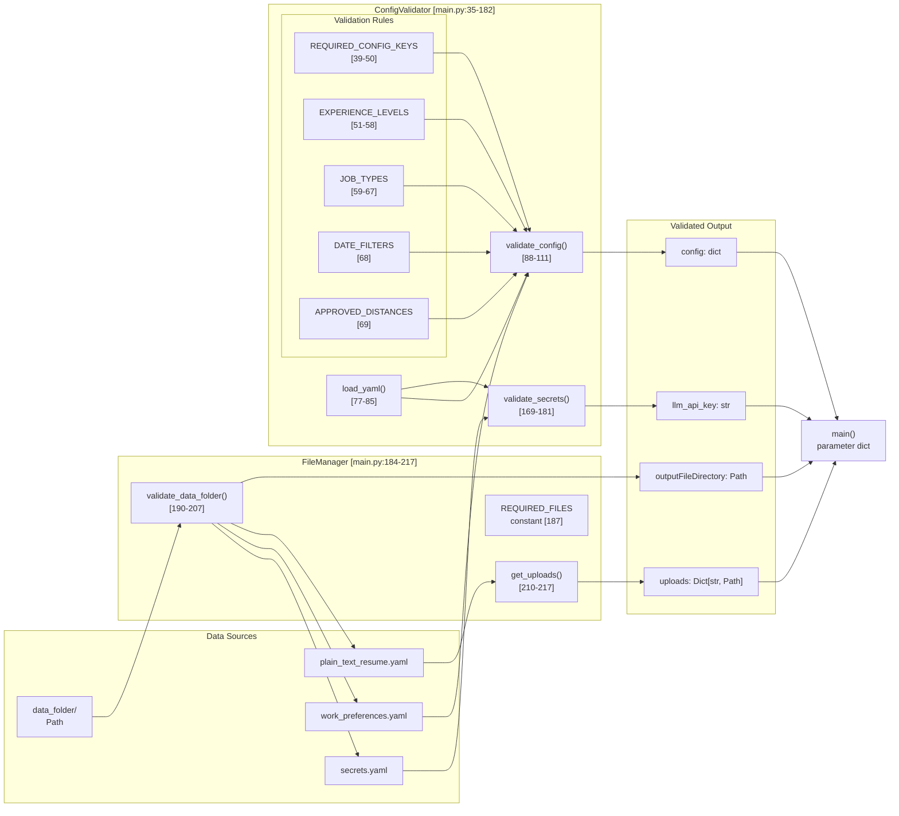
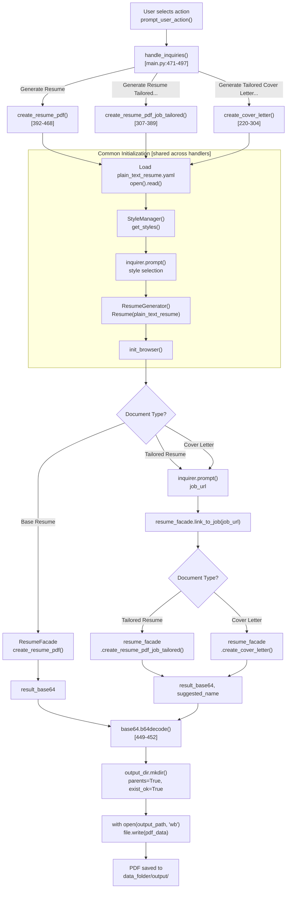
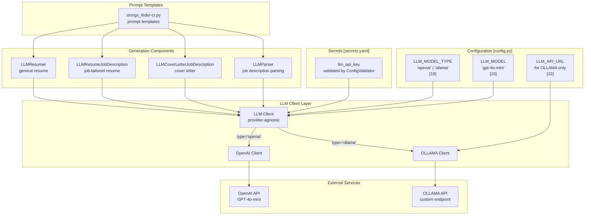
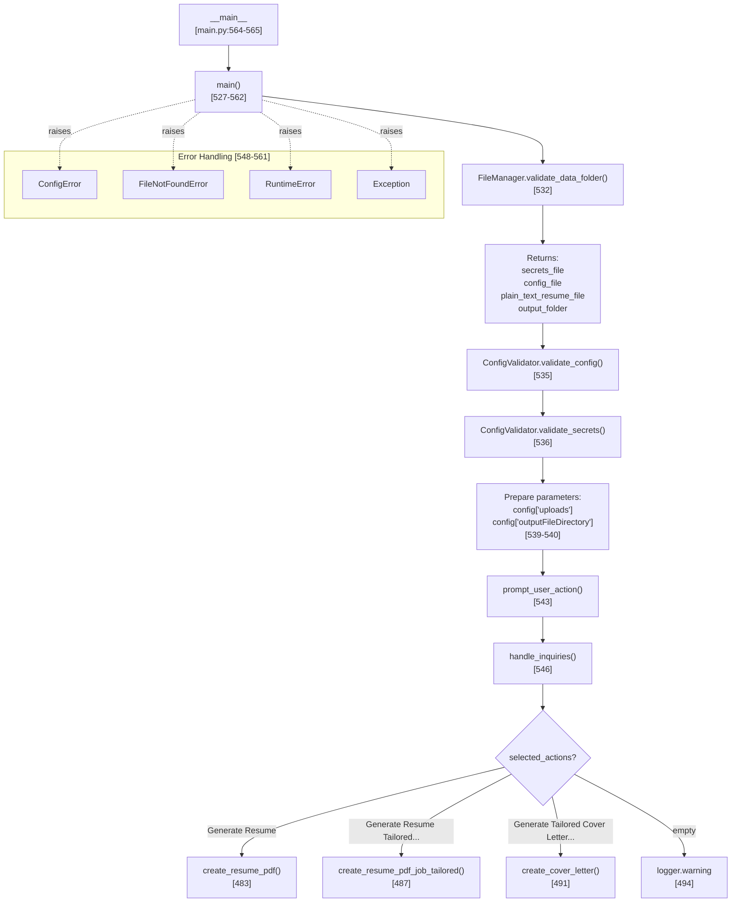
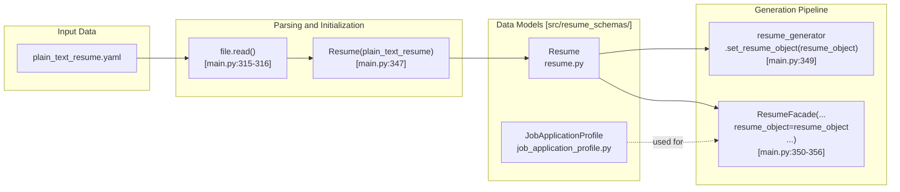
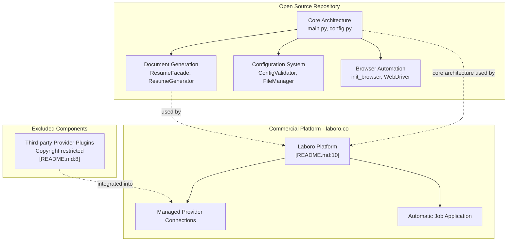

<!-- source: DeepWiki mcp.deepwiki.com · repo feder-cr/Jobs_Applier_AI_Agent_AIHawk · page 2 System Architecture · fetched 2026-10-29 -->

# System Architecture

<details>
<summary>Relevant source files</summary>

The following files were used as context for generating this wiki page:

- [README.md](README.md)
- [config.py](config.py)
- [main.py](main.py)

</details>


## Purpose and Scope

This document provides a comprehensive overview of the AIHawk system's architecture, detailing how major components interact and the overall design philosophy. It covers the structural organization of the codebase, component responsibilities, data flow patterns, and integration points.

For specific implementation details of individual subsystems, see:
- Configuration validation and file management: [Configuration System](#2.2)
- LLM provider integration: [LLM Integration](#2.3)
- Job automation logic: [Job Application Agent](#2.4)
- Selenium and PDF generation: [Browser Automation](#2.5)

## Core Architectural Principles

The AIHawk system follows a **layered architecture** with clear separation of concerns:

| Layer | Responsibility | Key Components |
|-------|---------------|----------------|
| **Orchestration** | User interaction, workflow coordination | `main.py::main()`, `handle_inquiries()` |
| **Configuration** | Validation, file management, settings | `ConfigValidator`, `FileManager` |
| **Document Generation** | Resume/cover letter creation | `ResumeFacade`, `ResumeGenerator`, `StyleManager` |
| **LLM Integration** | AI-powered content generation | `LLMResumer`, `LLMResumeJobDescription`, `LLMCoverLetterJobDescription` |
| **Browser Automation** | Web scraping, PDF rendering | Selenium WebDriver, Chrome DevTools Protocol |
| **Data** | Configuration files, resume data | YAML files (`secrets.yaml`, `work_preferences.yaml`, `plain_text_resume.yaml`) |

The system employs a **facade pattern** for document generation, abstracting complexity behind `ResumeFacade`, and uses **dependency injection** throughout to maintain loose coupling between components.

**Sources:** [main.py:1-566](), [config.py:1-23]()

## System Component Architecture

The following diagram maps the system's natural language components to their concrete code implementations:

```mermaid
graph TB
    subgraph "Orchestration Layer"
        Main["main.py::main()"]
        HandleInq["main.py::handle_inquiries()"]
        PromptUser["main.py::prompt_user_action()"]
    end
    
    subgraph "Validation Layer"
        ConfigValidator["ConfigValidator<br/>[main.py:35-182]"]
        FileManager["FileManager<br/>[main.py:184-217]"]
    end
    
    subgraph "Document Generation Core"
        ResumeFacade["ResumeFacade<br/>src/libs/resume_and_cover_builder"]
        ResumeGenerator["ResumeGenerator<br/>src/libs/resume_and_cover_builder"]
        StyleManager["StyleManager<br/>src/libs/resume_and_cover_builder"]
    end
    
    subgraph "Document Type Handlers"
        CreateResume["create_resume_pdf()<br/>[main.py:392-468]"]
        CreateResumeJob["create_resume_pdf_job_tailored()<br/>[main.py:307-389]"]
        CreateCover["create_cover_letter()<br/>[main.py:220-304]"]
    end
    
    subgraph "LLM Components"
        LLMResumer["LLMResumer"]
        LLMResumeJob["LLMResumeJobDescription"]
        LLMCover["LLMCoverLetterJobDescription"]
    end
    
    subgraph "Browser Infrastructure"
        InitBrowser["init_browser()<br/>src/utils/chrome_utils"]
        WebDriver["Selenium WebDriver"]
    end
    
    subgraph "Configuration Files"
        SecretsYAML["secrets.yaml<br/>SECRETS_YAML"]
        WorkPrefYAML["work_preferences.yaml<br/>WORK_PREFERENCES_YAML"]
        ResumeYAML["plain_text_resume.yaml<br/>PLAIN_TEXT_RESUME_YAML"]
        ConfigPY["config.py"]
    end
    
    subgraph "Data Models"
        Resume["Resume<br/>src/resume_schemas/resume"]
        JobProfile["JobApplicationProfile<br/>src/resume_schemas/job_application_profile"]
    end
    
    Main --> PromptUser
    Main --> FileManager
    Main --> ConfigValidator
    Main --> HandleInq
    
    FileManager --> SecretsYAML
    FileManager --> WorkPrefYAML
    FileManager --> ResumeYAML
    
    ConfigValidator --> SecretsYAML
    ConfigValidator --> WorkPrefYAML
    
    HandleInq --> CreateResume
    HandleInq --> CreateResumeJob
    HandleInq --> CreateCover
    
    CreateResume --> StyleManager
    CreateResume --> ResumeGenerator
    CreateResume --> ResumeFacade
    CreateResume --> Resume
    CreateResume --> InitBrowser
    
    CreateResumeJob --> StyleManager
    CreateResumeJob --> ResumeGenerator
    CreateResumeJob --> ResumeFacade
    CreateResumeJob --> Resume
    CreateResumeJob --> InitBrowser
    
    CreateCover --> StyleManager
    CreateCover --> ResumeGenerator
    CreateCover --> ResumeFacade
    CreateCover --> Resume
    CreateCover --> InitBrowser
    
    ResumeFacade --> ResumeGenerator
    ResumeFacade --> StyleManager
    ResumeFacade --> WebDriver
    
    ResumeGenerator --> LLMResumer
    ResumeGenerator --> LLMResumeJob
    ResumeGenerator --> LLMCover
    
    InitBrowser --> WebDriver
    
    ConfigPY -.-> ResumeFacade
    ConfigPY -.-> LLMResumer
```



**Sources:** [main.py:1-566](), [config.py:1-23]()

## Configuration and Validation Architecture

The system implements a robust configuration validation pipeline before any operations execute:



### Configuration Validation Rules

The `ConfigValidator` class enforces strict validation rules defined as class-level constants:

| Validation Rule | Type | Purpose |
|----------------|------|---------|
| `REQUIRED_CONFIG_KEYS` | `dict` | Defines mandatory keys and their expected types |
| `EXPERIENCE_LEVELS` | `list[str]` | Whitelisted experience levels (internship, entry, associate, mid_senior_level, director, executive) |
| `JOB_TYPES` | `list[str]` | Whitelisted job types (full_time, contract, part_time, temporary, internship, other, volunteer) |
| `DATE_FILTERS` | `list[str]` | Whitelisted date filters (all_time, month, week, 24_hours) |
| `APPROVED_DISTANCES` | `set[int]` | Whitelisted distance values (0, 5, 10, 25, 50, 100) |
| `EMAIL_REGEX` | `re.Pattern` | Email validation pattern |

The validator applies these rules through dedicated validation methods:
- `_validate_experience_levels()` [main.py:114-120]()
- `_validate_job_types()` [main.py:123-129]()
- `_validate_date_filters()` [main.py:132-138]()
- `_validate_list_of_strings()` [main.py:141-147]()
- `_validate_distance()` [main.py:150-155]()
- `_validate_blacklists()` [main.py:158-166]()

**Sources:** [main.py:35-217]()

## Document Generation Data Flow

The document generation pipeline follows a consistent pattern across all document types:



### Document Handler Parameters

Each document generation handler follows this initialization pattern:

```python
# Common pattern across all handlers
with open(parameters["uploads"]["plainTextResume"], "r", encoding="utf-8") as file:
    plain_text_resume = file.read()

style_manager = StyleManager()
resume_generator = ResumeGenerator()
resume_object = Resume(plain_text_resume)
driver = init_browser()
resume_generator.set_resume_object(resume_object)

resume_facade = ResumeFacade(
    api_key=llm_api_key,
    style_manager=style_manager,
    resume_generator=resume_generator,
    resume_object=resume_object,
    output_path=Path("data_folder/output"),
)
resume_facade.set_driver(driver)
```

**Sources:** [main.py:220-468]()

## LLM Configuration and Integration

The system uses a configuration-driven approach to LLM integration:



### LLM Configuration Constants

The system defines LLM configuration in `config.py`:

| Constant | Default Value | Purpose |
|----------|--------------|---------|
| `LLM_MODEL_TYPE` | `'openai'` | Selects provider implementation (openai/ollama) |
| `LLM_MODEL` | `'gpt-4o-mini'` | Specifies model identifier |
| `LLM_API_URL` | `''` | Required only for OLLAMA, custom endpoint URL |

The API key is stored separately in `secrets.yaml` and validated by `ConfigValidator.validate_secrets()` [main.py:169-181]().

**Sources:** [config.py:1-23](), [main.py:169-181]()

## Job Application Configuration

The system includes configuration constants for job application behavior:

| Constant | Default | Purpose | Reference |
|----------|---------|---------|-----------|
| `JOB_APPLICATIONS_DIR` | `"job_applications"` | Output directory for applications | [config.py:13]() |
| `JOB_SUITABILITY_SCORE` | `7` | Minimum score threshold for application | [config.py:14]() |
| `JOB_MAX_APPLICATIONS` | `5` | Maximum applications per session | [config.py:16]() |
| `JOB_MIN_APPLICATIONS` | `1` | Minimum applications target | [config.py:17]() |
| `MINIMUM_WAIT_TIME_IN_SECONDS` | `60` | Rate limiting delay | [config.py:11]() |

**Note:** The core AIHawk job application agent logic is referenced but commented out in the current main.py implementation:
- `AIHawkBotFacade` [main.py:25]()
- `AIHawkJobManager` [main.py:26]()
- `GPTAnswerer` [main.py:27]()

**Sources:** [config.py:11-22](), [main.py:25-27]()

## Logging Configuration

The system implements configurable logging with file and console output options:

| Configuration | Type | Purpose | Reference |
|--------------|------|---------|-----------|
| `LOG_LEVEL` | `str` | Global log level ('ERROR', 'DEBUG', etc.) | [config.py:6]() |
| `LOG_SELENIUM_LEVEL` | constant | Selenium-specific logging level | [config.py:7]() |
| `LOG_TO_FILE` | `bool` | Enable file logging | [config.py:8]() |
| `LOG_TO_CONSOLE` | `bool` | Enable console logging | [config.py:9]() |

The logger is imported from `src.logging` [main.py:18]() and used throughout for structured logging.

**Sources:** [config.py:5-9](), [main.py:18]()

## Main Execution Flow

The entry point coordinates the entire system:



### Error Handling Strategy

The main function implements comprehensive exception handling [main.py:548-561]():

1. **ConfigError**: Configuration validation failures, logged with link to documentation
2. **FileNotFoundError**: Missing required files, logged with guidance
3. **RuntimeError**: Runtime execution errors, logged with traceback
4. **Exception**: Catch-all for unexpected errors, logged with full exception details

**Sources:** [main.py:527-566]()

## Component Dependencies

The system's import structure reveals key dependencies:

```python
# Core libraries [main.py:1-27]
from pathlib import Path              # File system operations
import yaml                           # Configuration parsing
import inquirer                       # User interaction
from selenium import webdriver        # Browser automation
import base64                         # PDF encoding

# Internal modules
from src.libs.resume_and_cover_builder import (
    ResumeFacade,                     # Document generation orchestrator
    ResumeGenerator,                  # Core generation logic
    StyleManager                      # CSS/styling management
)
from src.resume_schemas.job_application_profile import JobApplicationProfile
from src.resume_schemas.resume import Resume
from src.logging import logger
from src.utils.chrome_utils import init_browser
from src.utils.constants import (
    PLAIN_TEXT_RESUME_YAML,
    SECRETS_YAML,
    WORK_PREFERENCES_YAML,
)
```

### External Dependencies

| Package | Purpose | Usage |
|---------|---------|-------|
| `selenium` | Browser automation | Web scraping, PDF rendering via CDP |
| `webdriver_manager` | ChromeDriver management | Automatic driver installation |
| `inquirer` | Interactive CLI prompts | User action selection, style selection |
| `yaml` | Configuration parsing | Loading `.yaml` files |
| `click` | CLI framework | (imported but not actively used) |

**Sources:** [main.py:1-27]()

## Data Model Architecture

The system uses structured data models for resume information:



The `Resume` class parses the YAML content and provides structured access to resume data. The `JobApplicationProfile` provides additional context for job-specific tailoring.

**Sources:** [main.py:17-18](), [main.py:262-269](), [main.py:346-356]()

## Style Management System

The `StyleManager` provides CSS style selection and management:

```python
style_manager = StyleManager()
available_styles = style_manager.get_styles()

# Present choices to user
choices = style_manager.format_choices(available_styles)
# ... inquirer.prompt() ...

# Set selected style
style_manager.set_selected_style(style_name)
```

The `StyleManager`:
- Discovers available CSS styles from the styles directory
- Formats choices for user presentation with author attribution
- Maintains the selected style for document generation
- Provides style information to `ResumeFacade` and `ResumeGenerator`

**Sources:** [main.py:15](), [main.py:231-255](), [main.py:318-342](), [main.py:404-428]()

## Open Source vs Commercial Architecture

The codebase architecture supports both open-source and commercial deployments:



**Key Points:**
- Core automation logic remains open source [README.md:8]()
- Third-party provider plugins removed due to copyright [README.md:8]()
- Commercial platform at [laboro.co](https://laboro.co) provides managed experience [README.md:10]()
- Commercial version includes automatic job application functionality [README.md:10]()

**Sources:** [README.md:1-27]()

---

