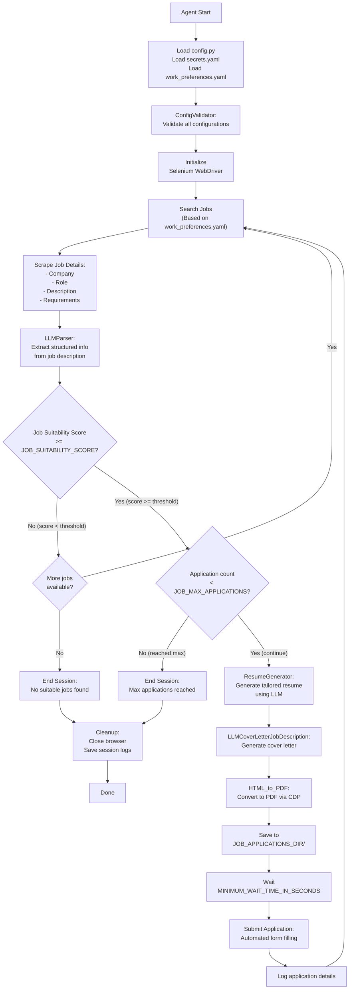
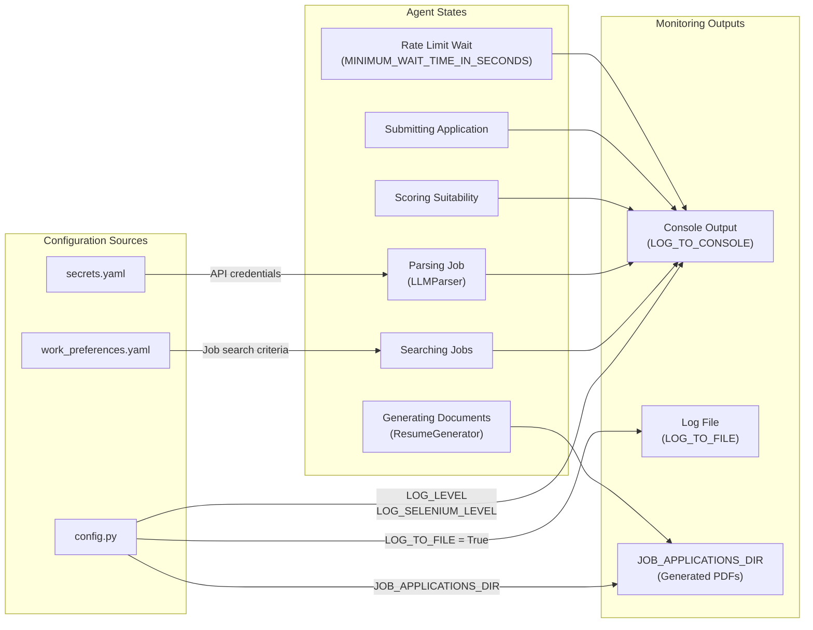
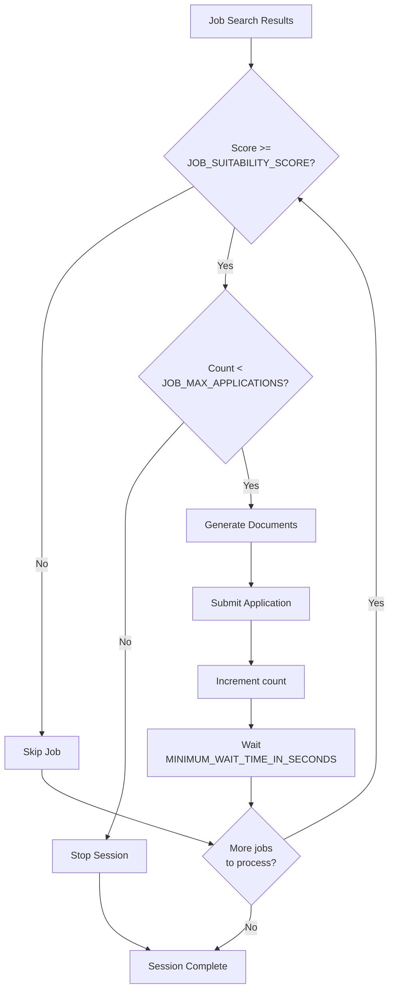

<!-- source: DeepWiki mcp.deepwiki.com · repo feder-cr/Jobs_Applier_AI_Agent_AIHawk · page 3.4 Running the Job Application Agent · fetched 2026-10-29 -->

# Running the Job Application Agent

<details>
<summary>Relevant source files</summary>

The following files were used as context for generating this wiki page:

- [README.md](README.md)
- [config.py](config.py)

</details>


## Purpose and Scope

This document provides practical instructions for running the AIHawk automated job application agent. It covers configuration parameters that control agent behavior, starting and stopping the agent, monitoring execution, understanding rate limiting and safety features, and best practices for successful automated job applications.

For architectural details about the agent's internal workings, see [Job Application Agent](#2.4). For initial setup and installation steps, see [Setup and Installation](#3.1). For configuring your job search preferences and credentials, see [Configuration Files](#3.2).

---

## Prerequisites

Before running the job application agent, ensure you have completed:

1. **Installation** - All dependencies installed per [Setup and Installation](#3.1)
2. **Configuration Files** - All required configuration files properly configured:
   - `secrets.yaml` - API keys and credentials
   - `work_preferences.yaml` - Job search preferences
   - `plain_text_resume.yaml` - Your resume data
3. **LLM Access** - Valid API key for OpenAI or configured OLLAMA endpoint
4. **Browser Setup** - Chrome/Chromium installed for Selenium automation

Sources: [README.md:1-27]()

---

## Agent Configuration Parameters

The agent's behavior is controlled by parameters in [config.py:1-23](). These settings determine how aggressively the agent applies to jobs, rate limiting, logging verbosity, and output locations.

### Core Configuration Table

| Parameter | Type | Default | Description |
|-----------|------|---------|-------------|
| `MINIMUM_WAIT_TIME_IN_SECONDS` | int | 60 | Minimum wait time between applications to avoid rate limiting |
| `JOB_APPLICATIONS_DIR` | str | "job_applications" | Directory where generated resumes and cover letters are saved |
| `JOB_SUITABILITY_SCORE` | int | 7 | Minimum score (1-10) for a job to be considered suitable for application |
| `JOB_MAX_APPLICATIONS` | int | 5 | Maximum number of applications to submit in a single session |
| `JOB_MIN_APPLICATIONS` | int | 1 | Minimum applications to attempt before considering session complete |

### Logging Configuration

| Parameter | Type | Default | Description |
|-----------|------|---------|-------------|
| `LOG_LEVEL` | str | 'ERROR' | Logging verbosity: DEBUG, INFO, WARNING, ERROR |
| `LOG_SELENIUM_LEVEL` | str | ERROR | Selenium-specific logging level |
| `LOG_TO_FILE` | bool | False | Whether to write logs to file |
| `LOG_TO_CONSOLE` | bool | False | Whether to output logs to console |

### LLM Configuration

| Parameter | Type | Default | Description |
|-----------|------|---------|-------------|
| `LLM_MODEL_TYPE` | str | 'openai' | LLM provider: 'openai' or 'ollama' |
| `LLM_MODEL` | str | 'gpt-4o-mini' | Specific model to use |
| `LLM_API_URL` | str | '' | API endpoint URL (required for OLLAMA only) |

Sources: [config.py:1-23]()

---

## Starting the Agent

### Basic Execution

The agent is typically started through a main entry point script. The exact command depends on your setup:

```bash
python main.py
```

The agent will:
1. Load configuration from `config.py`
2. Validate `secrets.yaml` and `work_preferences.yaml`
3. Initialize browser automation
4. Begin searching for jobs based on your preferences

### Configuration Override

You can modify agent parameters by editing [config.py:1-23]() before starting. Key parameters to adjust:

**For Testing:**
```python
JOB_MAX_APPLICATIONS = 2  # Limit applications for testing
JOB_SUITABILITY_SCORE = 9  # Only apply to highly suitable jobs
LOG_LEVEL = 'DEBUG'  # Enable detailed logging
```

**For Production:**
```python
JOB_MAX_APPLICATIONS = 50  # Apply to more jobs
JOB_SUITABILITY_SCORE = 7  # Moderate suitability threshold
MINIMUM_WAIT_TIME_IN_SECONDS = 120  # More conservative rate limiting
```

Sources: [config.py:1-23]()

---

## Understanding the Agent Workflow

### Agent Execution Flow



**Diagram: Agent Execution Workflow with Code Entities**

This diagram shows the complete execution cycle of the agent, mapping to actual configuration parameters and code components.

Sources: [config.py:1-23](), High-level Diagram 2

---

## Monitoring Execution

### Real-time Monitoring

The agent provides several ways to monitor execution:

1. **Console Output** - Set `LOG_TO_CONSOLE = True` in [config.py:9]()
2. **Log Files** - Set `LOG_TO_FILE = True` in [config.py:8]()
3. **Output Directory** - Monitor `JOB_APPLICATIONS_DIR` for generated documents

### Monitoring Configuration States



**Diagram: Monitoring and Configuration Flow**

### Log Level Details

Set `LOG_LEVEL` in [config.py:6]() to control verbosity:

- **DEBUG** - All details including LLM prompts, responses, and scraping data
- **INFO** - Application attempts, suitability scores, document generation
- **WARNING** - Rate limit warnings, validation issues
- **ERROR** - Only errors and failures

Sources: [config.py:1-23]()

---

## Rate Limiting and Safety Features

### Built-in Safety Mechanisms

The agent includes several safety features to prevent aggressive behavior:

#### 1. Minimum Wait Time

`MINIMUM_WAIT_TIME_IN_SECONDS` enforces a delay between applications:

```python
MINIMUM_WAIT_TIME_IN_SECONDS = 60  # Wait at least 60 seconds between applications
```

**Purpose:**
- Prevents IP blocking from job sites
- Reduces detection as automated bot
- Spreads applications over time naturally

**Recommended Settings:**
- **Testing:** 30 seconds
- **Normal Use:** 60-120 seconds
- **Conservative:** 180-300 seconds

#### 2. Maximum Application Limit

`JOB_MAX_APPLICATIONS` caps total applications per session:

```python
JOB_MAX_APPLICATIONS = 5  # Apply to at most 5 jobs per session
```

**Purpose:**
- Prevents runaway automation
- Allows review of generated documents
- Ensures quality over quantity

#### 3. Suitability Threshold

`JOB_SUITABILITY_SCORE` filters jobs before applying:

```python
JOB_SUITABILITY_SCORE = 7  # Only apply to jobs scored 7/10 or higher
```

**Purpose:**
- Ensures relevant applications only
- Reduces wasted applications to unsuitable positions
- Improves application success rate

### Safety Parameter Relationships



**Diagram: Safety Feature Decision Flow**

Sources: [config.py:11-17]()

---

## Output and Logs

### Output Directory Structure

Generated documents are saved to `JOB_APPLICATIONS_DIR` [config.py:13]():

```
job_applications/
├── company_name_position_title_YYYYMMDD_HHMMSS/
│   ├── resume.pdf
│   └── cover_letter.pdf
├── another_company_role_YYYYMMDD_HHMMSS/
│   ├── resume.pdf
│   └── cover_letter.pdf
└── ...
```

Each application creates a timestamped directory containing:
- **resume.pdf** - Tailored resume for the specific job
- **cover_letter.pdf** - Customized cover letter

### Logging Output

When `LOG_TO_FILE = True` [config.py:8]():

```
logs/
├── aihawk_YYYYMMDD.log
├── selenium_YYYYMMDD.log
└── ...
```

Log files contain:
- Job search queries and results
- Suitability scores for each job
- Document generation status
- Application submission results
- Error messages and stack traces

Sources: [config.py:13](), [config.py:8]()

---

## Stopping the Agent

### Graceful Shutdown

The agent respects `JOB_MAX_APPLICATIONS` and stops automatically when reached. To stop manually:

1. **Keyboard Interrupt** - Press `Ctrl+C` in terminal
2. **Session Completion** - Wait for current application to finish

### Emergency Stop

If the agent becomes unresponsive:

1. Force terminate the Python process
2. Manually close Chrome/Chromium browser windows
3. Check `JOB_APPLICATIONS_DIR` for partial documents
4. Review logs to understand what happened

### Post-Stop Cleanup

After stopping the agent:

1. **Review Applications** - Check documents in `JOB_APPLICATIONS_DIR`
2. **Verify Submissions** - Manually verify which applications were actually submitted
3. **Update Tracking** - Record successful applications outside the agent
4. **Adjust Configuration** - Modify parameters based on results

Sources: [config.py:13-17]()

---

## Best Practices and Tips

### Configuration Recommendations

#### For First-Time Users

```python
# Conservative settings for first run
JOB_MAX_APPLICATIONS = 2
JOB_SUITABILITY_SCORE = 8
MINIMUM_WAIT_TIME_IN_SECONDS = 120
LOG_LEVEL = 'DEBUG'
LOG_TO_CONSOLE = True
```

**Rationale:**
- Limit applications to review quality
- High threshold ensures relevant matches
- Extra wait time for safety
- Detailed logging for troubleshooting

#### For Regular Use

```python
# Balanced settings for regular use
JOB_MAX_APPLICATIONS = 10
JOB_SUITABILITY_SCORE = 7
MINIMUM_WAIT_TIME_IN_SECONDS = 90
LOG_LEVEL = 'INFO'
LOG_TO_FILE = True
```

**Rationale:**
- Reasonable application volume
- Moderate threshold for broader matches
- Standard rate limiting
- File logging for record keeping

#### For Aggressive Job Hunting

```python
# Higher volume with safeguards
JOB_MAX_APPLICATIONS = 50
JOB_SUITABILITY_SCORE = 6
MINIMUM_WAIT_TIME_IN_SECONDS = 120
LOG_LEVEL = 'INFO'
LOG_TO_FILE = True
```

**Rationale:**
- Higher application limit
- Lower threshold for more opportunities
- Longer wait time to compensate for volume
- Logging for auditing

### Operational Best Practices

1. **Run During Off-Peak Hours** - Schedule agent runs during nights/weekends to reduce detection risk

2. **Review Generated Documents** - Manually review first few applications to ensure quality

3. **Monitor Suitability Scores** - If scores are consistently low, adjust `work_preferences.yaml` criteria

4. **Respect Rate Limits** - Don't set `MINIMUM_WAIT_TIME_IN_SECONDS` below 30 seconds

5. **Session Management** - Run multiple short sessions rather than one long session

6. **Track Results** - Maintain external spreadsheet of applications for follow-up

7. **Regular Updates** - Keep `plain_text_resume.yaml` current as you gain experience

8. **LLM Selection** - Use `gpt-4o-mini` for cost-effective quality, upgrade to `gpt-4` for better tailoring

### Troubleshooting Common Issues

| Issue | Likely Cause | Solution |
|-------|--------------|----------|
| No jobs found | `work_preferences.yaml` too restrictive | Broaden search criteria |
| All jobs rejected | `JOB_SUITABILITY_SCORE` too high | Lower threshold to 6-7 |
| Rate limit errors | `MINIMUM_WAIT_TIME_IN_SECONDS` too low | Increase to 120+ seconds |
| Poor document quality | LLM model insufficient | Upgrade to more capable model |
| Browser crashes | Memory issues | Reduce `JOB_MAX_APPLICATIONS` per session |
| API errors | Invalid credentials | Verify `secrets.yaml` configuration |

### Performance Optimization

**For Faster Execution:**
- Lower `JOB_SUITABILITY_SCORE` to reduce LLM parsing overhead
- Use `ollama` with local models to avoid API latency
- Disable detailed logging (`LOG_LEVEL = 'ERROR'`)

**For Better Quality:**
- Increase `JOB_SUITABILITY_SCORE` to be more selective
- Use `gpt-4` instead of `gpt-4o-mini` for document generation
- Enable DEBUG logging to review LLM outputs

Sources: [config.py:1-23]()

---

## Integration with Commercial Platform

For users seeking a fully managed experience, the commercial platform at **[laboro.co](https://laboro.co)** provides:

- **No Configuration Required** - Managed connections and settings
- **Automatic Application Submission** - Integrated with job boards
- **Provider Integrations** - Third-party provider plugins (excluded from open source)
- **AI-Driven Job Board** - Intelligent job matching and recommendations
- **Application Tracking** - Built-in dashboard for monitoring applications

The open-source agent provides the core automation capabilities, while the commercial platform extends this with managed infrastructure and integrated providers.

Sources: [README.md:8-10]()

---

